# Admin Operations Guide

This guide covers day-to-day administration tasks for DumpFire. You need the **Admin** or **Superadmin** role to access the Admin panel, and part of it is the superadmin's alone.

## Accessing the Admin Panel

Click the **⚙️ Admin** link in the dashboard sidebar or navigate to `/admin`.

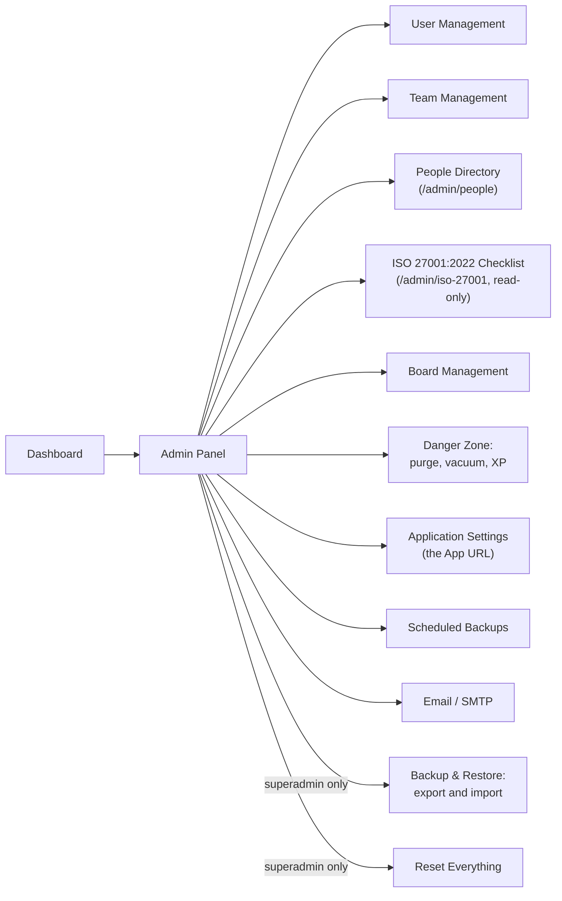

### The Admin Page's Dialogs and the Keyboard

Every action on this page that asks first (Clear Cards, Clear Categories, Delete Board, Delete User, Delete Team, Remove Destination, Purge Archived Cards, Vacuum Database, Reset All XP, Reset Everything), and the Archived page's Delete Permanently and Purge All, asks in the app's confirm dialog, the one the boards, All Tasks and the Teams page use (card 2362, 2026-10-21; each page had a dialog of its own before). As it opens, **Cancel** has the keyboard's focus, so Enter straight after cancels; **Tab** and **Shift+Tab** stay in the dialog; **Escape** cancels; and as it closes the focus goes back to the button that opened it. To confirm by keyboard, press Tab, then Enter. A click on the dark overlay around it does nothing. A dialog that asks for your password (card 2701: see [Your Password, Asked Again](#your-password-asked-again)) gives the focus to its **Your password** field instead, and asks for a code from your authenticator app under it (card 2770); Enter in the password field moves to the code field while that is empty, and Enter in the code field confirms once both are filled. It stays open, buttons greyed, until the answer comes: open still, with the server's words, for a wrong password, and closed for any other answer.

The **Import Database** dialog and Google Drive's **Connect** box keep their own look and behave the same way: Cancel has the focus, Tab stays in them (in the import, through the chosen way to restore, the password field, the code field and its switch, Cancel and Confirm), and Escape is Cancel. The invite link's dialog and the reset's notice have one button and no way out but it. As each opens its button has the focus (the invite link's **📋 Copy**), and Tab and Shift+Tab stay in it (card 2365, 2026-10-21; Tab walked the page behind them, and the reset's notice took no focus). The invite link's dialog does not close on Escape: the link is shown once, and only **Done** lets it go. After Done the focus goes to **+ Add User** when the link came from Create, or to the row's 📧 when it came from there (Create itself has gone with its form by then). The link of a two-step sign-in reset is shown in the same dialog, with its own words, and after Done the focus goes back to the row's 🛡️ (card 2773, see [Resetting Two-Step Sign-In](#resetting-two-step-sign-in)). The reset's notice closes on Escape when its button is **Close** (a reset that failed and changed nothing); after a reset that was done its one way out is **Continue to set-up**, and Escape does nothing.

The 🔑 password dialog (another account's **Reset Password**, or **Change Your Password** on your own row) holds the keyboard the same way (card 2886, 2026-11-17; before it the focus stayed on 🔑 behind it, Tab walked the page and Escape did nothing). As it opens the focus is in **Your password** (**Current password** on your own row); Tab and Shift+Tab stay in it; Escape is Cancel, clearing what was typed; and as it closes, by Cancel, Escape or a finished reset, the focus goes back to that row's 🔑. Enter in the password field moves to the code field while that is empty, and Enter in the code field, or in the password once a code is typed, moves on to the new password. Enter never sends a reset: a reset ends every session, API key and webhook of the account, so **Reset Password** (or **Change Password**) is pressed on purpose.

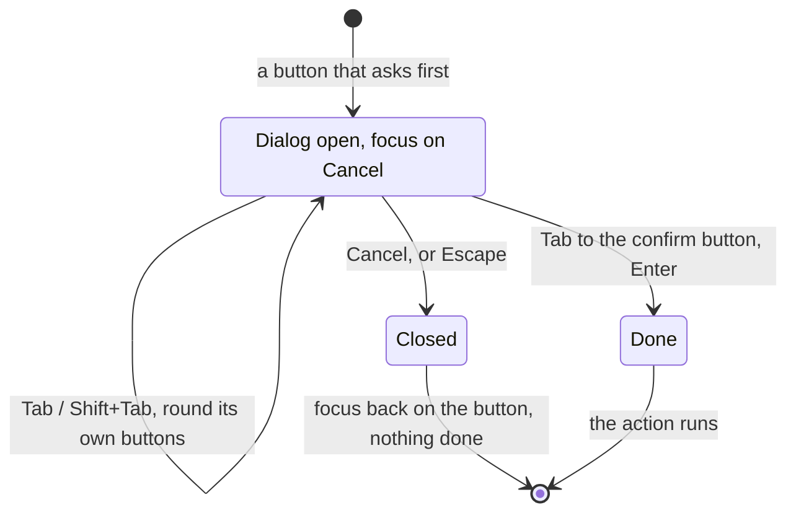

## Who May Do What

The superadmin is the account made when DumpFire was set up, and there is one. An administrator does everything on the page that is about people, boards, housekeeping, mail and the scheduled backups. The export, the import and the reset are the superadmin's:

| On the admin page | An administrator | The superadmin |
|-------------------|------------------|----------------|
| Database Overview | ✅ | ✅ |
| Board Management: delete a board, clear its cards or categories | ✅ | ✅ |
| User Management, within [whose account they may manage](#modifying-users) | ✅ | ✅ |
| Team Management | ✅ | ✅ |
| [People Directory](#people-directory) (`/admin/people`, card 2674) | ✅ | ✅ |
| [ISO 27001:2022 Checklist](#the-iso-270012022-checklist) (`/admin/iso-27001`, card 2670), read-only | ✅ | ✅ |
| Danger Zone: Purge Archived Cards, Vacuum Database, Reset All XP | ✅ | ✅ |
| The system log and the audit trail (`/audit`) | ✅ | ✅ |
| **Application Settings**: see the App URL | ✅ | ✅ |
| Application Settings: **set the App URL** | ❌ (card 2847; ✅ from card 2395 until then) | ✅ |
| **Scheduled Backups**: the schedule, the destinations, "Test", "Run Now" and Google Drive's "Connect" | ✅ (since card 2395) | ✅ |
| Scheduled Backups: **lower Keep Last**, **remove a destination** (a rename is a removal) or **switch the schedule off** | ❌ (card 2398) | ✅ |
| Scheduled Backups: **switch Email on failure off** or **change who receives it** (ticking it on stays every administrator's) | ❌ (card 2408) | ✅ |
| **Email / SMTP**: the mail settings, the test mail and what mail has done | ✅ (since card 2395) | ✅ |
| **Backup & Restore**: Export Backup and Import Backup | ❌ | ✅ |
| Danger Zone: **Reset Everything** | ❌ | ✅ |

The last two are the user list by another way, which is why an administrator, who cannot manage another administrator's account, cannot use them. An export holds every password hash. An import replaces every account with the backup's. Whoever sets up after a reset is the superadmin.

**The mail and backup settings are every administrator's since card 2395 (2026-10-21), at the owner's request; they were the superadmin's alone.** That gives every administrator a way round the rule that only the superadmin manages an administrator, and you should know what it is:

- **An administrator who sets a backup destination can receive a full copy of the database**: every account's password hash and email address, every board, card and comment. They can add a destination of their own and press Run Now.
- **An administrator who sets the mail server sees every mail DumpFire sends**, invite links and password-reset links included, the superadmin's among them; whoever reads such a link can set that account's password. The App URL, saved with the mail settings, decides where every link in a mail points, and **is the superadmin's alone since card 2847** (2026-11-17): an administrator could point it at a server of their own that looks like DumpFire and collect the password and code of whoever followed a link. The mail server stays every administrator's; whether it should be the superadmin's too is card 2906, for the owner to rule.
- **The stored secrets stay where they were saved.** Since card 2898 they are also kept sealed in the database, under a key derived from the MFA key file, each bound to where it was saved (the mail connection, the destination's place and host key, the webhook's address): a hand edit of the database that moves one makes it unusable, and it is then shown empty and has to be typed again. Since card 2928 every webhook's address is kept sealed the same way, and no backup or export holds one: a restore onto this server puts each back, and any other names each webhook whose address is to be sent again with `PUT /api/v1/webhooks/{id}`. The mail password and every destination's password, key and token are masked on the page for everybody, and a save or a Test that points a masked one at another host, bucket, folder or path is refused: it has to be typed again. Two exceptions: an administrator may confirm the host key of an SFTP destination that has a stored password but no confirmed key yet, and the stored password then goes to whichever server shows that key; and **Connect** on a Google Drive destination already set up with a client ID and secret ties it to the Google account of whoever connects, using the stored ID and secret (a `WARN` line under `BACKUP` in the system log where it replaces a connection the destination had).
- **Lowering Keep Last, removing a destination and switching the schedule off are the superadmin's** (card 2398, 2026-10-22). Lowering **Keep Last** (its least is 1) and pressing **Run Now** deleted every older copy at every destination, and removing the destinations or switching the schedule off stopped the copies, so an administrator could leave you nothing to restore from; it was logged, not prevented. Now the server refuses each of the three to anyone but the superadmin, `403` "Lowering Keep Last, removing a destination, switching the schedule or the failure mail off, or changing who receives the failure mail needs the superadmin." followed by what the save would have done, and nothing is saved. A destination renamed, or saved as another type, is the old one removed, and is refused too: add the new one and ask the superadmin to remove the old. An administrator can still raise Keep Last, change between schedules that run, add destinations and edit them in place, test, connect and run backups. On the page they see 🗑️ dimmed and the schedule's option reading **Disabled (superadmin only)**, each saying the rule when chosen, Keep Last putting a lower number back, and one line under the schedule; editing a destination, a line under its name says renaming needs the superadmin. For anyone, a save the server refuses reads the settings again, so the panel shows what is saved, and the message ends "The settings shown are the ones the server holds." **The way round it is closed too** (card 2405): pressing **Run Now** Keep Last times used to push every older copy out, as each press added a copy and Keep Last kept the newest. Now Keep Last counts Run Now copies and scheduled copies separately, so a Run Now can push out only older Run Now copies, never a scheduled one: see [Manual Backup](#manual-backup). A schedule made more frequent still keeps Keep Last copies over a shorter time. Each Run Now is in the backup history, and each schedule change a line under `BACKUP`.
- **The failure mail is the superadmin's to switch off or send elsewhere** (card 2408, 2026-10-22). The failure mail is how you hear that the copies have stopped, and any administrator could untick **Email on failure** or put their own address in its place, so that a backup left failing was heard of by nobody else. Now the server refuses both to anyone but the superadmin, with the same `403` and nothing saved: unticking it where it is ticked, and any change to its addresses, an address added beside yours included, the addresses cleared, and a change made while it is unticked (so they cannot be set first and the box ticked after). The same addresses written in another order, in capitals, or separated by semicolons are not a change. Ticking it on stays every administrator's: it only adds a mail. On the page an administrator sees **Email on failure** dimmed while it is ticked (unticked, it ticks itself again and says the rule) and its address box dimmed and read-only (typing or pasting in it says the rule); the superadmin's are as before. A save sends the failure mail's settings only where they were changed on the page, so a page left open does not put back, or get refused for, a change the superadmin made since. A backup an administrator makes fail (a destination edited with a wrong password or secret) is not quiet: the failure mail goes to the addresses the superadmin chose. Two quiet ways remain, each a `WARN` line in the system log under their name and not prevented: pointing a destination, in place, at a store of their own with its secret typed again (every run succeeds, so no failure mail goes, and the copies go to their store from then on), and changing or clearing the mail settings (above), which silences every mail, the failure mail included.
- **An administrator can probe the inside of your network.** The SMTP host, an SFTP host and an S3 endpoint may be any address, addresses inside the network included (the server itself, the Docker host, internal ranges, `169.254.169.254`), and what **Send Test** and **Test** answer tells whether a port answered: a simple internal port scan. A destination's **Test** reaches only an address already saved (card 2939), so the probe needs a save, which asks for the administrator's password and code. Webhooks refuse addresses inside the network; these settings do not, because real setups use a NAS or a mail relay on the local network.
- **The settings go with whoever pointed them where they are** (card 2397, 2026-10-22). DumpFire records, for each place it has been, who pointed mail there (the mail **Host**, **Port**, **Username**, and the box that allows mail without a checked, encrypted connection), who set the App URL to each address, and who added each backup destination, pointed it at each place or account, or connected its Google Drive; a setting belongs to whoever is recorded for where it is now. Correcting the sender's name or address, typing a password or secret again for the same server or place, clearing the App URL, or confirming an SFTP host key makes nobody the setter: an administrator who corrects one of your fields does not take over, and on their demotion take away, your settings. Nor does one who changes a setting and changes it back (a relay's **Port**, a destination's prefix, the App URL): back where you put it, it is yours again, unless they typed the password or secret with the move, which makes the mail or destination run on what they typed and so theirs. When the setter is made a user, or deleted, what it set is removed in the same step: the mail settings (so **no mail is sent**, invites and password resets included, until an administrator sets the mail up again), the App URL (links then use the server's `APP_URL`, or else its `ORIGIN`), and its destinations with their stored secrets (the copies already at a destination stay, and a backup already running finishes). The superadmin is the same: lowered to user, what they set goes. Before you confirm, the delete's confirmation, and for a role change to **User** a confirmation of its own, says what would go, as the server has it the moment you press (another administrator may have taken a setting over since the page loaded); where that cannot be read, it asks all the same and says that whatever of those settings is still theirs goes too; afterwards a ⚠️ message that stays until closed says what went, and the panels that showed it read their settings again; the system log has a `WARN` line under `SMTP` and one under `BACKUP` naming it. Settings saved before the update that brings migration 0059 have nobody recorded and stay in force whoever is demoted: the first change that moves one (the **Port**, say, or a destination's path) makes whoever saves it its setter, and changed back it is nobody's again. A move by the superadmin, or one made with the password or secret typed, is always the mover's, even to a place another administrator visited first. A change made from the host's command line runs none of this until the server next starts (card 2406): every start, before any scheduled backup, removes what a setter who is no longer an administrator set, by the same rule, with the same `WARN` lines saying `found at start-up`. So after making an administrator a user from the host, restart the container to take their settings away. **Import Backup** does the same once a restore is committed (card 2411): a setter who is not an administrator in the restored data (a backup taken while such a change waited for a restart, say) loses those settings at once, whichever way it is restored, with the same lines saying `found after a restore`, and not at the next start. An account deleted from the host with foreign keys on, which the documented `node -e` command has, takes its record of what it set with it (the database removes those rows with the account), and its settings then stay in force as settings nobody is recorded for; deleted with foreign keys off (the `sqlite3` shell's default), its record stays, and the next start removes its settings as it does a demoted setter's. Delete accounts on the admin page, not from the host. Each change to the backup settings, and since card 2396 each change to the mail settings and the App URL, is also a line in the system log under the account that made it (the mail user name and password by name alone, never their values).

An administrator does not see the export, the import or Reset Everything on the page. In place of Backup & Restore is one section, "The superadmin's", which says what they are and names the superadmin. The routes behind them refuse everybody else with `403` and "This belongs to the superadmin", so a request made by hand fares no better. A demotion takes effect at once: an administrator made a user while a save, a Run Now, a Test, a Connect or a Send Test is on its way is refused at the moment it would be saved or sent, with nothing saved and nothing sent.

If nobody can sign in as the superadmin, no page puts it right: see [If Nobody Can Sign In as the Superadmin](deployment.md#if-nobody-can-sign-in-as-the-superadmin).

## Your Password, Asked Again

**Forty-four actions ask for your own password and a code** (cards 2701, 2697 and 2679, 2026-11-04, card 2773, 2026-11-13, cards 2771, 2772 and 2751, 2026-11-17, and card 2671, 2026-11-18): card 2701's eighteen, card 2773's 🛡️ (resetting another account's two-step sign-in) and card 2671's two, ⛔ (disabling an account) and ✅ (enabling it again), in the table below, every time, card 2771's three on the Account page (changing your email, changing your password, which the 🔑 dialog on your own row uses too, and **Generate Key**), every time, card 2772's five on the Account page (**Add an authenticator**, **Remove** on an authenticator, **Make new recovery codes**, **That was me** on the warning at the top of the page, and **Keep this key** on an API key made before two-step sign-in), every time, card 2751's three on the **Reports** page (making a schedule, a change to one that adds an address, turns it on or widens its **Include** filter, and **Email** on a report), card 2697's eight on decisions and the [people directory](#people-directory) (a participant's account and address, a decision's delete and withdrawal once it was opened, and adding, changing the address or account of, marking active (since card 3020), and deleting a person, and Add from accounts), card 2922's keep or remove of a setting held for review, card 3020's **Release** under Mail held in the Requests inbox, and card 2679's two on a decision's results page, every time: **Rule…**, which rules for good and mails every participant the ruling and its reason, and **Release results…**, which shows the totals and comments, for good, to everyone who can see the decision. Each of them destroys data in bulk or for good, makes, removes or changes an account's access, or sends the database, the mail that invites and resets go through, or a board's activity, somewhere the person pressing it chooses. Being signed in, and having the right role, used to be enough for all of them, so whoever had your signed-in browser (an unlocked machine, a copied cookie) or ran script in a DumpFire page could do any of them as you. Now they also need your password and a code from your authenticator app (or one of your recovery codes) with it: the dialogs ask for both (card 2770), and the server checks both (card 2771, released together with 2770); the action runs only when both are right. There is no "recently confirmed" spell: clearing five boards asks five times.

| Where | Action | Asks |
|-------|--------|------|
| Danger Zone | Purge Archived Cards, Reset All XP, Reset Everything | Always |
| Board Management | Clear Cards, Clear Categories, Delete | Always |
| User Management | Add User (a **Your password** box and a code box in the form), Change of role, 🔑 on another account's row (a **Your password** box and a code box in the dialog), 📧, 🛡️ (card 2773), ⛔ and ✅ (card 2671), 🗑️ | Always |
| Backup & Restore | Export Backup, Import Backup | Always |
| Scheduled Backups | Add Destination, Save of an edited destination, 🗑️ Remove, ✅ Confirm this key, ▶ Run Now, 🔗 Connect (a **Your password** box and a code box in the Connect box) | Always. A save of the schedule, Keep Last or the failure mail alone asks nothing |
| Email / SMTP and Application Settings | Save SMTP, and Save of the App URL (it is saved with the mail settings; the superadmin's alone since card 2847) | Always |
| The dashboard, a board's page | Delete Board, Delete Sub-board (from a card's window or the board's ⋯ menu) | Always |
| A board's page | Delete Column | Only when the column holds a card, archived ones included |
| The Archived page | Purge All | Always |
| Reports (card 2751) | **Email** on a report (a **Your password** box and a code box in the dialog), **+ New Schedule** (in the form), switching a schedule **on** (the **Turn on this schedule?** dialog, naming every address it will email) | Always, to any address, your own and the company's among them. Switching a schedule off, deleting it and **Use my time zone** ask nothing; so does any change to a schedule through the API that adds no address, does not turn it on and does not widen its **Include** filter |

A change of another account's email address through `PUT /api/users/{id}` asks too; no page offers one. **Not asked**: Vacuum, a destination's **Test**, **Send Test**, deleting a team, and every single card, comment, label, milestone or category delete, an empty column's, and an archive or restore. Your own password, email and API keys on the Account page asked for the password already; since card 2771 they ask for a code beside it, through the same check as every other action here (each form has the same password field, code field and **Use a recovery code instead** switch), and a script that calls those routes sends `currentPassword` and `currentCode` (the email and key routes no longer read `password`). The API's `DELETE /api/v1/boards/{id}` and `DELETE /api/v1/columns/{id}` ask nothing: a key has no password, and keys gaining scopes is card 2703.

**How it asks.** The dialog the action already had gains a **Your password** field, with the keyboard's focus in it; your browser's password manager may fill it. Under it is a **Code from your authenticator app** field (card 2770; a numeric keypad on a phone, which may offer the code), and a link-style button, **Use a recovery code instead**, turns the same field into **Recovery code** for one of the codes you saved when you set up two-step sign-in (**Use a code from your authenticator app instead** turns it back; switching empties the field, and each opening of a dialog starts with the authenticator code). **Confirm** stays greyed until both fields are filled, a code of spaces counting as empty, and Enter in the password field moves to the code field while that is blank, and Enter in the code field confirms once both fields are filled, so Enter can never send with the code missing. The code is sent as you typed it, beside the password, as `currentCode`, and is emptied from the page when sent, when the dialog is cancelled and after any refusal. After a wrong answer the password is emptied too and the focus goes back to the password field, as the server never says which of the two was wrong. After the three refusals the server decides before it looks at the password (card 2771), the password you typed is kept and the focus goes to the code field, for a new code alone: "That code has just been used. Wait for the next code from your authenticator app and enter it. Nothing was changed." (the same code sent again before the app shows the next), "That code is not in the right form. Enter the 6 digits from your authenticator app, or choose 'Use a recovery code instead'. Nothing was changed." (not six digits, nor a recovery code: a recovery code pasted into the authenticator field is cut short at seven characters), and "Your authenticator cannot be checked on this server right now. Use one of your recovery codes, or ask an administrator. Nothing was changed." (the server's MFA key is missing or another; a recovery code still works). None of the three counts toward the three wrong answers below. **Add from accounts** and the Person dialog on the [people directory](#people-directory) ask the same way. While the answer is awaited both buttons are greyed and **Confirm** reads "Working…", so one press sends one request. A request that gets no answer at all is said in the dialog, "No answer from the server. Try again.", with the field ready to type in again. **Add User** and Google Drive's **Connect** ask in the same fields, and say a refusal of them beside the fields the same way. The 🔑 dialog (on your own row too) asks for the code in the same way, but Enter in its code field does nothing yet: card 2886 will move Enter there to the new-password box. A wrong password or a wrong code is said in the dialog itself, "Your password or code was not right. Nothing was changed.", both fields are emptied and the focus put back in the password, and nothing was changed; anything else the server refuses (the board was deleted in another tab, say) closes the dialog and is said as before. A column whose every card is archived shows no field at first, because the page cannot see those cards; the server's answer, "Enter your password and a code from your authenticator app to confirm this. Nothing was changed.", then shows the fields in the same dialog. A tab opened before the release that brings cards 2770 and 2771 sends no code and gets the same answer: reload it. The password and the code are sent once and cleared from the page: never in a toast, the address bar or the browser's storage, and never in the system log, which says only "Password and code confirmed by *name* (ID: *n*) for *action*", or "Password and a recovery code confirmed by …" beside a `WARN` line "A recovery code confirmed *action* for *name* (ID: *n*): *k* left". A recovery code used this way is spent, as at sign-in, and its owner is mailed "A recovery code was used to confirm a change on DumpFire" with the number left. A code is spent once it has confirmed an action, even when the action is then refused (your password changed meanwhile, say): wait for the next code to try again.

**Three wrong answers sign you out.** Each signed-in browser has a count of the attempts it has had checked without a right password and a right code together, kept with its session in the database, so a restart does not clear it, and with no time limit: only a right password with a right code sets it back to nought. A wrong password and a wrong code count alike, once for the attempt, or, since card 2772, once for each authenticator that can be checked on this server when the code is from an authenticator app: with two authenticators two wrong answers sign the browser out, with three one does, and the dialog says so under the code field before you send (a recovery code counts once). An authenticator whose secret this server cannot open is skipped, and not counted; the dialog's line counts every authenticator the account holds, so in that rare case it says more than is counted, never less. Only a password that is actually checked counts: one turned away unchecked, because the server is busy, the browser already has one being checked, or the code was refused before the password was looked at (above), never counts, so it can never sign you out. The wrong answer that takes the count to three or more, on any of the forty-two (the Account page's email form, password form and Generate Key, and the 🔑 dialog on your own row, among them), ends that browser's session. The dialog then says "Nothing was changed. This session has been signed out, after three wrong passwords or codes, or because it had ended: sign in again.", takes the password field away, and the page goes straight to the sign-in page. Sign in again: the new session starts at nought. Your other browsers stay signed in, and sign-in itself is not slowed or held up by it. The Account page's own words ("Password is incorrect", "Current password is incorrect") are gone: it says the same as every dialog. **A right password with a wrong code** is the clearest sign that someone else knows the password: it raises the account's security banner, as a wrong code at sign-in does, and, with mail set up, mails the owner "Someone entered your DumpFire password correctly on *time* from *address* while confirming a change, and then a wrong code." (at most once an hour); the system log has a `WARN` "Wrong code for user *n* on *action*: the password was right". It does not pause or lock the account's codes at sign-in. One browser checks one password at a time: a second sent while the first is being checked is answered "Your password is already being checked for this session. Wait for that answer and try again. Nothing was changed.", and is not counted, and never signs the browser out, even with three authenticators, when the first has already counted three while it is checked (card 2772's code review, CR1). If your password is changed or reset while an action that asked for it is being saved, the action is refused, "Your password was changed while this was being saved. Nothing was changed. Try again.", and the password you typed is not checked a second time. The system log has a `WARN` under `AUTH` for each wrong one, and "Session ended after three wrong current passwords for user *n* on *action*" for the end. So a stolen browser gets three guesses, not one an hour.

**The import confirms first.** An import's request is the file, so the password and the code cannot go in it, and should be proved before the server reads a byte of the file. **Import Backup** opens the file picker first. The file you choose is checked in the page (a `.db` backup that can be read) and then the **Import Database** dialog opens, naming it, with the two ways to restore, a **Your password** field and the authenticator code field under it (or a recovery code, by the switch). **Confirm**, once both are filled, sends the password and the code alone, and as soon as the server accepts it the dialog closes and the file is uploaded, carrying the server's one-use confirmation, good for one import from this browser for 60 seconds: the upload starts at once, so the 60 seconds never have to cover the picker. Nothing is uploaded before the password and the code are accepted. A wrong password or code keeps the dialog open and sends no file; **Cancel** lets the file go. A second import asks for the password again. An upload that reaches the server after the 60 seconds, or is sent twice, is refused with "Confirm the import with your password again: the confirmation was not found, was used or has expired. Nothing was changed.": press **Import Backup** again. So is an import whose account's password was changed, or that stopped being the superadmin, while the file was on its way.

**The export asks too.** **Export Backup** opens a dialog for your password and a code, and the file is saved only from the server's answer; a wrong one saves nothing. The file holds every account's email address and password hash. A request for it by hand is now a `POST` with `{ "currentPassword": "…", "currentCode": "…" }` (the code checked since card 2771): the old `GET /api/admin/export` is answered `405`.

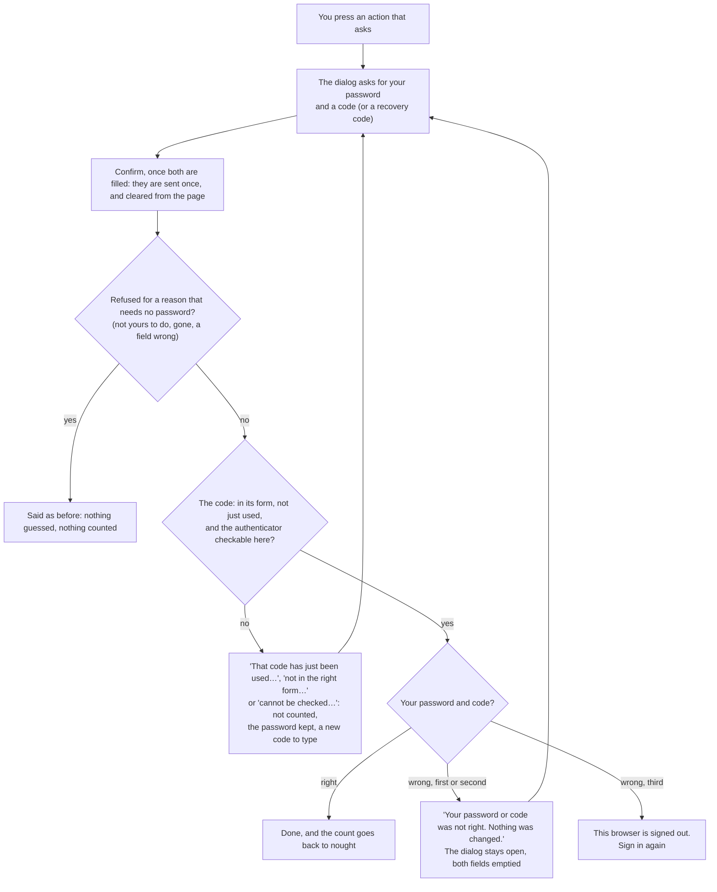

## When Something Is Not Done

This page, the Teams page, the Reports page's schedules, All Tasks, the Archived page, every change made on a board's page (since card 2280, 2026-10-20), a board's Archived Cards panel, a card's window and its **Link existing board**, the share window, a subtask's window, the dashboard and My Account each say when a change was not made, in the server's own words where it gave any: "No edit access to this board", "Card not found", "You can only delete your own templates". Several of them used to say a change had worked whatever the answer was, or to say nothing.

- **A message that something was not done stays** until it is closed with ✕ or the page is left. Most are in the corner of the page. A card's window says it at its top, where it stays in view however far the window is scrolled. An import says it in the report under the **Import Backup** button, and not in the corner as well. The mail settings say it under their buttons, and the Reports page's emailing of a report in its dialog, each until it is tried again. The share window and a subtask's window say it on a line of their own above their buttons, with a ✕ to close it; My Account says it under what was refused, the avatar, the mail switches or the API key panel; and the **New Sub-board** form of a board's menu on the dashboard on its own line. Each of these goes when that change is tried again.
- **The corner shows each such message once, and three at most.** The same message again takes the place of the one shown, and a fourth puts the oldest away. A message about a change made on a page you have since left is not shown on the next page.
- **A message that something was done goes after three seconds**, as does any note or warning. Not every change has one: most of what is done in a card's window (a label, the cover, an assignee), and turning a report schedule off or deleting it, show the change itself and say nothing more. Turning one on asks for your password and a code first (card 2751), in its own dialog.
- **What the page changed before the answer came is put back**: a role in a user's row, a backup destination added or removed, a card's cover, a card's milestone, a person's role in the share window, a board's star on the dashboard, and your avatar and mail switches on My Account. A card's window in All Tasks, All To Do or a plan page that could not save stays open with what was typed in it (a plan page's said "Card updated" and closed whatever came back, until card 2281, 2026-10-20), and so do a board's **New Task** window whose card was not made (it said "Created" until 2026-10-15), a subtask's window and the forms for a new team, a new user and a new schedule. A subtask whose delete was refused stays on the card. A subtask's **Save** and the avatar on My Account cannot be pressed again while a change is on its way, so a double click makes one subtask. Removing someone, or a team, from the share window who no longer has the board (removed in another tab) says "This board is not shared with that user" (or team), where it said nothing.
- **A column's rename that is refused is said**, in the server's words, and the column keeps its old title (card 2134). A Complete or Done column that holds any card, archived ones included, can be renamed only to Complete or Done, and a column that holds any card cannot be renamed Complete or Done: the cards in it would become open work, or finished work nobody finished. An empty column is renamed freely. Keep a Complete or Done column that holds cards called Complete or Done: moving its cards out so as to rename it would reopen every one of them. To rename a column that holds cards into Complete or Done, move the cards first, each finished one to a Complete column and the rest to another column. It used to show the new title until the page was reloaded.
- **A change on a board is shown at once, and taken back if it is refused** (card 2280, 2026-10-20): the card window's **Save** of a saved card (the window stays open with what was typed), a title edited on the board itself, pinning a card, a priority changed from its dot, a card's menu or the bulk bar, the card menu's Move to, the completion prompt (which stays open with what was typed), adding and deleting categories, which show once the server has taken them (a refused one keeps its name in the box), dragging cards and columns, the board's name and emoji, and a column's colour, WIP limit and Add Task switch. Each is said in the server's words and only that change goes back; "Moved to …", "Pinned", "Priority → …", "WIP limit set" and "Title updated" are said only once the change is made. A bulk priority or archive changes every selected card at once, and the cards the server refuses go back, stay selected, and the count and the first reason are said. A card dragged into On Hold is moved first and its note written only once it has moved, so a refused move writes no note; a note refused after the move is said, and the note window stays open with it. Until then these looked saved until the page was reloaded. Sharing a board, a subtask's window, the dashboard's star, grouping and new boards, and the account page's avatar, mail settings and key revoke said nothing when refused until 2026-10-15 (card 2148).
- **A card's window opened from All Tasks, All To Do or a plan page saves as a board's does** (card 2281, 2026-10-20). **Save** sends only what was changed in the window, so a change a colleague made to another field of the same card meanwhile is kept; before, it sent every field back and undid theirs. A save with nothing changed closes the window quietly and sends nothing. A save that is refused, or gets no answer, is said in the server's words (or as "No answer from the server. The card may not have been saved.") and the window stays open with what was typed; on All Tasks and All To Do the change shows on the card at once and only that save's change goes back. "Card updated" is said only once the server has saved it. On All Tasks and All To Do, the fields not touched in an open window follow the card as the page reads it again.
- **A request that got no answer** is not known to have failed, and the message says so: "No answer from the server. It is not known whether this was done." Reload the page to see what was saved.
- **If your session has ended**, the message is shown and the page then goes to the login page. No dialog box stops it on the way.

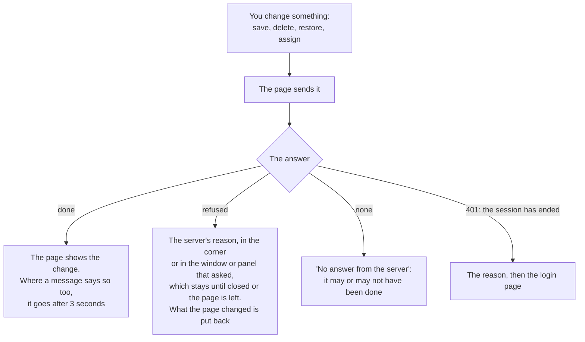

---

## User Management

### Creating Users

1. Go to **Admin → Users**
2. Enter username, email, and role, and your own password in **Your password** (card 2701: making an account asks for it)
3. Click **Create User**. A wrong password is said in the corner, the form stays as typed and **Your password** is emptied
4. An invite email is sent automatically (if SMTP is configured), and the page waits for it: usually a second or two. "User created — invite email sent!" means the mail server accepted it
5. The user clicks the link to set their password, and is taken straight on to set up two-step sign-in with an authenticator app (card 2769). Only finishing that signs them in

**An account with no authenticator needs an invite or a set-up link to sign in** (card 2769). **An account made with a password you chose gets its set-up link as it is made** (card 2851): instead of the toast, a dialog opens, **🔑 Their set-up link**, with the link and 📋 Copy. Give the person the link and the password yourself, by a way only they read: the link is shown once, here, is never emailed, and works for seven days. They open it, sign in with the password and set up their authenticator app. If it is lost, or you could not be shown it (the dialog's words say so in the corner instead), give a new one with 🛡️ on their row (see [Resetting Two-Step Sign-In](#resetting-two-step-sign-in)). With no App URL, `APP_URL` or `ORIGIN` set there is no address to make any link from, and Create User is refused whether or not you typed a password. **An invite is spent when the password is set**, before set-up is finished: someone who sets their password and then leaves the set-up page needs a new invite (📧) or a 🛡️ link.

**When an invite's mail is not sent** (card 2196). Create User with no password, and 📧 on a user's row, wait for the invite's mail. If the mail server refuses it or does not answer, the invite is still made, and a dialog opens instead of the toast. "Not sent" means "not confirmed sent": a mail server can take the whole message and the connection then drop before it says so, and then the person receives the mail as well as you being given its link. Either one works; the first used sets the password:

> **📧 The invite mail was not sent**
>
> User nf-invitee was made, but the invite mail could not be sent: the mail server could not be reached.
>
> Give this link to nf-invitee yourself, by a way only they read. Whoever opens it can set the password of nf-invitee's account, then sets up its two-step sign-in and is signed in as them. It works once, for seven days, and stops working if another invite is sent to this account. Do not open it yourself.
>
> `https://kanban.example.com/invite/…` **📋 Copy**
>
> It is not shown again. If it is lost, send a new invite with 📧. Why it failed is under Email / SMTP below.

For 📧 the first line is the server's message: "The invite was made, but its mail to ana@example.com could not be sent: … Give ana the link yourself. Any earlier invite to this account no longer works." The reason is one of seven, never the mail server's own words, which can name the mail host: mail is not set up on this server; the mail password has not been entered on this server, and an administrator enters it under 📧 Email / SMTP; the mail server's certificate could not be checked, or it does not offer STARTTLS; the mail server could not be reached; the mail server refused the sign-in; the mail server did not accept the message; the mail could not be sent. Every administrator reads the mail server's words under **📧 Email / SMTP** and in the system log (the panel was the superadmin's alone until card 2395, and the dialog told an administrator "The superadmin can see why under Email / SMTP."). The panel is read again as the invite is answered, so it already shows this mail.

**When no invite can be mailed at all.** With no mail host, or with a mail user name saved and no password (what an Import Backup leaves until the password is typed again: a backup does not hold it), 📧 and Create User with no password are refused before anything is made, and any earlier invite to the account still works: `The invite was not made: the mail password has not been entered on this server; an administrator enters it under 📧 Email / SMTP. Any earlier invite to this account still works.` Create User says `Password must be at least 8 characters (…)` with the same reason; give a password, or type the mail password under Email / SMTP and try again. While a link's dialog is open, every 📧 and Create User stay greyed until **Done**, and 📋 Copy has the focus.

- **The link is a password.** Whoever opens it sets the account's password, then sets up two-step sign-in with their own phone, and is signed in as that user (card 2769), as the dialog says. Send it by a way only they read (not a shared channel), and do not open it yourself: opening it shows the form, and setting a password with it ends every session and key of the account. It is shown once, only to you, and is cleared when you press **Done**; it is in no toast, no address and no history. DumpFire keeps only a one-way fingerprint of the link (its SHA-256, card 2849), never the link itself, so nobody can show it to you again, and reading the database does not give anyone a working link: if it is lost, send a new invite with 📧, which ends the old one. 📋 Copy puts it on the clipboard, which Windows' clipboard history keeps, and syncs to your other devices when that is on.
- **One invite at a time.** While an invite is out, every 📧 and Create User are greyed for the second or two it takes, and the pressed 📧 reads "…": a second press used to send a second invite, which ends the first one's link.
- **No link shown.** If, while the mail was out, you were signed out or made an ordinary user, the account became one you may no longer manage, or another invite was sent for it, no link is given: "The invite was made, but its mail could not be sent, and its link cannot be shown to you now. Send a new invite with 📧 once mail works."
- **The trail.** Each time, one `[WARN] [AUTH]` line on the Audit page's Live Console names the account and you, by id, and says whether the link was given: `Invite for user 12 was issued by user 3; its mail was not sent (the mail server could not be reached), and its link was given in the answer to their request`. It holds no link. The link works for seven days whether or not its holder stays an administrator, so when an administrator leaves, search the system log for "its link was given" lines naming them, and send each account named a new invite with 📧, which ends the old link.

### User Roles

| Role | Admin Panel | Manage Users | All Boards | Board Sharing |
|------|------------|-------------|------------|---------------|
| **Superadmin** | ✅ | ✅ | ✅ Implicit | ✅ |
| **Admin** | ✅ | ✅ | ✅ Implicit | ✅ |
| **User** | ❌ | ❌ | Only shared | Only if owner |

### Modifying Users

- **Change role** — choose **User** or **Admin** in the row's picker, then press **Change** beside it; choosing alone saves nothing (card 2376, 2026-10-21: the picker saved as it was chosen, so a keyboard user arrowing through it on Windows saved each role passed, Admin included). **Change** is dimmed, and does nothing, until a role other than the account's is chosen, and while the change is on its way, when a second press sends nothing and a screen reader is told "Saving *name*'s role…". A change refused or not answered is said, and the picker shows the account's role again. A role chosen and not saved is forgotten once the account is deleted, or the page reads it back gone or already holding that role. Only the superadmin can make a user an administrator, and nobody is made superadmin, so the picker and **Change** are on the superadmin's User Management alone; another administrator, who could give only User, sees the role as its badge with neither (the card 2376 review, 2026-10-21: every row had a one-choice picker and a Change that could do nothing). Any invite sent to the account earlier and not yet used stops working, because it was sent to the account as it was: the message then reads "Role updated. The invite sent to this account earlier no longer works: send a new one with 📧." **Changing a role also signs the person out** (card 2775): every session the account has ends, so they sign in again (the password and the authenticator code) and the new role's session limits apply from then on; an email change signs nobody out. **An administrator made a user loses the settings that are still where they set them** (card 2397): the mail settings, the App URL and the backup destinations they pointed where they are now are removed with the role change. **Change** first reads what the account holds at that moment, then asks, naming them: "Make ann a user? This removes what they set: …", and sends nothing until **Confirm**. Every change of role asks for your password in that dialog (card 2701), so an account that holds nothing, and a user made an administrator, are asked about too, naming nothing: "Make ann an administrator? You will be asked for your password and a code from your authenticator app." Where the read fails it asks all the same: "Make ann a user? What they set of the mail settings, the App URL and the backup destinations could not be read just now: whatever of it is still theirs goes too." The ⚠️ message, which stays until closed, says what went: "Role updated. What ann had set was removed: the mail settings, so no mail is sent, invites and password resets included, until an administrator sets them again in Email / SMTP; the App URL, so the links in mail point to the server's APP_URL, or else its ORIGIN; the backup destination "NAS"." The panels that showed it (Email / SMTP and Application Settings, or Scheduled Backups) then show what is left. See [Who May Do What](#who-may-do-what).
- **Reset password** (🔑) — type a new password for the user, and your own in **Your password** (card 2701); a wrong one of yours is said in the dialog, which stays open with the new password as typed. Every session they have ends, so they are signed out everywhere and sign in with the new one. Every API key they have ends too, and so does any invite they have not used yet; every webhook they set up is switched off, and every report schedule of theirs is paused (card 2168). The dialog says beforehand what there is, a line for each only above zero: "They have 2 API keys, which stop working", "They set up 3 webhooks, which are switched off." and "They have 1 report schedule, which is paused.", then "They are signed out everywhere, every API key they have stops working, any invite not yet used stops working, the webhooks they set up are switched off and their report schedules are paused." The message afterwards gives all four counts, zeros included: "Password reset: 1 session and 1 API key ended, 3 webhooks switched off and 1 report schedule paused". They are not mailed: you give them the new password, so tell them then. The password it replaces is recorded, by a fingerprint of its hash (card 2997): no import of an older backup brings it back
- **Send an invite** (📧) — asks first, for your password too (card 2701: an invite is a password reset by another way), then mails the user a new invite link, with which they set a password themselves. It works for seven days. Any earlier invite to that account stops working as soon as the new one is sent, and the message says so. The button reads "…" while the page waits for the mail; "Invite sent to …" means the mail server accepted it, and a mail not sent opens the dialog of [When an invite's mail is not sent](#creating-users), with the link to pass on yourself. Whoever opens an older link is told it no longer works and to ask an administrator for a new one. When the user sets a password with the link, every session and every API key they had ends, the webhooks they set up are switched off and their report schedules paused, as a reset does, and the invite page tells them so beforehand: "Setting a password here ends this account's 2 API keys, switches off the 1 webhook it set up, pauses its 1 report schedule and signs it out everywhere else.", each part only where there is one. **Not for an account that uses two-step sign-in** (card 2773): its 📧 is dimmed, its title reads "This account uses two-step sign-in. Reset it first, then send the invite", and pressing it sends nothing; the server refuses such an invite too, and an invite sent before the account set up its authenticator stops working once it has. The password the invite replaces is recorded, as 🔑's is (card 2997)
- **Reset two-step sign-in** (🛡️) — for someone who has lost their authenticator: see [Resetting Two-Step Sign-In](#resetting-two-step-sign-in)
- **Disable user** (⛔) — the account can no longer sign in, and what it held ends at once; **Enable user** (✅) gives back its sign-in; **Delete user** (🗑️) is offered once it is disabled, and permanently removes it. See [Disabling, Enabling and Deleting an Account](#disabling-enabling-and-deleting-an-account) (card 2671). 🔑, 📧 and 🛡️ are not offered on a disabled account

**An invite ends when the account changes.** An invite not yet used stops working when the account's email address or role is changed, by you on this page or by a direct call, or by the user on their Account page: the mail may be in a mailbox the account no longer has, or was sent before the account was made an administrator. Changing a username or an emoji, or sending the role the account already has, ends nothing, and no such change signs anyone out. Whoever opens the old link is told it no longer works, and why it might not. Send a new invite with 📧. Invites waiting at the update that brings migration 0054 were ended by it, whatever their account; send again with 📧 the ones still wanted. See [When an Account's Email or Role Changes](authentication-security.md#when-an-accounts-email-or-role-changes).

**Three wrong answers sign a browser out** (card 2701, 2026-11-04; it was ten in 15 minutes, which started again every 15 minutes and at every restart). The email form, the password form and Generate Key on the Account page each ask for the current password and a code (card 2771), and so do the 🔑 dialog on your own row and every action of [Your Password, Asked Again](#your-password-asked-again). They share one count for each signed-in browser, kept with its session, with no time limit, set back to nought only by a right password with a right code, and adding one only for a password that is actually checked, whichever part was wrong: the third wrong answer ends that browser's session, and it signs in again. A check turned away as busy, or because one of the browser's own is under way, is not counted. Another browser already signed in is not held up, and nor is signing in, so a user who is signed out this way can still sign in and change their password, and an administrator can still reset it. An account can have at most five current-password checks and sign-ins from remembered browsers going at once, plus the new hash of each password change it completes, which the password form makes after giving its place back; that cannot hold up sign-ins from other browsers, invites and set-up, which are served at least every fourth job the threads take. A sixth current-password check at the same moment is answered "The server is very busy checking passwords right now. Wait a minute and try again.", and a sixth sign-in from a remembered browser "A sign-in with this name is already under way from another browser. Wait a few seconds and try again, or sign in from a browser you have used here before." Nobody using the pages one at a time meets either. See [Guessing a Current Password](authentication-security.md#guessing-a-current-password).

**Five wrong passwords at sign-in.** After five wrong passwords at one account within 15 minutes of each other, from any number of addresses, every sign-in at that account from a browser not remembered for it waits 1, 2, then 4 seconds before it is answered, the right password included, with the Sign In button reading "Signing in…" meanwhile (card 2177); the right password signs in after the wait and clears it, and otherwise it lasts until 15 minutes pass with no wrong password. While it lasts, such browsers are also let in **one at a time** (card 2194): a second sign-in at the account at the same moment is refused at once, "A sign-in with this name is already under way from another browser. Wait a few seconds and try again, or sign in from a browser you have used here before." A browser that has signed in to the account before, or signed out of it, is remembered for a year, is never made to wait, and is refused only while five of the account's own checks are going at once. Every attempt from an address counts toward its ten in 15 minutes, and the ones refused (the one-at-a-time refusal, "Sign-in is very busy right now…") and the ones at a mistyped username stay counted when the user then signs in: only that user's own attempts at the account are given back. So an office behind one address, or on one IPv6 network, that retries a burst can find every sign-in from it refused for up to 15 minutes. A user who says sign-in has become slow, or keeps saying a sign-in is already under way, may be the target of someone guessing: they can sign in on a browser they have used before, or wait 15 minutes after the guessing stops. The waits beginning is one `WARN` line under `AUTH` on the Audit page's Live Console, `Sign-ins at "pat" (user 12) are being slowed: 5 wrong passwords within 15 minutes of each other`, and the first refusal `Sign-ins at "pat" (user 12) from browsers not known here are being let in one at a time`, each with the account as the line's user, beside the "Failed login attempt" lines, which name the account and the address and nothing that was typed (see [Logs](#logs)). See [Guessing a Password at Sign-in](authentication-security.md#guessing-a-password-at-sign-in).

**During an attack on an account, send an invite rather than set a password.** Setting a password (🔑) ends every browser remembered for the account, so its owner, on any browser, then meets the one-at-a-time refusal for as long as the attack lasts. An invite (📧) leads the browser that uses it to setting up two-step sign-in without the sign-in page, and the set-up, once confirmed, signs it in and remembers it (card 2769). An invite is refused for an account that already has an authenticator. It needs mail to be set up, and an invite is never sent for the superadmin's account, and for an administrator's only by the superadmin. Where none of that will do, the host's operator can turn the rule off for one sign-in: see [If an Attack Keeps an Owner Out](deployment.md#if-an-attack-keeps-an-owner-out).

**A reset or an invite costs the account its API keys.** Both are how you take an account back from whoever may hold its password or a session, so both end every key, and anything that uses one (a script, an integration, a scheduled job) is answered `401` until it is given a new key. That holds when a user has simply forgotten their password: the server cannot tell a recovery from a takeover. Before resetting the password of an account that a script or an integration runs on, look at the dialog's count. The dialog reads it again when it opens, and gives one only on the rows whose password you may reset. A user who changes their own password on the Account page keeps their keys, and the webhooks they set up, unless they tick the box ("End my API keys too, and switch off the webhooks I set up", or "Switch off the 1 webhook I set up" when they have no key left). Their report schedules are paused either way since card 2894 (2026-11-18): the Account page says so above the button, and afterwards how many, and they turn back on the ones they recognise on the **Reports** page, with their password and a code. See [What Setting a Password Ends](authentication-security.md#what-setting-a-password-ends).

**What a reset switches off, and getting it back.** A reset, or an invite used, also stops what someone holding the account could have left sending things out (card 2168). Every webhook the account set up that is on is switched off: the ones whose address or secret it last set, or that it last switched on, through `POST /api/v1/boards/{id}/webhooks` or a `PUT` that changed either or switched it on. Since card 2923 every one it set up that was already switched off (its owner paused it with a `PUT`, say) is held the same way, so that it too is given a new secret when switched on; and **the boards' owners are mailed**, once the change is done, one mail each listing the webhooks switched off and, apart, those held, with the kind of action that caused it and no account ("the account that set it up had its password reset by an administrator"); the system log names both accounts. The dialogs say so before you confirm: "Their boards' owners are mailed about them, and about any already switched off, which can now be switched on only with a new secret." A disable or a delete is told the same way, the account itself left out of the mail; a reset on the server's host mails nobody, and its command tells you to tell the owners. **Since card 2935, for a board's owner or an administrator, every webhook whose signing secret it could read goes too**, whoever set it up: every webhook on the server that has a secret, for an administrator; every one on the boards it owns, for anyone else. The password dialog shows how many; the two-step reset and disable confirmations say it in words. Each is switched on again with one `PUT`, which gives it a new secret for its receiver. An account that has provably read no secret (never signed in, no API key, no invite used, made after two-step sign-in was released) is left out. Making an administrator a user, or an owner of a board an editor or a viewer, or taking an owner off a board, holds the webhooks it could read and no longer can, in the same way; the role-change confirmation and the Share window say so. **Enabling a disabled administrator and then resetting it holds every webhook on the server that has a secret again**: the Enable confirmation says so for an administrator. Anyone who reset or enabled again an owner or administrator that may have been taken before this release runs `node scripts/mfa-reset.mjs --hold-readable <username>` on the host (see the deployment guide). Every report schedule of the account that is on is paused. Neither is deleted, because the account's own integrations and reports would go with an intruder's. Once you know which are genuine:

- **A webhook** is switched on again by the board's owner or an administrator, with their API key: `PUT /api/v1/webhooks/{id}` and `{"active": true}`. An editor of the board who sends that is refused `403` "Only the board's owner or an administrator can switch a webhook on. Ask the board's owner.", even for a webhook the editor set up and their own reset switched off: the owner switches it on, or the editor deletes it and creates it again. Whoever switches one on becomes its setter, so their own reset switches it off again. No page shows webhooks: `GET /api/v1/boards/{id}/webhooks` lists a board's, with each one's address for its owner or an administrator, and `DELETE /api/v1/webhooks/{id}` removes one nobody recognises. The reset's line in the system log names the webhooks it switched off by id (`switched off 3 webhook(s) they set up (ids 4, 9, 12)`). Since card 2752's code review (CS4) each is recorded as switched off for good, `setter access ended`, as one is when its account is deleted: switching it on gives it a new secret, in that answer, to give its receiver; an editor may not delete it; and nobody but the board's owner or an administrator may make another webhook to its receiver on that board.
- **A report schedule** is switched on again by its owner, on the **Reports** page, where it shows ⏸️ and only its owner sees it. Ask the user to look them over once they are signed in again. One switched on is sent at its next time, never at once for a run it missed while it was off (card 2159).

A webhook or a report schedule that a request was still creating or changing when the reset went through is not written: the request is answered `401`, since the key or the session it came in with has gone. See [What Setting a Password Ends](authentication-security.md#what-setting-a-password-ends).

**What a reset does not end.** A webhook nobody is recorded as having set up is left on by a reset: one registered before the update that brings migration 0056, and one whose setter's account was deleted. So is one somebody else set up or changed since. **Since card 2752, a webhook with no setter is switched off for good all the same**, at the first start after the update (it was held at delivery since card 2325), until the board's owner or an administrator switches it on, as below. Before that deploy, Query B in the release notes lists every one that is on, and each is taken over or deleted ([Deployment](deployment.md#webhooks-stop-when-their-setter-cannot-open-the-board-and-the-activity-report-reads-only-boards-you-can-open)); after restoring a backup older than 2026-10-18/19, run Query B again.

**A webhook switched off when its setter loses the board** (cards 2325 and 2752). A webhook is sent only while the account that set it up can open the board. Since card 2752, one whose setter loses the board is **switched off for good**, at the change that takes the access away: the setter taken off the board, its team's share removed, the setter taken out of the team, the team deleted, the board made private, or an administrator made an ordinary user. It is also switched off at every start, after every restore, and at its next event where none of those saw it (a row changed from the host). One nobody is recorded as having set up is switched off the same way. Giving the account the board back changes nothing: it stays off until the board's owner or an administrator switches it on. Until card 2752 such a webhook was only held, and sent again by itself once the account could open the board.

**What you see.** The system log has one `WARN` under `Webhooks` for each change, written once. For one webhook: `Webhook <id> on board <board> switched off: the account that set it up (user <id>) can no longer open the board (<cause>). It stays off until an owner of the board or an administrator switches it on.` (or `… switched off: nobody is recorded as having set it up (<cause>) …`), never the address. For more than one, one line names them all, the first 20 and then how many more (card 2899's code review, F1: a restore of a backup with many webhooks wrote a line for each): `22 webhooks switched off (<cause>): webhook 4 on board 3: the account that set it up (user 7) can no longer open the board; webhook 5 on board 3: …; and 2 more. Each stays off until an owner of its board or an administrator switches it on.` The cause names the change and who made it: "Sam was taken off the board by Ann", "the team Design's share was removed by Ann", "Sam was taken out of the team Design by Lee", "the team Design was deleted by Lee", "the board was made private by Ann", "Sam's role was changed to user by Ann", "found when the server started", "found after a restore by Ann" or "found when an event was sent". **The board's owners are mailed** at the same time: the board's creator and every owner on its member list, or, where it has neither, every administrator and the superadmin, one mail each per change, naming the board, each webhook's id and host, why and the cause, whatever their mail settings. A start or a restore mails only where the schedulers run: elsewhere one more `WARN` says the owners were not mailed, and why. Since card 2923 a webhook already switched off that a change holds has a line of its own: `Webhook <id> on board <board>, already switched off, is now held: the account that set it up (user <id>) had its access ended (<cause>). Switched on again by an owner of the board or an administrator, it is given a new secret.`, and the owners' mail lists it apart, under the subject "A notice about webhooks on your boards". The first start of that release holds, once, every webhook already switched off with no hold, whoever set it, and says which in one `WARN`; every start after holds those whose setter is disabled or not recorded, and says so only when it held one. A restore of a backup from before the release holds every one too, and a working copy holds them the same way. Nobody is mailed for those found at start.

**A team manager can switch a board's webhooks off** (card 2752, S6). Taking a member out of a team, or deleting the team, switches off the webhooks that member set on every board they can no longer open, though the team manager may not own those boards. That is the lever a team manager already holds over the member's access; the boards' owners are told who pulled it, and switch the webhook back on if it is wanted.

**Someone else's webhook on your board** (card 2752, S3). Whenever an account that is neither an owner of the board nor an administrator makes a webhook on it, the board's owners are mailed who made it, its id and its host. And while a webhook is switched off this way, nobody but the board's owner or an administrator may make another to the same receiver on that board, the same scheme, host and port, whatever the path, query or case (the code review's CS2): the create is refused `409` "A webhook to this receiver (the same scheme, host and port) on this board was switched off. Only the board's owner or an administrator can switch it on again, or add another webhook to it.", asked after every other check, so a malformed request is told its own fault first (CS3). Nor may anyone else delete it (CS1): an editor's delete is refused `403` "Only the board's owner or an administrator can delete a webhook that was switched off this way. Ask the board's owner." What remains (accepted): a colleague can still make a webhook to a different receiver, and the owners are told when they do.

**The Share Board window** counts them for the board's owner and an administrator (card 2329). ✕ on a person or a team whose removal would switch webhooks off asks first ("Removing Sam switches off 1 webhook they set up on this board. It stays off, even if they are given the board back, until you or an administrator switches it on again with an API key.", **Remove** or **Cancel**); the switch from public to private asks the same way (card 2385); and above the list it says "1 webhook on this board was switched off and sends nothing. Read why with your API key (GET /api/v1/boards/{boardId}/webhooks), and delete it or switch it on.", naming no reason, since an ended key (card 2893) switches one off too.

The board's owner or an administrator reads why with their API key, in `pausedBecause` from `GET /api/v1/boards/{id}/webhooks` or `GET /api/v1/webhooks/{id}`, word for word:

- switched off because the account that set it up lost the board: "This was switched off because the account that set it up could no longer open this board. It stays off if that account is given the board back. The address was chosen by that account: delete the webhook unless you recognise it; to keep it, switch it on with your own key, which makes you its setter and gives it a new secret, given in that answer and readable by the board's owner or an administrator, and update the receiver."
- switched off because nobody was recorded as its setter: "This was switched off because nobody is recorded as having set it up. Delete it unless you recognise the address; to keep it, switch it on with your own key, which makes you its setter and gives it a new secret, given in that answer and readable by the board's owner or an administrator, and update the receiver." Since card 2923's code review it too is given a new secret when switched on, and a secret sent with that switch-on is refused.
- switched off by a password reset, a reset of the two-step sign-in (card 2915), an invite used, a holder's own change that ends their keys, or the account disabled (card 2671) or deleted (the code review's CS4: these record `'setter access ended'`, and switching one on gives a new secret too), or held by one of those when already switched off, or found switched off with its setter disabled or not recorded (card 2923), or held because an owner or administrator who could read its secret had its access ended or its role lowered (card 2935), or because an API key that was given its secret was revoked, expired or passed its deadline (card 2947, below): "This was switched off because the account that set it up, or an account that could read its secret as the board's owner or an administrator, had its password or its two-step sign-in reset, ended its API keys when changing its own password, used an invite, was disabled, or was deleted, or, for one that could read it, lost that role; or because an API key that was given its secret was revoked, expired or passed its deadline; one already switched off then, or found switched off with its setter disabled or not recorded, is held the same way. Treat its old secret as exposed: change it at the receiver now, whether or not the webhook is switched on again, since until then the receiver trusts anything signed with it. Delete the webhook unless you recognise its address; to keep it, switch it on with your own key, which makes you its setter and gives it a new secret, given in that answer and readable by the board's owner or an administrator, and update the receiver."
- switched off because the API key that set it up ended (card 2893, below): "This was switched off because the API key that set it up ended: it expired, passed its deadline, was deleted or is not the setter's; or, for a webhook set up before keys were recorded, the account that set it up has no working key from then. To keep it, switch it on with your own key, which makes you its setter and gives it a new secret, given in that answer and readable by the board's owner or an administrator, and update the receiver."
- `null` for one that is sent, and for one switched off by a `PUT`; one still on and held by a change none of the writes saw begins "Nothing is sent: " until its next event switches it off.

**Delete it unless you recognise the address** (`DELETE /api/v1/webhooks/{id}`): the address was chosen by the account that lost the board, or by nobody known. **To keep it, switch it on**: `PUT /api/v1/webhooks/{id}` with `{"active": true}` alone. That makes you its setter, clears why it was switched off, and, for one whose setter lost the board or had its access ended, or whose key ended, gives it a **new secret**, 64 hexadecimal characters, given in that answer and readable by the board's owner or an administrator: update the receiver with it. The former setter knows the old secret and could forge deliveries to the receiver, which may be the company's own system. Sending a `secret` with that switch-on is refused `400`, with nothing written. One switched off because nobody was recorded as its setter keeps its secret: send `{"active": true, "secret": "<new>"}` to change it too. An editor's switch-on is refused `403`, as before. Whoever switches it on answers for it: a reset of their account, their losing the board, or the end of the key they switched it on with, switches it off again. Prefer the board's owner where they have a key.

**A webhook switched off when its API key ends** (card 2893). Each webhook records the API key that created it, last set its address or secret, or switched it on. When that key ends the webhook is switched off for good, `'key ended'`, as one whose setter lost the board is: revoked on the Account page (in the same change), expired, past its deadline (card 2772's for keys made before two-step sign-in), or deleted any other way, found at the next start, restore or event; and one whose recorded key is another account's. One set with no key at all (through a session) is switched off at its next event. The log line names the key by its id, never its name, prefix or hash: `Webhook <id> on board <board> switched off: the API key that set it up (key <id>, user <id>) has ended (<cause>). …`, with "no key recorded" where the key was deleted; a revoke's cause reads "API key #12 was revoked by Sam". The board's owners are mailed as above, and the account that set it up gets a mail of its own, "A webhook you set was switched off", telling it to ask the board's owner, while it can still open the board.

- **The revoke counts them first.** On the Account page each key's row shows how many webhooks revoking it switches off ("Revoking it switches off 2 webhooks": those it set up, and, for the account's last working key from before the release, the account's webhooks from then); ✕ (Revoke) asks "Revoke? It switches off 2 webhooks.", and afterwards says "Key revoked. 2 webhooks were switched off." (the code review's CS4).

**A webhook held when an API key that was given its secret ends** (card 2947). Every answer that gives a webhook's secret records the API key it went to. Revoking that key holds, in the same change, every webhook with a secret it was given since the secret last changed, whoever set it; a key that expires or passes its deadline does within five minutes (a sweep at every start and every five minutes), and ending an account's access with its keys holds what all its keys were given. Each is held as `'setter access ended'`: switching it on gives it a new secret. The boards' owners are mailed, naming no account, and told to treat the old secret as exposed: change it at the receiver now, since the receiver trusts it until then. The WARN names the key and its user by id.

- **The Account page says it first.** A key's row adds "and holds 3 whose secret it was given" beside what it switches off; a key with an expiry or a deadline says "When it ends, the 3 webhooks whose secret it was given are switched off, and each needs a new secret at its receiver."; ✕ asks "Revoke? It switches off 0 webhooks and holds 3 whose secret it was given.", and afterwards says how many were held.
- **The cost of rotating a key.** A script that lists webhooks with its key is given their secrets, so revoking that key, or its expiry, gives each of those webhooks a new secret, which its receiver needs. Prefer a key with no expiry for such a script, and rotate deliberately.
- **The first start of this release** counts every key used before it as given the secret of each webhook its account can read or set that was made before the key's last use, and holds at once what keys already expired or past their deadline may have read (see the release notes in [Deployment](deployment.md)).
- **Rotating a key** an integration's webhooks were set with. Preferred, so nothing stops and the secret is kept: make the new key, then the board's owner or an administrator re-saves each webhook with their new key (`PUT /api/v1/webhooks/{id}` with `{"active": false}`, then `{"active": true}`), which binds it to that key, and only then revoke the old key. Otherwise, revoke the old key first, and the board's owner or an administrator switches each webhook on with their key, which gives it a new secret for its receiver (the code review's CR6).
- **Webhooks made before this release** record no key. Each keeps sending while the account that set it up holds a working key made before the release, and is switched off once it has none. At the first start that runs the schedulers each board's owners get one mail ("A webhook on your board will stop when its key ends") listing them with the earliest date each will stop (the latest end among that account's keys from then; later if that account keeps or replaces such a key, the code review's CS2), or "no date" where one of those keys has neither an expiry nor a deadline; the system log has one `WARN` under `Webhooks` for each. To keep one, re-save it with a key: `PUT /api/v1/webhooks/{id}` with `{"active": false}`, then `{"active": true}`, by the board's owner or an administrator, which binds it to that key. Where the schedulers are off nothing is mailed and the next start that runs them says it again; with no mail set up one more `WARN` says the owners were not told. See [Deployment](deployment.md#the-release-that-switches-off-a-webhook-whose-api-key-ends-card-2893).

Whose account you can change, set a password for, send an invite to, reset the two-step sign-in of (card 2773) or delete depends on your role and theirs, and is the same for all five. An invite is on the list because its link sets the account's password:

| Their account is | An administrator can manage it | The superadmin can manage it |
|------------------|--------------------------------|------------------------------|
| An ordinary user's | ✅ | ✅ |
| Another administrator's | ❌ | ✅ |
| The superadmin's | ❌ | Only their own, and not to delete it |

Each row shows only the controls you may use on that account, by the same rule the server refuses by (one copy of it, in `src/lib/account-rule.ts`, which the page and the routes both ask):

| The row is | What it shows |
|------------|---------------|
| An account you may manage | The role select, 🔑, 📧, 🛡️ and 🗑️ (📧 dimmed for an account that uses two-step sign-in) |
| Your own | 🔑 alone, which changes your own password and asks for the one you have. Your role, an invite and deleting yourself are not offered, and the server refuses each there: a change to your own role is answered 403 whatever it is, and nothing sent with it is saved. The superadmin can change an administrator's role |
| Another administrator's, to an administrator | 🔒 and nothing else |
| The superadmin's, to anyone else | 🔒 and nothing else |

An administrator who tries to reset another administrator's password, send them an invite, change their role or delete them by a request made another way is refused, and a page that sends one shows the reason. The role select, the invite and the delete used to be shown on rows where they could only be refused, the administrator's own row among them, where one choice in the role select made them an ordinary user.

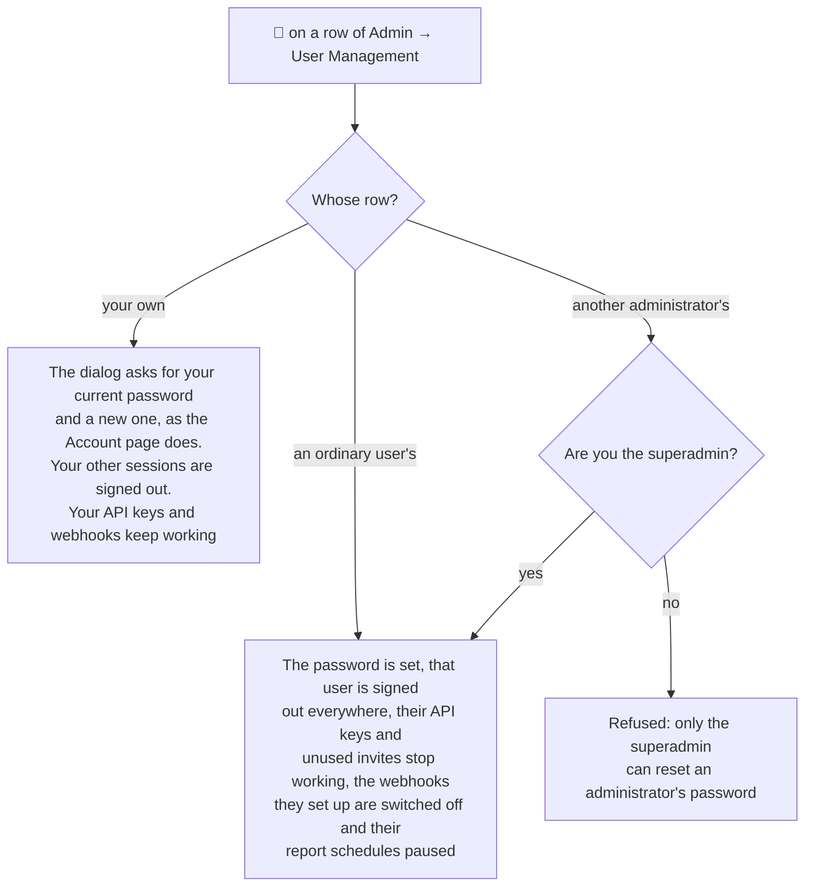

Your own password is never reset from this page without the one you have. On your own row the 🔑 dialog asks for your current password, as the password form on the **Account** page does. It keeps your API keys and the webhooks you set up, and says so: "Your API keys and the webhooks you set up keep working. To end the keys and switch off those webhooks too, change your password on the Account page." It pauses your report schedules, as every password change does since card 2894, and says that too ("Your report schedules are paused."); the message after gives how many ("Password changed: 2 report schedules paused"). To end the keys and webhooks with the change, change your password on the Account page and tick the box there. Your own row has no 📧, and the route refuses one: an invite link sets a password and asks for none, so nobody sends one to themselves. Nor has it 🛡️ (card 2773): the reset asks for no second factor, and would give whoever held your session and password a link to set up their own. Your own email is not changed through user management either, because an invite goes to it: it is changed on the Account page, which asks for your password. So no user-management route sets your own password, or moves the address a new one would be sent to, without asking for the password you have. The superadmin's row shows 🔒 to everyone else, and 🔑 to the superadmin, which is the same own-password dialog.

The same rule holds for the rest of the Admin page. **Restoring a backup** replaces every account with the backup's, passwords and roles included, and **Reset Everything** clears every account, so both are the superadmin's alone, with the export (the backup destinations and the mail settings are every administrator's since card 2395): see [Who May Do What](#who-may-do-what). Any administrator could once run either, and so could make themselves anybody.

### Resetting Two-Step Sign-In

Someone who has lost the phone their authenticator app is on, and has no recovery code left, asks an administrator to reset their two-step sign-in (card 2773). **Someone with a recovery code left needs no administrator** since card 2772: see [Helping someone replace a phone](#helping-someone-replace-or-lose-a-phone) below. 🛡️ is also how you give a set-up link to an account that has no authenticator and needs one: one past its 14 days after the release, one whose set-up was abandoned (card 2769), or one made with a password whose set-up link was lost (card 2851).

**🛡️ Reset two-step sign-in** is on every row that has 📧: the accounts you may manage, by the same rule as 🔑 and 📧 (an ordinary user's for an administrator; an administrator's or an ordinary user's for the superadmin), never your own and never the superadmin's. It asks first, and for your password and a code (one of the [forty](#your-password-asked-again)):

> Reset ann's two-step sign-in? Their authenticator and recovery codes stop working, they are signed out everywhere, their API keys end, the webhooks they set up are switched off, their report schedules are paused, and you are given a link, once, to pass on to them yourself. You will be asked for your password and a code from your authenticator app.

**Confirm** then, in one step: deletes their authenticator and recovery codes, sets their count of wrong codes back to nought, signs them out everywhere, ends any invite not yet used and any sign-in or set-up link they had, **ends every API key of theirs and switches off every webhook they set up** (card 2915, 2026-11-18), pauses every report schedule of theirs that is on (card 2894), and issues one new link with which they set up a new authenticator. Their password is kept: they lost a device, not their password. The keys end, always, with no box to keep them: you cannot tell a lost phone from a stolen one, and an API key skips the second factor, so a key made by whoever had the phone and the password would go on reading every board after the reset. A webhook goes with the keys, as on a password reset: switched off for good, and switched on again only by the board's owner or an administrator, which gives it a new secret. A schedule is paused because it sends a board's activity whether or not anyone is signed in, so one made by whoever took the phone would outlive the reset; they turn back on the ones they recognise on the **Reports** page once their new authenticator is set up, and make new keys for the scripts they recognise. The confirm gives no counts (yours could be older than a key made since); the dialog after gives them. An account with no authenticator can be reset too, which gives it a new link (one that expired, say, or an account a restore left without one). The button reads "…" while it is on its way, and 📧 and 🛡️ on every row stay greyed until it is answered and the dialog below is closed. The link opens in the dialog an invite's link uses, with its own words:

> **🛡️ Two-step sign-in was reset**
>
> ann's two-step sign-in was reset. Give them the link yourself: it is shown once, and works for seven days. Their 2 report schedules were paused. Their 2 API keys (made 2026-11-01 and 2026-11-10) were ended and the 1 webhook they set up (made 2026-11-12) switched off; the lists are in the notice mailed to them. ann was sent a notice that holds no link.
>
> Give ann this link yourself, by a way only they read: it is shown once, here. It works for seven days, and stops working if their two-step sign-in is reset again. Whoever opens it sets up the authenticator of ann's account, and the account still needs its password. Do not open it yourself.
>
> `https://kanban.example.com/enrol/…` **📋 Copy**
>
> It is not shown again. If it is lost, reset ann's two-step sign-in again with 🛡️, which issues a new link and ends this one.

- **The link is never mailed.** Whoever has the phone may know the password and may have changed the account's email address, so a mailed link could go straight to them. You give it to the person yourself, by a way you know reaches them (in person, a phone call to a number you already had), and **Done** clears it from the page; it is in no toast, address or history. With the link alone nobody gets in: its page names the account and sends them to sign in with the account's password, which then leads to the set-up (card 2769). The link is used up only when the set-up is confirmed.
- **Pass on what the dialog's first line says** (card 2894; card 2915, 2026-11-18). It says how many of their report schedules were paused ("Their 2 report schedules were paused.", nothing when none was on), and how many working API keys were ended and webhooks switched off, with the day each was made ("Their 1 API key (made …) was ended, and they had no webhook they set up; …", "They had no API key and no webhook they set up." where there was neither). It names none of them (card 2894's code review): you may not be able to open the board a webhook is on, and this page never shows a key's name; the notice mailed to them names each, and the line says whether it went ("the list is in the notice mailed to them", or "the notice with the list was not sent: tell them how many ended and the day each was made"). Tell the person when you give them the link: they make new keys for the scripts they recognise once signed in, and ask the board's owner to switch back on any webhook they recognise. One they did not make means someone else had their password: have them change it. Where the link is not shown, the line gives the counts alone ("Their 1 API key was ended."), and nothing where none ended.
- **What settings they set** (card 2915). Where you, the superadmin, reset an administrator who set the mail settings, the App URL or a backup destination still in force, the line goes on "They set the mail settings, 1 backup destination and the App URL: review them on the admin page." It names no destination, and the reset removes none of them (making them a user, disabling or deleting them does): look each over under Email / SMTP, Application Settings and Backup. **Your message is the channel that reaches them for certain**: the notice below may not go, and their mailbox may be what was taken.
- **The account's address gets a notice instead**, where mail is set up: "Your DumpFire two-step sign-in was reset", naming you and when; saying their authenticator and recovery codes no longer work, or, for an account that had no authenticator, that its set-up was begun again with a new link; that they have been signed out everywhere; and that an administrator will give them the link themselves, never by email. Since card 2894 it also says how many of their report schedules were paused, where one was; since card 2915, where the reset ended a key or switched off a webhook, "The reset also ended your API keys and switched off the webhooks you set up:" with both lists, each with when it was made, then to make new keys for the scripts they recognise once their new authenticator is set up, that the board's owner or an administrator switches back on a webhook they recognise, which gives it a new secret, and that one they did not make means someone else had their password: change it, and tell an administrator. It ends "If you did not ask for this, tell an administrator straight away. Use only a link an administrator hands you directly." It holds no link. The dialog's first line ends "ann was sent a notice that holds no link." when it went; where mail is set up and it did not go, it adds "The notice to ann was not sent: …" with the reason, and the reset stands. Where mail is not set up, nothing is sent and nothing more is said.
- **No link shown.** If, while the notice was out, you were signed out or made an ordinary user, the account became one you may no longer manage, or another reset replaced the link, no dialog opens: a warning that stays until closed says "ann's two-step sign-in was reset, but its link cannot be shown to you now. Run the reset again to issue a new one." Press 🛡️ again once you can.
- **Refused, with nothing changed**: "Manage your own two-step sign-in on the Account page" for your own account, "Only the server's host can reset the superadmin's two-step sign-in, with scripts/mfa-reset.mjs" for the superadmin's, "Only superadmin can reset an admin's two-step sign-in", and, when the server has no address to make the link from, the invite's words ("This server has no address configured to make the link from…"): set the App URL under Application Settings.
- **The trail.** One `CRITICAL` line under `AUTH` on the Audit page's Live Console, under your name: `Two-step sign-in reset for user 12 ("ann") by "chief": removed 1 factor(s) and 10 recovery code(s), ended 2 session(s), 0 pending sign-in(s), 0 invite(s) and 2 API key(s), switched off 1 webhook(s) they set up (id 7), and paused 2 report schedule(s) (ids 3, 5); an enrolment link was issued`. It never holds the link. A link withheld adds a `WARN` line saying why.

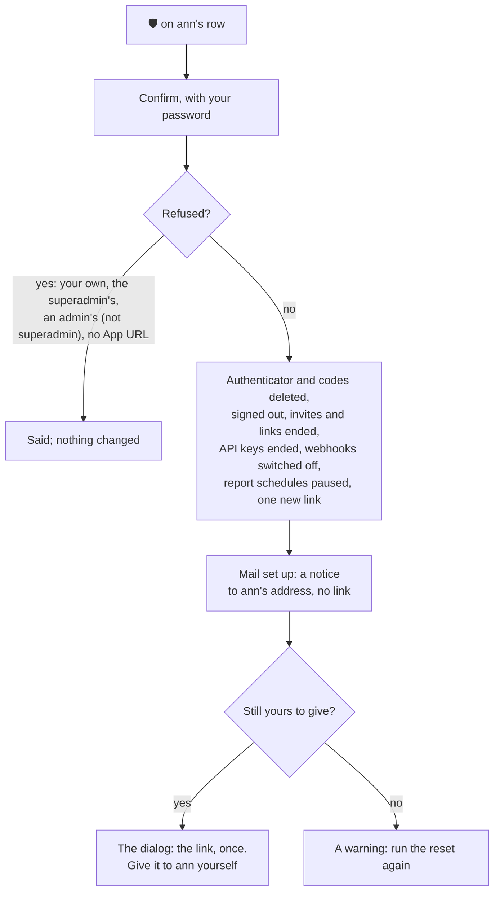

**📧 is refused for an account that uses two-step sign-in.** An invite sets the account's password and leads on to setting up an authenticator, which such an account already has, so 📧 is dimmed on its row and its title says "This account uses two-step sign-in. Reset it first, then send the invite"; the server refuses one made another way the same. Reset it with 🛡️ first: once it has no authenticator, 📧 is offered again.

**When the password is lost too, set the password first, then reset two-step sign-in.** Setting a password ends every set-up link the account has, so a password set after 🛡️ ends the link you just gave. With 🔑: 🔑, then 🛡️. **An invite is still the better way to give a password back** where mail works, since nobody but its holder then knows the password, and an invite leads straight on to setting up a new authenticator, whose confirm signs them in and remembers their browser (see [During an attack](#modifying-users) above). 📧 is refused while the account has an authenticator, so: 🛡️, then 📧, and they set their password and a new authenticator with the invite alone; the 🛡️ link is ended by the invite's use and is not needed. Changing the account's email address or role also ends its link.

**The superadmin's own authenticator** is reset only on the server's host, with a command the host runs: `docker exec <container> node scripts/mfa-reset.mjs <username>`. It does what 🛡️ does, for any account by its username, and prints the link on the host's terminal; it also works when no administrator can sign in. Since card 2915 it ends the account's API keys and switches off its webhooks too, unless the host adds `--keep-api-keys` (`node scripts/mfa-reset.mjs --keep-api-keys <username>`): the superadmin often holds the keys an integration uses, and whoever runs it on the host may know the phone was only lost. `--` before the username names one that starts with "-". See [If the Superadmin Loses Their Authenticator](deployment.md#if-the-superadmin-loses-their-authenticator).

**After a restore**, reset the two-step sign-in of each account the restore names as having no second factor, and give each its link: see [Restoring from Backup](#restoring-from-backup). A restore also takes away every account's leave to set up on its password alone, but the leave of an account still on this server. **After the key is changed** on the host ([Changing the Key](deployment.md#changing-the-key)) nobody needs a reset: every authenticator is moved to the new key at that start, and keeps working. An authenticator that start names as unreadable needs its account reset.

### Two-Step Sign-In: What People See

Since card 2769 a right password no longer signs anyone in. Everyone, administrators and the superadmin included, proves a code from an authenticator app on their phone, or a recovery code, every time they sign in. There is no switch to turn it off. How it works is in [Two-Step Sign-In](authentication-security.md#two-step-sign-in-card-2769).

- **Signing in.** After the password, a page headed "Two-step sign-in" names the account and asks for the 6-digit code from the app, typed as `123456` or `123 456`. "Use a recovery code instead" swaps the field for a recovery code; while codes are locked the page opens on the recovery code. The page lasts ten minutes; after that, or after five wrong codes on it, they sign in again from the start. It works without JavaScript too.
- **Setting up.** An account with no authenticator is shown a QR code to scan, with the key written out in groups of four for typing in by hand, then asked for the code the app shows. Then it is shown ten recovery codes, each good once, which are not shown again, and **I have saved these codes** finishes it and signs them in.
- **Wrong codes.** Five wrong codes in a row pause code entry for 15 minutes, ten for an hour, fifteen for four hours, twenty and twenty-five for a day, and thirty lock it. A browser the person has signed in with before counts its wrong codes apart from every other browser, so someone guessing elsewhere does not pause them there. **A recovery code always works**, paused or locked, and clears the pause and the lock. With several authenticators (card 2772) a code from any of them works, and each wrong code counts once for each authenticator that can be checked on this server, so codes are no easier to guess: with two, the third wrong code in a row pauses; with three, the second.
- **After a right code**, if wrong codes were entered for the account since its last sign-in, or someone gave the right password and then a wrong code or left the sign-in unfinished, a page says so, with the last sign-in's time and address and the account's API keys and webhooks, and asks them to change their password if it was not them. **Continue** loads the home page. The page is shown once for what happened: the count of wrong codes then starts again from nought, and a warning raised before this sign-in is not shown again at the next. The warning itself stays on the account, at the top of the Account page (card 2772), until the person clears it there or changes their password (below).
- **If the server has lost its MFA key**, someone with an authenticator is told their authenticator cannot be checked right now, and a recovery code still signs them in; someone who would set one up is told it cannot be set up right now.
- **Mail**, where mail is set up and its password entered: a notice when two-step sign-in is set up (listing the account's API keys and webhooks), when a recovery code is used, when code entry is paused or locked, at every tenth wrong recovery code in a row, at most once an hour when someone gets the password right and the code wrong or leaves the sign-in unfinished, and (card 2772) when an authenticator is added or removed or a new set of recovery codes is made. None holds a code or a link. See [Security Notices](notifications-email.md#two-step-sign-in-notices-card-2769).
- **The Account page's 🛡️ Two-step sign-in** (card 2772), under Change Password: the last sign-in and any wrong codes since, the person's authenticators (each with its name, when it was added and when last used), **Add an authenticator** (a name, then the password and a code, then a QR code to scan and the new phone's code; at most three), **Remove** (greyed on the only one, "Add the new one first, then remove this one."; removing one signs their other browsers out), the recovery codes left (a warning at three or fewer) and **Make new recovery codes** (ten, shown once). Each change mails the owner.
- **The warning at the top of the Account page** (card 2772), "⚠️ Was this you?", after someone gave the right password and then a wrong code, or left a sign-in unfinished: **Change my password** takes them to that form, and **That was me**, with the password and a code, clears it. It is cleared only as shown: if a newer warning arrived meanwhile, they are told "A newer warning arrived. Read it, then dismiss it again." Changing their own password clears it too. Your password reset of their account does not.

#### Helping someone replace or lose a phone

Since card 2772 a person replaces a phone themselves, on the Account page, while they can still sign in:

- **A new phone, the old one still at hand**: **Add an authenticator** with the new phone, then **Remove** the old one. The section never removes the last one, so add first.
- **A lost phone, a recovery code left**: sign in with a recovery code, add the new phone, remove the lost one, then **Make new recovery codes** and change the password. The section says so: "Lost a phone? Sign in with a recovery code, add your new phone here, remove the lost one, then make new recovery codes and change your password." Removing it signs out every other browser of the account, which ends a session the lost phone may still hold.
- **A lost phone, no recovery code left**: 🛡️ (above).
- **At most three authenticators**: "You have three: remove one first." Each wrong code counts once for each authenticator that can be checked on this server, so with three, one wrong answer at a confirmation signs that browser out; the dialog says so before it is sent (its line counts every authenticator held, so where one cannot be opened here it says more than is counted, never less).
- **The removal is refused** with "Your other authenticator cannot be checked on this server right now, so this one cannot be removed. Ask an administrator." when no other authenticator of theirs can be opened on this server (the MFA key missing or changed): see [If the Key Is Lost](deployment.md#if-the-key-is-lost) on the host, or reset with 🛡️.

**Helping someone who cannot sign in.**

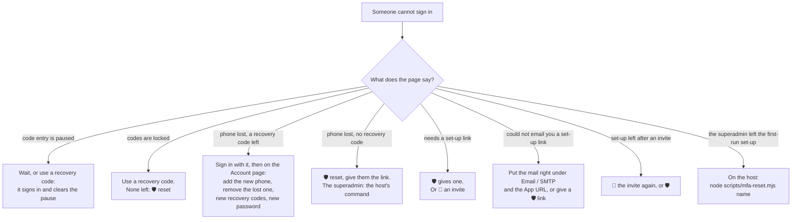

- **A paused or locked account** waits, or uses one of its recovery codes. The lock lifts only with a recovery code or a reset. Someone with no recovery code left, or no phone, needs 🛡️.
- **Set-up abandoned after an invite.** The invite was spent when the password was set. Send the invite again with 📧, or reset with 🛡️ and give them the link.
- **The superadmin's first-run set-up abandoned.** The superadmin has a password and no authenticator, and nobody manages that account on this page. On the host: `docker exec <container> node scripts/mfa-reset.mjs <username>`, which prints a link to give them, and ends any API key the account made (add `--keep-api-keys` to keep them, card 2915) (see [If the Superadmin Loses Their Authenticator](deployment.md#if-the-superadmin-loses-their-authenticator)).

### The Release That Turns On Two-Step Sign-In

The update that brings card 2769 signs everybody out once and forgets every browser that has signed in before. Nobody has an authenticator yet, so everybody sets one up at their next sign-in. It also ends every invite still waiting to be used (card 2849, which keeps an invite's link only as a fingerprint from then on): those links stop working, and you send again the ones still wanted. The host's steps and checks are in [Deployment](deployment.md#the-release-that-turns-on-two-step-sign-in-card-2769).

**Before it:**

1. **Every running instance is stopped** by whoever runs the host. An older copy still running would sign people in on a password alone.
2. **Check the App URL** under Application Settings, where mail is set up: it must be this server's real address, not empty and not `http://localhost:3000`. The release mails each person a set-up link made from it.
3. **Review the API keys, and revoke any nobody recognises.** No page lists another account's keys: the host's read-only query lists them all ([Deployment](deployment.md#the-release-that-turns-on-two-step-sign-in-card-2769), check W3). Each holder revokes their own on the Account page; 🔑 on a row ends every key of that account. Keys keep working through the release, so a key made by someone who had a password is how they would stay in.
4. **Consider resetting every administrator's two-step sign-in**, and any account whose password may be known: 🛡️ for an administrator (it is the superadmin's to do), and the host's command for the superadmin. A reset account needs the link you give it, and can never be set up on its password alone.
5. **Keep the list of invites still waiting.** The host lists them, with the account each was for, before the update ([Deployment](deployment.md#the-release-that-turns-on-two-step-sign-in-card-2769), check W15). It is the only time they can be listed: the update ends them.

**After it:**

- **Sessions are shorter from the release** (card 2775). An administrator is signed out after 12 hours without using DumpFire, and after 24 hours in any case; everyone else after 3 days unused and 7 days in any case. Signing in again means the password and the authenticator code again. Only a save or a full page load counts as use: a tab left open on its own, which only checks in the background, does not keep a session alive, and neither does a click on a link inside the app, which fetches data without loading a page. A session's code is kept in the database only as a fingerprint, so a copy of the database holds no working sign-in. Nothing is asked of you for this: everybody is already signed out once by the update.
- **Every invite sent before the update and not yet used no longer works.** Its link shows "This invite link no longer works…". Send again with 📧 each one on the list from step 5 that is still wanted; the new link works as before. Used invites, accounts and API keys are untouched.

- **Where no mail host is configured**, every account that existed at the release with no authenticator and no set-up link may set one up on its password alone, for 14 days. Whoever holds that password can do it first. After the 14 days it needs a link from you. The Users panel shows, under each such account not yet set up, "may set up on password until `<date>` UTC", and your own row shows yours. 🛡️ on one ends its leave at once and gives it a link instead. A set-up begun on the password is refused at its last step if the 14 days end, or a mail host is set up, meanwhile.
- **Clearing the mail settings within the 14 days is your decision to reopen this.** It turns every account still marked back to setting up on its password alone, until the 14 days end. Leave the mail set up, or reset the accounts you are unsure of.
- **Where a mail host is configured**, the first right password at such an account emails it a set-up link, good for seven days, and says so on the sign-in page; another sign-in within a day is told when it went. After a day a new link is mailed, and the older one stops working once the new mail has gone; a mail that fails leaves the older link working. While the owner is part-way through setting up from a mailed link, a sign-in elsewhere is told "Two-step sign-in is being set up for this account from the link we emailed…", and nothing more is mailed. The mail names when and from where the password was used, so it also tells the owner if it was not them. The panel shows no date while a mail host is set up: the password leads to the mail, not the set-up. If the mail cannot go (no password entered on this server, no App URL), the person is told "We could not email you a set-up link just now…": put the mail right, or give a 🛡️ link.
- **A working copy** made with Import Backup takes every account's leave to set up on its password: give its users 🛡️ links.
- **An account made after the release** has no such leave: create it with no password so it gets an invite, or give it a 🛡️ link.

### The Release That Gives Older API Keys a Deadline

The update that brings card 2772 gives every API key that exists on that day a deadline, 60 days later, the same date for every key: a key made before two-step sign-in was made on a password alone. A key with no expiry, or one later than the deadline, is marked; a key that expires sooner anyway, and every key made afterwards, is not. The host's steps, with the read-only queries, are in [Deployment](deployment.md#the-release-that-gives-older-api-keys-a-deadline-card-2772).

- **Before it, the key holders are told.** No page lists another account's keys: the host runs the read-only query, which lists each key with its holder's name and address, and you tell each holder the date and what to do. Scripts and integrations stop on that date if nobody keeps their key.
- **What a holder does.** On **My Account → API Keys** each such key reads "⚠️ Made before two-step sign-in: stops working on *date time* UTC unless you keep it", with **Keep this key**. Pressing it, with the password and a code, clears the deadline and leaves the key itself unchanged: nothing that uses it needs a change. Every key also shows its expiry now, "Expires *date time* UTC" or "No expiry".
- **On the date** a key not kept is answered `401` `Invalid or expired API key`, as an expired key is, and its row reads "Stopped working on *date time* UTC. Generate a new key." with no Keep. It cannot be revived: its holder generates a new key and puts it where the old one was used.
- **A fortnight before the date**, the host's second query lists the keys still not kept: remind their holders.
- **Reset Everything** empties the keys and the setting: nothing is left to keep, and new keys have no deadline.
- **Going back** to an older image after this update makes keys past their deadline work again while it runs: treat it as a security event.

### The Release That Asks for the Password Before Report Mail

The update that brings card 2751 puts the Reports page's mail behind your password and a code: making a report schedule, adding an address to one, switching one on, widening what it reports (its **Include** filter, from anything but **All work**), and **Email** on a report, for every address, your own and the company's among them. Anyone holding a signed-in browser could do each of these before without typing anything, and a schedule keeps sending after the browser is closed and after the password is changed. There is no migration and nothing to set. The host's steps are in [Deployment](deployment.md#the-release-that-asks-for-the-password-before-report-mail-card-2751).

- **Make sure mail is set up before the update.** At the first start after it, each person with a report schedule that is on is emailed once, "Your DumpFire report schedules", listing each of theirs that is on, what it reports on and every address it is sent to, and asked to delete any they do not recognise. With no mail set up nobody is emailed: the system log has one line for each schedule that is on (`WARN` under `REPORTS`, "Report schedule *n* "*name*" of "*owner*" … is on at this release, … sent to: …") and one `WARN` line naming the people not told. Read them on the Audit page and tell those people yourself. It is said once, once every email has gone: a later start says nothing (it is said again only after a restore of a backup made before the update). If an email does not go, a `WARN` line names who was not told, and the next start emails everyone again. A copy started with `SCHEDULERS=off`, such as a rehearsal, emails nobody.
- **A schedule somebody does not recognise.** Its owner deletes it on the **Reports** page (only they see it there), changes their password, and tells you. Since card 2894 (2026-11-18) changing their own password pauses every schedule of theirs that is on, as a 🔑 reset, an invite and a 🛡️ two-step reset do (see [What a reset switches off, and getting it back](#modifying-users)); they turn back on the ones they recognise. Removing one of their authenticators does not pause them, but its email lists the schedules that are on. Schedules that existed before the update keep running unless they are deleted or paused.
- **What people notice.** **Email** and **+ New Schedule** gain a **Your password** box and a code box; switching a schedule on opens **Turn on this schedule?**, naming every address it will email; switching one off asks nothing. A schedule made, given an address, switched on or widened sends its owner an email saying so, and the system log names every address it is sent to; a report emailed by hand is logged with the addresses it reached. **Reload every open Reports tab** after the update: an older page sends no password and is refused, "Enter your password and a code from your authenticator app to confirm this. Nothing was changed.", with nothing saved or sent.
- **API keys are not affected**: no key can reach these pages' routes.

### Disabling, Enabling and Deleting an Account

**Disable first** (card 2671, 2026-11-18). To take an account away, press ⛔ ("Disable user") on its row in **Admin → User Management**. The confirmation says what will happen and asks for your password and a code: "Disable user "bob"? They can no longer sign in. At once their sessions, invites, pending sign-ins, API keys and the links to the requests they made end, the webhooks they set up are switched off and their report schedules paused; none of this comes back if the account is enabled again. …" It names the teams the account is the only owner of (they keep it as owner until you make someone else one), for an administrator, what they set that goes with them: the mail settings, the App URL and the backup destinations; and, whatever the role, their address where it is one of the backup failure addresses, which the disable takes out (a restore that brings it back has it taken out again). The message afterwards counts what ended ("bob was disabled: ended 2 sessions, 1 API key and 1 request link, switched off 1 webhook and paused 1 report schedule."), names any settings removed, and says if the notice to the account could not be sent, which is so when the disable removed the mail settings.

A disabled account cannot sign in: the right password is answered as a wrong one. Nobody can assign it, share a board or a team with it, include it in a decision, link a person to it or send it a request, and the pickers leave it out; nothing is mailed to it but the notice that it was disabled. Its name stays wherever it is shown, on cards, comments and teams, and its row reads "Disabled *date* by *name*" and offers ✅ and 🗑️ in place of 🔑, 📧, 🛡️ and ⛔. A restore keeps it disabled ([Restoring from Backup](#restoring-from-backup)). You cannot disable your own account or the superadmin's, and only the superadmin can disable an administrator.

**Enable** (✅) gives back sign-in alone, with the account's own password and authenticator: "Enable user "bob" again? … Their API keys, webhooks, report schedules and request links stay ended: they make or turn on again the ones they need. If the account may have been used by someone else, reset its password and its two-step sign-in once it is enabled." An account the superadmin disabled is enabled, or deleted, by the superadmin alone: another administrator sees neither ✅ nor 🗑️ on it. A disabled account's password, invite and two-step sign-in cannot be reset until it is enabled. See [Disabled Accounts](authentication-security.md#disabled-accounts-card-2671).

**Delete** (🗑️) is offered only on a disabled account. It asks for confirmation, and your password (card 2701), and says what will happen. A disabled user can be deleted whatever they have done in DumpFire: uploaded files, saved templates, created milestones or recorded dependencies. An account that is not disabled is refused, "Disable the account first", and nothing is changed. Deleting also takes their comments, so disable and keep the account unless the person and their comments really must go.

| Deleted with the user | Kept |
|-----------------------|------|
| Their comments | Files they uploaded |
| Their API keys, already ended when the account was disabled | Milestones, templates and dependencies they created |
| Their report schedules. Those reports are no longer sent | Boards and cards they created |
| Their team memberships, board memberships and card assignments | Requests addressed to them |
| Their sessions, already ended when the account was disabled | Their XP, which stays on the dashboard's XP Leaderboard (on every board's header until 26 October 2026) |
| | Webhooks they set up, **switched off** (card 2168), and then naming nobody |
| The mail settings, the App URL and the backup destinations still where they set them (card 2397), removed already when an administrator's account was disabled: see [Who May Do What](#who-may-do-what) | Settings somebody else has moved since, settings moved back to where somebody else put them, and settings saved before migration 0059 |
| | The person linked to the account in the [people directory](#people-directory), **marked Left**, unlinked, and any personal decision link of theirs cancelled (card 2675) |

**The person goes to Left.** Deleting an account marks the person it was linked to as having left, with the date, so a person whose account was taken away on purpose cannot be sent a personal decision link to the same address by accident. The system log has a `PEOPLE` line for it, `Person 12 "Ann Lee" marked left: their account 7 was deleted; 0 decision links cleared (by admin)`, never the address. **Mark active** on their row brings them back, as a deliberate step of yours; a decision that had them with that account still asks you to clear it before they are sent a personal link.

Where settings went, the message after the delete stays until closed and names them ("User deleted. What ann had set was removed: …"), and the system log has a `WARN` line under `SMTP` or `BACKUP` for each kind.

The confirmation says what the disable already ended and what the delete still takes (card 2671): "Delete user "bob" for good? The account is disabled already, and its sessions, API keys and webhooks ended with that; deleting it also takes their comments, report schedules, team and board memberships and card assignments, and cannot be undone. …" The system log's line for the delete counts the webhooks it switched off and names them by id, for the board's owner to find, `… 1 webhook(s) they set up were switched off (id 4); …`: normally `0 webhook(s)`, and `0 API key(s)` beside it, since the disable switched them off and ended the keys already. A count above 0 is an account disabled by a restore or from the host with what it held still there, which the delete then ends.

After the delete:

- **Templates they created, and milestones of theirs that belong to no board, can be managed by administrators only.** A milestone that belongs to a board is still managed by whoever can edit that board.
- **A board they created stays, and its other members and teams keep their access.** The user was its owner: a board's creator is its owner. Unless another member is stored as an owner of the board, the board then has no owner, and only an administrator can change who it is shared with, delete it, or put it under a card. No screen can make someone an owner now (the sharing dialog offers Owner only on a row already stored as one); a member shared as Owner before 14 October 2026 keeps it.
- **Requests addressed to them stay in the system**, and only an administrator can then accept, reject or reply to them.
- **Requests they made stay, and their mail goes to the address the account had when it was deleted** (card 2171). While the account was there, a request made signed in was mailed at the account's email as it was at the time of each mail. The delete writes the account's email onto each of its requests first, in the same all-or-nothing step, so the team's replies and the progress mails go on reaching the person at their last address, as for a request made without an account. Requests of an account deleted before this change keep the address stored when they were made.
- **Activity entries they made keep their name**, without a link to an account.

The delete is all or nothing. If it fails, the user and everything of theirs is as it was, and the page says the delete failed.

**What is recorded, so that no restore undoes it** (card 2996, 2026-11-20). Every delete, disable, enable and role change, and the role every account is made with, is written to the server's **record of account endings**: the account's number and creation time, what happened and when, and for a delete a fingerprint of its password hash (never the hash, and not something a password can be checked against). Every password change is written there too (card 2997): your own on the Account page, 🔑, an invite used and Reset Everything each record the fingerprint of the password hash they replace. The record is kept by every import and by Reset Everything, as the system log is. So an import of an older backup brings a deleted account back **disabled and inert**, with no password or second factor that works; keeps a disabled account disabled; gives back the lower role an account has here; and never brings back a password replaced here. See [Restoring from Backup](#restoring-from-backup).

**An account the record names as deleted cannot be enabled.** Enable on such an account (one a restore brought back) is refused before your password is asked: "The record of account endings names this account as deleted, and a restore brought it back: it cannot be enabled. Delete it; then make a new account for anyone who returns." **Delete it before making the new account:** its username and email address would otherwise block the new one. Signing in as it, or using an API key of it, is refused even if a host edit enables it. A `deleted` entry in the record cannot be lifted: a new account is the way back.

**An account the record keeps disabled is the superadmin's to enable** (card 2996's code review). Where a restore or the start disabled an account by the record (a backup's entry, or an account this server had before it recorded endings), Enable by an administrator is refused before the password: "Only the superadmin can enable an account the record of account endings keeps disabled (a restore or the start brought its disable)". An account an administrator disabled on this server is still enabled by an administrator.

You cannot delete your own account or the superadmin. Only the superadmin can delete an administrator, or an account the superadmin disabled.

**An account that is the only owner of a team is not deleted** (card 2377, 2026-10-21). The delete takes the account out of every team, so each team it alone owned was left with no owner, run by administrators alone; a team keeps at least one owner ([Team Owners and Members](#team-owners-and-members)). The delete is refused, nothing is changed, and the toast names the teams, in name order: "This account is the only owner of: Alpha, Beta. Make someone else an owner or delete those teams first." ("… delete that team first" for one). Make another member of each an owner (**Admin → Team Management**, their row's picker, **Change**), or delete the team, then delete the account. A team the account owns with someone else, or is only a member of, does not stop the delete.

**The confirmation says so beforehand** (card 2380, 2026-10-21). For an account that is the only owner of one or more teams, as the admin page last read its teams, the confirmation's second sentence names them, in name order: "They are the only owner of: Alpha, Beta, so the delete will be refused: make someone else an owner or delete those teams first." ("… delete that team first." for one). Press **Cancel** and change the teams first. **Confirm** still sends the delete, and the server decides: if someone was made an owner since the page was loaded (in another tab, or by another administrator), the delete goes through; otherwise the toast above says it was refused. For an account that alone owns no team the confirmation is as before.

---

### Settings Held for Review (Card 2922)

When an account's access is ended with its API keys, the mail settings, the App URL and the
backup destinations it set are **held for the superadmin's review**: nothing is sent to them until
the superadmin keeps or removes each. That happens on:

- **Reset password** of an administrator (the dialog says what they set, which will be held);
- **🛡️ Reset two-step sign-in** (its confirm says so);
- **📧 Send invite**, when the invite is used, for backup destinations alone: where the account set
  the mail settings or the App URL in force, the invite is refused until its two-step sign-in is
  reset, which holds them, and the confirm says so before it is sent;
- the holder's own password change with "end my keys" ticked (the Account page's box says so, and
  is offered for the settings alone too);
- the host's `node scripts/mfa-reset.mjs <username>` unless `--keep-api-keys`.

A disable, a demotion to user and a delete still **remove** what the account set, as before.

**An import of a backup whose seal does not check out holds what it brings in that reaches outside** (card 3009), when it is restored as it is: the mail settings where they send through another place than this server's did before the import, the App URL where it differs from this server's (also where the server's own `ORIGIN` is the image's placeholder, `http://localhost:3000`), and each backup destination at a place this server held none at. Each is held as above, by nobody, because it was "restored from a backup whose seal did not verify": in such a file they are only its word. Keep or remove each here before sending any invite. A hold counts only where the import wrote one: one this server already held at that place (a setter's, carried over the backup) is not counted again (its code review, FP8). A backup this server sealed holds nothing, and a working copy of such a file removes them instead: the mail settings and destinations as every working copy does, and its App URL too, so links begin with this server's own address (FP3).

Such a hold is told in its own words wherever it is met (FP4): the list says the setting "came in with a backup whose seal did not verify" and "From a backup whose seal did not verify" where a setter's hold names who set it; a mail it stops says "the mail settings are held for the superadmin's review, as they came in with a backup whose seal did not verify, so the mail host is only the file's word"; a backup run, Test or Connect of such a destination says "it came in with a backup whose seal did not verify, so where it sends is only the file's word"; and each start's `[WARN] [STARTUP]` line says "(restored from a backup whose seal did not verify, so where they send is only the file's word)" in place of a setter. None of them names a setter, says "user unknown" or says anybody's access was ended.

**A restore holds what this server's record says it removed** (card 3004). A backup destination, the mail server or the App URL removed or moved here since the backup was made comes back held, "removed here", listed as "From a backup made before it was removed on this server"; from this server's own backup, one the record has never named and this server does not hold is held as "not in this server's record", listed as "From a backup, and not in this server's record of where it sends". One an ending held here, then cleared (by Reset Everything, say), comes back held as setter access ended, listed as "From a backup made before it was held on this server". None names a setter. A mail they stop says "the mail settings are held for the superadmin's review, as they came back with a restore though they were moved or removed on this server since the backup was made, or are not in this server's record of where it sends …"; a backup run, Test or Connect of such a destination "it came back with a restore, though it was removed on this server since the backup was made or is not in this server's record of where it sends"; and each start's `[WARN] [STARTUP]` line "(came back with a restore though removed on this server since the backup was made, or not in this server's record of where it sends)" or "(held as this server's record of where it sends says, set by no account named)". **Keep** records the place as wanted again, so the same backup restored later leaves it in force; **Remove** records it removed. Reset Everything keeps the record.

**Settings held for review**, at the top of the admin page, lists each held setting: where it sends
(never a password or secret), who set it and since when. Every administrator sees the list; while
anything is held the superadmin also sees a banner on every admin page, and each settings panel has
a one-line pointer to the list.

- **Keep** (the superadmin, password and code): the setting is used again exactly as shown. The
  confirm shows where it sends; if it changed since the list was read, Keep is refused and the list
  must be read again. Its setter is unchanged.
- **Remove** (the superadmin, password and code): the setting is removed. Its hold stays, so the
  same setting saved again, or brought back by a restore (a destination under any name at the same
  place), is held again. Removing held **mail** or a held **App URL** also ends every invite not
  yet used, every two-step set-up link, every request link and every decision participant's
  personal link on the server, as each was mailed through the one with a link beginning with the
  other: send fresh invites and links once mail is set up again.

Links already mailed through held mail settings stay usable until they are removed, so decide
quickly. While the mail settings are held, the mail panel's Save is refused ("keep or remove it
first"); so is the App URL's while it is held. A held backup destination cannot be renamed, saved as
another type or removed by a save, nor (card 2941) pointed elsewhere: a save that changes its host,
bucket, folder, folder path or OneDrive user or drive ID is refused ("where it sends its copies
cannot be changed by a save … keep or remove it first"). Sending an invite to an account whose own mail
settings or App URL are in force is refused: reset its two-step sign-in first.

While mail is held, nothing is mailed: invites, resets and notices are refused or say the mail is
held. While a destination is held, each backup run names it in Backup History as held, and Test,
Google Drive Connect, and a save that renames, retypes or removes it are refused. A two-step reset
whose only link address would be the held App URL is refused before anything changes: disable the
account or reset its password, set `APP_URL` on the host or save the App URL yourself, then reset.

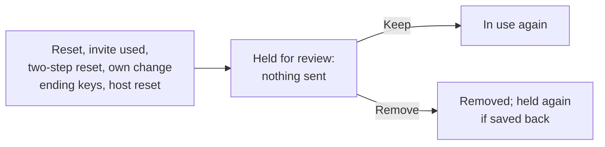

## Team Management

### Creating Teams

1. Go to the **Teams** page from the dashboard, or to **Admin → Team Management** (**+ Add Team**)
2. Click **Create Team**
3. Name the team and choose an emoji. You are made its owner
4. Add members. On the Teams page or **Admin → Team Management**, choose the person under **Add member…**, then their role, **Member** or **Owner**, beside **Add**; it starts at Member (card 2309 on the admin page; card 2355, 2026-10-21, on the Teams page, which added every member as Member). While an add is on its way a second press of **Add** sends nothing (card 2374, 2026-10-21: a double click sent it twice and said "Member added" twice); Add keeps the keyboard's focus. Someone added meanwhile elsewhere, and so already in the team, has their role set to the one chosen, and the page says "*name* was already in the team; role set to *Member* (or *Owner*)" rather than "Member added" (the card 2374 review)
5. Change a member's role: choose **Member** or **Owner** in the picker on their row, then press **Change** beside it. Choosing alone saves nothing (card 2376, 2026-10-21: the picker saved as it was chosen, so a keyboard user arrowing through it on Windows saved each role passed); **Change** is dimmed, and does nothing, until a role other than theirs is chosen. A role chosen and not saved is forgotten once they are removed from the team, or the page reads them back gone or already holding that role, so it never comes back on their row when they are added again (the card 2376 review). "Role changed" says it was saved; a change that is refused or gets no answer is said, and the picker shows the role they have again (card 2355, 2026-10-21; no page could change it). While a change is on its way the picker and Change stay where they are, with the keyboard's focus, and are marked busy, and a screen reader is told "Saving *name*'s role…"; another choice on the picker meanwhile goes back to the role being saved, and a second Change sends nothing (changes on two members' rows at once are each saved). If the person was taken out of the team meanwhile (by someone else, or on another page), the change puts them back in with the role chosen, and it says "*name* was no longer in the team and has been added again as *Member* (or *Owner*)" rather than "Role changed" On the Teams page the picker is on the rows an owner (or an administrator) may manage, and not on your own row, as ✕ is not; on the admin page it is on every row

### Team Owners and Members

A team's role says who may run the team; it gives no access to boards. The access a team gives is its share's role on each board (editor or viewer), the same for owners and members.

**Every change is recorded** (card 3002). A team made, a member added, a role changed, a member removed and a team deleted are each recorded by the identity of the team and the account, so a restore of an older backup never brings back a member removed here, or a role lowered here. A team deleted here and brought back by a restore comes back empty of the members and shares it had when it was deleted; delete it again on the Teams page if it is not wanted.

| | Owner | Member |
|---|:---:|:---:|
| Delete the team | ✅ | ❌ |
| Rename the team (through the API alone, `PUT /api/teams/{id}`: no page offers it) | ✅ | ❌ |
| Add and remove members, and change their role | ✅ | ❌ |
| Open the boards shared with the team | ✅ | ✅ |

**What an owner's adding gives.** An owner can add any account to the team, and each person added at once has the team's role, editor or viewer, on every board shared with the team, and the team's requests in their inbox. A board's owner has no say: the board was shared with the team, and whoever the team's owners add has it. Make someone a team's owner only if you would share every one of its boards with whoever they choose.

An administrator may do all of it on every team without being in it. Whoever creates a team is its owner, so a team made on the admin page is owned by the administrator who made it; to let someone else run it, add them as **Owner**, or change their role to Owner on their row. **A team keeps at least one owner** (card 2373, 2026-10-21). Making the last owner a member, or removing them, is refused for everyone, administrators included: "A team needs at least one owner. Make someone else an owner first, or delete the team." Make another member an owner first, then change or remove the first; or delete the team. There is no "leave team": a member asks an owner to remove them. Deleting an account takes it out of every team, so an account that is a team's only owner cannot be deleted until someone else is made an owner or the team is deleted (card 2377, 2026-10-21; see [Disabling, Enabling and Deleting an Account](#disabling-enabling-and-deleting-an-account)). A disabled account stays on its teams and is named there, and cannot be added to a team or made its owner until it is enabled (card 2671). A team left with no owner from before these rules (including by deleting its only owner's account before 21 October 2026) is run by administrators until one of them makes someone its owner again.

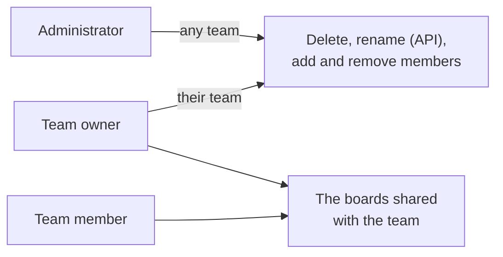

### Sharing Boards with Teams

When you share a board with a team, all team members inherit the team's board role (editor or viewer). New members added to the team automatically gain access.

**Shares, members and a board's visibility are recorded** (card 3002). Sharing a board with a person or a team, changing the role, taking the share away and making a board public or private are each recorded in the same transaction, so a restore keeps a share removed or a board made private here as it is now. See [Restoring from Backup](#restoring-from-backup).

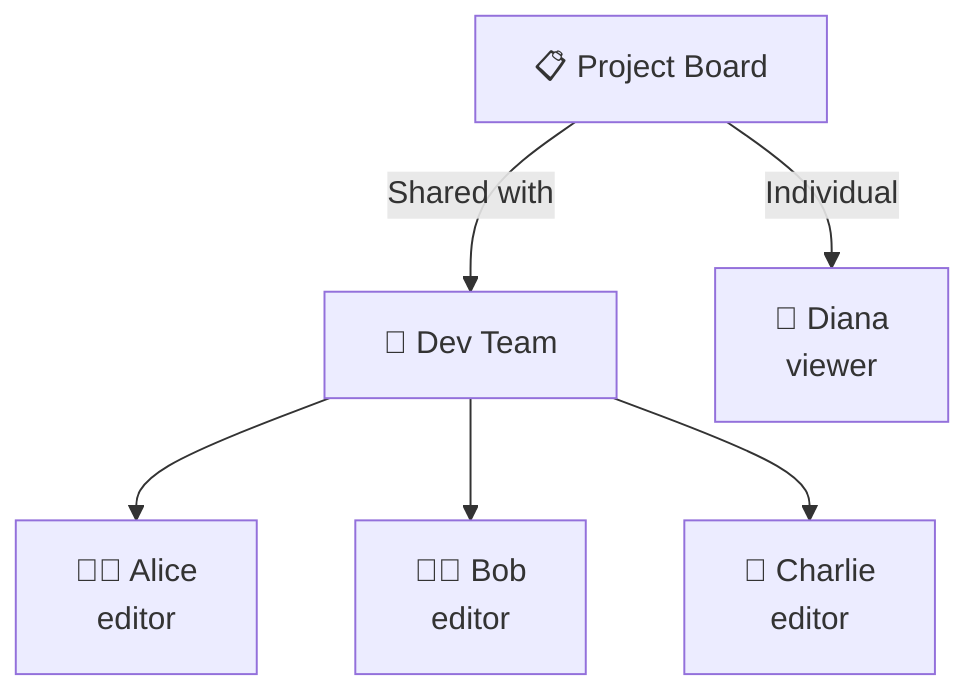

**Taking someone off a board leaves their assignments** (card 2180). A user removed from the
board, or from the team it is shared with, stays assigned to its cards, and is no longer
mailed about them: the "Card moved" and "Unblocked" mails go only to the assignees who can
open the board the card is on. The same goes for an assignee whose card is moved to a board
they cannot open. Current members are mailed as before. Unassign someone who should no
longer be listed on a card.

---

## People Directory

The people directory (card 2674, 2026-11-03) is the list of the people who can be consulted on or told of a decision, with an account or without one, and the groups they are in. Administrators keep it, on a page of its own: **Admin → 👥 People Directory → Open the people directory**, or `/admin/people`. Anyone signed in who is not an administrator is sent from the page to the dashboard, and the routes behind it refuse them with `403` `Forbidden`. Decisions read it: their participants are picked from it, and each participant's address and account are taken from it again when a decision opens (cards 2676 and 2697).

A person is a full name, an email address, a job title (which may be empty), the account they are linked to if they have one, their groups, and whether they are **Active** or have **Left**. A person needs no account: many of the people a decision consults never sign in. A group gives nothing: no board, no access, no mail. It is a name for a set of people, to pick them together.

**A person's account link is recorded** (card 3002). Linking a person to an account, changing the account and unlinking them (in **+ Add person**, **Edit** or **Add from accounts**) are recorded by the identity of the person and the account, so a restore of this server's own backup never links again a person unlinked here, and one whose seal does not check out links a person to an account only where this server already did.

```mermaid
stateDiagram-v2
    [*] --> Active: + Add person, or Add from accounts
    Active --> Left: Mark left, or their account deleted (date stamped, decision links cancelled)
    Active --> Left: a restore of an unsealed backup that did not hold them as they are (card 3020, recorded by DumpFire)
    Left --> Active: Mark active, with password and code (date cleared)
    Active --> Active: Edit; linking, unlinking or a new address cancels decision links
    Left --> Left: Edit; linking, unlinking or a new address cancels decision links
    Active --> [*]: Delete (cannot be undone)
    Left --> [*]: Delete (cannot be undone)
```

Every change is a line in the system log, context `PEOPLE`, level INFO, under the administrator who made it, readable on `/audit`: the person or group by id and name, and what changed, as `Person 12 "Ann Lee" changed: email, groups; 0 decision links cleared (by admin)`. A line never holds an address. A change that is refused writes no line, and a save that changes nothing writes none either.

### People

The table shows each person's name, email, job title, groups, account and status. It shows the **Active** people at first; **Left** and **All** above it change that, and the search box matches name, email, job title and group names.

- **+ Add person** opens a form: **Full name** (1 to 200 characters), **Email**, **Job title** (up to 200, may be left empty), **Account** (**None**, or an account no other person is linked to: see [Linking a Person to an Account](#linking-a-person-to-an-account)) and the groups to tick. **Edit** on a row opens the same form for that person. Ticking groups here replaces all of the person's groups; a group's own form does the same from the other side ([Groups](#groups)).
- **A change of a person's email or account asks for your password** (card 2697). A decision takes each participant's address and account from the directory as it opens, so the directory decides where their personal links go. When you change the **Email** or the **Account** in **Edit**, a **Current password** field appears and the save sends it; a wrong one keeps the form open with the field cleared. A new name, job title, groups and **Mark left** ask nothing. **Mark active** asks for your password and a code (card 3020): it lets the person be mailed about decisions again, at their address, so it opens a dialog naming the person and their address, as stored, before it sends. **+ Add person**, **Add from accounts** and **Delete** always ask (card 2697's code review, 2026-11-04): each gives a person an address and perhaps an account, or ends their links and frees their address, so the add form and the Add from accounts dialog show the **Current password** field from the start, and Delete's confirmation asks for it.
- **The address is unique across the directory.** It is stored in lower case, and no two people may have the same one in any case, people who have left included. A second is refused with `409` "Email already in the directory: Ann Lee". Where the person who has it is linked to an account, the message says which, "Email already in the directory: Ann Lee (linked to account ann)", so you can tell an entry that came from an account from one typed in. Correct or delete the entry that has it first.
- **Mark left** records a leaver. The row says "Left" with the date and moves from the Active list to Left. Their account link and their groups are kept, and **Mark active**, with your password and a code, brings them back as they were. Mark left is the way to record that someone has gone; it also cancels their personal decision links ([below](#linking-a-person-to-an-account)).
- **A person marked left by a restore** (card 3020) is one a backup whose seal did not verify brought in with an address or account this server did not hold for them, or with a status other than active or left. The people change record holds a row for each, by DumpFire, source `restore`, with the status and date before and after and no address. The page shows each person's status as stored (a status other than active or left, from such a file, shows as it is, never as "Active"), and, for a person who is not active, their address with the code points of any character that is not plain ASCII and their name in printable form; **Edit** shows "Address on file: …" the same way. Check the address before **Mark active**: its confirmation shows the address their mail goes to again, and it is tied to that address, so where the address has changed since the page was read it is refused with `409` "This person's address has changed since the page was read: read it again and check the address before you mark them active. Nothing was changed."
- **Delete** removes a person from the directory for good. It is for an entry made by mistake, a duplicate, or someone who must not be listed any more. It asks first, in the app's confirm dialog, with your password, and cannot be undone. Their group memberships go with them, their personal decision links stop working, and their address may be used for a new person afterwards. The message after it says how many decision links were cancelled, where there were any.

**What Delete does not erase.** The confirmation says so, and you should know it before you rely on Delete to remove someone:

- **The system log** keeps every `PEOPLE` line that names them, the delete's own among them (`Person 12 "Ann Lee" deleted; 0 decision links cleared (by admin)`).
- **Decision records** keep what they recorded of them: name, address, job title and groups as they were when the person was included, with only the tie to the directory entry emptied. A record is meant to show who was told what, and Delete does not rewrite it.
- **Backups** taken before the delete hold the person, and restoring one brings them back.

### Linking a Person to an Account

A person is linked to an account in their form, under **Account**. It offers **None**, the person's own account, and every account no other person is linked to, each with its username and address; one person per account, and the two addresses need not match. An account linked to someone else meanwhile is refused with `409` "That account is already linked to Ann Lee". Choosing **None** unlinks them. A disabled account is not offered, and is refused with `400` "userId 7 is a disabled account" (card 2671): it could be neither mailed nor answer; a person already linked to one stays linked, and is not mailed about a decision until the account is enabled.

**An account's address is not verified.** Whoever holds an account sets its address themselves, on My Account, and DumpFire does not confirm it. So an address that matches proves nothing: anyone can set theirs to a colleague's. Before you link an account to a person, check that it is that person's account. The form says so under the field: "An account's address is set by its holder and is not confirmed: check it is this person before linking." This matters more once decisions exist, because a person's account is then how they open and answer the decisions they are on.

**Linking or unlinking a person's account, a new address, or marking them left, cancels their personal decision links** (cards 2674 and 2675). Each person on a decision with no account will be able to have a personal link to it. Linking the person to an account (or to a different account), unlinking them (**None**), changing their address and **Mark left** each empty every such link of theirs, on every decision, in the same save, so a link that was forwarded stops working once the person can sign in, has gone, or is to be reached somewhere else. Delete does the same. Each cancelled link is also recorded on its decision, under your name, with the reason. A new name, job title or groups, and **Mark active**, cancel nothing. The system log's line says how many were cancelled, as `Person 12 "Ann Lee" linked to account 7 "ann"; 2 decision links cleared (by admin)`.

### Add from Accounts

**Add from accounts**, beside **+ Add person**, makes a person of each account you tick: named by the account's username (accounts have no full name, so edit the name afterwards), with the account's address in lower case, and linked to that account.

- **It lists every account no person is linked to, and none is ticked.** Tick each one on purpose; the button says how many will be added ("Add 3 people"). Above the list the dialog warns: "An account's address is set by its holder and is not confirmed: check each is the person you mean before adding them." Adding an account whose holder has set somebody else's address makes that account the directory's entry for the address, and adding the real person later is refused as a duplicate (the `409` then names the account, as above). Delete that entry, or correct its address, before you add the real person.
- **It never links an existing person.** An account whose address is already a person's, in any case, is shown dimmed and cannot be ticked: "matches person Ann Lee: link by hand". As the account's address is not verified, the match is no proof that the account is theirs. If it is, link it by hand from that person's **Edit**, after checking. The server skips such an account whatever is sent.
- **An account linked to a person meanwhile is skipped** too ("already linked").
- **It is all or nothing.** Up to 500 accounts at once; if any id sent is not an account, nothing is added (`400` "userId 12 is not an account").
- **What it did is said afterwards.** "3 people added from accounts" goes after three seconds. Where any account was skipped, the message names each with why and stays until closed: "2 people added from accounts, 1 skipped: sam (address matches person Sam Lee; link by hand)". The system log has one line for the whole step: `2 people added from accounts, 1 skipped (by admin)`.

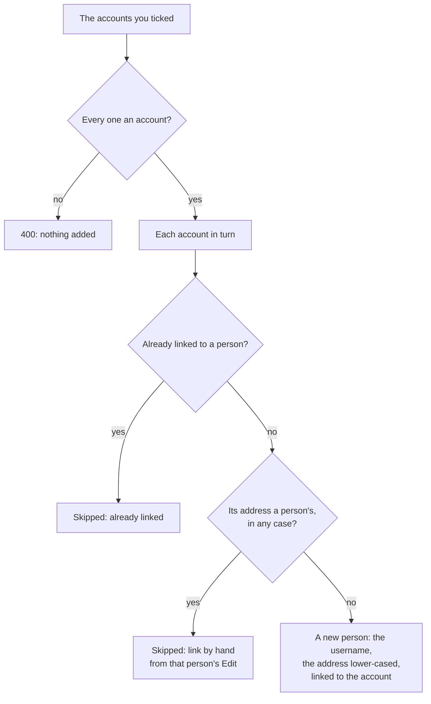

### Groups

The groups list shows each group's name, description and how many of its people are active.

- **+ Add group** opens a form: **Name** (1 to 100 characters), **Description** (up to 1,000), and the people to tick, from a list you can search by name or address, active people first and those who left marked "left". **Edit** opens the same form for a group. The people ticked replace the group's people.
- **A name is used once, in any case of any letter.** "finance" beside "Finance", and "ÉCOLE" or "école" beside "École", are refused with `409` "Group name already in use: Finance" (or "…: École"). A group may be renamed to its own name in other capitals.
- **Adding a group is two steps**, the group and then its people. If the people are refused after the group was added, the group is kept and the form stays open on it; **Save** again sends only the people.
- **Delete** asks first and cannot be undone. Only the group and its memberships go; its people stay in the directory. Decision records keep the group names they recorded.

A rename, of a person or of a group, puts the old and the new name in its log line's details as `renamed: { from, to }` (card 2681), so `/audit` shows what a person or a group was called before.

### Through the API

An administrator's API key can read the directory and keep part of it in step (card 2681, API `1.5.0`): an agent or a script that syncs job titles and groups from elsewhere needs no browser. A key of anyone who is not an administrator is refused `403` `Admin access required`. The six operations are in the [API Reference](api-reference.md#people-and-groups-admin); the wrapper's actions are `people`, `people-groups`, `update-person`, `create-people-group`, `update-people-group` and `set-people-group-members`.

| A key can | A key cannot (the People page only) |
|---|---|
| List every person and every group | See anyone's email address or account id |
| Change a person's job title and groups | Add a person, delete one, or Add from accounts |
| Make a group, change its description, set who is in it | Rename a person or a group, or delete a group |
| | Change an address or an account, or Mark left and Mark active |

**Why a key cannot do the rest.** A key cannot give a password, and the People page asks for yours whenever an address or an account is set or ended, because they decide where a decision's invitations and personal links are mailed. A stolen key that could change an address would have the person's next personal link sent to the thief. Marking someone left ends every link they hold, and a name is how an author ticks a person or a group on a decision. So the server refuses those fields `403` from a key, whatever they hold, and refuses by the key itself as well as by the route, so a later route cannot open them by mistake. The answers never carry an address or an account id, and mark every person and group `untrusted: true`: names and job titles are text others wrote.

**Putting a change back.** A key's change writes no activity entry and sends no webhook. Its `PEOPLE` line on `/audit` ends `(by <username>, through the API)` and its details hold `source: "api"`, `credential: "api key"` and `before`: the job title and groups it replaced, the description, or the whole member set it replaced. The system log is pruned by age and count, so every change, by a key or on the People page, is also kept for good in the `people_changes` table (migration 0064, card 2681's code review): who made it, `ui` or `api`, the person or group, and what the changed fields held before and after, never an address or an account id. A deleted person or group keeps its rows there, the group's member set and the person's groups among them, so either can be made again. To undo a change, read its `before` (from the `/audit` line while it lasts, or from `people_changes` in the database or a backup) and set those values again on the People page (or through the API). The wrapper also asks a person to type `yes` before it empties a group, takes anyone out of one, or takes a person out of any of their groups, and refuses each through a request file.

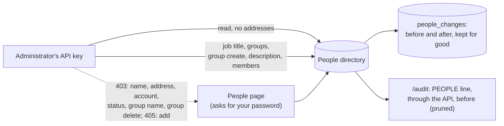

### A Board's Product Owner

Each board can have a Product Owner (card 2673): the account that decides its decisions by default, once there are decisions. It is set in the board's **Share Board** window, on the **Product Owner** line under the public switch (card 2674).

- **Only the board's owner or an administrator can change it.** They see a list: **None**, then every account that can edit the board, by username and emoji, never an address: the board's creator, people shared on it as Editor or Owner, members of teams it is shared with as Editor (unless a share of their own as Viewer decides for them), and every administrator. A viewer, and someone who can open the board only because it is public, is not listed. Choose one and press **Save**, which does nothing until the choice differs from the one stored.
- **Everyone else who opens Share Board** sees "Product Owner: *name*", or "Product Owner: None".
- **A refusal is said** on the window's error line, in the server's words, and the list goes back to the one stored: `403` "Only the board's owner or an administrator can change its Product Owner", or `400` "productOwnerUserId 7 cannot edit this board: a board's Product Owner must be an account that can edit it" for someone who lost edit access while the window was open.
- **A Product Owner who has since lost edit access keeps it** until someone changes it. The list then shows them as "*name* (cannot edit this board)".
- A choice not yet saved survives the window reading its list again after another change, unless the stored Product Owner changed meanwhile or the account chosen is no longer listed.

Through the API, it is `productOwnerUserId` on `PUT /api/v1/boards/{boardId}`: see the [API Reference](api-reference.md).

### Decisions

**Where drafts are made** (card 2676). On a board, **More → Go to → Decisions** opens the board's decisions (`/board/<id>/decisions`): every decision that is not a draft, to anyone who can open the board, and each draft to its author, its decider, the board's owners and administrators. Anyone who can edit the board has **New decision**, which asks for a title and opens the new draft's editor (`/decisions/<id>/edit`). Its decider starts as the board's Product Owner, while they can edit the board, and as its author otherwise. A draft is seen only by those listed above until its author or decider opens it (card 2697), which mails its participants.

**What an administrator sees in the editor.** Like the author, the decider and the board's owners, an administrator can open any decision's editor, a draft included, and edit its text, options, closing time and vote mode, change its decider, and save its participants while it is a draft. Only an administrator is given the participants' and the directory's email addresses: the people picker shows you each person's address, and searches it, where everyone else sees names, job titles and groups alone. The picker lists active people only, for you too. If you name someone who has left you are told who it was (`Pat Doe (person 12) has left, and cannot be included`), and an id that is no person is `personId 12 is not a person`; anyone else is told only `personId 12 cannot be included` for either. Two things are not an administrator's, even in the editor: **Mark reviewed** on text an agent drafted, which is the author's and the decider's, and including people on a decision that has been opened, which mails them. A participant who has left since they were added is flagged "has left: remove before saving" to every editor, and Save is refused until they are unticked.

**The lifecycle controls** (card 2697) sit above the editor, each shown only where you may use it now:

- **Withdraw** any decision, and **Delete** a draft or a withdrawn one; a decision that is open, closed or ruled cannot be deleted. **Once a decision has been opened, Withdraw and Delete ask for your password**: withdrawing ends it for good and mails every participant your reason, and deleting destroys its record (every version, response and event) for good. A draft that was never opened withdraws with a reason alone, telling nobody, and deletes with no password. An administrator cannot open, re-publish, close or extend a decision: those are its author's and decider's, and each can do them, the decider's ruling included, only while they can edit the decision's board (card 2675's code review). Nobody can make themselves the decider of a decision that is already open.
- **Preview as a participant** and **Send me a dry run** are the author's and the decider's (the preview is every editor's): see the [Feature Overview](feature-overview.md#decisions).
- **Results and ruling** (card 2679) opens `/decisions/<id>/results`, for the decider and administrators alone: the tally of the current round, earlier rounds apart, each response with its participant's name and comments, who has not responded, the removed, open questions, concerns raised after the ruling, and the ruling with whether it went against the responses, whether it was early and who it cut off. **An administrator can read the results but cannot rule or release them**: both are the decider's alone, each behind the decider's password. An administrator may **Supersede…** a ruled decision from its page, as its decider and the board's Product Owner may.

**Delivery** (card 2697). Once a decision has been opened, its author, its decider and administrators see a **Delivery** panel in the editor's side column: for each participant their latest mail and how it went (sent, refused with the mail server's problem in words, replaced by a later change, not sent for want of an App URL, or being sent), their latest skip with its reason, and when and why their personal link last ended. No address is shown there. **Resend** sends a participant their invitation again, a new personal link with it, where the server says it would send now; otherwise the panel says from when it may (10 minutes after their last mail, and at most five record mails to one person in 24 hours), or why it cannot.

**Your actions on a participant**, in the Delivery panel, shown to administrators alone, each asking for your password:

- **Attach account**, when the person on a decision has gained an account since: the participant then signs in to it, and their personal link is cancelled. **Clear account** lets them be reached by a personal link again.
- **Use the directory's address**, when their address in the people directory has changed: the decision takes the address the directory holds now (the dialog names it; you cannot type another), cancels their personal link and sends nothing; sending them the decision again is **Resend**. Until then they are not mailed: a decision's mail goes only to the address it holds, while that is still the person's address in the directory. It is refused for a person no longer in the directory, one who has left, or a row that already holds the directory's address.

A wrong password keeps the dialog open, the field cleared; three wrong ones sign the session out. Each action is recorded on the decision under your name.

**Who holds a role on a decision is recorded, and a restore keeps it** (card 3033). Every change of a decision's participants (taken off, made informed or consulted, brought back), of the account each participant's place holds (attached, cleared, taken again at opening) and of its decider is recorded by identity in the record of access changes, as board and team access is. So a restore of an older backup never puts back on a decision someone taken off it here, never lets someone made informed respond again, never hooks back an account cleared from a place, and never lets a replaced decider rule again: the decider is cleared, the name kept, and its author, a board owner or you name one again on the decision's page. A decision that supersedes another, or whose board was deleted, cannot be given a decider here: withdraw it if it is not wanted. A decision deleted here and brought back comes back with no author, decider or participants; delete it again. Naming a Product Owner or a decider whose account's creation time cannot be read on this server is refused (409), which no account made through DumpFire is; a new decision on a board whose Product Owner is such an account is refused too, never made with its author as decider instead. To fix such an account, give it a creation time on the host, which changes nothing else of it and prints how many accounts it changed (0 where its time already reads): `docker exec <container> node -e "const db = require('better-sqlite3')(process.env.DB_PATH || 'dumpfire.db', { fileMustExist: true }); console.log(db.prepare(\"UPDATE users SET created_at = strftime('%Y-%m-%d %H:%M:%S', 'now') WHERE username = ? AND (typeof(created_at) <> 'text' OR created_at IS NOT strftime('%Y-%m-%d %H:%M:%S', created_at))\").run(process.argv[1] || '').changes + ' account(s) given a creation time'); db.close();" <username>`. See [Restoring from Backup](#restoring-from-backup).

**Clarification questions** (card 2678). On a decision's page (`/decisions/<id>`), under **Questions and answers**, an administrator sees every question with who asked it and when, whether it was asked by an agent through an API key, and every answer an agent drafted that no person has published yet, labelled "Drafted by an agent and not yet reviewed by a person". Participants see none of that: no asker's name (but their own question marked as theirs) and no unpublished draft, which shows to them as an open question. **An administrator cannot answer, publish or replace an answer unless they are the decision's author or decider**: the answers on the record come from the people participants were told are accountable for the decision. On the results page an administrator who cannot answer sees the open questions, an agent's draft marked, and "The author or the decider answers questions on the decision's page", with no link. Asking and answering ask for no password, are never written to the activity log, and need no setting of yours; the two notices they send are under each account holder's **Decisions** switch ([below](#notification-preferences)).

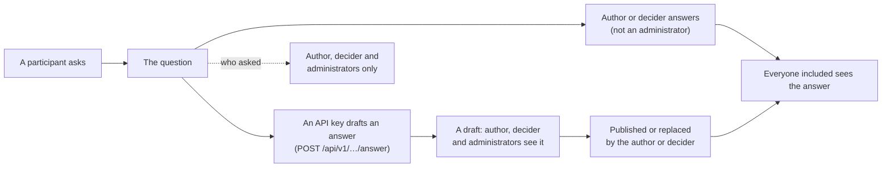

**Survey questions** (card 2683, migration 0082). A decision can ask its own questions (pick one,
a number on a scale, a short written answer), or be a survey with no options at all
([Feature Overview](feature-overview.md#survey-questions)). As an administrator:

- **You see every answer with the person's name**, as the decider does: on the results page (each
  response's answers, and per question the counts and a scale's average, per version it was asked
  in), through the summary to your own API key, and on a person's record (each answer by the
  question as it was asked). Nobody else does but the person, who sees their own; an author who is
  not the decider does not. Answers are never released, not even as totals, and a survey's ruling
  cannot be released.
- **Nobody answers through an API key**, yours included: answers are given on the decision's page,
  signed in or by personal link.
- **Retention.** Answers are kept with the decision for good, as votes are (design D7), written
  answers included. They go only when a draft or withdrawn decision is deleted, or with the whole
  database in a restore or Reset Everything. Redacting the text of one written answer, with the
  redaction recorded, is card 3047, not yet built; until then a written answer cannot be removed
  on its own.
- **Before rolling back to an image older than this card** (production's `332634f`), settle every
  survey still taking responses. Count them first:
  `SELECT id FROM decisions WHERE status IN ('open','closed') AND NOT EXISTS (SELECT 1 FROM decision_options o WHERE o.decision_id = decisions.id AND o.added_in_version IS NOT NULL);`
  (a decision that has ever put options to a vote is never counted). Rule on each (closing it) or
  withdraw it on its page. **Never drop `decision_survey_questions` and never empty
  `decision_responses.answers`**: nothing needs dumping, the older image leaves both alone, and
  rolling forward again uses them. The older image cannot show a survey: it accepts a vote with no
  scores on a decision with no option, misses an `answered` response (people who answered are
  reminded and listed as waiting), and drops the questions and their agent labels from a working
  copy at its next save, so do not edit a decision with survey questions while it runs.
  See [Deployment](deployment.md).

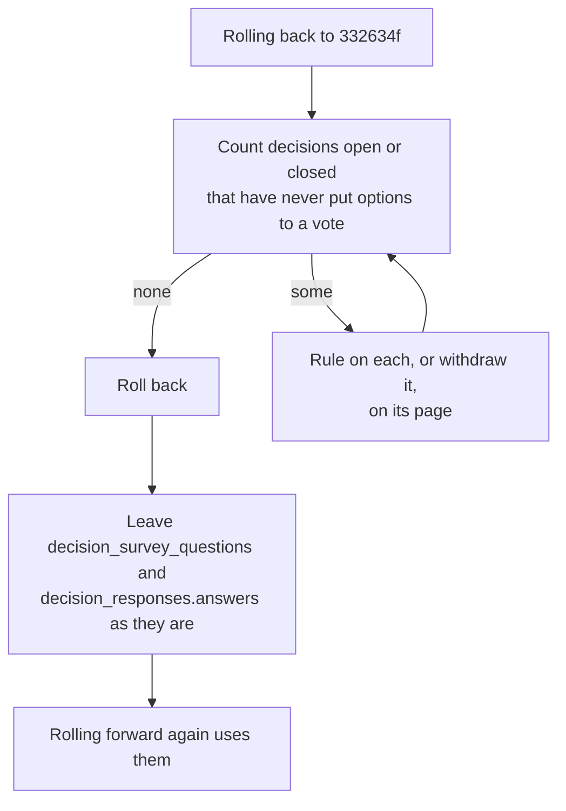

**API keys and decisions** (card 2682, API `1.6.0`). A key, your own included, can read the
register, draft a decision and edit its text, name its participants and decider while it has
never been opened, extend one it decides (to a later time only), withdraw or delete a draft
never opened, supersede, ask a question and draft an answer, read the results and the record
(the decider's and administrators'), and link cards. **What no key can do, an administrator's
included:** open, re-publish, send a dry run or an invitation again (each mails people), close a
decision for input (closing early makes a later ruling early), rule or release, publish or
replace an agent's answer, attach or clear a participant's account or use the directory's
address, or, once a decision has been opened, change its participants or decider, withdraw it or
delete it. Each of those is done on the decision's page, where the password is asked where it
always was. The server refuses them by how the request came in, so no route can open one to a
key. A key is never given an email address or a participant's account id, an administrator's
key included, nor who asked a question; and on the record it sees no address change's addresses,
no signed-in account and no question event. Extend, on the page or through a key, never brings a
closing time earlier, and a key extends only an open decision: reopening a closed one is done on
the decision's page. Through a key, an extend and a card link or unlink are in the activity log as done
through the API.

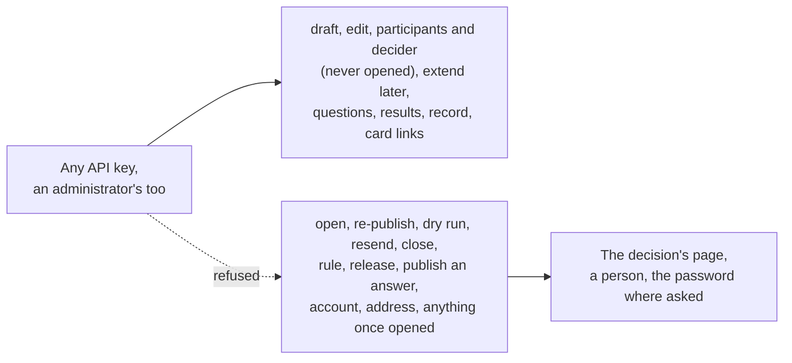

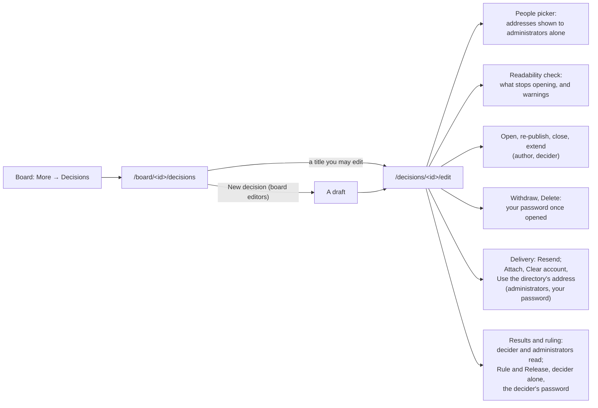

**The register, person records and the record view** (card 2680). **Views → Decisions** on the dashboard opens `/decisions`, the register: an administrator sees every decision on every board, drafts and withdrawn ones included, and can filter by board, by person (a search of up to 25 matches across the whole directory, by the directory's names; a decider searches only the people of their own decisions, by the name each was included under), by title and, on **All**, by status. **My record**, in the register's header, opens your own person record where your account is linked to a person of the directory. See the [Feature Overview](feature-overview.md#every-decision-in-one-place-each-persons-record-and-linked-cards) for the tabs.

- **Any person's record.** `/decisions/people/<person id>` (the id is the person's in **People**; reached from **People's records** on a decision's record view, which lists each participant who is a person of the directory once the decision has been opened, or by address) shows an administrator everything that person was asked and said on every decision that has been opened: the directory's name, job title, groups, address and whether they have left; on each decision their role, when they were included and removed, every response (replaced ones too, with how it was given), their questions with the askers' privileged view (an agent's unpublished draft included), their concerns, and every event naming them with the administrator's detail (addresses and the "signed in as" account included). Drafts are in nobody's record, an administrator's included. A decider sees the same only for the decisions they decide, without addresses or "signed in as"; the person sees their own, with no actors and nothing only the decider sees (a decision they were removed from and can no longer open is "A decision you were removed from", and a live one they cannot open "A decision you can no longer open", each with nothing of the decision). A person who is not there and a deleted person are "Person not found", to everyone.
- **A deleted person's history.** Deleting someone from the directory empties the person on their participations but keeps the name, job title and groups each decision took when they were included. Their record page is then "Person not found"; their history stays in each decision's record view under that snapshot name.
- **Participations by personal link.** A participation given by personal link (to someone with no account at the time) is on your record of that person and the decider's, and **not** on the person's own, even after their person is later linked to an account: what was answered by link belongs to the link.
- **The record view.** **Record**, on a decision's page and in its editor, opens `/decisions/<id>/record` for the decider (while they can edit the board) and administrators: every event of the decision, oldest first, 500 a page, narrowed to one participant by the select. The decider-only details (an early ruling, a ruling against the responses, who was cut off, concerns, the question events) are shown there. An address change's old and new addresses, and the account a personal link was opened while signed in as, are shown to administrators alone, not the decider. An administrator is offered **Record** on every decision, a draft's included.
- **Card links.** On a decision's page an administrator can link and unlink cards as an editor of its board can, and alone can do so for a decision whose board was deleted; the card's own board must be one they can edit (an administrator can edit every board). Each link and unlink writes "Linked card to decision" or "Unlinked card from decision" on the **card's** board, naming the card and not the decision; deleting a withdrawn decision writes "Linked decision deleted" on each linked card's board. None sends a webhook, and none counts as work on the card in reports.

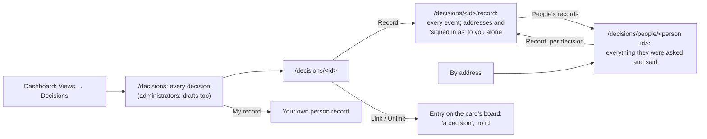

**What the directory and a restore do to personal links.** Mark left, linking or unlinking an account, a new address and **Delete** in the people directory each cancel the person's personal decision links ([above](#linking-a-person-to-an-account)), and so does deleting the account a person is linked to, which marks them Left ([Disabling, Enabling and Deleting an Account](#disabling-enabling-and-deleting-an-account)). An **Import Backup** cancels every personal decision link there is ([Restoring from Backup](#restoring-from-backup)): the import's message and the Backup panel say how many, "2 personal decision links cancelled: a link mailed before this restore no longer works, and the decision's author, decider or an administrator can send its holder a new one with Resend." Each cancelled link is recorded on its decision.

---

## The ISO 27001:2022 Checklist

Every administrator, and the superadmin, can open **📋 ISO 27001:2022 Checklist** from its section on the admin page (`/admin/iso-27001`, card 2670). It is read-only: nothing on it can be changed from the page. It lists every Annex A control of ISO/IEC 27001:2022 and clauses 4 to 10, and for each one:

- **Applicability**: *DumpFire* where the application implements the control, *Supports* where it does part and the organisation the rest (the "organisation's part" column says what), and *Organisational* where it is the organisation's alone: people, premises, policy, suppliers and every clause 4 to 10.
- **Status**: *Met*, *Partly met* or *Not met* for DumpFire's items; *Organisational* for the organisation's; *Not applicable* only where the organisation has excluded a control in its Statement of Applicability.
- **How DumpFire meets it**, the **evidence** (files, document headings and names in the code, as text), and the **gap cards** that close what is still open, as card numbers (`#2898`) on the DumpFire board that builds DumpFire. A partly met item names a gap card or an accepted risk.

The two blocks at the top count **In the application** and **The organisation's** apart, and never add them up: ISO 27001 certifies an organisation's management system, not software. The page is an input to your Statement of Applicability, not the statement itself and not a certificate. The date at the top is the day the statuses were last checked against the code. Filter by status, applicability ("Application" shows DumpFire's and Supports items together) and theme ("Clauses 4-10" shows the clauses). How the checklist is kept, and what each status means, is in [ISO 27001 Checklist: Method](iso-27001-checklist.md).

The page names DumpFire's known weaknesses and the files they are in, which is why it is for administrators only and is never in a script the browser can fetch without signing in.

---

## SMTP Configuration

Email is required for notifications, invites, and report delivery. The mail settings are every administrator's since card 2395 (the superadmin's alone before): whoever sets the mail server sees every mail DumpFire sends, invite and password-reset links included. See [Who May Do What](#who-may-do-what).

Every link in a mail begins with the **App URL**, which is set under **Application Settings** on the same page, **by the superadmin alone** (card 2847; every administrator's from card 2395 until then). Another administrator sees it with the field dimmed and no **Save**, and a line: "Setting the App URL belongs to the superadmin, **<name>**: every link in a mail begins with it." A change made by hand is refused `403` "Setting the App URL needs the superadmin…" before the password is asked, so it costs no strike. **Where the server's configuration names its address** (`APP_URL`, or an `ORIGIN` other than the image's `http://localhost:3000`), the App URL must be on that address: one on another is refused "The App URL must be on this server's own address (…), which its configuration sets. Nothing was saved.", the superadmin's too, and one saved before this rule (or brought by an import) is not used: links begin with the configured address, and the server says so in the system log as it starts. To clear such a saved App URL, the superadmin empties the field and presses **Save**. Each change is a `WARN` line naming the old value, the new one and who saved it. With none set, links begin with the address the server was started with (`ORIGIN`). Nothing a request says is used, so a link cannot be pointed at another host by whoever sends the request. If the links in your mail begin with `http://localhost:3000`, set the App URL: see [Where a Mailed Link's Address Comes From](deployment.md#where-a-mailed-links-address-comes-from).

**Where the App URL comes from** (card 2401). The App URL shown under Application Settings is the one in effect: one saved there, or failing that the server's `APP_URL` environment variable. The line under the field says which: `From the server's configuration (APP_URL). Saving it unchanged leaves it there, so a later change of APP_URL still applies.`, or, for one saved there, `Saved here, ahead of the server's configuration (APP_URL). Clear it and save to use the server's configuration (APP_URL) again.` where `APP_URL` is set and `Saved here; the server's configuration sets no APP_URL. Clear it and save to use ORIGIN, the server's own address.` where it is not. The line speaks of the App URL that was read, so it is hidden while the field holds anything else. With neither, the field is empty and the amber `No App URL set` warning shows. **Save** stays off until the App URL has been read; if the page could not read it, the panel says `The page could not read the App URL settings: reload the page before saving.` and Save stays off, since saving the empty field would clear a saved App URL. **Save** stores the App URL only when it differs from the one in effect (a trailing slash or a missing `http://` is no difference), so saving the panel unchanged stores nothing and an `APP_URL` change later still applies. Until card 2401 that save copied `APP_URL` into the settings, and a later change of `APP_URL` was ignored. To go back from a saved App URL to `APP_URL` (or, where `APP_URL` is not set, to `ORIGIN`), clear the field and press **Save**. The panel reads the App URL again after each save, so the field and its line show what is now in effect.

### Setup Steps

1. Go to **Admin → 📧 Email / SMTP**, as an administrator or the superadmin
2. Fill in your SMTP details:

| Field | Example | Notes |
|-------|---------|-------|
| **Host** | `smtp.gmail.com` | Your SMTP server |
| **Port** | `587` | 465 is encrypted from the first byte; any other port must offer STARTTLS. A whole number from 1 to 65535 |
| **Username** | `noreply@company.com` | Auth username |
| **Password** | `app_password` | Use app passwords for Gmail |
| **From Address** | `noreply@company.com` | Sender email: an address, with no space and none of `, ; < > " ( )` |
| **From Name** | `DumpFire` | Display name in inbox. Shown as typed, quote marks and commas included: it is handed over apart from the address, so it can never add an address of its own (card 3029) |

3. Leave **Allow mail without a checked, encrypted connection** unticked (below)
4. Press **Save SMTP**, and type your own password in the dialog it opens (card 2701: the mail server chosen here carries every invite and reset). **Save** of the App URL asks the same way
5. Click **🧪 Send Test** to verify

**How mail is sent** (card 2189). Port 465 is encrypted from the first byte. Any other port must offer STARTTLS: a mail server that does not is refused before the password is sent. On every port the mail server's certificate must be one this server trusts, for the host's name as it is entered. Until this change mail on any port but 465 went without requiring STARTTLS and without checking the certificate, so anyone on the network path could read the password and every message, invites included. A mail server whose certificate comes from a private authority, or is self-signed, is trusted by naming its authority's certificate in `NODE_EXTRA_CA_CERTS` when the container is created: see [Mail Server Certificates](deployment.md#mail-server-certificates).

**Allow mail without a checked, encrypted connection** is the one way out, off unless ticked. Ticked, mail on any port but 465 goes as it did before this change: STARTTLS only when the server offers it, the certificate not checked; port 465 is checked either way. While it is ticked the panel warns that mail and the mail password can then be read and changed by anyone on the network between this server and the mail server. Tick it only for a relay on this server's own network that cannot use TLS. A save that turns it on or off writes one `[WARN] [SMTP]` line on the Audit page's Live Console naming who did it: `Mail is now sent without a checked, encrypted connection (set by chief)`, or `with`. The old **Use SSL/TLS** box is gone: it only switched the certificate check on for ports other than 465, and that is now always on.

**The saved password stays with the connection it was saved for** (card 2190). The Password box shows `••••••••` for a saved password. A save that leaves it so, or sends none, keeps the saved password only while the host (spaces and tabs at either end, and capitals A to Z, aside: a no-break space, or any other character, is a change), port, user name and the box above are as they were saved. The host is saved without spaces or tabs at either end, and while the saved password is kept it is saved exactly as it was saved with the password, so the password only ever goes to that host. A save that changes any of them is refused, nothing is saved, and the panel says what changed: `Type the mail password again. The saved password is used only with the host, port, user name and "Allow mail without a checked, encrypted connection" setting it was saved with, and this changes the host.` Type the password and save again. The From Address, the From Name and the App URL are changed without it. A password typed, an empty one included, is saved as typed.

**Every change is logged** (card 2396). Since card 2395 any administrator can point mail at a server of their own, and that server sees every mail DumpFire sends. So a save of 📧 Email / SMTP or of the App URL (🌐 Application Settings) that changes anything writes one line under `SMTP` in the system log, filed under the administrator who saved it (their chip on the Audit page's Live Console) and naming them: `Mail settings changed: host from "smtp.example.com" to "smtp.other.com"; password changed (set by "chief")`. Each setting changed is named with its old and new values (`host`, `port`, `allowInsecure`, `fromAddress`, `fromName`, `appUrl`), except the user name and the password, which are only ever `user changed` and `password changed`, never a value (some mail providers take the API token as both). The line is always a `WARN`, so it is kept whether `LOG_LEVEL` is `INFO` or `WARN`. A save that changes nothing a mail uses (the panel saved as it was, say) writes no line, and nor does one that is refused. Ticking or unticking the box above writes its own `WARN` line too, after this one.

**Whoever pointed mail where it goes is recorded** (card 2397): the **Host**, **Port**, **Username** or the box above, for each place mail has been pointed; the **From Name**, the **From Address** and a password typed again alone change nobody's, and mail pointed back where somebody put it before is theirs again. So, apart, is whoever set the App URL to each address (clearing it makes nobody its setter). Made a user, or deleted, they take them away: every mail setting is removed and **no mail is sent** until an administrator sets it up again, and the App URL goes back to the server's `APP_URL`, or else its `ORIGIN`. The line says so: `The mail settings and the App URL removed: saved by "ann", who was made a user by "chief". No mail is sent until an administrator sets the mail up again. …`. See [Who May Do What](#who-may-do-what).

**What mail has done since the server started** (card 2196). Under Send Test the panel says how many mails have been sent and how many failed since the server started, and the last failure:

> Since the server started (14/10/2026, 09:00:03): 40 sent, 3 failed.
>
> ⚠️ Last failure, 14/10/2026, 11:02:11: "Assigned: Deploy v2.1": the mail server refused the sign-in. The mail error was: Invalid login: 535-5.7.8 Username and Password not accepted. Mail has been sent since then, last at 14/10/2026, 10:58:40. Every failure is also in the system log, on the Audit page, with its recipient.

or "✅ No mail has failed since then.", and "No mail has been sent since then." when nothing has gone since the failure. Every mail counts, whatever sent it: notifications, invites, request mail, the backup failure mail, reports and Send Test. "Sent" means the mail server accepted it; a bounce afterwards goes to the From Address. The panel reads it when it opens and again after Save and Send Test. It is kept in memory, not in the database, so a restart starts it again; the system log keeps every failure for 30 days. After "The mail error was:" comes the error's own message: the mail server's reply when it answered (`Invalid login: 535-5.7.8 …`), or this server's own words when it never got one (`Connection timeout`, `Greeting never received`, `connect ECONNREFUSED 203.0.113.5:587`, `getaddrinfo ENOTFOUND smtp.example.com`). The words are masked where they could quote a mail's link (an invite's or a request's token, encoded or not, becomes `[token]`), and can name the recipient. The subject is the mail's own, and a request mail's subject holds the request's title, which a member of the public typed on the request form: read it as their text, not this server's. All of it is every administrator's, as the panel is (the superadmin's alone until card 2395), and the answer that carries it is never stored on the way (`Cache-Control: no-store`).

A save that holds a field the server cannot use is refused with the field named, under the buttons, and nothing is saved: `port must be from 1 to 65535`, `fromAddress must be an email address`. The Host and the Username are at most 2,048 characters and the From Name at most 200. A Port left empty is refused, `port must be a whole number`, as is a save of none of the fields (`No valid fields to update`). Only these fields, the way out (`allowInsecure`, true or false) and the App URL are kept; a `secure` sent by a page from before this change is ignored. The App URL is an `http://` or `https://` address, or empty for none; one written without its scheme, `kanban.example.com`, is saved with `http://` in front, as it was always read, and one that is still no address after that is refused. A value saved before these rules, sent back unchanged, is kept (card 2117).

### Troubleshooting

| Problem | Solution |
|---------|----------|
| Connection timeout | Check firewall rules for outbound SMTP port |
| Auth failure with Gmail | Use an App Password, not your Google password |
| Emails going to spam | Set up SPF/DKIM records for your sending domain |
| A mail server with IPv6 addresses | Nothing to set. nodemailer looks up the host's IPv4 and IPv6 addresses, leaving out a family this server has no network address for, and with more than one it has Node try them in turn, going on to the next when one fails or is slow. DumpFire no longer passes the `family: 4` option it did: nodemailer 10 does not read it |
| Send Test fails with "The mail server's certificate could not be checked, or the server does not offer STARTTLS" | The error before that sentence says which. `Error upgrading connection with STARTTLS`, or `EHLO failed but HELO does not support required STARTTLS`: the server offers no STARTTLS; ask the provider for its TLS port (often 465), or, for a relay on this server's own network, tick the way out and type the password. `self-signed certificate`, `unable to verify the first certificate` or `unable to get local issuer certificate`: a private authority; set `NODE_EXTRA_CA_CERTS` ([Mail Server Certificates](deployment.md#mail-server-certificates)). `does not match certificate's altnames`: enter the host by the name on its certificate, and type the password (a new host needs it). `certificate has expired`: the provider's to renew; the way out meanwhile |
| The Live Console shows `[WARN] [EMAIL] Mail is not being sent: …` | Mail of every kind is failing for the certificate or STARTTLS: invites, notifications, request mail, reports and the backup failure mail. An invite says its mail was not sent and gives its issuer the link (card 2196). The line is written at most once in ten minutes, beside the `[ERROR] [EMAIL] Failed to send email …` line of each mail; Send Test does not write it, its own answer says the same. Put it right as in the row above, then Send Test |
| The panel or an invite says "the mail server's certificate could not be checked, or it does not offer STARTTLS" | As the Send Test row above: the words after "The mail error was:" under the panel's last failure say which |
| … "the mail server could not be reached" | The host or port is wrong, the mail server is down, or the firewall stops outbound SMTP. The words after "The mail error was:" are this server's own: `Connection timeout` (no answer to the connection), `Greeting never received` (connected, and the server said nothing), `connect ECONNREFUSED …` (nothing listens on that port), `getaddrinfo ENOTFOUND …` (the host name is not found). The error's code (`ETIMEDOUT`, `ECONNECTION`, `ESOCKET`, `EDNS`) is in the `[ERROR] [EMAIL] Failed to send email …` line on the Audit page |
| … "the mail password has not been entered on this server" | A user name is saved and the password is not: what an Import Backup leaves, since a backup does not hold it. Type the password here and Save. Nothing was asked of the mail server. Until then 📧 and Create User with no password are refused before anything is made |
| … "the mail server refused the sign-in" | The user name or password is wrong, or (Gmail, Microsoft 365) the account needs an app password. After an Import Backup the mail password is entered again here: a backup does not hold it |
| … "the mail server did not accept the message" | The mail server refused the sender or a recipient (a From Address it will not send as, a mailbox that does not exist) or the message itself. Its words, under the last failure, can name the recipient |
| … "the mail could not be sent" | Anything else: the words after "The mail error was:" under the last failure, and the `ERROR` line on the Audit page, say what |
| … "mail is not set up on this server" | The mail host was cleared while the invite's mail was being sent. The invite exists; give its link, or send a new invite once mail is set up |
| Save is refused with "Type the mail password again" | The host, port, user name or the way out was changed with the password left masked. A host that looks the same can differ by a character that does not show, a no-break space pasted with it. Type the password and save again |
| An emailed report says "Mail is not set up on this server" | Fill in the settings above. Until a host is saved, a report emailed from the Reports page is refused `503` and nothing is sent, and each scheduled report logs an `ERROR` line saying so |
| An emailed report says "The mail server did not accept it" | The reason is in the system log, an `ERROR` line under `EMAIL` for each address, on the **Audit** page's **Live Console**. A scheduled report's `ERROR` line under `REPORTS` names each address it did not reach. Neither is sent again by itself: see [Schedule Execution](backup-reporting.md#schedule-execution) |
| A report or a schedule is refused with "at most 10 addresses", "20 report schedules" or "at most 100 addresses a day" | The limits of card 2182, the same for administrators: 10 addresses a report emailed by hand and a schedule, 20 schedules an account, and 100 addresses a day from one account, by hand, by the schedules it makes, turns on, or re-times or moves to another time zone while they are on, and by the addresses a change of a schedule's list adds. The day is 24 hours from the account's first send, not a calendar day, so up to 200 can go across one day's end and the next's start; it is held in memory, so a restart starts it again. The first refusal of each day is a `WARN` line under `REPORTS` naming the account, as the line's user. See [Who a Report Can Be Mailed To](notifications-email.md#who-a-report-can-be-mailed-to) |
| A schedule is switched off and reads "the most is 10, so it is not sent" | It was kept from before the cap with more than 10 addresses, and was switched off at its next run with nothing sent, written as one `ERROR` line under `REPORTS` naming it and its owner, who is the line's user. Its owner copies the addresses to keep from the Reports page into a new schedule of at most 10, then deletes it |
| A schedule arrives an hour late in British summer time, and its badge reads "at 09:00 UTC" | It was made before schedules had time zones (card 2159), so its time is read in UTC, as it always was. Its owner presses **Use my time zone (Europe/London)** under it on the **Reports** page, and it is sent at 09:00 UK time all year. Only the owner sees the schedule, so only they can press it |
| A schedule is switched off and reads "Cannot be sent: its time of day "9" is not a time from 00:00 to 23:59" | Its time, day, frequency or time zone is one the scheduler cannot work a next run out from, written before the routes checked it or by a restore. At its next due minute it was switched off with nothing sent, and one `ERROR` line under `REPORTS` names it and its owner (card 2144). A next run that cannot be read, such as `NaN-NaN-NaN NaN:NaN:NaN` (what the image before card 2144 wrote for such a time), counts as none: the schedule is switched off at the next start or minute in the same way, and its next run cleared, so the start-up conversion of timestamps stops naming it. Its owner can turn it on again with a timing that can be read in the same request, `PUT /api/report-schedules/{id}` with `{"enabled": true, "timeOfDay": "10:00"}`; the page cannot change a time, so on the page they delete it and make it again. A stored value is named to its first 80 characters |

---

## Backup Management

The export and the import are the superadmin's. The schedule, the destinations, Test, Run Now and Google Drive's Connect are every administrator's since card 2395 (the superadmin's alone before): whoever sets a destination can be sent the whole database. See [Who May Do What](#who-may-do-what).

### What a Backup Holds

A backup is the whole database, as one `.db` file, with these things taken out:

| In a backup | Not in a backup |
|-------------|-----------------|
| Every board, card, comment, user, team and setting | **Sessions.** Nobody is signed in by a backup, whoever reads it |
| Every user's password hash, so that a restore can sign them in again | **Invites that have not been used.** An invite's link sets a password |
| The mail server, port and user name, and each backup destination's name, type, host, bucket, folder, user names and ids | Attachment files: see [Attachments](#attachments) |
| Invites that have been used, held only as hashes (card 2849), API keys (as hashes), the system log, with every invite's address in it masked. A restore does not bring the log in: it stays in the file (card 2899) | **The key remembered browsers are signed with** (card 2194). A restore forgets every remembered browser |
| Every task request and its messages | **Every request's link** (card 2158). A link opens its request's thread, replies as the requester and confirms the request, and ends 90 days after the request is settled (declined, or its card completed; card 2902): every request is in the backup with no link (since card 2870 the links are kept only as hashes, and the backup holds none of those either), and a restore ends every link and brings none in |
| Every webhook, with its address | **The key the public request form signs with** (card 2158). A restore makes a new one |
| | **The mail password** (card 2169) |
| | **Each backup destination's credentials** (card 2169): an SFTP password or private key, an S3 secret access key, a Google Drive client secret and refresh token or a service account's private key, a OneDrive client secret |
| | **Each webhook's signing secret** (card 2169). A webhook that had one is switched off in the backup, so that a file put in place by hand sends nothing unsigned |
| **Its seal** (card 2169): a check of every row in it, made with a key this server keeps, so that only this server fills its secrets back in, and only into the file it made, unchanged | **The key backups are sealed with** (card 2169). It stays on the server, and a restore keeps the server's own |
| Every account's second factors, each authenticator's secret only encrypted, and its recovery codes only as hashes, with the check that says which key the factors were made with (card 2768) | **The key that protects second factors** (card 2768). It is in a file of its own outside the database (`MFA_KEY_FILE`), so a backup alone opens no authenticator. Keep a copy of it apart from the backups: see [Deployment](deployment.md#the-key-that-protects-authenticator-secrets) |
| | **Sign-ins waiting for a second factor, and links to set up an authenticator** (card 2768) |

So a backup is still a file to keep where few can read it, and it no longer opens anything for whoever does: no account, no request's thread, no mailbox, no backup store, no webhook receiver. That is true of the file **Export Backup** downloads and of every copy a schedule or **Run Now** uploads: both are made the same way, the second factors included, so the export holds them encrypted as a backup does and never holds the key. Sign-in does not ask for a second factor yet (card 2769 adds it), so until then no account has one and those tables are empty. Taking a backup signs nobody out and changes no link. The sessions, links and secrets are removed from the copy, never from the running database: mail, backups and webhooks go on working.

**What it still holds that is worth guarding.** Every user's password hash and email, API keys as hashes, the mail server and its user name, each destination's other fields, the system log (masked), and every webhook's address. A webhook's address can itself be a key: a Slack or Teams incoming webhook's address is all anyone needs to post to that channel. If a copy may have been read by somebody who should not have, make a new incoming-webhook address at its service and put it on the webhook.

**A backup alone no longer rebuilds a lost server** (card 2169). Restored on the server it came from, with Import Backup, nothing has to be entered again: the restore keeps this server's mail password, credentials and webhook secrets wherever they are for the same account, as long as the file is the one this server made, unchanged since (its seal: see [Restoring from Backup](#restoring-from-backup)). Restored anywhere else, changed in anything a restore brings in, or put in place by hand, they are entered again. So keep the mail password and each destination's credentials outside DumpFire, in a password manager, and know who holds each webhook's secret at its receiver. An S3 secret key cannot be read again from AWS (a new one is made), a Google Drive OAuth destination needs its client secret from the Google Cloud console and a new Connect, and a webhook's secret is known only at its receiver.

A backup made before this version does hold the sessions of whoever was signed in when it was made, and one made before card 2158 holds every request's link as it was mailed. Restoring one brings back neither, and the update that brings migration 0055 replaces every request's link once, so the links in those copies open nothing: see [Every Request Link Replaced Once](authentication-security.md#every-request-link-replaced-once-by-migration-0055). The update that brings migration 0070 (card 2870) ends every request link again, once, and from then on the server keeps each link only as a hash: see [Requester Links Stored as Hashes](authentication-security.md#requester-links-stored-as-hashes-card-2870). One made before card 2169 holds the mail password, every destination's credentials and every webhook's secret, and nothing can take them out of a copy already made: they go as retention removes the old copies. Such a copy carries no seal either, so Import Backup of it keeps nothing from this server, which changes nothing: it holds its own secrets. If one of them may have been read by somebody who should not have, change the mail password and each destination's credentials at their services and enter them again, and set new webhook secrets with their receivers. The files themselves are as they were: delete the old copies that are not needed.

### Configuring Backups

1. Go to **Admin → Scheduled Backups**, as an administrator or the superadmin
2. Choose a schedule: Hourly, Every 6h, 12h, Daily, or Weekly
3. For daily/weekly: set the time and day
4. Add destinations (SFTP / S3 / Google Drive / OneDrive)
5. Set retention count (how many backups to keep)
6. Enable failure email alerts (switching them off, or changing who receives them, is the superadmin's: card 2408)

Each setting is checked when it is saved, and one the server cannot use is refused with the setting named and nothing saved: a time written `HH:MM`, a retention of 1 to 100, a failure email of one address or more (separated by commas, semicolons or lines, and saved separated by commas), and for each destination a name, one of the four types, and its own fields, an SFTP port being a whole number from 1 to 65535 (`destinations[0].port must be a whole number from 1 to 65535`), and a port left empty being 22. A destination's text is at most 2,048 characters, but an SFTP private key and a Google service account's JSON, which are pasted in, at most 20,000. A Retention box left empty is not sent, and the retention saved before is kept. **Lowering the retention (Keep Last), removing a destination and switching the schedule off are the superadmin's** (card 2398): an administrator's save that does any of them is refused with the rule and what it would have done, and nothing is saved; see [Who May Do What](#who-may-do-what). A save keeps what it does not send: until card 2117 a save that sent part of the settings wrote the defaults over the rest, and one that sent nothing switched the schedule off and removed every destination. A destination keeps only the fields of its type.

**A Google Drive service account takes only the key file Google gives for it** (card 2939). In Google Cloud Console, on the service account's **Keys**, choose Add key, Create new key, JSON, and paste the whole file. The save refuses anything else, naming the field and quoting none of what was pasted: text that is not JSON ("… is not JSON. Paste the whole JSON key file Google gives for the service account."), JSON that is not a service account's key file, such as another kind of Google credential ("… must be the JSON key file Google gives for a service account: type service_account, with its client_email and private_key as text."), and a key for another Google universe ("… names a universe_domain other than googleapis.com …"). A Drive destination that signs in with OAuth takes no JSON at all. Only the fields DumpFire signs in with are kept (`type`, `project_id`, `client_email`, `private_key_id`, `client_id` and the key); the rest of the file is dropped. A destination saved before this change is brought to the same form at the next start, with one `[WARN] [STARTUP]` line naming it; one whose JSON is not a key file loses it and is listed to enter, as after a restore.

**A OneDrive destination says whose OneDrive** (card 2941). DumpFire signs in to Microsoft Graph as the app itself, with no user, so it must be told which drive to use, in the box **User (sign-in name or object ID) or drive ID (b!…)**:

- **Best (least privilege):** in Microsoft Entra ID, register an app with Microsoft Graph **Application** permission **Sites.Selected**, which like any Application permission needs admin consent, and create a client secret. An administrator then also grants the app `write` on the one site that holds the drive (a separate step, for example `POST /sites/{site-id}/permissions` with Microsoft Graph PowerShell), and you give that drive's ID, which begins `b!`. Use a SharePoint document library kept for backups rather than a person's OneDrive.
- **Broader:** Application permission **Files.ReadWrite.All** with admin consent, which lets the app read and write every user's files in the tenant. Then give the user's sign-in name, or better their object ID (Entra ID, Users, the user, Object ID), which stays the same if they are renamed.
- Personal Microsoft accounts are not supported.
- The folder path is folders separated by `/`, none of them empty, `.` or `..`, and none holding a control character or any of `" * : < > ? \ |`; anything else is refused when saved.
- **🧪 Test** names the drive's owner and says whether the folder is there ("… found") or will be made by the first backup. It makes nothing.
- A OneDrive destination saved before this change has no drive. It is kept, and another setting can still be saved beside it, but it is not backed up to: Backup History, the failure mail and Test say "This OneDrive destination does not say whose OneDrive to use…". Edit it, give the user or drive, and type its client secret again, since a changed drive needs the secret typed again as any other change of place does. The addresses DumpFire used before this change were not valid for its sign-in.

**When older copies could not be removed** (card 2941). After a good upload, Keep Last lists the destination and removes the oldest copies beyond it. If the listing or a removal fails, or the destination does not answer within 60 seconds, the run is still a success, since the new copy is safe, but Backup History shows **✅ ⚠️** and the reason in amber (hover for all of it), ▶ Run Now warns with it, and the failure mail (when on) is sent as **"DumpFire Backup Needs Attention"** with the reason under **Problem:** ("Failed" when a destination also failed in the same run). It is sent on every run until the cause is put right, for example a permission taken away at the far end. Before, only System Logs said so, and the destination filled without anyone noticing. Keep Last removes only files named as DumpFire names its copies (`dumpfire-backup-<time>[-manual].db`), and only files, never a folder or link of such a name; on Google Drive and S3, only one it has just listed. On S3 it counts only copies directly under the prefix: not one in a folder below it, nor one under a prefix that only begins the same (`dumpfire-old/` beside `dumpfire/`), and it reads every page of the listing. A call that does not answer within a minute stops the removals (it may still complete at the far end), Keep Last stops after five minutes at one destination, and a destination held for review meanwhile stops before its next removal; the copies not removed are counted in the reason.

**Test runs only a saved destination, exactly as it is saved** (card 2939). Save a new or changed destination first, then press 🧪 Test: a Test sent with a secret typed, or with any setting changed from the saved one, is refused and nothing is connected to: with its secret left masked, in the save's own words ("Backup destination "…": type its … again …"); otherwise "Save the destination first, then Test it.". The page's Test button always sends the saved destination, so it works as before.

**Every secret is shown masked** (card 2187). Every saved password, private key, secret access key and client secret, a service account's private key, and a Google Drive connection's refresh token reads `••••••••`, and the answer the page loads (`GET /api/admin/backup`) holds none of them. Until this change it held the refresh token as stored, a standing credential for the Google account that connected. A connected Google Drive destination still says it is connected.

**A saved secret stays with the destination it was saved for** (card 2190). Saving or testing a destination with a secret left masked keeps the saved secret only from the one saved destination that is the same in type, name and every setting that is not secret: an SFTP host (spaces and tabs at either end, and capitals A to Z, aside, as for the mail host; it is saved without them, and as it was saved while a secret is kept), port, user name and remote path; an S3 region, bucket, prefix, endpoint and access key ID; a Google Drive sign-in method, folder ID and client ID, or a service account's email and key ID; a OneDrive tenant ID, client ID, folder path and user or drive ID (card 2941). A value the edit form fills in where none was saved counts as the same: an S3 region of `us-east-1`, a OneDrive folder of `/DumpFire Backups`, an SFTP port of 22, an endpoint or prefix left empty. Change any of them, the name included, and the save or test is refused with nothing saved; the edit form stays open as typed, and the toast says what to type and why:

> Backup destination "NAS": type its password again. A saved secret is used only with the settings it was saved with, and this changes its host and port.

(or "… and no destination of this name was saved."). Every field still masked is named: "type its password and private key again". Type them and save again. Where two saved destinations are the same in everything but their secrets, typing is no way out, and the toast says what is:

> Backup destination "NAS": more than one saved destination matches it, so its saved secret cannot be told apart. Remove the destinations named "NAS" (the page's Remove removes every one of that name, and removing a destination is the superadmin's) and add it once with its secret typed.

A list that names two destinations alike is not saved at all, whatever else changed, the schedule included: "Two backup destinations are named "NAS"." followed by that same way out where the two were saved before this change, or by "Each destination needs a name of its own: give one of them another name." where an edit gave a destination a name already used. A destination is found by its name to connect, test and back up to. A secret typed, or emptied, is used as typed. A connected Google Drive destination has a token no form can type, so a change to its name, sign-in method, folder ID or client ID is refused with how to remove it, add it again and connect it, beginning with removing DumpFire's access in the Google account when it was connected with all of Drive (below). Until this change a masked secret was taken from the destination at the same place in the list, whatever its host, name or type, so a mistaken edit, or a session in the wrong hands, could send a stored credential to another host. Keep the secrets outside DumpFire, as above.

**An SFTP destination's host key, confirmed once and checked at every connect** (card 2250). Until this change an SFTP destination connected to whatever answered for its host and sent it the password, or a signature made with the private key, and then the backup, so anything on the network path between the container and the SFTP server (the LAN, the ISP, a DNS answer for the host's name) could have received both. Now each SFTP destination holds the server's host key, as its type and the fingerprint `ssh-keygen -l` prints for it (`ssh-ed25519 SHA256:s16t1ixxsjxOgoaXCXACvAIOEG1K5biSlM7GekmavrY`). Every connect (Test, a backup, retention's listing and deleting) asks the server for a key of that type only, and refuses any other key before a password or private key is used. A destination with no key confirmed is sent nothing at all.

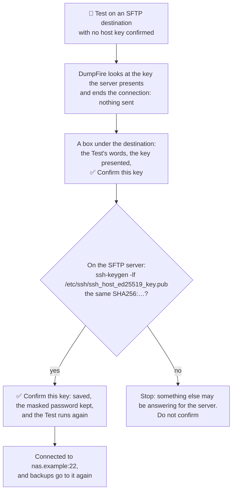

To confirm a destination's key:

1. **🧪 Test** on the destination. With no key confirmed, DumpFire connects only as far as the key the server presents, uses no password or private key, makes no folder, and ends the connection. A box under the destination shows the Test's words, the key presented and **✅ Confirm this key**: "SFTP host key not confirmed: the server at nas.example:22 presented the host key ssh-ed25519 SHA256:…. Check it is the server's own (on the server: ssh-keygen -lf /etc/ssh/ssh_host_ed25519_key.pub) and confirm it. Nothing was sent to the server." (`ssh_host_rsa_key.pub` or `ssh_host_ecdsa_key.pub` for those types.)
2. On the SFTP server, run the command the box names and compare the `SHA256:` part. **Different: stop.** Something else answers for the host; do not confirm it.
3. **✅ Confirm this key.** The destination is saved with exactly the key shown, keeping its masked password (a key added where none was only narrows where the password may go), the page reads the destinations back from the server, and the Test runs again, now with the password: "Connected to nas.example:22".

Until its key is confirmed, an SFTP destination's card carries **⚠️ Host key not confirmed — press Test** beside its buttons, as a connected Google Drive one carries ✅ Connected.

The Test only looks at the key, and the server logs that as a connection ended before authentication (OpenSSH: `Connection closed by <address> port <n> [preauth]`). A fail2ban jail on sshd with `mode = aggressive` may count it, so a few such Tests in a row could ban the container's address: Test once, check, then Confirm.

Or type the key yourself, in the **Host key** box of the add and edit forms: the line `ssh-keygen -lf /etc/ssh/ssh_host_ed25519_key.pub` prints, pasted whole (`256 SHA256:… root@nas (ED25519)`), or the type and fingerprint (`ssh-ed25519 SHA256:…`). Either is saved as the type and fingerprint. ED25519, RSA, and ECDSA of 256, 384 or 521 bits are taken; a fingerprint without its type, an MD5 one, DSA and the `-SK` types are refused and nothing is saved: "destinations[0].hostKey must be an SSH host key fingerprint with its type: the line ssh-keygen -l prints (256 SHA256:… root@nas (ED25519)), or the type and fingerprint (ssh-ed25519 SHA256:…), the fingerprint being SHA256: and 43 characters". Left empty, the first Test shows the key, as above. The key is no secret: it is shown as saved, and a backup holds it.

What else a Test may show in the box (any other answer, connected or a failed login, is a toast as before, and clears the box):

- **A key other than the confirmed one**: both keys shown, Presented and Confirmed, and no Confirm. "SFTP host key refused: the server at nas.example:22 presented the host key ssh-ed25519 SHA256:NEW, not the confirmed SHA256:OLD, so nothing was sent to it. If the server's key was changed on purpose, check the new key on the server and confirm it, typing the password or private key again; otherwise something else may be answering for the server." The system log has one `[ERROR] [BACKUP] SFTP host key mismatch for destination "NAS" at nas.example:22: presented SHA256:NEW, confirmed SHA256:OLD. Nothing was sent.` line. To accept a new key put on the server on purpose: check it there, then **Edit**, paste it in Host key, type the password again (or, for a destination that logs in with a key, paste the private key again under **Advanced: Private Key auth**, which the edit form has as the add form does), and save.
- **The server no longer offers a key of the confirmed type**: the confirmed key shown, and no Confirm, since no key was presented. "SFTP host key refused: the server at nas.example:22 no longer offers a host key of the confirmed type (ssh-ed25519), so nothing was sent to it. If the server's keys were changed on purpose, clear the Host key or replace it with the server's new key, typing the password or private key again, then press Test; otherwise something else may be answering for the server." One `[ERROR] [BACKUP] SFTP host key type not offered for destination "NAS" at nas.example:22: confirmed ssh-ed25519 SHA256:OLD. Nothing was sent.` line.
- **The confirmed key, from a server that cannot prove it holds it**: the confirmed key shown, and no Confirm. Something replayed the real server's public key without its private key. "SFTP host key refused: the server at nas.example:22 showed the confirmed key but could not prove it holds it — something on the network may be answering for it. Nothing was sent." One `[ERROR] [BACKUP] SFTP host key signature failed for destination "NAS" at nas.example:22: confirmed SHA256:OLD. Nothing was sent.` line. Do not change the key: find what is answering for the server.

**Changing or clearing a confirmed key needs the password or private key typed again**, by the rule above: saved or tested with the secret masked, it is refused, "Backup destination "NAS": type its password again. A saved secret is used only with the settings it was saved with, and this changes its host key." So a session in the wrong hands cannot swap the key and keep the password. Adding a key where none was is the one change that keeps it, and only a save may make it, where the key is then shown on the destination: a Test that names a key of its own with the password masked is refused the same way, so a Test can never send the stored password to a key it was handed. That leaves one opening until each key is confirmed: someone who holds your session and is also on the network path could press Test, be shown their own key, and press Confirm, which saves that key and tests again at once, sending them the password. Every save that adds, changes or clears a host key, or removes a destination that had one, writes one line on the Audit page (System Logs), with the chip of the account that saved it (card 2267): `[WARN] [BACKUP] SFTP host key of destination "NAS" at nas.example:22 added: ssh-ed25519 SHA256:…`, or `changed from ssh-ed25519 SHA256:OLD to ssh-ed25519 SHA256:NEW`, `cleared: was …`, `removed with the destination: was …`, with the old key's host and port after it, `(at oldhost:22)`, where the same save moved the destination. The line is a `WARN`, so it is not written with `LOG_LEVEL` at `ERROR` (the default is `INFO`). So a key confirmed that way and the real key saved back afterwards both stay on record, though the password has gone by then; a save refused, or one that changes no key, writes none. That is no worse than before, when the password went to whoever answered with neither step; but confirm every SFTP destination promptly, and **before pressing Confirm** compare the fingerprint shown with the server's own (`ssh-keygen -lf /etc/ssh/ssh_host_ed25519_key.pub` on the server).

**A destination with no key confirmed is not backed up to.** A run does not try it: Backup History, one `[ERROR] [BACKUP]` line and the failure mail say "SFTP host key not confirmed: nothing was sent to this destination. In Admin, Scheduled Backups, press Test on it and confirm the key it shows." Every host key failure says what happened in its first 40 characters, which is what Backup History shows of a message: "SFTP host key not confirmed: …" or "SFTP host key refused: …". Every SFTP destination saved before this change starts so, one with neither password nor key included; on an hourly schedule that is a failure mail and an `ERROR` line every hour until it is confirmed. Every start of the server writes one line while any is unconfirmed: `[WARN] [STARTUP] 1 SFTP backup destination(s) have no confirmed host key, and nothing is sent to them until one is confirmed: "NAS". In Admin, Scheduled Backups, press Test on each and confirm the key it shows.` (the first 20 named, then `; and N more`).

**A restore never takes a host key from a backup.** An SFTP destination filled from this server takes the key confirmed here, or none; every other SFTP destination comes in with none, and the restore's "To enter again" line names it "SFTP: its password or private key, then Test to confirm its host key". A backup could otherwise put a key of someone else's choosing beside the real host's name, waiting for the password to be typed again.

**Google Drive with OAuth asks only for DumpFire's own files** (card 2188). Connect asks Google for `drive.file`, which reaches the files DumpFire makes and no others; until this change it asked for the whole of the account's Drive. A folder made by hand may be out of reach of such a connection, so:

- **Leave the Folder ID empty** when you add the destination. Connect then makes a folder of its own in the account's My Drive, named for the day, `DumpFire backups (made 2026-10-18)`, saves its id, and says "Google Drive connected. DumpFire made the folder "DumpFire backups (made 2026-10-18)" in this account's My Drive, and backs up there." The form says the same under the client ID and secret, until the destination is connected, and that a folder you made yourself may not be reachable.
- **A Folder ID that is set is fetched first.** One Google does not let DumpFire reach, or that is not a folder, or is in the trash, is refused and nothing is saved: "Google gave DumpFire access only to the files it makes, and it cannot reach the folder this destination names, so no backup could be written there. Nothing was changed: the destination keeps the connection it had. To use a folder DumpFire makes itself, have the superadmin remove this destination, then add it again with the Folder ID left empty, and connect it." (Removing a destination is the superadmin's, card 2398.) Google's reason is a `[WARN] [GDRIVE]` line. To keep using a folder DumpFire made, give its Folder ID again (shown on the destination as Folder:): Connect checks it can reach it.
- **A destination saved while it is being connected** is not connected: "The destination was changed or removed while it was being connected, so the connection was not saved. Connect it again." A folder that Connect made and did not save is deleted again.
- **Test** fetches the folder before listing it, for either sign-in method, so it says when the folder cannot be reached rather than "0 existing files".
- **The badge.** Connect records the scope Google granted. The row says `✅ Connected` for a connection that reaches only DumpFire's files, and `⚠️ Connected · all of Drive` for any other, with a line under it saying how to narrow it. There is no button to connect it again: connecting again over the old grant would leave the old grant working. Every connection made before this change shows ⚠️, and keeps working as it did, with the whole of Drive, until it is narrowed.
- A Connect that fails is one `[ERROR] [GDRIVE] Google Drive Connect failed for destination "G": …` line (it read "OAuth token exchange failed …" before: it now also covers the calls to Drive and the save).

**Connecting: the whole address, from the session that started it** (card 2251). Connect takes a code only from the browser session that pressed Connect, so a code or address somebody else sends you cannot connect their Google account as your backup destination, unless they also had the consent address your Connect opened: that address holds the check, and whoever holds it can finish the Connect it started. Never open a consent address someone sends you, and never share yours.

1. **🔗 Connect** on the destination's row. The box says "Opening Google's sign-in page…" for a moment, then Google's consent window opens and the box says so, with a link, **open Google's sign-in page**, should you not see the window. Its address holds `state=` (a long random value, new at every Connect), `code_challenge=` and `code_challenge_method=S256`. If your browser blocks the window (Safari, a strict popup blocker, or a server slow to answer), the box says "Your browser blocked Google's sign-in window." with the link **Open Google's sign-in page**: press it and carry on from step 2. Cancel closes the box, and a window still to open for that Connect does not open.
2. Approve. Google leads to an address beginning `http://localhost/?state=…&code=…`, on a page that does not load: that is expected.
3. Copy the **whole address** from that window's address bar, not only the code, paste it into the box DumpFire shows (its placeholder reads `Paste the whole address, starting http://localhost/?state=…`) and press ✅ Connect.

What else you may see:

- **Connect refused before Google's page opens**: the box closes and the toast says the server's reason (cards 2265 and 2266). "Client ID and Secret required": the destination was saved without its client secret; Edit it, type the secret, save, and Connect again. "Google Drive destination not found": the destination was removed or renamed, in another tab perhaps; reload the page. An answer that is not DumpFire's (a proxy's page), or one with no consent address in it, or one whose address is not Google's own over https, says "Failed to generate auth URL"; no answer at all says "Failed to start OAuth flow".
- **Only the code pasted**, or an address without its `state`: the page sends nothing and says "Paste the whole address from the browser's address bar: it holds the code and the check that this connection was started here." The box stays open for the whole address.
- **Access refused in Google's window**: the address holds `error=access_denied`; the page sends nothing and says "Google says access was not granted (access_denied). Press Connect again and allow access." Any other `error=` value: "Google answered with an error (*the value*). Press Connect again."
- **"This connection was not started from this session, or has expired or been used. Press Connect again, and paste the whole address Google's page leads to."** The server refused the address, exchanged nothing and saved nothing, and wrote one `[WARN] [GDRIVE] Google Drive Connect refused for destination "G": …` line, filed under your account (its meta `stateSent` says whether the paste held a state at all). It says the same for every reason, without saying which: the address came from another browser or session, another account or another destination; more than ten minutes passed since Connect was pressed; the address was pasted before (each one works once, even when it was refused); Connect was pressed again for the same destination in the same session, which replaces the one before; or the server restarted meanwhile. Press Connect and start again.

A connection already made is not affected: this changes only how a new one is made.

**To narrow a connection made before this change**, in this order. Removing access first is the order that works: removing it after might end the new connection too.

1. In the Google account that connected it: Google Account, Security, Your connections to third-party apps and services, the app (the OAuth client's name), remove its access. Drive backups to it fail from here until step 3.
2. In DumpFire, the superadmin removes the destination (removing one is theirs alone, card 2398); then add it again with the same client ID and secret and the Folder ID left empty. Have the client secret at hand from the Google Cloud console (Credentials): DumpFire shows it masked.
3. **🔗 Connect.** Google's consent screen asks only for the specific Google Drive files you use with this app; DumpFire makes its folder and the row shows `✅ Connected`.

The copies in the old folder are no longer cleared by retention. They are copies from before card 2169, with every secret in them: delete them by hand when they are not needed. Removing the access also makes useless the old refresh token held in every backup made before card 2169.

**Retention on Google Drive** (card 2238). After each backup to a Google Drive destination, retention reads every `dumpfire-backup-*` file in the folder, however many there are, with what the connected account may do to each, and counts those of the run's own kind: the scheduled copies after a scheduled run, the `…-manual.db` copies after a **Run Now** (card 2405, see [Manual Backup](#manual-backup)). A file it may delete is deleted, as before. A file it may only move to the trash goes to the trash, where Drive keeps it for 30 days, and the run's line says `moved to the trash` where it would say `deleted`. A copy in the trash is still a full copy of the database: for those 30 days the drive's managers can open and read it there, so empty it by hand sooner if that matters. A file it may do neither to is left where it is and not counted: one another account made (a service account used while setting up, for example), or one in a Shared drive where the account is not a Manager. Retention keeps its number of copies among the files it can remove, so with a retention of 7 and three such files the folder holds ten, and the seven go round as before. Each run that finds such files writes one `[WARN] [BACKUP]` line on the Audit page's Live Console, saying how many there are and naming the oldest. To clear it, remove those files by hand in Drive, signed in as their owner, or make the connected account a Manager of the Shared drive; from the next run they are counted and removed in their turn. A delete that fails for any other reason is still one `[ERROR] [BACKUP]` line naming the file, and the run goes on to the next. Until this change such a file was tried on every run, being the oldest, and each try was an `ERROR` line saying `File not found`.

### Manual Backup

Click **▶ Run Now** under **☁️ Scheduled Backups** in the admin panel to trigger an immediate backup to all configured destinations. It asks for your password and a code first (cards 2701 and 2770), and so does every save that adds, changes or removes a destination, and **🔗 Connect**: each decides where a copy of the whole database goes.

**Keep Last counts Run Now copies and scheduled copies separately** (card 2405, 2026-10-22). A Run Now's copy is named `dumpfire-backup-<UTC date and time>-manual.db`. After a Run Now, retention removes the oldest `…-manual.db` copies beyond Keep Last and no scheduled copy; after a scheduled run, the oldest scheduled copies beyond Keep Last and no `…-manual.db` copy. So pressing Run Now any number of times leaves every scheduled copy where it was, a destination holds at most twice Keep Last copies, and with Keep Last 7 an eighth press removes the first press's copy. The run's `Backup succeeded` line on the Audit page says `Made by Run Now: Keep Last counts Run Now copies apart from scheduled ones, so only an older Run Now copy can be removed`, and the panel says the same under Keep Last and in the toast after a Run Now. A Run Now copy made before this change has no `-manual` in its name, and is counted and removed with the scheduled ones.

**The failure mail says Run Now** (card 2413). With failure email alerts on, a Run Now that fails at a destination sends a mail headed **Run Now Backup Failed**, "A backup made by ▶ Run Now to *destination* (*type*) failed."; a scheduled run's says **Scheduled Backup Failed**, as before. Until this change a Run Now's said it was scheduled too.

**One failure mail a run** (card 2415). A run that fails at several destinations sends one mail naming each of them with its error, in the order the destinations are listed; it sent one mail for each.

**A backup whose copy of the database cannot be made** (card 2416) fails at each destination it was to be sent to, with "The copy of the database could not be made: …" and the reason (for example `database or disk is full`, where the disk beside the database has no room for the copy). Backup History shows a failed row for each, the failure mail is sent, a scheduled backup is tried again 15 minutes later like any backup that failed everywhere, and **Run Now** says the backups failed. Until this change such a backup left nothing in Backup History, sent no mail, and Run Now showed a server error. Free the space, or look at the Audit page's `[ERROR] [BACKUP] The copy of the database could not be made` line for the cause.

**Run Now says which destinations failed and why** (card 2417, 2026-10-22). The toast after a **Run Now** that failed anywhere reads, for example, "1 of 2 backup(s) failed: NAS: Connection refused." It said only how many failed, the reasons in Backup History alone. Each reason is put on one line and cut to 160 characters, and at most three destinations are named, the rest counted ("and 2 more (see Backup History)"); the full error is in Backup History and on the Audit page. The toast stays until you close it.

**A backup that was uploaded but could not be recorded in Backup History** (card 2417, 2026-10-22) counts as made: the copy is at the destination. The Audit page has an `[ERROR] [BACKUP] Backup History row for <destination> could not be written, though <file> was uploaded to it` line, Backup History shows nothing for it, no failure mail is sent, Keep Last still removes older copies at that destination, and a scheduled backup is not tried again. After a **Run Now** the toast is a warning that stays: "Backup completed to 1 destination. NAS: Uploaded, but Backup History could not record it: database or disk is full. …". It was reported as failed, mailed, and tried again, which put a second copy at the destination. The usual cause is the disk beside the database being full: free the space.

**Copies are named to the millisecond** (card 2415): `dumpfire-backup-2026-10-22T02-00-30-123.db`, and `…-123-manual.db` for a Run Now. Two Run Now presses in one second made one name, so the second copy replaced the first and Backup History showed one run.

### Backup History

The last 30 backup runs are shown, a row for each destination of each run (card 2413), with:
- Destination name and type
- File size
- Duration
- Status (success or failed with error message)

The panel shows the newest five rows and **▼ Show all N entries**. Each backup adds one row a destination, and the rows of runs older than the newest 30 are removed then, all of a run's rows together. Until card 2413 the history kept the newest 10 rows, so with four destinations it showed under three runs. Opening the page only reads them (card 2412): it removed them each time it was opened.

**After a restart**, an hourly, 6-hourly or 12-hourly schedule counts from the last successful scheduled backup, not from a **Run Now** (card 2412): a Run Now pressed just before a restart used to move the next scheduled backup later once. A Run Now is told by its copy's name, `…-manual.db`; one made before card 2405 has no `-manual` and still counts. The history keeps the last successful scheduled backup's row however many Run Now presses or failures come after it (card 2413), though Backup History no longer shows it once it is older than the last 30 runs; until then ten such rows pushed it out, and the first check after the restart ran one at once. The row kept is the last one recorded no later than the server's clock (card 2416): where a clock that ran fast had recorded a later one, that one was kept instead, and after 30 runs the real one went.

**A daily or weekly backup is made once in its minute** (card 2414; replaced by card 2415 below, which keeps every case here). Where the server's clock is put back across a restart into the minute of the backup's time, or a second instance of the server checks in that minute, a backup that has already finished in that minute is not made again, and the Audit page has a `[WARN] [BACKUP] Scheduled daily backup at 02:00 not made: …` line saying so. One still uploading when the other instance checks is not seen, and a second copy is made. A **Run Now** pressed in that minute does not stop the scheduled backup. Only a backup recorded within the hour from the start of that minute counts: one stamped later by a clock that ran fast and was then put back does not stop the backups of the days after it, and each daily or weekly check while it is newest writes a `[WARN] [BACKUP] The last scheduled backup is recorded at …, later than the server's clock …` line (the review of card 2414).

**A daily or weekly backup missed is made once** (card 2415). Where the server was down, or busy, through the backup's time, the first check after it starts (a minute later) makes that day's or week's backup, and the Audit page has a `[WARN] [BACKUP] Scheduled daily backup at 02:00 was not made at its time, … made now.` line. A server started with a daily or weekly schedule and no scheduled backup since its latest time makes one within a minute. Setting the schedule, its time or its day while the server runs does not: the first backup is at the next time, even where that is a minute away (the time set to 02:00 at 01:59:40 runs at 02:00). The time is the server's own clock and zone (UTC in the container unless `TZ` is set); where it follows UK time, a backup at a time in the hour the clocks go forward is made at the same time an hour on (01:30 is made at 02:30 BST), and one in the hour that comes twice when they go back is made once, at the first.

**A backup that failed at every destination is tried again** (card 2415) 15 minutes later, up to three times, for every schedule; it waited for the next scheduled time, up to a week. Each try has its own failure mail, so an outage can send four in 45 minutes; after the third try, the backups wait for their schedule again until one succeeds. The Audit page says `Scheduled backup failed at every destination: tried again at …` for each. A backup that succeeded at any destination is not tried again. Nor is one where every destination failed before anything was sent (its credentials not entered, or an SFTP host key not confirmed): enter them in **Edit**, as the row says.

**What a restart does to a failing backup.** A restart makes the backup that is due once, a minute after the start. Where that backup had already failed before the restart, that one try is all until a backup succeeds: the server does not try it again 15 minutes later, so a server restarted again and again sends one failure mail a start and makes one SFTP login a start (a refused login tried four times a start could lock the account), and the Audit page says `This scheduled backup already failed before this start: this is its one try until a run succeeds, …`. Where it had not failed before, a failure is tried again three times as above.

**An hourly, 6-hourly or 12-hourly schedule after a restart** leaves out a backup recorded later than the server's clock (card 2415), and writes the same `… later than the server's clock …` line: such a row held every backup off until the real time passed it and one interval more.

A destination whose credentials are not entered is not tried, and its row says "This destination's credentials are not entered: a backup does not hold them, so they are entered again after a restore. Enter them in Admin, Scheduled Backups." (for a Google Drive destination connected with OAuth: "… enter its client secret and connect it again."), with the failure mail any failure sends (card 2169). It is what a destination shows after a backup is restored onto another server, until its credentials are typed in again with **Edit**. An SFTP destination with neither a password nor a key is tried as before, since some servers accept it, once its host key is confirmed. After a restore onto another server, then, such a destination, its key confirmed again, is tried against the real host at every scheduled run, and its failed logins may lock the account out there: enter its credentials, or remove it.

An SFTP destination whose host key is not confirmed is not tried either, and its row says "SFTP host key not confirmed: nothing was sent to this destination. In Admin, Scheduled Backups, press Test on it and confirm the key it shows." (card 2250; see [Configuring Backups](#configuring-backups)). A key that no longer matches, whose type the server no longer offers, or that the server cannot prove it holds, fails the run with the Test's words: `Backup failed: NAS → SFTP host key refused: the server at nas.example:22 …`.

### Restoring from Backup

A backup `.db` file is a whole database: its data, its structure and its own record of applied migrations. There are two ways to put one back, and they differ in how much of it they use.

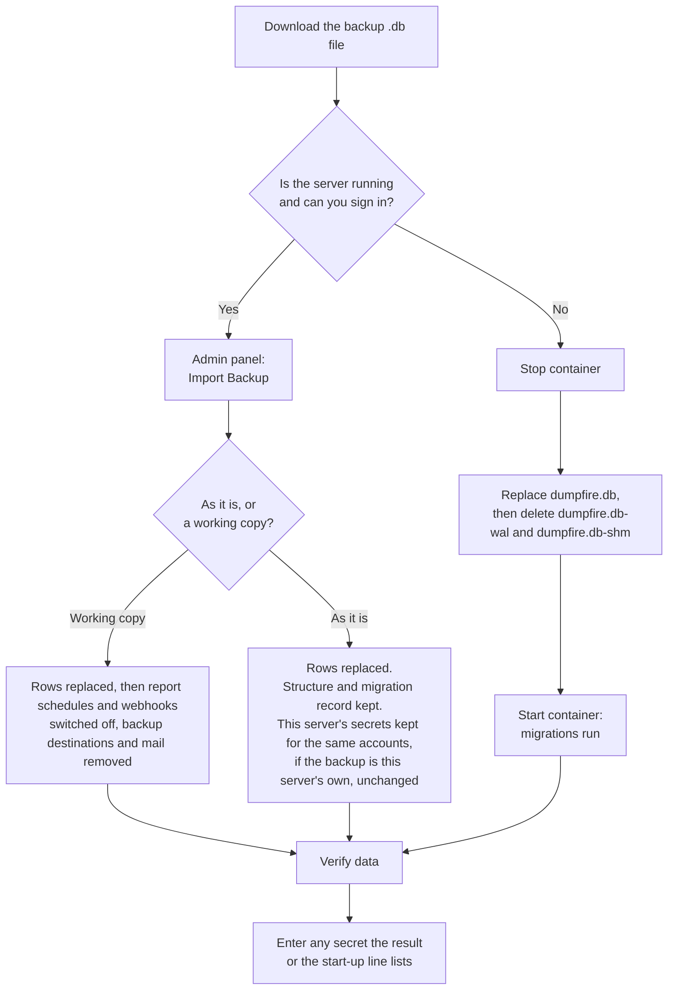

**In the application** (Admin → Backup & Restore → **Import Backup**, as the superadmin). No restart is needed. Choose the file first; the dialog then names it and asks for your password and a code, and the file is uploaded only once the password is accepted, at once (card 2701): see [The import confirms first](#your-password-asked-again).

On a server that still runs, restore this way, not by hand: it keeps this server's secrets, which a file put in place by hand cannot. Nine things are true of every import, whichever way it is restored:

- **The system log is kept as it was, and none of the backup's log lines come in** (card 2899). The system log is this server's record of what was done to it, and by whom, so an import no longer replaces it: every line written before the import, those written since the backup was made included, is still there afterwards, word for word, and an edited backup cannot put its own lines in their place. The backup's log stays in the file, where it can be read with `sqlite3 <file> "SELECT * FROM system_logs"`. Once the import is committed it writes one `[CRITICAL] [IMPORT]` line: `The database was replaced from an uploaded backup by chief (user 1 before the import): 2048.0 KB, SHA-256 <64 hex digits>, a backup this server made that nobody has changed, restored as it is. The system log was kept as it was; the backup's 4210 log line(s), 2026-10-01 00:00:00 to 2026-11-17 09:12:44, were not brought in and remain in the file.` The SHA-256 is the file's fingerprint (`Get-FileHash -Algorithm SHA256 <file>` or `sha256sum <file>`), so a backup held anywhere can be matched to the import. The middle part says `not a backup this server sealed` for a file with no seal this server can check, `a backup whose seal does not check out: changed since, or sealed by another server` for one changed since, or made elsewhere, and `a backup this server could not check, as it has no key to check a seal with` on a server that has never made a backup; the end says `restored as a working copy` for that choice. The log's first and last times are given only where both are real times; otherwise the line says `at times in no form this build reads`, and nothing the backup's log holds is ever quoted. A log in the file that cannot be read at all is said to be one `which could not be counted`, and the import goes ahead. The name and id are the account's as it was before the import, and the line has no user of its own, since after the import that id may be someone else's; its details give the address the import came from, and the check a damaged file failed. The line is written first, as soon as the restore commits: if anything fails after it, a second `CRITICAL` line says `Database restore committed, and then failed: …`, and the page says the backup was restored and committed. An import that changed nothing ends the line it writes with `(import by chief, user 1)`, with the account and address on the line: a file that is not a SQLite database and a backup with users and no superadmin each write one `[WARN] [IMPORT] Import refused: …` line, and a file that fails before the restore begins writes `[CRITICAL] [IMPORT] Database restore failed: …`. The result says the same of the log, last: "The system log was kept as it was: the backup's 4210 log line(s) were not brought in, and remain in the backup file." **A line's user after an import** is the account that had that id when the line was written; the restored data may give that id to someone else, and the Audit page's Live Console labels a line by today's account with that id, so read the name in the line's text.

- **It signs everybody out, you included.** No session is restored, whatever the backup holds, and the ones there were are cleared with everything else. When the result is dismissed the page reloads at the login page: sign in with an account the backup has, and its password as it was when the backup was made, or, where it was changed on this server since, the one it has now (card 2997). From a backup whose seal does not check out, only an account that is the same account here signs in with a password, the one it has on this server; where you are not in such a backup as the same account, its superadmin was given your own password and authenticators, so sign in as it with your password and a code from your authenticator (card 3009, below). The result names the backup's superadmin, which is the account that can export, import or reset again. Invites that had not been used stop working, and are sent again from User Management. Every browser remembered for sign-in is forgotten too, since no backup holds the key they are signed with: each is remembered again at its next sign-in.
- **Every request link mailed before it stops working** (cards 2158 and 2870). Every task request's links are ended, whatever the backup holds, and none is brought in; the result says so, counting the requests restored: "N request link(s) replaced: a link mailed before this restore no longer works, and its requester can have a new one sent from the page it opens." A requester who opens an old link is asked for the address they made the request with, and a new link is mailed to that address, if mail is set up here with its password; the next team reply or progress mail brings one by itself too. Until it is, the requester is told "New links cannot be sent just now. Please contact the team that sent you the link.", and the reason is a `[WARN] [REQUESTS]` line on the Live Console. The result shows the line about the links on the page too, below the files put back. The key the public request form signs with is not brought in either: a form open during the import fails once, and works when it is reloaded.
- **A backup made before card 2772's update gives its API keys this server's deadline.** Each of its keys with no expiry, or one later than the deadline, is given the date this server's keys were given (or, on a server that has none, the restore's own moment, so those keys end at once), as the update did here. The result says so after the request links' line, and on the page: "N API key(s) from before two-step sign-in were given this server's deadline, *date time* UTC." Their holders keep each with **Keep this key**, as in [The Release That Gives Older API Keys a Deadline](#the-release-that-gives-older-api-keys-a-deadline). A backup made since that update is restored as it is: a key kept there stays kept.
- **Every personal decision link stops working** (card 2675). Each one a decision participant held is cancelled, whatever the backup holds, and recorded on its decision where that decision has been opened. The result says how many (card 2697), after the request links' line and on the page too: "N personal decision link(s) cancelled: a link mailed before this restore no longer works, and the decision's author, decider or an administrator can send its holder a new one with Resend." It says so also when the restore committed and then failed; with none cancelled, there is no line. A backup that holds a decision's record with a row that cannot be copied is refused, naming the tables, and nothing is changed: half a record would be a false one.
- **This server's secrets are kept where they are for the same account, from a backup this server made and nobody has changed** (card 2169). A backup holds no mail password, destination credential or webhook secret, so the restore fills each gap from this server, in the same transaction, but only when the backup's seal checks out: every backup carries a check of every row in it, made with a key this server keeps and no backup holds, and the restore makes it again with its own key. A backup made by another server, or changed since it was made in anything a restore brings in (one user added, one card edited, an index added, ANALYZE run on it), has nothing filled and every gap listed. The check leaves out only what a restore never brings in: SQLite's hidden row numbers in a table that does not show them as a column (their order is checked), its AUTOINCREMENT counters, the file's header and its free space; so a change there changes nothing restored. The check covers the file's whole structure, SQLite's own objects and statistics included, and the restore copies each table's rows as stored, the same rows the check was made over. A file that fails SQLite's own integrity check, or holds an object named as SQLite's own that no backup of this server's holds, is treated as changed before the seal is even asked: the restore goes ahead, nothing is filled, and the system log has one `WARN` line naming the check it failed. When the seal checks out, the restore fills:
  - the mail password, when the backup's mail host (spaces and tabs at either end, and capitals A to Z, aside), port, "Allow mail without a checked, encrypted connection" and user name are all this server's, a port not set read as 587 and the box not set as off (card 2189: a backup made before it has no such setting);
  - a destination's credentials, from the one destination here of the same type that is the same in every other field, its name, host, bucket, folder or path included, compared as the destination would use them (the rule a save keeps a masked secret by: see [Configuring Backups](#configuring-backups)). None that matches, or more than one, and nothing is filled: a backup is not trusted to say where this server's credentials are used. A Google Drive token filled in brings this server's record of the scope it was granted, and an SFTP destination takes the host key confirmed here, never the backup's (card 2250): one not filled comes in with no key, to be confirmed with Test;
  - a webhook's secret, from the webhook here with the same id, board, address and setter (the account that last set its address or secret, or switched it on, card 2168; none and none alike), and the webhook is switched on or off as it was when the backup was made. A secret here set by another account since the backup is not filled, and the webhook is listed to enter again, as one whose address has changed is.

  **A restore never brings back an API key that was revoked or ended here** (card 2995). Every revoke, every ending that ends an account's keys (an administrator's password set, an invite used, your own change that ends your keys, a two-step reset in the app or on the host, a disable, a delete) and Reset Everything records the key's id and the fingerprint it is checked by, never the key. The record is this server's, as the system log is: an import never clears it, and leaves out of the restored data every key it names, whichever server made the backup and whichever way it is restored. Only a backup this server sealed adds its own record to it; one whose seal does not check out adds nothing (card 3013, below). Keys this server no longer held when the update that brought the record in first started are recorded by their id, up to the highest key number it had issued, so a backup made before that update brings none of them back either, a key that an earlier import removed included. The result says how many: "N API key(s) in the backup were left out, because each was revoked or ended on this server, was gone from it before endings were recorded, or is named by the record of ended keys of a backup imported here before, another server's among them: none of them works, and their holders make new ones on the Account page." The last case is the record failing closed: once another server's record of ended keys has been added here (by a release before card 3013, which added an unchecked backup's record), it stays here, and a later import can leave out a key of this server's that only shares an id with one that server ended; it is counted, and made again in a minute. The `[CRITICAL] [IMPORT]` line ends its first sentence `restored as it is, leaving out N API key(s) ended on this server`, its details naming them by id and no account. Their holders make new keys on the Account page. What such a key set up, or was given the secret of, is held as it is when a key is revoked. A key made here after the backup was made is not in it and is gone after the import, as before: it was not ended, so importing a newer backup brings it back. **A restore onto another server cannot know of keys ended on that other server after the backup was made**: it applies its own record, nothing else, since that server's backup never checks out there and adds none of its record (card 3013). And a key ended before the update that brought the record in, whose fingerprint this server never saw, can come back if someone edits an old backup to move it to a key number the record does not name: only the superadmin can import, and the import's line names the file's SHA-256. Should a key the record names ever be found in place all the same (an older image's import, a hand edit), every check of a key refuses it, and the next start, or the sweep within five minutes, ends it as a revoke does, with one `[WARN] [AUTH]` line naming it by id.

  **A restore never brings back an account deleted, disabled or demoted here** (card 2996). Every delete, disable, enable and role change of an account, the role it was made with, and Reset Everything's disable of every account but the superadmin, are recorded by the account's number and creation time; a delete also by a fingerprint of the password hash it held. The record is this server's: an import never clears it, and only a backup this server sealed adds its own to it, within the backup's own bounds, never taking a row that would end or lower a superadmin; one whose seal does not check out adds nothing (card 3013, below). Accounts this server no longer held when the update that brought the record in first started are recorded by their number, up to the highest it had issued. On every import, as it is or as a working copy:

  - an account the record names as **deleted** comes back disabled by the superadmin, with no password or second factor that works, and cannot be enabled: delete it again on the Users page, then make a new account for anyone who returns;
  - an account that shares a number with one this server had **before it recorded endings** (or held, just before the import, with a later creation time) comes back disabled with no password that works: if it should stay, the superadmin enables it and sends it an invite;
  - an account the record keeps **disabled** stays disabled, by the superadmin; a backup can add a disable to an account, never lift one made here;
  - an account above the **role** the record holds is given back that lower role, and the webhooks it could read and no longer can are held.

  None of them gets the backup's second factors, and none is named in the result's second-factor lines. What the account could send out goes as when it is ended here: its API keys are left out and counted, its webhooks switched off or held, its report schedules paused, and the settings it set and its address in the backup failure address go once the import is done (those `WARN` lines name the setter, as they always have). The result counts them and names nobody, one line for each kind there was: "N account(s) in the backup are named as deleted by the record of account endings: each is kept disabled, with no password or second factor that works, and cannot be enabled again. Delete each on the Users page before making a new account for anyone who returns: its username and email address would otherwise block the new one.", "N account(s) in the backup share a number with an account this server had before it recorded account endings: …", "N account(s) in the backup are kept disabled, as the record of account endings says." and "N account(s) in the backup were given back the lower role the record of account endings holds." The `[CRITICAL] [IMPORT]` line says `restored as it is, keeping N account(s) ended or lowered as the record of account endings says`, with the counts in its details and no account. **A restore onto another server applies its own record, nothing else**: that server's backup never checks out there, so its record is not taken (card 3013), and it cannot know of accounts ended on that other server after the backup was made. An account found otherwise all the same (an older image's import, a host edit) is ended again at the next start, or within five minutes, with one `[WARN] [AUTH]` line of counts.

  **A restore never brings back a password replaced here** (card 2997). Every password change, your own on the Account page, an administrator's 🔑, an invite used and Reset Everything, records a fingerprint of the password hash it replaces (never the hash, and not something a password can be checked against) in the same record of account endings, which no import clears. On every import, of this server's backups or another's, as it is or as a working copy, an account whose password in the backup is one the record names as replaced:

  - **that is the same account here** (the same number and creation time) keeps the password it has on this server, and the one in the backup does not work; it keeps this server's second factors, as the same account always does;
  - **that is not here as the same account**, or holds here a password that cannot be given back (one nothing matches, or one the record names too), is given a password nothing matches and no leave to set up two-step sign-in on it; its API keys are left out and counted, what they could read is held, and its report schedules are paused, as a reset does; and it needs its password set (🔑) or an invite (📧) before it can sign in. It is not disabled: nothing says it was ended;
  - **that is a superadmin** is never left unable to sign in. The same account here keeps the password it has here, even one the record names too. A superadmin not here keeps the backup's password, unless you, importing, are the same superadmin here with a password that works: then it is given one nothing matches wherever any account's replaced password is the one it holds, as any other account is. A superadmin given one nothing matches can sign in again only once another superadmin sets its password (🔑): no invite is sent for a superadmin. Sign in as a superadmin left with such a password and change it on the Account page at once.

  A backup whose seal does not check out (made by another server, changed since, or this server's own made before Reset Everything, before the database was lost, or before card 2943's key) is trusted less: every account in it that is the same account here keeps the password it has on this server, whatever the backup holds and whatever the record says, and every account in it that is not takes no password from it at all (card 3009, below). The result counts them and names nobody, one line for each kind there was: "N account(s) in the backup hold a password that was changed on this server after the backup was made, or, where the backup's seal did not verify, any other than the one each has on this server: each keeps the password it has on this server, and the one in the backup does not work.", "N account(s) in the backup hold a password that was replaced on this server, or, where the backup's seal did not verify, any other than the one each has on this server, and have no password on this server that can be given back to them: none of those passwords works, and each account needs its password set (🔑) or an invite (📧; for a superadmin, 🔑 by another superadmin) before it can sign in." and "N superadmin account(s) were left with a password that was replaced on this server, or, where the backup's seal did not verify, one other than this server's, so that a superadmin can still sign in: sign in and change it on the Account page at once." The `[CRITICAL] [IMPORT]` line says `keeping N of the backup's password(s) out of use` and `leaving N superadmin account(s) with a password to change at once`, each only where there was any, with the counts in its details and no account. A restore that committed and then failed says the same. Should such a password be found in place all the same (an older image's import, a host file rollback, a host edit), a sign-in with it is answered as a wrong password, no session is made with it, and the password asked again before an action refuses it the same way; the next start, or the sweep within five minutes, gives the account a password nothing matches and signs it out, with one `[WARN] [AUTH]` line of counts. A superadmin is never refused or changed this way: a `[WARN] [AUTH]` line at every start and sweep asks for its password to be changed, until it is.

  **What it cannot catch.** A password changed before the release that brought this in was never fingerprinted, so a backup made before that change can still bring it back: after restoring such a backup, reset those accounts' passwords as before. A backup whose seal does not check out no longer gives an account that is not here any password it holds (card 3009, below, with what that cannot catch). A forged backup's rows naming passwords in use here as replaced are no longer taken: a backup whose seal does not check out adds nothing to the record (card 3013, below), and a backup this server sealed cannot be forged without its seal key.

  **A backup whose seal does not check out gives nothing that signs in to an account that is not the same account here** (card 3009). Such a file is only the uploader's word: another server's backup, an edited one, one made before seals, or this server's own made before the backup seal key was made anew (card 2943). Every backup made since card 3009 carries this installation's id (32 hex characters, not secret, never brought in by a restore), so an account is **the same account here** when it has the same number and creation time and either the backup is sealed by this server, or it carries this installation's id, or it carries none (made before card 3009) and the username is exactly the same. A backup carrying another installation's id has no account that is the same here. From such a file, as it is or as a working copy:

  - **an account that is not the same here** takes no password, second factor or API key from it: it is given a password nothing matches and no leave to set up two-step sign-in, its report schedules are paused (switched off with every other on a working copy), whatever password the file holds for it, a password nothing matches included, and it stays enabled, needing 🔑 or 📧. Its keys are left out and counted, never recorded as ended here (they never were this server's);
  - **no invite of the file** is restored at all, and from a backup this server sealed only used ones, as history, written used whatever the file says (its code review, FP1): no invite from a file can set anybody's password;
  - **an account that is the same here** keeps this server's password, factors and keys, and a key it keeps takes the earlier of this server's and the backup's expiry and deadline, so a key expired here never comes back working; a key the backup holds that this server did not hold (the same id, fingerprint and owner) is left out, an account here or not;
  - **a superadmin of this server that is the same account here** is a superadmin after the import, whatever the file says of it, disabled only where it is disabled here; since card 3013, every account of this server's number and creation time takes this server's role, so no file raises one (below);
  - **the backup's superadmin, where you are not in the backup as the same account and nobody can sign in as the superadmin afterwards**: the lowest-numbered enabled superadmin of the file that is not the same here is given your own password, your authenticators sealed again for it (not your recovery codes), your leave to set up two-step sign-in on your password alone in place of the file's, and your email address, always: any other account in the backup holding that address is given one that receives no mail (`email-given-up-<id>@restore.invalid`), counted, and needs its own set on the Users page (its code review, FP5, FP6). Its report schedules, the file's, are paused. Every other such superadmin gets a password nothing matches. Sign in as it, the superadmin that now holds your email address, with your password and a code from your authenticator. Where no MFA key is loaded, or none of your authenticators could be moved, it signs in only once it has set up an authenticator on that password (where you held that leave and its 14 days still run), or once the host has run `scripts/mfa-reset.mjs` for it. Where you, or any other superadmin of this server restored as the same account, enabled and holding a password of this server's, can sign in afterwards, or none of them is enabled, or the import was not by an account this server held, every such superadmin gets a password nothing matches. Where nobody on this server had a second factor (a backup made before two-step sign-in), your authenticators are the first, and the result says that every other account now needs one (FP12);
  - **the mail settings, the App URL and new backup destinations** are held for review, when restored as it is (see [Settings Held for Review](#settings-held-for-review-card-2922)); a working copy removes them, the App URL included;
  - **every webhook of the file that has an address** is switched off for good and its secret discarded, whatever the file says of it, as it is or as a working copy (card 3012): its address, secret and setter are only the file's word. It sends nothing until an owner of its board or an administrator switches it on with `PUT /api/v1/webhooks/{id}` and `{"active": true}` alone, which makes them its setter and gives it a new secret, given in that answer; a secret sent with it is refused. Put the new secret in at its receiver. Delete it instead unless you recognise the address. A webhook with no address that was on is switched off and listed to enter, as before (from a backup made before card 2923's release it is then held too, as every webhook already off is: switching it on gives it a new secret). Where this server holds the same webhook, held, with the same address, it keeps this server's reason. The restore's notice of the webhooks it switched off or held is written to the log at `WARN` and mailed to nobody;
  - **every report schedule that was on** is paused, when restored as it is (a working copy switches every one off already): each owner turns one on again on the **Reports** page, with their password and a code;
  - **an account that is the same here** keeps the email address and notification choices it has on this server; any other account of the file holding one of those addresses (in any case) is given one that receives no mail (`email-given-up-<id>@restore.invalid`), as is every account not the same here that shares an address with a lower-numbered one apart from case, and any account not the same here whose address the file put under `@restore.invalid` (with a code of the restore's in it): set each one's address on the Users page before inviting it;
  - **every account not the same here**, the superadmin given your password included, has its notification mail switched off, its other choices kept, until its holder signs in and switches it on (Account page). It keeps the file's email address (card 3021, below);
  - **the backup failure mail** goes to this server's address (Scheduled Backups), not the backup's, or to none where this server has none;
  - **the mail's From Address and From Name** are this server's, exactly as they were, not the backup's, or none where this server had none (card 3029), restored as it is; a working copy removes them with the rest of the mail settings. Where none is left (a move to a server whose mail was not set up), set both under 📧 Email / SMTP before anything is mailed: until then a mail goes with no From and the envelope `MAIL FROM:<>`, which most mail servers refuse;
  - **every task request with an address that this server did not hold as it is** has its mail to the requester held, as it is or as a working copy (card 3020): the same request here means the same id, made at the same moment, with the same title, requester address, requester account, status and card, the card with the same title and creation and on the same board, and the requester's account the same here. A held request is sent no progress mail, completion report, accept or decline, reply or new link until an administrator releases it under **Mail held** in the Requests inbox ([Mail Held in the Requests Inbox](#mail-held-in-the-requests-inbox-card-3020)). An unconfirmed one cannot be released and lapses 7 days after it was made. A request this server held as it is keeps this server's hold, or none; the file's own hold text is never taken;
  - **every person in the people directory whose address and account this server did not hold** (the same id, the same address, the same account, and that account the same here), or whose status in the file is neither active nor left, is marked **Left** at the moment of the restore, and one this server has as left stays left with this server's date (card 3020). Each is recorded in the people change record by DumpFire, source `restore`, with no address. A person who has left is mailed nothing about a decision, so their places on decisions are mailed nothing; nothing in the decisions' records is rewritten. Check each address, then **Mark active**, with your password and a code ([People](#people)).

  The result counts them and names nobody: "N account(s) in the backup are not on this server as the same account, and the backup's seal did not verify, so the password each holds in it was not taken: each needs its password set (🔑) or an invite (📧) before it can sign in, and its report schedules were paused. The backup's App URL and mail host, where they differ from this server's, are held for review. Before sending an invite, check each one's email address and role, and the App URL and the mail host: in a backup whose seal did not verify they are only the file's word. Or set its password with 🔑, which mails nothing." (as a working copy: "… each needs its password set (🔑) before it can sign in. As a working copy, every report schedule was switched off, and the mail settings and the backup's App URL were removed, so no invite can be mailed. …"), "The backup's superadmin is not the account you imported with, and the backup's seal did not verify, so its password in the backup was not taken: it was given the password you confirmed this import with, and your authenticators. Sign in as it, the superadmin that now holds your email address, …" (never a username, which is the file's text), "N API key(s) in the backup were left out, because the backup's seal did not verify and this server did not hold them for the same account: …" and the held settings' line. The `[CRITICAL] [IMPORT]` line counts them among `keeping N of the backup's password(s) out of use`, adds `giving the backup's superadmin the importing account's password` and `N API key(s) of a backup whose seal did not verify`, and its details say only whether the backup's installation id is this one's (`this`, `other` or `none`), never the id. **Check each account's email address and role, and the App URL and mail host, before sending any invite**: in such a file they are only its word, and 🔑 mails nothing. The 📧 confirm now names the address it will send to, "Send {username} a new invite, to {address}? …", with any control, direction or invisible character shown as a space (card 3012).

  What it kept from reaching outside (card 3012) is counted in one more sentence, each part only where there was any: "The backup's seal did not verify, so what it would send outside was not taken as the file has it: N webhook(s) with an address were held and their secrets discarded: each sends nothing until an owner of its board or an administrator switches it on, which gives it a new secret; N report schedule(s) were paused: each owner turns one on again on the Reports page; N account(s) that are the same here keep the email address and notification choices they have on this server; N other account(s) that held one of those addresses were given one that receives no mail: set each one's address on the Users page before inviting it; N account(s) not the same here have their notification mail switched off until each signs in and switches it on; N request(s) came in with a requester or card this server did not hold as it is: mail to each requester, links and completion reports included, is held until an administrator releases it under Mail held in the Requests inbox; N unconfirmed request(s) were held too: they cannot be released, and lapse 7 days after they were made; N person(s) in the people directory were marked left, as this server did not hold their address and account, or has them as left, so N place(s) on decisions are mailed nothing: an administrator marks each active on the People page, with a password and a code, once the address is checked; mail goes out under this server's From address and name, not the backup's, or under none where this server had none; and the backup failure mail goes to this server's address, not the backup's." (card 3020 added the requests and people clauses, card 3029 the From). The webhooks held are also named by id and board in the "To enter again" line, as switched off for good. The `[CRITICAL] [IMPORT]` line adds `keeping what a backup whose seal did not verify would send outside: …` with the same counts (card 3020's as `N request(s)' requester mail held`, `N unconfirmed request(s) held`, `N person(s) marked left` and `N place(s) on decisions mailed nothing`, and card 3029's as `the mail's From address and name kept as on this server`), and no username, address, host, schedule name, request title, person's name or id.

  **What it cannot catch** (card 3009). A backup that carries no installation id (made before card 3009) is matched by number, creation time and username, so two servers built by one script, with the same usernames made in the same seconds, are taken for each other. A superadmin renamed since such a backup was made is not the same account in an unsealed restore of it, and needs the host's `scripts/mfa-reset.mjs`. A password of the same account that differs from this server's is counted with card 2997's lines above, and an account not the same here with card 3009's, apart. And a backup of a copy of this server's volume or host file (the same seal key and installation id) checks out as this server's own: see [Deployment](deployment.md#moving-to-a-new-host). Card 3012 does not cover invites and notices to an account not the same here, which still go to the file's address (card 3021): check those addresses before anything mails them. A request's requester and the people of such a file are card 3020's (above); a backup made before card 2095 normalised timestamps holds older-form creation times, so its first unsealed restore holds those requests too, which fails closed: review and release them. Webhooks and schedules switched off or deleted here coming back from a sealed backup are card 3004's, and board or team access an unsealed file grants is card 3002's.

  **A backup whose seal does not check out adds nothing to this server's records of endings, and changes no account here** (card 3013). Anyone holding a backup holds every account's number, creation time and password fingerprint, and every key's, so such a file could plant endings that reset or end every account and key here, and a later restore of a genuine backup would apply them again; it could also make an account that is the same here a superadmin, which then signed in with its own password. From such a file, as it is or as a working copy:

  - **neither record takes a row from it**: its record of account endings and its record of ended API keys are counted and not added, and neither id counter moves on its word;
  - **no safety entry is written from it**: an account it makes inert or disabled is ended for this restore, but no `deleted`, `disabled` or `password` row is written from the password the file chose; one this server's own record names is ended again at the next start;
  - **only keys this server held are recorded**: where an account of the file is ended, the keys this server held for that same account (the same id, fingerprint and owner) go on the record of ended keys; every other key is deleted unrecorded, and no planted key's fingerprint is recorded (card 3014);
  - **every account of this server's number and creation time takes this server's role and enabled or disabled state exactly**, a superadmin's included, so no file raises or lowers an account here, nor leaves a disable for a later genuine restore to carry; where that leaves no enabled superadmin, the import is refused and nothing changes;
  - **an account is judged by this server's password where it is the same here**, and by none where it is not, and only this server's superadmins are spared the record's rows; a disable here is carried only where this server's record attests it.

  On every restore, sealed or not, an account counts as one this server held with a later creation time only where this server's record holds a row for it. The result counts what was put back and not taken, and names nobody, each sentence only where its count is above 0: "N account(s) in the backup that are on this server took the role and the enabled or disabled state they have here, not the backup's: the backup's seal did not verify, so neither is taken from it." and "The backup's seal did not verify, so its record of N account ending(s) and of M ended API key(s) was not added to this server's: a file this server cannot check ends no account and no key here, and this server's own records are kept as they were." The panel shows both. The `[CRITICAL] [IMPORT]` line adds `giving N account(s) this server's role and enabled or disabled state` and `adding none of the backup's N account ending(s) and M ended API key(s) to this server's records, as its seal did not verify`, its details carrying `accountStateAsHere` and `recordsNotTaken: { accountEndings, keyRevocations }`. None of it is a problem: an import of this server's own backup made before Reset Everything reads as a clean restore, with nothing in its list of problems.

  **What it cannot catch** (card 3013). A move by import onto another server brings neither record, and nor does a restore of this server's own backup onto a database rebuilt after a loss, since the seal key went with the old database: both records start empty, and, by card 3009, no password, second factor or key that signs in comes back. Move the host instead where you can ([Moving to a New Host](deployment.md#moving-to-a-new-host)). An older backup of another server brings its ended accounts back enabled but unable to sign in, with the file's role: check each before inviting it. And an account an unchecked restore disabled only because this server held its number with a later creation time is left disabled with a password nothing matches, and nothing re-asserts it: an administrator could enable it and set a password, deliberately.

  **A restore never brings back board, team or person access removed here** (card 3002). Every change of who may open a board (adding or removing a member, changing a role, sharing it with a team or taking the share away, making it public or private, and its creator), of who is in a team, of a board's Product Owner, and of the account a person in the people directory is linked to, is recorded by the identity of each side (number and creation time), never a name. The record is this server's: an import never clears it, and only a backup this server sealed adds its own rows to it, rows that can narrow access and never lift it. On every import, as it is or as a working copy:

  - a member or share removed here since the backup is left out, and a role lowered here is given back the lower role;
  - a board made private here stays private; a Product Owner or creator replaced here is cleared, never replaced (set the Product Owner again on the board's Share window if needed);
  - a person unlinked here stays unlinked, from a backup this server sealed;
  - a team deleted here comes back, but without the members and board shares it had then: delete it again on the Teams page if it is not wanted. A member added after it came back stays;
  - access this server holds when the import runs is never taken away on a guess: a member row with no record of its own (made on an older image, or by a host edit) is kept at the access it has here, and is left out only where the backup holds it and this server did not.

  **From a backup whose seal does not check out**, who may open what is not taken from the file: every account that is the same here gets exactly the board and team access it has here, none on the boards and teams this server does not hold, and those boards come back private, open to administrators only until shared again. A person's account link is kept only where both the person and the account are the same here; a person whose link the file changed has this server's link back and stays marked **Left** until an administrator marks them active, with a password and a code. Nothing of the file's record of access changes is added.

  The result counts each kind and names nobody, each sentence only where there was any: "N board or team membership(s) and share(s) in the backup were removed on this server after it was made, and are left out.", "N role(s) on boards and teams were given back the lower role they have on this server.", "N board(s) made private on this server after the backup stay private.", "N board(s) keep no Product Owner, and N no recorded creator, as this server's record of access says …", "N team(s) deleted on this server came back without the members and boards they had then …", "N person(s) unlinked from an account on this server since the backup stay unlinked." and, from a backup whose seal does not check out, "The backup's seal did not verify, so who may open what is not taken from it: …". The `[CRITICAL] [IMPORT]` line says `keeping N access change(s) made on this server` and, unchecked, `giving N board(s), team(s) and person(s) this server's access`, with the counts in its details. The next start, and every five minutes, lowers again any recorded access found above its record (an older image's import, a host edit), with one `[WARN] [AUTH]` line of counts.

  **What it cannot catch** (card 3002). Boards and teams deleted before the update that brought the record in are not recorded, and come back whole, with the access they had, from an older backup that holds them; so does a board whose creator's creation time, or a person whose linked account's, does not read as a moment. A board, team or person whose own creation time does not read is given the restore's moment by the restore that brings it, with one line counting them, and is recorded from then on. Access changed by a host edit, or while an older version ran, is not recorded either: send it again from the Share window or the team's page to record it.

  **A restore never brings back a decision role removed here** (card 3033). The same record holds every change of a decision's participants, of the account each place holds and of its decider. On every import, as it is or as a working copy, from a backup this server sealed:

  - a participant taken off a decision here since the backup stays off it (on a draft the place is deleted again where nothing names it), and one made informed stays informed;
  - an account taken off a place stays off it: attach it again in the Delivery panel if needed;
  - a decider replaced here is cleared, its name kept; the author, a board owner or an administrator names one again, except on a decision that supersedes another or has no board, which cannot be given one: withdraw it if it is not wanted;
  - a decision deleted here comes back with no author, decider or participants: delete it again if it is not wanted. A participant or decider added after it came back stays;
  - a role this server holds when the import runs is never taken away on a guess.

  **From a backup whose seal does not check out**, no decision role is taken from the file. Every decision this server holds keeps its board, its stage (a decision past its draft is never sent back to one, and a draft is never opened by the file), its author, decider and participants exactly as here; a place the file adds is taken off it. Where the file changes the decision's board itself (its creation time, say), so that the board is no longer the same one here, the decision comes in with no board and, as one this server does not hold, with no author or decider account: their names are kept, and an administrator names a decider again or withdraws it. Every decision this server does not hold comes in with no board, no account on it and nobody on it, so only an administrator can open it (withdrawing it mails nobody). No ruling's Product Owner is taken from the file: each ruling keeps this server's, or none. On boards this server does not hold, member rows, creators and Product Owners naming an account the backup does not bring are cleared, and no account made later can take a number a restored row names. On every import, a restored account number that is not a whole number from 1 to 2^53 - 1 is cleared (its row left out where the row cannot be without it), with one line counting them: "N restored account number(s) that are not a whole number from 1 to 2^53 - 1 were cleared, or their rows left out where one is needed, so that no account made here can take them."

  The result adds, each only where there was any: "N place(s) on decisions removed on this server after the backup was made stay removed.", "N participant(s) made informed on this server stay informed.", "N account(s) taken off a place on a decision on this server stay off it: …", "N decision(s) keep no decider, as this server's record says: …", "N decision(s) keep no decider and cannot be given one here, …", "N decision(s) deleted on this server came back with no author, decider or participants: …" and, unchecked, "… and of the decisions in it, N this server holds kept their board, stage, author, decider and participants as here, and N it does not hold came in with no board, no account and nobody on them." The `[CRITICAL] [IMPORT]` line counts them among the access changes kept and, unchecked, says `N decision(s) no role this server did not give`. Counts only, naming no decision or person. The next start, and every five minutes, lowers again any recorded role found above its record.

  **What it cannot catch** (card 3033). Decisions made, and roles changed, while an older version ran or by a host edit are not recorded: make each removal again on this release. A decision whose creation time does not read as a moment is matched by its number alone while any row of the record has that number, and is not tracked otherwise.

  **A restore never brings back where this server stopped sending** (card 3004). Every change of where this server sends is recorded by identity, never as a name or an address in plain: a webhook (by its number and creation time, its address as a keyed digest) made, switched off or on, given another address, held by an ending, or deleted on its own or with its board; a report schedule made, switched off or on, paused by an ending, or deleted on its own, with its board or with its account, and each address added to it or taken off it (a keyed digest); and a backup destination, the mail server and the App URL set, moved, held or removed (by place). The record is this server's: an import and Reset Everything keep it, and only a backup this server sealed adds its own rows to it, rows that can close and never open. On every import, as it is or as a working copy:

  - **nothing comes back more open than this server holds it**: a webhook or schedule switched off here stays off, a webhook held here stays held with this server's reason whatever address or setter the backup gives it, and an address not on a schedule here is left off it;
  - **a webhook deleted here** (on its own or with its board) comes back switched off for good, its secret discarded: "This was switched off because it was deleted on this server after the backup it came back from was made." Delete it again, or switch it on with your own key, which gives it a new secret;
  - **a webhook pointed elsewhere here** comes back switched off for good the same way ("… because it was pointed elsewhere on this server after the backup it came back from was made."); so does every webhook held here with an address when no MFA key is loaded, as its address cannot then be compared;
  - **a schedule deleted here** comes back paused, and **an address taken off a schedule here** stays off it; the schedule's owner turns it on again, or adds the address again, with a password and a code;
  - **a destination, the mail server or the App URL removed or moved here** comes back held for review under Settings held for review, "removed here" (see [Settings Held for Review](#settings-held-for-review-card-2922)); one held here by an ending comes back held as "setter access ended";
  - **from this server's own backup** (its seal verified), a webhook, schedule, destination, mail server or App URL that the record has never named and this server does not hold is taken as removed: switched off for good, paused or held, "not in this server's record". The addresses on a schedule are never taken off on a guess;
  - **an account the restore itself signs out**, because its password was replaced here, has the webhooks it set, and those whose secret it could read as the board's owner or an administrator, held as "setter access ended", and the settings it set held for review, as a real password reset holds them, from the backup's record of who set what and from this server's.

  The mail settings, the backup configuration and the App URL are read only as text (card 3031): a backup that holds one as raw bytes has it left out (a number is written as its text), with one line in the list of problems naming the keys and never the values, and no mail, backup run or link uses a value that is not text, here either.

  The result counts and names nothing, each sentence only where its count is above 0: "N webhook(s) deleted on this server after the backup was made came back switched off for good, their secrets discarded: delete them again, or switch one on with your own key to give it a new secret.", "N webhook(s) pointed elsewhere on this server since the backup was made came back switched off for good, their secrets discarded.", "N webhook(s) whose address could not be compared with this server's record (no MFA key is loaded, or it was replaced since the address was recorded) came back switched off for good, their secrets discarded.", "N webhook(s) and N report schedule(s) not in this server's record came back switched off or paused.", "N webhook(s) and N report schedule(s) switched off, paused or held on this server since the backup was made stay off.", "N report schedule(s) deleted on this server since the backup was made came back paused.", "N address(es) taken off report schedules on this server since the backup was made were left off.", "N report schedule(s) came back paused: addresses taken off them on this server were recorded under an MFA key since replaced, or none is loaded, so the addresses they came back with could not be compared.", "N report schedule(s) came back with more than 10 addresses: each was paused, and the N address(es) beyond the first 10 were left out.", "N setting(s) where this server sends (backup destinations, the mail settings or the App URL) removed, moved, held, or not in this server's record, are held for the superadmin's review under Settings held for review.", "N setting(s) set by accounts this restore signed out are held for the superadmin's review." and "N setting(s) where this server sends were not text in the backup, and were left out or read as text." From a backup whose seal does not check out, card 3013's sentence counts "N change(s) of where this server sends" among the rows not added. The `[CRITICAL] [IMPORT]` line adds `keeping N outbound change(s) made on this server`, and `holding N setting(s) set by accounts it signed out` and `leaving out or reading as text N outbound setting(s) that were not text` where any (and, apart, `holding N webhook(s) and pausing N report schedule(s) whose addresses could not be compared with this server's record` and `pausing N report schedule(s) over 10 addresses and leaving out N address(es)`), its details carrying `outboundKept`. The next start, and every five minutes, holds again any recorded webhook, schedule, address or setting found above its record (an older image's import, a host edit): webhooks told and mailed as an ending's are, the rest in one `[WARN] [BACKUP]` line of counts.

  **What it cannot catch** (card 3004). Changes made while an older version ran, or by a host edit, are not recorded: make each removal again on this release. A webhook or schedule deleted before this release is not in the record: from this server's own backup it comes back held or paused as "not in this server's record", and from a backup whose seal does not check out as card 3012 holds it. After the MFA key is replaced, the recorded addresses no longer match, so a restore holds those webhooks as "re-pointed here" (failing closed). The backup schedule, Keep Last, the backup failure mail's address and a schedule's status filter still come back as the backup has them (their own cards).

  **A restore keeps the webhooks and report schedules a reset switched off** (card 3004). A backup made before a password reset holds the account's webhooks and report schedules as they were then; since card 3004, restored as it is, a webhook the reset held stays held and a schedule it paused stays paused, as the record says. The account's API keys do not come back (above), and nor does the password the reset replaced (card 2997). From a backup whose seal does not check out, every webhook with an address comes back held and every schedule paused as well (card 3012, above).

  A value the backup has is never replaced, so a backup made before this change restores as it always did. Restored on the server it came from, nothing is to enter, unless a destination's name, folder, bucket or path, or the mail port or "Allow mail without a checked, encrypted connection", has been changed since the backup. The result adds up to two lines, only when there is something to say: "Kept from this server, because a backup does not hold them: …" and "To enter again, because a backup does not hold them: …", which names the mail password (Admin, 📧 Email / SMTP), each destination with what it needs (Admin, Scheduled Backups) and each webhook with its board. A restore brings in "Allow mail without a checked, encrypted connection" with the backup's other mail settings, with no password asked and no `WARN` line; where the backup's differs from this server's, the mail password is not kept and the line names the box: "the mail password (Admin, 📧 Email / SMTP, where the backup brought in "Allow mail without a checked, encrypted connection" ticked and this server had it unticked)", or "unticked and this server had it ticked". Look at the box before typing the password. For a backup whose seal did not check out, or whose file failed a check, the second line ends "None was kept from this server, because this backup was not made by this server, or was changed since."; for one with no seal this server can check (made before seals, or restored on a server that has never made a backup), it ends "None was kept from this server, because this backup carries no seal this server can check." A webhook named there stays switched off until the board's owner or an administrator sets its secret and switches it on with `PUT /api/v1/webhooks/{id}` and `{ "secret": "…", "active": true }`; one named as switched off for good (held because the backup's seal did not verify, card 3012) is switched on with `{ "active": true }` alone, which gives it a new secret and refuses one sent with it. The second line is also written to the system log at `WARN`, and from then on every start of the server writes one `[WARN] [STARTUP]` line while anything on it is still to enter.
- **Second factors are kept for the same accounts, and an account left without one is named** (card 2768). An account that is the same one here and in the backup (the same id and the same creation time, whatever its username now; from a backup whose seal does not check out, also carrying this installation's id, or, where it carries none, the same username: card 3009, above) keeps this server's second factors and recovery codes as they are, so a factor removed since the backup stays removed and a code used since stays used. Any other account gets the backup's only when the backup is this server's own, unchanged (its seal), and its factors were made with this server's key; otherwise it gets none. Every account's count of wrong codes and its pauses start again from nothing. Sign-ins waiting for a second factor and links to set up an authenticator are never brought in. Once two-step sign-in is in use (a factor exists after the restore, or the backup's were left out), the result names every account left with no second factor, on the page after the secrets' lines and in the log at `WARN`: "N account(s) have no second factor after this restore and each needs its two-step sign-in reset before it can sign in: ann, bob." From a backup whose seal does not check out, no account is named, the file's usernames being only its word (card 3009; its code review, FP7): the accounts that are the same here are counted, "N account(s) on this server have no second factor after this restore and each needs its two-step sign-in reset before it can sign in; the backup's seal did not verify, so none is named here.", and the others apart, "N account(s) in the backup are not on this server as the same account and have no second factor after this restore: each needs its two-step sign-in reset before it can sign in." When the backup's factors for any account were left out, it goes on to say why, in plain words: "Their second factors in the backup were left out because the backup was not made by this server, or was changed after it was made: bob." (or "because no MFA key is loaded on this server", or "because the backup was made under a different MFA key"). When any account's factors and codes were taken from the backup (an account this server never held, say: since card 2996 an account deleted, or disabled, here since the backup gets none of the backup's, and is named nowhere), it adds once: "Accounts brought back from the backup have their recovery codes as they were then; ask them to regenerate their codes." A code such an account used after the backup was made works again until it does. The result ends "See docs/admin-guide.md, Restoring from Backup." **What to do:** reset the two-step sign-in of each account named with 🛡️ (card 2773, see [Resetting Two-Step Sign-In](#resetting-two-step-sign-in); the superadmin's from the host), give its holder the link, and ask them to set up their authenticator again; ask each account brought back to regenerate its recovery codes. If you expected those accounts to keep their factors, check that the file is a backup this server made and nobody has changed, and that the server runs with the key the factors were made with (`MFA_KEY_FILE`: see [Deployment](deployment.md#the-key-that-protects-authenticator-secrets)). Until card 2769 lets accounts set up a second factor, nobody has one and the result says nothing about them.

  **Second factors, passwords and API keys survive a restore only onto the installation that made the backup.** The key a backup is sealed with belongs to the installation that made it and is in no backup, and so does its installation id. Restored onto a rebuilt server (a new volume, a new installation), a backup's seal does not check out and no account in it is the same account there, so every account in it is left with no second factor, **even when the server runs with the right MFA key**, and, since card 3009, with no password and no API key from it: each needs its two-step sign-in reset (card 2773) and its password set (🔑) or an invite (📧), and makes new keys; the restore counts them. The backup's superadmin is given the password and authenticators of whoever imported it (above). Plan a rebuild with that in mind: keep the database volume, with the MFA key file kept apart from it, if they are to survive (see [Moving to a New Host](deployment.md#moving-to-a-new-host)).

  **Backups made before the release that makes the backup seal key anew count as another server's** (card 2943). The first start of that release replaces the key this server seals its backups with, because the key before it was stored in plain and is in every whole copy of the database made before then. From then on, restoring a backup made before that start, even the one taken just before the update, works as restoring another server's backup does: everything is restored, but the mail password, each destination's credentials and each webhook's secret and address are listed to enter again, and accounts not the same here get no second factor, password or API key from it (card 3009). Such a backup carries no installation id either, so an account in it is the same here by its number, creation time and username: one renamed since needs 🔑 or 📧, and a superadmin renamed since the host's `scripts/mfa-reset.mjs`. Keep the mail password and the destinations' credentials to hand for that. Backups made after the start restore as before. The same happens again whenever the key is made anew: see [The Signing Keys Made Anew Once](authentication-security.md#the-signing-keys-made-anew-once-card-2943). Each time, the system log keeps one `CRITICAL` line beginning "Key change recorded", naming each key made and why. One is expected at a new installation's first start too, naming the backup seal key with "(none was stored)": that is the key being made, not a fault.
- **A backup with users and no superadmin among them is refused**, before anything is changed: "This backup has user accounts and none of them is the superadmin." Restoring it would leave nobody able to export, import or reset the database. A backup with no users at all is accepted: DumpFire then asks to be set up, and whoever does it is the superadmin. A backup that has a superadmin whose row cannot be copied is refused the same way, after the copy and before it is committed: the restore is rolled back and nothing is changed.
- **A backup that is too large says so.** See [When an Import Is Not Accepted](#when-an-import-is-not-accepted).
- **It takes a `.db` backup only.** The file picker offers `.db`, `.sqlite` and `.sqlite3` files, and the page refuses any other file itself, sending nothing. The JSON export DumpFire wrote in its first week, from 1 to 7 April 2026, is no longer imported: its import left twelve tables of the data it replaced in place, so that a live API key could then answer as an imported account. If such a file is ever wanted, import it into an empty installation of an image built before 14 October 2026 and export a `.db` from there.

The dialog asks how to restore, every time:

| Choice | For | What it does |
|--------|-----|--------------|
| **Restore everything as it is** | Putting this installation back | Backup destinations, report schedules, mail settings and webhooks come back as the backup has them. A backup holds no mail password, destination credential or webhook secret: the ones this server has for the same accounts are kept, and the result lists any to enter again; a webhook that had a secret stays off until it is set. From a backup whose seal does not check out, the mail settings, App URL and destinations at new places are held for review (card 3009). What was removed, moved or switched off on this server since the backup comes back held, paused or off (card 3004) |
| **Restore as a working copy** | A copy that must not reach outside: a development instance, a rehearsal, a look at older data | Report schedules and webhooks are switched off. The backup schedule is switched off and its destinations removed. The mail settings are removed. Every API key is left out (card 2995): no key of the backup works on the copy, and the result counts them; make new keys on the copy's Account page. Everything else is restored, users included |

A backup of production restored as it is into another instance is as able to email people, call webhooks and change the backup store as production is. That is what the working copy is for.

- **Which is preselected.** The working copy, when this instance's schedulers are off: under the development server, or with `SCHEDULERS=off`. Otherwise "as it is". Either can be chosen wherever the dialog opens.
- **It is part of the restore.** The switching off happens in the same transaction as the copy, so a restore that fails leaves everything as it was.
- **The result says what was done**, and stays on the page until it is dismissed: how many report schedules and webhooks were switched off, whether the backup schedule was on, and how many destinations and mail settings were removed. The webhooks count every one the backup had on, a webhook switched off in the backup for want of its secret included. A backup made since card 2169 has no mail password, so it removes one mail setting fewer than an older one did.
- **Its webhooks with no secret are listed.** A working copy names no mail password and no destination to enter, since it removes them, but its "To enter again" line names each webhook that lost its secret in the backup and has none here: whoever switches one on in the copy sets its secret first. No start-up line names them afterwards: a working copy's webhooks are off on purpose.
- **Getting them back.** A report schedule is switched on again by its owner on the **Reports** page, one at a time (only its owner sees it there), and is sent at its next time, not at once (card 2159). A webhook is switched on with `PUT /api/v1/webhooks/{id}` and `{ "active": true }`, by the board's owner or an administrator (card 2154: an editor is refused `403`), with their API key; no page switches a webhook on. Mail settings and backup destinations were removed and have to be entered again, or restored by importing the backup once more as it is.
- **Reload before looking.** The Scheduled Backups and mail panels are read when the page opens. After an import, use "Dismiss and reload", and do not save from a panel that was open before it.
- **By request.** `POST /api/admin/import` takes the same choice as `?outside=keep` or `?outside=off`, with the same default when it is not given. Any other value is refused and nothing is changed.

Whichever is chosen:

- Once it is committed, the restored mail settings, App URL and backup destinations of anyone recorded as their setter who is not an administrator in the restored data, or whose account it does not have, are removed (card 2411), as every start removes them (card 2406): a backup taken after an administrator was made a user from the host, and before the restart that would have removed what they set, brought those back in force until the next start. The system log has the same `WARN` lines under `SMTP` and `BACKUP`, ending `(found after a restore)`, and the result on the page adds a line, "Removed after the restore, because whoever set them is not an administrator in the restored data, or has no account in it: …", naming each: the mail settings (so no mail is sent, invites and password resets included, until an administrator sets the mail up again), the App URL, the destinations. A mail password or destination removed so is not listed as kept or to enter again. A working copy has already removed the mail settings and destinations, so only its App URL can go. To see beforehand whom a backup would lose settings for, run the read-only query of the deployment guide's check 461 against the backup file: copy it into the container (`docker cp <backup>.db <container>:/tmp/check.db`, then `docker exec -u root <container> chown node /tmp/check.db`, since `docker cp` writes it as root and the server's user since card 2776 is `node`) and use `'/tmp/check.db'` where that command has `process.env.DB_PATH || 'dumpfire.db'`; rows whose `role` is `user`, or `null` with a `user_id`, are the ones that go. Remove the copy afterwards (`docker exec -u root <container> rm /tmp/check.db`). It is done after the restore, on its own: should it fail, the restore stands, nothing of it is removed, one `[WARN] [IMPORT] The settings of setters who are not administrators in the restored data could not be checked: …` line says so, and the next start tries again.
- It replaces rows, not structure. The rows of every table in the running database are replaced with the backup's rows. The tables and columns stay as the running version's migrations made them: a column or table that exists only in the backup is not brought across, and a table the backup does not have is left empty.
- It keeps the running database's own record of applied migrations. That record describes the structure of the running database, which a restore does not change.
- It fills in what an older backup lacks: a first-completion date for cards that were complete, and the contents of `work_dependencies` when the backup was taken before that table existed. Every task request is given a new access token in any case (see above).
- It takes out of its milestone every card that sits in a milestone of another board (card 2179), which a backup taken before migration 0057 can hold: a milestone of a board holds only that board's cards, or the board's readers would read the other cards' titles in it. The card itself is untouched, and a goal across boards keeps its cards. The restore's "Filled in" line on the Logs page then ends `<n> card(s) taken out of a milestone of another board (card 12 left milestone 3, …)`, naming the first 50 cards by id with the milestone each left, and `; and <n> more` after them; with none, the line reads as it did. Once a card is out nothing records which goal held it, so if you want every card and goal by name, run check 0o's query 3 of the [deployment guide](deployment.md#before-the-deploy-checks-0o-to-0q) against the backup file, read-only, before importing it. The same repair runs at every start, where it finds nothing unless an older image was used meanwhile.
- It takes out of its grouping every board filed under a dashboard grouping that no longer exists (card 2293), which a backup taken before that card can hold: deleting a grouping used to leave its boards holding its id. Each such board was already shown as uncategorised. The restore's "Filled in" line then ends `<n> board(s) taken out of a grouping that no longer exists (board 2 (grouping 9), …)`, naming the first 50 boards by id with the grouping id each named, and `; and <n> more` after them; with none, the line reads as it did. The same repair runs at every start, where it finds nothing unless an older image was used meanwhile.
- It keeps the commitment point (milestone 22, migration 0060). Every card that is not upstream (not in an Options column and not on an ideas board) and has no commitment recorded is committed at the moment it was created and by whoever created it; the "Filled in" line then ends `committed_at and committed_by on <n> card(s) not upstream`. Every upstream card that holds a commitment is cleared of it, and every card that is not archived is cleared of a discard mark: what is cleared is not something filled in, so it is said in a sentence of its own after the "Filled in" line, `Cleared: the commitment of <n> upstream card(s), the discard mark of <n> card(s) that are not archived.`, each part only when there were any; with none, the line reads as it did. **A backup made before 0060** restores with every column an ordinary one, every board a delivery board, nothing discarded, and every card committed from its creation, so it reads as the same boards with no figure changed; the next item then gives each delivery board its Options column. **A backup made after 0060** restores its Options columns, board kinds and marks as they were; imported into an older image, which has the columns only if it was once updated past 0060, they are kept but not kept up to date (see [Going back to the previous image](deployment.md#upstream-kanban-part-one-the-options-column-and-its-conversion)). The same three repairs run at every start, where they find nothing unless an older image was used meanwhile.
- It gives every delivery board its one Options column (card 2527), as every start does: a board with none gets an empty one titled Options at its far left, one with another title is renamed Options, one that is not leftmost is moved there, and a second one becomes an ordinary column, the leftmost keeping the role. The "Filled in" line then ends with `an Options column at the far left of <n> delivery board(s)`, `the title Options on <n> Options column(s)` or `the far-left place on its board for <n> Options column(s)`, and the "Cleared:" sentence after it with `the Options role of <n> second Options column(s), each board keeping its leftmost`, each only when there were any.
- A value the backup leaves empty, in a column where the running database requires one, is given that column's default. A column's WIP limit that was never set becomes 0, which means no limit. The server log says how many rows that was.
- A row that cannot be copied is left out, and the restore is still committed, unless it leaves user accounts and no superadmin among them. The message on screen says how many problems there were and lists them, the first hundred where there are more. The list also carries anything else worth knowing, such as a card in the backup whose column is not in the backup either; that card is copied as it is.
- It will not leave rows pointing, through a foreign key, at a row it left out. If a row that could not be copied is one that other rows refer to in that way, the whole restore is refused and nothing has been changed. References that have no foreign key are not covered by that check: a card's milestone, the two ends of a dependency, a task request's target and a report schedule's scope. A board's grouping is (card 2293): a restore that left out a grouping row the backup held, while a board points at that grouping, is refused in the same way, so that the repair above never takes a board out of a grouping the restore failed to copy.
- The copy runs in one transaction. If it fails, nothing has been changed.
- No session, no unused invite, no request link and no form key is brought in, from a backup of any age. A used invite comes back only from a backup this server sealed, as history, written used whatever the file holds; a backup whose seal does not check out brings in no invite at all (card 3009's code review, FP1). Everybody signs in again, and every request's links are ended: its requester asks for a new one, or gets one in the next mail.
- It puts attachment files back from the trash. A backup holds the database and not the files. When a card is deleted its files are kept in a trash for 30 days, so after an import of a backup taken before the delete, each restored attachment whose file is in the trash has it moved back. The result adds a line, for example "3 attachment files put back from the trash.", when there were any. A file that could not be put back is in the list of problems.
- It does not bring back a file that is not on this server. An attachment restored from a backup of another installation, or deleted more than 30 days ago, shows on its card and cannot be opened unless the file is copied into the uploads folder. See [Attachment Files](deployment.md#attachment-files).

#### Mail Held in the Requests Inbox (card 3020)

A restore of a backup whose seal did not verify holds the mail of each task request whose requester or card this server did not hold as it is (above): the requester's address is only the file's word, and so is the card whose title and report the mail would carry. While a request is held, nothing goes to its requester: no progress mail on its card, no completion report, no accept or decline, no reply and no new link, and asking for a link with its address is answered as for any address, with nothing sent. Progress mail on a card goes to every accepted request on it that is not held, each with a link of its own, so a held request planted on a card hides nobody's mail.

```mermaid
stateDiagram-v2
    [*] --> Mailed: made here, or restored as this server held it
    [*] --> Held: restored from an unsealed backup, not as this server held it, with an address
    Held --> Held: comment, move, complete, reply, accept, ask for a link: nothing sent
    Held --> Mailed: Release, by an administrator, with password and code, the address as reviewed
    Held --> [*]: unconfirmed: lapses 7 days after it was made
    Mailed --> Held: a later unsealed restore, where it is not as this server held it
```

- **Mail held** in the Requests inbox (`/inbox`) lists, for administrators only, every held request, whoever it was addressed to: its title, requester, address, card and the card's board. Every address is shown with the code points of any character that is not plain ASCII, and every title, name and board in printable form, so a look-alike or a hidden character shows as what it is. A held request also carries a **Mail held** badge in the list.
- **Release** opens a dialog: "Mail to *address* is held: this request came in with a backup whose seal did not verify. Its card: *title* on *board*. Release it only if you recognise the address and the card. Its requester is then mailed progress, replies and the completion report." It asks for your password and a code. It is tied to the address and the card you reviewed: where the request's address, its card, the card's title or the card's board has changed since the list was read, it is refused with `409` "That request's address or card has changed since the list was read: read it again and review it as it is now. Nothing was changed." Releasing mails nothing at once; the next mail carries a link. Who released it, and when, is kept on the request, and one `INFO` line names the request and the administrator, never the address.
- **An unconfirmed request cannot be released**: the list shows "Cannot be released: lapses after 7 days", and a release is refused with `409` "An unconfirmed request cannot be released: it lapses 7 days after it was made. Nothing was changed." Releasing it would send a confirmation link to the file's address.
- **A held request with no address cannot be released** (its requester's account has gone, or it came with none): the list shows "Cannot be released: no address" and offers no Release, and a release is refused with `409` "A request with no address cannot be released: it stays held. Nothing was changed." It stays held.
- **A release is kept only while the request is as this server holds it.** A later restore of a backup whose seal does not verify, in which the request is not as this server held it, holds it again and empties its release record: who released it and when then survives only in the `INFO` line written at the release. A release by an account the restore does not bring back as the same account keeps its date and name, with no account.
- **A reply to a held request** is saved, and the chat says "Mail held – the requester was not mailed".
- The inbox shows every requester's address with its code points and every requester's name in printable form, in the list and in the chat header, held or not.

#### When an Import Is Not Accepted

The page says which of four things went wrong, or that the file is not a backup it takes. It used to say "Invalid backup file" for all of them.

| The page says | What happened | What to do |
|---------------|---------------|------------|
| The file "…" is not a .db backup. Exports in the old JSON format, which DumpFire wrote only from 1 to 7 April 2026, are no longer imported. Nothing was sent | The file's name does not end in `.db`, `.sqlite` or `.sqlite3`, in any case. The page sent nothing | Pick the `.db` file a backup or an export made. A request sent straight to `POST /api/admin/import` whose media type is not `application/octet-stream` or `application/x-sqlite3` (parameters and case aside) is refused `400` before any of it is read, with "Import takes a .db backup, sent as application/octet-stream. Exports in the old JSON format, which DumpFire wrote only from 1 to 7 April 2026, are no longer imported. Nothing was changed."; one sent as either whose bytes are not a SQLite file is refused `400` "Invalid file — not a SQLite database" |
| The backup "…" could not be read on this computer, so nothing was sent | The browser could not read the file | Check the file is still where it was, and pick it again |
| No answer from the server. It is not known whether the backup "…" was accepted | The request was sent and nothing came back | Reload the page and look at what the database holds before trying again |
| The backup "…" was refused before it reached DumpFire, probably a size limit at the proxy in front of it (HTTP 413) | Something in front of DumpFire answered, and not DumpFire. nginx refuses any upload over 1 MB unless it is told otherwise | Raise the proxy's limit for the import: see [Reverse Proxy](deployment.md#reverse-proxy--nginx) |
| The backup "…" is larger than this server accepts. The limit here is 512 MB | DumpFire refused it for its size, and says its limit | Raise `BODY_SIZE_LIMIT`: see [Upload Size Limits](deployment.md#upload-size-limits) |
| The import could not write its working copy beside the database (…). Nothing was changed. Or: Restore failed: The import could not write the safety copy of this server's data beside the database (…). Nothing was changed. | DumpFire could not write one of the two files an import writes beside the database before it replaces anything (card 2925). The brackets say why: no space left on the disk, the server not allowed to write there, a read-only disk, its folder missing (a database held in memory, as the tests use), something else in the way (a folder with the file's name), the file in use, or the error's code. Anything written part-way was removed, and an earlier import's safety copy is left as it was: the new one is written under a temporary name and only then put in its place | Free space on the volume, or check who owns the database's folder and what is in it. The `CRITICAL` "Import failed" or "Database restore failed" line in the system log names the path. See [How Large an Import Can Be](deployment.md#how-large-an-import-can-be) |
| The import could not write its working copy beside the database. Nothing was changed. | The folder the database is in is not there (card 2925). The import never makes it: a server whose database folder has gone is already in trouble | Stop and look at the server before anything else: is the volume mounted where `DB_PATH` says? The `CRITICAL` line names the path |

Anything else DumpFire refuses is shown in its own words. Nothing is changed by any of these but, possibly, the "No answer" one.

**By hand**, when the server cannot be used:

1. Download the `.db` file from your backup destination
2. Stop the DumpFire container
3. Replace `/app/data/dumpfire.db` with the backup file, and delete `dumpfire.db-wal` and `dumpfire.db-shm` from the same directory if they are there
4. Start the container
5. Enter what a backup does not hold (card 2169): the mail password in **Admin → Email / SMTP**, each destination's credentials with **Edit** in **Admin → Scheduled Backups** (a Google Drive destination connected with OAuth: its client secret, then **Connect**; an SFTP destination keeps the host key the file holds, since nothing takes it out of a file put back by hand, so compare the Host key in **Edit** with the server's, `ssh-keygen -lf /etc/ssh/ssh_host_ed25519_key.pub`, before typing its password, card 2250), and each signed webhook's secret, switching it on, with `PUT /api/v1/webhooks/{id}`. The server's log says what is missing: one `[WARN] [STARTUP]` line at every start, "To enter again, because a backup does not hold them: … A database put in place by hand from a backup has none of them: see docs/admin-guide.md, Restoring from Backup.", until each is entered, or, for a webhook no longer wanted, deleted

The database runs in SQLite's WAL mode, which keeps recent changes in the `-wal` file beside the database. Those two files belong to the database that was there before. Left beside the backup, SQLite would try to apply the old database's changes to it.

Replacing the file brings back the backup's structure and its migration record along with its data. When the container starts, the migration runner applies whatever migrations the backup has not had.

Nothing checks a file put back by hand. A backup made by this version holds no session, so everybody signs in again; one made before it brings its sessions back with it. A backup made since card 2169 comes up with no mail password, no destination credentials and its signed webhooks off, and nothing can fill them from the database that was there before: that is why step 5 is there, and why a server that still runs is restored with Import Backup instead. The same is true of an Import Backup into an image from before card 2169, after going back to one. A file put back by hand also brings its second factors and recovery codes exactly as it holds them, a factor removed since the backup included, with none of Import Backup's rules (card 2768); and if its factors were made with another key than the one `MFA_KEY_FILE` names, the server refuses to start until it has that key (see [The Key That Protects Authenticator Secrets](deployment.md#the-key-that-protects-authenticator-secrets)). A file made before the key was changed is started once with its old key named as `MFA_KEY_FILE_PREVIOUS`, which moves its factors to the current key (card 2773, see [Restoring After a Change of Key](deployment.md#restoring-after-a-change-of-key)). Import Backup of such a backup needs no key named: accounts still on this server keep their factors, and any other account in it is named as having none, to be reset. And if its users have no superadmin among them, the server starts, says so in the log at `CRITICAL`, and has nobody who can use what is the superadmin's: see [If Nobody Can Sign In as the Superadmin](deployment.md#if-nobody-can-sign-in-as-the-superadmin).

> ⚠️ **After an update, if you have gone back to an older image, do not use Import Backup while the older image is running.** An older image can overwrite the migration record with the backup's, and the newer image will then refuse to start. See [Going Back to the Previous Image](deployment.md#going-back-to-the-previous-image).

---

## Archive Management

### Archived Cards Page

Access from the dashboard **More ⋯** menu → **Archived**.

Features:
- **Search** — find archived cards by title
- **Filter by board** — narrow down to a specific board
- **Restore** — bring the card back to the column it was archived from. A restore that is refused, for a card deleted for good in another tab for instance, says why and leaves the card in the list. A restore writes `card_restored` in the board's activity log, as archiving writes `card_archived`; it wrote nothing until 2026-10-14
- **Permanent delete** — remove the card for good, with what is listed below
- **Purge All** (an administrator's) — every archived card on every board, for good; it asks for your password (card 2701) and a code (card 2770)

### Archiving and Deleting

Archiving a card and deleting it are different things.

| | Archive | Permanent delete |
|---|---------|------------------|
| The card | Hidden from the board, listed on the Archived page | Gone |
| Its subtasks and comments | Kept | Deleted |
| Its attachments | Kept, and still open after a restore | Rows deleted. The files go to a trash for 30 days |
| Its dependency links | Kept. After a restore the card waits on what it waited on | Deleted. Cards that were waiting on it no longer are |
| Its sub-boards | Kept, with everything on them | Deleted, at every depth, with everything on them |
| Can it be undone? | Yes: **Restore** | Only by importing a backup taken before the delete |

Every permanent delete asks for confirmation, and the dialog says what will go. Each is all or nothing: if a delete fails, nothing was deleted and the page says so.

| What is deleted | Where | What goes with it |
|-----------------|-------|-------------------|
| A card | The archive panel of its board, or the Archived page. On the board itself a card can only be archived: its menu, the card's own window and the bulk bar each say **Archive**. The card's window asks first, on a board, in All Tasks and in All To Do alike, and says afterwards where to restore it from; a plan page's card window has no **Archive** | As the table above |
| A column | The column, on its board | **Every card in it, deleted for good and not archived**, each as the table above. Move the cards first if they are to be kept. The board's Options column is never deleted, empty or not (card 2527): its menu offers no Delete column, and the API refuses it |
| A board or sub-board | The dashboard, the board page for a sub-board, or **Admin → Board Management** | Its columns and cards, every sub-board under it, and any report schedules for it. Cards on other boards that were in one of its milestones stay, in no milestone. Its card categories go with it, and its sub-boards': a card on another board that carried one has none. Until 2026-10-14 they stayed, as categories of no board, which every user was offered |
| Every card on a board | **Admin → Board Management → Clear Cards** | Every card, archived ones included, each as the table above. The board, its columns and its categories are kept, except on a board in a loop, which goes too: see [A board beneath one of its own cards](#a-board-beneath-one-of-its-own-cards) |
| Every archived card | **Admin → Danger Zone → Purge Archived Cards**, or the Archived page | Every archived card on every board, each as the table above |

**A board that is no longer there**, deleted in another tab say, is answered "Board not found" by **Clear Cards** and **Clear Categories**, and by a delete of the board from Board Management or the dashboard, and nothing is changed or recorded (card 2211). Each used to say it was done: Clear Cards said "All cards cleared from board", and an administrator's delete "Board deleted", for a board that was gone. Anyone but an administrator is still refused Clear Cards and Clear Categories first, whether the board is there or not.

A column delete, a purge and a clear each leave one entry in the activity log of the board they happened on, saying how many cards went. A board delete leaves none there, because the board's log goes with the board; the system log has an `INFO` line naming the board, who deleted it and what went with it. A card, a column, a purge or a clear whose board went with it, as a board in a loop does, leaves the same kind of line instead of the entry: see [A board beneath one of its own cards](#a-board-beneath-one-of-its-own-cards). Recent system log lines are on the **Audit** page under **Live Console**, and the stored history is at `GET /api/logs`.

Pages open on what a delete takes are told once it is done, and read their board again (card 2108). A page open on a deleted board, or on a sub-board deleted with a board, a card or a column, shows "Board not found". A page open on a board that Clear Cards emptied, or that Purge Archived Cards took cards from, shows the board as it now is, or "Board not found" if the board went with its cards, as a board in a loop does. The page of the board a deleted sub-board hung from is told as well, so its card's sub-board link goes. Until 2026-10-14 each stayed as it was until it was reloaded. What is sent names nothing: no board, card or person. A member's dashboard is not told when a board they can see is deleted, because nobody but an administrator can be told anything of a board that is gone; it catches up the next time it is brought to the front.

## The Options Column

Every delivery board, sub-boards included, keeps ideas apart from committed work in one **Options** column (milestone 22, card 2459; card 2527 made it part of every delivery board): upstream of the commitment point, at the far left of the board, with no WIP limit. A card there is an option, an idea that may or may not be done; moving it out commits it. An ideas board has none.

```mermaid
flowchart LR
    New["A new delivery board<br/>or sub-board"] -->|"made with it"| Strip["Options<br/>folded strip: count and aging"]
    Old["A board made before card 2527"] -->|"start-up step, at the first start<br/>of the update and after a restore"| Strip
    Strip -->|"press the strip"| Open["Options column, open"]
    Open -->|"‹ in its header"| Strip
    Open -->|"drag a card out"| Committed["committed work"]
```

- **Every delivery board has one.** A new board or sub-board is made with Options, To Do, On Hold, In Progress and Complete. A board made before the update is given an empty Options column at its far left at the first start of the update, folded, so its own columns do not move; the server log says how many (`Added an Options column at the far left of N delivery board(s) that had none`). A role column that carried another name, from trying a milestone 22 build, is renamed Options, and a second one on a board becomes an ordinary column, its cards committed work. Nobody adds or removes an Options column: More has no Add Options Column, Add Column has no Options tick, and no column's menu makes or stops one.
- **The strip.** The Options column is drawn folded, as a narrow strip with its count, the age of its oldest option, and how many options are older than 30 days. A press opens it into a column; **‹** in its header folds it again, and the keyboard's focus follows to the **‹** or the strip, each saying to a screen reader whether the column is open. Each person's choice is kept in their own browser, per board, so a board opened for the first time, or in another browser, is folded. Cards can be dropped on the strip. On a phone or a window 768 pixels wide or less the board opens scrolled to To Do, the strip a swipe to its left.
- **Rules.** One Options column a delivery board, always called **Options** (no "(Options)" is shown after it), never on an ideas board. It cannot be renamed or deleted: its menu has no Rename and no Delete column, a press on its name does not rename it, and the API refuses both (`The Options column is always called Options.`; `Every delivery board keeps its Options column. Fold it away with the arrow on its strip instead.`). No other column of a delivery board can be called Options, in any case (`Only the board's Options column is called Options. Choose another name.`); a column already called Options before the update keeps its name. No column goes left of it: Add Column offers no "At the start" while it exists, a column dragged left of it lands straight after it, and the API refuses a position at or left of it. It has no WIP limit. Its colour and its sort can be changed as any column's.
- **Archiving or deleting an option discards it** (card 2461). An option archived from the Options column, or from any column of an ideas board, by any way of archiving a card (the card window, the card menu, a bulk archive on the board, or `DELETE` through the API), is discarded by whoever archived it, at that moment: the card records both, its activity entry is **Discarded card** (`"T": discarded from Options`) in place of Archived card, its webhook `card.discarded`, and the Archived page, All Tasks' **Archived Cards** and the board's **Archived Cards** mark it **Discarded** (its tooltip: "Discarded from the Options column. Restoring it makes it an idea again."). The page says so as it happens: the archive's question ends "This idea will be recorded as discarded." and the toast reads `Discarded "T". Restore it from Archived Cards.`, on the board (the card window and the card menu) and in All Tasks' card window; a bulk archive counts the ideas among what it archived (`3 cards archived, 1 of them an idea recorded as discarded.`). All Tasks says so for a card on an ideas board too, whose kind its load carries (card 2463); All To Do lists no upstream column, so has no idea to archive. Restoring it, from any of them or with `archivedAt: null` through the API, clears the discard: the card is back in its column, still an option, and the entry reads **Restored card**, `"T": back in Options`. An option deleted for good writes **Discarded card** (`"T": deleted from Ideas`) and then **Deleted card**, and sends `card.discarded` then `card.deleted`. An archived card deleted for good writes only Deleted card, wherever it is: one discarded already was discarded once, and one archived as committed work before its column was converted to Options, which only a milestone 22 build before card 2527 could do, had left play. Deleting a column or a board, **Clear Cards** and **Purge Archived Cards** discard nothing: they are housekeeping, with no entry for each card.
- **Archiving unfinished work abandons it** (card 2461, ruling f). A committed card archived from a column that is not Complete is recorded as **Archived unfinished card** (`"T": archived unfinished, from In Progress`) in place of Archived card, so work dropped before it was finished is seen; the figures call it "Abandoned" (card 2462, below). Nothing is marked on the card and no webhook is sent, as for any archive; a restore is Restored card as before. A card archived from Complete (or Done) is still **Archived card**; a final column called anything else, such as Released or Shipped, counts as unfinished.
- **Moving across the commitment point** (card 2460). A card moved out of the Options column into another column, by any way of moving a card, is committed by whoever moved it, at that moment: its activity entry is **Committed card**, its webhook `card.committed`, and the page shows `Committed "<title>"` after a drag, an On Hold confirmation, the card menu's **Move to**, a bulk **Move** or All Tasks' **Move** window. Moved back in, its commitment is cleared (**Returned card to Options**, and `Returned "<title>" to Options` on the page). Every **Move to** list names the Options column (one still carrying another name, until the start-up step renames it, is marked "(Options)" after it). Two moves are refused: an archived card across the commitment point, either way (`Card "T" is archived: restore it before moving it out of or back into Options`), and a committed card that has a sub-board back into the Options column (`Card "T" has a sub-board, so it cannot go into the Options column: a card with sub-boards is committed work. Keep it in a committed column, or archive it if it is no longer wanted.`); a card already in the Options column with a sub-board, made before that was refused, can still be moved out. A webhook that asks for every event receives `card.committed` from this release; one that lists only `card.moved` does not, so a receiver that mirrors columns should add it.
- **The figures, reports and what owners see** (card 2462). Options are in none of the delivery figures, anywhere: board **Statistics** (its totals, average age and bars), the board's delivery metrics, the flow diagram, the burndown, the dashboard's board rows and its board health and aging, All Tasks' totals, My Tasks, goals and their plans, reports and the activity report. The exports list them, marked **Option** in their Stage column. For a board whose Options column has never held an option every figure is as it was, but one: a card moved from one Complete column to another after it was completed showed a negative cycle time, and now shows 0.
  - **Statistics** gives the board's options a line of their own, `Options 2 · discard rate 25%`. Its Delivery Metrics name **Lead time (commitment to done)**, from the card's commitment to Complete (for a card made before this release, its creation), and **Cycle time**, the time from start of work to done: from the first move after the commitment, or a commitment straight into a working column (not To Do, On Hold, the board's first committed column or a queue such as Backlog or Ready), never longer than the lead time. A card created straight into a working column has no cycle time. **Throughput** sits beside **Committed (all)**, the cards that arrived as committed work in the period. **Abandoned: N** shows on any board with committed work archived before Complete. Where the Options column holds an option now, or one of the period's figures is not zero, the **Upstream** figures follow (card 2527: every delivery board has an Options column, mostly empty, so the panel no longer shows a block of zeros): Committed from options, Options now, Returned to options, Discarded, Sent to other boards, Discard rate (discarded out of discarded, committed and sent on), Oldest option (days), Options over 30 days, and Time in options (average and median). An ideas board's Statistics show `N ideas`, the Upstream figures and the flow diagram, and none of the delivery tiles, bars, metrics or burndown. When the metrics cannot be read the panel says `Metrics could not be loaded`, with **Retry**; on All Tasks it says `Choose a board to see its delivery metrics` until a board is chosen, and then counts that board alone.
  - **The flow diagram** leaves the Options column out. **Show upstream**, beside its heading on a delivery board whose Options column has something to show (as the Upstream figures above), draws it as the bottom band with the **commitment point** along its top; each person's choice is kept in their own browser, and no band is drawn where the tick is not offered. A column made the Options column during the 30 days, which only a milestone 22 build before card 2527 could do, is left out with its band, its earlier days as a committed column too, until Show upstream is ticked.
  - **The dashboard** gives a board with options a count of its committed cards, whose tooltip says the options are not counted; a board that still holds options is not hidden as done, and sorting by Cards orders an ideas board by its ideas. A goal whose committed cards are all done stays **Ready** with options left, and its tooltip says how many it still holds. **All Tasks** puts every board's options in one **Options** column, first, marked **not committed**, shown only while it holds cards. A goal's list reads `3/5 and 2 options`; its plan notes `and 2 options` under its cards complete, marks each option **Option** in the work table (with an **Options** filter), draws it dashed in the graph and tags it on the critical path. An option is never startable or waiting, but holds up what depends on it.
  - **Reports.** The PDF gives an **Upstream** line when anything happened upstream in the period (`Upstream: 3 options now, oldest 40 days, 1 over 30 days · 2 committed from options · …`), and `Abandoned (committed work archived before Complete): N` on a line of its own when there is abandoned work, which an ordinary board can have too. A report about one person has neither and, where its boards have an Options column, an ideas board or abandoned work in the period, says why: those figures describe the boards, not one person's work. The Reports page's Person hint says the same, naming the same four things (options, commitments from options, discards and abandoned work).
  - **Exports.** Both CSV exports end with two more columns, **Stage** (Option or Committed: the exports list live cards, options included) and **Committed** (when the card was committed); every other column keeps its place.

## Ideas Boards

An **ideas board** (milestone 22, card 2463) is a board of ideas only: every column is upstream, as the Options column is, and its ideas are sent on to delivery boards. Every board made before is a delivery board, and stays one.

```mermaid
flowchart TD
    New["Dashboard → New Board<br/>Kind: Ideas board"] --> IB["Ideas board<br/>New Ideas · Shaping · Ready for Replenishment"]
    Conv["Delivery board → More →<br/>Make this an ideas board…<br/>(owner or administrator)"] --> Ask["Confirmation counting<br/>its live and archived cards"]
    Ask --> IB
    IB -->|"card menu or card window:<br/>Send to board…"| Win["Send window: a delivery board you can edit"]
    Win -->|"To its Options"| Opt["its Options column, still an idea"]
    Win -->|"Commit to its To Do"| Todo["its To Do, committed"]
    IB -->|"More → Make this a delivery board…<br/>(only with no cards)"| DB["Delivery board"]
```

- **Making one.** **New Board** asks for the kind: **Delivery board** (the default, Options, To Do, On Hold, In Progress, Complete) or **Ideas board** (New Ideas, Shaping, Ready for Replenishment). A sub-board, made from a card, is always a delivery board, and no sub-board can be made under an idea or an option: the card's menu offers no **Add Sub-board**, its card window no sub-board to create, link or add, and the dashboard's **New Sub-board** is not offered on an ideas board (a sub-board an option already has still opens and can be deleted). The board's header says **Ideas board**.
- **Its columns.** Each always offers **Add idea**, shows the age of its oldest idea and how many are older than 30 days, and may have a WIP limit (on Ready for Replenishment, a replenishment queue). None may be called To Do, On Hold or Complete, or anything that means one (Todo, Blocked, Parked, Waiting, Done): the name is refused, `An ideas board has no Complete column: "Done" would make one. Choose another name.` A column holding ideas is not deleted: the board says so at once, `This column of an ideas board still holds 2 ideas: move them out, or archive them to discard them, first.` More has no **Burndown** and no **Add Options Column** on an ideas board; its Statistics show `N ideas`, the Upstream figures and the flow diagram.
- **Converting a delivery board.** The board's owner or an administrator uses **More → Make this an ideas board…** on a board that is not a sub-board. The board counts its cards, live and archived, and asks: every card becomes an idea, its commitment cleared, in one step recorded as one entry (**Converted board to an ideas board**), with no mail or webhook; the empty To Do, On Hold and Complete columns are removed, and so is the Options column when it holds no card, live or archived (one holding cards becomes an ordinary column). A board with no cards at all has its columns replaced with the ideas board's three. Before asking, the board says why it cannot when a live card has a sub-board (an archived one, or one on a board you cannot open, is refused by the server after the question, in its own words) (`Card "T" has a sub-board, and a card with sub-boards is never an option: move it to another board, or move or delete its sub-board, first.`), when a To Do or On Hold column holds cards (`"To Do" holds 3 cards, and an ideas board has no To Do column: rename it first.`), or when a Complete column holds cards (`… move them to a delivery board, or delete them, first.`). If a card was added after the question, the server refuses (`The board now holds 5 cards; look again.`) and nothing changes. Through the API it is `POST /api/v1/boards/{boardId}/convert` with `{ "kind": "ideas", "cards": N }`.
- **Going back.** **More → Make this a delivery board…** works only on an ideas board holding no cards, archived ones included; its columns are replaced with Options, To Do, On Hold, In Progress and Complete, recorded as **Updated board**. While it holds any, the board says so (`This ideas board holds 2 cards. Making it a delivery board would commit them without anyone committing them: move them to a delivery board, or delete them, first.`).
- **Send to board.** **Send to board…**, in a card's menu and its card window, is offered for an idea to anyone who can edit the board: any card on an ideas board, or in a delivery board's Options column; never for committed work. The Send window lists every delivery board you can edit, and offers **To its Options** (never for a card with a sub-board; greyed only for a board restored from a backup made before card 2527, until the next start gives it its Options column), and **Commit to its To Do**, into the board's first column called To Do, or its first working column, never On Hold, naming that column when it is not To Do. A choice the board cannot take is shown greyed with why, and never chosen. From a card window with changes not saved, the board asks first (**Send without saving**), as the Send closes the window. The card leaves this board, and the focus goes to the column it left; the toast says `Sent "T" to Ops's Options` or `… To Do`, `Committed "T"` for To Do, and, if it left a goal of this board's, that it did. A refusal is said in the server's words and the window stays open. The idea keeps its age; its labels, category and goal stay behind. This board records **Sent card to another board**; any other move of an idea to another board, the card window's board picker or All Tasks' Move, is recorded the same way.

## When to Use Options

What to tell a team adopting the Options column or an ideas board (milestone 22, ruling w; the feature whole, with its rules and API, is in [Upstream Kanban](upstream-kanban.md)):

- **Park ideas in Options, not in On Hold.** On Hold is committed work that is paused: Statistics, the dashboard, reports and goals count it as committed, open work, aged from its commitment. An idea parked there looks like stale delivery work and makes the lead time longer when it is done. A board that has parked ideas in a column such as Backlog or On Hold moves them into its Options column, each a recorded return to options (the board's bulk Move takes many at once); no column is converted into the Options column, since every delivery board has one (card 2527).
- **Discard an idea that is not needed; do not complete it.** Moving an option straight to Complete is allowed, and records a commitment and a completion in the one move, for an idea that was done there and then. It then counts as delivered work in throughput, lead time, the burndown and reports. An idea that turned out not to be needed is archived instead, which records it as discarded and counts it in the discard rate.
- **Returning work to Options rewrites past burndowns.** The burndown is worked out from each card as it is now, so a committed card moved back into Options leaves the scope of every earlier day too, and a chart already sent to someone will read differently. Return a card only when nobody is committed to it any more; it is counted in **Returned to options**.

The tracking wrapper's commands for all of this (`create-board -Kind ideas`, `convert-board`, `send-card`, `upstream`, `cards -Stage`; card 2527 took out `convert-column` and `-Role`, as no column is made the Options column now) and the request each builds are in `.agent/workflows/dumpfire-api-reference.md`, *Upstream*; they need the server to run API 1.3.0 or later.

---

## Attachments

Deleting a file from a card's **Files** tab asks first, in the app's confirm dialog, "Delete File", naming it (card 2360, 2026-10-21; it went on one click).

### Where the files are

Attachment files are on the server's disk, in the `uploads` folder beside the database, and are in no backup that DumpFire makes. Backing that folder up is described in [Deployment](deployment.md#attachment-files).

### The trash

When an attachment's row is deleted, because the attachment itself, its card, its column or its board was deleted, its file is moved to a trash folder and removed 30 days later. Until then, importing a backup taken before the delete brings the attachment back, file included. There is no screen for the trash: files come back through **Import Backup**.

**Files no attachment names go to the trash too** (card 2107). Every six hours, and first 15 minutes after the server starts, DumpFire looks through the card folders of the uploads folder for files that no attachment on any card names: a file left by a delete whose move to the trash failed, by an upload that was cut off, or by a permanent delete made before deleted cards' files went to the trash. Each one that has not changed for a day is moved to the trash, kept 30 days and then removed, like any other. It never touches a file an attachment names, a file written in the last day, or anything that is not a plain file in a card's own folder, and it does nothing at all if it cannot read the attachments. It runs only where the scheduled backups and reports run, so not on a copy started with `SCHEDULERS=off`.

- **The first run after the update that brings it** moves every file left by permanent deletes made before then. The system log says how many in one `[INFO] [UPLOADS]` line on the Audit page's Live Console.
- **Importing a backup within 30 days puts any of them back** that a restored attachment names, as it does for a deleted card's files.
- **A restore that left the attachments out** says so in its result. Its files go to the trash at the next run, and importing a backup that has the attachments, within 30 days, puts them back.

What the sweep reads, what it never touches and every line it writes are in [Deployment](deployment.md#the-sweep-files-no-attachment-names).

### How large an attachment can be

A file of up to 25 MB can be attached to a card. A file that is not attached is listed under the upload area with the reason, one line a file, and the others of the same upload are still tried:

| The card says | What happened |
|---------------|---------------|
| "…" could not be read on this computer, so nothing was sent | The browser could not read the file: a folder was dropped, or the file has moved |
| No answer from the server. It is not known whether "…" was accepted | Open the card again to see whether it is there |
| "…" was refused before it reached DumpFire, probably a size limit at the proxy in front of it (HTTP 413) | The proxy in front of DumpFire refused it. nginx refuses an upload over 1 MB unless it is told otherwise: see [Reverse Proxy](deployment.md#reverse-proxy--nginx) |
| "…" is larger than this server accepts. The limit here is 26 MB | DumpFire refused it for its size. A limit of 512 KB there means the server was started without `BODY_SIZE_LIMIT`: see [Upload Size Limits](deployment.md#upload-size-limits) |

The card used to say nothing when an upload failed, and could go on saying "Uploading..." until it was closed.

### How many files an account can upload

Since card 2910 every file counts, image or not, whichever way it is sent: through the card window or through the account's API keys. No one is exempt, the superadmin included. The figures are fixed in the code, not settings. A refused file is listed under the upload area with DumpFire's words:

| The card says | Why |
|---------------|-----|
| "An account can upload at most 30 files an hour. Nothing was read or written. Try again in …" | Each account has 30 uploads an hour, **shared with its API keys**. Counted before the file is sent on, so a refused upload costs nothing more |
| "An account can upload at most 100 MB a day, and this upload would pass it. Nothing was written. Try again in …" | Each account has 100 MB a day, every file together, shared with its API keys. A refused upload still counts what was sent |
| "Too many uploads are in progress. Nothing was read or written. Try again when the others have finished." | An account can have 3 uploads going at once, and the server 6 among everyone. The card window sends a drop's files one at a time, so this is met only with several windows or scripts at once. Try again after a few seconds |
| "The upload did not arrive within 120 seconds. Nothing was written." | The file was still arriving two minutes after it began, over a very slow connection: try again from a faster one, or send a smaller file. What arrived still counts against the day |
| "Send one file, as the only part of the form, named "file"" | The upload was not made by the card window: a script sent a form with more than one part |
| "This card already has 20 files other than images" | A card holds at most 20 files that are not images, beside its 20 images. Images can still be attached. A card that already held more keeps them |
| "Uploads are paused: the server has too little free disk space, or cannot read how much it has. Nothing was written. An administrator can see which on the admin page." | The disk the uploads are kept on is nearly full, or its free space could not be read (card 2920). Every upload is refused, for everyone, until there is room: see [Uploads Disk Space](#uploads-disk-space-card-2920) |

The counts are kept in memory: restarting the server empties them. The first time an account is refused in an hour or a day, or for having too many uploads at once, the Audit page's Live Console shows one `[WARN] [UPLOADS]` line naming the account; further refusals in the same window add none. Deleting a file gives none of the day back: it sits in the trash for 30 days.

A file's name is cleaned when it is attached: folders, invisible and control characters and `<>:"|?*` are taken out, and the name is cut to 100 characters, its extension kept exactly as sent. A name with nothing left is shown as `file-<date>-<time>` with its extension: a file named `.env`, for instance, is attached as `file-2026-11-18-143000.env`, by the time it was attached (UTC). Its type is kept only when it is a plain one (`text/plain`, `application/pdf`), else it is recorded as `application/octet-stream`. On the server's disk every file is named by DumpFire alone.

### What an image must be

Since card 2761, a PNG, JPEG, GIF or WebP dropped onto a card goes through the same checks as one sent through an API key, and the card shows DumpFire's reason when one is refused:

| The card says | Why |
|---------------|-----|
| "The body is not a PNG, JPEG, GIF or WebP image", or "The body is a JPEG image, not the image/png its Content-Type says" | The file is named and typed as an image but its bytes are not that image: a page renamed `.png`, for instance. Nothing is attached |
| "The PNG image is not valid: …" (or JPEG, GIF, WebP), with the reason | It is cut short or malformed, it is animated (an animated GIF, PNG or WebP), or something is stuck on after the end of a PNG, GIF or WebP picture. What a phone stores after the end of a JPEG photo (a motion photo's video, an HDR gain map) is cut off instead, and the photo attached |
| "The image is … pixels: the most accepted is 8000 on a side and 40,000,000 in all" | Larger than any screenshot or photo needs |
| "This card already has 20 images" | A card holds at most 20 images, however they were attached. Other files can still be attached |
| "This card was closed more than 180 days ago, so its images are moved to the trash: reopen or restore it to attach one" | [Image retention](backup-reporting.md#image-retention) would move it at its next run |

What is kept of an accepted image: the picture as sent, with its hidden data taken out (location, camera make and model, dates, comments, thumbnails). A JPEG keeps only its "which way up" tag, so a phone photo still shows upright. Its name keeps what was typed but takes the extension of what the file really is (`photo.PNG` is shown as `photo.png`). Up to 25 MB, as for any file.

An image counts against the account's hour and day like any file: see [How many files an account can upload](#how-many-files-an-account-can-upload).

Every other file (PDFs, documents, spreadsheets, and an image the browser does not call one of the four types, such as HEIC) is not checked as an image and is only ever saved to disk when opened. Since card 2910 it counts against the account's hour and day, a card holds 20 of them, and its name is cleaned and its type tidied, as described above.

**At the first start after the update that brings card 2761**, DumpFire checks every image already attached, once, in the same way: one with hidden data (or a video or gain map after a JPEG photo) is cleaned in place, and one refused by the check (not the image its type names, animated, too large, or malformed) is changed to a plain download, kept as it was, hidden data included, and never shown in the browser again. The same check runs straight after an Import Backup, since the backup may be from before the update. The Audit page's Live Console shows one `[WARN] [UPLOADS]` line, "Checked the *n* images stored before card 2761: …", with the counts and the attachment ids of any changed to downloads, any that could not be checked and any given up. A start after that says nothing. If the line says some "could not be checked", the next start checks again; a file that fails the same way at three starts is given up and named, so that the check can finish: see [Deployment](deployment.md#what-the-first-start-says-card-2761) for what to do then, and [Authentication and Security](authentication-security.md#the-images-stored-before-card-2761).

### Attachments that download

What an attachment does depends on how it is opened, and in both cases on the type recorded at upload agreeing with the file name's extension:

| Opened | Shown in the browser | Saved to disk |
|--------|----------------------|---------------|
| From its card | PNG, JPEG, GIF and WebP images. Each has a thumbnail on the card, and clicking the thumbnail opens the image | Every other attachment. Clicking the name of any attachment, an image included, saves it |
| By its address, pasted into the browser | PNG, JPEG, GIF and WebP images and `.txt` text files, each as its own type | Everything else: PDF, HTML and SVG files, Office documents, archives, and any file whose name and recorded type disagree |

An HTML or SVG file can carry a script, and opened as a page of DumpFire it would run with the reader's session. So neither is ever shown in the browser, and every attachment is answered with `Content-Security-Policy: sandbox` and `X-Content-Type-Options: nosniff`. A PDF is saved too: a browser shows one in its own viewer, which does not start under that sandbox. If someone reports that an attachment does not open, that is why, and the file is intact.

---

## Danger Zone

The **Danger Zone** at the foot of the Admin panel has four actions. Each asks for confirmation, and all but Vacuum for your password too (card 2701). The first three are any administrator's. **Reset Everything** is shown to the superadmin only, and is refused to everybody else: whoever sets DumpFire up after a reset is its superadmin.

| Action | What it does | What it does not do |
|--------|--------------|---------------------|
| **Purge Archived Cards** | Permanently deletes every archived card on every board, with its subtasks, comments, dependency links and sub-boards. Attachment files go to the trash for 30 days | Touch a card that is not archived |
| **Vacuum Database** | Rebuilds the database file to reclaim unused space, and scrubs the old text of the stored secrets from it and its write-ahead log (card 2898). If something else is reading the database, it says the scrub did not finish ("The database was compacted, but its write-ahead log is held by a reader …"): run it again once nothing else is reading it. The server also tries again on its own every 30 minutes | Change any data, or reset ids. New boards and cards are still numbered on from the highest there has been |
| **Reset All XP** | Sets every user's XP to 0 | Change anything else |
| **Reset Everything** | Clears the whole installation. See below | Restart ids, or clear the system log, the backup history or the record of ended API keys |

### Reset Everything

Reset returns DumpFire to the state of a new installation, ready to be set up again.

| Cleared | Kept |
|---------|------|
| Every board, column, card, subtask, comment, label, category and milestone, and the activity log of every board | The system log, including the line that says who ran the reset. `GET /api/logs` returns it |
| Every user, session, API key, team, invite and membership, and the key remembered browsers are signed with | The backup history, and the record of every API key ended here (card 2995): each key the reset clears is added to it first, so no import of an older backup brings one back; and the record of account endings (card 2996), to which every account but the superadmin is added as disabled first, with the fingerprint of its password hash as replaced (card 2997) |
| Every setting: the mail settings, the application URL, the backup schedule and its destinations | The structure of the database and its record of applied migrations |
| Task requests, report schedules, webhooks, XP, chart history | The id counters: new boards and cards are numbered on from the old ones |
| Every attachment row. The files are moved to the trash for 30 days | Backups already made at the backup destinations |

```mermaid
flowchart TD
    Click["Reset Everything, confirmed"] --> Acc["Every account but the superadmin<br/>recorded as disabled (card 2996)<br/>and its password as replaced (card 2997)"]
    Acc --> Rec["Every API key recorded as ended (card 2995)"]
    Rec --> Tx["One transaction clears every table<br/>but the system log, the backup history,<br/>the record of ended API keys, the record of<br/>account endings and the record of access changes"]
    Tx -->|"Any table cannot be cleared"| Fail["Nothing is cleared.<br/>The page shows 'Reset failed' and the reason,<br/>and stays where it is"]
    Tx -->|"Committed"| Files["Attachment files are moved to the trash"]
    Files -->|"All moved"| Setup["You are signed out<br/>and sent to /setup"]
    Files -->|"Some could not be moved"| Notice["The page shows 'Reset done' and lists them.<br/>'Continue to set-up' goes to /setup"]
    Click -->|"No answer from the server"| Unknown["The page shows 'Reset not confirmed'.<br/>Reload to find out"]
```

- **It is all or nothing.** Either every table is cleared or none is. A reset can no longer leave users in place with their sessions and the settings gone.
- **If it fails, the page says so.** A dialog titled **Reset failed** shows "The reset failed and nothing was cleared:" followed by the reason, and stays until it is closed. Nothing has changed and you are still signed in. The failure is also in the system log, at `ERROR`.
- **If it succeeds, you are signed out** and taken to `/setup` to create the first account. The system log has a `CRITICAL` line saying who reset the database, how many rows went from how many tables, how many API keys were recorded as ended ("N API key(s) recorded as ended, so that no import brings one back, and that record kept"), and how many attachment files were moved to the trash.
- **An import after a reset does not bring the keys back** (card 2995), **and brings every account back disabled** (card 2996) **and needing a password** (card 2997). It brings back the accounts as the backup has them, but not one API key the reset cleared: their holders make new ones. Every account but the superadmin comes back disabled by the superadmin, since the reset recorded it so, and with a password nothing matches, since the reset recorded the password each held as replaced: the superadmin enables, on the Users page, the ones that are wanted, and then sets each one's password (🔑) or sends it an invite (📧). The import's result counts them among the accounts that need their password set. The superadmin's own password is not recorded by a reset, so the backup's superadmin comes back with the password the backup holds. The reset's `CRITICAL` line and its answer count them: "N account(s) recorded as disabled, so that an import brings each back disabled, and that record kept".
- **Attachment files that cannot be moved are reported, and the reset still stands.** A dialog titled **Reset done** lists them. They are where they were, in the uploads folder, and belong to no card.
- **The record of access changes is kept, and the reset records nothing in it** (card 3002). An import after a reset is capped by it as any other: a board, team or person link removed before the reset stays removed.
- **Ids carry on.** The first board created after a reset does not get id 1 again. Nothing left over from before, such as a file in the trash or a line in the system log, can be mistaken for something new.
- **Take a backup first.** Reset cannot be undone except by importing one.

---

## Board Categories

Organise boards into categories for the dashboard sidebar:

1. Go to **Admin → Board Categories** (or use the dashboard category manager: **Display → 🏷️ Manage Categories** beside Your Boards, since 26 October 2026, when its button moved into the Display menu)
2. Create categories with names and colours
3. Assign boards to categories

Categories appear as collapsible groups in the dashboard sidebar.

The dashboard's **Manage Categories** window says a change it could not make under its header, in the server's words or as "No answer from the server. The category may not have been created." (saved, deleted), and keeps what was typed (card 2358, 2026-10-21; it said nothing, and a change with no answer left the window's buttons dead). Deleting a category asks first in the app's confirm dialog, "Delete Category", naming it.

From the keyboard (card 2365, 2026-10-21; it took no focus, Tab walked the page behind it, and Escape did nothing): as the window opens the name box under **Create New** has the focus; Tab and Shift+Tab stay in the window; **Escape** closes it, as × does, except while a change is on its way, so that what the server says of it is not lost (× likewise since card 2375, 2026-10-21: it closed the window and the answer was said to nobody; it is marked unavailable to a screen reader meanwhile); with a category's edit open, Escape cancels that edit alone, and the focus goes back to its ✎ (the next Escape closes the window); and as it closes the focus goes back to the **Display** button whose menu it was opened from (card 2466, 2026-10-26; it went back to the **🏷️ Manage Categories** button, which is now an item of that menu). While the delete's confirm is up, Escape closes the confirm alone.

---

## Notification Preferences

Each user controls their own notification preferences from **My Account**, under **Email Notifications**. The switches, in the order the page shows them:

| Switch | Controls |
|--------|----------|
| **All Email Notifications** | The master switch. Off, no mail of any kind below is sent, whatever its own switch says. Turning it off turns every switch below off, and turning it on turns them all on |
| **Task Assignments** | Mailed when you are assigned to a card |
| **Comments** | Mailed when someone else comments on a card of a board you are a member of, yourself or through a team |
| **Mentions** | Mailed when someone @mentions you in a comment on a card of a board you can open. Someone named on a board they cannot open is not mailed, and the comment's author is not told (card 2198). A mention is `@` and the username as it is spelled, in any case: `@Greg`, `@jane.doe`, `@Jane Doe` (card 2207) |
| **Card Moves** | Mailed when someone else moves a card you are assigned to to another column on a page, or completes it by any route, through the API included. Never for a move you made yourself, nor for a card on a board you cannot open (card 2180). Also decides the "Unblocked" mail |
| **Task Requests** | Mailed when someone sends you or your team a task request, or replies to one |
| **Request Progress** | For a request you raised while signed in: mailed as work goes on on the card made from it (a move, a subtask ticked, a comment), and when it is complete. Someone who raised a request without an account is always mailed |
| **Board Sharing** | Mailed when a board is shared with you |
| **Planning** | Mailed when someone else makes a plan from cards that depend on each other, and you are assigned to one of its cards or are an administrator |
| **Decisions** | "When someone asks about or raises a concern on a decision you decide or wrote, your question about a decision is answered, or a decision you have not answered is about to close." Mailed when a participant raises a concern about the ruling of a decision you decide (card 2679); (card 2678) when a participant asks a question about a decision you decide or wrote and may answer now, never for your own question, and when a question you asked is answered; and (card 2685) once a round, about a day before the closing time, when your view is asked on a decision and you have not yet responded. Each notice names nobody and quotes nothing; the concern and question notices are at most one about the same participant in 24 hours. A decision's record mails (its invitation, ruling and withdrawal) are not under any switch: a participant must be told. A participant with no account has no switch, and is sent the reminder with no link in it |

The page, the route that saves the switches (`/api/account/notifications`) and the mail that reads them share one list, `src/lib/notification-prefs.ts` (card 2146). Until 2026-10-15 they kept three: **Request Progress** was offered and never saved, so it went back on at every reload and the progress mail was always sent, and **Mentions** was neither offered nor saved, so mention mail could be stopped only by switching all mail off. Nobody had either stored, so anyone who switched Request Progress off before then gets the mail until they switch it off again. A switch that is refused, or gets no answer, goes back to what it was, with the reason under the switches; the switches cannot be pressed while a change is being saved.

---

## System Health Monitoring

### Uploads Disk Space (Card 2920)

The admin page's **Database Overview** shows **Uploads Disk Free**, the free space on the disk the
attachment files are kept on, and a line under the figures:

| The line says | What it means |
|---|---|
| "Uploads disk: *free* free of *size*. Uploads are refused when less than *line* is free." | There is room. The line is 1 GB plus twice the database's size, and 25 MB for the upload itself |
| "Uploads are refused: *free* free of *size*, below *line* (…). Free some space or grow the volume." (in red) | Every upload, through the card window or an API key, is refused until there is room. The rest of DumpFire works as before. A full disk shows `0 B` free |
| "Uploads are refused: the uploads disk has *n* free inodes (file entries), below 1,000. Delete files or grow the volume." (in red) | The disk has bytes free but almost no room for new files (Linux counts these; Windows does not) |
| "Uploads are refused: an upload found the uploads disk full. *free* free of *size* now; uploads are accepted again when more is free than before it filled, or 5 minutes after." (in red) | Something filled the disk while an upload arrived. Uploads stay refused for 5 minutes, or until more space is free than before, so the next ones are not read in full only to fail |
| "Uploads are refused: the free space on the uploads disk could not be read. The system log says why." (in red) | The server could not read the disk's free space, or not within 2 seconds, so it refuses uploads rather than risk filling it. The Live Console has an `[ERROR] [UPLOADS]` line with the reason |

The margin keeps room for a backup, which writes two copies of the database beside it, and for the
database's own writes. The Audit page's Live Console shows one `[WARN] [UPLOADS] Uploads are
refused: …` line when uploads start being refused, and one `[INFO] [UPLOADS] Uploads are accepted
again: …` when there is room again; none for each refused upload. Making room is the host's work:
see [Deployment](deployment.md#free-space-on-the-uploads-volume).

### Logs

DumpFire logs to the console with prefixed module names. `INFO` lines go to stdout;
`WARN`, `ERROR` and `CRITICAL` lines go to stderr, so read both (`docker logs <container> 2>&1`).
Each line carries a timestamp and its level before the module name:

```
[2026-10-12T15:14:16.619Z] [WARN] [DB] Applied migration: 0052_drop_time_entries.sql
[2026-10-12T15:14:16.640Z] [WARN] [BACKUP] Backup scheduler initialized
[2026-10-12T15:14:21.903Z] [INFO] [HTTP] GET /board/1 → 200 (12ms) | {"method":"GET","path":"/board/1","status":200,"durationMs":12}
```

**Every entry is one line** (card 2214). A line break, a tab, ESC or any other control
character in what a line names, a board's name or a card's title typed with a line break
among them, is written as a space: on the console, in the stored row and on the Audit
page's Live Console, where the line's detail shows it on one line. So are the characters
that change the direction text reads in (U+202A to U+202E, U+2066 to U+2069) and those
that show as nothing (U+200B to U+200F, U+FEFF), and the same goes for the entry's
address. So no name can begin a line of its own that reads as another entry
(`[CRITICAL] [AUTH] ...`), make a line read in another order, or send escape sequences to
the terminal of whoever reads `docker logs`. Rows the server did not write this way are
not cleaned: those written before the update that brings this can still hold one; they
go with the 30-day retention. A restore brings no line in (card 2899).

**How long lines are kept.** Every line goes after `LOG_RETENTION_DAYS` (30 by default). Beyond
that the log keeps its newest 50,000 lines, but never takes a `CRITICAL` line to keep to that
count (card 2899's code review, F1): a reset, an import or a failed migration stays for the
whole 30 days however many lesser lines come after it, since anyone who can make the server
log, by failing a sign-in or calling a refused webhook, could otherwise push it out sooner.

**After the update that brings migration 0053, everybody is signed out once**, you
included (card 2106): see [Every Session Ended Once](authentication-security.md#every-session-ended-once-by-migration-0053).
Until each browser signs in again, every request it makes with its old cookie writes a
`WARN` line under `AUTH`, `Session validation failed — token not in DB (deleted or never issued)`. A few
for each browser are expected that day; they stop as people sign in.
The update that brings migration 0054 ends every invite not yet used, once: see [Every Unused Invite Ended Once](authentication-security.md#every-unused-invite-ended-once-by-migration-0054); send again with 📧 the ones still wanted.
The update that brings migration 0068 (card 2849, with two-step sign-in) does the same again, and from then on an invite is kept only as a fingerprint of its link: see [Invite Tokens Stored as Hashes](authentication-security.md#invite-tokens-stored-as-hashes-card-2849). If the server has been put back to an older version for a while, the first start after coming forward may write one `[WARN] [AUTH]` line. Where it holds `Ended N invite(s) held in plain, written by an older image: their links no longer work. Send again, from User Management, the invites still wanted.`, send again with 📧 the invites the older version sent that are still wanted. A part that says `Replaced the token of M used invite(s) held in plain, written by an older image, with 32 random bytes.` is about spent invites, and needs nothing from you.

**The sign-in and password lines**, all under `AUTH`, on the Audit page's Live Console and at `GET /api/logs`:

| Line | Level | When |
|------|-------|------|
| `Failed login attempt at "alice" (user 12) from IP 203.0.113.7 (bad password)` | `WARN` | A wrong password at an account. The account's own username, never what was typed, with the account as the line's user and the address as its `ip` |
| `Failed login attempt for a name that is no account (17 characters) from IP 203.0.113.7` | `WARN` | A name that matches no account. Only its length, which may be a password typed into the name box. Older lines, which held the name as typed, are rewritten this way at the first start after the update and in every backup; lines ending `(bad password)` are left as they were (card 2193). The copies outside the database are not: `docker logs` of the container and any log shipper's copy keep the old lines as they were written |
| `Rate limit hit for IP 2001:db8:1:2::9, counted as 2001:db8:1:2::/64 (login attempts)` | `WARN` | Every attempt the address's limit refuses: the eleventh from one address in 15 minutes, and each one after it until the window ends, one line each. "counted as" is there when the address is counted as something else: an IPv6 address by its /64 network, an IPv4 address written as IPv6, or one with a port (card 2195) |
| `Sign-ins at "pat" (user 12) are being slowed: 5 wrong passwords within 15 minutes of each other` | `WARN` | An account's waits begin (card 2177). `Sign-ins at a name that is no account are being slowed: …` for a name |
| `Sign-ins at "pat" (user 12) from browsers not known here are being let in one at a time` | `WARN` | The first sign-in refused at an account for want of a place, and again only after 15 minutes without a refusal (card 2194). `Sign-ins at a name that is no account from browsers not known here are being let in one at a time` for a name |
| `A browser could not be remembered for user N: …` | `WARN` | The key remembered browsers are signed with could not be read or made. The sign-in, or the change, went through; the browser is not remembered |
| `Password checks run on 2 worker thread(s)` | `INFO` | The first password check after a start (card 2191). `Password checks run on the server's thread (PASSWORD_THREADS=0)` if that was set |
| `Password checks are queuing: 34 password checks waiting (sign-ins, invites, set-up), the oldest for 6 s` | `WARN` | More than 20 sign-ins, invites and set-ups are waiting for a password check, at most once every five minutes. With many failed sign-in lines beside it, an attack |
| `Password checks are full: 300 password checks waiting (sign-ins, invites, set-up); sign-ins from browsers not remembered, invites and set-up are being answered 'busy'` | `WARN` | 150 checks for each thread are waiting (about thirty seconds of them on a fast host, a minute or more on a small one), and the next sign-in from a browser not remembered, invite or set-up is answered "busy" at once, at most once every five minutes |
| `Password checks cannot run on worker threads (…). Every password is checked on the server's thread until it restarts, …` | `ERROR` | No worker thread could start. Everyone still signs in, but each check holds the whole server about a fifth of a second until a restart: report it |
| `PASSWORD_THREADS="…" is not a whole number from 0 to 8: …` and `SIGN_IN_ONE_AT_A_TIME is "…", which is neither on nor off: …` | `WARN` | A setting on the host was mistyped; the default is used. See [Deployment](deployment.md#environment-variables) |
| `SIGN_IN_ONE_AT_A_TIME=off: sign-ins from browsers not remembered are not held to one at a time. …` | `WARN`, under `STARTUP`, on the console whatever `LOG_LEVEL` is | At every start while the host has that set. It is meant for one sign-in during an attack, and removed: see [If an Attack Keeps an Owner Out](deployment.md#if-an-attack-keeps-an-owner-out) |
| `Password reset for user 7 ("pat") by "admin" — ended 1 session(s), 0 invite(s) and 1 API key(s), switched off 3 webhook(s) they set up (ids 4, 9, 12) and paused 1 report schedule(s) (id 2)` | `INFO` | A reset (card 2168). An invite used writes `Password set with an invite for user 7 — …` with the same parts, and a user's own change `Password changed by user — … and switched off N webhook(s) they set up (…)`. The ids are the ones to switch on again once you know they are genuine |

**The webhook lines**, under `Webhooks`, and the three start-up lines about webhooks. Each names the webhook, its board and its host, never the address's path or query, which can hold a token. See [Where a Webhook May Send](notifications-email.md#where-a-webhook-may-send):

| Line | Level | When |
|------|-------|------|
| `Webhook 4 on board 3 not sent: 127.0.0.1 is a loopback address` | `WARN` | Its address is inside the network as written, or carries a user name or password, or is not an http or https address. The first event writes it at once; after that, one line per webhook and kind of refusal per hour, whatever address or status it names, the next line ending `(12 more like this since the last such line were not logged)`. So for every `WARN` here: the system log keeps 50,000 rows, and a busy board wrote one for each event. Until the address is changed or `WEBHOOK_ALLOW_INSIDE` names it (card 2161) |
| `Webhook 4 on board 3 not sent: localtest.me resolves to 127.0.0.1, a loopback address` | `WARN` | Its name resolved, as the connection was made, to an address inside the network. Nothing was sent |
| `Webhook 4 on board 3: hooks.example.com answered 307, a redirect, which is not followed` | `WARN` | The receiver answered with a redirect |
| `Webhook 4 on board 3: delivery to hooks.example.com failed: …` | `ERROR` | The receiver could not be reached, or gave no answer within 10 seconds (`no answer within 10 s`) |
| `Webhook 4 on board 3 not sent: its events are not a list` | `WARN` | Its stored events are not a list (card 2145). Fix it with `PUT /api/v1/webhooks/{id}` and a list of events |
| `WEBHOOK_ALLOW_INSIDE: "10.0.0.0/2" ignored: wider than one inside range` | `WARN`, under `STARTUP` | At every start, one line for each entry of `WEBHOOK_ALLOW_INSIDE` that is ignored, which the host's operator corrects: see [Deployment](deployment.md#where-a-webhook-may-send). The rest of the list applies |
| `2 board(s) have more webhooks than the 10 a board may have: board 12 has 14, board 40 has 11. All of them are still sent, and none can be added to such a board until it has fewer than 10.` | `WARN`, under `STARTUP` | At every start while a board has more than 10 webhooks, made before the cap (card 2201). Look at each with its owner, and delete the ones not wanted |
| `2 webhook(s) that are on are not sent, whatever their names resolve to: webhook 4 on board 3 (127.0.0.1 is a loopback address); webhook 9 on board 3 (n8n is a name with no dot, which is looked up inside the network). Each is refused at every event until its address is changed or it is switched off; one inside the network can instead be named in WEBHOOK_ALLOW_INSIDE.` | `WARN`, under `STARTUP` | At every start while a webhook that is on is refused as its address is written; the first 20 named, then `; and N more`. No name is looked up. Change the address with `PUT /api/v1/webhooks/{id}`, switch it off, or ask the host's operator to name its host in `WEBHOOK_ALLOW_INSIDE` |

### Database Location

| Environment | Path |
|-------------|------|
| Development | `./dumpfire.db` in project root, unless `DB_PATH` names another file |
| Docker | `/app/data/dumpfire.db`, the image's `DB_PATH`, on the volume mounted at `/app/data` |

The attachment files are in the folder `uploads` beside the database. An image built before card 2083 set no `DB_PATH`, and a container from it started without one kept its database at `/app/dumpfire.db`, inside the container, where it is lost when the container is replaced. A newer image refuses to start rather than create an empty database at `/app/data/dumpfire.db` while it can see one at `/app/dumpfire.db` or elsewhere in `/app/data`; refuses as well to create one at any other path, such as an empty or mistyped `DB_PATH`, while `/app/data/dumpfire.db` has data, or when it cannot read what it needed to look at; refuses a database with no user accounts while one is at `/app/dumpfire.db` beside it; and says at every start when the database is not on a mounted volume. Each refusal names the files with their sizes and when each was last written. See [Start-Up Sequence](deployment.md#start-up-sequence) for the whole rule. See [Moving the Database onto the Volume](deployment.md#moving-the-database-onto-the-volume) in the deployment guide.

### Activity Log

Every board change is recorded in the activity log (visible per-board in the stats panel). This includes:
- Card created, updated, moved, completed, archived, restored, deleted. A card created in a Complete or Done column has `card_created` and then `card_completed`, and so does one made by accepting a task request into such a column
- Subtask completed or deleted, on the page or through the API; and since card 2299 a subtask unticked or edited (`subtask_updated`), a save that changes nothing writing nothing
- Column deleted, with how many cards went with it
- Archived cards purged, or a board's cards cleared, with the count
- Comment added or edited
- User assigned or unassigned, in a card's window, through the API, or by accepting a task request with an assignee (`assignee_added`, by whoever accepted it, after `card_created`)
- Board created, and a board updated, naming its fields: the name, emoji, dashboard grouping (`categoryId`) and whether it is public (`isPublic`) whenever they are sent, changed or not; the card it hangs under (`parentCardId`, which only a page can set) only when it changes
- Milestone created on a board. One that belongs to no board has no board's log to go in, and writes no entry
- Milestone changed, closed, reopened or deleted, and a card put in a milestone or taken out, on a page or through the API, the bulk routes included (card 2289; none of it was recorded). A save that changes nothing writes nothing
- API actions (prefixed with `api:`)
- An image of a card closed long ago moved to the trash by DumpFire itself (`attachment_expired`, source `system`, no user, named DumpFire; card 2754)

A card update (`card_updated`, `api:card_updated`) names only the fields that changed, as "Updated fields: theme on "…"", and a save that changes nothing is not recorded at all: no entry, no `card.updated` webhook, and the card's `updatedAt` stays, so the activity report does not count the card as worked on. A field sent with the value the card holds is not a change, and an empty value and none are the same when comparing (a description, on-hold note or business value is still cleared with empty text, not with none). Until 2026-10-15 every field a save sent was named, changed or not, so pressing Save on an unchanged card in the card window wrote "Updated fields: title, description, priority, …" (card 2183). A move out of an On Hold column clears the card's on-hold note and is recorded by the move's own entry alone; a drag out of On Hold on the board page also wrote "Updated fields: onHoldNote" until then (card 2208). A card update never names `position`: a change of a card's position within its column is not recorded on any route, as a drag's is not, and moves no `updatedAt`; the web application's card update recorded one as "Updated fields: position", with a `card.updated` webhook, until card 2288.

Each of these is recorded alike whether it was done on a page or through the API, in the same words, the stored name bare for a page and with `api:` in front for the API (card 2143). Until 2026-10-15 an assignment, a comment edited, a board created or updated and a milestone created were recorded only when done through the API, so the Audit page, a board's Activity Log, `GET /api/v1/audit-log` and the activity report did not show them when they were done on a page. The pages open on the board are now told of an assignment or an unassignment, a comment edited and a board updated, and the board a new sub-board's card is on is told of the sub-board, so they refresh as they do for the API's.

The board's activity panel and the All Tasks activity panel name each action in the same words, from one table (`src/lib/utils/activity-labels.ts`, card 2212), whichever way it was done:

| Stored name, bare or with `api:` | Shown as |
|----------------------------------|----------|
| `card_created`, `card_updated`, `card_moved`, `card_completed`, `card_reopened`, `card_archived`, `card_restored`, `card_deleted` | Created card, Updated card, Moved card, Completed card, Reopened card, Archived card, Restored card, Deleted card |
| `card_moved_away`, `card_moved_in` | Moved card to another board, Moved card from another board. Their text names neither board (card 2181): `"T" moved to another board (To Do → Done)` on the board it left, `"T" moved from another board (To Do → Done)` on the one it joined. All Tasks and the Audit page list each under its own board. To trace where a card went, use All Tasks (for the boards you can open), the Audit page (administrators), or `GET /api/v1/cards/:cardId/board-history`, which lists each board the card has been on, with its dates. Entries written before card 2181 still name the other board |
| `card_committed`, `card_returned_to_options` | Committed card, Returned card to Options (milestone 22, card 2460). A card moved out of the Options column, or off an ideas board, into a committed column, in place of Moved card; and a committed card moved back. `"T": Ideas → To Do (column 12, from column 15)`, the ids naming the column it went into and the column it left (a return has no id; an entry written before card 2462 names only the first, `(column 12)`), on the board the card is on now, after the pair above for a move to another board. Out of Options straight into Complete writes Committed card then Completed card; out of Complete back into Options, Reopened card then Returned card to Options |
| `card_discarded` | Discarded card (milestone 22, card 2461). An option archived from the Options column or an ideas board, in place of Archived card, `"T": discarded from Options`; or deleted from one, before Deleted card and like it with no card, `"T": deleted from Options`. Sends `card.discarded`. A card restored afterwards keeps this entry, and its Restored card reads `"T": back in Options` |
| `card_abandoned` | Archived unfinished card (milestone 22, card 2461). A committed card archived from a column that is not Complete or Done, in place of Archived card: `"T": archived unfinished, from In Progress`. No webhook, and nothing on the card. Archived card is now written for a card archived from Complete |
| `column_converted_to_options` | Converted column to Options (milestone 22, card 2459). Nothing writes it now: the column conversion went before release with card 2527, and entries a milestone 22 build wrote still read. One entry, with no card, when a column holding cards was converted into the Options column: `"Backlog": 4 cards became options (column 12)`, or `"Backlog": 1 card became an option (column 12)`; the id names the column, which the Options strip's aging reads. Nothing is written for each card, and no webhook is sent |
| `card_sent` | Sent card to another board (milestone 22, card 2463). Written on the board an idea leaves, in place of Moved card to another board, whenever an idea (a card in the Options column or on an ideas board) goes to another board, by **Send to board…** or by any other move: `"T" sent to another board's Options (Shaping → Options)`, `… To Do (Ready for Replenishment → To Do)` or `… "Backlog" column (…)`, with ` and out of milestone "Launch"` when it left a goal of this board, or ` and out of a milestone of another board` when it left one of a third board, which it does not name (`"T" sent to another board's Options (Shaping → Options) and out of a milestone of another board`). The board it joined writes Moved card from another board, and Committed card after it for To Do, at the same moment; the goal's Removed card from milestone is written beside them, `(sent to another board)`. Neither names the other board. Sends `card.moved`. The upstream figures count it as **Sent to other boards** only when the board it went to is outside the boards a report or the Stats panel covers: a Send between two boards both in a report's scope is a move within it, and is not counted |
| `board_converted_to_ideas` | Converted board to an ideas board (milestone 22, card 2463). One entry, with no card, when **Make this an ideas board…** converts a board holding cards: `"Roadmap": 4 cards became ideas; its columns Options, To Do, Complete were removed (board 12)` (`its column Complete was removed`, or nothing when no column went), or for a board with no card at all `"Roadmap": 0 cards became ideas; its columns To Do, On Hold, In Progress, Complete were replaced with New Ideas, Shaping, Ready for Replenishment (board 12)`. The id names the board, which the ideas' aging reads. Nothing is written for each card, and no webhook or mail is sent. An empty board switched either way writes **Updated board** instead: `Updated board "Roadmap" (fields: kind): now an ideas board; its columns … were replaced with …` |
| `cards_purged`, `cards_cleared`, `column_deleted` | Purged archived cards, Cleared cards, Deleted column |
| `subtask_created`, `subtask_updated`, `subtask_completed`, `subtask_deleted`, and `subtask_toggled`, written by older versions | Created subtask, Updated subtask, Completed subtask, Deleted subtask, Updated subtask. `subtask_updated` is written for an untick, `Reopened <subtask> (on <card>)`, and for a change of title, description, priority, colour or due date, `Updated <subtask> (on <card>): title, dueDate`, naming only the fields changed; one request that ticks or unticks and edits writes two entries. A change of position alone, and a save that changes nothing, write none (card 2299: neither an untick nor an edit was recorded) |
| `comment_added`, `comment_edited`, `comment_deleted` | Added comment, Edited comment, Deleted comment (card 2283: a delete was not recorded) |
| `attachment_added`, `attachment_deleted` | Attached file, Deleted file (card 2337: neither was recorded). Written by the web application's Files tab, and since card 2754 `api:attachment_added` for an image attached through an API key (a key deletes no file): `Attached "my notes.pdf" to "Plan"` and `Deleted the file "my notes.pdf" from "Plan"`, the file named as its uploader named it (less any invisible Unicode formatting characters, which could reorder the line), by whoever attached or deleted it (any editor of the board may delete any file on it; the file stays in the trash 30 days). Counted as work on the card by the activity report, as a comment is. No webhook |
| `attachment_expired` | Moved old image to trash (card 2754). Written by DumpFire itself, never by a person: source `system`, no user, the name **DumpFire**, never with `api:`. One for each image (PNG, JPEG, GIF or WebP) that [image retention](backup-reporting.md#image-retention) takes from a card archived, or completed and still in its Complete column, more than `IMAGE_RETENTION_DAYS` ago (180 unless the server sets it): `Moved "login page.png" on "Plan" to the trash: the card was closed more than 180 days ago`. The file stays in the uploads trash 30 days. No webhook |
| `assignee_added`, `assignee_removed` | Assigned user, Unassigned user |
| `dependency_added`, `dependency_removed`, `dependencies_bulk_added` | Added dependency, Removed dependency, Added dependencies. A batch through `POST /api/v1/dependencies/bulk` writes one `dependency_added` per link it creates, on the board of the card that waits, naming that card (card 2291); `dependencies_bulk_added`, one entry with no card for the whole batch, was written by older versions only, and keeps its label for those rows |
| `board_created`, `board_updated`, `milestone_created` | Created board, Updated board, Created milestone |
| `milestone_updated`, `milestone_closed`, `milestone_reopened`, `milestone_deleted` | Updated milestone, Closed milestone, Reopened milestone, Deleted milestone (card 2289). No card; on the milestone's board, or for one across boards on each board holding its cards, and on a change of board on the boards before and after. `Updated milestone "Launch": name, targetDate` names the fields changed (name, description, targetDate, boardId), not their values; a rename reads by the old name. `Deleted milestone "Launch"; 2 cards on this board released`. A milestone across boards is named `milestone #<id>`, since a reader of one of its boards may not be able to open it; on a board a milestone joins, it is named as it is after the change |
| `decision_opened`, `decision_republished`, `decision_closed`, `decision_extended`, `decision_withdrawn`, `decision_deleted` | Opened decision, Re-published decision, Closed decision for input, Extended decision, Withdrew decision, Deleted decision (card 2675; written since card 2697 gave decisions their lifecycle controls). Each is written on the decision's board with no card, only for a decision that has been opened and whose board is still there, its text the title in quotes and no more, as `"Budget"`, except a re-publish, `"Budget": version 2, everyone asked again` (or `told of a change`), and an extension, `"Budget": closes 2026-12-01 17:00 UTC`. Never a count, a name, a reason or a change note. None sends a webhook |
| `decision_ruled`, `decision_superseded`, `decision_results_released` | Ruled on decision, Decision superseded, Released decision results (card 2679). On the decision's board with no card, while the board is there, its text the title in quotes alone, as `"Budget"`: never the option chosen, a count, "against the responses", an early ruling, who was cut off, the reason or a name. `decision_superseded` is written on the old decision's board, with the old title, only when the old decision was marked superseded. None counts as work in the activity report, and none sends a webhook yet (card 2689 maps them) |
| `decision_card_linked`, `decision_card_unlinked`, `decision_card_link_deleted` | Linked card to decision, Unlinked card from decision, Linked decision deleted (card 2680). Written on the **card's** board with the card: `a decision`, or `a linked decision was deleted` (one for each linked card, when a withdrawn decision is deleted). Never the decision's id or title, which someone who can read the card's board may not be allowed to see. A relation changed on an existing link (card 2687) writes Linked card to decision too; linking a card already linked writes nothing. Not counted as work on the card in the activity report (`NOT_WORK_ON_THE_CARD`); no webhook |
| `milestone_card_added`, `milestone_card_removed` | Added card to milestone, Removed card from milestone (card 2289). On the card's board, with its id: `Added "First" to milestone "Launch"`. A card moved from one milestone to another writes one `milestone_card_added` ending `(from milestone "Pilot")`, and **no `milestone_card_removed` for the milestone it left**. Written by every route: the card window's picker, the plan page, the API's single and bulk routes and `milestoneId` on the API's card update (which named `milestoneId` in `card_updated` until card 2289). Not counted as work on the card by the activity report. A card that leaves a milestone because of another change writes `milestone_card_removed` on its board, with why in brackets (card 2381): `… (moved to another board)` on the board it left, `… (milestone deleted)` for each card a milestone delete releases, `… (card deleted)` for a card deleted for good alone, with its column, by **Clear Cards** or by Purge Archived Cards' **Purge All** (with no card id: the card is gone), and `… (milestone deleted with its board)` for a card elsewhere released by a board's delete. A card deleted with its own board writes none, its board's log going with it, and an import writes no milestone entry |

All Tasks marks an action done through the API with its **API** badge; the board's panel does not, and the Audit page's **Source** filter tells them apart. A name with no label, which only an entry older than these names can have, reads as the name in words with a capital first letter, never with `api:`: `time_logged` reads "Time logged". Until 2026-10-15 the board's panel showed the stored name with each word capitalised ("Card Moved In"), and All Tasks had a table of its own that knew 25 names and showed the rest with spaces for underscores and any `api:` left on, so a completion through the API read "api:card completed".

### The Audit Page

The **Audit** page (`/audit`, from the dashboard's **More ⋯** menu) has two tabs: the
system log's **Live Console**, and the **Audit Log**, the activity log of every board,
newest first. Administrators only. The Audit Log's filters apply together (card 2127):

| Filter | What it finds |
|--------|---------------|
| **Board**, **User**, **From**, **To** | Entries on that board, by that person, in those dates |
| **Action**, a bare name: `card_completed` | That action however it was done, on a page or through the API. It used to find only what was done on a page |
| **Action** ending in `*`: `card_*` | Every action that begins so, however done. Only a trailing `*` is a wildcard: `card_*` finds `card_moved`, `card_completed` and the rest, and not `cards_purged` or `cards_cleared`, which it used to |
| **Action** with `api:` in front: `api:card_completed`, `api:*` | Done through the API only, as before |
| **Source**: All, Web application, API, DumpFire | Where each entry was made. All is every source. DumpFire (`system`, card 2754) is what DumpFire did itself, with no person: today only `attachment_expired`, and Web application no longer includes it |

So Action `card_completed` with Source All shows every completion, with Source API those
made through the API, and with Source Web application those made on a page. The page asks
`GET /api/audit`, which answers a `source` other than `ui`, `api` or `system` with `400`. It reads the
log through the same code as the API's `GET /api/v1/audit-log` (card 2294), so the two find
the same entries; the page shows each action as it is stored, `api:` and all.

**From** and **To** are whole days, in UTC: from today to today shows today's entries, the
last minute's included (card 2095). Every time on the page, in both tabs, is the stored time,
which is UTC, shown in your browser's own time zone, and the Live Console shows it to the
second.

A **From** after its **To** is refused (card 2262): Apply shows "`from` is after `to`" in a
line under the filters, above an empty list. Any other failure is said there too, in the
server's words, or "No answer from the server. The audit log was not read." when none came.
A refused Apply shows no rows, so nothing found by the search before is mistaken for its
answer; a refused **Load more** keeps the rows already shown. The next Apply that works
clears the line. Apply pressed again before the first answer comes shows the newest answer
alone: an earlier one that comes after it, refused or not, is not shown. Until 19 October 2026 a reversed range showed "No audit entries match these
filters.", or the earlier rows, and every failure was silent.

The log is read 100 entries at a time. **Load more** is offered only while the answer says
more entries follow (its `hasMore`, card 2383); it was offered whenever the last page came
back full, so a search with exactly 100 entries (or 200, …) showed a **Load more** that found
nothing. **Load more** asks for the entries older than the last row shown, by its time and id
(card 2387): it asked from the number of rows shown, so each entry written while you read
pushed the next page down a place, and it began with a row already on screen.

### A board beneath one of its own cards

A sub-board hangs beneath a card, and that card is on a board, so the boards form a tree.
A board beneath one of its own cards is one whose card is on the board itself, or on a
board beneath it: the tree goes round, a loop with no top. Nothing makes one now (card
2141): a card moved onto a board beneath it, and a board linked under a card on itself or
beneath it, are refused. One can still be there from before: made by such a move, loaded
by the old JSON import, which DumpFire no longer takes, or brought back by importing a
backup taken before. A backup imported while the server runs that brings one is named at
once, in the same line as at a start, under `[IMPORT]`, as soon as the restore is
committed.

```mermaid
flowchart LR
    P["Board P<br/>top-level"] -.->|"card C was on P"| C["Card C"]
    C -->|"board X hangs beneath C"| X["Board X"]
    X -->|"C was moved onto X,<br/>before card 2141"| C
```

What a loop does:

- **Its boards are on no dashboard**, and in none of the lists that start from the
  top-level boards: the reports page's boards, the All Boards report and the plan page. A
  loop has no board at its top to start from. Its boards still open from a link or a
  bookmark.
- **The card a loop hangs from can never be completed.** Its sub-board holds an open card,
  the card itself or another card of the loop, so a move to Complete is refused, as
  `Sub-board "X" has 2 incomplete cards that must be completed first`.
- **Opening one is safe** (card 2142). The board page's path shows the loop once round and
  stops on the board it came back to: a board S under a card on S itself reads 🔥 › S, and
  a board below it, under a card on S, reads 🔥 › S › S, each crumb with its board's emoji
  before its name (📋 for a board with none). Until card 2142 opening a board in
  a loop, or below one, held the server's one thread for ever, and the server stopped
  answering everyone.
- **The boards below it go with it.** A board that hangs beneath a card on a board of the
  loop, at any depth, is not in the loop and is named by no line. But every delete that
  reaches the loop takes it too, so before deleting anything, list them with the second
  query below.
- **Nothing more nests beneath it** (card 2172). Sub-boards may be at most 20 levels below
  a top-level board, and a board in a loop, or below one, has no top to count from, so it
  counts as past the limit: no sub-board can be made under a card on it, no board is offered
  in its Link existing board list or linked under a card on it, and a card that carries
  sub-boards cannot be moved onto it from a board that is within the limit. Each is refused `409` with the limit's words, for
  example `Sub-boards can be nested at most 20 levels deep, and a board under this card
  would be deeper.` Putting the loop right, below, puts that right too. The move that puts
  a loop right is allowed: it takes the card's sub-boards out of the loop, no deeper than
  they are.

**The line in the system log.** While a loop is there, every start of the server writes
one `WARN` line, under **Audit → Live Console** and on the console (stderr, so
`docker logs <container> 2>&1`), and so does an import of a backup that brings one, at
once:

```
[2026-10-15T08:00:00.000Z] [WARN] [STARTUP] 1 board(s) hang beneath one of their own cards, so they are on no dashboard and the card each hangs from cannot be completed: board 42 "Design", under card 310 "Design work" on board 42. To put one right, open All Tasks, find the card and move it onto a board outside the loop: one move for each loop is enough. Do not delete a board, card or column of a loop to clear it: that deletes every board of the loop and every board below it. See docs/admin-guide.md, under "A board beneath one of its own cards".
```

It names each board in a loop by id and name, the card it hangs from, and the board that
card is on: for a board under a card on itself, the board itself. A card that is archived
is marked `(archived: restore it from Archived first)`, after its title: All Tasks lists
no archived card. A line break or another control character in a name or a title is
printed as a space, so that a name cannot split the line or make one of its own. A board
below a loop is not named; putting the loop right puts it right too. At most 20 boards are
named, the lowest ids first, and the rest are counted (`; and 5 more`). It reads the boards
once and finds the loops without another read, so it costs nothing a person would notice,
however deeply the boards nest. It changes nothing and cannot stop the server from
starting. Once no loop is left, the next start writes no such line.

For every board in a loop, not only the first 20, run this read-only query against the
running database. It changes nothing. The image has no `sqlite3` command, so it uses the
application's own database driver:

```sh
docker exec <container> node -e "const db = require('better-sqlite3')(process.env.DB_PATH || 'dumpfire.db', { readonly: true, fileMustExist: true }); console.table(db.prepare(process.argv[1]).all()); db.close();" 'WITH RECURSIVE up(start, board) AS (
  SELECT b.id, col.board_id FROM boards b
    JOIN cards c ON c.id = b.parent_card_id
    JOIN columns col ON col.id = c.column_id
  UNION
  SELECT up.start, col.board_id FROM up
    JOIN boards b ON b.id = up.board
    JOIN cards c ON c.id = b.parent_card_id
    JOIN columns col ON col.id = c.column_id
)
SELECT b.id AS board, b.name AS board_name, c.id AS parent_card, c.title AS parent_card_title,
       col.board_id AS parent_card_is_on_board
  FROM boards b
  JOIN cards c ON c.id = b.parent_card_id
  JOIN columns col ON col.id = c.column_id
 WHERE b.id IN (SELECT start FROM up WHERE board = start)
 ORDER BY b.id'
```

And for the boards below a loop, which no line names and which every delete of the loop
takes with it, the same way:

```sh
docker exec <container> node -e "const db = require('better-sqlite3')(process.env.DB_PATH || 'dumpfire.db', { readonly: true, fileMustExist: true }); console.table(db.prepare(process.argv[1]).all()); db.close();" 'WITH RECURSIVE up(start, board) AS (
  SELECT b.id, col.board_id FROM boards b
    JOIN cards c ON c.id = b.parent_card_id
    JOIN columns col ON col.id = c.column_id
  UNION
  SELECT up.start, col.board_id FROM up
    JOIN boards b ON b.id = up.board
    JOIN cards c ON c.id = b.parent_card_id
    JOIN columns col ON col.id = c.column_id
),
looped AS (SELECT start AS id FROM up WHERE board = start)
SELECT DISTINCT up.start AS board_below_a_loop FROM up
 WHERE up.board IN (SELECT id FROM looped)
   AND up.start NOT IN (SELECT id FROM looped)
 ORDER BY 1'
```

A query that finds nothing prints a table with only its `(index)` heading and no rows:
there is no loop, or no board below one.

**Putting one right.** For each loop, one move, done for one board of it, is enough: the
rest of the loop then hangs beneath that board. Moving the card is the way; taking the
board out from under its card is the way when the card cannot be moved.

1. **Move the card.** In **All Tasks**, find the card the line names: type `#` and its id,
   `#310`, in the search box, which finds that card alone. Press **Move**, choose a board
   outside the loop and a column that is not Complete or Done, and **Move Card**. A move
   into Complete or Done is refused, `Sub-board "Design" has 2 incomplete cards that must
   be completed first`, because the board beneath the card still holds an open card of the
   loop, the card itself among them when it is on its own sub-board; complete it once it
   has been moved. The board that hung beneath the card goes with it, and hangs beneath it
   on its new board, where it shows on the card again. A move onto a board still beneath
   the card is refused, with `Card "<title>" cannot go onto "<board>", which hangs beneath
   it` in a toast and the Move window left open, so the move cannot make another loop. It
   is an ordinary move to another board otherwise: the labels of the board the card leaves
   and a category that belongs to another board come off the card, its assignees who can
   open the new board are mailed "Card moved", as their own setting says, and
   `card_moved_away` and `card_moved_in` are written, one on each board. An archived card
   is not in All Tasks: restore it from the **Archived** page first. Whoever does it needs
   edit access to both boards; an administrator has it on every board.
2. **If the card cannot be moved, take the board out from under it.** The board's owner or
   an administrator sends `PUT /api/boards/{id}` with `{"parentCardId": null}` (card 2139),
   from a browser signed in as them: the route is the web application's own, which an API
   key does not open, and no page has a button for it. In the browser's developer console,
   on any DumpFire page, with the board's id in place of `42`. Chrome and Edge refuse the
   first paste into the console until `allow pasting` is typed there and Enter pressed;
   then paste:

   ```js
   await fetch('/api/boards/42', { method: 'PUT', headers: { 'Content-Type': 'application/json' }, body: JSON.stringify({ parentCardId: null }) }).then((r) => r.json())
   ```

   The answer is the board, with `parentCardId: null`. An editor of the board who is not
   its owner is answered `403` `Only the board's owner or an administrator can put it under
   a card or take it out from under one`. The board becomes a top-level board, back on the
   dashboard, and the card stays where it is.

**Do not delete your way out of one by mistake.** Deleting any board of a loop, deleting
the card a loop hangs from or its column, purging the archive while that card is archived,
or Clear Cards on any board of the loop, each deletes every board of the loop and every
board below it, with everything on them. None of them hangs the server. Do one only if all
of that is to go; otherwise move the card, as above. After Delete Sub-board on a loop board
the page shows "Board not found": the board it goes back to went too.

Clear Cards' confirmation says the board, its columns and its categories are kept. On a
board in a loop they are not. On a board under a card on itself, that card is among the
cards cleared, and the board goes with it. On a loop of two, A under a card on B and B
under a card on A, Clear Cards on A takes the cards on A, among them the card B hangs
from, so B goes, and with B the cards on it, among them the card A hangs from, so A goes
too; a longer loop goes round the same way. A Clear Cards or a purge that takes the board
it cleared or purged this way writes one `INFO` line in the system log, context `DELETE`,
naming that board and what went, as deleting a card or a column of a loop does, and a page
open on it shows "Board not found". Until 2026-10-15 nothing recorded that the board had
gone.
