# Admin Operations Guide

This guide covers day-to-day administration tasks for DumpFire. You need the **Admin** or **Superadmin** role to access the Admin panel, and part of it is the superadmin's alone.

## Accessing the Admin Panel

Click the **⚙️ Admin** link in the dashboard sidebar or navigate to `/admin`.

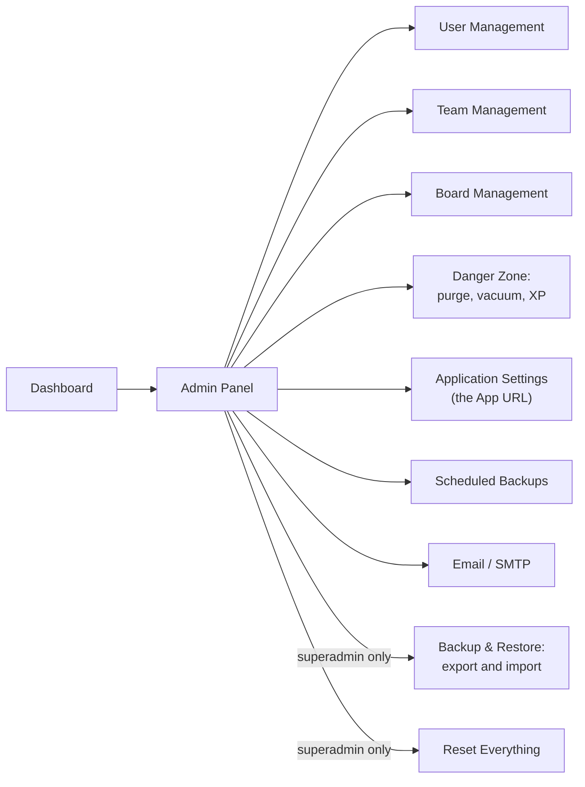

### The Admin Page's Dialogs and the Keyboard

Every action on this page that asks first (Clear Cards, Clear Categories, Delete Board, Delete User, Delete Team, Remove Destination, Purge Archived Cards, Vacuum Database, Reset All XP, Reset Everything), and the Archived page's Delete Permanently and Purge All, asks in the app's confirm dialog, the one the boards, All Tasks and the Teams page use (card 2362, 2026-10-21; each page had a dialog of its own before). As it opens, **Cancel** has the keyboard's focus, so Enter straight after cancels; **Tab** and **Shift+Tab** stay in the dialog; **Escape** cancels; and as it closes the focus goes back to the button that opened it. To confirm by keyboard, press Tab, then Enter. A click on the dark overlay around it does nothing.

The **Import Database** dialog and Google Drive's **Connect** box keep their own look and behave the same way: Cancel has the focus, Tab stays in them (in the import, through the chosen way to restore, Cancel and Confirm), and Escape is Cancel. The invite link's dialog and the reset's notice have one button and no way out but it. As each opens its button has the focus (the invite link's **📋 Copy**), and Tab and Shift+Tab stay in it (card 2365, 2026-10-21; Tab walked the page behind them, and the reset's notice took no focus). The invite link's dialog does not close on Escape: the link is shown once, and only **Done** lets it go. After Done the focus goes to **+ Add User** when the link came from Create, or to the row's 📧 when it came from there (Create itself has gone with its form by then). The reset's notice closes on Escape when its button is **Close** (a reset that failed and changed nothing); after a reset that was done its one way out is **Continue to set-up**, and Escape does nothing.

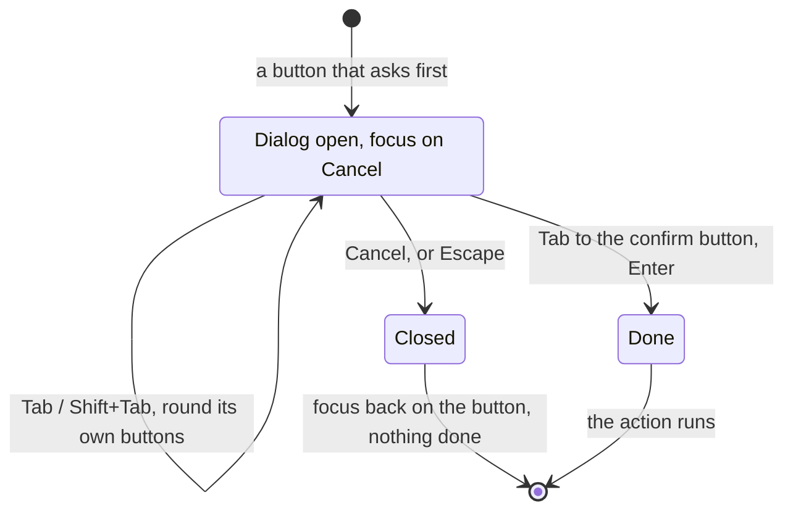

## Who May Do What

The superadmin is the account made when DumpFire was set up, and there is one. An administrator does everything on the page that is about people, boards, housekeeping, mail and the scheduled backups. The export, the import and the reset are the superadmin's:

| On the admin page | An administrator | The superadmin |
|-------------------|------------------|----------------|
| Database Overview | ✅ | ✅ |
| Board Management: delete a board, clear its cards or categories | ✅ | ✅ |
| User Management, within [whose account they may manage](#modifying-users) | ✅ | ✅ |
| Team Management | ✅ | ✅ |
| Danger Zone: Purge Archived Cards, Vacuum Database, Reset All XP | ✅ | ✅ |
| The system log and the audit trail (`/audit`) | ✅ | ✅ |
| **Application Settings**: the App URL | ✅ (since card 2395) | ✅ |
| **Scheduled Backups**: the schedule, the destinations, "Test", "Run Now" and Google Drive's "Connect" | ✅ (since card 2395) | ✅ |
| Scheduled Backups: **lower Keep Last**, **remove a destination** (a rename is a removal) or **switch the schedule off** | ❌ (card 2398) | ✅ |
| Scheduled Backups: **switch Email on failure off** or **change who receives it** (ticking it on stays every administrator's) | ❌ (card 2408) | ✅ |
| **Email / SMTP**: the mail settings, the test mail and what mail has done | ✅ (since card 2395) | ✅ |
| **Backup & Restore**: Export Backup and Import Backup | ❌ | ✅ |
| Danger Zone: **Reset Everything** | ❌ | ✅ |

The last two are the user list by another way, which is why an administrator, who cannot manage another administrator's account, cannot use them. An export holds every password hash. An import replaces every account with the backup's. Whoever sets up after a reset is the superadmin.

**The mail and backup settings are every administrator's since card 2395 (2026-10-21), at the owner's request; they were the superadmin's alone.** That gives every administrator a way round the rule that only the superadmin manages an administrator, and you should know what it is:

- **An administrator who sets a backup destination can receive a full copy of the database**: every account's password hash and email address, every board, card and comment. They can add a destination of their own and press Run Now.
- **An administrator who sets the mail server sees every mail DumpFire sends**, invite links and password-reset links included, the superadmin's among them; whoever reads such a link can set that account's password. The App URL, saved with the mail settings, decides where every link in a mail points.
- **The stored secrets stay where they were saved.** The mail password and every destination's password, key and token are masked on the page for everybody, and a save or a Test that points a masked one at another host, bucket, folder or path is refused: it has to be typed again. Two exceptions: an administrator may confirm the host key of an SFTP destination that has a stored password but no confirmed key yet, and the stored password then goes to whichever server shows that key; and **Connect** on a Google Drive destination already set up with a client ID and secret ties it to the Google account of whoever connects, using the stored ID and secret (a `WARN` line under `BACKUP` in the system log where it replaces a connection the destination had).
- **Lowering Keep Last, removing a destination and switching the schedule off are the superadmin's** (card 2398, 2026-10-22). Lowering **Keep Last** (its least is 1) and pressing **Run Now** deleted every older copy at every destination, and removing the destinations or switching the schedule off stopped the copies, so an administrator could leave you nothing to restore from; it was logged, not prevented. Now the server refuses each of the three to anyone but the superadmin, `403` "Lowering Keep Last, removing a destination, switching the schedule or the failure mail off, or changing who receives the failure mail needs the superadmin." followed by what the save would have done, and nothing is saved. A destination renamed, or saved as another type, is the old one removed, and is refused too: add the new one and ask the superadmin to remove the old. An administrator can still raise Keep Last, change between schedules that run, add destinations and edit them in place, test, connect and run backups. On the page they see 🗑️ dimmed and the schedule's option reading **Disabled (superadmin only)**, each saying the rule when chosen, Keep Last putting a lower number back, and one line under the schedule; editing a destination, a line under its name says renaming needs the superadmin. For anyone, a save the server refuses reads the settings again, so the panel shows what is saved, and the message ends "The settings shown are the ones the server holds." **The way round it is closed too** (card 2405): pressing **Run Now** Keep Last times used to push every older copy out, as each press added a copy and Keep Last kept the newest. Now Keep Last counts Run Now copies and scheduled copies separately, so a Run Now can push out only older Run Now copies, never a scheduled one: see [Manual Backup](#manual-backup). A schedule made more frequent still keeps Keep Last copies over a shorter time. Each Run Now is in the backup history, and each schedule change a line under `BACKUP`.
- **The failure mail is the superadmin's to switch off or send elsewhere** (card 2408, 2026-10-22). The failure mail is how you hear that the copies have stopped, and any administrator could untick **Email on failure** or put their own address in its place, so that a backup left failing was heard of by nobody else. Now the server refuses both to anyone but the superadmin, with the same `403` and nothing saved: unticking it where it is ticked, and any change to its addresses, an address added beside yours included, the addresses cleared, and a change made while it is unticked (so they cannot be set first and the box ticked after). The same addresses written in another order, in capitals, or separated by semicolons are not a change. Ticking it on stays every administrator's: it only adds a mail. On the page an administrator sees **Email on failure** dimmed while it is ticked (unticked, it ticks itself again and says the rule) and its address box dimmed and read-only (typing or pasting in it says the rule); the superadmin's are as before. A save sends the failure mail's settings only where they were changed on the page, so a page left open does not put back, or get refused for, a change the superadmin made since. A backup an administrator makes fail (a destination edited with a wrong password or secret) is not quiet: the failure mail goes to the addresses the superadmin chose. Two quiet ways remain, each a `WARN` line in the system log under their name and not prevented: pointing a destination, in place, at a store of their own with its secret typed again (every run succeeds, so no failure mail goes, and the copies go to their store from then on), and changing or clearing the mail settings (above), which silences every mail, the failure mail included.
- **An administrator can probe the inside of your network.** The SMTP host, an SFTP host and an S3 endpoint may be any address, addresses inside the network included (the server itself, the Docker host, internal ranges, `169.254.169.254`), and what **Send Test** and **Test** answer tells whether a port answered: a simple internal port scan. Webhooks refuse addresses inside the network; these settings do not, because real setups use a NAS or a mail relay on the local network.
- **The settings go with whoever pointed them where they are** (card 2397, 2026-10-22). DumpFire records, for each place it has been, who pointed mail there (the mail **Host**, **Port**, **Username**, and the box that allows mail without a checked, encrypted connection), who set the App URL to each address, and who added each backup destination, pointed it at each place or account, or connected its Google Drive; a setting belongs to whoever is recorded for where it is now. Correcting the sender's name or address, typing a password or secret again for the same server or place, clearing the App URL, or confirming an SFTP host key makes nobody the setter: an administrator who corrects one of your fields does not take over, and on their demotion take away, your settings. Nor does one who changes a setting and changes it back (a relay's **Port**, a destination's prefix, the App URL): back where you put it, it is yours again, unless they typed the password or secret with the move, which makes the mail or destination run on what they typed and so theirs. When the setter is made a user, or deleted, what it set is removed in the same step: the mail settings (so **no mail is sent**, invites and password resets included, until an administrator sets the mail up again), the App URL (links then use the server's `APP_URL`, or else its `ORIGIN`), and its destinations with their stored secrets (the copies already at a destination stay, and a backup already running finishes). The superadmin is the same: lowered to user, what they set goes. Before you confirm, the delete's confirmation, and for a role change to **User** a confirmation of its own, says what would go, as the server has it the moment you press (another administrator may have taken a setting over since the page loaded); where that cannot be read, it asks all the same and says that whatever of those settings is still theirs goes too; afterwards a ⚠️ message that stays until closed says what went, and the panels that showed it read their settings again; the system log has a `WARN` line under `SMTP` and one under `BACKUP` naming it. Settings saved before the update that brings migration 0059 have nobody recorded and stay in force whoever is demoted: the first change that moves one (the **Port**, say, or a destination's path) makes whoever saves it its setter, and changed back it is nobody's again. A move by the superadmin, or one made with the password or secret typed, is always the mover's, even to a place another administrator visited first. A change made from the host's command line runs none of this until the server next starts (card 2406): every start, before any scheduled backup, removes what a setter who is no longer an administrator set, by the same rule, with the same `WARN` lines saying `found at start-up`. So after making an administrator a user from the host, restart the container to take their settings away. **Import Backup** does the same once a restore is committed (card 2411): a setter who is not an administrator in the restored data (a backup taken while such a change waited for a restart, say) loses those settings at once, whichever way it is restored, with the same lines saying `found after a restore`, and not at the next start. An account deleted from the host with foreign keys on, which the documented `node -e` command has, takes its record of what it set with it (the database removes those rows with the account), and its settings then stay in force as settings nobody is recorded for; deleted with foreign keys off (the `sqlite3` shell's default), its record stays, and the next start removes its settings as it does a demoted setter's. Delete accounts on the admin page, not from the host. Each change to the backup settings, and since card 2396 each change to the mail settings and the App URL, is also a line in the system log under the account that made it (the mail user name and password by name alone, never their values).

An administrator does not see the export, the import or Reset Everything on the page. In place of Backup & Restore is one section, "The superadmin's", which says what they are and names the superadmin. The routes behind them refuse everybody else with `403` and "This belongs to the superadmin", so a request made by hand fares no better. A demotion takes effect at once: an administrator made a user while a save, a Run Now, a Test, a Connect or a Send Test is on its way is refused at the moment it would be saved or sent, with nothing saved and nothing sent.

If nobody can sign in as the superadmin, no page puts it right: see [If Nobody Can Sign In as the Superadmin](deployment.md#if-nobody-can-sign-in-as-the-superadmin).

## When Something Is Not Done

This page, the Teams page, the Reports page's schedules, All Tasks, the Archived page, every change made on a board's page (since card 2280, 2026-10-20), a board's Archived Cards panel, a card's window and its **Link existing board**, the share window, a subtask's window, the dashboard and My Account each say when a change was not made, in the server's own words where it gave any: "No edit access to this board", "Card not found", "You can only delete your own templates". Several of them used to say a change had worked whatever the answer was, or to say nothing.

- **A message that something was not done stays** until it is closed with ✕ or the page is left. Most are in the corner of the page. A card's window says it at its top, where it stays in view however far the window is scrolled. An import says it in the report under the **Import Backup** button, and not in the corner as well. The mail settings say it under their buttons, and the Reports page's emailing of a report in its dialog, each until it is tried again. The share window and a subtask's window say it on a line of their own above their buttons, with a ✕ to close it; My Account says it under what was refused, the avatar, the mail switches or the API key panel; and the **New Sub-board** form of a board's menu on the dashboard on its own line. Each of these goes when that change is tried again.
- **The corner shows each such message once, and three at most.** The same message again takes the place of the one shown, and a fourth puts the oldest away. A message about a change made on a page you have since left is not shown on the next page.
- **A message that something was done goes after three seconds**, as does any note or warning. Not every change has one: most of what is done in a card's window (a label, the cover, an assignee), and turning a report schedule on or off or deleting it, show the change itself and say nothing more.
- **What the page changed before the answer came is put back**: a role in a user's row, a backup destination added or removed, a card's cover, a card's milestone, a person's role in the share window, a board's star on the dashboard, and your avatar and mail switches on My Account. A card's window in All Tasks, All To Do or a plan page that could not save stays open with what was typed in it (a plan page's said "Card updated" and closed whatever came back, until card 2281, 2026-10-20), and so do a board's **New Task** window whose card was not made (it said "Created" until 2026-10-15), a subtask's window and the forms for a new team, a new user and a new schedule. A subtask whose delete was refused stays on the card. A subtask's **Save** and the avatar on My Account cannot be pressed again while a change is on its way, so a double click makes one subtask. Removing someone, or a team, from the share window who no longer has the board (removed in another tab) says "This board is not shared with that user" (or team), where it said nothing.
- **A column's rename that is refused is said**, in the server's words, and the column keeps its old title (card 2134). A Complete or Done column that holds any card, archived ones included, can be renamed only to Complete or Done, and a column that holds any card cannot be renamed Complete or Done: the cards in it would become open work, or finished work nobody finished. An empty column is renamed freely. Keep a Complete or Done column that holds cards called Complete or Done: moving its cards out so as to rename it would reopen every one of them. To rename a column that holds cards into Complete or Done, move the cards first, each finished one to a Complete column and the rest to another column. It used to show the new title until the page was reloaded.
- **A change on a board is shown at once, and taken back if it is refused** (card 2280, 2026-10-20): the card window's **Save** of a saved card (the window stays open with what was typed), a title edited on the board itself, pinning a card, a priority changed from its dot, a card's menu or the bulk bar, the card menu's Move to, the completion prompt (which stays open with what was typed), adding and deleting categories, which show once the server has taken them (a refused one keeps its name in the box), dragging cards and columns, the board's name and emoji, and a column's colour, WIP limit and Add Task switch. Each is said in the server's words and only that change goes back; "Moved to …", "Pinned", "Priority → …", "WIP limit set" and "Title updated" are said only once the change is made. A bulk priority or archive changes every selected card at once, and the cards the server refuses go back, stay selected, and the count and the first reason are said. A card dragged into On Hold is moved first and its note written only once it has moved, so a refused move writes no note; a note refused after the move is said, and the note window stays open with it. Until then these looked saved until the page was reloaded. Sharing a board, a subtask's window, the dashboard's star, grouping and new boards, and the account page's avatar, mail settings and key revoke said nothing when refused until 2026-10-15 (card 2148).
- **A card's window opened from All Tasks, All To Do or a plan page saves as a board's does** (card 2281, 2026-10-20). **Save** sends only what was changed in the window, so a change a colleague made to another field of the same card meanwhile is kept; before, it sent every field back and undid theirs. A save with nothing changed closes the window quietly and sends nothing. A save that is refused, or gets no answer, is said in the server's words (or as "No answer from the server. The card may not have been saved.") and the window stays open with what was typed; on All Tasks and All To Do the change shows on the card at once and only that save's change goes back. "Card updated" is said only once the server has saved it. On All Tasks and All To Do, the fields not touched in an open window follow the card as the page reads it again.
- **A request that got no answer** is not known to have failed, and the message says so: "No answer from the server. It is not known whether this was done." Reload the page to see what was saved.
- **If your session has ended**, the message is shown and the page then goes to the login page. No dialog box stops it on the way.

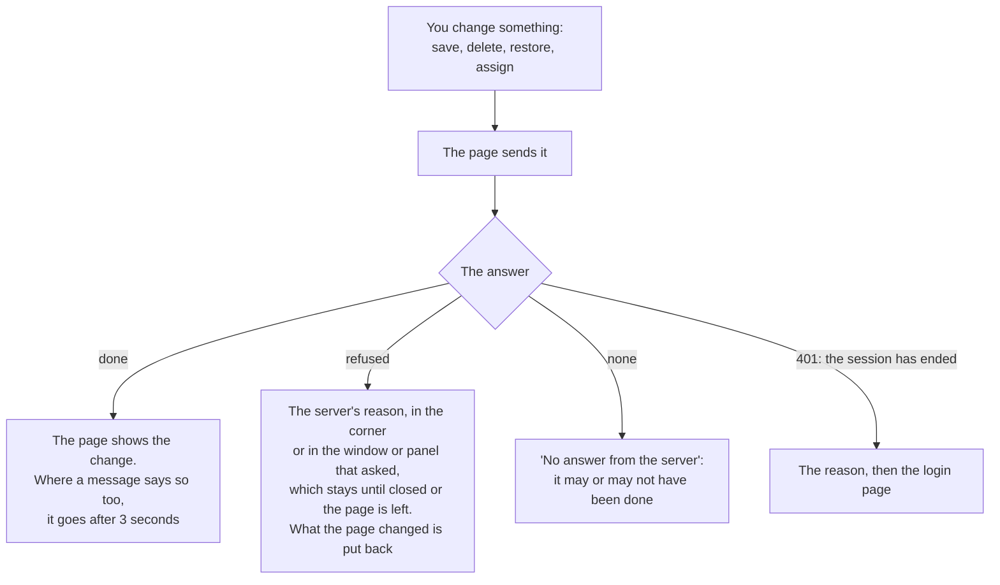

---

## User Management

### Creating Users

1. Go to **Admin → Users**
2. Enter username, email, and role
3. Click **Create User**
4. An invite email is sent automatically (if SMTP is configured), and the page waits for it: usually a second or two. "User created — invite email sent!" means the mail server accepted it
5. The user clicks the link to set their password

**When an invite's mail is not sent** (card 2196). Create User with no password, and 📧 on a user's row, wait for the invite's mail. If the mail server refuses it or does not answer, the invite is still made, and a dialog opens instead of the toast. "Not sent" means "not confirmed sent": a mail server can take the whole message and the connection then drop before it says so, and then the person receives the mail as well as you being given its link. Either one works; the first used sets the password:

> **📧 The invite mail was not sent**
>
> User nf-invitee was made, but the invite mail could not be sent: the mail server could not be reached.
>
> Give this link to nf-invitee yourself, by a way only they read. Whoever opens it can set the password of nf-invitee's account and is then signed in as them. It works once, for seven days, and stops working if another invite is sent to this account. Do not open it yourself.
>
> `https://kanban.example.com/invite/…` **📋 Copy**
>
> It is not shown again. If it is lost, send a new invite with 📧. Why it failed is under Email / SMTP below.

For 📧 the first line is the server's message: "The invite was made, but its mail to ana@example.com could not be sent: … Give ana the link yourself. Any earlier invite to this account no longer works." The reason is one of seven, never the mail server's own words, which can name the mail host: mail is not set up on this server; the mail password has not been entered on this server, and an administrator enters it under 📧 Email / SMTP; the mail server's certificate could not be checked, or it does not offer STARTTLS; the mail server could not be reached; the mail server refused the sign-in; the mail server did not accept the message; the mail could not be sent. Every administrator reads the mail server's words under **📧 Email / SMTP** and in the system log (the panel was the superadmin's alone until card 2395, and the dialog told an administrator "The superadmin can see why under Email / SMTP."). The panel is read again as the invite is answered, so it already shows this mail.

**When no invite can be mailed at all.** With no mail host, or with a mail user name saved and no password (what an Import Backup leaves until the password is typed again: a backup does not hold it), 📧 and Create User with no password are refused before anything is made, and any earlier invite to the account still works: `The invite was not made: the mail password has not been entered on this server; an administrator enters it under 📧 Email / SMTP. Any earlier invite to this account still works.` Create User says `Password must be at least 8 characters (…)` with the same reason; give a password, or type the mail password under Email / SMTP and try again. While a link's dialog is open, every 📧 and Create User stay greyed until **Done**, and 📋 Copy has the focus.

- **The link is a password.** Whoever opens it sets the account's password and is signed in as that user. Send it by a way only they read (not a shared channel), and do not open it yourself: opening it shows the form, and setting a password with it ends every session and key of the account. It is shown once, only to you, and is cleared when you press **Done**; it is in no toast, no address and no history. 📋 Copy puts it on the clipboard, which Windows' clipboard history keeps, and syncs to your other devices when that is on.
- **One invite at a time.** While an invite is out, every 📧 and Create User are greyed for the second or two it takes, and the pressed 📧 reads "…": a second press used to send a second invite, which ends the first one's link.
- **No link shown.** If, while the mail was out, you were signed out or made an ordinary user, the account became one you may no longer manage, or another invite was sent for it, no link is given: "The invite was made, but its mail could not be sent, and its link cannot be shown to you now. Send a new invite with 📧 once mail works."
- **The trail.** Each time, one `[WARN] [AUTH]` line on the Audit page's Live Console names the account and you, by id, and says whether the link was given: `Invite for user 12 was issued by user 3; its mail was not sent (the mail server could not be reached), and its link was given in the answer to their request`. It holds no link. The link works for seven days whether or not its holder stays an administrator, so when an administrator leaves, search the system log for "its link was given" lines naming them, and send each account named a new invite with 📧, which ends the old link.

### User Roles

| Role | Admin Panel | Manage Users | All Boards | Board Sharing |
|------|------------|-------------|------------|---------------|
| **Superadmin** | ✅ | ✅ | ✅ Implicit | ✅ |
| **Admin** | ✅ | ✅ | ✅ Implicit | ✅ |
| **User** | ❌ | ❌ | Only shared | Only if owner |

### Modifying Users

- **Change role** — choose **User** or **Admin** in the row's picker, then press **Change** beside it; choosing alone saves nothing (card 2376, 2026-10-21: the picker saved as it was chosen, so a keyboard user arrowing through it on Windows saved each role passed, Admin included). **Change** is dimmed, and does nothing, until a role other than the account's is chosen, and while the change is on its way, when a second press sends nothing and a screen reader is told "Saving *name*'s role…". A change refused or not answered is said, and the picker shows the account's role again. A role chosen and not saved is forgotten once the account is deleted, or the page reads it back gone or already holding that role. Only the superadmin can make a user an administrator, and nobody is made superadmin, so the picker and **Change** are on the superadmin's User Management alone; another administrator, who could give only User, sees the role as its badge with neither (the card 2376 review, 2026-10-21: every row had a one-choice picker and a Change that could do nothing). Any invite sent to the account earlier and not yet used stops working, because it was sent to the account as it was: the message then reads "Role updated. The invite sent to this account earlier no longer works: send a new one with 📧." **An administrator made a user loses the settings that are still where they set them** (card 2397): the mail settings, the App URL and the backup destinations they pointed where they are now are removed with the role change. **Change** first reads what the account holds at that moment, then asks, naming them: "Make ann a user? This removes what they set: …", and sends nothing until **Confirm**; an account that holds nothing is changed at once, as before. Where the read fails it asks all the same: "Make ann a user? What they set of the mail settings, the App URL and the backup destinations could not be read just now: whatever of it is still theirs goes too." The ⚠️ message, which stays until closed, says what went: "Role updated. What ann had set was removed: the mail settings, so no mail is sent, invites and password resets included, until an administrator sets them again in Email / SMTP; the App URL, so the links in mail point to the server's APP_URL, or else its ORIGIN; the backup destination "NAS"." The panels that showed it (Email / SMTP and Application Settings, or Scheduled Backups) then show what is left. See [Who May Do What](#who-may-do-what).
- **Reset password** (🔑) — type a new password for the user. Every session they have ends, so they are signed out everywhere and sign in with the new one. Every API key they have ends too, and so does any invite they have not used yet; every webhook they set up is switched off, and every report schedule of theirs is paused (card 2168). The dialog says beforehand what there is, a line for each only above zero: "They have 2 API keys, which stop working", "They set up 3 webhooks, which are switched off." and "They have 1 report schedule, which is paused.", then "They are signed out everywhere, every API key they have stops working, any invite not yet used stops working, the webhooks they set up are switched off and their report schedules are paused." The message afterwards gives all four counts, zeros included: "Password reset: 1 session and 1 API key ended, 3 webhooks switched off and 1 report schedule paused". They are not mailed: you give them the new password, so tell them then
- **Send an invite** (📧) — mails the user a new invite link, with which they set a password themselves. It works for seven days. Any earlier invite to that account stops working as soon as the new one is sent, and the message says so. The button reads "…" while the page waits for the mail; "Invite sent to …" means the mail server accepted it, and a mail not sent opens the dialog of [When an invite's mail is not sent](#creating-users), with the link to pass on yourself. Whoever opens an older link is told it no longer works and to ask an administrator for a new one. When the user sets a password with the link, every session and every API key they had ends, the webhooks they set up are switched off and their report schedules paused, as a reset does, and the invite page tells them so beforehand: "Setting a password here ends this account's 2 API keys, switches off the 1 webhook it set up, pauses its 1 report schedule and signs it out everywhere else.", each part only where there is one
- **Delete user** — permanently remove. See below for what goes with them

**An invite ends when the account changes.** An invite not yet used stops working when the account's email address or role is changed, by you on this page or by a direct call, or by the user on their Account page: the mail may be in a mailbox the account no longer has, or was sent before the account was made an administrator. Changing a username or an emoji, or sending the role the account already has, ends nothing, and no such change signs anyone out. Whoever opens the old link is told it no longer works, and why it might not. Send a new invite with 📧. Invites waiting at the update that brings migration 0054 were ended by it, whatever their account; send again with 📧 the ones still wanted. See [When an Account's Email or Role Changes](authentication-security.md#when-an-accounts-email-or-role-changes).

**Ten wrong passwords on the Account page.** The email form, the password form and Generate Key each ask for the current password, and so does the 🔑 dialog on your own row. After ten wrong ones in 15 minutes from one signed-in browser, that browser is refused at all three, the right password included, for up to 15 minutes: "Too many wrong passwords. Try again in N minute(s)." Signing in again, or another browser already signed in, is not held up, so a user who is refused can still change their password elsewhere, and an administrator can still reset it. An account can have at most five current-password checks and sign-ins from remembered browsers going at once, plus the new hash of each password change it completes, which the password form makes after giving its place back; that cannot hold up sign-ins from other browsers, invites and set-up, which are served at least every fourth job the threads take. A sixth current-password check at the same moment is answered "The server is very busy checking passwords right now. Wait a minute and try again.", and a sixth sign-in from a remembered browser "A sign-in with this name is already under way from another browser. Wait a few seconds and try again, or sign in from a browser you have used here before." Nobody using the pages one at a time meets either. See [Guessing a Current Password](authentication-security.md#guessing-a-current-password).

**Five wrong passwords at sign-in.** After five wrong passwords at one account within 15 minutes of each other, from any number of addresses, every sign-in at that account from a browser not remembered for it waits 1, 2, then 4 seconds before it is answered, the right password included, with the Sign In button reading "Signing in…" meanwhile (card 2177); the right password signs in after the wait and clears it, and otherwise it lasts until 15 minutes pass with no wrong password. While it lasts, such browsers are also let in **one at a time** (card 2194): a second sign-in at the account at the same moment is refused at once, "A sign-in with this name is already under way from another browser. Wait a few seconds and try again, or sign in from a browser you have used here before." A browser that has signed in to the account before, or signed out of it, is remembered for a year, is never made to wait, and is refused only while five of the account's own checks are going at once. Every attempt from an address counts toward its ten in 15 minutes, and the ones refused (the one-at-a-time refusal, "Sign-in is very busy right now…") and the ones at a mistyped username stay counted when the user then signs in: only that user's own attempts at the account are given back. So an office behind one address, or on one IPv6 network, that retries a burst can find every sign-in from it refused for up to 15 minutes. A user who says sign-in has become slow, or keeps saying a sign-in is already under way, may be the target of someone guessing: they can sign in on a browser they have used before, or wait 15 minutes after the guessing stops. The waits beginning is one `WARN` line under `AUTH` on the Audit page's Live Console, `Sign-ins at "pat" (user 12) are being slowed: 5 wrong passwords within 15 minutes of each other`, and the first refusal `Sign-ins at "pat" (user 12) from browsers not known here are being let in one at a time`, each with the account as the line's user, beside the "Failed login attempt" lines, which name the account and the address and nothing that was typed (see [Logs](#logs)). See [Guessing a Password at Sign-in](authentication-security.md#guessing-a-password-at-sign-in).

**During an attack on an account, send an invite rather than set a password.** Setting a password (🔑) ends every browser remembered for the account, so its owner, on any browser, then meets the one-at-a-time refusal for as long as the attack lasts. An invite (📧) signs the browser that uses it in without the sign-in page and remembers it. It needs mail to be set up, and an invite is never sent for the superadmin's account, and for an administrator's only by the superadmin. Where none of that will do, the host's operator can turn the rule off for one sign-in: see [If an Attack Keeps an Owner Out](deployment.md#if-an-attack-keeps-an-owner-out).

**A reset or an invite costs the account its API keys.** Both are how you take an account back from whoever may hold its password or a session, so both end every key, and anything that uses one (a script, an integration, a scheduled job) is answered `401` until it is given a new key. That holds when a user has simply forgotten their password: the server cannot tell a recovery from a takeover. Before resetting the password of an account that a script or an integration runs on, look at the dialog's count. The dialog reads it again when it opens, and gives one only on the rows whose password you may reset. A user who changes their own password on the Account page keeps their keys, and the webhooks they set up, unless they tick the box ("End my API keys too, and switch off the webhooks I set up", or "Switch off the 1 webhook I set up" when they have no key left); their report schedules are left on either way. See [What Setting a Password Ends](authentication-security.md#what-setting-a-password-ends).

**What a reset switches off, and getting it back.** A reset, or an invite used, also stops what someone holding the account could have left sending things out (card 2168). Every webhook the account set up that is on is switched off: the ones whose address or secret it last set, or that it last switched on, through `POST /api/v1/boards/{id}/webhooks` or a `PUT` that changed either or switched it on. Every report schedule of the account that is on is paused. Neither is deleted, because the account's own integrations and reports would go with an intruder's. Once you know which are genuine:

- **A webhook** is switched on again by the board's owner or an administrator, with their API key: `PUT /api/v1/webhooks/{id}` and `{"active": true}`. An editor of the board who sends that is refused `403` "Only the board's owner or an administrator can switch a webhook on. Ask the board's owner.", even for a webhook the editor set up and their own reset switched off: the owner switches it on, or the editor deletes it and creates it again. Whoever switches one on becomes its setter, so their own reset switches it off again. No page shows webhooks: `GET /api/v1/boards/{id}/webhooks` lists a board's, with each one's address for its owner or an administrator, and `DELETE /api/v1/webhooks/{id}` removes one nobody recognises. The reset's line in the system log names the webhooks it switched off by id (`switched off 3 webhook(s) they set up (ids 4, 9, 12)`).
- **A report schedule** is switched on again by its owner, on the **Reports** page, where it shows ⏸️ and only its owner sees it. Ask the user to look them over once they are signed in again. One switched on is sent at its next time, never at once for a run it missed while it was off (card 2159).

A webhook or a report schedule that a request was still creating or changing when the reset went through is not written: the request is answered `401`, since the key or the session it came in with has gone. See [What Setting a Password Ends](authentication-security.md#what-setting-a-password-ends).

**What a reset does not end.** A webhook nobody is recorded as having set up is left on by a reset: one registered before the update that brings migration 0056, and one whose setter's account was deleted. So is one somebody else set up or changed since. **Since card 2325, a webhook with no setter is held from the deploy on all the same**: nothing is sent to it at any event until the board's owner or an administrator takes it over, as below. Before that deploy, Query B in the release notes lists every one that is on, and each is taken over or deleted ([Deployment](deployment.md#webhooks-stop-when-their-setter-cannot-open-the-board-and-the-activity-report-reads-only-boards-you-can-open)); after restoring a backup older than 2026-10-18/19, run Query B again.

**A held webhook** (card 2325). A webhook is sent only while the account that set it up can open the board, asked at each event with that account's role as it is then. One whose setter was taken off the board, taken out of the team it is shared with, lost it when it was made private, or was an administrator made an ordinary user, is held: nothing is sent, `active` stays as it was, and the system log has one `WARN` an hour under `Webhooks`, `Webhook <id> on board <board> not sent: the account that set it up (user <id>) can no longer open the board` (or `… not sent: nobody is recorded as having set it up`), never the address. It sends again by itself if that account is given the board back, as an editor or a viewer. No page lists webhooks, but the board's **Share Board** window counts them for its owner and an administrator (card 2329): ✕ on a person or a team whose removal would hold webhooks asks first ("Removing Sam stops 1 webhook they set up on this board: …", **Remove** or **Cancel**), and above the list it says how many of the board's webhooks send nothing now, whatever held them, ones with no setter included. Since card 2385 the switch from public to private asks the same way when it would hold webhooks whose setters open the board only because it is public ("Making this board private stops 1 webhook set up by an account that can open it only because it is public: …", **Make Private** or **Cancel**), and the count is read again after the switch. The board's owner or an administrator reads why with their API key, in `pausedBecause` from `GET /api/v1/boards/{id}/webhooks` or `GET /api/v1/webhooks/{id}` (`null` unless the webhook is on and held), word for word:

- a setter who can no longer open the board: "The account that set this up can no longer open this board, so nothing is sent. The address was chosen by that account: delete the webhook unless you recognise it; to keep it, switch it off and on, which makes you its setter, and set a new secret and update the receiver."
- no recorded setter: "Nobody is recorded as having set this up. Delete it unless you recognise the address; to keep it, switch it off and on, which makes you its setter, and set a new secret."

**Delete it unless you recognise the address** (`DELETE /api/v1/webhooks/{id}`): the address was chosen by the account that lost the board, or by nobody known. **To keep it, take it over**: `PUT /api/v1/webhooks/{id}` `{"active": false}`, then `{"active": true, "secret": "<new>"}`, then update the receiver with the new secret. Switching it on makes you its setter, so it is no longer held. The new secret matters because the former setter knows the old one and could forge deliveries to the receiver, which may be the company's own system. Sending `{"active": true}` to a webhook that is already on is no change and takes nothing over. Whoever takes it over answers for it: a reset of their account, or deleting it, switches it off. Prefer the board's owner where they have a key. A single `PUT {"secret": "<new>"}` also takes it over, with no gap while it is off. Off then on, with no secret change, takes over a receiver that does not check signatures.

Whose account you can change, set a password for, send an invite to or delete depends on your role and theirs, and is the same for all four. An invite is on the list because its link sets the account's password:

| Their account is | An administrator can manage it | The superadmin can manage it |
|------------------|--------------------------------|------------------------------|
| An ordinary user's | ✅ | ✅ |
| Another administrator's | ❌ | ✅ |
| The superadmin's | ❌ | Only their own, and not to delete it |

Each row shows only the controls you may use on that account, by the same rule the server refuses by (one copy of it, in `src/lib/account-rule.ts`, which the page and the routes both ask):

| The row is | What it shows |
|------------|---------------|
| An account you may manage | The role select, 🔑, 📧 and 🗑️ |
| Your own | 🔑 alone, which changes your own password and asks for the one you have. Your role, an invite and deleting yourself are not offered, and the server refuses each there: a change to your own role is answered 403 whatever it is, and nothing sent with it is saved. The superadmin can change an administrator's role |
| Another administrator's, to an administrator | 🔒 and nothing else |
| The superadmin's, to anyone else | 🔒 and nothing else |

An administrator who tries to reset another administrator's password, send them an invite, change their role or delete them by a request made another way is refused, and a page that sends one shows the reason. The role select, the invite and the delete used to be shown on rows where they could only be refused, the administrator's own row among them, where one choice in the role select made them an ordinary user.

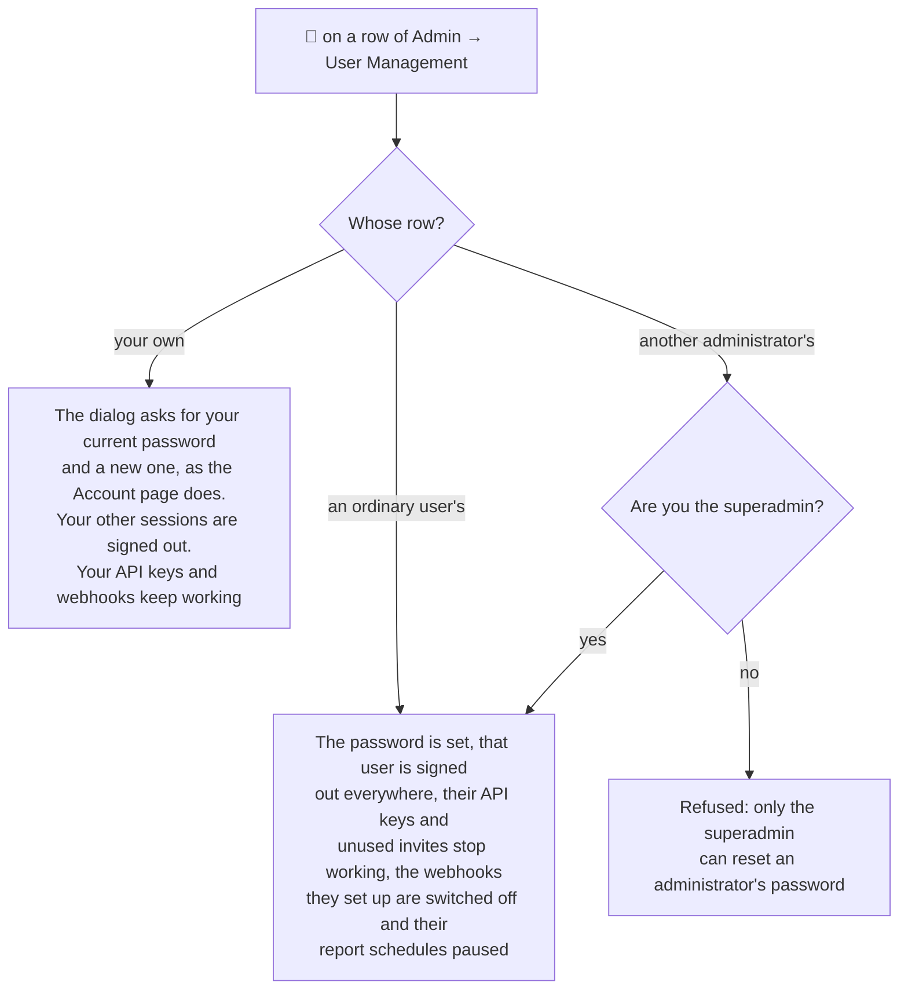

Your own password is never reset from this page without the one you have. On your own row the 🔑 dialog asks for your current password, as the password form on the **Account** page does. It keeps your API keys and the webhooks you set up, and says so: "Your API keys and the webhooks you set up keep working. To end the keys and switch off those webhooks too, change your password on the Account page." To end them with the change, change your password on the Account page and tick the box there. Your own row has no 📧, and the route refuses one: an invite link sets a password and asks for none, so nobody sends one to themselves. Your own email is not changed through user management either, because an invite goes to it: it is changed on the Account page, which asks for your password. So no user-management route sets your own password, or moves the address a new one would be sent to, without asking for the password you have. The superadmin's row shows 🔒 to everyone else, and 🔑 to the superadmin, which is the same own-password dialog.

The same rule holds for the rest of the Admin page. **Restoring a backup** replaces every account with the backup's, passwords and roles included, and **Reset Everything** clears every account, so both are the superadmin's alone, with the export (the backup destinations and the mail settings are every administrator's since card 2395): see [Who May Do What](#who-may-do-what). Any administrator could once run either, and so could make themselves anybody.

### Deleting a User

The 🗑️ button beside a user in **Admin → User Management** asks for confirmation and says what will happen. A user can be deleted whatever they have done in DumpFire: uploaded files, saved templates, created milestones or recorded dependencies.

| Deleted with the user | Kept |
|-----------------------|------|
| Their comments | Files they uploaded |
| Their API keys. Anything that calls the API with one stops working | Milestones, templates and dependencies they created |
| Their report schedules. Those reports are no longer sent | Boards and cards they created |
| Their team memberships, board memberships and card assignments | Requests addressed to them |
| Their sessions, so they are signed out everywhere | Their XP, which stays on the dashboard's XP Leaderboard (on every board's header until 26 October 2026) |
| | Webhooks they set up, **switched off** (card 2168), and then naming nobody |
| The mail settings, the App URL and the backup destinations still where they set them (card 2397): see [Who May Do What](#who-may-do-what) | Settings somebody else has moved since, settings moved back to where somebody else put them, and settings saved before migration 0059 |

Where settings went, the message after the delete stays until closed and names them ("User deleted. What ann had set was removed: …"), and the system log has a `WARN` line under `SMTP` or `BACKUP` for each kind.

The confirmation says so, after the memberships: "Webhooks they set up are switched off; the board's owner or an administrator can switch one on again through the API." The system log's line for the delete counts them and names them by id, for the board's owner to find: `… 1 webhook(s) they set up were switched off (id 4); …`.

After the delete:

- **Templates they created, and milestones of theirs that belong to no board, can be managed by administrators only.** A milestone that belongs to a board is still managed by whoever can edit that board.
- **A board they created stays, and its other members and teams keep their access.** The user was its owner: a board's creator is its owner. Unless another member is stored as an owner of the board, the board then has no owner, and only an administrator can change who it is shared with, delete it, or put it under a card. No screen can make someone an owner now (the sharing dialog offers Owner only on a row already stored as one); a member shared as Owner before 14 October 2026 keeps it.
- **Requests addressed to them stay in the system**, and only an administrator can then accept, reject or reply to them.
- **Requests they made stay, and their mail goes to the address the account had when it was deleted** (card 2171). While the account was there, a request made signed in was mailed at the account's email as it was at the time of each mail. The delete writes the account's email onto each of its requests first, in the same all-or-nothing step, so the team's replies and the progress mails go on reaching the person at their last address, as for a request made without an account. Requests of an account deleted before this change keep the address stored when they were made.
- **Activity entries they made keep their name**, without a link to an account.

The delete is all or nothing. If it fails, the user and everything of theirs is as it was, and the page says the delete failed.

You cannot delete your own account or the superadmin. Only the superadmin can delete an administrator.

**An account that is the only owner of a team is not deleted** (card 2377, 2026-10-21). The delete takes the account out of every team, so each team it alone owned was left with no owner, run by administrators alone; a team keeps at least one owner ([Team Owners and Members](#team-owners-and-members)). The delete is refused, nothing is changed, and the toast names the teams, in name order: "This account is the only owner of: Alpha, Beta. Make someone else an owner or delete those teams first." ("… delete that team first" for one). Make another member of each an owner (**Admin → Team Management**, their row's picker, **Change**), or delete the team, then delete the account. A team the account owns with someone else, or is only a member of, does not stop the delete.

**The confirmation says so beforehand** (card 2380, 2026-10-21). For an account that is the only owner of one or more teams, as the admin page last read its teams, the confirmation's second sentence names them, in name order: "They are the only owner of: Alpha, Beta, so the delete will be refused: make someone else an owner or delete those teams first." ("… delete that team first." for one). Press **Cancel** and change the teams first. **Confirm** still sends the delete, and the server decides: if someone was made an owner since the page was loaded (in another tab, or by another administrator), the delete goes through; otherwise the toast above says it was refused. For an account that alone owns no team the confirmation is as before.

---

## Team Management

### Creating Teams

1. Go to the **Teams** page from the dashboard, or to **Admin → Team Management** (**+ Add Team**)
2. Click **Create Team**
3. Name the team and choose an emoji. You are made its owner
4. Add members. On the Teams page or **Admin → Team Management**, choose the person under **Add member…**, then their role, **Member** or **Owner**, beside **Add**; it starts at Member (card 2309 on the admin page; card 2355, 2026-10-21, on the Teams page, which added every member as Member). While an add is on its way a second press of **Add** sends nothing (card 2374, 2026-10-21: a double click sent it twice and said "Member added" twice); Add keeps the keyboard's focus. Someone added meanwhile elsewhere, and so already in the team, has their role set to the one chosen, and the page says "*name* was already in the team; role set to *Member* (or *Owner*)" rather than "Member added" (the card 2374 review)
5. Change a member's role: choose **Member** or **Owner** in the picker on their row, then press **Change** beside it. Choosing alone saves nothing (card 2376, 2026-10-21: the picker saved as it was chosen, so a keyboard user arrowing through it on Windows saved each role passed); **Change** is dimmed, and does nothing, until a role other than theirs is chosen. A role chosen and not saved is forgotten once they are removed from the team, or the page reads them back gone or already holding that role, so it never comes back on their row when they are added again (the card 2376 review). "Role changed" says it was saved; a change that is refused or gets no answer is said, and the picker shows the role they have again (card 2355, 2026-10-21; no page could change it). While a change is on its way the picker and Change stay where they are, with the keyboard's focus, and are marked busy, and a screen reader is told "Saving *name*'s role…"; another choice on the picker meanwhile goes back to the role being saved, and a second Change sends nothing (changes on two members' rows at once are each saved). If the person was taken out of the team meanwhile (by someone else, or on another page), the change puts them back in with the role chosen, and it says "*name* was no longer in the team and has been added again as *Member* (or *Owner*)" rather than "Role changed" On the Teams page the picker is on the rows an owner (or an administrator) may manage, and not on your own row, as ✕ is not; on the admin page it is on every row

### Team Owners and Members

A team's role says who may run the team; it gives no access to boards. The access a team gives is its share's role on each board (editor or viewer), the same for owners and members.

| | Owner | Member |
|---|:---:|:---:|
| Delete the team | ✅ | ❌ |
| Rename the team (through the API alone, `PUT /api/teams/{id}`: no page offers it) | ✅ | ❌ |
| Add and remove members, and change their role | ✅ | ❌ |
| Open the boards shared with the team | ✅ | ✅ |

**What an owner's adding gives.** An owner can add any account to the team, and each person added at once has the team's role, editor or viewer, on every board shared with the team, and the team's requests in their inbox. A board's owner has no say: the board was shared with the team, and whoever the team's owners add has it. Make someone a team's owner only if you would share every one of its boards with whoever they choose.

An administrator may do all of it on every team without being in it. Whoever creates a team is its owner, so a team made on the admin page is owned by the administrator who made it; to let someone else run it, add them as **Owner**, or change their role to Owner on their row. **A team keeps at least one owner** (card 2373, 2026-10-21). Making the last owner a member, or removing them, is refused for everyone, administrators included: "A team needs at least one owner. Make someone else an owner first, or delete the team." Make another member an owner first, then change or remove the first; or delete the team. There is no "leave team": a member asks an owner to remove them. Deleting an account takes it out of every team, so an account that is a team's only owner cannot be deleted until someone else is made an owner or the team is deleted (card 2377, 2026-10-21; see [Deleting a User](#deleting-a-user)). A team left with no owner from before these rules (including by deleting its only owner's account before 21 October 2026) is run by administrators until one of them makes someone its owner again.

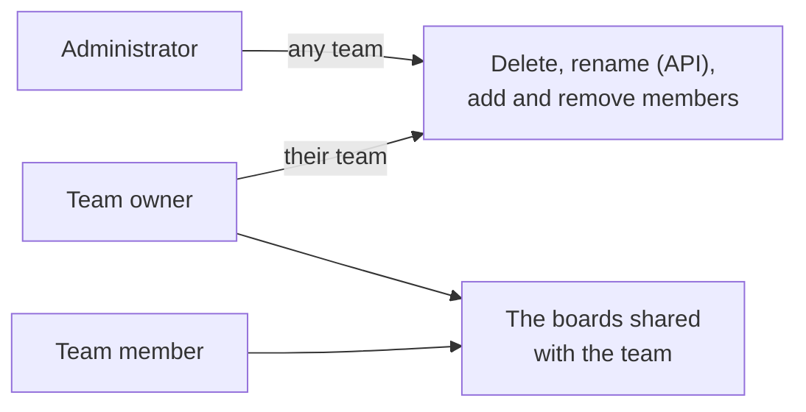

### Sharing Boards with Teams

When you share a board with a team, all team members inherit the team's board role (editor or viewer). New members added to the team automatically gain access.

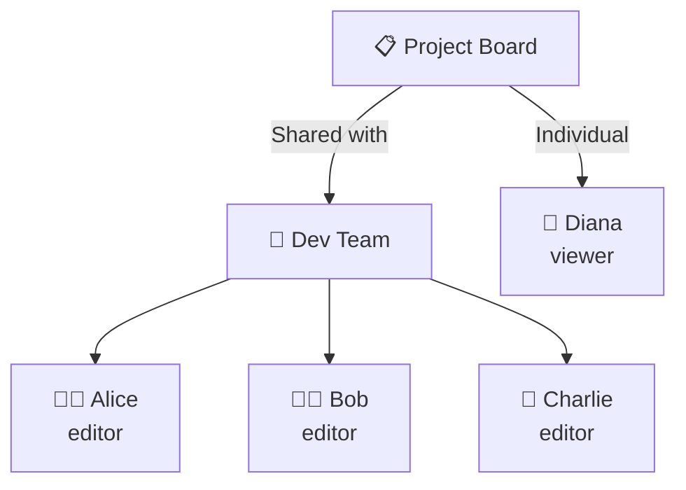

**Taking someone off a board leaves their assignments** (card 2180). A user removed from the
board, or from the team it is shared with, stays assigned to its cards, and is no longer
mailed about them: the "Card moved" and "Unblocked" mails go only to the assignees who can
open the board the card is on. The same goes for an assignee whose card is moved to a board
they cannot open. Current members are mailed as before. Unassign someone who should no
longer be listed on a card.

---

## SMTP Configuration

Email is required for notifications, invites, and report delivery. The mail settings are every administrator's since card 2395 (the superadmin's alone before): whoever sets the mail server sees every mail DumpFire sends, invite and password-reset links included. See [Who May Do What](#who-may-do-what).

Every link in a mail begins with the **App URL**, which is set under **Application Settings** on the same page and is every administrator's too. With none set, links begin with the address the server was started with (`ORIGIN`). Nothing a request says is used, so a link cannot be pointed at another host by whoever sends the request. If the links in your mail begin with `http://localhost:3000`, set the App URL: see [Where a Mailed Link's Address Comes From](deployment.md#where-a-mailed-links-address-comes-from).

**Where the App URL comes from** (card 2401). The App URL shown under Application Settings is the one in effect: one saved there, or failing that the server's `APP_URL` environment variable. The line under the field says which: `From the server's configuration (APP_URL). Saving it unchanged leaves it there, so a later change of APP_URL still applies.`, or, for one saved there, `Saved here, ahead of the server's configuration (APP_URL). Clear it and save to use the server's configuration (APP_URL) again.` where `APP_URL` is set and `Saved here; the server's configuration sets no APP_URL. Clear it and save to use ORIGIN, the server's own address.` where it is not. The line speaks of the App URL that was read, so it is hidden while the field holds anything else. With neither, the field is empty and the amber `No App URL set` warning shows. **Save** stays off until the App URL has been read; if the page could not read it, the panel says `The page could not read the App URL settings: reload the page before saving.` and Save stays off, since saving the empty field would clear a saved App URL. **Save** stores the App URL only when it differs from the one in effect (a trailing slash or a missing `http://` is no difference), so saving the panel unchanged stores nothing and an `APP_URL` change later still applies. Until card 2401 that save copied `APP_URL` into the settings, and a later change of `APP_URL` was ignored. To go back from a saved App URL to `APP_URL` (or, where `APP_URL` is not set, to `ORIGIN`), clear the field and press **Save**. The panel reads the App URL again after each save, so the field and its line show what is now in effect.

### Setup Steps

1. Go to **Admin → 📧 Email / SMTP**, as an administrator or the superadmin
2. Fill in your SMTP details:

| Field | Example | Notes |
|-------|---------|-------|
| **Host** | `smtp.gmail.com` | Your SMTP server |
| **Port** | `587` | 465 is encrypted from the first byte; any other port must offer STARTTLS. A whole number from 1 to 65535 |
| **Username** | `noreply@company.com` | Auth username |
| **Password** | `app_password` | Use app passwords for Gmail |
| **From Address** | `noreply@company.com` | Sender email: an address, with no space and none of `, ; < > " ( )` |
| **From Name** | `DumpFire` | Display name in inbox |

3. Leave **Allow mail without a checked, encrypted connection** unticked (below)
4. Save the configuration
5. Click **🧪 Send Test** to verify

**How mail is sent** (card 2189). Port 465 is encrypted from the first byte. Any other port must offer STARTTLS: a mail server that does not is refused before the password is sent. On every port the mail server's certificate must be one this server trusts, for the host's name as it is entered. Until this change mail on any port but 465 went without requiring STARTTLS and without checking the certificate, so anyone on the network path could read the password and every message, invites included. A mail server whose certificate comes from a private authority, or is self-signed, is trusted by naming its authority's certificate in `NODE_EXTRA_CA_CERTS` when the container is created: see [Mail Server Certificates](deployment.md#mail-server-certificates).

**Allow mail without a checked, encrypted connection** is the one way out, off unless ticked. Ticked, mail on any port but 465 goes as it did before this change: STARTTLS only when the server offers it, the certificate not checked; port 465 is checked either way. While it is ticked the panel warns that mail and the mail password can then be read and changed by anyone on the network between this server and the mail server. Tick it only for a relay on this server's own network that cannot use TLS. A save that turns it on or off writes one `[WARN] [SMTP]` line on the Audit page's Live Console naming who did it: `Mail is now sent without a checked, encrypted connection (set by chief)`, or `with`. The old **Use SSL/TLS** box is gone: it only switched the certificate check on for ports other than 465, and that is now always on.

**The saved password stays with the connection it was saved for** (card 2190). The Password box shows `••••••••` for a saved password. A save that leaves it so, or sends none, keeps the saved password only while the host (spaces and tabs at either end, and capitals A to Z, aside: a no-break space, or any other character, is a change), port, user name and the box above are as they were saved. The host is saved without spaces or tabs at either end, and while the saved password is kept it is saved exactly as it was saved with the password, so the password only ever goes to that host. A save that changes any of them is refused, nothing is saved, and the panel says what changed: `Type the mail password again. The saved password is used only with the host, port, user name and "Allow mail without a checked, encrypted connection" setting it was saved with, and this changes the host.` Type the password and save again. The From Address, the From Name and the App URL are changed without it. A password typed, an empty one included, is saved as typed.

**Every change is logged** (card 2396). Since card 2395 any administrator can point mail at a server of their own, and that server sees every mail DumpFire sends. So a save of 📧 Email / SMTP or of the App URL (🌐 Application Settings) that changes anything writes one line under `SMTP` in the system log, filed under the administrator who saved it (their chip on the Audit page's Live Console) and naming them: `Mail settings changed: host from "smtp.example.com" to "smtp.other.com"; password changed (set by "chief")`. Each setting changed is named with its old and new values (`host`, `port`, `allowInsecure`, `fromAddress`, `fromName`, `appUrl`), except the user name and the password, which are only ever `user changed` and `password changed`, never a value (some mail providers take the API token as both). The line is always a `WARN`, so it is kept whether `LOG_LEVEL` is `INFO` or `WARN`. A save that changes nothing a mail uses (the panel saved as it was, say) writes no line, and nor does one that is refused. Ticking or unticking the box above writes its own `WARN` line too, after this one.

**Whoever pointed mail where it goes is recorded** (card 2397): the **Host**, **Port**, **Username** or the box above, for each place mail has been pointed; the **From Name**, the **From Address** and a password typed again alone change nobody's, and mail pointed back where somebody put it before is theirs again. So, apart, is whoever set the App URL to each address (clearing it makes nobody its setter). Made a user, or deleted, they take them away: every mail setting is removed and **no mail is sent** until an administrator sets it up again, and the App URL goes back to the server's `APP_URL`, or else its `ORIGIN`. The line says so: `The mail settings and the App URL removed: saved by "ann", who was made a user by "chief". No mail is sent until an administrator sets the mail up again. …`. See [Who May Do What](#who-may-do-what).

**What mail has done since the server started** (card 2196). Under Send Test the panel says how many mails have been sent and how many failed since the server started, and the last failure:

> Since the server started (14/10/2026, 09:00:03): 40 sent, 3 failed.
>
> ⚠️ Last failure, 14/10/2026, 11:02:11: "Assigned: Deploy v2.1": the mail server refused the sign-in. The mail error was: Invalid login: 535-5.7.8 Username and Password not accepted. Mail has been sent since then, last at 14/10/2026, 10:58:40. Every failure is also in the system log, on the Audit page, with its recipient.

or "✅ No mail has failed since then.", and "No mail has been sent since then." when nothing has gone since the failure. Every mail counts, whatever sent it: notifications, invites, request mail, the backup failure mail, reports and Send Test. "Sent" means the mail server accepted it; a bounce afterwards goes to the From Address. The panel reads it when it opens and again after Save and Send Test. It is kept in memory, not in the database, so a restart starts it again; the system log keeps every failure for 30 days. After "The mail error was:" comes the error's own message: the mail server's reply when it answered (`Invalid login: 535-5.7.8 …`), or this server's own words when it never got one (`Connection timeout`, `Greeting never received`, `connect ECONNREFUSED 203.0.113.5:587`, `getaddrinfo ENOTFOUND smtp.example.com`). The words are masked where they could quote a mail's link (an invite's or a request's token, encoded or not, becomes `[token]`), and can name the recipient. The subject is the mail's own, and a request mail's subject holds the request's title, which a member of the public typed on the request form: read it as their text, not this server's. All of it is every administrator's, as the panel is (the superadmin's alone until card 2395), and the answer that carries it is never stored on the way (`Cache-Control: no-store`).

A save that holds a field the server cannot use is refused with the field named, under the buttons, and nothing is saved: `port must be from 1 to 65535`, `fromAddress must be an email address`. The Host and the Username are at most 2,048 characters and the From Name at most 200. A Port left empty is refused, `port must be a whole number`, as is a save of none of the fields (`No valid fields to update`). Only these fields, the way out (`allowInsecure`, true or false) and the App URL are kept; a `secure` sent by a page from before this change is ignored. The App URL is an `http://` or `https://` address, or empty for none; one written without its scheme, `kanban.example.com`, is saved with `http://` in front, as it was always read, and one that is still no address after that is refused. A value saved before these rules, sent back unchanged, is kept (card 2117).

### Troubleshooting

| Problem | Solution |
|---------|----------|
| Connection timeout | Check firewall rules for outbound SMTP port |
| Auth failure with Gmail | Use an App Password, not your Google password |
| Emails going to spam | Set up SPF/DKIM records for your sending domain |
| A mail server with IPv6 addresses | Nothing to set. nodemailer looks up the host's IPv4 and IPv6 addresses, leaving out a family this server has no network address for, and with more than one it has Node try them in turn, going on to the next when one fails or is slow. DumpFire no longer passes the `family: 4` option it did: nodemailer 10 does not read it |
| Send Test fails with "The mail server's certificate could not be checked, or the server does not offer STARTTLS" | The error before that sentence says which. `Error upgrading connection with STARTTLS`, or `EHLO failed but HELO does not support required STARTTLS`: the server offers no STARTTLS; ask the provider for its TLS port (often 465), or, for a relay on this server's own network, tick the way out and type the password. `self-signed certificate`, `unable to verify the first certificate` or `unable to get local issuer certificate`: a private authority; set `NODE_EXTRA_CA_CERTS` ([Mail Server Certificates](deployment.md#mail-server-certificates)). `does not match certificate's altnames`: enter the host by the name on its certificate, and type the password (a new host needs it). `certificate has expired`: the provider's to renew; the way out meanwhile |
| The Live Console shows `[WARN] [EMAIL] Mail is not being sent: …` | Mail of every kind is failing for the certificate or STARTTLS: invites, notifications, request mail, reports and the backup failure mail. An invite says its mail was not sent and gives its issuer the link (card 2196). The line is written at most once in ten minutes, beside the `[ERROR] [EMAIL] Failed to send email …` line of each mail; Send Test does not write it, its own answer says the same. Put it right as in the row above, then Send Test |
| The panel or an invite says "the mail server's certificate could not be checked, or it does not offer STARTTLS" | As the Send Test row above: the words after "The mail error was:" under the panel's last failure say which |
| … "the mail server could not be reached" | The host or port is wrong, the mail server is down, or the firewall stops outbound SMTP. The words after "The mail error was:" are this server's own: `Connection timeout` (no answer to the connection), `Greeting never received` (connected, and the server said nothing), `connect ECONNREFUSED …` (nothing listens on that port), `getaddrinfo ENOTFOUND …` (the host name is not found). The error's code (`ETIMEDOUT`, `ECONNECTION`, `ESOCKET`, `EDNS`) is in the `[ERROR] [EMAIL] Failed to send email …` line on the Audit page |
| … "the mail password has not been entered on this server" | A user name is saved and the password is not: what an Import Backup leaves, since a backup does not hold it. Type the password here and Save. Nothing was asked of the mail server. Until then 📧 and Create User with no password are refused before anything is made |
| … "the mail server refused the sign-in" | The user name or password is wrong, or (Gmail, Microsoft 365) the account needs an app password. After an Import Backup the mail password is entered again here: a backup does not hold it |
| … "the mail server did not accept the message" | The mail server refused the sender or a recipient (a From Address it will not send as, a mailbox that does not exist) or the message itself. Its words, under the last failure, can name the recipient |
| … "the mail could not be sent" | Anything else: the words after "The mail error was:" under the last failure, and the `ERROR` line on the Audit page, say what |
| … "mail is not set up on this server" | The mail host was cleared while the invite's mail was being sent. The invite exists; give its link, or send a new invite once mail is set up |
| Save is refused with "Type the mail password again" | The host, port, user name or the way out was changed with the password left masked. A host that looks the same can differ by a character that does not show, a no-break space pasted with it. Type the password and save again |
| An emailed report says "Mail is not set up on this server" | Fill in the settings above. Until a host is saved, a report emailed from the Reports page is refused `503` and nothing is sent, and each scheduled report logs an `ERROR` line saying so |
| An emailed report says "The mail server did not accept it" | The reason is in the system log, an `ERROR` line under `EMAIL` for each address, on the **Audit** page's **Live Console**. A scheduled report's `ERROR` line under `REPORTS` names each address it did not reach. Neither is sent again by itself: see [Schedule Execution](backup-reporting.md#schedule-execution) |
| A report or a schedule is refused with "at most 10 addresses", "20 report schedules" or "at most 100 addresses a day" | The limits of card 2182, the same for administrators: 10 addresses a report emailed by hand and a schedule, 20 schedules an account, and 100 addresses a day from one account, by hand, by the schedules it makes, turns on, or re-times or moves to another time zone while they are on, and by the addresses a change of a schedule's list adds. The day is 24 hours from the account's first send, not a calendar day, so up to 200 can go across one day's end and the next's start; it is held in memory, so a restart starts it again. The first refusal of each day is a `WARN` line under `REPORTS` naming the account, as the line's user. See [Who a Report Can Be Mailed To](notifications-email.md#who-a-report-can-be-mailed-to) |
| A schedule is switched off and reads "the most is 10, so it is not sent" | It was kept from before the cap with more than 10 addresses, and was switched off at its next run with nothing sent, written as one `ERROR` line under `REPORTS` naming it and its owner, who is the line's user. Its owner copies the addresses to keep from the Reports page into a new schedule of at most 10, then deletes it |
| A schedule arrives an hour late in British summer time, and its badge reads "at 09:00 UTC" | It was made before schedules had time zones (card 2159), so its time is read in UTC, as it always was. Its owner presses **Use my time zone (Europe/London)** under it on the **Reports** page, and it is sent at 09:00 UK time all year. Only the owner sees the schedule, so only they can press it |
| A schedule is switched off and reads "Cannot be sent: its time of day "9" is not a time from 00:00 to 23:59" | Its time, day, frequency or time zone is one the scheduler cannot work a next run out from, written before the routes checked it or by a restore. At its next due minute it was switched off with nothing sent, and one `ERROR` line under `REPORTS` names it and its owner (card 2144). A next run that cannot be read, such as `NaN-NaN-NaN NaN:NaN:NaN` (what the image before card 2144 wrote for such a time), counts as none: the schedule is switched off at the next start or minute in the same way, and its next run cleared, so the start-up conversion of timestamps stops naming it. Its owner can turn it on again with a timing that can be read in the same request, `PUT /api/report-schedules/{id}` with `{"enabled": true, "timeOfDay": "10:00"}`; the page cannot change a time, so on the page they delete it and make it again. A stored value is named to its first 80 characters |

---

## Backup Management

The export and the import are the superadmin's. The schedule, the destinations, Test, Run Now and Google Drive's Connect are every administrator's since card 2395 (the superadmin's alone before): whoever sets a destination can be sent the whole database. See [Who May Do What](#who-may-do-what).

### What a Backup Holds

A backup is the whole database, as one `.db` file, with these things taken out:

| In a backup | Not in a backup |
|-------------|-----------------|
| Every board, card, comment, user, team and setting | **Sessions.** Nobody is signed in by a backup, whoever reads it |
| Every user's password hash, so that a restore can sign them in again | **Invites that have not been used.** An invite's link sets a password |
| The mail server, port and user name, and each backup destination's name, type, host, bucket, folder, user names and ids | Attachment files: see [Attachments](#attachments) |
| Invites that have been used, API keys (as hashes), the system log, with every invite's token in it masked | **The key remembered browsers are signed with** (card 2194). A restore forgets every remembered browser |
| Every task request and its messages | **Every request's link** (card 2158). A link opens its request's thread, replies as the requester and confirms the request, and never expires: every request is in the backup with no link, and a restore gives each a new one |
| Every webhook, with its address | **The key the public request form signs with** (card 2158). A restore makes a new one |
| | **The mail password** (card 2169) |
| | **Each backup destination's credentials** (card 2169): an SFTP password or private key, an S3 secret access key, a Google Drive client secret and refresh token or a service account's private key, a OneDrive client secret |
| | **Each webhook's signing secret** (card 2169). A webhook that had one is switched off in the backup, so that a file put in place by hand sends nothing unsigned |
| **Its seal** (card 2169): a check of every row in it, made with a key this server keeps, so that only this server fills its secrets back in, and only into the file it made, unchanged | **The key backups are sealed with** (card 2169). It stays on the server, and a restore keeps the server's own |

So a backup is still a file to keep where few can read it, and it no longer opens anything for whoever does: no account, no request's thread, no mailbox, no backup store, no webhook receiver. That is true of the file **Export Backup** downloads and of every copy a schedule or **Run Now** uploads: both are made the same way. Taking a backup signs nobody out and changes no link. The sessions, links and secrets are removed from the copy, never from the running database: mail, backups and webhooks go on working.

**What it still holds that is worth guarding.** Every user's password hash and email, API keys as hashes, the mail server and its user name, each destination's other fields, the system log (masked), and every webhook's address. A webhook's address can itself be a key: a Slack or Teams incoming webhook's address is all anyone needs to post to that channel. If a copy may have been read by somebody who should not have, make a new incoming-webhook address at its service and put it on the webhook.

**A backup alone no longer rebuilds a lost server** (card 2169). Restored on the server it came from, with Import Backup, nothing has to be entered again: the restore keeps this server's mail password, credentials and webhook secrets wherever they are for the same account, as long as the file is the one this server made, unchanged since (its seal: see [Restoring from Backup](#restoring-from-backup)). Restored anywhere else, changed in anything a restore brings in, or put in place by hand, they are entered again. So keep the mail password and each destination's credentials outside DumpFire, in a password manager, and know who holds each webhook's secret at its receiver. An S3 secret key cannot be read again from AWS (a new one is made), a Google Drive OAuth destination needs its client secret from the Google Cloud console and a new Connect, and a webhook's secret is known only at its receiver.

A backup made before this version does hold the sessions of whoever was signed in when it was made, and one made before card 2158 holds every request's link as it was mailed. Restoring one brings back neither, and the update that brings migration 0055 replaces every request's link once, so the links in those copies open nothing: see [Every Request Link Replaced Once](authentication-security.md#every-request-link-replaced-once-by-migration-0055). One made before card 2169 holds the mail password, every destination's credentials and every webhook's secret, and nothing can take them out of a copy already made: they go as retention removes the old copies. Such a copy carries no seal either, so Import Backup of it keeps nothing from this server, which changes nothing: it holds its own secrets. If one of them may have been read by somebody who should not have, change the mail password and each destination's credentials at their services and enter them again, and set new webhook secrets with their receivers. The files themselves are as they were: delete the old copies that are not needed.

### Configuring Backups

1. Go to **Admin → Scheduled Backups**, as an administrator or the superadmin
2. Choose a schedule: Hourly, Every 6h, 12h, Daily, or Weekly
3. For daily/weekly: set the time and day
4. Add destinations (SFTP / S3 / Google Drive / OneDrive)
5. Set retention count (how many backups to keep)
6. Enable failure email alerts (switching them off, or changing who receives them, is the superadmin's: card 2408)

Each setting is checked when it is saved, and one the server cannot use is refused with the setting named and nothing saved: a time written `HH:MM`, a retention of 1 to 100, a failure email of one address or more (separated by commas, semicolons or lines, and saved separated by commas), and for each destination a name, one of the four types, and its own fields, an SFTP port being a whole number from 1 to 65535 (`destinations[0].port must be a whole number from 1 to 65535`), and a port left empty being 22. A destination's text is at most 2,048 characters, but an SFTP private key and a Google service account's JSON, which are pasted in, at most 20,000. A Retention box left empty is not sent, and the retention saved before is kept. **Lowering the retention (Keep Last), removing a destination and switching the schedule off are the superadmin's** (card 2398): an administrator's save that does any of them is refused with the rule and what it would have done, and nothing is saved; see [Who May Do What](#who-may-do-what). A save keeps what it does not send: until card 2117 a save that sent part of the settings wrote the defaults over the rest, and one that sent nothing switched the schedule off and removed every destination. A destination keeps only the fields of its type.

**Every secret is shown masked** (card 2187). Every saved password, private key, secret access key and client secret, a service account's private key, and a Google Drive connection's refresh token reads `••••••••`, and the answer the page loads (`GET /api/admin/backup`) holds none of them. Until this change it held the refresh token as stored, a standing credential for the Google account that connected. A connected Google Drive destination still says it is connected.

**A saved secret stays with the destination it was saved for** (card 2190). Saving or testing a destination with a secret left masked keeps the saved secret only from the one saved destination that is the same in type, name and every setting that is not secret: an SFTP host (spaces and tabs at either end, and capitals A to Z, aside, as for the mail host; it is saved without them, and as it was saved while a secret is kept), port, user name and remote path; an S3 region, bucket, prefix, endpoint and access key ID; a Google Drive sign-in method, folder ID and client ID, or a service account's email and key ID; a OneDrive tenant ID, client ID and folder path. A value the edit form fills in where none was saved counts as the same: an S3 region of `us-east-1`, a OneDrive folder of `/DumpFire Backups`, an SFTP port of 22, an endpoint or prefix left empty. Change any of them, the name included, and the save or test is refused with nothing saved; the edit form stays open as typed, and the toast says what to type and why:

> Backup destination "NAS": type its password again. A saved secret is used only with the settings it was saved with, and this changes its host and port.

(or "… and no destination of this name was saved."). Every field still masked is named: "type its password and private key again". Type them and save again. Where two saved destinations are the same in everything but their secrets, typing is no way out, and the toast says what is:

> Backup destination "NAS": more than one saved destination matches it, so its saved secret cannot be told apart. Remove the destinations named "NAS" (the page's Remove removes every one of that name, and removing a destination is the superadmin's) and add it once with its secret typed.

A list that names two destinations alike is not saved at all, whatever else changed, the schedule included: "Two backup destinations are named "NAS"." followed by that same way out where the two were saved before this change, or by "Each destination needs a name of its own: give one of them another name." where an edit gave a destination a name already used. A destination is found by its name to connect, test and back up to. A secret typed, or emptied, is used as typed. A connected Google Drive destination has a token no form can type, so a change to its name, sign-in method, folder ID or client ID is refused with how to remove it, add it again and connect it, beginning with removing DumpFire's access in the Google account when it was connected with all of Drive (below). Until this change a masked secret was taken from the destination at the same place in the list, whatever its host, name or type, so a mistaken edit, or a session in the wrong hands, could send a stored credential to another host. Keep the secrets outside DumpFire, as above.

**An SFTP destination's host key, confirmed once and checked at every connect** (card 2250). Until this change an SFTP destination connected to whatever answered for its host and sent it the password, or a signature made with the private key, and then the backup, so anything on the network path between the container and the SFTP server (the LAN, the ISP, a DNS answer for the host's name) could have received both. Now each SFTP destination holds the server's host key, as its type and the fingerprint `ssh-keygen -l` prints for it (`ssh-ed25519 SHA256:s16t1ixxsjxOgoaXCXACvAIOEG1K5biSlM7GekmavrY`). Every connect (Test, a backup, retention's listing and deleting) asks the server for a key of that type only, and refuses any other key before a password or private key is used. A destination with no key confirmed is sent nothing at all.

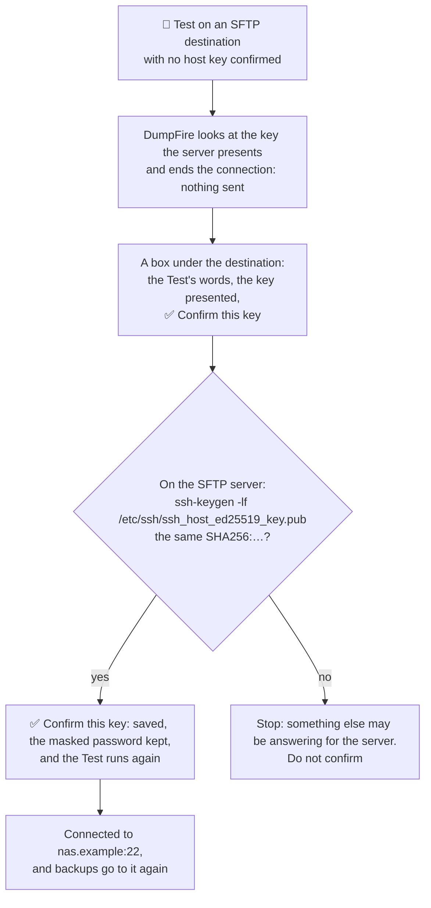

To confirm a destination's key:

1. **🧪 Test** on the destination. With no key confirmed, DumpFire connects only as far as the key the server presents, uses no password or private key, makes no folder, and ends the connection. A box under the destination shows the Test's words, the key presented and **✅ Confirm this key**: "SFTP host key not confirmed: the server at nas.example:22 presented the host key ssh-ed25519 SHA256:…. Check it is the server's own (on the server: ssh-keygen -lf /etc/ssh/ssh_host_ed25519_key.pub) and confirm it. Nothing was sent to the server." (`ssh_host_rsa_key.pub` or `ssh_host_ecdsa_key.pub` for those types.)
2. On the SFTP server, run the command the box names and compare the `SHA256:` part. **Different: stop.** Something else answers for the host; do not confirm it.
3. **✅ Confirm this key.** The destination is saved with exactly the key shown, keeping its masked password (a key added where none was only narrows where the password may go), the page reads the destinations back from the server, and the Test runs again, now with the password: "Connected to nas.example:22".

Until its key is confirmed, an SFTP destination's card carries **⚠️ Host key not confirmed — press Test** beside its buttons, as a connected Google Drive one carries ✅ Connected.

The Test only looks at the key, and the server logs that as a connection ended before authentication (OpenSSH: `Connection closed by <address> port <n> [preauth]`). A fail2ban jail on sshd with `mode = aggressive` may count it, so a few such Tests in a row could ban the container's address: Test once, check, then Confirm.

Or type the key yourself, in the **Host key** box of the add and edit forms: the line `ssh-keygen -lf /etc/ssh/ssh_host_ed25519_key.pub` prints, pasted whole (`256 SHA256:… root@nas (ED25519)`), or the type and fingerprint (`ssh-ed25519 SHA256:…`). Either is saved as the type and fingerprint. ED25519, RSA, and ECDSA of 256, 384 or 521 bits are taken; a fingerprint without its type, an MD5 one, DSA and the `-SK` types are refused and nothing is saved: "destinations[0].hostKey must be an SSH host key fingerprint with its type: the line ssh-keygen -l prints (256 SHA256:… root@nas (ED25519)), or the type and fingerprint (ssh-ed25519 SHA256:…), the fingerprint being SHA256: and 43 characters". Left empty, the first Test shows the key, as above. The key is no secret: it is shown as saved, and a backup holds it.

What else a Test may show in the box (any other answer, connected or a failed login, is a toast as before, and clears the box):

- **A key other than the confirmed one**: both keys shown, Presented and Confirmed, and no Confirm. "SFTP host key refused: the server at nas.example:22 presented the host key ssh-ed25519 SHA256:NEW, not the confirmed SHA256:OLD, so nothing was sent to it. If the server's key was changed on purpose, check the new key on the server and confirm it, typing the password or private key again; otherwise something else may be answering for the server." The system log has one `[ERROR] [BACKUP] SFTP host key mismatch for destination "NAS" at nas.example:22: presented SHA256:NEW, confirmed SHA256:OLD. Nothing was sent.` line. To accept a new key put on the server on purpose: check it there, then **Edit**, paste it in Host key, type the password again (or, for a destination that logs in with a key, paste the private key again under **Advanced: Private Key auth**, which the edit form has as the add form does), and save.
- **The server no longer offers a key of the confirmed type**: the confirmed key shown, and no Confirm, since no key was presented. "SFTP host key refused: the server at nas.example:22 no longer offers a host key of the confirmed type (ssh-ed25519), so nothing was sent to it. If the server's keys were changed on purpose, clear the Host key or replace it with the server's new key, typing the password or private key again, then press Test; otherwise something else may be answering for the server." One `[ERROR] [BACKUP] SFTP host key type not offered for destination "NAS" at nas.example:22: confirmed ssh-ed25519 SHA256:OLD. Nothing was sent.` line.
- **The confirmed key, from a server that cannot prove it holds it**: the confirmed key shown, and no Confirm. Something replayed the real server's public key without its private key. "SFTP host key refused: the server at nas.example:22 showed the confirmed key but could not prove it holds it — something on the network may be answering for it. Nothing was sent." One `[ERROR] [BACKUP] SFTP host key signature failed for destination "NAS" at nas.example:22: confirmed SHA256:OLD. Nothing was sent.` line. Do not change the key: find what is answering for the server.

**Changing or clearing a confirmed key needs the password or private key typed again**, by the rule above: saved or tested with the secret masked, it is refused, "Backup destination "NAS": type its password again. A saved secret is used only with the settings it was saved with, and this changes its host key." So a session in the wrong hands cannot swap the key and keep the password. Adding a key where none was is the one change that keeps it, and only a save may make it, where the key is then shown on the destination: a Test that names a key of its own with the password masked is refused the same way, so a Test can never send the stored password to a key it was handed. That leaves one opening until each key is confirmed: someone who holds your session and is also on the network path could press Test, be shown their own key, and press Confirm, which saves that key and tests again at once, sending them the password. Every save that adds, changes or clears a host key, or removes a destination that had one, writes one line on the Audit page (System Logs), with the chip of the account that saved it (card 2267): `[WARN] [BACKUP] SFTP host key of destination "NAS" at nas.example:22 added: ssh-ed25519 SHA256:…`, or `changed from ssh-ed25519 SHA256:OLD to ssh-ed25519 SHA256:NEW`, `cleared: was …`, `removed with the destination: was …`, with the old key's host and port after it, `(at oldhost:22)`, where the same save moved the destination. The line is a `WARN`, so it is not written with `LOG_LEVEL` at `ERROR` (the default is `INFO`). So a key confirmed that way and the real key saved back afterwards both stay on record, though the password has gone by then; a save refused, or one that changes no key, writes none. That is no worse than before, when the password went to whoever answered with neither step; but confirm every SFTP destination promptly, and **before pressing Confirm** compare the fingerprint shown with the server's own (`ssh-keygen -lf /etc/ssh/ssh_host_ed25519_key.pub` on the server).

**A destination with no key confirmed is not backed up to.** A run does not try it: Backup History, one `[ERROR] [BACKUP]` line and the failure mail say "SFTP host key not confirmed: nothing was sent to this destination. In Admin, Scheduled Backups, press Test on it and confirm the key it shows." Every host key failure says what happened in its first 40 characters, which is what Backup History shows of a message: "SFTP host key not confirmed: …" or "SFTP host key refused: …". Every SFTP destination saved before this change starts so, one with neither password nor key included; on an hourly schedule that is a failure mail and an `ERROR` line every hour until it is confirmed. Every start of the server writes one line while any is unconfirmed: `[WARN] [STARTUP] 1 SFTP backup destination(s) have no confirmed host key, and nothing is sent to them until one is confirmed: "NAS". In Admin, Scheduled Backups, press Test on each and confirm the key it shows.` (the first 20 named, then `; and N more`).

**A restore never takes a host key from a backup.** An SFTP destination filled from this server takes the key confirmed here, or none; every other SFTP destination comes in with none, and the restore's "To enter again" line names it "SFTP: its password or private key, then Test to confirm its host key". A backup could otherwise put a key of someone else's choosing beside the real host's name, waiting for the password to be typed again.

**Google Drive with OAuth asks only for DumpFire's own files** (card 2188). Connect asks Google for `drive.file`, which reaches the files DumpFire makes and no others; until this change it asked for the whole of the account's Drive. A folder made by hand may be out of reach of such a connection, so:

- **Leave the Folder ID empty** when you add the destination. Connect then makes a folder of its own in the account's My Drive, named for the day, `DumpFire backups (made 2026-10-18)`, saves its id, and says "Google Drive connected. DumpFire made the folder "DumpFire backups (made 2026-10-18)" in this account's My Drive, and backs up there." The form says the same under the client ID and secret, until the destination is connected, and that a folder you made yourself may not be reachable.
- **A Folder ID that is set is fetched first.** One Google does not let DumpFire reach, or that is not a folder, or is in the trash, is refused and nothing is saved: "Google gave DumpFire access only to the files it makes, and it cannot reach the folder this destination names, so no backup could be written there. Nothing was changed: the destination keeps the connection it had. To use a folder DumpFire makes itself, have the superadmin remove this destination, then add it again with the Folder ID left empty, and connect it." (Removing a destination is the superadmin's, card 2398.) Google's reason is a `[WARN] [GDRIVE]` line. To keep using a folder DumpFire made, give its Folder ID again (shown on the destination as Folder:): Connect checks it can reach it.
- **A destination saved while it is being connected** is not connected: "The destination was changed or removed while it was being connected, so the connection was not saved. Connect it again." A folder that Connect made and did not save is deleted again.
- **Test** fetches the folder before listing it, for either sign-in method, so it says when the folder cannot be reached rather than "0 existing files".
- **The badge.** Connect records the scope Google granted. The row says `✅ Connected` for a connection that reaches only DumpFire's files, and `⚠️ Connected · all of Drive` for any other, with a line under it saying how to narrow it. There is no button to connect it again: connecting again over the old grant would leave the old grant working. Every connection made before this change shows ⚠️, and keeps working as it did, with the whole of Drive, until it is narrowed.
- A Connect that fails is one `[ERROR] [GDRIVE] Google Drive Connect failed for destination "G": …` line (it read "OAuth token exchange failed …" before: it now also covers the calls to Drive and the save).

**Connecting: the whole address, from the session that started it** (card 2251). Connect takes a code only from the browser session that pressed Connect, so a code or address somebody else sends you cannot connect their Google account as your backup destination, unless they also had the consent address your Connect opened: that address holds the check, and whoever holds it can finish the Connect it started. Never open a consent address someone sends you, and never share yours.

1. **🔗 Connect** on the destination's row. The box says "Opening Google's sign-in page…" for a moment, then Google's consent window opens and the box says so, with a link, **open Google's sign-in page**, should you not see the window. Its address holds `state=` (a long random value, new at every Connect), `code_challenge=` and `code_challenge_method=S256`. If your browser blocks the window (Safari, a strict popup blocker, or a server slow to answer), the box says "Your browser blocked Google's sign-in window." with the link **Open Google's sign-in page**: press it and carry on from step 2. Cancel closes the box, and a window still to open for that Connect does not open.
2. Approve. Google leads to an address beginning `http://localhost/?state=…&code=…`, on a page that does not load: that is expected.
3. Copy the **whole address** from that window's address bar, not only the code, paste it into the box DumpFire shows (its placeholder reads `Paste the whole address, starting http://localhost/?state=…`) and press ✅ Connect.

What else you may see:

- **Connect refused before Google's page opens**: the box closes and the toast says the server's reason (cards 2265 and 2266). "Client ID and Secret required": the destination was saved without its client secret; Edit it, type the secret, save, and Connect again. "Google Drive destination not found": the destination was removed or renamed, in another tab perhaps; reload the page. An answer that is not DumpFire's (a proxy's page), or one with no consent address in it, or one whose address is not Google's own over https, says "Failed to generate auth URL"; no answer at all says "Failed to start OAuth flow".
- **Only the code pasted**, or an address without its `state`: the page sends nothing and says "Paste the whole address from the browser's address bar: it holds the code and the check that this connection was started here." The box stays open for the whole address.
- **Access refused in Google's window**: the address holds `error=access_denied`; the page sends nothing and says "Google says access was not granted (access_denied). Press Connect again and allow access." Any other `error=` value: "Google answered with an error (*the value*). Press Connect again."
- **"This connection was not started from this session, or has expired or been used. Press Connect again, and paste the whole address Google's page leads to."** The server refused the address, exchanged nothing and saved nothing, and wrote one `[WARN] [GDRIVE] Google Drive Connect refused for destination "G": …` line, filed under your account (its meta `stateSent` says whether the paste held a state at all). It says the same for every reason, without saying which: the address came from another browser or session, another account or another destination; more than ten minutes passed since Connect was pressed; the address was pasted before (each one works once, even when it was refused); Connect was pressed again for the same destination in the same session, which replaces the one before; or the server restarted meanwhile. Press Connect and start again.

A connection already made is not affected: this changes only how a new one is made.

**To narrow a connection made before this change**, in this order. Removing access first is the order that works: removing it after might end the new connection too.

1. In the Google account that connected it: Google Account, Security, Your connections to third-party apps and services, the app (the OAuth client's name), remove its access. Drive backups to it fail from here until step 3.
2. In DumpFire, the superadmin removes the destination (removing one is theirs alone, card 2398); then add it again with the same client ID and secret and the Folder ID left empty. Have the client secret at hand from the Google Cloud console (Credentials): DumpFire shows it masked.
3. **🔗 Connect.** Google's consent screen asks only for the specific Google Drive files you use with this app; DumpFire makes its folder and the row shows `✅ Connected`.

The copies in the old folder are no longer cleared by retention. They are copies from before card 2169, with every secret in them: delete them by hand when they are not needed. Removing the access also makes useless the old refresh token held in every backup made before card 2169.

**Retention on Google Drive** (card 2238). After each backup to a Google Drive destination, retention reads every `dumpfire-backup-*` file in the folder, however many there are, with what the connected account may do to each, and counts those of the run's own kind: the scheduled copies after a scheduled run, the `…-manual.db` copies after a **Run Now** (card 2405, see [Manual Backup](#manual-backup)). A file it may delete is deleted, as before. A file it may only move to the trash goes to the trash, where Drive keeps it for 30 days, and the run's line says `moved to the trash` where it would say `deleted`. A copy in the trash is still a full copy of the database: for those 30 days the drive's managers can open and read it there, so empty it by hand sooner if that matters. A file it may do neither to is left where it is and not counted: one another account made (a service account used while setting up, for example), or one in a Shared drive where the account is not a Manager. Retention keeps its number of copies among the files it can remove, so with a retention of 7 and three such files the folder holds ten, and the seven go round as before. Each run that finds such files writes one `[WARN] [BACKUP]` line on the Audit page's Live Console, saying how many there are and naming the oldest. To clear it, remove those files by hand in Drive, signed in as their owner, or make the connected account a Manager of the Shared drive; from the next run they are counted and removed in their turn. A delete that fails for any other reason is still one `[ERROR] [BACKUP]` line naming the file, and the run goes on to the next. Until this change such a file was tried on every run, being the oldest, and each try was an `ERROR` line saying `File not found`.

### Manual Backup

Click **▶ Run Now** under **☁️ Scheduled Backups** in the admin panel to trigger an immediate backup to all configured destinations.

**Keep Last counts Run Now copies and scheduled copies separately** (card 2405, 2026-10-22). A Run Now's copy is named `dumpfire-backup-<UTC date and time>-manual.db`. After a Run Now, retention removes the oldest `…-manual.db` copies beyond Keep Last and no scheduled copy; after a scheduled run, the oldest scheduled copies beyond Keep Last and no `…-manual.db` copy. So pressing Run Now any number of times leaves every scheduled copy where it was, a destination holds at most twice Keep Last copies, and with Keep Last 7 an eighth press removes the first press's copy. The run's `Backup succeeded` line on the Audit page says `Made by Run Now: Keep Last counts Run Now copies apart from scheduled ones, so only an older Run Now copy can be removed`, and the panel says the same under Keep Last and in the toast after a Run Now. A Run Now copy made before this change has no `-manual` in its name, and is counted and removed with the scheduled ones.

**The failure mail says Run Now** (card 2413). With failure email alerts on, a Run Now that fails at a destination sends a mail headed **Run Now Backup Failed**, "A backup made by ▶ Run Now to *destination* (*type*) failed."; a scheduled run's says **Scheduled Backup Failed**, as before. Until this change a Run Now's said it was scheduled too.

**One failure mail a run** (card 2415). A run that fails at several destinations sends one mail naming each of them with its error, in the order the destinations are listed; it sent one mail for each.

**A backup whose copy of the database cannot be made** (card 2416) fails at each destination it was to be sent to, with "The copy of the database could not be made: …" and the reason (for example `database or disk is full`, where the disk beside the database has no room for the copy). Backup History shows a failed row for each, the failure mail is sent, a scheduled backup is tried again 15 minutes later like any backup that failed everywhere, and **Run Now** says the backups failed. Until this change such a backup left nothing in Backup History, sent no mail, and Run Now showed a server error. Free the space, or look at the Audit page's `[ERROR] [BACKUP] The copy of the database could not be made` line for the cause.

**Run Now says which destinations failed and why** (card 2417, 2026-10-22). The toast after a **Run Now** that failed anywhere reads, for example, "1 of 2 backup(s) failed: NAS: Connection refused." It said only how many failed, the reasons in Backup History alone. Each reason is put on one line and cut to 160 characters, and at most three destinations are named, the rest counted ("and 2 more (see Backup History)"); the full error is in Backup History and on the Audit page. The toast stays until you close it.

**A backup that was uploaded but could not be recorded in Backup History** (card 2417, 2026-10-22) counts as made: the copy is at the destination. The Audit page has an `[ERROR] [BACKUP] Backup History row for <destination> could not be written, though <file> was uploaded to it` line, Backup History shows nothing for it, no failure mail is sent, Keep Last still removes older copies at that destination, and a scheduled backup is not tried again. After a **Run Now** the toast is a warning that stays: "Backup completed to 1 destination. NAS: Uploaded, but Backup History could not record it: database or disk is full. …". It was reported as failed, mailed, and tried again, which put a second copy at the destination. The usual cause is the disk beside the database being full: free the space.

**Copies are named to the millisecond** (card 2415): `dumpfire-backup-2026-10-22T02-00-30-123.db`, and `…-123-manual.db` for a Run Now. Two Run Now presses in one second made one name, so the second copy replaced the first and Backup History showed one run.

### Backup History

The last 30 backup runs are shown, a row for each destination of each run (card 2413), with:
- Destination name and type
- File size
- Duration
- Status (success or failed with error message)

The panel shows the newest five rows and **▼ Show all N entries**. Each backup adds one row a destination, and the rows of runs older than the newest 30 are removed then, all of a run's rows together. Until card 2413 the history kept the newest 10 rows, so with four destinations it showed under three runs. Opening the page only reads them (card 2412): it removed them each time it was opened.

**After a restart**, an hourly, 6-hourly or 12-hourly schedule counts from the last successful scheduled backup, not from a **Run Now** (card 2412): a Run Now pressed just before a restart used to move the next scheduled backup later once. A Run Now is told by its copy's name, `…-manual.db`; one made before card 2405 has no `-manual` and still counts. The history keeps the last successful scheduled backup's row however many Run Now presses or failures come after it (card 2413), though Backup History no longer shows it once it is older than the last 30 runs; until then ten such rows pushed it out, and the first check after the restart ran one at once. The row kept is the last one recorded no later than the server's clock (card 2416): where a clock that ran fast had recorded a later one, that one was kept instead, and after 30 runs the real one went.

**A daily or weekly backup is made once in its minute** (card 2414; replaced by card 2415 below, which keeps every case here). Where the server's clock is put back across a restart into the minute of the backup's time, or a second instance of the server checks in that minute, a backup that has already finished in that minute is not made again, and the Audit page has a `[WARN] [BACKUP] Scheduled daily backup at 02:00 not made: …` line saying so. One still uploading when the other instance checks is not seen, and a second copy is made. A **Run Now** pressed in that minute does not stop the scheduled backup. Only a backup recorded within the hour from the start of that minute counts: one stamped later by a clock that ran fast and was then put back does not stop the backups of the days after it, and each daily or weekly check while it is newest writes a `[WARN] [BACKUP] The last scheduled backup is recorded at …, later than the server's clock …` line (the review of card 2414).

**A daily or weekly backup missed is made once** (card 2415). Where the server was down, or busy, through the backup's time, the first check after it starts (a minute later) makes that day's or week's backup, and the Audit page has a `[WARN] [BACKUP] Scheduled daily backup at 02:00 was not made at its time, … made now.` line. A server started with a daily or weekly schedule and no scheduled backup since its latest time makes one within a minute. Setting the schedule, its time or its day while the server runs does not: the first backup is at the next time, even where that is a minute away (the time set to 02:00 at 01:59:40 runs at 02:00). The time is the server's own clock and zone (UTC in the container unless `TZ` is set); where it follows UK time, a backup at a time in the hour the clocks go forward is made at the same time an hour on (01:30 is made at 02:30 BST), and one in the hour that comes twice when they go back is made once, at the first.

**A backup that failed at every destination is tried again** (card 2415) 15 minutes later, up to three times, for every schedule; it waited for the next scheduled time, up to a week. Each try has its own failure mail, so an outage can send four in 45 minutes; after the third try, the backups wait for their schedule again until one succeeds. The Audit page says `Scheduled backup failed at every destination: tried again at …` for each. A backup that succeeded at any destination is not tried again. Nor is one where every destination failed before anything was sent (its credentials not entered, or an SFTP host key not confirmed): enter them in **Edit**, as the row says.

**What a restart does to a failing backup.** A restart makes the backup that is due once, a minute after the start. Where that backup had already failed before the restart, that one try is all until a backup succeeds: the server does not try it again 15 minutes later, so a server restarted again and again sends one failure mail a start and makes one SFTP login a start (a refused login tried four times a start could lock the account), and the Audit page says `This scheduled backup already failed before this start: this is its one try until a run succeeds, …`. Where it had not failed before, a failure is tried again three times as above.

**An hourly, 6-hourly or 12-hourly schedule after a restart** leaves out a backup recorded later than the server's clock (card 2415), and writes the same `… later than the server's clock …` line: such a row held every backup off until the real time passed it and one interval more.

A destination whose credentials are not entered is not tried, and its row says "This destination's credentials are not entered: a backup does not hold them, so they are entered again after a restore. Enter them in Admin, Scheduled Backups." (for a Google Drive destination connected with OAuth: "… enter its client secret and connect it again."), with the failure mail any failure sends (card 2169). It is what a destination shows after a backup is restored onto another server, until its credentials are typed in again with **Edit**. An SFTP destination with neither a password nor a key is tried as before, since some servers accept it, once its host key is confirmed. After a restore onto another server, then, such a destination, its key confirmed again, is tried against the real host at every scheduled run, and its failed logins may lock the account out there: enter its credentials, or remove it.

An SFTP destination whose host key is not confirmed is not tried either, and its row says "SFTP host key not confirmed: nothing was sent to this destination. In Admin, Scheduled Backups, press Test on it and confirm the key it shows." (card 2250; see [Configuring Backups](#configuring-backups)). A key that no longer matches, whose type the server no longer offers, or that the server cannot prove it holds, fails the run with the Test's words: `Backup failed: NAS → SFTP host key refused: the server at nas.example:22 …`.

### Restoring from Backup

A backup `.db` file is a whole database: its data, its structure and its own record of applied migrations. There are two ways to put one back, and they differ in how much of it they use.

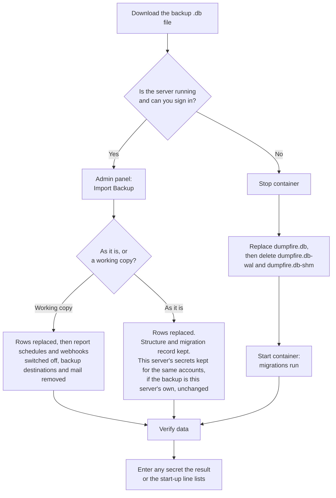

**In the application** (Admin → Backup & Restore → **Import Backup**, as the superadmin). No restart is needed.

On a server that still runs, restore this way, not by hand: it keeps this server's secrets, which a file put in place by hand cannot. Six things are true of every import, whichever way it is restored:

- **It signs everybody out, you included.** No session is restored, whatever the backup holds, and the ones there were are cleared with everything else. When the result is dismissed the page reloads at the login page: sign in with an account the backup has, and its password as it was when the backup was made. The result names the backup's superadmin, which is the account that can export, import or reset again. Invites that had not been used stop working, and are sent again from User Management. Every browser remembered for sign-in is forgotten too, since no backup holds the key they are signed with: each is remembered again at its next sign-in.
- **Every request link mailed before it stops working** (card 2158). Every task request is given a new link, whatever the backup holds, and the result says so: "N request link(s) replaced: a link mailed before this restore no longer works, and its requester can have a new one sent from the page it opens." A requester who opens an old link is asked for the address they made the request with, and the current link is mailed to that address, if mail is set up here with its password. Until it is, the requester is told "New links cannot be sent just now. Please contact the team that sent you the link.", and the reason is a `[WARN] [REQUESTS]` line on the Live Console. The result shows the line about the links on the page too, below the files put back. The key the public request form signs with is not brought in either: a form open during the import fails once, and works when it is reloaded.
- **This server's secrets are kept where they are for the same account, from a backup this server made and nobody has changed** (card 2169). A backup holds no mail password, destination credential or webhook secret, so the restore fills each gap from this server, in the same transaction, but only when the backup's seal checks out: every backup carries a check of every row in it, made with a key this server keeps and no backup holds, and the restore makes it again with its own key. A backup made by another server, or changed since it was made in anything a restore brings in (one user added, one card edited, an index added, ANALYZE run on it), has nothing filled and every gap listed. The check leaves out only what a restore never brings in: SQLite's hidden row numbers in a table that does not show them as a column (their order is checked), its AUTOINCREMENT counters, the file's header and its free space; so a change there changes nothing restored. The check covers the file's whole structure, SQLite's own objects and statistics included, and the restore copies each table's rows as stored, the same rows the check was made over. A file that fails SQLite's own integrity check, or holds an object named as SQLite's own that no backup of this server's holds, is treated as changed before the seal is even asked: the restore goes ahead, nothing is filled, and the system log has one `WARN` line naming the check it failed. When the seal checks out, the restore fills:
  - the mail password, when the backup's mail host (spaces and tabs at either end, and capitals A to Z, aside), port, "Allow mail without a checked, encrypted connection" and user name are all this server's, a port not set read as 587 and the box not set as off (card 2189: a backup made before it has no such setting);
  - a destination's credentials, from the one destination here of the same type that is the same in every other field, its name, host, bucket, folder or path included, compared as the destination would use them (the rule a save keeps a masked secret by: see [Configuring Backups](#configuring-backups)). None that matches, or more than one, and nothing is filled: a backup is not trusted to say where this server's credentials are used. A Google Drive token filled in brings this server's record of the scope it was granted, and an SFTP destination takes the host key confirmed here, never the backup's (card 2250): one not filled comes in with no key, to be confirmed with Test;
  - a webhook's secret, from the webhook here with the same id, board, address and setter (the account that last set its address or secret, or switched it on, card 2168; none and none alike), and the webhook is switched on or off as it was when the backup was made. A secret here set by another account since the backup is not filled, and the webhook is listed to enter again, as one whose address has changed is.

  **A restore brings back on what a reset switched off.** A backup made before a password reset holds the account's webhooks and report schedules as they were then: restored as it is, each webhook comes back switched on where the backup had it on, with its secret filled where its id, board, address and setter here match, and each schedule comes back enabled. That is what a restore does with every row, and the restored keys of the account work again too. After restoring a backup older than a reset, **reset that account's password again**: that ends the keys the restore brought back, switches off its webhooks again (each still names the account as its setter) and pauses its schedules. To switch off only some webhooks instead, use `PUT /api/v1/webhooks/{id}` and `{"active": false}`; the first reset's ids are in its `AUTH` line in `docker logs dumpfire`, not in the system log, which the restore replaced with the backup's.

  A value the backup has is never replaced, so a backup made before this change restores as it always did. Restored on the server it came from, nothing is to enter, unless a destination's name, folder, bucket or path, or the mail port or "Allow mail without a checked, encrypted connection", has been changed since the backup. The result adds up to two lines, only when there is something to say: "Kept from this server, because a backup does not hold them: …" and "To enter again, because a backup does not hold them: …", which names the mail password (Admin, 📧 Email / SMTP), each destination with what it needs (Admin, Scheduled Backups) and each webhook with its board. A restore brings in "Allow mail without a checked, encrypted connection" with the backup's other mail settings, with no password asked and no `WARN` line; where the backup's differs from this server's, the mail password is not kept and the line names the box: "the mail password (Admin, 📧 Email / SMTP, where the backup brought in "Allow mail without a checked, encrypted connection" ticked and this server had it unticked)", or "unticked and this server had it ticked". Look at the box before typing the password. For a backup whose seal did not check out, or whose file failed a check, the second line ends "None was kept from this server, because this backup was not made by this server, or was changed since."; for one with no seal this server can check (made before seals, or restored on a server that has never made a backup), it ends "None was kept from this server, because this backup carries no seal this server can check." A webhook named there stays switched off until the board's owner or an administrator sets its secret and switches it on with `PUT /api/v1/webhooks/{id}` and `{ "secret": "…", "active": true }`. The second line is also written to the system log at `WARN`, and from then on every start of the server writes one `[WARN] [STARTUP]` line while anything on it is still to enter.
- **A backup with users and no superadmin among them is refused**, before anything is changed: "This backup has user accounts and none of them is the superadmin." Restoring it would leave nobody able to export, import or reset the database. A backup with no users at all is accepted: DumpFire then asks to be set up, and whoever does it is the superadmin. A backup that has a superadmin whose row cannot be copied is refused the same way, after the copy and before it is committed: the restore is rolled back and nothing is changed.
- **A backup that is too large says so.** See [When an Import Is Not Accepted](#when-an-import-is-not-accepted).
- **It takes a `.db` backup only.** The file picker offers `.db`, `.sqlite` and `.sqlite3` files, and the page refuses any other file itself, sending nothing. The JSON export DumpFire wrote in its first week, from 1 to 7 April 2026, is no longer imported: its import left twelve tables of the data it replaced in place, so that a live API key could then answer as an imported account. If such a file is ever wanted, import it into an empty installation of an image built before 14 October 2026 and export a `.db` from there.

The dialog asks how to restore, every time:

| Choice | For | What it does |
|--------|-----|--------------|
| **Restore everything as it is** | Putting this installation back | Backup destinations, report schedules, mail settings and webhooks come back as the backup has them. A backup holds no mail password, destination credential or webhook secret: the ones this server has for the same accounts are kept, and the result lists any to enter again; a webhook that had a secret stays off until it is set |
| **Restore as a working copy** | A copy that must not reach outside: a development instance, a rehearsal, a look at older data | Report schedules and webhooks are switched off. The backup schedule is switched off and its destinations removed. The mail settings are removed. Everything else is restored, users and API keys included |

A backup of production restored as it is into another instance is as able to email people, call webhooks and change the backup store as production is. That is what the working copy is for.

- **Which is preselected.** The working copy, when this instance's schedulers are off: under the development server, or with `SCHEDULERS=off`. Otherwise "as it is". Either can be chosen wherever the dialog opens.
- **It is part of the restore.** The switching off happens in the same transaction as the copy, so a restore that fails leaves everything as it was.
- **The result says what was done**, and stays on the page until it is dismissed: how many report schedules and webhooks were switched off, whether the backup schedule was on, and how many destinations and mail settings were removed. The webhooks count every one the backup had on, a webhook switched off in the backup for want of its secret included. A backup made since card 2169 has no mail password, so it removes one mail setting fewer than an older one did.
- **Its webhooks with no secret are listed.** A working copy names no mail password and no destination to enter, since it removes them, but its "To enter again" line names each webhook that lost its secret in the backup and has none here: whoever switches one on in the copy sets its secret first. No start-up line names them afterwards: a working copy's webhooks are off on purpose.
- **Getting them back.** A report schedule is switched on again by its owner on the **Reports** page, one at a time (only its owner sees it there), and is sent at its next time, not at once (card 2159). A webhook is switched on with `PUT /api/v1/webhooks/{id}` and `{ "active": true }`, by the board's owner or an administrator (card 2154: an editor is refused `403`), with their API key; no page switches a webhook on. Mail settings and backup destinations were removed and have to be entered again, or restored by importing the backup once more as it is.
- **Reload before looking.** The Scheduled Backups and mail panels are read when the page opens. After an import, use "Dismiss and reload", and do not save from a panel that was open before it.
- **By request.** `POST /api/admin/import` takes the same choice as `?outside=keep` or `?outside=off`, with the same default when it is not given. Any other value is refused and nothing is changed.

Whichever is chosen:

- Once it is committed, the restored mail settings, App URL and backup destinations of anyone recorded as their setter who is not an administrator in the restored data, or whose account it does not have, are removed (card 2411), as every start removes them (card 2406): a backup taken after an administrator was made a user from the host, and before the restart that would have removed what they set, brought those back in force until the next start. The system log has the same `WARN` lines under `SMTP` and `BACKUP`, ending `(found after a restore)`, and the result on the page adds a line, "Removed after the restore, because whoever set them is not an administrator in the restored data, or has no account in it: …", naming each: the mail settings (so no mail is sent, invites and password resets included, until an administrator sets the mail up again), the App URL, the destinations. A mail password or destination removed so is not listed as kept or to enter again. A working copy has already removed the mail settings and destinations, so only its App URL can go. To see beforehand whom a backup would lose settings for, run the read-only query of the deployment guide's check 461 against the backup file: copy it into the container (`docker cp <backup>.db <container>:/tmp/check.db`) and use `'/tmp/check.db'` where that command has `process.env.DB_PATH || 'dumpfire.db'`; rows whose `role` is `user`, or `null` with a `user_id`, are the ones that go. Remove the copy afterwards (`docker exec <container> rm /tmp/check.db`). It is done after the restore, on its own: should it fail, the restore stands, nothing of it is removed, one `[WARN] [IMPORT] The settings of setters who are not administrators in the restored data could not be checked: …` line says so, and the next start tries again.
- It replaces rows, not structure. The rows of every table in the running database are replaced with the backup's rows. The tables and columns stay as the running version's migrations made them: a column or table that exists only in the backup is not brought across, and a table the backup does not have is left empty.
- It keeps the running database's own record of applied migrations. That record describes the structure of the running database, which a restore does not change.
- It fills in what an older backup lacks: a first-completion date for cards that were complete, and the contents of `work_dependencies` when the backup was taken before that table existed. Every task request is given a new access token in any case (see above).
- It takes out of its milestone every card that sits in a milestone of another board (card 2179), which a backup taken before migration 0057 can hold: a milestone of a board holds only that board's cards, or the board's readers would read the other cards' titles in it. The card itself is untouched, and a goal across boards keeps its cards. The restore's "Filled in" line on the Logs page then ends `<n> card(s) taken out of a milestone of another board (card 12 left milestone 3, …)`, naming the first 50 cards by id with the milestone each left, and `; and <n> more` after them; with none, the line reads as it did. Once a card is out nothing records which goal held it, so if you want every card and goal by name, run check 0o's query 3 of the [deployment guide](deployment.md#before-the-deploy-checks-0o-to-0q) against the backup file, read-only, before importing it. The same repair runs at every start, where it finds nothing unless an older image was used meanwhile.
- It takes out of its grouping every board filed under a dashboard grouping that no longer exists (card 2293), which a backup taken before that card can hold: deleting a grouping used to leave its boards holding its id. Each such board was already shown as uncategorised. The restore's "Filled in" line then ends `<n> board(s) taken out of a grouping that no longer exists (board 2 (grouping 9), …)`, naming the first 50 boards by id with the grouping id each named, and `; and <n> more` after them; with none, the line reads as it did. The same repair runs at every start, where it finds nothing unless an older image was used meanwhile.
- It keeps the commitment point (milestone 22, migration 0060). Every card that is not upstream (not in an Options column and not on an ideas board) and has no commitment recorded is committed at the moment it was created and by whoever created it; the "Filled in" line then ends `committed_at and committed_by on <n> card(s) not upstream`. Every upstream card that holds a commitment is cleared of it, and every card that is not archived is cleared of a discard mark: what is cleared is not something filled in, so it is said in a sentence of its own after the "Filled in" line, `Cleared: the commitment of <n> upstream card(s), the discard mark of <n> card(s) that are not archived.`, each part only when there were any; with none, the line reads as it did. **A backup made before 0060** restores with every column an ordinary one (no Options column), every board a delivery board, nothing discarded, and every card committed from its creation, so it reads as the same boards with no figure changed. **A backup made after 0060** restores its Options columns, board kinds and marks as they were; imported into an older image, which has the columns only if it was once updated past 0060, they are kept but not kept up to date (see [Going back to the previous image](deployment.md#upstream-kanban-part-one-the-options-column-and-its-conversion)). The same three repairs run at every start, where they find nothing unless an older image was used meanwhile.
- A value the backup leaves empty, in a column where the running database requires one, is given that column's default. A column's WIP limit that was never set becomes 0, which means no limit. The server log says how many rows that was.
- A row that cannot be copied is left out, and the restore is still committed, unless it leaves user accounts and no superadmin among them. The message on screen says how many problems there were and lists them, the first hundred where there are more. The list also carries anything else worth knowing, such as a card in the backup whose column is not in the backup either; that card is copied as it is.
- It will not leave rows pointing, through a foreign key, at a row it left out. If a row that could not be copied is one that other rows refer to in that way, the whole restore is refused and nothing has been changed. References that have no foreign key are not covered by that check: a card's milestone, the two ends of a dependency, a task request's target and a report schedule's scope. A board's grouping is (card 2293): a restore that left out a grouping row the backup held, while a board points at that grouping, is refused in the same way, so that the repair above never takes a board out of a grouping the restore failed to copy.
- The copy runs in one transaction. If it fails, nothing has been changed.
- No session, no unused invite, no request link and no form key is brought in, from a backup of any age. Everybody signs in again, and every request has a new link.
- It puts attachment files back from the trash. A backup holds the database and not the files. When a card is deleted its files are kept in a trash for 30 days, so after an import of a backup taken before the delete, each restored attachment whose file is in the trash has it moved back. The result adds a line, for example "3 attachment files put back from the trash.", when there were any. A file that could not be put back is in the list of problems.
- It does not bring back a file that is not on this server. An attachment restored from a backup of another installation, or deleted more than 30 days ago, shows on its card and cannot be opened unless the file is copied into the uploads folder. See [Attachment Files](deployment.md#attachment-files).

#### When an Import Is Not Accepted

The page says which of four things went wrong, or that the file is not a backup it takes. It used to say "Invalid backup file" for all of them.

| The page says | What happened | What to do |
|---------------|---------------|------------|
| The file "…" is not a .db backup. Exports in the old JSON format, which DumpFire wrote only from 1 to 7 April 2026, are no longer imported. Nothing was sent | The file's name does not end in `.db`, `.sqlite` or `.sqlite3`, in any case. The page sent nothing | Pick the `.db` file a backup or an export made. A request sent straight to `POST /api/admin/import` whose media type is not `application/octet-stream` or `application/x-sqlite3` (parameters and case aside) is refused `400` before any of it is read, with "Import takes a .db backup, sent as application/octet-stream. Exports in the old JSON format, which DumpFire wrote only from 1 to 7 April 2026, are no longer imported. Nothing was changed."; one sent as either whose bytes are not a SQLite file is refused `400` "Invalid file — not a SQLite database" |
| The backup "…" could not be read on this computer, so nothing was sent | The browser could not read the file | Check the file is still where it was, and pick it again |
| No answer from the server. It is not known whether the backup "…" was accepted | The request was sent and nothing came back | Reload the page and look at what the database holds before trying again |
| The backup "…" was refused before it reached DumpFire, probably a size limit at the proxy in front of it (HTTP 413) | Something in front of DumpFire answered, and not DumpFire. nginx refuses any upload over 1 MB unless it is told otherwise | Raise the proxy's limit for the import: see [Reverse Proxy](deployment.md#reverse-proxy--nginx) |
| The backup "…" is larger than this server accepts. The limit here is 512 MB | DumpFire refused it for its size, and says its limit | Raise `BODY_SIZE_LIMIT`: see [Upload Size Limits](deployment.md#upload-size-limits) |

Anything else DumpFire refuses is shown in its own words. Nothing is changed by any of these but, possibly, the "No answer" one.

**By hand**, when the server cannot be used:

1. Download the `.db` file from your backup destination
2. Stop the DumpFire container
3. Replace `/app/data/dumpfire.db` with the backup file, and delete `dumpfire.db-wal` and `dumpfire.db-shm` from the same directory if they are there
4. Start the container
5. Enter what a backup does not hold (card 2169): the mail password in **Admin → Email / SMTP**, each destination's credentials with **Edit** in **Admin → Scheduled Backups** (a Google Drive destination connected with OAuth: its client secret, then **Connect**; an SFTP destination keeps the host key the file holds, since nothing takes it out of a file put back by hand, so compare the Host key in **Edit** with the server's, `ssh-keygen -lf /etc/ssh/ssh_host_ed25519_key.pub`, before typing its password, card 2250), and each signed webhook's secret, switching it on, with `PUT /api/v1/webhooks/{id}`. The server's log says what is missing: one `[WARN] [STARTUP]` line at every start, "To enter again, because a backup does not hold them: … A database put in place by hand from a backup has none of them: see docs/admin-guide.md, Restoring from Backup.", until each is entered, or, for a webhook no longer wanted, deleted

The database runs in SQLite's WAL mode, which keeps recent changes in the `-wal` file beside the database. Those two files belong to the database that was there before. Left beside the backup, SQLite would try to apply the old database's changes to it.

Replacing the file brings back the backup's structure and its migration record along with its data. When the container starts, the migration runner applies whatever migrations the backup has not had.

Nothing checks a file put back by hand. A backup made by this version holds no session, so everybody signs in again; one made before it brings its sessions back with it. A backup made since card 2169 comes up with no mail password, no destination credentials and its signed webhooks off, and nothing can fill them from the database that was there before: that is why step 5 is there, and why a server that still runs is restored with Import Backup instead. The same is true of an Import Backup into an image from before card 2169, after going back to one. And if its users have no superadmin among them, the server starts, says so in the log at `CRITICAL`, and has nobody who can use what is the superadmin's: see [If Nobody Can Sign In as the Superadmin](deployment.md#if-nobody-can-sign-in-as-the-superadmin).

> ⚠️ **After an update, if you have gone back to an older image, do not use Import Backup while the older image is running.** An older image can overwrite the migration record with the backup's, and the newer image will then refuse to start. See [Going Back to the Previous Image](deployment.md#going-back-to-the-previous-image).

---

## Archive Management

### Archived Cards Page

Access from the dashboard **More ⋯** menu → **Archived**.

Features:
- **Search** — find archived cards by title
- **Filter by board** — narrow down to a specific board
- **Restore** — bring the card back to the column it was archived from. A restore that is refused, for a card deleted for good in another tab for instance, says why and leaves the card in the list. A restore writes `card_restored` in the board's activity log, as archiving writes `card_archived`; it wrote nothing until 2026-10-14
- **Permanent delete** — remove the card for good, with what is listed below

### Archiving and Deleting

Archiving a card and deleting it are different things.

| | Archive | Permanent delete |
|---|---------|------------------|
| The card | Hidden from the board, listed on the Archived page | Gone |
| Its subtasks and comments | Kept | Deleted |
| Its attachments | Kept, and still open after a restore | Rows deleted. The files go to a trash for 30 days |
| Its dependency links | Kept. After a restore the card waits on what it waited on | Deleted. Cards that were waiting on it no longer are |
| Its sub-boards | Kept, with everything on them | Deleted, at every depth, with everything on them |
| Can it be undone? | Yes: **Restore** | Only by importing a backup taken before the delete |

Every permanent delete asks for confirmation, and the dialog says what will go. Each is all or nothing: if a delete fails, nothing was deleted and the page says so.

| What is deleted | Where | What goes with it |
|-----------------|-------|-------------------|
| A card | The archive panel of its board, or the Archived page. On the board itself a card can only be archived: its menu, the card's own window and the bulk bar each say **Archive**. The card's window asks first, on a board, in All Tasks and in All To Do alike, and says afterwards where to restore it from; a plan page's card window has no **Archive** | As the table above |
| A column | The column, on its board | **Every card in it, deleted for good and not archived**, each as the table above. Move the cards first if they are to be kept. The board's Options column is refused while it holds a card that is not archived (milestone 22) |
| A board or sub-board | The dashboard, the board page for a sub-board, or **Admin → Board Management** | Its columns and cards, every sub-board under it, and any report schedules for it. Cards on other boards that were in one of its milestones stay, in no milestone. Its card categories go with it, and its sub-boards': a card on another board that carried one has none. Until 2026-10-14 they stayed, as categories of no board, which every user was offered |
| Every card on a board | **Admin → Board Management → Clear Cards** | Every card, archived ones included, each as the table above. The board, its columns and its categories are kept, except on a board in a loop, which goes too: see [A board beneath one of its own cards](#a-board-beneath-one-of-its-own-cards) |
| Every archived card | **Admin → Danger Zone → Purge Archived Cards**, or the Archived page | Every archived card on every board, each as the table above |

**A board that is no longer there**, deleted in another tab say, is answered "Board not found" by **Clear Cards** and **Clear Categories**, and by a delete of the board from Board Management or the dashboard, and nothing is changed or recorded (card 2211). Each used to say it was done: Clear Cards said "All cards cleared from board", and an administrator's delete "Board deleted", for a board that was gone. Anyone but an administrator is still refused Clear Cards and Clear Categories first, whether the board is there or not.

A column delete, a purge and a clear each leave one entry in the activity log of the board they happened on, saying how many cards went. A board delete leaves none there, because the board's log goes with the board; the system log has an `INFO` line naming the board, who deleted it and what went with it. A card, a column, a purge or a clear whose board went with it, as a board in a loop does, leaves the same kind of line instead of the entry: see [A board beneath one of its own cards](#a-board-beneath-one-of-its-own-cards). Recent system log lines are on the **Audit** page under **Live Console**, and the stored history is at `GET /api/logs`.

Pages open on what a delete takes are told once it is done, and read their board again (card 2108). A page open on a deleted board, or on a sub-board deleted with a board, a card or a column, shows "Board not found". A page open on a board that Clear Cards emptied, or that Purge Archived Cards took cards from, shows the board as it now is, or "Board not found" if the board went with its cards, as a board in a loop does. The page of the board a deleted sub-board hung from is told as well, so its card's sub-board link goes. Until 2026-10-14 each stayed as it was until it was reloaded. What is sent names nothing: no board, card or person. A member's dashboard is not told when a board they can see is deleted, because nobody but an administrator can be told anything of a board that is gone; it catches up the next time it is brought to the front.

## The Options Column

A board can keep ideas apart from committed work in one **Options** column (milestone 22, card 2459): upstream of the commitment point, at the far left of the board, with no WIP limit. A card there is an option, an idea that may or may not be done; moving it out commits it. Every board is as it was until somebody adds one.

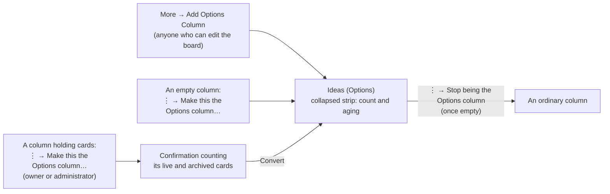

- **Adding one.** On the board, **More → Add Options Column** (offered to whoever can edit the board, not to a viewer) opens the Add Column window as an Options column, called **Ideas** unless another name is typed. Its header then reads **Ideas (Options)**: the "(Options)" is not part of the name and is not renamed with it. **Add Column** offers the same as a tick box, "Options column", on a board that has none.
- **Making a column the Options column.** The column's **⋮** menu has **Make this the Options column…** for the board's owner or an administrator, on a column whose name does not already mean To Do, On Hold or Complete (rename it first), on a board with no Options column. An empty column, archived cards included, becomes it at once. A column holding cards is **converted**: the page asks first, naming how many live and archived cards it holds, and on **Convert** every one of them becomes an option, the column moves to the far left and loses any WIP limit. It is one step, recorded as one entry in the board's activity log (**Converted column to Options**, `"Backlog": 4 cards became options (column 12)`, the id naming the column), with no mail and nothing for each card. Each of those cards counts as an option from the conversion, not from when it was made, in the strip's aging. Only the board's owner or an administrator can convert; if a card was added or removed meanwhile, the answer is "The column now holds N cards; look again", and nothing changes. A column holding a card that has a sub-board cannot be converted: a card with sub-boards is never an option.
- **The strip.** The Options column is drawn as a narrow strip with its count, the age of its oldest option, and how many options are older than 30 days. A press opens it into a column; **‹** in its header collapses it again, and the keyboard's focus follows to the **‹** or the strip. Each person's choice is kept in their own browser, per board. Cards can be dropped on the strip.
- **Rules.** One Options column a board, never on an ideas board. No column goes left of it: Add Column offers no "At the start" while it exists, a column dragged left of it lands straight after it, and the API refuses a position at or left of it. It cannot be renamed To Do, On Hold, Complete or the like, and it has no WIP limit.
- **Going back.** **Stop being the Options column** in its menu (the board's owner or an administrator) makes it an ordinary column again, once it is empty, archived cards included: its cards are moved out first, each a recorded move (the board's bulk Move works too). An archived card cannot be moved: it is restored and moved, or deleted, and the refusal says so when only archived cards are left.
- **Deleting it.** An Options column that holds options that are not archived cannot be deleted: the board says so at once, without asking ("This Options column still holds 2 options: move them out, or archive them to discard them, first."). Its archived cards go with it, as any column's, and are not discarded by it.
- **Archiving or deleting an option discards it** (card 2461). An option archived from the Options column, or from any column of an ideas board, by any way of archiving a card (the card window, the card menu, a bulk archive on the board, or `DELETE` through the API), is discarded by whoever archived it, at that moment: the card records both, its activity entry is **Discarded card** (`"T": discarded from Ideas`) in place of Archived card, its webhook `card.discarded`, and the Archived page, All Tasks' **Archived Cards** and the board's **Archived Cards** mark it **Discarded** (its tooltip: "Discarded from the Options column. Restoring it makes it an idea again."). The page says so as it happens: the archive's question ends "This idea will be recorded as discarded." and the toast reads `Discarded "T". Restore it from Archived Cards.`, on the board (the card window and the card menu) and in All Tasks' card window; a bulk archive counts the ideas among what it archived (`3 cards archived, 1 of them an idea recorded as discarded.`). All Tasks says so for a card on an ideas board too, whose kind its load carries (card 2463); All To Do lists no upstream column, so has no idea to archive. Restoring it, from any of them or with `archivedAt: null` through the API, clears the discard: the card is back in its column, still an option, and the entry reads **Restored card**, `"T": back in Ideas`. An option deleted for good writes **Discarded card** (`"T": deleted from Ideas`) and then **Deleted card**, and sends `card.discarded` then `card.deleted`. An archived card deleted for good writes only Deleted card, wherever it is: one discarded already was discarded once, and one archived as committed work before its column was converted to Options had left play. Deleting a column or a board, **Clear Cards** and **Purge Archived Cards** discard nothing: they are housekeeping, with no entry for each card.
- **Archiving unfinished work abandons it** (card 2461, ruling f). A committed card archived from a column that is not Complete is recorded as **Archived unfinished card** (`"T": archived unfinished, from In Progress`) in place of Archived card, so work dropped before it was finished is seen; the figures call it "Abandoned" (card 2462, below). Nothing is marked on the card and no webhook is sent, as for any archive; a restore is Restored card as before. A card archived from Complete (or Done) is still **Archived card**; a final column called anything else, such as Released or Shipped, counts as unfinished.
- **Moving across the commitment point** (card 2460). A card moved out of the Options column into another column, by any way of moving a card, is committed by whoever moved it, at that moment: its activity entry is **Committed card**, its webhook `card.committed`, and the page shows `Committed "<title>"` after a drag, an On Hold confirmation, the card menu's **Move to**, a bulk **Move** or All Tasks' **Move** window. Moved back in, its commitment is cleared (**Returned card to Options**, and `Returned "<title>" to Options` on the page). Every **Move to** list marks the Options column "(Options)". Two moves are refused: an archived card across the commitment point, either way (`Card "T" is archived: restore it before moving it out of or back into Options`), and a committed card that has a sub-board back into the Options column (`Card "T" has a sub-board, so it cannot go into the Options column: a card with sub-boards is committed work. Keep it in a committed column, or archive it if it is no longer wanted.`); a card already in the Options column with a sub-board, made before that was refused, can still be moved out. A webhook that asks for every event receives `card.committed` from this release; one that lists only `card.moved` does not, so a receiver that mirrors columns should add it.
- **The figures, reports and what owners see** (card 2462). Options are in none of the delivery figures, anywhere: board **Statistics** (its totals, average age and bars), the board's delivery metrics, the flow diagram, the burndown, the dashboard's board rows and its board health and aging, All Tasks' totals, My Tasks, goals and their plans, reports and the activity report. The exports list them, marked **Option** in their Stage column. For a board with no Options column every figure is as it was, but one: a card moved from one Complete column to another after it was completed showed a negative cycle time, and now shows 0.
  - **Statistics** gives the board's options a line of their own, `Options 2 · discard rate 25%`. Its Delivery Metrics name **Lead time (commitment to done)**, from the card's commitment to Complete (for a card made before this release, its creation), and **Cycle time**, the time from start of work to done: from the first move after the commitment, or a commitment straight into a working column (not To Do, On Hold, the board's first committed column or a queue such as Backlog or Ready), never longer than the lead time. A card created straight into a working column has no cycle time. **Throughput** sits beside **Committed (all)**, the cards that arrived as committed work in the period. **Abandoned: N** shows on any board with committed work archived before Complete. On a board with an Options column, or where any is not zero, the **Upstream** figures follow: Committed from options, Options now, Returned to options, Discarded, Sent to other boards, Discard rate (discarded out of discarded, committed and sent on), Oldest option (days), Options over 30 days, and Time in options (average and median). An ideas board's Statistics show `N ideas`, the Upstream figures and the flow diagram, and none of the delivery tiles, bars, metrics or burndown. When the metrics cannot be read the panel says `Metrics could not be loaded`, with **Retry**; on All Tasks it says `Choose a board to see its delivery metrics` until a board is chosen, and then counts that board alone.
  - **The flow diagram** leaves the Options column out. **Show upstream**, beside its heading on a delivery board with an Options column, draws it as the bottom band with the **commitment point** along its top; each person's choice is kept in their own browser. A column made the Options column during the 30 days is left out with its band, its earlier days as a committed column too, until Show upstream is ticked.
  - **The dashboard** gives a board with options a count of its committed cards, whose tooltip says the options are not counted; a board that still holds options is not hidden as done, and sorting by Cards orders an ideas board by its ideas. A goal whose committed cards are all done stays **Ready** with options left, and its tooltip says how many it still holds. **All Tasks** puts every board's options in one **Options** column, first, marked **not committed**. A goal's list reads `3/5 and 2 options`; its plan notes `and 2 options` under its cards complete, marks each option **Option** in the work table (with an **Options** filter), draws it dashed in the graph and tags it on the critical path. An option is never startable or waiting, but holds up what depends on it.
  - **Reports.** The PDF gives an **Upstream** line when anything happened upstream in the period (`Upstream: 3 options now, oldest 40 days, 1 over 30 days · 2 committed from options · …`), and `Abandoned (committed work archived before Complete): N` on a line of its own when there is abandoned work, which an ordinary board can have too. A report about one person has neither and, where its boards have an Options column, an ideas board or abandoned work in the period, says why: those figures describe the boards, not one person's work. The Reports page's Person hint says the same, naming the same four things (options, commitments from options, discards and abandoned work).
  - **Exports.** Both CSV exports end with two more columns, **Stage** (Option or Committed: the exports list live cards, options included) and **Committed** (when the card was committed); every other column keeps its place.

## Ideas Boards

An **ideas board** (milestone 22, card 2463) is a board of ideas only: every column is upstream, as the Options column is, and its ideas are sent on to delivery boards. Every board made before is a delivery board, and stays one.

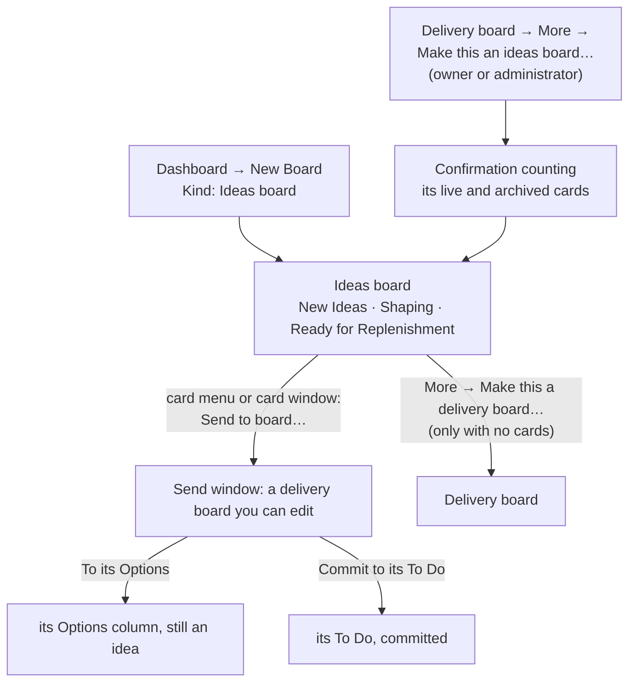

- **Making one.** **New Board** asks for the kind: **Delivery board** (the default, To Do, On Hold, In Progress, Complete) or **Ideas board** (New Ideas, Shaping, Ready for Replenishment). A sub-board, made from a card, is always a delivery board, and no sub-board can be made under an idea or an option: the card's menu offers no **Add Sub-board**, its card window no sub-board to create, link or add, and the dashboard's **New Sub-board** is not offered on an ideas board (a sub-board an option already has still opens and can be deleted). The board's header says **Ideas board**.
- **Its columns.** Each always offers **Add idea**, shows the age of its oldest idea and how many are older than 30 days, and may have a WIP limit (on Ready for Replenishment, a replenishment queue). None may be called To Do, On Hold or Complete, or anything that means one (Todo, Blocked, Parked, Waiting, Done): the name is refused, `An ideas board has no Complete column: "Done" would make one. Choose another name.` A column holding ideas is not deleted: the board says so at once, `This column of an ideas board still holds 2 ideas: move them out, or archive them to discard them, first.` More has no **Burndown** and no **Add Options Column** on an ideas board; its Statistics show `N ideas`, the Upstream figures and the flow diagram.
- **Converting a delivery board.** The board's owner or an administrator uses **More → Make this an ideas board…** on a board that is not a sub-board. The board counts its cards, live and archived, and asks: every card becomes an idea, its commitment cleared, in one step recorded as one entry (**Converted board to an ideas board**), with no mail or webhook; the empty To Do, On Hold and Complete columns are removed; an Options column becomes an ordinary column. A board with no cards at all has its columns replaced with the ideas board's three. Before asking, the board says why it cannot when a live card has a sub-board (an archived one, or one on a board you cannot open, is refused by the server after the question, in its own words) (`Card "T" has a sub-board, and a card with sub-boards is never an option: move it to another board, or move or delete its sub-board, first.`), when a To Do or On Hold column holds cards (`"To Do" holds 3 cards, and an ideas board has no To Do column: rename it first.`), or when a Complete column holds cards (`… move them to a delivery board, or delete them, first.`). If a card was added after the question, the server refuses (`The board now holds 5 cards; look again.`) and nothing changes. Through the API it is `POST /api/v1/boards/{boardId}/convert` with `{ "kind": "ideas", "cards": N }`.
- **Going back.** **More → Make this a delivery board…** works only on an ideas board holding no cards, archived ones included; its columns are replaced with To Do, On Hold, In Progress and Complete, recorded as **Updated board**. While it holds any, the board says so (`This ideas board holds 2 cards. Making it a delivery board would commit them without anyone committing them: move them to a delivery board, or delete them, first.`).
- **Send to board.** **Send to board…**, in a card's menu and its card window, is offered for an idea to anyone who can edit the board: any card on an ideas board, or in a delivery board's Options column; never for committed work. The Send window lists every delivery board you can edit, and offers **To its Options**, where the board has an Options column (never for a card with a sub-board), and **Commit to its To Do**, into the board's first column called To Do, or its first working column, never On Hold, naming that column when it is not To Do. A choice the board cannot take is shown greyed with why, and never chosen. From a card window with changes not saved, the board asks first (**Send without saving**), as the Send closes the window. The card leaves this board, and the focus goes to the column it left; the toast says `Sent "T" to Ops's Options` or `… To Do`, `Committed "T"` for To Do, and, if it left a goal of this board's, that it did. A refusal is said in the server's words and the window stays open. The idea keeps its age; its labels, category and goal stay behind. This board records **Sent card to another board**; any other move of an idea to another board, the card window's board picker or All Tasks' Move, is recorded the same way.

---

## Attachments

Deleting a file from a card's **Files** tab asks first, in the app's confirm dialog, "Delete File", naming it (card 2360, 2026-10-21; it went on one click).

### Where the files are

Attachment files are on the server's disk, in the `uploads` folder beside the database, and are in no backup that DumpFire makes. Backing that folder up is described in [Deployment](deployment.md#attachment-files).

### The trash

When an attachment's row is deleted, because the attachment itself, its card, its column or its board was deleted, its file is moved to a trash folder and removed 30 days later. Until then, importing a backup taken before the delete brings the attachment back, file included. There is no screen for the trash: files come back through **Import Backup**.

**Files no attachment names go to the trash too** (card 2107). Every six hours, and first 15 minutes after the server starts, DumpFire looks through the card folders of the uploads folder for files that no attachment on any card names: a file left by a delete whose move to the trash failed, by an upload that was cut off, or by a permanent delete made before deleted cards' files went to the trash. Each one that has not changed for a day is moved to the trash, kept 30 days and then removed, like any other. It never touches a file an attachment names, a file written in the last day, or anything that is not a plain file in a card's own folder, and it does nothing at all if it cannot read the attachments. It runs only where the scheduled backups and reports run, so not on a copy started with `SCHEDULERS=off`.

- **The first run after the update that brings it** moves every file left by permanent deletes made before then. The system log says how many in one `[INFO] [UPLOADS]` line on the Audit page's Live Console.
- **Importing a backup within 30 days puts any of them back** that a restored attachment names, as it does for a deleted card's files.
- **A restore that left the attachments out** says so in its result. Its files go to the trash at the next run, and importing a backup that has the attachments, within 30 days, puts them back.

What the sweep reads, what it never touches and every line it writes are in [Deployment](deployment.md#the-sweep-files-no-attachment-names).

### How large an attachment can be

A file of up to 25 MB can be attached to a card. A file that is not attached is listed under the upload area with the reason, one line a file, and the others of the same upload are still tried:

| The card says | What happened |
|---------------|---------------|
| "…" could not be read on this computer, so nothing was sent | The browser could not read the file: a folder was dropped, or the file has moved |
| No answer from the server. It is not known whether "…" was accepted | Open the card again to see whether it is there |
| "…" was refused before it reached DumpFire, probably a size limit at the proxy in front of it (HTTP 413) | The proxy in front of DumpFire refused it. nginx refuses an upload over 1 MB unless it is told otherwise: see [Reverse Proxy](deployment.md#reverse-proxy--nginx) |
| "…" is larger than this server accepts. The limit here is 26 MB | DumpFire refused it for its size. A limit of 512 KB there means the server was started without `BODY_SIZE_LIMIT`: see [Upload Size Limits](deployment.md#upload-size-limits) |

The card used to say nothing when an upload failed, and could go on saying "Uploading..." until it was closed.

### Attachments that download

What an attachment does depends on how it is opened, and in both cases on the type recorded at upload agreeing with the file name's extension:

| Opened | Shown in the browser | Saved to disk |
|--------|----------------------|---------------|
| From its card | PNG, JPEG, GIF and WebP images. Each has a thumbnail on the card, and clicking the thumbnail opens the image | Every other attachment. Clicking the name of any attachment, an image included, saves it |
| By its address, pasted into the browser | PNG, JPEG, GIF and WebP images and `.txt` text files, each as its own type | Everything else: PDF, HTML and SVG files, Office documents, archives, and any file whose name and recorded type disagree |

An HTML or SVG file can carry a script, and opened as a page of DumpFire it would run with the reader's session. So neither is ever shown in the browser, and every attachment is answered with `Content-Security-Policy: sandbox` and `X-Content-Type-Options: nosniff`. A PDF is saved too: a browser shows one in its own viewer, which does not start under that sandbox. If someone reports that an attachment does not open, that is why, and the file is intact.

---

## Danger Zone

The **Danger Zone** at the foot of the Admin panel has four actions. Each asks for confirmation. The first three are any administrator's. **Reset Everything** is shown to the superadmin only, and is refused to everybody else: whoever sets DumpFire up after a reset is its superadmin.

| Action | What it does | What it does not do |
|--------|--------------|---------------------|
| **Purge Archived Cards** | Permanently deletes every archived card on every board, with its subtasks, comments, dependency links and sub-boards. Attachment files go to the trash for 30 days | Touch a card that is not archived |
| **Vacuum Database** | Rebuilds the database file to reclaim unused space | Change any data, or reset ids. New boards and cards are still numbered on from the highest there has been |
| **Reset All XP** | Sets every user's XP to 0 | Change anything else |
| **Reset Everything** | Clears the whole installation. See below | Restart ids, or clear the system log and the backup history |

### Reset Everything

Reset returns DumpFire to the state of a new installation, ready to be set up again.

| Cleared | Kept |
|---------|------|
| Every board, column, card, subtask, comment, label, category and milestone, and the activity log of every board | The system log, including the line that says who ran the reset. `GET /api/logs` returns it |
| Every user, session, API key, team, invite and membership, and the key remembered browsers are signed with | The backup history |
| Every setting: the mail settings, the application URL, the backup schedule and its destinations | The structure of the database and its record of applied migrations |
| Task requests, report schedules, webhooks, XP, chart history | The id counters: new boards and cards are numbered on from the old ones |
| Every attachment row. The files are moved to the trash for 30 days | Backups already made at the backup destinations |

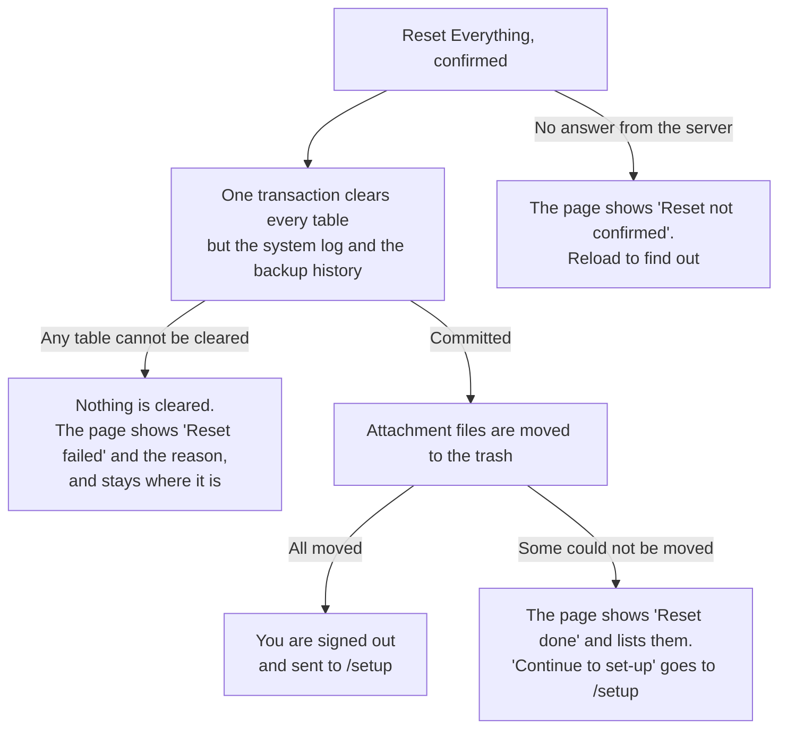

- **It is all or nothing.** Either every table is cleared or none is. A reset can no longer leave users in place with their sessions and the settings gone.
- **If it fails, the page says so.** A dialog titled **Reset failed** shows "The reset failed and nothing was cleared:" followed by the reason, and stays until it is closed. Nothing has changed and you are still signed in. The failure is also in the system log, at `ERROR`.
- **If it succeeds, you are signed out** and taken to `/setup` to create the first account. The system log has a `CRITICAL` line saying who reset the database, how many rows went from how many tables, and how many attachment files were moved to the trash.
- **Attachment files that cannot be moved are reported, and the reset still stands.** A dialog titled **Reset done** lists them. They are where they were, in the uploads folder, and belong to no card.
- **Ids carry on.** The first board created after a reset does not get id 1 again. Nothing left over from before, such as a file in the trash or a line in the system log, can be mistaken for something new.
- **Take a backup first.** Reset cannot be undone except by importing one.

---

## Board Categories

Organise boards into categories for the dashboard sidebar:

1. Go to **Admin → Board Categories** (or use the dashboard category manager: **Display → 🏷️ Manage Categories** beside Your Boards, since 26 October 2026, when its button moved into the Display menu)
2. Create categories with names and colours
3. Assign boards to categories

Categories appear as collapsible groups in the dashboard sidebar.

The dashboard's **Manage Categories** window says a change it could not make under its header, in the server's words or as "No answer from the server. The category may not have been created." (saved, deleted), and keeps what was typed (card 2358, 2026-10-21; it said nothing, and a change with no answer left the window's buttons dead). Deleting a category asks first in the app's confirm dialog, "Delete Category", naming it.

From the keyboard (card 2365, 2026-10-21; it took no focus, Tab walked the page behind it, and Escape did nothing): as the window opens the name box under **Create New** has the focus; Tab and Shift+Tab stay in the window; **Escape** closes it, as × does, except while a change is on its way, so that what the server says of it is not lost (× likewise since card 2375, 2026-10-21: it closed the window and the answer was said to nobody; it is marked unavailable to a screen reader meanwhile); with a category's edit open, Escape cancels that edit alone, and the focus goes back to its ✎ (the next Escape closes the window); and as it closes the focus goes back to the **Display** button whose menu it was opened from (card 2466, 2026-10-26; it went back to the **🏷️ Manage Categories** button, which is now an item of that menu). While the delete's confirm is up, Escape closes the confirm alone.

---

## Notification Preferences

Each user controls their own notification preferences from **My Account**, under **Email Notifications**. The switches, in the order the page shows them:

| Switch | Controls |
|--------|----------|
| **All Email Notifications** | The master switch. Off, no mail of any kind below is sent, whatever its own switch says. Turning it off turns every switch below off, and turning it on turns them all on |
| **Task Assignments** | Mailed when you are assigned to a card |
| **Comments** | Mailed when someone else comments on a card of a board you are a member of, yourself or through a team |
| **Mentions** | Mailed when someone @mentions you in a comment on a card of a board you can open. Someone named on a board they cannot open is not mailed, and the comment's author is not told (card 2198). A mention is `@` and the username as it is spelled, in any case: `@Greg`, `@jane.doe`, `@Jane Doe` (card 2207) |
| **Card Moves** | Mailed when someone else moves a card you are assigned to to another column on a page, or completes it by any route, through the API included. Never for a move you made yourself, nor for a card on a board you cannot open (card 2180). Also decides the "Unblocked" mail |
| **Task Requests** | Mailed when someone sends you or your team a task request, or replies to one |
| **Request Progress** | For a request you raised while signed in: mailed as work goes on on the card made from it (a move, a subtask ticked, a comment), and when it is complete. Someone who raised a request without an account is always mailed |
| **Board Sharing** | Mailed when a board is shared with you |
| **Planning** | Mailed when someone else makes a plan from cards that depend on each other, and you are assigned to one of its cards or are an administrator |

The page, the route that saves the switches (`/api/account/notifications`) and the mail that reads them share one list, `src/lib/notification-prefs.ts` (card 2146). Until 2026-10-15 they kept three: **Request Progress** was offered and never saved, so it went back on at every reload and the progress mail was always sent, and **Mentions** was neither offered nor saved, so mention mail could be stopped only by switching all mail off. Nobody had either stored, so anyone who switched Request Progress off before then gets the mail until they switch it off again. A switch that is refused, or gets no answer, goes back to what it was, with the reason under the switches; the switches cannot be pressed while a change is being saved.

---

## System Health Monitoring

### Logs

DumpFire logs to the console with prefixed module names. `INFO` lines go to stdout;
`WARN`, `ERROR` and `CRITICAL` lines go to stderr, so read both (`docker logs <container> 2>&1`).
Each line carries a timestamp and its level before the module name:

```
[2026-10-12T15:14:16.619Z] [WARN] [DB] Applied migration: 0052_drop_time_entries.sql
[2026-10-12T15:14:16.640Z] [WARN] [BACKUP] Backup scheduler initialized
[2026-10-12T15:14:21.903Z] [INFO] [HTTP] GET /board/1 → 200 (12ms) | {"method":"GET","path":"/board/1","status":200,"durationMs":12}
```

**Every entry is one line** (card 2214). A line break, a tab, ESC or any other control
character in what a line names, a board's name or a card's title typed with a line break
among them, is written as a space: on the console, in the stored row and on the Audit
page's Live Console, where the line's detail shows it on one line. So are the characters
that change the direction text reads in (U+202A to U+202E, U+2066 to U+2069) and those
that show as nothing (U+200B to U+200F, U+FEFF), and the same goes for the entry's
address. So no name can begin a line of its own that reads as another entry
(`[CRITICAL] [AUTH] ...`), make a line read in another order, or send escape sequences to
the terminal of whoever reads `docker logs`. Rows the server did not write this way are
not cleaned: those written before the update that brings this, and those a restored
backup brings in, can still hold one; they go with the 30-day retention.

**After the update that brings migration 0053, everybody is signed out once**, you
included (card 2106): see [Every Session Ended Once](authentication-security.md#every-session-ended-once-by-migration-0053).
Until each browser signs in again, every request it makes with its old cookie writes a
`WARN` line under `AUTH`, `Session validation failed — token not in DB (deleted or never issued)`. A few
for each browser are expected that day; they stop as people sign in.
The update that brings migration 0054 ends every invite not yet used, once: see [Every Unused Invite Ended Once](authentication-security.md#every-unused-invite-ended-once-by-migration-0054); send again with 📧 the ones still wanted.

**The sign-in and password lines**, all under `AUTH`, on the Audit page's Live Console and at `GET /api/logs`:

| Line | Level | When |
|------|-------|------|
| `Failed login attempt at "alice" (user 12) from IP 203.0.113.7 (bad password)` | `WARN` | A wrong password at an account. The account's own username, never what was typed, with the account as the line's user and the address as its `ip` |
| `Failed login attempt for a name that is no account (17 characters) from IP 203.0.113.7` | `WARN` | A name that matches no account. Only its length, which may be a password typed into the name box. Older lines, which held the name as typed, are rewritten this way at the first start after the update and in every backup; lines ending `(bad password)` are left as they were (card 2193). The copies outside the database are not: `docker logs` of the container and any log shipper's copy keep the old lines as they were written |
| `Rate limit hit for IP 2001:db8:1:2::9, counted as 2001:db8:1:2::/64 (login attempts)` | `WARN` | Every attempt the address's limit refuses: the eleventh from one address in 15 minutes, and each one after it until the window ends, one line each. "counted as" is there when the address is counted as something else: an IPv6 address by its /64 network, an IPv4 address written as IPv6, or one with a port (card 2195) |
| `Sign-ins at "pat" (user 12) are being slowed: 5 wrong passwords within 15 minutes of each other` | `WARN` | An account's waits begin (card 2177). `Sign-ins at a name that is no account are being slowed: …` for a name |
| `Sign-ins at "pat" (user 12) from browsers not known here are being let in one at a time` | `WARN` | The first sign-in refused at an account for want of a place, and again only after 15 minutes without a refusal (card 2194). `Sign-ins at a name that is no account from browsers not known here are being let in one at a time` for a name |
| `A browser could not be remembered for user N: …` | `WARN` | The key remembered browsers are signed with could not be read or made. The sign-in, or the change, went through; the browser is not remembered |
| `Password checks run on 2 worker thread(s)` | `INFO` | The first password check after a start (card 2191). `Password checks run on the server's thread (PASSWORD_THREADS=0)` if that was set |
| `Password checks are queuing: 34 password checks waiting (sign-ins, invites, set-up), the oldest for 6 s` | `WARN` | More than 20 sign-ins, invites and set-ups are waiting for a password check, at most once every five minutes. With many failed sign-in lines beside it, an attack |
| `Password checks are full: 300 password checks waiting (sign-ins, invites, set-up); sign-ins from browsers not remembered, invites and set-up are being answered 'busy'` | `WARN` | 150 checks for each thread are waiting (about thirty seconds of them on a fast host, a minute or more on a small one), and the next sign-in from a browser not remembered, invite or set-up is answered "busy" at once, at most once every five minutes |
| `Password checks cannot run on worker threads (…). Every password is checked on the server's thread until it restarts, …` | `ERROR` | No worker thread could start. Everyone still signs in, but each check holds the whole server about a fifth of a second until a restart: report it |
| `PASSWORD_THREADS="…" is not a whole number from 0 to 8: …` and `SIGN_IN_ONE_AT_A_TIME is "…", which is neither on nor off: …` | `WARN` | A setting on the host was mistyped; the default is used. See [Deployment](deployment.md#environment-variables) |
| `SIGN_IN_ONE_AT_A_TIME=off: sign-ins from browsers not remembered are not held to one at a time. …` | `WARN`, under `STARTUP`, on the console whatever `LOG_LEVEL` is | At every start while the host has that set. It is meant for one sign-in during an attack, and removed: see [If an Attack Keeps an Owner Out](deployment.md#if-an-attack-keeps-an-owner-out) |
| `Password reset for user 7 ("pat") by "admin" — ended 1 session(s), 0 invite(s) and 1 API key(s), switched off 3 webhook(s) they set up (ids 4, 9, 12) and paused 1 report schedule(s) (id 2)` | `INFO` | A reset (card 2168). An invite used writes `Password set with an invite for user 7 — …` with the same parts, and a user's own change `Password changed by user — … and switched off N webhook(s) they set up (…)`. The ids are the ones to switch on again once you know they are genuine |

**The webhook lines**, under `Webhooks`, and the three start-up lines about webhooks. Each names the webhook, its board and its host, never the address's path or query, which can hold a token. See [Where a Webhook May Send](notifications-email.md#where-a-webhook-may-send):

| Line | Level | When |
|------|-------|------|
| `Webhook 4 on board 3 not sent: 127.0.0.1 is a loopback address` | `WARN` | Its address is inside the network as written, or carries a user name or password, or is not an http or https address. The first event writes it at once; after that, one line per webhook and kind of refusal per hour, whatever address or status it names, the next line ending `(12 more like this since the last such line were not logged)`. So for every `WARN` here: the system log keeps 50,000 rows, and a busy board wrote one for each event. Until the address is changed or `WEBHOOK_ALLOW_INSIDE` names it (card 2161) |
| `Webhook 4 on board 3 not sent: localtest.me resolves to 127.0.0.1, a loopback address` | `WARN` | Its name resolved, as the connection was made, to an address inside the network. Nothing was sent |
| `Webhook 4 on board 3: hooks.example.com answered 307, a redirect, which is not followed` | `WARN` | The receiver answered with a redirect |
| `Webhook 4 on board 3: delivery to hooks.example.com failed: …` | `ERROR` | The receiver could not be reached, or gave no answer within 10 seconds (`no answer within 10 s`) |
| `Webhook 4 on board 3 not sent: its events are not a list` | `WARN` | Its stored events are not a list (card 2145). Fix it with `PUT /api/v1/webhooks/{id}` and a list of events |
| `WEBHOOK_ALLOW_INSIDE: "10.0.0.0/2" ignored: wider than one inside range` | `WARN`, under `STARTUP` | At every start, one line for each entry of `WEBHOOK_ALLOW_INSIDE` that is ignored, which the host's operator corrects: see [Deployment](deployment.md#where-a-webhook-may-send). The rest of the list applies |
| `2 board(s) have more webhooks than the 10 a board may have: board 12 has 14, board 40 has 11. All of them are still sent, and none can be added to such a board until it has fewer than 10.` | `WARN`, under `STARTUP` | At every start while a board has more than 10 webhooks, made before the cap (card 2201). Look at each with its owner, and delete the ones not wanted |
| `2 webhook(s) that are on are not sent, whatever their names resolve to: webhook 4 on board 3 (127.0.0.1 is a loopback address); webhook 9 on board 3 (n8n is a name with no dot, which is looked up inside the network). Each is refused at every event until its address is changed or it is switched off; one inside the network can instead be named in WEBHOOK_ALLOW_INSIDE.` | `WARN`, under `STARTUP` | At every start while a webhook that is on is refused as its address is written; the first 20 named, then `; and N more`. No name is looked up. Change the address with `PUT /api/v1/webhooks/{id}`, switch it off, or ask the host's operator to name its host in `WEBHOOK_ALLOW_INSIDE` |

### Database Location

| Environment | Path |
|-------------|------|
| Development | `./dumpfire.db` in project root, unless `DB_PATH` names another file |
| Docker | `/app/data/dumpfire.db`, the image's `DB_PATH`, on the volume mounted at `/app/data` |

The attachment files are in the folder `uploads` beside the database. An image built before card 2083 set no `DB_PATH`, and a container from it started without one kept its database at `/app/dumpfire.db`, inside the container, where it is lost when the container is replaced. A newer image refuses to start rather than create an empty database at `/app/data/dumpfire.db` while it can see one at `/app/dumpfire.db` or elsewhere in `/app/data`; refuses as well to create one at any other path, such as an empty or mistyped `DB_PATH`, while `/app/data/dumpfire.db` has data, or when it cannot read what it needed to look at; refuses a database with no user accounts while one is at `/app/dumpfire.db` beside it; and says at every start when the database is not on a mounted volume. Each refusal names the files with their sizes and when each was last written. See [Start-Up Sequence](deployment.md#start-up-sequence) for the whole rule. See [Moving the Database onto the Volume](deployment.md#moving-the-database-onto-the-volume) in the deployment guide.

### Activity Log

Every board change is recorded in the activity log (visible per-board in the stats panel). This includes:
- Card created, updated, moved, completed, archived, restored, deleted. A card created in a Complete or Done column has `card_created` and then `card_completed`, and so does one made by accepting a task request into such a column
- Subtask completed or deleted, on the page or through the API; and since card 2299 a subtask unticked or edited (`subtask_updated`), a save that changes nothing writing nothing
- Column deleted, with how many cards went with it
- Archived cards purged, or a board's cards cleared, with the count
- Comment added or edited
- User assigned or unassigned, in a card's window, through the API, or by accepting a task request with an assignee (`assignee_added`, by whoever accepted it, after `card_created`)
- Board created, and a board updated, naming its fields: the name, emoji, dashboard grouping (`categoryId`) and whether it is public (`isPublic`) whenever they are sent, changed or not; the card it hangs under (`parentCardId`, which only a page can set) only when it changes
- Milestone created on a board. One that belongs to no board has no board's log to go in, and writes no entry
- Milestone changed, closed, reopened or deleted, and a card put in a milestone or taken out, on a page or through the API, the bulk routes included (card 2289; none of it was recorded). A save that changes nothing writes nothing
- API actions (prefixed with `api:`)

A card update (`card_updated`, `api:card_updated`) names only the fields that changed, as "Updated fields: theme on "…"", and a save that changes nothing is not recorded at all: no entry, no `card.updated` webhook, and the card's `updatedAt` stays, so the activity report does not count the card as worked on. A field sent with the value the card holds is not a change, and an empty value and none are the same when comparing (a description, on-hold note or business value is still cleared with empty text, not with none). Until 2026-10-15 every field a save sent was named, changed or not, so pressing Save on an unchanged card in the card window wrote "Updated fields: title, description, priority, …" (card 2183). A move out of an On Hold column clears the card's on-hold note and is recorded by the move's own entry alone; a drag out of On Hold on the board page also wrote "Updated fields: onHoldNote" until then (card 2208). A card update never names `position`: a change of a card's position within its column is not recorded on any route, as a drag's is not, and moves no `updatedAt`; the web application's card update recorded one as "Updated fields: position", with a `card.updated` webhook, until card 2288.

Each of these is recorded alike whether it was done on a page or through the API, in the same words, the stored name bare for a page and with `api:` in front for the API (card 2143). Until 2026-10-15 an assignment, a comment edited, a board created or updated and a milestone created were recorded only when done through the API, so the Audit page, a board's Activity Log, `GET /api/v1/audit-log` and the activity report did not show them when they were done on a page. The pages open on the board are now told of an assignment or an unassignment, a comment edited and a board updated, and the board a new sub-board's card is on is told of the sub-board, so they refresh as they do for the API's.

The board's activity panel and the All Tasks activity panel name each action in the same words, from one table (`src/lib/utils/activity-labels.ts`, card 2212), whichever way it was done:

| Stored name, bare or with `api:` | Shown as |
|----------------------------------|----------|
| `card_created`, `card_updated`, `card_moved`, `card_completed`, `card_reopened`, `card_archived`, `card_restored`, `card_deleted` | Created card, Updated card, Moved card, Completed card, Reopened card, Archived card, Restored card, Deleted card |
| `card_moved_away`, `card_moved_in` | Moved card to another board, Moved card from another board. Their text names neither board (card 2181): `"T" moved to another board (To Do → Done)` on the board it left, `"T" moved from another board (To Do → Done)` on the one it joined. All Tasks and the Audit page list each under its own board. To trace where a card went, use All Tasks (for the boards you can open), the Audit page (administrators), or `GET /api/v1/cards/:cardId/board-history`, which lists each board the card has been on, with its dates. Entries written before card 2181 still name the other board |
| `card_committed`, `card_returned_to_options` | Committed card, Returned card to Options (milestone 22, card 2460). A card moved out of the Options column, or off an ideas board, into a committed column, in place of Moved card; and a committed card moved back. `"T": Ideas → To Do (column 12, from column 15)`, the ids naming the column it went into and the column it left (a return has no id; an entry written before card 2462 names only the first, `(column 12)`), on the board the card is on now, after the pair above for a move to another board. Out of Options straight into Complete writes Committed card then Completed card; out of Complete back into Options, Reopened card then Returned card to Options |
| `card_discarded` | Discarded card (milestone 22, card 2461). An option archived from the Options column or an ideas board, in place of Archived card, `"T": discarded from Ideas`; or deleted from one, before Deleted card and like it with no card, `"T": deleted from Ideas`. Sends `card.discarded`. A card restored afterwards keeps this entry, and its Restored card reads `"T": back in Ideas` |
| `card_abandoned` | Archived unfinished card (milestone 22, card 2461). A committed card archived from a column that is not Complete or Done, in place of Archived card: `"T": archived unfinished, from In Progress`. No webhook, and nothing on the card. Archived card is now written for a card archived from Complete |
| `column_converted_to_options` | Converted column to Options (milestone 22, card 2459). One entry, with no card, when a column holding cards is converted into the Options column: `"Backlog": 4 cards became options (column 12)`, or `"Backlog": 1 card became an option (column 12)`; the id names the column, which the Options strip's aging reads. Nothing is written for each card, and no webhook is sent |
| `card_sent` | Sent card to another board (milestone 22, card 2463). Written on the board an idea leaves, in place of Moved card to another board, whenever an idea (a card in the Options column or on an ideas board) goes to another board, by **Send to board…** or by any other move: `"T" sent to another board's Options (Shaping → Ideas)`, `… To Do (Ready for Replenishment → To Do)` or `… "Backlog" column (…)`, with ` and out of milestone "Launch"` when it left a goal of this board, or ` and out of a milestone of another board` when it left one of a third board, which it does not name (`"T" sent to another board's Options (Shaping → Ideas) and out of a milestone of another board`). The board it joined writes Moved card from another board, and Committed card after it for To Do, at the same moment; the goal's Removed card from milestone is written beside them, `(sent to another board)`. Neither names the other board. Sends `card.moved`. The upstream figures count it as **Sent to other boards** only when the board it went to is outside the boards a report or the Stats panel covers: a Send between two boards both in a report's scope is a move within it, and is not counted |
| `board_converted_to_ideas` | Converted board to an ideas board (milestone 22, card 2463). One entry, with no card, when **Make this an ideas board…** converts a board holding cards: `"Roadmap": 4 cards became ideas; its columns To Do, Complete were removed (board 12)` (`its column Complete was removed`, or nothing when no column went), or for a board with no card at all `"Roadmap": 0 cards became ideas; its columns To Do, On Hold, In Progress, Complete were replaced with New Ideas, Shaping, Ready for Replenishment (board 12)`. The id names the board, which the ideas' aging reads. Nothing is written for each card, and no webhook or mail is sent. An empty board switched either way writes **Updated board** instead: `Updated board "Roadmap" (fields: kind): now an ideas board; its columns … were replaced with …` |
| `cards_purged`, `cards_cleared`, `column_deleted` | Purged archived cards, Cleared cards, Deleted column |
| `subtask_created`, `subtask_updated`, `subtask_completed`, `subtask_deleted`, and `subtask_toggled`, written by older versions | Created subtask, Updated subtask, Completed subtask, Deleted subtask, Updated subtask. `subtask_updated` is written for an untick, `Reopened <subtask> (on <card>)`, and for a change of title, description, priority, colour or due date, `Updated <subtask> (on <card>): title, dueDate`, naming only the fields changed; one request that ticks or unticks and edits writes two entries. A change of position alone, and a save that changes nothing, write none (card 2299: neither an untick nor an edit was recorded) |
| `comment_added`, `comment_edited`, `comment_deleted` | Added comment, Edited comment, Deleted comment (card 2283: a delete was not recorded) |
| `attachment_added`, `attachment_deleted` | Attached file, Deleted file (card 2337: neither was recorded). Written by the web application's Files tab alone, never with `api:`: `Attached "my notes.pdf" to "Plan"` and `Deleted the file "my notes.pdf" from "Plan"`, the file named as its uploader named it (less any invisible Unicode formatting characters, which could reorder the line), by whoever attached or deleted it (any editor of the board may delete any file on it; the file stays in the trash 30 days). Counted as work on the card by the activity report, as a comment is. No webhook |
| `assignee_added`, `assignee_removed` | Assigned user, Unassigned user |
| `dependency_added`, `dependency_removed`, `dependencies_bulk_added` | Added dependency, Removed dependency, Added dependencies. A batch through `POST /api/v1/dependencies/bulk` writes one `dependency_added` per link it creates, on the board of the card that waits, naming that card (card 2291); `dependencies_bulk_added`, one entry with no card for the whole batch, was written by older versions only, and keeps its label for those rows |
| `board_created`, `board_updated`, `milestone_created` | Created board, Updated board, Created milestone |
| `milestone_updated`, `milestone_closed`, `milestone_reopened`, `milestone_deleted` | Updated milestone, Closed milestone, Reopened milestone, Deleted milestone (card 2289). No card; on the milestone's board, or for one across boards on each board holding its cards, and on a change of board on the boards before and after. `Updated milestone "Launch": name, targetDate` names the fields changed (name, description, targetDate, boardId), not their values; a rename reads by the old name. `Deleted milestone "Launch"; 2 cards on this board released`. A milestone across boards is named `milestone #<id>`, since a reader of one of its boards may not be able to open it; on a board a milestone joins, it is named as it is after the change |
| `milestone_card_added`, `milestone_card_removed` | Added card to milestone, Removed card from milestone (card 2289). On the card's board, with its id: `Added "First" to milestone "Launch"`. A card moved from one milestone to another writes one `milestone_card_added` ending `(from milestone "Pilot")`, and **no `milestone_card_removed` for the milestone it left**. Written by every route: the card window's picker, the plan page, the API's single and bulk routes and `milestoneId` on the API's card update (which named `milestoneId` in `card_updated` until card 2289). Not counted as work on the card by the activity report. A card that leaves a milestone because of another change writes `milestone_card_removed` on its board, with why in brackets (card 2381): `… (moved to another board)` on the board it left, `… (milestone deleted)` for each card a milestone delete releases, `… (card deleted)` for a card deleted for good alone, with its column, by **Clear Cards** or by Purge Archived Cards' **Purge All** (with no card id: the card is gone), and `… (milestone deleted with its board)` for a card elsewhere released by a board's delete. A card deleted with its own board writes none, its board's log going with it, and an import writes no milestone entry |

All Tasks marks an action done through the API with its **API** badge; the board's panel does not, and the Audit page's **Source** filter tells them apart. A name with no label, which only an entry older than these names can have, reads as the name in words with a capital first letter, never with `api:`: `time_logged` reads "Time logged". Until 2026-10-15 the board's panel showed the stored name with each word capitalised ("Card Moved In"), and All Tasks had a table of its own that knew 25 names and showed the rest with spaces for underscores and any `api:` left on, so a completion through the API read "api:card completed".

### The Audit Page

The **Audit** page (`/audit`, from the dashboard's **More ⋯** menu) has two tabs: the
system log's **Live Console**, and the **Audit Log**, the activity log of every board,
newest first. Administrators only. The Audit Log's filters apply together (card 2127):

| Filter | What it finds |
|--------|---------------|
| **Board**, **User**, **From**, **To** | Entries on that board, by that person, in those dates |
| **Action**, a bare name: `card_completed` | That action however it was done, on a page or through the API. It used to find only what was done on a page |
| **Action** ending in `*`: `card_*` | Every action that begins so, however done. Only a trailing `*` is a wildcard: `card_*` finds `card_moved`, `card_completed` and the rest, and not `cards_purged` or `cards_cleared`, which it used to |
| **Action** with `api:` in front: `api:card_completed`, `api:*` | Done through the API only, as before |
| **Source**: All, Web application, API | Where each entry was made. All is both |

So Action `card_completed` with Source All shows every completion, with Source API those
made through the API, and with Source Web application those made on a page. The page asks
`GET /api/audit`, which answers a `source` other than `ui` or `api` with `400`. It reads the
log through the same code as the API's `GET /api/v1/audit-log` (card 2294), so the two find
the same entries; the page shows each action as it is stored, `api:` and all.

**From** and **To** are whole days, in UTC: from today to today shows today's entries, the
last minute's included (card 2095). Every time on the page, in both tabs, is the stored time,
which is UTC, shown in your browser's own time zone, and the Live Console shows it to the
second.

A **From** after its **To** is refused (card 2262): Apply shows "`from` is after `to`" in a
line under the filters, above an empty list. Any other failure is said there too, in the
server's words, or "No answer from the server. The audit log was not read." when none came.
A refused Apply shows no rows, so nothing found by the search before is mistaken for its
answer; a refused **Load more** keeps the rows already shown. The next Apply that works
clears the line. Apply pressed again before the first answer comes shows the newest answer
alone: an earlier one that comes after it, refused or not, is not shown. Until 19 October 2026 a reversed range showed "No audit entries match these
filters.", or the earlier rows, and every failure was silent.

The log is read 100 entries at a time. **Load more** is offered only while the answer says
more entries follow (its `hasMore`, card 2383); it was offered whenever the last page came
back full, so a search with exactly 100 entries (or 200, …) showed a **Load more** that found
nothing. **Load more** asks for the entries older than the last row shown, by its time and id
(card 2387): it asked from the number of rows shown, so each entry written while you read
pushed the next page down a place, and it began with a row already on screen.

### A board beneath one of its own cards

A sub-board hangs beneath a card, and that card is on a board, so the boards form a tree.
A board beneath one of its own cards is one whose card is on the board itself, or on a
board beneath it: the tree goes round, a loop with no top. Nothing makes one now (card
2141): a card moved onto a board beneath it, and a board linked under a card on itself or
beneath it, are refused. One can still be there from before: made by such a move, loaded
by the old JSON import, which DumpFire no longer takes, or brought back by importing a
backup taken before. A backup imported while the server runs that brings one is named at
once, in the same line as at a start, under `[IMPORT]`, as soon as the restore is
committed.

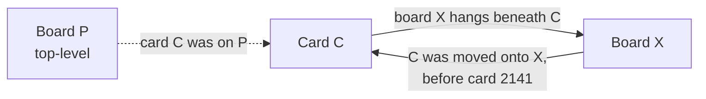

What a loop does:

- **Its boards are on no dashboard**, and in none of the lists that start from the
  top-level boards: the reports page's boards, the All Boards report and the plan page. A
  loop has no board at its top to start from. Its boards still open from a link or a
  bookmark.
- **The card a loop hangs from can never be completed.** Its sub-board holds an open card,
  the card itself or another card of the loop, so a move to Complete is refused, as
  `Sub-board "X" has 2 incomplete cards that must be completed first`.
- **Opening one is safe** (card 2142). The board page's path shows the loop once round and
  stops on the board it came back to: a board S under a card on S itself reads 🔥 › S, and
  a board below it, under a card on S, reads 🔥 › S › S, each crumb with its board's emoji
  before its name (📋 for a board with none). Until card 2142 opening a board in
  a loop, or below one, held the server's one thread for ever, and the server stopped
  answering everyone.
- **The boards below it go with it.** A board that hangs beneath a card on a board of the
  loop, at any depth, is not in the loop and is named by no line. But every delete that
  reaches the loop takes it too, so before deleting anything, list them with the second
  query below.
- **Nothing more nests beneath it** (card 2172). Sub-boards may be at most 20 levels below
  a top-level board, and a board in a loop, or below one, has no top to count from, so it
  counts as past the limit: no sub-board can be made under a card on it, no board is offered
  in its Link existing board list or linked under a card on it, and a card that carries
  sub-boards cannot be moved onto it from a board that is within the limit. Each is refused `409` with the limit's words, for
  example `Sub-boards can be nested at most 20 levels deep, and a board under this card
  would be deeper.` Putting the loop right, below, puts that right too. The move that puts
  a loop right is allowed: it takes the card's sub-boards out of the loop, no deeper than
  they are.

**The line in the system log.** While a loop is there, every start of the server writes
one `WARN` line, under **Audit → Live Console** and on the console (stderr, so
`docker logs <container> 2>&1`), and so does an import of a backup that brings one, at
once:

```
[2026-10-15T08:00:00.000Z] [WARN] [STARTUP] 1 board(s) hang beneath one of their own cards, so they are on no dashboard and the card each hangs from cannot be completed: board 42 "Design", under card 310 "Design work" on board 42. To put one right, open All Tasks, find the card and move it onto a board outside the loop: one move for each loop is enough. Do not delete a board, card or column of a loop to clear it: that deletes every board of the loop and every board below it. See docs/admin-guide.md, under "A board beneath one of its own cards".
```

It names each board in a loop by id and name, the card it hangs from, and the board that
card is on: for a board under a card on itself, the board itself. A card that is archived
is marked `(archived: restore it from Archived first)`, after its title: All Tasks lists
no archived card. A line break or another control character in a name or a title is
printed as a space, so that a name cannot split the line or make one of its own. A board
below a loop is not named; putting the loop right puts it right too. At most 20 boards are
named, the lowest ids first, and the rest are counted (`; and 5 more`). It reads the boards
once and finds the loops without another read, so it costs nothing a person would notice,
however deeply the boards nest. It changes nothing and cannot stop the server from
starting. Once no loop is left, the next start writes no such line.

For every board in a loop, not only the first 20, run this read-only query against the
running database. It changes nothing. The image has no `sqlite3` command, so it uses the
application's own database driver:

```sh
docker exec <container> node -e "const db = require('better-sqlite3')(process.env.DB_PATH || 'dumpfire.db', { readonly: true, fileMustExist: true }); console.table(db.prepare(process.argv[1]).all()); db.close();" 'WITH RECURSIVE up(start, board) AS (
  SELECT b.id, col.board_id FROM boards b
    JOIN cards c ON c.id = b.parent_card_id
    JOIN columns col ON col.id = c.column_id
  UNION
  SELECT up.start, col.board_id FROM up
    JOIN boards b ON b.id = up.board
    JOIN cards c ON c.id = b.parent_card_id
    JOIN columns col ON col.id = c.column_id
)
SELECT b.id AS board, b.name AS board_name, c.id AS parent_card, c.title AS parent_card_title,
       col.board_id AS parent_card_is_on_board
  FROM boards b
  JOIN cards c ON c.id = b.parent_card_id
  JOIN columns col ON col.id = c.column_id
 WHERE b.id IN (SELECT start FROM up WHERE board = start)
 ORDER BY b.id'
```

And for the boards below a loop, which no line names and which every delete of the loop
takes with it, the same way:

```sh
docker exec <container> node -e "const db = require('better-sqlite3')(process.env.DB_PATH || 'dumpfire.db', { readonly: true, fileMustExist: true }); console.table(db.prepare(process.argv[1]).all()); db.close();" 'WITH RECURSIVE up(start, board) AS (
  SELECT b.id, col.board_id FROM boards b
    JOIN cards c ON c.id = b.parent_card_id
    JOIN columns col ON col.id = c.column_id
  UNION
  SELECT up.start, col.board_id FROM up
    JOIN boards b ON b.id = up.board
    JOIN cards c ON c.id = b.parent_card_id
    JOIN columns col ON col.id = c.column_id
),
looped AS (SELECT start AS id FROM up WHERE board = start)
SELECT DISTINCT up.start AS board_below_a_loop FROM up
 WHERE up.board IN (SELECT id FROM looped)
   AND up.start NOT IN (SELECT id FROM looped)
 ORDER BY 1'
```

A query that finds nothing prints a table with only its `(index)` heading and no rows:
there is no loop, or no board below one.

**Putting one right.** For each loop, one move, done for one board of it, is enough: the
rest of the loop then hangs beneath that board. Moving the card is the way; taking the
board out from under its card is the way when the card cannot be moved.

1. **Move the card.** In **All Tasks**, find the card the line names: type `#` and its id,
   `#310`, in the search box, which finds that card alone. Press **Move**, choose a board
   outside the loop and a column that is not Complete or Done, and **Move Card**. A move
   into Complete or Done is refused, `Sub-board "Design" has 2 incomplete cards that must
   be completed first`, because the board beneath the card still holds an open card of the
   loop, the card itself among them when it is on its own sub-board; complete it once it
   has been moved. The board that hung beneath the card goes with it, and hangs beneath it
   on its new board, where it shows on the card again. A move onto a board still beneath
   the card is refused, with `Card "<title>" cannot go onto "<board>", which hangs beneath
   it` in a toast and the Move window left open, so the move cannot make another loop. It
   is an ordinary move to another board otherwise: the labels of the board the card leaves
   and a category that belongs to another board come off the card, its assignees who can
   open the new board are mailed "Card moved", as their own setting says, and
   `card_moved_away` and `card_moved_in` are written, one on each board. An archived card
   is not in All Tasks: restore it from the **Archived** page first. Whoever does it needs
   edit access to both boards; an administrator has it on every board.
2. **If the card cannot be moved, take the board out from under it.** The board's owner or
   an administrator sends `PUT /api/boards/{id}` with `{"parentCardId": null}` (card 2139),
   from a browser signed in as them: the route is the web application's own, which an API
   key does not open, and no page has a button for it. In the browser's developer console,
   on any DumpFire page, with the board's id in place of `42`. Chrome and Edge refuse the
   first paste into the console until `allow pasting` is typed there and Enter pressed;
   then paste:

   ```js
   await fetch('/api/boards/42', { method: 'PUT', headers: { 'Content-Type': 'application/json' }, body: JSON.stringify({ parentCardId: null }) }).then((r) => r.json())
   ```

   The answer is the board, with `parentCardId: null`. An editor of the board who is not
   its owner is answered `403` `Only the board's owner or an administrator can put it under
   a card or take it out from under one`. The board becomes a top-level board, back on the
   dashboard, and the card stays where it is.

**Do not delete your way out of one by mistake.** Deleting any board of a loop, deleting
the card a loop hangs from or its column, purging the archive while that card is archived,
or Clear Cards on any board of the loop, each deletes every board of the loop and every
board below it, with everything on them. None of them hangs the server. Do one only if all
of that is to go; otherwise move the card, as above. After Delete Sub-board on a loop board
the page shows "Board not found": the board it goes back to went too.

Clear Cards' confirmation says the board, its columns and its categories are kept. On a
board in a loop they are not. On a board under a card on itself, that card is among the
cards cleared, and the board goes with it. On a loop of two, A under a card on B and B
under a card on A, Clear Cards on A takes the cards on A, among them the card B hangs
from, so B goes, and with B the cards on it, among them the card A hangs from, so A goes
too; a longer loop goes round the same way. A Clear Cards or a purge that takes the board
it cleared or purged this way writes one `INFO` line in the system log, context `DELETE`,
naming that board and what went, as deleting a card or a column of a loop does, and a page
open on it shows "Board not found". Until 2026-10-15 nothing recorded that the board had
gone.
