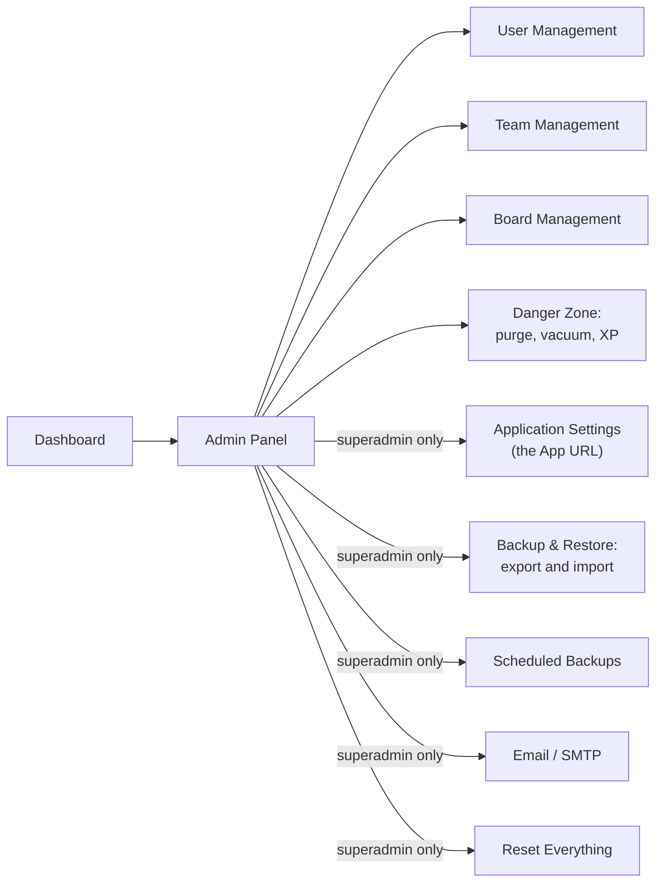
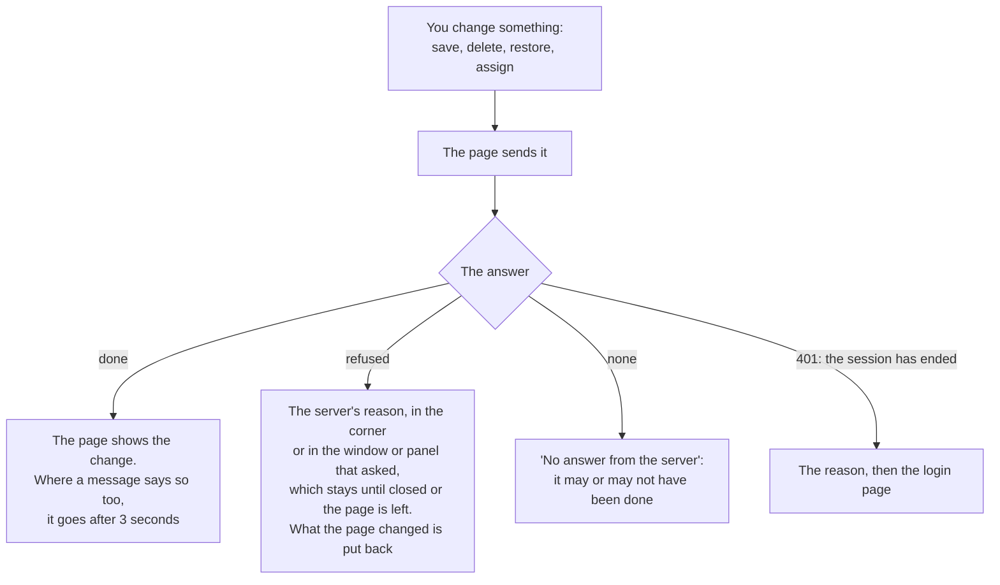
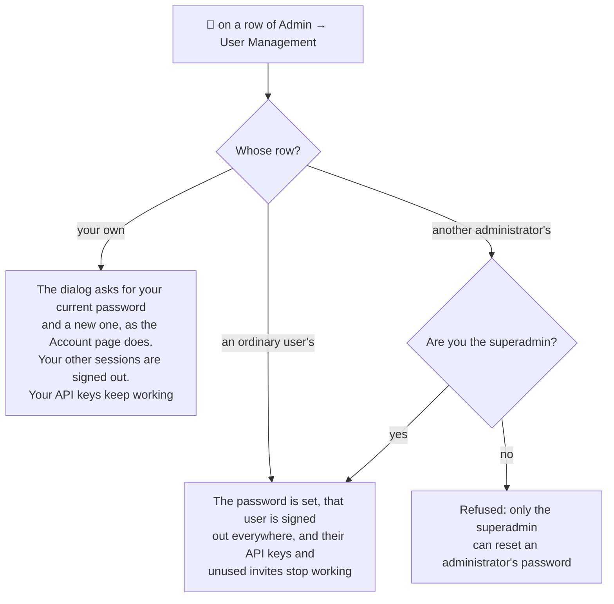
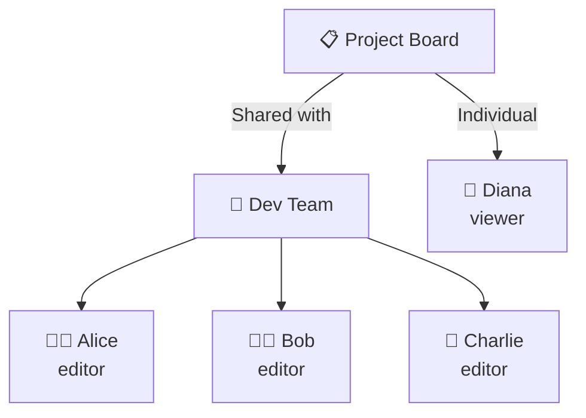
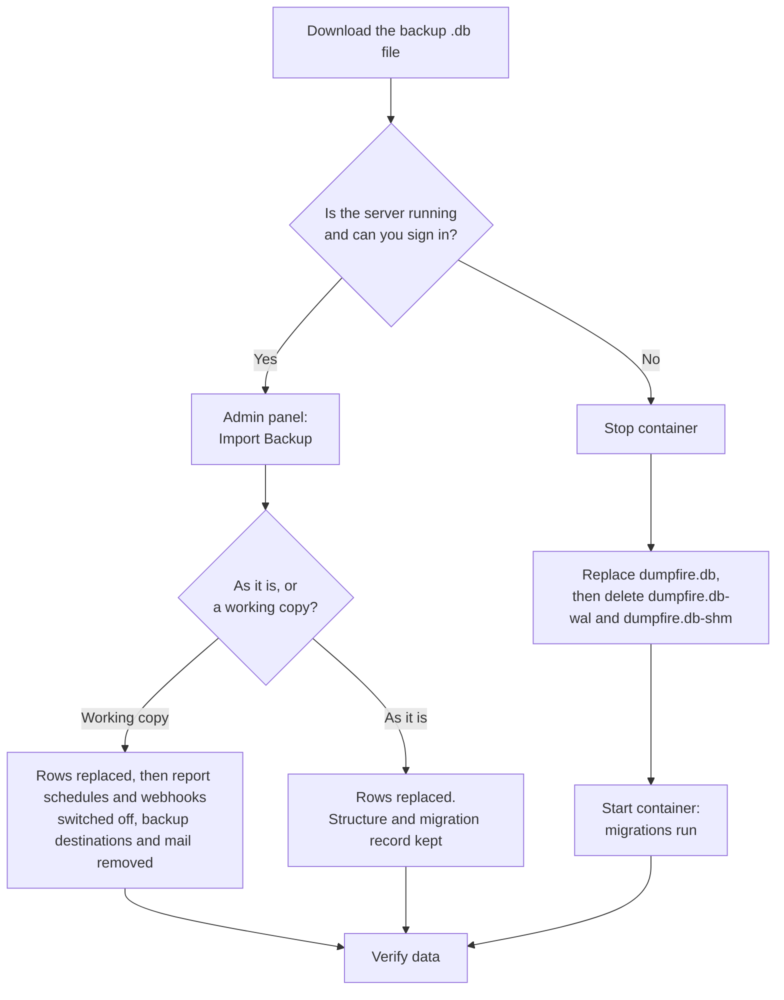
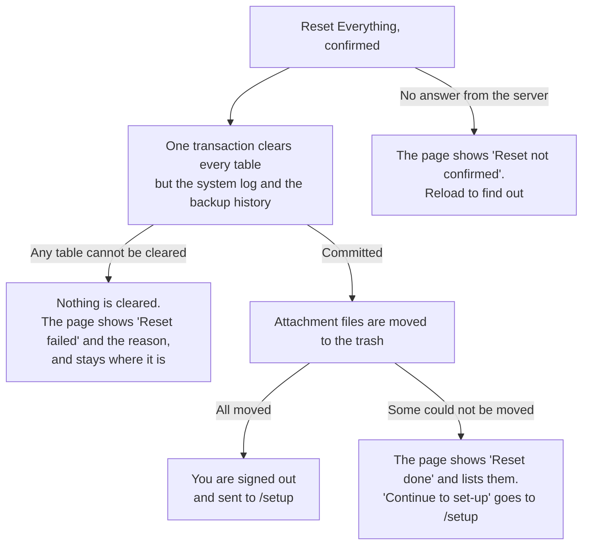
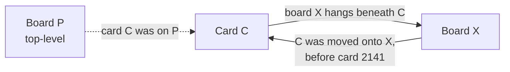

# Admin Operations Guide

This guide covers day-to-day administration tasks for DumpFire. You need the **Admin** or **Superadmin** role to access the Admin panel, and part of it is the superadmin's alone.

## Accessing the Admin Panel

Click the **⚙️ Admin** link in the dashboard sidebar or navigate to `/admin`.



## Who May Do What

The superadmin is the account made when DumpFire was set up, and there is one. An administrator does everything on the page that is about people, boards and housekeeping. What acts on the whole installation is the superadmin's:

| On the admin page | An administrator | The superadmin |
|-------------------|------------------|----------------|
| Database Overview | ✅ | ✅ |
| Board Management: delete a board, clear its cards or categories | ✅ | ✅ |
| User Management, within [whose account they may manage](#modifying-users) | ✅ | ✅ |
| Team Management | ✅ | ✅ |
| Danger Zone: Purge Archived Cards, Vacuum Database, Reset All XP | ✅ | ✅ |
| The system log and the audit trail (`/audit`) | ✅ | ✅ |
| **Application Settings**: the App URL | ❌ | ✅ |
| **Backup & Restore**: Export Backup and Import Backup | ❌ | ✅ |
| **Scheduled Backups**: the schedule, the destinations, "Test" and "Run Now" | ❌ | ✅ |
| **Email / SMTP**: the mail settings and the test mail | ❌ | ✅ |
| Danger Zone: **Reset Everything** | ❌ | ✅ |

Each of the five is the user list by another way, which is why an administrator, who cannot manage another administrator's account, cannot use them either. An export holds every password hash. An import replaces every account with the backup's. Whoever sets up after a reset is the superadmin. A backup destination is sent the whole database. And the mail settings and the App URL decide which server an invite is handed to and where its link points, and an invite sets a password.

An administrator does not see those five on the page. In their place is one section, "The superadmin's", which says what they are and names the superadmin. The routes behind them refuse everybody else with `403` and "This belongs to the superadmin", so a request made by hand fares no better.

If nobody can sign in as the superadmin, no page puts it right: see [If Nobody Can Sign In as the Superadmin](deployment.md#if-nobody-can-sign-in-as-the-superadmin).

## When Something Is Not Done

This page, the Teams page, the Reports page's schedules, All Tasks, the Archived page, a board's Archived Cards panel, a card's window and its **Link existing board**, the share window, a subtask's window, the dashboard and My Account each say when a change was not made, in the server's own words where it gave any: "No edit access to this board", "Card not found", "You can only delete your own templates". Several of them used to say a change had worked whatever the answer was, or to say nothing.

- **A message that something was not done stays** until it is closed with ✕ or the page is left. Most are in the corner of the page. A card's window says it at its top, where it stays in view however far the window is scrolled. An import says it in the report under the **Import Backup** button, and not in the corner as well. The mail settings say it under their buttons, and the Reports page's emailing of a report in its dialog, each until it is tried again. The share window and a subtask's window say it on a line of their own above their buttons, with a ✕ to close it; My Account says it under what was refused, the avatar, the mail switches or the API key panel; and the **New Sub-board** form of a board's menu on the dashboard on its own line. Each of these goes when that change is tried again.
- **The corner shows each such message once, and three at most.** The same message again takes the place of the one shown, and a fourth puts the oldest away. A message about a change made on a page you have since left is not shown on the next page.
- **A message that something was done goes after three seconds**, as does any note or warning. Not every change has one: most of what is done in a card's window (a label, the cover, an assignee), and turning a report schedule on or off or deleting it, show the change itself and say nothing more.
- **What the page changed before the answer came is put back**: a role in a user's row, a backup destination added or removed, a card's cover, a card's milestone, a person's role in the share window, a board's star on the dashboard, and your avatar and mail switches on My Account. A card's window in All Tasks that could not save stays open with what was typed in it, and so do a board's **New Task** window whose card was not made (it said "Created" until 2026-10-15), a subtask's window and the forms for a new team, a new user and a new schedule. A subtask whose delete was refused stays on the card. A subtask's **Save** and the avatar on My Account cannot be pressed again while a change is on its way, so a double click makes one subtask. Removing someone, or a team, from the share window who no longer has the board (removed in another tab) says "This board is not shared with that user" (or team), where it said nothing.
- **A column's rename that is refused is said**, in the server's words, and the column keeps its old title (card 2134). A Complete or Done column that holds any card, archived ones included, can be renamed only to Complete or Done, and a column that holds any card cannot be renamed Complete or Done: the cards in it would become open work, or finished work nobody finished. An empty column is renamed freely. Keep a Complete or Done column that holds cards called Complete or Done: moving its cards out so as to rename it would reopen every one of them. To rename a column that holds cards into Complete or Done, move the cards first, each finished one to a Complete column and the rest to another column. It used to show the new title until the page was reloaded.
- **Not yet everywhere.** Still said by nothing when refused, all on a board: the card window's **Save** of a saved card (a new card that is not made is said), a title edited on the board itself, pinning a card, a priority changed from a card's menu or the bulk bar, the completion prompt, adding and deleting categories, dragging cards and columns, the board's name and emoji, and the column's other settings. They are reworked with the board page, by card 2012. Sharing a board, a subtask's window, the dashboard's star, grouping and new boards, and the account page's avatar, mail settings and key revoke said nothing either until 2026-10-15 (card 2148).
- **A request that got no answer** is not known to have failed, and the message says so: "No answer from the server. It is not known whether this was done." Reload the page to see what was saved.
- **If your session has ended**, the message is shown and the page then goes to the login page. No dialog box stops it on the way.



---

## User Management

### Creating Users

1. Go to **Admin → Users**
2. Enter username, email, and role
3. Click **Create User**
4. An invite email is sent automatically (if SMTP is configured)
5. The user clicks the link to set their password

### User Roles

| Role | Admin Panel | Manage Users | All Boards | Board Sharing |
|------|------------|-------------|------------|---------------|
| **Superadmin** | ✅ | ✅ | ✅ Implicit | ✅ |
| **Admin** | ✅ | ✅ | ✅ Implicit | ✅ |
| **User** | ❌ | ❌ | Only shared | Only if owner |

### Modifying Users

- **Change role** — promote or demote between user and admin. Only the superadmin can make a user an administrator, and nobody is made superadmin. Any invite sent to the account earlier and not yet used stops working, because it was sent to the account as it was: the message then reads "Role updated. The invite sent to this account earlier no longer works: send a new one with 📧."
- **Reset password** (🔑) — type a new password for the user. Every session they have ends, so they are signed out everywhere and sign in with the new one. Every API key they have ends too, and so does any invite they have not used yet. The dialog says beforehand how many keys they have ("They have 2 API keys, which stop working"), and the message afterwards gives how many sessions and keys were ended. They are not mailed: you give them the new password, so tell them then
- **Send an invite** (📧) — mails the user a new invite link, with which they set a password themselves. It works for seven days. Any earlier invite to that account stops working as soon as the new one is sent, and the message says so. Whoever opens an older link is told it no longer works and to ask an administrator for a new one. When the user sets a password with the link, every session and every API key they had ends, and the invite page tells them so beforehand if they have keys
- **Delete user** — permanently remove. See below for what goes with them

**An invite ends when the account changes.** An invite not yet used stops working when the account's email address or role is changed, by you on this page or by a direct call, or by the user on their Account page: the mail may be in a mailbox the account no longer has, or was sent before the account was made an administrator. Changing a username or an emoji, or sending the role the account already has, ends nothing, and no such change signs anyone out. Whoever opens the old link is told it no longer works, and why it might not. Send a new invite with 📧. An invite already waiting before this rule was deployed works until it expires, within seven days. See [When an Account's Email or Role Changes](authentication-security.md#when-an-accounts-email-or-role-changes).

**Ten wrong passwords on the Account page.** The email form, the password form and Generate Key each ask for the current password, and so does the 🔑 dialog on your own row. After ten wrong ones in 15 minutes from one signed-in browser, that browser is refused at all three, the right password included, for up to 15 minutes: "Too many wrong passwords. Try again in N minute(s)." Signing in again, or another browser already signed in, is not held up, so a user who is refused can still change their password elsewhere, and an administrator can still reset it. See [Guessing a Current Password](authentication-security.md#guessing-a-current-password).

**A reset or an invite costs the account its API keys.** Both are how you take an account back from whoever may hold its password or a session, so both end every key, and anything that uses one (a script, an integration, a scheduled job) is answered `401` until it is given a new key. That holds when a user has simply forgotten their password: the server cannot tell a recovery from a takeover. Before resetting the password of an account that a script or an integration runs on, look at the dialog's count. The dialog reads it again when it opens, and gives one only on the rows whose password you may reset. A user who changes their own password on the Account page keeps their keys unless they tick "End my API keys too"; see [What Setting a Password Ends](authentication-security.md#what-setting-a-password-ends).

**What a reset does not end.** A reset ends the account's sessions, its waiting invites and its keys, which is every way in as that user. It does not end what someone holding the account could have set up: webhooks registered with its keys (a webhook has no owner, so they keep receiving their boards' events) and its report schedules (which keep mailing their recipients). After taking an account back, look over the webhooks of the boards it could edit (no page lists them: `GET /api/v1/boards/{id}/webhooks`, and `DELETE /api/v1/webhooks/{id}` for one nobody recognises), and ask the user to look over their report schedules on the Reports page once they are signed in again, which only they can see.

Whose account you can change, set a password for, send an invite to or delete depends on your role and theirs, and is the same for all four. An invite is on the list because its link sets the account's password:

| Their account is | An administrator can manage it | The superadmin can manage it |
|------------------|--------------------------------|------------------------------|
| An ordinary user's | ✅ | ✅ |
| Another administrator's | ❌ | ✅ |
| The superadmin's | ❌ | Only their own, and not to delete it |

Each row shows only the controls you may use on that account, by the same rule the server refuses by (one copy of it, in `src/lib/account-rule.ts`, which the page and the routes both ask):

| The row is | What it shows |
|------------|---------------|
| An account you may manage | The role select, 🔑, 📧 and 🗑️ |
| Your own | 🔑 alone, which changes your own password and asks for the one you have. Your role, an invite and deleting yourself are not offered, and the server refuses each there: a change to your own role is answered 403 whatever it is, and nothing sent with it is saved. The superadmin can change an administrator's role |
| Another administrator's, to an administrator | 🔒 and nothing else |
| The superadmin's, to anyone else | 🔒 and nothing else |

An administrator who tries to reset another administrator's password, send them an invite, change their role or delete them by a request made another way is refused, and a page that sends one shows the reason. The role select, the invite and the delete used to be shown on rows where they could only be refused, the administrator's own row among them, where one choice in the role select made them an ordinary user.



Your own password is never reset from this page without the one you have. On your own row the 🔑 dialog asks for your current password, as the password form on the **Account** page does. It keeps your API keys and says so; to end them with the change, change your password on the Account page and tick the box there. Your own row has no 📧, and the route refuses one: an invite link sets a password and asks for none, so nobody sends one to themselves. Your own email is not changed through user management either, because an invite goes to it: it is changed on the Account page, which asks for your password. So no user-management route sets your own password, or moves the address a new one would be sent to, without asking for the password you have. The superadmin's row shows 🔒 to everyone else, and 🔑 to the superadmin, which is the same own-password dialog.

The same rule holds for the rest of the Admin page. **Restoring a backup** replaces every account with the backup's, passwords and roles included, and **Reset Everything** clears every account, so both are the superadmin's alone, with the export, the backup destinations and the mail settings: see [Who May Do What](#who-may-do-what). Any administrator could once run either, and so could make themselves anybody.

### Deleting a User

The 🗑️ button beside a user in **Admin → User Management** asks for confirmation and says what will happen. A user can be deleted whatever they have done in DumpFire: uploaded files, saved templates, created milestones or recorded dependencies.

| Deleted with the user | Kept |
|-----------------------|------|
| Their comments | Files they uploaded |
| Their API keys. Anything that calls the API with one stops working | Milestones, templates and dependencies they created |
| Their report schedules. Those reports are no longer sent | Boards and cards they created |
| Their team memberships, board memberships and card assignments | Requests addressed to them |
| Their sessions, so they are signed out everywhere | Their XP, which stays on the leaderboard |

After the delete:

- **Templates they created, and milestones of theirs that belong to no board, can be managed by administrators only.** A milestone that belongs to a board is still managed by whoever can edit that board.
- **A board they created stays, and its other members and teams keep their access.** The user was its owner: a board's creator is its owner. Unless another member is stored as an owner of the board, the board then has no owner, and only an administrator can change who it is shared with, delete it, or put it under a card. No screen can make someone an owner now (the sharing dialog offers Owner only on a row already stored as one); a member shared as Owner before 14 October 2026 keeps it.
- **Requests addressed to them stay in the system**, and only an administrator can then accept, reject or reply to them.
- **Activity entries they made keep their name**, without a link to an account.

The delete is all or nothing. If it fails, the user and everything of theirs is as it was, and the page says the delete failed.

You cannot delete your own account or the superadmin. Only the superadmin can delete an administrator.

---

## Team Management

### Creating Teams

1. Go to the **Teams** page from the dashboard
2. Click **Create Team**
3. Name the team and choose an emoji
4. Add members — each with **Owner** or **Member** role

### Sharing Boards with Teams

When you share a board with a team, all team members inherit the team's board role (editor or viewer). New members added to the team automatically gain access.



**Taking someone off a board leaves their assignments** (card 2180). A user removed from the
board, or from the team it is shared with, stays assigned to its cards, and is no longer
mailed about them: the "Card moved" and "Unblocked" mails go only to the assignees who can
open the board the card is on. The same goes for an assignee whose card is moved to a board
they cannot open. Current members are mailed as before. Unassign someone who should no
longer be listed on a card.

---

## SMTP Configuration

Email is required for notifications, invites, and report delivery. The mail settings are the superadmin's: an administrator does not see them, and is refused them. See [Who May Do What](#who-may-do-what).

Every link in a mail begins with the **App URL**, which is set under **Application Settings** on the same page and is the superadmin's too. With none set, links begin with the address the server was started with (`ORIGIN`). Nothing a request says is used, so a link cannot be pointed at another host by whoever sends the request. If the links in your mail begin with `http://localhost:3000`, set the App URL: see [Where a Mailed Link's Address Comes From](deployment.md#where-a-mailed-links-address-comes-from).

### Setup Steps

1. Go to **Admin → Email / SMTP**, as the superadmin
2. Fill in your SMTP details:

| Field | Example | Notes |
|-------|---------|-------|
| **Host** | `smtp.gmail.com` | Your SMTP server |
| **Port** | `587` | 587 for STARTTLS, 465 for SSL. A whole number from 1 to 65535 |
| **Username** | `noreply@company.com` | Auth username |
| **Password** | `app_password` | Use app passwords for Gmail |
| **From Address** | `noreply@company.com` | Sender email: an address, with no space and none of `, ; < > " ( )` |
| **From Name** | `DumpFire` | Display name in inbox |

3. Click **Send Test Email** to verify
4. Save the configuration

A save that holds a field the server cannot use is refused with the field named, under the buttons, and nothing is saved: `port must be from 1 to 65535`, `fromAddress must be an email address`. The Host and the Username are at most 2,048 characters and the From Name at most 200. A Port left empty is refused, `port must be a whole number`, as is a save of none of the fields (`No valid fields to update`). Only these fields, the security choice and the App URL are kept. The App URL is an `http://` or `https://` address, or empty for none; one written without its scheme, `kanban.example.com`, is saved with `http://` in front, as it was always read, and one that is still no address after that is refused. A value saved before these rules, sent back unchanged, is kept (card 2117).

### Troubleshooting

| Problem | Solution |
|---------|----------|
| Connection timeout | Check firewall rules for outbound SMTP port |
| Auth failure with Gmail | Use an App Password, not your Google password |
| Emails going to spam | Set up SPF/DKIM records for your sending domain |
| IPv6 timeout | DumpFire forces IPv4 — this is handled automatically |
| An emailed report says "Mail is not set up on this server" | Fill in the settings above. Until a host is saved, a report emailed from the Reports page is refused `503` and nothing is sent, and each scheduled report logs an `ERROR` line saying so |
| An emailed report says "The mail server did not accept it" | The reason is in the system log, an `ERROR` line under `EMAIL` for each address, on the **Audit** page's **Live Console**. A scheduled report's `ERROR` line under `REPORTS` names each address it did not reach. Neither is sent again by itself: see [Schedule Execution](backup-reporting.md#schedule-execution) |

---

## Backup Management

Everything in this section is the superadmin's: the export, the import, the schedule and the destinations. See [Who May Do What](#who-may-do-what).

### What a Backup Holds

A backup is the whole database, as one `.db` file, with two things taken out:

| In a backup | Not in a backup |
|-------------|-----------------|
| Every board, card, comment, user, team and setting | **Sessions.** Nobody is signed in by a backup, whoever reads it |
| Every user's password hash, so that a restore can sign them in again | **Invites that have not been used.** An invite's link sets a password |
| The mail password and the backup destinations' own credentials | Attachment files: see [Attachments](#attachments) |
| Invites that have been used, API keys (as hashes), the system log, with every invite's token in it masked | |
| Every public request's link, and the key the public request form signs with | |

So a backup is still a file to keep where few can read it, and it no longer signs in whoever does: that is true of accounts. A request's link in it still opens that request's thread, and the form's key is still the one the server signs with. That is true of the file **Export Backup** downloads and of every copy a schedule or **Run Now** uploads: both are made the same way. Taking a backup signs nobody out. The sessions are removed from the copy, never from the running database.

A backup made before this version does hold the sessions of whoever was signed in when it was made. Restoring one does not bring them back, but the file itself is as it was: delete the old copies that are not needed.

### Configuring Backups

1. Go to **Admin → Scheduled Backups**, as the superadmin
2. Choose a schedule: Hourly, Every 6h, 12h, Daily, or Weekly
3. For daily/weekly: set the time and day
4. Add destinations (SFTP / S3 / Google Drive / OneDrive)
5. Set retention count (how many backups to keep)
6. Enable failure email alerts

Each setting is checked when it is saved, and one the server cannot use is refused with the setting named and nothing saved: a time written `HH:MM`, a retention of 1 to 100, a failure email of one address or more (separated by commas, semicolons or lines, and saved separated by commas), and for each destination a name, one of the four types, and its own fields, an SFTP port being a whole number from 1 to 65535 (`destinations[0].port must be a whole number from 1 to 65535`), and a port left empty being 22. A destination's text is at most 2,048 characters, but an SFTP private key and a Google service account's JSON, which are pasted in, at most 20,000. A Retention box left empty is not sent, and the retention saved before is kept. A save keeps what it does not send: until card 2117 a save that sent part of the settings wrote the defaults over the rest, and one that sent nothing switched the schedule off and removed every destination. A destination keeps only the fields of its type.

### Manual Backup

Click **Run Backup Now** in the admin panel to trigger an immediate backup to all configured destinations.

### Backup History

The last 10 backup attempts are shown with:
- Destination name and type
- File size
- Duration
- Status (success or failed with error message)

### Restoring from Backup

A backup `.db` file is a whole database: its data, its structure and its own record of applied migrations. There are two ways to put one back, and they differ in how much of it they use.



**In the application** (Admin → Backup & Restore → **Import Backup**, as the superadmin). No restart is needed.

Four things are true of every import, whichever way it is restored:

- **It signs everybody out, you included.** No session is restored, whatever the backup holds, and the ones there were are cleared with everything else. When the result is dismissed the page reloads at the login page: sign in with an account the backup has, and its password as it was when the backup was made. The result names the backup's superadmin, which is the account that can export, import or reset again. Invites that had not been used stop working, and are sent again from User Management.
- **A backup with users and no superadmin among them is refused**, before anything is changed: "This backup has user accounts and none of them is the superadmin." Restoring it would leave nobody able to export, import, reset or change the mail settings. A backup with no users at all is accepted: DumpFire then asks to be set up, and whoever does it is the superadmin. A backup that has a superadmin whose row cannot be copied is refused the same way, after the copy and before it is committed: the restore is rolled back and nothing is changed.
- **A backup that is too large says so.** See [When an Import Is Not Accepted](#when-an-import-is-not-accepted).
- **It takes a `.db` backup only.** The file picker offers `.db`, `.sqlite` and `.sqlite3` files, and the page refuses any other file itself, sending nothing. The JSON export DumpFire wrote in its first week, from 1 to 7 April 2026, is no longer imported: its import left twelve tables of the data it replaced in place, so that a live API key could then answer as an imported account. If such a file is ever wanted, import it into an empty installation of an image built before 14 October 2026 and export a `.db` from there.

The dialog asks how to restore, every time:

| Choice | For | What it does |
|--------|-----|--------------|
| **Restore everything as it is** | Putting this installation back | Backup destinations, report schedules, mail settings and webhooks come back exactly as the backup has them, and act as they did |
| **Restore as a working copy** | A copy that must not reach outside: a development instance, a rehearsal, a look at older data | Report schedules and webhooks are switched off. The backup schedule is switched off and its destinations removed. The mail settings are removed. Everything else is restored, users and API keys included |

A backup of production restored as it is into another instance is as able to email people, call webhooks and change the backup store as production is. That is what the working copy is for.

- **Which is preselected.** The working copy, when this instance's schedulers are off: under the development server, or with `SCHEDULERS=off`. Otherwise "as it is". Either can be chosen wherever the dialog opens.
- **It is part of the restore.** The switching off happens in the same transaction as the copy, so a restore that fails leaves everything as it was.
- **The result says what was done**, and stays on the page until it is dismissed: how many report schedules and webhooks were switched off, whether the backup schedule was on, and how many destinations and mail settings were removed.
- **Getting them back.** A report schedule or a webhook is switched on again one at a time in the admin panel. Mail settings and backup destinations were removed and have to be entered again, or restored by importing the backup once more as it is.
- **Reload before looking.** The Scheduled Backups and mail panels are read when the page opens. After an import, use "Dismiss and reload", and do not save from a panel that was open before it.
- **By request.** `POST /api/admin/import` takes the same choice as `?outside=keep` or `?outside=off`, with the same default when it is not given. Any other value is refused and nothing is changed.

Whichever is chosen:

- It replaces rows, not structure. The rows of every table in the running database are replaced with the backup's rows. The tables and columns stay as the running version's migrations made them: a column or table that exists only in the backup is not brought across, and a table the backup does not have is left empty.
- It keeps the running database's own record of applied migrations. That record describes the structure of the running database, which a restore does not change.
- It fills in what an older backup lacks: a first-completion date for cards that were complete, an access token for each task request that has none, and the contents of `work_dependencies` when the backup was taken before that table existed.
- A value the backup leaves empty, in a column where the running database requires one, is given that column's default. A column's WIP limit that was never set becomes 0, which means no limit. The server log says how many rows that was.
- A row that cannot be copied is left out, and the restore is still committed, unless it leaves user accounts and no superadmin among them. The message on screen says how many problems there were and lists them, the first hundred where there are more. The list also carries anything else worth knowing, such as a card in the backup whose column is not in the backup either; that card is copied as it is.
- It will not leave rows pointing, through a foreign key, at a row it left out. If a row that could not be copied is one that other rows refer to in that way, the whole restore is refused and nothing has been changed. References that have no foreign key are not covered by that check: a card's milestone, a board's category, the two ends of a dependency, a task request's target and a report schedule's scope.
- The copy runs in one transaction. If it fails, nothing has been changed.
- No session and no unused invite is brought in, from a backup of any age. Everybody signs in again.
- It puts attachment files back from the trash. A backup holds the database and not the files. When a card is deleted its files are kept in a trash for 30 days, so after an import of a backup taken before the delete, each restored attachment whose file is in the trash has it moved back. The result adds a line, for example "3 attachment files put back from the trash.", when there were any. A file that could not be put back is in the list of problems.
- It does not bring back a file that is not on this server. An attachment restored from a backup of another installation, or deleted more than 30 days ago, shows on its card and cannot be opened unless the file is copied into the uploads folder. See [Attachment Files](deployment.md#attachment-files).

#### When an Import Is Not Accepted

The page says which of four things went wrong, or that the file is not a backup it takes. It used to say "Invalid backup file" for all of them.

| The page says | What happened | What to do |
|---------------|---------------|------------|
| The file "…" is not a .db backup. Exports in the old JSON format, which DumpFire wrote only from 1 to 7 April 2026, are no longer imported. Nothing was sent | The file's name does not end in `.db`, `.sqlite` or `.sqlite3`, in any case. The page sent nothing | Pick the `.db` file a backup or an export made. A request sent straight to `POST /api/admin/import` whose media type is not `application/octet-stream` or `application/x-sqlite3` (parameters and case aside) is refused `400` before any of it is read, with "Import takes a .db backup, sent as application/octet-stream. Exports in the old JSON format, which DumpFire wrote only from 1 to 7 April 2026, are no longer imported. Nothing was changed."; one sent as either whose bytes are not a SQLite file is refused `400` "Invalid file — not a SQLite database" |
| The backup "…" could not be read on this computer, so nothing was sent | The browser could not read the file | Check the file is still where it was, and pick it again |
| No answer from the server. It is not known whether the backup "…" was accepted | The request was sent and nothing came back | Reload the page and look at what the database holds before trying again |
| The backup "…" was refused before it reached DumpFire, probably a size limit at the proxy in front of it (HTTP 413) | Something in front of DumpFire answered, and not DumpFire. nginx refuses any upload over 1 MB unless it is told otherwise | Raise the proxy's limit for the import: see [Reverse Proxy](deployment.md#reverse-proxy--nginx) |
| The backup "…" is larger than this server accepts. The limit here is 512 MB | DumpFire refused it for its size, and says its limit | Raise `BODY_SIZE_LIMIT`: see [Upload Size Limits](deployment.md#upload-size-limits) |

Anything else DumpFire refuses is shown in its own words. Nothing is changed by any of these but, possibly, the "No answer" one.

**By hand**, when the server cannot be used:

1. Download the `.db` file from your backup destination
2. Stop the DumpFire container
3. Replace `/app/data/dumpfire.db` with the backup file, and delete `dumpfire.db-wal` and `dumpfire.db-shm` from the same directory if they are there
4. Start the container

The database runs in SQLite's WAL mode, which keeps recent changes in the `-wal` file beside the database. Those two files belong to the database that was there before. Left beside the backup, SQLite would try to apply the old database's changes to it.

Replacing the file brings back the backup's structure and its migration record along with its data. When the container starts, the migration runner applies whatever migrations the backup has not had.

Nothing checks a file put back by hand. A backup made by this version holds no session, so everybody signs in again; one made before it brings its sessions back with it. And if its users have no superadmin among them, the server starts, says so in the log at `CRITICAL`, and has nobody who can use what is the superadmin's: see [If Nobody Can Sign In as the Superadmin](deployment.md#if-nobody-can-sign-in-as-the-superadmin).

> ⚠️ **After an update, if you have gone back to an older image, do not use Import Backup while the older image is running.** An older image can overwrite the migration record with the backup's, and the newer image will then refuse to start. See [Going Back to the Previous Image](deployment.md#going-back-to-the-previous-image).

---

## Archive Management

### Archived Cards Page

Access from the dashboard **More ⋯** menu → **Archived**.

Features:
- **Search** — find archived cards by title
- **Filter by board** — narrow down to a specific board
- **Restore** — bring the card back to the column it was archived from. A restore that is refused, for a card deleted for good in another tab for instance, says why and leaves the card in the list. A restore writes `card_restored` in the board's activity log, as archiving writes `card_archived`; it wrote nothing until 2026-10-14
- **Permanent delete** — remove the card for good, with what is listed below

### Archiving and Deleting

Archiving a card and deleting it are different things.

| | Archive | Permanent delete |
|---|---------|------------------|
| The card | Hidden from the board, listed on the Archived page | Gone |
| Its subtasks and comments | Kept | Deleted |
| Its attachments | Kept, and still open after a restore | Rows deleted. The files go to a trash for 30 days |
| Its dependency links | Kept. After a restore the card waits on what it waited on | Deleted. Cards that were waiting on it no longer are |
| Its sub-boards | Kept, with everything on them | Deleted, at every depth, with everything on them |
| Can it be undone? | Yes: **Restore** | Only by importing a backup taken before the delete |

Every permanent delete asks for confirmation, and the dialog says what will go. Each is all or nothing: if a delete fails, nothing was deleted and the page says so.

| What is deleted | Where | What goes with it |
|-----------------|-------|-------------------|
| A card | The archive panel of its board, or the Archived page. On the board itself a card can only be archived: its menu, the card's own window and the bulk bar each say **Archive**. The card's window asks first, on a board and in All Tasks alike, and says afterwards where to restore it from | As the table above |
| A column | The column, on its board | **Every card in it, deleted for good and not archived**, each as the table above. Move the cards first if they are to be kept |
| A board or sub-board | The dashboard, the board page for a sub-board, or **Admin → Board Management** | Its columns and cards, every sub-board under it, and any report schedules for it. Cards on other boards that were in one of its milestones stay, in no milestone. Its card categories go with it, and its sub-boards': a card on another board that carried one has none. Until 2026-10-14 they stayed, as categories of no board, which every user was offered |
| Every card on a board | **Admin → Board Management → Clear Cards** | Every card, archived ones included, each as the table above. The board, its columns and its categories are kept, except on a board in a loop, which goes too: see [A board beneath one of its own cards](#a-board-beneath-one-of-its-own-cards) |
| Every archived card | **Admin → Danger Zone → Purge Archived Cards**, or the Archived page | Every archived card on every board, each as the table above |

**A board that is no longer there**, deleted in another tab say, is answered "Board not found" by **Clear Cards** and **Clear Categories**, and by a delete of the board from Board Management or the dashboard, and nothing is changed or recorded (card 2211). Each used to say it was done: Clear Cards said "All cards cleared from board", and an administrator's delete "Board deleted", for a board that was gone. Anyone but an administrator is still refused Clear Cards and Clear Categories first, whether the board is there or not.

A column delete, a purge and a clear each leave one entry in the activity log of the board they happened on, saying how many cards went. A board delete leaves none there, because the board's log goes with the board; the system log has an `INFO` line naming the board, who deleted it and what went with it. A card, a column, a purge or a clear whose board went with it, as a board in a loop does, leaves the same kind of line instead of the entry: see [A board beneath one of its own cards](#a-board-beneath-one-of-its-own-cards). Recent system log lines are on the **Audit** page under **Live Console**, and the stored history is at `GET /api/logs`.

Pages open on what a delete takes are told once it is done, and read their board again (card 2108). A page open on a deleted board, or on a sub-board deleted with a board, a card or a column, shows "Board not found". A page open on a board that Clear Cards emptied, or that Purge Archived Cards took cards from, shows the board as it now is, or "Board not found" if the board went with its cards, as a board in a loop does. The page of the board a deleted sub-board hung from is told as well, so its card's sub-board link goes. Until 2026-10-14 each stayed as it was until it was reloaded. What is sent names nothing: no board, card or person. A member's dashboard is not told when a board they can see is deleted, because nobody but an administrator can be told anything of a board that is gone; it catches up the next time it is brought to the front.

---

## Attachments

### Where the files are

Attachment files are on the server's disk, in the `uploads` folder beside the database, and are in no backup that DumpFire makes. Backing that folder up is described in [Deployment](deployment.md#attachment-files).

### The trash

When an attachment's row is deleted, because the attachment itself, its card, its column or its board was deleted, its file is moved to a trash folder and removed 30 days later. Until then, importing a backup taken before the delete brings the attachment back, file included. There is no screen for the trash: files come back through **Import Backup**.

### How large an attachment can be

A file of up to 25 MB can be attached to a card. A file that is not attached is listed under the upload area with the reason, one line a file, and the others of the same upload are still tried:

| The card says | What happened |
|---------------|---------------|
| "…" could not be read on this computer, so nothing was sent | The browser could not read the file: a folder was dropped, or the file has moved |
| No answer from the server. It is not known whether "…" was accepted | Open the card again to see whether it is there |
| "…" was refused before it reached DumpFire, probably a size limit at the proxy in front of it (HTTP 413) | The proxy in front of DumpFire refused it. nginx refuses an upload over 1 MB unless it is told otherwise: see [Reverse Proxy](deployment.md#reverse-proxy--nginx) |
| "…" is larger than this server accepts. The limit here is 26 MB | DumpFire refused it for its size. A limit of 512 KB there means the server was started without `BODY_SIZE_LIMIT`: see [Upload Size Limits](deployment.md#upload-size-limits) |

The card used to say nothing when an upload failed, and could go on saying "Uploading..." until it was closed.

### Attachments that download

What an attachment does depends on how it is opened, and in both cases on the type recorded at upload agreeing with the file name's extension:

| Opened | Shown in the browser | Saved to disk |
|--------|----------------------|---------------|
| From its card | PNG, JPEG, GIF and WebP images. Each has a thumbnail on the card, and clicking the thumbnail opens the image | Every other attachment. Clicking the name of any attachment, an image included, saves it |
| By its address, pasted into the browser | PNG, JPEG, GIF and WebP images and `.txt` text files, each as its own type | Everything else: PDF, HTML and SVG files, Office documents, archives, and any file whose name and recorded type disagree |

An HTML or SVG file can carry a script, and opened as a page of DumpFire it would run with the reader's session. So neither is ever shown in the browser, and every attachment is answered with `Content-Security-Policy: sandbox` and `X-Content-Type-Options: nosniff`. A PDF is saved too: a browser shows one in its own viewer, which does not start under that sandbox. If someone reports that an attachment does not open, that is why, and the file is intact.

---

## Danger Zone

The **Danger Zone** at the foot of the Admin panel has four actions. Each asks for confirmation. The first three are any administrator's. **Reset Everything** is shown to the superadmin only, and is refused to everybody else: whoever sets DumpFire up after a reset is its superadmin.

| Action | What it does | What it does not do |
|--------|--------------|---------------------|
| **Purge Archived Cards** | Permanently deletes every archived card on every board, with its subtasks, comments, dependency links and sub-boards. Attachment files go to the trash for 30 days | Touch a card that is not archived |
| **Vacuum Database** | Rebuilds the database file to reclaim unused space | Change any data, or reset ids. New boards and cards are still numbered on from the highest there has been |
| **Reset All XP** | Sets every user's XP to 0 | Change anything else |
| **Reset Everything** | Clears the whole installation. See below | Restart ids, or clear the system log and the backup history |

### Reset Everything

Reset returns DumpFire to the state of a new installation, ready to be set up again.

| Cleared | Kept |
|---------|------|
| Every board, column, card, subtask, comment, label, category and milestone, and the activity log of every board | The system log, including the line that says who ran the reset. `GET /api/logs` returns it |
| Every user, session, API key, team, invite and membership | The backup history |
| Every setting: the mail settings, the application URL, the backup schedule and its destinations | The structure of the database and its record of applied migrations |
| Task requests, report schedules, webhooks, XP, chart history | The id counters: new boards and cards are numbered on from the old ones |
| Every attachment row. The files are moved to the trash for 30 days | Backups already made at the backup destinations |



- **It is all or nothing.** Either every table is cleared or none is. A reset can no longer leave users in place with their sessions and the settings gone.
- **If it fails, the page says so.** A dialog titled **Reset failed** shows "The reset failed and nothing was cleared:" followed by the reason, and stays until it is closed. Nothing has changed and you are still signed in. The failure is also in the system log, at `ERROR`.
- **If it succeeds, you are signed out** and taken to `/setup` to create the first account. The system log has a `CRITICAL` line saying who reset the database, how many rows went from how many tables, and how many attachment files were moved to the trash.
- **Attachment files that cannot be moved are reported, and the reset still stands.** A dialog titled **Reset done** lists them. They are where they were, in the uploads folder, and belong to no card.
- **Ids carry on.** The first board created after a reset does not get id 1 again. Nothing left over from before, such as a file in the trash or a line in the system log, can be mistaken for something new.
- **Take a backup first.** Reset cannot be undone except by importing one.

---

## Board Categories

Organise boards into categories for the dashboard sidebar:

1. Go to **Admin → Board Categories** (or use the dashboard category manager)
2. Create categories with names and colours
3. Assign boards to categories

Categories appear as collapsible groups in the dashboard sidebar.

---

## Notification Preferences

Each user controls their own notification preferences from **My Account**, under **Email Notifications**. The switches, in the order the page shows them:

| Switch | Controls |
|--------|----------|
| **All Email Notifications** | The master switch. Off, no mail of any kind below is sent, whatever its own switch says. Turning it off turns every switch below off, and turning it on turns them all on |
| **Task Assignments** | Mailed when you are assigned to a card |
| **Comments** | Mailed when someone else comments on a card of a board you are a member of, yourself or through a team |
| **Mentions** | Mailed when someone @mentions you in a comment |
| **Card Moves** | Mailed when someone else moves a card you are assigned to to another column on a page, or completes it by any route, through the API included. Never for a move you made yourself, nor for a card on a board you cannot open (card 2180). Also decides the "Unblocked" mail |
| **Task Requests** | Mailed when someone sends you or your team a task request, or replies to one |
| **Request Progress** | For a request you raised while signed in: mailed as work goes on on the card made from it (a move, a subtask ticked, a comment), and when it is complete. Someone who raised a request without an account is always mailed |
| **Board Sharing** | Mailed when a board is shared with you |
| **Planning** | Mailed when someone else makes a plan from cards that depend on each other, and you are assigned to one of its cards or are an administrator |

The page, the route that saves the switches (`/api/account/notifications`) and the mail that reads them share one list, `src/lib/notification-prefs.ts` (card 2146). Until 2026-10-15 they kept three: **Request Progress** was offered and never saved, so it went back on at every reload and the progress mail was always sent, and **Mentions** was neither offered nor saved, so mention mail could be stopped only by switching all mail off. Nobody had either stored, so anyone who switched Request Progress off before then gets the mail until they switch it off again. A switch that is refused, or gets no answer, goes back to what it was, with the reason under the switches; the switches cannot be pressed while a change is being saved.

---

## System Health Monitoring

### Logs

DumpFire logs to the console with prefixed module names. `INFO` lines go to stdout;
`WARN`, `ERROR` and `CRITICAL` lines go to stderr, so read both (`docker logs <container> 2>&1`).
Each line carries a timestamp and its level before the module name:

```
[2026-10-12T15:14:16.619Z] [WARN] [DB] Applied migration: 0052_drop_time_entries.sql
[2026-10-12T15:14:16.640Z] [WARN] [BACKUP] Backup scheduler initialized
[2026-10-12T15:14:21.903Z] [INFO] [HTTP] GET /board/1 → 200 (12ms) | {"method":"GET","path":"/board/1","status":200,"durationMs":12}
```

### Database Location

| Environment | Path |
|-------------|------|
| Development | `./dumpfire.db` in project root |
| Docker | `/app/data/dumpfire.db` |

### Activity Log

Every board change is recorded in the activity log (visible per-board in the stats panel). This includes:
- Card created, updated, moved, completed, archived, restored, deleted. A card created in a Complete or Done column has `card_created` and then `card_completed`, and so does one made by accepting a task request into such a column
- Subtask completed or deleted, on the page or through the API
- Column deleted, with how many cards went with it
- Archived cards purged, or a board's cards cleared, with the count
- Comment added or edited
- User assigned or unassigned, in a card's window, through the API, or by accepting a task request with an assignee (`assignee_added`, by whoever accepted it, after `card_created`)
- Board created, and a board updated, naming its fields: the name, emoji, dashboard grouping (`categoryId`) and whether it is public (`isPublic`) whenever they are sent, changed or not; the card it hangs under (`parentCardId`, which only a page can set) only when it changes
- Milestone created on a board. One that belongs to no board has no board's log to go in, and writes no entry
- API actions (prefixed with `api:`)

A card update (`card_updated`, `api:card_updated`) names only the fields that changed, as "Updated fields: theme on "…"", and a save that changes nothing is not recorded at all: no entry, no `card.updated` webhook, and the card's `updatedAt` stays, so the activity report does not count the card as worked on. A field sent with the value the card holds is not a change, and an empty value and none are the same when comparing (a description, on-hold note or business value is still cleared with empty text, not with none). Until 2026-10-15 every field a save sent was named, changed or not, so pressing Save on an unchanged card in the card window wrote "Updated fields: title, description, priority, …" (card 2183). A move out of an On Hold column clears the card's on-hold note and is recorded by the move's own entry alone; a drag out of On Hold on the board page also wrote "Updated fields: onHoldNote" until then (card 2208).

Each of these is recorded alike whether it was done on a page or through the API, in the same words, the stored name bare for a page and with `api:` in front for the API (card 2143). Until 2026-10-15 an assignment, a comment edited, a board created or updated and a milestone created were recorded only when done through the API, so the Audit page, a board's Activity Log, `GET /api/v1/audit-log` and the activity report did not show them when they were done on a page. The pages open on the board are now told of an assignment or an unassignment, a comment edited and a board updated, and the board a new sub-board's card is on is told of the sub-board, so they refresh as they do for the API's.

The board's activity panel and the All Tasks activity panel name each action in the same words, from one table (`src/lib/utils/activity-labels.ts`, card 2212), whichever way it was done:

| Stored name, bare or with `api:` | Shown as |
|----------------------------------|----------|
| `card_created`, `card_updated`, `card_moved`, `card_completed`, `card_reopened`, `card_archived`, `card_restored`, `card_deleted` | Created card, Updated card, Moved card, Completed card, Reopened card, Archived card, Restored card, Deleted card |
| `card_moved_away`, `card_moved_in` | Moved card to another board, Moved card from another board |
| `cards_purged`, `cards_cleared`, `column_deleted` | Purged archived cards, Cleared cards, Deleted column |
| `subtask_created`, `subtask_updated`, `subtask_completed`, `subtask_deleted`, and `subtask_toggled`, written by older versions | Created subtask, Updated subtask, Completed subtask, Deleted subtask, Updated subtask |
| `comment_added`, `comment_edited` | Added comment, Edited comment |
| `assignee_added`, `assignee_removed` | Assigned user, Unassigned user |
| `dependency_added`, `dependency_removed`, `dependencies_bulk_added` | Added dependency, Removed dependency, Added dependencies |
| `board_created`, `board_updated`, `milestone_created` | Created board, Updated board, Created milestone |

All Tasks marks an action done through the API with its **API** badge; the board's panel does not, and the Audit page's **Source** filter tells them apart. A name with no label, which only an entry older than these names can have, reads as the name in words with a capital first letter, never with `api:`: `time_logged` reads "Time logged". Until 2026-10-15 the board's panel showed the stored name with each word capitalised ("Card Moved In"), and All Tasks had a table of its own that knew 25 names and showed the rest with spaces for underscores and any `api:` left on, so a completion through the API read "api:card completed".

### The Audit Page

The **Audit** page (`/audit`, from the dashboard's **More ⋯** menu) has two tabs: the
system log's **Live Console**, and the **Audit Log**, the activity log of every board,
newest first. Administrators only. The Audit Log's filters apply together (card 2127):

| Filter | What it finds |
|--------|---------------|
| **Board**, **User**, **From**, **To** | Entries on that board, by that person, in those dates |
| **Action**, a bare name: `card_completed` | That action however it was done, on a page or through the API. It used to find only what was done on a page |
| **Action** ending in `*`: `card_*` | Every action that begins so, however done. Only a trailing `*` is a wildcard: `card_*` finds `card_moved`, `card_completed` and the rest, and not `cards_purged` or `cards_cleared`, which it used to |
| **Action** with `api:` in front: `api:card_completed`, `api:*` | Done through the API only, as before |
| **Source**: All, Web application, API | Where each entry was made. All is both |

So Action `card_completed` with Source All shows every completion, with Source API those
made through the API, and with Source Web application those made on a page. The page asks
`GET /api/audit`, which answers a `source` other than `ui` or `api` with `400`.

### A board beneath one of its own cards

A sub-board hangs beneath a card, and that card is on a board, so the boards form a tree.
A board beneath one of its own cards is one whose card is on the board itself, or on a
board beneath it: the tree goes round, a loop with no top. Nothing makes one now (card
2141): a card moved onto a board beneath it, and a board linked under a card on itself or
beneath it, are refused. One can still be there from before: made by such a move, loaded
by the old JSON import, which DumpFire no longer takes, or brought back by importing a
backup taken before. A backup imported while the server runs that brings one is named at
once, in the same line as at a start, under `[IMPORT]`, as soon as the restore is
committed.



What a loop does:

- **Its boards are on no dashboard**, and in none of the lists that start from the
  top-level boards: the reports page's boards, the All Boards report and the plan page. A
  loop has no board at its top to start from. Its boards still open from a link or a
  bookmark.
- **The card a loop hangs from can never be completed.** Its sub-board holds an open card,
  the card itself or another card of the loop, so a move to Complete is refused, as
  `Sub-board "X" has 2 incomplete cards that must be completed first`.
- **Opening one is safe** (card 2142). The board page's path shows the loop once round and
  stops on the board it came back to: a board S under a card on S itself reads 🔥 › S, and
  a board below it, under a card on S, reads 🔥 › S › S, each crumb with its board's emoji
  before its name (📋 for a board with none). Until card 2142 opening a board in
  a loop, or below one, held the server's one thread for ever, and the server stopped
  answering everyone.
- **The boards below it go with it.** A board that hangs beneath a card on a board of the
  loop, at any depth, is not in the loop and is named by no line. But every delete that
  reaches the loop takes it too, so before deleting anything, list them with the second
  query below.

**The line in the system log.** While a loop is there, every start of the server writes
one `WARN` line, under **Audit → Live Console** and on the console (stderr, so
`docker logs <container> 2>&1`), and so does an import of a backup that brings one, at
once:

```
[2026-10-15T08:00:00.000Z] [WARN] [STARTUP] 1 board(s) hang beneath one of their own cards, so they are on no dashboard and the card each hangs from cannot be completed: board 42 "Design", under card 310 "Design work" on board 42. To put one right, open All Tasks, find the card and move it onto a board outside the loop: one move for each loop is enough. Do not delete a board, card or column of a loop to clear it: that deletes every board of the loop and every board below it. See docs/admin-guide.md, under "A board beneath one of its own cards".
```

It names each board in a loop by id and name, the card it hangs from, and the board that
card is on: for a board under a card on itself, the board itself. A card that is archived
is marked `(archived: restore it from Archived first)`, after its title: All Tasks lists
no archived card. A line break or another control character in a name or a title is
printed as a space, so that a name cannot split the line or make one of its own. A board
below a loop is not named; putting the loop right puts it right too. At most 20 boards are
named, the lowest ids first, and the rest are counted (`; and 5 more`). It reads the boards
once and finds the loops without another read, so it costs nothing a person would notice,
however deeply the boards nest. It changes nothing and cannot stop the server from
starting. Once no loop is left, the next start writes no such line.

For every board in a loop, not only the first 20, run this read-only query against the
running database. It changes nothing. The image has no `sqlite3` command, so it uses the
application's own database driver:

```sh
docker exec <container> node -e "const db = require('better-sqlite3')(process.env.DB_PATH || 'dumpfire.db', { readonly: true, fileMustExist: true }); console.table(db.prepare(process.argv[1]).all()); db.close();" 'WITH RECURSIVE up(start, board) AS (
  SELECT b.id, col.board_id FROM boards b
    JOIN cards c ON c.id = b.parent_card_id
    JOIN columns col ON col.id = c.column_id
  UNION
  SELECT up.start, col.board_id FROM up
    JOIN boards b ON b.id = up.board
    JOIN cards c ON c.id = b.parent_card_id
    JOIN columns col ON col.id = c.column_id
)
SELECT b.id AS board, b.name AS board_name, c.id AS parent_card, c.title AS parent_card_title,
       col.board_id AS parent_card_is_on_board
  FROM boards b
  JOIN cards c ON c.id = b.parent_card_id
  JOIN columns col ON col.id = c.column_id
 WHERE b.id IN (SELECT start FROM up WHERE board = start)
 ORDER BY b.id'
```

And for the boards below a loop, which no line names and which every delete of the loop
takes with it, the same way:

```sh
docker exec <container> node -e "const db = require('better-sqlite3')(process.env.DB_PATH || 'dumpfire.db', { readonly: true, fileMustExist: true }); console.table(db.prepare(process.argv[1]).all()); db.close();" 'WITH RECURSIVE up(start, board) AS (
  SELECT b.id, col.board_id FROM boards b
    JOIN cards c ON c.id = b.parent_card_id
    JOIN columns col ON col.id = c.column_id
  UNION
  SELECT up.start, col.board_id FROM up
    JOIN boards b ON b.id = up.board
    JOIN cards c ON c.id = b.parent_card_id
    JOIN columns col ON col.id = c.column_id
),
looped AS (SELECT start AS id FROM up WHERE board = start)
SELECT DISTINCT up.start AS board_below_a_loop FROM up
 WHERE up.board IN (SELECT id FROM looped)
   AND up.start NOT IN (SELECT id FROM looped)
 ORDER BY 1'
```

A query that finds nothing prints a table with only its `(index)` heading and no rows:
there is no loop, or no board below one.

**Putting one right.** For each loop, one move, done for one board of it, is enough: the
rest of the loop then hangs beneath that board. Moving the card is the way; taking the
board out from under its card is the way when the card cannot be moved.

1. **Move the card.** In **All Tasks**, find the card the line names: type `#` and its id,
   `#310`, in the search box, which finds that card alone. Press **Move**, choose a board
   outside the loop and a column that is not Complete or Done, and **Move Card**. A move
   into Complete or Done is refused, `Sub-board "Design" has 2 incomplete cards that must
   be completed first`, because the board beneath the card still holds an open card of the
   loop, the card itself among them when it is on its own sub-board; complete it once it
   has been moved. The board that hung beneath the card goes with it, and hangs beneath it
   on its new board, where it shows on the card again. A move onto a board still beneath
   the card is refused, with `Card "<title>" cannot go onto "<board>", which hangs beneath
   it` in a toast and the Move window left open, so the move cannot make another loop. It
   is an ordinary move to another board otherwise: the labels of the board the card leaves
   and a category that belongs to another board come off the card, its assignees who can
   open the new board are mailed "Card moved", as their own setting says, and
   `card_moved_away` and `card_moved_in` are written, one on each board. An archived card
   is not in All Tasks: restore it from the **Archived** page first. Whoever does it needs
   edit access to both boards; an administrator has it on every board.
2. **If the card cannot be moved, take the board out from under it.** The board's owner or
   an administrator sends `PUT /api/boards/{id}` with `{"parentCardId": null}` (card 2139),
   from a browser signed in as them: the route is the web application's own, which an API
   key does not open, and no page has a button for it. In the browser's developer console,
   on any DumpFire page, with the board's id in place of `42`. Chrome and Edge refuse the
   first paste into the console until `allow pasting` is typed there and Enter pressed;
   then paste:

   ```js
   await fetch('/api/boards/42', { method: 'PUT', headers: { 'Content-Type': 'application/json' }, body: JSON.stringify({ parentCardId: null }) }).then((r) => r.json())
   ```

   The answer is the board, with `parentCardId: null`. An editor of the board who is not
   its owner is answered `403` `Only the board's owner or an administrator can put it under
   a card or take it out from under one`. The board becomes a top-level board, back on the
   dashboard, and the card stays where it is.

**Do not delete your way out of one by mistake.** Deleting any board of a loop, deleting
the card a loop hangs from or its column, purging the archive while that card is archived,
or Clear Cards on any board of the loop, each deletes every board of the loop and every
board below it, with everything on them. None of them hangs the server. Do one only if all
of that is to go; otherwise move the card, as above. After Delete Sub-board on a loop board
the page shows "Board not found": the board it goes back to went too.

Clear Cards' confirmation says the board, its columns and its categories are kept. On a
board in a loop they are not. On a board under a card on itself, that card is among the
cards cleared, and the board goes with it. On a loop of two, A under a card on B and B
under a card on A, Clear Cards on A takes the cards on A, among them the card B hangs
from, so B goes, and with B the cards on it, among them the card A hangs from, so A goes
too; a longer loop goes round the same way. A Clear Cards or a purge that takes the board
it cleared or purged this way writes one `INFO` line in the system log, context `DELETE`,
naming that board and what went, as deleting a card or a column of a loop does, and a page
open on it shows "Board not found". Until 2026-10-15 nothing recorded that the board had
gone.
