# DumpFire Architecture Overview

DumpFire is a self-hosted, real-time Kanban board application designed for speed and simplicity. It runs as a single-process Node.js application with an embedded SQLite database — no external services required.

## System Context

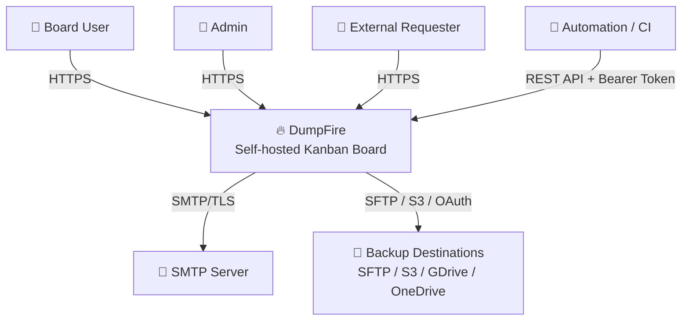

## Container Diagram

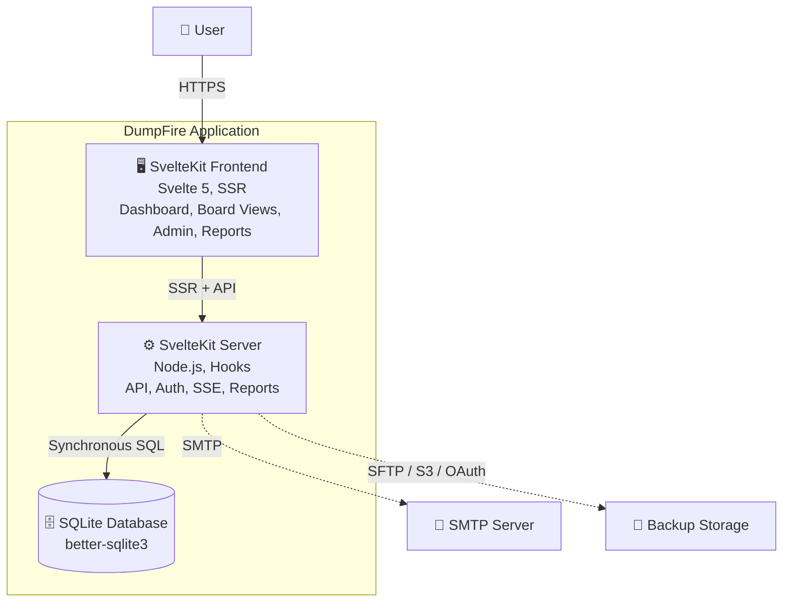

## Technology Stack

| Layer | Technology | Purpose |
|-------|-----------|---------|
| **Framework** | SvelteKit 2 + Svelte 5 | Full-stack SSR framework with file-based routing |
| **Language** | TypeScript 5.9 | Type-safe server and client code |
| **Database** | SQLite via better-sqlite3 | Embedded, zero-config relational database |
| **ORM** | Drizzle ORM 0.45 | Type-safe schema definition and queries |
| **Auth** | Session cookies + bcryptjs on worker threads | Cookie-based sessions for UI, API keys for external access; every password hashed and checked off the server's thread (`node:worker_threads`, card 2191), and browsers that have signed in remembered by a signed cookie (card 2194) |
| **Real-time** | Server-Sent Events | Live board updates without WebSocket complexity |
| **PDF Reports** | PDFKit | Server-side PDF generation for scheduled and on-demand reports |
| **Email** | Nodemailer | SMTP integration for notifications and report delivery |
| **Backup** | AWS S3 SDK, ssh2-sftp-client, Google/Microsoft APIs | Multi-destination scheduled backups |
| **Markdown** | marked + DOMPurify, through one renderer | A card's description and comments are drawn by `renderMarkdown` in `src/lib/markdown.ts` (cards 2202 and 2210), the only module that imports either: see [Authentication & Security](authentication-security.md#markdown-in-descriptions-and-comments) |
| **Font** | Inter 4.001, served by DumpFire | The variable font (one axis, weight 100 to 900), seven files by character set under `src/lib/fonts/inter/`, declared in `src/lib/fonts/inter.css` and imported by the root layout (card 2203). They are the files Google Fonts served, byte for byte, taken from `@fontsource-variable/inter@5.3.0`; no font package is installed. Vite fingerprints them into `/_app/immutable/assets/`, served before the gate and cached for a year. Licence: SIL Open Font License 1.1, "Copyright 2016 The Inter Project Authors", its text at `static/licences/inter-OFL.txt`, served at `/licences/inter-OFL.txt`. No page asks Google for it, or another site for anything |
| **Deployment** | Docker node:22-slim | Two-stage build, single container |

## Component Architecture

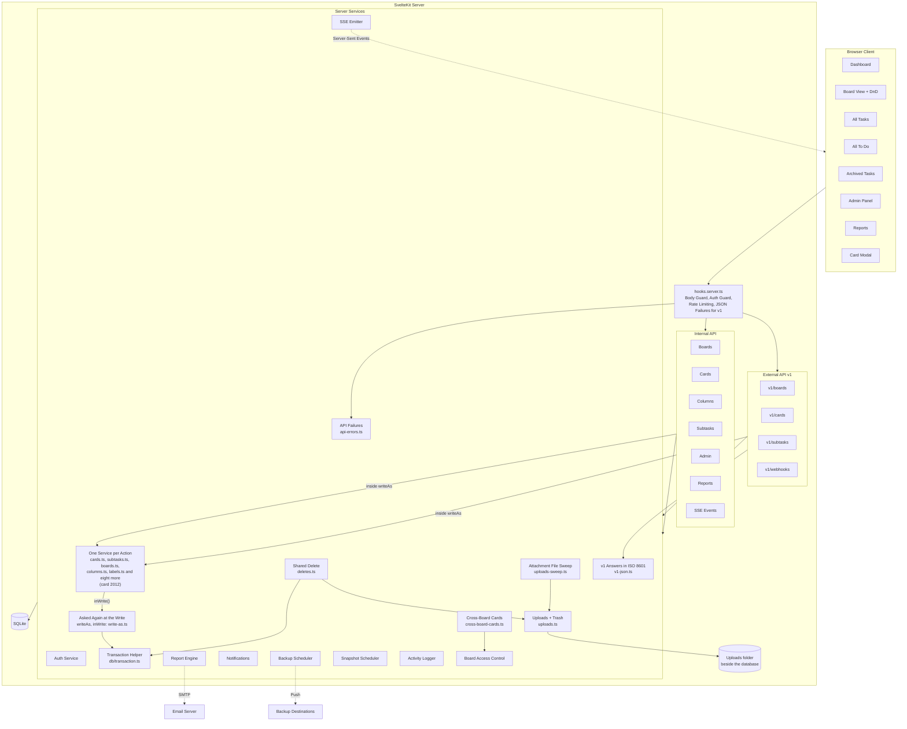

All Tasks and All To Do (card 2240) read their cards through one reader,
`readCrossBoardCards(user, { inColumn? })` in `src/lib/server/cross-board-cards.ts`: the boards
the caller can open, their columns, the unarchived cards on the columns `inColumn` lets through
(all of them for All Tasks; those whose title is To Do or Todo, `isTodoColumnTitle`, for All To
Do), enriched once, with the category rules of card 2128, the sub-board places of card 1990 and
the withheld blockers of card 2129. So the two pages give a caller the same boards and the same
cards, and All To Do lists exactly All Tasks' To Do bucket. All To Do's filters and sort are
worked out in the browser by `src/lib/todo-table.ts` and kept in the address with
`goto(…, { replaceState: true })`, a real navigation that re-runs no load, because neither its
load nor the layout's reads `url`; a shallow `replaceState` would leave `page.url` and the
history entry at the arrival address, so Back from a board would lose the filters.

## The Gate

Every request passes `handle` in `src/hooks.server.ts` before it reaches a page or a route
handler. It is where a caller is identified, where an API key is counted against its rate
limit, and where a failure of the external API is made JSON. The functions it uses for that
last part are in `src/lib/server/api-errors.ts`; how large a body may be is in
`src/lib/server/body-limits.ts`; and the answers it gives of its own when it sends a request
away, and the security headers it puts on every answer, are in
`src/lib/server/gate-answers.ts`.

Loading the module is also what starts the server's own work, once, before the first
request: `runMigrations()`, `cleanExpiredSessions()`, `initLogMaintenance()` and
`startSchedulers()`.

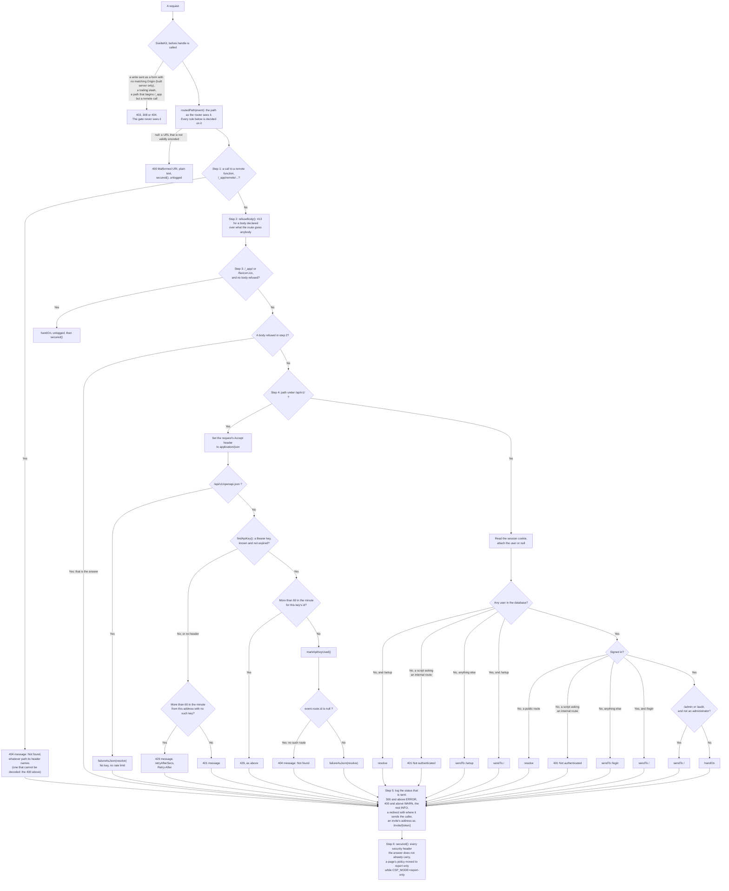

### The order of `handle`

| # | Step | What it does |
|---|------|--------------|
| 1 | A remote call | A call to a remote function, `/_app/remote/<id>`, is answered `404` `{ "message": "Not found" }`, to anybody. SvelteKit sets its `event.url` and route from the `x-sveltekit-pathname` header, which the caller writes, so no rule below can be decided on it. A header that names a path that cannot be decoded is answered `400` `Malformed URI` before this step, as SvelteKit 2.60 also answered it. DumpFire has no remote functions |
| 2 | Body size | `refuseBody()` asks every request whose body declares a length in `Content-Length` whether that is more than its route gives anybody: `413` with the limit if it is. A body with no length is let through to be counted (see `handOn`, below). The answer is kept, not thrown. See [Authentication & Security](authentication-security.md#how-large-a-request-may-be) |
| 3 | Static assets | `/_app/` and `/favicon.ico`, exactly, are handed on at once and not logged, unless step 2 refused the body, which is logged like any other answer. Every other path that begins `/_app`, but a remote call, is answered `404` by SvelteKit before the gate is called |
| 4 | `handleRequest()` | The `/api/v1/` branch, or the session branch for everything else. Each is set out below. Every refusal and every redirect in it is an answer that is returned: none is thrown. Every request it lets through is handed on by `handOn` |
| 5 | The request log | One line under the `HTTP` context with the method, the address as it was sent, the status that is sent and the time taken: `ERROR` for 500 and above, `WARN` for 400 and above, `INFO` for the rest. A redirect is logged with where it sends the caller. An invite's address is written `/invite/[token]`, and a remote call at the address it was sent to (`pathToLog()` in `src/lib/server/secret-paths.ts`). A fault in the gate itself, thrown, is logged at `ERROR` with its reason, once, and thrown on for SvelteKit to answer `500` |
| 6 | The security headers | `secured()` sets each of the five headers the answer does not already carry, `X-Frame-Options` but on the public request form's three pages. A page also carries a sixth, the `Content-Security-Policy` SvelteKit sets from `kit.csp` in `svelte.config.js` with a new nonce each time (card 2162); `secured()` never replaces it and gives no other answer one, and while `CSP_MODE=report-only` it moves a page's, unchanged, to `Content-Security-Policy-Report-Only`. See [Authentication & Security](authentication-security.md#the-content-security-policy) |

`handOn` is how every request the gate lets through reaches SvelteKit, from each of the
places `handleRequest()` hands one on and from step 3. It asks the body's size again, now
that the caller is known: the attachment upload gives 26 MB to anybody signed in, and the
import the whole of `BODY_SIZE_LIMIT` to the superadmin alone. Then it hands on a copy of the
request whose body passes through a count (`heldToLimit()`), so that a body with no length
is refused `413` once it is read past the limit, and puts `guardBody()` on that copy, which
replaces its readers so that a body that is missing or not JSON is a `400` and a body over
the limit a `413`. A request the server makes of itself is guarded and not limited.

After the gate, SvelteKit calls `handleError`, in the same file, for anything a handler or a
page's load throws, a fault in the gate, and a path that is no route. It writes a fault (a
status of 500 or more) to the system log at `ERROR` with the exception, the route and the
user, leaves one the gate has already written, answers SvelteKit's own message for the
status, and cannot throw. See
[Authentication & Security](authentication-security.md#when-something-fails).

### The path a rule is decided on

Every step above that asks about the path, `/api/`, `/api/v1/`, a public route, `/admin`,
asks about the path as the router sees it, and never about `event.url.pathname`, which is
the address as it was sent. `routedPath()` in `src/hooks.server.ts` works it out once, at
the top of `handle`.

SvelteKit decodes an address before it looks for a route, so `/%61dmin` is served by the
route `/admin`. A rule that compared the address as sent with `/admin` did not apply to it:
a signed-in user who was no administrator was shown the admin page, and `/%61pi/v1/me` was
answered with a session and no key, uncounted.

| The request | What the rules are decided on |
|-------------|-------------------------------|
| A route matched | The route's id, `/admin` or `/api/cards/[id]`: the router's own answer, so the gate and the router cannot disagree. A request for a page's data, `/admin/__data.json`, has the id of the page |
| No route matched | The address decoded as SvelteKit decodes it, `decodeURI` on each piece between one `%25` and the next. Nothing but a `404` is served for it |

- **`%2F` stays `%2F`.** It is no `/` to the router or to the gate: `/api%2Fv1%2Fme` is not
  under `/api/v1/` and is no route.
- **Nothing is decoded twice.** `/%2561dmin` is the address `/%61dmin` spelt out, and is no
  route.
- **A sequence that cannot be decoded is answered first.** `routedPath()` returns null for
  it and `handle` answers `400` "Malformed URI", in plain text with the security headers,
  before anything else and with nothing logged. SvelteKit answered it itself before calling
  the gate up to 2.60; since 2.61 it hands it to the gate, where the decode threw, a `500`,
  until card 2227.
- **The two page loads check for themselves.** `src/routes/admin/+page.server.ts` and
  `src/routes/audit/+page.server.ts` send a caller who is not signed in to `/login` and one
  who is not an administrator to `/`, as the gate does. The gate was the only thing in
  front of them.
- **No route is inside a `(group)`.** A group's name is in the route's id and not in the
  address, so a rule would not match it. `tests/gate.test.ts` fails if one is added.
- **The log keeps the address as it was sent**: `/%61dmin` is logged as `/%61dmin`.

### The body guard

A handler reads its JSON body with `readBody(request)`, which calls `request.json()` (see
[Reading a body](#reading-a-body)), and two read a file: the attachment upload with
`formData()` and the backup import with `arrayBuffer()`. The guard is what makes a body the
caller got wrong a `400` or a `413` and not a `500`, for every handler under `/api/` at
once.

| The body | What the handler's `request.json()` does |
|----------|------------------------------------------|
| Missing, empty, or not JSON (the read throws a `SyntaxError`) | Throws `error(400, 'The request body is missing or is not valid JSON')` |
| JSON that is `null`, a number, a string or a boolean | Throws `error(400, 'The request body must be a JSON object')` |
| A JSON object | Returns it |
| A JSON array, `[]` included | Throws `error(400, 'The request body must be a JSON object')`. No handler takes one, and one that gave every field a default made a board out of `[]` |
| Read with `formData()`, and not sent as `multipart/form-data` or `application/x-www-form-urlencoded` | `formData()` throws `error(400, 'The request body is not a form')` and reads nothing. undici's own refusal of a type that is a form only up to its first `;` (`application/x-www-form-urlencoded;a=b, text/plain`) is the same `400` |
| Sent with no length, and read past the route's limit | Throws `error(413, { message, limitBytes })`, as the gate's own `413` for a declared length says it. So do the other readers |
| Run past the length it declared | Throws `error(413, 'Payload Too Large')`. So do the other readers |
| Read a second time | Not caught: it stays a fault |

- **The readers are replaced on the one request object `handOn` hands on**, which is the
  object SvelteKit hands the handler: a copy of the request the gate was given, with its body
  passed through the count (`heldToLimit()`). `json`, `formData` and `arrayBuffer` are the
  three a route reads with; `text()`, `blob()` and `bytes()` are replaced as well, for the
  `413` alone, so that a body read past its limit is a `413` however it is read. A `clone()`
  of the request is not guarded, and no route reads one, but the count is on the body, so a
  clone is held to the limit all the same.
- **A body over the limit is known by its status, not its class.** The node adapter fails
  the body's stream with a `413` of its own copy of SvelteKit's error class. SvelteKit
  takes a status only from an error it knows by `instanceof`, so the adapter's `413` was
  answered `500` by a built server. The guard throws any fault whose `status` is `413`
  again as SvelteKit's own.
- **The JSON guard is on the read, not on the `Content-Type`.** A body sent as
  `application/xml` and read with `json()` is judged by what it holds. `formData()` is the
  one reader that asks the `Content-Type` first: a body not sent as a form is the `400`
  above, before any of it is read, on the attachment upload and on the three form actions
  (`/login`, `/setup`, `/invite/[token]`), which the guard reaches because it runs on every
  request. A form body that is broken, or cut off as it arrives, still fails in the read and
  is passed on as it was. A body sent with no `Content-Type` at all is not passed on by the
  server and is a body that is missing.
- **One handler catches what is thrown inside it, and passes SvelteKit's errors on.**
  `POST /api/admin/import` refuses a body that is not sent as a `.db` backup by its media
  type before reading it, and reads the rest as bytes, never as JSON, so the body guard's
  `400` never reaches it. Its outer `catch` first rethrows an error SvelteKit made, so that a
  `.db` backup sent in chunks that runs past the limit stays a `413`. A failure inside the
  restore is answered there: a `RestoreError` is `500` with its own message, a restore that
  would leave no superadmin `422`, and anything else `500` "Restore failed: …".
  Anything else thrown before the restore, the upload that could not be written down above
  all, is `500` "Import failed: …".
- **The test helper applies the same guard.** `api()` in `tests/helpers/api.ts` calls
  handlers beneath the gate and guards each request it builds, so a handler test meets what
  the wire has. See [Testing](testing.md#the-gate-harness).

### Reading a body

The guard says whether a body is a JSON object. What each field of it may hold is the
handler's to say, and every handler in both API trees says it one way, through
`src/lib/server/request-body.ts` (card 2117). Each handler used to read
`await request.json()` and use the fields as they came. A field of the wrong type then
went one of three ways: it was stored (`"top"` as a position, `"false"` as true), it was a
`500` (`.trim` called on a number), or it named something that did not exist and the
foreign key refused it with a `500`. The twins in the two trees checked what they checked in
their own words, and drifted.

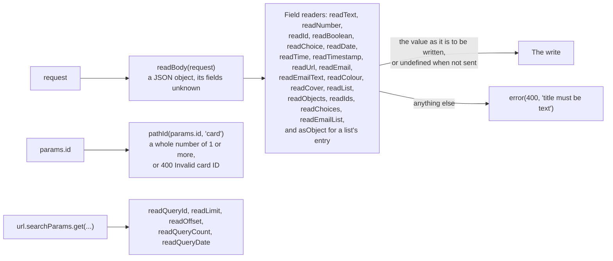

- **`readBody(request)`** hands back the body as `Record<string, unknown>`. The type check
  then refuses a handler that uses a field as text, a number or anything else before a
  reader has looked at it. Its parameter is called `request` so that
  `tests/openapi-document.test.ts`, which follows the functions a handler calls, still sees
  `request.json()`.
- **A field reader** takes `(body, name, rule)` and hands back the value exactly as it is to
  be written, or `undefined` when the field was not sent and is not required. It refuses
  with `error(400, ...)` and a text that names the field (`title must be text`,
  `priority must be one of: low, medium, high, critical`). It looks at the type before
  anything else, so `["x".repeat(600)]` is not a list one long enough to pass a length check.
  Only the body's own fields are read.
- **Every reader's `rule`** may say `required` (not sent is `<name> is required`), `nullable`
  (`null` is read as `null`, where the column can be empty; anywhere else it is the wrong
  type), `keep` and `says`.
- **`keep`** is the value the row holds now. A value sent that is the same JSON type and
  value is handed back unchecked, so a page that sends a card's stored fields back, with a
  priority stored before the rules, still saves. A create has no `keep`.
- **`says`** replaces the reader's texts, all of them or one of `missing`, `type`, `empty`
  and `invalid`. It is how the texts that tests, documents and pages quote were kept:
  `says: { missing: 'Title is required' }`. A length limit is never reworded: since card
  2218 every one is answered in the reader's own words,
  `<name> must be at most <max> characters`, in both trees, where 40 readers in 32 route
  files had said `Title too long (max 500 chars)` and the like. `tests/request-body.test.ts`
  holds it by the code's shape, not its words: under `src/routes` and `src/lib/server`, a
  length reader (`readText`, `readUrl`, `readEmailText`, `readReportRecipients`, read from
  the module) whose rule, written in the call, has a `max` may be given only a `says`
  written out there as an object, whose `invalid`, if it has one, is a text or template
  ending `must be at most <max> characters` with the rule's own number (a path in front,
  as templates and backup destinations write it, is allowed). A constant, a shared or
  shorthand `says`, a helper's call, a spread and other words or another number each fail,
  named by file and line. What it does not prove: a route that throws its own `400`
  (`error(400, 'Title too long')`) without a reader, and a rule handed to a reader by name
  rather than written in the call (`readWebhookUrl`'s), are outside the check.
- **Nothing is turned into another type**, but for a number written as text that is exactly
  a number (`"5"`, `"-2.5"`, not `"1e3"`), which is read as that number wherever a number or
  an id is read.
- **`pathId(params.x, 'card')`** reads an id in the path: digits and nothing else, 1 or
  more, or `400` `Invalid card ID`, the guards' own words. `1.5`, `abc`, `0` and `1e3` are
  refused, where `Number()` and `isNaN` let some of them through. The query readers take
  the value and not the parameter's name (`readLimit(url.searchParams.get('limit'), ...)`),
  so the name stays written in the handler, where the OpenAPI test reads it.
- **What a field is for** lives beside the readers where more than one handler needs it:
  the four priorities and a card's category rule in `src/lib/server/card-fields.ts`, a
  colour in `src/lib/colours.ts` (`#rrggbb`, which a page can ask too), and a card's cover
  there too (`isCoverValue`: a colour or one of the eight gradients of `COVER_PRESETS`,
  which `readCover` reads and the board and the card window ask before they draw one,
  card 2010), the reporting
  fields' vocabularies in `reporting-fields.ts`, an account's username and email in
  `account-fields.ts`, a backup destination in `readDestination()` in
  `backup-destinations.ts`.

**The order of the refusals.** Each handler refuses in one order, so that a caller who would
be refused is not told about the fields first, and a field reader that needs the stored row
(`keep`) reads it after the row is found:

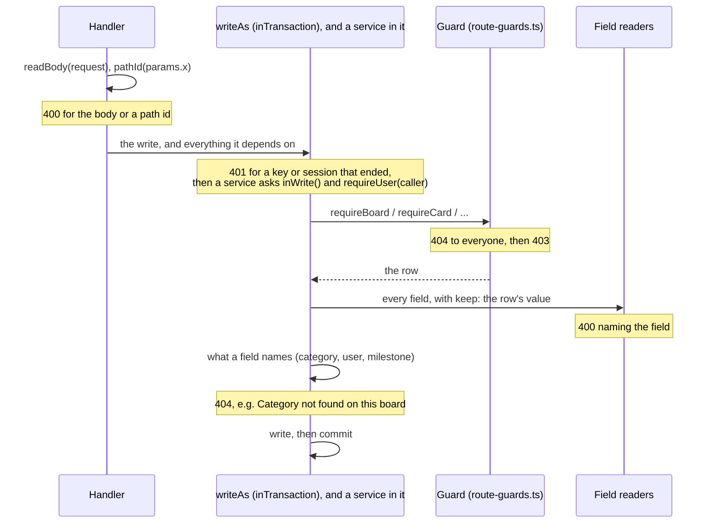

A create with no parent row to look for (`POST /api/boards`, a board grouping, a milestone of
no board) reads its fields first. Since card 2012 those reads, as every field read of a handler
that calls a service, are made inside `writeAs`, after the caller is asked for: a session that
ended while the body arrived is `401` before any field is read (see
[One Service per Action, Both Trees](#one-service-per-action-both-trees)). The token routes keep `tokens.ts`'s own order, the fields
before the card or subtask, and the three batches read every entry before they look for
what the entries name and report each problem in their `409`.

**The rule, held by a test.** `tests/request-body.test.ts` reads the source of every
`+server.ts` under `src/routes` and every module under `src/lib/server`, and fails on:

- a body read from the request (`json()`, `text()`, `arrayBuffer()`, `blob()`, `bytes()`,
  `formData()` or `.body`), on `request`, `{ request: req }`, `event.request` or a name typed
  `Request`, anywhere but `request-body.ts` and `api-errors.ts`, unless the read is on
  `NOT_JSON`: the import's `arrayBuffer()`, the upload's `formData()` and the gate's count.
  `STILL_READING`, the list of files that read their body themselves while the build moved
  them, is empty and is held empty;
- fewer than 80 calls of `readBody`, so that a parser that sees nothing cannot pass;
- a cast of what `readBody`, `readObjects` or `asObject` hands back, of a field of it, or a
  type written on the name it is kept in. `asObject(value)` hands back an entry of a list
  read with `readList` as a body when it is a JSON object (a dependency batch's `chain`),
  and the test follows what it hands back as it follows `readBody`'s; the entry was spread
  into a new object, which it could not see;
- a body, or an entry of `readObjects`, read by a key that is not written out
  (`updateData[key] = body[key]`), spread, handed to `Object.assign`, `Object.keys`,
  `Object.entries` or `Object.values`, walked with `for…in`, or with a field turned by
  `Number()`, `String()`, `Boolean()` or `!!`.

It finds a body by the names it is kept in, in the function it is kept in, so a body handed
whole to another function and used there is not followed: `normaliseReportingFields(body)`
and `recordTokenUsage(…, body)` read theirs with checks of their own. See
[Testing](testing.md#the-list-of-test-files).

### The four rules for `/api/v1/`

The external API answers every failure as JSON with one key, `message`. Four rules in the
gate make that hold for the failures no handler writes.

| Rule | What the gate does | Why |
|------|--------------------|-----|
| **The request asks for JSON** | The first statement of the branch sets the request's `Accept` header to `application/json`, on the request itself | SvelteKit answers a handler's `error(status, text)` as `{ message }` or as an HTML page by the `Accept` header, and picks the page for a caller that sends none. The header is set in place and the request is not replaced by a copy, because SvelteKit answers an error thrown out of the hook from the object it gave the hook |
| **The gate's own refusals are JSON** | The three `401`s and the `429` are returned as `json({ message, ... })`, never thrown | An error thrown by the hook is logged as an unhandled error |
| **No such route** | Once the key is accepted, a request whose `event.route.id` is `null` is answered `404 { "message": "Not found" }` by the gate, and SvelteKit is not asked | SvelteKit would render its 404 page: HTML, with the key owner's name, email and role in it, which the root layout loads for every page. It is answered only once the key is accepted, so without a key every path is a `401` |
| **A failure that is not JSON is answered again** | `failureAsJson()` looks at what `resolve` answered. A status of 400 or above whose content type is not JSON is replaced by a new `json({ message })` with the same status | What SvelteKit answers without asking a handler is plain text: above all a method the route does not have, a `405` |

`failureAsJson()` never touches a success, whatever its type, so a PDF and the OpenAPI
document pass through, and it hands back a failure that is already JSON as it is. The answer
it puts in place of another is made from nothing: only the `Allow` header is copied, because
the old answer's `Content-Length` and `Content-Type` describe the old body. Its `message` is
`<METHOD> method not allowed` for a `405`. For anything else it is what the old answer said,
if that was a plain text of 200 characters or fewer, and otherwise the standard phrase for
the status.

`/api/v1/openapi.json` returns before the key is asked for and before the rate limit. The
first and the last of the four rules cover it all the same, so a `POST` to it is a `405` in
JSON.

There are two `401`s. A request with no `Authorization` header, or one that is not a
`Bearer` header, is told so. A key that is not known, has expired or belongs to a deleted
user is answered `Invalid or expired API key`. `Bearer ` with nothing after it gets the
first: a header's value loses the spaces at its end before the gate sees it, so it arrives
as `Bearer`, which is no `Bearer` header. The gate had a third, `API key is empty`, for it,
which nothing could reach, and card 2117 took it out.

The key is looked up before anything is counted, and its requests are counted against the
key's own row (`findApiKey()`, then `checkRateLimit('apikey:' + id)`, then
`markApiKeyUsed()`), so a key over its limit is not marked as used. A request with no key
the gate accepts, a missing header included, is counted against the caller's address in a
bucket of its own, `apikey-none:`. The address is asked for guarded, because the adapter
throws when it is started with `ADDRESS_HEADER` and a request arrives without that header.

Every v1 answer carries the five security headers, the gate's own `401`s, `404` and `429`
included, set in step 6 like every other answer's.

### Everything else

Outside `/api/v1/` the gate decides who the caller is and where they may go, and leaves the
answer as SvelteKit made it.

- **The body guard still applies** to the internal routes under `/api/`.
- **A failure is JSON or a page by the `Accept` header.** A page's own `fetch` asks for
  anything and is answered `{ message }`. A browser that opens an internal route's address
  gets SvelteKit's error page, and a method the route does not have is plain text.
- **A script with no session is refused; a browser is redirected.** A request for an
  internal route (under `/api/`, outside `/api/v1/` and the public routes) with no session
  is answered `401` `{ "message": "Not authenticated" }` before its body is looked at,
  unless it is a navigation (`Sec-Fetch-Mode: navigate`, or an `Accept` that prefers
  `text/html`), which is sent to `/login`, as every page is. `isNavigation()` and
  `notSignedIn()` are in `gate-answers.ts`.
- **The public routes are a list of route ids, matched exactly:** `/login`, `/docs`,
  `/invite/[token]`, `/request`, `/request/[id]/confirm`, `/request/[id]/reply`, the five
  routes under `/api/requests`, and `/api/v1/openapi.json`. `/setup` is the set-up page,
  exactly. A path that is no route is never public. See
  [Authentication & Security](authentication-security.md#who-is-let-through-without-a-session).
- **A redirect is an answer the gate makes, not one it throws.** `sendTo()` makes it as
  SvelteKit would have made it of a thrown `redirect(303, ...)`: a `303` with `Location`;
  for a page's data request, `200` `{ "type": "redirect", "location" }`; and for a form a
  page's script posts, `200` `{ "type": "redirect", "status": 303, "location" }`.
  `tests/gate.test.ts` holds each against SvelteKit's own function for it.
- **`/api/v1` with nothing after it is not under `/api/v1/`.** It takes this branch, as a
  path under `/api/` that is no route: a script is answered `401`, a browser sent to
  `/login`.
- **The five security headers** are set on every answer, in step 6. See
  [Authentication & Security](authentication-security.md#security-headers).

### What is answered before the gate

SvelteKit answers three kinds of request without calling `handle`, so the gate cannot make
them JSON or head them. The first two are documented to callers as the exceptions, with
what to send instead, in the
[External API Reference](api-reference.md#answers-that-are-not-json), and all three, with the
static files of a built server, as the proxy's to head in
[Deployment](deployment.md#security-headers-from-the-proxy). A URL that is not validly
encoded, the third exception callers are told of, was a fourth up to SvelteKit 2.60; the
gate now answers it itself, with the same plain-text `400` `Malformed URI` and the security
headers (see [The path a rule is decided on](#the-path-a-rule-is-decided-on)).

| Request | SvelteKit's answer |
|---------|--------------------|
| A `POST`, `PUT`, `PATCH` or `DELETE` whose `Content-Type` is a form's or `text/plain`, with no `Origin` that matches the server. A built server only: the check is skipped under `vite dev` | `403`, as plain text unless the `Accept` header is exactly `application/json` |
| A path with a trailing slash that names a route | `308` to the path without it |
| A path that begins `/_app` and is no file the server has, but a call to a remote function, which the gate answers itself | `404` `Not found`, plain text |

The first is SvelteKit's protection against cross-site form posts (`csrf.checkOrigin`),
which the configuration leaves on.

## Authentication and Authorisation

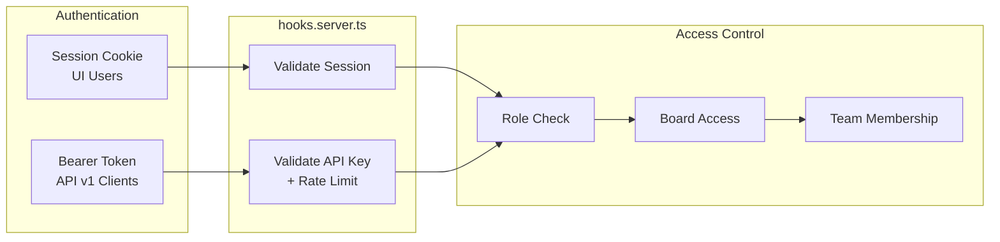

### Role Hierarchy

| Role | Boards | Admin | Users |
|------|--------|-------|-------|
| `superadmin` | All boards | Full access | Manage all |
| `admin` | All boards | Full access | Manage all |
| `user` | Only shared boards | No access | Self only |

### Board Access Levels

| Level | View | Edit Cards | Manage Board |
|-------|------|-----------|--------------|
| `owner` | ✅ | ✅ | ✅ |
| `editor` | ✅ | ✅ | ❌ |
| `viewer` | ✅ | ❌ | ❌ |

## Real-Time Updates via SSE

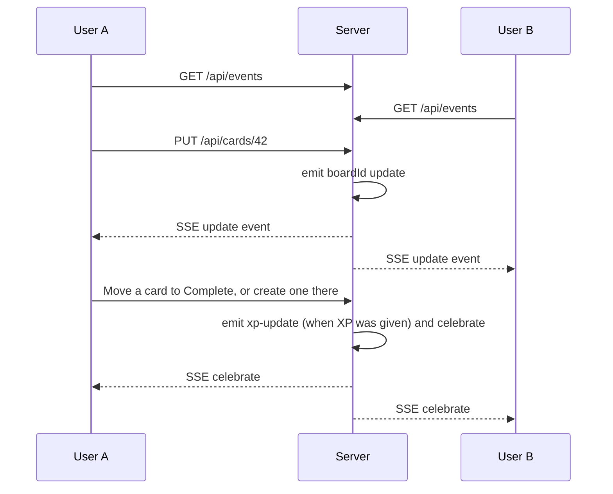

An event raised while a transaction is open is held until that transaction commits, and is dropped if it rolls back. See the next section.

A card created in a Complete column is completed as a moved one is, and celebrated the same way (card 2134; see [Data Model](data-model.md#one-completion-however-a-card-arrives)). A delete tells the pages open on every board it removes or empties with an `update` that names nothing, `{ type: 'board', action: 'deleted' }`, `{ type: 'card', action: 'purged' }` or `{ type: 'card', action: 'cleared' }`, and the board a deleted sub-board hung from, which is still there, with `{ type: 'board', action: 'sub_board_deleted' }` (card 2108; see [Notifications & Email](notifications-email.md#event-types)). The web application's routes tell what their `/api/v1/` twins tell (card 2143): an assignment, an unassignment and a comment edited send `{ type: 'card' }` to the card's board, a board updated sends `{ type: 'board' }` to that board once, and a sub-board made under a card, by either tree, sends `{ type: 'board', action: 'created' }` to the board that card is on.

**What an event carries.** An event goes, as it was emitted, to every listener of its board on the board stream and on the global one, and `emit` cannot choose a payload per listener. So an event names nothing that some reader of its board may not read; it is there to make the page read its board again, under the page's own access check (P4's rule for the events it added). A move between boards sends `moved_away` to the board the card left and `moved_in` to the board it joined, each with `type`, `action`, `cardTitle`, `fromColumn`, `toColumn`, `userName` and `userEmoji`, and neither names the other board (card 2181): they carried `toBoard` and `fromBoard`, which nothing read, and gave each board's listeners the name of a board some of them could not open. The move's two activity entries name neither board for the same reason (see [Data Model](data-model.md)).

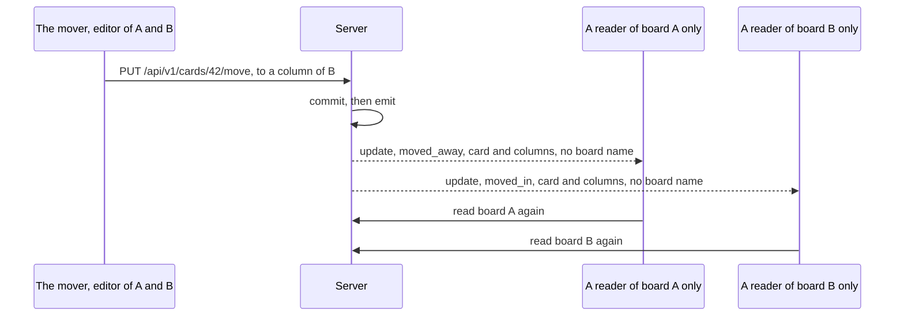

### An open stream and its session

The gate looks at a request's session once, when it arrives, and a stream is one request that stays open. So each of the three streams (`/api/events`, `/api/boards/[id]/events` and `/api/logs/stream`) reads its session cookie when it is opened, and asks at each heartbeat it already sends (every 30 seconds; 25 for the log) whether that session is still open: there, not expired, and with an account. When it is not, the stream stops listening, stops its heartbeat and closes, and sends nothing more. Each asks `openSessionUser()` in `src/lib/server/auth.ts`, which gives the session's account as it is now. The two streams let in for an administrator's role end as well when the role they were let in for has changed: the log stream when the account is no longer an administrator, and `/api/events` when it has become one or stopped being one, since that decides which boards' events it sends. The board stream ends as well when its board has gone or the account can no longer open it, and says so first (card 2170, below). `openSessionUser()` and `sessionStillOpen()` share one private function with `validateSession()`, so that what counts as an open session is decided in one place. Unlike `validateSession()` they write nothing, log nothing and do not move the session's expiry on: an open tab would otherwise keep its session alive for ever.

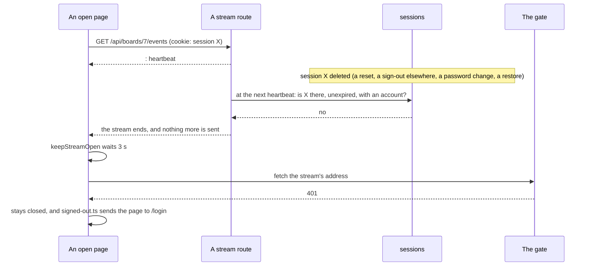

- **Only the session that opened it counts.** Another session of the same account ending does not end the stream.
- **A check that cannot be made ends the stream too.** The check runs inside the heartbeat's `try`. If it throws, the stream ends as for a session that has gone, and one `WARN` line is written under `AUTH`, "Live stream ended: its session could not be checked", with the route and the error. Nothing escapes the timer, where it would end the process.
- **What the page does.** Nothing new: `keepStreamOpen()` sees the stream drop, asks again three seconds later, is answered `401` and stays closed, and a page that holds a stream (a board, the dashboard, All Tasks, Burndown) goes to the login page by itself, about 35 seconds after the session ended at most. A page that holds none (Account, Admin, Reports) goes there at its next request. A stream that ended because its holder changed their own password opens again at once on the browser's new cookie, one that `/api/events` ended for a change of role opens again with the role as it is now, and the page re-reads its data. The audit console's own `EventSource` is refused when it tries again (`401`, or `403` for an account that is no longer an administrator), gives up, and the console shows it is disconnected.
- **What access each stream checks again** (card 2170). Each decides everything again at one moment, its heartbeat. The board stream asks, after the session, whether the board row is still there and the account as it is now can open it (`canViewBoard`); if not, it enqueues one last `update` with `{"type":"access"}` on its own stream, not emitted to anyone else, and ends, and the board page re-reads and shows its load's refusal, "You do not have access to this board" or "Board not found". It opens only on a board that is there and that the caller can open (`requireBoard(user, id, 'view')`: `404`, administrators included, `403`, or `400` for an id that is not one). `/api/events` keeps each board's answer until its next heartbeat, which forgets them all once the session and the role are checked; the 30-second clock it kept them by is gone. An administrator made an ordinary user stops receiving the log and every board's events at the next heartbeat, and a board's events too unless they are on it.
- **A deleted board is told first.** A delete's own event is delivered in the same synchronous run as its commit (`emit` queues it with `afterCommit`, and the outermost transaction starts the queued effects as it returns), and a heartbeat is a timer, which cannot run in between. A stream closed after an `enqueue` still hands the reader what was enqueued, so the deleted board's page always has `{ type: 'board', action: 'deleted' }` before the access event and the end. Board ids are never used again, so ending a stream on a deleted board loses nothing.

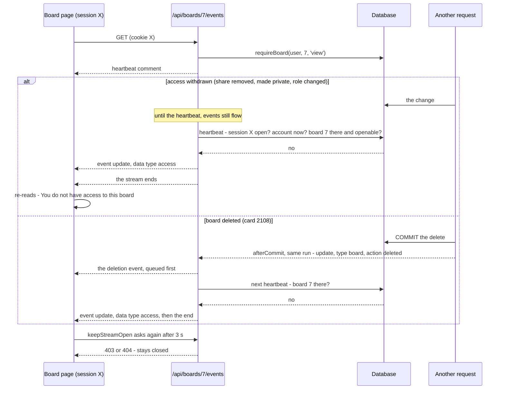

Covered by `tests/live-streams.test.ts`.

In the browser every stream but one is opened by `keepStreamOpen()` in `src/lib/live-stream.ts`. The one is the audit console's live log, `src/routes/audit/+page.svelte`, which opens its own `EventSource` on `/api/logs/stream` and leaves reconnecting to the browser: it tries again after a dropped connection, and gives up on an answer that is not a stream, a `401` or a `403` among them, when the console says it is disconnected. On reconnecting the stream sends its last 100 entries again, and the console skips each it has shown: one whose id is at or below the last one shown and which is no later than it (the ids count from 1 again after a restart). After a failure it waits 3 seconds, then twice as long after each failure that follows, up to five minutes; it asks the stream's address with `fetch` before it opens it again, and leaves it closed after a `401`, `403` or `404`. A stream that opens again after a gap has the page re-read its data, since nothing replays the events it missed. See [Authentication & Security](authentication-security.md#who-is-let-through-without-a-session).

### The board page follows the board it shows

The board page's stream is the page's own: `connectSSE(data.board.id, ...)` (`src/lib/board/sse.ts`) is called in its `onMount` and closed in its `onDestroy`. SvelteKit keeps a page's component when only its params change, so until card 2184 a sub-board badge, a breadcrumb, a link in the card window, or Back and Forward between two boards showed the second board in the first board's page, still listening to the first board's stream, with its selection, panels, search, filters and card window carried over. `src/routes/board/[id]/+layout.svelte` now renders the page inside `{#key page.params.id}` (`page` from `$app/state`): a change of board destroys the page, which closes the first stream, and makes it afresh, which opens the second, with everything else empty. The key is the board and not the address, so a `?card=` link on the same board, `invalidateAll()` and SvelteKit's `replaceState` keep the page, its stream, its drag state and its scroll.

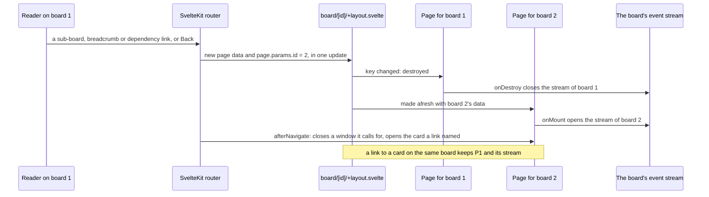

The page's `afterNavigate` (card 2164) opens the card `?card=` names, after every navigation, the first load included. Before it does, it closes a card window open at the time when `navigationClosesWindow(from, to, ...)` in `src/lib/board/card-actions.ts` says so (Q-F's review): on a navigation to another board, a card named or not, which the key makes certain too; and on the same board when a saved card's window is open and the new address names no card, as Back after a dependency link does. A New Task window on the same board is left open.

### A page left open across a deploy

A page keeps running the scripts it was loaded with until it is loaded again, against whatever server is now answering. Since card 2167 each open page asks once a minute whether the server is a newer version, and says so when it is. Until then `svelte.config.js` set no `kit.version`, SvelteKit's interval was 0, and a page never asked.

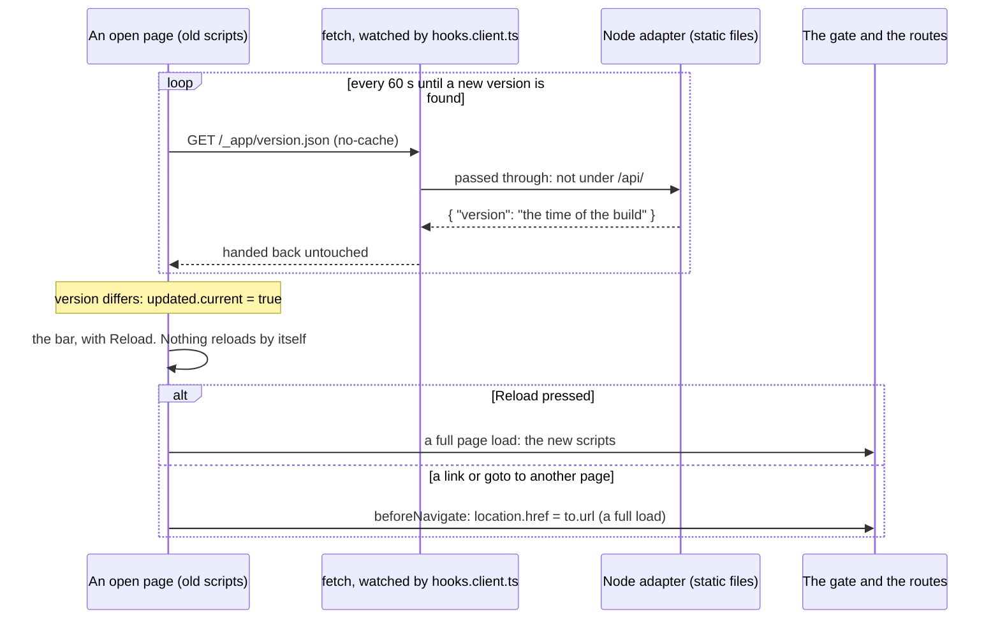

- **How it asks.** `kit.version.pollInterval` is `60_000` in `svelte.config.js`. SvelteKit's `updated` then fetches `/_app/version.json`, with `no-cache` headers, every 60 seconds, compares its `version` with the one the page was built with, and stops asking once they differ. `kit.version.name` is left as SvelteKit's default, the time of the build: every image built is a new version, a restart of the same image is not, and going back to an older image is. Under `vite dev` it never asks.
- **What answers it.** The node adapter serves `/_app/version.json` from the build, as it serves every static file, before `handle` is called, and does not mark it immutable (see [What is answered before the gate](#what-is-answered-before-the-gate)). So the check needs no session, is counted by no rate limit, writes no system-log line, and works on the login page and the public request form alike. The proxy in front caches nothing ([Deployment](deployment.md#reverse-proxy--nginx)).
- **The client hook is unchanged.** SvelteKit calls the global `fetch` when its timer fires, which `src/hooks.client.ts` has by then replaced with the watch for an ended session. The address is not under `/api/`, so `endsTheSession()` in `src/lib/signed-out.ts` hands the answer back untouched and never sends the page to sign in. A stale page that the watch does send to sign in goes there as a new page load, and so arrives on the new version.
- **What the page shows.** While `updated.current`, from `$app/state`, is true, the root layout (`src/routes/+layout.svelte`) draws a bar across the foot of the window, `role="status"`: "DumpFire has been updated. Save anything you are editing, then reload to use the new version.", with a **Reload** button that calls `location.reload()`. It cannot be closed, and the page never reloads by itself, so nothing typed in a card's window or a form is lost. While it shows, its height is set on the page's root as `--update-bar-space`, and every window (`.modal-overlay` in `src/app.css`), the toast and the user badge keep clear of it by that much. It was at the top until Q-F's review, where on a phone it covered a card window's title and its ✕.
- **Above everything.** The bar is drawn after `.app-layout`, not inside it, at `z-index: 10001`. `.app-layout` is `position: relative; z-index: 1`, which makes everything a page draws, its windows and overlays included, one layer beneath anything outside it; and the toast is at 10000. `tests/page-failures.test.ts` holds the bar above every other `z-index` under `src`. The user badge in the corner is drawn inside `.app-layout`, at `z-index: 100`, beneath the pages' windows (1000 and up): outside it, it was drawn above every window and its dimmed backdrop. It is opaque, `var(--bg-elevated)` with `var(--shadow-md)` over the global `.glass`'s background of 2 to 6% (card 2239), and `--user-badge-space` on `.app-layout` (the badge's offset, its height of 18px plus the taller of 28px and 1.8rem, about 47px at the default font size and more when the root font is larger, a gap and `--update-bar-space`) is where each page ends its last line or its scroll (the API docs' sidebar included), so nothing a page draws is left under it: the audit page's Live Console footer read through it.
- **The next move is a full load.** A `beforeNavigate` in the same layout sets `location.href = to.url.href` when `updated.current && !willUnload && to?.url`, SvelteKit's documented pattern, so a link or a `goto` once the bar has shown loads the new version.
- **The first release.** A page loaded before the release that brought this asks nothing, so for that release open tabs are reloaded by hand: see [Deployment](deployment.md#updating-a-running-installation), step 7.

## Work Kept Off the Server's Thread

The server runs JavaScript on one thread, so whatever holds that thread holds every request. A bcrypt check at cost 12 takes about a fifth of a second, and was made there with `compareSync`: each sign-in held every other request up for that long, and a burst of them held the server for as long as it lasted. Since card 2191 every password hash and check is made on a **worker thread** by `src/lib/server/passwords.ts`, the only module that imports bcryptjs, and the route awaits the answer while the server's thread answers everyone else.

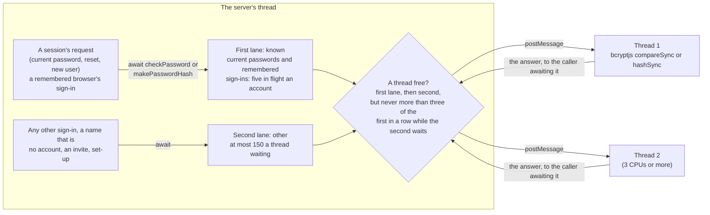

- **At most two threads**, `min(2, max(1, CPUs - 1))`, or `PASSWORD_THREADS` (0 to 8, left unset in a deployment; 0 is the server's own thread a turn later, which the tests use). Each is started from a string of code, not a file of its own, because Vite carries no worker file into the server build; it loads bcryptjs from `node_modules` by an absolute path, so the image did not change.
- **One line, two lanes.** A caller the server already knows goes first, but never more than three in a row while a check of the second lane waits, and an account's current passwords and remembered sign-ins are held to five in flight, so the second lane is always served; the second lane holds at most 150 checks a thread, and a check that arrives when it is full, or whose caller has gone by the time a thread is free (`req.socket.destroyed`, in the built server), is not made and its route answers `503`.
- **A thread that stops** is replaced and the check sent once more; one that cannot start at all leaves every check on the server's thread, with one `ERROR` line, rather than keep anybody out.
- **A transaction cannot await**, so no hash or check is made inside one. A route that needs a current password checked again because the hash changed in between does it outside, through `whilePasswordHolds()` in `auth.ts`, which writes only while the stored hash is still the one checked.

The whole rule, with the lanes, the bound, the log lines and what the people using it notice, is in [Password Hashing](authentication-security.md#password-hashing).

## Writes: One Transaction, Then the Effects

A request that writes makes its writes all or none, and checks the caller where it writes. The route awaits the request body, then passes one function to `writeAs(locals, (caller) => …)` in `src/lib/server/write-as.ts`, which runs it in `inTransaction()` (`src/lib/server/db/transaction.ts`) after asking, first in that transaction, whether the key or session the gate let the request in with is still open and who its account is now (card 2253; see [Asked Again at the Write](authentication-security.md#asked-again-at-the-write-card-2253)). A route never calls `inTransaction()` itself: `tests/check-at-the-write.test.ts` refuses it in a route file. The function reads what the write depends on, checks `caller` with its guard (`route-guards.ts`), makes every write (the activity entry among them) and returns. In the 57 route files of the two API trees that card 2012 moved onto shared services, the function is one call of a service, handed `caller`, which does all of that and reads the body's fields as well, so the field reads are inside the transaction too, after the caller is asked for (see [One Service per Action, Both Trees](#one-service-per-action-both-trees)). Only then does the route set a cookie, redirect or answer. Before the body the route asks only what reads no row: the session the gate read and the id in its path. A request with one write follows the same order, so that the row checked is the row written, and a row taken away while the body was arriving is a 404; until 2026-10-14 twenty-two handlers checked the row first and then awaited the body (card 2115).

Nothing leaves the process from inside a transaction. A webhook delivery, a live event, an email and a file move are each queued with `afterCommit()` and start once the outermost transaction has committed. If it rolls back they are dropped, so nobody is told of a change that was not saved.

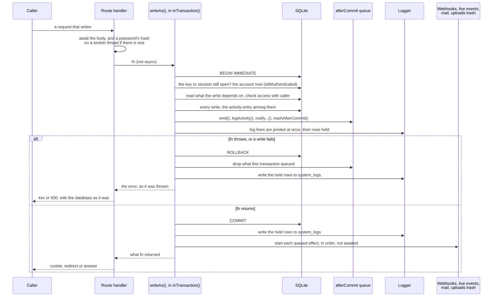

### The helper

| Function | What it does |
|----------|--------------|
| `inTransaction(fn)` | Runs `fn` in one transaction on the application's connection and returns what it returns. The outermost call is `BEGIN IMMEDIATE`, which takes the write lock at the start, so nothing `fn` reads can be changed under it before it writes. A call made inside another `inTransaction` is a savepoint: if it throws and the code around it catches the error, only that part is rolled back. A call made while a transaction the helper did not open is open on the connection throws before `fn` is run, so the request is answered 500 and writes nothing. |
| `writeAs(locals, fn)`, `stillCallerNow(locals)` | In `src/lib/server/write-as.ts` (card 2253): `inTransaction(() => fn(stillAuthenticated(locals)))`, the one way a route writes, and the same question asked in a transaction of its own by the eight handlers whose work cannot run in one (the vacuum, the import, the two report routes, the backup run, the Test, the Google Drive Connect and the test mail). See [Asked Again at the Write](authentication-security.md#asked-again-at-the-write-card-2253) |
| `inWrite()` | In `src/lib/server/write-as.ts` (card 2012): the first statement of every write a service exports. It throws a plain error, a `500` if a route reaches it, unless a `writeAs` callback is running: `writeAs` counts its callbacks (`writing`, set after `stillAuthenticated` and taken off in `finally`, so a nested `writeAs` is counted), and nothing else sets the count. A bare `inTransaction`, a job's or a scheduler's, is not a `writeAs`, so a service called from one writes nothing. See [One Service per Action, Both Trees](#one-service-per-action-both-trees) |
| `afterCommit(effect)` | Queues `effect` until the outermost transaction commits. Called with no transaction open, it runs the effect at once. Whether a transaction is open is read from the connection (`sqlite.inTransaction`), not counted by the helper. |

How the queue behaves:

- **A part that fails takes its own effects with it.** Each `inTransaction` call notes the length of the queue when it starts and cuts the queue back to that length if its function throws. What the code around it had already queued stays.
- **Effects are started, never awaited.** They run in the order they were queued. One that throws, or returns a promise that rejects, is logged at `ERROR` under the `TX` context and goes no further: the write is committed and the caller is told so.
- **Moving files is synchronous.** A delete has moved its attachment files to the trash before the request is answered.
- **An effect queued inside a transaction the helper did not open is not sent.** Nothing does that today. If something did, the helper cannot know whether that transaction committed, so the effect is dropped and an `ERROR` line says how many were.

### Rules for code inside a transaction

- **No `await`.** A transaction is over when the function returns. The part of an async function after its first `await` runs later, outside the transaction, and is not rolled back with it. The type of `inTransaction` refuses a function that returns a promise, so `npm run check` fails on one; at run time such a function is refused with a `TypeError` and what it wrote before its first `await` is rolled back.
- **No `redirect()`, cookie or answer.** Those come after `inTransaction` (in a route, `writeAs`) returns. Throwing `error(...)` or a typed error such as `CardMoveError` is fine: it rolls the transaction back and reaches the caller unchanged.
- **A database error is not caught and carried on from**, unless the part that failed is its own nested `inTransaction`.
- **No raw `sqlite.transaction` under the helper.**
- **Slow work comes first.** Hashing a password takes about a fifth of a second, on a worker thread, and is awaited, which a transaction cannot do, so the hash is made before the transaction starts. See [Work Kept Off the Server's Thread](#work-kept-off-the-servers-thread).
- **The check is made where the write is.** Every route that reads a body reads it first and calls its guard after it, and nothing is awaited between a guard and the write it allows. The handlers card 2115 moved call their guard inside the transaction that writes; a `DELETE` that reads no body checks and writes with no transaction, which is as safe, because the database calls are synchronous and nothing is awaited between the two. `tests/check-at-the-write.test.ts` reads every handler under `src/routes/api` and fails on any call before the body but those that read no row, and on a handler whose text reads a body where it cannot find the read. The attachment upload is the one handler that also looks before its body, so that a caller with no access is not sent 25 MB, and it reads the row again inside the transaction. That is also why an invite cannot be used twice and set-up cannot create two superadmins.

Two things open their own transactions and do not use the helper, because they switch foreign keys off around them: the migration runner, and the restore behind Import Backup. The import of the old JSON export was a third; it was removed on 2026-10-14 (card 2157), and Import Backup takes a `.db` backup only.

### Log lines written during a transaction

The logger writes to `system_logs` on the same connection as everything else. A row written inside a transaction that rolls back would vanish with it, and the line that explains a failure is exactly that row. So while a transaction is open the logger prints the line to the console and the live feed at once and keeps the database row in memory. `inTransaction` writes the held rows when its outermost transaction ends, whichever way it ended, with the time each was logged at. At most 2,000 rows are held; past that the oldest are dropped and a `WARN` row says how many.

A line that should be stored only if the write was committed, such as "board 12 was deleted by …", is queued with `afterCommit` instead.

### The shared delete

`src/lib/server/deletes.ts` is the one routine behind every permanent delete: a card with `?permanent=true`, a column, a board, Purge Archived Cards and Clear Cards, in both API trees. The foreign keys take most of what goes, by cascade. The routine takes what they do not:

- dependency links (`work_dependencies`) with a deleted card or subtask at either end;
- sub-boards at every depth, each by its own statement and not as a side effect of the cascade;
- for a deleted board or sub-board, the report schedules that name it, and the membership of cards on other boards in its milestones;
- the attachment files, which are moved to the trash once the delete has committed.

Archiving is not deleting: `archiveCard()` stamps the card and writes the activity entry and touches nothing else. `deleteUser()` is in the same module. What each delete removes and leaves is set out in [Data Model](data-model.md#what-a-delete-removes).

Each function in the module opens its own `inTransaction` and checks no access. A route calls it inside the transaction in which it read the row and checked the caller, which makes the delete a savepoint of the route's transaction.

### Sub-boards and the board tree

A board hangs under a card by `boards.parent_card_id`, and the card is on a board, so the boards make a tree: the dashboard lists the top-level boards, and the board page's breadcrumbs walk up from a sub-board. Nothing in the schema stops the tree going round. `src/lib/server/sub-boards.ts` answers the two questions about it that linking an existing board asks (card 2139):

- `wouldLoop(boardId, parentBoardId)` walks up from the parent card's board with a recursive query built with `UNION`, which keeps each board once and so ends on a loop already in the data, as the shared delete's walk down does, and says whether the board being linked is on the way. `requireSubBoardLink()` in `route-guards.ts` refuses that with 409, after asking for the board's owner or an administrator and for edit access to the card's board.
- `linkableBoards(user, boardId)` is what the board page's "Link existing board" offers: top-level boards the caller owns by `getBoardRole`'s rule (those they created and those where they are a member stored as owner, read in two queries whatever the number of boards), every one to an administrator, except the board itself and the top of its own chain of parents, and none to a caller who cannot edit the board. An owner can always open a board, so it offers only boards the caller can open, which card 2130 asks of it.

A sub-board is a board of its own and inherits no access from the board its card is on. Since card 2130 every place that shows a card's sub-boards shows only those the caller can open, as the graph already did: `subBoardsFor(user, parentCardIds?)` in `src/lib/server/list-access.ts` reads them for the board page, the card context and the dashboard, whose tiles, sub-board count, All Tasks walk, cost and spend by person all start from it. The breadcrumb walk up from a sub-board shows a board above it that the caller cannot open as "🔒 A board you cannot open", with no link, and keeps it in the chain, so that the page still knows it is a sub-board. See [Authentication & Security](authentication-security.md#what-a-list-gives).

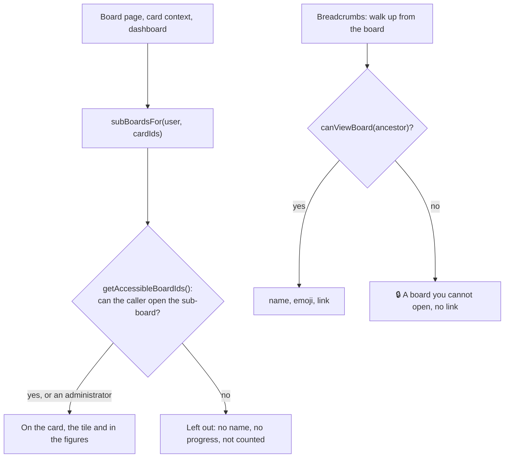

`PUT /api/boards/:id` writes `parentCardId` in the transaction that runs those checks, with any other field the request sends, and the board, the card's board and the board it left are each sent a live update.

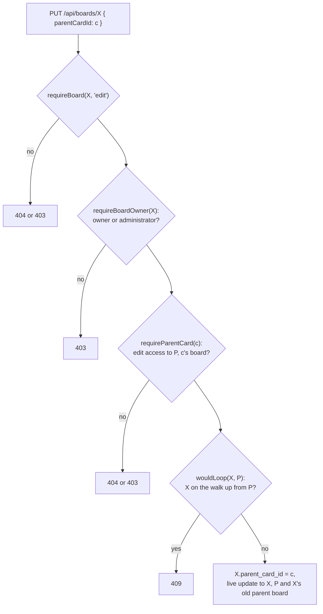

The breadcrumb walk on the board page and a card moved onto its own sub-board are not guarded here; each has a card of its own (the plan's found nearby a and b).

### Uploads and the trash

`src/lib/server/uploads.ts` is the one definition of where attachment files are. An attachment row holds a file name only; every path is built from the card id and that name.

```
<uploads>/<cardId>/<filename>            a card's file
<uploads>/.trash/<cardId>/<filename>     the same file, once its row is deleted
<uploads>/.trash/<cardId>/.trashed-at    when that folder was last added to
```

The uploads folder is the folder `uploads` beside the database file. The module refuses, the first time it is asked, a folder that is or contains the database's folder or the working directory.

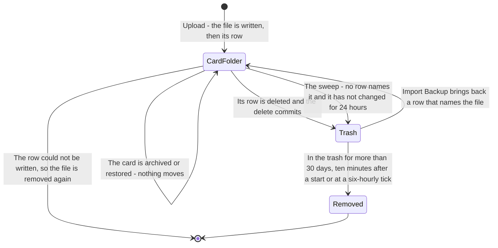

A row is deleted, and its file moved, by deleting the attachment itself, by a permanent delete of its card, column or board, by Purge Archived Cards, by Clear Cards and by Reset.

- **A file is never deleted with its row.** Backups hold the database and not the files, so a file whose row has gone is moved to the trash, where an import of an earlier backup can find it.
- **Only the files named by the deleted rows are moved.** The card's folder is then removed if it is empty, and never recursively. A file that is not there is passed over: a working copy restored from a backup has none.
- **A stored file name is treated as data.** A name with a separator, a drive letter or `..` in it, which a restored backup could hold, is refused before it is joined into a path.
- **The trash is emptied by the log maintenance timer**, ten minutes after the server starts and then every six hours, of every folder last added to more than 30 days before. The timer starts with the server, and its first look at the trash is ten minutes later: nothing is removed from the disk as the server starts. It looks only at numbered folders directly inside `.trash`, removes the files in one that is due and then the folder, follows no link and never goes into a folder inside one, so it cannot reach anything outside the trash.
- **Serving.** `attachmentHeaders()` answers every attachment as a download (`Content-Disposition: attachment`, `application/octet-stream`) except PNG, JPEG, GIF, WebP and `.txt` files, which are shown in the browser, and only when the stored type and the file's extension agree. A PDF, an HTML file and an SVG file are downloads. Every answer carries `X-Content-Type-Options: nosniff` and `Content-Security-Policy: sandbox`. On a card, those four image types have a thumbnail that opens the image, and the name of every attachment is a link that saves the file. See [Authentication & Security](authentication-security.md#attachments).

- **Files no row names are swept** (card 2107). `src/lib/server/uploads-sweep.ts` is one of the schedulers, started by `startSchedulers()` in `schedulers.ts`, so it runs only where they run (never under `vite dev`, in a rehearsal or with `SCHEDULERS=off`): 15 minutes after the start, then every six hours. `sweepUploads()` does nothing while the connection has a transaction open; otherwise it reads every `card_attachments` row as `<card id>/<file name>` (`uploadKey()`) and the highest card id issued (the larger of `sqlite_sequence` and `MAX(cards.id)`), and hands both to `sweepUnnamed()` in `uploads.ts`, which touches no database and no logger. That walks the folders named exactly by a card id (`/^[1-9][0-9]*$/`, read with `lstat`, so a link is never followed) and moves, through `moveToTrash`, each plain file no row names that has not changed for 24 hours. The rows, the listing and the moves are one synchronous pass, so no request of this process writes a row in between; against another process on the same volume the 24-hour margin is what protects. A folder numbered above the highest card id belongs to another database and is left alone; so is a folder the sweep finds already empty, and every name that is not a card's folder. A read that fails moves nothing.

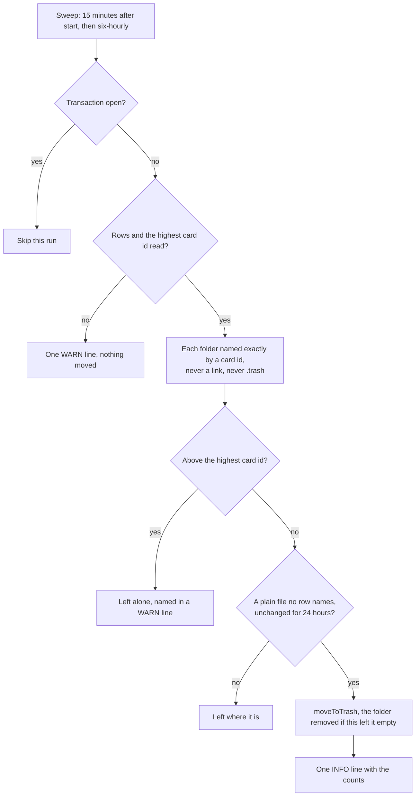

How an operator backs the folder up, and what a restore does with the trash, is in [Deployment](deployment.md#attachment-files).

## One Service per Action, Both Trees

The API has two trees for the reason it always has: the pages call `src/routes/api/**` on a
session, and other programs call `src/routes/api/v1/**` with a key. The plan's thirty rows
cover 42 pairs of handlers, one in each tree, that did the same thing, and 15 handlers one tree
has alone; each pair had the same middle written twice: the
guard, the field reads, the insert or update, the change check, the activity entry and the live
event. Two copies drift. Card 2143 found six internal handlers that recorded and told nothing
their v1 twins did, and the twins refused in different words through copied guards. Since card
2012 (part A) each pair calls one function, a **service**, in a module of `src/lib/server/`:
99 handlers (48 internal, 51 v1; 20 of them `GET`s) in 57 route files (27 internal, 30 v1),
on 13 modules. The move changed nothing either tree answers, records or tells: every status,
field, answer shape, refusal text, entry text, webhook detail, live event and mail order is as
it was (R2 of the plan), with one kind of exception, accepted, where a read moved inside
`writeAs`: a session that ended while its body arrived is now `401` where an empty or
malformed body was answered `200` or `400` first (see
[Asked Again at the Write](authentication-security.md#asked-again-at-the-write-card-2253)).

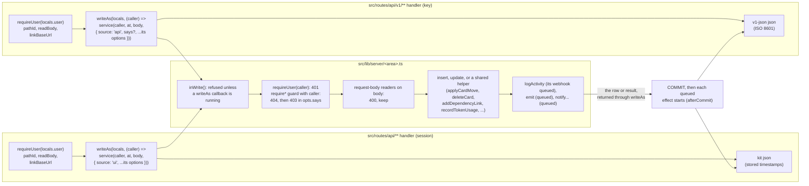

A handler that calls a service keeps its quick check (`requireUser(locals.user);`, binding no
name), `pathId`, `readBody`, `linkBaseUrl` where it sends mail, its one `writeAs` and its
answer. The callback is the service call, and whatever shapes the answer from what the
transaction holds: v1's board create adds the board's columns, v1's comment edit its author
(`withAuthor`), and the four dependency adds (`POST`) answer a link that would close a loop with
`cycleAnswer`, a `Response` the callback returns and the handler answers as it is. A read
service is called in a `GET`, with `locals.user`, after the same quick check, with no
`writeAs`. In what order a service refuses, and why, is in [Reading a body](#reading-a-body);
when its effects leave, in [Writes: One Transaction, Then the Effects](#writes-one-transaction-then-the-effects).

```mermaid
sequenceDiagram
    participant H as Handler (either tree)
    participant W as writeAs (write-as.ts)
    participant S as Service
    participant G as Guards and readers
    participant DB as SQLite
    participant Q as afterCommit queue
    H->>H: quick check, pathId, await readBody
    H->>W: writeAs(locals, (caller) => service(caller, at, body, opts))
    W->>DB: BEGIN IMMEDIATE, stillAuthenticated(locals)
    Note over W: 401 if the key or session ended,<br/>and the service is never called
    W->>S: service(caller, at, body, opts), with writing counted up
    S->>S: inWrite(), then requireUser(caller)
    S->>G: requireCard(user, id, 'edit', opts.says)
    Note over G: 404, then 403 in the tree's words
    S->>G: readText(body, ...), readId(body, ...)
    Note over G: 400 naming the field
    S->>DB: the writes
    S->>Q: logActivity, emit, notify...
    S-->>W: the row, or what the answer needs
    W->>W: writing counted down (finally)
    W->>DB: COMMIT
    W->>Q: start each effect, in order
    W-->>H: what the callback returned
    H->>H: answer: kit json, or v1-json json
```

### The shape of a service

Every write a service exports has one shape, and every read another:

```ts
write(caller: SessionUser | null, at: { …the path's ids }, body: RequestBody | null, opts: ServiceOptions & { …the tree's options })
read(user: SessionUser | null | undefined, at: { …the path's ids }, opts: { says?: string; …the tree's options })
```

Both are schematic: some reads take `user: SessionUser` (`readCardTokens`, `readMilestone`,
`readMilestoneSummary`), and some take no options at all (`opts: Record<string, never>`).

`at` holds the ids of the request's path (`{ cardId }`, `{ kind: 'subtask', id }`, `{}` for
none), `body` is what `readBody` handed back, `null` for a request with none, and `opts` is an
object written out at the call. A write:

1. **starts with `inWrite()`**, and is handed its writeAs callback's own `caller`, as it is or
   through `requireUser(caller)`, never `locals` or a name taken from it;
2. asks **`requireUser(caller)`** (401), then **its guard with the account** (404 to everyone,
   then 403, in `opts.says` where the tree has its own words);
3. reads **every field from `body`** through the readers of `request-body.ts` (400), the ids
   the body names among them, so a session that ended while the body arrived is refused
   before any of them is looked for. Where a route names the guarded row in its body and not
   its path, that id is read first, as the row the guard is asked of: from the page, a new
   card's column, a new column's, label's or category's board, a new subtask's card, the label
   changed, deleted or toggled, and the card restored from the board's archive; in both trees,
   a new milestone's board. The card reorder reads its drop's ids and caps, which read no row,
   before any card;
4. **writes**, through the helpers that already exist (`applyCardMove`, `archiveCard`,
   `deleteCard`, `restoreCard`, `recordCardCreated`, `addDependencyLink`,
   `removeDependencyLink`, `recordTokenUsage`, `createMilestone`, `setCardMilestone`,
   `deleteBoard`, `deleteColumn`, …);
5. **records and tells** itself: `logActivity` and its webhook, `emit` and the `notify…` mail
   all wait for the commit;
6. **throws kit `error()`**, as the guards do, so a handler has nothing to catch. A helper's
   typed error is turned into `error(e.status, e.message)` in one private function of the
   service: `moved` for `CardMoveError` in `cards.ts`, `refused` for `TokenError` in
   `token-service.ts` and for `MilestoneError` in `milestone-service.ts`. The one turn written
   in place is in `cards.ts`: `updateCard` turns the `MilestoneError` of a v1 `milestoneId`
   change where it catches it.

A read is listed on its module's `READS`, writes nothing, and asks no `inWrite()`.

**Where the contract lives.** `writeAs`, `inWrite` and `ServiceOptions` are all in
`src/lib/server/write-as.ts`, the module every service already imports. `inWrite` asks the
count `writeAs` keeps of its running callbacks (`writing`), not merely whether a transaction is
open, so a job's or a scheduler's bare `inTransaction` cannot call a service; only `writeAs`
sets the count. It is not in `db/transaction.ts`: that module cannot import `write-as.ts`,
which imports it, and a setter exported from it would let anything set the count.

| `ServiceOptions` | What it is |
|---|---|
| `source` | `'ui'` from the internal tree, `'api'` from v1: the `source` of every entry and webhook the write records, and v1's actions stored with `api:` |
| `baseUrl?` | `linkBaseUrl(url)`, read before `writeAs` (a setting, no row): the address the mail the write sends links to |
| `says?` | The tree's own words for a refusal where it has them (`No edit access to this card's board` against `No edit access to this board`), handed to the guard |

**`says` is words written out, never words made.** At the call it is a text literal, or a
constant of the route file holding one (for example `NO_EDIT`, `NO_ACCESS`, `NO_EDIT_TO_ASSIGN`,
`NO_EDIT_TO_UNASSIGN`), and a
service hands it on only as `opts.says`. `tests/check-at-the-write.test.ts` refuses a `says`
built from data, a computed key and a spread in a service write's options; and
`tests/openapi-document.test.ts` reads each v1 handler's refusal texts there.

### The tree's options, and why they exist

Part A was a pure move. Where the two trees did something differently, each kept what it did,
through an option its handler passes, so that the unchanged existing suites prove the move and
no answer a caller sees changed. An option that changes an entry's words is a boolean named for
what it says; one that changes an order is named for that order, never a test of `source`; and
a branch only one tree reaches sits behind that tree's option, so the OpenAPI test, which reads
a v1 handler through the service with the options it passes, does not count it for v1.

| Option | Service | Passed by | What it keeps |
|---|---|---|---|
| `allowMove` | `updateCard` | internal | `columnId` and `position` in a card update move it (with the move's `409`s) |
| `allowMilestone`, `allowRestore` | `updateCard` | v1 | `milestoneId`; `archivedAt: null` restores |
| `refuseEmpty` | `updateCard`, `updateBoard` | v1 | `400 No valid fields to update` for a body that changes nothing; the internal tree answers it `200` |
| `tellBeforeEntry` | `updateCard`, `createSubtask`, `updateBoard` (v1); `updateSubtask` (internal) | as listed | the live event before the entry (and so before its webhook); on `updateSubtask` before the completion's notices too |
| `permanent` | `removeCard` | both | `?permanent=true`: delete, not archive |
| `commentedOn`, `mailBeforeEntry` | `addComment` | v1 | `Commented on "<card>"` against `on "<card>"`; the mail before the entry |
| `namesCard`, `allowPosition` | `createSubtask` | v1 | `Created subtask "<x>" on "<card>"` against the bare title; `position` read |
| `eventType` | every subtask write | both, required | the live event's `type`: `subtask` internal, `card` v1 |
| `nothingToLink` | `addWorkDependency`, `removeWorkDependency` | internal card route | `Nothing to link`, `Provide only one end` |
| `withLinkDetails` | `readWorkDependencies` | v1 card route | each link's id, maker and time |
| `allowCard` | `changeMilestone` | internal | `cardId` (and `attach`) in a milestone `PATCH` puts a card in or takes it out |
| `withCards` | `readMilestone` | v1 | the milestone's cards, withheld where the caller cannot open their board |
| `allowCategory` | `createBoard` | internal | `categoryId`, the dashboard grouping |
| `allowParent` | `updateBoard` | internal | `parentCardId`: a board moved under a card or back (not combined with `refuseEmpty`) |
| `placeAfterLast`, `colorBeforePosition` | `createColumn` | v1 | a column with no position after the last (internally at 0); `color` read before `position` |
| `sendNameOrColor` | `updateLabel` | internal | `400 Send name or color to change` against `No valid fields to update` |

Where a body id stands for a path id the difference is in `at`, not an option: the internal
comment edit passes `at.cardId` so the comment must be on the path's card, and a create from
the page passes `{}` and its body names the parent. What one tree accepts that the other does
not (v1 ignores a new board's `categoryId` and a board update's `parentCardId`) is unchanged;
each was raised as a card of its own.

### The modules

| Module | Reads (`READS`) | Writes | Called by |
|---|---|---|---|
| `cards.ts` | none | `createCard`, `updateCard`, `removeCard`, `moveCard`, `moveCards`, `restoreCardFor` | internal `cards` POST, `cards/[id]` PUT and DELETE, `cards/reorder` PUT (`moveCards`), `cards/[id]/restore` POST and `boards/[id]/archive` POST (`restoreCardFor`); v1 `boards/[boardId]/cards` POST, `cards/[cardId]` PUT and DELETE, `cards/[cardId]/move` PUT (`moveCard`) |
| `card-assignees.ts` | none | `assignToCard` (answers `{ already }`), `unassignFromCard` | `cards/[id]/assignees` POST and DELETE in both trees |
| `card-comments.ts` | `listComments` | `addComment`, `editComment`, `deleteComment` | `cards/[id]/comments` GET and POST in both trees; internal `cards/[id]/comments/[commentId]` PUT and DELETE (the delete is the internal tree's alone); v1 `comments/[commentId]` PUT |
| `card-labels.ts` | none | `toggleCardLabel`, `addCardLabel`, `removeCardLabel` | internal `labels` PUT (the toggle); v1 `cards/[cardId]/labels` POST and DELETE |
| `subtasks.ts` | `listSubtasks` | `createSubtask`, `updateSubtask`, `deleteSubtask` | internal `subtasks` GET and POST, `subtasks/[id]` PUT and DELETE; v1 `cards/[cardId]/subtasks` GET and POST, `subtasks/[subtaskId]` PUT and DELETE |
| `work-dependencies.ts` | `readWorkDependencies` | `addWorkDependency`, `removeWorkDependency` (`at: { kind: 'card' \| 'subtask', id }`) | the GET, POST and DELETE of `cards/[id]/dependencies` and `subtasks/[id]/dependencies` in both trees (it replaced `subtask-dependencies.ts`) |
| `token-service.ts` | `readCardTokens` | `recordTokens` (`at` a card or subtask), `removeTokenEntry`, `recordTokenBatch` | `cards/[id]/tokens` GET in both trees; v1 `cards/[cardId]/tokens` POST, `subtasks/[subtaskId]/tokens` POST, `tokens/[entryId]` DELETE, `tokens/bulk` POST (the internal tree writes no tokens) |
| `milestone-service.ts` | `readMilestone`, `readMilestoneSummary` | `createMilestoneFor`, `changeMilestone`, `deleteMilestoneFor`, `attachCardToMilestone`, `detachCardFromMilestone` | `milestones` POST, `milestones/[id]` GET, PATCH and DELETE, `.../summary` and `.../pdf` GET, in both trees; v1 `milestones/[milestoneId]/cards` POST and DELETE |
| `boards.ts` | `listBoardsFor` | `createBoard`, `updateBoard`, `deleteBoardFor` | `boards` GET and POST, `boards/[id]` PUT and DELETE, in both trees |
| `board-groupings.ts` | none | `createBoardGrouping`, `updateBoardGrouping`, `deleteBoardGrouping` | `board-categories` POST, `board-categories/[id]` PUT and DELETE, in both trees |
| `columns.ts` | none | `createColumn`, `updateColumn`, `deleteColumnFor`, `reorderColumns` | internal `columns` POST, `columns/[id]` PUT and DELETE, `columns/reorder` PUT (the internal tree's alone); v1 `boards/[boardId]/columns` POST, `columns/[columnId]` PUT and DELETE |
| `card-categories.ts` | none | `createCardCategory`, `updateCardCategory`, `deleteCardCategory` | internal `categories` POST, `categories/[id]` PUT and DELETE; v1 `boards/[boardId]/categories` POST, `categories/[categoryId]` PUT and DELETE |
| `labels.ts` | `labelsOfBoard` | `createLabel`, `updateLabel`, `deleteLabel` | internal `labels` GET, POST, PATCH and DELETE; v1 `boards/[boardId]/labels` GET and POST, `labels/[labelId]` PUT and DELETE |

Paths are under `src/routes/api/` (internal) and `src/routes/api/v1/`. Each module's header
says what its trees do differently and why.

**What is not a service.** `milestones.ts` and `tokens.ts` keep their rules
(`requireMilestone`, `createMilestone`, `recordTokenUsage`, the totals) as helpers other callers
use, the bulk routes among them; the services call them, and they stay off the service rule,
which would otherwise make each of their exports a write needing `inWrite()`. Left in their
route files, as no pairs: `POST /api/v1/dependencies/bulk` and
`POST`/`DELETE /api/v1/milestones/{id}/cards/bulk` (v1's alone; the second sends its
plan-created mail after the commit, which a service would pull inside the transaction); the
audit-log, activity and personal-stats reads, which answer different questions in each tree;
the board-cards reads (a picker and a full listing); both trees' grouping lists and the
internal category list, which call `boardCategoriesFor` and `cardCategoriesFor` in
`list-access.ts`; the two milestone lists (`GET /api/milestones`, `GET /api/v1/milestones`),
which call `listMilestones` as before; `GET /api/boards/:id/archive`; and v1's single-row and
per-board reads (one board, column, category, grouping, label or comment, and the `GET`s of
`boards/:boardId/columns`, `boards/:boardId/categories`, `cards/:cardId/assignees` and
`cards/:cardId/labels`), with the other reads of those files.

**How it is held.** `tests/check-at-the-write.test.ts` reads every route file and every module
of `src/lib/server/` for the service rule (see
[Asked Again at the Write](authentication-security.md#asked-again-at-the-write-card-2253));
`tests/activity-twins.test.ts` runs each pair's two requests on the same fixture and compares
what each tree wrote, recorded and told, and pins every service call's options as read from
the source; `tests/write-as.test.ts` holds `inWrite`. See
[Testing](testing.md#tests-that-read-the-source).

## One Timestamp Form

Every moment DumpFire stores is `YYYY-MM-DD HH:MM:SS`, in UTC, to the whole second (card 2095): what SQLite's `datetime('now')` writes, which 22 columns take as their default. Stored values are compared as text, and text orders moments only within one form, so one form is what makes every date filter right.

| Module | What it does |
|---|---|
| `src/lib/timestamps.ts` | Plain functions with no imports, used by the server and the pages alike. `stamp(date)` gives the stored form, and every write from JavaScript goes through it. `toStamp(input, edge)` reads what a caller sends: the stored form, ISO 8601 with or without a fraction, `Z` or an offset, or a date, 00:00:00 as a lower bound and 23:59:59 as an upper one; anything else is `null`, which a route answers `400` naming the parameter. `parseStamp(value)` gives the `Date` a stored value names, read as UTC: every page, report and metric parses through it, never with `new Date()`, which reads the stored form as local time. `toIso(value)` gives ISO 8601 with `Z`. `isStamp(value)` says whether a value is a real moment in the stored form, which a pattern cannot: `2026-02-30 08:00:00` has the shape |
| `src/lib/server/db/timestamps.ts` | `timestampColumns(database)`: every TEXT column whose name ends in `_at`, and `system_logs.timestamp`. `normaliseTimestamps(database)`: converts every value in a shape it reads to the stored form, where SQLite's `strftime` and `toStamp` read it as the same moment, in one immediate transaction, and reports every value that is not a real moment in the stored form. `registerStampFunctions(database)` gives the connection `is_stamp` and `stamp_of` from `src/lib/timestamps.ts` for that SQL, so SQL and code read a moment by one rule; the suite's check after every test calls it too. The runner calls it at every start after the backfills, and the restore after every import |
| `src/lib/server/v1-json.ts` | `json(data, init)`, which every `/api/v1/` handler answers with, and `onTheWire(data)`, which `dispatchWebhook` applies to a webhook's `data`, a copy built with `Object.fromEntries` so that a key named `__proto__` stays a key: a string under a key ending `At` or `_at`, or named `timestamp`, `from` or `to`, that is exactly in the stored form goes out as ISO 8601 with `Z`. A date and a user's text are never touched |

```mermaid
flowchart LR
    Caller["A bound or a time a caller sends"] -->|"toStamp, else 400"| Store[("Every *_at column")]
    Code["A write from code"] -->|"stamp()"| Store
    Default["SQL default datetime('now')"] --> Store
    Restore["A restore, copied verbatim"] --> Store
    Start["Every start, every restore"] -->|"normaliseTimestamps"| Store
    Store -->|"as stored"| Internal["Internal routes, page data,<br/>live stream, CSV exports"]
    Internal -->|"parseStamp, as UTC"| Pages["Pages"]
    Store -->|"onTheWire"| V1["v1 answers, ISO 8601 with Z"]
```

The test suite holds the form: `tests/setup.ts` checks after every test that every timestamp column holds the stored form or NULL, and fails the test that left anything else. See [Data Model](data-model.md#key-schema-notes) and [Testing](testing.md).

## Request Lifecycle

External users can submit task requests without authentication:

```mermaid
stateDiagram-v2
    [*] --> Pending : Signed-in user submits
    [*] --> Unverified : Someone without an account submits
    Unverified --> Pending : Requester confirms from the emailed link
    Unverified --> [*] : Not confirmed within 7 days, deleted
    Pending --> Accepted : Admin accepts
    Pending --> Rejected : Admin rejects
    Accepted --> CardCreated : Card created on board
    CardCreated --> InProgress : Assigned to member
    InProgress --> Complete : Task completed
    Complete --> EmailSent : Completion email sent
    EmailSent --> [*]
    Rejected --> EmailSent : Rejection email sent
```

## Scheduled Background Tasks

| Scheduler | Interval | Purpose |
|-----------|----------|---------|
| Backup Scheduler | Configurable | Push DB backup to SFTP/S3/GDrive/OneDrive |
| Report Scheduler | Weekly/Monthly | Generate and email PDF reports |
| Snapshot Scheduler | Hourly check, once a day | Card counts per column for the CFD (burndowns are rebuilt from card timestamps — see [Burndown Charts](burndown-charts.md)) |
| Session Cleanup | On startup | Remove expired session tokens |
| Log Maintenance | On startup, then every six hours | Prune `system_logs` past its retention |
| Uploads Trash | Ten minutes after startup, then every six hours, on the log maintenance timer; never on startup itself | Remove attachment files that have been in the trash for more than 30 days |
| Attachment File Sweep | 15 minutes after startup, then every six hours; only where the schedulers run (`SCHEDULERS`) | Move attachment files that no row names, unchanged for 24 hours, to the trash (card 2107) |

## Key Design Decisions

1. **SQLite over Postgres/MySQL** — Zero-config, file-based, perfect for self-hosted single-tenant deployments. Synchronous queries via better-sqlite3 are faster than async alternatives for this workload.

2. **SSE over WebSockets** — Simpler server implementation, automatic reconnection built into the browser API, works through HTTP/2 proxies without special config.

3. **Single-process architecture** — No external message queues, no separate worker processes. All schedulers run in-process with `setInterval`. Suitable for the target scale (team-sized deployments).

4. **Drizzle ORM** — Type-safe schema (`src/lib/server/db/schema.ts`) that serves as the source of truth: queries are written against it, and every database is checked against it. Migrations are numbered SQL files checked into `drizzle/`. They are applied at start-up by the application's own runner (`src/lib/server/db/migrate.ts`), one transaction per file, and a file that fails stops the server before it listens. `drizzle-kit` does not apply them and is not in the production image. It is used only in development, to export the model's DDL into the expected schema that the runner compares each database with (`npm run schema:expected`). See [Data Model](data-model.md#migrations-and-schema-reconciliation) and [Deployment](deployment.md#start-up-sequence).

5. **Soft-delete (archive)** — Cards are soft-deleted by setting `archivedAt`, which touches nothing but the card, so a restore brings it back whole. Hard delete available via `?permanent=true` query parameter. Admin purge endpoint for bulk cleanup. Every hard delete goes through one routine, `deletes.ts`.

6. **Commit first, then tell** — A webhook, a live event, an email or a file move is an effect of a write and is sent only once the write is committed. The cost is that an effect can fail after the write succeeded; that is logged and the caller is still told the write succeeded, because it did. The alternative, sending from inside the transaction, announces changes that are then rolled back.

7. **Attachment files are moved, not deleted** — Backups hold the database only. A deleted card's files go to a trash folder for 30 days, so that restoring an earlier backup can have them back.

8. **One way to read a body, and no schema library** — Every handler reads its body, its path ids and its query through the small readers of `request-body.ts`, which refuse what a field cannot hold with a `400` that names it. A schema library would have been the first validation dependency in the project; checks written into each handler are how the two API trees drifted apart. A value the row already holds is accepted as it is, so rows stored before the rules still save. See [Reading a body](#reading-a-body).

9. **One service per action, both API trees** — The internal tree and `/api/v1/` keep their own paths, bodies, words and answers, and call one function for the work between them, so the two cannot drift apart again. A service writes only inside the `writeAs` callback that hands it the caller, which `inWrite()` checks when it runs and a source test checks on every route. See [One Service per Action, Both Trees](#one-service-per-action-both-trees).
