# DumpFire Architecture Overview

DumpFire is a self-hosted, real-time Kanban board application designed for speed and simplicity. It runs as a single-process Node.js application with an embedded SQLite database — no external services required.

## System Context

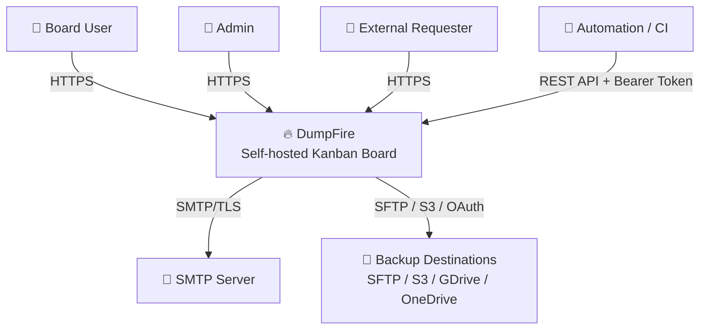

## Container Diagram

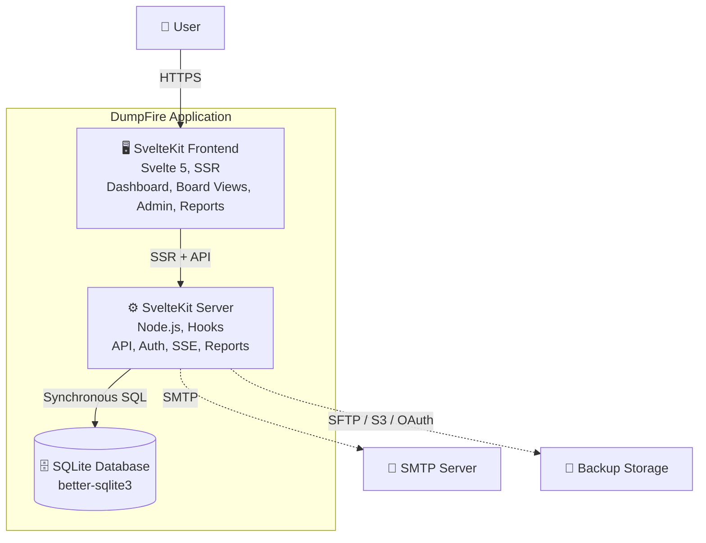

## Technology Stack

| Layer | Technology | Purpose |
|-------|-----------|---------|
| **Framework** | SvelteKit 2 + Svelte 5 | Full-stack SSR framework with file-based routing |
| **Language** | TypeScript 5.9 | Type-safe server and client code |
| **Database** | SQLite via better-sqlite3 | Embedded, zero-config relational database |
| **ORM** | Drizzle ORM 0.45 | Type-safe schema definition and queries |
| **Auth** | Session cookies + bcryptjs on worker threads | Cookie-based sessions for UI, API keys for external access; every password hashed and checked off the server's thread (`node:worker_threads`, card 2191), and browsers that have signed in remembered by a signed cookie (card 2194) |
| **Real-time** | Server-Sent Events | Live board updates without WebSocket complexity |
| **PDF Reports** | PDFKit | Server-side PDF generation for scheduled and on-demand reports |
| **Email** | Nodemailer | SMTP integration for notifications and report delivery |
| **Backup** | AWS S3 SDK, ssh2-sftp-client, Google/Microsoft APIs | Multi-destination scheduled backups |
| **Markdown** | marked + DOMPurify, through one renderer | A card's description and comments are drawn by `renderMarkdown` in `src/lib/markdown.ts` (cards 2202 and 2210), the only module that imports either: see [Authentication & Security](authentication-security.md#markdown-in-descriptions-and-comments) |
| **Font** | Inter 4.001, served by DumpFire | The variable font (one axis, weight 100 to 900), seven files by character set under `src/lib/fonts/inter/`, declared in `src/lib/fonts/inter.css` and imported by the root layout (card 2203). They are the files Google Fonts served, byte for byte, taken from `@fontsource-variable/inter@5.3.0`; no font package is installed. Vite fingerprints them into `/_app/immutable/assets/`, served before the gate and cached for a year. Licence: SIL Open Font License 1.1, "Copyright 2016 The Inter Project Authors", its text at `static/licences/inter-OFL.txt`, served at `/licences/inter-OFL.txt`. No page asks Google for it, or another site for anything |
| **Deployment** | Docker node:22-slim | Two-stage build, single container |

## Component Architecture

```mermaid
flowchart TB
    subgraph Client["Browser Client"]
        Dashboard["Dashboard\nand its 7 components (card 2281)"]
        BoardView["Board View + DnD"]
        AllTasks["All Tasks\nand its 6 components (card 2281)"]
        AllToDo["All To Do"]
        PlanPage["Plan Page\nits 7 components, plan-graph.ts (card 2281)"]
        ArchivedView["Archived Tasks"]
        AdminPanel["Admin Panel\nand its 14 components (card 2281)"]
        Reports["Reports"]
        CardModal["Card Modal\nand its 11 sections"]
        BoardState["Board State + Refresh Schedule\nboard-state.svelte.ts,\nrefresh-schedule.ts (card 2280)"]
        CardWindowCtl["Card-Window Controller\ncard-window.svelte.ts (card 2280)"]
        PageCardWin["Card Window off the Board\npage-card-window.svelte.ts (card 2281)"]
    end

    subgraph Server["SvelteKit Server"]
        Hooks["hooks.server.ts\nBody Guard, Auth Guard,\nRate Limiting, JSON Failures for v1"]

        subgraph InternalAPI["Internal API"]
            BoardsAPI["Boards"]
            ContentsAPI["Board Contents\nGET /api/boards/[id]/contents"]
            CardsAPI["Cards"]
            ColumnsAPI["Columns"]
            SubtasksAPI["Subtasks"]
            AdminAPI["Admin"]
            ReportsAPI["Reports"]
            EventsAPI["SSE Events"]
        end

        subgraph ExternalAPI["External API v1"]
            V1Boards["v1/boards"]
            V1Cards["v1/cards"]
            V1Subtasks["v1/subtasks"]
            V1Webhooks["v1/webhooks"]
        end

        subgraph Services["Server Services"]
            ActionServices["One Service per Action\ncards.ts, subtasks.ts, boards.ts,\ncolumns.ts, labels.ts and eight more\n(card 2012)"]
            WriteAs["Asked Again at the Write\nwriteAs, inWrite: write-as.ts"]
            Auth["Auth Service"]
            BoardAccess["Board Access Control"]
            ReportEngine["Report Engine"]
            Notifications["Notifications"]
            BackupService["Backup Scheduler"]
            Snapshots["Snapshot Scheduler"]
            ActivityLogger["Activity Logger"]
            SSE["SSE Emitter"]
            Tx["Transaction Helper\ndb/transaction.ts"]
            Deletes["Shared Delete\ndeletes.ts"]
            Uploads["Uploads + Trash\nuploads.ts"]
            Sweep["Attachment File Sweep\nuploads-sweep.ts"]
            Reminders["Decision Reminder\ndecision-reminders.ts (card 2685)"]
            ApiErrors["API Failures\napi-errors.ts"]
            V1Json["v1 Answers in ISO 8601\nv1-json.ts"]
            CrossBoard["Cross-Board Cards\ncross-board-cards.ts"]
            BoardContents["Board Contents Reader\nboard-contents.ts (card 2280)"]
        end

        DB[("SQLite")]
        Files[("Uploads folder\nbeside the database")]
    end

    Client --> Hooks
    Hooks --> ApiErrors
    Hooks --> InternalAPI
    Hooks --> ExternalAPI
    InternalAPI --> Services
    ExternalAPI --> Services
    InternalAPI -->|"inside writeAs"| ActionServices
    ExternalAPI -->|"inside writeAs"| ActionServices
    ActionServices -->|"inWrite()"| WriteAs
    WriteAs --> Tx
    Services --> DB
    Deletes --> Tx
    Deletes --> Uploads
    Sweep --> Uploads
    ExternalAPI --> V1Json
    Uploads --> Files
    CrossBoard --> BoardAccess
    BoardView --> BoardState
    BoardView --> CardWindowCtl
    CardWindowCtl --> BoardState
    AllTasks --> PageCardWin
    AllToDo --> PageCardWin
    PlanPage --> PageCardWin
    PageCardWin -->|"a controller per card, over the page's own list"| CardWindowCtl
    AllTasks -.->|"refresh-schedule.ts alone: one re-read per burst"| BoardState
    BoardState -->|"one coalesced read"| ContentsAPI
    ContentsAPI --> BoardContents
    BoardContents --> BoardAccess
    SSE -.->|"Server-Sent Events"| Client
    ReportEngine -.->|"SMTP"| EmailServer["Email Server"]
    BackupService -.->|"Push"| BackupDest["Backup Destinations"]
    Reminders -.->|"SMTP, awaited, one at a time"| EmailServer
```

All Tasks and All To Do (card 2240) read their cards through one reader,
`readCrossBoardCards(user, { inColumn? })` in `src/lib/server/cross-board-cards.ts`: the boards
the caller can open, their columns, the unarchived cards on the columns `inColumn` lets through
(all of them for All Tasks; for All To Do, those whose title counts as To Do, `countsAsToDo`,
and that are not upstream), enriched once, with the category rules of card 2128, the sub-board
places of card 1990, the withheld blockers of card 2129 and, beside them, the open decisions that hold a card and that the caller may view (`decisionWaits`, card 3059). So the two pages give a caller the same boards and the same
cards, and All To Do lists exactly All Tasks' To Do bucket. Which titles count as To Do across
boards is one rule in `src/lib/column-role.ts` (card 2474): `countsAsToDo(title)` takes "To Do" and
"Todo" and the wider list reports always counted (`WIDER_TODO_TITLES`: To-Do, Backlog, Inbox, Not
Started, New, Planned, Ideas, Idea, Later), and reports' `classifyColumn`, All Tasks' `getBucket`
and All To Do's load all ask it. A board's own To Do role, `columnRole` and `isTodoColumnTitle`, is
still only "To Do" and "Todo": it decides Add Task, the list view's opening column, Send to To Do
and what an ideas board refuses. Reports alone fall back to a board's left-most open column when
none of its titles counts. All To Do's filters and sort are
worked out in the browser by `src/lib/todo-table.ts` and kept in the address with
`goto(…, { replaceState: true })`, a real navigation that re-runs no load, because neither its
load nor the layout's reads `url`; a shallow `replaceState` would leave `page.url` and the
history entry at the arrival address, so Back from a board would lose the filters.

## The Gate

Every request passes `handle` in `src/hooks.server.ts` before it reaches a page or a route
handler. It is where a caller is identified, where an API key is counted against its rate
limit, and where a failure of the external API is made JSON. The functions it uses for that
last part are in `src/lib/server/api-errors.ts`; how large a body may be is in
`src/lib/server/body-limits.ts`; and the answers it gives of its own when it sends a request
away, and the security headers it puts on every answer, are in
`src/lib/server/gate-answers.ts`.

Loading the module is also what starts the server's own work, once, before the first
request: `runMigrations()`, `refuseUserlessBesideAnother()`, `checkMfaKeyAtStart()` (which
judges the stored secrets with the second factors, card 2898), `ensureFormSecret()`,
`sealStoredSecretsAtStart()` (card 2898: it seals every stored secret still held in plain under
the MFA key, records the key check, and scrubs the old plain text from the file; a sealing that
fails stops the server), `endPlainSessions()` (card 2775: it deletes any session an older
image stored in plain, and runs before the clean-up so that each is counted),
`cleanExpiredSessions()`, `startChallengeSweep()` (card 2769: it sweeps expired sign-in
challenges now and every five minutes), `startSessionSweep()` (card 2883: it runs the clean-up
of ended sessions every five minutes after that first run), `initLogMaintenance()`,
`switchOffHeldWebhooksAtStart()` (card 2752), `holdAlreadyOffWebhooksAtStart()` (card 2923: it
holds the webhooks already switched off without a hold, so that switching one on gives it a new
secret; once, while the `webhooks_already_off_held` setting is absent, every one, whoever set it,
and writes the setting; at every start, those whose setter is disabled or not recorded; one
`WARN` when it held any, nobody mailed; it cannot throw), `holdReadableWebhooksAtStart()` (card
2935: it holds the webhooks whose secret a disabled owner or administrator could read, the first
time with every webhook made before setters were recorded, keeping the moment it covered in
`webhooks_readable_by_disabled_held`; told as the sweep is; it cannot throw),
`sweepEndedKeyReveals()` (card 2947: once, while `webhook_reveals_seeded` is absent, it seeds the
reads made before they were recorded; then every API key with rows in `webhook_reveals` that has
expired, passed its deadline or gone has its account's webhooks swept and every webhook with a
secret it was given held, and its rows deleted; told as the sweep is; it cannot throw. Since card
2995 it first ends, as a revoke does, every API key present that the record of keys ended on this
server names, with one `WARN` under AUTH naming them by id, and keeps the key counter at or above
every id that record names, in a transaction of its own: a failure of either pass rolls back that
pass alone, with its own `WARN`. Since card 2996 it first of all ends again, in a transaction of
its own, every account present that the record of account endings ends or lowers, through the
disable's and the role change's own bodies (`endRecordedAccountsPresent`, account-ending-bodies.ts), with one
`WARN` under AUTH of counts and no name. Since card 2997 that pass is followed, before the key pass and in
a transaction of its own (`endReplacedPasswordsAtStart`), by the password pass: every account present but
a superadmin holding a password the record says was replaced here is given `DUMMY_HASH` and signed out,
its keys ended (`endReplacedPasswordsPresent`), with one `WARN` under AUTH of counts; a superadmin holding
one is left, with a `WARN` of its own at every run. Since card 3002 the password pass is followed, before the
key pass and in a transaction of its own (`capAccessAtStart`), by the access pass: every board member,
share, team member, board visibility, creator, Product Owner and person link, and (card 3033) every
live decision place, place's account and decider, that has a recorded row and is above it is lowered to it (never the restore's guess, never a team's deletion, never "no
Product Owner row means none"), a row of this server's dated after now never raising a ceiling; each
change with the writers' own effects (`switchOffLostWebhooks` and, for an owner lowered,
`holdNoLongerReadable` of that board), told as the sweep is (`schedulerSetting`); one `WARN` under
AUTH of counts and another of the rows dated after now, no name. Since card 3004 the access pass is followed,
before the key pass, by the record of where the server sends: its seed, once per database and only with an MFA
key loaded (`seedOutboundAtStartPass`, one INFO line of counts), and then the outbound pass, each in a transaction
of its own (`holdOutboundAtStartPass`): every live webhook, schedule, address on a schedule, destination, mail
setting and App URL with a row of this server's own whose latest state closes more than it is now is closed to it,
never a webhook already held, never by a seed's row alone, never the guess, a webhook's address compared only under
the current key; the webhooks told as the sweep is, the rest in one `WARN` under BACKUP of counts. So the order is
the account pass, the password pass, the access pass, the outbound seed, the outbound pass, the key pass, each rolled
back alone on failure),
`startEndedKeyRevealSweep()` (the same every five minutes, whatever `SCHEDULERS` says; a second
call starts no second timer) and `startSchedulers()`, in that order for the last six.

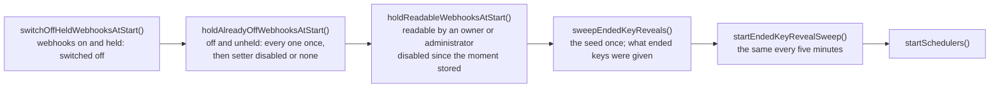

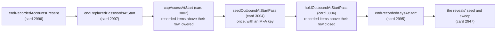

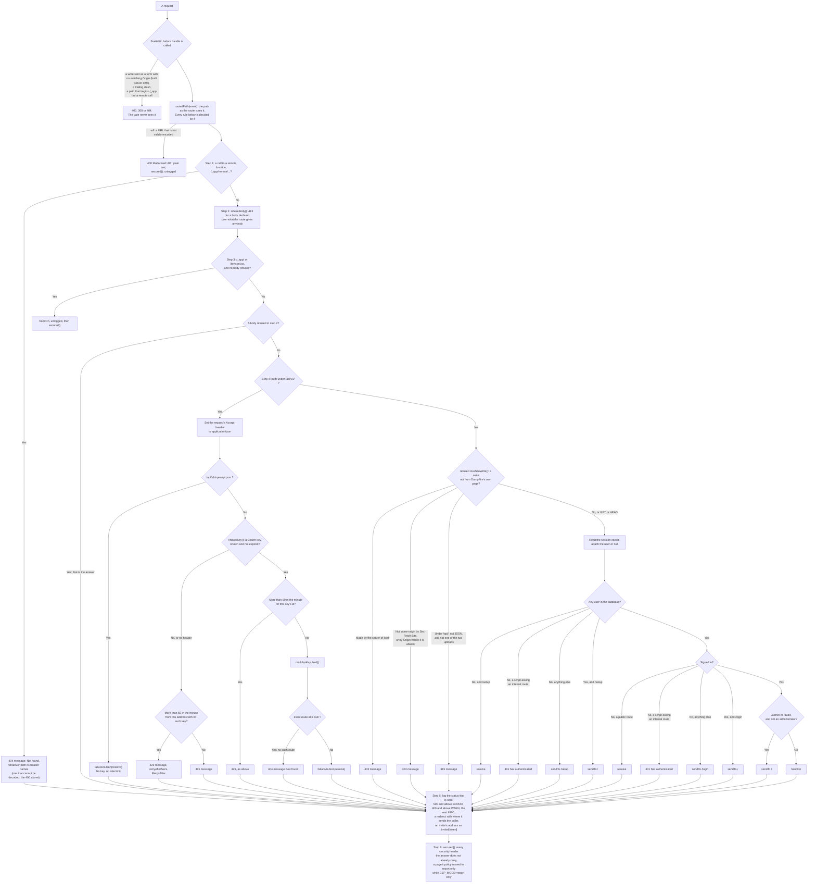

### The order of `handle`

| # | Step | What it does |
|---|------|--------------|
| 1 | A remote call | A call to a remote function, `/_app/remote/<id>`, is answered `404` `{ "message": "Not found" }`, to anybody. SvelteKit sets its `event.url` and route from the `x-sveltekit-pathname` header, which the caller writes, so no rule below can be decided on it. A header that names a path that cannot be decoded is answered `400` `Malformed URI` before this step, as SvelteKit 2.60 also answered it. DumpFire has no remote functions |
| 2 | Body size | `refuseBody()` asks every request whose body declares a length in `Content-Length` whether that is more than its route gives anybody: `413` with the limit if it is. A body with no length is let through to be counted (see `handOn`, below). The answer is kept, not thrown. See [Authentication & Security](authentication-security.md#how-large-a-request-may-be) |
| 3 | Static assets | `/_app/` and `/favicon.ico`, exactly, are handed on at once and not logged, unless step 2 refused the body, which is logged like any other answer. Every other path that begins `/_app`, but a remote call, is answered `404` by SvelteKit before the gate is called |
| 4 | `handleRequest()` | The `/api/v1/` branch, or, for everything else, first the check that a write comes from DumpFire's own page (`refuseCrossSiteWrite()` in `src/lib/server/same-origin.ts`, card 2700: a `403` or `415` for any method but `GET` and `HEAD`, before the session cookie is read), then the session branch. Each is set out below. Every refusal and every redirect in it is an answer that is returned: none is thrown. Every request it lets through is handed on by `handOn` |
| 5 | The request log | One line under the `HTTP` context with the method, the address as it was sent, the status that is sent and the time taken: `ERROR` for 500 and above, `WARN` for 400 and above, `INFO` for the rest. A redirect is logged with where it sends the caller. An invite's address is written `/invite/[token]`, and a remote call at the address it was sent to (`pathToLog()` in `src/lib/server/secret-paths.ts`). A fault in the gate itself, thrown, is logged at `ERROR` with its reason, once, and thrown on for SvelteKit to answer `500` |
| 6 | The security headers | `secured()` sets each of the five headers the answer does not already carry, `X-Frame-Options` but on the public request form's three pages. A page also carries a sixth, the `Content-Security-Policy` SvelteKit sets from `kit.csp` in `svelte.config.js` with a new nonce each time (card 2162); `secured()` never replaces it and gives no other answer one, and while `CSP_MODE=report-only` it moves a page's, unchanged, to `Content-Security-Policy-Report-Only`. See [Authentication & Security](authentication-security.md#the-content-security-policy) |

`handOn` is how every request the gate lets through reaches SvelteKit, from each of the
places `handleRequest()` hands one on and from step 3. It asks the body's size again, now
that the caller is known: the attachment upload gives 26 MB to anybody signed in, a key's
image upload (`POST /api/v1/cards/[cardId]/attachments`, card 2754) 5 MB, and the
import the whole of `BODY_SIZE_LIMIT` to the superadmin alone. Then it hands on a copy of the
request whose body passes through a count (`heldToLimit()`), so that a body with no length
is refused `413` once it is read past the limit, and puts `guardBody()` on that copy, which
replaces its readers so that a body that is missing or not JSON is a `400` and a body over
the limit a `413`. A request the server makes of itself is guarded and not limited.

After the gate, SvelteKit calls `handleError`, in the same file, for anything a handler or a
page's load throws, a fault in the gate, and a path that is no route. It writes a fault (a
status of 500 or more) to the system log at `ERROR` with the exception, the route and the
user, leaves one the gate has already written, answers SvelteKit's own message for the
status, and cannot throw. See
[Authentication & Security](authentication-security.md#when-something-fails).

### The path a rule is decided on

Every step above that asks about the path, `/api/`, `/api/v1/`, a public route, `/admin`,
asks about the path as the router sees it, and never about `event.url.pathname`, which is
the address as it was sent. `routedPath()` in `src/hooks.server.ts` works it out once, at
the top of `handle`.

SvelteKit decodes an address before it looks for a route, so `/%61dmin` is served by the
route `/admin`. A rule that compared the address as sent with `/admin` did not apply to it:
a signed-in user who was no administrator was shown the admin page, and `/%61pi/v1/me` was
answered with a session and no key, uncounted.

| The request | What the rules are decided on |
|-------------|-------------------------------|
| A route matched | The route's id, `/admin` or `/api/cards/[id]`: the router's own answer, so the gate and the router cannot disagree. A request for a page's data, `/admin/__data.json`, has the id of the page |
| No route matched | The address decoded as SvelteKit decodes it, `decodeURI` on each piece between one `%25` and the next. Nothing but a `404` is served for it |

- **`%2F` stays `%2F`.** It is no `/` to the router or to the gate: `/api%2Fv1%2Fme` is not
  under `/api/v1/` and is no route.
- **Nothing is decoded twice.** `/%2561dmin` is the address `/%61dmin` spelt out, and is no
  route.
- **A sequence that cannot be decoded is answered first.** `routedPath()` returns null for
  it and `handle` answers `400` "Malformed URI", in plain text with the security headers,
  before anything else and with nothing logged. SvelteKit answered it itself before calling
  the gate up to 2.60; since 2.61 it hands it to the gate, where the decode threw, a `500`,
  until card 2227.
- **The two page loads check for themselves.** `src/routes/admin/+page.server.ts` and
  `src/routes/audit/+page.server.ts` send a caller who is not signed in to `/login` and one
  who is not an administrator to `/`, as the gate does. The gate was the only thing in
  front of them.
- **No route is inside a `(group)`.** A group's name is in the route's id and not in the
  address, so a rule would not match it. `tests/gate.test.ts` fails if one is added.
- **The log keeps the address as it was sent**: `/%61dmin` is logged as `/%61dmin`.

### The body guard

A handler reads its JSON body with `readBody(request)`, which calls `request.json()` (see
[Reading a body](#reading-a-body)), and three read a file: the attachment upload with
`formData()`, and the backup import and a key's image upload (card 2754) with `arrayBuffer()`. The guard is what makes a body the
caller got wrong a `400` or a `413` and not a `500`, for every handler under `/api/` at
once.

| The body | What the handler's `request.json()` does |
|----------|------------------------------------------|
| Missing, empty, or not JSON (the read throws a `SyntaxError`) | Throws `error(400, 'The request body is missing or is not valid JSON')` |
| JSON that is `null`, a number, a string or a boolean | Throws `error(400, 'The request body must be a JSON object')` |
| A JSON object | Returns it |
| A JSON array, `[]` included | Throws `error(400, 'The request body must be a JSON object')`. No handler takes one, and one that gave every field a default made a board out of `[]` |
| Read with `formData()`, and not sent as `multipart/form-data` or `application/x-www-form-urlencoded` | `formData()` throws `error(400, 'The request body is not a form')` and reads nothing. undici's own refusal of a type that is a form only up to its first `;` (`application/x-www-form-urlencoded;a=b, text/plain`) is the same `400` |
| Sent with no length, and read past the route's limit | Throws `error(413, { message, limitBytes })`, as the gate's own `413` for a declared length says it. So do the other readers |
| Run past the length it declared | Throws `error(413, 'Payload Too Large')`. So do the other readers |
| Read a second time | Not caught: it stays a fault |

- **The readers are replaced on the one request object `handOn` hands on**, which is the
  object SvelteKit hands the handler: a copy of the request the gate was given, with its body
  passed through the count (`heldToLimit()`). `json`, `formData` and `arrayBuffer` are the
  three a route reads with; `text()`, `blob()` and `bytes()` are replaced as well, for the
  `413` alone, so that a body read past its limit is a `413` however it is read. A `clone()`
  of the request is not guarded, and no route reads one, but the count is on the body, so a
  clone is held to the limit all the same.
- **A body over the limit is known by its status, not its class.** The node adapter fails
  the body's stream with a `413` of its own copy of SvelteKit's error class. SvelteKit
  takes a status only from an error it knows by `instanceof`, so the adapter's `413` was
  answered `500` by a built server. The guard throws any fault whose `status` is `413`
  again as SvelteKit's own.
- **The JSON guard is on the read, not on the `Content-Type`.** A body sent as
  `application/xml` and read with `json()` is judged by what it holds. `formData()` is the
  one reader that asks the `Content-Type` first: a body not sent as a form is the `400`
  above, before any of it is read, on the attachment upload and on the three form actions
  (`/login`, `/setup`, `/invite/[token]`), which the guard reaches because it runs on every
  request. A form body that is broken, or cut off as it arrives, still fails in the read and
  is passed on as it was. A body sent with no `Content-Type` at all is not passed on by the
  server and is a body that is missing.
- **One handler catches what is thrown inside it, and passes SvelteKit's errors on.**
  `POST /api/admin/import` refuses a body that is not sent as a `.db` backup by its media
  type before reading it, and reads the rest as bytes, never as JSON, so the body guard's
  `400` never reaches it. Its password is confirmed first, at `POST /api/admin/import/confirm`
  (card 2701): the import takes that single-use confirmation from its
  `X-DumpFire-Confirmation` header and the session's hash in `locals.credential` (401 "Not authenticated" without one; card 2775), never from the request, before a byte
  of the upload is read, and is `403` without one this session was issued in the last 60
  seconds. The page picks the backup first and sends the upload as soon as the confirm answers,
  so nothing is uploaded before the password is accepted (card 2701's code review, F1). See [Step-up Before Destructive Actions](authentication-security.md#step-up-before-destructive-actions-card-2701). Its outer `catch` first rethrows an error SvelteKit made, so that a
  `.db` backup sent in chunks that runs past the limit stays a `413`. A failure inside the
  restore is answered there: a `RestoreError` is `500` with its own message, a restore that
  would leave no superadmin `422`, and anything else `500` "Restore failed: …".
  Anything else thrown before the restore, the upload that could not be written down above
  all, is `500` "Import failed: …".
- **The test helper applies the same guard.** `api()` in `tests/helpers/api.ts` calls
  handlers beneath the gate and guards each request it builds, so a handler test meets what
  the wire has. See [Testing](testing.md#the-gate-harness).

### Reading a body

The guard says whether a body is a JSON object. What each field of it may hold is the
handler's to say, and every handler in both API trees says it one way, through
`src/lib/server/request-body.ts` (card 2117). Each handler used to read
`await request.json()` and use the fields as they came. A field of the wrong type then
went one of three ways: it was stored (`"top"` as a position, `"false"` as true), it was a
`500` (`.trim` called on a number), or it named something that did not exist and the
foreign key refused it with a `500`. The twins in the two trees checked what they checked in
their own words, and drifted.

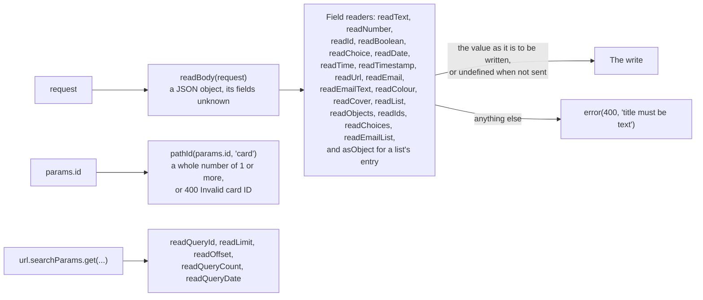

- **`readBody(request)`** hands back the body as `Record<string, unknown>`. The type check
  then refuses a handler that uses a field as text, a number or anything else before a
  reader has looked at it. Its parameter is called `request` so that
  `tests/openapi-document.test.ts`, which follows the functions a handler calls, still sees
  `request.json()`.
- **A field reader** takes `(body, name, rule)` and hands back the value exactly as it is to
  be written, or `undefined` when the field was not sent and is not required. It refuses
  with `error(400, ...)` and a text that names the field (`title must be text`,
  `priority must be one of: low, medium, high, critical`). It looks at the type before
  anything else, so `["x".repeat(600)]` is not a list one long enough to pass a length check.
  Only the body's own fields are read.
- **Every reader's `rule`** may say `required` (not sent is `<name> is required`), `nullable`
  (`null` is read as `null`, where the column can be empty; anywhere else it is the wrong
  type), `keep` and `says`.
- **`keep`** is the value the row holds now. A value sent that is the same JSON type and
  value is handed back unchecked, so a page that sends a card's stored fields back, with a
  priority stored before the rules, still saves. A create has no `keep`.
- **`says`** replaces the reader's texts, all of them or one of `missing`, `type`, `empty`
  and `invalid`. It is how the texts that tests, documents and pages quote were kept:
  `says: { missing: 'Title is required' }`. A length limit is never reworded: since card
  2218 every one is answered in the reader's own words,
  `<name> must be at most <max> characters`, in both trees, where 40 readers in 32 route
  files had said `Title too long (max 500 chars)` and the like. `tests/request-body.test.ts`
  holds it by the code's shape, not its words: under `src/routes` and `src/lib/server`, a
  length reader (`readText`, `readUrl`, `readEmailText`, `readReportRecipients`, read from
  the module) whose rule, written in the call, has a `max` may be given only a `says`
  written out there as an object, whose `invalid`, if it has one, is a text or template
  ending `must be at most <max> characters` with the rule's own number (a path in front,
  as templates and backup destinations write it, is allowed). A constant, a shared or
  shorthand `says`, a helper's call, a spread and other words or another number each fail,
  named by file and line. What it does not prove: a route that throws its own `400`
  (`error(400, 'Title too long')`) without a reader, and a rule handed to a reader by name
  rather than written in the call (`readWebhookUrl`'s), are outside the check.
- **Nothing is turned into another type**, but for a number written as text that is exactly
  a number (`"5"`, `"-2.5"`, not `"1e3"`), which is read as that number wherever a number or
  an id is read.
- **`pathId(params.x, 'card')`** reads an id in the path: digits and nothing else, 1 or
  more, or `400` `Invalid card ID`, the guards' own words. `1.5`, `abc`, `0` and `1e3` are
  refused, where `Number()` and `isNaN` let some of them through. The query readers take
  the value and not the parameter's name (`readLimit(url.searchParams.get('limit'), ...)`),
  so the name stays written in the handler, where the OpenAPI test reads it.
- **What a field is for** lives beside the readers where more than one handler needs it:
  the four priorities and a card's category rule in `src/lib/server/card-fields.ts`, a
  colour in `src/lib/colours.ts` (`#rrggbb`, which a page can ask too), and a card's cover
  there too (`isCoverValue`: a colour or one of the eight gradients of `COVER_PRESETS`,
  which `readCover` reads and the board and the card window ask before they draw one,
  card 2010), the reporting
  fields' vocabularies in `reporting-fields.ts`, an account's username and email in
  `account-fields.ts`, a backup destination in `readDestination()` in
  `backup-destinations.ts`.

**The order of the refusals.** Each handler refuses in one order, so that a caller who would
be refused is not told about the fields first, and a field reader that needs the stored row
(`keep`) reads it after the row is found:

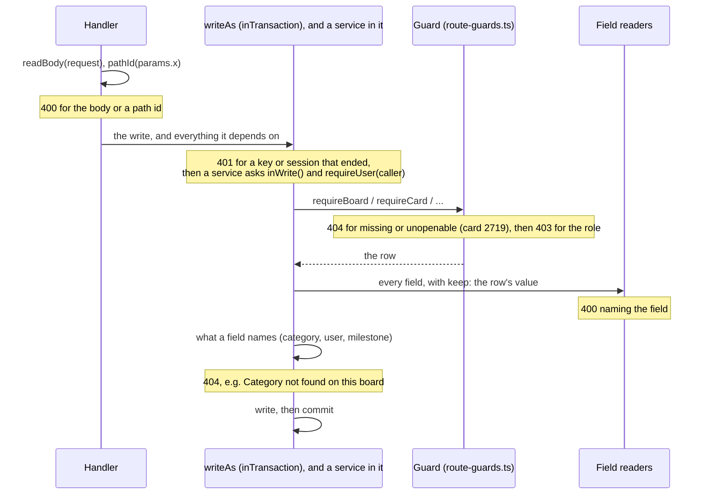

A create with no parent row to look for (`POST /api/boards`, a board grouping, a milestone of
no board) reads its fields first. Since card 2012 those reads, as every field read of a handler
that calls a service, are made inside `writeAs`, after the caller is asked for: a session that
ended while the body arrived is `401` before any field is read (see
[One Service per Action, Both Trees](#one-service-per-action-both-trees)). The token routes keep `tokens.ts`'s own order, the fields
before the card or subtask, and the three batches read every entry before they look for
what the entries name and report each problem in their `409`.

**The rule, held by a test.** `tests/request-body.test.ts` reads the source of every
`+server.ts` under `src/routes` and every module under `src/lib/server`, and fails on:

- a body read from the request (`json()`, `text()`, `arrayBuffer()`, `blob()`, `bytes()`,
  `formData()` or `.body`), on `request`, `{ request: req }`, `event.request` or a name typed
  `Request`, anywhere but `request-body.ts` and `api-errors.ts`, unless the read is on
  `NOT_JSON`: the import's `arrayBuffer()`, the upload's `formData()` and the gate's count.
  `STILL_READING`, the list of files that read their body themselves while the build moved
  them, is empty and is held empty;
- fewer than 80 calls of `readBody`, so that a parser that sees nothing cannot pass;
- a cast of what `readBody`, `readObjects` or `asObject` hands back, of a field of it, or a
  type written on the name it is kept in. `asObject(value)` hands back an entry of a list
  read with `readList` as a body when it is a JSON object (a dependency batch's `chain`),
  and the test follows what it hands back as it follows `readBody`'s; the entry was spread
  into a new object, which it could not see;
- a body, or an entry of `readObjects`, read by a key that is not written out
  (`updateData[key] = body[key]`), spread, handed to `Object.assign`, `Object.keys`,
  `Object.entries` or `Object.values`, walked with `for…in`, or with a field turned by
  `Number()`, `String()`, `Boolean()` or `!!`.

It finds a body by the names it is kept in, in the function it is kept in, so a body handed
whole to another function and used there is not followed: `normaliseReportingFields(body)`
and `recordTokenUsage(…, body)` read theirs with checks of their own. See
[Testing](testing.md#the-list-of-test-files).

### The four rules for `/api/v1/`

The external API answers every failure as JSON with one key, `message`. Four rules in the
gate make that hold for the failures no handler writes.

| Rule | What the gate does | Why |
|------|--------------------|-----|
| **The request asks for JSON** | The first statement of the branch sets the request's `Accept` header to `application/json`, on the request itself | SvelteKit answers a handler's `error(status, text)` as `{ message }` or as an HTML page by the `Accept` header, and picks the page for a caller that sends none. The header is set in place and the request is not replaced by a copy, because SvelteKit answers an error thrown out of the hook from the object it gave the hook |
| **The gate's own refusals are JSON** | The three `401`s and the `429` are returned as `json({ message, ... })`, never thrown | An error thrown by the hook is logged as an unhandled error |
| **No such route** | Once the key is accepted, a request whose `event.route.id` is `null` is answered `404 { "message": "Not found" }` by the gate, and SvelteKit is not asked | SvelteKit would render its 404 page: HTML, with the key owner's name, email and role in it, which the root layout loads for every page. It is answered only once the key is accepted, so without a key every path is a `401` |
| **A failure that is not JSON is answered again** | `failureAsJson()` looks at what `resolve` answered. A status of 400 or above whose content type is not JSON is replaced by a new `json({ message })` with the same status | What SvelteKit answers without asking a handler is plain text: above all a method the route does not have, a `405` |

`failureAsJson()` never touches a success, whatever its type, so a PDF and the OpenAPI
document pass through, and it hands back a failure that is already JSON as it is. The answer
it puts in place of another is made from nothing: only the `Allow` header is copied, because
the old answer's `Content-Length` and `Content-Type` describe the old body. Its `message` is
`<METHOD> method not allowed` for a `405`. For anything else it is what the old answer said,
if that was a plain text of 200 characters or fewer, and otherwise the standard phrase for
the status.

`/api/v1/openapi.json` returns before the key is asked for and before the rate limit. The
first and the last of the four rules cover it all the same, so a `POST` to it is a `405` in
JSON.

There are two `401`s. A request with no `Authorization` header, or one that is not a
`Bearer` header, is told so. A key that is not known, has expired or belongs to a deleted
user is answered `Invalid or expired API key`, and so is one the record of keys ended on this
server names (card 2995: `keyEnded` asks `keyRecorded`, three searches on the record's key, so a key
an older image's import or a host edit put back is refused), and one of an account the record of
account endings names as deleted (card 2996: `keyHolder` asks `deletedHere`, two index searches). `Bearer ` with nothing after it gets the
first: a header's value loses the spaces at its end before the gate sees it, so it arrives
as `Bearer`, which is no `Bearer` header. The gate had a third, `API key is empty`, for it,
which nothing could reach, and card 2117 took it out.

The key is looked up before anything is counted, and its requests are counted against the
key's own row (`findApiKey()`, then `checkRateLimit('apikey:' + id)`, then
`markApiKeyUsed()`), so a key over its limit is not marked as used. A request with no key
the gate accepts, a missing header included, is counted against the caller's address in a
bucket of its own, `apikey-none:`. The address is asked for guarded, because the adapter
throws when it is started with `ADDRESS_HEADER` and a request arrives without that header.

Every v1 answer carries the five security headers, the gate's own `401`s, `404` and `429`
included, set in step 6 like every other answer's.

### Everything else

Outside `/api/v1/` the gate decides who the caller is and where they may go, and leaves the
answer as SvelteKit made it.

- **A write is taken from DumpFire's own pages alone (card 2700)**, before the session cookie is
  read, so a refused request slides no session. For any method but `GET` and `HEAD`,
  `refuseCrossSiteWrite()` answers, in this order, anywhere outside `/api/v1/`, pages and form
  actions included: a request the server makes of itself (`event.isSubRequest`) `403`; one
  whose `Sec-Fetch-Site` is not `same-origin`, or, with that header absent, whose
  `Origin` is not `url.origin`, `403`; under `/api/`, one whose `Content-Type` is not
  `application/json`, body or not, `415`, but for the two uploads (`UPLOADS`). Each is JSON
  `{ message }`, logged at `WARN` with the request's `secFetchSite` and `origin` in its meta
  (`refusalSeen()`). See
  [Authentication & Security](authentication-security.md#writes-from-dumpfires-own-pages-alone-card-2700).
- **The body guard still applies** to the internal routes under `/api/`.
- **A failure is JSON or a page by the `Accept` header.** A page's own `fetch` asks for
  anything and is answered `{ message }`. A browser that opens an internal route's address
  gets SvelteKit's error page, and a method the route does not have is plain text.
- **A script with no session is refused; a browser is redirected.** A request for an
  internal route (under `/api/`, outside `/api/v1/` and the public routes) with no session
  is answered `401` `{ "message": "Not authenticated" }` before its body is looked at,
  unless it is a navigation (`Sec-Fetch-Mode: navigate`, or an `Accept` that prefers
  `text/html`), which is sent to `/login`, as every page is. `isNavigation()` and
  `notSignedIn()` are in `gate-answers.ts`.
- **The public routes are a list of route ids, matched exactly:** `/login`, `/docs`,
  `/invite/[token]`, `/request`, `/request/[id]/confirm`, `/request/[id]/reply`, the five
  routes under `/api/requests`, and `/api/v1/openapi.json`. `/setup` is the set-up page,
  exactly. A path that is no route is never public. See
  [Authentication & Security](authentication-security.md#who-is-let-through-without-a-session).
- **A redirect is an answer the gate makes, not one it throws.** `sendTo()` makes it as
  SvelteKit would have made it of a thrown `redirect(303, ...)`: a `303` with `Location`;
  for a page's data request, `200` `{ "type": "redirect", "location" }`; and for a form a
  page's script posts, `200` `{ "type": "redirect", "status": 303, "location" }`.
  `tests/gate.test.ts` holds each against SvelteKit's own function for it.
- **`/api/v1` with nothing after it is not under `/api/v1/`.** It takes this branch, as a
  path under `/api/` that is no route: a script is answered `401`, a browser sent to
  `/login`.
- **The five security headers** are set on every answer, in step 6. See
  [Authentication & Security](authentication-security.md#security-headers).

### What is answered before the gate

SvelteKit answers three kinds of request without calling `handle`, so the gate cannot make
them JSON or head them. The first two are documented to callers as the exceptions, with
what to send instead, in the
[External API Reference](api-reference.md#answers-that-are-not-json), and all three, with the
static files of a built server, as the proxy's to head in
[Deployment](deployment.md#security-headers-from-the-proxy). A URL that is not validly
encoded, the third exception callers are told of, was a fourth up to SvelteKit 2.60; the
gate now answers it itself, with the same plain-text `400` `Malformed URI` and the security
headers (see [The path a rule is decided on](#the-path-a-rule-is-decided-on)).

| Request | SvelteKit's answer |
|---------|--------------------|
| A `POST`, `PUT`, `PATCH` or `DELETE` whose `Content-Type` is a form's or `text/plain`, with no `Origin` that matches the server. A built server only: the check is skipped under `vite dev` | `403`, as plain text unless the `Accept` header is exactly `application/json` |
| A path with a trailing slash that names a route | `308` to the path without it |
| A path that begins `/_app` and is no file the server has, but a call to a remote function, which the gate answers itself | `404` `Not found`, plain text |

The first is SvelteKit's protection against cross-site form posts (`csrf.checkOrigin`),
which the configuration leaves on. It looks at form types alone. The gate's own check (card
2700, step 4) covers every other write outside `/api/v1/`, and the form actions too, under
`vite dev` as in a built server; in a built server SvelteKit's check runs first, so a form
whose `Origin` is not the server's is its `403` and never reaches the gate.

## Authentication and Authorisation

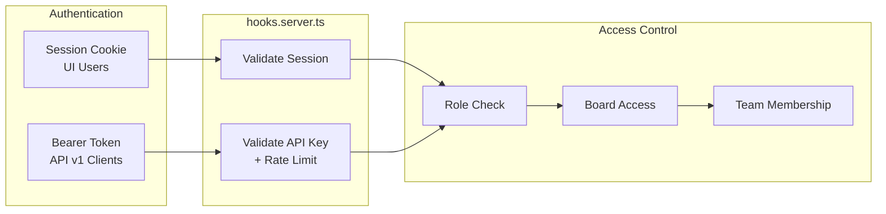

### Signing In: Two Steps (Card 2769)

A session cookie is made only after a second factor. A right password opens a ten-minute
pending sign-in (a *challenge*), and the code page or the set-up page finishes it. `validateSession()`
refuses a session not marked `two_step = 1`. Since card 2775 the database holds only the
SHA-256 of a session's code, a session ends at the earlier of an idle and a total limit set by
the account's role (see
[Idle and Total Limits](authentication-security.md#idle-and-total-limits)), and the cookie is
`__Host-dumpfire_session` over HTTPS. API keys are untouched: the gate authenticates
`/api/v1/*` by the `Authorization` header alone, before it reads any cookie.

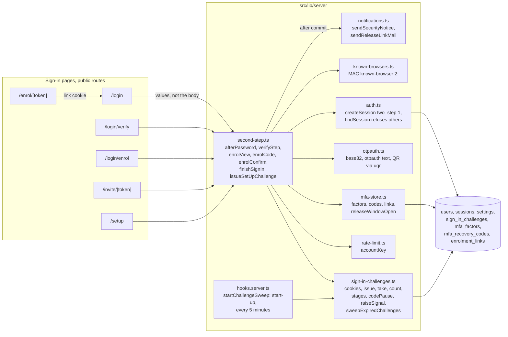

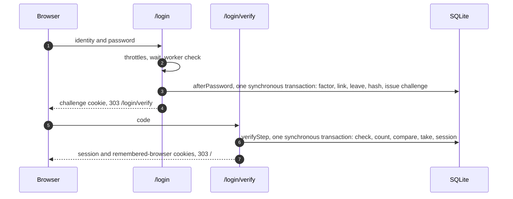

- **Each form action reads its own form** in its `+page.server.ts` and hands values to
  `second-step.ts`, which never reads a request body (the body readers stay in the routes,
  as `tests/request-body.test.ts` requires).
- **The second step is one synchronous stretch.** `verifyStep()`, `enrolCode()` and
  `enrolConfirm()` are synchronous, and so are the helpers they share (`laneOf()`, `refuse()`,
  `openChallenge()`, `finishSignIn()`, `signedInAnswer()`, `mayStillEnrolOnPassword()`,
  `issueSetUpChallenge()`); their actions await only `request.formData()` before calling them,
  so nothing can come between reading the challenge and taking it with the session or the
  factor. `afterPassword()` reads the factor, the link and the leave and issues the challenge in
  one synchronous transaction too, and is `async` only for the release mail it ends with. A
  source scan holds all of that (T29), and another (T45) holds that `createSession()` is called
  only from `second-step.ts` and the own-password change.
- **The invite and the first-run set-up** issue their challenge with `issueSetUpChallenge()`
  inside their own transaction and send the browser on with `goToSetUp()` after the commit.
- **The throttles** are keyed by `accountKey()` from `rate-limit.ts`, which the password step
  and the second step share.
- **Notices are sent after the commit, not awaited**; the release mail alone is awaited, since
  a link whose mail did not go is deleted. Log lines and address counts that belong to a
  committed sign-in are made through `afterCommit()` too.
- **Expired challenges are swept** at start-up and every five minutes (`startChallengeSweep()`
  from `hooks.server.ts`, an unref'd timer), as well as whenever a challenge is issued.
- **The pages' loads do not redirect a `POST`**, so a form posted without JavaScript is answered
  on the page with the action's result.
- **The QR code** is drawn on the server by `uqr` and shown as a `data:` image, which the
  Content-Security-Policy's `img-src 'self' data:` allows; no markup goes into the page with
  `{@html}`.
- **`SignInReport.svelte`** shows what is reported after a right code or a confirm; the code
  and set-up forms call `update({ invalidateAll: false })` so that the report is not reloaded
  away, and its Continue loads the home page afresh (`data-sveltekit-reload`).

The whole design, every answer and the accepted risks are in
[Two-Step Sign-In](authentication-security.md#two-step-sign-in-card-2769).

### Role Hierarchy

| Role | Boards | Admin | Users |
|------|--------|-------|-------|
| `superadmin` | All boards | Full access | Manage all |
| `admin` | All boards | All but export, import and Reset Everything (the mail and backup settings since card 2395), and lowering Keep Last, removing a backup destination or switching the schedule off (card 2398), or switching the backup failure mail off or changing who receives it (card 2408) | Manage ordinary users |
| `user` | Only shared boards | No access | Self only |

### Board Access Levels

| Level | View | Edit Cards | Manage Board |
|-------|------|-----------|--------------|
| `owner` | ✅ | ✅ | ✅ |
| `editor` | ✅ | ✅ | ❌ |
| `viewer` | ✅ | ❌ | ❌ |

### Not Found, Not Forbidden (Card 2719)

A caller with no level on a board is answered as if what they named were not there: `404`, in
the words a missing one gets, by every route and page in both trees, a batch's entries and a
dependency loop's nodes included. `403` is for a caller with a level whose role does not allow
the act. The guards share one refusal, `refuseOnBoard` in `route-guards.ts`, which reads the
role once. The detail, what stays `403` and the accepted timing residual (R5) are in
[Authentication and Security](authentication-security.md#not-found-not-forbidden-card-2719).

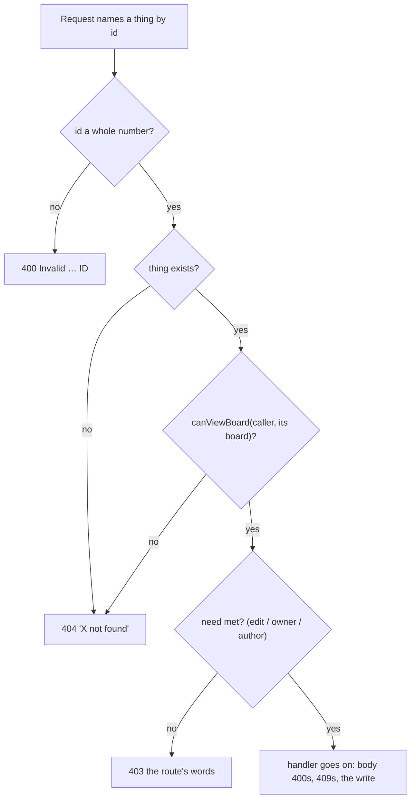

The v1 dependency batch asks access before it validates, so a hidden end is never judged a
duplicate or part of a loop:

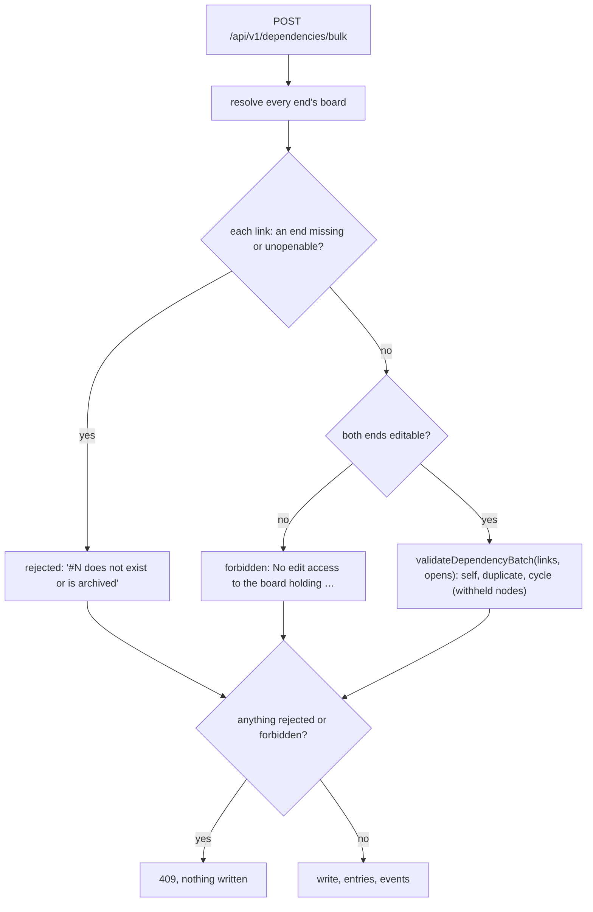

## Real-Time Updates via SSE

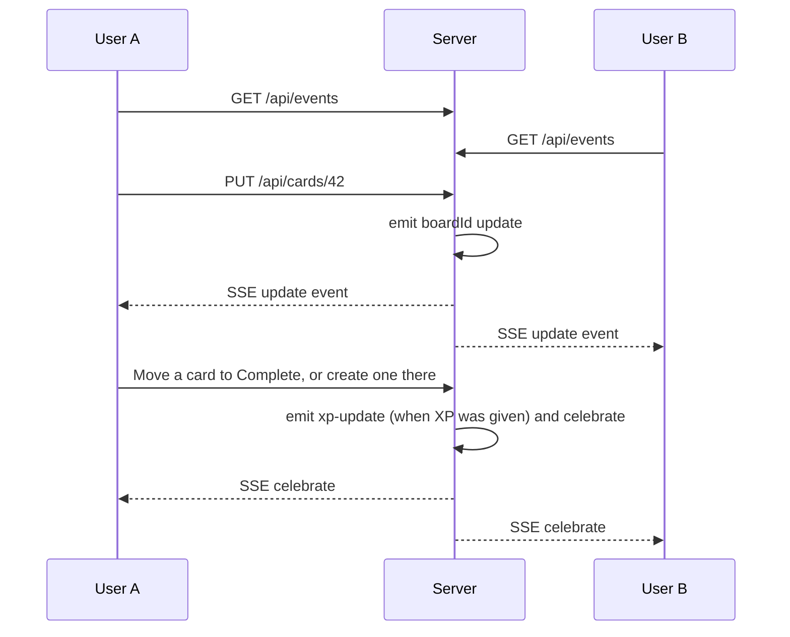

An event raised while a transaction is open is held until that transaction commits, and is dropped if it rolls back. See the next section.

A card created in a Complete column is completed as a moved one is, and celebrated the same way (card 2134; see [Data Model](data-model.md#one-completion-however-a-card-arrives)). A delete tells the pages open on every board it removes or empties with an `update` that names nothing, `{ type: 'board', action: 'deleted' }`, `{ type: 'card', action: 'purged' }` or `{ type: 'card', action: 'cleared' }`, and the board a deleted sub-board hung from, which is still there, with `{ type: 'board', action: 'sub_board_deleted' }` (card 2108; see [Notifications & Email](notifications-email.md#event-types)). The web application's routes tell what their `/api/v1/` twins tell (card 2143): an assignment, an unassignment and a comment edited send `{ type: 'card' }` to the card's board, a board updated sends `{ type: 'board' }` to that board once, and a sub-board made under a card, by either tree, sends `{ type: 'board', action: 'created' }` to the board that card is on.

**What an event carries.** An event goes, as it was emitted, to every listener of its board on the board stream and on the global one, and `emit` cannot choose a payload per listener. So an event names nothing that some reader of its board may not read; it is there to make the page read its board again, under the page's own access check (P4's rule for the events it added). A move between boards sends `moved_away` to the board the card left and `moved_in` to the board it joined, each with `type`, `action`, `cardTitle`, `fromColumn`, `toColumn`, `userName` and `userEmoji`, and neither names the other board (card 2181): they carried `toBoard` and `fromBoard`, which nothing read, and gave each board's listeners the name of a board some of them could not open. The move's two activity entries name neither board for the same reason (see [Data Model](data-model.md)).

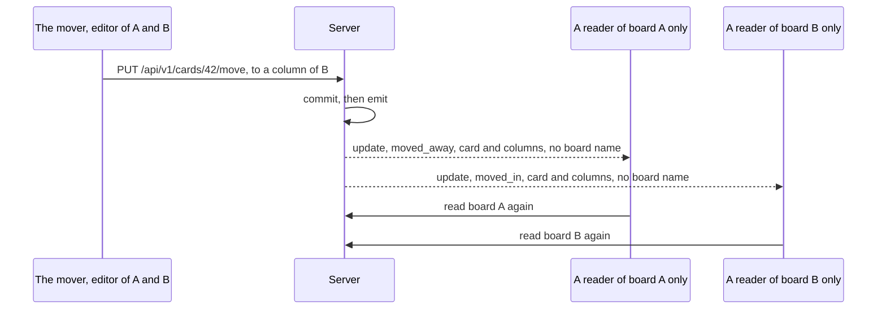

### An open stream and its session

The gate looks at a request's session once, when it arrives, and a stream is one request that stays open. So each of the three streams (`/api/events`, `/api/boards/[id]/events` and `/api/logs/stream`) takes the session's hash from the gate (`locals.credential`; the session code itself goes no further than the gate, card 2775) when it is opened, and asks at each heartbeat it already sends (every 30 seconds; 25 for the log) whether that session is still open: there, not past its deadline (the earlier of its expiry and its start plus the total limit of the account's role now), and with an account; `openSession()` also gives the deadline, and `sessionEndTimer()` closes the stream at it, armed at open and re-armed at each heartbeat. When it is not, the stream stops listening, stops its heartbeat and closes, and sends nothing more. Each asks `openSessionUser()` in `src/lib/server/auth.ts`, which gives the session's account as it is now. The two streams let in for an administrator's role end as well when the role they were let in for has changed: the log stream when the account is no longer an administrator, and `/api/events` when it has become one or stopped being one, since that decides which boards' events it sends. The board stream ends as well when its board has gone or the account can no longer open it, and says so first (card 2170, below). `openSessionUser()` shares one private function with `validateSession()`, so that what counts as an open session is decided in one place. Unlike `validateSession()` it writes nothing, logs nothing and does not move the session's expiry on: an open tab would otherwise keep its session alive for ever.

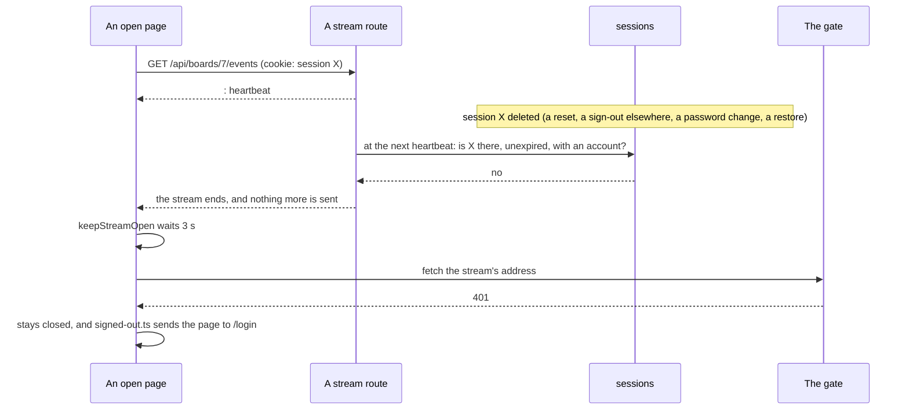

- **Only the session that opened it counts.** Another session of the same account ending does not end the stream.
- **A check that cannot be made ends the stream too.** The check runs inside the heartbeat's `try`. If it throws, the stream ends as for a session that has gone, and one `WARN` line is written under `AUTH`, "Live stream ended: its session could not be checked", with the route and the error. Nothing escapes the timer, where it would end the process.
- **What the page does.** Nothing new: `keepStreamOpen()` sees the stream drop, asks again three seconds later, is answered `401` and stays closed, and a page that holds a stream (a board, the dashboard, All Tasks, Burndown) goes to the login page by itself, about 35 seconds after the session ended at most. A page that holds none (Account, Admin, Reports) goes there at its next request. A stream that ended because its holder changed their own password opens again at once on the browser's new cookie, one that `/api/events` ended for a change of role opens again with the role as it is now, and the page re-reads its data. The audit console's own `EventSource` is refused when it tries again (`401`, or `403` for an account that is no longer an administrator), gives up, and the console shows it is disconnected.
- **What access each stream checks again** (card 2170). Each decides everything again at one moment, its heartbeat. The board stream asks, after the session, whether the board row is still there and the account as it is now can open it (`canViewBoard`); if not, it enqueues one last `update` with `{"type":"access"}` on its own stream, not emitted to anyone else, and ends, and the board page re-reads and shows its load's refusal, "Board not found", which since card 2719 is what a board the account can no longer open is answered, as one that is not there (since card 2280 the access event is a read of the board's contents sent at once, never held, whose `403` or `404` empties the page and asks for the load once: see [The Board Page and the Card Window](#the-board-page-and-the-card-window)). It opens only on a board that is there and that the caller can open (`requireBoard(user, id, 'view')`: `404`, administrators included, and for a board the caller cannot open alike since card 2719, or `400` for an id that is not one). `/api/events` keeps each board's answer until its next heartbeat, which forgets them all once the session and the role are checked; the 30-second clock it kept them by is gone. An administrator made an ordinary user stops receiving the log and every board's events at the next heartbeat, and a board's events too unless they are on it.
- **A deleted board is told first.** A delete's own event is delivered in the same synchronous run as its commit (`emit` queues it with `afterCommit`, and the outermost transaction starts the queued effects as it returns), and a heartbeat is a timer, which cannot run in between. A stream closed after an `enqueue` still hands the reader what was enqueued, so the deleted board's page always has `{ type: 'board', action: 'deleted' }` before the access event and the end. Board ids are never used again, so ending a stream on a deleted board loses nothing.

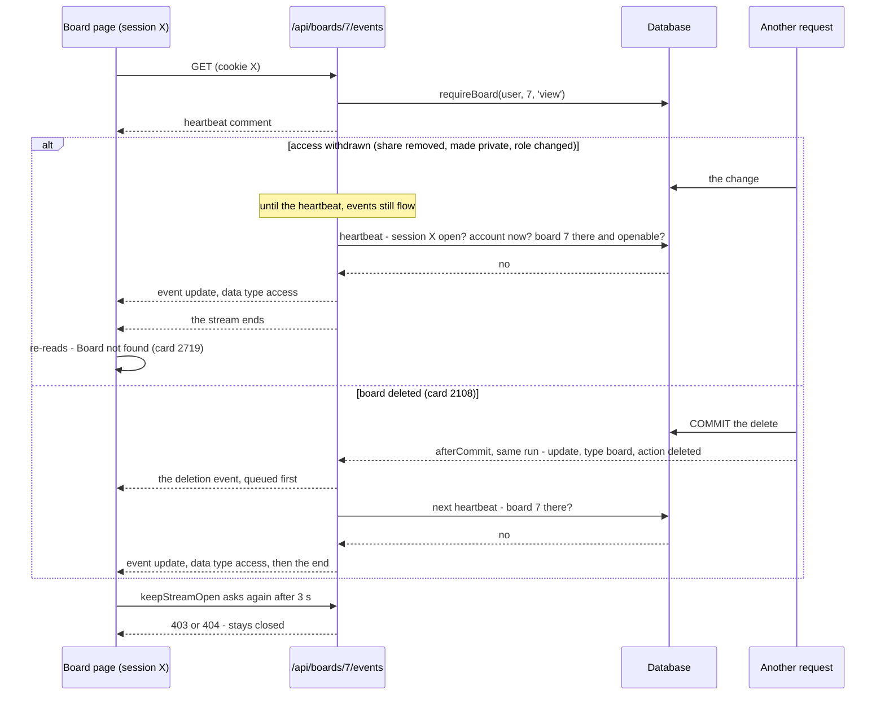

Covered by `tests/live-streams.test.ts`.

In the browser every stream but one is opened by `keepStreamOpen()` in `src/lib/live-stream.ts`. The one is the audit console's live log, `src/routes/audit/+page.svelte`, which opens its own `EventSource` on `/api/logs/stream` and leaves reconnecting to the browser: it tries again after a dropped connection, and gives up on an answer that is not a stream, a `401` or a `403` among them, when the console says it is disconnected. On reconnecting the stream sends its last 100 entries again, and the console skips each it has shown: one whose id is at or below the last one shown and which is no later than it (the ids count from 1 again after a restart). After a failure it waits 3 seconds, then twice as long after each failure that follows, up to five minutes; it asks the stream's address with `fetch` before it opens it again, and leaves it closed after a `401`, `403` or `404`. A stream that opens again after a gap has the page re-read its data, since nothing replays the events it missed. See [Authentication & Security](authentication-security.md#who-is-let-through-without-a-session).

### The board page follows the board it shows

The board page's stream is the page's own: `connectSSE(data.board.id, ...)` (`src/lib/board/sse.ts`) is called in its `onMount` and closed in its `onDestroy`. SvelteKit keeps a page's component when only its params change, so until card 2184 a sub-board badge, a breadcrumb, a link in the card window, or Back and Forward between two boards showed the second board in the first board's page, still listening to the first board's stream, with its selection, panels, search, filters and card window carried over. `src/routes/board/[id]/+layout.svelte` now renders the page inside `{#key page.params.id}` (`page` from `$app/state`): a change of board destroys the page, which closes the first stream, and makes it afresh, which opens the second, with everything else empty. The key is the board and not the address, so a `?card=` link on the same board, `invalidateAll()` and SvelteKit's `replaceState` keep the page, its stream, its drag state and its scroll. Since card 2280 the page calls `invalidateAll()` in one place only, when a read of its board is refused, and makes its board state and its card-window controller once per page, so the key makes them afresh for each board too: see [The Board Page and the Card Window](#the-board-page-and-the-card-window).

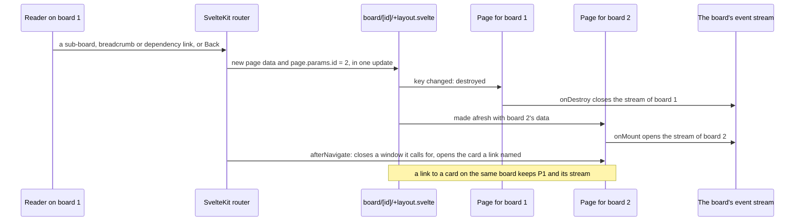

The page's `afterNavigate` (card 2164) opens the card `?card=` names, after every navigation, the first load included. Before it does, it closes a card window open at the time when `navigationClosesWindow(from, to, ...)` in `src/lib/board/card-actions.ts` says so (Q-F's review): on a navigation to another board, a card named or not, which the key makes certain too; and on the same board when a saved card's window is open and the new address names no card, as Back after a dependency link does. A New Task window on the same board is left open.

### A page left open across a deploy

A page keeps running the scripts it was loaded with until it is loaded again, against whatever server is now answering. Since card 2167 each open page asks once a minute whether the server is a newer version, and says so when it is. Until then `svelte.config.js` set no `kit.version`, SvelteKit's interval was 0, and a page never asked.

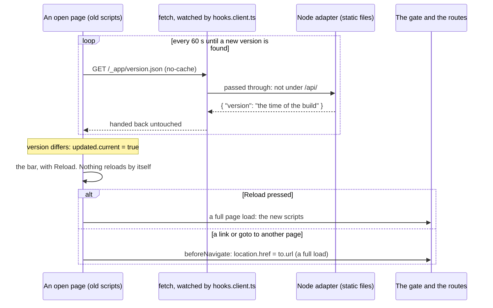

- **How it asks.** `kit.version.pollInterval` is `60_000` in `svelte.config.js`. SvelteKit's `updated` then fetches `/_app/version.json`, with `no-cache` headers, every 60 seconds, compares its `version` with the one the page was built with, and stops asking once they differ. `kit.version.name` is left as SvelteKit's default, the time of the build: every image built is a new version, a restart of the same image is not, and going back to an older image is. Under `vite dev` it never asks.
- **What answers it.** The node adapter serves `/_app/version.json` from the build, as it serves every static file, before `handle` is called, and does not mark it immutable (see [What is answered before the gate](#what-is-answered-before-the-gate)). So the check needs no session, is counted by no rate limit, writes no system-log line, and works on the login page and the public request form alike. The proxy in front caches nothing ([Deployment](deployment.md#reverse-proxy--nginx)).
- **The client hook is unchanged.** SvelteKit calls the global `fetch` when its timer fires, which `src/hooks.client.ts` has by then replaced with the watch for an ended session. The address is not under `/api/`, so `endsTheSession()` in `src/lib/signed-out.ts` hands the answer back untouched and never sends the page to sign in. A stale page that the watch does send to sign in goes there as a new page load, and so arrives on the new version.
- **What the page shows.** While `updated.current`, from `$app/state`, is true, the root layout (`src/routes/+layout.svelte`) draws a bar across the foot of the window, `role="status"`: "DumpFire has been updated. Save anything you are editing, then reload to use the new version.", with a **Reload** button that calls `location.reload()`. It cannot be closed, and the page never reloads by itself, so nothing typed in a card's window or a form is lost. While it shows, its height is set on the page's root as `--update-bar-space`, and every window (`.modal-overlay` in `src/app.css`), the toast and the user badge keep clear of it by that much. It was at the top until Q-F's review, where on a phone it covered a card window's title and its ✕.
- **Above everything.** The bar is drawn after `.app-layout`, not inside it, at `z-index: 10001`. `.app-layout` is `position: relative; z-index: 1`, which makes everything a page draws, its windows and overlays included, one layer beneath anything outside it; and the toast is at 10000. `tests/page-failures.test.ts` holds the bar above every other `z-index` under `src`. The user badge in the corner is drawn inside `.app-layout`, at `z-index: 100`, beneath the pages' windows (1000 and up): outside it, it was drawn above every window and its dimmed backdrop. It is opaque, `var(--bg-elevated)` with `var(--shadow-md)` over the global `.glass`'s background of 2 to 6% (card 2239), and `--user-badge-space` on `.app-layout` (the badge's offset, its height of 18px plus the taller of 28px and 1.8rem, about 47px at the default font size and more when the root font is larger, a gap and `--update-bar-space`) is where each page ends its last line or its scroll (the API docs' sidebar included), so nothing a page draws is left under it: the audit page's Live Console footer read through it.
- **The next move is a full load.** A `beforeNavigate` in the same layout sets `location.href = to.url.href` when `updated.current && !willUnload && to?.url`, SvelteKit's documented pattern, so a link or a `goto` once the bar has shown loads the new version.
- **The first release.** A page loaded before the release that brought this asks nothing, so for that release open tabs are reloaded by hand: see [Deployment](deployment.md#updating-a-running-installation), step 7.

## The Board Page and the Card Window

Card 2280 (part B of card 2012's plan, `docs/planning/card-2012-service-layer-and-pages.md`). Until then the board page called `invalidateAll()` 23 times: after each of its own writes, and on every live event from its board's stream, one call per event with nothing to gather a burst. Every write is told to every page open on its board, the page that made it included, so each change on the board page re-ran the whole board load twice, once after the write and once for its own echo, breadcrumbs, linkable boards and all; a bulk change of 20 cards by someone else re-ran it 20 times; and whichever re-read landed was copied over the page by an `$effect`, under a drag in hand or a field being typed in. Twenty of the page's writes also threw their answer away, so a refusal said nothing and the change stayed on screen until the next re-read put it back.

Now the page draws from one **board state**, made once from its load. A change of the page's own is shown at once and sent; its answer is taken, or, refused or unanswered, that change alone is taken back and the server's words are said. A live event asks for one **read of the board's contents**, `GET /api/boards/[id]/contents`, gathered with any others in the next quarter of a second and never sent while a drag or a write of the page's own is out. The whole load is asked again in one case only: when that read is refused, so that the load's own refusal page shows. The card window is opened, kept in step with the board, saved and archived by one **controller**. And the page and the window are split into components: eight new ones for the board, eleven for the window.

### How it fits together

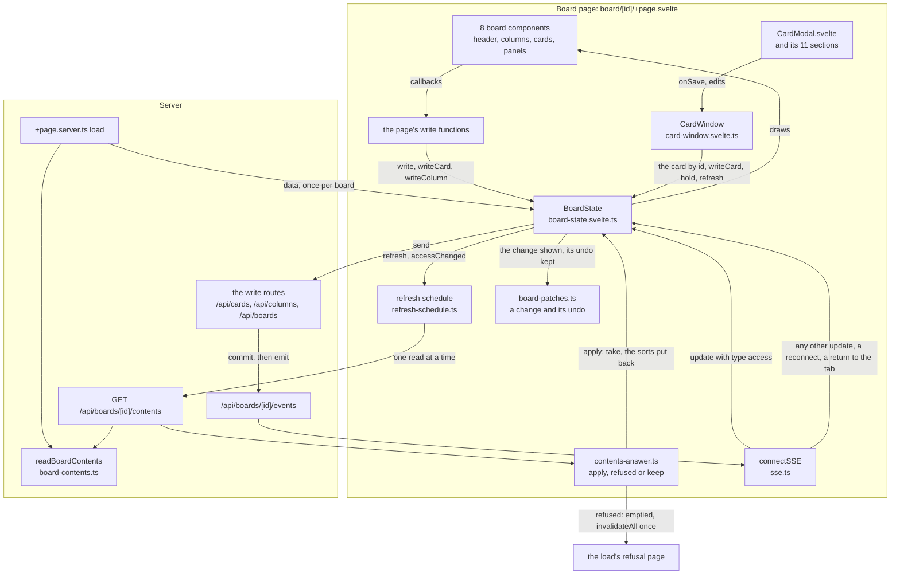

- **One reader for the first draw and every refresh.** `readBoardContents(user, boardId)` in `src/lib/server/board-contents.ts` is the board load's body, moved whole. The page's load (`src/routes/board/[id]/+page.server.ts`) returns it, and so does the new internal route `GET /api/boards/[id]/contents`, so the first draw and a refresh cannot differ: the same access check, the same fields, each as this caller may see it. It answers the board row, the breadcrumbs, the caller's role (`canEdit`, `canManage`, `userBoardRole`) and the linkable boards beside the columns with their cards, the categories, labels, members, blocked state, token totals and goals, so a rename by someone else, or a role taken away or given, shows at the next refresh.
- **Live events still carry nothing readable** ([What an event carries](#real-time-updates-via-sse)). The page does not patch itself from an event; an event is a reason to read the board again, under the reader's own access check.
- **Holds and generations.** Every write of the page's own, and a drag from its first move to the move's answer, holds the reads. A read already out when a hold is taken, or when a write settles, was sent before that change and may answer the board as it was: its answer is dropped, by its generation number, and the board is read again once the last hold is let go.
- **Writes through the board state.** `boardState.write(change, send, words, take?)` shows the change, holds, sends, and on success puts the answer's value of each field sent on the board (`writeCard`, `writeColumn`); on a refusal or no answer it takes that change alone back, reads the board once, and gives the page the words to say. The board is not read after a write that was taken: its own live event is.
- **The card-window controller.** `new CardWindow(boardState, boardId)` opens the window on a card by its id and hands the window the board state's copy of it as each read arrives. A save sends only the fields the user changed, through `writeCard`.
- **A refused read shows the refusal page.** A `401`, `403` or `404` from the contents route empties the board state and calls `invalidateAll()` once, so the load runs, refuses in its own words ("Board not found", for a board that is not there and, since card 2719, for one the caller can no longer open) and the error page replaces the board. If that load finds the board open after all (access given back meanwhile), the page's one `$effect` that reads `data` hands it to `boardState.take()`, and the state follows the board again with a new schedule.

One write and one refresh, as they happen:

```mermaid
sequenceDiagram
    participant U as User
    participant P as Board page
    participant B as BoardState
    participant Q as Refresh schedule
    participant S as Server
    U->>P: change a card's priority from its menu
    P->>B: writeCard(card 42, priority high, send, words)
    B->>Q: hold, which moves the generation on
    B->>B: patchCard - shown at once, the undo kept
    B->>S: PUT /api/cards/42
    alt taken
        S-->>B: 200 with the row
        B->>B: patchCardStill - the answer's priority, only while it still shows high
    else refused or no answer
        S-->>B: 4xx, 5xx or nothing
        B->>B: the undo, only while it still shows high
        B->>Q: one read asked for, held for now
        B-->>P: the server's words
        P->>U: an error toast in those words
    end
    B->>Q: settled, then the release (a read that waited goes at once)
    S->>S: commit, then emit an update to board 7
    S-->>P: the update, its own echo, through sse.ts
    P->>B: refresh
    B->>Q: schedule - 250 ms after the last call, at most 1 s after the first
    Q->>S: GET /api/boards/7/contents (one at a time, none while held)
    S-->>Q: 200, the contents as this caller may see them, private, no-store
    Q->>B: applied only if the generation has not moved - take, the sorts put back
```

### The modules in `src/lib/board`

| Module | What it holds | Used by |
|---|---|---|
| `board-state.svelte.ts` (new) | `class BoardState`, a `$state` field for each key of the contents (`board`, `breadcrumbs`, `columns`, `categories`, `labels`, `linkableBoards`, `canEdit`, `canManage`, `userBoardRole`, `boardUsers`, `blockedState`, `decisionWaits` (card 3059), `cardTokens`, `boardTokenSummary`, `milestones`), with `columnSorts` and `refused`. `new BoardState(data, { invalidate, fetch?, ...timing })`; `take(data)`; `setSort(columnId, sort)`; `refresh()`; `refreshNow()` (no 250 ms wait, awaitable, still held; the sub-board link and delete); `accessChanged()`; `hold(options?)`, `holds`, `inFlight`; `write`, `writeCard`, `writeColumn`; `dispose()`. Types `WriteResult` (`{ ok: true, res, answer }` or `{ ok: false, failure }`), `WriteWords` (`refused`, `noAnswer`) | The board page; `bulk-actions.ts` (`BoardWriter`); `card-window.svelte.ts` (`CardWindowBoard`) |
| `refresh-schedule.ts` (new) | `refreshSchedule(run, timing?)`: `schedule()`, `now()`, `access()`, `hold(options?)` returning a `Release` (counted once, with `released`), `settled()`, `holds`, `inFlight`, `dispose()`. `REFRESH_DELAY_MS` 250, `REFRESH_MAX_WAIT_MS` 1,000, `HOLD_WATCHDOG_MS` 30,000, `BULK_HOLD_MS` five minutes; `HoldOptions` `{ watchdog?, watchdogMs? }`. Plain TypeScript on the page's own timers, so the tests run it with fake ones | `BoardState`; the page imports `BULK_HOLD_MS` and `Release` |
| `board-patches.ts` (new) | Pure functions on the columns, each `(columns, …) → { columns, undo(current) }`: `patchCard`, `moveCards` (sets `columnId` and `position`), `insertCard`, `removeCard`, `patchColumn`, `insertColumn`, `removeColumn`, `reorderColumns`. And `patchCardStill`, `patchColumnStill` (an answer put only on a field that still shows what its write set), `answeredFields(answer, fields)`, `copyColumns`, `withCurrentCards(columns, current, dragged)`, `undoDrag(current, before, dragged)`. Nothing given is changed; a column or card not touched is handed back as the same object | `BoardState`, the page, `bulk-actions.ts`, `card-window.svelte.ts` |
| `contents-answer.ts` (new) | `contentsVerdict(status)`: 2xx `apply`, `401`, `403` or `404` `refused`, anything else or no answer `keep`. `askForContents(boardId, fetch)`, which never throws, asks with `cache: 'no-store'`, and takes a success that is not the contents (a proxy's page) as `keep`. `type BoardContentsData`, the page's view of the reader's answer (the server's type is not imported into the page), `BreadcrumbType`, `BoardBlockerType` | `BoardState`, the page |
| `card-window.svelte.ts` (new) | `class CardWindow(board, boardId)`: `open`, `cardId`, `columnId`, `edits` (`$state.raw`), the getters `card` and `gone`; `openCard(card)`, `openNew(columnId)`, `close()`, `save(saved)` → `SaveResult` (`{ ok: false, failure }` or `{ ok: true, told }`), `archive(cardId)` → the words, or `null` once archived. `class WindowEdits` (`started`, `touched`, `follow(shown, now, held?)`); `WINDOW_FIELDS`, the twelve fields a save sends; `windowFields(card)`, CardModal's own initialisers; `changedFields(started, saved)`; `CARD_GONE`; types `CardWindowSave`, `CardWindowBoard`, `Told` | The board page; `CardModal.svelte` (`WindowEdits`, `windowFields`) |
| `sse.ts` | `connectSSE(boardId, callbacks)`: `onUpdate(event)` is handed what the `update` said, `boardEvent(e.data)` (the parsed object, or `null`), and `null` for a reconnect and a return to the tab, so the page can tell the access event from the rest | The board page |
| `card-actions.ts`, `board-actions.ts`, `bulk-actions.ts`, `dnd-handlers.ts` | Each write gives back its answer, or the words for a refusal. `saveCard` gives back `failure`, and makes a new card with its subtasks, labels, people and sub-boards in one request (card 2296; `assignPending` and the per-part failures are gone; `noAnswer` marks a create that got no answer, which may have made the card); `duplicateCard` sends the copy's subtasks in its one `POST /api/cards`, so the copy is made whole or not at all, a subtask refused named by its title (card 2389); `setPinned`. `bulkMove`, `bulkDelete` and `bulkPriority` take the board state (`BoardWriter`) and show every card at once; `bulkMove` sends one `reorderCards` request, and only `bulkDelete` and `bulkPriority` send card by card, each after the one before is answered; `bulkPriority` returns `{ changed, failed }`. `confirmOnHold` sends the move first and the note only once the move is taken, returning `{ failure, noteFailure }`. `board-actions.ts`'s `addCategory` and `deleteCategory`, which nothing called, are gone | The board page and the card-window controller. Since card 2281 All Tasks, All To Do and the plan page save their card window through the controller and call none of these; `saveCard`'s update path (an `editingCard` given) has no caller in `src` now, the controller using its create path alone, and is still called by the tests |

```mermaid
classDiagram
    class BoardState {
        board
        columns
        labels
        boardUsers
        columnSorts
        refused
        take(data)
        refresh()
        refreshNow()
        accessChanged()
        hold(options) Release
        write(change, send, words, take)
        writeCard(cardId, fields, send, words)
        writeColumn(columnId, fields, send, words)
        dispose()
    }
    class RefreshSchedule {
        schedule()
        now()
        access()
        hold(options) Release
        settled()
        holds
        inFlight
        dispose()
    }
    class CardWindow {
        open
        cardId
        columnId
        edits
        card
        gone
        openCard(card)
        openNew(columnId)
        close()
        save(saved) SaveResult
        archive(cardId)
    }
    class WindowEdits {
        started
        touched
        follow(shown, now, held)
    }
    BoardState *-- RefreshSchedule : reads through
    CardWindow --> BoardState : CardWindowBoard
    CardWindow *-- WindowEdits : one per window
```

### The components

The page (2,002 lines, CRLF) keeps its script whole: every `$state`, every write, the board state, the card window, the drag handlers and the windows. It keeps the kanban skeleton too, because `animate:flip` must sit on the direct child of a keyed `{#each}` and svelte-dnd-action needs a zone's direct children to be its items: each `.kanban-column` and `.kanban-card` element stays in the page, and their contents are components. Each component under `src/lib/components/board/` is handed what it shows as props, `bind:` for what is typed in it, and calls back into the page's functions:

| Component | What it draws |
|---|---|
| `BoardHeader.svelte` | The header: breadcrumbs or the back button, the emoji, the name and its edit box, the cost pill, the search, the view switch, the Filter menu (the assignee filter, a group named Assignee, and Hide blocked as `HeaderMenu` items; its button counting those on, drawn as a field, `hdr-control` without `hdr-action`); snippet `more`. Card 2466 moved Planning, All To Do, Add Column and the theme picker into the More menu and took the XP bars (snippet `xp`) out |
| `XpLeaderboard.svelte` | The XP bars, from a sorted copy of the page's list (card 2304: it sorted the page's state in place while drawing, which Svelte refuses). Not drawn on the board since card 2466 (the owner: XP on the dashboard only); drawn `stacked`, with each person's XP total, in the dashboard sidebar's XP Leaderboard panel |
| `BoardMoreMenu.svelte` | The More menu, a `HeaderMenu`, in groups named by their headings: Go to (Planning and All To Do for this board), Panels, Board (Add Column, Burndown, Manage Categories, Bulk Select, Share Board, Delete Sub-board) and Theme (`ThemeMenuItems.svelte`, a list by name), one callback each. Its button's click reaches the page's window handler, which closes the page's other dropdowns and no longer this menu, which closes itself on a click outside |
| `KanbanColumnHeader.svelte` | A column's head: colour bar, title and rename box, count, sort badge, Add Task, colour picker, column menu with its WIP-limit box. The rename and WIP-limit state stays in the page, one for the whole board |
| `KanbanCardBody.svelte` | Everything inside a card on the board: cover strip, pin, New badge, selection tick, drag handle, category strip, title with its inline edit and priority dot, description, On Hold note, badges, labels, assignees |
| `ActivityPanel.svelte`, `ArchivePanel.svelte` | The Activity Log's and Archived Cards' bodies |
| `SidePanel.svelte` | The frame both panels share: heading, close button, scrolling body |

Four rules that style a component's element from the page's element are `:global` under the page's element (`.kanban-column:hover :global(.column-actions)`, `.kanban-card:hover :global(.drag-handle)`, `.kanban-card.card-pinned :global(.new-badge)`, `.wip-warning :global(.column-top-bar)`). Without `:global` Svelte would scope such a rule to the page's own markup, where it matches nothing. `npm run check` does not flag the four because they are `:global`: the part under `:global` is never judged against the page's markup, so `css_unused_selector` never applies to it (not because of `svelte.config.js`, which no longer filters that warning, card 2357).

The card window, `src/lib/components/CardModal.svelte` (1,273 lines, CRLF), keeps its props, every typed field's `$state` initialiser and `save()`, the header, the title, the tabs, the On Hold box, the labels, the footer and `handleKeydown`, and with them everything that must outlast a section being hidden (a section inside `{#if}` is destroyed when it hides, so state of its own would be lost on a switch of tab). Its sections are under `src/lib/components/card/`, each handed the window's state as props and `bind:`:

| Component | What it draws, and the writes it sends |
|---|---|
| `CardDescription.svelte` | The description's Write and Preview tabs |
| `CardMetaChips.svelte` | The priority, category, due date and assignee chips with their dropdowns; `assignUser`, `unassignUser` |
| `CardReportingFields.svelte` | The Reporting section's five fields |
| `CardSubtasks.svelte` | A saved card's subtasks and a new card's pending ones; `toggleSubtask`. It draws `CardTokenCost` |
| `CardTokenCost.svelte` | The cost block: summary, models, entries |
| `CardComments.svelte` | The Comments tab; `postComment`, `deleteComment`, `saveEditComment` |
| `CardAttachments.svelte` | The Files tab; `uploadFile`, `deleteAttachment` |
| `CardDependencies.svelte` | The goal and the dependency lists with the picker; `addDependency`, `removeDependency`, `saveMilestone`. Every close of the picker (Escape, ✕, a link added, the other list's picker opened) goes through the window's `closePicker` (`onClosePicker`), which clears the search's 250 ms timer and moves its number on, so a search typed just before is not sent (card 2388) |
| `CardSubBoards.svelte` | The Sub-board section, saved card and new card |
| `CardCoverPicker.svelte` | The Cover section; `setCover`, `clearCover`. Its swatches are the shared `ColourSwatches.svelte` with `onpick={setCover}` (card 2546), No cover drawn first in the group and each cover drawn through `coverDrawn`, which asks `isCoverValue`. Its custom colour opens on `coverPickerColour(coverUrl)` (`$lib/colours`): the cover's own colour, a gradient's first colour, or `#6366f1`, never black |
| `CardTemplates.svelte` | The Save as Template and From template dialogs; `saveAsTemplate`, `deleteTemplate` |

The window's fifteen writes of its own (now in its sections, but for the New Category form's `createCategoryInline`, which stays in the window) neither hold the board's reads nor change the board state: the board shows them at the read their live event asks for. All Tasks, All To Do and the plan page draw the same `<CardModal>` and, since card 2281, save it through the same controller over their own lists: see [The Card Window off the Board](#the-card-window-off-the-board).

### The rules

- **Timing.** A call to `schedule()` waits 250 ms for the next and sends one read for the burst, but never more than 1 s after the first call not yet served, so a stream of events still shows. One read is out at a time; a call while one is out is served by one more read after it, never one beside it.
- **Generations.** Each read is sent with the schedule's generation. `hold()` and `settled()` move it on: a write's `finally` calls `settled()` before it lets its hold go. An answer whose generation has moved is not applied; the board is read again, as urgently as that read was, for whoever waited on it.
- **Holds are a count**, each let go once, and the last let go sends the read that waited at once. Every write of the page's own holds while it is out (`write()` does it itself; the card window's `archive` and a new card's save hold too). A drag holds from its first consider (`holdDrag`) to the move's answer (`takeDragHold`, let go in the finally that follows the move); a keyboard drag stopped with Space, Enter, Escape or a click outside (`DRAG_STOPPED`, with no finalize) lets go in `stopDrag`. No hold is taken during an inline edit: the text being typed is the edit's own state, and a read cannot overwrite it.
- **Watchdogs.** A hold left open is let go after 30 s, so the board cannot stop following for good. The On Hold note window and the blocked window hold for as long as they are open with `hold({ watchdog: false })`, unwatched, since their end is a person's Confirm or Cancel; the schedule's `dispose()` spends them with the page. The three bulk changes hold with `{ watchdogMs: BULK_HOLD_MS }`, five minutes: a bulk archive or priority change sends its cards one after another, which can take longer than 30 s, and `fetch` has no time limit of its own.
- **An access read is not held, and its answer not dropped.** `accessChanged()` sends its read as soon as no read is out, held or not, and its answer is applied even when the generation has moved, so a run of drags and writes cannot keep a refusal back; when it has moved, an ordinary read is asked as well, which the last release sends.
- **The still-holds rule.** A write's answer, and its undo, are put only on a field that still shows the value that write set (`patchCardStill`, `patchColumnStill`, and the undo of `patchCard` and `patchColumn`). Two quick changes to one field then keep the later one, whichever is answered first, and a refused first change does not undo the second. Of two quick changes both refused, the screen shows the first's value until the one read the refusals ask for.
- **`answeredFields`.** A taken write puts on the card only the answer's value of the fields it sent, never the whole row: the row's other fields are as the server had them when that write was answered, and would undo a second change still out. A patch merges: nothing the answer lacks is lost (a bare row has no subtasks, labels or assignees).
- **`withCurrentCards` and `undoDrag`.** A drop's columns, and the columns kept when a drag began (`dragFrom`, `copyColumns` at the first move, and at each keyboard hop), are stale once another write is answered or taken back. A drop is drawn through `withCurrentCards(result.updatedColumns, boardState.columns, dragged)`, and a refused, blocked or cancelled move is put back with `undoDrag(boardState.columns, dragFrom, dragged)`: only the columns that held a dragged card then or hold one now are rebuilt, in their old order, with the cards as they are now; a card archived meanwhile stays off.
- **What is read again, and what is not.** A taken write is not followed by a read; its live event is. A refused or unanswered write is followed by one. A restore, a duplicate and a new card's save read the board once, since the card they add is the reader's to draw with its subtasks, labels, sub-boards and assignees, where an answer is a bare row. The sub-board link and delete `await boardState.refreshNow()`, since a sub-board's progress is worked out on the server. The share window's close reads it for the members.
- **The column sorts** are the board state's (`setSort`), put back on the columns after every read.

### The card window's save

- **It sends only what the user changed.** The controller compares what the window hands `onSave` with what each field started from (`changedFields`): empty, `null` and left out are one value, and the title, summary and customer impact are compared trimmed. A change someone else made to another field while the window was open is not sent back over theirs (the lost update card 2183 noted). A save with nothing changed sends nothing and closes the window. A field both changed is the last save's.
- **It goes through `writeCard`**: shown on the board at once, held while out; taken, the answer's value of each field sent; refused or unanswered, those fields alone put back (under the still-holds rule), the server's words handed back for the page to say, and the window left open with what was typed.
- **`WindowEdits`, and fields that follow the board.** On the board page the window is handed the controller's `edits`, and CardModal's one follow `$effect` calls `edits.follow(shown, windowFields(card), focusedField)` after each change typed and each read. A field shown with a value other than the one it started from is touched, for good, and stays as typed. Each untouched field whose value on the board has changed is brought into the window, and `started` moves to it, so it is never sent. A touched field set back to its start is still sent when the board's value has moved since, since what the window shows is the user's choice. The box that has the focus (`focusedField`, from the overlay's `focusin` and `focusout`) is not brought until it is left, so a read never moves the caret; the focus alone is no touch. All Tasks, All To Do and the plan page hand the window their controller's `edits` the same way since card 2281 (the C3a-1 review); before, they passed none, so their windows were filled once and their saves sent every field.
- **A new window is a new `edits`.** `edits` is `$state.raw`, a new `WindowEdits` at each `openCard`, `openNew` and `close`, and the page draws the window inside `{#key cardWindow.edits}`, so each open makes the window afresh from its card. The first read of `card` after opening sets `edits.started` from the card the window is made with.
- **A card the board loses** (archived, deleted or moved away by someone else) is shown as it was last found; `gone` is true, the window shows `CARD_GONE` ("This card is no longer on this board.") through its optional `notice` prop, and a save is refused with no request.
- **A new card** is made by `cardActions.saveCard` in one `POST /api/cards` that carries its pending subtasks, its template's labels, the people chosen and its sub-boards (`subtasks`, `labelIds`, `assigneeIds`, `subBoards`; card 2296). The route's `createCard` (passed `withContents`, which v1's create is not) writes each part in the card's transaction through the service its own route calls, with that route's options (`createSubtask`, `toggleCardLabel`, `assignToCard`, `createBoard`; the one `_PAGE_OPTIONS` constant of each service, which route and `createCard` both hand), so the entries, live events and mail are the separate requests' own, sent after the one commit; any refusal refuses the whole request in the part's words, its entry named by its place as sent (`subtasks[1]: title is required`). Each list holds at most 100, so one request can still hold 400 parts. A create refused keeps the New Task window open with everything typed, and `#create` names the part as the window holds it (`namePart`: `"bob" could not be assigned: User does not have access to this board`); a template label no longer the board's is not sent; with no answer the board is read, so a card made after all shows behind the window, and the words end "Check the board before creating it again."; one made says "Created" and each sub-board made, and the board is read once. Each part used to be its own request after the card, a refusal naming it with the card kept.
- **Archive** is sent from the page's confirmation alone, by `cardWindow.archive(cardId)`: the card is taken off the board and its window closed only once the server has archived it.
- **The controller says nothing itself.** It hands back what to say (`failure`, or `told` with each `failed`), and the page puts it in its toasts, with the navigation it started in.
- **The window's keys.** Ctrl+Enter (Cmd+Enter) calls `save()` once (not on a held key's repeat, and not while a template dialog is open); a box with an Enter of its own (a comment, a comment being edited, a label's name, a sub-board's name, the new category) does its own job and stops the key. `save()` sends one save at a time: `saving` is set while the page's promise is out, and Save, Enter in the title and Ctrl+Enter wait. Escape closes the innermost thing open (a template dialog, the template picker, the new category form, a chip's dropdown, the dependency picker, the sub-board link picker) and the window only when nothing is, and never while a save is out; Cancel and ✕ always close.

## The Other Large Pages, in Components

Card 2281 (part C of card 2012's plan, `docs/planning/card-2012-service-layer-and-pages.md`) split the four other pages over about 1,900 lines the way part B split the board page, and changed nothing any of them does: the admin page (3,073 lines, now 317), the dashboard (2,348, now 193), All Tasks (2,029 after slice C3a-1, now 768 with slice C3b's re-read) and the plan page (1,997, now 311). Reports, the docs page and Burndown (each under 1,500) were left. Each slice moved code line for line (every moved line unchanged but for what a component boundary forces; 97.2 to 99.7% of the lines removed from the dashboard, All Tasks and the plan page reappear unchanged), compiled the page's CSS before and after to show no rule lost and no winning rule changed, and kept every test's meaning: the tests that read a page's source now read the file that holds each piece, and look for what is said to be gone in the page and every one of its components. All To Do (890 lines) was not split; it moved its card window onto the controller with the others.

```mermaid
flowchart LR
    subgraph Admin["src/routes/admin/+page.svelte"]
        AF["isSuperadmin frame,<br/>confirm, reset notice,<br/>invite link"]
    end
    subgraph Dash["src/routes/+page.svelte"]
        DF["live refresh, Delete Board,<br/>the grid, the window flags,<br/>the clock"]
    end
    subgraph Tasks["src/routes/all/+page.svelte"]
        TF["stream listener, filters,<br/>buckets, Load more, Statistics,<br/>card window, confirm"]
    end
    subgraph Plan["src/routes/plan/[id]/+page.svelte"]
        PF["summary, mutate,<br/>card window"]
    end
    AC["src/lib/components/admin/<br/>14 components"]
    AM["src/lib/admin/<br/>send.ts, format.ts"]
    DC["src/lib/components/dashboard/<br/>7 components"]
    DM["src/lib/dashboard/format.ts"]
    TC["src/lib/components/tasks/<br/>6 components"]
    PC["src/lib/components/plan/<br/>7 components"]
    PG["src/lib/plan-graph.ts"]
    RS["src/lib/board/refresh-schedule.ts"]
    PW["src/lib/board/page-card-window.svelte.ts"]
    AF --> AC
    AC --> AM
    DF --> DC
    DC --> DM
    TF --> TC
    TF -->|"one re-read per burst"| RS
    TF --> PW
    PF --> PC
    PC --> PG
    PF --> PW
    ToDo["src/routes/todo/+page.svelte<br/>(not split)"] --> PW
```

### How a page is split

- **What stays in the page.** Its props and load, its live refresh, its re-reads after the writes it keeps, every write the page's parts share (the plan page's `mutate`, the dashboard's Delete Board), the dialogs drawn over the whole page (each page's confirm), and the card window. Each component is drawn where its markup was, so the order of windows on screen is as it was.
- **A write that moved into a component took its re-read with it.** A page that keeps writes of its own still calls `invalidateAll()` after them, as before the split (its load is cheap and its writes rare); the admin page keeps none. Eight components call it after their own writes, as the page did: `BoardContextMenu`, `MoveCardModal`, `TasksArchivePanel`, `DangerZonePanel`, `UsersPanel`, `TeamsPanel`, `BoardManagementPanel` and `ResetPasswordDialog` (which also re-reads as it opens, for the key counts). The other components that write re-read nothing, as their code did on the page: `AppUrlPanel`, `SmtpPanel`, `ScheduledBackupsPanel` and `GDriveConnectModal` keep to their own settings (re-reading those where the page did), `BoardsTable`'s star changes the row in place, `CreateBoardModal` goes to the new board, and an import in `BackupRestorePanel` reloads the whole page.
- **State two components share stays in the page and is bound in.** A component writes a flag of the page's with `bind:` (`showCreate`, `expandedBoards`, `picking`, `activityOpen`, `inviteLink`, `resetNotice`) and reads one with a plain prop. A component the page or another part has to reach is held with `bind:this` and calls an exported function (`openBoardContextMenu`, `openActiveTasksModal`, `openMoveModal`, `toggleActivity`, `fetchActivity`, `celebrate`, `loadMailStatus`, the users panel's reset dialog, the backups panel's Drive box). The page's callbacks (`confirm`, `mutate`, `openCard`) are handed down as props.
- **A component whose state must outlast it being shut is always mounted.** The dashboard's create window (a typed name survives Cancel), the plan page's card picker (what was typed is kept while Add cards shuts it), and All Tasks' Activity Log and Archived Cards (their lists are kept while shut) are drawn whether open or not, as their markup was.
- **The CSS rule.** Svelte scopes a component's styles to it, so a page's rule no longer reaches markup that moved into a component. A rule only one component uses moved with its element. A rule several components share stays in the page, written `<wrapper> :global(...)` under the page's own element (`.all-panels-area`, `.plan-body`; the admin page's `.admin-page` until card 3076, see below), so it reaches every component drawn inside that element and nothing outside the page. Where a rule like that would outrank a component's own rule for the same element, or where a component is drawn outside the wrapper, the rule is copied into each component that needs it instead, with a comment at each copy naming the other copies.

### The admin page

The page keeps its props, `isSuperadmin` and `superadminName`, the `{#if isSuperadmin}` / `{:else}` frame **with the superadmin's panel inside it** (the `{:else}` draws the "The superadmin's" card at `#backup`, which names the export, the import and the reset; the App URL, Scheduled Backups and Email / SMTP panels came out of the frame with card 2395 and are drawn for every administrator), and the confirm dialog, the reset notice and the invite dialog in their places after the page's content. `src/lib/admin/send.ts` holds `sent(send, fallback)` (the answer on success; on a refusal the server's words in a toast and `null`; no answer, `NO_ANSWER`), `NO_ANSWER` and `showToast`; `src/lib/admin/sent-asking.ts` holds `sentAsking(send, fallback)`, `sent` for a write that carries the caller's password (card 2701), which gives a refusal of the password back as its words, for the confirm that asked for it to show, and says any other as `sent` does. The page's confirm runs its action with the dialog open and closes once the action gives back no refusal; `src/lib/admin/format.ts` holds `formatBytes`, `formatDuration`, `formatRelativeTime`, `destTypeLabels` and the `DestType` and `BackupHistoryEntry` types.

| Component (`src/lib/components/admin/`) | Drawn for | What it holds |
|---|---|---|
| `AdminSectionNav.svelte` | every administrator, in the page's rail, in no `{#if}` (card 3076) | The list of the page's sections, grouped as the page is, each a link to a card's `id`; marks the one in view (`aria-current`) where the browser has an `IntersectionObserver`, and a pressed link at once; `held` adds Settings held for review. See [UI Kit and Page Shell](ui-kit.md) |
| `AdminOverview.svelte` | every administrator | Database Overview: the counts of boards, columns, cards, categories, users and teams, the database's size and the uploads disk's free space, as `Stat` tiles (card 3076) |
| `AppUrlPanel.svelte` | every administrator (the superadmin until card 2395); set by the superadmin alone since card 2847, read-only to other administrators (`isSuperadmin`, `superadminName`: no Save, and a line saying whose it is) | The App URL; reads its own setting when drawn (its local `data`, which hid the page's, is `settings`), says under the field where it comes from (`appUrlFrom`: saved, `APP_URL` or none; `appUrlEnvSet` says whether clearing a saved one goes back to `APP_URL` or to `ORIGIN`) and reads it again after a save (card 2401); Save waits for the read, and a failed read is said under the field (its review) |
| `BackupRestorePanel.svelte` | the superadmin | Export, the import, its dialog and its report; `importOutsideDefault` |
| `ScheduledBackupsPanel.svelte` | every administrator (the superadmin until card 2395) | The schedule, the destinations and their Test and Confirm, Run Now; reads its own settings when drawn; draws the two forms, the history and the Drive box. Takes `isSuperadmin` from the page (card 2398): for an administrator, 🗑️ and the schedule's Disabled are `aria-disabled` and say the rule, and a lower Keep Last is put back, nothing sent; the edit form says under the name that renaming needs the superadmin. A refused save reads the settings again quietly, so the controls show what the server holds (card 2398's review) |
| `DestinationForm.svelte` | every administrator, within the scheduled backups panel | The add and edit forms kept verbatim behind `mode`, their fields bound from the panel so Edit and Add behave as before |
| `GDriveConnectModal.svelte` | every administrator, within the scheduled backups panel | The Google Drive connect box, opened by the panel through `bind:this` |
| `BackupHistory.svelte` | every administrator, within the scheduled backups panel | The backup history, `showAllHistory` bound to the panel so "Show all" survives Run Now |
| `BoardManagementPanel.svelte` | every administrator | Clear a board's cards or categories, or delete it, each through the page's `confirm` |
| `UsersPanel.svelte` | every administrator | The accounts: create, invite, role, disable, enable, delete (offered only on a disabled account, card 2671), resend; sets the page's `inviteLink` and asks the mail panel to read again after an invite (`loadMailStatus`); draws `ResetPasswordDialog`. Before a delete, and before a role change to User, names what the account's `settingsSet` (from the page's load) says would go, the role change asking first in the page's confirm only where something would (card 2397's review). Where a role change or a delete answers `settingsRemoved` (card 2397), says what went in a ⚠️ warning toast that stays and hands it to the page's `settingsRemoved`, which moves `mailRead` on for the mail settings or the App URL (the App URL and mail panels' `{#key}` blocks) and `destinationsRead` for destinations (Scheduled Backups'), so a panel whose settings did not change keeps what is open in it |
| `ResetPasswordDialog.svelte` | every administrator | The password reset, opened by 🔑 through `bind:this` |
| `InviteLinkDialog.svelte` | every administrator | A link shown once, in three kinds: an invite link whose mail was not sent, a two-step sign-in reset's link (`kind: 'mfa-reset'`, card 2773), and the set-up link of an account made with a password (`kind: 'new-account'`, card 2851); bound to the page's `inviteLink` (its `isSuperadmin` prop went with card 2395: it points every reader to Email / SMTP); sized by `admin.css`'s `.admin-dialog` (card 3076: it carried its own copy of the page's modal rules before) |
| `TeamsPanel.svelte` | every administrator | Teams and their members |
| `SmtpPanel.svelte` | every administrator (the superadmin until card 2395) | The mail settings and Send Test; reads its own settings when drawn; exports `loadMailStatus`, which the page hands the users panel as a callback; takes `currentUser` |
| `DangerZonePanel.svelte` | every administrator; Reset Everything inside its own `{#if isSuperadmin}` | Purge Archived Cards, Vacuum, Reset All XP and Reset Everything, each through the page's `confirm`; sets the page's `resetNotice` |
| `people/PersonDialog.svelte`, `people/GroupDialog.svelte`, `people/FromAccountsDialog.svelte` | every administrator, on `/admin/people` and not on this page | The people directory's three dialogs (card 2674): see [The people directory page](#the-people-directory-page). The admin page itself draws only a "People Directory" card in its markup (`#people-directory`), after `TeamsPanel`, with an **Open the people directory** button to `/admin/people` |
**On the kit's shell (card 3076).** The page is `PageShell width="full"` with the title "Admin" in the header and a rail at the start, `railLabel="Admin sections"`, holding `AdminSectionNav` (a `{#snippet sections()}`, so in no `{#if}`). Under it: the superadmin's held-settings banner, `PageHeader` ("Admin"), and `div.page-sections`, the cards in groups: Database Overview and Settings held for review; Access (Two-step sign-in, User Management, Team Management, the People Directory and ISO checklist cards); Data (Board Management, Backup & Restore or "The superadmin's", Scheduled Backups); Settings (Application Settings, Email / SMTP); the Danger Zone last. The held list stays at the top ("at the top of this page") and the mail panel below the users panel ("under Email / SMTP below"). Each panel tag keeps its line as it was. Each section is a kit `Card as="section"` with an `id` and `aria-labelledby`, so `/admin#users` opens at it; `.admin-section` gives each a `scroll-margin-top` under the 64px header. The held list is drawn only after its read, so where the address is `#settings-held` it scrolls itself into view once, on its first read (`SettingsHeldPanel.bringIntoView`, F2).

The page's `.admin-page :global(...)` rules, which reached into every panel (`admin-card`, `section-desc`, `form-input`, `btn-danger-solid`, `btn-sm` with `!important`, `dest-type-*` in fixed colours, the fade-in), are gone with the wrapper. Each panel is drawn with the kit (`Card`, `Button`, `Badge`, `Stat`, `EmptyState`, `ui-field.css`), and what several panels share is in `src/lib/components/admin/admin.css`, imported by the three admin pages, every selector on an `.admin-` class ([UI Kit and Page Shell](ui-kit.md#the-admin-pages-on-the-kit-card-3076)). The dialogs keep the app's frame and buttons; their fields are the kit's.

```mermaid
flowchart TB
    Page["admin/+page.svelte<br/>PageShell full, rail start"] --> Nav["AdminSectionNav<br/>(rail: #overview … #danger-zone)"]
    Page --> Banner["SettingsHeldBanner"]
    Page --> Header["PageHeader h1 'Admin'"]
    Page --> Sections["div.page-sections"]
    Sections --> A["Overview, held list"]
    Sections --> B["Access: two-step, users, teams,<br/>people, ISO"]
    Sections --> D["Data: boards, backup (superadmin)<br/>or 'The superadmin's', scheduled"]
    Sections --> S["Settings: App URL, mail"]
    Sections --> Z["Danger Zone"]
    CSS["admin.css (.admin-*)"] -.-> Sections
    Nav -.->|"IntersectionObserver,<br/>aria-current"| Sections
```

`tests/page-failures.test.ts` lists each component as superadmin-only, shown to every administrator, or a part of the scheduled backups panel (card 2395), and follows each of its tags up to the page: a superadmin component's tags must all be inside the page's `{#if isSuperadmin}` and not in its `{:else}`, an administrator's inside no `{#if}` at all, and a part's inside the panel alone and in no `{#if isSuperadmin}`.

**The load** (`src/routes/admin/+page.server.ts`) is seven reads whatever the installation holds (card 2297): every board; each board's columns, cards (archived ones too) and categories, counted for every board at once with one `GROUP BY board_id` each; every user, with three sub-selects counting their keys, webhooks and schedules in the same statement; every team; and every team's members in one query, ordered by team and user, so each team lists its members in the order of their ids, as its own read did. It was three reads a board and one a team. Every write on the page calls `invalidateAll()`, which runs it again (and the root layout's load, which reads nothing); it is not narrowed to keys, since the page has one load and a key would run the same load.

### The people directory page

`/admin/people` (card 2674, plan `docs/planning/card-2674-people-directory.md`) is a page of its own, not a panel of the admin page. It keeps the people directory and its groups, in the tables migration 0061 made (card 2673; see [Data Model](data-model.md)). The gate's `ADMIN_ROUTES` prefix covers it, and its load (`src/routes/admin/people/+page.server.ts`) asks again itself, as `/admin` does, because it hands back every person's and every account's name and address: no user, `303` to `/login`; not an administrator, `303` to `/`. The load is `readDirectory()` in `src/lib/server/people-directory.ts`, four reads (people by name, groups by name, every membership, accounts by username), answering people with `groupIds` and `account: { id, username } | null`, groups with `personIds`, and accounts with `personId | null`. It takes no caller and lives apart from `people.ts` because `tests/check-at-the-write.test.ts` refuses a service's read called from a page load.

```mermaid
flowchart LR
    Page["/admin/people<br/>+page.svelte and<br/>components/admin/people/"] -->|"fetch JSON, through sent()"| Route["/api/people…, /api/people-groups…<br/>requireAdmin(locals.user), pathId, readBody"]
    Route --> WA["writeAs(locals, (caller) =><br/>service(caller, at, body, { source: 'ui' }))"]
    WA --> Svc["people.ts: inWrite(), requireAdmin(caller),<br/>the row (404), the fields (400),<br/>the checks (400, 409), the write"]
    Svc --> DB[("people, people_groups,<br/>people_group_members")]
    Svc -->|"recordChange, same transaction"| PC[("people_changes (0064):<br/>insert only, before and after")]
    Svc -->|"marked left, linked, unlinked,<br/>new address, deleted: revokeLinks"| DP[("decision_participants:<br/>link_token_hash, link_issued_at = NULL;<br/>decision_events: link_revoked")]
    Svc -->|"afterCommit"| Log["log.info('PEOPLE', …, { userId })<br/>system_logs, /audit"]
    Page -->|"invalidateAll() after each write"| Load["+page.server.ts: readDirectory()"]
    Agent["An administrator's API key<br/>(card 2681)"] -->|"Bearer, /api/v1/people…"| V1["/api/v1/people…, /api/v1/people-groups…<br/>requireAdmin(…, 'Admin access required')"]
    V1 --> WAK["writeAs: credential 'api key',<br/>keyWriting++ (writingWithKey())"]
    WAK --> Svc
```

The page (`+page.svelte`) is on the kit's shell (card 3076): `PageShell width="full"`, its crumbs "Admin" (a link to `/admin`) and "People Directory", `PageHeader` with **Add from accounts** and **+ Add person** beside the title, and the people and the groups each a kit `Table` (labelled rows on a phone, `stack`) in a card. It draws the people table with its search (name, email, job title and group names) and its Active / Left / All filter (the kit's `SegmentedControl`, Active first), each row's Edit, Mark left or Mark active (`PUT /api/people/:id` `{ status }`) and Delete, and the groups list with each group's count of active members; both deletes ask in `ConfirmModal`, a person's with `askPassword`, sending `{ currentPassword }` (S1). Every write is sent through `sent()` (`src/lib/admin/send.ts`), so a refusal is the server's words in a toast, and is followed by `invalidateAll()`. The dialogs are in `src/lib/components/admin/people/` and hold the focus with `holdFocus`:

| Dialog | Sends | Notes |
|---|---|---|
| `PersonDialog.svelte` | `POST /api/people` with every field and `currentPassword` (card 2697's code review, part B, S1), or `PUT /api/people/:id`, with `currentPassword` where the address or account changed | The account select offers None, the accounts whose `personId` is null and the person's own; a line under it says account addresses are set by their holders and not confirmed. Group ids no longer in the page's data are dropped before sending |
| `GroupDialog.svelte` | A new group: `POST /api/people-groups`, then `PUT /api/people-groups/:id/members` if any person is ticked. A group held: `PUT /api/people-groups/:id` only where the name or description changed, then the members only where they changed | A members set refused after a new group was added keeps the dialog open on the group's id, so Save does not add it twice. Person ids no longer in the page's data are dropped before sending |
| `FromAccountsDialog.svelte` | `POST /api/people/from-accounts` `{ userIds, currentPassword }` (S1: a **Current password** field, Add off until it is typed, a refusal of it shown beside the field) | Lists the accounts whose `personId` is null, none ticked (code review S1), under a warning that account addresses are set by their holders and not confirmed. One whose address, lower-cased, is a person's is disabled and shown "matches person *name*: link by hand". A skip's reason is shown with the person's name in place of the server's id; any skip makes the toast a warning that stays |

**The service.** `src/lib/server/people.ts` is under the service rule ([The shape of a service](#the-shape-of-a-service)) and on `SERVICES` in `tests/check-at-the-write.test.ts`. Its `READS` are six: card 2697's four guards (`personUpdateGuard`, `personCreateGuard`, `personDeleteGuard`, `fromAccountsGuard`), asked by their routes before the caller's password, and card 2681's two reads (`listPeople`, `listPeopleGroups`). Every other export is a write, takes `(caller, at, body, opts)`, starts with `inWrite()`, then asks `requireAdmin(caller, opts.says)` (403), the row in the path (404 `Person not found`, `Group not found`), the fields from the body (400), the checks against other rows (400, 409), and writes. Its system-log line, context `PEOPLE`, INFO, with `{ userId: actor.id }` in the entry and the actor's username in the text, is queued with `afterCommit`, so a write that is refused or rolled back logs nothing; no line holds an address. A rename, by either tree, puts `renamed: { from, to }` in the entry (card 2681, D17). Because the log is pruned, every write also appends one row to `people_changes` (migration 0064, card 2681's code review, S1) through `recordChange`, the table's one insert, inside the write's transaction: the actor and their name, `source` (`api` whenever the write is a key's), the person or group, the kind (`created`, `updated`, `deleted`, `members_set`) and the changed fields' values before and after as JSON, never an address or an account id ([Data Model](data-model.md)). `deleteGroup` is the People page's alone too (S3): it refuses a key through `pageOnly`, and its row keeps the group's name, description and member set.

**The two callers** (card 2681). The internal routes call every function with `source: 'ui'`, under a session. Six v1 routes call six of them under an administrator's key, with `{ source: 'api', says: 'Admin access required' }`: `listPeople`, `listPeopleGroups`, `updatePerson`, `createGroup`, `updateGroup` and `setGroupMembers`. A write is "under a key" when `opts.source !== 'ui'` **or** `writingWithKey()` (`write-as.ts`) says a `writeAs` let in with an API key is running, so a v1 route that passed the wrong word is still refused. Under a key: `createPerson`, `deletePerson`, `addFromAccounts` and `deleteGroup` refuse `403` straight after `inWrite()` (`pageOnly`); `updatePerson` refuses a body with `email`, `userId`, `status` or `fullName`, and `updateGroup` one with `name`, before the row is read (`refuseKeyFields`, `refuseKeyRename`); every answer is `keyPerson` or `keyGroup`, built field by field with no `email` and no `userId`, with their ids sorted, and with `untrusted: true`, a no-change answer included; and the PEOPLE line ends `, through the API` with `source: 'api'`, `credential: 'api key'` and `before` (the values replaced; `setGroupMembers` reads the set before its delete) in the entry, whatever word the route passed. `keyPerson`, `keyGroup` and their types live in `src/lib/server/people-shape.ts`, which reads and writes nothing and is no service. Card 2682's decisions API does not use them: its picker keeps the page's narrower fields, plus `untrusted` (its D11). The refusals' words are constants of the module, not exported, as a service exports its functions and `READS` alone.

| Read | Rules |
|---|---|
| `listPeople(user, {}, { says })` | `requireAdmin(user, says)`; every person by `full_name`, then `id`, left ones included, each `keyPerson` with its `groupIds`: one read of `people`, one of `people_group_members` |
| `listPeopleGroups(user, {}, { says })` | `requireAdmin(user, says)`; every group by `name`, then `id`, each `keyGroup` with its `personIds`, left people included |

| Function | Rules |
|---|---|
| `createPerson` | `fullName` trimmed, 1 to 200; `email` by `readEmail`, stored lower-cased; `jobTitle` trimmed, up to 200, `''` if not sent; `userId` nullable; `groupIds` up to 500, each once. Then `requireUnusedEmail`, `requireLinkable`, `requireGroups`; the insert with `created_by` the caller, then the memberships |
| `updatePerson` | Each field as `createPerson` reads it, the stored value its `keep`, and `status` `active` or `left`. Only what changes is written, with `updated_at` stamped; a body that changes nothing writes and logs nothing. `left` stamps `left_at`, `active` clears it; a changed `groupIds` replaces the memberships. Clears the person's links, once, with the first reason that applies: `status` becomes `left` (`left`), `userId` becomes another non-null account (`linked`), `userId` becomes null (`unlinked`), or the address changes (`address_changed`) (card 2675) |
| `deletePerson` | `clearLinks` (`person_deleted`), then the delete: `people_group_members` cascades and `decision_participants.person_id` is SET NULL, every snapshot column kept. Answers `{ linksCleared }` |
| `addFromAccounts` | `userIds` required, 1 to 500, each once; every one an account, or `400` `userId N is not an account` and nothing made. Then, per account: one a person is linked to is skipped (`already linked`); one whose address, lower-cased, is any person's is skipped (`address matches person N; link by hand`); any other is inserted with `full_name` its username, its address lower-cased and `user_id` the account. It never links an existing person (plan decision 13). Answers `{ created, skipped: [{ userId, reason }] }` |
| `createGroup`, `updateGroup` | `name` trimmed, 1 to 100, unused by another group compared `lower(name)` (a group renamed in other case passes, as `except` is itself); `description` trimmed, up to 1,000. The update keeps the stored values and writes and logs nothing when unchanged |
| `deleteGroup` | The delete; `people_group_members` cascades, the people stay |
| `setGroupMembers` | `personIds` required, 0 to 5,000, each once, all people, or `400` and nothing changed; replaces the set |

The checks are internal: `requireUnusedEmail(email, except?)` compares both sides by `fold_case` (`foldEquals`, card 2890), in any case of any letter, and refuses `409` `Email already in the directory: <name>`, with ` (linked to account <username>)` where that person is linked (code review S1; the answer is an administrator's alone, and never holds the address); `requireLinkable(userId, except?)` `400` `userId N is not an account`, `409` `That account is already linked to <name>`; `requireUnusedGroupName` compares the same way and refuses `409` `Group name already in use: <name>`; `requireGroups` and `requirePeople` `400` naming the first missing id (`groupId N is not a group`, `personId N is not a person`).

| Route (`src/routes/api/`) | Service | Answer |
|---|---|---|
| `POST people` | `createPerson` | `201`, the person with `groupIds` |
| `PUT people/[id]` | `updatePerson` | `200`, the person with `groupIds` |
| `DELETE people/[id]` | `deletePerson` | `200` `{ success: true, linksCleared }` |
| `POST people/from-accounts` | `addFromAccounts` | `200` `{ created, skipped }` |
| `POST people-groups` | `createGroup` | `201`, the group |
| `PUT people-groups/[id]` | `updateGroup` | `200`, the group |
| `DELETE people-groups/[id]` | `deleteGroup` | `200` `{ success: true }` |
| `PUT people-groups/[id]/members` | `setGroupMembers` | `200`, the group with `personIds` |

Every route is an administrator's alone: `requireAdmin(locals.user)` as the quick refusal before the body, then the service in one `writeAs`, which asks again. There is no `GET`: the page's load reads the directory. Each is an `admin(...)` entry of `tests/access-every-route.test.ts`, and `page /admin/people` is in its page sweep; `tests/gate.test.ts` runs the load with no gate in front.

**How the directory clears links** (design S6, plan decision 5; card 2675 decision 12 and comment 5649). `clearLinks(personId, reason, actor, opts)` hands over to `revokeLinks({ personId }, reason, actorFor(actor, opts.source))` in `src/lib/server/decision-links.ts`, inside the same transaction as the change. That is one `UPDATE decision_participants SET link_token_hash = NULL, link_issued_at = NULL … RETURNING` over every participant row of the person holding a link, whatever its decision's status, and then one `link_revoked { reason }` event per row emptied, through `appendEvent`, by the administrator. Nothing else on those rows changes: their snapshots are the record's (S7). It answers the participant ids emptied, sorted, which the log entry carries as `participantIds`. `updatePerson` runs it once, with the first reason that applies of `left` (Mark left), `linked` (a link to an account, a first one or a different one), `unlinked` and `address_changed`; so Mark left with a new address in one change writes `link_revoked { left }` for each row. `deletePerson` runs it with `person_deleted` before the delete, where it must come first: once the person is gone, `person_id` is SET NULL and the rows can no longer be found by person. A rename, a new job title, new groups and Mark active do not run it. The log line gains `; N decision links cleared` whenever it runs, `0` included. `appendEvent` refuses an event naming a draft's participant, which holds here because no link is issued before a decision is opened ([The decision service and its record](#the-decision-service-and-its-record)).

```mermaid
sequenceDiagram
    participant D as PersonDialog
    participant R as PUT /api/people/:id
    participant W as writeAs
    participant S as updatePerson
    participant DB as SQLite
    participant Q as afterCommit queue
    D->>R: { fullName, email, jobTitle, userId: 7, groupIds }
    R->>R: requireAdmin(locals.user), pathId, readBody
    R->>W: writeAs(locals, (caller) => updatePerson(...))
    W->>DB: BEGIN IMMEDIATE, the caller asked again
    W->>S: updatePerson(caller, { personId }, body, { source: 'ui' })
    S->>S: inWrite(), requireAdmin(caller), requirePerson (404)
    S->>DB: requireLinkable(7, personId): 400 no account, 409 linked to another
    S->>DB: UPDATE people SET user_id = 7, updated_at
    S->>DB: clearLinks(linked): UPDATE decision_participants … RETURNING id
    S->>DB: INSERT decision_events link_revoked { reason: 'linked' }, one per row
    S->>Q: log.info('PEOPLE', 'Person 12 "Ann Lee" linked to account 7 "ann"#59; 2 decision links cleared (by admin)')
    W->>DB: COMMIT
    W->>Q: the log line written
    R-->>D: 200, the person
    D->>D: invalidateAll(), "Person saved"
```

**The Product Owner in Share Board** (plan 4.4). `GET /api/boards/:id/share` answers `productOwner` (`{ userId, username, emoji }` or `null`, never an address) to every caller it answers, and `productOwnerCandidates` only where `seesAddresses` (the board's owner or an administrator), the same callers `updateBoard` lets change it. The candidates are the board's possible editors alone (its creator, its `board_members`, the members of the teams in `board_teams`, every administrator), each asked `roleOnBoard` with the board row read once and kept where it is `owner`, `editor` or `admin`, so they cannot drift from `canEditBoard`; each is `{ id, username, emoji }` by username. `ShareModal.svelte` draws a select of None and the candidates where `canManage`, with the stored one marked "(cannot edit this board)" where it is no longer a candidate, and **Save** (`aria-disabled` until the choice differs) sends `updateBoard(boardId, { productOwnerUserId })`, that is `PUT /api/boards/:id`; a refusal puts the select back and shows the server's words on the window's error line. An unsaved choice survives a re-read only while the stored owner is unchanged and the choice is still offered. Without `canManage` it shows "Product Owner: *name*" or "None".

### The ISO 27001 checklist page

`/admin/iso-27001` (card 2670, plan `docs/planning/card-2670-iso-27001-checklist.md`) is a read-only page of its own, linked from a section of `/admin` after the people directory's. It lists every Annex A control of ISO/IEC 27001:2022 and clauses 4 to 10, each with its applicability (`app`, `supports` or `organisational`), its status, how DumpFire meets it, its evidence (paths, heading anchors and names in the repository), the organisation's part, its owner and the cards that close what is open. Its method is in [ISO 27001 Checklist: Method](iso-27001-checklist.md).

- **The source is server-only.** Every item is in `src/lib/server/iso-27001.ts` (`CHECKLIST`, `CHECKED_ON`, `summarise`), and nothing else holds a copy. It names DumpFire's known weaknesses and the files they are in, and a module the page imported would be in a script under `/_app/`, which passes the gate untouched; under `$lib/server` SvelteKit refuses to build it into client code, so it reaches a browser only through the load.
- **The load** (`src/routes/admin/iso-27001/+page.server.ts`) asks again itself, as `/admin/people` does, although `ADMIN_ROUTES` covers it: no user, `303` to `/login`; not an administrator, `303` to `/`. It answers `{ items, summary, checkedOn }`, where `summary` counts the application's side (`app` and `supports` items) apart from the organisation's (`organisational` items).
- **The page** (`+page.svelte`) is on the kit's shell (card 3076): crumbs "Admin" and the page's name, `PageHeader` with the introduction and the line "Checked against the code on" under it. It draws the two summaries as cards side by side, each a `Stat` per status, three filters held in the component's state (status; applicability, with "Application" for `app` and `supports` together; theme, with "Clauses 4-10"), each a kit label holding its select, and the table, a kit `Table` whose statuses are badges and whose rows are labelled blocks on a phone; from 641px its columns keep their widths and its frame scrolls sideways. It writes nothing and fetches nothing. Card numbers and paths are text, never links. It has no component under `src/lib/components/admin/`, so `tests/page-failures.test.ts`'s three lists are unchanged.

```mermaid
flowchart LR
    subgraph Server["Server only"]
        M["src/lib/server/iso-27001.ts<br/>CHECKLIST, CHECKED_ON, summarise()"]
        L["iso-27001/+page.server.ts<br/>no user: /login; not admin: /"]
    end
    G["hooks.server.ts gate<br/>ADMIN_ROUTES"] --> L
    M --> L
    L -->|"items, summary, checkedOn"| P["+page.svelte<br/>summary, filters, table"]
    A["/admin: the checklist's section"] --> P
    T["tests/iso-27001.test.ts"] -.-> M
    C["A gap card's commit"] -.->|"gapCards, status, CHECKED_ON"| M
```

### The decision service and its record

Card 2675 (plan `docs/planning/card-2675-decision-service.md` v1.1) is the server side of decision records: the engine cards 2676 (authoring), 2677 (the participant's page and `/decision-link/`), 2679 (ruling) and 2680 (the register) call. It is a set of server modules and one service. Card 2676's routes and pages are the first to reach it ([Authoring a decision](#authoring-a-decision)); the lifecycle routes (open, re-publish, close, extend, withdraw, the dry run, re-send and the administrator's two) are card 2697's ([Opening a decision and its lifecycle](#opening-a-decision-and-its-lifecycle)). The tests call each write inside `writeAs({ user } as App.Locals, (caller) => …)`, which `auth.ts` allows under vitest alone. The tables are migration 0061's (card 2673; see [Data Model](data-model.md#decision-records-migration-0061)), and no column was added.

```mermaid
flowchart LR
    Routes["Card 2676's routes, and later cards'<br/>(2697, 2677, 2680, 2682)"] -->|"writeAs(locals, caller =>"| Svc["decision-*-writes.ts<br/>(seven services, card 2713: thirty writes,<br/>six guards on READS)"]
    Svc --> Guard["route-guards.ts<br/>requireDecision"]
    Guard --> Acc["decision-access.ts<br/>decisionAccess, DECISION_RULES, mayDo"]
    Acc --> BA["board-access.ts<br/>getBoardRole"]
    Svc --> St["decision-status.ts<br/>decisionStatus, awaitingRulingSql,<br/>TRANSITIONS, linkUsable"]
    Svc --> Rec["decision-record.ts<br/>appendEvent, appendVersion, snapshotOf,<br/>currentRound, liveOptionIds,<br/>accountHistory, lastMailAt"]
    Svc --> Lk["decision-links.ts<br/>issueLink, revokeLinks,<br/>participantForLink, reachOf, mayHoldLink,<br/>mailedLinkOf, attachRefusal, clearRefusal, addressRefusal"]
    Svc --> Ml["decision-mail.ts<br/>queueRecordMails, decisionLinkBase,<br/>RECORD_MAIL_MIN_MINUTES"]
    Svc --> Act["logActivity, emit"]
    Lk --> Rec
    Ml --> Lk
    Ml --> Rec
    Ml -->|"one afterCommit per batch:<br/>each trySendEmail in turn,<br/>then inTransaction"| Out[("decision_events<br/>mail_outcome")]
    People["people.ts"] -->|"clearLinks"| Lk
    Restore["db/restore.ts"] -->|"raw SQL in its transaction"| DP[("decision_participants,<br/>decision_events")]
    Gate["secret-paths.ts<br/>SECRET_IN_PATH"] -.->|"masks /decision-link/ in logs"| Log[("system_logs")]
    Job["decision-reminders.ts (card 2685)<br/>a scheduled job, no caller"] -->|"inTransaction: appendEvent reminded,<br/>then the send, awaited"| Rec
    Job --> Lk
    Job -->|"reminderMail, mailRestOf"| Ml
```

**The closing-date reminder** (card 2685) is a job beside them, `src/lib/server/decision-reminders.ts`, started by `startSchedulers` and never by a route. It is not a service either: it takes no caller, imports no `inWrite`, and writes as DumpFire with `inTransaction`, through `appendEvent` alone. For each due participant it records `reminded`, then sends and awaits the mail and records its `mail_outcome`, so at most one reminder a round is sent ([The Closing-Date Reminder](notifications-email.md#the-closing-date-reminder-card-2685)); migration 0063's partial unique index holds the "once" in the database.

**The seven decision services** (card 2713, plan `docs/planning/card-2713-split-decision-service.md`). The decision service was one module until card 2713 split it, unchanged, by area into seven services named `decision-<area>-writes.ts`, each beside the read module of its area, and one plain helper they share, `decision-write-shared.ts`. There is no barrel: each route imports the write it calls from its own module. Only the seven are services: each is on `SERVICES` in `tests/helpers/source-scan.ts` (shared by `tests/check-at-the-write.test.ts` and `tests/decisions-api.test.ts`), and every write takes `(caller, at, body, opts)` and starts with `inWrite()`.

| Module | Writes | `READS` (guards) |
|---|---|---|
| `decision-authoring-writes.ts` | `createDecision`, `setDecider`, `updateDraft`, `markReviewed`, `dryRunDecision` | none |
| `decision-lifecycle-writes.ts` | `openDecision`, `republishDecision`, `closeDecision`, `extendDecision`, `withdrawDecision`, `deleteDecision` | `decisionWithdrawGuard`, `decisionDeleteGuard` |
| `decision-participant-writes.ts` | `setParticipants`, `resendInvitation`, `setParticipantAccount`, `changeParticipantAddress` | `participantAccountGuard`, `participantAddressGuard` |
| `decision-card-link-writes.ts` | `linkCard`, `unlinkCard` | none |
| `decision-response-writes.ts` | `respondToDecision`, `respondByLink`, `recordSeen`, `recordSeenByLink` | none |
| `decision-ruling-writes.ts` | `ruleDecision`, `releaseResults`, `supersedeDecision`, `raiseConcern`, `raiseConcernByLink` | `decisionRuleGuard`, `resultsReleaseGuard` |
| `decision-question-writes.ts` | `askQuestion`, `askQuestionByLink`, `answerQuestion`, `publishAnswer` | none |
| `decision-write-shared.ts` (no service) | none: `sourceOf`, `keyed`, `decisionEntry`, `requireRevision`, `dayBefore`, `reachesOf`, `participantOn`, `requireReachedByAccount`, `requireLinkHolder`, `snapshotColumns`, `requireMailRested`, `requireRecordMailAllowed`, `heldAsks`, and the shared constants (`MAIL_ACT`, `OPENED_PEOPLE`, `MOST_PARTICIPANTS`, `COMMENT_MAX`) | none (declares no `READS`) |

```mermaid
flowchart LR
    subgraph Routes["Route files under src/routes/api (internal and v1)"]
        RA["boards/[id]/decisions, v1 boards/[boardId]/decisions,<br/>decisions/[id] PATCH, v1 [decisionId] PATCH,<br/>decider (and v1), reviewed, dry-run"]
        RL["open, republish, close, extend (and v1),<br/>withdraw (and v1), decisions/[id] DELETE,<br/>v1 [decisionId] DELETE"]
        RP["participants (and v1),<br/>participants/[participantId]/account,<br/>…/address, …/resend"]
        RC["cards/[cardId] (and v1)"]
        RR["decisions/[id]/responses, …/seen,<br/>decision-by-link/responses, …/seen"]
        RU["rule, release, supersede (and v1),<br/>decisions/[id]/concerns,<br/>decision-by-link/concerns"]
        RQ["decisions/[id]/questions (and v1),<br/>…/answer (and v1), …/publish,<br/>decision-by-link/questions"]
    end
    subgraph Services["On SERVICES: inWrite() first, READS, (caller, at, body, opts)"]
        AW["decision-authoring-writes"]
        LW["decision-lifecycle-writes"]
        PW["decision-participant-writes"]
        CW["decision-card-link-writes"]
        RW["decision-response-writes"]
        UW["decision-ruling-writes"]
        QW["decision-question-writes"]
    end
    RA -->|"writeAs"| AW
    RL -->|"writeAs"| LW
    RP -->|"writeAs"| PW
    RC -->|"writeAs"| CW
    RR -->|"writeAs"| RW
    RU -->|"writeAs"| UW
    RQ -->|"writeAs"| QW
    AW & LW & PW & CW & RW & UW & QW --> SH["decision-write-shared<br/>(no service; imported by name<br/>by the seven alone; writes nothing)"]
    AW & LW & PW & CW & RW & UW & QW --> Rd["decision-record, -content, -links, -mail,<br/>-status, -access, -results, -questions, -cards"]
    SH --> Rd
```

No decision service imports another, and the helper imports none of them, so there is no cycle. The helper pin in `tests/check-at-the-write.test.ts` holds that: each module on `SERVICE_HELPERS` is imported only by the decision services, by name (no namespace, default or aliased import, no re-export, no `import()`), in every import form; it imports no service, declares no `READS`, calls no `insert`, `update`, `delete`, `run`, `exec` or `prepare`, and names no `inTransaction`, `locals`, `RequestEvent` or `$app/server`. Rule 3 follows a guard's call into the helper, and on through the helper's own functions, so a guard cannot reach a write through it (`takeAllowance` counts as a write there). Only the helper declares `sourceOf` (`tests/decisions-api.test.ts` case 3, over the seven services and the helper, eight files).

The six guards on the services' `READS` are card 2697's four (`participantAccountGuard`, `participantAddressGuard`, `decisionDeleteGuard`, `decisionWithdrawGuard`) and card 2679's two (`decisionRuleGuard`, `resultsReleaseGuard`, [Results, the ruling and the release](#results-the-ruling-and-the-release)): each makes every refusal of its write, writes nothing, and is asked by the route before the caller's password and by the write first, so the refusals exist once. The four helper modules take no caller and import no `inWrite`, so they are not services, and `decisionAccess` lives apart from the services because they import the guards (plan decision 3). `people.ts` calls `decision-links.ts`, and the mail effect calls `decision-record.ts`, outside any service write.

**The lifecycle** (`src/lib/server/decision-status.ts`). A decision is stored as `draft`, `open`, `closed`, `ruled`, `superseded` or `withdrawn` (`STORED_STATUSES`). Readers never show `closed`: `decisionStatus(row, now)` shows a closed decision, and an open one whose `closes_at` has passed, as `awaiting_ruling`, and `awaitingRulingSql(now)` is the same rule as a query condition, which `tests/decision-record.test.ts` holds to agree. `TRANSITIONS` names the stored statuses each action may be taken from, and `requireTransition(row, action)` refuses any other with `409` in the shown status's words, for example `This decision is awaiting a ruling: it cannot be opened`.

```mermaid
stateDiagram-v2
    [*] --> draft: createDecision
    draft --> open: openDecision (v1, included, links, invitations)
    draft --> withdrawn: withdrawDecision (nobody told)
    draft --> [*]: deleteDecision
    open --> open: republishDecision (vN+1, asked again or told)
    open --> closed: closeDecision
    closed --> open: extendDecision, or republish asking again
    open --> ruled: rule (card 2679)
    closed --> ruled: rule (card 2679)
    open --> withdrawn: withdrawDecision (told_withdrawn)
    closed --> withdrawn: withdrawDecision (told_withdrawn)
    ruled --> superseded: a superseding decision is ruled (card 2679)
    withdrawn --> [*]: deleteDecision
```

| Action | Stored statuses allowed (`TRANSITIONS`) |
|---|---|
| `edit`, `setDecider`, `withdraw`, `review` (card 2676) | draft, open, closed |
| `include` (card 2676) | open, closed |
| `open` | draft |
| `republish`, `extend`, `rule`, `resend`, `participantAccount`, `participantAddress` | open, closed |
| `close` | open |
| `respond` (card 2677; the write also asks that the shown status is `open`) | open |
| `delete` | draft, withdrawn |
| `view`, `record` | any |

**Who may do what** (`src/lib/server/decision-access.ts`). `decisionAccess(user, decision)` reads the caller's roles once: `admin` (`isAdmin`), `author` and `decider` (the decision's two user ids), one board role from `getBoardRole` while `board_id` is set (`owner` gives `boardOwner`, `editor` `boardEditor`, `viewer` `boardReader`), and `participant` from the one live row (`removed_at IS NULL`) holding the caller's account. It carries `canEditBoard` from the same call, false with no board. More than one live row holding the caller's account is a fault (decision 29): no `participant` role, and one WARN line under `DECISIONS` naming the decision id and the count and no person. `mayDo(access, action, decision)` reads `DECISION_RULES` (the table in [Authentication and Security](authentication-security.md#decision-access-and-personal-links)), with two more rules: a draft is viewed only by `DRAFT_VIEWERS` (admin, author, decider, boardOwner), and, while the board exists, a grant resting on `author`, `decider` or `boardOwner` (`NEED_BOARD_EDIT`) is good for anything but `view` only while `canEditBoard` holds: a decider who has lost the board cannot rule or change the decision either (card 2675's code review, S8). `requireDecision(user, decisionId, action)` in `route-guards.ts` answers `401` with no user, `400` `Invalid decision ID` for an id that is not an integer, `404` `Decision not found` both for no row and for a row the caller may not view, and `403` `You cannot <verb> this decision`. The status is each write's to check after its body, so the order is 401, 400, 404, 403, then the body's 400 and the status's 409.

**The record** (`src/lib/server/decision-record.ts`). `decision_versions`, `decision_responses`, `decision_rulings` and `decision_events` are insert-only, in code alone (no trigger). `appendEvent(event, by)` and `appendVersion(version, by)` are the only inserts into the events and versions in `src` but the restore's `RECORD_DECISION_LINKS_ENDED`, and `appendEvent` throws a plain `Error` (a 500) for an event naming a participant on a draft or on a decision that is not there (comment 5599), so a draft's participant rows can be deleted freely. `by` is a `RecordActor` (`actorFor(user, sourceOf(opts))` in each decision service, `sourceOf` being `decision-write-shared.ts`'s, the source by the route's word or the credential, card 2682's D7; or `SYSTEM_ACTOR`, `DumpFire` with source `system`). `snapshotOf(personId)` is what a participant row copies from the directory. `currentRound`, `liveOptionIds`, `accountHistory` (whether each row held an account on this decision, from its latest `included`, `re_included`, `account_attached` or `account_cleared` event; a detail that cannot be read counts as true, which issues no link) and `lastMailAt` (each participant's latest record-bearing mail) are the reads; card 2683 adds `liveSurveyQuestionIds`, `surveysAskedIn` and `answersOf` ([Survey questions](#survey-questions-card-2683)). `tests/decision-record.test.ts` scans every file under `src` for a Drizzle `.update(`, `.delete(` or `onConflict…` on the four tables, their names as text outside `db/schema.ts`, `db/expected-schema.ts`, `decision-record.ts` and `db/restore.ts`, SQL `UPDATE`, `DELETE FROM`, `REPLACE INTO`, `INSERT OR REPLACE` or `ON CONFLICT` naming them inside those files, an insert into them outside `decision-record.ts` and `db/restore.ts`, and a delete of `decisions` outside `decision-lifecycle-writes.ts` (`DECISION_DELETES_ALLOWED`, card 2713). A table is known by its import, renamed or not, a `const` alias, a property or an element of a namespace (`schema['decisionEvents']`), and `sql.identifier` or `sql.raw` of its name. A write to a table named only at run time (`DELETE FROM "${table}"`) is allowed only in the files on the test's `GENERIC_WRITERS`, each with why: `db/timestamps.ts`, `db/migrate.ts`, `db/restore.ts`, the reset route and `deletes.ts`'s `USER_REFERENCES`; a new one fails the scan, and so does one named there that no longer is one (the code review's S5).

**Personal links** (`src/lib/server/decision-links.ts`). A link is `/decision-link/[token]`, the token 32 random bytes in base64url, stored only as its SHA-256 in hex in `link_token_hash` (unique) with `link_issued_at`. `issueLink(participantId, by, replaced, { person, hadAccount })` hands the token back once, for the mail, after asserting `reachOf` answers `link` and `mayHoldLink` holds (a plain `Error` otherwise), and writes `link_issued { replaced }`. The person and `hadAccount` are what its caller has already read, so a mail to N link holders reads `accountHistory` once and not N + 1 times (the code review's F1). Every record-bearing mail to a link holder carries a fresh link, which replaces the last, because only the hash is kept. `revokeLinks({ personId } | { participantId }, reason, by)` empties the hash and moment of each row holding one and writes `link_revoked { reason }` per row. `participantForLink(token, now)` is the one place a link is checked: the hash looked up through the unique index, `unknown` for no live row, `expired` once `linkUsable` refuses the decision, and `unknown` again for a holder `reachOf` would no longer reach by link, asked at use (S3). `linkUsable` bounds a link by `ruled_at` (ruled, superseded), `withdrawn_at` (withdrawn) or `closes_at` (open, closed), usable while `now` is before the bound plus `LINK_DAYS_AFTER_END` (90) days; with no bound it is usable only on an open decision, and a draft, an unknown status or a bound that is no moment is refused. Nothing sweeps expired links.

```mermaid
stateDiagram-v2
    [*] --> NoLink: included in a draft
    NoLink --> Live: opened, added, added again, re-send (issueLink)
    Live --> Live: a record mail or a re-send (new token, old hash replaced)
    Live --> NoLink: removed, left (or the account deleted), linked, unlinked, address changed,<br/>person deleted, account attached, participant address, restore (link_revoked)
    Live --> Expired: 90 days after the ruling, the withdrawal,<br/>or the deadline (worked out on read)
    Expired --> [*]
```

`reachOf(participant, person, hadAccount)` is the one rule every mail, re-send and link issue asks (decision 16). A participant whose person is gone is skipped `deleted`, and one whose person is not active `left`. A row with an account is reached through it (`account`) only while the person is still linked to that same account, and skipped `account_not_attached` otherwise, only while that account is enabled, and skipped `account_disabled` otherwise (card 2671), and only while the snapshot address is still the person's, and skipped `address_changed` otherwise (S2). A row with no account is skipped `account_not_attached` when the person has gained one, `account_removed` when the row once held an account on this decision, and `address_changed` when the snapshot address is no longer the person's. Anyone else is reached by link.

**The mails** (`src/lib/server/decision-mail.ts`). `queueRecordMails(decision, mail, opts)` runs inside the write. For each participant who is not removed, with the people and `accountHistory` read once for the batch, it writes `mail_skipped { mail, reason }` for a skip; issues a fresh link for a link holder; writes the mail's own event (`invited`, `asked_again`, `told_of_change`, `told_withdrawn` or `told_ruling`); and puts the mail in a batch held in memory only. Then it queues **one** `afterCommit` effect, which sends the batch in sequence, each `trySendEmail` awaited and its `mail_outcome { of, mail, delivered, problem? }` written by DumpFire in an `inTransaction` of its own before the next starts, so one mail connection is open at a time. An outcome that cannot be written (the decision deleted meanwhile) is a WARN line naming the decision and event ids, and the batch goes on. Just before each send, `stillToSend` asks again (the code review's F2): a mail whose decision is gone is not sent and is a WARN line; one whose row is removed, has another address, no longer holds that mail's link, or is no longer reached through its account is not sent and is recorded `mail_outcome { delivered: false, problem: 'superseded' }`. A failed send's ERROR line names `participant <id> of decision <id>`, never the address (`trySendEmail`'s `recipient`, S7). Links are made on `decisionLinkBase()`, which is `linkBaseUrl()` with no request: the App URL, else `ORIGIN`, never the request's Host and never `opts.baseUrl`. With neither, the writes whose point is the mail refuse `409` `NO_LINK_ADDRESS` before calling, and a withdrawal (and card 2679's ruling) goes ahead, each mail's event written with `mail_outcome { delivered: false, problem: 'no_link_address' }` in the same transaction and nothing queued. See [Notifications and Email](notifications-email.md#decision-record-mails-card-2675).

```mermaid
sequenceDiagram
    participant S as a decision service (in writeAs)
    participant L as decision-links
    participant R as decision-record
    participant Q as afterCommit (one per batch)
    participant M as email.ts trySendEmail
    S->>L: reachOf(participant, person, hadAccount)
    alt skip
        S->>R: mail_skipped { mail, reason }
    else via link
        S->>L: issueLink(participant) → token (memory only)
        L->>R: link_issued { replaced }
        S->>R: invited → eventId
    else via account
        S->>R: invited → eventId
    end
    S->>Q: one effect holding every message of the batch
    Note over S,Q: commit
    loop each message, in order
        Q->>Q: stillToSend (decision, row, address, link or account)
        alt decision gone
            Q->>Q: WARN line, nothing sent or written
        else superseded
            Q->>R: inTransaction: mail_outcome { delivered: false, problem: superseded }
        else still to send
            Q->>M: await trySendEmail(…, { recipient: participant and decision ids })
            M-->>Q: MailOutcome
            Q->>R: inTransaction: mail_outcome { of: eventId, delivered, problem }
        end
    end
```

**The services** (`src/lib/server/decision-*-writes.ts`, card 2713; the shape and the helpers they share are `decision-write-shared.ts`'s). Each write is `inWrite()`, the guard (`requireDecision`, or `requireBoard(…, 'edit')` for a new draft), the body (400), `requireTransition` and the other checks (409), the writes with `updated_at` stamped, then the events, the activity entry, the live event and the mails.

| Write | Does |
|---|---|
| `createDecision` | `title` trimmed, 1 to 200, refusing a control, direction, invisible or other format character (`\p{Cf}`; `UNPRINTABLE` from `logger.ts`). A draft with `board_name` and `author_name`; the decider is the board's Product Owner while that account can edit the board, the author otherwise. Writes `created { decider }`, and no activity, live event or mail |
| `setDecider` | `deciderUserId`: an account (400) that can edit the board (400); 409 with no board; once open, 403 for naming the caller. `revision` required (card 2676). A caller who is not an administrator is told an id that is no account in the same words, at the same step, as an account that cannot edit the board (`deciderUserId N cannot edit this board: …`, card 2676's C5); an administrator is told `deciderUserId N is not an account`. Card 2679 (code review S1): `409` for a decision that supersedes another, at any status. Writes `decider_changed` |
| `setParticipants` | Up to 5,000 `{ personId, role }`, each person once and active (400). A draft: rows inserted with snapshots, re-roled or deleted, with no event naming a participant. Open or closed: added (`included`, an invitation), brought back on the same row (`re_included`), re-roled (`role_changed`) or marked removed (`removed`, `link_revoked { removed }`), never deleted; card 2740: one made consulted while the decision is shown open is sent the invitation, which asks for their view, in the write's one `queueRecordMails` call (a fresh link for a link holder), and where their 10-minute rest or daily cap, or the caller's cap, holds it back (`heldAsks`) the role is changed all the same and `mail_skipped { mail: 'invitation', reason }` written, `resting`, `daily_cap` or `caller_cap`; one made informed, or made consulted on a decision closed or past its closing time, is sent nothing; card 2743: on a decision closed or past its closing time one added or brought back as consulted is sent nothing either (no mail, no link, no `mail_skipped`: they cannot respond until it is reopened, and card 2744's reopening asks them), and one as informed is still sent their invitation, which asks nothing (who is mailed is `mailedOnSave` in `$lib/decision-rules.ts`, which the picker shares); the 10-minute rest holds only one the write mails, and the caller's cap counts every inclusion, as one not mailed now is mailed at the ruling or withdrawal (card 2743's code review); a live row whose person has been deleted (`person_id` NULL), which no body can name, is marked removed the same way, so its `user_id` no longer gives the participant role (card 2676's C1). 409 for a second live row holding one account, and, when anyone is added or brought back, for `NO_LINK_ADDRESS` and for a returning participant the write mails who was mailed in the last 10 minutes. Card 2676: `revision` required; on a decision that is not a draft, 403 unless the caller also holds `include` (author, decider); a caller who is not an administrator naming someone who has left or an id that is no person is told `personId N cannot be included`, and one of this decision's own participants who has left is named to everyone, `participants: <name> has left: remove before saving` |
| `updateDraft` (card 2676) | The working copy: `revision` required, and any of `title`, `closesAt`, `voteMode` and `content`. See [Authoring a decision](#authoring-a-decision). No event, activity, live event or mail |
| `markReviewed` (card 2676) | `sections` (keys or `'all'`) and `revision`; `review` (author, decider), and 403 unless `source` is `ui`. Clears agent flags and stamps `reviewed`. No event |
| `dryRunDecision` (card 2697) | `revision` required. The invitation as a consulted participant would get it, quoting the working copy, mailed to the caller's address in the people directory alone. See [Opening a decision and its lifecycle](#opening-a-decision-and-its-lifecycle). One `dry_run` event; no activity, live event or link |
| `openDecision` | `revision` required (card 2697, 400 missing, 409 stale). 409 with nothing written for no decider, no board, a decider who can no longer edit it, no `closes_at` in the future, one live option, or none with no live survey question (card 2683), a survey question with no prompt or a choice question with fewer than two choices (`survey_incomplete`, card 2683), no consulted participant, a participant whose person has left or is gone, no mail host, no link address, or two retaken snapshots holding one account; then, last, 429 once the caller has opened or re-published `PUBLISH_DAILY_CAP` (10) decisions in 24 hours. Then snapshots retaken with `included_at` now, `open`, version 1, options and survey questions numbered, `published`, `opened`, `included { role, hadAccount }` per participant, the invitations, `decision_opened`, the live event |
| `republishDecision` | `changeNote` (1 to 2,000), `askAgain` and `revision` (card 2697). 409 once `closes_at` has passed, for telling only while an option would be added or retired, for telling only while a survey question would be added, retired or changed in anything but its help (card 2683), when the new version would hold one live option (decision 20, the code review's F4), or none where options have ever been put to a vote or no survey question is left (card 2683), for a survey question with no prompt or a choice question with fewer than two choices (card 2683), for `NO_LINK_ADDRESS`, while anyone it would mail was mailed in the last 10 minutes or five times in 24 hours, and, last, 429 for the caller's publish limit. Version N+1, options and survey questions numbered or retired, `published`; asking again mails the consulted `asked_again` and the informed `told_of_change` (card 2739) and opens a closed decision, telling only mails `told_of_change`. `decision_republished`, the live event |
| `closeDecision` | `closed`, `closed_at`, the `closed` event, `decision_closed`, the live event; no mail |
| `extendDecision` | `closesAt` in the future and no more than `CLOSES_WITHIN_DAYS` (365) days ahead (400, card 2697), and later than the current closing time, for every source (400 `EXTENDS_EARLIER`, card 2682: Extend never brings it earlier). `open`, `closed_at` emptied, `extended { from, to }`, `decision_extended`, the live event. Card 2744: an Extend that reopens the decision for input (stored closed, or open past its closing time) sends the invitation to each live consulted participant with no response whom the current round has not reached (`unaskedOf`, read by `currentResultsOf` / `reachedInRound` before the write), through `heldAsks`: one a rest or a cap holds is written `mail_skipped { mail: 'invitation', reason }` and the reopening stands. An Extend of a decision open for input mails nobody |
| `republishDecision` (cards 2744, 2739) | Open or closed, `unaskedOf` before the new version: asking again sends them `invitation`, every other consulted participant `asked_again` and every informed one `told_of_change`; telling only sends them nothing and leaves them out of the rest and caller-cap counts, everyone else `told_of_change`, but one whose asking mail still awaits its `mail_outcome` (`askingInFlight`) holds the write to their rest, as before (code review 2026-11-05). Card 2744 did this on a closed decision; card 2739 widened it to one open for input and took `asked_again` from the informed. `stillToSend` (`decision-mail.ts`) records a queued mail built before the decision was published again as `superseded` and sends nothing |
| `withdrawDecision` | `reason` (1 to 2,000). `withdrawn`, the reason, the `withdrawn` event. Once opened: `told_withdrawn` mails (never held by the daily cap), `decision_withdrawn` (never the reason), the live event. A draft: none of those. Its refusals are `decisionWithdrawGuard`'s, which also answers `wasOpened`: its route asks for the password once opened (card 2697) |
| `deleteDecision` | Draft and withdrawn only; the cascade removes every row. Once opened: `decision_deleted`, the live event. Its refusals are `decisionDeleteGuard`'s, which also answers `holdsRecord`: its route asks for the password once opened (card 2697) |
| `resendInvitation` | 404 for a participant not on the decision; 409 for one removed, for one consulted while the decision is not shown open (card 2743, `CLOSED_ASK_WORDS`: it would ask a view they cannot give; the delivery panel says the same and offers no Resend), for each skip reason in its words, for `NO_LINK_ADDRESS`, within 10 minutes of their last mail, and once they have been mailed five times in 24 hours (card 2697). `invited { resend: true }`, a link holder with a new link |
| `setParticipantAccount` | Administrators. `person`: 409 for a person gone or with no account, or whose account another live row holds; else the account copied, `link_revoked { account_attached }`, `account_attached { userId }`. `none`: 409 when there is nothing to clear; else the account emptied and `account_cleared { userId }`, after which the row may be reached by link again |
| `changeParticipantAddress` | Administrators. Card 2697: no address is sent; the write copies the address the people directory holds for the person now ("Use the directory's address"), 409 for a person gone, left, or whose address the row already holds. Then `link_revoked { participant_address }` and `address_changed { from, to }`; no mail |
| `respondToDecision`, `respondByLink` (card 2677) | A participant's response, signed in or by a personal link. See [The participant page](#the-participant-page) |
| `recordSeen`, `recordSeenByLink` (card 2677) | A participant recorded as having seen a version. See [The participant page](#the-participant-page) |

**Activity and live events.** The six actions `decision_opened`, `decision_republished`, `decision_closed`, `decision_extended`, `decision_withdrawn` and `decision_deleted` are written only for a decision that has been opened and whose board is there, with no card, `actorOf(caller)`, `source: sourceOf(opts)` (the route's word or the credential, card 2682's D7), and a detail of the quoted title and the lifecycle words alone: never a count, a name, a reason or a change note. Each call writes its `action: ACTIONS.decisionX` at its own site, as `tests/activity-twins.test.ts` requires; `decisionEntry` builds the rest. There is no `decision_created`. `decision_opened` and `decision_withdrawn` send `decision.opened` and `decision.withdrawn` to the webhooks of the decision's board that name them, with `decision: decisionWebhookOf(row, now)` on the entry; the other four send none ([Decision webhooks](#decision-webhooks-card-2689)). On the same six steps and conditions the service sends `emit(boardId, 'decision', { decisionId, status, boardId })`, `status` the shown one: a named event that the register and a board's list of decisions listen for (card 2680), each re-reading through the one 250 ms debounce; the board itself does not ([Real-Time Updates via SSE](#real-time-updates-via-sse), [The register, records and card links](#the-register-records-and-card-links)). Card 2680 adds three actions, each written on the **card's** board with its `cardId` through `decisionEntry`'s optional last argument: `decision_card_linked` and `decision_card_unlinked` (detail "a decision") and `decision_card_link_deleted` (detail "a linked decision was deleted", one per linked card, written by `deleteDecision` before the delete cascades the links). None names the decision's id or title, which the card's board's readers may not be allowed to view; none has a live event, a mail or a webhook.

**Outside the decision modules.** `people.ts` ends a person's links on Mark left, a link, an unlink, a new address and a delete, through `revokeLinks` ([How the directory clears links](#the-people-directory-page)). `deleteUser` in `deletes.ts`, which deletes only a disabled account (card 2671), marks every person linked to the account left (`status`, `left_at`) before the account goes, ends their links through the same `revokeLinks` with the reason `left`, by the deleting administrator, and writes one `PEOPLE` line per person with no address, inside the delete's own transaction (the code review's S4). `restoreFromBackup` records `link_revoked { reason: 'restore' }` for each participant holding a link on a decision that is not a draft, empties every hash, counts them into `RestoreResult.decisionLinksCleared`, gives no default to a NULL in a decision table (F8), and fails, rolled back, when any row of `decisions` or a `decision_*` table could not be copied (see [Data Model](data-model.md#decision-records-migration-0061)). `SECRET_IN_PATH` in `secret-paths.ts` holds `{ routeId: '/decision-link/[token]', before: '/decision-link/' }`, so the gate's line, `maskMailText`, `mailStatus().lastFailure`, backups and the start-up sweep write `/decision-link/[token]`.

### Authoring a decision

Card 2676 (plan `docs/planning/card-2676-decision-authoring.md` v1.1) is drafting a decision: two new service writes, the revision every authoring write sends, a closed content shape, the readability check, the one shape every answer is given in, six route-methods, two pages and three components. Opening, re-publishing and the other lifecycle controls, the preview and the dry run are card 2697's ([Opening a decision and its lifecycle](#opening-a-decision-and-its-lifecycle)); card 2677's participant pages, which both waited on, exist ([The participant page](#the-participant-page)).

```mermaid
flowchart LR
    subgraph Pages
      L["/board/[id]/decisions<br/>+page.server.ts"]
      E["/decisions/[id]/edit<br/>+page.server.ts"]
    end
    L --> R["decision-authoring.ts<br/>readBoardDecisions, readEditPage,<br/>the one projection"]
    E --> R
    R --> G["route-guards.ts<br/>requireBoard / requireDecision"]
    R --> C["decision-content.ts<br/>parseWorkingContent, readContent, readTitle,<br/>revisionOf, nextLabel, openFactsOf,<br/>audienceFactsOf, listedOptionIds, optionChanges"]
    R --> BA["board-access.ts<br/>editorsOf"]
    C --> RD["$lib/decision-readiness.ts<br/>refusalsOf (server only),<br/>checkContent (the page too)"]
    C --> RR["decision-record.ts<br/>labelsInVersions"]
    RD --> MW["$lib/mail-words.ts<br/>NO_LINK_ADDRESS"]
    EM["email.ts (re-exports it)"] --> MW
    UI["edit +page.svelte:<br/>DecisionEditor, ParticipantPicker,<br/>ReadinessPanel"] -->|"checkContent alone"| RD
    UI -->|"fetch JSON with the revision"| API["/api/boards/[id]/decisions,<br/>/api/decisions/[id]…"]
    API -->|"writeAs(locals, caller =>"| S["decision-authoring-writes.ts<br/>createDecision, updateDraft, markReviewed, setDecider;<br/>decision-participant-writes.ts setParticipants;<br/>decision-lifecycle-writes.ts deleteDecision"]
    API -->|"the answer, inside the callback"| R
    S --> C
    S --> RD
    Share["api/boards/[id]/share"] --> BA
```

`decision-content.ts` and `decision-authoring.ts` take no `caller` and import no `inWrite`, so they are not services (`tests/check-at-the-write.test.ts`); a page load reads through `decision-authoring.ts`, never through the service. `decision-readiness.ts`, `mail-words.ts` and `decision-words.ts` (`STALE_REVISION`, `STATUS_WORDS` and `shownMoment`, one copy each for the service, the editor, the picker and the list, card 2676's C6 and C7) sit in `src/lib/` and import nothing from `server/`, so the pages can load them. `allOptionsOf`, `liveOptionsOf` and `participantsOf` are in `decision-content.ts` alone, which both the service and the reads import (C7). `editorsOf(board)` moved unchanged from the share route into `board-access.ts`: the Share window's Product Owner candidates and the decider select are one rule.

**The routes.** Each is `requireUser`, `pathId`, `readBody` where there is a body, then `writeAs(locals, (caller) => service(caller, at, body, { source: 'ui' }))`, the answer made inside the callback through the projection. There are no form actions.

| Route | Service | Answer |
|---|---|---|
| `POST /api/boards/[id]/decisions` | `createDecision` | `201 { decision, revision }` |
| `PUT /api/decisions/[id]` | `updateDraft` | `{ decision, options, surveyQuestions, revision, readiness }` (`surveyQuestions` the live survey question rows, card 2683) |
| `DELETE /api/decisions/[id]` | `deleteDecision` | `{ success: true }` |
| `PUT /api/decisions/[id]/decider` | `setDecider` | `{ decision, revision }` |
| `PUT /api/decisions/[id]/participants` | `setParticipants` | `{ participants, revision }` |
| `POST /api/decisions/[id]/reviewed` | `markReviewed` | `{ decision, revision }` |

**The revision** (`revisionOf` in `decision-content.ts`) is HMAC-SHA256 in hex, keyed with `purposeKey('decision-revision')` from `request-tokens.ts` (which only reads the key it derives from: the key is made at start-up and inside a reset's and a restore's transaction, card 2750, so computing a revision writes nothing) (HMAC-SHA256 of the request form's key, `request_form_secret`, with that purpose; derived on use and never stored), so that a caller holding a revision cannot test guesses at what it covers offline (card 2676's C2). A Reset or an import replaces that key, after which every revision is new and an open editor's next save is the 409 below. It covers the decision's `title`, `status`, `closes_at`, `vote_mode`, `working_content`, `current_version` and `decider_user_id`, every option row (retired ones too) by `id`, `label`, `position`, `added_in_version` and `retired_in_version`, and every participant row (removed ones too) by `id`, `person_id`, `role` and `removed_at`, rows in id order. It is worked out on read, not stored. Since card 2706 it covers no delivery column, a participant's `user_id` or `email`, and not the decision's `updated_at`: a Resend and an administrator's account and address changes write those alone, so they no longer refuse an editor's save (an administrator's included) over nothing it edits, and no write that asks the revision reads them as its caller saw them (the mail reads the row at its send, one live row per account is checked at the write, and the account and address writes re-check the row in their own guards). Those three still stamp `updated_at`, which the board's decision list shows; every other write that stamps it changes a covered column. The results revision still covers the account and address, and since card 2734 not `updated_at` ([Results, the ruling and the release](#results-the-ruling-and-the-release)). Seven writes require it: `updateDraft` (the editor and v1's `PATCH /api/v1/decisions/{decisionId}`), `setDecider`, `setParticipants`, `markReviewed`, and since card 2697 `openDecision`, `republishDecision` and `dryRunDecision`. Missing is 400 `revision is required`, different is 409 `This decision was changed since you opened it: reload it to see the change`, asked after `requireTransition` and before any other 409. Every page load and every authoring answer gives the next one.

**`updateDraft`** reads `revision`, `title` (`readTitle`, the rule `createDecision` uses too), `closesAt` (a timestamp or null, without `future`), `voteMode` (`single` or `score`) and `content` (`readContent`). A changed `closesAt` at or before now is 400 `closesAt must be in the future`; one equal to the stored value is accepted even after it has passed. On a draft each is saved. Once open or closed only `content` changes: a `title`, `closesAt` or `voteMode` equal to the stored value is accepted, and a changed one is 409 (for `closesAt`, "the closing time of an open decision changes by Extend"). The option rows are kept in step with `content.options`: an entry with no `optionId` gets a row and a label from `nextLabel`, every entry's position is its index, an `optionId` must be a live option of this decision (400), and a row left out is deleted while it was never published and otherwise stays live, to be retired at the next publish. Through an API key (card 2682's `PATCH /api/v1/decisions/{decisionId}`, or any write `sourceOf(opts)` reads as a key's) each changed section is flagged `agentDrafted` and its `reviewed` stamp removed; a person's save clears no flag. Card 2728: a key's changed title on a draft is flagged `agentDrafted.title` the same way, with or without `content` (without it, `withChosenFlag` writes the flag into the stored JSON and leaves every other key as stored); so are the title of a draft a key creates (`createDecision`), a key's new title for a superseding draft (`supersedeDecision`, which also drops a version's `participants` and `decider` flags and carries its `title` flag only with the old title), a key's change of decider (`setDecider`, `agentDrafted.decider`) and a key's participant save on a draft that adds, removes or re-roles anyone (`setParticipants`, `agentDrafted.participants`). A write that changes nothing flags nothing. Each is a `checkContent` warning (`agent_drafted`, keyed `title`, `participants`, `decider`, after the sections), never a refusal, as every agent flag is; Open's confirmation names it. No event, activity entry, live event or mail. Card 2683: the survey question rows are kept in step with `content.surveyQuestions` the same way (no label), content that does not send `surveyQuestions` keeps the stored ones, a published question's kind is fixed (400), each changed or new question is flagged `survey.<questionId>` through a key, and the vote mode may change on an opened decision while its current version has no live option, a key's change of it there flagged `agentDrafted.voteMode`, keyed `voteMode` after `decider` in the warnings ([Survey questions](#survey-questions-card-2683)).

**`markReviewed`** needs `review` (author, decider) and is 403 `Marking text reviewed is a person's act: it cannot be done with an API key` unless `source` is `ui`. `sections` is a list of keys of this content (`sectionKeysOf`: the sections, each listed option, and since card 2728 `title`, `participants` and `decider`; 400 for any other) or `'all'`; each flagged one is unflagged and stamped `reviewed[key] = { byUserId, byName, at }`. The next version carries the flags, and each stamp as `{ byName, at }`, as they are then, which is the record of who reviewed what. `versionContent` copies an allowlist alone: the six text sections, `audiences` (`groupId`, `heading`, `body`), `stories` (`title`, `body`), the live options (`title`, `summary`, `pros`, `cons`, `commercial`, with `optionId` and `label`), since card 2683 the live survey questions (`kind`, `prompt`, `help`, `required`, `choices`, `scale`, with `questionId`; the key only where there is one), `agentDrafted` and `reviewed`; never `lastLabel`, a reviewer's account id, or any other key the stored content holds (card 2676's C3). No event.

**The readability check** (`src/lib/decision-readiness.ts`) has two parts. `refusalsOf(facts)` is what stops opening, in `openDecision`'s words and order: no decider, no board, a decider who can no longer edit the board, no closing time in the future, the options (`too_few_options`: one live option, or since card 2683 none with no survey question), each survey question with no prompt or a choice question with fewer than two choices (`survey_incomplete`, card 2683, one refusal each, by number, `surveyRefusalsOf`, which re-publishing shares), no consulted participant, then each participant row in id order (deleted, or left), no mail host, no link address (`NO_LINK_ADDRESS`), and each pair holding one account. It is called on the server alone, by `openDecision` (which answers the first) and by the edit page's load and each save's answer, from `openFactsOf(decision, now)`; the facts (the decider's access, the participants' persons and accounts, the mail settings) never leave the server, and a page is handed codes and words. `checkContent(content, audienceFacts)` gives the warnings (an empty situation, question, ask or audience; an option with no title, pros, cons or commercial note; an audience whose group no live participant is in, or whose group is gone; each section an agent drafted, a survey question named by its number and prompt, never `survey.<id>`), and is the only part the browser runs, on edits not yet saved. A warning does not stop opening. `tests/decision-authoring.svelte.test.ts` pins that no `.svelte` file names `refusalsOf`.

**The one projection** (`decisionAnswer`, `optionAnswers`, `participantAnswers` in `decision-authoring.ts`) is an allowlist written field by field, never a row spread. A decision is given with its working content projected by `contentAnswer` (its sections, options, audiences, stories and agent flags; no `lastLabel`; each review stamp as `{ byName, at }`, and `byUserId` besides to an administrator alone, card 2676's C3) and no other account id but the decider's; an option by `id`, `label`, `position`, `addedInVersion` and `retiredInVersion`; since card 2683 a survey question row by `id`, `position`, `addedInVersion` and `retiredInVersion` (`surveyQuestionAnswers`), its words in the content. A participant is given to everyone who may edit as `id`, `personId`, `role`, `name`, `jobTitle`, `groups`, `includedAt`, `includedByName`, `removedAt`, `reach` (`account` or `link`), `hasLeft` and `notInDirectory`; an administrator also gets `email`, `userId`, `includedBy`, `removedBy` and `linkIssuedAt`. Nobody is given `linkTokenHash`.

**The pages.** Both are signed-in pages; `hooks.server.ts` gates them as it gates every other, and each load guards itself.

- `/board/[id]/decisions` (`readBoardDecisions`, `requireBoard(…, 'view')`): one query, the caller's board role read once, newest first. Every decision that is not a draft, and a draft only to `DRAFT_VIEWERS` (its author, its decider, the board's owners, administrators), each row asked of `mayDo(…, 'view')` and carrying `mayEdit` from `mayDo(…, 'edit')`. Since card 2677 (F4) an opened decision's title links to its page, `/decisions/[id]`, with **Edit** beside it where `mayEdit` holds; a draft's title links to the editor where `mayEdit` holds and is plain text otherwise. **New decision**, for a caller who can edit the board (`canCreate`), asks for a title in a small dialog, posts it and goes to the editor. The board's More menu has **Decisions** under Go to, for every board viewer.
- `/decisions/[id]/edit` (`readEditPage`, `requireDecision(…, 'edit')`): 404 for a caller who cannot view the decision (a board editor and a draft not theirs among them), 403 for one who can view and not edit. It gives the decision, its live options and every participant row through the projection, the revision, the readability check, `editable` (`TRANSITIONS.edit`), `canSetDecider`, `canReview`, `canSetParticipants` (`edit`, and `include` once opened), `productOwnerUserId`, and the picker's data: active people as `{ id, fullName, jobTitle, groupIds }` (with `email` to an administrator alone), groups as `{ id, name, activeMemberIds }`, and the decider candidates from `editorsOf`. The people, groups and candidates are empty wherever `TRANSITIONS.edit` refuses. The people are also empty, and the groups names alone (`{ id, name }`, for the audience select), wherever `canSetParticipants` is false; the candidates are empty wherever the caller may not change the decider (card 2676's C4); once open, the caller is left out of them.

**The components** (`src/lib/components/decision/`). `DecisionEditor` holds the working copy in design 4.7's order, the title, closing time (UTC) and vote mode (read-only once open and sent unchanged), options as cards with the server's labels and move left, right and remove, the agent label with **Mark reviewed** on each flagged section and **Mark all reviewed** in its top bar (since card 2728's code review, a Mark reviewed waits, `aria-disabled` with "Save your changes first to mark this reviewed", while its title, section, option or decider has edits not yet saved, and Mark all reviewed while any flagged one has, so a person marks reviewed what is stored), and the decider select (read-only text where `canSetDecider` is false, the Product Owner marked). `ParticipantPicker` searches name, job title and group name (and the address where the server gave one), ticks a group's active members as Consulted, shows a group mixed or with no active members, flags the decision's own participants who have left ("has left: remove before saving", ticked until unticked) or are no longer in the directory ("saving takes them off"), and on an opened decision asks first, with how many are mailed and how many marked removed. `ReadinessPanel` draws the server's refusals as given and the warnings it is handed: the server's, until there are edits not yet saved, then `checkContent`'s. The page holds the revision: each answer gives the next, and the page's data is read again (`invalidateAll()`). A refusal is said in the server's words, the edits kept, and only the stale-revision 409 (`STALE_REVISION` in `$lib/decision-words.ts`, the words the service refuses with) offers **Reload**, which reads the decision again and draws the editor afresh; any other 409 keeps the edits and offers nothing that would throw them away (card 2676's C6). Where the groups' members were withheld (C4), the editor does not judge an audience "nobody ticked" on unsaved edits; the server's check does once they are saved. The editor does not listen to the live stream: a re-read would throw away unsaved edits (card 2680, decision 26). Card 2680 adds three components: `LinkedCards` (the decision page's linked cards, with a card search, Link and Unlink), `RecordEvents` (one list of record entries, for the record view and an administrator's or decider's person record) and, in `src/lib/components/card/`, `CardDecisions` (the card window's read-only list of the card's decisions); see [The register, records and card links](#the-register-records-and-card-links). `DecisionActions` gains a **Record** link where `mayReadRecord`.

```mermaid
sequenceDiagram
    participant Pg as Edit page
    participant Rt as PUT /api/decisions/[id]
    participant Sv as updateDraft (in writeAs)
    participant Ct as decision-content
    Pg->>Rt: { revision, title, closesAt, voteMode, content }
    Rt->>Sv: caller, { decisionId }, body, { source: 'ui' }
    Sv->>Sv: requireDecision(edit), the body (400: no revision, closed shape, changed past closesAt)
    Sv->>Sv: requireTransition, the revision, the status rule (409, unchanged values pass)
    Sv->>Ct: option rows in step (insert with nextLabel, reorder, delete unpublished)
    Sv->>Ct: changedSections: agent flags when source is 'api'
    Sv-->>Rt: decision, options
    Rt->>Rt: projection, revisionFor, readinessOf (refusalsOf + checkContent)
    Rt-->>Pg: { decision, options, revision, readiness }
    alt saved
        Pg->>Pg: take the answer (option ids, labels), the next revision, invalidateAll()
    else 400 or 409
        Pg->>Pg: keep the edits, say the server's words, Reload on a 409
    end
```

### Opening a decision and its lifecycle

Card 2697 (plan `docs/planning/card-2676-decision-authoring.md` v1.5, part B, section 12) makes opening reachable, and so makes the decision pages mail people. It adds the lifecycle routes, the dry run, the preview, the delivery panel with Resend and the administrator's participant actions, the lifecycle controls above the editor, volume limits on what mails people, a year's cap on the closing time, and the password asked again before five of its actions (eight since its code review's part B, which added the People add, delete and Add from accounts).

Card 2683 changes what opens and re-publishes: a decision with no option opens with a survey question, a survey is turned into a vote by re-publishing with two or more options and asking everyone again, a decision that has put options to a vote never goes back to none, and telling only is refused for any survey change but a question's help. See [Survey questions](#survey-questions-card-2683).

```mermaid
flowchart LR
    subgraph Edit["/decisions/[id]/edit"]
      DA["DecisionActions<br/>(above the editor)"]
      DE["DecisionEditor<br/>onDirtyChange"]
      DP["DeliveryPanel<br/>(side column)"]
    end
    PV["/decisions/[id]/preview<br/>readPreview (decision-view.ts)"]
    DA -->|"link"| PV
    DE -->|"dirty: Open, Re-publish,<br/>dry run off"| DA
    DA -->|"fetch JSON"| LR["open, republish, close, extend,<br/>withdraw, dry-run, DELETE"]
    DP -->|"fetch JSON"| PR["…/participants/[participantId]/<br/>resend, account, address"]
    LR -->|"withdraw, DELETE: guard,<br/>then confirmStepUp"| SU["step-up.ts"]
    PR -->|"account, address"| SU
    LR & PR -->|"writeAs"| S["decision-lifecycle-writes.ts,<br/>decision-participant-writes.ts,<br/>decision-authoring-writes.ts (dry run)"]
    S --> M["decision-mail.ts<br/>queueDryRun, queueRecordMails,<br/>the caps"]
    S --> RC["decision-record.ts<br/>lastDryRunAt, dryRunsSince, publishesSince,<br/>recordMailsSince, mailsSince,<br/>personOfAccount, deliveryOf"]
    S --> RL["rate-limit.ts<br/>takeAllowance"]
```

**The routes.** Each is `requireUser`, `pathId`, `readBody` where it takes a body, and the write in `writeAs`, the answer shaped inside the callback through the one projection. Close and Resend read no body, and their page sends the JSON type with none (card 2700's gate wants the type on every internal write).

| Route | Service | Body | Answer | Asks for the password |
|---|---|---|---|---|
| `POST /api/decisions/[id]/open` | `openDecision` | `{ revision }` | `{ decision, revision }` | No |
| `POST /api/decisions/[id]/republish` | `republishDecision` | `{ changeNote, askAgain, revision }` | `{ decision, revision }` | No |
| `POST /api/decisions/[id]/close` | `closeDecision` | none | `{ decision, revision }` | No |
| `POST /api/decisions/[id]/extend` | `extendDecision` | `{ closesAt }` | `{ decision, revision }` | No |
| `POST /api/decisions/[id]/withdraw` | `withdrawDecision` | `{ reason, currentPassword? }` | `{ decision, revision }` | Once opened |
| `DELETE /api/decisions/[id]` | `deleteDecision` | `{}` or `{ currentPassword }` | `{ success: true }` | Once opened |
| `POST /api/decisions/[id]/dry-run` | `dryRunDecision` | `{ revision }` | `{ sent: true }` | No |
| `POST …/participants/[participantId]/resend` | `resendInvitation` | none | `{ participant, revision }` | No |
| `PUT …/participants/[participantId]/account` | `setParticipantAccount` | `{ account, currentPassword }` | `{ participant, revision }` | Always |
| `PUT …/participants/[participantId]/address` | `changeParticipantAddress` (handed `null`) | `{ currentPassword }` | `{ participant, revision }` | Always |

**The lifecycle, with what asks.** The states are the service's ([The decision service and its record](#the-decision-service-and-its-record)); card 2697 marks the steps that ask for the caller's password, and the limits on the steps that mail.

```mermaid
stateDiagram-v2
    [*] --> draft: createDecision
    draft --> open: Open (revision, publish limit 429)
    draft --> withdrawn: Withdraw (no password, nobody told)
    draft --> [*]: Delete (no password, no record)
    open --> open: Re-publish (revision, publish limit 429, 5 a day per participant 409)
    open --> closed: Close
    closed --> open: Extend (at most 365 days ahead), or Re-publish asking again
    open --> withdrawn: Withdraw (password, told_withdrawn)
    closed --> withdrawn: Withdraw (password, told_withdrawn)
    withdrawn --> [*]: Delete (password, the record goes for good)
```

**The guards and the password** (card 2701's pattern, as the column delete runs it). The delete and the withdrawal first run `decisionDeleteGuard(caller, at)` or `decisionWithdrawGuard(caller, at, body)` in a `writeAs` of their own: every refusal of the write (404, 403, the reason's 400, the status's 409), writing nothing, and whether the decision was ever opened (`openedAt` set: `holdsRecord`, `wasOpened`). Never opened, the write runs in a transaction with no password, where the service asks the guard again and refuses `400 STEP_UP_MISSING` if the decision was opened meanwhile. The service makes that refusal itself for every caller (card 2726): `withdrawDecision` and `deleteDecision` refuse an opened decision unless they run inside `whilePasswordHolds` for the caller's own account (`requirePasswordHeld`, `passwordHeld` in `auth.ts`), after the guard and after an API key's `403`. Opened, `confirmStepUp(locals, cookies, body, '<key>', guard)` checks `currentPassword` (400 missing, 403 wrong and counted), and the write runs in `whilePasswordHolds(userId, hash, …)`, refused `409 PASSWORD_CHANGED_MEANWHILE` if the stored hash moved since the check. The administrator's account and address routes run the same way with their own guards and ask always. `STEP_UP_ACTIONS` was twenty-six once card 2697's code review, part B, added the People add, delete and Add from accounts ([Authentication and Security](authentication-security.md#decision-access-and-personal-links)), was twenty-eight once card 2679 added the ruling and the release, and is twenty-nine since card 2773 added the reset of another account's two-step sign-in (`POST /api/users/[id]/mfa/reset`).

```mermaid
sequenceDiagram
    participant Pg as DecisionActions
    participant Rt as DELETE /api/decisions/[id]
    participant Gd as decisionDeleteGuard
    participant Su as confirmStepUp
    participant Wr as deleteDecision
    Pg->>Rt: {} or { currentPassword } (JSON)
    Rt->>Gd: writeAs of its own: 404, 403, 409, and holdsRecord
    alt never opened
        Rt->>Wr: writeAs: the guard again, then the delete (400 STEP_UP_MISSING if opened meanwhile: no password held)
    else opened
        Rt->>Su: currentPassword (400), the check (403, counted), the guard first
        Rt->>Wr: whilePasswordHolds → writeAs: the delete, passwordHeld(caller) true (409 if the hash moved)
    end
    Rt-->>Pg: { success: true }
```

**The dry run** (`dryRunDecision`, `queueDryRun`). `revision` required; refused 409 for a stale revision, with no mail host ("Mail is not set up on this server: a dry run cannot be sent"), with no link address (`NO_LINK_ADDRESS`), and unless a person of the people directory holds the caller's account at the account's own address (`personOfAccount`): the account's address is set by its holder and confirmed by nobody. Then 429 within `DRY_RUN_MIN_MINUTES` (10) of the caller's last dry run on any decision, at `DRY_RUN_DAILY_CAP` (20) in 24 hours read from the `dry_run` events, and, last of all, from the in-memory allowance `decision-dry-run:<userId>` (`takeAllowance`), which a deletion of the decisions and their events with them does not give back. A refusal takes nothing. It writes one `dry_run` event (no participant, detail `{}`) and queues one `afterCommit` send of the consulted invitation, subject `Dry run: …`, quoting the working copy, with the line "This dry run was sent at the request of <username>." and a link to the preview. No link is issued, and no activity entry or live event is written.

**The volume limits.** Opening and re-publishing each count against the caller's `PUBLISH_DAILY_CAP` (10 in 24 hours, across decisions): read from the `published` events by `actor_user_id`, then the allowance `decision-publish:<userId>`; 429 "You have opened or re-published 10 decisions in the last 24 hours: the next can be sent from <stamp> UTC". Each participant may be sent `RECORD_MAIL_DAILY_CAP` (5) record mails in 24 hours: `requireMailRested` refuses 409 past it, as it refuses within 10 minutes of the last, on re-publishing, Resend and including someone again; one `mailRestOf` in `decision-mail.ts` gives both words, for the write and for the delivery panel. The withdrawal and the ruling mails are never held back. Both caps are read from the record, which a restart keeps; the per-caller ones also from memory, which a deletion does not clear; a deletion followed by a restart clears both, which is accepted (plan Q27).

**The closing time** is at most `CLOSES_WITHIN_DAYS` (365) days ahead, on the draft's save (a changed value only) and on Extend: 400 `closesAt must be no more than 365 days from now`. A personal link lasts until the closing time plus 90 days, so the cap bounds every link. The constant lives in `$lib/decision-readiness.ts`, and the editor's closing time and the Extend form say "At most a year ahead (365 days), in UTC." from it.

**The code review, part B (2026-11-04).** Each finding's fix, by where it lives:

| Ruling | Where | What |
|---|---|---|
| S1 | `people.ts` (`personCreateGuard`, `personDeleteGuard`, `fromAccountsGuard` on `READS`), the three People routes, `/admin/people` and its dialogs | Adding a person, deleting one and Add from accounts ask for the password every time, guard first; 26 actions on `STEP_UP_ACTIONS` then (28 since card 2679) |
| S2 | `requireRecordMailAllowed` in `decision-write-shared.ts`, `recordMailsSince` in `decision-record.ts`, `CALLER_MAIL_DAILY_CAP` (500) in `decision-mail.ts` | The record mail one caller causes in 24 hours, across decisions: opening, re-publishing, Resend, including someone new or again; 429. Card 2740: the invitation to one made consulted on an open decision counts too, but is held back (`mail_skipped { reason: 'caller_cap' }`, through `recordMailRefusal`, the same rule answering its words) rather than the write refused |
| S3 | `closesTooFar`, `refusalsOf` (`closes_too_far`) and `checkContent`'s `closes_too_far` warning in `$lib/decision-readiness.ts`; `republishDecision` | Opening and re-publishing refuse a closing time more than 365 days ahead, 409 |
| S4 | `DecisionActions.svelte` | Withdraw and Delete send whatever password was typed, so a dialog the server told to ask completes |
| F1 | `DecisionEditor.svelte` | The status, chip and closing time follow `decision` as the page reads it again; unsaved edits kept |
| F2 | `attachRefusal`, `clearRefusal`, `addressRefusal` in `decision-links.ts`, asked by the guards and by `readEditPage`'s `directory` | The delivery panel draws `canAttach`, `canClear`, `canUseDirectoryAddress` and copies no rule |
| F5 | `closesField`, `CLOSES_HELP` (`$lib/decision-readiness`), `later` and `MAIL_EVENT` (`decision-mail.ts`), the page's `$types` | One copy of each |
| F6 | `DecisionActions.svelte`, `DeliveryPanel.svelte` | `aria-expanded` and `aria-controls`, focus into a form and back to its toggle, a status region always drawn, a Resend row given the focus when its button goes |
| F7 | `requirePublishAllowed`, `dryRunDecision` | Each cap's end read as `mailRestOf` reads it, `now < from` |

```mermaid
flowchart TD
    W["openDecision, republishDecision,<br/>resendInvitation, setParticipants (adding)"] --> P["requireMailRested:<br/>each participant, 10 minutes and 5 a day (409)"]
    P --> C["requireRecordMailAllowed:<br/>the caller's mail in 24 hours + coming ≤ 500,<br/>events then allowance (429)"]
    C --> L["requirePublishAllowed<br/>(open, re-publish): 10 a day (429)"]
    L --> Q["queueRecordMails"]
```

**The edit page's lifecycle data** (`readEditPage`). `actions` holds one flag per control (`open`, `republish`, `close`, `extend`, `withdraw`, `delete`, `dryRun`, `resend`, `participantAccount`, `participantAddress`), each `TRANSITIONS` holding the stored status and `mayDo`, exactly as each write asks them, with `withdrawAsks` and `deleteAsks` (ever opened). `republishSummary` (`{ changesOptions, adding, retiring }` by label, from `optionChanges`) is given where Re-publish is offered. `delivery` is each participant's latest record mail and its outcome, latest skip (only while newer than that mail, card 2740's code review) and link ending, in words made on the server, with `resendable`, `resendFrom` and the write's own `refusal` words, given only once opened and to a caller who may resend (author, decider, administrator); `directory`, the people directory's address and account for each participant, goes to an administrator alone, for the account and address actions.

**The components.** `DecisionActions` draws each control only where its flag holds: Preview as a participant (a link), Send me a dry run, Open (off while a refusal is given, which it lists; with warnings it confirms "Open with N warnings"), Re-publish (a change note, and Tell them only off with its reason where the options change), Close, Extend, Withdraw (a reason) and Delete. Open, Re-publish and the dry run are off while `DecisionEditor` reports edits not yet saved through `onDirtyChange` ("Save your changes first"). Close, Extend, Withdraw and Delete go through `ConfirmModal`, with `askPassword` for the withdrawal and the delete of a decision ever opened; a refusal of the password is told by its `stepUp` code (`stepUpRefusal`) and keeps the dialog open. `DeliveryPanel` draws the delivery rows, Resend, and an administrator's Attach account, Clear account and Use the directory's address, each asking for the password.

**The preview** (`/decisions/[id]/preview`, `readPreview` in `decision-view.ts`, beside `viewModelOf`). `requireDecision(…, 'edit')`; it reads the working copy (`workingViewContent`), never a version, and writes nothing: no event, link or seen. `?as=<participantId>` shows a live participant of this decision (any other, or a removed one, 404) with their role and their groups now; `?role=consulted|informed` (else 400) with `group=<id>` (else 400) a generic participant; no query a generic consulted one, every audience open; `as` with `role` or `group` is 400. The options are the next version's. No address or account of anyone is given, to an administrator too. The page draws `DecisionView` in `mode: 'preview'`, a banner saying nothing is recorded, and for a consulted participant a disabled `ResponseForm`; no seen watch is armed. A draft is drawn as an open decision would be.

**The headers.** The preview, the editor and a board's list of decisions carry `UNPUBLISHED_HEADERS` (`Cache-Control: no-store`, `X-Robots-Tag: noindex, nofollow`) by route id in `ROUTE_HEADERS` (`gate-answers.ts`), so their data requests carry them too.

### The participant page

Card 2677 (plan `docs/planning/card-2677-participant-page.md` v1.1) is the page a participant reads and answers a decision on, and the writes that answer it. There are two ways in to one view: `/decisions/[id]`, signed in, for every account that may view the decision, and `/decision-link/[token]`, the personal link the invitations carry, for a participant with no account and no session. Both loads give `DecisionPageData` (`src/lib/decision-view-types.ts`), and both pages draw `DecisionView`. Nothing live changes until card 2697 adds the route that opens a decision: until then no participant exists outside the tests.

```mermaid
flowchart LR
    subgraph Pages
      DP["/decisions/[id]<br/>+page.server.ts"]
      LP["/decision-link/[token]<br/>+page.server.ts (public)"]
    end
    subgraph Routes["JSON routes (writeAs)"]
      R1["POST /api/decisions/[id]/responses"]
      R2["POST /api/decisions/[id]/seen"]
      R3["POST /api/decision-by-link/responses<br/>(public, token in body)"]
      R4["POST /api/decision-by-link/seen<br/>(public, token in body)"]
    end
    SO["same-origin.ts<br/>requireSameOriginJson (415, 403)"]
    R1 & R2 & R3 & R4 -->|"first"| SO
    DP --> V["decision-view.ts<br/>readDecisionPage, readLinkPage,<br/>viewModelOf, refuseWrongLink"]
    LP --> V
    V --> A["decision-authoring.ts<br/>versionContentAnswer"]
    V --> C["decision-content.ts<br/>parseVersionContent"]
    V --> L["decision-links.ts<br/>participantForLink, reachOf"]
    V --> RR["decision-record.ts<br/>ownResponses, lastToldOf"]
    R1 & R2 & R3 & R4 --> S["decision-response-writes.ts<br/>respondToDecision, respondByLink,<br/>recordSeen, recordSeenByLink"]
    R3 & R4 -.->|"a 404 from the write"| V
    S --> RR2["decision-record.ts<br/>appendResponse, appendEvent, ownResponseOf,<br/>latestResponse, responsesInRound, hasSeen,<br/>seenStands"]
    UI["DecisionView, ParticipantBanner,<br/>ParticipantResponse, ResponseForm,<br/>MarkdownBlock"] -->|"fetch JSON"| Routes
    W["$lib/decision-seen.ts<br/>watchForSeen"] -->|"fetch JSON"| R2 & R4
    Gate["hooks.server.ts PUBLIC_ROUTES,<br/>gate-answers.ts ROUTE_HEADERS"] -.-> LP & R3 & R4
```

`decision-view.ts` is not a service: its reads take `user: SessionUser` or a token and a name, never `caller`, import no `inWrite` and write nothing, so a page load may call them (`tests/check-at-the-write.test.ts`, rule 4). `readLinkPage(token, signedInAs)` takes the signed-in account's name, not the account. `decision-view-types.ts`, `decision-words.ts` and `decision-seen.ts` sit in `src/lib/` and import nothing from `server/`; `ShownStatus` moved to `decision-view-types.ts`, and `decision-status.ts` re-exports it.

**The reads** (`src/lib/server/decision-view.ts`).

- `readDecisionPage(user, decisionId)` guards with `requireDecision(…, 'view')`, so a caller who may not view is `404`, a draft to anyone outside `DRAFT_VIEWERS` included. The caller's participant row (from `decisionAccess`) is used only when `reachOf` still reaches it through the account (D12); a participant who has left, lost the account or changed address is given the page as anyone else who may view it. `mayEdit` is `mayDo(…, 'edit')`.
- `readLinkPage(token, signedInAs)` asks `participantForLink` and gives `null` for any refusal, and for a draft; the page answers each the same (below).
- Both build the page in one function, field by field: the decision (`id`, left out for a link holder (code review C5), `title`, shown status, vote mode, `closesAt`, the decider's name, `boardName` (null for a link holder), `withdrawnAt` and `withdrawnReason`), the current version (`number`, `publishedAt` and `versionContentAnswer`'s content), the options and audiences (`viewModelOf`), and for a participant `{ role, includedAt, told }` (`lastToldOf`), `ownResponse` and `earlierResponse` (`ownResponses` for the current round), `mayRespond` (consulted and shown open) and `stage` (`question`, `withdrawal` for withdrawn, and `ruling` for ruled and superseded since card 2679 shows the ruling; a participant's alone, null for anyone else, card 2679's F7). No account id, address, link hash, group id, reviewer's name, author, or row id of a participant or a response is given (decision 16). A draft gives `draft: true` and no version.
- `versionContentAnswer(content, via)` (`decision-authoring.ts`) gives the six text sections, the stories and the `agentDrafted` flags; a signed-in caller also gets `reviewed` as `{ <key>: true }`, with no name and no moment. Since card 2728 neither holds `title`, `participants` or `decider` (`pageFlags`), which the page does not draw; `workingViewContent`, the preview's, leaves them out the same way. `parseVersionContent` (`decision-content.ts`) reads a version back, keeping each option's `optionId` and `label` and each stamp's `{ byName, at }`, which `parseWorkingContent` drops.
- `viewModelOf(content, options, ownGroupIds)` builds `ViewOption[]` (label, title, summary, pros, cons, commercial, and its agent flag) and `ViewAudience[]` (`heading`, `body`, `own`, `open`): audiences whose group the person is a member of now come first and open, the rest closed; with none of them the person's, every audience is open. It takes a version's content or the working content alike, so card 2697's preview can reuse it.
- `refuseWrongLink(address)` counts one wrong link: `checkRateLimit('decision-link:' + address, 20, 15 minutes)`, `addressToCount`'s key, and returns `{ limited, retryAfterSecs }`. One WARN line under `DECISIONS` the first time an address is past the limit in a window, naming the key and no token. In memory: it reads no row and writes none, and is on `OUTSIDE_WRITE` with that reason.

**The routes.** Each handler's first line is `requireSameOriginJson(event)` (`src/lib/server/same-origin.ts`): a `Content-Type` other than `application/json` (parameters aside), or none, is `415` `This route takes JSON only`; then, unless `Sec-Fetch-Site` is `same-origin`, or, where it is absent, `Origin` equals the server's own origin, `403` `Cross-site requests are refused`. SvelteKit's own origin check covers form content types only, and `readBody` reads JSON whatever the type, so without it a cross-site `no-cors` POST would reach the handler. Nothing is read before it: no body, no row and no wrong-link count. The gate does not yet apply it to other JSON routes (its own card).

| Route | Service | Answer |
|---|---|---|
| `POST /api/decisions/[id]/responses` | `respondToDecision` | `{ response: OwnResponse, unchanged }` |
| `POST /api/decisions/[id]/seen` | `recordSeen` | `{ recorded }` |
| `POST /api/decision-by-link/responses` (public) | `respondByLink` | as above; the one `404`; `429` JSON with `Retry-After` |
| `POST /api/decision-by-link/seen` (public) | `recordSeenByLink` | `{ recorded }`; the one `404`; `429` JSON with `Retry-After` |

The session routes are `requireUser`, `pathId`, `readBody`, then `writeAs(locals, (caller) => service(caller, at, body, { source: 'ui' }))`. The link routes compute `addressToCount(event)` before the body, take the token from it (`''` when it is not text), and catch a `404` from the write: within the limit it is thrown again, past it the route answers `json({ message }, { status: 429, headers: { 'Retry-After': … } })`, the words `tooManyWrongLinks(retryAfterSecs)` in `$lib/decision-words.ts` ("Too many links that do not work were tried from your network. Try again in N minute(s)."). The link routes' paths do not hold `/decision-link/`, which `maskSecretPaths` would rewrite anywhere in a log line (F2).

**The writes** (`src/lib/server/decision-response-writes.ts`, card 2713; the response model is in [Data Model](data-model.md#responses-and-opening-card-2677)).

| Write | Does |
|---|---|
| `respondToDecision` | `requireDecision(…, 'respond')` (`DECISION_RULES.respond` is `participant`); `403` unless `source` is `ui` ("Responding is a person's act: it cannot be done with an API key"); the caller's own row; `403` "Someone kept informed gives no response" for an informed one; `403` "This decision no longer reaches you as a participant: ask whoever sent it to you" unless `reachOf` gives `account`. Then `respondAs` with `actorFor(user, 'ui')`, `via: 'session'` |
| `respondByLink` | `participantForLink(token)`: any refusal is `404` `DEAD_DECISION_LINK`; then the same `ui` and informed refusals, and `respondAs` with the actor `{ userId: null, name: <snapshot name>, source: 'link' }`, `via: 'link'`, and the signed-in browser's account, if any, as `signedIn { userId, name }` in the events' detail |
| `recordSeen` | `requireDecision(…, 'view')`; `403` unless `ui`; `403` "Only a participant of this decision is recorded as having seen it" for a caller with no row; the same reach rule. Then `seenAs` |
| `recordSeenByLink` | `participantForLink` (`404`), `403` unless `ui`, then `seenAs` with the link actor and `signedIn` |

`respondAs` and `seenAs` are private and shared, so the two ways in cannot drift. `respondAs` reads the body (`versionNumber`, `kind`, a single-mode `optionId` or a score-mode `scores`, `comment`, `optionComments`, and since card 2683 `answers` and the kind `answered`, [Survey questions](#survey-questions-card-2683); 400), then checks `requireTransition(…, 'respond')` and that the shown status is `open` (`409` "This decision is awaiting a ruling: responses are closed"), that `versionNumber` is `current_version` (`409` in `STALE_REVISION`'s words), that the answer differs from the participant's latest in the round or is for a newer version than it (else that row, `unchanged: true`, nothing written; the same answer confirmed on a newer version is a new row bound to it, code review C1), and the cap of 50 a round (`409` "You have changed your response too many times in this round: ask the decider"). It writes the row, `responded { responseId }` and, where none stands for the version (`seenStands`), `seen { stage: 'question' }`, and answers `ownResponseOf(row)`. `seenAs` reads `versionNumber` (`current_version` alone, `400` for any other, an earlier one included, code review C4) and `stage`; `ruling` only on a ruled or superseded decision and `withdrawal` only on a withdrawn one (`409`); then `{ recorded: false }` when `seenStands` holds, else one `seen { stage }`. `seenStands` (`decision-record.ts`, card 2741) is `hasSeen` (one seen per participant, version and stage) at the ruling and withdrawal stages and for a first question seen; a question seen that exists stands unless a new one would count toward card 2738's reach and no question seen of the round (of any version, as reach reads `>= round`) already does, by reach's own test (`reaches`, after the latest removal): a new one counts only where the record's window is open now (read first: where it is shut the participant's events are not read), the row is live and consulted, and the decision is shown open. The row and the record are both asked, and each guard holds alone where the two disagree (code review 2026-11-05). So a view after an extend reopened the decision, after a re-inclusion, or after being made consulted is recorded where every earlier seen was made while it was shut, before the removal, or while informed; once one that counts is written, the next view finds it and writes none. Plan: `docs/planning/card-2741-seen-window.md`. No activity entry, live event, webhook or mail is written for either (design S3).

**The pages.**

- `/decisions/[id]` (`readDecisionPage(locals.user!, Number(params.id))`): the board's name (as text: the page data carries no board id), **Edit** where `mayEdit`, then `DecisionView`. A draft, or a decision with no version, shows "This decision has not been opened yet". A participant gets the banner and, consulted, the statement and the form posting to `/api/decisions/[id]/responses`. Anyone else who may view reads the version and its status, with no banner, form or seen watch.
- **The frame (card 3075).** Every decision page is drawn in the UI kit's `PageShell` (`docs/ui-kit.md`) at `width="full"` (up to `--ui-content-max`, 1600px): the shell's header holds the page's crumbs (`nav.crumb`) and actions (Edit, as a kit `Button` with the `edit-link` class), and the hand-copied 64px headers are gone. `/decisions/[id]` passes a `rail` (`railLabel="About this decision"`, `railPosition="end"`) wherever the decision is opened or an action exists: first `DecisionFacts` (opened decisions only), then a `Card` (`data-rail="actions"`) holding `nav.page-actions` (Results and ruling, Record, Supersede…, then `DecisionExport`'s two buttons) and, under it, the Supersede form (`data-panel="supersede"`), so it opens beside its toggle; the toggle is held with `Button`'s `bind:ref` for the focus return. From 1024px the rail sits beside the decision, sticky below the header; beneath that it follows the decision, so the reading and keyboard order match what is seen. `/decision-link/[token]` uses `PageShell bare`: the header holds "DumpFire" as text, with no link, crumbs, actions or Theme menu, and its rail holds `DecisionFacts` alone, given no `responseHref`, so the page still has no `href` anywhere (D9) and shows nothing it was not already given (S8). The preview (`/decisions/[id]/preview`) puts its "Preview as" choosers (`ui-select`, `data-select` kept) and `DecisionFacts` for the person previewed (no response row) in a rail titled "Preview settings". The register and the record put their filters in a rail on the left (`railPosition="start"`); the editor (its own side column, now `--ui-rail` wide from 1024px), the results, a person's record, a board's decision list and the tour have none.
- **`DecisionFacts`** (`src/lib/components/decision/DecisionFacts.svelte`, card 3075) takes only the fields it reads: `closesAt`, `deciderName`, `participant` (`{ role }` or null), optional `response` (`{ mayRespond, own, earlier }`, each response `{ createdAt }` or null) and optional `responseHref`; never the decision's id, its board or the page data (card 2707's rule). It draws a `Card` (`data-rail="facts"`) with a `dl` whose rows carry `data-fact`, never `data-section` (DecisionView's sections are tested in order): `closes` (only where `closesAt` is set, which the link page's data clears once ruled), `decider` ("None named" where none is), `part` (participants only, `PARTICIPATION_ROLE_WORDS`) and `response` (consulted, and only when `response` is given), in `responseStateWords` (`decision-words.ts`): "Not given yet", "Asked again: not given for this version", "Given <moment>; you can change it", "Given <moment>" or "None given". With `responseHref` (the signed-in page's `#response`, the response section's new `id` in `DecisionView`) and `mayRespond`, the row adds **Go to the form**. The row reads the page's data; a response recorded reads it again (`ResponseForm`'s `onRecorded`, which `ParticipantResponse` gives `invalidateAll`, not awaited and without drawing the form afresh), so the row follows the form on both pages.
- `/decision-link/[token]` (`readLinkPage(params.token, locals.user?.username ?? null)`): a public route (`PUBLIC_ROUTES`). Any refusal goes to `refuseWrongLink(addressToCount(event))`: within the limit `404` `DEAD_DECISION_LINK`, past it `error(429, tooManyWrongLinks(…))`, the wait in words since an error page carries no header of the load's. The page has no header menu, board name, Edit, or link into DumpFire, and the root layout hides its user badge on the route id `/decision-link/[token]`, which a percent-encoded address shares (D9, code review C6). Under the banner: "This address is personal to you: do not share it." and, in a signed-in browser, "You are signed in as <name>; this is recorded with …", naming only what the link records beside the account as `signedIn` then (`signedInNoteWords`, card 2735): nothing unless there is a participant and a stage; then a response, questions and a concern each only where the page's own `mayRespond`, `mayAsk` and `mayRaiseConcern` are set, so the status, the role and each per-person limit come from the server's flags; and having seen this version, or the ruling, by the stage, only where the page's `seenRecorded` is false (card 2736): `pageOf` sets it, for a participant alone, with `seenStands(decision, participant, currentVersion, stage, now)`, the test `seenAs` makes (card 2741: false where a question seen exists but the write would record a new one, so the page arms its watch and posts it), so a seen already recorded (on a signed-out visit, by the signed-in page, or with a response or concern) is not claimed, and is never said to have been recorded with this account, as the earlier seen's account may be another. It writes `<meta name="robots" content="noindex">` and `<meta name="referrer" content="no-referrer">`. The form and the seen watch post to the link routes, the token (`page.params.token`, never in the page data) in the body.
- On both pages the seen watch is armed in an `$effect` on the decision (the token, on the link page), the version and the stage, held as `$derived` plain values, and its stopper is returned; it is not armed where `seenRecorded` is set, as `seenAs` would write nothing, and `ParticipantBanner` then draws no seen note (card 2736, D5); the form is keyed on the decision (the token), the version and Reload's count. Data read again for another decision or version arms a fresh watch and draws the form afresh; the same data read again leaves both be (code review C2). An own response given on an older version, as after a re-publish that only tells, is labelled "Given on version N." (C1). On a ruled, superseded or withdrawn decision the response section says "Responses are closed." and gives the last response, labelled, where there is one (C7).
- Neither load writes anything: mail scanners follow links. A banner says when the participant was told, from `lastToldOf`, and "by email" only for a mail whose `mail_outcome` says delivered (D8); otherwise "You were included in this decision on <includedAt>." (`toldWords` in `$lib/decision-words.ts`). A withdrawn decision's banner gives the moment and the reason (`withdrawnWords`).
- Since card 2708 the told line reads the participant's latest of the five record mails (`MAIL_KINDS`: `invited`, `asked_again`, `told_of_change`, `told_withdrawn`, `told_ruling`), as one `ToldMail` type shared by `lastToldOf`, the page data and `toldWords`. The closing-date reminder is not counted (it is no record mail, and a person's own record claims no delivery for it). The latest mail alone is named: refused, superseded or with no outcome yet, the line gives the neutral words and never an earlier mail. The ruling mail is named with no moment ("You were told of the ruling on this decision by email."), and `lastToldOf` answers it with no `at` key, so the page data still holds no ruling moment and no `"at"` key once ruled (card 2679, decision 26, held by `decision-ruling.test.ts` case 34); the withdrawal mail gives its moment ("You were told this decision was withdrawn on <at>, by email."), which the withdrawn line already shows. The caller's daily mail cap (`recordMailsSince`) keeps its own three kinds, `CALLER_CAPPED_KINDS`, so the withdrawal and the ruling are still never counted against it. Plan: `docs/planning/card-2708-banner-told-line.md`. Since card 2742 an invitation is worded by the role it was sent for, never the participant's role now: `lastToldOf(participant)` answers `sentAs` on an `invited`, the role at that event's id replayed from `included`, `re_included`, `role_changed` and `removed` by `replayRoles`, the one replay card 2738's `reachedInRound` uses too (no event holds the role it was written in, so old and new invitations are read alike, with no migration); `toldWords(told, includedAt)` is no longer given the role. One invited while informed and then made consulted, the asking invitation held back, reads "to keep you informed"; one asked and then made informed reads "You were asked for your view". Where the record gives no role at the invitation (`sentAs: null`), the line claims no purpose: "You were told of this decision on <at>, by email." Plan: `docs/planning/card-2742-told-line-role.md`.

**Headers by route** (`ROUTE_HEADERS` in `gate-answers.ts`, applied by `secured()` on every answer, errors and `429`s included, overwriting what the answer carries, then the global set where missing): the link page and its two routes get `Referrer-Policy: no-referrer`, `X-Robots-Tag: noindex, nofollow` and `Cache-Control: no-store`; `/decisions/[id]` and its two routes `Cache-Control: no-store`. No link route sets a cookie or makes a session. Card 2698 adds the other routes whose address holds a secret: `/invite/[token]` gets `Referrer-Policy: strict-origin`, `X-Robots-Tag: noindex, nofollow` and `Cache-Control: no-store`, since its page has a form action and a form posted natively from a `no-referrer` page says `Origin: null`, which SvelteKit refuses `403` (`strict-origin` names the origin alone, never the token); the request form's confirm and reply pages (`/request/[id]/confirm`, `/request/[id]/reply`, their token in `?token=`) and the two reads they make with it (`/api/requests/[id]`, `/api/requests/[id]/messages`) post only through `fetch` and get the link's three, `no-referrer` included, as does the confirm page's `POST` (`/api/requests/[id]/confirm`), whose answer's `replyUrl` holds the access token.

**The components** (`src/lib/components/decision/`).

- `DecisionView` takes `DecisionViewProps` (`decision`, `content`, `options`, `audiences`, `participant` as `{ role }` or null, `mode: 'participant' | 'preview'`) and the snippets `banner`, `response`, `questions` and `linkedCards`. It holds no version number, publication or inclusion moment, so card 2697's preview can build its props from the working content, and it fetches and posts nothing. Sections in design 4.7's order: title and status, banner, situation, question, what is asked and by when, who sees a response (consulted only), the options (a CSS grid, `repeat(auto-fit, minmax(15rem, 1fr))`, side by side or stacked), how it affects you (`<details>` per audience, open as given), user stories (closed `<details>`), what is not yet known, already settled, technical detail (closed), the `response` snippet (consulted only), then `questions` (card 2678: `QuestionsPanel` and `QuestionForm`, under the `questions` id the question mails link to, its heading `questions-heading` taking the focus after a question is sent; [Clarification questions and answers](#clarification-questions-and-answers)) and `linkedCards` (card 2680: `LinkedCards`, under a `Linked cards` heading, on the signed-in page where there is a card or the caller may link or unlink one), each drawn only when given. A flagged section or option carries `AgentLabel` (card 2712), drawn as a `<p>` with its `data-flag`. Since card 3075 it has no width of its own and fills the page's main column; the text sections (situation, question, what is asked, who sees, audiences, stories, unknowns, already settled, technical detail) keep a measure of `80ch`, while the options grid (now `repeat(auto-fit, minmax(min(100%, 15rem), 1fr))`) and the snippet sections take the full column; the status is the kit's `Badge` (`data-status`, coloured by status); the banner (`data-section="banner"`) stays a `div` whose parts are its direct children, drawn as a quiet panel; and the response section carries `id="response"` and `aria-labelledby` to its heading, where `DecisionFacts` links.
- `ParticipantBanner` and `ParticipantResponse` (card 2707, plan `docs/planning/card-2707-shared-participant-snippets.md`) are the `banner` and `response` snippets' contents on both pages, so their words and behaviour cannot drift. Each takes only the fields it reads, never the page data, and every prop is required but `ParticipantResponse`'s `extra`, which is optional and defaults to `{}`; its `drawnFor` accepts `undefined`. `ParticipantBanner` (`decision`, `ruling`, `supersedes`, `laterDecision`, `participant`, `stage`, `mayRespond`, `mayAsk`, `mayRaiseConcern`, `seenRecorded` (card 2736), `personalLink`) draws the ruling (`RulingBanner`), the withdrawal, the told line and the seen note (with a stage and only while `seenRecorded` is false, card 2736), then, only where `personalLink` is set (`{ signedInAs }` on the link page, `null` on the signed-in page, with no default), "This address is personal to you: do not share it." and the signed-in note; with it set, the earlier and later decisions go to `RulingBanner` with no `id` or `title` whatever it is handed, so a link holder is never shown another decision's name or address even if a loader handed the page more (S8). `ParticipantResponse` (`decision`, `version`, `options`, `ownResponse`, `earlierResponse`, `mayRespond`, `url`, `extra`, `drawnFor`) draws the earlier round's response, `ResponseForm` posting to `url` with `extra` (the token, on the link page) and keyed on `drawnFor` (the decision's id, or the token; a key alone), the version and Reload's count, and the closed states; Reload calls `invalidateAll` and draws the form afresh. `releasedResults`, `concern` and `questions` stay in each page, since each is one call to a shared component whose differences between the pages (the route, the token, `QuestionsPanel`'s `decisionId` and `mayAnswer`) are all that is left in it; Edit, the board's name, the page actions and `linkedCards` are the signed-in page's alone.
- `MarkdownBlock` draws the text itself, escaped, in a `white-space: pre-wrap` block until it is mounted, then `{@html renderMarkdown(text)}`: DOMPurify needs a DOM, and Svelte keeps an `{@html}` the server drew on hydration (F5). It is the page's only `{@html}`. Comments are always shown as text.
- `ResponseForm` (`voteMode`, `options`, `versionNumber`, `url`, `extra`, `disabled`, `initial`, `onReload`; `versionNumber` and `url` are optional when `disabled` is true, for card 2697's preview, code review C9): radio cards, one per option, then "I abstain" and "I have no concerns"; in score mode a radio group of six buttons, 0 to 5, per option, Send disabled until every option is scored; a comment and a comment per option. Send posts `{ ...extra, versionNumber, kind, optionId | scores, comment, optionComments }` (only the option comments that are not blank) and shows "Your response was recorded on <moment>:" with what was recorded. A refusal shows the server's words and keeps what was typed; only the `409` in `STALE_REVISION`'s words offers **Reload**, which reads the page again and draws the form afresh. `disabled` draws it and sends nothing (the preview). Every tap target is at least 44px, and every input 16px. Since card 2683 it also takes the version's `surveyQuestions` and the decider's name, draws the questions through `SurveyQuestions` and sends `answers` only where the version asks one; with no options it offers "I answer the questions" (`answered`) and "I abstain" alone ([Survey questions](#survey-questions-card-2683)).
- `watchForSeen(url, body, { trusted })` in `$lib/decision-seen.ts`, armed by both pages, on `/decisions/[id]` only when `participant` is not null (D7), and on neither where `stage` is null, listens on the window, capturing, for `pointerdown`, `keydown`, `touchstart` and `wheel`. Not `scroll`, which is trusted however it was caused, a script's `scrollTo` included (code review C3). The first event that passes the trust test (`event.isTrusted` unless one is given, which only the tests give) while `document.visibilityState` is `visible` stops the watch and posts `{ versionNumber, stage }` (with the token on the link page). With no answer, or a `429` or a `5xx`, the next action posts again; any other answer ends it.

```mermaid
sequenceDiagram
    actor P as Link holder (no account)
    participant M as Mail client or scanner
    participant Gt as Gate (hooks, secured)
    participant Pg as /decision-link/[token] load
    participant V as decision-view
    participant Lk as participantForLink
    participant Api as POST /api/decision-by-link/*
    participant Sv as decision-response-writes.ts (writeAs)
    participant Rec as decision-record
    M->>Gt: GET /decision-link/[token]
    Gt->>Pg: public route, logged as /decision-link/[token]
    Pg->>V: readLinkPage(token, signedInAs)
    V->>Lk: hash, unique index, linkUsable, reachOf
    alt refused: unknown, expired, revoked, unreachable
        Pg->>V: refuseWrongLink(address)
        V-->>Pg: { limited, retryAfterSecs }
        Pg-->>P: 404 in one set of words, or 429 with the wait in words
    else the participant and the decision
        V-->>Pg: DecisionPageData (no account ids, no board name)
        Pg-->>P: the page, no-referrer, noindex, no-store, no Set-Cookie
        Note over Pg,Rec: the GET writes nothing
    end
    Note over P: the first trusted tap, click, key press or wheel turn while visible
    P->>Api: seen { token, versionNumber, stage } (same-origin JSON)
    Api->>Api: requireSameOriginJson (415, 403)
    Api->>Sv: recordSeenByLink(caller, { token }, body, { source: 'ui' })
    Sv->>Lk: participantForLink(token), inside the write
    Sv->>Rec: seenStands? else seen { stage } (source link, signedIn if any)
    P->>Api: responses { token, versionNumber, kind, ... }
    Api->>Sv: respondByLink
    Sv->>Sv: ui only, consulted, the body, open now, current version, unchanged, cap
    Sv->>Rec: appendResponse (via link), responded, seen if none
    Sv-->>P: 200 { response: OwnResponse, unchanged }
```

```mermaid
flowchart TD
    A[Page drawn, or read again for<br/>another decision, version or stage] --> P0{participant, and a stage?}
    P0 -- no --> N[no watch, nothing posted]
    P0 -- yes --> W[wait for an action]
    W --> T{trusted pointerdown, keydown,<br/>touchstart or wheel?}
    T -- no --> W
    T -- yes --> B{visible now?}
    B -- no --> W
    B -- yes --> D["POST seen { versionNumber, stage }"]
    D --> E{same-origin JSON? participant? reached?<br/>ui? the current version? stage fits the status?}
    E -- no --> X[415, 403, 400 or 409; nothing written]
    E -- yes --> F{hasSeen for participant, version, stage?}
    F -- yes --> Q{"question stage, and a new seen<br/>would count toward reach (card 2741)?"}
    Q -- no --> G["{ recorded: false }"]
    Q -- yes --> C{an earlier question seen of the round<br/>already counts?}
    C -- yes --> G
    C -- no --> H
    F -- no --> H["seen { stage } with version_number"]
    R[A response] --> F
```

### Results, the ruling and the release

Card 2679 (plan `docs/planning/card-2679-results-ruling.md` v1.2, As-Built) is the decider's
results page, the ruling behind the password, the one-way release of totals and comments
without names, a participant's concern about the ruling, and superseding a ruled decision. It
added no column and no migration.

```mermaid
flowchart LR
    subgraph Pages
        RP["/decisions/[id]/results<br/>ResultsView, RulingForm, the release"]
        DP["/decisions/[id] and /decision-link/[token]<br/>ParticipantBanner (RulingBanner), ReleasedResults, ConcernForm"]
    end
    subgraph Routes
        RR["POST …/rule (step-up)"]
        RL["POST …/release (step-up)"]
        RC["POST …/concerns<br/>POST /api/decision-by-link/concerns"]
        RS["POST …/supersede"]
    end
    RES["decision-results.ts (a read module)<br/>readResults, tallyOf, mostChosenOf, releasedOf,<br/>releaseRowsOf, commentKeyOf, chainOf,<br/>rulingRefusals, releaseRefusals"]
    SVC["decision-ruling-writes.ts<br/>ruleDecision, releaseResults, raiseConcern(ByLink),<br/>supersedeDecision; decisionRuleGuard and<br/>resultsReleaseGuard on READS"]
    REC["decision-record.ts<br/>appendRuling, responsesOf, revisionResponseIdsOf,<br/>concernsOf, eventsOfKind, statementsOf,<br/>supersedingOf, RESPONSE_KINDS, DECIDER_ONLY_EVENTS"]
    RULES["$lib/decision-rules.ts<br/>mostChosenOf, againstOf, the limits"]
    SVC --> RULES
    RES --> RULES
    RP -->|load| RES
    DP -->|load: pageOf| VIEW["decision-view.ts"] --> RES
    RR --> SU["confirmStepUp"] --> SVC
    RL --> SU
    RC --> SVC
    RS --> SVC
    SVC --> RES
    SVC --> REC
    SVC --> MAIL["decision-mail.ts: queueRecordMails 'ruling'"]
    SVC --> NOTE["notifications.ts: notifyDecisionConcern"]
    RES --> REC
```

**The service.** Five writes, in `decision-ruling-writes.ts` since card 2713, each `(caller, at, body, opts)` starting with
`inWrite()`, and two guards join `READS`:

| Function | Who (`DECISION_RULES`) | From (`TRANSITIONS`) | Writes |
|---|---|---|---|
| `decisionRuleGuard` (read) | `rule`: the decider, with board edit while the board exists | `open`, `closed` | nothing: 401, 404, 403 (an API key too), 400 for the body, 409 status, then the first of `rulingRefusals`' 409s (a stale results revision; since card 2684 an objection with no answer; questions open unconfirmed; since card 2684 requests to talk with no outcome unconfirmed, [Objections and requests to talk](#objections-and-requests-to-talk-card-2684)) |
| `ruleDecision` | as its guard, asked first | as its guard | `appendRuling`; `ruled`, `ruled_at`; `ruled { optionId, early, againstResponses, productOwnerUserId, supersededOld? }`, `productOwnerUserId` the board's Product Owner now, or null (code review S1); `cut_off { reached }` per live consulted non-responder when early (shown open, or closed before its closing time: `rulesEarly`, card 2727; `reached` whether the round's request ever reached them, `reachedInRound`, card 2738); the ruling mail; `decision_ruled` and the live event; the old decision `superseded` when the ruler may supersede it |
| `resultsReleaseGuard` (read) | `release`: the decider alone | `ruled` | nothing: 401, 404, 403, 400, 409 status, `releaseRefusals`' 409s, 409 stale revision, 400 an unknown `omit` key |
| `releaseResults` | as its guard | as its guard | `results_released_at`, `_by`; `results_released { upToResponseId, omitted }`; `decision_results_released` and the live event; no mail |
| `raiseConcern`, `raiseConcernByLink` (`concernAs`) | `concern`: a live participant, consulted or informed, reached by account or by link | `ruled`, within 90 days of `ruled_at` | a `concern` response; `concern_raised { responseId, notice }`; `seen { stage: 'ruling' }` once; the decider's notice for `asked`. No activity, no live event |
| `supersedeDecision` | `supersede`: `admin`, `decider`, `productOwner`, each with board edit | `ruled`, the board there, no live superseding decision | a draft, `created { decider, supersedes }`. No activity, no live event, no mail |

- **The `productOwner` role** (`decision-access.ts`) is held when the decision's board exists
  and the decision's `ruled` event recorded the caller as `productOwnerUserId`: frozen at the
  ruling, never the board's `product_owner_user_id` now (code review S1), so no decision before
  its ruling, and no ruling that recorded none, gives it to anyone. It is in
  `NEED_BOARD_EDIT`, and only `supersede` lists it; `ruleDecision`'s "may the ruler supersede
  the old one" asks the same role, so the old decision's record decides that too.
- **A superseding decision's decider is fixed** (code review S1): `setDecider` answers `409`
  for any decision whose `supersedes_id` is set, as a draft and once open, after
  `requireTransition` and before the revision. No other write changes a decider.
- **`results`** (`['admin', 'decider']`) is a read, allowed from every status like `view` and
  `record`; `readResults` is behind `requireDecision(user, id, 'results')`.
- **The results revision** (`resultsRevisionOf`, keyed, covering responses, participants and
  questions) is what a ruling and a release send; the editor revision does not cover responses.
  Since card 2706 it is also the one revision that covers each participant's `user_id` and
  `email`, so no ruling or release is made against a participant change its caller has not
  seen; the editor revision dropped those. Card 2734 took the decision's `updated_at` out of it
  and put `results_released_at` in its place: a Resend stamps `updated_at` alone and changes
  nothing a ruling reads, so it no longer refuses a decider's open ruling page, and every other
  write that stamps `updated_at` changes a covered column in the same write (the release's is
  `results_released_at`). On a stale `409` the ruling form and the release read the page again
  (`invalidateAll`), the results and their revision together, keeping what was chosen and
  typed but the open-questions box, and say `RESULTS_READ_AGAIN`.
  Its responses are `revisionResponseIdsOf` (`decision-record.ts`), every response but a
  concern: it fails closed, so a kind a later card adds moves it before any tally counts it
  (code review F1). The tallies keep `RESPONSE_KINDS`, an allow-list. Card 2683's `answered`
  is on it and counts as responded; `tallyOf` counts votes, abstentions and no concerns by name,
  so it is never a vote, and each round's tally gains `survey`
  ([Survey questions](#survey-questions-card-2683)). Since card 2684 it also covers every
  objection and request to talk the tolerant reader keeps, with when each was replied to
  (`flags: { id, repliedAt }[]`), so a flag raised or replied to after the page loaded makes a
  ruling or a release stale.
- **Against and early.** `mostChosenOf(tally, voteMode)` and `againstOf(optionId, voted,
  mostChosen)`, in `$lib/decision-rules.ts` beside `DECISION_TITLE_MAX`, `DECISION_TEXT_MAX`
  and `CONCERNS_PER_PARTICIPANT` (code review F8), are the one rule for the form's warning and
  the write: in single mode the most votes, in score mode the highest total; "against" when
  there was a vote and the choice is not among them, "none of these" included. `early` when
  shown `open` at the moment of ruling, or when the decision was closed for input before its
  closing time (card 2727, amending card 2679 D12): `rulesEarly(row, now)` in `decision-status.ts`, the one rule for
  `ruleDecision` and for the results page's `rulesEarly`, which tells the ruling form to name
  who is cut off. It reads `closed_at` and `closes_at` and needs nothing more: closing leaves
  `closes_at` alone, and nothing changes it while the row is stored `closed`, as Extend and a
  re-publish that asks again reopen it and empty `closed_at`. So after a reopen the latest close
  counts, against the closing time in force at it. A close at or after the closing time is not
  early, nor is a `closed` row with no `closed_at`. Rulings made before card 2727 are not
  rewritten (the record is insert-only).
- **Who the cut-off reached** (card 2738). Each `cut_off` an early ruling writes is
  `cut_off { reached }`: whether the current round's request ever reached the participant,
  `reachedInRound` in `decision-record.ts`, read from the record alone. Reached means a
  delivered `invited` or `asked_again` (any of them, its `mail_outcome` `delivered: true`), or
  the question seen in the round (`seen { stage: 'question' }`, `version_number` at or above
  the round, how an account holder is reached by account when no mail got through), either
  while their role was `consulted` (replayed from `included`, `re_included` and
  `role_changed`) and **while the decision was open for input in the round** (code review
  2026-11-05, `openForInputIn`): after the round's own `published` event by id, never by
  moment; in a window opened by that `published` or an `extended`, and not shut since by
  `closed`, `ruled` or `withdrawn` (a later `published` changes nothing: within the current
  round it only tells, as one that asked again would start a later round); and before the closing time then in force (the latest `extended`'s `to`, else the
  next one's `from`, else `closes_at` now). A `removed` resets reach: only what follows the
  latest re-inclusion counts. One skipped at the request (`mail_skipped`: a new address,
  left), one whose only mail failed or had no outcome yet at the ruling, one made consulted
  after an informed invitation, and one added and invited, or who saw the question, after an
  early close are cut off with `reached: false`; a link revoked after a delivered request,
  with no removal, leaves `reached: true`. The results page marks the same on **Not
  responded** and the ruling form on its cut-off list, by the same read, and the ruling record
  gives `cutOffReached` beside `cutOff` (`null` for a cut-off recorded before card 2738).
  **R5** and **R6** (re-review 2026-11-05) are closed by card 2741: a question seen made while
  informed, while the window was shut, or before the latest re-inclusion no longer hides a later
  view that reach would count (`seenStands`, which shares `reaches` and `sinceRemoval` with
  `reachedInRound`), so that view is recorded and counts. One who never opens the question again
  is reached only by a delivered request (since card 2740 a role change sends one), erring the
  same way as before. **R7**
  (accepted), an `invited` queued while the window was open but delivered seconds after a close
  counts as reached, as the mail is judged at its `invited` event and `stillToSend`
  (`decision-mail.ts`) does not check for a close, a gap seconds wide.

```mermaid
flowchart TD
    A[Live consulted participant, no response this round] --> W{Each of their events: after the round's<br/>published by id, in an open window, before<br/>the closing time in force, consulted,<br/>and after the latest removal?}
    W -- no --> X[not counted]
    W -- yes --> B{Delivered invited or asked_again?}
    B -- yes --> R[cut_off reached: true]
    B -- no --> C{Question of the round seen?}
    C -- yes --> R
    C -- no --> N[cut_off reached: false<br/>marked never reached by this round's request]
    X --> N
```

```mermaid
stateDiagram-v2
    [*] --> Open: the round's published (asks again)
    Open --> Shut: closed, ruled, withdrawn, or the closing time passes
    Shut --> Open: extended
    Open --> Open: a later published (within the round it only tells)
```
- **How the ruling was early** (card 2738's code review, R6). The results page's ruling record
  says "Yes: ruled while the decision was open" or, where `closedEarly` (an early ruling with
  `closed_at` set, which a ruling leaves as it was), "Yes: ruled after it was closed before its
  closing time". `closedEarly` is the results page's alone; the v1 summary is unchanged.
- **The release's projection** (`projectionOf` in `decision-results.ts`): cells through
  `shownCells`; each score-mode mean through `meanOf`, its scores counted as cells (code
  review S2); and, beside another release in the supersede chain (`chainReleased`), the number
  who responded always withheld and no cell withheld alone (`withheldInTwos`, code review S4).
- **No API route.** Each write refuses `keyed(opts)` (the route said anything but `'ui'`, or
  `writingWithKey()`: card 2682's D7) with 403, and a scan case holds
  that no file under `src/routes/api/v1/` imports a ruling, release or concern function.
- **Activity and live events.** `decision_ruled`, `decision_superseded` (on the old decision,
  only when superseded) and `decision_results_released`, each `"<title>"` alone and only while
  the board exists, and `emit(boardId, 'decision', …)` beside each. `decision_ruled` and
  `decision_superseded` send `decision.ruled` and `decision.superseded` (the latter with
  `supersededByDecisionId`), named-only; `decision_results_released` sends none (card 2689,
  [Decision webhooks](#decision-webhooks-card-2689)).
- **The decider-only details** (`DECIDER_ONLY_EVENTS = ['ruled', 'cut_off',
  'concern_raised']`): "against", "early", the cut-off names and the concern outcomes are shown
  on the results page alone. **A binding rule on cards 2680 and 2689**: the record view (card
  2680, built) shows them behind `record` (`['admin', 'decider']`) alone and never on a person's
  own record; card 2689's webhooks never carry them: their `data` is an allowlist of the
  decision's id, title and status.
- **What can be worked out** (decision 26). Nothing current gives both moments once ruled:
  `DecisionPageData` holds no `ruledAt` and gives `closesAt` null, `decisionAnswer` gives
  `closesAt` only to an administrator, and `readBoardDecisions` gives none. "Against" can still
  be worked out from a release beside the public ruling, which the release dialog says
  (`RELEASE_INFERENCE`), and "early" by anyone who remembers the closing time.
- **The group breakdown** (card 2686, plan `docs/planning/card-2686-decision-group-breakdown.md`).
  `readResults` gives `groupBreakdown: GroupTally[]`, the current round per group, worked out on
  read by `groupBreakdownOf(rows, waiting, optionIds, voteMode)` in `decision-results.ts` from
  `current.rows` (the live consulted participants' latest responses in the round) and the
  not-responded list, each with the group names of its participant's snapshot
  (`decision_participants.groups`, taken at inclusion and again at opening, read by the
  tolerant `groupNamesOf`). So the groups are those each person was in when included, the same
  names the page prints beside each response, and a later change to a group rewrites nothing.
  A person is counted once in every group their snapshot names (a name given twice counts
  once); one who names none, or whose snapshot cannot be read, is under No group (`name:
  null`). Each group's figures are `tallyOf`'s over its rows, over the option ids the round's
  tally counts, with `mostChosenOf`; `consulted` adds its members with no response. Ordered by
  name in plain string order, No group last; `[]` where no live consulted participant names a
  group. An `answered` response counts as responded and never as a vote; no survey question
  figure is given per group, no informed or removed participant is counted, and no objection or
  request to talk is read (`GroupTally` has no field that could hold one). It is computed under
  every source, but `readSummary` copies fields one by one and leaves it out, so no API key is
  given it; no release reads it, as `releaseRowsOf` still holds no group (case 18). No cell is
  withheld for a small group: the only two roles who see it already see each response by name.
  `ResultsView` draws it through `GroupBreakdown.svelte` after the round's tally and survey
  figures and before "Each response", only when the list is not empty.

```mermaid
flowchart LR
    P["decision_participants.groups<br/>(snapshot at inclusion / opening)"] --> RR["resultRowOf / notResponded<br/>groups: string[]"]
    R["decision_responses<br/>(latest in current round,<br/>live consulted)"] --> RR
    RR --> T["roundTally → current.rows"]
    RR --> W["notResponded"]
    T --> G["groupBreakdownOf<br/>tallyOf + mostChosenOf per group"]
    W --> G
    G --> RD["readResults → ResultsData.groupBreakdown"]
    RD --> PG["/decisions/{id}/results<br/>ResultsView → GroupBreakdown<br/>(decider, administrators)"]
    RD -. "not copied (allow-list)" .-> S["readSummary (API key)"]
    R --> RL["releaseRowsOf (no groups)"] --> REL["releasedOf / previewOf<br/>(everyone with access)"]
    F["decision_flags (card 2684)"] -. "never read" .-> G
```

```mermaid
classDiagram
    class ResultsData {
        current: RoundTally
        notResponded: NotResponded[]
        groupBreakdown: GroupTally[]
    }
    class GroupTally {
        name: string | null
        consulted: number
        responded: number
        voted: number
        votes: optionId, count[]
        scores: optionId, total, mean[]
        abstained: number
        noConcerns: number
        mostChosen: number[]
    }
    ResultsData "1" --> "*" GroupTally
```

**The page reads** (`pageOf`). Every viewer of a ruled decision is given `ruling` (label,
title, `noneOfThese`, reason, conditions, `ruledByName`; no moment), `released` once released
(`releasedOf`, frozen), and the supersede links, each only once the later decision is ruled and
each naming the other decision only to a signed-in viewer who may view it. A participant alone
is given `stage` (`ruling` on a ruled or superseded decision), their own `concerns` and
`mayRaiseConcern`, and, since card 2736, `seenRecorded` (whether their own seen of the current
version at that stage stands, by `seenStands`, the test `seenAs` makes, card 2741); a session page adds `mayReadResults` and `maySupersede`. The pages draw
`RulingBanner` in the banner (through `ParticipantBanner` since card 2707) and `ReleasedResults` and `ConcernForm` through `DecisionView`'s
`results` and `concern` snippets; `ResponseForm` sends `statement: WHO_SEES_STATEMENT_VERSION`
beside `whoSeesStatement`, the words `DecisionView` shows.

**The headers.** Six `ROUTE_HEADERS` rows (`gate-answers.ts`): `/decisions/[id]/results`,
`/api/decisions/[id]/rule`, `…/release` and `…/supersede` carry `UNPUBLISHED_HEADERS`;
`/api/decisions/[id]/concerns` carries `OWN_RESPONSE_HEADERS`, which gains `X-Robots-Tag:
noindex, nofollow` for every route on it; `/api/decision-by-link/concerns` carries
`PERSONAL_LINK_HEADERS` and is on `PUBLIC_ROUTES`.

```mermaid
sequenceDiagram
    actor D as Decider
    participant P as Results page
    participant R as POST /api/decisions/[id]/rule
    participant S as confirmStepUp
    participant G as decisionRuleGuard
    participant W as ruleDecision
    participant M as mail (after commit)
    D->>P: readResults: tally, revision, mostChosen
    P->>R: { optionId, reason, conditions, revision, openQuestionsConfirmed, openTalksConfirmed, currentPassword }
    R->>S: the guard first, then the password
    S->>G: 401, 404, 403, 400, 409 status, 409 revision, 409 objections, 409 questions, 409 talks
    S-->>R: checked hash (400 missing, 403 wrong, counted)
    R->>W: whilePasswordHolds(writeAs(ruleDecision))
    W->>G: the same guard, in the transaction
    W->>W: appendRuling, ruled, cut_off { reached } if early, old decision superseded if the ruler may
    W->>M: queueRecordMails 'ruling' (told_ruling now)
    W->>W: decision_ruled, live event
    R-->>P: { decision, revision }
```

```mermaid
sequenceDiagram
    actor D as Decider
    participant P as Results page
    participant R as POST /api/decisions/[id]/release
    participant G as resultsReleaseGuard
    participant W as releaseResults
    participant V as Any viewer's page
    D->>P: releasePreview: the same projection, each comment with its key
    P->>R: { revision, omit, currentPassword }
    R->>G: confirmStepUp asks it first
    Note over G: 403 not the decider, 409 not stored ruled,<br/>409 released, fewer than 3, an old statement,<br/>a chain release 1 or 2 people apart,<br/>409 stale revision, 400 unknown omit key
    R->>W: whilePasswordHolds(writeAs(releaseResults))
    W->>W: results_released_at, _by, event { upToResponseId, omitted }, activity, live event
    R-->>P: { decision, revision }
    V->>V: pageOf: releasedOf, frozen, cells of 1, 2 or everyone withheld, no names
```

### Clarification questions and answers

Card 2678 (plan `docs/planning/card-2678-clarification-questions.md` v1.2, As-Built) lets any
participant ask a clarification question, signed in or by their personal link, while a
decision is open or awaiting its ruling; the author or the decider answers it once, on the
same page. An API key's answer is a **draft** that only the author, the decider and
administrators see until a person publishes it or replaces it. Card 2712's shared
agent-drafted label (`AgentLabel`) is folded in. No column and no migration were added: every
column written is migration 0061's.

```mermaid
flowchart LR
    subgraph Pages
        DP["/decisions/[id]<br/>QuestionsPanel + QuestionForm"]
        LP["/decision-link/[token]<br/>QuestionsPanel (no controls) + QuestionForm"]
        RP["/decisions/[id]/results<br/>ResultsView: open questions"]
        ED["DecisionEditor, DecisionView"]
        AL["AgentLabel (card 2712)"]
    end
    subgraph Routes
        QA["POST /api/decisions/[id]/questions"]
        QL["POST /api/decision-by-link/questions<br/>public, token in body"]
        AN["POST …/questions/[questionId]/answer<br/>answer or replace"]
        PB["POST …/questions/[questionId]/publish"]
    end
    SVC["decision-question-writes.ts<br/>askQuestion, askQuestionByLink,<br/>answerQuestion, publishAnswer"]
    PROJ["decision-questions.ts (a read module)<br/>questionsFor, readQuestions, mayAskOf,<br/>mayAnswerOf, answererRoleOf, reachedParticipantOf"]
    REC["decision-record.ts<br/>appendQuestion, recordAnswer,<br/>recordDraftPublished, recordDraftReplaced"]
    RES["decision-results.ts<br/>openQuestionsOf, mayAnswerQuestions"]
    NOTE["notifications.ts<br/>notifyDecisionQuestion, notifyQuestionAnswered"]
    TX["afterCommit queue"]
    DP --> AL
    RP --> AL
    ED --> AL
    DP -->|load: pageOf| PROJ
    LP -->|load: pageOf| PROJ
    RP -->|load| RES --> PROJ
    QA --> SVC
    QL --> SVC
    AN --> SVC
    PB --> SVC
    SVC --> REC
    SVC --> PROJ
    SVC --> NOTE --> TX
    PROJ --> REC
```

**The service.** Four writes, in `decision-question-writes.ts` since card 2713, each `(caller, at, body, opts)` starting with
`inWrite()`; none has a step-up guard, so `READS` is unchanged. They share a private
`questionAs` and `questionNoticesOf`; the answer's notice rule, once the private
`answerNoticeOf`, is `participantNoticeOf` in `decision-write-shared.ts` since card 2684, shared
with the reply to an objection or a request to talk.

| Function | Who (`DECISION_RULES`) | From (`TRANSITIONS`) | Writes |
|---|---|---|---|
| `askQuestion` | `ask`: a live participant, consulted or informed, reached through the account; an API key for its own participant row (`via: 'api'`) | `ask`: `open`, `closed` | `appendQuestion` (`asker_name` the participant row's snapshot, `asked_in_version` current, `via`); `question_asked { questionId, notices }` naming the participant; the notice to each who may answer now, not the asker |
| `askQuestionByLink` | the link's participant; 403 unless `source: 'ui'` (S5) | as above, and `linkUsable` | the same, `via: 'link'`, `signedIn` noted for a signed-in browser beside the link |
| `answerQuestion` | `answer`: the author or the decider, with board edit while the board exists | `answer`: `open`, `closed` | `recordAnswer` (an API key's is a draft, `answer_agent_drafted`), `question_answered { questionId, role, agentDrafted, notice }`; with `replacesDraft: true` (403 through a key), `recordDraftReplaced` and `answer_replaced { questionId, role, discarded, notice }` |
| `publishAnswer` | as `answer`; 403 unless `source: 'ui'` | as `answer` | `recordDraftPublished`, `answer_published { questionId, notice }`; its body is `null`, and its route reads none |

- **The check order** is one per write (plan decision 17): ask is 401, 404/403
  (`requireDecision('ask')`, no participant grant, not reached), 400 the question, 409 the
  status (a ruled decision `QUESTIONS_CLOSED`, which points to a concern; superseded or
  withdrawn in `requireTransition`'s words), 409 ten per participant then 200 per decision, 429
  the 10-minute rest, 429 thirty per caller a day (the record's count, then the in-memory
  allowance `decision-question:<userId>`, taken last). Answer is 401, 404/403, 403
  `replacesDraft` by key, 404 a question not on the decision, 400 the answer, 409 the status,
  409 the state (`ANSWERED`, `DRAFT_PENDING`, `NO_DRAFT`). Publish is 401, 404/403, 403 by key,
  404, 409 the status, 409 the state (`NOTHING_TO_PUBLISH`, `PERSON_ANSWERED`,
  `ALREADY_PUBLISHED`). Nothing is written before the last check passes.
- **Settled once.** Each guarded update answers whether it changed one row; on no change the
  write throws 409 before the event or the notice, and the transaction rolls back.
- **Notices strictly after the commit.** The notice call is each write's last statement, and
  both mails go through `sendEmail`, which queues them with `afterCommit`: held to the outermost
  commit and dropped on any rollback (`db/transaction.ts`).
- **No activity, no webhook, no live event** for any of the four. An answerer's page reads its
  data again after each write.

**The reads** (`decision-questions.ts`, imports no `inWrite`, hands no `caller`, so no service).
`questionsFor(decision, { access, participantId, source })` is the one projection
(`QuestionView`): every question to a reached participant or link holder, their own marked
`own` with its `askedAt`; the asker's name and moment only to the privileged (`askers`:
`admin`, `author`, `decider`) on the page, never with `source: 'api'`; `askedByAgent` to the
privileged and the asker; an agent's unpublished `draft` to the privileged alone, everyone else
shown the question as open; a question's `id` only while `mayAnswerOf` holds; the answerer's
name and the role read from the answer's event (`question_answered` or `answer_replaced`
detail), never from who decides now; `untrusted: true` on every item through any source but
`'ui'` (fail closed, code review S3). A board reader who is none of these is given `[]`. The one
pending-draft rule is exported here, `pendingDraft(row)`, which the writes in `decision-question-writes.ts`
ask, beside `openQuestionWhere()`, the same rule in SQL that `openQuestionsOf` filters by; a
test holds the two to agree row for row (code review F5). `readQuestions(user, decisionId, { source })`
adds `requireDecision(user, id, 'questions')` and a 403 `NO_LONGER_REACHED` for a participant
no longer reached with no other role; card 2682's `GET /api/v1/decisions/{decisionId}/questions` only wraps it. `reachedParticipantOf`
moved here from `decision-view.ts`, so the page and `readQuestions` ask one reach rule.

**The page reads** (`pageOf`). `DecisionPageData` gains `questions`, `mayAsk` (`mayAskOf`: live,
reached, `TRANSITIONS.ask`, under 10, `linkUsable` by link) and, signed in, `mayAnswer`
(`mayAnswerOf`). `ResultsData` gains `mayAnswerQuestions`, and each `openQuestions` row
`agentAnswered`. `readResults(user, decisionId, { source })` and `openQuestionsOf(decisionId,
{ source })` give who asked and when to the page alone (`'ui'`); through any other source,
card 2682's summary among them, neither, and each row `untrusted: true`, decided in the read
and not by a route (code review S1). `askQuestion` answers through a key with no `askedAt` and
`untrusted: true` too (S2). "Open" now means no answer a person stands behind, `answer IS NULL OR
(answer_agent_drafted AND answer_reviewed_at IS NULL)`, so a pending draft still needs the
decider's tick before ruling. The results revision's questions are `[id, answeredAt,
answerReviewedAt, answerAgentDrafted]`, so a new question, an answer, a publish and a
replacement each move it.

**The components.**

- `AgentLabel` (card 2712): `reviewed` picks `AGENT_UNREVIEWED` or `AGENT_REVIEWED` from
  `$lib/decision-words.ts`; `tag` is `span` (the editor's, with `data-section`) or `p`
  (`DecisionView`'s, with `data-flag`); every other attribute passes through. It owns the
  `.agent-label` class and style, which `DecisionView` and `DecisionEditor` no longer carry,
  and the sentence is written in `src` only in `decision-words.ts`.
- `QuestionsPanel` (`questions`, `decisionId?`, `mayAnswer?`, `shownVersion?`): the one list,
  oldest first, each question as plain text in a `pre-wrap` block with its own id. Where
  `mayAnswer` and a question has an `id`: a textarea named "Answer to question N", described
  by the question's text, with its count (4,000) and Send answer, posting `JSON.stringify({
  answer })` to `` `/api/decisions/${decisionId}/questions/${questionId}/answer` ``; under a
  draft, Publish, posting `JSON.stringify({})` to `…/publish`, and Replace, posting
  `JSON.stringify({ answer, replacesDraft: true })`. One persistent `role="status"` region;
  after a success the data is read again and the focus moves to the new answer; after any 409
  the data is read again, text typed for a question now answered stays beside it, read-only,
  and the focus moves to that kept text, or else to the question's answer or its text
  (`tabindex="-1"`, code review F1). A publish clears a replacement typed for its draft. The
  link page never gives it `mayAnswer` or a decision id.
- `QuestionForm` (`url`, `extra`, `mayAsk`, `questions`, `shownStatus`, `headingId`): always
  mounted for a participant, `QUESTION_WHO_SEES` before Send, a labelled textarea with its count
  (2,000), `JSON.stringify({ ...extra, question })` to `url` (a variable address, so on
  `page-failures`' `UNREAD_SENDS`); with `mayAsk` false no textarea and the closed words it
  works out itself from the page's questions and shown status (`questionsClosedWords`, its
  limit sentence `questionsLimitWords`, the server's 409 words too: code review F5), so both
  pages pass it data alone; after a 409 the data is read again (F6); its status region stays
  either way. It lists nothing.
- `ResultsView`'s open questions: who asked and when, the text in `pre-wrap`, `AgentLabel` on
  `agentAnswered`, and "Answer on the decision's page" linking to `/decisions/<id>#questions`
  only where `mayAnswerQuestions`; otherwise `RESULTS_ANSWER_ELSEWHERE`, with no link. Once the
  decision is ruled, superseded or withdrawn, neither: "Not answered before the ruling" (or
  "…the withdrawal"), from `resultsQuestionsClosedWords` (code review F3).

**The headers and the gate.** Four `ROUTE_HEADERS` rows: `/api/decisions/[id]/questions`
carries `OWN_RESPONSE_HEADERS`; `/api/decision-by-link/questions` carries
`PERSONAL_LINK_HEADERS` and joins `PUBLIC_ROUTES`; the answer and publish routes carry
`UNPUBLISHED_HEADERS`, as their answers name the asker. Every route starts with
`requireSameOriginJson`, and the link route counts only a 404 against the caller's address.

```mermaid
sequenceDiagram
    actor P as Participant (signed in or by link)
    participant F as QuestionForm
    participant R as POST …/questions (or by-link)
    participant W as askQuestion / askQuestionByLink
    participant T as afterCommit queue
    P->>F: types a question (1 to 2,000)
    F->>R: { question } or { token, question }
    R->>R: requireSameOriginJson, and by link, the address to count
    R->>W: writeAs(caller, { source: 'ui' })
    Note over W: 401, 404, 403, 400 text, 409 status,<br/>409 caps, 429 rest, 429 per caller
    W->>W: appendQuestion, question_asked { questionId, notices }
    W->>T: each who may answer now, not the asker
    Note over T: sent only after the outermost commit
    R-->>F: { question: OwnQuestion }
    F->>F: status region, invalidateAll, focus to the heading
```

```mermaid
stateDiagram-v2
    [*] --> Open: asked
    Open --> Answered: a person answers (asker mailed)
    Open --> Drafted: an API key answers (still open; not mailed)
    Drafted --> Published: a person publishes (asker mailed)
    Drafted --> Answered: a person replaces it (draft kept in answer_replaced)
    Open --> UnansweredForGood: ruled, superseded or withdrawn
    Drafted --> DraftForGood: ruled, superseded or withdrawn
    Answered --> [*]
    Published --> [*]
```

### The register, records and card links

Card 2680 (plan `docs/planning/card-2680-register-records-links.md` v1.2) adds the cross-board
register of decisions (`/decisions`), one person's record of what they were asked and what they
said (`/decisions/people/[personId]`), a decision's record view (`/decisions/[id]/record`), and
links between cards and decisions, shown on both. No migration: `decision_card_links` is migration
0061's, and every read is answered by an index that exists.

```mermaid
flowchart LR
    subgraph Pages
      Reg["/decisions<br/>register"]
      Per["/decisions/people/[personId]"]
      Rec["/decisions/[id]/record"]
      Dec["/decisions/[id]<br/>LinkedCards"]
      Win["CardModal (reads on open)<br/>CardDecisions"]
    end
    subgraph Reads["Read modules (user: SessionUser, write nothing)"]
      DR["decision-register.ts<br/>readRegister, readPersonRecord,<br/>readRecord, recordEntryOf,<br/>visibleDecisionIdsOf"]
      DC["decision-cards.ts<br/>linkedCardsFor, readCardDecisions,<br/>decisionLinksOfCardsUnchecked,<br/>decisionWaitsFor (card 2687)"]
    end
    subgraph Service["Decision services (card 2713)"]
      LC["decision-card-link-writes.ts<br/>linkCard / unlinkCard"]
      DD["decision-lifecycle-writes.ts<br/>deleteDecision (link entries first)"]
    end
    Reg --> DR
    Per --> DR
    Rec --> DR
    Dec -->|"PUT / DELETE /api/decisions/:id/cards/:cardId"| LC
    Dec --> DC
    Win -->|"GET /api/cards/:id/decisions"| DC
    DC --> DR
    DR --> RecMod["decision-record.ts<br/>OWN_RECORD_EVENTS, RECORD_DETAIL,<br/>roundsOf, countedInRound"]
    DR --> St["decision-status.ts<br/>shownStatusSql, listedStatusOf"]
```

**The modules.** `src/lib/server/decision-register.ts` and `src/lib/server/decision-cards.ts` are
plain read modules: they take `user: SessionUser`, import no `inWrite` and write nothing, so a page
load may call them (`check-at-the-write`'s rule 4). The two writes, `linkCard` and `unlinkCard`,
are a service's (`decision-card-link-writes.ts`, card 2713). `decision-status.ts` gains `shownStatusSql(status, now)`
(every shown status as SQL, beside `awaitingRulingSql`, held to `decisionStatus` by a test) and
`listedStatusOf(row, now)`, the one projection of status and closing time for every list: the
closing time is null once ruled or superseded. `decision-record.ts` gains `OWN_RECORD_EVENTS`,
`RECORD_DETAIL` and the reads behind them (`recordEventsOf`; `eventsOfParticipants`, bounded per
participant in SQL by `row_number()`; `responsesOfParticipants`, `concernsOfParticipants`,
`questionsByParticipants` and `eventsOfKindsOn`, each over a whole page's ids; and the set-based
`roundsOf` and `countedInRound`, chunked by `IDS_AT_ONCE`). A person record's page is read in a
fixed number of queries however many participations it holds (code review F2; a test counts
them). `decision-questions.ts` extracts `questionViewOf`, which `questionsFor` and
`questionsOfParticipations` (a page's questions, `'own'` or `'privileged'`) share.
`board-access.ts` gains `ownedBoardIds(user)`. `src/lib/server/decision-naming.ts` holds
`namedFor(user: SessionUser, other)`, what a signed-in viewer may be told of another decision,
which the participant page's supersede links and the record view both ask; it is its own module so
that neither imports the other, and its non-null `SessionUser` keeps it off `NOT_SERVICES` (code
review S1, F3).

**Visibility.** The register lists exactly what `requireDecision(…, 'view')` lets through, in one
SQL predicate (`visibleWhere`): an administrator every decision; a decision that is not a draft to
anyone who can open its board now (public boards included), its author, its decider, and a
participant whose account holds exactly one live row on it (`GROUP BY … HAVING count(*) = 1`); a
draft to its author, its decider and the board's owners alone (`ownedBoardIds`). A test holds the
register to `requireDecision` over the whole access cast. `visibleDecisionIdsOf(user, ids)` is the
same predicate for any other list: the card window's, and the plan view's through
`decisionWaitsFor` (card 2687). Since card 2687 it takes any `Actor` (the plan's viewer is one):
none is 401, as before, and a disabled account, an administrator's included, is given the empty
set before its role is asked (card 2671's rule), in all three callers.

The register read, by tab:

```mermaid
flowchart TD
    A["GET /decisions?tab&board&person&who&status&q&before"] --> B["registerQueryOf(params, 'page')<br/>allow-lists; a malformed value dropped"]
    B --> C["visibleWhere(user)"]
    C --> BF{"board= given?"}
    BF -->|"accessible board"| BN["board_id = board"]
    BF -->|"any other id"| NONE["matches nothing"]
    BF -->|no| D
    BN --> D{"tab"}
    D -->|"waiting-response"| E["live consulted row, account-reach join,<br/>shown open; at most 200"] --> E2["roundsOf + countedInRound"]
    D -->|"waiting-ruling"| F["decider = me, awaitingRulingSql,<br/>board null or editable; at most 200"]
    D -->|"open / ruled / all"| G["shownStatusSql; status on All only;<br/>id < before, 50 a page"]
    E2 --> H["person filter in the caller's record scope;<br/>instr(lower(title), q)"]
    F --> H
    G --> H
    H --> I["RegisterRow via listedStatusOf;<br/>board: id and current name if accessible, else the snapshot"]
```

**Constants** (`decision-register.ts`): `REGISTER_PAGE_SIZE` 50, `REGISTER_WAITING_MAX` 200,
`REGISTER_BOARDS_MAX` 500, `PEOPLE_MATCHES_MAX` 25, `PERSON_PAGE_SIZE` 25,
`EVENTS_PER_PARTICIPATION` 200, `RECORD_PAGE_SIZE` 500, `RECORD_READ_MAX` 5,000. In
`decision-cards.ts`: `LINKS_PER_DECISION` 100, `LINKS_PER_CARD` 20, `CARD_LINK_RELATIONS =
['relates', 'waits']` (`waits` since card 2687), `WAITING_STATUSES = ['open', 'awaiting_ruling']`.

**The record view and `RECORD_DETAIL`.** `readRecord(user, id, query, { source, limit })` asks
`requireDecision(user, id, 'record')` (administrators, and the decider with board edit while the
board exists) and reads the decision's events oldest first, by `after`, optionally one
participant's. `limit` is required, 1 to `RECORD_READ_MAX`; outside it is a plain `Error`.
`recordEntryOf(event, ctx)` builds a new detail object from `RECORD_DETAIL[kind]` alone (an
exhaustive `Record<EventKind, DetailSpec>`, so a new kind with no entry fails `npm run check`): no
key ending in `Id` at any depth, a nested object or array at a key the spec does not name
dropped, another decision named only through `namedFor`, the option by its label, and the
addresses of `address_changed` and every `signedIn` to an administrator alone, which
`recordEntryOf` asks of the account (`isAdmin(ctx.user)`), never of a flag its caller hands it
(code review S5), and only on the page: since card 2682, `ctx.source` is asked as well, and
through any source but `'ui'` no reader gets them, and the question events are left out (see
[Decisions through API v1](#decisions-through-api-v1-card-2682)). The page names each detail key in words (`DETAIL_WORDS` in
`decision-words.ts`), never its stored camelCase name. Each participant carries `personId`, for a
link to their person record, where they are a person of the directory and the decision has been
opened; the register gives `myPersonId` for its **My record** link (code review F1).

**Card links.** `linkCard(caller, { decisionId, cardId }, body: RequestBody | null, opts)` and
`unlinkCard(caller, { decisionId, cardId }, null, opts)`: edit access to the decision's board (an
administrator where it has none: `DECISION_RULES.linkCard = ['admin', 'boardOwner',
'boardEditor']`) and to the card's (`requireCard(…, 'edit')`). Neither touches the decision's row,
so neither revision moves. Since card 2687 the relation is read from an optional body: both PUT
routes call `readOptionalBody(request)` (`request-body.ts`), which gives null when no body was
sent (`request.body` null, no `Transfer-Encoding`, and no `Content-Length` or one of exactly
`0`), the JSON object when one was sent as `application/json` (parameters aside, `saysJson`),
and 400 `send the body as application/json` for anything else (a body the node adapter left
unread because it had no Content-Type, or one of another type). `readBody` then answers 400 for a
body that is not a JSON object and 413 for one too large. `linkCard` reads `relation` with
`readChoice(…, { from: CARD_LINK_RELATIONS })` after every guard, so a caller who may not view the
decision or edit the card is refused 404 or 403 before the relation's 400. Not sent, a new link is
`relates` and an existing one is left as it is.

```mermaid
sequenceDiagram
    participant Page as Decision page (LinkedCards)
    participant Route as PUT /api/decisions/[id]/cards/[cardId]
    participant Svc as decision-card-link-writes.ts linkCard
    participant DB as SQLite
    Page->>Route: PUT, Content-Type JSON, no body (Link) or relation waits or relates (the toggle)
    Route->>Route: pathId 400, readOptionalBody: null, the object, or 400 or 413
    Route->>Svc: writeAs(locals, caller => linkCard(caller, {decisionId, cardId}, body, {source:'ui'}))
    Svc->>Svc: requireDecision 404/403, requireCard 404/403
    Svc->>Svc: TRANSITIONS 409, archived card 409, relation outside the list 400
    Svc->>DB: link there with the same relation, or none sent: unchanged
    Svc->>Svc: waits on a ruled or superseded decision: 409
    Svc->>DB: link there, another relation: UPDATE relation
    Svc->>DB: decision_card_relation_changed on the decision's board, no card, "a card" (none if boardless)
    Svc->>DB: caps 100 a decision, 20 a card: 409 (a new link only)
    Svc->>DB: INSERT decision_card_links (relates when none sent)
    Svc->>DB: decision_card_linked on the card's board, cardId, "a decision"
    Route->>Route: linkedCardsFor(caller, decision), each with its relation
    Route-->>Page: 200 { outcome, linkedCards }
    Page->>Page: draws the answer, invalidateAll(), focus to the search box or the toggle
```

The `UPDATE` and the `INSERT` are alternatives: a relation change asks no cap and writes no
`decision_card_linked`; a new link writes no `decision_card_relation_changed`. Sending `waits`
again on a link that already waits is `unchanged`, even after the ruling, because the same
relation is looked for before the 409.

Deleting a linked decision (only a withdrawn one can be: a draft is never linked):

```mermaid
sequenceDiagram
    participant Svc as decision-lifecycle-writes.ts deleteDecision
    participant DB as SQLite
    Svc->>Svc: decisionDeleteGuard (withdrawn or draft)
    Svc->>DB: the decision's links, each card's board
    loop each linked card
        Svc->>DB: decision_card_link_deleted on the card's board, cardId, "a linked decision was deleted"
    end
    Svc->>DB: DELETE decisions (the links cascade)
    Svc->>Svc: early return if never opened or boardless (unchanged)
    Svc->>DB: decision_deleted on its board (unchanged)
```

**The components.**
- `LinkedCards` (`src/lib/components/decision/`) lists the cards linked on boards the viewer can
  open, each `#id title` linking to `/board/<boardId>?card=<id>`, its board's name and an
  Archived mark. Where `mayLinkCards`, a labelled search box using the card window's search
  (`/api/cards/search` with `editable=1`, so only cards on boards the viewer can edit, card 2718;
  debounced 250 ms, the latest answer alone kept), each result with Link, a
  card already linked marked and not offered. Where `mayUnlinkCards`, Unlink beside each card.
  Link sends `PUT /api/decisions/${decisionId}/cards/${card.id}` with the literal init `{ method:
  'PUT', headers: { 'Content-Type': 'application/json' } }` and no body, Unlink the same with
  `DELETE`: literal, so
  `page-failures` reads them and they need no `UNREAD_SENDS` entry. The answer's `linkedCards` is
  drawn at once and the page's data read again (`invalidateAll`). A refusal is said in the
  server's words (`failureMessage`) in a polite `role="status"` line that stays drawn. After a
  link the focus goes back to the emptied search box; after an unlink to the next card's Unlink,
  else the previous one's, else the search box, else the list's empty words. Every link and
  button is at least 44 px. Since card 2687, where the page flag `mayMarkWaiting` is set
  (`readDecisionPage`: stored `open` or `closed` and `mayDo(access, 'linkCard')`, at the cap too;
  `false` from `pageOf`, so the personal link's page and the preview never offer it), each card
  has one toggle with fixed words, "Waits on this decision", `aria-label` "Waits on this
  decision: #12 title" and `aria-pressed`; pressed is a tick in a filled box with a solid edge,
  not colour alone. It sends the same `PUT` with `{"relation": "waits"}` or `{"relation":
  "relates"}`; the answer or refusal is said in the status line, the page is read again after
  any answer, and focus goes back to that card's toggle unless the person moved it. A toggle
  answered `linked` (the card had been unlinked meanwhile) says so. Where it is not offered, a
  `waits` card is marked "Waits on this decision" while the decision is shown open or awaiting
  its ruling. The flag is per page, not per card: a card on a board the person can only read is
  refused 403 by the server, as Unlink is.
- `CardDecisions` (`src/lib/components/card/`) lists each decision by its title, linking to
  `/decisions/<id>`, with its shown status and, while not ruled, its closing time; since card
  2687, "This card waits on it" where the link is `waits` and the decision is shown open or
  awaiting its ruling. The window
  reads them: `CardModal`'s `onMount` calls `loadDecisions(card.id)` (`GET
  /api/cards/${cardId}/decisions`) beside its comments and dependencies, once per open, and keeps
  the answer while another tab is shown; the section has no read, `$effect` or `onMount` of its
  own, as `tests/card-window.test.ts` requires of every card-window section. It is drawn in the
  main panel's details tab after `CardSubtasks`, behind `{#if card}` (never on a new card). It
  draws nothing for none; a failed read says so in one line and never blocks the card.
- `RecordEvents` draws a list of `RecordEntry`, for the record view and an administrator's or
  decider's person record.

**Live listening.** `connectLiveRefresh(onRefresh, onEvent?, options = {})` (`src/lib/live-refresh.ts`)
takes `{ events?: readonly LiveEventName[]; boardId?: number }`. `events` replaces the default
`['update', 'xp-update']`; every caller from before passes nothing and is unchanged. With
`boardId`, a `decision` event re-reads only when its payload's `boardId` is that board. Every
event goes through the one 250 ms debounce, and there is still one `keepStreamOpen`. The register
passes `{ events: ['decision'] }`; a board's list of decisions `{ events: ['decision'], boardId }`;
the editor does not listen. **Reach:** `/api/events` forwards a `decision` event only to a caller
who can open its board, and a decision with no board emits none, so a participant-only caller and
any boardless decision are current on navigation, a return to the tab, or a reconnect.

**The headers.** Five `ROUTE_HEADERS` rows carry `UNPUBLISHED_HEADERS` (`Cache-Control:
no-store`, `X-Robots-Tag: noindex, nofollow`): `/decisions`, `/decisions/people/[personId]`,
`/decisions/[id]/record`, `/api/cards/[id]/decisions` and `/api/decisions/[id]/cards/[cardId]`. The
three pages also carry `<meta name="robots" content="noindex">`.
Card 3059 adds five more, for pages and answers that name the decisions holding a card for one
person: `/board/[id]`, `/todo`, `/all`, `/api/v1/cards/[cardId]` and
`/api/v1/cards/[cardId]/dependencies` (see [the same wait on board faces](#the-same-wait-on-board-faces-all-tasks-all-to-do-and-the-v1-card-reads-card-3059)).

### Survey questions (card 2683)

Card 2683 (plan `docs/planning/card-2683-decision-survey-questions.md`, migration 0082) lets an
author add questions of their own to a decision: pick one of 2 to 20 choices (`choice`), a whole
number from 1 to a top of 2 to 10 with words at each end (`scale`), or a short written answer
(`text`). A decision may hold questions and no option at all: a **survey**, worked out (no live
option and at least one live survey question) and never stored. Answers are given signed in or by
personal link, never through an API key; only the decider and administrators see them with names,
each participant their own, and they are never released. No new event kind, activity entry, live
event, webhook or route: a response with answers is still one `responded` event, and the questions
are on the record through the versions.

**Rows plus words** ([Data Model](data-model.md#survey-questions-and-their-answers-card-2683-migration-0082)).
`decision_survey_questions` holds each question's id, place and the versions that published and
retired it, as `decision_options` with no label; its words are the working content's and each
version's `surveyQuestions` entry, keyed by `questionId`. `decision-content.ts` reads them
(`readSurveyQuestion` strictly, closed per kind; `storedSurveyQuestion` tolerantly), compares them
(`surveyChanges`, `surveyAnsweredTo`) and lists the live ones (`liveSurveyQuestionsOf`,
`liveSurveyOf`, `hasPutOptions`). `updateDraft`, `openDecision`, `republishDecision`,
`supersedeDecision` and the cascade are the only writers of the table.

| Step | Rule |
|---|---|
| Save (`updateDraft`) | Rows kept in step as option rows (new entry, new row; position its index; unknown or retired `questionId` 400; an unpublished row left out deleted). Content without `surveyQuestions` keeps the stored ones, `[]` clears them (an older API client cannot wipe them). A published question's kind is fixed: 400 "Survey question N has been published: its kind is fixed. Remove it and add a new question". Through a key each new or changed question is flagged `survey.<questionId>`; a flag goes with its question. While the current version has no live option (a draft, or an opened survey) `voteMode` may change, and the re-publish that adds the first options publishes them in that mode; a key's change of it on an opened survey is flagged `agentDrafted.voteMode` (a `CHOSEN_KEYS` entry, warned of as "The vote mode was chosen by an agent and not yet reviewed by a person", and labelled in the editor beside Vote mode with its own Mark reviewed, code review F5) |
| Readiness (`refusalsOf`, `checkContent`) | `too_few_options`: "This decision has fewer than two options: it cannot be opened" for one, "This decision has no options and no survey questions: it cannot be opened" for none with no question. `survey_incomplete`, one per fault: "Survey question N has no prompt" or "… offers fewer than two choices", then ": this decision cannot be opened". The `agent_drafted` warning names "Survey question N, '<prompt>'", never the key |
| Open | Every live row `added_in_version = 1`; version 1 holds the questions with their ids |
| Re-publish | Telling only is 409 where a question would be added, retired or changed in anything but its help ("Telling of a change cannot add, retire or change a survey question, but for its help: publish a change to the survey questions by asking everyone again"); help alone may be told of. The new version holds two or more live options, or none and a survey question; once any option row has `added_in_version` set it never holds none (409 "This decision has put options to a vote: it keeps at least two, and cannot be re-published with none"). `survey_incomplete`'s words with "re-published" are a 409. New rows are numbered N+1, published rows left out retired in N+1 |
| Supersede | The ruled version's questions copied as new rows, ids mapped, `survey.<id>` flags renamed |

**The re-publish summary** (`republishSummaryOf`, `decision-authoring.ts`) gains `changesSurvey`,
`surveyAdding`, `surveyRetiring` and `surveyChanging`, each entry `{ number, prompt }` (a retired
question as the current version published it, the others as the working copy holds them).
`DecisionActions` turns **Tell them only** off where `changesSurvey` or `changesOptions`, its reason
naming each question as "survey question N ('prompt')" and adding "Only a survey question's help
can be changed by telling them only."

**Responding** (`respondAs`, `decision-response-writes.ts`). `RESPONSE_KINDS` gains `answered`. A
`versionNumber` that is not the current version is the `STALE_REVISION` 409 as soon as it is read,
before the kind, scores or answers are judged against the current version (code review F2), so a
page left open across a re-publish is told to reload, never given a refusal it cannot explain. In a
survey-only round `vote` and `no_concerns` are refused by name before any vote field is read, so a
score-mode vote with no live option is never read (F1), and `readScores` also refuses when there is
no live option. With options `answered` is refused; `vote`, `abstain` and `no_concerns` may carry
answers. `answers` must be keyed by the current version's live ids (`liveSurveyQuestionIds`) and
by no other (`requireClosed`, 400); each is read as the current version published the question,
a written answer trimmed, empty counting as unanswered. `answered` needs at least one answer, and
every kind but `abstain` an answer to each required question. Every refusal names the question by
its number among the current version's questions and never repeats what was written ("Survey
question N must be answered: answer it, or abstain"). The same answers again on the same version
write nothing; the answers given back are read against the current version's questions, read once
(code review F4). The only response routes are outside `/api/v1/`, and the write refuses an API key.

```mermaid
sequenceDiagram
    actor P as Participant (signed in or by link)
    participant Pg as ResponseForm / SurveyQuestions
    participant Rt as /api/decisions/[id]/responses or /api/decision-by-link/responses
    participant S as respondAs (decision-response-writes.ts)
    participant Rec as decision-record.ts
    P->>Pg: answers the questions (and votes, where there are options)
    Pg->>Rt: { versionNumber, statement, kind, optionId or scores, comment, optionComments, answers }
    Rt->>S: source 'ui' (an API key is refused: a person's act)
    S->>S: kind allowed in this round? answers keyed by liveSurveyQuestionIds, each in range, required answered?
    S->>Rec: appendResponse({ ..., answers: JSON built by walking the live ids })
    S->>Rec: appendEvent('responded'), and 'seen' where none stands
    S-->>Pg: OwnResponse, answers read back through answersOf
    Note over Pg: surveyWhoSees beside the questions, and no activity, live event, webhook or mail
```

**Reading answers** (`decision-record.ts`). `surveysAskedIn(decisionIds, versionNumbers?)` reads what
each version of any number of decisions asked, in two reads at most: the published question rows
first, then the content of versions only of decisions that have one, and only the versions named
where the caller names them (code review F3), so a decision that never asked a question parses no
version; `answersOf(row, asked?)` keeps an answer only where
its key names a question the version the response was given under asked of this decision and its
value fits that version's question; `ownResponseOf(row, asked?)` reads answers through it. The
results, the summary and the person record pass one map read per page, so the person record's
query count does not grow with its rows.

**Results** (`decision-results.ts`, the decider's and administrators' alone). Each result row
carries `answers`; each round's tally gains `survey: SurveyTally[]` (`surveyTallyOf`), one group per
version the round's rows answered under that asked a question, oldest first, each question
labelled with that version's words: how many answered, a choice's count per choice, a scale's count
per value and the mean to one decimal; a written answer is in the rows alone. Answers given under
different versions are never added together by position. `ResultsData.surveyQuestions` is the
current version's questions as published. A ruling on a version with no options carries
`noOptions: true` and is said "No options were put to a vote" (`NO_OPTIONS_PUT`) on the results,
the banner (`rulingWords`), the ruling mail and in `RulingForm`, which then offers no option and
rules with `optionId: null`.

**Never released.** `ReleaseRow` is unchanged; `releaseRowsOf` skips `answered` rows by name before
reading anything of them, and reads every other row's response against no survey (`NO_SURVEYS_ASKED`),
so no release, preview or refusal reads an answer or the survey questions (code review F1);
`releaseRefusals` refuses a decision ruled on a version with no options second, after already
released (`NO_OPTIONS_TO_RELEASE`, "This decision put no options to a vote: there are no totals to
release, and survey answers are never released"), and such a decision has no release preview.

```mermaid
flowchart LR
    Rows[("decision_responses.answers")] --> AO["answersOf (R22):<br/>version answered under,<br/>ranges, text checks"]
    Ver[("decision_versions.content<br/>surveyQuestions")] --> SA["surveysAskedIn"]
    SQ[("decision_survey_questions")] --> SA
    SA --> AO
    AO --> Res["readResults: rows' answers,<br/>survey tally per version"]
    AO --> Sum["readSummary (v1, decider's<br/>and administrators' keys)"]
    AO --> PR["readPersonRecord:<br/>answers by prompt"]
    AO --> Own["the participant's own response"]
    Res -.->|"releaseRowsOf skips answered;<br/>ReleaseRow names no answer"| Rel["release: no answer,<br/>no survey figure"]
```

**Pages.** `viewModelOf` (`decision-view.ts`) gives `surveyQuestions` (the current version's, with
`agentDrafted` from `survey.<id>`) to every viewer it gives the version to; the preview gives the
working copy's live questions (`liveSurveyOf`) and no answer. `SurveyQuestions.svelte` draws them:
with `onAnswer` as inputs (choices as radios, a scale's numbers as radios with the end words, a
written answer's box of at most 2,000 with `SURVEY_TEXT_NOTE` under it; each scale point is described
by the end words' paragraph, `aria-describedby`, and the end points carry their words in their
labels; an optional choice or scale question answered has a **Clear** control, which hands up `''`,
unanswered, code review F8), without as the questions alone; help through `MarkdownBlock`, prompts, choices and answers as plain text. A consulted
participant answers in `ResponseForm`; `DecisionView` draws a `survey` section to anyone else.
`surveyWhoSees(decider)` ("Your answers to these questions are seen by whoever decides (now …) and
DumpFire's administrators, with your name. …") is said above the questions to a participant. On a
survey-only round the who-sees statement is shown without its release sentence
(`whoSeesStatement(decider, false)`); its version stays 2. The editor's `SurveyEditor.svelte` adds,
removes and moves questions, shows a published question's kind fixed with a note that any change
but help asks everyone again, and carries the agent label and Mark reviewed under
`survey.<questionId>`; a published question's kind is shown as text, named by text and not a
`<label for>`. `ResultsView` adds a survey-counts table for a round with no options (one whose tally
has neither votes nor scores, current or earlier, so an earlier survey round where everyone
abstained is still counted as a survey, code review F7), a
table per choice and scale question per version, and a "Survey answers" column; the person record
lists each answer by prompt (`RecordAnswer`).

**Binding notes for later cards** (in `decision-results.ts` and `decision-words.ts`): card 2686
shows survey figures to the decider alone and never per group in a release (built: its group
breakdown gives no survey question figure per group, counts an `answered` response as responded
and not as a vote, and is never released, [Results, the ruling and the
release](#results-the-ruling-and-the-release)); card 2688's PDF holds
answers only in the decider's and administrators' export (built: the full record names them, the
shareable copy prints the questions' words alone, [Exporting a decision](#exporting-a-decision-card-2688));
card 2689's webhooks never carry answers or survey figures, and never a record event, since webhooks
are sent from board activity actions alone and a `decision_events` kind is never one (card 2688, R5); a card that wants to release answers must give `surveyWhoSees` a version,
record it per response and refuse answers given before it, and a comment given with an `answered`
response is never releasable.

### Objections and requests to talk (card 2684)

Card 2684 (plan `docs/planning/card-2684-decision-objections-and-need-to-talk.md`, migration
0083) lets anyone included in a decision, consulted or informed, say one of two things to the
decider while it is open or awaiting its ruling, signed in or by personal link, never through an
API key: **an objection** ("I cannot live with this", a reason required, 1 to 4,000) or **a
request to talk** (a note optional, up to 2,000). The current decider answers each objection
and records the outcome of each conversation, once, on the record. **Neither is a veto**: the
ruling is refused only while an objection has no answer (an answer need not agree), and an open
request to talk needs a confirmation, as an open question does. Each row is a "flag" in code
(`decision_flags`, [Data Model](data-model.md#objections-and-requests-to-talk-settled-once-card-2684-migration-0083));
the pages never say the word. A flag is not a response (`RESPONSE_KINDS` is unchanged): a
participant who only objected is still waiting to respond, still reminded and still cut off by an
early ruling.

```mermaid
flowchart LR
    subgraph Pages
        DP["/decisions/[id] and /decision-link/[token]<br/>DecisionView flags section: FlagForm"]
        RP["/decisions/[id]/results<br/>FlagReplies (#flags), RulingForm"]
        ED["/decisions/[id]/edit<br/>DecisionEditor: FLAGS_HANDED_OVER"]
        PR["/decisions/people/[personId]<br/>flags after concerns"]
    end
    subgraph Routes
        RF["POST /api/decisions/[id]/flags"]
        RL["POST /api/decision-by-link/flags<br/>public, token in body"]
        RY["POST /api/decisions/[id]/flags/[flagId]/reply"]
        RR["POST /api/decisions/[id]/rule"]
    end
    SVC["decision-flag-writes.ts<br/>raiseFlag, raiseFlagByLink, replyToFlag"]
    SH["decision-write-shared.ts<br/>requireUnderCap, requireRested,<br/>deciderNoticeOf, participantNoticeOf"]
    REC["decision-record.ts<br/>appendFlag, recordFlagReply, flagsCounted,<br/>flagTextProblem, FLAG_EVENTS, KEY_HIDDEN_EVENTS"]
    RD["decision-flags.ts (a read module)<br/>flagsOf, flagsOfParticipants: tolerant, one WARN line"]
    RES["decision-results.ts<br/>rulingRefusals, resultsRevisionFor,<br/>readResults flags (ui only), mayReply"]
    NOTE["notifications.ts<br/>notifyDecisionFlag, notifyFlagReplied"]
    RF --> SVC
    RL --> SVC
    RY --> SVC
    SVC --> SH
    SVC --> REC
    SVC --> RD
    SVC --> NOTE
    RR --> RES
    RES --> RD
    RD --> REC
    DP -->|load: pageOf| RD
    RP -->|load: readResults| RES
    PR -->|load: readPersonRecord| RD
```

**The rules** (`$lib/decision-rules.ts`, `decision-access.ts`, `decision-status.ts`):

| Action | Who (`DECISION_RULES`) | From (`TRANSITIONS`) | Notes |
|---|---|---|---|
| `flag` | `['participant']`: a live participant, consulted or informed | `open`, `closed` | A ruled decision is 409 `FLAGS_CLOSED` ("This decision has been ruled: objections and requests to talk are closed. You can raise a concern about the ruling instead"); superseded and withdrawn in `requireTransition`'s words |
| `reply` | `['decider']`, with board edit (`NEED_BOARD_EDIT`) | `open`, `closed`, `ruled`, `superseded` | An objection only while `open` or `closed` (409 after); a request to talk's outcome also after the ruling and once superseded. Not the author, a board owner, an administrator or a former decider |

| Limit | Value | Counted over |
|---|---|---|
| `FLAG_TEXT_RULES.objection` | required, 1 to 4,000 (`FLAG_REASON_MAX`) | the trimmed reason |
| `FLAG_TEXT_RULES.talk` | optional, 0 to 2,000 (`FLAG_NOTE_MAX`), `''` when not sent | the trimmed note |
| `REPLY_TEXT_RULE` | required, 1 to 4,000 (`FLAG_REASON_MAX`) | the trimmed reply |
| `FLAGS_PER_PARTICIPANT_VERSION` | 3 objections and 3 requests to talk per participant per version | stored rows (`flagsCounted`), never the reader's output |
| `TALK_OPEN` | no second request to talk while one has no outcome | the reader's output (`flagsOfParticipants`), so a planted malformed request that could never be replied to blocks nobody |
| `FLAGS_PER_DECISION` | 200, any version | stored rows |
| The rest | 10 minutes between any two of a participant's flags (`RECORD_MAIL_MIN_MINUTES`), 429 naming the UTC moment | stored rows |

`FLAG_REASON_MAX` and `FLAG_NOTE_MAX` are the flags' own constants, equal today to
`DECISION_TEXT_MAX` and `QUESTION_TEXT_MAX` but not tied to them, and so are
`FLAG_TEXT_UNPRINTABLE` and `FLAG_TEXT_ALLOWED` (`decision-record.ts`), today `UNPRINTABLE` and
`MARKDOWN_ALLOWED` character for character (code review C-S-L2): the tolerant reader leaves out a
stored flag its text check refuses, so tightening another field's rule must never change what it
keeps (an unanswered objection left out would no longer hold a ruling back). Changing any of them
needs a review of the stored flags; `tests/decision-flags.test.ts` pins them. A required text made
only of white space and the allowed invisible characters (a lone zero-width joiner, U+200D) is
`empty` (C-E-L3).

**The service** (`decision-flag-writes.ts`). Three writes, each `(caller, at, body, opts)`
starting with `inWrite()`; `READS` is empty. Each refuses `keyed(opts)` with 403 ("… is a
person's act: it cannot be done with an API key"), and no file under `src/routes/api/v1/` reaches
them.

| Function | Check order | Writes |
|---|---|---|
| `raiseFlag` | 401; `requireDecision(user, id, 'flag')` (404 for a decision the caller may not view, a draft among them); 403 a key; 403 no live participant; 403 not reached through the account (`requireReachedByAccount`, card 3020's left people among them); then `flagAs` | via `flagAs`: `via: 'session'` |
| `raiseFlagByLink` | `requireLinkHolder(token)` (any link that opens nothing, a removed or left person's among them, is the one 404); 403 a key; then `flagAs` | via `flagAs`: `via: 'link'`, actor source `link`, a signed-in browser's account noted as `signedIn` |
| `flagAs` (private) | 400 `kind` (`objection` or `talk`); 400 the text (`flagTextProblem`, words that never repeat it); 409 ruled; 409 status; 409 per-version cap (`flagsLimitWords`); 409 a talk while one the reader keeps is open (`TALK_OPEN`); 409 per-decision cap (`flagsFullWords`); 429 rest (`flagRestWords`) | `appendFlag`; `objection_raised` or `talk_requested { flagId, notice, signedIn? }` naming the participant; after the commit `notifyDecisionFlag` where `notice` is `asked`. Answers `{ flag: OwnFlag }`, no id |
| `replyToFlag` | 401; `requireDecision(user, id, 'reply')`; 403 a key; 404 a flag not on this decision or one the tolerant reader leaves out ("Objection or request to talk not found"); 400 the reply; 409 status (`TRANSITIONS.reply`); 409 an objection once ruled or superseded; 409 already replied ("This objection has already been answered", "The outcome of this request to talk has already been recorded"), and again if the guarded update changes nothing | `recordFlagReply`; `objection_answered` or `talk_outcome { flagId, notice }`, naming no participant; after the commit `notifyFlagReplied` where `notice` is `asked`. Answers `{ flag: ResultFlag }` |

No activity entry, live event or webhook for any of them (design S3: nothing may tell a watcher
that someone objected). `replied_by` is written for the record alone: nothing reads it for access,
links or mail, and pages and answers show `replied_by_name` alone.

**Shared with concerns and questions** (`decision-write-shared.ts`, moved there by this card so
one rule serves every kind). `requireUnderCap(count, cap, words)` (409) and
`requireRested(lastAt, now, words)` (429) hold the per-participant caps and the 10-minute rest of
concerns, questions and flags, each kind keeping its own words and statuses.
`deciderNoticeOf(decision, earlier, now, raisedBy)` is the decider's notice of a concern or a flag
(`no_decider`, `own`, then `recipientNoticeOf`'s `no_link_address`, `prefs_off`,
`no_mail_host`, `held`, `asked`, over only the notices after the decision's last
`decider_changed` event, so a new decider is told of the first raise after the change), and `participantNoticeOf(decision, participantId)` the notice
to the person whose question or flag was answered
([Notifications](notifications-email.md#the-objection-and-request-to-talk-notices-card-2684)).

**The ruling's refusals** (`rulingRefusals`, `decision-results.ts`), in order, the first answered
by `decisionRuleGuard`, asked again inside the ruling's transaction so nothing slips in between
the check and the ruling:

1. A stale results revision (`STALE_REVISION`).
2. **Objections with no answer**, which no confirmation gets past: "1 objection has no answer:
   answer it before ruling" / "N objections have no answer: answer each before ruling"
   (`objectionsUnansweredWords`). Every objection counts, of any version and a removed
   participant's too.
3. Open questions not confirmed (`openQuestionsConfirmed`).
4. **Requests to talk with no outcome** not confirmed: "1 request to talk has no outcome
   recorded: confirm that you rule with it open" / plural (`talksOpenWords`), unless the body sends
   `openTalksConfirmed: true` (a boolean, false when absent: fails closed).

Every count is over the rows the tolerant reader keeps, so a planted row it leaves out refuses
nothing. The `ruled` event records nothing new: whether a ruling came with a request to talk
open is worked out from the record.

**The results revision** gains `flags: { id, repliedAt }[]` (`resultsRevisionFor`), so a flag
raised or replied to after the results page loaded makes a ruling or a release a stale 409 and
the page reads itself again (card 2734). A talk outcome recorded after the ruling makes an open
release preview stale too; harmless, as a release holds no flag.

```mermaid
stateDiagram-v2
    [*] --> Raised: raiseFlag or raiseFlagByLink (open or awaiting a ruling, never by API key)
    Raised --> Replied: replyToFlag by the current decider (objection while open or awaiting a ruling, talk also once ruled or superseded)
    Replied --> [*]: settled once, kept with the decision
    note right of Raised
      objection: the ruling is refused (409) until replied
      talk: the ruling needs openTalksConfirmed
    end note
```

```mermaid
sequenceDiagram
    actor P as Participant (signed in or by link)
    participant W as decision-flag-writes.ts
    participant Rec as decision-record.ts
    actor D as Decider
    participant G as decisionRuleGuard / rulingRefusals
    P->>W: POST /api/decisions/{id}/flags or /api/decision-by-link/flags { kind: objection, reason }
    W->>W: same origin, no API key, live participant, open or closed, flagTextProblem, caps per version (raw rows), 10-minute rest
    W->>Rec: appendFlag, then objection_raised { flagId, notice }
    W-->>D: notice after the commit (names nobody, quotes nothing), if asked
    D->>G: Rule (results page)
    G-->>D: 409 "1 objection has no answer: answer it before ruling"
    D->>W: POST /api/decisions/{id}/flags/{flagId}/reply { reply }
    W->>Rec: recordFlagReply (WHERE reply IS NULL), then objection_answered { flagId, notice }
    W-->>P: notice after the commit (account by preference, link holder by snapshot address, no link)
    D->>G: Rule again (page read again: the revision moved)
    G-->>D: ruled, the objection and its answer stay on the record
```

**Who sees a flag.**

- **The person who raised it**: their own flags and replies, oldest first, on both participant
  pages (`DecisionPageData.flags: OwnFlag[]`, no id, no replier: "Answered by the decider") and on
  their own person record. A removed participant's own record shows only replies given up to their
  removal (`upTo` the removal moment, compared with `replied_at`), whether or not they can still
  view the decision.
- **The decider and administrators**: every flag with the participant's name, reason, how it was
  raised, version, reply, the replier's name and moments, on the results page (`readResults`
  gains `flags: ResultFlag[]` under source `ui` alone; under any other source there is no `flags`
  key, fail closed), on the record view (the four events) and on the person record for decisions
  they decide now.
- **A change of decider**: the new decider sees every flag raised before they were named and may
  reply to every open one (they must answer objections to rule); the former decider loses every
  view and every reply the moment the change is written. Whoever changes the decider sees, above
  **Change decider** in `DecisionEditor`, the fixed `FLAGS_HANDED_OVER` ("Any objections or
  requests to talk already raised, with names, become visible to the new decider."), with no
  number, shown whether or not anything was raised; the editor's model holds no flag figure.
- **Nobody else**: not an author who is not the decider, board readers, other participants, the
  preview, the register or an API key (`readSummary` is unchanged; `GET
  /api/v1/decisions/{id}/record` leaves the four events out through `KEY_HIDDEN_EVENTS`, filtered
  or not, and `recordEntryOf` throws for one handed to it under any source but the page's).
  **Never released**: `ReleaseRow`, `releaseRowsOf` and `releasedOf` read no flag; the ruling's
  banner and mail say nothing of flags.

**The pages.**

- `pageOf` (`decision-view.ts`) gives a participant `flags`, `mayObject` and `mayAskToTalk`
  (`mayFlag`: live, `TRANSITIONS.flag`, under the per-decision and per-version caps over stored
  rows, and for a talk none of their own the reader keeps open; the 10-minute rest stays the
  write's). The preview and a viewer
  who is no participant get `[]` and false.
- `FlagForm.svelte` (both participant pages, a section "Objections and requests to talk" after
  "Your response", drawn for a participant with a flag raised or a form on offer):
  `flagWhoSees(decider)` above ("What you raise here is seen by whoever decides (now {decider})
  and DumpFire's administrators, with your name. Nobody else sees it, and it is never released.
  An objection must be answered before the decision is ruled on; it does not stop the decider
  ruling as they see fit."); "What you have raised", each with "Not answered yet" / "No outcome
  recorded yet" or "Answered by the decider" / "Outcome recorded by the decider"; the forms "I
  object" (Send my objection) and "I need to talk to the decider" (Ask to talk), each box with its
  count and `FLAG_TEXT_NOTE` ("Write only what the decider needs. Do not include personal details
  about yourself or anyone else."); where a form is not offered, why (`flagsClosedWords`). It
  posts `{ ...extra, kind, reason }` to the signed-in route, or the link route with the token in
  the body (so on `page-failures`' `UNREAD_SENDS`). What was done or refused is said in a status
  region that stays drawn; once a flag is recorded that region takes the focus, as the form used
  may then be gone (code review C-E-L4).
- `FlagReplies.svelte` (the results page's panel `id="flags"`, between the results and the Rule
  panel, drawn where any flag exists): unanswered objections first, each with the name, moment,
  ", by link" where so, and version; for the decider (`mayReply`) a reply box per open flag that
  can still take one, with `flagReplyWhoSees(name)` above it ("{name} reads this, and so does
  anyone holding their personal link."), Send answer or Record outcome; for an administrator no
  box and `FLAG_REPLY_ELSEWHERE` ("Only whoever decides replies to objections and requests to
  talk."). On a withdrawn decision with any flag unreplied, everyone, the decider among them, is
  told `FLAG_REPLIES_CLOSED` ("This decision is withdrawn: objections and requests to talk can no
  longer be replied to.") in its place (code review C-E-L1). A reply recorded moves the focus to
  the panel's status region, as the box used is gone; on a refusal the focus goes back to the box,
  what was typed kept, or to the region where the page read again has no box for that flag
  (C-E-L5).
- `RulingForm.svelte`: while an objection has no answer, Rule is off with the server's
  `objectionsUnansweredWords` and **Go to the objections** (`#flags`); no box gets past it. With
  requests to talk open, a confirmation box (`talksConfirmWords`: "1 request to talk has no
  outcome recorded: I rule with it open") sent as `openTalksConfirmed`. Each confirmation box,
  the open questions' and the open talks', is unticked whenever the number it speaks of changes,
  as the tick was given for the number shown (code review C-E-L6).
- The person record lists flags after concerns; the record view says "Objection raised", "Asked to
  talk", "Objection answered", "Talk outcome recorded" (`decision-words.ts`).
- On the personal-link page in a signed-in browser, `signedInNoteWords` names objections and
  requests to talk among what is recorded beside the account, as a raise records `signedIn`.

Every text a participant or the decider writes is shown as plain text, never markdown.

**The headers and the gate.** `/api/decisions/[id]/flags` carries `OWN_RESPONSE_HEADERS`;
`/api/decisions/[id]/flags/[flagId]/reply` carries `UNPUBLISHED_HEADERS`, as its answer names the
participant, as a question's answer route does; `/api/decision-by-link/flags` carries
`PERSONAL_LINK_HEADERS` and joins `PUBLIC_ROUTES`, and
`secret-paths.ts` names it among the routes whose token is in the body. Every route starts with
`requireSameOriginJson`; the link route reads the token from the body (`''` when it is not text),
counts only a 404 against the caller's address (`refuseWrongLink`) and past the limit answers 429
with `Retry-After` in `tooManyWrongLinks`' words, as the question link route.

**The one list of tables that name a decision place** (`db/decision-place-namers.ts`,
`DECISION_PLACE_NAMERS`), read by the restore's draft-place delete, the start-up pass and the draft
participant write, so a place a flag names is kept and marked removed, never deleted
([Data Model](data-model.md#the-tables-that-name-a-decision-place-card-2684-r18)):

```mermaid
flowchart LR
    L["decision-place-namers.ts<br/>DECISION_PLACE_NAMERS<br/>responses, questions, events, flags"]
    L --> R["restore.ts DELETE_DRAFT_PLACE<br/>(foreign keys off)"]
    L --> S["startup-checks.ts capDecisionRolesAtStart<br/>(foreign keys on)"]
    L --> P["decision-participant-writes.ts setParticipants<br/>(draft)"]
    R --> Q{"place named?"}
    S --> Q
    P --> Q
    Q -- no --> X["place deleted"]
    Q -- yes --> M["place kept, marked removed"]
```

**Binding notes for later cards** (in `decision-results.ts` and the design's 5.2): card 2686
shows no flag figure outside the decider's and administrators' views (built: its group breakdown
reads no flag at all); card 2688's PDF puts flags
in their export alone (built: in the full record only, with names and replies, never in the shareable
copy, [Exporting a decision](#exporting-a-decision-card-2688)); card 2689's webhooks never carry a flag event or figure; card 3030 covers
`decision_flags` as decision content from unsealed restores; card 3047 redacts a reason or reply.

### Exporting a decision (card 2688)

Card 2688 (plan `docs/planning/card-2688-decision-pdf-export.md`, no migration) gives a decision's
page two downloads. **The shareable copy** is what every viewer of the decision sees, for anyone
`view` lets in once it is out of draft; **the full record** is what the decider and administrators
see on screen, for those `record` lets in. Each is worked out from who is exporting and never holds
more than they see; there is no API key route (an agent reads the record and summary as data).

**The two projections** (`decision-export.ts`, plain reads typed `user: SessionUser`, not a
service):

| Projection | Gate | Built from | Never holds |
|---|---|---|---|
| `readShareableExport(user, id)` | `requireDecision(…, 'view')`: 404; a draft 409 `DRAFT_NOT_EXPORTED` | `readDecisionPage`, field by field (never spread): title, the **stored** `boardName`, shown status, vote mode, decider, withdrawal (drawn as its day); the version's options, survey questions and audiences built again by `viewModelOf(content, options, new Set())`, so audiences are in stored order for everyone; the ruling (`RulingView`, no moment); `released`; that a decision it supersedes, or a later one, exists (`supersedes: {}`, `laterDecision: { superseded }`) | a closing time, the ruling's moment, anyone's name or response, a survey answer or count, a flag, a concern, a question, a group figure, a linked card, anything of the exporter's own participation, the title of another decision even where the exporter may view it (code review S-L2) |
| `readFullExport(user, id)` | `requireDecision(…, 'record')`: 404, then 403; a draft 409 | `readResults` (`ui`: flags, the group breakdown, survey answers), `readQuestions` (`ui`, an agent's unpublished draft left out), `readRecord(…, { source: 'ui', limit: 5000, adminDetail: false })`, `versionsOf` (every version's number, moment, publisher, asks-again, change note), `releasedOf`, `namedFor` for the other decisions; earlier rounds reduced to their totals (`totalsOf`) | administrator-only record detail (participants' addresses, the `signedIn` account), for every exporter; an earlier round's responses by name |

`recordEntryOf`'s context gains `adminDetail?: false`, and `detailOf` is handed
`page && ctx.adminDetail !== false && isAdmin(ctx.user)`: the option can only take detail away,
and every other caller is unchanged. `FullExport.drawn` holds the version, stored status,
`updatedAt` and `resultsReleasedAt` the projection was read at.

**The order of work in the route** (`POST /api/decisions/[id]/pdf`, decision 25; restructured by
the code review, S-M1, so that nothing is held while the body arrives or for a caller refused):

1. The session (401) and the id (400).
2. The body, read with `readBodyWithin(request, EXPORT_READ_DEADLINE_MS, …)` (5 seconds, as card
   2910's upload read): past it `408` with `Connection: close` and `exportLateWords`, nothing held
   or counted.
3. **`writeAs` #1**, read only: `copy` (`readChoice`, 400); the account's hour looked at with
   nothing taken (`allowanceState('decision-export:<userId>', 20, HOUR)`, both copies together, 429
   naming when the next may be taken); then `requireExportable(user, id, copy)`
   (`decision-export.ts`: `record` 404/403 or `view` 404, and 409 for a draft).
4. `holdDrawing()` (`decision-report.ts`), the one place on the server a decision's PDF is drawn in
   (`enterInFlight('decision-pdf:server', 1)`, card 2910's places in flight): held by another
   export, `503` with `Retry-After: 10` and `EXPORT_BUSY`, the hour not spent. On `OUTSIDE_WRITE`
   in `tests/check-at-the-write.test.ts`. Its `release` closure is called in a `finally` around 5
   and 6 alone; a place a fault never gave back lapses with card 2910's sweep.
5. **`writeAs` #2**, read only, with no turn of the event loop since #1: the hour taken
   (`takeAllowance(…, 1, 20, HOUR)`), then the projection, which asks its gate again, returned from
   the callback.
6. **`generateDecisionPdf(projection)` outside any transaction** (asynchronous, as pdfkit is); it
   and `decisionPdfFilename` are on `OUTSIDE_WRITE`. The place is given back.
7. **`writeAs` #3**, full record only: `recordExport(caller, { decisionId }, drawn, { source: 'ui' })`
   (`decision-export-writes.ts`, on `SERVICES`) asks `record` and "not a draft" again, refuses a key
   (403), refuses `409 EXPORT_CHANGED` where the current version, stored status, `updatedAt` or
   `resultsReleasedAt` moved while the copy was drawn (E-L2: `updatedAt` is to the second), and
   appends one `record_exported` event (no participant, `version_number` the version drawn, detail
   `{}`, the exporter, `ui`).
8. One INFO line (`DECISIONS`: decision id, account id, copy, pages, whether the ceiling stopped
   it; no title, no content) and the PDF: `Content-Type: application/pdf`,
   `Content-Disposition: attachment; filename="decision-<id>-<slug>-full-record|shareable-<YYYY-MM-DD>.pdf"`,
   `Content-Length`; `Cache-Control: no-store` and `X-Robots-Tag` are the route's
   `UNPUBLISHED_HEADERS` (`ROUTE_HEADERS`).

So no copy leaves without its entry, the record never shows an export that was not handed over,
and the entry names the version actually drawn. A drawing that fails is a 500 with no entry.

**The export entry and webhooks.** `record_exported` is in `EVENT_KINDS`, `RECORD_DETAIL` (`{}`),
`EVENT_WORDS` ("Full record exported as a PDF") and `DECIDER_ONLY_EVENTS`, not in
`OWN_RECORD_EVENTS` or `KEY_HIDDEN_EVENTS`: a decider's or administrator's key reading the v1
record meets it (OpenAPI 1.15.1 point (10)). The decider-only list is documentation and a pin; what
keeps the entry from webhooks is that webhooks fire from board **activity actions** alone
(`ACTION_TO_EVENT`), and a `decision_events` kind is never one.

**The renderer** (`decision-report.ts`) draws with the board reports' palette (`REPORT_COLORS`):

- **Text the font can draw.** Every string goes through `pdfSafe` (`pdf-text.ts`): NFC; tab and
  line breaks kept; control, format and bidi characters dropped; WinAnsi kept; anything else folded
  to its base letter where it decomposes, or from a short table (Ł, Đ, ı), else `?`, and the
  document then ends with `PDF_REPLACED_NOTE`. The font stays Helvetica (F1, own card). Each value
  drawn as a line, heading or label of the document's own (`Sheet.line`, `heading`, `subheading`, a
  quoted block's label, the footer's exporter) then goes through `oneLine`, each run of line breaks
  and tabs one space (code review S-L1); a quoted block's own words keep their line breaks.
- **People's words never pose as the document.** Everything a person or agent wrote is drawn in body
  text in an indented block with a rule beside it, under a fixed label saying whose words they are;
  no link annotation is made. The information dictionary is set here alone: `Title`
  `Decision #<id>: <title>` (" (private record)" on the full record), `Author`, `Creator` and
  `Producer` `DumpFire`, no `Subject` or `Keywords`, `CreationDate` the export's UTC day at midnight.
- **The full record's order** (F2, ruled at S1): the decision, the ruling and release, the version in
  full and the versions listed, the objections and requests to talk, the concerns and the questions,
  all **before** the responses; then the current round (totals and the group breakdown always,
  responses by name up to `RESPONSES_MOST` = 500 and then one line, `responsesHeldWords`, that the
  results page holds the rest; a removed participant's latest within the same 500), the earlier
  rounds' totals, and **the record last**, at most 5,000 entries and then `RECORD_MORE`. Each piece
  of a person's own text is cut at `PDF_TEXT_MOST` = 1,000 characters with `TEXT_CUT`.
- **The ceiling.** Long text is drawn in pieces of at most 2,000 characters and 60 lines
  (`PIECE_LINES`, code review E-L1, so a piece always fits within the reserve however many line
  breaks it holds). `room()` is asked before each piece: at 1,500 pages less a reserve, or 20 MB
  counted as each finished page's content deflated plus the open page and a reserve per page
  (D3), it draws `PDF_CEILING_LINE` and nothing more; the closing lines and every footer still follow.
- **The event loop given back** (F2). `Sheet.breathe()` after each row or block yields
  (`setImmediate`) once 50 rows or 20 ms have passed; the last pass decorates 25 pages at a time
  (the rules beside quoted blocks, the private band on every page of the full record, the footer
  "page n of N"), writes them out with pdfkit's `flushPages` given those pages alone, and yields.
  A 5,000-participant full record with 5,000 record entries draws in about 2 seconds, holding the
  loop at most about 50 ms (E21).
- **The layout, as the other DumpFire PDFs** (card 3077, plan
  `docs/planning/card-3077-decision-pdf-layout.md`). Page 1 opens with the dark header band of the
  milestone report (the decision's number, which copy it is, the board and status, the export day;
  never the title or the exporter's name), then on the full record the private band, 32pt, under it
  (and at the top of every later page). The title stays in its labelled block at body size (R7: a
  person's words never in heading type); the other facts sit in a label and value grid (the
  shareable copy never shows a closing time). The ruling is a panel; released results and each
  round's totals are figure tiles over tables; survey figures, versions and the group breakdown are
  tables whose header row repeats on a new page; each response and objection is a strip; quoted
  text has a visible rule beside it; the footer keeps its words and "page n of N" under a
  hairline. An empty list in a record entry reads "none", as the record view does. The shareable
  copy puts the ruling and results before the text.
- **`pdf-frame.ts`, shared by the three PDFs.** `REPORT_COLORS`, `drawSectionTitle`,
  `ensureSpace` and `drawTable` (moved from `reports.ts`, which still exports the first three, so no
  caller changed), and `drawHeaderBand` and `drawMetricTiles` (moved from `milestone-report.ts`).
  `drawTable` takes an optional `TableFrame` (`ensure`, `canDraw(y)`, `repeatHeader`, and
  `header`, `firstRow`, `close` to draw a table in parts) that the decision PDF uses for page
  breaks and the size ceiling; without one it draws exactly as before. The activity and milestone
  reports draw byte-identical pages (checked at the build with fixed inputs). The decision PDF no
  longer imports `reports.ts`, which pulled in the database and mail code for its colours.

**The page.** `DecisionExport.svelte` sits in the decision page's actions bar (the bar is drawn
where the decision is out of draft too): "Shareable copy (PDF)" (`data-action="export-shareable"`)
out of draft, and "Full record (PDF)" (`data-action="export-full"`, with its note "Private: holds
names and views. Taking one is written on the record.") where `mayReadRecord`. Each posts
`{ copy }` as JSON, saves the blob under the answer's file name (only `[a-z0-9.-]`, else
`decision-<id>.pdf`), and says a refusal in the server's words (`failureMessage`). Once an export
ends, the pressed button, disabled while it ran, has the focus again where the focus was left on
nothing (code review E-L5). The personal link's page draws neither.

```mermaid
flowchart LR
    U["Decision page<br/>DecisionExport.svelte"] -->|"POST {copy}"| R["/api/decisions/{id}/pdf"]
    R --> RB["readBodyWithin, 5 s<br/>(else 408)"]
    RB --> W0["writeAs 1 (read only)<br/>copy, allowanceState 20/h,<br/>requireExportable"]
    W0 --> H{"holdDrawing()<br/>one place, server-wide"}
    H -->|"taken by another"| B["503, Retry-After: 10<br/>nothing counted"]
    H -->|"held (released in finally,<br/>once drawn)"| W1["writeAs 2 (read only)<br/>takeAllowance, the projection"]
    W1 -->|"shareable"| S["readShareableExport<br/>(view)"]
    W1 -->|"full"| F["readFullExport<br/>(record)"]
    S --> P1["readDecisionPage allow-list<br/>stored board name, viewModelOf(…, new Set())"]
    F --> RR["readResults (ui)<br/>current round; earlier rounds as totals"]
    F --> RC["readRecord (ui, adminDetail: false)<br/>5,000 entries"]
    F --> Q["readQuestions (ui)"]
    F --> V["versionsOf"]
    P1 --> D["generateDecisionPdf, outside any transaction<br/>pdfSafe, oneLine, 1,000-character cap, 500 responses,<br/>pieces of 2,000 characters / 60 lines,<br/>ceiling 1,500 pages / 20 MB, breathe()"]
    RR --> D
    RC --> D
    Q --> D
    V --> D
    D -->|"full only"| W["writeAs 3 → recordExport<br/>record again; 409 if version, status,<br/>updatedAt or release moved; append record_exported"]
    D -->|"shareable"| A["application/pdf, attachment, no-store<br/>decisionPdfFilename (date only)"]
    W --> A
    K["API key"] -. "never reaches /api/ (not v1)" .-> R
```

```mermaid
sequenceDiagram
    participant B as Browser
    participant H as Route
    participant X as decision-export.ts
    participant P as decision-report.ts
    participant W as decision-export-writes.ts
    B->>H: POST {copy: "full"}
    H->>H: readBodyWithin(5 s), readBody (else 408)
    H->>X: writeAs 1: readChoice, allowanceState, requireExportable(user, id, full)
    X-->>H: may (else 429, 404, 403 or 409, nothing held)
    H->>P: holdDrawing()
    P-->>H: release (or null: 503, Retry-After)
    H->>X: writeAs 2: takeAllowance, readFullExport(user, id)
    X->>X: requireDecision(record), not a draft, reads (adminDetail false)
    X-->>H: FullExport (drawn: versionNumber, status, updatedAt, resultsReleasedAt)
    H->>P: generateDecisionPdf(export), no transaction open, yielding between rows
    P-->>H: { pdf, pages, stopped }
    H->>H: release() in finally
    H->>W: writeAs 3: recordExport(caller, {decisionId}, drawn)
    W->>W: inWrite, requireDecision(record), not a draft, unchanged? else 409, appendEvent
    W-->>H: committed
    H->>H: log one INFO line
    H-->>B: 200 application/pdf, attachment
```

| File | What it holds |
|---|---|
| `src/lib/server/decision-export.ts` | `readFullExport`, `readShareableExport`, `requireExportable`, `versionsOf`; the types `FullExport`, `ShareableExport`, `DecisionExport` |
| `src/lib/server/decision-export-writes.ts` | `recordExport`, on `SERVICES` |
| `src/lib/server/decision-report.ts` | `generateDecisionPdf`, `decisionPdfFilename`, `holdDrawing` (`DRAWING_KEY`), `PDF_TEXT_MOST`, `PDF_PAGE_CEILING`, `PDF_BYTE_CEILING`, `RESPONSES_MOST`, `EXPORTS_AN_HOUR`, `exportAllowanceKey`, `EXPORT_READ_DEADLINE_MS`; pdfkit pinned to the exact version installed (0.18.0, code review E-L4), an upgrade to pass E17, E22, E24 and E25 first |
| `src/lib/server/pdf-text.ts` | `pdfSafe`, `oneLine` |
| `src/lib/server/pdf-frame.ts` | `REPORT_COLORS`, `drawSectionTitle`, `ensureSpace`, `drawTable` (optional `TableFrame`), `drawHeaderBand`, `drawMetricTiles`: the page frame shared by the activity report, the milestone report and the decision PDF (card 3077) |
| `src/routes/api/decisions/[id]/pdf/+server.ts` | the route |
| `src/lib/components/decision/DecisionExport.svelte` | the two buttons |
| `src/lib/decision-words.ts` | the refusals, the band, the closing lines, the cut and ceiling lines, `exportsSpentWords`, `exportLateWords`, `responsesHeldWords` |

### Decision webhooks (card 2689)

Four webhook events are sent from four decision activity entries, on the decision's own board,
after the commit, as every webhook is: `decision_opened` → `decision.opened`, `decision_ruled` →
`decision.ruled`, `decision_withdrawn` → `decision.withdrawn` and `decision_superseded` →
`decision.superseded` (`ACTION_TO_EVENT` in `src/lib/server/logActivity.ts`). No other decision
action has an event: a re-publish, a close, an extension, a release of results and a delete
change nothing a dependent system acts on (or follow a withdrawal that was sent), and the
card-link entries are on the card's board, whose readers may not view the decision.

**The projection.** `ActivityEntry` gains `decision?: ActivityDecision` (`{ id, title, status,
supersededById? }`), filled by `decisionWebhookOf(row, now, supersededById?)` in
`src/lib/server/decision-write-shared.ts` at the four call sites (`openDecision` and
`withdrawDecision` in `decision-lifecycle-writes.ts`; `ruleDecision`, for the ruled decision and
the superseded one, in `decision-ruling-writes.ts`). `status` is `decisionStatus(row, now)`, the
shown status after the act. The projection is not stored: the activity row is written exactly as
before. For a decision event `logActivity` builds `data` from it alone, field by field
(`decisionId`, `action`, `source`, `title`, `status`, and `supersededByDecisionId` on
`decision.superseded` only), never from the entry's `detail` or `userName`; an entry mapped to a
decision event with no projection sends nothing (fail closed). Every other event keeps its
payload and ignores the field.

**Named-only.** `NAMED_ONLY_EVENTS` in `src/lib/server/webhooks.ts` holds the four. In
`dispatchWebhook` an empty `events` list is every event that is not named-only, so a webhook
hears a decision event only once its list names it, and nothing changes for any webhook made
before. `WebhookEvent` and `WEBHOOK_EVENTS` gain the four at the end, so the two write routes
take them in `events` and the 400 for an unknown event names fourteen.

**The view check in `deliver`.** `dispatchWebhook` hands `deliver` the decision's id from the
payload as a new last argument (none for any other event). For a named-only event, after the
hold (`holdOf`, so a held webhook is still switched off as for any event), `setterMayView` reads
the setter as `holdOf` does, and in the same statement the decision's `board_id`, and asks
`visibleDecisionIdsOf(setter, [decisionId])`, once per setter per event, cached in the dispatch's
`holds` map as `decision:<decisionId>:<setter>`. A decision on any board but the webhook's own
(code review S-L1: a decision event dispatched to a linked card's board, whose setter decides the
decision, is not sent), a setter who may not view it, no setter, no decision id, or a check that
throws: not sent, `lastDelivery` "Not sent: its setter may not view this decision", one `WARN` an
hour (`warnHourly`, kind `decision not viewable`) naming the webhook, its board and the decision
by id; the webhook is neither switched off nor held. A check that throws also writes an `ERROR`,
held to one an hour for the webhook as well (`warnHourly` at level `error`, kind `decision view
failed`, E-L9). A webhook whose stored `events` is not a list is skipped for a named-only event
with nothing recorded or logged (S-L3). `ruleDecision` names the replacing decision in
`supersededById` only when it is on the superseded one's board (S-L2). `visibleDecisionIdsOf`, with `visibleWhere`, `scopeOf` and
`oneLiveRowWhere`, moved unchanged from `decision-register.ts` (which re-exports it) to
`decision-visibility.ts`: imported from `decision-register.ts`, it closed an import loop
(`decision-register` → `route-guards` → `list-access` → `card-completion` → `upstream` →
`logActivity` → `webhooks`), and `upstream.ts` reads `ACTIONS` at its top level, so loading
`logActivity.ts` first broke the load. `decision-visibility.ts` imports nothing that reaches
`logActivity.ts`, `webhooks.ts` or `route-guards.ts`, and tests/decision-webhooks.test.ts walks
its runtime imports to hold it so (E-L5).

**Webhooks come from activity actions alone.** A decision's record events (`EVENT_KINDS` in
`decision-record.ts`, card 2688's `record_exported` among them) are never activity actions that
send one; tests/webhooks.test.ts logs every kind by both spellings to a webhook naming every
event and expects nothing (L4), so a later name clash fails a test rather than sending a record
event out. No order between events is promised: each webhook's `POST` is sent on its own.

```mermaid
classDiagram
    class ActivityEntry {
      boardId
      action
      detail
      userName
      decision?: ActivityDecision
    }
    class ActivityDecision {
      id
      title
      status: ShownStatus
      supersededById?
    }
    class logActivity {
      ACTION_TO_EVENT
      decisionPayload(event, action, source, decision)
    }
    class webhooks {
      WEBHOOK_EVENTS (14)
      NAMED_ONLY_EVENTS (4)
      dispatchWebhook(boardId, event, payload)
      deliver(..., holds, decisionId?)
      setterMayView(hook, decisionId, holds)
    }
    class decisionRegister {
      visibleDecisionIdsOf(actor, ids)
    }
    ActivityEntry --> ActivityDecision
    logActivity ..> ActivityEntry : reads
    logActivity ..> webhooks : afterCommit dispatch
    webhooks ..> decisionRegister : view check
```

### Decisions through API v1 (card 2682)

Card 2682 (plan `docs/planning/card-2682-decisions-api.md` v1.3) gives API keys seventeen
operations on decisions under `/api/v1/` in thirteen route files, OpenAPI `1.6.0`, tag
`Decisions`. No migration and no new service: each route calls the functions the pages call,
with `{ source: 'api' }` written out, inside `writeAs` for a write. **A key prepares a decision;
a person decides what happens to people**: opening, re-publishing, the dry run, Resend, closing,
a participant's account and address, and the participants, decider, withdraw and delete of a
decision ever opened have no v1 route, and the service refuses them under a key besides.

```mermaid
flowchart LR
    subgraph V1["src/routes/api/v1"]
        R1["decisions, boards/[boardId]/decisions"]
        R2["decisions/[decisionId]: GET, PATCH, DELETE"]
        R3["…/decider, …/participants, …/extend,<br/>…/withdraw, …/supersede"]
        R4["…/questions, …/questions/[questionId]/answer"]
        R5["…/summary, …/record"]
        R6["…/cards/[cardId]"]
    end
    R1 --> Reg["decision-register.ts<br/>readRegister, registerQueryOf(…, 'api')"]
    R2 --> Auth["decision-authoring.ts<br/>readDecisionForKey, keyDecisionAnswer,<br/>keyDecisionSaved"]
    R3 --> Auth
    R1 & R2 & R3 & R4 & R6 --> Svc["decision-*-writes.ts<br/>(authoring, lifecycle, participant,<br/>ruling, question, card-link)"]
    Svc --> Sh["decision-write-shared.ts<br/>sourceOf(opts), keyed(opts)"]
    R4 --> Q["decision-questions.ts<br/>readQuestions"]
    R5 --> Res["decision-results.ts<br/>readSummary"]
    R5 --> Reg2["decision-register.ts<br/>readRecord (KeyRecordPage)"]
    Sh --> WA["write-as.ts<br/>writingWithKey()"]
```

**`sourceOf` and `keyed`** (`decision-write-shared.ts` since card 2713, the one module that may
declare `sourceOf`). `sourceOf(opts)` answers `'api'` when `opts.source !== 'ui'` or
`writingWithKey()`; `keyed(opts)` is `sourceOf(opts) === 'api'`. Every read of `opts.source` in
the seven decision services goes through it: the `actorFor` calls, `decisionEntry`, every existing refusal and flag
(`markReviewed`, the person's acts, `publishAnswer`, the `replacesDraft` refusal,
`askQuestionByLink`), `questionAs`' via and source, and `answererViewOf`. The new refusals, each
a module constant, private to the service that asks it, but for `MAIL_ACT` and `OPENED_PEOPLE`,
which more than one service asks and the helper exports (card 2713):

| Function | Under a key |
|---|---|
| `openDecision`, `republishDecision`, `dryRunDecision`, `resendInvitation` | `403 MAIL_ACT`, straight after `requireUser` |
| `closeDecision` | `403 CLOSE_ACT`, straight after `requireUser` |
| `setParticipantAccount`, `changeParticipantAddress` | `403 STEP_UP_ACT`, straight after `requireUser` |
| `setParticipants` (after the `include` check), `setDecider` (after `requireDecision`) | `403 OPENED_PEOPLE` when `openedAt` is set |
| `withdrawDecision`, `deleteDecision` | `403 OPENED_ACT` after every refusal the guard makes, when the guard says opened |
| `extendDecision` | `403 REOPEN_ACT` after `requireDecision` when the stored status is `closed` (code review S2: a key extends only an open decision; reopening undoes a person's close); `403 REOPEN_ASKS_ACT` after `requireTransition` when the decision is not open for input and its reopening would mail anyone, one `reachOf` skips not counting (card 2744, D5: a key never causes record mail; code review 2026-11-05), before anything is written; and for **every** source, `400 EXTENDS_EARLIER` for a `closesAt` no later than the current one, after `closesTooFar` |

**The key shapes** (`decision-authoring.ts`): `keyDecisionAnswer(decision)` is
`decisionAnswer(decision, false)` plus `untrusted`, and `keyParticipantAnswers(rows)`
`participantAnswers(rows, false)`, each plus `untrusted`, so every key, an administrator's
included, gets the non-administrator shape: no address, account id, `includedBy`, `removedBy`,
`linkIssuedAt` or reviewer id, and no closing time or `closedAt` once ruled (code review S5:
`decisionAnswer` withholds `closedAt` from every non-administrator once ruled, on the page too,
as it does `closesAt`). `keyDecisionSaved(decision)` is `{ decision: keyDecisionAnswer(decision),
revision: revisionFor(decision.id) }`, the OpenAPI document's `DecisionSaved`, which the create,
decider, extend, withdraw and supersede routes answer (code review F9). `readDecisionForKey(user,
id, { source: 'api' })` asks `requireDecision(…, 'edit')` and answers `{ decision, options,
participants, revision, readiness, actions, people, groups, deciderCandidates, untrusted }`:
`actions` what a key may do now by the writes' own rules (`edit`, `setDecider`,
`setParticipants`, `extend` (an open decision alone), `withdraw`, `delete`, `supersede`; no `open`
or `close`), the picker through `pickerOf(false, …)` with the picker's narrow fields, not
`keyPerson`'s, and no `delivery` or `directory`.

**The reads by source.** `readRegister` marks each row and the page `untrusted` for any source
but `'ui'`. `readSummary(user, id, { source: 'api' })` (`decision-results.ts`) calls
`readResults` with the key's source and rebuilds an allow-list field by field: no `revision`,
`releasePreview`, `mayRule`, `mayRelease`, `releaseRefusal` or `mayAnswerQuestions`; each
response, concern and the ruling a new object with `untrusted: true`. `readRecord` and
`recordEntryOf` are overloaded by source: `'ui'` answers `RecordPage` as before, `'api'`
`KeyRecordPage` of `KeyRecordEntry` (`RecordEntry & { untrusted: true }`), with no
administrator-only detail for anyone and none of the four `QUESTION_EVENTS`
(`decision-record.ts`): every key page, filtered or not, is read through `recordEventsOf(…, {
withoutKinds: QUESTION_EVENTS })`, a `NOT IN` in the query so that the page size and `next` stay
exact (code review S1; `GET …/questions` is a key's asker-free read of the questions), and
`recordEntryOf` handed a question event for a key throws rather than show it.
`readPersonRecord(…, { source: 'ui' })` takes a required source typed `'ui'` and refuses any
other `403` before anything is read (code review S3), so the v1 read scan's completeness rule
holds any v1 import of it to a finding.

**The routes.** Each reads its ids with `pathId`, its body with `readBody`, and answers through
`v1-json`. `GET …/record` reads and bounds `limit` (1 to `RECORD_READ_MAX`, 500 when not sent:
`400 limit must be a whole number from 1 to 5000`), `participant` and `after` (`readQueryId`)
before `readRecord`. `PUT` and `DELETE …/cards/[cardId]` answer `linkedCardsFor` as the internal
twins do. No route reads `currentPassword` or calls `confirmStepUp`, and
`tests/decisions-api.test.ts` case 20 holds that no v1 file names a refused write, a guard, the
page's reads or the administrator shapes.

**On the page** (D32): `DecisionActions.svelte` takes `mailCount`, the live participants of the
saved set, from the edit page, and the Open confirmation reads `Every participant of "<title>"
is mailed now: N people.`

### The dashboard

The page keeps its props, `connectLiveRefresh(() => invalidateAll())`, `deleteBoard` with its `ConfirmModal`, the grid, the Category Manager, Velocity and Spend windows, and the clock (`clock`, set on each live refresh and on a 15-second tick), which it hands to the sidebar and Active Tasks so the due figures and words move on at midnight in both. `src/lib/dashboard/format.ts` holds `timeAgo`, which the table and the sidebar share.

It also holds the viewer's **Display choice** (card 2526): the done-board and done-sub switches, whether the side pane is shown, and which of its eleven panels are switched off. `src/lib/dashboard/side-pane.ts` names the panels (`SIDE_PANE_PANELS`, in the pane's order, each with its label in the menu), gives the choice its type and defaults, and keeps it in a cookie per user, `dumpfire-dashboard-display-<user id>`: URI-encoded JSON, `Path=/`, a year, `SameSite=Lax`, not HttpOnly, `Secure` when the page is served over HTTPS (`location.protocol` is `https:`, card 2850), written from the browser with `document.cookie` (`writeDashboardDisplay`, inside a `try`). The dashboard's load reads that cookie for the caller with `cookies.get` and hands the choice to the page as `dashboardDisplay`, parsed by `parseDashboardDisplay`, which needs no browser and gives the defaults for no cookie, JSON it cannot read, and a field it does not know or cannot use; so the server draws the page as it was left and nothing flashes up as it wakes. The page starts from `data.dashboardDisplay`, binds it into the boards table through a function binding that writes the cookie on each change, and takes the load's choice again only when the signed-in user's id changes (a live refresh hands back the same choice, or, with cookies blocked, the defaults). `panelHasContent` is the one test of whether a panel has anything to draw (the figure tiles and the quick figures always; each other panel from the analytics, the XP list's length and the Upcoming Deadlines count on the page's clock): the sidebar draws each panel by it, and the page draws the `sidebar-column` only while the pane is on and a panel switched on passes it (`sidePaneShown`); otherwise `.dashboard-grid.no-sidebar` gives the boards the full width.

| Component (`src/lib/components/dashboard/`) | What it holds |
|---|---|
| `DashboardHeader.svelte` | The header: All Tasks, Inbox, Planning and New Board in view, the Views menu (All To Do, Reports, Burndown, Graph; under 640 px, read with `matchMedia` as it mounts and on each change, All Tasks, Inbox and Planning too, their pills hidden by `.header-nav .wide-only` and the inbox count on Views by `.header-nav .narrow-only`; its panel from the button's left edge) and the More menu with the theme list, each a `HeaderMenu` (card 2466); the typewriter; reads `inboxCount`, binds `showCreate` |
| `RequestToasts.svelte` | The new-request toasts and the inbox poll; binds the page's `inboxCount` |
| `BoardsTable.svelte` | The boards table: the Display menu (the done-board and done-sub switches, a Side pane section with **Show the side pane** and one switch per panel, greyed with `aria-disabled`, skipped by the keys and taking no focus from the mouse while the pane is off (card 2526), and Manage Categories; a dot on its button and its title saying what is off its default; card 2466), favourites, groupings, the star and its request, sub-boards, the progress bars; binds `showCreate`, `expandedBoards`, `collapsedCategories`, `showCategoryManager` and `display`, the page's Display choice, each change handed back as a new object (card 2526); a row's right-click calls the page's `openBoardContextMenu` |
| `AnalyticsSidebar.svelte` | The analytics tiles and the due figures on `clock`; the XP Leaderboard panel (card 2466: `XpLeaderboard` stacked, from the page's `xpEntries`, which the page reads from `GET /api/xp` as it mounts and on each live refresh, `xp-update` included); binds `showVelocityModal`, `showSpendModal`; its Active Tasks tile calls `openActiveTasksModal`; takes `hidden`, the keys of the panels switched off, and draws each panel only while it is not there and `panelHasContent` passes (card 2526) |
| `BoardContextMenu.svelte` | A board's context menu and its writes (file under a grouping or a new one, make a sub-board), and Delete Board through the page's `confirmDeleteBoard`; exports `openBoardContextMenu`; binds `expandedBoards` and `collapsedCategories` |
| `CreateBoardModal.svelte` | New Board, always mounted; binds `showCreate` |
| `ActiveTasksModal.svelte` | Active Tasks, its due words on `clock`; exports `openActiveTasksModal`, which reads its list as it opens |

The page has no `:global` rule. The progress bar's rules are copied from `BoardsTable.svelte` into `AnalyticsSidebar.svelte`, since a `.dashboard :global(...)` rule in the page would outrank the table's `.fill-all`; the spinner's, with its keyframes, into `ActiveTasksModal.svelte`, which is drawn outside `.dashboard`.

**The load** (`src/routes/+page.server.ts`) makes the same number of reads however many boards, sub-board levels and assignee rows the caller sees (card 2298). The boards it reads are the top-level boards the caller can open and the sub-boards they can open (`subBoardsFor`, card 2130); their columns and their cards, archived ones too, are read once, and the board rows and the All Tasks walk take what each needs from them in memory; the leaderboard has its own single query. What was read whole and filtered here is counted in SQL over the same scope: the subtasks of the open cards on the boards walked, the caller's pending requests (every one for an administrator, else those to them or a team of theirs), the leaderboard's assignee rows of the cards that are not archived on the top-level boards (card 2391; archived ones were scored too, as done or active, where every other figure on the page leaves them out), with each card's column title, in the order the rows were made, and the names of those people alone; the token totals are asked for those boards, not every board. A board's cards are taken column by column, each column's by id, and the assignee rows by `rowid`, as the old reads gave them, so a board's sub-boards and a tie on the leaderboard come out in the same order. The columns the caller's own assigned cards are in are read once, and both which are done (the caller's completed and active cards) and which are on hold (On Hold count) are taken from that read; the same query was made for each (card 2392). The boards the caller can open (`getAccessibleBoardIds`) are read once, at the top of the load, and handed to `subBoardsFor`, `boardCategoriesFor` and `recentActivityFor` through their optional last argument, `accessible`; each read them again for itself, four reads each time (the boards the caller made, their member rows, their teams, the public boards) and a fifth for a caller in a team, so a caller who is not an administrator was 12 or 15 reads more (card 2393). The teams the caller is in, which the pending requests are counted by, come from the same read (`getAccessibleBoardsAndTeams`, which `getAccessibleBoardIds` is the first half of): they were read again with the same query, and an administrator's were read and not used (card 2394, one read fewer for every caller). The other pages that read the caller's boards more than once read them once too (card 2394, below). A `null` handed to any of them (or to `boardCategoryRule`, through `boardCategoriesFor`) is taken as "every board" only from an administrator, told by the role on the caller with nothing read; from anyone else the helper reads the caller's boards for itself, as if the argument were left out (`resolveAccessible`, card 2393's review). The page still reads it all again 250 ms after a burst of live events (`connectLiveRefresh`). `tests/load-query-counts.test.ts` holds both loads' counts steady between a small installation and a large one, sets a ceiling on each (the dashboard's for each caller in its pinned scene), and pins what they answer.

```mermaid
flowchart LR
    Access["getAccessibleBoardIds,<br/>read once (card 2393)"] --> Subs["subBoardsFor"]
    Access --> Ids["top-level boards shown<br/>+ sub-boards the caller opens"]
    Subs --> Ids
    Ids --> Cols["one read: their columns"]
    Ids --> Cards["one read: their cards"]
    Cols --> Mem["in memory: board rows,<br/>the All Tasks walk"]
    Cards --> Mem
    Ids --> Counts["counted in SQL: subtasks,<br/>pending requests, assignee rows,<br/>token totals"]
    Access --> Lists["boardCategoriesFor,<br/>recentActivityFor"]
    Lists --> Data
    Mem --> Data["the page's data"]
    Counts --> Data
```

**One read of the caller's boards a request (card 2394).** Each page or endpoint below reads `getAccessibleBoardIds` once and hands it to every helper that read it again for itself, through the same optional last argument, `accessible`, resolved by `resolveAccessible` (`src/lib/server/list-access.ts`): left out, or a `null` from anyone but an administrator, the helper reads the caller's boards itself, at the point it did. Each helper reads it where it read it before, after any early answer, so every other caller, which leaves it out, reads what it did. What each answers is unchanged, byte for byte.

| Page or endpoint | Read once in | Handed to | Reads of access, before |
|---|---|---|---|
| All Tasks, All To Do | `readCrossBoardCards` (`src/lib/server/cross-board-cards.ts`) | `cardCategoriesFor` (→ `categoryRule`), `boardCategoriesFor`, `getBlockedStateForCards` (→ `boardsOpenTo`) | 3, and 4 when a card is blocked |
| Reports | its load | `boardCategoriesFor` | 2 |
| `GET /api/v1/me/stats` | the handler | `recentActivityFor` | 2 |
| The board page, `GET /api/boards/[id]/contents` | `readBoardContents`, after the access check | `subBoardsFor`, `hiddenOpenCountsFor`, `cardCategoriesFor`, `getBoardBlockedState`, `milestonesForBoard` | 5 (2 for a board with no cards) |
| The burndown page | its load, before the chart | `getBurndown`, `listMilestones` (→ `boardsOpenTo`) | 2 to 4 |
| `GET /api/burndown`, `GET /api/v1/burndown` | `resolveScope`, the first time a scope asks (none for named boards) | `boardCategoryRule` and the grouping's boards | 2 by grouping |

```mermaid
flowchart LR
    Req["one request"] --> Once["getAccessibleBoardIds,<br/>once"]
    Once -- "accessible" --> Resolve["resolveAccessible:<br/>a null is trusted<br/>only from an administrator"]
    Resolve --> Lists["list-access.ts:<br/>categories, groupings,<br/>sub-boards, activity"]
    Resolve --> Plan["planning.ts:<br/>boardsOpenTo, blockers"]
    Resolve --> Goals["milestones.ts:<br/>milestonesForBoard,<br/>listMilestones"]
    Resolve --> Burn["burndown.ts:<br/>getBurndown"]
```

`tests/load-access-reads.test.ts` asks each of them as five kinds of caller and pins the answer's hash, the number of access reads and a ceiling on all reads.

**The same reads for one board or goal as for many (card 2399).** The inbox (`src/routes/inbox/+page.server.ts`) reads the columns of every board it offers in one query, each board's in `COLUMN_ORDER`, where it read each board's with a query of its own. `milestonesForBoard` and `listMilestones` (`src/lib/server/milestones.ts`) check each goal against the caller's boards they already hold (`milestonesOpenAmong`), where they asked `canViewMilestone` of each goal in turn: up to four reads for a goal of one board (`canViewBoard`), and for a goal across boards one read of its boards and up to four for each. The rule is `canViewMilestone`'s, unchanged: a goal of one board opens with that board, a goal across boards with every board its cards are on (archived ones included), and one with no card for whoever made it; an administrator opens every goal. `canViewBoard` on a board is that board being among the caller's boards, since both are the boards the caller made, their member rows, their teams' shares and the public boards, and a member row or share goes with its board (`ON DELETE CASCADE`). The boards of every goal across boards are read at once (`getMilestonesBoardIds`, `src/lib/server/planning.ts`). `listMilestones` now reads the caller's boards before it checks the goals, so a list of goals none of which the caller can open reads them once where it read each goal's board; the plan page hands it the boards it read already. All Tasks and All To Do (`readCrossBoardCards`) read only the caller's boards (`inArray`, in the order of their ids, as the whole table gave them), every board for an administrator, where they read the whole `boards` table and kept the caller's in memory. Every answer is unchanged, byte for byte; `tests/load-access-reads.test.ts` pins the inbox, the plan page and the three goal routes with the rest, holds the inbox and the goal lists to the same reads for one board and goal as for twelve, and holds the goal lists to `canViewMilestone`'s answer for every caller.

| Page or endpoint | Reads, before → after (board member in the pinned scene) |
|---|---|
| The inbox | 9 → 7 (an administrator 7 → 3) |
| The plan page | 23 → 9 (2 reads of the caller's boards → 1) |
| `GET /api/milestones`, `GET /api/v1/milestones` | 18 → 8 |
| `GET /api/milestones?forBoard=` | 13 → 6 |
| The board page, `GET /api/boards/[id]/contents` (board A) | 48 → 41 |
| The burndown page, every board | 27 → 17 |

```mermaid
flowchart LR
    Goals["the goals asked for"] --> Admin{"an administrator?"}
    Admin -- yes --> All["every goal"]
    Admin -- no --> Kind{"the goal's board"}
    Kind -- "one board" --> In["that board among<br/>the caller's boards"]
    Kind -- "none: across boards" --> Touch["its cards' boards,<br/>one read for every<br/>such goal"]
    Touch --> Every["every one among<br/>the caller's boards,<br/>or no card and<br/>the caller made it"]
```

**The goal names, and the plan page's boards (card 2400).** The names of the cards' goals on All Tasks and All To Do (`milestoneNamesForCards`) and on the activity report (`milestoneIdsOpenTo`) are checked by the same rule against the caller's boards (`milestonesOpenAmong`), where each goal was asked of `canViewMilestone` in turn. Both take the optional `accessible` of card 2394, resolved by `resolveAccessible`: `readCrossBoardCards` hands on the boards it read, `buildActivityReport` the boards it filters its query by, and the boards are read only once there is a goal to ask about. The plan page reads only the caller's top-level boards (`inArray`, in the order of their ids), every one for an administrator, and none for a caller with none, where it read every top-level board and kept the caller's in memory. Every answer is unchanged, byte for byte; `tests/load-access-reads.test.ts` pins the activity report with the rest (its hashes taken before the change) and holds All Tasks, All To Do and the report to the same reads for one board and goal as for twelve.

| Page or endpoint | Reads, before → after (board member in the pinned scene) | One board and its goals / twelve (board member) |
|---|---|---|
| All Tasks | 33 → 26 | 33 / 148 → 24 / 24 |
| All To Do | 29 → 24 | 28 / 62 → 22 / 22 |
| `GET /api/v1/reports/activity` | 15 → 8 | 18 / 133 → 9 / 9 |

**The report's named boards, and the goal lists' read of the goals (card 2402).** The activity report checks the boards named in `boardIds` (`requireReportBoards`, `src/lib/server/activity-report.ts`) against the caller's boards, read once at the first named board that is there and then used for the report's query and its goal names, where it asked `canViewBoard` of each board in turn and read the caller's boards again after. The refusals are as they were: each board once, in the order first named, `404 Board N not found` where it is not there, `403 No access to board N` where the caller cannot open it, the first at fault answering; a list whose first board is not there is refused before the caller's boards are read. `listMilestones` and `milestonesForBoard` (`src/lib/server/milestones.ts`) read only the goals the caller may open: `goalsShownTo` is `milestonesOpenAmong`'s rule as a condition of the one read of `milestones` (a goal of one board where that board is the caller's; a goal across boards where none of its cards, archived ones included, is on a board that is not theirs, and it has a card, or it has none and they made it; no condition for an administrator), with the board asked for (in `touching` mode the goals with a card on the board, a subquery where it was a read of its own) and the status, in id order as the whole table was read. They read every goal and kept the caller's in memory. `canViewMilestone`, `milestonesOpenAmong` (still the rule of the goal names) and `goalsShownTo` are one rule written three times, and each says so. Every answer is unchanged, byte for byte; `tests/load-access-reads.test.ts` pins the report of boards A and B and of board P (their hashes taken before the change), holds the report with every board named to the same reads for one board as for twelve, holds the goal lists' one read to asking the rule for anyone but an administrator, and holds both lists to `canViewMilestone`'s answer for every caller, as before.

| Page or endpoint | Reads, before → after (pinned scene) | One board / twelve, every board named (board member) |
|---|---|---|
| `GET /api/v1/reports/activity?boardIds=` A and B | owner 11 → 9; board member 6 → 5, team member 9 → 6 (refused at B); outsider 4 → 5 (refused at A: the caller's boards read, where `canViewBoard` read three statements) | 12 / 46 → 10 / 10 |
| `GET /api/v1/reports/activity?boardIds=` P | 10 → 7 (team member 12 → 8) | |
| `GET /api/milestones`, `GET /api/v1/milestones` | 8 → 7 (outsider 6 → 5) | 9 / 9 → 8 / 8 |
| `GET /api/milestones?forBoard=` | 6 → 5 | 7 / 7 → 6 / 6 |
| The plan page, for board A | 10 → 8 (an administrator 5 → 4) | |
| The board page, the burndown page | one read fewer each | |

### All Tasks

The page keeps its props, the live stream (its one `keepStreamOpen`), the filters, sorting and buckets (`let buckets = $derived(data.buckets)`), Load more, Statistics, the card window through the controller, the confirm dialog and every re-read.

| Component (`src/lib/components/tasks/`) | What it holds |
|---|---|
| `AllTasksHeader.svelte` | The board filter and the search in the bar; a `HeaderMenu` **Views** (Planning and All To Do, carrying the chosen board) and a `HeaderMenu` **More**: a Show group of `menuitemcheckbox` items (Hide blocked, which leaves it open, and the Activity Log, Statistics and Archived Cards panels, which close it, `data-menu-close`), an Export group (Export to CSV) and `ThemeMenuItems` with its heading; More's dot is lit by Hide blocked alone (card 2472). Binds `boardFilter`, `searchQuery`, `hideBlocked`; the panels' open flags come from the page with their toggles, and whether a menu is open is HeaderMenu's own. Its board filter is as it was, not `BoardFilterSelect.svelte`, which would change its width and add a label |
| `AllTaskCard.svelte` | A card's face; calls the page's `openCard` and opens the Move window |
| `TasksActivityPanel.svelte` | The Activity Log, always mounted; binds `activityOpen`; exports `toggleActivity` and `fetchActivity` |
| `TasksArchivePanel.svelte` | Archived Cards, always mounted; restore, and delete for good through the page's `showConfirm`; binds `showArchivePanel` |
| `MoveCardModal.svelte` | The Move window and its request; exports `openMoveModal` |
| `LiveToasts.svelte` | The live toasts and the fireworks queue; exports `addLiveToast` and `celebrate`, which queues each completion and plays them in turn |

The eight rules both side panels share stay in the page as `.all-panels-area :global(...)`.

**The live re-read (slice C3b).** The stream's `update` listener gives each event its own toast and sound, and hands the re-read to `liveRefresh.schedule()`. `liveRefresh` is `refreshSchedule` from `src/lib/board/refresh-schedule.ts` over a run that calls `invalidateAll()` and, while the Activity Log is open, its `fetchActivity()`, together, so a burst of events (a bulk change of 20 cards is 20) is one re-read 250 ms after the last event, no later than about a second after the first, and never two at once. The 250 ms still lets a `celebrate` event start its fireworks first. Only `schedule()` and `dispose()` (in `onDestroy`) are used: no holds, since the page's own writes re-read the page themselves; no generations, since `invalidateAll` draws its own answer; no access reads, since the global stream has no refusal of a board. The reconnect and visibility re-reads, the re-reads after the page's own writes and Load more are unchanged. Before, each event set its own 250 ms timer, and 20 events were 20 full re-reads.

### The plan page

The page keeps its props, the summary and milestone values (`milestoneId` a number, so what reads it is not re-run by every re-read), `mutate` (the one `PATCH /api/milestones/{id}` path) with `busy` and `actionError`, `picking`, the card window through the controller, and the CSS its blocks share. Each block that changes the goal is handed `mutate`; each that opens a card, `openCard`.

| Component (`src/lib/components/plan/`) | What it holds |
|---|---|
| `PlanHeader.svelte` | Rename, Close and Reopen, the target date, the late tag on a 15-second tick; binds `picking` |
| `PlanCardPicker.svelte` | Add cards, always mounted; binds `picking` |
| `PlanProgress.svelte` | The progress block |
| `PlanBurndown.svelte` | The burndown, fetched on its key and not on every new summary, with its "Against the target" and "Time to deliver" tips |
| `CriticalPathPanel.svelte` | The critical path |
| `WorkTable.svelte` | The work table: `cardGroups(nodes, summary.blocked, data.subtasks)`, the expanders, and removing a card through `mutate` |
| `DependencyGraph.svelte` | The graph, which keeps the geometry reactive by deriving each piece from `src/lib/plan-graph.ts` |

`src/lib/plan-graph.ts` holds the graph's geometry as plain functions, each body as it was in the page: `drawnKey`, `drawnNodes`, `drawnEdges`, `layers`, `nodeHeight`, `positions`, `graphWidth`, `graphHeight`, `edgePath`, `criticalSteps`, `isCriticalEdge`, `clip`, the sizes (`NODE_W`, `NODE_H`, `SUB_H`, `GAP_X`, `GAP_Y`, `PAD`), `key`, and the `Node` and `WorkRef` types. Drawn before and after the move, the node boxes and edge paths are byte-identical.

Thirteen rules several blocks share stay in the page as `.plan-body :global(...)`. `.panel`, the panel's frame, is copied into each block, since a page rule would outrank the card picker's border; and `PlanBurndown.svelte` keeps its own copy of `.muted`, since its tips open outside `.plan-body`.

### Cards waiting on a decision in the plan (card 2687)

Card 2687 (plan `docs/planning/card-2687-cards-waiting-on-a-decision.md`, no migration) lets a card's link to a decision say the card **waits** on it. While the decision is shown open or awaiting its ruling, the plan holds the card, and its ordered subtasks not ticked, out of `nextActionable` and lists them in `blocked` with the decision, for a viewer who may view that decision. A decision is not a node of the graph (D11): the critical path, layers, reach and progress are untouched. The rule in full is in [Critical-Path Planning](critical-path-planning.md#cards-waiting-on-a-decision-card-2687).

```mermaid
flowchart TD
    subgraph Callers
      Page["/plan/[id] load"]
      Sum["GET summary, both trees"]
      PDF["PDF, both trees"]
      Mail["plan-created mail<br/>(cards/bulk route)"]
    end
    GMS["getMilestoneSummary(id, viewer)"]
    WS["workSummary(id, viewer)<br/>the work alone, waits all []"]
    WD["withDecisionWaits(summary, viewer)<br/>a new summary, the one given unchanged"]
    DWF["decisionWaitsFor(viewer, cardIds)<br/>decision-cards.ts"]
    U["decisionLinksOfCardsUnchecked<br/>waits, shown open or awaiting ruling"]
    BA["getAccessibleBoardIds(viewer)<br/>only cards with a wait"]
    V["visibleDecisionIdsOf(viewer, ids)<br/>disabled: none"]
    Page --> GMS
    Sum --> GMS
    PDF --> GMS
    GMS --> WS
    GMS --> WD
    Mail -->|"once per set of boards"| WS
    Mail -->|"once per recipient"| WD
    WD --> DWF
    DWF --> U
    DWF --> BA
    DWF --> V
```

| Piece | What it does |
|---|---|
| `workSummary(id, viewer)` (`planning.ts`) | The summary as it was before card 2687, with every `waitingOnDecisions` and `decisions` `[]`. It reads every dependency row, so the plan mail calls it once per set of boards. A source scan pins its callers to `planning.ts` and the plan-mail route |
| `withDecisionWaits(summary, viewer)` (`planning.ts`) | Asks `decisionWaitsFor` once, for the member cards not complete, not options, not withheld and not external; puts each card's waits on it and on its ordered subtasks not ticked (by `parentCardId`); filters `nextActionable` in its order; rebuilds `blocked` from the nodes (open blockers or waits, by their sum then id). Copies every node and returns a new summary, never changing the one handed in (case P14) |
| `decisionWaitsFor(viewer, cardIds)` (`decision-cards.ts`) | A plain read. `waits` links first (`decisionLinksOfCardsUnchecked`, kept where `shownStatus` is in `WAITING_STATUSES`), so a plan with none reads no board; then the boards of the linked cards, chunked by `IDS_AT_ONCE`, keeping only cards on a board the viewer can open (it trusts no caller, S-L2); then `visibleDecisionIdsOf`. Answers `Map<cardId, PlanDecisionWait[]>`, each list by decision id. Its callers are pinned to `decision-cards.ts` and `planning.ts` |
| `PlanDecisionWait` (`$lib/plan-table.ts`) | `{ id, title, shownStatus: 'open' \| 'awaiting_ruling', closesAt }`: the card window's projection of a decision, and nothing else |
| The plan mail (`api/v1/milestones/[milestoneId]/cards/bulk/+server.ts`, `planNoticeFor`) | Caches `workSummary` by set of boards, applies `withDecisionWaits` per recipient, and shares one notice by boards plus the held waits (card and decision ids), so one mail is still built per notice |
| Pages | `plan-table.ts` gives a row `decisions` and the state Blocked; `plan-graph.ts`'s `nodeState` is `blocked` for a node with waits; `WorkTable`, `DependencyGraph` and `CriticalPathPanel` draw it (see the planning document) |
| PDF (`milestone-report.ts`) | State Blocked; each decision under its entry as `waiting on decision "<title>" (<status>)`; the intro sized to its text; `DECISIONS_NAMED_LINE` at the end |

#### The same wait on board faces, All Tasks, All To Do and the v1 card reads (card 3059)

Card 3059 (plan `docs/planning/card-3059-waits-on-board-faces.md`, no migration) shows a card a wait holds as Blocked wherever people pick work from, by 2687's rule, and gives the two v1 card reads an additive list. `isBlocked` keeps its meaning (an unfinished dependency).

| Piece | What it does |
|---|---|
| `getDecisionWaitsForCards(cardIds, viewer)` (`planning.ts`) | Beside `getBlockedStateForCards`. Asks `decisionWaitsFor(viewer, cardIds)` (the checked read, its callers' pin unchanged); when it answers any card, reads those cards alone again (`loadPlanNodes`, archived dropped) and keeps a card that is not complete and not an option. Answers `Record<cardId, PlanDecisionWait[]>`, a card nothing holds absent |
| `readBoardContents` (`board-contents.ts`), `readCrossBoardCards` (`cross-board-cards.ts`) | Each gives `decisionWaits` beside `blockedState`, for its caller, per request; the To Do and All Tasks loads pass it on |
| `BoardState.decisionWaits` (`board-state.svelte.ts`), `BoardContentsData.decisionWaits` (`contents-answer.ts`) | Taken from the load and from every contents answer; emptied with the rest on a refused read |
| `decisionWaitLine(wait)`, `heldTooltip(blockerLines, waits)` (`$lib/decision-words.ts`) | `Waiting on decision "<title>" (<STATUS_WORDS[shownStatus]>)`; the one joining rule of the three tooltips: `''` for neither, "Blocked by", the blocker lines and the decision lines for both, the decision lines alone for decisions alone |
| Board page | `waitsFor(cardId)`, `heldCount(cardId)` (blockers plus decisions); the Kanban face (`KanbanCardBody` now takes `blockerCount: (cardId) => number`, as `ColumnListView` does), the list view, the column counts and Hide blocked read `heldCount`; `blockerTooltip` goes through `heldTooltip`; `warnIfStillBlocked` names the decisions after the blockers, or alone |
| All Tasks (`all/+page.svelte`, `AllTaskCard.svelte`) | Hide blocked and the chip count `data.decisionWaits[card.id]` too; the tooltip through `heldTooltip` |
| All To Do (`todo-table.ts`, `todo/+page.svelte`) | `TodoContext.decisionWaits`; `isBlocked(card, ctx)` is true for an open blocker or a hold, so Startable leaves the card out, Blocked keeps it and the Blocked sort groups it; the chip and tooltip as above |
| `GET /api/v1/cards/{cardId}`, `GET /api/v1/cards/{cardId}/dependencies` | `waitingOnDecisions: getDecisionWaitsForCards([cardId], locals.user)[cardId] ?? []`, always sent, after `isBlocked`; asked only after `requireCard(…, 'view')`, and after `readWorkDependencies` and the `direction` check, so a 404 or 400 reads no decision |
| `ROUTE_HEADERS` (`gate-answers.ts`) | `/board/[id]`, `/todo`, `/all`, `/api/v1/cards/[cardId]` and `/api/v1/cards/[cardId]/dependencies` carry `UNPUBLISHED_HEADERS` |

**Per viewer, not shared.** Both readers run per request and per caller; the contents route is `private, no-store` and the five routes above `no-store`; no live event, webhook or cache carries blocked state (events are markers that make a page read again as its viewer). A viewer who may not view the decision is given `decisionWaits` without the card and `waitingOnDecisions: []`: the card is placed by its dependencies alone.

**Live re-reads, no new event.** The board page's stream (`connectSSE` in `src/lib/board/sse.ts`) also listens to `decision`, which a board's stream carries for a decision on that board, and calls `onUpdate({ type: 'decision' })`, which the page sends to `refresh`. All To Do passes `connectLiveRefresh(…, { events: ['update', 'xp-update', 'decision'] })`; All Tasks puts a `decision` listener on its stream that schedules the burst's re-read. A wait marked from the decision page (`linkCard` emits nothing), or a decision on another board, shows on the next read.

**Cost.** A load with no wait on its cards makes one more query per 500 cards (the links, by `idx_decision_card_links_card_id`); where some card waits, about ten more (the caller's and the cards' boards, the visibility scope and query, the held cards' columns and boards), so the board page and the cross-board loads read the caller's boards up to twice more on such a load. `tests/load-access-reads.test.ts` re-pinned its 23 loader pins "re-pinned (3059)" with one more read each; `tests/load-query-counts.test.ts` the board at 35.

```mermaid
sequenceDiagram
    actor P as Participant (may view decision D)
    actor R as Reader of board B (may not view D)
    participant L as readBoardContents
    participant G as getDecisionWaitsForCards
    participant W as decisionWaitsFor
    P->>L: GET /board/B (own request)
    L->>G: cards of B, viewer P
    G->>W: viewer P
    W-->>G: card 12 waits on D (Open)
    G-->>L: { 12: [D] }
    L-->>P: blockedState, decisionWaits { 12: [D] } (no-store)
    R->>L: GET /board/B (own request)
    L->>G: cards of B, viewer R
    G->>W: viewer R
    W-->>G: nothing (D not viewable)
    G-->>L: {}
    L-->>R: blockedState, decisionWaits {}: card 12 placed by its dependencies
    Note over L: a decision event on board B carries ids only,<br/>and each page re-reads as itself
```

### The card window off the board

All Tasks, All To Do and the plan page draw the board page's `<CardModal>` and save it through the board page's controller, `CardWindow` in `src/lib/board/card-window.svelte.ts`, unchanged (slice C3a-1). The controller works on a board state, and these pages have none: they span boards, and each draws its own list from its load. `src/lib/board/page-card-window.svelte.ts` gives the controller what it needs of a board state over that list.

```mermaid
classDiagram
    class CardWindowBoard {
        <<interface>>
        columns
        labels
        boardUsers
        writeCard(cardId, fields, send, words) WriteResult
        hold() Release
        refresh()
    }
    class BoardState
    class PageCards {
        get()
        set(next)
    }
    class PageCardBoard {
        columns
        labels empty
        boardUsers empty
        keep(card)
        writeCard(cardId, fields, send, words) WriteResult
        hold() Release
        refresh()
    }
    class PageCardWindow {
        boardId
        open
        cardId
        card
        edits
        openCard(card, boardId)
        close()
        save(saved) SaveResult
        archive(cardId)
    }
    class CardWindow {
        edits
        openCard(card)
        save(saved) SaveResult
        archive(cardId)
    }
    class BoardPage
    class AllTasks
    class AllToDo
    class PlanPage
    BoardState ..|> CardWindowBoard
    PageCardBoard ..|> CardWindowBoard
    PageCardBoard --> PageCards : the page's own list
    PageCardWindow *-- PageCardBoard : one per page
    PageCardWindow --> CardWindow : a new one per card opened
    CardWindow --> CardWindowBoard
    BoardPage --> CardWindow : over its board state
    AllTasks --> PageCardWindow : its buckets
    AllToDo --> PageCardWindow : one group of its cards
    PlanPage --> PageCardWindow : a one-card group of modalCard
```

- **`PageCards<G>`** is a page's own list, `{ get(): G[]; set(next: G[]): void }`, in groups of `{ cards }`: All Tasks hands its buckets, All To Do one group of its rows (`let cards = $derived(data.cards)`), the plan page a one-card group of the card its window opened on (`modalCard`, read with the card's context). A writable `$derived` is written by a save and replaced by each re-read.
- **A fresh controller per card.** A controller is made for one board, and these pages span boards, so `PageCardWindow.openCard(card, boardId)` makes a new `CardWindow` for that card's board each time. `open`, `cardId`, `card`, `edits`, `save`, `archive` and `close` are the open controller's; `card` is the row through `windowCard(row)`, which adds the window's fall-backs (card 2186's list, moved from the pages) and is kept per row, so the window is handed the same object until the row changes.
- **`writeCard` shows the change at once and puts it back under the still-holds rule.** It patches the page's list (`patchCard`) and sends. On a refusal or no answer it puts back those fields alone through `patchCard`'s undo, each only while the card still shows what this save set, so a newer read that replaced the card is kept, and returns the server's words or the no-answer words ("The card was not saved.", "No answer from the server. The card may not have been saved."). On success it takes the answer's value of each field sent (`answeredFields` and `patchCardStill`). It reads nothing after: the page does, as it did before.
- **The card is kept while its window is open.** While the window is open on a card the page's list no longer has (a live re-read after someone moved it out of To Do, or out of All Tasks' capped Complete bucket), `columns` hands the controller the card as last found, in an extra group marked as kept that `set` strips off. So `gone` is never true off the board, and the save goes as it did before, where the board page says `CARD_GONE`. The pages pass no `notice`.
- **`hold` holds nothing.** These pages schedule no reads; its `Release` says it is spent once called, however often. A re-read that lands while a save is out shows the card as it was until the page's own re-read after the save.
- **`refresh` is the page's re-read**, `invalidateAll()`. `labels` and `boardUsers` are empty: only a New Task window reads them, and none of these pages opens one.
- **`{#key cardWindow.edits}`, and `edits` passed.** Each page passes `edits={cardWindow.edits}` and draws the window inside `{#key cardWindow.edits}`, as the board page does. Each open is a window made afresh from its card, so a second card opened while the first's details were loading cannot show the first card's fields, and the fields the user has not touched follow the card as the page's list changes (on All Tasks and All To Do, with each live re-read), while a touched one stays as typed.

A save off the board:

```mermaid
sequenceDiagram
    participant U as User
    participant M as CardModal
    participant P as Page
    participant W as CardWindow
    participant A as PageCardBoard
    participant S as Server
    U->>M: Save
    M->>P: onSave(saved)
    P->>W: cardWindow.save(saved)
    W->>W: changedFields, against what edits says each field started from
    alt nothing changed
        W->>W: close, nothing sent
        W-->>P: ok, told empty
        Note over P: nothing said, nothing read again (the plan page too, card 2324)
    else fields changed
        W->>A: writeCard(card, the changed fields, send, words)
        A->>A: patchCard - shown on the page's list at once, the undo kept
        A->>S: PUT /api/cards/42 with the changed fields and boardId
        alt taken
            S-->>A: 200 with the row
            A->>A: patchCardStill - the answer's value of each field sent
            A-->>W: ok
            W->>W: close
            W-->>P: told - Card updated
            P->>U: Card updated, then invalidateAll
        else refused or no answer
            S-->>A: 4xx, 5xx or nothing
            A->>A: the undo, each field only while it still shows what this save set
            A-->>W: the server's words, or the no-answer words
            W-->>P: not ok, the words
            P->>U: an error toast in those words, the window open with what was typed
        end
    end
```

- **Each page's handlers.** All Tasks and All To Do lost their own `saveCard` and `deleteCard`: `saveFromWindow` and `archiveFromWindow` call `cardWindow.save` and `cardWindow.archive` and say what comes back, in the board page's words. Archive asks first with `cardArchiveWarning` in the page's confirm, and the controller takes the card off the page and closes the window only once the server has archived it; a refused archive keeps the window. The plan page's `saveCardFromPlan` saves the same way; its window has no Archive, as before. On success it closes the window (whose `closeCard` re-reads the plan, the save having marked the window as one that wrote) only when the window is still on the card saved, or shut; a save answered after its window was closed and another opened re-reads the plan alone and leaves the new window as it is.
- **What did not change.** The toasts on success, `invalidateAll()` after a save or an archive, the window's own fifteen writes, and each page's people for the window, read from `GET /api/cards/{id}/context` (All Tasks and All To Do through `loadBoardUsers`, the plan page with the card's context).
- **The plan page re-reads only after a change it draws** (card 2324, 2026-10-21; it re-read on every close). `CardModal` takes an optional `onWrote`, which `CardSubtasks` (a tick), the subtask window (added, edited, deleted, through `handleSubtaskSaved` and `handleSubtaskDeleted`) and `CardDependencies` (a link added or removed, the milestone) call once their write is answered as done. The plan page gives it and keeps `wrote`, cleared as a window opens and set by `onWrote` and by a save that told something; `closeCard` calls `invalidateAll()` only when it is set. Since card 2379 (2026-10-21) `onWrote` is also called for a write that got no answer (it may have been saved) and for one refused for any reason (a refusal can mean it was already done elsewhere: a link or a subtask someone else removed answers `404`, as does the Milestone picker taking out a card already out of its goal; a spare re-read costs one load): a tick, the subtask window's save or delete through its `onNotDone`, a link added or removed, the milestone; a success whose body cannot be read as JSON still calls it, and the window reads its links again; and `CardModal` hands it the `edits` it was opened with, read once as it is made (`openedAs`, through its own `wroteHere`). The plan page's `windowWrote(from)` sets `wrote` only while `from` is `cardWindow.edits`; for a window that has closed (closing gives the controller new `edits`) or been followed by another, `closeCard` has already run, so it calls `invalidateAll()` at once, as a late save does, and counts nothing to the window open now. An assignee, the cover, labels, a comment or a file are not drawn on a plan and call nothing. The board page, All Tasks and All To Do give no `onWrote`.

## Work Kept Off the Server's Thread

The server runs JavaScript on one thread, so whatever holds that thread holds every request. A bcrypt check at cost 12 takes about a fifth of a second, and was made there with `compareSync`: each sign-in held every other request up for that long, and a burst of them held the server for as long as it lasted. Since card 2191 every password hash and check is made on a **worker thread** by `src/lib/server/passwords.ts`, the only module that imports bcryptjs, and the route awaits the answer while the server's thread answers everyone else.

```mermaid
flowchart LR
    subgraph Server["The server's thread"]
        Known["A session's request<br/>(current password, reset, new user)<br/>a remembered browser's sign-in"] -->|"await checkPassword or<br/>makePasswordHash"| L1["First lane: known<br/>current passwords and remembered<br/>sign-ins: five in flight an account"]
        Other["Any other sign-in, a name that is<br/>no account, an invite, set-up"] -->|"await"| L2["Second lane: other<br/>at most 150 a thread waiting"]
        L1 --> Pick{"A thread free?<br/>first lane, then second,<br/>but never more than three of the<br/>first in a row while the second waits"}
        L2 --> Pick
    end
    Pick -->|"postMessage"| T1["Thread 1<br/>bcryptjs compareSync or hashSync"]
    Pick -->|"postMessage"| T2["Thread 2<br/>(3 CPUs or more)"]
    T1 -->|"the answer, to the caller awaiting it"| Pick
    T2 -->|"the answer, to the caller awaiting it"| Pick
```

- **At most two threads**, `min(2, max(1, CPUs - 1))`, or `PASSWORD_THREADS` (0 to 8, left unset in a deployment; 0 is the server's own thread a turn later, which the tests use). Each is started from a string of code, not a file of its own, because Vite carries no worker file into the server build; it loads bcryptjs from `node_modules` by an absolute path, so the image did not change.
- **One line, two lanes.** A caller the server already knows goes first, but never more than three in a row while a check of the second lane waits, and an account's current passwords and remembered sign-ins are held to five in flight, so the second lane is always served; the second lane holds at most 150 checks a thread, and a check that arrives when it is full, or whose caller has gone by the time a thread is free (`req.socket.destroyed`, in the built server), is not made and its route answers `503`.
- **A thread that stops** is replaced and the check sent once more; one that cannot start at all leaves every check on the server's thread, with one `ERROR` line, rather than keep anybody out.
- **A transaction cannot await**, so no hash or check is made inside one. A route that asks for a current password checks it before its transaction, and writes through `whilePasswordHolds()` in `auth.ts`, which writes only while the stored hash is still the one checked and otherwise refuses `409`, comparing nothing again (card 2701's code review, S2). While its write runs, `passwordHeld(userId)` is true for that account alone, so a service can refuse a write that needs the password whatever route calls it (`requirePasswordHeld`; the decision delete and withdrawal since card 2726). At run time that proves only that the write runs inside `whilePasswordHolds`; it is not an unforgeable token, since the hash it takes can be read from the row. A source scan in `tests/check-at-the-write.test.ts` lets `whilePasswordHolds` be used only in the handlers on `CURRENT_PASSWORD`, each of which asks for the password first, so together they show the write ran inside `whilePasswordHolds` in an allowed handler (card 2726's code review).

The whole rule, with the lanes, the bound, the log lines and what the people using it notice, is in [Password Hashing](authentication-security.md#password-hashing).

## Writes: One Transaction, Then the Effects

A request that writes makes its writes all or none, and checks the caller where it writes. The route awaits the request body, then passes one function to `writeAs(locals, (caller) => …)` in `src/lib/server/write-as.ts`, which runs it in `inTransaction()` (`src/lib/server/db/transaction.ts`) after asking, first in that transaction, whether the key or session the gate let the request in with is still open and who its account is now (card 2253; see [Asked Again at the Write](authentication-security.md#asked-again-at-the-write-card-2253)). A route never calls `inTransaction()` itself: `tests/check-at-the-write.test.ts` refuses it in a route file. The function reads what the write depends on, checks `caller` with its guard (`route-guards.ts`), makes every write (the activity entry among them) and returns. In the 57 route files of the two API trees that card 2012 moved onto shared services, the function is one call of a service, handed `caller`, which does all of that and reads the body's fields as well, so the field reads are inside the transaction too, after the caller is asked for (see [One Service per Action, Both Trees](#one-service-per-action-both-trees)). Only then does the route set a cookie, redirect or answer. Before the body the route asks only what reads no row: the session the gate read and the id in its path. A request with one write follows the same order, so that the row checked is the row written, and a row taken away while the body was arriving is a 404; until 2026-10-14 twenty-two handlers checked the row first and then awaited the body (card 2115).

Nothing leaves the process from inside a transaction. A webhook delivery, a live event, an email and a file move are each queued with `afterCommit()` and start once the outermost transaction has committed. If it rolls back they are dropped, so nobody is told of a change that was not saved.

```mermaid
sequenceDiagram
    participant C as Caller
    participant R as Route handler
    participant T as writeAs(), in inTransaction()
    participant DB as SQLite
    participant Q as afterCommit queue
    participant L as Logger
    participant O as Webhooks, live events,<br/>mail, uploads trash

    C->>R: a request that writes
    R->>R: await the body, and a password's hash<br/>on a worker thread if there is one
    R->>T: fn (not async)
    T->>DB: BEGIN IMMEDIATE
    T->>DB: the key or session still open? the account now (stillAuthenticated)
    T->>DB: read what the write depends on, check access with caller
    T->>DB: every write, the activity entry among them
    T->>Q: emit(), logActivity(), notify...(), trashAfterCommit()
    T->>L: log lines are printed at once, their rows held
    alt fn throws, or a write fails
        T->>DB: ROLLBACK
        T->>Q: drop what this transaction queued
        T->>L: write the held rows to system_logs
        T-->>R: the error, as it was thrown
        R-->>C: 4xx or 500, with the database as it was
    else fn returns
        T->>DB: COMMIT
        T->>L: write the held rows to system_logs
        T->>O: start each queued effect, in order, not awaited
        T-->>R: what fn returned
        R-->>C: cookie, redirect or answer
    end
```

### The helper

| Function | What it does |
|----------|--------------|
| `inTransaction(fn)` | Runs `fn` in one transaction on the application's connection and returns what it returns. The outermost call is `BEGIN IMMEDIATE`, which takes the write lock at the start, so nothing `fn` reads can be changed under it before it writes. A call made inside another `inTransaction` is a savepoint: if it throws and the code around it catches the error, only that part is rolled back. A call made while a transaction the helper did not open is open on the connection throws before `fn` is run, so the request is answered 500 and writes nothing. |
| `writeAs(locals, fn)`, `stillCallerNow(locals)` | In `src/lib/server/write-as.ts` (card 2253): `inTransaction(() => fn(stillAuthenticated(locals)))`, the one way a route writes, and the same question asked in a transaction of its own by the nine handlers whose work cannot run in one (the vacuum, the import, the export since card 2701 made it a `POST`, the two report routes, the backup run, the Test, the Google Drive Connect and the test mail). See [Asked Again at the Write](authentication-security.md#asked-again-at-the-write-card-2253) |
| `inWrite()` | In `src/lib/server/write-as.ts` (card 2012): the first statement of every write a service exports. It throws a plain error, a `500` if a route reaches it, unless a `writeAs` callback is running: `writeAs` counts its callbacks (`writing`, set after `stillAuthenticated` and taken off in `finally`, so a nested `writeAs` is counted), and nothing else sets the count. A bare `inTransaction`, a job's or a scheduler's, is not a `writeAs`, so a service called from one writes nothing. See [One Service per Action, Both Trees](#one-service-per-action-both-trees) |
| `writingWithKey()` | In `src/lib/server/write-as.ts` (card 2681, D18): true while a `writeAs` callback runs that was let in with an API key. `writeAs` counts those beside `writing` (`keyWriting`, read from `locals.credential` after `stillAuthenticated`, taken off in `finally`, so a nested `writeAs` keeps the outer's key). A service asks it, as it asks `inWrite()`, to refuse what a key may never do whatever `source` the route passed: the people directory's page-only writes. A session is never counted |
| `afterCommit(effect)` | Queues `effect` until the outermost transaction commits. Called with no transaction open, it runs the effect at once. Whether a transaction is open is read from the connection (`sqlite.inTransaction`), not counted by the helper. |

How the queue behaves:

- **A part that fails takes its own effects with it.** Each `inTransaction` call notes the length of the queue when it starts and cuts the queue back to that length if its function throws. What the code around it had already queued stays.
- **Effects are started, never awaited.** They run in the order they were queued. One that throws, or returns a promise that rejects, is logged at `ERROR` under the `TX` context and goes no further: the write is committed and the caller is told so.
- **Moving files is synchronous.** A delete has moved its attachment files to the trash before the request is answered.
- **An effect queued inside a transaction the helper did not open is not sent.** Nothing does that today. If something did, the helper cannot know whether that transaction committed, so the effect is dropped and an `ERROR` line says how many were.

### Rules for code inside a transaction

- **No `await`.** A transaction is over when the function returns. The part of an async function after its first `await` runs later, outside the transaction, and is not rolled back with it. The type of `inTransaction` refuses a function that returns a promise, so `npm run check` fails on one; at run time such a function is refused with a `TypeError` and what it wrote before its first `await` is rolled back.
- **No `redirect()`, cookie or answer.** Those come after `inTransaction` (in a route, `writeAs`) returns. Throwing `error(...)` or a typed error such as `CardMoveError` is fine: it rolls the transaction back and reaches the caller unchanged.
- **A database error is not caught and carried on from**, unless the part that failed is its own nested `inTransaction`.
- **No raw `sqlite.transaction` under the helper.**
- **Slow work comes first.** Hashing a password takes about a fifth of a second, on a worker thread, and is awaited, which a transaction cannot do, so the hash is made before the transaction starts. See [Work Kept Off the Server's Thread](#work-kept-off-the-servers-thread).
- **The check is made where the write is.** Every route that reads a body reads it first and calls its guard after it, and nothing is awaited between a guard and the write it allows. The handlers card 2115 moved call their guard inside the transaction that writes; a `DELETE` that reads no body checks and writes with no transaction, which is as safe, because the database calls are synchronous and nothing is awaited between the two. `tests/check-at-the-write.test.ts` reads every handler under `src/routes/api` and fails on any call before the body but those that read no row, and on a handler whose text reads a body where it cannot find the read. The attachment upload is the one handler that also looks before its body, so that a caller with no access is not sent 25 MB, and it reads the row again inside the transaction. Before its body it also takes a place in flight (3 an account, 6 the server, given back in a `finally` and lapsing after 10 minutes) and counts the upload against the account's hour, both in memory and reading no row; after it, it charges the day what was read inside a `writeAs`, for every file (card 2910, both the card window's upload and a key's). That is also why an invite cannot be used twice and set-up cannot create two superadmins.

Two things open their own transactions and do not use the helper, because they switch foreign keys off around them: the migration runner, and the restore behind Import Backup. The import of the old JSON export was a third; it was removed on 2026-10-14 (card 2157), and Import Backup takes a `.db` backup only.

Since card 2996 (2026-11-20) the restore's transaction also keeps every ending of an account made on this server, from the record `account_endings` (migration 0077), which `restorableTables` leaves out and Reset keeps. Its steps run on the restore's own connection, never through the server's `afterCommit`: what the application's disable would end that a restore does not already end (sessions, invites, pending sign-ins and request links are never brought in) is done by `endRestoredAccess`, shared with `carryDisabled`, and the settings and failure address go once the import has committed (`removeSettingsOfFormerAdministrators('restore')`).

```mermaid
sequenceDiagram
    participant R as restoreInOneSnapshot
    participant L as Live database (one transaction)
    participant B as Backup snapshot
    R->>B: the seal verdict, and installationOf(backup, installation id here): this, other or none (card 3009)
    R->>L: read accountsHeldHere (W, ids and created_at up to W held only where the record attests them, superadmins, every account's created_at, username, hash and role: card 3013)
    R->>L: read keysHeldHere (every key with its owner, expiry and deadline) and the settings' places (card 3009)
    R->>L: clear, copy (account_endings kept), keepSealKey, installation id put back
    R->>B: read its account_endings and its users bound
    R->>L: unsealed only (card 3013): unsealedKeep = keysOfTheSameHere, then keepAccountStateHere (each account of this server's id and created_at takes its role and disabled state exactly, a superadmin's included, counted, and a superadmin it lowers or disables named if the restore then refuses)
    R->>L: carryAccountEndings: bounded rows added as backup from a sealed file only (unsealed: counted, none taken, card 3013), users counter raised
    R->>L: accountRulings for every restored account (unsealed: this server's hash for the same here, none for others, rows spared for this server's superadmins only: card 3013)
    R->>L: restoreMfaRows(ended, trust): none to an ended account, none named, sameAccountHere deciding the same account
    R->>L: carryDisabled (attested only, when unsealed: card 3013), then applyAccountEndings (belts sealed only, a password belt before each DUMMY_HASH sealed only, keys recorded only if in unsealedKeep when unsealed, schedules, roles)
    R->>L: applyPasswordRulings (card 2997, with card 3009's unsealed branch and superadmin carry first, no FP6 belt: card 3013)
    R->>L: carryKeyRevocations (sealed: counted, then iterated within MOST_SEED_ROWS and MOST_OTHER_ROWS. Unsealed: counted, none taken. Card 3013), then lacksSuperadmin (its own sentence where the record ended the superadmin)
    R->>L: carrySettingHolds, holdUnsealedSettings (unsealed, kept outside: card 3009)
    R->>L: fill, leaveOutRecordedKeys (unsealed: no hash belt (card 3014), unsealedKeep and takeEarlierEnds), then holdRevealedIn and holdNoLongerReadableIn
    R->>L: COMMIT, and accountsKept, passwordsKept, apiKeysLeftOut, unsealedHeld, recordsNotTaken, accountStateAsHere and installation counted to the import
```

Since card 3013 a restore whose seal does not verify adds nothing to either record and writes nothing
into them from the file's word: `carryAccountEndings` and `carryKeyRevocations` count the file's rows
and take none, no belt is written, and `endApiKeys` records only the keys of `unsealedKeep`
(`recordOnly`, passed by `restoredAccessEnder` alone). `keepAccountStateHere` replaces card 3009's
`keepSuperadminsHere` and runs before `carryAccountEndings`, so the rulings, `carryDisabled` and
card 3009's superadmin carry all see this server's roles and disables. A sealed restore is unchanged
but for the held-here map, which holds only accounts the record attests, and the key record's bounded
read.

Since card 2997 the same transaction keeps every password replaced on this server out of use. After
`applyAccountEndings`, `applyPasswordRulings` asks the record's one matcher, `passwordReplacedHere`,
of every restored account but one ruled deleted or before record, by its role as restored. One whose
backup hash the record names as replaced (or, where the backup's seal did not verify, the same
account holding another hash than this server's) is given this server's hash where it is the same
account here and that hash is usable, and otherwise `DUMMY_HASH` with its keys ended through
`endRestoredAccess`; a superadmin is never given `DUMMY_HASH` unless the importer, the same superadmin
here, can still sign in. It writes no row of its own, and is not caught: a failure rolls the restore
back. `RestoreResult.passwordsKept` counts `here`, `reset` and `superadmin`.

Since card 3009 a backup whose seal does not verify gives nothing that signs in to an account that is
not the same account here. Before the clear the restore reads this server's `installation_id` and
the backup's verdict on it (`installationOf`: `this`, `other` or `none`), which with the seal's
verdict makes the `GrantTrust` every granting step asks through `sameAccountHere` (`mfa-backup.ts`):
the same id and `created_at`, and then a sealed backup or `this`; never `other`; for `none`, the same
username. The installation id is on `rowsToRestore`'s left-out list and put back after the clear,
beside the seal key. Then, all in the one transaction and only for an unsealed backup:

0. `rowsToRestore` reads no `invite_tokens` row of an unsealed backup, and of a sealed one only used
   rows stored as integers, written used (its code review, FP1).
1. `keepAccountStateHere` (card 3013, in place of card 3009's `keepSuperadminsHere`), right after the
   copy and before the rulings, `restoreMfaRows` and `carryDisabled`: each restored account of this
   server's id and `created_at` (the same moment) takes this server's role and disabled state exactly,
   a superadmin's included (a superadmin disabled here stays disabled); one not the same here still
   gets no password, key or factor of this server's.
2. `restoreMfaRows` keeps factors, codes and sign-in history only for `sameAccountHere`, and counts,
   never names, the accounts left with none (`notSameHere`, and `withoutFactorUnnamed` for those that
   are the same here: FP7), through `accountsWithoutFactor`.
3. `applyPasswordRulings`' unsealed branch: an account not the same here gets `DUMMY_HASH` and enrol 0
   (`unsealed`) and its schedules paused where outside is kept, whatever its hash (FP2); the file's
   superadmins not the same here are decided last, the lowest-id enabled one given the importer's hash,
   enrol leave (FP6), factors (`carryFactors`) and email, always (another holder given one under
   `.invalid`, `emailGivenUp`: FP5), its schedules paused, where the importer is held here and is not in
   the file as the same account and no superadmin of this server restored as the same account can sign
   in (FP5) (`superadminGivenYours`, `givenYoursWithoutFactor`, `givenYoursMayEnrol`), every other
   `DUMMY_HASH`, failing closed with no importer or none enabled. After a carry the second factors are
   counted again (`accountsWithoutFactor`), and `firstFactorsCarried` says where they are the first (FP12).
4. `holdUnsealedSettings`, after `carrySettingHolds` and before the fill, where outside is kept: the
   mail settings, App URL and destinations at places this server did not hold, held by nobody
   (`unsealedHeld`, counted by rows written: FP8). A working copy's `switchOffOutside(…, { appUrl: true })`
   removes the App URL too (FP3).
5. `leaveOutRecordedKeys`' `unsealed` step, after the recorded leave-out and skipped for a working
   copy: only this server's own keys (id, hash, owner) of accounts the same here are kept
   (`keysOfTheSameHere`), each at the earlier expiry and deadline (`takeEarlierEnds`); the rest are left
   out, counted `apiKeysLeftOut.unsealed`, with their reveals held.

None is caught: a failure rolls the whole restore back, the installation id included.

Since card 3012 the same unsealed restore also keeps what the file would send outside: its webhooks,
report schedules, email addresses, notification choices and backup failure address. Four more steps
run in the one transaction, and the notice after it changes:

6. `keepAccountsHere`, right after `applyAccountEndings` and before `applyPasswordRulings` (the code
   review's FP7), as it is or as a working copy: placeholders under `@restore.invalid` set apart, both
   with the restore's nonce (`email-pending-<id>-<nonce>@restore.invalid` for an account the same here,
   `email-given-up-<id>-<nonce>@restore.invalid` for one not, so that no value this server holds is
   met: FP6); every `sameAccountHere` account given this server's `users.email` and
   `notification_prefs`, read before the clear; any other holder of one of those addresses (ignoring
   case, each read as text, a BLOB included: FP11) given `email-given-up-<id>@restore.invalid`
   (`givenUpAddress`, which card 3009's give-up shares: FP14); of other accounts sharing an address
   apart from case, every one but the lowest id given its own too (FP5); every other account, the
   carried superadmin included, its `notification_prefs` read with `JSON.parse`, as the mail reads it,
   and written back with `email_all` `false` (`mailSwitchedOff`: an object keeps its other keys,
   anything else becomes `{"email_all":false}`; FP1). One the record of endings deleted is not counted.
7. `pauseUnsealedSchedules`, after `applyPasswordRulings`, as it is only: every enabled report
   schedule paused, beyond step 3's. Step 3's give-up of the importer's address passes over an account
   that is the same here holding this server's own address apart from case (FP15).
8. `holdUnsealedWebhooks`, after `fillAddressGaps` and before `carryHolds`, as it is or as a working
   copy: every webhook with an address held as `restored from a backup whose seal did not verify`,
   `secret = ''`, its `webhook_reveals` deleted; one with none switched off, not held (it may be held
   later, as "setter access ended", by `holdRestoredAlreadyOff` where the file has no
   `webhooks_already_off_held`, which is more conservative: FP10). For an unsealed restore only,
   `carryHolds` puts this server's reason on such a row only where both addresses open and are equal
   (FP9).
Card 3029 adds a step between card 3009's hold and step 9, restored as it is only, on a gate of its
own: `keepMailFromHere` deletes the restored `smtp_from_address` and `smtp_from_name` rows and puts
this server's back exactly as `mailFromHere` read them before the clear (none where it had none),
counted as `mailFrom` only where the From a mail would use (`mailFromAsRead`) changes. A working copy
removes both in `switchOffOutside`. Not caught. Every mail is handed to nodemailer with `from` as
`mailFromAsRead`'s name and address, so a From Name never adds an address.

9. `keepNotifyEmailHere`, after `holdUnsealedSettings`, as it is or as a working copy:
   `backup_config.notifyEmail` becomes this server's (`notifyEmailHere`, read before the clear, both
   through `failureConfigOf`), the last of card 3012's steps (FP12), counted only where the address
   the failure mail goes to changes (FP18).

Since card 3020 two more steps follow, and close what card 3012 left open: a request's requester and
the people directory of such a file.

10. `holdUnsealedRequestMail`, after `keepNotifyEmailHere`, as it is or as a working copy. Before the
    clear `requestRowsOf` reads every request with its card's `created_at` and `title` and the
    card's board (through its column); the same query runs after the copy. A row is held here where
    this server had the same id, the nine fields are `===` equal, and its requester account is NULL or
    the same here (`restoredSameHere`, built once for this step and the next). Such a row takes this
    server's `mail_held_because` and `mail_released_*` (R9), `mail_released_by` only where that
    account is the same here and NULL otherwise, as ON DELETE SET NULL would leave it (its code
    review, FP1); every other row with an address gets `restored from a backup whose seal did not
    verify` (`HELD_FROM_UNSEALED_BACKUP`) whatever the file had; one with no address gets NULL. Every
    row it holds that was not the same here is counted, whatever the file put in the column (FP2),
    apart for an unconfirmed request (R11). Not caught. While the column is set, `requesterMailAddress` (`request-access.ts`) answers null, so no
    path mails the requester or issues a link; `notifyRequesterProgress` loops over every unheld
    accepted request on the card (R10).
11. `switchOffUnsealedPeople`, the last of card 3020's steps, as it is or as a working copy. Before the
    clear `peopleRowsOf` reads each person's address (as text, and its type), account, status and
    `left_at`. Every active person this server did not hold as they are (the same id, the address text
    on both sides and equal, the same `user_id`, and that account the same here), every person held
    here whom this server has as left, and every person whose status is neither `active` nor `left`
    (R8) is set `left`, with a `people_changes` row by DumpFire, source `restore` (R13), whose `before`
    holds no file text (`personBefore`: a status other than active or left is `other`, and `leftAt`
    only where it reads as a timestamp; FP6). Their places on
    decisions are counted, not written: `reachOf` mails only an active person at the same address.
    Not caught: a failure here rolls every step back.

Every id step 8 held and still held for its reason after `carryHolds`, a row the file already held
among them, is merged into `secrets.toEnter.heldWebhooks` (`{ id, boardId, board }`, FP19); those
`carryHolds` did not give this server's hold are counted, whatever the file put in `held_because`
(card 3020's code review, FP2), and a working copy leaves them out of the webhooks it counts as switched off
(`fillSecretGaps`' `listedOnLeftOff`, now ids: FP8). After the commit, `tellSwitchedOff` writes
its `WARN` line and mails nobody. `RestoreResult.unsealedReach` counts each step (`webhooks`,
`schedules`, `accountsAsHere`, `addressesGivenUp`, `notificationsOff`, `notifyEmail`, and card 3020's
`requestsMailHeld`, `requestsUnconfirmedHeld`, `peopleMailOff`, `decisionPlacesMailOff`, and card
3029's `mailFrom`) and names
nothing; the import route turns it into one sentence in `settingsHeld`, the CRITICAL line's words and
its details. A sealed restore runs none of it.

```mermaid
sequenceDiagram
    participant I as Import route
    participant R as restoreInOneSnapshot
    participant L as Live database (one transaction)
    I->>R: restoreFromBackup(live, backup, { outside, importer })
    R->>L: read before the clear: notifyEmailHere, accountsHeldHere (with notification_prefs), requestRowsOf and peopleRowsOf (card 3020), mailFromHere (card 3029)
    R->>L: clear, copy (webhook addresses and secrets sealed as read)
    R->>L: keepAccountStateHere (card 3013, right after the copy), carryDisabled, applyAccountEndings
    R->>L: keepAccountsHere: placeholders apart, the same here take this server's email and choices, others' email_all false (card 3012)
    R->>L: applyPasswordRulings (card 3009 pauses others' schedules)
    R->>L: pauseUnsealedSchedules: every enabled schedule (kept as it is only, card 3012)
    R->>L: fillAddressGaps (nothing to fill, unsealed)
    R->>L: holdUnsealedWebhooks: url not '' held and secret discarded, url '' switched off (card 3012)
    R->>L: carryHolds (this server's reason only where both addresses open and are equal)
    R->>L: carrySettingHolds, holdUnsealedSettings (card 3009, kept as it is)
    R->>L: keepMailFromHere: this server's From rows as read, none where it had none (card 3029, kept as it is)
    R->>L: keepNotifyEmailHere (card 3012)
    R->>L: holdUnsealedRequestMail: held unless held here as it is, this server's hold where it was (card 3020)
    R->>L: switchOffUnsealedPeople: left, people_changes by DumpFire, the last of card 3020's steps
    R->>L: readable pass, fillSecretGaps, reveals, keys, sweep, holds, switchOffOutside (working copy)
    R->>L: secrets: withHeldApart, every id held for the reason into toEnter.heldWebhooks
    R->>L: COMMIT
    R->>R: tellSwitchedOff: WARN only, mailed to nobody
    R-->>I: unsealedReach
    I->>I: one sentence in settingsHeld, CRITICAL words and details, counts only
```

The Users page's 📧 confirm shows the address an invite goes to through `asciiShown` (each character
outside printable ASCII as `\u{…}`, FP3) and the username through `printable`, which with
`UNPRINTABLE` now lives in `src/lib/printable.ts`, a browser-safe module the Svelte panel can import;
`logger.ts` imports and re-exports both, so its server importers are unchanged. Switching on any held
webhook through `PUT /api/v1/webhooks/{id}` gives it a new secret, whatever the reason, one this build
does not name included (FP2). `secretsToEnterSentence` names at most ten webhooks, then "and N more",
each board name quoted as JSON and cut to 60 characters (FP4).

### The restore keeps board, team and person access as recorded (card 3002)

Card 3002 adds five steps to `restoreInOneSnapshot`, inside its one transaction, and a board scope to
the existing hold. The record they read is `access_changes` ([Data Model](data-model.md)), written by
`recordAccessChange` (`src/lib/server/access-changes.ts`) in the transaction of every change of
access here.

1. `accessHeldHere`, before the clear, on **every** restore: every board (id, `created_at`,
   `created_by`, `is_public`, `product_owner_user_id`), member row, share, team, team member and person
   (id, `created_at`, `user_id`), with the accounts' and teams' `created_at`, keyed by identity.
2. `carryAccessChanges`, after card 3013's steps up to `keepAccountsHere`, where the live database has
   the record: sealed, the backup's well-formed rows added as `backup`, bounded (`MOST_OTHER_ROWS` in
   all, 100 rows a pair), a union on kind, subject, holder, stated moment and access; unsealed, the
   file's rows counted (`recordsNotTaken.accessChanges`) and none added.
3. `keepAccessHere`, unsealed only: every account that is the same here (`restoredSameHere`, shared
   with card 3020's step) given exactly this server's member rows, shares, visibility, creator and
   Product Owner on boards and teams the same here (id and `created_at`); on boards and teams not here,
   its rows dropped and the board made private. Counts `accessAsHere.boards` and `.teams` and returns
   the boards and teams it set, which the next step skips.
4. `applyAccessRecord`, every restore: each restored item capped by `accessCeiling` with the guess
   (`none` for an item with no row on a tracked subject, only where step 1 did not hold it), reading
   the record as of the restore's moment (`asOf`, FP12). An ordinal item this server held with no row of
   its own, on any subject, is capped at the access it held (R20, FP3). Counts `accessKept` and returns
   the owners lowered or removed, with their boards.
5. `keepPersonLinksHere`, unsealed only, after `switchOffUnsealedPeople`: a person's link kept only
   where this server held the person with that link and the account is the same here, this server's
   link put back otherwise where it can be, one `people_changes` row each. Counts
   `accessAsHere.people`.
6. After the fill, `holdNoLongerReadableIn` takes the capped owners with `RuledReader.boards`: the
   webhooks with a secret on those boards that the account can no longer read are held, unnamed.

None of the steps writes to `access_changes`; a failure in any rolls the whole restore back. A working
copy runs them the same way.

```mermaid
sequenceDiagram
    participant I as Import route
    participant R as restoreInOneSnapshot
    participant L as Live database (one transaction)
    I->>R: restoreFromBackup(live, backup, outside)
    R->>L: accessHeldHere before the clear (every restore)
    R->>L: clear (access_changes kept), copy, card 2996 to 3013 steps to keepAccountsHere
    R->>L: carryAccessChanges (sealed: bounded union, unsealed: counted only)
    R->>L: keepAccessHere (unsealed: same-here accounts exactly as here)
    R->>L: applyAccessRecord (caps, the guess only where not held here)
    R->>L: passwords, superadmin check, switchOffUnsealedPeople
    R->>L: keepPersonLinksHere (unsealed)
    R->>L: readable pass, fill, sweep, holdNoLongerReadableIn with the capped owners by board
    R->>L: COMMIT
    R-->>I: accessKept, accessAsHere, recordsNotTaken.accessChanges
    I->>I: sentences, CRITICAL words and details, counts only
```

### The restore keeps decision roles as recorded (card 3033)

Card 3033 adds four kinds to the same record (`decision`, `decision_decider`, `decision_participant`,
`decision_account`; migration 0080) and five steps to `restoreInOneSnapshot`, in its one transaction:

1. `decisionRolesHeldHere`, before the clear, on **every** restore: each decision (id, `created_at`,
   board, status, opening, author, decider and their names) and each place keyed by (row id, decision
   id, the decision's `created_at`), with its person, account, address, role, removal and whether it
   had an account by this server's own events.
2. `rulingOwnersHere`, before the clear, unsealed only: each `ruled` event's Product Owner, with its
   decision's `created_at`. `rowsToRestore` (its `trust.rulingOwners`) writes every `ruled` detail back
   as text, this server's Product Owner only for the same event of a held decision, else `null`.
3. After card 3020's people step and `keepPersonLinksHere`, exactly one of: `applyDecisionRecord`
   (sealed, where the record is there), each place, its account, the decider and the author capped at
   the record, as of the restore's moment, with the guess only where this server did not hold the
   item; or `keepDecisionRolesHere` (unsealed, never gated on the record), held decisions as here, the
   rest with no board, no account and nobody on them. Both write their DumpFire events through one
   `INSERT … SELECT` statement (`RECORD_PLACE_CHANGED`), run once per place changed, never on a draft,
   and delete a capped draft place where nothing names it.
4. `raiseUserCounterOverNamed`, every restore: a restored account id that is not a whole number from 1
   to 2^53 - 1 cleared (its row deleted where the column takes no NULL; never in an insert-only table)
   and counted in one `errors` line; then the `users` row of `sqlite_sequence` raised, in SQL alone,
   over the largest such id left and every ruling's Product Owner (code review, FP2).
5. Card 3002's `keepAccessHere` also clears, on boards not held, member rows, creators and Product
   Owners naming an id no restored account holds.

None writes to `access_changes`. Counts go to `accessKept` and `accessAsHere`, then to the import's
words. The start's access pass (`capAccessAtStart`) gains live places, places' accounts and deciders
with a recorded row, pre-filtered in SQL, and asks each ceiling once unless a `here` row is dated after
now, which it reads once on `access_changes_changed`.

```mermaid
sequenceDiagram
    participant R as restoreInOneSnapshot
    participant L as Live database (one transaction)
    R->>L: decisionRolesHeldHere (every restore), rulingOwnersHere (unsealed)
    R->>L: clear, copy (unsealed: ruled details rewritten at the copy)
    R->>L: card 3002's steps, card 3020's people step, keepPersonLinksHere
    alt seal verified and the record there
        R->>L: applyDecisionRecord
    else seal not verified
        R->>L: keepDecisionRolesHere
    end
    R->>L: raiseUserCounterOverNamed
    R->>L: readable pass, fill, sweep, COMMIT
```

### The restore keeps where the server sends as recorded (card 3004)

Card 3004 adds `outbound_changes` (migration 0081, its own table; `outbound-changes.ts`) and these steps
to `restoreInOneSnapshot`, in its one transaction (★ new):

1. ★ Before the clear, every restore: `settingPlacesIn` (the places of the mail, the App URL and each
   destination), `outboundSchedulesHere` (each schedule's id, `created_at`, state and addresses),
   `outboundWebhooksHere` (each webhook's id, `created_at`, state, hold and opened address) and
   `settingSettersHere` (this server's setter rows of accounts); then, beside card 3002's `accessHeldHere`,
   `seedOutbound(live)` where the table is there, the marker missing and an MFA key loaded (inside the
   restore's transaction, so a failure leaves the table empty).
2. ★ `rowsToRestore`'s `settings` branch: an `smtp_*`, `backup_config` or `app_url` value that is a number
   written as its text, one that is a BLOB or NULL left out, counted in one `errors` line naming the keys.
3. Clear (`outbound_changes` kept, as `restorableTables` leaves it out), copy, every step to card 3002's
   block, which keeps its gate.
4. ★ Its own block, `if (hasOutboundRecord(live))`: `carryOutboundChanges` (sealed: the bounded union
   through `carryRecord`, shared with card 3002's carry; unsealed: counted, none taken), then
   `applyOutboundSchedules` (schedules paused, addresses taken off), before `applyPasswordRulings` and card
   3012's pause, so neither counts what it paused.
5. ★ `resetOne` holds the reset account's settings by `HOLD_SETTINGS_SET_BY_SQL`, from the restored setter
   rows and this server's own, and notes the account for step 8.
6. ★ `carryHolds` finds a webhook held here by id and creation time alone (card 2752's CS5 widened).
7. ★ After card 3009's step and before the fill: `applyOutboundSettings`, each destination, the mail and
   the App URL held in `setting_holds` as the record says (mail and destinations not on a working copy;
   the App URL also on a sealed working copy).
8. ★ After the fill and `carryRevealsHere`, before the key leave-out, **ungated**: `applyOutboundWebhooks`
   (deleted here, not in this server's record, re-pointed here, held, off), then `holdResetSettersIn`.
9. ★ The sweep's `holdUnheldOfGoneSetters` holds step 8's switch-offs too, as any webhook already off
   (its code review, F3): one whose setter is disabled or not recorded, or every one where the restored
   settings lack `webhooks_already_off_held`, is held setter access ended, so that switching it on needs
   a new secret; it is told in that hold's list and not counted in `webhooksOff`.
10. ★ After the sweep and the reveal and readable holds, `outboundKept.webhooksOff` counts only those of
    step 8's ids still unheld: each webhook is in one place in the answer.

Counts go to `outboundKept` and `recordsNotTaken.outboundChanges`, in the result and in the
committed-then-failed `done`, then to the import's words.

```mermaid
sequenceDiagram
    participant R as restoreInOneSnapshot
    participant L as Live database (one transaction)
    participant B as Backup snapshot
    R->>L: places, schedules, webhooks and setters here, then seedOutbound where unseeded
    R->>L: clear (outbound_changes kept)
    R->>B: rowsToRestore: outbound settings as text or left out
    R->>L: copy, then card 3002's block
    R->>L: under hasOutboundRecord: carryOutboundChanges, applyOutboundSchedules
    R->>L: passwords: resetOne holds the account's settings
    R->>L: carryHolds by identity, card 3009's step and applyOutboundSettings
    R->>L: fill and carryRevealsHere, then applyOutboundWebhooks and holdResetSettersIn
    R->>L: key leave-out, sweep (except), reveals, readable
    R->>L: outboundKept counted, then COMMIT
```

### Log lines written during a transaction

The logger writes to `system_logs` on the same connection as everything else. A row written inside a transaction that rolls back would vanish with it, and the line that explains a failure is exactly that row. So while a transaction is open the logger prints the line to the console and the live feed at once and keeps the database row in memory. `inTransaction` writes the held rows when its outermost transaction ends, whichever way it ended, with the time each was logged at. At most 2,000 rows are held; past that the oldest are dropped and a `WARN` row says how many.

A line that should be stored only if the write was committed, such as "board 12 was deleted by …", is queued with `afterCommit` instead.

### The shared delete

`src/lib/server/deletes.ts` is the one routine behind every permanent delete: a card with `?permanent=true`, a column, a board, Purge Archived Cards and Clear Cards, in both API trees. The foreign keys take most of what goes, by cascade. The routine takes what they do not:

- dependency links (`work_dependencies`) with a deleted card or subtask at either end;
- sub-boards at every depth, each by its own statement and not as a side effect of the cascade;
- for a deleted board or sub-board, the report schedules that name it, and the membership of cards on other boards in its milestones;
- the attachment files, which are moved to the trash once the delete has committed.

Archiving is not deleting: `archiveCard()` stamps the card and writes the activity entry and touches nothing else. A card that is already archived it leaves as it is, with no new stamp, no entry and no live update, so a retried archive keeps the first archive time (card 2285). `deleteUser()` is in the same module. What each delete removes and leaves is set out in [Data Model](data-model.md#what-a-delete-removes).

### Settings that go with their setter

Since card 2397 (2026-10-22), migration `0059_add_setting_setters.sql` adds one table, `setting_setters` (`setting` and `place` text, the key `PRIMARY KEY(setting, place)`, `user_id` integer, nullable for a place recorded as nobody's, `REFERENCES users(id) ON DELETE CASCADE`, `idx_setting_setters_user_id`), and `src/lib/server/setting-setters.ts` reads and writes it. For each setting that sends mail or backups somewhere it names who put it at each place it has been, the place a SHA-256 digest of what decides where it sends: `mail` (every `smtp_*` row of `settings`, as one; its place the host, port, user and `allowInsecure`), `app_url` (an address), and `backup_destination:<name>` (its place `destinationPlace()` in `backup-secrets.ts`, card 2270's `elsewhere` rule). A setting's setter is the account recorded for the place it is at now, so a setting changed and changed back is its first setter's again (the second code review), unless the superadmin moves it or a secret is typed with the move, which takes the place over, and a setting saved before 0059 leaves its place recorded as nobody's; each account keeps one row per setting (the third); a sender's name or address, a secret typed again for the same place, an App URL cleared or an SFTP host key confirmed moves nothing (the first). `settingsSetBy()` (named `settingsHeldBy()` before card 2922) reads what a removal would take, from each account for the admin page's load, or from one for `GET /api/users/:id`, which the users panel reads just before it asks to make an account a user, disable it or delete it. The three settings routes record the setter inside their `writeAs` (`recordMailSetters`, `recordDestinationSetters`, `recordDestinationSetter` after a Google Drive Connect), and the three paths that stop an account being an administrator who can act, the role change of `PUT /api/users/:id`, `disableAccount()` (card 2671, why `'disabled'`) and `deleteUser()`, call `removeSettingsSetBy` in their own transaction, so the role change, the disable or the delete and every removal commit together or not at all; the `WARN` lines under `SMTP` and `BACKUP` are queued with `afterCommit`. A table rather than a column, because the destinations are one JSON row and `settings` is one of the six reconciled tables. Settings from before the migration are at a place with no row, have no setter and stay in force. In the same group (card 2398), `PUT /api/admin/backup` refuses to anyone but the superadmin a save that lowers Keep Last, removes a destination or switches the schedule off, asked of the caller inside its `writeAs`. See [Settings Go With Their Setter](authentication-security.md#settings-go-with-their-setter-card-2397) and [Data Model](data-model.md).

```mermaid
flowchart LR
    Smtp["PUT /api/admin/smtp"] -->|"recordMailSetters"| T[("setting_setters")]
    Backup["PUT /api/admin/backup"] -->|"recordDestinationSetters"| T
    Connect["Google Drive Connect"] -->|"recordDestinationSetter"| T
    Role["PUT /api/users/:id<br/>role to user"] -->|"removeSettingsSetBy"| R["smtp_* rows, app_url,<br/>their destinations"]
    Dis["disableAccount()<br/>(card 2671)"] -->|"removeSettingsSetBy"| R
    Del["deleteUser()"] -->|"removeSettingsSetBy"| R
    T -.->|"names whose, by place"| R
    Held["admin page load,<br/>GET /api/users/:id"] -->|"settingsSetBy"| T
    Users[("users")] -->|"ON DELETE CASCADE"| T
    End["endAccountAccess with keys<br/>(card 2922)"] -->|"holdSettingsSetBy:<br/>copy the account's rows"| H[("setting_holds")]
    H -.->|"held at its place"| Senders["deliverMail, getAppUrl,<br/>runBackup, Test, Connect"]
    Review["POST /api/admin/settings/held"] -->|"Keep deletes; Remove leaves<br/>a tombstone"| H
```

Since card 2922 (2026-11-19), migration `0074_add_setting_holds.sql` adds `setting_holds` (`setting`, `place`, `held_because`, `held_at`, `set_by`, `set_by_name`, `PRIMARY KEY(setting, place)`, no foreign key). Every ending of an account's access with its keys copies the account's setter rows into it (`holdSettingsSetBy`), and a setting at a held place sends nothing: the leaf `src/lib/server/setting-holds.ts`, which imports the database alone, answers `mailHeldAt`, `appUrlHeldAt` and `destinationHeldAt` from values its callers have just read, at the moment each would reach outside. `GET` and `POST /api/admin/settings/held` list them and let the superadmin keep (delete the hold) or remove (the setting goes, the hold stays as a tombstone) each. `settingsHeldBy()` and `heldIn()` were renamed `settingsSetBy()` and `setIn()` so that "held" names this hold alone. A restore carries this server's holds over the backup's (`carrySettingHolds`); the start names them at `WARN` (`reportSettingsHeld`). See [Settings Held for Review When Access Ends](authentication-security.md#settings-held-for-review-when-access-ends-card-2922).

```mermaid
sequenceDiagram
    participant R as Ending route (reset, invite, own change)
    participant E as endAccountAccess
    participant S as setting-setters.ts
    participant H as setting_holds
    participant L as setting-holds.ts (leaf)
    participant M as deliverMail / getAppUrl / runBackup
    R->>E: apiKeys true, cause
    E->>S: holdSettingsSetBy(account, cause)
    S->>H: INSERT OR IGNORE each setter row (setting, place)
    S-->>R: afterCommit: WARN [SMTP], WARN [BACKUP]
    M->>L: held at the place just read?
    L->>H: SELECT by (setting, place), a destination by place alone
    L-->>M: held: send nothing
```

Each function in the module opens its own `inTransaction` and checks no access. A route calls it inside the transaction in which it read the row and checked the caller, which makes the delete a savepoint of the route's transaction.

### Upstream and the commitment point

Since milestone 22 (2026-10-26, card 2459), migration `0060_add_upstream_options.sql` adds the data model of upstream Kanban: `columns.role` (NULL, or `'options'` for the board's Options column), `boards.kind` (`NOT NULL DEFAULT 'delivery'`, or `'ideas'`), and on `cards` `committed_at`/`committed_by` and `discarded_at`/`discarded_by` (each `_by` `REFERENCES users(id) ON DELETE SET NULL`, with `idx_cards_committed_by` and `idx_cards_discarded_by`). Free text checked in code, not a `CHECK`, since `columns` and `boards` are reconciled tables. Its one-off commits every card at its `created_at` by its `created_by`, and `runBackfills` repeats it with two clears beside it (the commitment of upstream cards, the discard mark of cards not archived), each with its `WARN` line and its part of a restore's report. A card is **upstream**, an option rather than committed work, when it is in the Options column or on an ideas board: `isUpstreamColumn(column, boardKind)` in `src/lib/column-role.ts`, shared with the browser, where `columnRoleOf` reads the role before the title (an Options column is never To Do, On Hold or Complete), `firstOpenColumn` and the To Do/On Hold/Complete id helpers skip the Options column, and `role` is a required field of every column type. `src/lib/server/upstream.ts` reads what the rule needs: `UPSTREAM` as SQL (`IS`, so its negation keeps ordinary columns), `boardKinds`, `upstreamColumnIds`, `isUpstreamColumnId`, and `commitmentOnCreation`, through which `recordCardCreated` stamps `committed_at = created_at` and `committed_by` = the creator on every creation route outside an upstream column. The board contents answer the board's `kind` (`BoardContentsData.board`), and each card in the Options column its `optionSince` (`optionsSince` in `upstream.ts`: the latest of its creation, its latest `card_returned_to_options` entry and its column's latest conversion, which a conversion's entry named at the end of its detail, `conversionSuffix`, while milestone 22 builds still wrote one), read in two queries and only when the Options column holds a card, for the strip's aging.

Since card 2527 every delivery board, sub-boards included, has exactly one Options column, titled `Options` (`OPTIONS_TITLE` in `column-role.ts`), at its far left: `DEFAULT_COLUMNS.delivery` in `src/lib/server/boards.ts` makes it first, for creation in both trees, a sub-board and the empty switch to delivery; and the first step of `runBackfills` (`src/lib/server/db/migrate.ts`), at every start and after every restore, demotes a second one, renames one with another title, moves one that is not leftmost and adds one where there is none, with no entry, webhook or mail, counting `optionsDemoted`, `optionsRenamed`, `optionsMoved` and `optionsAdded` into the start-up log and the Import Backup answer. Nothing assumes a board has one: `firstOpenColumn` and the list view's `defaultListColumn` never pick it.

The column rules (slice S1b; card 2527) live in `src/lib/server/columns.ts`, asked by both trees inside the write's transaction after every field is read: `role` read with `keep`, so an update that leaves it out keeps it; `fixedOptionsRefusal` (the Options column renamed to anything but Options, or its role taken away), before the completion rule; `optionsRoleRefusal` (the role on an ideas board's column or on any other column of a delivery board, any other column of a delivery board titled Options, trimmed and in any case, a WIP limit on it), after the ideas board's title rule; `optionsPlacement` (any other column at or left of the Options column is 409; a page create with no position goes straight after it, the board's columns numbered again first, in the same transaction, when no number is left strictly between, `renumberColumns`); refusals reached from the page name the menu item, and through v1 the operation (`source`); the reorder's check per board before anything is written; and `deleteColumnFor`'s refusal of the Options column, empty or not. The column conversion of milestone 22 (`convertColumnFor`, `POST /api/columns/:id/convert` and its v1 twin) went before release with card 2527, its route files deleted; `column_converted_to_options` stays in `ACTIONS` and the labels, and `upstream.ts` still reads it. The board page draws the Options column folded to a strip by default (`readOptionsOpen`/`writeOptionsOpen` and `optionsAging` in `src/lib/board/board-view.ts`, storage inside `try`, per user and board; the choice read as the page is made, and again only when the user's or the board's id changes; the focus following an open or a fold; the strip `aria-expanded="false"`, the header's fold arrow `aria-expanded="true"`), keeps it first on a column drag, and at narrow widths (`NARROW_WIDTH`, 768 pixels, where the columns scroll sideways) opens scrolled past the folded strip to the first committed column (`scrollPastFoldedStrip`, run by an effect keyed on the board's id and a derived "board view shown" boolean, so a same-board navigation, which reassigns `boardView`, does not scroll it again). `KanbanColumnHeader` offers the Options column no rename (by its menu or a press on its title) and no Delete column; its colour, sort and fold stay. `optionsSuffix` in `column-role.ts` gives every screen that names a column its " (Options)", empty when the title is Options, so none reads "Options (Options)". Add Column makes ordinary columns only (`AddColumnModal`, `boardActions.addColumn`); More has no Add Options Column, and no menu makes or stops an Options column.

```mermaid
flowchart TD
    Write["POST / PUT a column, reorder, delete"] --> Guard["requireBoard / requireColumn"]
    Guard --> Read["every field read: role with keep"]
    Read --> Fixed["fixedOptionsRefusal:<br/>the Options column keeps its title and role"]
    Fixed --> Completion["completionRoleRefusal"]
    Completion --> IdeasTitle["an ideas board's titles"]
    IdeasTitle --> Options["optionsRoleRefusal:<br/>no second role, no other column called Options"]
    Options --> Place["optionsPlacement: Options leftmost"]
    Place --> Commit["write, one transaction"]
    Commit --> Event["update (column) to the board"]
    Guard -->|"delete"| NoDelete["409: the Options column is never deleted"]
```

The commitment on a move (slice S2, card 2460) is decided in `moveCard` (`src/lib/server/card-moves.ts`), which every route that moves a card reaches through `applyCardMove`: the drag, the board page's menu move and bulk move (`PUT /api/cards/reorder`, `moveCards`), All Tasks' move (`PUT /api/cards/:id` with a `columnId`, `updateCard` with `allowMove`) and `PUT /api/v1/cards/:cardId/move`. v1's card update takes no move, and nothing else writes a card's `column_id`. Once the column is known to change, both boards' kinds are read in one query (`boardKinds` in `src/lib/server/upstream.ts`) and `isUpstreamColumn` asked of each end: upstream to committed commits the card (`committed_at` now, `committed_by` the mover) and writes `card_committed` in place of `card_moved`; committed to upstream clears both and writes `card_returned_to_options`; a move within one side leaves them. The stamp goes in the move's one `UPDATE` of the card, beside a completion's. Two refusals come after the loop and depth checks and before the completion check, each 409 with nothing written: an archived card across the commitment point (ruling n), and a committed card with a sub-board going back into an upstream column (ruling o; a card already upstream with one may still move within upstream, the S2 review's C1). The card's sub-boards are read once, when the first rule that needs them asks: the loop and depth checks, or this one. The entries are written in the order reopening, commitment or return, completion; the commitment's detail ends ` (column <to>, from column <from>)` (`commitmentSuffix`, read back by `commitmentColumns`), naming by id the column it went into, for the cycle time, and the column it left, for the time in options (an entry written before card 2462 ends ` (column <to>)` alone, and still reads); a reopening that comes with a return passes `webhook: false` to `logActivity`, so the move sends one `card.moved` (ruling q). `CardMove` carries `committed` and `returnedToOptions`; the reorder answers the ids of the cards each named, and `PUT /api/cards/:id` adds `committed: [id]` or `returnedToOptions: [id]` for a move that crossed. `commitmentToasts` in `src/lib/board/dnd-handlers.ts` turns either answer into the toast, for every move made on a page: the drag, the On Hold confirmation (`confirmOnHold`), the card menu's Move to, the bulk move (`bulkMove`) and All Tasks' Move window, the last three in place of their "Moved to" where a card crossed. `runBackfills`' `committedFilled` and `upstreamCleared` stay 0 after every route, which `tests/commitment.test.ts` asserts.

```mermaid
flowchart TD
    Route["reorder / card update with columnId / v1 move"] --> Apply["applyCardMove → moveCard"]
    Apply --> Loop["cross-board: loop and depth refusals"]
    Loop --> Kinds["boardKinds(from, to): isUpstreamColumn each end"]
    Kinds --> N{"archived and crossing?"}
    N -->|"yes"| R409["409, nothing written"]
    N -->|"no"| O{"sub-boards and committed into upstream?"}
    O -->|"yes"| R409
    O -->|"no"| Done["completion blocker, then one UPDATE:<br/>committed_at / committed_by set or cleared"]
    Done --> Entries["card_reopened (no webhook on a return)<br/>card_committed / card_returned_to_options<br/>card_completed, or card_moved"]
```

The discard (slice S3, card 2461) is decided where every archive, delete and restore already went: `archiveCard` and `deleteCard` in `src/lib/server/deletes.ts`, `restoreCard` in `src/lib/server/card-restore.ts`. Their routes are the page's and v1's `DELETE` on a card (the card window and the card menu on a board, the card window in All Tasks and in All To Do, and the board page's bulk archive, one card at a time), each with `?permanent=true` for a delete, and the three restores (`POST /api/cards/:id/restore`, `POST /api/boards/:id/archive`, v1 `PUT /cards/:cardId` with `archivedAt: null`). `cardAndBoard` reads, with the card, its column's title and role and its board's kind, and whether it is archived and discarded already. An archive from an upstream column stamps `discarded_at` and `discarded_by` in the same `UPDATE` as `archived_at` and writes `card_discarded` (`"<title>": discarded from <column>`), which sends the new `card.discarded`; one from a committed column that is not Complete writes `card_abandoned` (ruling f; labelled "Archived unfinished card", `"<title>": archived unfinished, from <column>`, the S3 review's E5), with no webhook and no field on the card; one from Complete writes `card_archived`, as before. A delete of a live card (not archived) in an upstream column writes `card_discarded` (`deleted from <column>`, no card id, `webhookCardId`) before `card_deleted`; an archived card's delete never does (E2). A restore clears the discard mark with `archived_at` and says `"<title>": back in <column>`. The pages say an option's archive is a discard as it happens (E6): `cardArchiveWarning(title, discards)` adds "This idea will be recorded as discarded." and `cardArchivedMessage` says `Discarded "<title>"…` (`src/lib/api.ts`), on the board (`isOptionOnBoard`, the card's column and the board's kind) and in All Tasks' card window (`isUpstreamColumn` of the card's column and its board's kind, which the cross-board read carries since card 2463), and the bulk archive counts the ideas it archived (`cardsArchivedMessage`). Deleting a column or a board, Clear Board and Purge Archived discard nothing (decision M22-9). `runBackfills`' `discardedCleared` stays 0 after every route, which `tests/discard.test.ts` asserts. `upstreamFigures(boardIds, from, to)` in `upstream.ts` reads the upstream acts in a window, both ends included as in `reports.ts` (E4), from the activity log in one query, each card counted once under its last act among commitment, return, discard and Send (ruling c), abandoned cards counted apart (E1), with the Sends whose target board is in scope dropped by an `EXISTS` on the same card's `card_moved_in` at the same moment (ruling b), and the options held now with their aging (`optionsSince`'s rule read for every column at once, one read of the returns and one of the conversions, so four reads in all however many boards, E3; `optionsAging` from `board-view.ts`, the strip's own rule). The Archived page, All Tasks' Archived Cards and the board's Archived Cards mark a discarded card "Discarded" from `discardedAt`, which the archived page's load and `GET /api/cards/archived` now answer and `GET /api/boards/:id/archive` answered already (whole rows).

```mermaid
flowchart TD
    Route["DELETE a card (page, v1, bulk) / restore (three routes)"] --> Fn["archiveCard / deleteCard / restoreCard"]
    Fn --> Read["cardAndBoard: column title and role, board kind,<br/>archived_at"]
    Read --> Up{"upstream?"}
    Up -->|"archive"| Discard["archived_at = discarded_at = now, discarded_by<br/>card_discarded → card.discarded"]
    Up -->|"delete, live"| DelD["card_discarded, then card_deleted<br/>card.discarded, then card.deleted"]
    Up -->|"no: archive"| Done{"Complete?"}
    Done -->|"yes"| Arch["card_archived (no webhook)"]
    Done -->|"no"| Aband["card_abandoned (no webhook)"]
    Fn -->|"restore"| Rest["archived_at, discarded_* cleared<br/>card_restored"]
```

The measures (slice S4, card 2462) follow one rule: **a delivery measure counts committed cards on delivery boards only**, through `UPSTREAM`/`notUpstream()` in SQL and `isUpstreamColumn`/`upstreamColumnIds` in code. The helpers are in `src/lib/server/upstream.ts`. `flowTimes(card, started)` gives a completed card's lead time, `completed_at − (committed_at ?? created_at)` ("Lead time (commitment to done)": Complete is the delivery point), and its cycle time from `started`, clamped to [0, lead time] (the S4a review's H5). `cycleStarts(cards)` finds `started`, in two reads: the earliest `card_moved`, or `card_committed` into a column that is not a queue, at or after the card's current commitment and not after its completion. The target is read by id from the detail (`commitmentColumns`). A **queue** is the board's first committed column by position, a To Do or On Hold column (`columnRoleOf`), or a column titled as one (`isQueueColumn` in `column-role.ts`: `WIDER_TODO_TITLES` plus Ready, Selected, Next, Up Next, Queue and Queued; the S4a review's H1). A card committed into a queue starts at its next move; one committed straight into In Progress, or Complete, starts as it is committed; one created straight into a working column has none (H6). `committedAll(boardIds, from, to)` is "Committed (all)" (ruling d): distinct cards with a `card_committed` in the window, and cards created in it with `committed_at = created_at`. `timeInOptions(boardIds, from, to)` (ruling e) takes each card whose last upstream act in the window is a commitment, and the moment it became an option. That is the latest of its creation, its last return before the commitment, and the last conversion of the column the commitment names as left, counted only if no `card_moved_in` on that board falls between the conversion and the commitment (H3, decision M22-20); five reads. `upstreamFigures(boardIds, from, to)` takes `null` for every board, binding no list of ids and reading the conversions only on the boards that hold options now (H9): the activity report of an administrator who names no board passes it. `stageOf` names a card's Stage for both CSV exports, which add Stage and Committed at the end.

The readers: `GET /api/boards/:id/metrics` (lead and cycle time and `completed`, of live completed cards only, an archived one left out as velocity and the reports leave it, card 2475; `committed`, `timeInOptions`, `upstream`, `days`), `GET /api/boards/:id/cfd` (each column's `upstream`; a delivery board's upstream columns only with `?upstream=true`; an ideas board's all; `kind`, `hasUpstream`, `upstreamShown`), the burndown (scope from `committed_at ?? created_at`, options left out), the dashboard load (`totalCards`/`completedCards` committed only, `optionsCount`, aging from the commitment, an ideas board out of health and the distribution), All Tasks (an Options bucket keyed by role, `upstream: true`, first, drawn only while it holds cards, and folded to a strip with its filtered count by default as a board's Options column is, the viewer's choice kept under its own key, `dumpfire-options-open:<user>:all`, card 2635), My Tasks and v1 me/stats, sub-board progress (decision M22-11), reports (`classifyColumn` asks the stored role first; `summary.upstream`, null for one person) and the activity report (`upstream`, null for one person), and goals (`optionsCount`, `progress.options`, `isOption` on the summary's nodes; never in `nextActionable` or `blocked`, H4). In the browser, `boardStats(columns, boardKind)` in `src/lib/board/board-stats.ts` gives the Stats panel's totals, overdue count (open work only: no card in a Complete column is overdue, card 2476), average age (from `committedAt ?? createdAt`, H2), per-column and per-category bars from committed columns only, and `optionsCount`. Beside it, `optionsLine` writes "Options N · discard rate X%" and `showsUpstream` decides the panel's Upstream block and its "Show upstream" (since card 2527: an upstream column, and either it holds a card now or a figure of the period is not zero; an ideas board always). The panel's flow diagram asks `upstream=true` only while the viewer's "Show upstream" is on (`df-cfd-show-upstream` in `localStorage`, inside `try`), and `CfdChart` draws the top edge of the upstream band as the commitment point. The board's contents carry each card's `committedAt` (whole rows; `CardType.committedAt`). The plan page's states come from `nodeState` in `plan-graph.ts` and `cardGroups` in `plan-table.ts`, with an `option` state, and the dashboard's row text from `boardRowCount` in `src/lib/dashboard/format.ts`.

```mermaid
flowchart LR
    Log[("activity_log<br/>card_committed (column to, from column from)<br/>card_moved, returns, discards, abandoned")] --> Starts["cycleStarts<br/>(queue rule)"]
    Cards[("cards<br/>committed_at, completed_at")] --> Flow["flowTimes<br/>lead, cycle clamped"]
    Starts --> Flow
    Log --> All["committedAll"]
    Cards --> All
    Log --> TiO["timeInOptions"]
    Cards -->|"created_at"| TiO
    Log --> Up["upstreamFigures<br/>(null = every board)"]
    Cards -->|"options now and their ages"| Up
    Flow --> Metrics["GET /api/boards/:id/metrics"]
    All --> Metrics
    TiO --> Metrics
    Up --> Metrics
    Up --> Reports["reports, activity report<br/>(null for one person)"]
    Metrics --> Panel["StatsPanel<br/>boardStats, optionsLine, showsUpstream"]
    CFD["GET /api/boards/:id/cfd<br/>?upstream=true"] --> Panel
```

The ideas board (slice S5, card 2463) is a board whose `kind` is `'ideas'`: every column is upstream, so every card on it is an option, and it feeds delivery boards by Send. The rules are in `src/lib/server/boards.ts` (kind), `columns.ts` (its columns), `cards.ts` (`sendCard`, `sendTargetsFor`) and `card-moves.ts` (the entries of a move):

- **Kind.** `createBoard` reads `kind` with `readChoice` (default `'delivery'`, 400 quoting what was sent) and makes each kind's own columns (`DEFAULT_COLUMNS`: Options, To Do, On Hold, In Progress, Complete, since card 2527; or New Ideas, Shaping, Ready for Replenishment); a sub-board is always a delivery board (409 "A sub-board is a delivery board."), and none is made under an option or an idea (409, by create, by a new card's sub-boards, or by re-parenting, rulings o and p). `updateBoard` reads `kind` with `keep: board.kind` and asks `requireBoardOwner` only when it changes (ruling r). An **empty** board, no card live or archived, switches kind with the other kind's default columns in place of its own (ruling j, decision M22-18), writing one `board_updated` entry that says what it replaced (`…: now an ideas board; its columns A, B were replaced with …`, the S5a review's L3) and sending `update {type:'board'}` and `{type:'column'}`; the CFD snapshots of the old columns go with them. A board holding cards is 409, naming `"Make this an ideas board…" in its More menu` to the page and the convert operation to v1; the way back with cards is 409.
- **Convert.** `convertBoardFor` (`POST /api/boards/:id/convert`, `POST /api/v1/boards/:boardId/convert`, body `{kind:'ideas', cards}`) is the owner's or an administrator's. Refused, 409, in order: already an ideas board; a card, live or archived, with a sub-board; a sub-board; a To Do or On Hold column holding a card ("rename it first") or a Complete column holding one ("move them to a delivery board, or delete them"); a count that no longer matches ("The board now holds K cards; look again."). Then one transaction clears every card's `committed_*`, removes the empty To Do, On Hold and Complete columns, clears the Options role and sets the kind; a board with no card at all is given the ideas defaults as the empty switch is. One `board_converted_to_ideas` entry, ending ` (board <id>)` (`boardConversionSuffix`) after the clause naming the columns removed or replaced; no webhook, no mail; the answer is the board with its columns.
- **The L1 rule.** An ideas board never holds a column whose title has a role (To Do, On Hold, Complete, by `columnRole`, so Todo, Blocked, Parked, Done and the rest too): create and rename are 409 (`An ideas board has no <role> column: "<title>" would make one. Choose another name.`), and the conversion removes or refuses them as above. That keeps every title-only reader (All To Do, All Tasks' To Do bucket, the hold confirmation) right without moving it; All To Do and All Tasks' To Do bucket also ask `isUpstreamColumn` as a second guard. A column of an ideas board holding live ideas is not deleted (L2), as an Options column is not.
- **Send.** `sendCard` (`POST /api/cards/:id/send`, `POST /api/v1/cards/:cardId/send`, body `{boardId, to: 'options' | 'todo', position?}`) moves an option, from any upstream column, to another delivery board: edit access to both, 400 for a committed card ("A committed card is moved, not sent"), an ideas board or the card's own board, 409 for an archived card, a board with no Options column (one restored from a backup made before card 2527, until the next start), or one with no column to commit into. To Do is the first column titled To Do, else the first committed column that is neither Complete nor On Hold (`sendToTodoColumn`: never On Hold). The move is `applyCardMove`'s with every move refusal (a card with sub-boards never enters another board's upstream, L6), labels, category and goal shed, and the commitment on arrival in To Do. `sendTargetsFor` (`GET /api/cards/:id/send`, page only, slice S5b) lists the boards the Send window offers: every delivery board the caller can edit but the card's own, by name, with `options` and `todo` (the column To Do would commit into, or null). Edit access is `editableBoardIds` in `board-access.ts`, four reads however many boards (the boards the caller created, their member rows, their teams and those teams' shares, decided in memory by `roleOnBoard`'s rule: a direct member row before any team share, a public board never), and `kind = 'delivery'` is asked in SQL (the S5b review's P2).
- **Sent on, by any route.** Every move of an option to another board, a Send, v1's move, the card window's board change or All Tasks' Move (`PUT /api/cards/:id`), writes `card_sent` on the board it leaves in place of `card_moved_away` (`moveCard`, `sending = crossBoard && fromUpstream`, the S5a review's L5), its detail naming where it went: `"T" sent to another board's Options (A → B)`, `… To Do (…)` or `… "<column>" column (…)`. `card_sent`, `card_moved_in` and `card_committed` take the move's one stamp (`createdAt: now`), so the `card_sent` pairs with the `card_moved_in` on the other board for "Sent to other boards" and the discard rate; the goal's `milestone_card_removed` takes the database's clock. It sends `card.moved`; a goal's `milestone_card_removed` says `(sent to another board)`. `getCardBoardHistory` reads `card_sent` as a departure.
- **The arrival rule.** An option's age (`optionsSince`) reads a board's conversion beside a column's, and either counts only if the card did not arrive on the board after it (no `card_moved_in` there since), so a card sent onto a board converted earlier keeps its own age (decision M22-20, the S4a review's H3). The board contents give every card of an ideas board its `optionSince`.

On the screens (slice S5b): Create Board offers the kind (`CreateBoardModal.svelte`, Delivery board or Ideas board, with a line on what each holds); the dashboard's New Sub-board and the card window's Add Sub-board send none, so a sub-board is a delivery board. `BoardHeader` marks an ideas board "Ideas board". `BoardMoreMenu` hides Burndown on one, and offers its owner or an administrator "Make this an ideas board…" on a delivery board that is not a sub-board, or "Make this a delivery board…" on an ideas board. What the page decides and sends for the kind and for Send is in `src/lib/board/ideas-board.ts` (the S5b review's P3), whose functions the tests run. The board page's `makeIdeasBoard` reads the archived cards (`GET /api/boards/:id/archive`); `ideasConversion` says what the server would refuse of a live, visible card (a card with a sub-board, a titled column holding cards: `ideasBoardSubBoardRefusal`, `ideasBoardColumnRefusal` in `src/lib/api.ts`, in the server's words; an archived or hidden sub-board is the server's to refuse, P4), or gives the question (`ideasBoardWarning`: the live and archived counts, the empty titled columns that go, or the columns an empty board's replace) and the count; the page asks through `ConfirmModal`, and `convertBoardAndRead` sends the count with `boardActions.convertBoard` through `boardState.write` and then reads the board's contents again (`refreshNow`). `makeDeliveryBoard` asks `deliverySwitch` (refused while the board holds any card, `deliveryBoardRefusal`; else `deliveryBoardWarning`), and `switchBoardKindAndRead` sends `{kind:'delivery'}` (`boardActions.setBoardKind`) and reads the contents again: a PUT answers the board row alone. `columnDeleteRefusal` says at once why an ideas board's column holding cards is not deleted (the Options column is offered no delete, card 2527), and `ideasConversion` names an empty Options column among the columns that go, as the server removes it. No sub-board is offered under an option or an idea (P1): the card menu's Add Sub-board (`ContextMenu`, `canAddSubBoard`), the card window's create, link and queue (`CardModal` `subBoardsAllowed`, `CardSubBoards` `canAdd`, from the window's column, saved or new) and the dashboard's New Sub-board on an ideas board (`BoardContextMenu`, from the row's `kind`). On an ideas board each column's header (`KanbanColumnHeader`, `boardKind`) offers "Add idea" and no Show Add Task, keeps its WIP limit, and shows its options aging (`aging`, `optionsAging` of its cards, as the Options strip does); there is no strip, the role being cleared. "Send to board…" is in the card menu (`ContextMenu`, `onSend`) and the card window (`CardModal`, `onSend`) for an option only (`sendOffered`: `isOptionOnBoard` and edit access). `SendToBoardModal.svelte` reads `GET /api/cards/:id/send`, offers "To its Options" only where the board has one and never for a card with a sub-board, and "Commit to its To Do" naming the column where it is not To Do; its Send is the page's `sendToBoard`, through `sendOption` and `boardState.write`, which takes the card off the board from the answer, closes the windows and says `Sent "T" to <board>'s Options` (or To Do), `Committed "T"` for To Do, and a goal left; the focus then goes to the column the card left (`data-column-id`). A greyed choice is never shown chosen. Opened from a card window with fields changed and not saved, the page asks first (`openSendFromWindow`: **Send without saving**), as the Send closes the window (P5). The window holds the focus (`holdFocus`), and the card window stands aside from its Escape (`.send-modal`). All Tasks passes the chosen board's kind from its load to the Stats panel, which no longer infers it, and says an idea's archive is a discard on an ideas board too.

```mermaid
flowchart TD
    Menu["More: Make this an ideas board…"] --> Count["GET /api/boards/:id/archive<br/>live + archived"]
    Count --> Pre{"sub-board card, or titled<br/>column holding cards?"}
    Pre -->|"yes"| Said["said at once, server's words"]
    Pre -->|"no"| Ask["ConfirmModal: ideasBoardWarning"]
    Ask --> Conv["POST /api/boards/:id/convert<br/>{kind:'ideas', cards}"]
    Conv --> Tx["one transaction: committed_* cleared,<br/>titled columns removed (or defaults),<br/>role cleared, kind = ideas"]
    Tx --> Entry["board_converted_to_ideas<br/>… (board id)"]
    Conv --> Read["refreshNow: contents read again"]
    Card["option: card menu / card window"] --> Win["SendToBoardModal<br/>GET /api/cards/:id/send"]
    Win --> Send["POST /api/cards/:id/send<br/>{boardId, to}"]
    Send --> Move["applyCardMove, one stamp"]
    Move --> Sent["source: card_sent → card.moved"]
    Move --> In["target: card_moved_in<br/>(+ card_committed for To Do)"]
```

The public API's 1.3.0 (slice S6, card 2464) adds reads only, each in its v1 route and none in a service of its own: the upstream route asks the very functions the page's metrics route asks, and the two filters and the field are v1's alone, no page asking for them:

- **`GET /api/v1/boards/{boardId}/upstream`** (`src/routes/api/v1/boards/[boardId]/upstream/+server.ts`, new): `pathId`, then `requireBoard(…, 'view')` (404, for a board the caller cannot open too since card 2719), then `days` by `readQueryCount` (1 to 365, 30 by default, else 400), then `upstreamFigures([board], from, to, now)` and `committedAll([board], from, to)` over a window from `days` ago to now, both ends included, answered `{ boardId, kind, days, period: {from, to}, …figures, committedAll }`. The same two functions `GET /api/boards/:id/metrics` asks for the Stats panel, so the API and the panel cannot differ.
- **`GET /api/v1/boards?kind=`** filters `listBoardsFor`'s answer, after access, by `boards.kind`; the page's list takes no filter.
- **`GET /api/v1/boards/{boardId}/cards?stage=`** adds one condition to the list's one read: on an ideas board every card is an option (`1`), on a delivery board `columns.role IS 'options'`, and `NOT (…)` for `committed`, the kind coming from the board `requireBoard` read. The subtask counts take the same condition.
- **`avgLeadTimeDays`** on `GET /api/v1/me/stats` is the average `avgCycleTimeDays` now gives, commitment to done (creation to done before milestone 22, the same figure for older cards), answered under its right name beside the old one.

```mermaid
flowchart LR
    R["GET /api/v1/boards/:boardId/upstream?days=N"] --> P["pathId: 400"]
    P --> B["requireBoard view:<br/>404, missing or unopenable"]
    B --> D["readQueryCount days:<br/>1 to 365, else 400"]
    D --> UF["upstreamFigures"]
    D --> CA["committedAll"]
    M["GET /api/boards/:id/metrics<br/>(Stats panel)"] --> UF
    M --> CA
```

The tracking wrapper (slice S7, card 2465), `.agent/scripts/dumpfire-api.ps1`, which the agents that keep the DumpFire board use, reaches all of it through v1 and adds no route: `convert-board -BoardId N -Cards N` the board convert, with `-Cards` checked to be a whole number before any request (card 2527 took `convert-column` and `-Role` out before release, every delivery board having its Options column); `create-board -Kind ideas` and `update-board -Kind` send `kind`; `send-card -CardId N -BoardId N -To options|todo` the Send, refusing a missing `-BoardId` or `-To` before any request; `upstream -BoardId N [-Days N]` the figures, printed whole whatever `-Compact` says; `boards -Kind` and `cards -Stage` the two filters. The convert is in the wrapper's destructive actions, as every `delete-*` is: a typed `yes` in a terminal, refused non-interactively and through from-file, since it clears commitments for good and is the board owner's step (the S7 review's T3). For the same reason a discard is never the tracking agent's: `delete-card` is destructive and v1 refuses an archive by `PUT`, so the workflow has the agent ask the user to discard an idea and never move it to Complete instead (T1). Its `-Compact` keeps `committedAt`, `discardedAt`, `role` and `kind`, and `-DryRun` prints each request. A server older than 1.3.0 answers the three new operations `404`, answers `update-board -Kind` sent alone `400 No valid fields to update` and drops it when other fields go with it, and ignores `-Kind` and `-Stage` on the creates and lists, which the wrapper's help says. Its reference and the tracking workflow in `.agent/workflows/` carry the usage guidance of ruling w (ideas in Options, not On Hold; an idea not needed discarded, not completed; a return to options changes past burndown scope), as do the user documents; the feature whole, high and low level, is [Upstream Kanban](upstream-kanban.md).

### Sub-boards and the board tree

A board hangs under a card by `boards.parent_card_id`, and the card is on a board, so the boards make a tree: the dashboard lists the top-level boards, and the board page's breadcrumbs walk up from a sub-board. Nothing in the schema stops the tree going round. `src/lib/server/sub-boards.ts` answers the two questions about it that linking an existing board asks (card 2139):

- `wouldLoop(boardId, parentBoardId)` walks up from the parent card's board with a recursive query built with `UNION`, which keeps each board once and so ends on a loop already in the data, as the shared delete's walk down does, and says whether the board being linked is on the way. `requireSubBoardLink()` in `route-guards.ts` refuses that with 409, after asking for the board's owner or an administrator and for edit access to the card's board.
- `linkableBoards(user, boardId)` is what the board page's "Link existing board" offers: top-level boards the caller owns by `getBoardRole`'s rule (those they created and those where they are a member stored as owner, read in two queries whatever the number of boards), every one to an administrator, except the board itself and the top of its own chain of parents, and none to a caller who cannot edit the board. An owner can always open a board, so it offers only boards the caller can open, which card 2130 asks of it.

A sub-board is a board of its own and inherits no access from the board its card is on. Since card 2130 every place that shows a card's sub-boards shows only those the caller can open, as the graph already did: `subBoardsFor(user, parentCardIds?)` in `src/lib/server/list-access.ts` reads them for the board page, the card context and the dashboard, whose tiles, sub-board count, All Tasks walk, cost and spend by person all start from it. The breadcrumb walk up from a sub-board shows a board above it that the caller cannot open as "🔒 A board you cannot open", with no link, and keeps it in the chain, so that the page still knows it is a sub-board. See [Authentication & Security](authentication-security.md#what-a-list-gives).

```mermaid
flowchart TD
    Page["Board page, card context, dashboard"] --> Subs["subBoardsFor(user, cardIds)"]
    Subs --> Open{"getAccessibleBoardIds():<br/>can the caller open the sub-board?"}
    Open -->|"yes, or an administrator"| Shown["On the card, the tile and in the figures"]
    Open -->|"no"| Left["Left out: no name, no progress, not counted"]
    Crumbs["Breadcrumbs: walk up from the board"] --> Each{"canViewBoard(ancestor)?"}
    Each -->|"yes"| Named["name, emoji, link"]
    Each -->|"no"| Withheld["🔒 A board you cannot open, no link"]
```

`PUT /api/boards/:id` writes `parentCardId` in the transaction that runs those checks, with any other field the request sends, and the board, the card's board and the board it left are each sent a live update.

```mermaid
flowchart TD
    Put["PUT /api/boards/X { parentCardId: c }"] --> Edit{"requireBoard(X, 'edit')"}
    Edit -->|"no"| R1["404 or 403"]
    Edit --> Owner{"requireBoardOwner(X):<br/>owner or administrator?"}
    Owner -->|"no"| R2["403"]
    Owner --> Parent{"requireParentCard(c):<br/>edit access to P, c's board?"}
    Parent -->|"no"| R3["404 or 403"]
    Parent --> Loop{"wouldLoop(X, P):<br/>X on the walk up from P?"}
    Loop -->|"yes"| R4["409"]
    Loop -->|"no"| Write["X.parent_card_id = c,<br/>live update to X, P and X's old parent board"]
```

The breadcrumb walk on the board page and a card moved onto its own sub-board are not guarded here; each has a card of its own (the plan's found nearby a and b).

### Uploads and the trash

`src/lib/server/uploads.ts` is the one definition of where attachment files are. An attachment row holds a file name only; every path is built from the card id and that name.

```
<uploads>/<cardId>/<filename>            a card's file (a key's image: <uuid>.<png|jpg|gif|webp>)
<uploads>/.trash/<cardId>/<filename>     the same file, once its row is deleted
<uploads>/.trash/<cardId>/.trashed-at    when that folder was last added to
```

The uploads folder is the folder `uploads` beside the database file. The module refuses, the first time it is asked, a folder that is or contains the database's folder or the working directory.

```mermaid
stateDiagram-v2
    [*] --> CardFolder : Upload, either tree - writeUploadFile, then its row
    CardFolder --> [*] : The row could not be written, so removeUploadFile removes the file again
    CardFolder --> Trash : Its row is deleted and the delete commits
    CardFolder --> Trash : Image retention - an image of a card closed longer than IMAGE_RETENTION_DAYS, its row deleted
    CardFolder --> Trash : The sweep - no row names it and it has not changed for 24 hours
    CardFolder --> CardFolder : The card is archived or restored - nothing moves
    Trash --> CardFolder : Import Backup brings back a row that names the file
    Trash --> Removed : In the trash for more than 30 days, ten minutes after a start or at a six-hourly tick
    Removed --> [*]
```

A row is deleted, and its file moved, by deleting the attachment itself, by a permanent delete of its card, column or board, by Purge Archived Cards, by Clear Cards, by Reset and, for an image, by image retention (card 2754).

Both trees write an upload's file the same way (card 2754, D19): `writeUploadFile()` checks the name, makes the card's folder if it is not there, writes the file, makes the folder again once if the sweep removed it between the two, and on a failure removes what it wrote and a folder it made; `removeUploadFile()` undoes it when the row is then refused, never throwing, and removes the folder only if the upload made it and it is empty.

- **A file is never deleted with its row.** Backups hold the database and not the files, so a file whose row has gone is moved to the trash, where an import of an earlier backup can find it.
- **Only the files named by the deleted rows are moved.** The card's folder is then removed if it is empty, and never recursively. A file that is not there is passed over: a working copy restored from a backup has none.
- **A stored file name is treated as data.** A name with a separator, a drive letter or `..` in it, which a restored backup could hold, is refused before it is joined into a path.
- **The trash is emptied by the log maintenance timer**, ten minutes after the server starts and then every six hours, of every folder last added to more than 30 days before. The timer starts with the server, and its first look at the trash is ten minutes later: nothing is removed from the disk as the server starts. It looks only at numbered folders directly inside `.trash`, removes the files in one that is due and then the folder, follows no link and never goes into a folder inside one, so it cannot reach anything outside the trash.
- **Serving.** `attachmentHeaders()` answers every attachment as a download (`Content-Disposition: attachment`, `application/octet-stream`) except PNG, JPEG, GIF, WebP and `.txt` files, which are shown in the browser, and only when the stored type and the file's extension agree and, for an image, its magic bytes are the stored type (`sniffImage()`, card 2754). A PDF, an HTML file and an SVG file are downloads. Every answer carries `X-Content-Type-Options: nosniff` and `Content-Security-Policy: sandbox`. On a card, those four image types have a thumbnail that opens the image, and the name of every attachment is a link that saves the file. `/api/v1` serves a file through `downloadHeaders()` instead: always `attachment`, typed as an image only when the bytes are the stored image type, with `nosniff`, `sandbox` and `Cache-Control: no-store` (card 2754). See [Authentication & Security](authentication-security.md#attachments).

- **Files no row names are swept** (card 2107). `src/lib/server/uploads-sweep.ts` is one of the schedulers, started by `startSchedulers()` in `schedulers.ts`, so it runs only where they run (never under `vite dev`, in a rehearsal or with `SCHEDULERS=off`): 15 minutes after the start, then every six hours. `sweepUploads()` does nothing while the connection has a transaction open; otherwise it reads every `card_attachments` row as `<card id>/<file name>` (`uploadKey()`) and the highest card id issued (the larger of `sqlite_sequence` and `MAX(cards.id)`), and hands both to `sweepUnnamed()` in `uploads.ts`, which touches no database and no logger. That walks the folders named exactly by a card id (`/^[1-9][0-9]*$/`, read with `lstat`, so a link is never followed) and moves, through `moveToTrash`, each plain file no row names that has not changed for 24 hours. The rows, the listing and the moves are one synchronous pass, so no request of this process writes a row in between; against another process on the same volume the 24-hour margin is what protects. A folder numbered above the highest card id belongs to another database and is left alone; so is a folder the sweep finds already empty, and every name that is not a card's folder. A read that fails moves nothing.

- **Image retention runs first in each sweep** (card 2754, `src/lib/server/image-retention.ts`), in a try/catch of its own. `retentionDays()` reads `IMAGE_RETENTION_DAYS` (unset 180; `off`; digits from 30 to 3650; anything else logged at `ERROR` and nothing run). `expireClosedCardImages()`, in one `inTransaction` (a scheduled job, not a service, so not in a `writeAs`), selects image rows on cards archived before the cutoff, or now in a Complete-role column (`isCompleteColumnTitle`) and completed before it, takes the longest closed first, at most 200, deletes them, writes one `attachment_expired` entry each with `source: 'system'`, no user and the name `DumpFire`, emits `{type: 'attachment', cardId}` once per card, and hands the files to `trashAfterCommit`. A file whose move fails is left with no row naming it, and the orphan sweep after it moves it a day later. `isExpiredCard()` is the same rule for one card, asked by `attachImage()` for a key's upload (`409`). See [Image Retention](backup-reporting.md#image-retention).

```mermaid
flowchart TD
    Tick["Sweep: 15 minutes after start, then six-hourly"] --> Tx{"Transaction open?"}
    Tx -->|"yes"| Skip["Skip this run"]
    Tx -->|"no"| Ret["Image retention, own try/catch (card 2754):<br/>up to 200 images of long-closed cards<br/>to the trash, or an ERROR line"]
    Ret --> Read{"Rows and the highest card id read?"}
    Read -->|"no"| Warn["One WARN line, nothing moved"]
    Read -->|"yes"| Walk["Each folder named exactly by a card id,<br/>never a link, never .trash"]
    Walk --> Other{"Above the highest card id?"}
    Other -->|"yes"| Leave["Left alone, named in a WARN line"]
    Other -->|"no"| File{"A plain file no row names,<br/>unchanged for 24 hours?"}
    File -->|"no"| Keep["Left where it is"]
    File -->|"yes"| Move["moveToTrash, the folder removed if this left it empty"]
    Move --> Info["One INFO line with the counts"]
```

How an operator backs the folder up, and what a restore does with the trash, is in [Deployment](deployment.md#attachment-files).

## One Service per Action, Both Trees

The API has two trees for the reason it always has: the pages call `src/routes/api/**` on a
session, and other programs call `src/routes/api/v1/**` with a key. The plan's thirty rows
cover 42 pairs of handlers, one in each tree, that did the same thing, and 15 handlers one tree
has alone; each pair had the same middle written twice: the
guard, the field reads, the insert or update, the change check, the activity entry and the live
event. Two copies drift. Card 2143 found six internal handlers that recorded and told nothing
their v1 twins did, and the twins refused in different words through copied guards. Since card
2012 (part A) each pair calls one function, a **service**, in a module of `src/lib/server/`:
99 handlers (48 internal, 51 v1; 20 of them `GET`s) in 57 route files (27 internal, 30 v1),
on 13 modules. The move changed nothing either tree answers, records or tells: every status,
field, answer shape, refusal text, entry text, webhook detail, live event and mail order is as
it was (R2 of the plan), with one kind of exception, accepted, where a read moved inside
`writeAs`: a session that ended while its body arrived is now `401` where an empty or
malformed body was answered `200` or `400` first (see
[Asked Again at the Write](authentication-security.md#asked-again-at-the-write-card-2253)).

```mermaid
flowchart LR
    subgraph Internal["src/routes/api/** handler (session)"]
        I1["requireUser(locals.user)<br/>pathId, readBody,<br/>linkBaseUrl"] --> I2["writeAs(locals, (caller) =><br/>service(caller, at, body,<br/>{ source: 'ui', ...its options }))"] --> I3["kit json<br/>(stored timestamps)"]
    end
    subgraph V1["src/routes/api/v1/** handler (key)"]
        V11["requireUser(locals.user)<br/>pathId, readBody,<br/>linkBaseUrl"] --> V12["writeAs(locals, (caller) =><br/>service(caller, at, body,<br/>{ source: 'api', says?, ...its options }))"] --> V13["v1-json json<br/>(ISO 8601)"]
    end
    subgraph Service["src/lib/server/&lt;area&gt;.ts"]
        S0["inWrite(): refused unless<br/>a writeAs callback is running"] --> S1["requireUser(caller): 401<br/>require* guard with caller:<br/>404 missing or unopenable,<br/>then 403 in opts.says"]
        S1 --> S2["request-body readers on body:<br/>400, keep"]
        S2 --> S3["insert, update, or a shared helper<br/>(applyCardMove, deleteCard,<br/>addDependencyLink, recordTokenUsage, ...)"]
        S3 --> S4["logActivity (its webhook queued),<br/>emit (queued), notify... (queued)"]
    end
    I2 --> S0
    V12 --> S0
    S4 -->|"the row or result,<br/>returned through writeAs"| Commit["COMMIT, then each queued<br/>effect starts (afterCommit)"]
    Commit --> I3
    Commit --> V13
```

A handler that calls a service keeps its quick check (`requireUser(locals.user);`, binding no
name), `pathId`, `readBody`, `linkBaseUrl` where it sends mail, its one `writeAs` and its
answer. The callback is the service call, and whatever shapes the answer from what the
transaction holds: v1's board create adds the board's columns, v1's comment edit its author
(`withAuthor`), and the four dependency adds (`POST`) answer a link that would close a loop with
`cycleAnswer`, a `Response` the callback returns and the handler answers as it is. A read
service is called in a `GET`, with `locals.user`, after the same quick check, with no
`writeAs`. In what order a service refuses, and why, is in [Reading a body](#reading-a-body);
when its effects leave, in [Writes: One Transaction, Then the Effects](#writes-one-transaction-then-the-effects).

```mermaid
sequenceDiagram
    participant H as Handler (either tree)
    participant W as writeAs (write-as.ts)
    participant S as Service
    participant G as Guards and readers
    participant DB as SQLite
    participant Q as afterCommit queue
    H->>H: quick check, pathId, await readBody
    H->>W: writeAs(locals, (caller) => service(caller, at, body, opts))
    W->>DB: BEGIN IMMEDIATE, stillAuthenticated(locals)
    Note over W: 401 if the key or session ended,<br/>and the service is never called
    W->>S: service(caller, at, body, opts), with writing counted up
    S->>S: inWrite(), then requireUser(caller)
    S->>G: requireCard(user, id, 'edit', opts.says)
    Note over G: 404 missing or unopenable, then 403 in the tree's words
    S->>G: readText(body, ...), readId(body, ...)
    Note over G: 400 naming the field
    S->>DB: the writes
    S->>Q: logActivity, emit, notify...
    S-->>W: the row, or what the answer needs
    W->>W: writing counted down (finally)
    W->>DB: COMMIT
    W->>Q: start each effect, in order
    W-->>H: what the callback returned
    H->>H: answer: kit json, or v1-json json
```

### The shape of a service

Every write a service exports has one shape, and every read another:

```ts
write(caller: SessionUser | null, at: { …the path's ids }, body: RequestBody | null, opts: ServiceOptions & { …the tree's options })
read(user: SessionUser | null | undefined, at: { …the path's ids }, opts: { says?: string; …the tree's options })
```

Both are schematic: some reads take `user: SessionUser` (`readCardTokens`, `readMilestone`,
`readMilestoneSummary`), and some take no options at all (`opts: Record<string, never>`).

`at` holds the ids of the request's path (`{ cardId }`, `{ kind: 'subtask', id }`, `{}` for
none), `body` is what `readBody` handed back, `null` for a request with none, and `opts` is an
object written out at the call, or the write's own module's `<NAME>_PAGE_OPTIONS` constant,
whole or spread, where a page route and a new card's nested write share it (card 2296:
`CREATE_SUBTASK_PAGE_OPTIONS`, `TOGGLE_LABEL_PAGE_OPTIONS`, `ASSIGN_PAGE_OPTIONS`,
`CREATE_BOARD_PAGE_OPTIONS`, each written out of texts and booleans). A write:

1. **starts with `inWrite()`**, and is handed its writeAs callback's own `caller`, as it is or
   through `requireUser(caller)`, never `locals` or a name taken from it;
2. asks **`requireUser(caller)`** (401), then **its guard with the account** (404 to everyone,
   and to a caller who cannot open the board in the same words since card 2719, then 403 for
   the role, in `opts.says` where the tree has its own words);
3. reads **every field from `body`** through the readers of `request-body.ts` (400), the ids
   the body names among them, so a session that ended while the body arrived is refused
   before any of them is looked for. Where a route names the guarded row in its body and not
   its path, that id is read first, as the row the guard is asked of: from the page, a new
   card's column, a new column's, label's or category's board, a new subtask's card, the label
   changed, deleted or toggled, and the card restored from the board's archive; in both trees,
   a new milestone's board. The card reorder reads its drop's ids and caps, which read no row,
   before any card;
4. **writes**, through the helpers that already exist (`applyCardMove`, `archiveCard`,
   `deleteCard`, `restoreCard`, `recordCardCreated`, `addDependencyLink`,
   `removeDependencyLink`, `recordTokenUsage`, `createMilestone`, `setCardMilestone`,
   `deleteBoard`, `deleteColumn`, …);
5. **records and tells** itself: `logActivity` and its webhook, `emit` and the `notify…` mail
   all wait for the commit;
6. **throws kit `error()`**, as the guards do, so a handler has nothing to catch. A helper's
   typed error is turned into `error(e.status, e.message)` in one private function of the
   service: `moved` for `CardMoveError` in `cards.ts`, `refused` for `TokenError` in
   `token-service.ts` and for `MilestoneError` in `milestone-service.ts`. The one turn written
   in place is in `cards.ts`: `updateCard` turns the `MilestoneError` of a v1 `milestoneId`
   change where it catches it.

A read is listed on its module's `READS`, writes nothing, and asks no `inWrite()`.

**Where the contract lives.** `writeAs`, `inWrite` and `ServiceOptions` are all in
`src/lib/server/write-as.ts`, the module every service already imports. `inWrite` asks the
count `writeAs` keeps of its running callbacks (`writing`), not merely whether a transaction is
open, so a job's or a scheduler's bare `inTransaction` cannot call a service; only `writeAs`
sets the count. It is not in `db/transaction.ts`: that module cannot import `write-as.ts`,
which imports it, and a setter exported from it would let anything set the count.

| `ServiceOptions` | What it is |
|---|---|
| `source` | `'ui'` from the internal tree, `'api'` from v1: the `source` of every entry and webhook the write records, and v1's actions stored with `api:`. Never `'system'` (typed `Exclude<ActivitySource, 'system'>`): that source is DumpFire's own, written only by image retention, which is a scheduled job and calls no service (card 2754) |
| `baseUrl?` | `linkBaseUrl(url)`, read before `writeAs` (a setting, no row): the address the mail the write sends links to |
| `says?` | The tree's own words for a refusal where it has them (`No edit access to this card's board` against `No edit access to this board`), handed to the guard |

**`says` is words written out, never words made.** At the call it is a text literal, or a
constant of the route file holding one (for example `NO_EDIT`, `NO_ACCESS`, `NO_EDIT_TO_ASSIGN`,
`NO_EDIT_TO_UNASSIGN`), and a
service hands it on only as `opts.says`. `tests/check-at-the-write.test.ts` refuses a `says`
built from data, a computed key and a spread in a service write's options; and
`tests/openapi-document.test.ts` reads each v1 handler's refusal texts there.

### The tree's options, and why they exist

Part A was a pure move. Where the two trees did something differently, each kept what it did,
through an option its handler passes, so that the unchanged existing suites prove the move and
no answer a caller sees changed. An option that changes an entry's words is a boolean named for
what it says; one that changes an order is named for that order, never a test of `source`; and
a branch only one tree reaches sits behind that tree's option, so the OpenAPI test, which reads
a v1 handler through the service with the options it passes, does not count it for v1.

| Option | Service | Passed by | What it keeps |
|---|---|---|---|
| `allowMove` | `updateCard` | internal | `columnId` and `position` in a card update move it (with the move's `409`s) |
| `refuseMove` | `updateCard` | v1 | `columnId` taken only as the card's own, any other `400` naming the move route; `position` not read (card 2287; never combined with `allowMove`) |
| `allowMilestone`, `allowRestore` | `updateCard` | v1 | `milestoneId`; `archivedAt: null` restores |
| `refuseEmpty` | `updateCard`, `updateBoard` | v1 | `400 No valid fields to update` for a body that changes nothing; the internal tree answers it `200` |
| `tellBeforeEntry` | `updateCard`, `createSubtask`, `updateBoard` (v1); `updateSubtask` (internal) | as listed | the live event before the entry (and so before its webhook); on `updateSubtask` before the completion's notices too |
| `permanent` | `removeCard` | both | `?permanent=true`: delete, not archive |
| `commentedOn`, `mailBeforeEntry` | `addComment` | v1 | `Commented on "<card>"` against `on "<card>"`; the mail before the entry |
| `namesCard`, `allowPosition` | `createSubtask` | v1 | `Created subtask "<x>" on "<card>"` against the bare title; `position` read |
| `eventType` | every subtask write | both, required | the live event's `type`: `subtask` internal, `card` v1 |
| `nothingToLink` | `addWorkDependency`, `removeWorkDependency` | internal card route | `Nothing to link`, `Provide only one end` |
| `withLinkDetails` | `readWorkDependencies` | v1 card route | each link's id, maker and time |
| `allowCard` | `changeMilestone` | internal | `cardId` (and `attach`) in a milestone `PATCH` puts a card in or takes it out |
| `withCards` | `readMilestone` | v1 | the milestone's cards, withheld where the caller cannot open their board |
| `allowCategory` | `createBoard` | both (v1 since card 2287) | `categoryId`, the dashboard grouping |
| `allowParent` | `updateBoard` | internal | `parentCardId`: a board moved under a card or back (not combined with `refuseEmpty`) |
| `refuseParent` | `updateBoard` | v1 | `parentCardId` taken only as the board's own, any other `400`, `null` on a sub-board included (card 2287; never combined with `allowParent`) |
| `placeAfterLast`, `colorBeforePosition` | `createColumn` | v1 | a column with no position after the last (internally at 0); `color` read before `position` |
| `sendNameOrColor` | `updateLabel` | internal | `400 Send name or color to change` against `No valid fields to update` |

Where a body id stands for a path id the difference is in `at`, not an option: the internal
comment edit passes `at.cardId` so the comment must be on the path's card, and a create from
the page passes `{}` and its body names the parent. What v1 ignored without a word is now taken
or refused (card 2287): a new board's `categoryId` is taken, as the page takes it
(`allowCategory`); a card update's `columnId` other than the card's own, and a board update's
`parentCardId` other than the board's own, are refused with a `400` (`refuseMove`,
`refuseParent`), because a move and a link are acts with routes of their own. A card update's
`position` is still not read on v1, and is documented as ignored: a drag renumbers the columns
it touches, so a stale one is common.

### The modules

| Module | Reads (`READS`) | Writes | Called by |
|---|---|---|---|
| `cards.ts` | none | `createCard`, `updateCard`, `removeCard`, `moveCard`, `moveCards`, `restoreCardFor` | internal `cards` POST, `cards/[id]` PUT and DELETE, `cards/reorder` PUT (`moveCards`), `cards/[id]/restore` POST and `boards/[id]/archive` POST (`restoreCardFor`); v1 `boards/[boardId]/cards` POST, `cards/[cardId]` PUT and DELETE, `cards/[cardId]/move` PUT (`moveCard`) |
| `card-assignees.ts` | none | `assignToCard` (answers `{ already }`), `unassignFromCard` | `cards/[id]/assignees` POST and DELETE in both trees |
| `card-comments.ts` | `listComments` | `addComment`, `editComment`, `deleteComment` | `cards/[id]/comments` GET and POST in both trees; internal `cards/[id]/comments/[commentId]` PUT and DELETE (the delete is the internal tree's alone); v1 `comments/[commentId]` PUT |
| `card-labels.ts` | none | `toggleCardLabel`, `addCardLabel`, `removeCardLabel` | internal `labels` PUT (the toggle); v1 `cards/[cardId]/labels` POST and DELETE |
| `subtasks.ts` | `listSubtasks` | `createSubtask`, `updateSubtask`, `deleteSubtask` | internal `subtasks` GET and POST, `subtasks/[id]` PUT and DELETE; v1 `cards/[cardId]/subtasks` GET and POST, `subtasks/[subtaskId]` PUT and DELETE |
| `work-dependencies.ts` | `readWorkDependencies` | `addWorkDependency`, `removeWorkDependency` (`at: { kind: 'card' \| 'subtask', id }`) | the GET, POST and DELETE of `cards/[id]/dependencies` and `subtasks/[id]/dependencies` in both trees (it replaced `subtask-dependencies.ts`) |
| `token-service.ts` | `readCardTokens` | `recordTokens` (`at` a card or subtask), `removeTokenEntry`, `recordTokenBatch` | `cards/[id]/tokens` GET in both trees; v1 `cards/[cardId]/tokens` POST, `subtasks/[subtaskId]/tokens` POST, `tokens/[entryId]` DELETE, `tokens/bulk` POST (the internal tree writes no tokens) |
| `milestone-service.ts` | `readMilestone`, `readMilestoneSummary` | `createMilestoneFor`, `changeMilestone`, `deleteMilestoneFor`, `attachCardToMilestone`, `detachCardFromMilestone` | `milestones` POST, `milestones/[id]` GET, PATCH and DELETE, `.../summary` and `.../pdf` GET, in both trees; v1 `milestones/[milestoneId]/cards` POST and DELETE |
| `boards.ts` | `listBoardsFor` | `createBoard`, `updateBoard`, `deleteBoardFor` | `boards` GET and POST, `boards/[id]` PUT and DELETE, in both trees |
| `board-groupings.ts` | none | `createBoardGrouping`, `updateBoardGrouping`, `deleteBoardGrouping` | `board-categories` POST, `board-categories/[id]` PUT and DELETE, in both trees |
| `columns.ts` | none | `createColumn`, `updateColumn`, `deleteColumnFor`, `reorderColumns` | internal `columns` POST, `columns/[id]` PUT and DELETE, `columns/reorder` PUT (the internal tree's alone); v1 `boards/[boardId]/columns` POST, `columns/[columnId]` PUT and DELETE |
| `card-categories.ts` | none | `createCardCategory`, `updateCardCategory`, `deleteCardCategory` | internal `categories` POST, `categories/[id]` PUT and DELETE; v1 `boards/[boardId]/categories` POST, `categories/[categoryId]` PUT and DELETE |
| `labels.ts` | `labelsOfBoard` | `createLabel`, `updateLabel`, `deleteLabel` | internal `labels` GET, POST, PATCH and DELETE; v1 `boards/[boardId]/labels` GET and POST, `labels/[labelId]` PUT and DELETE |

Paths are under `src/routes/api/` (internal) and `src/routes/api/v1/`. Each module's header
says what its trees do differently and why.

**What is not a service.** `milestones.ts` and `tokens.ts` keep their rules
(`requireMilestone`, `createMilestone`, `recordTokenUsage`, the totals) as helpers other callers
use, the bulk routes among them; the services call them, and they stay off the service rule,
which would otherwise make each of their exports a write needing `inWrite()`. Left in their
route files, as no pairs: `POST /api/v1/dependencies/bulk` and
`POST`/`DELETE /api/v1/milestones/{id}/cards/bulk` (v1's alone; the second sends its
plan-created mail after the commit, which a service would pull inside the transaction); the
audit-log, activity and personal-stats reads, which answer different questions in each tree;
the board-cards reads (a picker and a full listing); both trees' grouping lists and the
internal category list, which call `boardCategoriesFor` and `cardCategoriesFor` in
`list-access.ts`; the two milestone lists (`GET /api/milestones`, `GET /api/v1/milestones`),
which call `listMilestones` as before; `GET /api/boards/:id/archive`; and v1's single-row and
per-board reads (one board, column, category, grouping, label or comment, and the `GET`s of
`boards/:boardId/columns`, `boards/:boardId/categories`, `cards/:cardId/assignees` and
`cards/:cardId/labels`), with the other reads of those files.

**How it is held.** `tests/check-at-the-write.test.ts` reads every route file and every module
of `src/lib/server/` for the service rule (see
[Asked Again at the Write](authentication-security.md#asked-again-at-the-write-card-2253));
`tests/activity-twins.test.ts` runs each pair's two requests on the same fixture and compares
what each tree wrote, recorded and told, and pins every service call's options as read from
the source; `tests/write-as.test.ts` holds `inWrite`. See
[Testing](testing.md#tests-that-read-the-source).

## One Timestamp Form

Every moment DumpFire stores is `YYYY-MM-DD HH:MM:SS`, in UTC, to the whole second (card 2095): what SQLite's `datetime('now')` writes, which 22 columns take as their default. Stored values are compared as text, and text orders moments only within one form, so one form is what makes every date filter right.

| Module | What it does |
|---|---|
| `src/lib/timestamps.ts` | Plain functions with no imports, used by the server and the pages alike. `stamp(date)` gives the stored form, and every write from JavaScript goes through it. `toStamp(input, edge)` reads what a caller sends: the stored form, ISO 8601 with or without a fraction, `Z` or an offset, or a date, 00:00:00 as a lower bound and 23:59:59 as an upper one; anything else is `null`, which a route answers `400` naming the parameter. `parseStamp(value)` gives the `Date` a stored value names, read as UTC: every page, report and metric parses through it, never with `new Date()`, which reads the stored form as local time. `toIso(value)` gives ISO 8601 with `Z`. `isStamp(value)` says whether a value is a real moment in the stored form, which a pattern cannot: `2026-02-30 08:00:00` has the shape |
| `src/lib/server/db/timestamps.ts` | `timestampColumns(database)`: every TEXT column whose name ends in `_at`, and `system_logs.timestamp`. `normaliseTimestamps(database)`: converts every value in a shape it reads to the stored form, where SQLite's `strftime` and `toStamp` read it as the same moment, in one immediate transaction, and reports every value that is not a real moment in the stored form. `registerStampFunctions(database)` gives the connection `is_stamp` and `stamp_of` from `src/lib/timestamps.ts` for that SQL, so SQL and code read a moment by one rule; the suite's check after every test calls it too. The runner calls it at every start after the backfills, and the restore after every import |
| `src/lib/server/db/fold-case.ts` | `registerFoldCase(database)` gives the connection `fold_case(v)`, deterministic: JavaScript's `toLowerCase()` for text, NULL for NULL, any other value unchanged; `db/index.ts` calls it once where the shared connection is opened, which a restore copies rows into rather than reopening. `foldsTo(column, text)` is `instr(fold_case(column), fold_case(text)) > 0`: the text as typed, no character a wildcard, in any case of any letter, where SQLite's `lower()` and `LIKE` fold A to Z alone. The decision register's title filter and person select, the card search and `GET /api/logs?q=` match by it (cards 2843 and 2842). `foldEquals(column, text)` is `fold_case(column) = fold_case(text)`, equality in any case of any letter: the people directory's three uniqueness checks (`requireUnusedEmail`, `requireUnusedGroupName` and Add from accounts' address match, `people.ts`) compare by it (card 2890). No index folds case: one on an application function would make every write to the table fail on a connection without it, and the check runs inside the write's transaction |
| `src/lib/server/v1-json.ts` | `json(data, init)`, which every `/api/v1/` handler answers with, and `onTheWire(data)`, which `dispatchWebhook` applies to a webhook's `data`, a copy built with `Object.fromEntries` so that a key named `__proto__` stays a key: a string under a key ending `At` or `_at`, or named `timestamp`, `from` or `to`, that is exactly in the stored form goes out as ISO 8601 with `Z`. A date and a user's text are never touched |

```mermaid
flowchart LR
    Caller["A bound or a time a caller sends"] -->|"toStamp, else 400"| Store[("Every *_at column")]
    Code["A write from code"] -->|"stamp()"| Store
    Default["SQL default datetime('now')"] --> Store
    Restore["A restore, copied verbatim"] --> Store
    Start["Every start, every restore"] -->|"normaliseTimestamps"| Store
    Store -->|"as stored"| Internal["Internal routes, page data,<br/>live stream, CSV exports"]
    Internal -->|"parseStamp, as UTC"| Pages["Pages"]
    Store -->|"onTheWire"| V1["v1 answers, ISO 8601 with Z"]
```

The test suite holds the form: `tests/setup.ts` checks after every test that every timestamp column holds the stored form or NULL, and fails the test that left anything else. See [Data Model](data-model.md#key-schema-notes) and [Testing](testing.md).

## Request Lifecycle

External users can submit task requests without authentication:

```mermaid
stateDiagram-v2
    [*] --> Pending : Signed-in user submits
    [*] --> Unverified : Someone without an account submits
    Unverified --> Pending : Requester confirms from the emailed link
    Unverified --> [*] : Not confirmed within 7 days, deleted
    Pending --> Accepted : Admin accepts
    Pending --> Rejected : Admin rejects
    Accepted --> CardCreated : Card created on board
    CardCreated --> InProgress : Assigned to member
    InProgress --> Complete : Task completed
    Complete --> EmailSent : Completion email sent
    EmailSent --> [*]
    Rejected --> EmailSent : Rejection email sent
```

## Scheduled Background Tasks

| Scheduler | Interval | Purpose |
|-----------|----------|---------|
| Backup Scheduler | Configurable | Push DB backup to SFTP/S3/GDrive/OneDrive |
| Report Scheduler | Weekly/Monthly | Generate and email PDF reports |
| Snapshot Scheduler | Hourly check, once a day | Card counts per column for the CFD (burndowns are rebuilt from card timestamps — see [Burndown Charts](burndown-charts.md)) |
| Session Cleanup | On startup | Remove expired session tokens |
| Log Maintenance | On startup, then every six hours | Prune `system_logs` past its retention |
| Uploads Trash | Ten minutes after startup, then every six hours, on the log maintenance timer; never on startup itself | Remove attachment files that have been in the trash for more than 30 days |
| Attachment File Sweep | 15 minutes after startup, then every six hours; only where the schedulers run (`SCHEDULERS`) | First, image retention: move to the trash at most 200 images of cards closed longer than `IMAGE_RETENTION_DAYS` (180), each with an `attachment_expired` entry, source `system` (card 2754). Then move attachment files that no row names, unchanged for 24 hours, to the trash (card 2107) |
| Decision Reminder | 5 minutes after startup, then every 5 minutes; only where the schedulers run (`SCHEDULERS`) | Record, then mail, one closing-date reminder per round to each consulted participant who has not responded, about a day before the closing time; at most 200 and 4 minutes a run (card 2685, `decision-reminders.ts`; [The Closing-Date Reminder](notifications-email.md#the-closing-date-reminder-card-2685)) |

```mermaid
flowchart LR
    H["hooks.server.ts"] --> S["schedulers.ts<br/>startSchedulers()"]
    S -->|"SCHEDULERS on, or a built server with it unset"| B["backup, reports, snapshots"]
    S -->|"same"| U["uploads-sweep.ts"]
    S -->|"same"| R["decision-reminders.ts<br/>initDecisionReminders()"]
    S -->|"off"| W["one WARN line naming all five"]
    R -->|"every 5 min"| RUN["runDecisionRemindersOnce(now)"]
    RUN --> DR["decision-record.ts<br/>appendEvent, remindedIn, askingMailsOf,<br/>changedSinceAsked, deliveryOf, lastMailAt"]
    RUN --> DM["decision-mail.ts<br/>reminderMail, mailRestOf"]
    RUN --> E["email.ts<br/>trySendEmail, awaited"]
    DR --> IX[("decision_events<br/>unique (participant_id, version_number)<br/>WHERE kind = 'reminded' (0063)")]
```

## Key Design Decisions

1. **SQLite over Postgres/MySQL** — Zero-config, file-based, perfect for self-hosted single-tenant deployments. Synchronous queries via better-sqlite3 are faster than async alternatives for this workload.

2. **SSE over WebSockets** — Simpler server implementation, automatic reconnection built into the browser API, works through HTTP/2 proxies without special config.

3. **Single-process architecture** — No external message queues, no separate worker processes. All schedulers run in-process with `setInterval`. Suitable for the target scale (team-sized deployments).

4. **Drizzle ORM** — Type-safe schema (`src/lib/server/db/schema.ts`) that serves as the source of truth: queries are written against it, and every database is checked against it. Migrations are numbered SQL files checked into `drizzle/`. They are applied at start-up by the application's own runner (`src/lib/server/db/migrate.ts`), one transaction per file, and a file that fails stops the server before it listens. `drizzle-kit` does not apply them and is not in the production image. It is used only in development, to export the model's DDL into the expected schema that the runner compares each database with (`npm run schema:expected`). See [Data Model](data-model.md#migrations-and-schema-reconciliation) and [Deployment](deployment.md#start-up-sequence).

5. **Soft-delete (archive)** — Cards are soft-deleted by setting `archivedAt`, which touches nothing but the card, so a restore brings it back whole. Hard delete available via `?permanent=true` query parameter. Admin purge endpoint for bulk cleanup. Every hard delete goes through one routine, `deletes.ts`.

6. **Commit first, then tell** — A webhook, a live event, an email or a file move is an effect of a write and is sent only once the write is committed. The cost is that an effect can fail after the write succeeded; that is logged and the caller is still told the write succeeded, because it did. The alternative, sending from inside the transaction, announces changes that are then rolled back.

7. **Attachment files are moved, not deleted** — Backups hold the database only. A deleted card's files go to a trash folder for 30 days, so that restoring an earlier backup can have them back.

8. **One way to read a body, and no schema library** — Every handler reads its body, its path ids and its query through the small readers of `request-body.ts`, which refuse what a field cannot hold with a `400` that names it. A schema library would have been the first validation dependency in the project; checks written into each handler are how the two API trees drifted apart. A value the row already holds is accepted as it is, so rows stored before the rules still save. See [Reading a body](#reading-a-body).

9. **One service per action, both API trees** — The internal tree and `/api/v1/` keep their own paths, bodies, words and answers, and call one function for the work between them, so the two cannot drift apart again. A service writes only inside the `writeAs` callback that hands it the caller, which `inWrite()` checks when it runs and a source test checks on every route. See [One Service per Action, Both Trees](#one-service-per-action-both-trees).

10. **The board page applies each answer and reads only its board** — It draws from one board state, shows a change at once and takes the answer, or takes that change alone back and says the server's words, and follows other people's changes by reading `GET /api/boards/[id]/contents`, one read for a burst and none under a drag or a write in flight, from the same reader as its load. Not chosen: patching from live events, which by rule carry nothing a reader may not read; and `invalidate('board:<id>')`, which re-runs the same whole load. See [The Board Page and the Card Window](#the-board-page-and-the-card-window).
