# Authentication & Security

DumpFire uses two authentication methods: session cookies for browser users and bearer tokens for API clients. All auth logic lives in `src/lib/server/auth.ts` with board-level access control in `src/lib/server/board-access.ts`.

## Authentication Flow

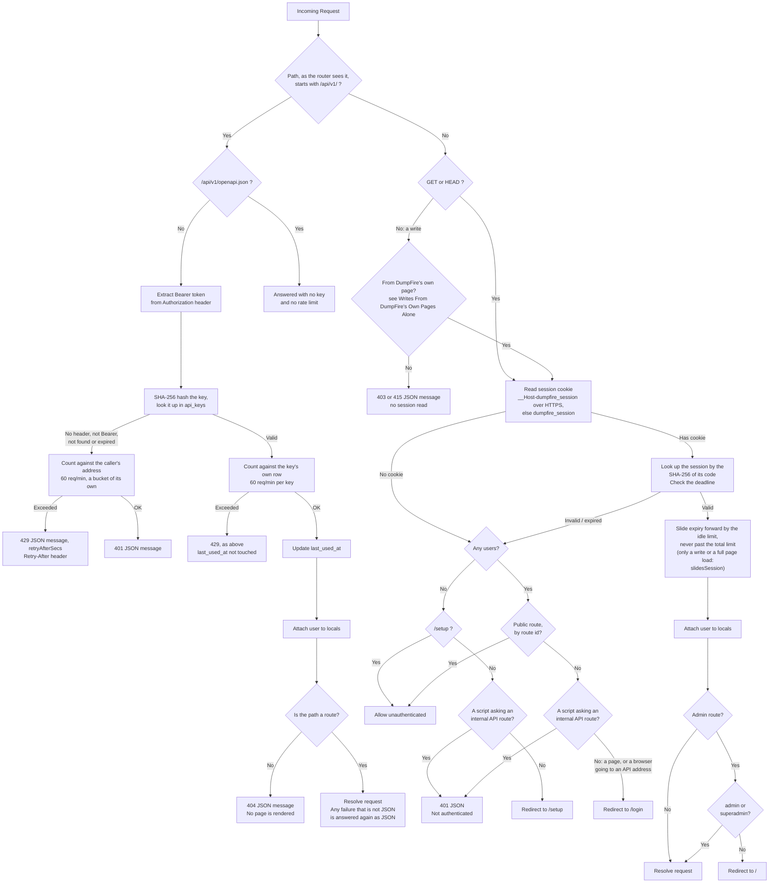

Every answer in the chart is returned by the gate and carries the security headers (see
[Security Headers](#security-headers)); none is thrown. A signed-in caller who asks for
`/login`, `/login/verify`, `/login/enrol` or `/setup` is sent to `/` as well. A session made
without a second factor is refused and deleted (card 2769: see
[Older Images and Instances](#older-images-and-instances)).

### Which Rule Applies to a Path

Every question the flow above asks about the path, whether it is under `/api/v1/`, a public
route or an admin route, is asked of the path as the router sees it, and not of the address
as it was sent. SvelteKit decodes an address before it looks for a route, so `/%61dmin` is
the route `/admin`. The gate once compared the address as sent, and a rule did not apply to
an address with one letter percent-encoded: a signed-in user who was no administrator was
shown the admin page and the audit page, and `/%61pi/v1/` was served without a key.

- **Where a route matched, the rule is decided on the route's id**, `/admin` or
  `/api/cards/[id]`, which is the router's own answer. Where none did, it is decided on the
  address decoded as SvelteKit decodes it, and nothing but a `404` is served.
- **`%2F` is no `/`, and nothing is decoded twice.** `/api%2Fv1%2Fme` is not under
  `/api/v1/`, and `/%2561dmin` is not `/admin`. Neither is a route. An address that cannot
  be decoded is answered `400` by SvelteKit before the gate is called.
- **The admin and audit page loads check the role themselves.**
  `src/routes/admin/+page.server.ts` and `src/routes/audit/+page.server.ts` send a caller
  who is not signed in to `/login` and one who is not an administrator to `/`, as the gate
  does. The handlers under `/api/admin/`, `/api/audit` and `/api/logs` each check the role
  too: no admin rule of the gate covers them.

How it is worked out is in [Architecture](architecture.md#the-path-a-rule-is-decided-on).
Covered by `tests/gate.test.ts`.

### Who Is Let Through Without a Session

A caller who is not signed in is let through to these routes, by route id, exactly, and to
no other:

| Route id | What it is |
|----------|------------|
| `/login` | The login page |
| `/login/verify`, `/login/enrol` | The second step of signing in, and setting up an authenticator (card 2769). Each answers only the browser holding a live challenge, which a right password, an invite or the first-run set-up opened; any other is sent to `/login` (see [Two-Step Sign-In](#two-step-sign-in-card-2769)) |
| `/enrol/[token]` | A set-up link's page (card 2769). It asks nothing and posts nothing, and leaves the link for the sign-in that follows |
| `/docs` | The API's documents |
| `/invite/[token]` | The page an invite links to |
| `/request`, `/request/[id]/confirm`, `/request/[id]/reply` | The public request form, and the two pages its mails link to |
| `/api/requests`, `/api/requests/[id]`, `/api/requests/[id]/confirm`, `/api/requests/[id]/link`, `/api/requests/[id]/messages`, `/api/requests/targets` | The form's routes. Each handler asks for itself what it needs: a session, the token the form was given, or a request's link. The new link (card 2158) asks for nothing, answers everyone alike and mails only the request's address, an account's as it is now for a request made signed in (see [The Public Request Form](#the-public-request-form)) |
| `/decision-link/[token]`, `/api/decision-by-link/responses`, `/api/decision-by-link/seen`, `/api/decision-by-link/concerns` | A decision's personal link: its page, and its holder's response, seen and (card 2679) concern about the ruling, the token in the body (card 2677). Each answers only a token whose hash a participant holds, and signs nobody in (see [The link's page and its routes](#the-links-page-and-its-routes)) |
| `/api/v1/openapi.json` | The API's description, answered with no key |

`/setup` is the one page there is before there is a user, and is never served once there
is one. `/favicon.ico` passes the gate without being asked who is calling.

A call to a remote function, `/_app/remote/<id>`, is answered `404` `{ "message": "Not
found" }` by the gate, to anybody, before any of this is asked. SvelteKit takes the path
such a call is for from its `x-sveltekit-pathname` header, which the caller writes, and has
set the route from it before the gate is called: decided on that, a call naming `/login`
was let through as the public page, and one naming `/_app/x` passed through unasked and
unlogged. DumpFire has no remote functions. The gate's log line for it is at the address
it was sent to. A header that names a path that cannot be decoded is answered `400`
`Malformed URI` instead, as an address that cannot be decoded is, and as SvelteKit 2.60
also answered it.

- **By id, and not by how the address begins.** The list was compared with the start of
  the address, so `/requestX`, `/loginX`, `/api/requestsX` and `/faviconX` were let past the
  sign-in redirect, to a 404. A route under a public one is not public unless it is in the
  list itself, and a path that is no route has no id and is never public.
- **What a caller who is not signed in is answered elsewhere depends on who is asking.** A
  page's script, or any other program, asking an internal API route (under `/api/`,
  outside `/api/v1/` and the form's routes) is answered `401` `{ "message": "Not
  authenticated" }`. A browser going to an address is sent to `/login`: every page, and an
  API address opened as a page, such as an attachment in a new tab, the milestone PDF or an
  export's download. The gate tells them apart by `Sec-Fetch-Mode: navigate`, which
  browsers send with a navigation, or by an `Accept` header that prefers `text/html` to
  JSON, read as SvelteKit reads it.
- **Why not the redirect for everybody.** A script's `fetch` followed the redirect and was
  handed the login page's HTML with a `200`, so a page whose session had ended went on as if
  its requests had worked: a card moved on screen and not on the server.
- **With no users at all**, a browser is sent to `/setup` and a script is answered `401`.
  The form's routes are sent to `/setup` as before.
- **A redirect to a page's script is JSON.** A page asking for its own data, or posting one
  of its forms (`use:enhance`), is answered as SvelteKit answers it: `200` with
  `{ "type": "redirect", "location": "/login" }`, which the page follows itself.

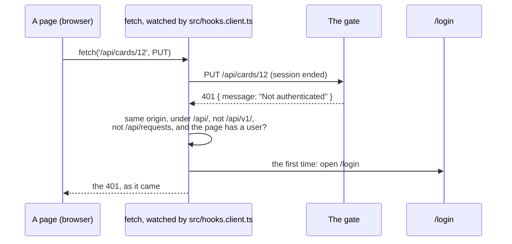

**In the browser,** `src/hooks.client.ts` replaces `window.fetch` once, as the application
starts, with the watch in `src/lib/signed-out.ts`. On the first `401` from the page's own
server to a path under `/api/` that is not under `/api/v1/` or `/api/requests`, and only when
the page has a signed-in user, it opens `/login`. Every answer is handed back untouched. A
requester on the public form whose form token has lapsed is answered `401` too, and is not
sent to a login page they have no account for.

**The live-update streams** (`/api/boards/[id]/events` and `/api/events`) are opened by
`src/lib/live-stream.ts`. After a failure it waits 3 seconds, then twice as long after each
failure that follows, up to five minutes, and asks the stream's address with `fetch` before
it opens it again. A `401`, `403` or `404` is not mended by asking again, and the stream
stays closed; the `401` also sends a signed-in page to the login page, through the watch.
Before, each open board asked again every three seconds for ever, and after a restore that
signs everybody out each wrote about 57,000 lines a day to the system log. A stream that is
already open when its session ends stops by itself at its next heartbeat: see
[An Open Stream and Its Session](#an-open-stream-and-its-session).

What cannot be run in the suite, which has no browser, is checked by calling the two files'
functions with stand-ins and by reading the source: `tests/page-failures.test.ts`. The gate's
half is in `tests/gate.test.ts`.

### How Large a Request May Be

Before any of the flow above, the gate asks how large the request's body is, of every
request: a page and a form action as much as a route under `/api/`. A body that declares
its length in `Content-Length` is asked of that, before it is read. A body that does not,
one sent in chunks, is counted as it is read, and no more of it is read once it has passed
the limit.

| The request | Answer |
|-------------|--------|
| Has no body: a `GET`, a `DELETE` with nothing in it, a `POST` with an empty body | Passed on |
| Declares more than its route accepts | `413` `{ "message": "The request is larger than this server accepts here: it is 2 MB, and the limit is 512 KB", "limitBytes": 524288 }`, before it is read |
| Declares no length, and its route reads past the limit | `413` `{ "message": "The request is larger than this server accepts here: the limit is 512 KB", "limitBytes": 524288 }`, when the handler reads it |
| Declares a length its route accepts, and runs past it | `413` `{ "message": "Payload Too Large" }`, when the handler reads it |
| Anything else | Passed on, and its body read as it was sent |

| The route | The most its body may be |
|-----------|--------------------------|
| Every route, the login, set-up and invite forms included | 512 KB |
| `POST /api/cards/[id]/attachments`, for a caller who is signed in | 26 MB |
| `POST /api/admin/import`, for the superadmin | All the server accepts: `BODY_SIZE_LIMIT`, 512M in the image |

- **Why every route.** The server has one limit for all of them, and it has to be large
  enough for a database backup. Without the narrowing, anybody could post half a gigabyte
  to the login form.
- **Why a body with no length is counted.** The server holds a body to the length it
  declared. One that declares none was held to nothing: with a limit of 512 KB, a chunked
  body of 64 MB was read in full. Since adapter-node 5.5.5 (card 2227) it is held to
  `BODY_SIZE_LIMIT`, but that is the whole server's limit, 512M in the image, and no
  route's. So the gate hands the handler a copy of the request whose
  body passes through a count (`heldToLimit()`), and a read that passes the limit fails with
  the `413`. The body is left unread there, not cancelled: the server answers a cancelled
  body by closing the connection, and the `413` would never arrive.
- **Why it is read, and not refused.** A browser says how long what it posts is, but a body
  can still arrive in chunks: from a client that sends it so, or through a proxy that passes
  it on so, as `cloudflared` does unless it is told not to. So it is read, and held to the
  same limit as a body that says how long it is.
- **The two larger limits are given to those who may use them.** The attachment upload's to
  anybody signed in, and the import's to the superadmin alone: an administrator who declares
  a whole backup to the import is refused for its size, and none of it is read. One who sends
  it in chunks is refused by the handler, with a chunk or two of it read at most. A caller with
  no session is turned away from both routes before the body matters, and each handler asks
  its own question before it reads a byte: edit access to the card's board, and the
  superadmin.

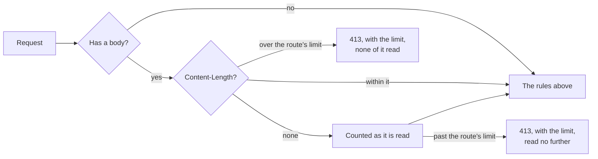

The limits are in `src/lib/server/body-limits.ts`, and the proxy's own are in
[Upload Size Limits](deployment.md#upload-size-limits). Covered by
`tests/body-limits.test.ts`.

### Writes From DumpFire's Own Pages Alone (Card 2700)

Every write outside `/api/v1/` is taken from DumpFire's own pages alone. A write is any
method but `GET` and `HEAD`: `POST`, `PUT`, `PATCH`, `DELETE`, `OPTIONS` or any other.

**The threat.** The session cookie is `SameSite=Lax`, so a browser sends it with a request
from any page of the same site, and a site is the scheme and the registrable domain, ports
aside: a page on any other host of the same registrable domain (any `https://*.example.com`, for a DumpFire at `https://dumpfire.example.com`) is same-site to DumpFire. SvelteKit's
own origin check refuses a cross-site write only when its `Content-Type` is a form's
(urlencoded, multipart, `text/plain`), and not at all under `vite dev`. So a page on a sibling
host that ran someone else's script could send a signed-in visitor's browser to post, with
`mode: 'no-cors'` and no `Content-Type`, to any handler that reads no body, and it ran. Nine
`POST`s read none: `/api/admin/reset` (which empties every table), `/api/admin/vacuum`,
`/api/admin/reset-xp`, `/api/admin/purge-archived`, `/api/admin/boards/[id]/clear-cards`,
`/api/admin/boards/[id]/clear-categories`, `/api/users/[id]/invite`,
`/api/boards/[id]/favourite` and `/api/cards/[id]/restore`. A JSON body did not get through:
with no `Content-Type` the node adapter passes no body on, and a `Content-Type` of
`application/json` is not one a page may send to another origin without asking first (a
preflight), which DumpFire never answers. For the same reason only a `POST` was reachable;
`PUT`, `PATCH` and `DELETE` need a preflight too. The rule covers every method all the same.

**The three rules, in order.** `refuseCrossSiteWrite()` in `src/lib/server/same-origin.ts`,
called by the gate in `handleRequest` right after the `/api/v1/` branch and before the session
cookie is read. For a write:

1. **Outside `/api/v1/`, a request the server makes of itself is refused**, `403`
   `{ "message": "A write may not be made by the server of itself" }`, pages and form actions
   included. A load's `fetch` sets `Origin` to the server's own and forwards the caller's
   cookie, so it would pass the next rule. No load makes a write; one that did would have to
   become a call from the page.
2. **Outside `/api/v1/`, a request the browser does not say comes from this origin is
   refused**, `403` `{ "message": "Cross-site requests are refused" }`. Pages and the four
   form actions (`/login`, `/logout`, `/setup`, `/invite/[token]`) are included, and so are the
   public routes (`/api/requests*`, `/api/decision-by-link/*`), whose pages call them with
   relative addresses.
3. **Under `/api/` (not `/api/v1/`), a request that does not say it is JSON is refused**, body
   or not, `415` `{ "message": "This route takes JSON only" }`, but for the two uploads below.
   `application/json` is read before any `;`, trimmed and in any case, so a `charset` is fine.

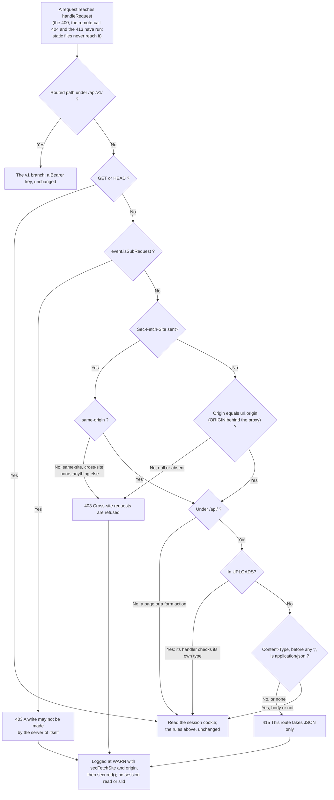

- **`Sec-Fetch-Site` decides alone when it is sent**, and only `same-origin` passes.
  `same-site` is exactly the sibling-host threat; `cross-site` is another site; `none` is a
  navigation the user started from the address bar or a bookmark, which a write never is.
  `Origin` is not asked.
- **Where it is not sent, `Origin` must be exactly the server's own** (`url.origin`), which
  behind the proxy is `ORIGIN` (see [Deployment](deployment.md#environment-variables)).
  `Origin: null`, from a sandboxed frame or a privacy redirect, is refused, and so is a request
  with neither header, which is what a program sends. No program calls an internal write or a
  form action; one that writes uses an API key and `/api/v1/`.
- **Who sends no `Sec-Fetch-Site`.** Browsers send it only to a trustworthy origin: HTTPS, or
  `localhost`. An installation reached over plain HTTP at any other address, and a browser older
  than Chrome 76, Firefox 90 or Safari 16.4, relies on `Origin` equalling `ORIGIN`, sign-in
  included. A wrong `ORIGIN` already broke sign-in there; it now refuses every write there too.
- **Before the session is read.** Reading a session slides its expiry, which is a write, so a
  refused request touches no row, and is answered the same whoever is or is not signed in.
- **What still comes first**, unchanged: SvelteKit's own `403` for a cross-site form (a built
  server), the gate's `400` `Malformed URI`, its `404` for a remote call, and its `413` for a
  body declared too large. Each reads headers only.
- **A path that is no route** is held to the same rules on its decoded address, so a forged
  write to one is the `403` (or `415`) before its `404`, which tells nothing.
- **The two uploads** are the only writes under `/api/` that take a body other than JSON,
  listed by route id and method in `UPLOADS`: `POST /api/cards/[id]/attachments`
  (`multipart/form-data`) and `POST /api/admin/import` (`application/octet-stream` or
  `application/x-sqlite3`). Each is still held to rules 1 and 2. The gate does not check their
  type: each handler does, before it reads the body, with its own `400`.
- **Left alone:** `GET` and `HEAD`, which change nothing stored (the live-update streams are
  `GET`), and everything under `/api/v1/`, where a key is sent in a header and no cookie is
  read.
- **The dev server.** SvelteKit's own form check is off under `vite dev`; the gate's is not,
  so a form posted to an action from another `localhost` port is refused there as in a built
  server. A page of the dev server calls it at its own origin and passes.
- **Frames.** The request form's three pages are the only ones that may be framed. Framed on
  another site's page, each still posts from its own DumpFire document, which is same-origin,
  and works. A framing page that sandboxes the frame without `allow-same-origin` gives it an
  opaque origin, and its post is refused. No such embedding is known.
- **The answers** are JSON `{ message }` whatever the `Accept` header, returned and not
  thrown, so the gate logs each at `WARN` (`POST /api/admin/reset → 403`) and puts the
  security headers on it. The log line's meta carries two more fields for these three answers
  alone, `secFetchSite` and `origin`: each header as it was sent, cut to its first 100
  characters and passed through `printable()`, or `null` when it was absent, so a forged
  value can neither make the line long nor break it. The line names the user whose session
  cookie came with the request, read by `openSessionUser()`, which writes nothing and slides
  no expiry, so an investigation sees whose session a forged write rode on.
- **The pages say they are JSON.** Every page write sends `Content-Type: application/json`,
  the 28 that sent none (body-less `DELETE`s and `POST`s) included; `jsonRequest` in
  `src/lib/api.ts` always did. The request form spreads its own headers before the type, so
  nothing can replace it. Only the two uploads send another type.

Card 2677's `requireSameOriginJson` (see [The link's page and its routes](#the-links-page-and-its-routes))
is the same two predicates, `fromThisOrigin()` and `saysJson()`, in the same order.

Covered by `tests/gate.test.ts` ("a write that is not from DumpFire’s own page", cases 1 to 8:
each `Sec-Fetch-Site` that is not `same-origin` and each `Origin` that is not the server's,
the body-less `POST /api/admin/reset` among them with nothing changed and no session slid, the
attacker's `Origin` and the session's user on its log line, the log line's two fields, the
`415` for each method, the two uploads, a `GET`, v1, a public route, `/login` with a right and
a wrong password, a sub-request to an API route and to a form action, and `UPLOADS` held to
exactly the handlers that read a body other than as JSON, `export { handler as POST }` and
`{ request: req }` included), and by `tests/page-failures.test.ts` (case 9). Case 9 reads
every `.svelte`, `.ts` and `.js` file under `src` but `src/lib/server/`, `+server.*`,
`+page.server.*`, `+layout.server.*` and `hooks.server.*`, found by a walk of the folder and
not a list: a module whole, and a Svelte file through Svelte's own parser, its `<script>`s and
every expression of its markup (attributes, every directive, `{…}`, every block and tag). Every
`fetch` there that is not plainly a `GET` or `HEAD` (an init that says so, or one that names no
method with an address that is plainly text, since a `Request` carries its own method) must
send a literal `Content-Type: application/json`, be one of the two uploads, or be one of the
three that hand on a caller's own `init`, in `board-state.svelte.ts`, `live-stream.ts` and
`signed-out.ts`. It fails on `new Request(...)`, on `fetch` named and not called (an alias,
`fetch.call`, `fetch.apply`, `fetch` handed on as an argument), but for the six places named
that put those pass-throughs in place (`HANDED_ON`), and on code it cannot read.

### Asked Again at the Write (card 2253)

**Every write asks, in the transaction that writes, whether the key or session the gate let
it in with is still open, and who its account is now, and decides who the caller is with
that.** The gate decides who is calling before a request's body is read, and a body can take
as long as the caller likes to arrive: up to Node's request timeout of 300 seconds, on a slow
link or held open on purpose. A password reset, a key deleted, a sign-out or a role lowered,
committed meanwhile, was met by nothing: the write went through as the caller the gate had
read. Before this card only four handlers asked again (the two webhook writes and the two
report-schedule writes), and they asked only whether the credential was open, not what its
account now was. Now every `POST`, `PUT`, `PATCH` and `DELETE` under `src/routes/api`, both
trees (133 handlers in 95 files), asks.

```mermaid
sequenceDiagram
    participant C as Caller (key or session)
    participant G as Gate (hooks.server.ts)
    participant H as Write handler
    participant W as writeAs (write-as.ts)
    participant S as stillAuthenticated (auth.ts)
    participant DB as SQLite
    participant A as Someone else
    C->>G: POST, PUT, PATCH or DELETE, body still arriving
    G->>G: locals.credential = null, then the key or session found:<br/>locals.user and locals.credential set
    G->>H: handed on
    H->>H: quick check, binding no name (requireUser(locals.user);)<br/>await the body
    A->>DB: password reset, key deleted, sign-out or role lowered, committed
    C->>H: the rest of the body
    H->>W: writeAs(locals, (caller) => the write)
    W->>DB: BEGIN IMMEDIATE
    W->>S: stillAuthenticated(locals)
    S->>DB: the key or session, and its account, as they are now
    alt key or session ended, or its account gone
        S-->>C: 401 in the gate's words, ROLLBACK, nothing written
    else open
        S->>W: the account as it is now (locals.user set to it)
        W->>H: write(caller): every guard and role test given caller
        alt role or access lowered
            H-->>C: the guard's own 403 or 404 (a batch's 409), ROLLBACK, nothing written
        else allowed
            H->>DB: the write, COMMIT
            H-->>C: the answer, made after writeAs returns
        end
    end
```

**The rules.**

- **One helper, called by every write handler.** `writeAs(locals, (caller) => …)` in
  `src/lib/server/write-as.ts` is `inTransaction(() => write(stillAuthenticated(locals)))`:
  the check is the first statement of the transaction that writes, the callback must not be
  async, a throw rolls back, and inside another transaction it is a savepoint. Every decision
  about the caller (`require*` guards, role tests, `requireAssignableRole`, a service handed
  the user) is made inside the callback with `caller`, never with `locals.user` nor a name
  taken from it before the body. A check before the body may stay, as a quick refusal in the
  same words, but decides nothing.
- **What it reads and answers.** `stillAuthenticated(locals)` (`src/lib/server/auth.ts`) reads
  the credential the gate recorded: a key through `keyHolder`, a session through
  `findSession`, the account through `sessionUserOf`. A key deleted, expired or whose account
  is gone is `401 Invalid or expired API key`; a session the same, `401 Not authenticated`;
  otherwise it answers the account as it is now and sets `locals.user` to it, so what the
  handler answers after the transaction is consistent. It throws outside a transaction.
- **No key or session.** The gate sets `locals.credential = null` as the first statement of
  `handle`, before any branch, so every request it hands on carries it set. `null` (a public
  request route, with nobody signed in) answers `null`, and the handler's own rule decides with
  `caller === null`. A caller who came with a session that ended meanwhile is refused `401`,
  never treated as anonymous, on the public request routes too. `undefined` (a handler reached
  with no gate) is answered `locals.user` only under vitest; anywhere else it is `401 Not
  authenticated` and one line, word for word:
  `[ERROR] [AUTH] A write reached its handler with no credential recorded by the gate: <METHOD> <path>; refused 401; this is a fault in DumpFire, not in the request: report this line`,
  filed under the account when there is one, with five frames of the stack as its meta. The
  path is written as the gate writes it, so an invite's token is never logged.
- **A role lowered meanwhile has no answer of its own.** The guard, given the account as it is
  now, refuses as it would have refused that account at the gate: an administrator lowered to
  `user` while creating an account is `403 Forbidden`, as a `user` is; a batch under `/api/v1`
  (`POST /dependencies/bulk`, `POST /tokens/bulk`, and `POST` and `DELETE
  /milestones/{id}/cards/bulk`) is refused whole with its `409`, listing every item.
- **What cannot run in a transaction asks `stillCallerNow(locals)`**, the statement right after
  its body, with nothing awaited between it and the call it guards; better-sqlite3 is
  synchronous, so nothing runs between the check and the start of that call. Eight handlers,
  each held by name in the source rule:

  | Handler | Why not `writeAs` | The check guards |
  |---|---|---|
  | `POST /api/admin/vacuum` | `VACUUM` cannot run in a transaction | `sqlite.exec('VACUUM')`. The check is the first statement (no body), with no quick check before it |
  | `POST /api/admin/import` | the restore opens its own transaction, and files are written first | the temporary copy. Asked once the upload is in, before the upload's copy (`dumpfire.db.restore-temp` beside the database since card 2776, `.restore-temp.db` before) and `.pre-restore-safety.json` are written, so a refusal leaves neither; nothing is asked after the restore, whose database is the backup's |
  | `POST /api/reports` | it reads only, after a body | the first `generate*Report` |
  | `POST /api/reports/email` | mail leaves the process | the first `generate*Report`, and, **asked a second time** after the PDF is made, the sends. The second check decides again what the mail relies on: scope `all` asks `isAdmin` (`403 Only admins can generate all-boards reports`), scope `board` `canViewBoard`, and scope `category` that every board of the grouping in the PDF is still one the sender can open (`403 Failed to generate report or no access`). A refusal sends nothing; the day's allowance it took stays taken |
  | `POST /api/admin/backup` | the backup leaves the process | `runBackup` |
  | `POST /api/admin/backup/test` | a stored secret leaves the process | `createDestination`; the Test's ERROR lines are filed under the administrator the check answers |
  | `POST /api/admin/backup/gdrive/auth` | the code goes to Google | `getToken`. The Connect's save after Google answers is a `writeAs`: refused there (the session ended, or the account was made an ordinary user, while Google answered) it is `401` or `403`, with the folder it made removed and nothing saved, not `200 { success: false }`. A Connect refused at its first check takes no state |
  | `POST /api/admin/smtp` | the test mail leaves the process | `sendTestEmail`, to the address given or the caller's own as it is now |

  The four backup and mail routes ask for an administrator (`requireAdmin`) at each of these
  checks since card 2395; they asked for the superadmin before, so a superadmin made an
  administrator meanwhile was refused, where now an administrator made a user is.

- **A `writeAs` that only names the caller.** Where the caller is needed before an await no
  transaction can hold, a `writeAs` whose callback writes nothing asks who is calling, and the
  write's own `writeAs` asks everything again: the three current-password routes
  (`PUT /api/account/password`, `PUT /api/account/email`, `POST /api/account/api-keys`)
  before the password is checked, `POST /api/users` and `PUT /api/users/{id}/password` before
  the hash, and `POST /api/admin/reset` before it ends every session, so that its failure line
  can name who reset. What they look at in between stays outside a transaction, as before.
- **The current-password routes** write inside
  `whilePasswordHolds(userId, hash, () => writeAs(locals, (caller) => …))`: the credential
  check and the write commit or roll back with the password check (a nested transaction is a
  savepoint). `whilePasswordHolds` runs its transaction once: if the stored hash changed
  between the check and the write it refuses `409` before it calls the write, comparing
  nothing again (card 2701's code review, S2), so the `writeAs` runs at most once a request. The password change asks twice, both before
  it rotates its own session; nothing asks after the rotation, which would meet the rotated
  session and be refused.
- **Effects stay after the write.** `emit`, `logActivity` and the notify functions may be
  called inside the callback (they wait for the commit); a file, mail, a fetch, a cookie, a
  redirect or the answer is made after `writeAs` returns. A refused write emits nothing, mails
  nothing and fires no webhook. An upload refused at its write removes the file it wrote.
- **One transaction where there were two steps.** Handlers that checked and then wrote with no
  transaction of their own are now one `writeAs` each, with the same answers: the comment and
  card category deletes, the favourite, the dashboard grouping create and delete, the team
  delete and the team member delete, a goal's change and delete (`PATCH` and
  `DELETE /api/milestones/{id}`, their services savepoints inside), the key revoke, the
  requester's reply, the request confirmation and the new request link, and under `/api/v1`
  the grouping create, the grouping, category and label deletes, the two token records, the
  token entry delete, the milestone change and the milestone card add and remove.
- **A brief write lock where none was taken.** The outermost transaction is `BEGIN IMMEDIATE`,
  so `stillCallerNow` takes the write lock for the moment it reads, with nothing written: in
  `POST /api/reports`, the report mail, the backup run, the Test, the Connect and the test
  mail. `POST /api/requests/{id}/link`, the new link a requester asks for, now takes it through
  `writeAs` for a read alone, for a caller with no session too; it is rate-limited before its
  body. The other public request routes (`POST /api/requests`, `…/confirm`, `…/messages`)
  already took the lock when they wrote, and still do; `…/messages` counts a requester's replies
  inside its `writeAs`, not before the body. On the one connection SQLite has, in WAL mode, a
  lock held for one read is not noticed.

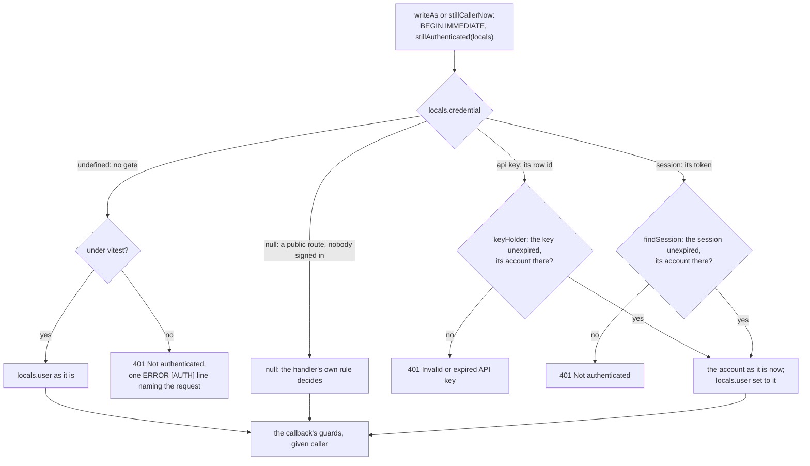

**What a user or a script may notice.** Nothing, while their key or session holds and their
role is as it was. A write whose key or session ended, or whose account's role or access
changed, while its body was arriving is refused `401` or `403` with nothing written.
`DELETE /api/report-schedules/{id}` asked nothing before: a session a reset had ended could
still delete a schedule; now `401`. For a credential that has already ended, some refusals of
the body now come before the `401`, since each check comes after its body is read: the test
mail's `400` for its address, and `readBody`'s `400` for a body that is not JSON or not an
object in the backup run, the Test and the Connect.

Since card 2012 the other way round holds for the handlers it moved onto services: their field
reads moved inside `writeAs`, after the caller is asked for, so a credential that ended while
the body arrived is now `401` where the body's own refusal used to come first. An empty card
reorder (`PUT /api/cards/reorder` with `updates: []`) is asked inside `writeAs` and answered
`200` with nothing written only for a caller still signed in; a session that ended is `401`,
where it was `200`, and so is one whose `updates` is missing, malformed or over the cap, names
an entry whose id is not an id, or names a card twice, where each was `400`. The same `401`
replaces the `400` in `POST /api/v1/tokens/bulk` (`entries` missing, or an entry not an
object); in both trees' board creates (`POST /api/boards`, `POST /api/v1/boards`) for any field
refused (`name`, `emoji`, `parentCardId`, and `categoryId` on the internal route); in both
trees' dashboard grouping creates (`POST /api/board-categories`,
`POST /api/v1/board-categories`) for any field refused (`name`, `color`); and in the column
reorder (`PUT /api/columns/reorder`) for `updates` missing or malformed. For a caller still
signed in every answer is as it was.

**What `stillCallerNow` does not cover.** It holds up to the call it guards. What runs after an
await that follows that call runs on the check already made: the second and later recipients
of a report mail, a long backup across several destinations, the Connect's folder steps after
Google's exchange, and the sub-boards a board's or grouping's report takes in, which are not
asked again. Each began under a caller who was still signed in and still allowed.

**What is not prevented.**

- **A write that committed before the credential ended** stands; only a write still arriving
  is refused. The effects it queued on its commit run.
- **Reads.** `GET` handlers answer with the caller the gate read. An open live stream asks its
  session at each heartbeat instead ([An Open Stream and Its Session](#an-open-stream-and-its-session)).
- **The four form actions** (`login`, `logout`, `setup`, `invite/[token]`) are outside: none
  acts under a credential the caller already had, except `logout`, which ends it.
- **A helper that writes, called outside the callback by a handler that calls no service.**
  The service rule (below) holds every call to `$lib/server/**` after the body inside the
  callback only in a handler that calls a service. The 54 other write handlers (the
  reports, accounts, administration, requests and the `stillCallerNow` routes among them) may
  call `$lib/server` outside their callback, on purpose, to read fields before it or to send mail
  after the commit, and what those helpers do is not read for writes. The walks below meet
  any write among them for every handler.
- **A reverse proxy that holds a body until it is complete** closes the window before DumpFire
  sees the request; one that passes a body on as it arrives does not. Either way the check
  holds; hands-on checks 186 and 187 in
  [Deployment](deployment.md#every-write-asked-again-at-the-write) measure which production has.

**How it is held.** `tests/check-at-the-write.test.ts` reads every handler under
`src/routes/api` through the TypeScript syntax tree and fails closed: a handler that calls
neither `writeAs` nor `stillCallerNow`; an `inTransaction` in a route file; a database write
outside a `writeAs` callback; `locals.user`, or a name bound from it, read after the body or
inside a callback; the locals copied, renamed or handed to anything but the two; a
`stillCallerNow` not on its list of eight, or an `await` between it and what it guards; a
current-password route whose write is not a `writeAs` inside `whilePasswordHolds`. Before the
body only the guards of `QUICK_CHECKS` (`requireUser`, `requireSuperadmin`, `requireAdmin`,
`refuseOwnAccount`, each reading no row) may take `locals.user`, in a call that binds no name.
Four narrow allowances, each by handler with its reason: `QUICK_CHECKS_IN` (`requireCard` before
the attachment upload, so that a caller with no access is not sent 25 MB first, and
`screenAnonymous` before the public form's body); `READS_IN` (the import's safety copy reads
every table with `sqlite.prepare(…).all()` outside a transaction, as the restore must run
outside one); `USER_FIELDS_IN` (`.user` on a name declared inside the mail settings' callback
is the mail server's user name, not the caller); and `USER_FOR_A_LINE_IN` (the reset's catch
may name `locals.user` in its failure line where the fault stopped the first check naming the
account). `tests/write-as.test.ts` holds the helper and each route slice's shapes, and
`tests/access-every-route.test.ts` walks every write handler of the tree twice: its allowed
caller's key or session ended while the body is held (401, nothing written; a request with no
body is handed the ended credential), and an administrator's or the superadmin's role lowered
meanwhile (refused as the lower role is, nothing written), each case with its control.

**The service rule (card 2012).** The 99 handlers of both API trees that card 2012 moved call
one service each for their work, a function in a module of `src/lib/server/` that both trees
share ([One Service per Action, Both Trees](architecture.md#one-service-per-action-both-trees)).
A service is a place where a write could slip outside the callback that asked who the caller
is, so it is held twice:

- **At run time.** Every write a service exports begins with `inWrite()`
  (`src/lib/server/write-as.ts`), which throws, a `500` with nothing written, unless a
  `writeAs` callback is running. `writeAs` counts its running callbacks and nothing else sets
  the count, so a service called outside one, or from a job's or a scheduler's bare
  `inTransaction`, is refused (`tests/write-as.test.ts`, the describe `inWrite`).
- **In the source.** A describe of its own in `tests/check-at-the-write.test.ts`, "one service per
  action, written only inside writeAs (card 2012)", decides by import, not by a list of names,
  and fails closed:
  1. in a write handler that calls a service, every call after the body to a function imported
     from `$lib/server/**` is inside the `writeAs` callback, unless it is on `OUTSIDE_WRITE`
     with its reason (`pathId`, `linkBaseUrl`, v1's `json`): what shapes the answer is made
     inside and returned. A service write is called in the callback itself, with no function
     between them (no `.map`, no local function), and is handed first that callback's own
     `caller`, as it is or through `requireUser(caller)`; the name is never declared again or
     assigned in the callback. Its options are an object written out at the call, with no
     spread and no computed key, and a `says` in them is a text written out or a constant of
     the route file holding one; or the write's own module's `<NAME>_PAGE_OPTIONS` constant,
     whole or spread into such an object, and used for nothing else (card 2296: a page route
     and a new card's nested write share it). A read is called only in a `GET` or inside a
     callback;
  2. each module on `SERVICES` exports `READS`, its reads by name; every other export is a
     write whose first statement is `inWrite();`; and it exports nothing else, in any form,
     but a `<NAME>_PAGE_OPTIONS` const written out of texts and booleans;
  3. no service names `inTransaction`, under any name or through a namespace, but in a write
     after its `inWrite()`; a read inserts, updates, deletes, runs, `exec`s or `prepare`s
     nothing, nor does a function of its module that it calls (one level); and no service names `locals`,
     `App.Locals`, `RequestEvent` or `getRequestEvent`, or imports `$app/server`;
  4. `SERVICES` names every module under `src/lib/server/` that imports `inWrite` or exports a
     function handed the caller (a first parameter `caller` typed as an account, or any first
     parameter typed exactly `SessionUser | null`), but those on `NOT_SERVICES` with why (one:
     `request-access.ts`, whose `requireRequest` is a guard of the public request routes), and
     nothing else; nothing re-exports a service or imports one with `import()`;
  5. the rule itself, against made-up source, every probe of its reviews among it.
- **The caller is never let out.** Card 2253's rule, extended by card 2012, finds a `writeAs` callback's caller
  assigned to anything declared outside the callback, returned or put in what it returns, or
  kept by a function that is returned, assigned out or handed to what runs later
  (`afterCommit`, timers, promises, listeners). A call's result and a field read off it
  (`caller.username`) are not the caller: a callback returns what the answer or a mail after
  the commit needs, never the account. `CALLER_LET_OUT_IN`, the handlers allowed to with their
  reasons, is empty.

### Step-up Before Destructive Actions (Card 2701)

Card 2700 stopped a forged request from another site reaching DumpFire's writes. Card 2701
(2026-11-04) asks a real session to prove itself again before the writes that cannot be taken
back: whoever holds a signed-in browser (an unlocked machine, a copied cookie) or runs script in
a DumpFire page could otherwise do each of them with the session alone. The rule: an action asks
for the caller's **current password**, every time, when it destroys data in bulk or for good,
makes, removes or changes an account's credentials, role or address, or sends the database, or
the mail invites and resets go through, somewhere the caller chooses. Since card 2771
(2026-11-17) it asks for a **code** beside the password too, from the caller's authenticator app
or one of their recovery codes, and the action runs only when both are right (see
[The Code Beside the Password](#the-code-beside-the-password-card-2771)). The list is
`STEP_UP_ACTIONS` in `src/lib/server/step-up.ts`, keyed `METHOD /route/id`, each with its
reason, and pinned both ways against the handlers (`tests/step-up.test.ts`, cases 1 and 2).

| Action | Who | Why it asks |
|--------|-----|-------------|
| `POST /api/admin/reset` | superadmin | Empties every table but the log and the backup history |
| `POST /api/admin/import/confirm`, standing for `POST /api/admin/import` | superadmin | Replaces every row and every account with the backup's |
| `POST /api/admin/export` (was `GET`) | superadmin | Hands out every account's password hash and email address |
| `POST /api/admin/purge-archived` | admin | Every archived card on every board, for good |
| `POST /api/admin/boards/[id]/clear-cards`, `…/clear-categories` | admin, with edit on the board | Every card, or every category, of a board |
| `POST /api/admin/reset-xp` | admin | Everyone's XP to 0 |
| `POST /api/users` | admin | Makes an account: a credential that outlives the session |
| `PUT /api/users/[id]`, **with `role` or `email`** | admin | An account's privileges, or the address its invites and resets go to |
| `DELETE /api/users/[id]`, `PUT /api/users/[id]/password`, `POST /api/users/[id]/invite` | admin | Removes an account, sets its password, or a reset by another way |
| `POST /api/users/[id]/mfa/reset` (card 2773) | admin, within whose account they may manage | Removes another account's second factor and issues the link that sets up a new one, given to the caller |
| `DELETE /api/boards/[id]` | the board's owner, or admin | A board and every sub-board under it, for good: boards have no archive |
| `DELETE /api/columns/[id]`, **with a card in it, archived ones included** | editor of the board | Every card in the column, with their sub-boards and files |
| `PUT /api/admin/backup`, **with `destinations`** | admin | Where every later backup is sent |
| `POST /api/admin/backup` (Run Now) | admin | The whole database to every destination, now |
| `POST /api/admin/backup/gdrive/auth` (Connect) | admin | Binds a destination to a Google account of the caller's choosing |
| `PUT /api/admin/smtp` | admin | The mail server invites and resets go through, and the App URL their links point at |
| `PUT /api/decisions/[id]/participants/[participantId]/account` (card 2697) | admin | Which credential answers for a participant on a decision's record: an account, or a personal link mailed in its place |
| `PUT /api/decisions/[id]/participants/[participantId]/address` (card 2697) | admin | Ends a participant's personal link and moves where their record mail and next link go |
| `PUT /api/people/[id]`, **with `email` or `userId`** (card 2697) | admin | Where a person's decision mail and personal links go, or which account answers for them |
| `POST /api/people` (card 2697's code review, part B, S1) | admin | Adds a person with an address, and perhaps an account: `email` is required, so every add asks |
| `DELETE /api/people/[id]` (S1) | admin | Ends every personal link the person holds, and frees their address for another person |
| `POST /api/people/from-accounts` (S1) | admin | Adds people linked to accounts, each with its account's address |
| `DELETE /api/decisions/[id]`, **once the decision was opened** (card 2697) | its author, or admin | Its permanent record (versions, responses, events), for good |
| `POST /api/decisions/[id]/withdraw`, **once the decision was opened** (card 2697) | its author, its decider, or admin | Ends it for good and mails every participant the caller's words |
| `POST /api/decisions/[id]/rule` (card 2679) | its decider | Rules on a decision for good, and mails every participant the ruling and its reason |
| `POST /api/decisions/[id]/release` (card 2679) | its decider | Shows a ruled decision's totals and comments, for good, to everyone who can see it |
| `PUT /api/account/password` (card 2771) | anyone signed in, for their own account | Changes the account's own password, which ends its other sessions and invites |
| `PUT /api/account/email` (card 2771) | anyone signed in, for their own account | Moves the address the account's invites, resets and security notices go to |
| `POST /api/account/api-keys` (card 2771) | anyone signed in, for their own account | Makes an API key: a credential that outlives a password change unless it is ended |
| `POST /api/account/api-keys/[id]/keep` (card 2772) | anyone signed in, for their own key | Keeps an API key made before two-step sign-in past its deadline |
| `POST /api/account/two-step/authenticators` (card 2772) | anyone signed in, for their own account | Begins adding an authenticator: a second factor that signs in as the account |
| `DELETE /api/account/two-step/authenticators/[id]` (card 2772) | anyone signed in, for their own authenticator | Removes an authenticator, and ends the account's other sessions |
| `POST /api/account/two-step/recovery-codes` (card 2772) | anyone signed in, for their own account | Replaces the account's recovery codes, each of which signs in in place of a code |
| `DELETE /api/account/two-step/banner` (card 2772) | anyone signed in, for their own account | Clears the warning that someone entered the account's password with a wrong code |

The list is thirty-seven: card 2701's eighteen (the import among them, standing as its
confirmation), card 2697's eight: the five its plan listed, and the three People writes its
code review's part B added on 2026-11-04, S1, so that every People write that sets or ends an
address or an account asks ([Decision Access and Personal Links](#decision-access-and-personal-links)),
card 2679's two, the ruling and the release, which ask every time
([Results, the Ruling and the Release](#results-the-ruling-and-the-release-card-2679)), and card
2773's one, the reset of another account's two-step sign-in, which asks every time
([The Administrator's Reset](#the-administrators-reset)), and card 2771's three, the Account
page's email, password and key forms, which asked for the password with checks of their own
and now ask through the step-up like every other, and card 2772's five, the Account page's
Keep this key and its Two-step sign-in section's add, remove, new recovery codes and That was me
([Managing Two-Step Sign-In on the Account Page](#managing-two-step-sign-in-on-the-account-page-card-2772)).
The new phone's code that finishes an add (`POST /api/account/two-step/authenticators/confirm`)
is not listed: the step-up was asked at the start, and that code is the proof of the new device. The
conditional ones test their field with `Object.hasOwn`, as the body readers do
(`request-body.ts`), or the row: a user change of `username` or `emoji` alone, a backup save of
the schedule, retention or failure mail alone, an empty column's delete, a People save of name,
job title, groups or status alone, and the delete or the withdrawal of a decision never opened
ask nothing. Left out,
each with its reason in the plan: Vacuum, a destination's Test, the mail's Send Test and the GET
that starts a Connect (no data changed or sent), team and sharing
changes, single deletes, archive and restore, key revoke and webhook delete (they reduce access).
**API v1 is unchanged**: a key has no password to step up with, and minting one already asks
for it, so a stolen session cannot reach v1; `DELETE /api/v1/boards/{id}` and
`DELETE /api/v1/columns/{id}` with a key ask nothing, pinned by case 24, and key scopes are card
2703.

**Webhooks (card 2702)** are not on the list because no session can create a webhook or set its
address or secret, but for one write that already asks the password. A webhook is created and
changed only through v1, with a key: the gate answers a v1 `POST` or `PUT` that carries no key
`401` before it reads the cookie, right password or not (case 25), and a key creates one with no
password (case 26, the departure card 2703's scopes revisit). Putting the two routes on the list
would refuse every key `400` or `401`. The one session write is an administrator's import: its
restore refills a webhook's secret from the one this server holds for the same webhook, and sets
it on or off as the backup had it (`fillSecretGaps`), behind the import's confirmation of the
current password (`POST /api/admin/import/confirm`, on `STEP_UP_ACTIONS`). The other webhook
writes a session reaches only switch webhooks off: a password change that ends the account's
keys, deleting an account, a restore kept apart from the outside, and the blanked secrets of a
backup's working copy. Pages show webhooks only as counts (the Account page shows how many you
set that are on), and no page lists or edits one. A screen that writes a webhook must ask the current password for the
writes that choose where a board's data goes: creating one, changing its address or secret, and
switching it on. Changing its events, switching it off and deleting it ask nothing.
`tests/check-at-the-write.test.ts` holds this on the source, failing closed: only the seven
functions on `WEBHOOK_WRITERS` write the `webhooks` table, each with its count; the four that
switch webhooks off only switch off, on the database itself; and `fillSecretGaps` is referred to
only by the restore's `restoreInOneSnapshot`, once, and imported by no other file. The check
finds the table however it is reached: by its import under any name, through a column used
anywhere but a drizzle-orm condition or a read's fields, through a query builder's `.table` or
`.config`, through Drizzle's relational queries or schema taken off the database in any form, in
SQL quoted, cased or commented in any way SQLite reads, joined from pieces, or by a string, or
joined text, that is its name alone (each such string in `src` is listed, with why); and `eval`
and `Function` are refused outright. Any other writer fails the tests and is told to ask the
password first. What it cannot see is named in the plan: SQL whose table name is a variable or is
worked out at run time, the SQL verb held in a variable, the table renamed away and written under
its new name, a query builder or a drizzle-orm call's result held in a variable or handed on, the
database handle held in a variable or handed on, and the migrations. Two key cases are card 2703's: revoking one key
leaves the webhooks it made sending, and an owner's or administrator's key reads a webhook's
secret. A stolen session's other ways out are their own cards: report mail to any address, and
a paused webhook that sends again when its setter is given the board back.

**The order, per route** (decisions 3 and 4). The quick role refusal on `locals.user` and the
path id; `readBody` (a body is now required, so a listed request with none is `400` from
`guardBody`); the fields read with no row; then `confirmStepUp(locals, cookies, body, action,
guard)`:

1. `guard` in a `writeAs` that writes nothing: the session still open, the role as it is now,
   and **every refusal the write would make that needs no password** (ownership, the
   managed-account rules, the fields read against the row, uniqueness, the mail checks), so
   that none of them costs a check or a guess;
2. `currentPassword`, text of 1 to 1,024 characters, or `400` "Enter your password and a code
   from your authenticator app to confirm this. Nothing was changed." (`STEP_UP_MISSING`),
   nothing counted. Not `password`, which two listed routes use for the new password. Then
   `currentCode` (card 2771): missing, empty or not text, the same `400` `missing`; in neither
   form (`readStepUpCode`), `400` `code-malformed`; nothing counted either way;
3. the account's hash, a bcrypt hash, or `403` "This account has no password to confirm with,
   so this cannot be done from it. Nothing was changed." with a `WARN` line, nothing counted
   (none exists today: every account has one);
4. `checkCurrentProof`, one at a time for the session (a second while one is in flight is `429`
   before anything else is asked, nothing counted or ended: card 2772's code review, CR1): the
   account's second factor first (step 2b, every authenticator tried: `403` `no-factor`, `503`
   `factor-unusable`, `400` `code-spent`, nothing counted, no password compared), then each
   compare counted on the session's row by its weight, one for each authenticator its code was
   tried against (a recovery code one; card 2772), the code verified and spent with the count
   cleared only when the password is right, a count of 3 or more ending the session: with one
   authenticator the third wrong answer, with two the second, with three the first
   ([Guessing a Current Password](#guessing-a-current-password)): `403` "Your password or code
   was not right. Nothing was changed.", `403` signed out, or `429` (in flight or busy, not
   counted);
5. an `INFO` line, "Password and code confirmed by *name* (ID: *n*) for *action*", or
   "Password and a recovery code confirmed by …" with a `WARN` line "A recovery code confirmed
   *action* for *name* (ID: *n*): *k* left" and the `recovery-code-used` notice.

**Every refusal carries its code** (card 2701's code review, F3). Each refusal of the password
or the code by `confirmStepUp`, `checkCurrentProof`, `refuseWrongPassword`, `whilePasswordHolds`,
`requirePasswordUnchanged` and the import's confirmation has `stepUp` in its body beside
`message` (`App.Error.stepUp` in `src/app.d.ts`): `missing`, `wrong`, `no-password`,
`in-flight`, `busy`, `signed-out`, `confirmation` or `changed`, and since card 2771
`code-malformed`, `code-spent`, `no-factor` and `factor-unusable`. A page knows a refusal of the
password by that code alone (`stepUpRefusal` in `src/lib/step-up-words.ts`); the message is for
display. `signed-out` is taken by the sign-out watch as a `401` (`src/lib/signed-out.ts`, F5):
the page goes to sign in, and the dialog leaves no password field to type in.

The write then runs in `whilePasswordHolds(userId, hash, write)`, so it commits only while the
stored hash is the one checked, with the caller decided again inside; a hash that moved is `409`
`{ message: PASSWORD_CHANGED_MEANWHILE, stepUp: 'changed' }`, and the password is never compared
a second time (S2). The code was spent in the check's own transaction, which commits before the
write's, so a refusal here, or any later one, leaves it spent: the holder waits for the next code
(card 2771, S4). The three that cannot run in one transaction (the import's restore, the
export's `VACUUM INTO`, Run Now's awaited upload) ask `stillCallerNow` and then
`requirePasswordUnchanged(userId, hash, 'changed' | 'confirmation')`, synchronous, with nothing
awaited before the effect starts: `403` `PASSWORD_CHANGED_MEANWHILE`, or for the import
`CONFIRMATION_REFUSED`, if the hash moved.
The services (`deleteBoardFor`, `deleteColumnFor`, `purgeArchivedCards`, …) take `caller` as
before and are never handed the password. Drive Connect checks the password before it takes
the Connect's state or asks Google, so a wrong one leaves the Connect usable and sends no code.

**The proof a service asks for itself** (card 2726). While `whilePasswordHolds(userId, hash,
write)` runs `write`, and only then, `passwordHeld(userId)` in `auth.ts` is true. The account is
pushed onto a module-private stack once the stored hash has been compared under the lock and
popped in a `finally`, whether the write returns or throws; nothing else writes it. It cannot
outlast its request: the write is synchronous inside one transaction (`inTransaction` refuses
one that returns a promise), so no other request's code runs while it is set, and it is gone
before the transaction's `afterCommit` effects run. It is kept by account, so a nested
`whilePasswordHolds` for another account proves nothing for the caller.
`requirePasswordHeld(userId)` refuses `400` `{ message: STEP_UP_MISSING, stepUp: 'missing' }`
otherwise, the answer the page already meets by asking for the password. `withdrawDecision` and
`deleteDecision` ask it for the caller (`user.id`, as the write's `writeAs` read them) whenever
the decision was ever opened (`openedAt` set), after every refusal of their guard and after an
API key's `403`, so an opened decision is never withdrawn or deleted without the password,
whatever route calls them. A draft never opened asks for nothing.

What the proof guarantees, and what it does not. At run time it shows only that the write runs
inside `whilePasswordHolds` for that account. It is not an unforgeable token:
`whilePasswordHolds` takes the hash as an argument, and any server code can read that from the
row. That the password was checked first is held by source scans, at test time.
`tests/check-at-the-write.test.ts` lets `whilePasswordHolds` be used nowhere in `src` but in a
handler on its `CURRENT_PASSWORD` list, and `requirePasswordUnchanged` only there or on
`PASSWORD_UNCHANGED_ONLY` (the import, the export and a backup run, which cannot be held in a
transaction); each of those handlers asks for the password (`confirmStepUp` or
`takeImportConfirmation`; the Account page's three routes called `checkCurrentPassword` until
card 2771 moved them onto `confirmStepUp`) before it. A page action, a `$lib` helper,
an unlisted handler, an import under another name, a re-export or a component naming either is
a finding. The step-up pin in `tests/step-up.test.ts` (cases 1 and 2) holds each action that
asks to ask before what it guards. Together: the write ran inside `whilePasswordHolds` in an
allowed handler. A proof that only a password check can mint is a separate card. The other
services behind `STEP_UP_ACTIONS` still rely on their route alone (card 2726, F1).

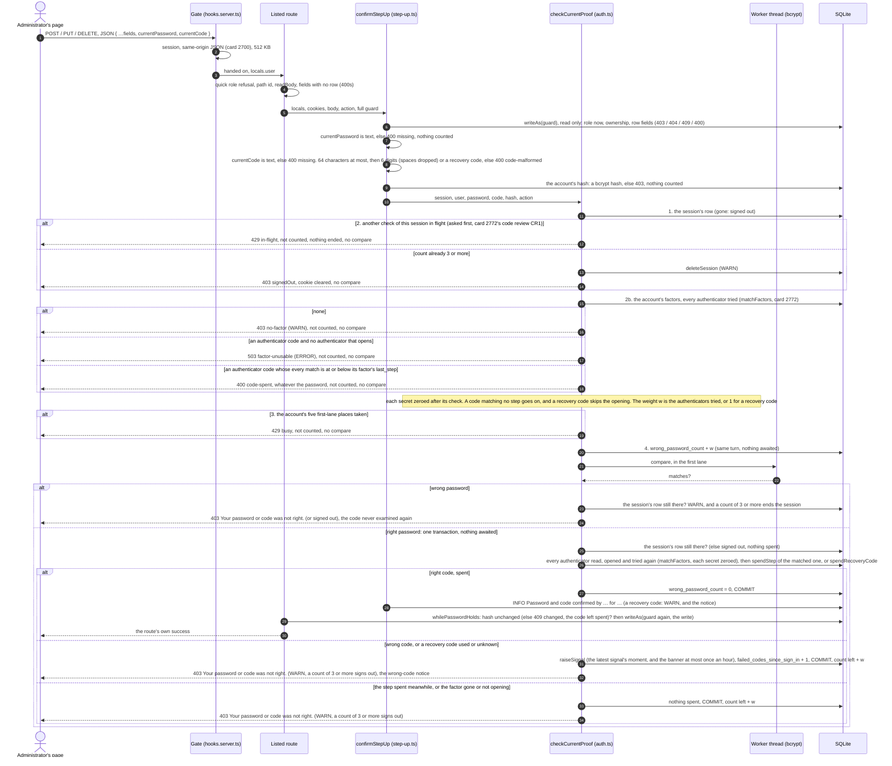

**The import confirms first** (decision 8; the page's order as its code review's F1 ruled it).
The page opens the file picker first and checks the file it is given (a `.db` backup that can
be read); only then does its dialog open, naming the file and asking for the password, and as
soon as the confirm answers, the upload is sent. Nothing is uploaded before the password is
accepted, and the 60 seconds never have to cover the picker. The import's body is the upload, so the password
cannot be in it, and it is proved before a byte of the file is read.
`POST /api/admin/import/confirm` takes `{ currentPassword, currentCode }` (the code since card 2771), runs `confirmStepUp`, asks again
that the caller is the superadmin whose password was checked, and answers `200`
`{ confirmation, expiresInSeconds: 60 }` with `Cache-Control: no-store`. The confirmation is 32
random bytes, base64url; the server keeps only its SHA-256, beside the SHA-256 of the session's
token, the user id, the hash the password was checked against and when it ends, in memory. One
per session (a new one replaces the last), swept of the expired at each issue and held to
1,000. The import sends it in `X-DumpFire-Confirmation` (hyphens: a proxy that drops
underscored headers keeps it). After its two `400`s (`outside`, the media type) and before the
upload is read, `takeImportConfirmation(header, session)` removes it and matches it on the
session alone; it is handed the header's text and the cookie, never the request, so it reads no
body. Missing, unknown, used, expired or another session's is `403` "Confirm the import with
your password again: the confirmation was not found, was used or has expired. Nothing was
changed." (`CONFIRMATION_REFUSED`). Once the upload is in, the caller is asked again
(`stillCallerNow`, still the superadmin), the confirmation's user must be that caller, and
`requirePasswordUnchanged` must hold, each else the same `403`, with nothing awaited before the
restore. It is not a window: one request, one action, one session, 60 seconds.

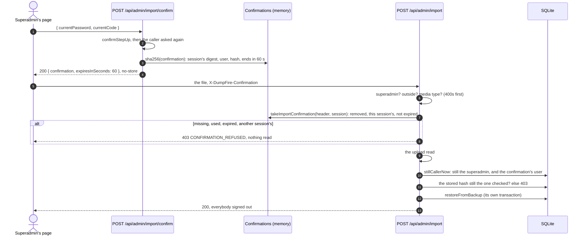

**The export is a `POST`** (decision 17). The page has always fetched the file and saved the
blob, never navigated to it, so its request can carry `{ currentPassword, currentCode }`, and one request
needs no confirmation. `GET` is gone (`405`); the answer is `Cache-Control: no-store`; the copy
is held by `requirePasswordUnchanged(…, PASSWORD_CHANGED_MEANWHILE)`, `403`, since `VACUUM INTO`
cannot run in a transaction.

**The column delete decides by what the column holds** (decision 18). `columnDeleteGuard` in
`columns.ts`, read only and in its `READS`, makes every refusal of the delete (the column, the
edit right, the Options column's `409`, an ideas board's live cards' `409`) and counts the
cards held, archived ones included; `deleteColumnFor` calls it first, so the rule is one. With a
card held the route asks; with none it deletes as before, and the write refuses `400`
`STEP_UP_MISSING` if a card arrived in between, so a race deletes no card without the password.

**On the pages** (decision 13). `ConfirmModal` has an `askPassword` field ("Your password",
`type="password"`, `autocomplete="current-password"`, the focus in it, Confirm off until
something is typed, Enter confirms) and an awaited `onConfirm(password)`: both buttons are off
while it runs, Confirm reading "Working…" with `aria-busy="true"`, and text it gives back is
the server's refusal, which the dialog shows in an alert, clearing the field and putting the
focus in it; an `onConfirm` that is rejected (no answer) is said as "No answer from the server.
Try again." the same way. A refusal of the password is known by its code, `stepUp` (card 2701's
code review, F3), read by `stepUpRefusal` in `src/lib/step-up-words.ts`, never by its words; any
other refusal is said as the page said it before, and the dialog closes. A `400` `missing` to a
dialog that showed no field (a column of archived cards alone) shows it. The admin page's
confirm and the dashboard's board delete closed before the request; each now closes only once
the action gives back no refusal. **One field** (F7): `src/lib/components/CurrentPasswordField.svelte`
is the field in `ConfirmModal`, the import dialog, the Drive Connect box, Add User and the
password dialog alike: a visible label, `autocomplete="current-password"`, the refusal in a
`role="alert"` it names with `aria-describedby` and marks with `aria-invalid`, and the focus put
back in it as a refusal comes. A signed-out answer (`stepUp: 'signed-out'`) switches the field
off and Confirm with it, and `$lib/signed-out.ts` takes it as a `401` and goes to sign-in (F5).
The admin panels send a write that asks through `sentAsking` in `src/lib/admin/send.ts`, which
is `sent` with `{ giveBackPasswordRefusal: true }` (F8): one implementation. A scan (`tests/page-failures.test.ts`, case 28) reads every
`fetch` and `jsonRequest` of the client's files as `METHOD /route` and fails, closed, on a
listed one with no `currentPassword` in a literal body, an import with no confirmation header, or
a `GET` of the export.

**The code on the pages** (card 2770; the server's check is card 2771's, released together: see
[The Code Beside the Password](#the-code-beside-the-password-card-2771)). Every dialog that asks for the password asks for
a second proof under it: a code from the authenticator app, or a recovery code by a switch
("Use a recovery code instead"), in the one field, as the sign-in's second step does
(`/login/verify`): `inputmode="numeric"`, `autocomplete="one-time-code"` and `maxlength="7"` in
the authenticator mode, a text field with no length limit in the recovery mode, the field
emptied and focused when the mode is switched, and each opening of a dialog starting in the
authenticator mode. It lives in `CurrentPasswordField`, whose `code` is a required bindable, so
`svelte-check` refuses a dialog that forgets it. `ConfirmModal`'s `onConfirm` is handed a
`StepUpProof`, `{ currentPassword, currentCode }` (`NO_PROOF`, both empty, where it showed no
field), and every callback that takes it is typed so. The code is sent as typed (the server
alone normalises it) in a literal `currentCode` body key beside `currentPassword`, never by a
spread. **A blank code sends nothing, by any route:** the button is off until the password is
typed and the code is not blank, and every send function carries the same guard, so Enter
cannot get round the button; Enter in the password field moves to the code field while it is
empty. Both fields are emptied on every send, on Cancel and on any refusal (the focus to the
password: the server never says which was wrong), except that since card 2771 the password is
put back on the three refusals decided before it was compared (`code-spent`,
`code-malformed`, `factor-unusable`: `passwordKeptAfter`) and the focus goes to the code; held in component state only, never in a
store, a toast, storage or a log. The scan (case 28) now also fails a listed write that has no
`currentCode` in its body, or whose `currentCode` does not come from the proof (`undefined`,
`''`, or Google's OAuth `code`); it checks that the value is named `currentCode` and does not trace the source further, since every send site takes it from the dialog's proof. One shared rule, `proofTyped()` in `src/lib/step-up-words.ts`, decides "both filled" for every button and send guard. The recovery switch updates the field's keyboard attributes before it focuses the field. The Account page's forms and the three `/api/account` routes
were card 2771's: each form draws `CurrentPasswordField` ("Confirm password", "Current
password", "Your current password"), sends only once `proofTyped`, copies both fields into
constants named `currentPassword` and `currentCode` and clears them before the `fetch`, and
says a step-up refusal in the field's alert and any other in the form's line; the scan (case
28) holds the three account sends too, and its `RETIRED_FIELDS` rule reports `password` in a
body sent to `PUT /api/account/email` or `POST /api/account/api-keys`. The password form's
"Show passwords" no longer reveals the current password, which is always masked.

**The password in transit and at rest.** It is never logged (no body reader logs a body, and the
lines name the user and the action), never echoed (every refusal is fixed text), held to the
512 KB body limit and to 1,024 characters by its reader (bcrypt reads 72 bytes), and kept in a
request's local variables alone: the confirmation map holds digests, and the in-flight set
session ids. Strings cannot be wiped in JavaScript. On the page it is in the dialog's state
while it is open, and cleared on Cancel, as it is sent and on a refusal; it is never put in a
toast or in storage. Case 17 searches every log row and answer of a run for it.

### The Code Beside the Password (Card 2771)

Card 2770 put a code field under every password a step-up asks for; card 2771 (2026-11-17,
released with it) has the server check it. The plan is
`docs/planning/card-2771-step-up-requires-code.md`. The code is `currentCode`
(`STEP_UP_CODE_FIELD`), read by `confirmStepUp` straight after `currentPassword`:

- **Its form, before anything is counted** (`readStepUpCode` in `step-up.ts`, pure). Over 64
  characters is refused before any pattern is tried. Otherwise, trimmed with every space
  dropped and then exactly six ASCII digits is an authenticator code (`123 456` among them);
  failing that, a text `canonicalRecoveryCode` reads (case-insensitive, spaces and hyphens
  dropped, O read as 0, I and L as 1, sixteen characters) is a recovery code. Anything else is
  `400` `{ message: STEP_UP_CODE_MALFORMED, stepUp: 'code-malformed' }`, "That code is not in
  the right form. Enter the 6 digits from your authenticator app, or choose 'Use a recovery
  code instead'. Nothing was changed.", with nothing counted and no factor read. A
  recovery code pasted into the seven-character authenticator field arrives cut short and is
  refused here without a strike. (Sign-in's `/login/verify` counts a malformed authenticator
  code as a wrong one: card 2889.)
- **The factor, before the password (step 2b of `checkCurrentProof`)**, after the
  one-check-in-flight rule and before the account's first-lane place, synchronous, nothing
  counted and no password compared. No factor row: `403` `no-factor` ("This account has no
  two-step sign-in to confirm with, so this cannot be done from it. Nothing was changed.") and
  a `WARN` line, "Password not confirmed for user *n* on *action*: the account has no second
  factor" (defence in depth: since card 2769 no session exists without one; a recovery code
  needs the factor row too). For an authenticator code, **every authenticator of the account
  is tried** (`matchFactors` in `mfa-store.ts`, since card 2772; see
  [Several Authenticators, Every One Tried](#several-authenticators-every-one-tried-card-2772)):
  none that opens (no MFA key, another key, a secret that does not decrypt) is `503`
  `factor-unusable` ("Your authenticator cannot be checked on this server right now. Use one of
  your recovery codes, or ask an administrator. Nothing was changed."), with `factorSecret`'s
  own `ERROR` line for each that did not open; a recovery code skips the opening and still
  works. A code whose **every** match is at or below its factor's `last_step` is `400`
  `code-spent` ("That code has just been used. Wait for the next code from your authenticator
  app and enter it. Nothing was changed."), **whatever the password**: it is decided before any
  compare, so it tells nothing of the password (the plan review's S1). A code that matches no
  step goes on and is never refused here. Each secret is opened only to check, and zeroed in a
  `finally` before the next is opened. **The attempt's weight is taken here** (card 2772, D4):
  the number of authenticators tried, or 1 for a recovery code.
- **One attempt counts once, by its weight, whichever part is wrong**, on the session's
  `wrong_password_count` (step 4: `+ w` in one `UPDATE … RETURNING`, before the compare, the
  same for a wrong password or a wrong code, and nothing added after it), and the count is
  cleared **only** when both pass. A count of 3 or more ends the session: with one
  authenticator the third wrong answer, with two the second, with three the first. A second
  request while one is in flight is `429` before the count is looked at, so a right attempt
  holding the count at 3 during its compare never makes it end the session (card 2772's code
  review, CR1). A wrong password: the code is
  never examined again, nor spent. A right password: one synchronous transaction, nothing
  awaited, re-reads the session's row (gone: signed out, nothing spent), tries every
  authenticator again (`matchFactors` with `said: false`, so a factor that did not open at 2b
  is not said at `ERROR` twice; each secret zeroed in a `finally`), verifies the code at the
  moment it arrived, the clock read once at step 2b (that 30-second step or the one before,
  `matchingStep`), so a step boundary passing during the compare does not make a code that was
  good when it came a wrong one (the code review's CS2), spends the matched factor's step alone
  (`spendStep`, the authority, or `spendRecoveryCode` for a recovery code) and sets the count to
  0. In the transaction a code is **wrong only when no factor matched it at 2b either**: a
  match found at 2b and lost since (its step spent by another request, its factor removed or no
  longer opening), a code whose every match is now spent, and a transaction in which no factor
  opens all fail closed as a lost spend. A fault inside rolls the spend and the clear back
  together and leaves the attempt counted.

| When | Password | Code | Count | Code spent | Answer |
|------|----------|------|-------|------------|--------|
| 2b | not compared | authenticator, its every match already spent | untouched | no | `400` `code-spent` |
| 5 | wrong | not examined | stays +w; 3 ends the session | no | `403` `wrong` (or signed out) |
| 5, transaction | right | right, spent now | set to 0 | yes | the action |
| 5, transaction | right | wrong (no factor matched at 2b or now), or a used or unknown recovery code | stays +w; 3 ends the session; the signal | no | `403` `wrong` (or signed out) |
| 5, transaction | right | matched at 2b, but the step spent by another request since, or the factor gone or not opening | stays +w; 3 ends the session | no | `403` `wrong` (or signed out) |
| 5, transaction | either | the session's row went while the password was compared | n/a | no | `403` signed out |

w is the number of the account's authenticators the code was tried against at 2b (1, 2 or 3),
or 1 for a recovery code.

- **One answer for either wrong part.** `403` `{ message: STEP_UP_WRONG, stepUp: 'wrong' }`,
  "Your password or code was not right. Nothing was changed.", never says which. A spend lost
  in the transaction (two requests in one step that both passed 2b) is counted as `wrong`,
  never answered `code-spent`, so no answer after a compare differs by the password.
- **A right password with a wrong code is the clearest sign the password is known** (the plan
  review's S2). In the transaction's wrong-code path: `raiseSignal(userId, 'wrong-code', now)`
  (the account's security banner, at most once an hour) and `failed_codes_since_sign_in + 1`;
  when the signal was raised, `confirmStepUp` sends the `wrong-code` security notice, worded for
  a confirmation (`confirming: true`): "Someone entered your DumpFire password correctly on
  *time* from *address* while confirming a change, and then a wrong code." Not for a lost spend
  or a factor gone in the transaction: the code was not shown wrong. The `WARN` line is "Wrong
  code for user *n* on *action*: the password was right"; a lost spend's is "Code not spent for
  user *n* on *action*: the password was right, and the code's step was used meanwhile or the
  factor could not be opened". Saying which part was wrong in the log adds no oracle: `/login`
  already shows a right password by moving on to `/login/verify`.
- **A recovery code used at a step-up** writes the `WARN` line "A recovery code confirmed
  *action* for *name* (ID: *n*): *k* left" and sends the `recovery-code-used` notice worded for
  a confirmation: subject "A recovery code was used to confirm a change on DumpFire", body "A
  recovery code was used to confirm a change on your DumpFire account on *time* from
  *address*. You have *k* recovery codes left." A used or unknown recovery code is counted as a
  wrong code, as at sign-in. The notices name the address of the request (`getRequestEvent`),
  or none outside one.
- **Sign-in's code lanes are untouched**: `mfa_known_wrong`, `mfa_other_wrong`, their
  `*_resumes_at`, the 30-code lock, `mfa_recovery_resumes_at` and `mfa_recovery_wrong` are
  neither written nor read. They bound guessing before a session exists; at a step-up the
  guesser holds a session and is bounded by its three, after which a new session needs a code
  at `/login/verify`, where the lanes apply. Writing them here would let a stolen session pause
  or lock the owner's sign-in; reading the lock would let whoever locked codes at sign-in block
  the owner's step-ups. Since card 2772 both try every authenticator of the account through the
  one matcher, `matchFactors`: the lanes are weighted at sign-in, the session's count here.
- **A refusal after the check leaves the code spent** (S4): the check's transaction commits
  before the route's write. A `409` `changed` from `whilePasswordHolds`, a write-time `409` or a
  `500` leaves the code or recovery code spent. The email route's `409` "Email is already in
  use" is one of these: whether another account holds the address is asked only in the write,
  after the password and the code, so that no session can learn which addresses are taken
  without a counted attempt (the code review's CS1).
- **The Account page's three routes** (`PUT /api/account/password`, `PUT /api/account/email`,
  `POST /api/account/api-keys`) are on `STEP_UP_ACTIONS` and call `confirmStepUp`. The email
  and key routes read `currentPassword`, no longer `password` (a body with only `password` is
  `400` `missing`). Each route's own fields are read in the guard, before the password: the
  password route's `endApiKeys` and `newPassword` (`400` "New password must be at least 8
  characters"), the email route's `newEmail` ("Email is required", "Invalid email address";
  not whether the address is taken, which only the write asks), and the key route's
  `name`, `expiresAt` and the ten-key limit (`400` "Maximum of 10 API keys per user"). Their own
  words ("Password is incorrect", "Current password is incorrect", "Password is required") are
  gone: they answer the step-up's refusals with their codes. A current password over 1,024
  characters is now `400` there too (card 2888).
- **One importer.** `checkCurrentProof` and `refuseWrongPassword` are named in `src` only in
  `auth.ts` (their declarations) and `step-up.ts` (the import and the call);
  `checkCurrentPassword` is named nowhere; `checkPassword` is called only in
  `src/routes/login/+page.server.ts` and `auth.ts` (`tests/check-at-the-write.test.ts`, T12).
- **On the pages.** `WORDS_OF` in `src/lib/step-up-words.ts` knows the four new codes, and
  `stepUpRefusal` answers `code-spent`, `code-malformed` and `factor-unusable` with the module's
  own constants (beside `missing` and `signed-out`), so a dialog tells them by identity.
  `passwordKeptAfter(refusal, sent)` gives the password sent back for those three, decided
  before the password was compared, and `''` for any other: `ConfirmModal`, the six dialogs
  with a field of their own (the import, Drive Connect, Add User, 🔑, Add from accounts, the
  Person dialog) and the Account page's three forms set the password from it on a refusal, and
  always clear the code. `CurrentPasswordField` then puts the focus in the code field; on any
  other refusal it puts it in the password, as before. Since card 2772 it also says what a
  wrong answer costs before anything is sent, in the authenticator mode, when the account holds
  more than one (the root layout's `authenticators`, the account's `totp` factors, 0 with no
  user): with two, "You have 2 authenticators, so each wrong answer here counts twice: two wrong
  answers sign this browser out."; with three, "You have 3 authenticators, so one wrong answer
  here signs this browser out." The line sits under the mode switch, tied to the code field by
  `aria-describedby`; in the recovery-code mode (weight 1) it goes, and a dialog mounted with no
  page data reads 0 and shows none.

Covered by `tests/step-up.test.ts` (T1 to T11 of the plan, and the cases rewritten for the
code), `tests/check-at-the-write.test.ts` (T12), `tests/page-failures.test.ts` (T13, T14),
`tests/confirm-modal.svelte.test.ts` (T15) and `tests/admin-panels.test.ts` (T16).

## Session Management

| Property | Value |
|----------|-------|
| Cookie name | `__Host-dumpfire_session` where cookies are HTTPS-only (`COOKIE_SECURE`, or production; `COOKIE_SECURE=false` never removes it from an HTTPS request) or the request came over HTTPS; otherwise `dumpfire_session`. See [Session Codes Stored as Hashes, and Limits by Role](#session-codes-stored-as-hashes-and-limits-by-role-card-2775) |
| How it is read | By the gate alone, from the raw `Cookie` header: exactly one value of the name in force, shaped as a UUID, or none. Two values of the name, or a value no session code can have, is no session |
| Token format | `crypto.randomUUID()` |
| Duration | One deadline per session: the earlier of its expiry (idle limit) and its start plus the total limit. Administrators and the superadmin 12 hours idle, 24 hours in total; users 3 days idle, 7 days in total. Judged on the account's role at every check. A start or expiry more than 60 seconds beyond what the role allows counts as passed |
| What moves the expiry | Only `slidesSession(request)`: a write (a request that is not `GET` or `HEAD`, which has passed the same-origin write check), or a `GET` or `HEAD` with `Sec-Fetch-Mode: navigate`. Every other request is checked, with every refusal, but never slides: background polls, live-event re-reads, a stream's checks, an `EventSource` open or reconnect. A client-side navigation inside the app (a link click, which is a data fetch) no longer counts as activity; a write or a full page load does. A tab left open on its own does not keep a session alive |
| Storage | `sessions` table in SQLite: `id` holds the SHA-256 of the code, 32 bytes as a BLOB, never the code |
| Wrong current passwords | `sessions.wrong_password_count` (migration 0062, card 2701): for each password compared, one added for each authenticator its code was tried against, or one for a recovery code (card 2772), before the compare (a check refused unchecked, in flight, busy, or at step 2b, adds none), set to 0 only by a right password with a right code (card 2771), and a count of 3 or more ends the session: with one authenticator the third wrong answer, either part, with two the second, with three the first. See [Guessing a Current Password](#guessing-a-current-password) |
| Made after a second factor | `sessions.two_step` (migration 0066, card 2769): `createSession()` writes 1; a session with any other value is refused and deleted. See [Older Images and Instances](#older-images-and-instances) |
| Flags | `httpOnly`, `sameSite: lax`, `secure` where cookies are HTTPS-only or the request is HTTPS; `Path=/`, never a `Domain`; `Max-Age` runs to the session's total limit |

### Every Cookie DumpFire Sets (card 2850)

Every cookie the server sets or deletes is `Secure` by one rule, `httpsOnlyCookie(url)` in
`src/lib/server/auth.ts`, and takes the `__Host-` name by the same rule where it has one:

1. A request that came over `https:` is always `Secure`, whatever `COOKIE_SECURE` says.
2. Otherwise `COOKIE_SECURE` decides when it is set (exactly `true` is on, anything else off).
3. Otherwise `NODE_ENV` exactly `production` (a missing or misspelt `NODE_ENV` is not).

So `COOKIE_SECURE=false` affects plain-HTTP requests only. It is what keeps a plain-HTTP LAN
install of the image working (the image sets `NODE_ENV=production`, and a browser drops a
`Secure` cookie set by an `http:` address other than localhost), and it cannot take `Secure`
off a cookie sent over HTTPS. The environment's half, `secureCookies()`, is private to
`auth.ts`, so no new cookie can use it alone; `tests/secure-cookies.test.ts` (T5) reads the
source and fails on any `cookies.set` or `cookies.delete` whose `secure` is not
`httpsOnlyCookie(url)`.

| Cookie | Set / deleted by | `Secure` | Name prefix |
|---|---|---|---|
| `__Host-dumpfire_session` / `dumpfire_session` | `setSessionCookie()`, `clearSessionCookie()` (`auth.ts`) | `httpsOnlyCookie(url)` | `__Host-` by the same rule |
| Deletion of a plain-name session cookie (a `Set-Cookie` header the gate appends, not `event.cookies`) | `oldSessionCookieDeletion()` (`auth.ts`), appended in `hooks.server.ts` | Literal `Secure`, sent only when `httpsOnlyCookie(url)` | None (it deletes the plain name) |
| `__Host-dumpfire_challenge` / `dumpfire_challenge` | `sign-in-challenges.ts` | `httpsOnlyCookie(url)` | `__Host-` by the same rule |
| `dumpfire_enrol_link` | `sign-in-challenges.ts` (set on the GET of `/enrol/[token]`) | `httpsOnlyCookie(url)` | None: `Path=/login` rules out `__Host-` |
| `dumpfire_known_<user id>` | `rememberBrowser()` (`known-browsers.ts`), which takes the request's URL as a required argument | `httpsOnlyCookie(url)` (card 2850; it was the environment alone before) | None: `Path=/login` rules out `__Host-` |
| `dumpfire-dashboard-display-<user id>` (written by the browser) | `writeDashboardDisplay()` (`src/lib/dashboard/side-pane.ts`) | `Secure` when `location.protocol` is `https:` (card 2850; never before) | None |

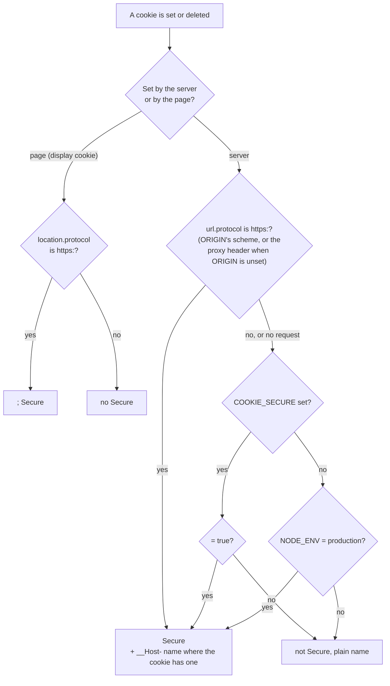

**What `url.protocol` is behind a proxy.** The node adapter builds each request's URL from
`ORIGIN` when it is set, whatever the proxy forwards, and from `PROTOCOL_HEADER` and
`HOST_HEADER` only when it is not (`base: origin || get_origin(req.headers)` in its handler).
Without `ORIGIN`, a request counts as `https:` unless the proxy's header says `http`. So with
`ORIGIN=https://kanban.example.com` every cookie is `Secure`, and the image, which always sets
`ORIGIN`, takes its scheme from `ORIGIN` alone.

**The start-up warning.** A built server whose App URL (the setting, else `APP_URL`) is `https:`
while `ORIGIN` is set and `http:`, and where a plain-HTTP request would get no `Secure`, writes
one `WARN` at start (`reportPlainOriginBehindHttps()` in `startup-checks.ts`): `ORIGIN is <origin>
but the App URL is <app url>: every request is taken as plain HTTP, so cookies are not marked
Secure and sign-in forms from the https address are refused. Start the server with ORIGIN set to
the https address.` Every request is then plain HTTP to the server: the framework's origin check
refuses the sign-in forms posted from the https address, and the set-up link's and a password
change's cookies go without `Secure`. No line is written under the dev server, with `ORIGIN`
`https:` (every cookie is `Secure`), with `ORIGIN` unset (the proxy decides the scheme per
request, which cannot be judged at start), or when `COOKIE_SECURE` or `NODE_ENV` already makes
plain-HTTP cookies `Secure`.

### Idle and Total Limits

A session has two limits, and the shorter wins. The **idle limit** moves on: every valid use of
the session by a write or a full page load (`slidesSession()`; polls, streams and in-app
navigations do not count) sets the expiry to now plus the idle limit. The **total limit** does not move: the session ends that long after it was made,
however busy it has been. There is one deadline, the earlier of `expires_at` and
`created_at` plus the total limit, and a session past it is refused as `'expired'`. The
`expired` log line names `createdAt`, so the log shows which limit ended it.

| Role | Idle limit | Total limit |
|------|-----------|-------------|
| `user` | 3 days | 7 days |
| Any other role (`admin`, `superadmin`, an unknown value) | 12 hours | 24 hours |

The limits are constants in `src/lib/server/auth.ts` (`SESSION_LIMITS`), not settings, so a
session policy cannot be lengthened from the page. Any role but `user` takes the shorter pair,
so an unknown value fails short. The role is the account's **now**, not the role it had at
sign-in. A start in the future by more than 60 seconds, or an expiry more than the role's idle
limit plus 60 seconds away (a role raised on the host, where no code runs, leaves the longer
expiry already written), counts as passed. The 60 seconds is the same grace
`known-browsers.ts` gives a clock that steps back a little.

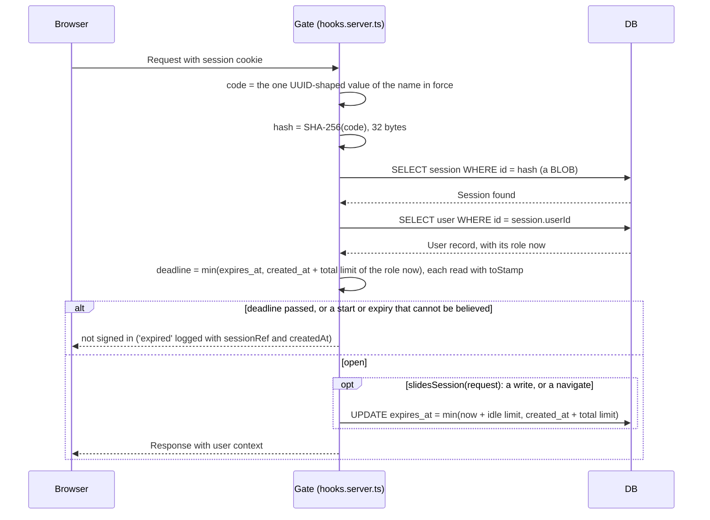

The expiry and the start are read as the moments they name, with `toStamp` from
`src/lib/timestamps.ts`, and not compared with now as text. A session whose start or expiry
names no moment, such as `zzz`, `2099-02-30 08:00:00` or an hour of 24, is closed, where text
comparison sorted it after now and kept it open for good. API keys and invites are read the
same way (the review of cards 2095, 2106 and 2107, item S2); `tests/timestamps.test.ts` holds
all three. The sweep of ended sessions, at start and then every five minutes
(`startSessionSweep()`, card 2883), `cleanExpiredSessions()`, deletes by the
same rule in SQL (an expiry that names no moment or is at or before now; a start that names no
moment, is more than 60 seconds ahead, or is further back than the role's total limit; an
expiry beyond the role's idle limit plus 60 seconds), through the `stamp_of` SQL function
`registerStampFunctions` gives the connection, with the role read from the account in a `CASE`.
A row that has ended now waits at most five minutes, not for a restart (each holds only a
hash, so that was tidiness and not exposure). The timer does not keep the process alive, and a
run that fails writes one `ERROR` line, `Ended sessions could not be cleared`, and is tried
again at the next run.

### Every Session Ended Once, by Migration 0053

The update that brings migration `0053_index_foreign_keys_end_sessions.sql` (card 2106)
ends every session on the installation, the owner's included, on the start that applies it.
Its last statement is `DELETE FROM sessions`, under a header comment saying so, and it runs
once on each database, as every migration does.

The reason is the backups. Until card 2135 a backup, scheduled, run by hand or exported,
held every session id of its day, and a session's id is the whole of what its cookie
carries. Copies made then are at outside destinations and in download folders, and a
session's expiry moves on every time it is used, so a session in such a copy could stay
good for as long as its owner kept using DumpFire. A backup now holds no session (see
[What a Backup Holds](#what-a-backup-holds-and-what-a-restore-brings-in)), and ending
every session once makes the ids in the older copies dead. 0053 must therefore never be
deployed before card 2135's backups: a session made in between would leave in the next
backup, and the one-off would be spent. Both are in the same release.

| What | After the start that applies 0053 |
|---|---|
| Sessions | None: each browser is sent to the sign-in page at its next request, and signs in again |
| API keys | Untouched |
| Invites | Untouched by 0053. Every invite not yet used is ended by 0054, in the same release: see below |
| Requesters' links | Untouched by 0053. Every one is replaced by 0055 (card 2158): see below |
| The log | One `WARN` line, "token not in DB", for each request that carries a cookie whose session is gone, until that browser signs in again |

`tests/migrations.test.ts` holds it: 0053 empties `sessions` and leaves every other table as
it was; a later start deletes nothing, and a session made after it survives; and a backup
made after a session is made holds no trace of its id, so the tests of 0053 cannot pass in
a tree without card 2135's change.

### Every Unused Invite Ended Once, by Migration 0054

The next file, `0054_index_user_time_end_unused_invites.sql`, ends the other thing older
backups hold that signs somebody in: its last statement is
`DELETE FROM invite_tokens WHERE used = 0`, under a header comment saying so, run once on
each database.

Until card 2135 a backup held the token of every invite that was waiting when it was made,
and an invite's token sets its account's password, with no other question, until it expires
up to seven days after it was made. Those copies cannot be called back, and nothing lists
the invites in them for the owner to end one by one. A backup now holds no unused invite,
and a restore brings none in.

| What | After the start that applies 0054 |
|---|---|
| Invites not yet used, expired or not | Deleted. Each link shows the page for a link that no longer works |
| Invites already used | Kept, marked used |
| Accounts, sessions, API keys | Untouched |

The owner lists the waiting invites before the deploy, with the read-only command in
[The Update That Brings Migration 0053](deployment.md#before-the-deploy-checks-0a-0b-0c-and-0d)
(check 0d), and sends again, from User Management, the ones still wanted once the deploy is
done. `tests/migrations.test.ts` holds it: 0054 deletes every unused invite and keeps the
used ones and every other table as it was, a later start deletes nothing, and an invite
issued after it survives. The rehearsal notes the loss as a declared one-off.

### Every Request Link Replaced Once, by Migration 0055

`0055_replace_request_links.sql` (card 2158) ends the last thing older backups hold that
opens something: a request's link. Its one statement is
`UPDATE task_requests SET access_token = lower(hex(randomblob(32)))`, under a header comment
saying so, run once on each database.

Every backup made before card 2158 holds every request's token as it was mailed, open or
settled. A token is the whole of the key to its thread: whoever holds it reads every
message, the ones written since the copy was made included, replies as the requester and
confirms a request not yet confirmed, and it never expires. Replacing every token once makes
the tokens in those copies worthless. A backup made since holds none, and every restore
gives every request a new one, so nothing repeats the one-off.

| What | After the start that applies 0055 |
|---|---|
| Every request link mailed before the deploy (confirm, reply, progress) | Stops working. Its page says "This link no longer works" and asks for the address the request was made with, and the current link is mailed there (see [The Public Request Form](#the-public-request-form)) |
| Requests, their messages, the inbox | Untouched |
| The key the form signs with | Untouched: it lets nobody do more than opening the form does |

It is declared to the rehearsal as a one-off that keeps every row (`keepsRows` in
`tests/rehearsal/one-offs.ts`): the rehearsal still fails if `task_requests` loses a row,
and notes the change. `tests/migrations.test.ts` holds it: every token replaced, 64 hex
characters, all different, none the old; every other column and table as it was; harmless
on an empty table; recorded once, and a later start replaces nothing.

### Every Session and Remembered Browser Ended Once, by Migration 0067

The release of two-step sign-in (card 2769) ends every session again, and forgets every
remembered browser. `0067_end_sessions_for_two_step.sql` is two statements, `DELETE FROM
sessions` and `DELETE FROM settings WHERE key = 'known_browser_secret'`, under a header comment
saying so, run once on each database. It runs after `0066_add_mfa_password_enrol.sql`, which
adds `sessions.two_step` and leaves every session there at 0, which this image refuses anyway.

Every session there was made on a password alone, and a remembered browser gets sign-in's
lenient lane, which must now be reached only after a second factor. With the secret gone every
old cookie fails its MAC, and the next browser remembered makes a new one.

| What | After the start that applies 0067 |
|---|---|
| Sessions | None: everybody signs in again, with the second step |
| Remembered browsers | None: every browser is a new one at its next sign-in |
| API keys, invites, enrolment links, requesters' links | Untouched |

Both files are declared to the rehearsal in `tests/rehearsal/one-offs.ts`: 0066 as a one-off
that keeps the rows of `users`, and 0067 as deleting the rows of `sessions` and the secret's
row of `settings`. Nothing repeats them at start-up or after a restore. See
[Two-Step Sign-In](#two-step-sign-in-card-2769) and
[The Release That Turns On Two-Step Sign-In](deployment.md#the-release-that-turns-on-two-step-sign-in-card-2769).

### Invite Tokens Stored as Hashes (Card 2849)

An invite's link carries a random token (`crypto.randomUUID()`, 122 random bits). Until card
2849 the server kept that token exactly as it was mailed, so whoever could read the database
file, its WAL, its free pages or a cold copy could open any waiting invite. Since card 2769 a
working invite sets the account's password **and** registers an authenticator, which is the whole
account. So two-step sign-in is not released without this card.

**The server now keeps only the token's SHA-256, as the raw 32-byte digest, a BLOB value**, in
the existing `invite_tokens.token` column, whose declared type stays `TEXT` (no change to the
schema; see [Invites](data-model.md#invites-invite_tokens-migration-0068)). When a link is
opened, the server hashes the token in the address and looks for that digest. The token exists
only in the mail and, when the mail fails, in the link the issuing administrator is shown once
(see [Passwords, Sessions and Invites Change Together](#passwords-sessions-and-invites-change-together)).
All of it is in `src/lib/server/invites.ts`: `issueInvite()` stores the digest and returns the
token, and `usableInvite(token)` looks the digest up; no caller hashes anything itself.

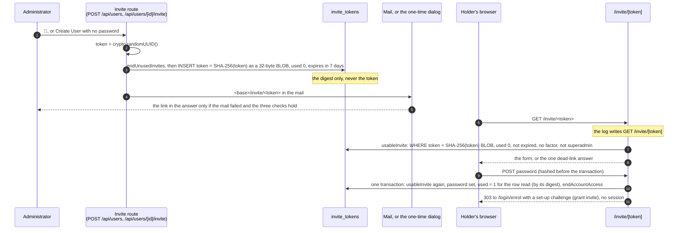

| Where | Holds after card 2849 |
|---|---|
| `invite_tokens.token`, unused row | The token's SHA-256, a 32-byte BLOB |
| `invite_tokens.token`, used row | The same, or 32 random bytes (`randomblob(32)`) for a row that migration 0068, the start-up sweep or a restore of an older backup rewrote |
| The mail, and the dialog of a failed mail | The token, in the link |
| `system_logs` | `/invite/[token]`, never the token |
| A backup | Used rows only, in hash form |
| The free pages of the live file | No live token from the release on; older ones are dead after 0068 |
| A cold copy taken before 0068 | The invites waiting when it was taken, in plain (below) |

**Exactly what is hashed.** The string SvelteKit gives as `params.token` (already URL-decoded),
as UTF-8, with nothing trimmed, case-folded or checked for shape: the text comparison it replaced
did neither. A token upper-cased is a dead link. The invite page still gives one answer,
"This invite link no longer works…", for every reason (used, expired, replaced, never was): a
deleted invite cannot be told from one that never existed, and naming the reason would tell an
attacker which tokens existed. No prefix separates the hash by purpose, as recovery codes have:
an invite token is 122 random bits and its digest lives only in its own table.

**Why a BLOB, not hex text.** SQLite never treats a TEXT value as equal to a BLOB, and a link's
address can only ever be text. An image from before card 2849 compares the column with the
address text, so it can never match a stored digest: whoever reads the file and types what they
read into an address gets the dead-link page, on this image or an older one. Stored as hex text,
the same hash would have been a working link on the older image. **"In hash form"** means
`typeof(token) = 'blob' AND length(token) = 32`; any other value is held in plain.

| What | After the start that applies 0068 |
|---|---|
| Invites not yet used, expired or not | Deleted. Each link shows the page for a link that no longer works. Send again, from User Management, the ones still wanted: the host lists them before the deploy, the only time they can be listed |
| Invites already used | Kept, marked used, with the token replaced by `randomblob(32)` |
| Accounts, sessions, API keys, enrolment links, requesters' links | Untouched by 0068 |

`0068_end_plain_invite_tokens.sql` is two statements: `DELETE FROM invite_tokens WHERE used =
0`, then `UPDATE invite_tokens SET token = randomblob(32) WHERE used <> 0`. Hashing the waiting
rows in place was not chosen: SQLite has no SHA-256, and an `UPDATE` in place leaves the old
value in the file's free pages and WAL, still working (the same effect as the 925 copies under
[What a Backup Holds](#what-a-backup-holds-and-what-a-restore-brings-in)). Ending them makes
those leftovers worthless. Used rows are no credential (`usableInvite` needs `used = 0`, and
nothing sets it back), but no row is to keep a token as it was mailed. It is declared to the
rehearsal as a one-off that loses rows of `invite_tokens`.

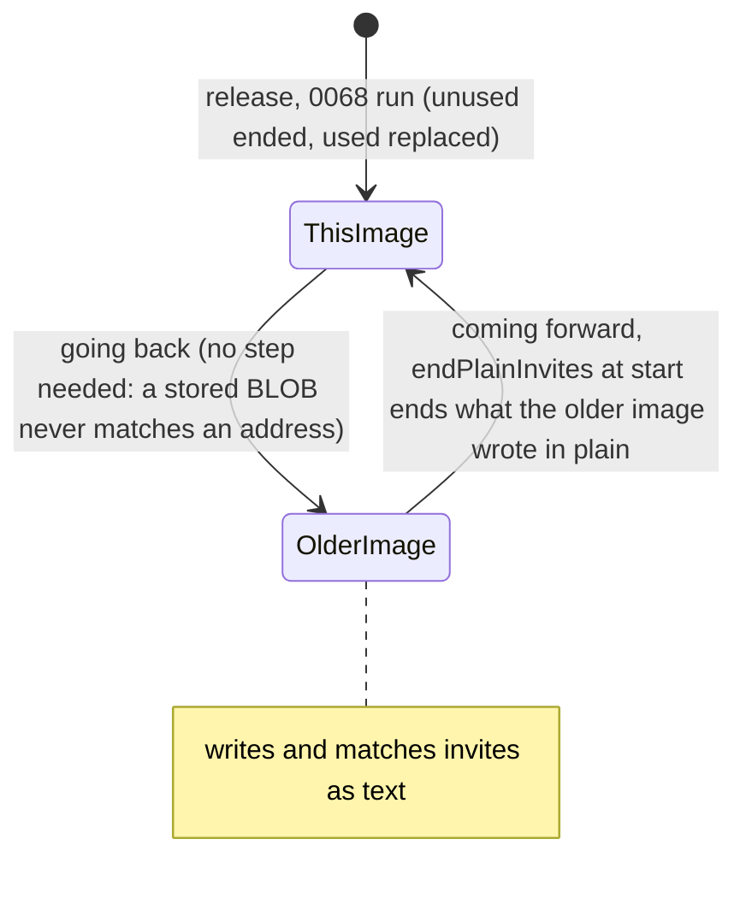

**Going back, and coming forward.** Going back to an older image needs nothing done for the
invites this image issued: they stop working there, because the older image never matches a
BLOB. Deleting the waiting invites first is still tidy (`DELETE FROM invite_tokens WHERE used =
0`, with the server stopped), but it is not required. **A cold copy taken before 0068 is
different**: it holds the invites that were waiting when it was taken, in plain, and the older
image started on it makes them work again; send them again, or delete them, as
"Going back to the previous image" under
[The Release That Turns On Two-Step Sign-In](deployment.md#the-release-that-turns-on-two-step-sign-in-card-2769)
says. An
invite the older image issues is stored in plain. Coming forward, **`endPlainInvites()`** (in
`src/lib/server/startup-checks.ts`, called from `hooks.server.ts` after the migrations, beside
`removeSettingsOfNonAdministrators()`) deletes, at every start, every unused invite not in hash
form, and gives every used one not in hash form 32 random bytes. The two are one transaction, so
a replacement that fails takes the deletes back with it. It writes one `WARN` line under `AUTH`,
built from what changed, when it changed anything: "Ended N invite(s) held in plain, written by
an older image: their links no longer work. Send again, from User Management, the invites still
wanted." when it ended any, followed by "Replaced the token of M used invite(s) held in plain,
written by an older image, with 32 random bytes." when it replaced any (either part alone when
only one applies). It writes nothing when nothing changed, and never throws: a failure is one
`WARN` line, "Invites held in plain by an older image could not be ended: … They do not work on
this image, and would work again on the older one.", and the server starts. It is outside the
runner and the rehearsal, because it deletes rows. At the release itself it finds nothing: 0068
has run.

**A restore.** A backup holds no unused invite, and a restore brings none in. A backup made
before card 2849 holds each used invite's token as it was mailed; `rowsToRestore()` gives such a
row 32 random bytes as it reads it (`inHashForm()` in `invites.ts` says which rows are already
hashes), so a plain token never reaches the live file. After the copy, inside the restore's
transaction, 0068's `UPDATE` is run again on any used row not in hash form, as a backstop, uncaught
so that a failure rolls the restore back. A row already in hash form comes in as it is.

**The log.** `maskSecretsInLog()` no longer looks for each unused invite's token wherever a line
holds it: there is no token in the database to look for. An invite's address is still masked as
`/invite/[token]` by the gate, in `handleError`, at every start and in every backup's copy, and a
mail server's refusal is masked by `maskMailText`. No code writes a token anywhere but in an
address, and every token a line written before the card can hold was ended by 0068. A bare token
in a line is left as it is, on purpose.

Covered by `tests/invite-hashes.test.ts` (the digest written and the token in no row; the
stored value as an address is a dead link; an upper-cased token is a dead link; an older image's
lookup, the column compared with text, finds nothing for the token, the hash in hex or the stored
bytes read as text; the issue and use log lines hold no 16 characters of the token; the sweep, its
line, its single transaction and its failure), and by
`tests/migrations.test.ts` (0068) and `tests/backups.test.ts` (an older backup's used invites,
and the bare token left in the log). See [Testing](testing.md).

### Session Codes Stored as Hashes, and Limits by Role (Card 2775)

When someone signs in, the browser is given a long random code (`crypto.randomUUID()`, 122 random
bits) in a cookie, and the server recognises them by it. Until card 2775 the server kept that code
exactly as the browser held it, so whoever could read the database file, its WAL, a cold copy or
a restore's safety copy held a working session of everyone signed in, past both the password and
the authenticator, and a session slid for 30 days with no total limit, renewed even by a tab left
open. Card 2869 (session ids stored in plain, raised in the review of card 2849) is folded into
this card. It has no migration of its own: migration 0067 ends every session at the release that
brings it (see [Two-Step Sign-In](#two-step-sign-in-card-2769)), and the start-up sweep below
ends any session left in plain.

**The server now keeps only the code's SHA-256, the raw 32-byte digest, a BLOB value**, in the
existing `sessions.id` column, whose declared type stays `TEXT` (no change to the schema or to
`expected-schema.ts`; see [Sessions](data-model.md#session-codes-kept-as-hashes-card-2775-no-migration)). `sessionTokenHash()` in
`src/lib/server/auth.ts` makes it, and the model's property is `tokenHash`. SQLite never takes a
BLOB to equal text, so an older image that compares the column with a cookie never matches a
stored hash. The code keeps its form (a UUID: 122 bits make an unsalted SHA-256 unguessable, as
for invites).

```mermaid
sequenceDiagram
    autonumber
    participant B as Browser
    participant G as Gate (hooks.server.ts)
    participant A as auth.ts
    participant S as sessions
    participant U as users
    participant R as Route or stream
    B->>G: request, Cookie: __Host-dumpfire_session=code
    G->>A: readSessionCookie(request, url)
    Note over G,A: the name in force alone (HTTPS-only cookies or an https: request); exactly one value, UUID-shaped, else none
    G->>A: validateSession(code, slide only if slidesSession(request))
    A->>A: hash = SHA-256(code), 32 bytes
    A->>S: SELECT WHERE id = hash (a BLOB: text never matches)
    alt no row
        A-->>G: null, WARN 'missing' with sessionRef
    else two_step is not 1
        A->>S: DELETE, WARN 'one-step'
        A-->>G: null
    else account gone
        A->>S: DELETE, WARN 'orphaned'
        A-->>G: null
    else deadline passed
        A->>U: the role, read with the account
        Note over A: deadline = min(expires_at, created_at + total limit of the role now).<br/>Passed also if created_at is unreadable or over 60 s ahead,<br/>or expires_at is over the idle limit of the role now + 60 s ahead
        A-->>G: null, INFO 'expired' with sessionRef and createdAt
    else open
        opt slidesSession(request): a write, or a navigate
            A->>S: UPDATE expires_at = min(now + idle limit, created_at + total limit)
        end
        A-->>G: user and hash
    end
    G->>R: locals.user, locals.credential = session hash
    Note over R: the code itself goes no further than the gate
    G-->>B: the answer, and on HTTPS a deletion of any plain dumpfire_session the browser sent
```

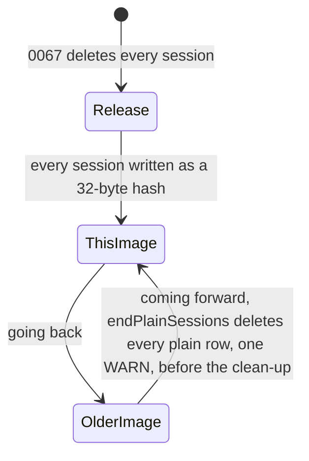

An older image looks a session up by text, finds no hashed row, and so asks everyone to sign in;
it writes plain ids, which this image never finds and sweeps at the next start (see
[Older Images and Instances](#older-images-and-instances)).

**Why these choices**

- **Deadline, one rule.** The earlier of `expires_at` and `created_at` plus the total limit of the
  role now, read by `findSession()`, the slide, `createSession()` and `cleanExpiredSessions()`
  alike, and refused as `'expired'` (there is no separate "too old" refusal). `created_at` already
  existed, so no column was added. See [Idle and Total Limits](#idle-and-total-limits) for the
  numbers and the 60-second grace.
- **A role change ends the account's sessions.** An administrator changing someone's role ends
  that account's sessions in the transaction that already ends its invites and pending sign-ins
  (see [When an Account's Email or Role Changes](#when-an-accounts-email-or-role-changes)). A user
  made an administrator would otherwise keep the 3-day idle window already written into their
  session until the expiry check refused it. An email change ends no session.
- **Changing your own password keeps the session's start.** The replacement session takes the
  start of the one it replaces, so a password alone, with no second factor, cannot restart the
  24-hour or 7-day clock. `replacementStart(hash, role)` returns null when there is no session,
  the start cannot be read, or less than 60 seconds of the role's total limit is left; the change
  is then refused 401 "Not authenticated" before any write. `createSession()` throws inside the
  transaction when the start plus the total limit is already past, and `setSessionCookie()` never
  throws: its `Max-Age` is the larger of 1 and the whole seconds left, rounded up.
- **Signing out ends every session the browser sent.** `/logout` is a public route, and its
  `POST` still passes the gate's same-origin check. The action deletes the gate's session, then
  `endSessionsSent(request, url, 'user logout')` hashes every UUID-shaped value of the session
  cookie name in force and deletes those rows (one `Session deleted (user logout)` `INFO` line
  each), and it always clears the cookie. Whenever two or more values of the name in force
  arrive, the gate writes a `WARN` under AUTH, `Session cookie sent N times — no session read from
  it`, with `sessionRefs` in its meta and no `userId`. An import's confirmation with no session
  hash is refused 401 "Not authenticated".
- **Only a write or a full page load keeps a session alive.** `slidesSession(request)` is true
  for a request that is not `GET` or `HEAD` (it has passed the same-origin write check) or for a
  `GET`/`HEAD` with `Sec-Fetch-Mode: navigate`. Every other request is checked, with every
  refusal, but never slides: the dashboard's toast poll (30 seconds), the inbox's and reply
  page's polls (5 seconds), live-event re-reads, a stream's verdict probe, and an `EventSource`
  open or reconnect. A client-side navigation inside the app (a link click, which is a data
  fetch) no longer counts as activity. There is no header to spoof.
- **The `__Host-` cookie.** Whenever cookies are HTTPS-only (`COOKIE_SECURE`, or production) **or the request
  came over `https:`**, the cookie is named `__Host-dumpfire_session`, which a browser accepts
  only from this exact site, over HTTPS, with `Path=/` and no `Domain`; otherwise
  `dumpfire_session`. It is the same rule as the sign-in challenge cookie, now one function
  (`httpsOnlyCookie()`) both use, so the two always agree. A deletion of a `__Host-` cookie must
  carry `Secure` and `Path=/`, or the browser ignores it. `Max-Age` is computed from the new
  session itself (its start and role) to its total limit, never a default, and the cookie is set
  only at sign-in.
- **One value, read by the gate alone.** The raw `Cookie` header must hold exactly one value of
  the name in force, shaped as a UUID (`readSessionCookie()` over `onlyCookieValue()` in
  `src/lib/server/cookie-header.ts`, the challenge cookie's rule moved to a shared module). A
  planted second cookie or a value no session code can have is no session.
- **The raw code stays in the gate.** `locals.credential` holds `{ kind: 'session', hash }`.
  The live streams, `stillAuthenticated`, sign-out, the current-password check and its in-flight
  set, step-up's import confirmations and Drive Connect all work from that hash. A source scan
  holds that no file but `auth.ts` names the cookie and none but `hooks.server.ts` reads it.
- **The old cookie is deleted where the gate builds the answer.** A browser that still sends the
  plain `dumpfire_session` over HTTPS has it deleted on every answer, including the gate's own
  redirects and 401s, which never pass through SvelteKit's cookie handling: the gate appends the
  deletion header itself where every logged answer passes. A static asset's answer is left; the
  next page deletes it.
- **A start-up sweep.** `endPlainSessions()` in `src/lib/server/startup-checks.ts` deletes every
  session not in hash form (`typeof(id) <> 'blob' OR length(id) <> 32`), writes one
  `[WARN] [AUTH] Ended N session(s) held in plain, written by an older image: those browsers sign
  in again.` line, never throws, and runs from `hooks.server.ts` **before** `cleanExpiredSessions()`
  so that an expired plain row is counted and not deleted silently. It finds nothing at the
  release, since 0067 has emptied the table.
- **The log names a session by `sessionRef`**, the first 8 hex characters of the stored hash, which
  says nothing about the code, matches the row (`hex(id) LIKE 'ab12cd34%'`) and keeps the
  "deleted or expired?" investigation the log was for. The old `tokenPrefix` (the code's first 8
  characters) is gone from every line; lines already in the log name sessions 0067 ended.
- **`'one-step'` stays as defence in depth** (card 2769's refusal of a session made without a
  second factor), now reached only by a hashed row with `two_step` 0, which no image writes.

| Where | Holds |
|-------|-------|
| `sessions.id` | SHA-256 of the code, 32 bytes, a BLOB |
| The browser | The code, in `__Host-dumpfire_session` (HTTPS) or `dumpfire_session` |
| The gate, one request | The code, read from the header, hashed once |
| `locals.credential`, streams, the in-flight set, import confirmations, Drive Connect | The hash (or its hex), never the code |
| `system_logs` | `sessionRef` (8 hex characters of the hash) |
| A backup | No session: a backup deletes every session in its copy and a restore brings none in |
| Free pages of the live file | Plain ids that 0067 and the sweep deleted: dead, since no row is found for them by hash |

### An Open Stream and Its Session

The gate asks about a session once, when a request arrives. The three live streams are each
one request that stays open: `/api/events` (All Tasks, the dashboard and Burndown),
`/api/boards/[id]/events` (a board) and `/api/logs/stream` (the audit console's live log).
Each used to go on sending after its session was deleted, so a reset, a sign-out elsewhere
or a password change left every open tab of that session receiving card titles and who did
what, and an administrator's audit console receiving the system log, until the tab was
closed.

Each now takes the session's hash from the gate (`locals.credential`; the code itself goes no
further than the gate) when it is opened and asks at every heartbeat it sends
(30 seconds; 25 for the log) whether that session is still there, has not reached its deadline
(see [Idle and Total Limits](#idle-and-total-limits)) and has
an account. If not, the stream ends and sends nothing more. Each also ends **at the session's
deadline itself**: `openSession(hash)` gives the user and the deadline, and `sessionEndTimer(end)`
is armed when the stream opens and re-armed at each heartbeat, so a stream does not wait for
the next heartbeat after the deadline. Each asks `openSession()` in
`src/lib/server/auth.ts`, which gives the account as it is now. The log stream and
`/api/events`, which are let in for what the account's role was when they opened, end as well
when that role has changed. The board stream ends as well when its board has gone or that
account can no longer open it (card 2170, below). The session check is two reads, and the
board stream's adds one for the board row and at most four for `canViewBoard`, with nothing
written or logged, and the session's expiry is not moved on, so an open tab does not keep a
session alive.

| What happened | The stream |
|---------------|------------|
| The session was deleted: a sign-out, a password change, a reset, an invite used, a restore, Reset Everything | Ends at its next heartbeat |
| The session expired, or its account was deleted | Ends at its next heartbeat |
| Another session of the same account ended | Goes on: only the session that opened it counts |
| The account is no longer an administrator | The log stream ends at its next heartbeat, and so does `/api/events`, which sent it every board's events. The board stream goes on if the account, as an ordinary user, can still open the board, and otherwise ends as the next row says |
| The account can no longer open the board: its share or its team's share taken away, taken out of that team, the board made private, or an administrator made an ordinary user who is not on it | The board stream sends one `update` with `{"type":"access"}`, on that stream alone, and ends at its next heartbeat. `/api/events` stops sending that board's events from its next heartbeat |
| The board was deleted | The board stream hands on the board's own `{"type":"board","action":"deleted"}` event as the delete commits, then at its next heartbeat the access event, and ends |
| An ordinary user was made an administrator | `/api/events` ends at its next heartbeat, and the page opens it again with every board's events |
| The check itself failed (a database that cannot be read), the session's or the board stream's access check | Ends, with no access event and one `WARN` line under `AUTH`: "Live stream ended: its session could not be checked", with the route and the error |

What the person sees: a page that holds a stream (a board, the dashboard, All Tasks,
Burndown) goes to the login page by itself within about 35 seconds of its session ending
(one heartbeat, then the three seconds `keepStreamOpen()` waits before it asks again and is
answered `401`). A page that holds none (Account, Admin, Reports) goes there at its next
request. The audit console stops and shows it is disconnected. After a restore, every open
board, dashboard, All Tasks and Burndown page goes to the login page the same way. After you
change your own password, each of your other open tabs refreshes once within half a minute
and stays signed in: its stream opens again on the browser's new cookie. An administrator
made an ordinary user sees the audit console show it is disconnected, and an open All Tasks,
dashboard or Burndown page refreshes once, its data read again for the account as it is now.

**Access to the board, at every heartbeat (card 2170).** The board stream asked
`canViewBoard` once, when it opened, and a user taken off the board went on receiving its
events (card titles, column names, who did what) while the session lasted. At each heartbeat
it now asks, after the session, whether the board row is still there and the account as it
is now can open it. If not, it enqueues one last `update` with `{"type":"access"}` on its own
stream (not emitted to anyone else) and ends: the board page re-reads on any `update` and
shows its load's refusal, "You do not have access to this board" or "Board not found".

- **A deleted board is still told first.** The delete's own event is delivered in the same
  synchronous run as the commit (`emit` queues it with `afterCommit`), and a heartbeat is a
  timer, which cannot come between. A stream closed after an `enqueue` still hands the
  reader what was enqueued. Board ids are never used again (`AUTOINCREMENT`), so a stream on
  a deleted board can receive nothing more, and ending it loses nothing.
- **Opening it asks the same question.** `requireBoard(user, id, 'view')`: `404` "Board not
  found" for a board that is not there, administrators included (an administrator was once
  let in on any id, and held a listener on it for ever); `403` "No access to this board" for
  one the caller cannot open; `400` "Invalid board ID" for an id that is not one. The page's
  `keepStreamOpen()` treats `403` and `404` alike and stays closed.
- **`/api/events` decides again at its heartbeat too.** It keeps each board's answer until
  its next heartbeat, which forgets them all once the session and the role are checked; the
  30-second clock it used to keep them by is gone. So a share taken away stops what it sends
  of that board at one moment, its heartbeat, where it used to be within about 30 seconds of
  whenever the answer was first kept.
- **Not asked on every event**, of which a busy board sends several a second; and open
  streams are not told when access changes, since every path that changes access (the share
  and team routes, a team's membership, `isPublic`, a role, a deletion, a restore) would have
  to, and one forgotten would be the fault again.

What the person sees: someone taken off a board, or an administrator made an ordinary user
who is not on it, sees the open board turn into "You do not have access to this board"
within about 30 seconds, with nothing changed on the board meanwhile; in the browser's
developer tools the stream's last message is `update` with `{"type":"access"}`. Any change
on the board before then already turned the page into the refusal, because the page re-reads
on every event and its load refuses. What the heartbeat closes is that one event, and
everything a stream held open outside the page (a script, or `curl` with the cookie) went on
receiving.

See the sequence in [Architecture](architecture.md#an-open-stream-and-its-session). Covered by
`tests/live-streams.test.ts`.

## Password Hashing

- **Algorithm**: bcrypt via `bcryptjs`
- **Rounds**: 12 (`BCRYPT_ROUNDS`). Every stored hash is cost 12
- **Functions**: `checkPassword(password, hash, lane, { gone })` and
  `makePasswordHash(password, lane, { gone })` in `src/lib/server/passwords.ts`, both async.
  `checkPassword` resolves to `{ matches }`, not to a boolean, so that a missed `await` does
  not compile: `!checkPassword(…)` on a promise would be `false`, a wrong password read as
  right, and TypeScript allows `!` of a promise, while `.matches` of one is an error
  (`npm run check`). `passwords.ts` is the only module that imports bcryptjs, and a test that
  reads `src/` holds that, and that every call of `checkPassword(` and
  `checkCurrentProof(` is awaited (`checkCurrentPassword` until card 2771). `hashPassword()` and `verifyPassword()` are gone from
  `auth.ts`
- **Never inside a transaction**: a hash or a check takes about a fifth of a second, is
  awaited, and a transaction cannot await. A password is hashed before the transaction that
  stores it, and a current password checked before the transaction it allows (see
  `whilePasswordHolds`, below)

### Off the Server's Thread (card 2191)

A bcrypt check at cost 12 takes about 0.2 s, and bcryptjs does it in JavaScript. It was made
with `compareSync` on the server's one thread, which answered nothing else meanwhile: each
sign-in held every other request up for 0.2 s, and a burst of them held the server for as
long as the burst lasted (a thousand attempts, three and a half minutes). bcryptjs's own
async `compare` gives the thread back only now and then: measured, five at once held it for
half a second at a stretch.

Every hash and every check is now made on a **worker thread** (`node:worker_threads`), and
the server's thread only waits for the answer, answering everyone else meanwhile.

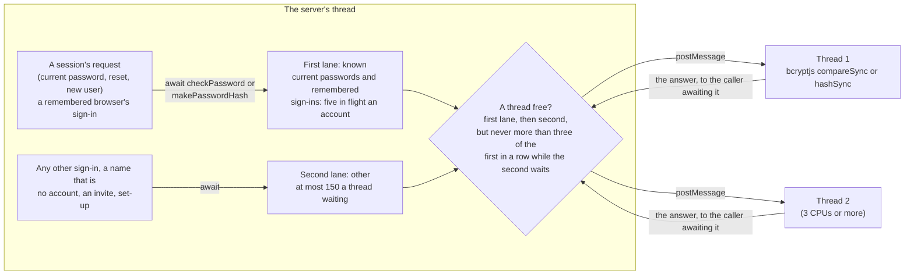

- **How many threads.** `min(2, max(1, CPUs − 1))`: two, or one on a machine with one or two
  CPUs. Never more than two: the threads are there to keep the server's thread free, not to
  check faster for whoever is guessing. `PASSWORD_THREADS` sets it (0 to 8); leave it unset
  (see [Deployment](deployment.md#environment-variables)). Each thread is a V8 heap of its own,
  about 10 MB.
- **How a thread starts.** From a string of code held in `passwords.ts`, because a worker file
  of its own would not be carried into the build. It loads bcryptjs by the absolute path
  `passwords.ts` resolves, which in the built server is `/app/node_modules/bcryptjs`, kept
  outside the bundle as every dependency is: the image did not change. A thread is given
  checks only once it has said it is ready, and never keeps the process alive.
- **One line in memory, in two lanes, in order of arrival.** A free thread takes the oldest
  check of the first lane, and of the second when the first is empty, **or when three of the
  first have been taken in a row while one of the second waited**: the second lane is always
  served. Without that, a stream of first-lane checks, each sent as the one before was
  answered, kept the first lane from ever being empty, and every sign-in, invite and set-up
  behind it waited until the second lane was full and was answered busy (measured: 66 checks
  of the first lane made while one of the second stayed unmade).

| Lane | Who | Where |
|------|-----|-------|
| First (`known`) | A caller the server already knows | The current-password check of the step-up actions, the Account page's email, password and key routes among them since card 2771 (`checkCurrentProof`; `whilePasswordHolds` no longer checks again, card 2701's code review S2); the hash of your own change, an administrator's reset and a new user (`POST /api/users`, the placeholder of an invited one included); a sign-in from a browser remembered for the account |
| Second (`other`) | Everyone else | A sign-in from a browser not remembered, a name that is no account included; the hash of an invite's use and of set-up |

- **The second lane is bounded: 150 checks waiting for each thread**, 300 with two: about
  thirty seconds of checks on a fast host, and 60 to 90 seconds on a small one, past the 60
  seconds nginx waits for an answer by default, so that a proxy left at its default answers
  `504` to whoever was last in the line (the configuration in Deployment waits 86400 s)
  ([Deployment](deployment.md#the-update-that-brings-password-checks-off-the-servers-thread-and-remembered-browsers)
  times one check on production). A check that arrives when it is full is not queued, and the
  caller is answered at once, `503`. Sign-in: "Sign-in is very busy right now. Wait a minute
  and try again, or sign in from a browser you have used here before."; the invite and
  set-up forms: "The server is very busy checking passwords right now. Wait a minute and try
  again." Nothing is counted at the account, since no password was checked; a sign-in was
  already counted at its address, and stays counted there (a later success at the account
  does not give it back).
- **The first lane is bounded for each account: five checks in flight**, its sessions'
  current passwords (with their re-checks) and its remembered browsers' sign-ins together,
  each holding a place at `known:user:<id>` (`FIRST_LANE_CHECKS_PER_ACCOUNT`, `enterSignIn`
  in `rate-limit.ts`) from before its check to its answer. A session's count of three wrong
  answers does not bound it, since a right password with a right code clears the count, and nor do a
  remembered browser's own five in flight, since every right password makes a new cookie.
  The sixth is refused before anything is counted or checked: a sign-in `429` in the words
  a browser not remembered is told, "A sign-in with this name is already under way from
  another browser…"; the step-up actions, the Account page's three among them, `429` "The server is very busy
  checking passwords right now. Wait a minute and try again." An administrator's reset and
  a new user are not bounded this way: they are an administrator's own actions. So one
  signed-in user, or whoever holds an account's password, keeps at most five checks in the
  first lane, plus the new hash of each password change it completes: `PUT
  /api/account/password` makes its hash after giving its place back. That cannot starve the
  second lane, which is served at least every fourth job while one of its checks waits.
- **A check whose caller has gone is not made.** When a thread is free for a check, the
  check's `gone()` is asked first: the sign-in, invite and set-up actions pass
  `callerHasGone(event.platform)`, which is `req.socket.destroyed` of the request the node
  adapter hands over. So when a burst ends, or a proxy gives up on a caller (nginx after 60
  s), the threads are not left checking passwords nobody will be told about. Its route answers
  as the `503` above, which nobody receives, and counts nothing at the account. Under `vite
  dev` and in the tests there is no `req`, and nobody is taken for gone. The routes of the
  first lane pass none.
- **A thread that stops during a check** is replaced, and the check sent once more, to the
  replacement, ahead of what arrived after it; a second stop fails the check, which its route
  answers `500`. **A check that throws** (a stored value 60 characters long that is not a
  bcrypt hash: `compareSync` throws for it, where a value of any other length is `false`)
  fails that one check, `500`, and the thread goes on. Nothing times a check: a stored hash of
  cost 31 would hold one thread, where it would have held the whole server. Only an import
  or a hand edit can store either. A stored hash of very high cost also holds one of the
  account's first-lane places for as long as each check of it runs, so five such checks at
  once leave that account answering `429` until they finish or the server restarts.
- **When no thread can start at all** (bcryptjs cannot be loaded in one), one `ERROR` line
  under `AUTH` says so, "Password checks cannot run on worker threads (…). Every password
  is checked on the server's thread until it restarts, which holds every other request for
  about a fifth of a second each time.", and every check runs on the server's thread as it
  did before, a turn later, for the life of the process, with the second lane bounded at
  150. Nobody is kept from signing in by it.
- **What it says in the log**, under `AUTH`: one `INFO` line at the first check, "Password
  checks run on 2 worker thread(s)" (or "on the server's thread (PASSWORD_THREADS=0)");
  "Password checks are queuing: 34 password checks waiting (sign-ins, invites, set-up), the
  oldest for 6 s" at `WARN` when the second lane holds more than 20, at most once every five
  minutes; and "Password checks are full: 300 password checks waiting (sign-ins, invites,
  set-up); sign-ins from browsers not remembered, invites and set-up are being answered
  'busy'" at `WARN` when the bound refuses one, at most once every five minutes. See
  [Admin Guide](admin-guide.md#logs).
- **What is queued.** The password, cut to its first 256 characters, and nothing else of
  the request. bcrypt reads only the first 72 bytes of a password, which the first 72
  characters always hold, so the cut changes no hash and no answer; and a longer passphrase's
  tail was never read. A password or a hash that is not text is refused with a `TypeError`
  before it is queued, rather than thrown inside a thread.
- **A name that is no account costs the same check** (card 2192). Sign-in at a name that
  matches no account checks the password typed against `DUMMY_HASH`, a fixed cost-12 hash of
  32 random bytes kept in `passwords.ts` that nothing matches, and ignores the answer: so it
  takes the time a wrong password at an account takes, in the same lane, and the clock no
  longer tells which names are accounts. It was answered at once (1 ms against 206 ms,
  measured). A test holds `DUMMY_HASH` at `BCRYPT_ROUNDS`, so a change of cost cannot leave it
  behind; an account whose stored hash had another cost would answer in another time, and
  none has.
- **In the tests** (`PASSWORD_THREADS=0`, set by `vitest.config.ts`) every check runs on the
  test's own thread a turn later (`setImmediate`), so that a test's `vi.mock('bcryptjs')` sees
  every call and a check is still never answered in the turn that asked for it.
  `tests/password-checks.test.ts` starts real threads.

**The re-check of a current password, outside the transaction.** The step-up actions, the
Account page's email, password and key routes among them, check the current password before their transaction, and a password changed in
between used to be checked again inside it: a bcrypt check with the write lock held, which a
transaction cannot make now that a check is awaited. `whilePasswordHolds(userId, checkedHash,
write)` in `auth.ts` runs the route's write in one transaction only while the stored hash is
still the one the password was checked against. If it has changed, nothing is written and the
answer is `409` "Your password was changed while this was being saved. Nothing was changed. Try
again." (`PASSWORD_CHANGED_MEANWHILE`, with `stepUp: 'changed'`). Until card 2701's code review
(S2, ruled 2026-11-04) it then checked the password again against the new hash, outside the
transaction, and did not count that check: a free guess against a hash the session's count
never saw. It compares nothing now. Nothing can change the hash between the comparison and the
write: better-sqlite3 runs the whole transaction without yielding, under `BEGIN IMMEDIATE`.

**What the people using it notice:** nothing, until a burst of sign-in attempts. Then a
sign-in from a browser the server does not know waits its turn, about a tenth of a second
for each check ahead of it with two threads, up to a fifth on a host with one or two CPUs,
and when 150 checks for each thread are already waiting it is answered at once "Sign-in is
very busy right now…" instead; an invite's form and set-up the same. Signed-in people, and
browsers remembered for the account, go ahead of them, three at a time at most, and five in
flight for any one account, plus the new hash of each password change it completes.

Covered by `tests/password-checks.test.ts` and `tests/atomic-accounts.test.ts`.

### Guessing a Current Password

Thirty-seven actions ask a caller who is already signed in for their current password and, since
card 2771 (2026-11-17), a code from their authenticator app or a recovery code: the actions of
[Step-up Before Destructive Actions](#step-up-before-destructive-actions-card-2701), among
them the Account page's three, changing your email (`PUT /api/account/email`), changing your
password (`PUT /api/account/password`, which the admin page's dialog on your own row uses too)
and Generate Key (`POST /api/account/api-keys`). Those three asked with checks of their own
until card 2771 moved them onto `confirmStepUp`. The password and the code are what whoever
holds a session and not them (an unlocked machine, a copied cookie) would need, and a password
found at any of them passes every one of them.

**The count is on the session's row, for the session's whole life** (card 2701, decisions 5
and 6, as its code review's S1 ruled them again on 2026-11-04: only a compare counts). Every
check that compares a password adds one to `sessions.wrong_password_count` (migration 0062)
just before it compares, all of these routes counted together, once for the attempt whichever
part of it is wrong; a check refused before any compare (one of the session's own in flight,
the account busy, or step 2b's factor refusals) adds none. A right password with a right code
sets it back to 0, and nothing else does: no window, and a restart does not clear it. **The
third wrong answer ends the session**, a wrong password and a wrong code counted alike. Since
card 2772 an attempt with an authenticator code counts one for each of the account's
authenticators it was tried against (taken at step 2b, before the compare), so a count of 3 is
reached at the second wrong answer with two authenticators and at the first with three (see
[Several Authenticators, Every One Tried](#several-authenticators-every-one-tried-card-2772)). Steps 1 to 4 below run in one turn, with nothing awaited
between them, so no other check can come between the read, the refusals and the count. Until card 2701 the count was ten in 15 minutes, in memory: the window
started again every 15 minutes and at every restart, about 960 guesses a day from one stolen
cookie, answered `429` "Too many wrong passwords. Try again in N minute(s)." That answer, its
window and its `current-password:<session>` key are gone.

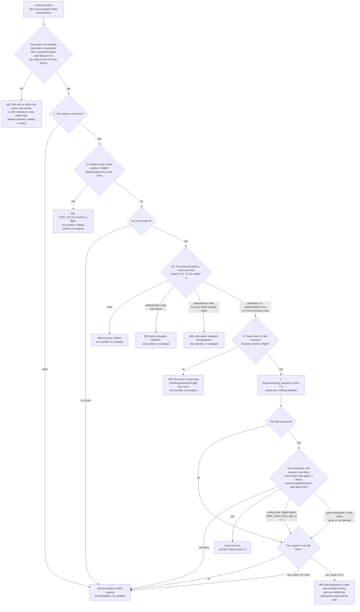

- **Its answers.** A wrong password or a wrong code is `403` "Your password or code was not
  right. Nothing was changed." (`stepUp: "wrong"`) on every route, never saying which (card
  2771; the Account page's own words, "Password is incorrect" and "Current password is
  incorrect", are gone). Once the session has been ended, by the third
  wrong one or by anything else while the check was made (a sign-out, a password change or a
  reset), every route answers the same `403` `{ message: "Nothing was changed. This session
  has been signed out, after three wrong passwords or codes, or because it had ended: sign in again.",
  signedOut: true, stepUp: "signed-out" }` with the session cookie cleared, **whether the
  password was right or wrong**: the row is read again after the compare, so an answer given
  after the end never tells a right guess from a wrong one. The page's sign-out watch takes it
  as a `401` and goes to sign-in at once, and the dialog leaves no password field (card 2701's
  code review, F5); the session's next request would be `401` at the gate anyway.
  `refuseWrongPassword(cookies, checked, says)` in `auth.ts` gives either answer, the wrong one
  with `stepUp: "wrong"` in `says` (`STEP_UP_WRONG` from `confirmStepUp`, its only caller).
- **One check in flight per session.** Five checks may be in flight for an account, so without
  this one session could race several guesses past a count of three. A second check from a
  session that has one under way is answered `429` "Your password is already being checked
  for this session. Wait for that answer and try again. Nothing was changed." (`stepUp:
  "in-flight"`) with no password compared and **nothing counted**: it compared nothing (S1).
  With one check at a time, nothing else can add to the count between a check's own count and
  its answer, so the wrong one that takes the count to 3 or more is always the one that ends
  the session. It is asked **before** the count is looked at (card 2772's code review, CR1):
  a check under way has already added its weight, so with three authenticators a right one
  holds the count at 3 until it clears it, and a second request from the same session in that
  moment must be told to wait, not signed out. The set of
  sessions with a check under way is in memory, as the requests it guards are. The pages send
  one request per press and turn their buttons off while it is answered, so a person does not
  meet it.

- **Why the session and not the account.** Counted on the account, whoever held one session
  of it could keep every session of it refused, the owner's included, and so keep the owner
  from changing the password, which is how an owner ends the other sessions. A session is
  only made by signing in or with an invite, each of which needs the password or sets it, so
  a count on the session holds the guesser as well: three guesses, then sign in again, which
  needs the password. Another browser of the account is untouched, and sign-in's own counts,
  by address and by account, are not touched either: a stolen session could otherwise slow
  or lock the owner's sign-in from a browser that was never stolen.
- **Five in flight for the account.** Each check holds one of the account's five places in
  the first lane, shared with its remembered browsers' sign-ins, from before it is counted to
  its answer; the sixth at once is answered `429` "The server is very busy checking
  passwords right now. Wait a minute and try again." (`stepUp: "busy"`) with nothing checked
  and **nothing counted**, so busy answers, however many, never end a session (S1). Nobody
  using the pages one at a time meets it. See
  [Off the Server's Thread](#off-the-servers-thread-card-2191).
- **One function.** `checkCurrentProof(sessionHash, userId, password, code, hash, where)` in
  `src/lib/server/auth.ts` (`checkCurrentPassword` until card 2771, which replaced it rather
  than wrapping it, and `currentPasswordMatches` until card 2191) reads the row, refuses a
  second check in flight (before the count is looked at, so a check under way that has counted
  its weight never makes a second request end the session: card 2772's code review, CR1), ends
  the session at a count of 3 or more, checks the account's factors (step 2b, every
  authenticator tried, which sets the weight: one for each tried, a recovery code one),
  refuses a sixth check for the account, then counts the attempt by its weight and checks the password on a
  worker thread in the first lane, all but the check in one turn; then, for a right password,
  verifies and spends the code and clears the count in one transaction (see
  [The Code Beside the Password](#the-code-beside-the-password-card-2771)). A check that fails
  on its worker stays counted. It is async and resolves to `{ matches, signedOut, by,
  codesLeft, signalled }` (`Proven`), so a missed `await` does not compile; `code` is a
  `ProofCode`, `{ kind: 'authenticator', digits }` or `{ kind: 'recovery', typed }`, already
  in form. `confirmStepUp` is its only caller. The session comes from the session
  cookie the gate checked; a request that reaches one of these routes without one is answered
  `401`. A route whose stored hash moved in between is refused `409` by `whilePasswordHolds`
  (see [Password Hashing](#password-hashing)), which compares nothing again (S2).
- **The system log.** Each wrong password is a `WARN` line under `AUTH`, "Wrong current
  password for user N on {route}"; a right password with a wrong code, "Wrong code for user N
  on {route}: the password was right"; a right password whose code's step was spent meanwhile
  or whose factor could not be opened in the transaction, "Code not spent for user N on
  {route}: the password was right, and the code's step was used meanwhile or the factor could
  not be opened"; and each session ended for them one more, "Session ended
  after three wrong current passwords for user N on {route}", beside `deleteSession`'s own
  `INFO` line, "Session deleted (three wrong current passwords)". The session is never
  logged, nor the password, the code or the secret.
- **A password or a code that is not text** (a number, `true`, a list), missing or empty, is
  answered `400` `{ message: STEP_UP_MISSING, stepUp: "missing" }` before anything is counted,
  on every route (the Account page's own "Password is required" and "Current password is
  required" went with card 2771). It used to reach bcrypt and be answered `500`. So did
  a new password that is not text, which is now `400` too: the password route's "New password
  must be at least 8 characters", and `password must be text` on an administrator's reset
  (`PUT /api/users/:id/password`), which looks for the account and checks the caller before
  it reads the password (card 2117).
- **On the row, not in memory.** The count survives a restart; only the one-in-flight set is
  in memory, and a restart ends the requests it guards. A backup holds no session rows and a
  restore copies none, so neither carries a count.

Covered by `tests/atomic-accounts.test.ts` and `tests/step-up.test.ts` (cases 9 to 16, and
card 2771's T1 to T11).

### Guessing a Password at Sign-in

The sign-in form (`/login`, its action in `src/routes/login/+page.server.ts`) is the one part
of DumpFire anybody can reach that checks a password. It counts two things, holds browsers it
does not know to one sign-in at a time at an account under attack, and lets a browser that
has signed in to the account before past all of it (see
[Browsers That Have Signed In Before](#browsers-that-have-signed-in-before)).

**Per address.** Ten attempts from one address in 15 minutes, in a fixed window from the
first; the eleventh is answered at once, `429` "Too many login attempts. Please try again in
N minute(s).". An attempt it refuses never waits and is not counted at the account, since
no password was checked. On its own it let a guesser with N addresses try 10 × N passwords
at one account every 15 minutes (card 2177).

- **An address is counted by its key** (card 2195): an IPv6 address by its /64 network, an
  IPv4 address written as IPv6 (`::ffff:198.51.100.7`) as the IPv4 address, and no port. So
  everyone on one IPv6 network shares the ten, as an office behind one IPv4 address already
  does, and a caller holding a /64 no longer has 2^64 allowances. See
  [How an Address Is Counted](#how-an-address-is-counted).
- **A sign-in that succeeds gives back only the attempts its address made at that account**
  (card 2226). The count notes which account each admitted attempt was at (the key below:
  `user:<id>`, so a username and its email are one; `name:<sha-256>` for a name that is no
  account), and the right password takes that account's attempts off the address's count,
  and nothing else. Someone who mistypes their own password three times and then signs in
  has those four back, so mistypes at an account whose owner then signs in never add up
  across an office. Since card 2769 the give-back happens when the second step is passed (a
  right code, a recovery code, or a set-up confirmed), not at the password: a right password
  alone gives nothing back and forgets nothing. Attempts at another account, at a name that is no account (a mistyped
  username included), and refusals stay counted to the end of the window, and the count
  never goes below zero. It used to clear the address's whole count, so anyone with an
  account could send nine guesses at another, sign in to their own, and go on from the same
  address as often as they liked: 36 wrong at another account in one window, measured, none
  refused. A browser remembered for the account is never counted at its address, so its
  success gives nothing back.
- **The lookup comes first.** The account is known only after the name is looked up, so the
  lookup is made before the address is counted; an attempt the address's limit refuses
  costs one indexed read before its `429`, the same for a name that is an account and one
  that is not.

**Per account, from any number of addresses (card 2177).** After five wrong passwords at one
account within 15 minutes of each other, every sign-in at it from a browser not remembered
for it waits before its password is checked, the right password included, and is then
answered as it would have been:

| Wrong passwords at the account when the attempt arrives | Wait before the password is checked |
|---|---|
| 0 to 4 | none |
| 5 | 1 s |
| 6 | 2 s |
| 7 or more | 4 s |

- **The wait refuses nothing.** The answer's status and words do not change: a wrong password
  is `400` "Invalid username/email or password", as before, and the right password goes on to
  the second step after at most four seconds; passing that clears the account's count and gives
  back the address's attempts at the account (card 2769). What can refuse a sign-in at the account is the one-at-a-time
  rule below (card 2194), which reverses card 2177's "never refused": while the account has
  had five wrong passwords within 15 minutes of each other, a browser not remembered for it
  is let in one at a time, and the rest are refused at once, `429`. A browser remembered for
  the account is never made to wait or counted, and is refused only while five of the
  account's first-lane checks are already in flight (see
  [Off the Server's Thread](#off-the-servers-thread-card-2191)).
- **The key is the account, once the name is found.** The lookup is the one sign-in makes:
  a name with `@` is lower-cased and matched to an email, anything else matched exactly to
  a username. Found, the count is kept under `user:<id>`, so a username and its email share
  one count. Not found, it is kept under `name:` and the SHA-256 of the name exactly as the
  lookup read it: trimmed, a name with `@` lower-cased, a username in the case typed. So a
  name that is no account waits exactly as a real one would, and the count holds 64
  characters whatever was typed. It was lower-cased either way at first, while a username
  is matched exactly: five wrong at `ALICE` and then one at `alice` waited 1 s when `alice`
  was no account and none when it was one, which told the two apart.
- **An idle window.** The count is forgotten 15 minutes after the last wrong password, so
  the waits last as long as the guessing does. A fixed window would give five free guesses
  every 15 minutes.
- **Read when the attempt arrives, counted after the check.** Attempts sent together read
  the same count and would wait alike, side by side; the one-at-a-time rule below is what
  bounds how many are let in at once.
- **A wait holds nothing up.** It is an awaited timer, holding no transaction and no
  database handle, so every other request is answered meanwhile. Everything before it (the
  form read, the lookup, the remembered browser's cookie, the per-address count and the place
  of the one-at-a-time rule) is one synchronous stretch, after which the sign-in holds only
  the account's id (or nothing, for a name that is no account), the password cut to its
  first 256 characters, the name cut to 320 for the answer, its length, and the address,
  each copied so that nothing of the form is kept alive: well under 2 KB besides its
  connection, where the form can be the gate's 512 KB. bcrypt reads only the first 72 bytes
  of a password, which 256 characters always hold, so no password that signed in before
  stops signing in. The account is read again by its id after the wait, so the password is
  checked as it is then.
- **One `WARN` line when an account's waits begin**, at its fifth wrong password in the
  window, under `AUTH`: `Sign-ins at "pat" (user 12) are being slowed: 5 wrong passwords
  within 15 minutes of each other`, with the account as the line's user, so the Audit page
  finds it by user; or `Sign-ins at a name that is no account are being slowed: …`, with
  none. Not one line per wait, so a guesser does not fill the log. The "Failed login
  attempt" lines beside it hold nothing that was typed: see
  [What a Failed Sign-in Writes](#what-a-failed-sign-in-writes).
- **The page shows the wait.** The Sign In button is disabled, and reads "Signing in…",
  from the press until the answer, so that four seconds with nothing to see are not met by
  pressing again.
- **Apart from the current-password count** above. A wrong current password on My Account
  counts against its session, and a wrong sign-in against the account; neither counts toward
  the other, and neither a correct current password nor a password change clears the
  sign-in count.
- **In memory**, in its own map in `src/lib/server/rate-limit.ts` (`signInWait`,
  `countWrongSignIn`, `forgetWrongSignIns`), swept with the other counts every five minutes
  and emptied by a restart, as every count there is. The map holds at most
  `WRONG_SIGN_IN_KEYS = 10_000` counts, since every name that is no account is one of its
  own: full, the one counted longest ago is forgotten to make room. Pushing an account's
  count out so takes 10,000 names, a thousand addresses' worth of attempts at ten each in
  15 minutes, and only while the account's own guessing has paused. (Before card 2226 one
  address with an account of its own did it, signing in between: measured, 8.4 s.) A
  remembered browser's count of wrong passwords, kept under `nonce:<nonce>` in the same map,
  can be pushed out the same way.

**One at a time, for browsers not remembered (card 2194).** At one key (`user:<id>`, or
`name:<sha-256>` for a name that is no account), a sign-in from a browser not remembered for
the account is let in only while fewer such sign-ins are already in flight there than the
free guesses left, and never fewer than one: `max(1, 5 − n)`, where `n` is the count of
wrong passwords above. So five free guesses an idle window however they are sent, then
**one at a time while the waits last**. In flight is from passing the per-address count to
the answer, the wait and the check included; the place is taken in the synchronous stretch
as the attempt arrives, so attempts sent together take places in the order they arrived,
and given back in a `finally` however the sign-in is answered.

- **Beyond it, refused at once:** `429` "A sign-in with this name is already under way from
  another browser. Wait a few seconds and try again, or sign in from a browser you have used
  here before." The same words and the same rule for a name that is no account, so the
  refusal tells nothing about which names are accounts. Counted at the address, as every
  attempt is, and kept counted there, so a later success at the account does not give it
  back; not counted at the account, since no password was checked.
- **One `WARN` line under `AUTH` for the first refusal at a key**, and again only after 15
  minutes without one: `Sign-ins at "pat" (user 12) from browsers not known here are being
  let in one at a time`, with the account as the line's user, or `Sign-ins at a name that is
  no account from browsers not known here are being let in one at a time`, with none.
- **What it does to a guesser who sends many at once**: one guess per wait and check at one
  account, about one every 4.3 s, about 210 in 15 minutes, as a guesser who waits for each
  answer makes. Before it, each request waited its own few seconds side by side, and the
  first volley of every idle window, all reading a count of 0, was as large as the
  per-address limit allowed across every address the guesser had.
- **Turned off on the host** with `SIGN_IN_ONE_AT_A_TIME=off`, for an owner an attack keeps
  out of every browser not remembered: see
  [If an Attack Keeps an Owner Out](deployment.md#if-an-attack-keeps-an-owner-out). Off, every browser is
  let in after the account's wait, as card 2177 had it.
- **In memory**, in `src/lib/server/rate-limit.ts` (`enterSignIn`, `leaveSignIn`,
  `wrongSignInsAt`, `FREE_WRONG_SIGN_INS = 5`); a key with none in flight has no entry, so
  names that are no account do not pile up.

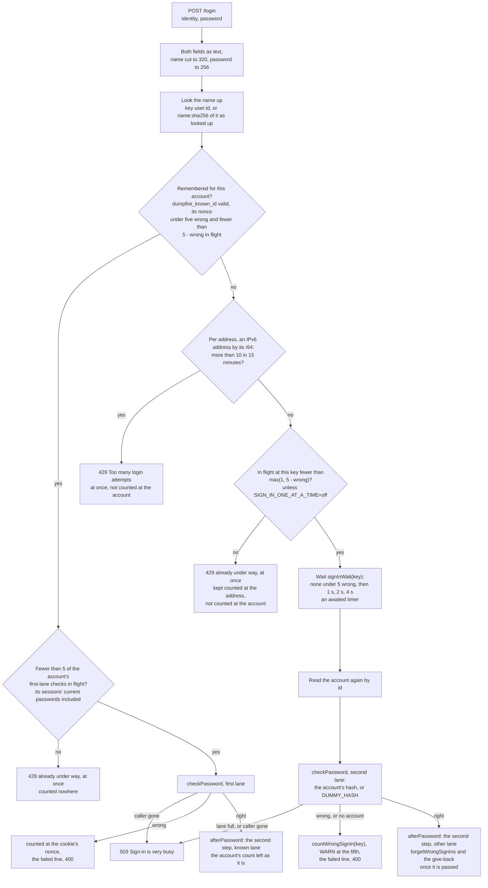

Since card 2769 a right password opens the second step and makes no session: see
[What a Right Password Leads To](#what-a-right-password-leads-to). The session, the cookie and
the give-back follow a right code or a confirmed set-up.

What it does, and what it does not, said plainly:

- **It slows a guesser who waits for each answer**, one request at a time through as many
  addresses as they like, to about one guess every 4 seconds at one account after the first
  five: about 220 in 15 minutes, where it was 10 for each address.
- **It slows a guesser who sends many at once to the same rate**, by the one-at-a-time rule.
  No wait that the right password always gets past could: the guesser learns within those
  seconds whether each guess was right. That rule refuses, and refusing is what can keep an
  owner out on a browser not remembered (see
  [Browsers That Have Signed In Before](#browsers-that-have-signed-in-before)). How many
  addresses a guesser has depends on how the server reads them behind a proxy: see
  [Deployment](deployment.md#the-callers-address-behind-a-proxy).
- **It does not slow one password tried across many accounts**, where each account's count
  stays low. The per-address limit bounds that.
- **The wait can be seen.** One wrong attempt shows whether the account has had five wrong in
  the last 15 minutes, and its going back to none that the owner has just signed in. And
  since one account's username and email share one count, wrong attempts at one show at the
  other: five wrong at a username and a sixth at an email, which waits only if both are one
  account's, tell whether they are, for 6 of an address's 10 attempts. That is accepted (the
  plan's decision 10, one count for the account, is deliberate), and since card 2192 it is
  the one tell left: whether a name is an account at all can no longer be told from how long
  a wrong password takes, because a name that is no account is checked as an account's
  wrong password is (see [Password Hashing](#password-hashing)). It links a username
  already known to an email, at the cost of 6 of an address's 10 attempts.

**What the owner of an account notices:** after five wrong passwords at it within 15 minutes
of each other, every sign-in at it from a browser not remembered for it, their own included,
waits 1 to 4 seconds before it is answered, until 15 minutes pass with no wrong password or
the right one is given; and while that lasts, a second sign-in at it at the same moment from
such a browser is refused at once, "A sign-in with this name is already under way from
another browser…". On a browser remembered for the account, none of that applies, unless
five sign-ins and current-password checks of the account are already in flight. A browser
remembered for the account is also answered `503` when its caller has gone before a thread
was free for its check, as any other; nobody receives that answer.

#### What a Failed Sign-in Writes

Each failed sign-in is one `WARN` line under `AUTH`, and holds nothing that was typed (card
2193):

| Case | The line | Fields |
|------|----------|--------|
| A wrong password at an account | `Failed login attempt at "alice" (user 12) from IP 203.0.113.7 (bad password)` | `user_id`, `ip` |
| A name that is no account | `Failed login attempt for a name that is no account (17 characters) from IP 203.0.113.7` | `ip` |

- **The account's own username**, from its row and cut to 100 characters, never the name as
  typed: an email typed is not repeated, and the Audit page finds the line by user, as it
  finds the "being slowed" line.
- **A name that is no account by its length only.** The name as typed was written, at any
  length until card 2177 cut it to 320, so a password typed into the name box was written in
  clear, where every administrator reads the log (the Audit page, `GET /api/logs`) and into
  every backup. A short hash of the name was not chosen: a hash of a short password can be
  matched against a list of common passwords by anyone who reads the log.
- **The address as received**, cut to 100 characters, in the text and as the line's `ip`,
  or `unknown` in the text and no `ip` where it cannot be read. Both lines had no `ip`.
- **The lines already in the log are rewritten** at the first start after the deploy, and in
  every backup's copy: a line in the old form for a name that was no account,
  `Failed login attempt for "<what was typed>" from IP …`, becomes
  `Failed login attempt for a name that is no account (N characters) from IP …`, N being the
  length of what was between the quotes, the whole of it to the last `" from IP `, quotes
  and line breaks included. An old line ending ` (bad password)` named an account and is
  left as it is, with the name as typed; those age out of the log (30 days or 50,000 lines)
  but stay in backups made before then. It is the third rule of `maskSecretsInLog()` in
  `src/lib/server/secret-paths.ts`, which `maskLiveLog()` runs at every start and
  `withoutSecrets()` over every backup's copy; a line in the new form does not begin as the
  old did, so a second start changes nothing. Backups made before the deploy keep the
  names.

Covered by `tests/gate.test.ts`, on a fake clock, and `tests/backups.test.ts`.

### Browsers That Have Signed In Before

Each browser that signs in to an account is **remembered for it for a year** (card 2194), by a
cookie of its own sent only to the sign-in page. A remembered browser skips all of sign-in's
throttling: the account's wait, the one-at-a-time rule and the per-address limit, and its
check goes in the first lane. So the account's owner, on a browser they have used, is never
made to wait or counted, however the account is being guessed at. It is refused only while
five of the account's checks in the first lane are already in flight, its sessions' current
passwords included (see [Off the Server's Thread](#off-the-servers-thread-card-2191)): every
right password makes a new cookie, so the five in flight for each cookie below do not bound
whoever has the password, and this does. Such a refusal is the one-at-a-time words, `429`,
and counts nothing. The code is
`src/lib/server/known-browsers.ts`; the order is the chart above.

**The cookie.**

| | |
|---|---|
| Name | `dumpfire_known_<user id>`, one for each account the browser has signed in to |
| Value | `<issued at>.<nonce>.<mac>`: the time of issue in seconds, 16 random bytes in hex, and `HMAC-SHA256(key, "known-browser:2:<user id>:<issued at>:<nonce>:<the account's password hash>")` in hex. About 110 bytes. The domain was `known-browser:1:` until card 2769: a cookie signed under it, by an older image, is not remembered (see [Older Images and Instances](#older-images-and-instances)) |
| Options | `Path=/login`, `HttpOnly`, `SameSite=Strict`, `Secure` by `httpsOnlyCookie()` in `auth.ts`, as the session cookie (always over HTTPS; otherwise `COOKIE_SECURE` when set, else in production; card 2850, see [Every Cookie DumpFire Sets](#every-cookie-dumpfire-sets-card-2850)), `Max-Age` a year |
| Good when | It parses, was issued no more than 365 days ago and not more than a minute in the future, and its MAC matches, compared in constant time, with the account's hash as it is now. Anything else is answered as no cookie at all |

**When a browser is remembered.** A new cookie (a new time and nonce) is set to the browser
that signs in successfully, at each sign-in, which since card 2769 means once its second step
is passed (a right code, a recovery code, or a set-up confirmed) and never at the password
alone; to the browser that changes its own password, with the new hash; and to a browser that
signs out with an open session (`POST /logout`), with the account's hash read before the
session ends: a browser that signed out is a browser that signed in. An invite and the
first-run set-up no longer remember the browser: they lead to setting up an authenticator, whose
confirm does.
`rememberBrowser()` runs after the change is committed and never fails the request: a key
that cannot be had is one `WARN` line, "A browser could not be remembered for user N: …", and
no cookie.

**What ends it.** Nothing is stored for a browser, so nothing is deleted:

- **Any change of the account's password hash**: the holder's own change, an administrator's
  reset, an invite's use. The MAC is over the hash, so every remembered browser of the
  account stops counting at once. The browser that made the change, or used the invite, is
  remembered anew; an administrator's reset remembers none. So does an account deleted and
  its id used again (another hash).
- **A year** after it was issued.
- **The key replaced**: a restore (Import Backup), Reset Everything, or the key's row deleted
  on the host (see [Deployment](deployment.md#if-an-attack-keeps-an-owner-out)).
- **Not sign-out**, which remembers the browser, and **not** a change of email or role, which
  ends invites and no session. The cookie outlives every session: ending a session, by
  signing out, by its expiry or by an administrator's action, does not end it; only setting
  the password does.
- **Five wrong passwords from the cookie** within 15 minutes of each other: it then counts as
  not remembered until 15 minutes pass without one. A remembered browser's wrong password is
  counted at its own nonce (`nonce:<nonce>`), not at the account, and writes the failed line
  as any other, but never the "being slowed" line.
- **At most five sign-ins from one cookie in flight at once**, less its wrong ones; past that
  an attempt is treated as from a browser not remembered (the per-address limit, the
  one-at-a-time rule, the wait, the second lane). So a copied cookie (a shared or lost
  computer, a copied browser profile) buys at most five guesses in flight and five each idle
  quarter of an hour, never a volley, and setting the password ends it.

**What a remembered browser's success does.** It signs in and is issued a new cookie. It
leaves the account's count of wrong passwords as it is, because an attack is not over when the
owner signs in, and gives the address nothing back, since nothing was counted there. A browser
not remembered keeps card 2177's rule that the right password clears the account's count.

**The key: 32 random bytes in `settings`, key `known_browser_secret`.** Made by the first
browser remembered (a check of a cookie never makes one: with no key no cookie is good), read
once into memory, as the request form's key is. Migration 0067 (card 2769) deleted it once, so
every browser remembered before the release was forgotten. **Never in a backup and never restored**:
`withoutSecrets()` deletes the row from every backup's copy, and `rowsToRestore()` leaves it
out of a restore, which clears the live row with every other; so the restored server makes a
new key, and every browser is forgotten, as every session already is. Whoever held the key and
an account's hash (which a backup holds) could make a cookie for that account. Reset and both
import paths forget the cached key (`resetKnownBrowserSecretCache()`).

**When an attack keeps an owner out.** On any browser not remembered, while the account is
being guessed at in parallel, the one place is almost always taken by the guesser, so the
owner is refused with the one-at-a-time words. Keeping it so needs only the account's username
or email, which every signed-in user can read, and one admitted attempt per wait and check,
about two dozen IPv4 addresses, or one IPv6 /48. Each refusal is also counted at the refused
caller's address. The ways in:

- a browser remembered for the account;
- a session already open, which is not touched;
- an invite, only where mail is set up, and only for an account an administrator may manage:
  never the superadmin's, and an administrator's only from the superadmin. An invite leads to
  setting up an authenticator without the sign-in page, and the confirm remembers the browser.
  Since card 2773 no invite works for an account that holds a second factor;
- waiting until 15 minutes after the last wrong guess;
- `SIGN_IN_ONE_AT_A_TIME=off` on the host, for one sign-in: see
  [If an Attack Keeps an Owner Out](deployment.md#if-an-attack-keeps-an-owner-out).

An attacker with a whole IPv6 /48 (65,536 networks of /64, each with ten attempts of its own)
can instead keep the second lane of password checks full, at any accounts or none: every
sign-in from a browser not remembered, every invite and set-up is then answered busy, `503`.
`SIGN_IN_ONE_AT_A_TIME=off` does not help with that. Only a remembered browser or a session
already open gets in, their checks being in the first lane, and only the proxy's own limits,
if it has any, can hold such an attacker back.

After an administrator sets a password during an attack, no browser is remembered for the
account: where mail is set up, send an invite instead; where it is not, its owner signs in
once the attack stops, or the host's operator turns the rule off for one sign-in. Nobody can
reset the superadmin's password; the superadmin keeps a remembered browser by changing their
own password from one, which keeps that browser remembered. A restart does not help: it
empties the counts, and five wrong passwords, a second's work, fill them again.

**What the owner of an account notices:** a browser you have signed in with, or signed out
of, is remembered for a year or until the password is set again, and signing out does not
forget it. To forget every browser of an account, set its password; to forget every browser of
every account, see [Deployment](deployment.md#if-an-attack-keeps-an-owner-out). After the
deploy, sign in again, or sign out and in, on each browser you will want during an attack,
the superadmin's first.

Covered by `tests/gate.test.ts` ("a browser that has signed in here before"),
`tests/atomic-accounts.test.ts` ("remembered browsers, when a password is set") and
`tests/backups.test.ts`.

### How an Address Is Counted

Three things are counted by the caller's address: sign-in's ten attempts in 15 minutes, the
public request form's limits (`addressToCount()`, in its three routes), and the documented
API's sixty requests a minute with no key it accepts (the gate's `apikey-none:` count). Each
counts the address's **key**, `addressKey()` in `src/lib/server/client-address.ts` (card
2195), and not the address as received:

| The address received | Counted as |
|----------------------|------------|
| `unknown` (no address could be read) | `unknown`, with every other such request |
| `198.51.100.7`, `198.51.100.7:51234` | `198.51.100.7`: a port is taken off |
| `::ffff:198.51.100.7`, `::FFFF:c633:6407` | `198.51.100.7`: an IPv4 address written as IPv6 is the IPv4 address |
| `2001:db8:1:2::1`, `2001:0DB8:0001:0002:ffff::9`, `[2001:db8:1:2::1]:443`, `2001:db8:1:2::198.51.100.7` | `2001:db8:1:2::/64`: an IPv6 address by its first four groups, its /64 network |
| `fe80::1%eth0` | `fe80:0:0:0::/64`: a zone is taken off |
| Anything else | As received, cut to 100 characters, so a key's size is bounded |

- **Why the /64.** A whole IPv6 address was counted, so a caller given a /64 (one host, one
  household, one office subnet: every IPv6 network) had 2^64 allowances: eleven wrong
  sign-ins from eleven addresses of one /64 were never refused. A /64 is one network, which
  already shares one IPv4 address through NAT. A /48 is a whole site and would put everyone
  there in one count; what a holder of many /64s can still do is bounded at each account by
  the waits and the one-at-a-time rule.
- **A port is taken off only from what is no address as it stands**, so `fe80::1`, which ends
  in a group, keeps it. A proxy can write a port into the caller's address header
  (`1.2.3.4:5678`), and each connection would have been an allowance of its own.
- **Every log line keeps the address as received**: the gate's `ip`, the sign-in lines. Sign-in's
  refusal line adds the key where it differs: `Rate limit hit for IP 2001:db8:1:2::9, counted
  as 2001:db8:1:2::/64 (login attempts)`, with the address as the line's `ip`.
- **Behind a proxy that is not told the caller's address**, every caller has the proxy's,
  which is one IPv4 address: nothing here changes. IPv6 reaches the counts only through
  `ADDRESS_HEADER`, as behind Cloudflare: see
  [Deployment](deployment.md#the-callers-address-behind-a-proxy).

- **Some addresses share a key they do not share a network with.** Every link-local address
  (`fe80::…`, any zone) is one key, `fe80:0:0:0::/64`, and every address whose first four
  groups are zero (`::`, `::1`, the old IPv4-compatible `::198.51.100.7`) is `0:0:0:0::/64`. A caller should never reach the server from either, but
  behind a proxy that hands one on, all such callers share one count.

**What the people using it notice:** everyone on one IPv6 network shares sign-in's ten attempts
in 15 minutes and the request form's limits, as an office behind one IPv4 address already
does: an office whose LAN is one /64 shares the ten, so a few people mistyping at once can
hold the office's sign-ins for up to 15 minutes. Browsers remembered for an account are not counted at their address at all.

Covered by `tests/gate.test.ts` ("counting an address").

## Second-Factor Secrets at Rest (Card 2768)

Two-step sign-in asks, after the password, for a code from an authenticator app or for one
of ten single-use recovery codes. Card 2768 builds where those are kept; card 2769 adds the
sign-in step and the setting up of an authenticator, which use them (see
[Two-Step Sign-In](#two-step-sign-in-card-2769)). Card 2768 also loads and checks the key at
every start, and sets what a password set or an email or role change ends, and what backups, the
export and a restore do with these rows.

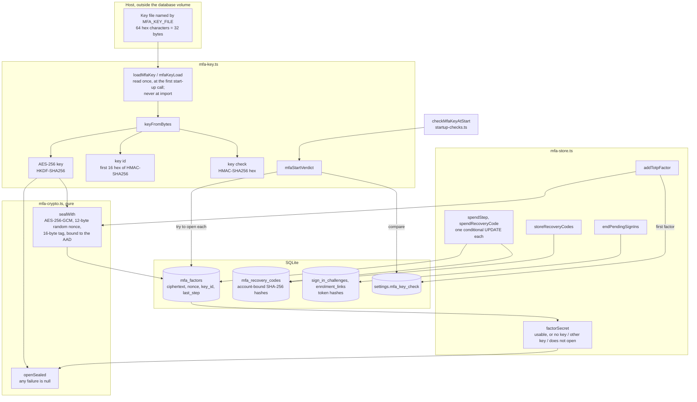

### The Key and What Is Derived From It

The key is 32 bytes, kept as 64 hexadecimal characters in a file outside the database and
outside every backup, named by `MFA_KEY_FILE`. Where the production rules apply (`NODE_ENV`
anything but `development` or `test`, unset included, on a database that is not in memory) the
server never makes one and refuses to start without it. How to make, mount and back it up,
what each refusal says, and what to do if it is lost, are in
[The Key That Protects Authenticator Secrets](deployment.md#the-key-that-protects-authenticator-secrets).

The file's bytes are never used directly. Three values are derived from them
(`keyFromBytes`, `src/lib/server/mfa-key.ts`), so the key is never used under two primitives:

| Value | Derived as | Kept where | What it is for |
|-------|-----------|-----------|----------------|
| The AES key | HKDF-SHA256 of the file's 32 bytes, empty salt, info `dumpfire mfa aes-256-gcm v1`, 32 bytes | In the process's memory only | Sealing and opening every secret |
| The key id | The first 16 hexadecimal characters of HMAC-SHA256(file key, `dumpfire-mfa-key-id`) | `mfa_factors.key_id` and `sign_in_challenges.key_id`, beside what it sealed | Which key sealed a secret, so a secret of another key is told apart without trying it, and a change of key at start (card 2773) re-seals only the factors still under the old one |
| The key check | HMAC-SHA256(file key, `dumpfire-mfa-check`), as hex | `settings.mfa_key_check`, written with the first factor | Whether the key this server started with is the one its factors were made with |

The AES key, and the file's bytes, are never written anywhere: not to a log, a message, a row or
a backup. The key id and the key check are not secrets: they are identifiers from which neither
the key nor the AES key can be worked out. They are written in the rows named above, and so they
are in every backup that holds those rows, and the key id also appears in the `ERROR` lines that
name a factor that cannot be opened. Nothing else of the key is written anywhere. The
derivations are pinned by a known-answer test: a fixed key gives
fixed hex for all three, and a fixed ciphertext opens under the derived AES key and not under
the file's own bytes (`tests/mfa-secrets.test.ts`, T10).

### Sealing a Secret

An authenticator's secret is 20 random bytes (160 bits). It is stored only sealed
(`src/lib/server/mfa-crypto.ts`):

- **AES-256-GCM** with the derived key, a nonce of 12 random bytes made for every seal, and a
  16-byte tag. `secret_ciphertext` is the base64 of the ciphertext with the tag after it;
  `secret_nonce` the base64 of the nonce. Two seals of one secret differ in both.
- **Bound to where it belongs** by GCM's additional data. A factor's secret is sealed with
  `mfa-factor:<user id>:<factor_uid>`, `factor_uid` being 128 random bits as hex, made for each
  factor; a secret being set up, held in a pending sign-in, with
  `mfa-enrol:<user id>:<token hash>`. A sealed secret copied to another factor row, or to
  another account's, does not open. When a secret being set up becomes a factor, it is opened
  under the enrolment's data and sealed afresh under the factor's, with a new nonce.
- **Opening fails closed.** Any failure is "does not open", and nothing is thrown: another key,
  other additional data, a changed byte, a nonce that is not 12 bytes, or a ciphertext too
  short to hold one byte and its tag. The tag is taken strictly as the last 16 bytes. A secret
  that opens but is not exactly 20 bytes is refused too, and zeroed. Whatever was deciphered
  before a refused tag is zeroed and not kept.
- **A secret of any other length is never written**: `addTotpFactor` refuses one before
  anything is stored.

### The Key Check, and the Start-Up Verdict

`addTotpFactor` writes the key check in the same transaction as the factor. No check stored:
it records this key's. This key's stored: left as it is. Another key's stored: replaced while
no factor exists (a check left behind after the last factor went), and otherwise refused, with
nothing written ("The stored MFA key check does not match this server's key; no factor was
written.").

At every start, after the migrations and after the refusal of an empty database beside another
(`refuseUserlessBesideAnother`), as `hooks.server.ts` calls them, `checkMfaKeyAtStart` judges
the key (`mfaStartVerdict`):

| What is stored | Verdict |
|----------------|---------|
| Anything, and the key did not load | Refuse to start |
| No factor | Start. Nothing is compared or recorded: the first factor records the check |
| Factors, and another key's check | Refuse: the key is not the one the factors were made with |
| Factors, and this key's check | Start; every factor that does not open is named at `ERROR` |
| Factors, and no check (deleted by hand, say) | Try every factor. None opens: refuse. Some open: record this key's check, start, and name the rest at `ERROR` |

That is the table with no previous key. With `MFA_KEY_FILE_PREVIOUS` naming one, the verdict
changes the key at that start (card 2773): see [Changing the Key at Start](#changing-the-key-at-start).

Each factor tried is opened and its secret zeroed at once. A refusal is one
`[CRITICAL] [AUTH]` line on the console and exit code 1: a server must not run with secrets it
cannot read. A missing check therefore cannot slip a wrong key in, since every factor is tried,
and does not stop a server whose key is right. A start that made the key (development and test
only) says so in one `[WARN] [STARTUP]` line on the console, whatever `LOG_LEVEL` is, naming the
path and that the key must be backed up apart from the database.

The key file is opened on Linux with `O_RDONLY | O_NONBLOCK`, so that a FIFO at the named path
cannot hang the start waiting for a writer: the regular-file check then refuses it.

### A Factor That Cannot Be Opened Is Never a Wrong Code

`factorSecret` answers a factor's secret, or why it cannot: `no key` (none loaded), `other key`
(its `key_id` is not this key's), or `does not open` (sealed for another row or account, changed,
or not 20 bytes). Each of the three writes one line:

`[ERROR] [AUTH] A second factor could not be opened (<why>): factor <id> of user <id>, made
with key <key id>; this server's key is <key id>. It is not counted as a wrong code; the account
can use a recovery code.`

Its meta holds `factorId` and `keyId`, and its user is the account's id. The answer is
"unusable", never "wrong": a factor that cannot be opened is not a wrong code.

### The Codes and the Replay Guard

- **Authenticator codes** (`src/lib/server/totp.ts`, RFC 6238 over RFC 4226): six digits, a
  30-second step, HMAC-SHA1 over the 20-byte secret. A code is accepted for the current step and
  the one before it, and for no other. Spaces are dropped; anything but exactly six ASCII digits
  is refused before any code is worked out. Both candidate codes are always worked out and both
  compared in constant time (`timingSafeEqual`), whichever matches, and the higher matching step
  is answered. `hotp` is held to the RFC 4226 and RFC 6238 test vectors.
- **The replay guard** (`spendStep`): a step is spent by one statement with nothing read before
  it, `UPDATE mfa_factors SET last_step = ?, last_used_at = ? WHERE id = ? AND (last_step IS NULL
  OR last_step < ?)`. A change of one row is "spent"; none is "not spent", a step already spent or
  an older one, or a factor gone meanwhile. Two requests with the same code cannot both spend it.
- **Recovery codes** (`src/lib/server/recovery-codes.ts`): ten, each sixteen characters of
  Crockford's base32 (`0-9` and `A-Z` without `I`, `L`, `O` and `U`), shown as four groups of
  four. Each is 80 random bits, 10 random bytes read as sixteen 5-bit groups, with no modulo
  bias. A code is read leniently, at no cost in strength: either case, spaces and hyphens
  dropped, `O` read as `0` and `I` or `L` as `1`.
- **Kept only as a hash bound to the account**: SHA-256 of
  `dumpfire-recovery-v1:<user id>:<16-character code>`, as hex. A hash row moved to another
  account never matches either account. Storing a set replaces the account's whole set, in one
  transaction.
- **Spending a recovery code** (`spendRecoveryCode`): a value that cannot be a code is "not a
  code", with no statement run; otherwise one statement with nothing read before it,
  `UPDATE mfa_recovery_codes SET used_at = ? WHERE user_id = ? AND code_hash = ? AND used_at IS
  NULL`, scoped to the account in its `WHERE` and inside the hash. One row changed is "spent";
  none is "not found".
- **Pending sign-ins and enrolment links** keep their token only as its SHA-256 hash.

### What Is Never Logged or Answered

No log line, start-up line, refusal or answer holds the key file's contents or any value derived
from it but a key id, an authenticator secret, a ciphertext, a nonce, additional data, a
recovery code or its hash, or a token. The key file's refusals name its path and a reason, never
what it holds. The unreadable-factor lines name factor and user ids and key ids.

## A Lost Authenticator: the Reset, the Host's Command and a Change of Key (Card 2773)

Someone who loses the phone their authenticator is on, and has no recovery code left, cannot
sign in now that card 2769 asks for a second factor. Card 2773 builds the ways back, and was
built first: card 2769 is never released without it. This card issues the link and its address;
the page an enrolment link opens, `/enrol/[token]`, is card 2769's (see
[Set-Up Links and Their Page](#set-up-links-and-their-page)). A reset also takes away the
account's leave to set up on its password alone (`mfa_password_enrol = 0`, card 2769), so the
link is the way back.

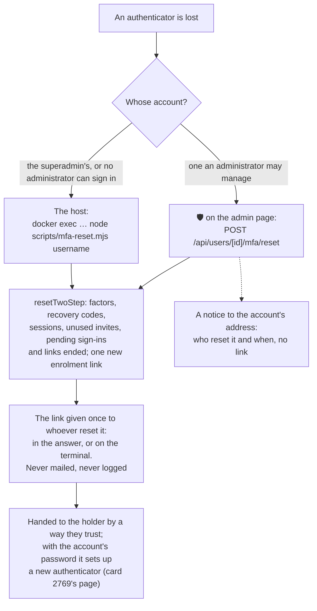

### The Administrator's Reset

`POST /api/users/[id]/mfa/reset` (`src/routes/api/users/[id]/mfa/reset/+server.ts`), with the
body `{ "currentPassword": "…" }`. It is shaped as an administrator's password reset is, and
asks the same account rule, `requireManagedAccount()`:

| Caller and account | Answer |
|--------------------|--------|
| Not signed in | `401` |
| An id that is not a whole number above 0 | `400` "Invalid user ID" |
| The caller's own account, whoever the caller is | `403` "Manage your own two-step sign-in on the Account page", before the role is asked: this asks for no second factor, and would hand whoever held the caller's session and password a link to enrol their own |
| A caller who is not an administrator | `403` "Forbidden" |
| No such account | `404` "User not found" |
| The superadmin's account | `403` "Only the server's host can reset the superadmin's two-step sign-in, with scripts/mfa-reset.mjs" |
| An administrator's account, the caller not the superadmin | `403` "Only superadmin can reset an admin's two-step sign-in" |
| No address to make the link from (no App URL, no `APP_URL`, no `ORIGIN`, on a built server) | `503` with the invite's words (`NO_LINK_ADDRESS`): a reset with no link would leave the account with no way to set up a new authenticator |
| `currentPassword` missing, wrong, or the step-up's other refusals | As [Step-up Before Destructive Actions](#step-up-before-destructive-actions-card-2701) |
| An ordinary user's account to an administrator; a user's or an administrator's to the superadmin; an account with no factor too | `200`, the reset done |

Every refusal that needs no password is asked before the password, in `confirmStepUp`'s guard,
and every one of them again inside the transaction that resets (`whilePasswordHolds` and
`writeAs`), so an account made an administrator between the two is refused there and nothing is
changed. Nothing is changed by any refusal. An account with no factor is reset all the same: it
is how an expired or ended link is replaced, and how an account a restore left without a factor
is given one.

**What the reset changes** (`resetTwoStep()` in `src/lib/server/mfa-store.ts`, which throws
outside a transaction):

| Ended or set back | Kept |
|-------------------|------|
| Every authenticator (`mfa_factors`) and recovery code of the account, deleted | The password |
| `mfa_known_wrong`, `mfa_other_wrong`, `mfa_recovery_wrong` set to 0, and their three `*_resumes_at` pauses cleared; `mfa_password_enrol` set to 0 (card 2769) | API keys, and the webhooks the account set |
| Every session, so it is signed out everywhere | Report schedules |
| Every invite not yet used | `security_banner`, `last_sign_in_*` and `failed_codes_since_sign_in`, which are about the password and the last sign-in, which a reset does not change |
| Every sign-in waiting for its second factor, and every enrolment link | |
| Then one new enrolment link | |

The sessions, invites, pending sign-ins and links end through
`endAccountAccess(userId, { apiKeys: false, reportSchedules: false })`, and the link is issued
after it, since that deletes the account's links. **The link** (`issueEnrolmentLink()`, also
inside the caller's transaction): its token is 32 random bytes as base64url; only its SHA-256 is
stored, in `enrolment_links` with `issued_by` (`admin-reset` here), `created_at` and an
`expires_at` seven days on (`ENROLMENT_LINK_LIFETIME_MS`); issuing deletes the account's earlier
links first, so an account has one link that works and a leaked older one stops. Its address is
`<base>/enrol/<token>` (`ENROLMENT_LINK_PATH`), `<base>` being `linkBaseUrl()`'s, as a mailed
link's is ([Where a Mailed Link's Address Comes From](#where-a-mailed-links-address-comes-from)).

**The link is given to the caller, once, in the answer, and never mailed.** Whoever stole the
phone may already know the password and have changed the account's address, so a mailed link
could go straight to them; the administrator is the person the holder asked for help, and hands
the link over by a channel they both trust. The link alone does not set up a factor: its page
sends the holder to sign in with the account's password first (card 2769). The answer is `Cache-Control: no-store`:

```json
{ "success": true, "enrolmentUrl": "https://dumpfire.example.com/enrol/<token>", "mailSent": true,
  "factorsRemoved": 1, "recoveryCodesRemoved": 10, "sessionsEnded": 2, "challengesEnded": 0,
  "invitesEnded": 0,
  "message": "ann's two-step sign-in was reset. Give them the link yourself: it is shown once, and works for seven days. ann was sent a notice that holds no link." }
```

`mailProblem`, why the notice was not sent in the words an invite's failure uses
(`MAIL_PROBLEM_WORDS`), is there only when mail is set up and the notice was not sent, its
password not entered on this server included. Where mail is not set up no notice is tried,
`mailSent` is `false` and there is no `mailProblem`.

**The notice.** Once the reset has committed, and where mail is set up with its password, the
account's address is sent `sendMfaResetNotice()` (`src/lib/server/notifications.ts`), awaited:
"Your DumpFire two-step sign-in was reset", naming who reset it and when (UTC). Where the reset
removed an authenticator (`hadFactor`), it says the authenticator and recovery codes no longer
work and the account has been signed out everywhere; where the account had none, it says so
instead, and that its two-step sign-in was reset and a new set-up link issued, and that it has
been signed out everywhere. Either way an administrator will give the holder the link themselves,
and it is never sent by email. Its footer: "If you did not ask for this, tell an administrator
straight away. Use only a link an administrator hands you directly." It holds no link and no
token, and every text in it is escaped. The reset stands whether or not it goes.

**The link is shown only after three fresh checks**, as an invite's is after its awaited mail
(R-S1, `invite-link.ts`), because the caller may have been demoted or signed out while the mail
was out: the caller's session is still open, theirs, and an administrator's; they may still
manage the account (these two are `callerStillManages()` in `invite-link.ts`, the one helper the
invite route and this route both ask); and the link, by its hash, is still the account's and
unexpired, this route's own check. If one
fails, the reset stands, `enrolmentUrl` is `null`, the message says "…'s two-step sign-in was
reset, but its link cannot be shown to you now. Run the reset again to issue a new one.", and
one `WARN` line under `AUTH` says why: `The enrolment link of user <id>, issued by user <id>'s
reset, was not given to them: <the caller's session has ended, or is no longer an
administrator's | the caller may no longer manage the account | the link is no longer the
account's>`.

**The log.** After the commit, one `CRITICAL` line under `AUTH`, filed under the caller:
`Two-step sign-in reset for user <id> ("<name>") by "<admin>": removed <n> factor(s) and <m>
recovery code(s), ended <s> session(s), <c> pending sign-in(s) and <i> invite(s); an enrolment
link was issued`, its meta the counts and both ids. Never the token or the link.

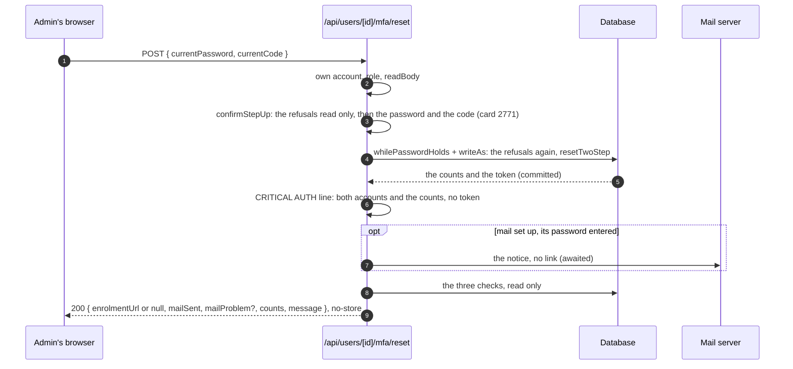

The admin page's 🛡️ **Reset two-step sign-in** is on every row that has 📧, asks through the
page's confirm with the caller's password, and shows the link in the invite link's dialog with
its own words; see [Resetting Two-Step Sign-In](admin-guide.md#resetting-two-step-sign-in).

### Invites Refused for an Account With a Second Factor

An invite sets the account's password and leads its user on to set up an authenticator (card
2769), so **no invite works for an account that holds a second factor**.
`usableInvite()` (`src/lib/server/invites.ts`), the one place that decides whether an invite
works, asks it in its own query (`NOT EXISTS` on `mfa_factors`), so the invite page, its form
before it hashes the password, the form's transaction and the invite route's answer after its
mail all refuse it alike: an invite made before the account set up a factor stops working once
it has one. `POST /api/users/[id]/invite` refuses to make one, `409` "This account uses two-step
sign-in. Reset it first, then send the invite.", after the account rule and before the mail
checks, both before the password and inside its transaction. An administrator who means to give
such an account back resets its two-step sign-in first.

### The Host's Command

`scripts/mfa-reset.mjs <username>`, copied into the image (`/app/scripts/`) and run as
`docker exec <container> node scripts/mfa-reset.mjs <username>`, is the way back for the
superadmin, whom nobody manages through the application, and for any account when nobody can
use the admin page. It is standalone (`better-sqlite3` and Node's own modules, no `$lib`, as the
image holds the built server and not its source), and does what `resetTwoStep` does, statement
for statement, in raw SQL in one `BEGIN IMMEDIATE` transaction, with `issued_by` `host-reset`.
`tests/mfa-reset-script.test.ts` compares every table and column after it with what
`resetTwoStep` leaves for an account alike, so a change made to one and not the other fails.

- **The account** is looked up by its username, trimmed, matched exactly, as sign-in matches it,
  inside the transaction.
- **The log row** is written in the same transaction, so there is no reset without it: `CRITICAL`
  under `AUTH`, `user_id` the account, no address, `Two-step sign-in reset for user <id>
  ("<name>") on the server's host, with scripts/mfa-reset.mjs: …`, its meta the counts and
  `resetBy: "host"`. The username is made printable as the logger makes every line. Where the
  reset ended sign-ins left at their second step (card 2769), a second row at `WARN` says so,
  "The reset ended N sign-in(s) of user <id> ("<name>") left at their second step; no notice
  was mailed".
- **The link goes to stdout only**: the counts, where its address came from, and the link.
  The address is the host's own configuration before a setting any administrator can change:
  `APP_URL`; then `ORIGIN` unless it is the image's placeholder `http://localhost:3000`; then the
  `app_url` setting, with a warning that an administrator set it; else the path alone, to put the
  server's address in front of. Each is read as `appUrlAsRead()` and `configuredOrigin()` read
  them. This is the reverse of `linkBaseUrl()`'s order for the admin route, deliberately: the
  host is more trusted than the setting.
- **Refusals**, each with nothing changed: no username, or more than one argument (exit 2); run
  as root on POSIX, since root-owned `-wal` and `-shm` files would stop the server, which runs as
  `node` (card 2776); a `DB_PATH` (or `./dumpfire.db`) that names no file, opened with
  `fileMustExist` so none is made; a database without migration 0065's tables; no such account;
  and the database still busy after `busy_timeout = 5000` (each exit 1). It opens the database
  with `foreign_keys = ON`, as the server does.

How to run it, and every line it prints, are in
[If the Superadmin Loses Their Authenticator](deployment.md#if-the-superadmin-loses-their-authenticator).

### Changing the Key at Start

The server keeps the key it loaded for the life of its process, so the key is changed at a start
and never by a command beside a running server, whose factors re-sealed by another process
would be unreadable to it. `MFA_KEY_FILE` names the new key and `MFA_KEY_FILE_PREVIOUS` the old.
`loadPreviousMfaKey()` (`src/lib/server/mfa-key.ts`) reads the old file afresh at every start, by
the key file's own rules (a file its group or everyone can write is refused), and never makes
one; unset or empty is no previous key. `mfaStartVerdict()` then answers, besides what it
answers with no previous key, `reseal`, the factors to seal again (C is the current key, P the
previous):

| Previous key | Stored check | Factors | Verdict |
|--------------|--------------|---------|---------|
| Did not load, or is C | any | any | Refuse, before the return for no factors |
| none | | | As [with no previous key](#the-key-check-and-the-start-up-verdict) |
| P | neither C's nor P's | some | Refuse: the key does not match |
| P | neither C's nor P's | none | Start; record nothing (a set-up under P is still deleted, as in every row with P that starts) |
| P | P's, C's or none | none | Start; record C's check where P's was stored; warn that the previous key opens nothing |
| P | P's, C's or none | some open with P | Re-seal those; record C's check; name at `ERROR` any that open with neither |
| P | P's, C's or none | some, none opening with P | As with no previous key, a stored P's check counting as none (so none opening with C refuses); warn that the previous key opens nothing |

`checkMfaKeyAtStart()` (`src/lib/server/startup-checks.ts`) applies a non-empty `reseal`, a
check to record, or the deletion of any `sign_in_challenges` row whose `key_id` is P's (asked
for even when there is nothing to re-seal and no check to record, a second start with P still
named, say, since nothing opens such a row any more) in one `sqlite.transaction(…).immediate()`,
inside which it reads the factors and
the check again and decides again, so an instance still running on the old key cannot write
between the read and the commit. Each factor is opened with P, sealed afresh with C under the
same `factorAad` and a new nonce, and written by
`UPDATE mfa_factors SET key_id = ?, secret_nonce = ?, secret_ciphertext = ? WHERE id = ? AND key_id = <P's id>`,
which must change exactly one row; `factor_uid` and `last_step` are kept. Every
`sign_in_challenges` row sealed under P is deleted, and C's check is recorded where the verdict
says to. Any failure, a
database another instance holds included, rolls all of it back and refuses the start, saying
that nothing was changed and starting again is safe. Each opened secret is zeroed once sealed,
and P's AES key is zeroed when the check returns, whatever it answered: the running server holds
only C. A start that re-sealed writes one line under `AUTH` at `WARN`, also to the console
whatever `LOG_LEVEL` is: "Rotated N second factor(s) to the new MFA key. Back up the new key now,
then remove MFA_KEY_FILE_PREVIOUS; keep the old key file offline for as long as you keep backups
made before today." `factorSecret()` is unchanged: after the start no usable factor is under P.

A restore needs nothing of this: Import Backup never copies a backup's key check and takes
another account's factors only under the current key's check, so a backup made before a change
restores, its factors for accounts not on this server left out as `key differs`. A database
file made before a change and put back by hand is started once with its old key as
`MFA_KEY_FILE_PREVIOUS`. The procedure, and keeping the old key, are in
[Changing the Key](deployment.md#changing-the-key).

### The Enrolment Link's Path Is Masked

An enrolment link's token, with the account's password, sets up the account's second factor, so
its path is a secret like an invite's. `/enrol/` is in `SECRET_IN_PATH`
(`src/lib/server/secret-paths.ts`) as `{ routeId: '/enrol/[token]', before: '/enrol/' }`, put
there before card 2769's page exists so that no link opened is ever written down: the gate logs a
request to `/enrol/<token>`, and its percent-encoded forms, as `/enrol/[token]`, and
`maskSecretPaths()` rewrites `/enrol/<token>` to `/enrol/[token]` wherever a line holds it, in a
mail server's refusal, a backup's copy of the log and the start-up sweep of the running log alike.

## Two-Step Sign-In (Card 2769)

**A right password no longer signs anyone in.** It opens a ten-minute pending sign-in, a
*challenge*. An account that holds an authenticator is asked for its six-digit code, or a
recovery code, at `/login/verify`. An account that holds none is taken through setting one up
at `/login/enrol`: scan a QR code, type the first code, save ten recovery codes, confirm. Only
then is a session made. An invite and the first-run set-up lead to the same set-up page, and
never to a session of their own.

The release that brings it ends every session and forgets every remembered browser once
(migrations 0066 and 0067), and ends every invite still waiting (0068). It is never released
without card 2773 (the reset and the host's command, built) and card 2849 (invite tokens stored
as hashes, built: see [Invite Tokens Stored as Hashes](#invite-tokens-stored-as-hashes-card-2849)):
an invite is now a grant to set up the second factor. Every running instance is stopped before the release starts, production
needs `MFA_KEY_FILE`, and where mail is set up the App URL or `ORIGIN` must be the real address.
The steps are in [The Release That Turns On Two-Step Sign-In](deployment.md#the-release-that-turns-on-two-step-sign-in-card-2769).

| Where | What it holds |
|---|---|
| `src/lib/server/sign-in-challenges.ts` | The challenge: its two cookies, issuing, finding, counting, taking, the enrol stages, `codePause()`, the stolen-password signal (`raiseSignal()`) and the sweep of expired challenges |
| `src/lib/server/second-step.ts` | `afterPassword()`, `verifyView()`, `verifyStep()`, `finishSignIn()`, `enrolView()`, `enrolCode()`, `enrolConfirm()`, and every answer's words. Each takes values, never a request body |
| `src/lib/server/otpauth.ts` | Base32 (RFC 4648), the `otpauth://` text, the secret in groups of four, and the QR code as a `data:` image |
| `src/routes/login/verify/`, `src/routes/login/enrol/`, `src/routes/enrol/[token]/` | The code page, the set-up page, and a set-up link's page |
| `src/lib/components/SignInReport.svelte` | What is reported after a right code when there is something to report |

```mermaid
flowchart LR
    L["/login<br/>password"] -->|"factor held"| V["/login/verify<br/>code or recovery code"]
    L -->|"no factor, allowed to set up"| E["/login/enrol<br/>QR, first code, ten codes, confirm"]
    I["/invite/[token]<br/>password set"] --> E
    S["/setup<br/>superadmin made"] --> E
    K["/enrol/[token]<br/>link cookie"] -.->|"then the password"| L
    V -->|"right"| H["Session, two_step 1<br/>303 / or the report"]
    E -->|"confirm"| H
```

### What a Right Password Leads To

The login action checks the password as before (the throttles, the wait, the worker), then hands
the account and the hash it checked to `afterPassword()`. Nothing is forgotten or given back
until a second step is passed. In this order:

```mermaid
flowchart TD
    P["Right password, checked hash H"] --> A0{"Account still there?"}
    A0 -- no --> GONE["400: the sign-in has expired"]
    A0 -- yes --> F{"Account holds a factor?"}
    F -- yes --> V["Verify challenge<br/>303 /login/verify"]
    F -- no --> K0{"MFA key loaded?"}
    K0 -- no --> NK["503: two-step sign-in cannot be set up"]
    K0 -- yes --> C{"Link cookie names a live link<br/>of this account?"}
    C -- yes --> EL["Enrol challenge, grant link<br/>303 /login/enrol"]
    C -- no --> G{"mfa_password_enrol 1, within 14 days<br/>of two_step_released_at, and no link<br/>but release-mail ones?"}
    G -- no --> N["403: needs a set-up link"]
    G -- yes --> M{"Mail host configured?"}
    M -- no --> R1["Enrol challenge, grant password<br/>303 /login/enrol. Risk R1"]
    M -- yes --> U{"SMTP password present and the link<br/>address real, not the placeholder?"}
    U -- no --> X["503: could not email, no link"]
    U -- yes --> Q{"A live release-mail link<br/>under 24 hours old?"}
    Q -- yes --> SENT["200 notice: emailed N hours ago"]
    Q -- no --> W{"A set-up under way<br/>on a live link of the account?"}
    W -- yes --> UW["200 notice: being set up from the link,<br/>no mail"]
    W -- no --> MAIL["Issue a new link beside the old,<br/>commit, send and await"]
    MAIL -- sent --> OK["Older release-mail links deleted<br/>200 notice: a link has been emailed"]
    MAIL -- failed --> FAIL["New link deleted, old ones kept<br/>503 could not email"]
```

- **The factor, the link, the mark and the window are read, and the challenge issued, in one
  synchronous transaction**, so a reset or a set-up committed while the password was checked
  is seen.
- **Every branch that writes compares the hash first.** The challenge's transaction, and the
  release mail's, read the account's `password_hash` and write nothing when it is not the one
  checked: `409`, "Your password was changed while you were signing in…". A password set while
  the check was awaited ends the sign-in (decision 26). An account deleted meanwhile is `400`
  with the expired words.
- **No MFA key stops only a set-up.** An account that holds a factor is still sent to
  `/login/verify` without it: an authenticator code there is `503` ("Your authenticator cannot
  be checked on this server right now…"), and a recovery code still signs in. An account that
  would set up is `503` at the password, with nothing written (decision 28).
- **Leave to set up on the password** (`mayStillEnrolOnPassword()`) needs the mark, the 14 days,
  and no enrolment link of the account but release-mail ones. A reset made by an older image,
  which knows nothing of the mark, still issues a link of its own, and so closes it.
- **The release mail reads the hash, the mark and the window again** in its own transaction, so
  a reset committed while the password was checked is honoured: `403`.
- **A set-up link of another account is ignored**, and the sign-in goes on down the tree.
- **The "needs a link" answer** is the same whether the account was made after the release,
  was reset, or is past its 14 days. An administrator's 🛡️ issues the link; an invite does
  too, for an account with no factor.
- **One `AUTH` line**: `Password accepted for "<name>" (user <id>) from IP <address>, second
  step issued (verify|enrol), challenge <short id>`, or `…, no second step: <why>`, the why
  being `needs a link`, `link mailed`, `link already mailed`, `a set-up is under way on its
  emailed link`, `no MFA key`, or at `WARN` `could not email`, `could not email (<the mail
  problem>)`, `the password was changed while it was checked` and `the account was deleted
  while its password was checked`. Never the token.

The words are the constants at the top of `src/lib/server/second-step.ts`. The release mail's
two notices are shown on the sign-in page, with the name kept in the form.

### The Pending Sign-In

A challenge is a row of `sign_in_challenges` and a cookie.

- **The token** is 32 random bytes, base64url, in the cookie only. The row holds its SHA-256.
  A short id of 8 random hex characters, made separately, is the only thing the log names.
- **It lasts ten minutes** (`CHALLENGE_SECONDS = 600`), read through `toStamp`. An expiry that
  names no moment has passed.
- **It keeps** its purpose (`verify` or `enrol`), the lane its codes count in (`known` when the
  password came with a valid remembered-browser cookie for the account, `other` otherwise),
  the hash the password was checked against, a count of wrong codes, and
  for an enrol challenge its stage, what lets it set up a factor (`enrol_grant`: `password`,
  `link`, `invite` or `setup`) and the hash of the link it came from (`enrolment_link_hash`).
- **An enrol challenge keeps what is being set up, sealed**: the new secret, then the first
  code's step and the ten recovery codes, as JSON under the MFA key, bound to the account and
  the token's hash (`enrolAad`, see [Sealing a Secret](#sealing-a-secret)).
- The `remembered_nonce` column is not written: the lane is all that is used of the remembered
  browser. The column stays, unused.

**Issuing** (`issueChallenge()`) is one synchronous transaction, a savepoint inside an invite's
or the set-up's own:

1. The account is there and its hash is still the one checked; otherwise nothing is written.
2. Every expired challenge, of any account, is deleted (`sweepExpiredChallenges()`). Each
   **verify** challenge among them was never finished, and is a stolen-password signal (below).
3. This browser's previous challenge is deleted, whichever account it was for (one account's
   password and then another's in one browser leaves the first nothing to expire into a
   signal); then any enrol challenge of the account when an enrol one is issued, and all but
   the account's newest two. So an account has at most three.
4. The row is written, `created_at` with it. An enrol challenge starts at `secret_shown` with a
   new 20-byte secret sealed for it.

**The sweep** also runs on its own: at start-up and every five minutes
(`startChallengeSweep()`, called once from `hooks.server.ts`; its timer does not keep the process
alive, and a failure is one `ERROR` line). So a verify challenge left unfinished raises its
signal within minutes, without waiting for some later sign-in at any account.

**Taking** (`takeChallenge()`) is a conditional `DELETE … RETURNING` in the transaction that
makes the session or the factor. The caller read the row in the same synchronous stretch, so
exactly one row is taken; anything else throws and rolls the transaction back. `verifyStep`,
`enrolCode` and `enrolConfirm` are synchronous, and their actions await only
`request.formData()` before calling them, so no other request can come between the read and the
take, and there is no "check in flight" to guard (decision 6). A source scan in
`tests/two-step-sign-in.test.ts` (T29) holds that.

**The cookies.**

| Cookie | Name | Options | Holds |
|---|---|---|---|
| The challenge | `__Host-dumpfire_challenge` when `httpsOnlyCookie()` is true (the request came over `https:`, or `COOKIE_SECURE` or production asks for it); `dumpfire_challenge` otherwise | `HttpOnly`, `SameSite=Strict`, `Path=/`, `Max-Age=600`, no `Domain`, `Secure` with the prefix | The token |
| A set-up link | `dumpfire_enrol_link` | `HttpOnly`, `SameSite=Strict`, `Path=/login`, `Max-Age=3600`, `Secure` as the challenge's. No prefix: `__Host-` needs `Path=/` | The link's raw token |

- **Read from the raw `Cookie` header**, by the name in force alone: exactly one pair of that
  name, holding a token as one is made, is the token. None, two or more (a planted cookie
  beside the real one), or a cookie of the other name, is no challenge.
- **Deleted with `Path=/` and the same `Secure`** when the sign-in finishes, and with every
  answer that ends the challenge. A `GET` of either page with no live challenge deletes it and
  sends the browser to `/login`.
- **A form posted without JavaScript** is answered on the page itself: the pages' loads do not
  redirect a `POST`, since the challenge may already be taken (signed in, with the report) or
  ended (the restart words), and the page shows the action's answer alone.
- A database copy holds only hashes, which cannot be turned into either cookie.

### Signing In With an Authenticator

```mermaid
sequenceDiagram
    autonumber
    participant B as Browser
    participant L as /login
    participant V as /login/verify
    participant DB as Database
    participant M as Mail
    B->>L: identity and password
    L->>L: throttles, wait and worker check, as before
    L->>DB: one transaction: hash still the one checked, sweep, cap, insert
    L-->>B: challenge cookie and 303 /login/verify
    B->>V: code, or recovery code
    V->>DB: one synchronous transaction, in the order below
    alt right, and its step not spent
        V->>DB: take challenge, spend step, counts to 0, last sign-in, session two_step 1
        V-->>B: session and remembered-browser cookies, challenge cookie deleted, 303 / or the report
    else right, but its step already spent
        V->>DB: counts taken back
        V-->>B: 400 wait for the next code
    else wrong
        V->>DB: counts stand, a pause or the lock at 5, 10, 15, 20, 25, 30
        V-->>B: 400, or restart after the fifth on this challenge
        V-)M: after commit, the notices
    end
```

`verifyStep()`, in this order:

1. **A live verify challenge, of an account still there**, else `400` "This sign-in has expired
   or was already used…", cookie deleted.
2. **The account's hash is the one the challenge was issued against**, else `409`, the challenge
   deleted and one `WARN` line.
3. Neither field sent: `400`, nothing counted. A recovery code goes to step 6.
4. **The lane neither locked nor paused**: locked is `403`, paused is `429` with the minutes
   left. Neither is counted. A pause whose time cannot be read is read as the lock.
5. **Every authenticator of the account tried** (`matchFactors()`, since card 2772: see
   [Several Authenticators, Every One Tried](#several-authenticators-every-one-tried-card-2772)):
   none that opens is `503`, nothing counted, one `ERROR` line for each that did not open
   (`factorSecret()`), or one naming the challenge when the account holds none. That is also
   the answer with no MFA key loaded, and for an account whose factors went while it was
   signing in.
6. **Counted**, one statement each: the challenge's `wrong_count` by one, the lane's count by
   the number of authenticators tried (N), and `failed_codes_since_sign_in` by one.
7. **What the compare found** (`matchingStep()` on every opened secret, both steps in constant
   time, no early exit). A match on a step not yet spent: the counts taken back exactly (the
   challenge 1, the lane to 0, `failed_codes_since_sign_in` 1, each clamped at 0), then
   `spendStep()` of the matched factor alone; a code whose every match is spent is `400` "wait
   for the next code", with the counts taken back exactly (the lane by N). Wrong: the counts
   stand, `pauseCrossed(before, after)` on the lane's count (built on `codePause()`: the lock at
   30 or more, otherwise the pause of the highest step the move crossed) sets a pause or reaches
   the lock, and the fifth wrong code on the challenge deletes it: `400` "Too many wrong codes.
   Sign in again." (when that also crosses a step of the lane, the pause and its notice are
   recorded too, and shown at the next sign-in).

**A right code** takes the challenge, writes `last_sign_in_at` and `last_sign_in_from`, sets
`failed_codes_since_sign_in` to 0 and makes the session (`finishSignIn()`), all in that
transaction. After the commit: the session cookie, the browser remembered for the account (see
[Browsers That Have Signed In Before](#browsers-that-have-signed-in-before)), the challenge cookie
deleted, and `User "<name>" logged in` at `INFO` with `secondStep` in its meta. For a browser
not remembered, the account's waits are forgotten and the address's attempts at it given back
here, not at the password; the known lane does neither, as before. The `WARN` of a recovery
code that signed in, and a wrong recovery code's count at the address, are made after the
commit too, so a sign-in that rolls back says and counts nothing.

**The code fields** take six digits, as `123456` or `123 456`. A page whose lane is locked opens
on the recovery-code field, and so does a `403` "locked" answer.

### Wrong Codes: the Lanes, Pauses and the Lock

Every wrong authenticator code is counted three ways: on the challenge (five end it), on its
**lane**, and in `failed_codes_since_sign_in`. A lane is `mfa_known_wrong` for a browser
remembered for the account and `mfa_other_wrong` for any other, so wrong codes from strangers do
not pause the owner's own browser. A lane's count is of wrong codes in a row, each counted once
for every authenticator it was tried against (card 2772: one, two or three); a right code sets
it to 0 and clears its pause. The challenge and `failed_codes_since_sign_in` count the code
typed, once. The counts live in `users`, so a restart does not empty them.

| The lane's count | What it sets |
|---|---|
| 5 | Code entry paused 15 minutes |
| 10 | 1 hour |
| 15 | 4 hours |
| 20 | 24 hours |
| 25 | 24 hours |
| 30 | Locked: codes refused until a recovery code or a reset |

- **A recovery code always works**, past a pause or the lock.
- With N authenticators the count moves by N, so it can step over 5, 10 and the rest:
  `pauseCrossed()` sets the pause of the highest step crossed, and the lock once the count is
  30 or more. With two, the third wrong code in a row pauses (the count passes 5 at 6); with
  three, the second.
- Each pause and the lock is one `WARN` line naming the account and the lane, "…paused for *m*
  minute(s) after too many wrong codes in a row (*lane* lane)" or "…locked after too many wrong
  codes in a row (*lane* lane)", and a notice to the owner, neither with a count (card 2772,
  E3: the weighted count is not the number typed). Each wrong code's own `WARN` line names the
  authenticators tried and the codes typed on the challenge: "Wrong two-step sign-in code for
  … (*lane* lane; *N* authenticator(s) tried; challenge *id*, *k* of 5)".
- The per-challenge five bound how fast one browser can guess within a pause window; the lane
  bounds the account across browsers; the password's own throttles bound how often a challenge
  can be had.

### Several Authenticators, Every One Tried (Card 2772)

Since card 2772 (2026-11-17) an account may hold **up to three authenticators**
(`MOST_AUTHENTICATORS = 3` in `mfa-store.ts`): a main phone, a spare, and a new phone during a
replacement. They are added and removed on the Account page (see
[Managing Two-Step Sign-In on the Account Page](#managing-two-step-sign-in-on-the-account-page-card-2772)).
Sign-in (`verifyStep()`) and the step-up (`checkCurrentProof()`) share one matcher,
`matchFactors(userId, digits, at, { said })`:

- It reads the account's `totp` factors in id order and opens each in turn, one plaintext secret
  at a time, zeroed in a `finally` before the next is opened. One that does not open is skipped
  and counted `unusable`, with `factorSecret()`'s `ERROR` line, or with none when `said` is
  false (the step-up's second look in its transaction, a moment after its first said it, using
  `openFactor()`, the same open without the line).
- `matchingStep()` runs on **every** opened secret, with no early exit, so the work does not say
  which factor matched.
- It answers `{ tried, unusable, matched, spent }`. `matched` is the lowest id among the factors
  whose matching step is **above** their `last_step` (an unspent match), with that step; `spent`
  is true only when the code matched and every match is at or below its factor's `last_step`
  (the plan review's S6), so a spent step on one phone never hides a fresh match on another.
  Nothing is spent here: the caller spends the matched factor's step alone (`spendStep()`).

**The guessing bounds are held, not loosened** (the owner's weighting rulings of 2026-11-17). A
guess against N authenticators has 2N candidates (the step and the one before, for each):

| Where | Rule | Candidates before the bound, N = 1 / 2 / 3 |
|---|---|---|
| Sign-in lane (`mfa_<lane>_wrong`, locked at 30) | **+N** per wrong code; `pauseCrossed(before, after)` | 2N × ⌈30/N⌉ = **60 / 60 / 60** in a million: unchanged, since 1, 2 and 3 divide 30 (at 4 it would be 64, the reason for the cap) |
| Challenge (`wrong_count`, five end it) | **+1** per code, not weighted, so the first wrong code still raises the stolen-password signal whatever N | 10 / 20 / 30 per challenge, a speed bump under the lane |
| `failed_codes_since_sign_in` | +1 per code | a count shown to the holder |
| Step-up (`sessions.wrong_password_count`, 3 ends the session) | **+w before the compare**, w = the authenticators tried at 2b, 1 for a recovery code; the same for a wrong password or a wrong code; nothing added after the compare | **6 / 8 / 6** in a million per stolen session that also holds the password |
| Recovery codes | one 80-bit candidate | unchanged |

A right code sets the lane to 0 and clears its pause, and takes back 1 on the challenge and 1 on
`failed_codes_since_sign_in`, each clamped at 0. Only a code whose every match is spent (or
whose step another request spent meanwhile) takes back exactly what it counted: N on the lane,
1 on the challenge and 1 on `failed_codes_since_sign_in`, each clamped at 0, leaving the lane's
earlier wrong codes and any pause standing. A right step-up clears the session's count as
before.

**Not chosen**: an unweighted step-up (6 / 12 / 18 in a million per stolen session; recorded in
the plan for the owner to overrule), one count per code everywhere (a lane bound of 120 and 180
in a million), a cap of five, and asking the holder which authenticator (it would name the
factors to whoever holds the password).

**What the holder notices.** With two authenticators, three wrong codes in a row pause sign-in in
that lane and two wrong answers at a confirmation sign the browser out; with three, two wrong
codes pause sign-in and one wrong answer at a confirmation signs the browser out. The confirm
dialog says so before sending (`CurrentPasswordField`, see
[The Code Beside the Password](#the-code-beside-the-password-card-2771)).

Covered by `tests/account-two-step.test.ts` (T1 to T3), `tests/two-step-sign-in.test.ts` (T4 to
T6), `tests/step-up.test.ts` (T7 to T9) and `tests/confirm-modal.svelte.test.ts` (T10).

### Recovery Codes at Sign-In

The "Use a recovery code instead" field sends `recoveryCode`.

- **A malformed one** (not 16 letters and digits once read leniently) is `400` with the format,
  and nothing is counted: a typo is not a guess.
- **A wrong one** counts on the challenge, on `mfa_recovery_wrong` and
  `failed_codes_since_sign_in`, and on the address's sign-in attempts, which the password step
  is held to. **There is no account-wide pause** for recovery codes: it would let a password
  holder lock the owner out of the one way back, and 80 random bits need none.
  `mfa_recovery_resumes_at` stays unused. Every tenth wrong one in a row mails the
  `recovery-codes-guessed` notice.
- **A right one** signs in, and clears both lanes' counts and pauses, the lock included, and the
  recovery count. One `WARN` line, `A recovery code signed in "<name>" (user <id>) from IP
  <address>: <n> left`, and the `recovery-code-used` notice with the number left.

### Setting Up an Authenticator

```mermaid
stateDiagram-v2
    [*] --> secret_shown: enrol challenge issued
    secret_shown --> code_verified: right first code, ten codes made and sealed
    code_verified --> codes_shown: the page shows the codes
    codes_shown --> codes_shown: a reload shows the same ten
    codes_shown --> [*]: confirm, factor and codes and session in one transaction
    secret_shown --> [*]: fifth wrong code, expiry, reset, password set
    code_verified --> [*]: expiry, reset, password set
    codes_shown --> [*]: expiry, reset, password set
```

Each move is a conditional `UPDATE` from the stage before. An action at any other stage of a
live challenge is `409` "This step is not ready yet…", and writes nothing.

**The page** (`enrolView()`). At `secret_shown`: the QR code, the account, the issuer
(`DumpFire`) and the secret in base32 in groups of four, for typing in by hand. The QR code is
drawn on the server by `uqr` as SVG and given to the page as a `data:image/svg+xml;base64,…`
image, which the policy's `img-src 'self' data:` allows; nothing is put in the page with
`{@html}`. The `otpauth://totp/DumpFire:<account>` text names the secret unpadded, the issuer,
`SHA1`, 6 digits and 30 seconds, the account encoded so that a space or a colon stays part of
it. From the right first code on: the ten recovery codes, the same ten on every reload, and "I
have saved these codes".

**The first code** (`?/code`, `enrolCode()`): a live challenge of an account still there (else
`400` with the expired words, cookie deleted); the hash unchanged (else `409`, ended); at
`secret_shown` (else `409`); what the challenge keeps opens (else `503`, nothing counted); then
counted on the challenge alone and compared. Right: ten recovery codes made and sealed with the
secret and the code's step, `code_verified`, and `303` back to the page. Wrong: `400`, which
asks the holder to check their phone's clock; the fifth ends the challenge.

**Confirm** (`?/confirm`, `enrolConfirm()`), one synchronous transaction. First everything that
refuses it, with nothing written: a live challenge (none at all is refused too), at
`codes_shown` (a live one at another stage is the stage answer), the hash unchanged, the
account holding no factor and no recovery codes, the link it came from, if any, still live, and,
for a set-up on the password alone, that leave still there and still no mail host (a reset, a
link issued by an older image, the end of the 14 days, or a mail host set up meanwhile ends
it). Every such refusal is one answer, `409` "This set-up can no longer be finished. Sign in
again.", and one `WARN` line saying why; what the challenge keeps not opening is `503`. Then,
together:

- the challenge taken, and the link taken by its hash (one row each, else it throws);
- the factor written, labelled `Authenticator`, and the first code's step spent;
- the ten recovery codes stored;
- every other pending sign-in, link and unused invite of the account ended;
- `mfa_password_enrol` set to 0;
- the last sign-in written, `failed_codes_since_sign_in` set to 0, and the session made.

After the commit: the session cookie, the browser remembered, the challenge cookie deleted, two
`INFO` lines (`Two-step sign-in set up for "<name>" (user <id>) (<grant>)` and `User "<name>"
logged in`), the waits forgotten for a browser not remembered, and the `enrolled` notice. A
reset keeps the banner and the wrong-code count, so the set-up page shows the report below when
either is there, as the code page does.

**The four ways to the set-up page.**

```mermaid
sequenceDiagram
    autonumber
    participant B as Browser
    participant L as /login
    participant E as /login/enrol
    participant DB as Database
    Note over B,DB: Risk R1: no mail host, flag 1, within 14 days
    B->>L: identity and password
    L->>DB: one transaction: no factor, the leave to set up, no mail host, enrol challenge, grant password
    L-->>B: challenge cookie, 303 /login/enrol
    B->>E: GET: QR code and the secret
    B->>E: POST ?/code with the first code
    E->>DB: secret_shown to code_verified, codes sealed
    B->>E: GET: the ten codes, code_verified to codes_shown
    B->>E: POST ?/confirm
    E->>DB: the leave and no mail host again, take challenge, factor, codes, flag 0, session
    E-->>B: session and remembered-browser cookies, 303 /
```

```mermaid
sequenceDiagram
    autonumber
    participant B as Browser
    participant K as /enrol/[token]
    participant L as /login
    participant E as /login/enrol
    participant DB as Database
    B->>K: GET /enrol/token
    K->>DB: link by its hash: live, account holds no factor?
    K-->>B: dumpfire_enrol_link cookie, Path=/login, an hour. The page names the account
    B->>L: identity and password, every sign-in throttle
    L->>DB: hash unchanged, enrol challenge, grant link, the link's hash kept
    L-->>B: challenge cookie, link cookie deleted, 303 /login/enrol
    B->>E: QR, first code, codes, confirm, as above
    E->>DB: the link still live, taken with the factor
```

```mermaid
sequenceDiagram
    autonumber
    participant B as Browser
    participant I as /invite/[token]
    participant E as /login/enrol
    participant DB as Database
    B->>I: new password
    I->>I: MFA key loaded? Else 503 before any hash
    I->>I: hash the password on a worker
    I->>DB: one transaction: invite checked and used, password set, endAccountAccess, enrol challenge, grant invite
    I-->>B: challenge cookie, 303 /login/enrol. No session, no remembered browser
    B->>E: QR, first code, codes, confirm
```

```mermaid
sequenceDiagram
    autonumber
    participant B as Browser
    participant S as /setup
    participant E as /login/enrol
    participant DB as Database
    B->>S: superadmin's name, email and password
    S->>S: MFA key loaded? Else 503 before any hash
    S->>DB: one transaction: no user yet, superadmin made with flag 0, enrol challenge, grant setup
    S-->>B: challenge cookie, 303 /login/enrol. No session
    B->>E: QR, first code, codes, confirm
```

- **An invite is spent when the password is set**, before the set-up is finished. The invite page
  says so. An invite used and its set-up left: send the invite again, or reset the account's
  two-step sign-in. The invite page's button reads "Set Password & Continue".
- **A first-run set-up left unfinished** leaves a superadmin with no factor and flag 0, whose
  password alone leads to "needs a set-up link". The way back is the host's command,
  `node scripts/mfa-reset.mjs <name>` (see [The Host's Command](#the-hosts-command)). The set-up
  page says to finish straight away.
- **No MFA key**: the invite and the set-up refuse `503` before any password is hashed, so no
  account is left with a new password and no way to finish; a sign-in that would set up is
  refused the same way at the password. A set-up page whose challenge cannot be opened answers
  the same `503`, and so does a confirm.
- **The invite and the set-up issue their challenge** through `issueSetUpChallenge()` inside
  their own transaction, after the password is set, and send the browser on with `goToSetUp()`
  after the commit.

### Set-Up Links and Their Page

`/enrol/[token]` asks nothing and posts nothing (decision 19). Its load:

| Case | What the page shows | Cookie |
|---|---|---|
| Signed in | Sign out first, then open the link again | None |
| A token as one is made, whose hash names a live link of an account that holds no factor | "This link sets up two-step sign-in for `<name>`. Sign in with your password to continue", and a link to `/login` | `dumpfire_enrol_link`, the raw token |
| Anything else: unknown, expired, used, replaced | The dead-link words: ask an administrator for a new one | None |

The password is asked at `/login`, with every throttle sign-in has, and only a right one at the
account the link is for opens an enrol challenge that names the link. A link is read by
`usableEnrolmentLink()` in `src/lib/server/mfa-store.ts` and taken only at confirm. Its page
carries `no-referrer`, and its address is masked in the log (see
[The Enrolment Link's Path Is Masked](#the-enrolment-links-path-is-masked)).

### The Release, Risk R1 and the Release Mail

**Who may set up on a password alone.** Migration 0066 gives `users.mfa_password_enrol = 1`
to every account that has no factor and **no enrolment link row, expired or not** (an account
reset before the release stays reset), and records `two_step_released_at` in `settings`. The mark
is honoured only within 14 days of that setting (`releaseWindowOpen()`, `PASSWORD_SET_UP_MS`);
a missing or unreadable setting is read as the 14 days over. It is honoured only while the
account holds no enrolment link but release-mail ones, so a reset made by an older image, which
leaves the mark, still closes it. It is set back to 0 by an enrolment, by `resetTwoStep()`, by
the host's command, by a restore for every account not this server's, and for every account by
making a working copy (Import Backup's working-copy restore, which has no mail host and so
would open R1 for every marked account). An account made after the release, the superadmin made
at set-up included, has 0.

**Clearing the mail settings is an administrator's action that reopens R1.** R1 turns on "no
mail host configured", so an administrator who clears Email / SMTP within the 14 days lets
every account still marked set up on its password again. A set-up already begun on the password
is refused at confirm if a mail host was set up meanwhile.

**The admin page** gives each account `passwordSetUpUntil`, the end of its 14 days, by the same
rule as sign-in: marked, holding no factor and no link but release-mail ones, the window open,
and **no mail host set up** (with one, a sign-in is mailed a link instead). Null otherwise, and
null for an account the caller may not reset, but the caller's own row shows its own. The Users
panel shows "may set up on password until `<date>` UTC" under the address. See
[The Release That Turns On Two-Step Sign-In](admin-guide.md#the-release-that-turns-on-two-step-sign-in).

**The release mail** (decision 23), where a mail host is configured. One synchronous transaction
checks the account, the hash, the mark and the window again, then looks for a live
`release-mail` link of the account. One under 24 hours old: nothing is issued, and the sign-in
is told when it went and when a new one may be had. A set-up already under way on a live link of
the account (a live enrol challenge naming it): nothing is issued and nothing mailed, and the
sign-in is told "Two-step sign-in is being set up for this account from the link we emailed.
Finish it there, or sign in again in ten minutes." (`200`), so whoever else holds the password
cannot end the owner's set-up. Otherwise a new link is issued **beside** the older ones
(`issueEnrolmentLink(…, { replace: false })`), seven days long. After the commit the mail is
sent and awaited (`sendReleaseLinkMail()`). A mail that went has the account's older
release-mail links deleted, in a transaction of its own. A mail that did not go has only its own
new link deleted, by its hash, and is `503`: no link is left that nobody received, and the link
the owner already holds keeps working. The mail names the time and address of the sign-in and
says that if it was not them, their password is known to someone else. So at most one mail a
day, and the mail is itself the stolen-password signal: only a right password sends it.

A configured mail host that cannot send a link (its password not entered on this server, no
address to make the link from, or the image's placeholder `http://localhost:3000`) is `503` with
no link, and **never** falls through to R1.

### The Page After a Right Code

After a right code, or a confirm, the page shows a report instead of going home when the account
has `failed_codes_since_sign_in` above 0 **or** a security banner raised at or after its
previous sign-in (decision 16; a banner with no readable time, or an account never signed in, is
read as raised since):

- the number of wrong codes since the last sign-in, with that sign-in's time and address;
- the banner's reason, and when it was raised, when it was raised since the previous sign-in;
- "If that was not you, change your password now.";
- the account's live API keys (name, made, last used) and its webhooks that are on (the board
  and the host they send to, and when made: the host alone, since a path may hold the
  receiver's own secret);
- **Continue**, which loads the home page afresh, so the page's signed-in state is read anew.

The count is then 0, and the last sign-in is written, so a banner is reported once: the next
sign-in goes home. A sign-in does not clear the banner: since card 2772 it stays at the top of
the Account page until its holder clears it there, with **That was me** (a step-up that clears
only the warning the page showed), or by changing their own password (see
[The Warning at the Top of the Account Page](#the-warning-at-the-top-of-the-account-page)). Both forms call
`update({ invalidateAll: false })`, so the report is not reloaded away (the reload of a signed-in
browser on these pages would go home); without JavaScript the page shows the report from the
action's answer.

### Notices and Stolen-Password Signals

`sendSecurityNotice()` (`src/lib/server/notifications.ts`) sends nothing unless a mail host is
set up with its password. It is called after the commit and never awaited, and cannot be
switched off. Each names the time (UTC) and the address as received, and what to do if it was not
the owner. None holds a code, secret, token or link.

| Notice | When | At most once an hour |
|---|---|---|
| `enrolled` | Every enrolment; lists the account's live API keys and webhooks, to revoke any not recognised | No |
| `recovery-code-used` | A recovery code signs in, or confirms a step-up action (card 2771: worded "to confirm a change"); how many are left, and at 3 or fewer "make a new set on your Account page as soon as you can" (card 2772) | No |
| `codes-paused` | A lane pauses; until when. Since card 2772 "Too many wrong authenticator codes in a row…", with no count | No |
| `codes-locked` | A lane reaches 30 or more; with no count since card 2772 | No |
| `recovery-codes-guessed` | Every tenth wrong recovery code in a row | No |
| `wrong-code` | The first wrong code on a verify challenge, or a wrong code after a right password at a step-up (card 2771: worded "while confirming a change, and then a wrong code"); raises the security banner | Yes |
| `unfinished-sign-in` | An unused verify challenge swept as expired; raises the banner | Yes |
| `factor-added` | An authenticator added on the Account page (card 2772); its name and when it was added | No |
| `factor-removed` | An authenticator removed on the Account page (card 2772); its name and when it was added, other browsers signed out, the account's live API keys and webhooks to revoke any not recognised, and "If the device was lost, also change your password." | No |
| `codes-regenerated` | A new set of ten recovery codes made on the Account page (card 2772); the old ones no longer work | No |

**The signals.** Someone who reaches a verify challenge had the password. So the first wrong
code on one, and a verify challenge left unused until the sweep finds it expired, each set
`security_banner` and `security_banner_at` by one conditional `UPDATE` that does nothing within
an hour of the last (`raiseSignal()`), and mail only when it wrote. Every signal, one inside
that hour included, also sets `security_signal_last_at` (migration 0069, card 2772's code
review, CS1), in the same transaction: the hour throttles the banner and the mail, never the
record of the latest, which **That was me** compares (below). Expired challenges are
swept when a challenge is issued and, on their own, at start-up and every five minutes. An
expired enrol challenge sends nothing. The third signal is the release mail.

**At a step-up** (card 2771, D6 and D12). A right password with a wrong code at any step-up
action raises the same signal in the check's own transaction (`raiseSignal(userId,
'wrong-code', now)`) and adds one to `failed_codes_since_sign_in`, so the banner and the page
after the next right code report it; the `wrong-code` notice goes when the signal was written.
A recovery code that confirms a step-up sends `recovery-code-used`. Both pass
`confirming: true` to `sendSecurityNotice` (`SecurityNoticeDetail.confirming`), which words
them for a confirmation: subject "A recovery code was used to confirm a change on DumpFire",
"A recovery code was used to confirm a change on your DumpFire account on *time* from
*address*", and "Someone entered your DumpFire password correctly on *time* from *address*
while confirming a change, and then a wrong code." The `after` lines are unchanged. A step-up
writes nothing to sign-in's code lanes (`mfa_known_wrong`, `mfa_other_wrong`, their
`*_resumes_at`, `mfa_recovery_wrong`, `mfa_recovery_resumes_at`) and reads none of them: an
account whose codes are locked at sign-in still steps up with an authenticator code (see
[The Code Beside the Password](#the-code-beside-the-password-card-2771)).

**Ended by a restore or the host's command.** A restore and `scripts/mfa-reset.mjs` end the
verify challenges they find with the rest. Neither mails: each writes one `WARN` line under
`AUTH` instead, the restore's naming the user ids as they were before it ("The restore ended N
sign-in(s) left at their second step, …; no notice was mailed"), the command's naming the
account ("The reset ended N sign-in(s) of user … left at their second step; no notice was
mailed").

### Older Images and Instances

An older image, run after the release, would sign people in on a password alone. Two marks stop
this image accepting what it makes (decision 24):

```mermaid
flowchart TD
    O["An older image or instance<br/>runs after 0066 and 0067"] --> S1["It makes a session:<br/>two_step stays 0, and the id is the code in plain"]
    O --> S2["It remembers a browser:<br/>MAC under known-browser:1:"]
    S1 --> T["This image: finds no row for it by hash;<br/>endPlainSessions deletes it at the next start, one WARN"]
    S2 --> U["This image: the MAC does not match<br/>under known-browser:2:, not remembered"]
```

- **`sessions.two_step`.** `createSession()` writes 1, and is called only by `finishSignIn()`
  and by a change of one's own password from a session (`tests/two-step-sign-in.test.ts` T45).
  Since card 2775 an older image's session is stored in plain (the code itself in `id`), which
  this image never finds by hash, so it signs nobody in; `endPlainSessions()` deletes every such
  row at this image's next start, before the clean-up, with one `WARN` line (see
  [Session Codes Stored as Hashes, and Limits by Role](#session-codes-stored-as-hashes-and-limits-by-role-card-2775)).
  The `one-step` refusal stays as defence in depth: `findSession()` answers it for a hashed row
  with any other `two_step`, before the deadline, and `validateSession()` deletes the row and
  writes one `WARN` line: "A hashed session row with two_step 0 — refused and deleted". No image
  writes such a row now. Sessions this image made are 32-byte BLOBs to an older image, whose
  lookup by the cookie's text never matches them.
- **The remembered-browser MAC's domain** is `known-browser:2:` (`MAC_DOMAIN` in
  `src/lib/server/known-browsers.ts`). A cookie signed under `known-browser:1:`, by an older image
  even with a secret it made again after 0067, is not remembered.
- **Invites** (card 2849). An invite this image issued is stored as a BLOB digest, which the
  older image, comparing the column with the address text, never matches: it is a dead link
  there. An invite the older image issues is stored in plain, and `endPlainInvites()` ends it at
  this image's next start. See
  [Invite Tokens Stored as Hashes](#invite-tokens-stored-as-hashes-card-2849).
- **So a rollback past this card is a security event**: the older image accepts password-only
  sign-in while it runs. Rolling forward again refuses whatever it made. Stop every instance
  before the release, and never run two images side by side across it.

### Headers and the Log

| Route | Headers | Why |
|---|---|---|
| `/login/verify`, `/login/enrol` | `FORM_LINK_HEADERS`: `Referrer-Policy: strict-origin`, `X-Robots-Tag: noindex, nofollow`, `Cache-Control: no-store` | They name the account, show the secret and the codes, and post forms that must keep their `Origin`. Their address holds no secret |
| `/enrol/[token]` | `PERSONAL_LINK_HEADERS`: `Referrer-Policy: no-referrer`, the same two | Its address is the link. It posts nothing |

All three are public routes. A signed-in caller asking `/login/verify` or `/login/enrol` is sent
home by the gate; `/enrol/[token]` tells them to sign out first. A code arrives only in a `POST`
body, and no answer echoes one. The log names a challenge by its short id, never its token, a
code, a secret or a link.

### Accepted Risks

| # | Risk | Bound |
|---|---|---|
| R1 | On a server with **no mail host configured**, an account that existed at the release, with no factor and no link, can be set up first by someone who holds its password | 14 days from `two_step_released_at`, then never. An administrator's reset ends it for an account at once, and so does a reset by an older image. Where any mail host is configured, R1 does not apply, but an administrator who clears the mail settings within the 14 days reopens it: that is an administrator's action. A working copy closes it for every account. Reset every administrator's two-step sign-in before the release; the Users panel shows who still may |
| R2 | API keys made before the release, on a password alone, keep working | **Closed by card 2772 (built 2026-11-17)**: migration 0069 gives every key that exists at that release a deadline 60 days after it, and one not kept on the Account page, with the password and a code, stops working then (see [Keys Made Before Two-Step Sign-In: the Deadline](#keys-made-before-two-step-sign-in-the-deadline-card-2772)). Until the deadline a key is a non-interactive credential, a 256-bit secret kept hashed, recorded as such against ISO 27001 A.8.5; the enrolment notice and the report list the account's keys and webhooks |
| R3 | A password holder can evict the owner's live challenge: an account has at most three, the oldest goes | The owner signs in again. Each eviction needs the right password, and a verify challenge left unused is itself a signal (S12) |
| R4 | An older image started after the release makes sessions and cookies on a password alone that it would accept | This image refuses both; the deployment guide makes a rollback a security event |

### ISO/IEC 27001:2022

| Control | How two-step sign-in meets it |
|---|---|
| A.8.5 Secure authentication | Two factors for every interactive sign-in: a password, then an authenticator code or a recovery code, before any session. No switch turns it off. Wrong codes are counted in the database, per challenge and per lane, with pauses and a lock that survive restarts. API keys are non-interactive credentials (R2). The code is asked for again, and checked, before every step-up action (cards 2770 and 2771, released together): the thirty-seven destructive, privilege-changing, exfiltrating and credential-issuing actions, the Account page's email, password and key forms and (card 2772) its two-step section and Keep this key among them. Every authenticator of an account is tried, at sign-in and at a step-up, with the guessing bounds held (card 2772) |
| A.5.17 Authentication information | Secrets sealed under a key kept out of the database; challenge tokens, link tokens and recovery codes kept only as hashes; nothing secret logged or answered. The owner is mailed at every enrolment, recovery-code use, pause, lock and likely stolen password, and shown the last sign-in and their keys |

Covered by `tests/two-step-sign-in.test.ts`, `tests/two-step-enrol.test.ts`, and the pins in
`tests/gate.test.ts`, `tests/atomic-accounts.test.ts`, `tests/migrations.test.ts` and
`tests/mfa-storage.test.ts`.

## Managing Two-Step Sign-In on the Account Page (Card 2772)

Until card 2772 (built 2026-11-17) an account had exactly one authenticator and ten recovery
codes, set up once at sign-in, and nothing on the Account page looked after them. The
**🛡️ Two-step sign-in** section, after Change Password
(`src/lib/components/account/TwoStepSection.svelte`), now lists the account's authenticators
and lets their holder add one, remove one (never the last), and make a new set of recovery
codes; the stolen-password warning sits at the top of the page, where it can be cleared. The
plan is `docs/planning/card-2772-account-two-step.md`.

| Route | Step-up | Body | Success |
|---|---|---|---|
| `POST /api/account/two-step/authenticators` | listed | `{ label, currentPassword, currentCode }` | `200` `{ pendingId, account, issuer, secret, qr, expiresAt }`, `Cache-Control: no-store` |
| `POST /api/account/two-step/authenticators/confirm` | **not listed**: the new phone's code is the proof of the new device | `{ pendingId, code }` | `201` `{ id, label, createdAt }` |
| `DELETE /api/account/two-step/authenticators/[id]` | listed | `{ currentPassword, currentCode }` | `200` `{ success: true, sessionsEnded }` |
| `POST /api/account/two-step/recovery-codes` | listed | `{ currentPassword, currentCode }` | `200` `{ codes }`, ten as `XXXX-XXXX-XXXX-XXXX`, `Cache-Control: no-store` |
| `DELETE /api/account/two-step/banner` | listed | `{ bannerAt, currentPassword, currentCode }` | `200` `{ success: true }` |
| `POST /api/account/api-keys/[id]/keep` | listed | `{ currentPassword, currentCode }` | `200` `{ success: true }` (see [Keys Made Before Two-Step Sign-In: the Deadline](#keys-made-before-two-step-sign-in-the-deadline-card-2772)) |

What each route does beyond its body and the step-up is in `src/lib/server/account-two-step.ts`
(`authenticatorLabel`, `newPhoneCode`, `mayStartAdding`, `startAdding`, `finishAdding`,
`removable`, `removeFactor`, `regenerateRecoveryCodes`, `dismissable`, `dismissBanner`,
`twoStepView`). Each listed route asks its refusals in the step-up's guard, with nothing counted,
and asks them again inside `whilePasswordHolds(writeAs(…))`; its log line and its notice wait for
the commit. Nothing logs a name, a secret, a code or a pending id.

### Adding an Authenticator

```mermaid
sequenceDiagram
    autonumber
    participant P as Account page (TwoStepSection)
    participant S as POST .../authenticators
    participant U as confirmStepUp / checkCurrentProof
    participant M as pending-authenticators.ts (memory)
    participant C as POST .../authenticators/confirm
    participant DB as SQLite
    P->>S: label, currentPassword, currentCode (ConfirmModal, askPassword)
    S->>S: guard, uncounted: label form (400), fewer than 3 (409), MFA key loaded (503 NO_MFA_KEY)
    S->>U: 2b matchFactors, weight w, count +w, compare, spend the matched step
    U-->>S: proven, password hash H
    S->>DB: whilePasswordHolds(H) with writeAs: fewer than 3 again
    S->>M: after that write returns: issuePendingAdd, one per account, sealed under mfa-add, 10 minutes
    S-->>P: 200 pendingId, account, issuer, secret, qr, expiresAt (no-store), INFO line
    P->>C: pendingId, code from the new phone
    C->>C: code form, else 400 "Enter the 6-digit code…", uncounted
    C->>DB: writeAs (session open, else 401)
    C->>M: live add (else 409 ADD_ENDED), this pendingId (else 409 ADD_REPLACED for one of the last two it replaced, any other 409 ADD_ENDED), this session (else 409 ADD_ENDED)
    C->>DB: hash still H (else forgotten, 409), 1 or 2 held (0 is forgotten, 409 ADD_ENDED, and 3 forgotten, 409)
    C->>M: open the secret (else 503 NO_MFA_KEY, kept)
    alt right code
        C->>DB: addTotpFactor(label), spendStep(step)
        C->>M: forgotten
        C-->>P: 201, then INFO line and factor-added notice after commit
    else wrong code
        C->>M: wrong + 1, the fifth forgets it (409 ADD_TOO_MANY)
        C-->>P: 400 ENROL_WRONG_CODE
    end
```

1. **Start.** The holder types a name and presses **Add an authenticator**, which opens
   `ConfirmModal` with `askPassword`. The guard reads `label` (required): every run of white space
   collapsed to one space and the ends trimmed, then 1 to 40 characters, with no Unicode control
   or format character (`\p{Cc}`, `\p{Cf}`). Refusals, all `400` and uncounted: "Name this
   authenticator, such as Work phone.", "label must be at most 40 characters", "The name cannot
   hold control or formatting characters." Then three already held is `409` "You have three
   authenticators, the most an account can hold. Remove one first.", and no MFA key loaded `503`
   "Two-step sign-in cannot be set up on this server right now. Ask an administrator." The write
   asks the count and the key again. **Only after that write has returned** is the pending add
   issued (the plan review's S7), and the answer shows the secret in groups of four and its QR
   code once; the plaintext secret is zeroed once written into the answer.
2. **The pending add** (`src/lib/server/pending-authenticators.ts`, imported by `mfa-store.ts`
   and the routes, importing neither) is kept **in this process's memory**, as the import's
   confirmations are: nothing of it is at rest and a restart ends it. **One per account**: a new
   start, from any session of the account, replaces it. It holds the account, the hash of the
   session that began it, the SHA-256 of its `pendingId` (the id itself, 32 random bytes as
   base64url, goes to the page only), the password hash the step-up checked, the name, the new
   secret sealed under this server's MFA key with additional data of its own,
   `mfa-add:<user>:<idHash>` (`addAad` in `mfa-crypto.ts`, so it never opens as an enrolment's
   or a factor's), its wrong codes, its end, ten minutes on, and the SHA-256 of the last two
   pending ids it replaced while they were live (card 2772's code review, CS2: only those are
   told `ADD_REPLACED`). At most 1,000 are held, the
   oldest going first; the expired are swept as each is begun. It is **forgotten** by the
   confirm that writes the factor, by its fifth wrong code, by a refusal that ends it (below),
   by any sign-out of the account (`logout/+page.server.ts`), the account's own password change
   (after commit), a reset of its two-step sign-in (`resetTwoStep()`, after commit), the removal
   of an authenticator from another session (after commit), and a restart.
3. **Confirm** reads `pendingId` (text, at most 64 characters) and `code`: at most 64
   characters, then six ASCII digits once trimmed and every space dropped, else `400` "Enter the
   6-digit code from your new authenticator app.", uncounted. Then, in one `writeAs` (the session
   still open), in order, each refusal writing nothing:

   | Check | Answer | The pending add |
   |---|---|---|
   | None live for the account (none, or ten minutes passed) | `409` "This set-up has ended. Start again with Add an authenticator." | gone |
   | `pendingId` one of the last two the live one replaced (their SHA-256 kept in its entry, forgotten with it) | `409` "This set-up was replaced by a newer one. Use the newest, or start again." | kept |
   | Any other `pendingId` not the live one's (made up, or older than those two, or one that had ended before the live one began) | `409` "This set-up has ended. …", as with none live, so that a session learns nothing of an add under way (card 2772's code review, CS2) | kept |
   | Begun by another session of the account | `409` "This set-up has ended. …" | kept |
   | The password changed since the start | `409` "Your password was changed while this was being saved. Nothing was changed. Try again." | forgotten |
   | No authenticator held (the account was reset) | `409` "This set-up has ended. …" | forgotten |
   | Three held already | `409` "You have three authenticators, …" | forgotten |
   | Its secret does not open here (the MFA key gone or changed) | `503` "Two-step sign-in cannot be set up on this server right now. Ask an administrator." | kept |
   | A wrong code | `400` "That code is not right. Check that your phone sets its clock automatically, then enter the current code." | wrong + 1 |
   | The fifth wrong code | `409` "Too many wrong codes. Start again with Add an authenticator." | forgotten |

   A right code: `addTotpFactor(userId, label, secret)`, `spendStep()` of the code's step (one
   that cannot be spent is a fault and throws, rolling the write back), the pending add
   forgotten; after the commit the `INFO` line "Authenticator *id* added by user *n*" and the
   `factor-added` notice.
4. **On the page**, while a set-up is shown: "Keep this page open until the new phone's code is
   accepted.", a `beforeunload` warning, the focus moved to the field labelled "Code from the new
   authenticator" (apart from the step-up's "Code from your authenticator app"), and an
   `aria-live="polite"` region saying each step ("Scan the QR code with the new phone, then enter
   the code it shows.", "Authenticator added."). A `409` from the confirm ends the set-up on the
   page with the server's words; a `400` keeps it to try again.

### An Account's Authenticators

```mermaid
stateDiagram-v2
    [*] --> One: first enrolment at /login/enrol (card 2769)
    One --> Adding: step-up, one pending add per account
    Two --> Adding: step-up, one pending add per account
    Adding --> One: ended, 5 wrong codes, replaced, sign-out, password change, reset, restart
    Adding --> Two: the new phone's right code (from One)
    Adding --> Three: the new phone's right code (from Two)
    Two --> One: remove with step-up while the other opens, other sessions ended
    Three --> Two: remove with step-up while another opens, other sessions ended
    One --> One: remove refused 409, add the new one first
    Three --> Three: add refused 409, at most three
    One --> [*]: admin or host reset (card 2773)
    Two --> [*]: admin or host reset
    Three --> [*]: admin or host reset
```

```mermaid
stateDiagram-v2
    [*] --> Pending: start, after the step-up's write (replaces any of the account's)
    Pending --> Pending: wrong code (1 to 4), wrong + 1
    Pending --> Pending: refused, kept: ADD_REPLACED, another session's, 503 secret not opening
    Pending --> Written: right code, factor written, step spent
    Pending --> Gone: fifth wrong code (ADD_TOO_MANY)
    Pending --> Gone: ten minutes (ADD_ENDED at the next confirm)
    Pending --> Gone: password changed, account reset or three held, at the confirm
    Pending --> Gone: sign-out, own password change, two-step reset, a removal from another session, restart
    Written --> [*]
    Gone --> [*]
```

### Removing an Authenticator

`DELETE /api/account/two-step/authenticators/[id]`. The guard, nothing counted, and again in the
write (`removable()`): not the caller's or not there, `404` "Authenticator not found"; no other
authenticator, `409` "This is your only authenticator. Add the new one first, then remove this
one."; none of the others opens under this server's key (asked quietly, `factorOpens()`, with no
`ERROR` line), `409` "Your other authenticator cannot be checked on this server right now, so
this one cannot be removed. Ask an administrator." (S8: an account is never left with none that
works). Then, together in the write: the factor deleted; **every other session of the account
ended, this one kept** (`endOtherSessions(userId, sessionHash)` in `auth.ts`); every pending
sign-in and enrolment link ended (`endPendingSignIns()`). After the commit: a pending add another
session holds forgotten, the `WARN` line "Authenticator *id* removed by its owner, user *n*: *k*
other session(s) ended", and the `factor-removed` notice. A removed phone is often the lost one,
and a session made with it would otherwise outlive it; API keys are kept, since they were not
made with the factor.

The dialog reads "Remove *name* (added *date time* UTC)? Every other browser signed in to your
account will be signed out. If the device was lost, also change your password, and check the API
keys and webhooks below: revoke any you do not recognise.", followed by the account's live keys
(name, made, last used) and webhooks (board, host, made). Two removals at once from two sessions
of one account: the first to write ends the other's session, so the second is signed out with
only its code spent.

### New Recovery Codes

`POST /api/account/two-step/recovery-codes` replaces every recovery code of the account with ten
new ones (`storeRecoveryCodes(userId, newRecoveryCodes())`), only their hashes kept, and answers
them once. A step-up proved by a recovery code spends it, and the write then replaces it with the
rest. After the commit: the `INFO` line "Recovery codes regenerated by user *n*" and the
`codes-regenerated` notice. The page holds the codes in the component alone, never in its loaded
data; the box offers **Copy**, and where the clipboard cannot be written **Download** (a text file
made in the page) and **Select all**, and closes only on **I have saved these codes**. The codes
left are said as: 0 "You have no recovery codes left. Make a new set now: without them, a lost
phone means asking an administrator."; 1 "1 recovery code left. Make a new set."; 2 or 3 "*n*
recovery codes left. Make a new set."; 4 to 10 "*n* recovery codes left."

### The Warning at the Top of the Account Page

While `security_banner` is set, the Account page opens with **⚠️ Was this you?**, above Profile:
the reason in words (`bannerWords()`, exported from `second-step.ts`; a reason this server does
not know is "Someone may know your password."), when (date, time, UTC), and, when a later
signal came inside the hour, "It happened again, most recently *date time*.", then "If that was
not you, change your password now.", **Change my password** (the focus to that form) and **That
was me**.

**That was me** is `DELETE /api/account/two-step/banner`, a step-up, with `bannerAt`, the
moment of the **latest signal** the page showed: `security_signal_last_at`, or
`security_banner_at` where that is NULL (a banner raised before migration 0069, or restored
from a backup made before it). The guard, nothing counted: none set, `409` "There is no warning
to dismiss."; any other latest moment, `409` "A newer warning arrived. Read it, then dismiss it
again." The write is one `UPDATE users SET security_banner = NULL, security_banner_at = NULL,
security_signal_last_at = NULL WHERE id = ? AND security_banner IS NOT NULL AND
coalesce(security_signal_last_at, security_banner_at) = ?`, which must change the row, else the
same `409` (S3: a newer warning the holder never saw is never cleared).

Comparing on the latest signal and not on `security_banner_at` is card 2772's code review's
**CS1**: `raiseSignal()` moves `security_banner_at` only when it is over an hour old, so a
second signal inside that hour, a wrong code from someone who has the password, left no trace
the dismiss could see, and a That was me sent from a page loaded before it cleared it unseen.
Every signal now moves `security_signal_last_at`, so the page that did not show it is refused,
read again, and shows it. Clearing **all three** columns matters: `raiseSignal()` raises only
when `security_banner_at` is over an hour old, so clearing the reason alone would hide the next
signal for up to an hour. An `INFO` line, "Security banner dismissed by user *n*", after the
commit. The holder's own password change (`PUT /api/account/password`) clears all three
columns in its write too: it is the remedy the warning asks for. Nothing else clears it: not a
sign-in, new recovery codes, adding an authenticator, or an administrator's password reset.

```mermaid
sequenceDiagram
    autonumber
    participant X as Someone with the password
    participant R as raiseSignal (sign-in-challenges.ts)
    participant DB as users
    participant P as Account page
    participant B as DELETE .../banner
    X->>R: a wrong code at 10:00
    R->>DB: security_signal_last_at = 10:00, banner and security_banner_at = 10:00 (over an hour since the last)
    R-->>X: the owner mailed once
    P->>DB: load: at 10:00, latestAt 10:00
    X->>R: another wrong code at 10:05
    R->>DB: security_signal_last_at = 10:05 only (inside the hour, no new banner, no mail)
    P->>B: That was me, bannerAt 10:00 (the page loaded before 10:05)
    B->>DB: guard, nothing counted: the latest is 10:05
    B-->>P: 409 A newer warning arrived, the page read again
    P->>B: That was me, bannerAt 10:05, with the password and a code
    B->>DB: UPDATE all three to NULL WHERE the latest is still 10:05
    B-->>P: 200, INFO line after the commit
```

### What the Account Page Loads

`account/+page.server.ts` adds `twoStep` (`twoStepView(userId)`): `factors` (`id`, `label`,
`kind`, `createdAt`, `lastUsedAt`, in id order), `codesLeft`, `banner` (`{ words, at, latestAt }`
or null: `at` when it was raised, `latestAt` the latest signal's moment that That was me sends),
`lastSignInAt`, `lastSignInFrom`, `failedCodesSince`, `most` (3), the live `keys` and `webhooks`
for the Remove dialog (`keysAndWebhooksOf()`, exported from `second-step.ts`), and `words`: the
codes-left words above, "Last sign-in to your account: *date time* UTC from *address*.", and
"Wrong codes entered since: *n*." only when above 0. Never a secret, a key id, a factor uid, a
spent step, a recovery code or a pending id. The root layout (`src/routes/+layout.server.ts`)
adds `authenticators`, the signed-in account's `totp` factors (0 with no user), for the line in
`CurrentPasswordField`. Each authenticator is listed with its name, "Authenticator app", when it
was added, and "Last used *date time* UTC" or "Never used"; Remove on the only one and Add an
authenticator at three are greyed with their reason written under them ("Add the new one first,
then remove this one.", "You have three: remove one first."), tied by `aria-describedby`. The
section begins with the last sign-in line and "Lost a phone? Sign in with a recovery code, add
your new phone here, remove the lost one, then make new recovery codes and change your
password."

### Names, Notices and Log Lines

An authenticator's name is its holder's text: shown through Svelte's escaping, escaped in mail
(with the date it was added beside it, so look-alike names are told apart), and never written to
a log line. The notices (`sendSecurityNotice()`), each with "If this was not you…":

| Notice | Words |
|---|---|
| `factor-added` | "An authenticator, *name* (added *date* UTC), was added to your DumpFire account on *time* from *address*. It now signs in to your account with your password, as your other authenticators do." |
| `factor-removed` | "An authenticator, *name* (added *date* UTC), was removed from your DumpFire account on *time* from *address*. Every other browser signed in to your account was signed out. This was confirmed with your password and a code: if it was not you, both are known to someone else.", the live API keys and webhooks, then "Revoke any you do not recognise. If the device was lost, also change your password." |
| `codes-regenerated` | "A new set of ten recovery codes was made for your DumpFire account on *time* from *address*. The old codes no longer work." |

`AUTH` lines: `INFO` "Authenticator set-up begun by user *n*", `INFO` "Authenticator *id* added by
user *n*", `WARN` on removal (above), `INFO` "Recovery codes regenerated by user *n*", `INFO`
"Security banner dismissed by user *n*", `INFO` "API key *id* kept past its deadline by user *n*".

### Inherent Risks (S12)

- **Adding.** Whoever holds a signed-in session, the password and a code (or a recovery code)
  can add an authenticator of their own. That is the same proof that signs in, so it grants
  nothing sign-in did not; the owner is mailed `factor-added` with the name and date, and an
  administrator's reset removes every factor.
- **Removing.** Whoever holds a session, the password and a code can remove the owner's other
  authenticator and sign the owner's other browsers out. A password change, which the same proof
  allows, already does as much; the owner is mailed, and an administrator's reset is the way
  back.

Covered by `tests/account-two-step.test.ts` (T17 to T29), with rows in
`tests/access-every-route.test.ts`, `tests/request-body.test.ts`,
`tests/check-at-the-write.test.ts`, `tests/page-failures.test.ts`, `tests/step-up.test.ts` (case
1, thirty-seven) and `tests/mail-escaping.test.ts`.

## Passwords, Sessions and Invites Change Together

Every request that changes who can sign in makes its writes in one transaction (see [Architecture](architecture.md#writes-one-transaction-then-the-effects)). The cookie is set, and the redirect made, after the commit.

| Request | Changes together, or not at all | The account's invites not yet used | The account's API keys |
|---------|---------------------------------|------------------------------------|------------------------|
| Change your own password (`PUT /api/account/password`) | The new password, the end of every session the user has, and the new session that keeps this browser signed in, which keeps the start of the one it replaces (card 2775), so the total limit does not restart | All end | Kept, unless the body says `endApiKeys: true`, which the Account page's box sends |
| An administrator sets a user's password (`PUT /api/users/:id/password`) | The new password and the end of every session that user has. Nobody sets their own password by this route, an administrator included: the caller's own id is answered 403 and told to use the Account page | All end | All end |
| Create a user (`POST /api/users`) | The user and, where no password was given, their invite. The invite email is sent after the commit, and waited for (card 2196) | A new account has none | A new account has none |
| Send an invite again (`POST /api/users/:id/invite`) | The new invite. The email is sent after the commit, and waited for (card 2196). Refused `409` for an account with a second factor (card 2773) | All earlier ones end | Kept |
| An administrator resets an account's two-step sign-in (`POST /api/users/:id/mfa/reset`, card 2773) | Its second factors and recovery codes deleted, its wrong-code counts set back, the end of every session, pending sign-in and enrolment link, and one new enrolment link. The password is not changed. The notice mail is sent after the commit, and waited for | All end | Kept |
| An administrator changes an account's email or role (`PUT /api/users/:id`) | The change, the end of the account's invites when its email or role is changed, and the end of the account's sessions when its role is changed (card 2775) | All end, when the email or role written differs from the one stored | Kept |
| Change your own email (`PUT /api/account/email`) | The new address and the end of the account's invites | All end, when the address differs from the one stored | Kept |
| Use an invite (`/invite/:token`) | The password, the invite marked used, the end of every session, pending sign-in and enrolment link the account had, and one set-up challenge (card 2769). No session: the set-up's confirm makes it | All others end | All end |
| First-run set-up (`/setup`) | The superadmin, made with `mfa_password_enrol = 0`, and one set-up challenge (card 2769). No session | | |
| Confirm a set-up (`/login/enrol?/confirm`, card 2769) | The challenge and its link taken, the factor and recovery codes, the end of every other pending sign-in, enrolment link and unused invite, `mfa_password_enrol` set to 0, the last sign-in, and the session | All end | Kept |

So a password is never changed while the old sessions stay good, an invite never sets a password and remains usable, and no invite waiting to be used outlives a newer invite, a password change, or a change of the account's email address or role.

**Pending sign-ins and enrolment links end with the invites** (card 2768). Every way of setting a password, and every actual change of an account's email address or role (both routes), also deletes every sign-in of the account that waits for its second factor (`sign_in_challenges`) and every link that lets it set up an authenticator (`enrolment_links`), in the same transaction, through `endPendingSignIns()` in `src/lib/server/mfa-store.ts`, which throws if no transaction is open. Sending an invite again does not. The account's second factors and recovery codes are not touched. So **set a password before resetting two-step sign-in, never after**: a password set after the reset ends the enrolment link it issued (card 2773). A pending sign-in ended this way is gone at its next step: the code page and the first code answer that the sign-in has expired, and a set-up's confirm that it can no longer be finished (card 2769). The routes that end them say nothing of them: no answer and no log line changes, and `endAccountAccess()` returns the two counts (`challenges`, `enrolmentLinks`) for the cards that will name them.

### What Setting a Password Ends

**An API key outlives a password change only when the account's own holder made that
change with their current password, and chose to keep their keys. Every other way of
setting a password ends the account's keys. Every way of setting a password ends its
sessions and its invites that have not been used. The webhooks the account set go with its
keys, switched off; its report schedules are paused by a reset and an invite, never by the
holder's own change** (card 2168).

```mermaid
flowchart TD
    Set["A password is set"] --> How{"How?"}
    How -->|"own change, with the current password<br/>(Account page, or the admin page's own row)"| Own["Every session ends, and this browser gets a new one<br/>(it keeps the old one's start)<br/>Every unused invite ends<br/>API keys end, and the webhooks the account set are switched off,<br/>only if the Account page's box is ticked (not by default)<br/>Report schedules are left on"]
    How -->|"an administrator's reset of an ordinary user,<br/>or the superadmin's of an administrator or a user"| Reset["Every session ends<br/>Every unused invite ends<br/>Every API key ends<br/>Every webhook the account set is switched off<br/>Every report schedule of the account is paused"]
    How -->|"an invite is used"| Invite["The invite is marked used<br/>Every other unused invite ends<br/>Every session ends, and the user is signed in afresh<br/>Every API key ends<br/>Every webhook the account set is switched off<br/>Every report schedule of the account is paused"]
    Own --> One["endAccountAccess(userId, { apiKeys, reportSchedules }),<br/>in the transaction that sets the password"]
    Reset --> One
    Invite --> One
    One --> Order["Sessions, then invites, then pending sign-ins<br/>and enrolment links (card 2768), then under apiKeys the keys<br/>and the webhooks whose set_by is the account and are on,<br/>then under reportSchedules the schedules that are on"]
```

| How the password is set | Sessions | Invites not yet used | API keys | Webhooks the account set | Its report schedules |
|-------------------------|----------|----------------------|----------|--------------------------|----------------------|
| Your own change, with your current password, on the Account page or your own row of the admin page. The superadmin's included | All end; this browser gets a new one | All end | **Kept, unless you tick "End my N API keys too"**, which is not ticked by default. The admin page's dialog sends no choice, so it keeps them, and says so | **Kept on, unless the box is ticked**, with the keys. The box is offered for a webhook alone too, "Switch off the N webhooks I set up", once the key list has loaded. The admin page's own-row dialog keeps them | Left on |
| An administrator resets an ordinary user's password, or the superadmin an administrator's or a user's | All end | All end | **All end** | **All switched off** | **All paused** |
| An invite is used | All end, and the user is signed in with one new session | All others end; the one used is kept, marked used | **All end** | **All switched off** | **All paused** |
| A restore, an import, Reset Everything | Not a password change: these replace the whole database. See [What a Backup Holds](#what-a-backup-holds-and-what-a-restore-brings-in) | | | | |

Why a reset and an invite always end keys: they are how someone who does not have the
current password takes an account back from someone who has its password or a session.
Why your own change only offers it: you have just proved you hold the password, a routine
change is not about an intruder, and ending keys stops every script that uses them. The
server cannot tell a recovery from a takeover, so a user who forgot their password and is
sent a reset or an invite loses their keys too.

**What it switches off, and why not deleted.** A webhook is made with a key and keeps
sending a board's events to its address after the key has gone, so it goes with the keys:
every webhook whose `webhooks.set_by` is the account and that is on is switched off
(`active = 0`). `set_by` is the account that last set the webhook's address or secret, or
switched it on, not the one that first made it: an administrator's key that points somebody
else's webhook at an address of its holder's choosing becomes its setter, and that
administrator's reset reaches it; so does the owner's or administrator's key that switches on
again a webhook a reset switched off, since whoever starts its deliveries again answers for
them. A report schedule keeps mailing its recipients, so a reset and an invite pause
every one of the account's that is on (`enabled = 0`, `updated_at` stamped); the holder's own
change leaves them, since they are made with a session, which that change ends, and their
owner sees them on the Reports page. Neither is deleted: the account's own integrations and
reports would go with an intruder's, and a webhook's secret with it. A switched-off webhook
is switched on again by the board's owner or an administrator with `PUT
/api/v1/webhooks/{id}` and `{"active": true}` (an editor is refused: see
[Permission Matrix](#permission-matrix)); a paused schedule by its owner on the Reports page,
where it shows ⏸️. Deleting an account switches off what it set too, before its row goes and
the key clears `set_by` (`deleteUser`).

**What a reset does not end.** A reset, an invite used and a change with the box ticked end
the account's sessions, its waiting invites and its keys, and switch off the webhooks it set.
They do not reach:

- **A webhook nobody is recorded as having set**: one registered before migration 0056, or
  one whose setter's account was deleted. A reset leaves it on. **Since card 2325 it is held
  from the deploy on all the same**: nothing is sent to it at any event until the board's owner
  or an administrator takes it over, so a webhook made that way with the account's keys no
  longer receives its board's events.
- **A webhook somebody else set since**: an owner or administrator who changed its address
  or secret, or switched it on, became its setter.

Losing the board is not a reset, and needs none (card 2325): a webhook whose setter can no
longer open its board is held at every event, not switched off. It keeps `active`, says why in
`pausedBecause` to the board's owner and administrators, and sends again by itself if that
account is given the board back. To keep it without that, the owner or an administrator takes
it over: delete it unless you recognise the address; to keep it, switch it off, then on, which
makes you its setter, set a new secret, and update the receiver with it. The board's Share
window counts them for the same people (card 2329): it asks before a removal that would hold
webhooks, and says how many are held now. See
[When Nobody Who Can Open the Board Set It Up](notifications-email.md#when-nobody-who-can-open-the-board-set-it-up).

**A request still arriving when the reset is committed.** The gate decides who is calling
before a request's body is read, and a body can take as long as the caller likes to arrive. A
webhook created or changed (`POST /api/v1/boards/{id}/webhooks`, `PUT /api/v1/webhooks/{id}`),
or a report schedule created or changed (`POST /api/report-schedules`, `PUT
/api/report-schedules/{id}`), by a request the gate let in before the reset and whose body
arrived after it, was written, for the account just taken back, on and running. Every write
route now asks again, inside the transaction that writes, that the key or the session the gate
let it in with is still open, and who its account is now (`writeAs` in
`src/lib/server/write-as.ts`, through `stillAuthenticated` in `src/lib/server/auth.ts`, reading
`locals.credential`, which the gate sets beside `locals.user`), and answers `401` in the gate's
own words, "Invalid or expired API key" for a key and "Not authenticated" for a session, with
nothing written (card 2253). A request let in before a reset and sending its body after it
writes nothing anywhere; the report-schedule delete, which asked nothing before, asks too. See
[Asked Again at the Write](#asked-again-at-the-write-card-2253).

A switched-off webhook keeps naming its setter, so a second reset counts it again only if it
was switched on in between. After taking an account back, look over once the webhooks with no
setter on the boards it could edit (no page lists them: `GET /api/v1/boards/{id}/webhooks`).
Delete any that nobody recognises.

- **One function.** `endAccountAccess(userId, { apiKeys, reportSchedules })` in
  `src/lib/server/auth.ts` deletes the account's sessions, then its invites with `used = 0`,
  then, under `apiKeys`, its API keys and switches off the webhooks it set that are on, then,
  under `reportSchedules`, pauses its report schedules that are on. Each statement runs only
  under its option, whether or not a row matches. It returns how many of each and which
  (`AccessEnded`: `{ sessions, invites, apiKeys, webhooks, reportSchedules, webhookIds,
  reportScheduleIds }`, the ids sorted). Each caller states both options: the reset and the
  invite `{ apiKeys: true, reportSchedules: true }`, the holder's own change `{ apiKeys:
  endApiKeys, reportSchedules: false }`. All three password routes call it inside the
  transaction that writes the password, and it throws if no transaction is open. Ending a key
  is deleting its row, as Revoke does; the gate then answers the key `401` `Invalid or
  expired API key`.
- **One invite per account.** `issueInvite(userId)` in `src/lib/server/invites.ts` deletes
  every invite of the account not yet used, expired or not (`endUnusedInvites()`, which
  `endAccountAccess()` and a change of email or role call too), writes the new one with its
  seven days (`INVITE_LIFETIME_MS`), and returns the token. Only the token's SHA-256 is written,
  as a 32-byte BLOB (card 2849): the token is kept nowhere, so a lost link cannot be shown again
  and a new invite is sent instead. Both routes that issue an invite
  call it, inside the transaction that checks the account may be invited, and it throws if
  no transaction is open. So an account has at most one invite that works, the newest, and
  the administrator who sends one is told "Invite sent to {email}. Any earlier invite to
  this account no longer works." when its mail went (below for when it did not). An invite
  that was used is never deleted: `used` is how the invite page and the backup tell a spent
  invite from a waiting one.
- **An invite whose mail did not go: its link to the administrator who issued it** (card
  2196). Both routes wait for the invite's mail after their commit. When the mail server
  refused it or did not answer, the invite is kept (its earlier one was deleted at the commit)
  and the answer carries `mailSent: false`, the problem in words, and `inviteUrl`, the mail's
  own link, with `Cache-Control: no-store`, for the issuer to pass on by hand; the admin page
  shows it once, in a dialog cleared on Done. A mail host cleared between the commit and the
  send counts as a mail not sent. See
  [When a Mail Fails](notifications-email.md#when-a-mail-fails).

  *Why it grants nothing new.* The link goes only to the administrator whose request issued
  it, and `requireManagedAccount` has already let that administrator manage the account,
  which is the rule that lets them reset its password (`PUT /api/users/:id/password`). A reset
  ends what an invite's use ends, sessions, invites and keys, and signs nobody in as the
  user; what the link adds is that the person sets a password the administrator never knows.
  No administrator is given a link for another administrator or for the superadmin: the
  caller's own account is refused first, an administrator's account is managed only by the
  superadmin, the superadmin's by nobody, and a superadmin's invite never works. An API key
  reaches no internal route, so the link is never answered to a key.

  *Asked again before it is given.* The mail takes seconds, and meanwhile the issuer may be
  made an ordinary user or signed out (a reset of their password ends their sessions), and
  another administrator may send a newer invite. So before the link is put in the answer,
  `inviteMailAnswer` (`src/lib/server/invite-link.ts`) reads, without writing: the caller's
  session is still open and still an administrator's (`openSessionUser`, as the live console
  asks it); `mayManageAccount` still holds between the caller and the account, both read
  afresh; and the token is still a usable invite (`usableInvite`, moved to `invites.ts` and
  imported by the invite page). Any failing, no link is given, and the answer says to send a
  new invite once mail works.

  *The trail.* Either way one `WARN` line under `AUTH`, with the issuer as the row's user,
  names the account and the issuer by id, says whether the link was given and, if not, which
  check failed; it holds no link and no token. The answer is in no log (the gate writes the
  method, the path and the status), no activity entry and no backup. A link handed over works
  for seven days whether or not its holder stays an administrator, and 📧 is offered on every
  account they manage, in use or not: when an administrator leaves, search the log for "its
  link was given" naming them, and send each account named a new invite, which ends the old
  link.
- **An invite for the superadmin's account is refused.** Nobody may set the superadmin's
  password but the superadmin, and no route issues an invite for that account, but one
  written before that rule could still be waiting. The invite page reads the account's role
  with the invite, on the page, on the form's first look and again inside the transaction,
  and answers an invite for the superadmin as a dead link, with nothing written. Using it
  would otherwise set the only superadmin's password and end every session and key they
  have. An administrator's invite is not refused: the superadmin sends those.
- **One answer for every dead link.** An invite that has expired, was used, or was ended by
  a newer invite or by a change of the account's password, email address or role is told,
  on the page and from the form: "This invite link no longer works. It has expired, it has
  already been used, or it was cancelled when a newer invite was sent or the account's
  password, email address or role was changed. Ask an administrator to send you a new one."
  A deleted invite cannot be told from one that never was. The page and the form each hold
  the words, and `tests/page-failures.test.ts` holds them equal.
- **What each person is told beforehand.** The Account page, when you have keys: "You have N
  API keys. They keep working after a password change unless you tick the box" ("It keeps",
  for one); when you set up webhooks that are on: "You set up N webhooks. They keep sending
  your boards' events after a password change unless you tick the box." The box reads "End my
  N API keys too, and switch off the N webhooks I set up.", "End my N API keys too." or, with
  no key left, "Switch off the N webhooks I set up.", followed by "Do this if anyone else may
  have used your account." and, for what it holds, "Anything that uses the keys stops working
  until it is given a new key." and "A webhook switched off sends nothing until the board's
  owner or an administrator switches it on again." It is offered while the key list holds a
  key, or, once that list has loaded, while a webhook of the account's is on: deleting the key
  that made a webhook leaves the webhook sending, and the box is the holder's way to stop it.
  A key list that failed to load offers no box for a webhook alone, so nothing is ended that
  was not shown. The box is cleared whenever there is nothing left for it to end, so it never
  comes back ticked. The admin page's reset dialog: "They have N API keys, which stop
  working", "They set up N webhooks, which are switched off." and "They have N report
  schedules, which are paused.", each only above zero, then "They are signed out everywhere,
  every API key they have stops working, any invite not yet used stops working, the webhooks
  they set up are switched off and their report schedules are paused." The page is given each
  count only for an account whose password the caller may reset (`null` for the caller's own,
  the superadmin's, and, for an ordinary administrator, another administrator's), and never a
  key's name or prefix, nor a webhook's address. The dialog reads the counts again when it
  opens and shows none until it has, so a key or webhook made since the page was loaded is
  counted. The invite page names what there is: "Setting a password here ends this account's
  N API keys, switches off the N webhooks it set up, pauses its N report schedules and signs it
  out everywhere else.", each part only above zero, and no notice when all three are zero. The
  admin page's own-row dialog says "Your API keys and the webhooks you set up keep working. To
  end the keys and switch off those webhooks too, change your password on the Account page."
- **And afterwards.** Your own change answers `{ success: true, apiKeysEnded,
  webhooksSwitchedOff }`, and the page says what was ended: "Password changed. Your other
  sessions were signed out; your 2 API keys were ended and the 1 webhook you set up was
  switched off." A reset answers `{ success: true, sessionsEnded, apiKeysEnded,
  webhooksSwitchedOff, reportSchedulesPaused }`, and the toast gives all four counts, zeros
  included: "Password reset: 1 session and 1 API key ended, 3 webhooks switched off and 1
  report schedule paused". The user whose password was reset is not mailed: the administrator
  gives them the new password and tells them then.
- **The system log.** Each writes one `INFO` line under `AUTH`, after the commit, naming the
  webhooks and schedules by id:
  `Password changed by user — ended S session(s), I invite(s) and K API key(s), and switched off W webhook(s) they set up (ids 4, 9)`;
  `Password reset for user N ("name") by "actor" — ended S session(s), I invite(s) and K API key(s), switched off W webhook(s) they set up (ids 4, 9, 12) and paused R report schedule(s) (id 2)`;
  `Password set with an invite for user N — ended S session(s), I other invite(s) and K API key(s), switched off W webhook(s) they set up (…) and paused R report schedule(s) (…)`.
  The ids are left out where there are none. The line's meta adds `webhooksSwitchedOff`,
  `webhookIds`, and for the reset and the invite `reportSchedulesPaused` and
  `reportScheduleIds`.
- **A script's key.** A key on an account whose keys end is answered `401` `Invalid or
  expired API key` from then on, and whatever uses it stops until it is given a new key.
  Before resetting the password of an account a script or an integration runs on, look at
  the dialog's count.
- **Remembered browsers** (card 2194). Every way of setting a password ends every browser
  remembered for the account, because the cookie's MAC is over the password hash. Your own
  change and an invite's use remember the browser that made the change, with the new hash; an
  administrator's reset remembers none, so during an attack on that account send an invite
  rather than set a password where mail is set up. See
  [Browsers That Have Signed In Before](#browsers-that-have-signed-in-before).

Keys made before this are kept: nothing ends them on deploy. Covered by
`tests/atomic-accounts.test.ts`.

### When an Account's Email or Role Changes

An invite is addressed to an account as it was when it was sent: to its email address, and
with its role. So **every invite of the account that has not been used, expired or not, ends
when its email address or its role actually changes**, in the transaction that writes the
change. Before, an invite mailed to an address the account no longer had, or sent before the
superadmin made the account an administrator, still set the account's password, and whoever
held it was signed in, as an administrator in the second case.

```mermaid
flowchart TD
    Change["PUT /api/users/:id<br/>or PUT /api/account/email"] --> Differs{"Does the email or the role written<br/>differ from the one stored?"}
    Differs -->|"no: the same email in other case,<br/>the role it has, a username, an emoji"| Keep["Nothing ends: invitesEnded 0"]
    Differs -->|"yes"| End["endUnusedInvites(userId) and endPendingSignIns(userId),<br/>then the account is written, in one transaction"]
    End --> RoleArm{"Did the role change?"}
    RoleArm -->|"yes (card 2775)"| Sessions["endSessionsOf(userId): every session of the account ends,<br/>in the same transaction"]
    RoleArm -->|"no: the email alone"| NoSessions["No session ends"]
    Sessions --> Line["After the commit: one INFO line under AUTH"]
    NoSessions --> Line
    End --> Dead["An earlier link: This invite link no longer works ..."]
```

- **"Actually changes."** The value written differs from the one stored, an email compared in
  lower case, as it is stored. A change of username or emoji ends nothing, and no change ends
  an API key: an email change is not a password change. An email change ends no session; a role
  change ends every session of the account (card 2775), because a session carries the idle
  window of the role it was made under, and OWASP's guidance is to renew the session on any
  change of privilege. Nobody changes their own role by this route.
- **Pending sign-ins and enrolment links end too** (card 2768): every sign-in of the account
  waiting for its second factor and every link to set up its authenticator, deleted by
  `endPendingSignIns(userId)` beside `endUnusedInvites(userId)`, before the account is written.
  A sign-in begun or a link sent before the change was for the account as it was. The answer
  and the log line are unchanged.
- **Both routes.** `PUT /api/users/:id` (an administrator, for an ordinary user; the
  superadmin, for an administrator too, and the only one who makes an account an
  administrator) and `PUT /api/account/email` (the account's holder, with their current
  password). The email route is now one transaction: the account read again, refused `409`
  if its password changed meanwhile (card 2701's code review, S2: it was checked again), the
  address checked as free, written, and the invites ended.
- **What is said.** `PUT /api/users/:id` answers `invitesEnded` beside the account's columns.
  When it is above 0 the admin page's toast after a role change reads "Role updated. The
  invite sent to this account earlier no longer works: send a new one with 📧." The Account
  page says nothing new: a user changing their own email has no use for an invite waiting for
  them. Whoever opens the old link is given the one dead-link answer, which names this reason.
- **The system log.** One `INFO` line under `AUTH` after the commit, when something changed:
  `User A changed the email address and role of user N — ended I unused invite(s)` (naming
  whichever of the two changed), or `User N changed their email address — ended I unused
  invite(s)`. When the role changed and the account had sessions, the line ends ` and M
  session(s)` (only when M is above 0), and its meta carries `sessionsEnded`. No address is
  written.

Invites waiting at the update that brings migration 0054 were ended by it, whatever their
account: see [Every Unused Invite Ended Once](#every-unused-invite-ended-once-by-migration-0054).
Send again with 📧 the ones still wanted. Covered by `tests/atomic-accounts.test.ts`.

### Who May Manage Which Account

Four routes manage somebody's account: `PUT /api/users/:id/password` sets its password,
`POST /api/users/:id/invite` mails it a link that sets one, `PUT /api/users/:id` changes
its role, name, email or emoji, and `DELETE /api/users/:id` deletes it. All four ask one
guard, `requireManagedAccount()` in `src/lib/server/route-guards.ts`, inside the
transaction that writes, so they cannot differ. They used to ask each for itself: an
administrator could not delete another administrator and could set their password, and
could send any account an invite, the superadmin's and their own included. Whoever holds
an invite sets the account's password with it and is asked for no other, so an invite is
a password reset by another way and is asked what a reset is asked.

A fifth, `POST /api/users/:id/mfa/reset` (card 2773), resets an account's two-step sign-in and
asks the same guard with words of its own. Its columns are the same as below, the superadmin's
account included: that is reset only from the host (see
[A Lost Authenticator](#a-lost-authenticator-the-reset-the-hosts-command-and-a-change-of-key-card-2773)),
and the caller's own is refused on it, an administrator's and the superadmin's alike.

| The account is | An ordinary user | An administrator | The superadmin |
|----------------|------------------|------------------|----------------|
| An ordinary user's | ❌ | ✅ | ✅ |
| An administrator's | ❌ | ❌ | ✅ |
| The superadmin's | ❌ | ❌ | ❌ |
| Another superadmin's, were there one | ❌ | ❌ | ❌ |
| The caller's own, on the password route | ❌ | ❌ | ❌ |
| The caller's own, on the invite route | ❌ | ❌ | ❌ |
| The caller's own, on the two-step sign-in reset route (card 2773) | ❌ | ❌ | ❌ |
| The caller's own, on the delete route | ❌ | ❌ | ❌ |
| The caller's own, on the change route: `email` | ❌ | ❌ | ❌ |
| The caller's own, on the change route: `role` | ❌ | ❌ | ❌ |
| The caller's own, on the change route: `emoji`, `username` | ❌ | ✅ | ✅ |

Columns are who is calling. Every ❌ is a 403 with nothing written, but for the caller's
own account on the delete route, which is a 400.

The caller's own `email` is refused on the change route because that route asks for no
password, and an email is where an invite to set a new one is sent:
`PUT /api/account/email` asks for the password the caller has. Their own `role` is refused
there too, for sending one at all, the role they have included, and nothing else sent with
it is saved (card 2117, decision 13): `Your own role is not changed here: the superadmin can
change it`, or to the superadmin `The superadmin's role cannot be changed`. Their own `emoji` is
theirs to change with no password on the account routes too. No account route changes a
`username`, so the change route is the only way to one, the caller's own included.

**What a role may be.** `POST /api/users` and `PUT /api/users/:id` are the two routes that
write a role, and both take it through one function, `requireAssignableRole()` in
`src/lib/server/account-fields.ts`:

| `role` as sent | Answer |
|----------------|--------|
| not sent | the role is left as it is, or is `user` for a new account |
| exactly `"user"` | written |
| exactly `"admin"` | written for the superadmin; 403 for anyone else |
| `"superadmin"` | 400. Neither route makes a superadmin: the set-up page makes the one there is |
| anything else: `"Admin"`, `null`, a number, an array, an object | 400 |

The value that is checked is the value that is written. It used to be compared with
`'admin'` and `'superadmin'` and then bound as it was sent: `["superadmin"]` is neither
string, and the database driver binds an array of one as the one, so an administrator
could make anyone the superadmin, themselves included. The same function's companion,
`readAccountFields()`, answers 400 for a `username`, `email`, `password` or `emoji` that
was sent and is not a string, and then holds each to its rule, the same on both routes
(card 2117, decision 14): a username trimmed and of at least 2 characters, an email an
address with no space and none of `, ; < > " ( )`, and an emoji of 1 to 32 characters. A
username or an email another account has is a 409, `Username already taken` or
`Email already in use`, from `requireUnusedAccountFields()`, in the transaction that writes.
`PUT /api/users/:id` used to write both as they came, and a duplicate was a 500 from the
database. A value the account already holds, sent back unchanged, is kept.

Nobody's own role is changed on `PUT /api/users/:id`, the superadmin's included. A role
the caller sends for their own account is a 403, before it is read, whatever it is. Until
card 2117, the superadmin's was answered 200 and not written, and an administrator who sent
`user` for their own account gave the role up, with one request and no way back but the
superadmin. The superadmin's own role is nobody's to change; an administrator's is the
superadmin's to change, as anyone else's role is.

This is the rule of the four routes above. Restoring a backup (`POST /api/admin/import`)
replaces every account with the backup's, password hashes and roles included, and a reset
(`POST /api/admin/reset`) clears every account. Both were open to any administrator, who
could so get round it. They are the superadmin's alone now, with the other routes that
act on the whole installation: see [The Superadmin's Operations](#the-superadmins-operations).

There is one way to change your own password, and it is not an administrator's route:

```mermaid
flowchart TD
    Req["PUT /api/users/:id/password"] --> Self{"id is the caller's own?"}
    Self -->|"yes"| Account["403: change it on the Account page,<br/>PUT /api/account/password"]
    Self -->|"no"| Admin{"caller is an administrator?"}
    Admin -->|"no"| Forbidden["403 Forbidden"]
    Admin -->|"yes"| Target{"whose account?"}
    Target -->|"the superadmin's"| No1["403"]
    Target -->|"an administrator's, and the<br/>caller is not the superadmin"| No2["403"]
    Target -->|"otherwise"| Set["The password is set, and every session,<br/>unused invite and API key of that user ends"]
    Account -.-> Own["PUT /api/account/password asks for the current<br/>password and a code, ends the other sessions and the unused<br/>invites, keeps the API keys unless asked,<br/>and starts a new session for this browser"]
```

The admin page follows the same rule: on an administrator's own row the reset dialog asks
for the current password and a code and sends them to `PUT /api/account/password` as
`currentPassword` and `currentCode` (a step-up action since card 2771), with no
`endApiKeys`, so the keys, and the webhooks you set, are kept. The dialog says so: "Your API
keys and the webhooks you set up keep working. To end the keys and switch off those webhooks
too, change your password on the Account page."

### The Superadmin's Operations

Three routes act on the whole installation, and each of them is the user list by another
way. They ask one guard, `requireSuperadmin()` in `src/lib/server/route-guards.ts`:
`401` for a caller who is not signed in, and `403` with one message, "This belongs to the
superadmin. Exporting, importing and resetting the database can be used by the superadmin
account only", for everybody else who is not the superadmin, an administrator included.
The backup and mail settings were the superadmin's too until card 2395, and the message
named them; they are every administrator's now (the next section).

| Route | What an administrator could do with it |
|-------|----------------------------------------|
| `POST /api/admin/export` (a `GET` until card 2701, which made it ask for the superadmin's current password) | Download every password hash and email and every webhook's address. It held every session id and unused invite token too, and until card 2169 the mail password, every backup destination's credentials and every webhook's signing secret. It carries a seal made with a key no backup holds, so that only this server fills its secrets back into it, unchanged |
| `POST /api/admin/import` | Replace every account with accounts of their own |
| `POST /api/admin/reset` | Clear every account, and be the superadmin of the installation they then set up |

```mermaid
flowchart TD
    Req["A request to the export, the import or the reset"] --> Signed{"Signed in?"}
    Signed -->|"no"| R401["401 Not authenticated\n(the gate has answered a script 401,\nor sent a browser to /login, before this)"]
    Signed -->|"yes"| Role{"role is superadmin?"}
    Role -->|"no: a user, or an administrator"| R403["403 This belongs to the superadmin...\nNothing is read and nothing is written"]
    Role -->|"yes"| Password["Each asks for the current password too (card 2701):<br/>the import at its confirmation first"]
    Password --> Does["The route does what it does"]
```

### The Mail and Backup Settings: Every Administrator's (Card 2395)

Since card 2395 (2026-10-21), at the owner's request ("Normal admins should be able to do
email and backup settings not just superadmins"), the four routes below ask `requireAdmin()`
in place of `requireSuperadmin()`: an administrator or the superadmin is let through, and
anybody else is answered `403 Forbidden`, as every other administrator route answers. A
request with no session that reaches one of these handlers is `403` too, where it was `401`;
the gate answers such a request `401` before any handler, so nobody on the wire sees it. Each
check is where it was, at the administrator level: before the body as a quick refusal,
inside the `writeAs` that saves, and on `stillCallerNow` before a backup, a Test, a code to
Google or a test mail leaves the process (card 2253). An administrator made a user while one
is on its way is refused there, with nothing saved and nothing sent. The secrets are masked
exactly as before for every reader, and nothing in them asks who the reader is.

| Who | The mail settings, the App URL, Send Test | The backup settings, Run Now, Test, Connect | Export, import, Reset Everything |
|-----|------|------|------|
| An ordinary user | ❌ `403 Forbidden` | ❌ `403 Forbidden` | ❌ `403 This belongs to the superadmin…` |
| An administrator | ✅ (❌ before card 2395) | ✅ (❌ before card 2395) | ❌ `403 This belongs to the superadmin…` |
| The superadmin | ✅ | ✅ | ✅ |

**Owner to know.** These were the superadmin's because each is the user list by another way,
and that is still so:

- **An administrator who sets a backup destination can receive a full copy of the
  database**: every account's password hash and email address, every board, card and
  comment, and every webhook's address. The copy is cleared of sessions, unused invites, the
  mail password, destination credentials and webhook secrets (card 2169), not of the hashes.
  They can add a destination of their own and press Run Now, or wait for the schedule.
- **An administrator who sets the mail server sees every mail the app sends**, invite links
  and password-reset links included, the superadmin's among them: whoever reads such a link
  sets that account's password. The App URL is saved by the same route and decides where
  every link in a mail points. Since card 2396 each save that changes the mail settings or
  the App URL is one line under `SMTP` naming who, with the old and new values (the user
  name and the password as `user changed` and `password changed` alone), always a `WARN`. It
  is logged, not prevented.
- So an administrator can make themselves any account, the superadmin included, which the
  rule "only the superadmin manages an administrator" (above) otherwise prevents.
- **The stored secrets stay where they were saved.** An administrator cannot read the stored
  mail password or a destination's stored secret, and cannot send one elsewhere: a save or a
  Test that points a masked secret at another host, port, user, bucket, folder or path is
  refused (cards 2187, 2190, 2250). They can type new ones of their own. Two exceptions: an
  administrator may confirm a host key for an SFTP destination that has a stored password but
  no confirmed key yet (a key added where none is stored does not differ, `differences` in
  `backup-secrets.ts`), and the stored password then goes to whichever server shows that key;
  and Connect on an existing Google Drive OAuth destination binds it to the connecting
  person's Google account, using the stored client id and secret (one line under `BACKUP`, a
  `WARN` where it replaces a connection the destination had; card 2273).
- **An administrator could leave nothing to restore from; since card 2398 (2026-10-22) the
  history wipe is guarded.** Lowering Keep Last (its least is 1) deleted, at the next run,
  every older copy at every destination once the new one was up (`cleanupRetention` in
  `backup.ts`; since card 2405 a scheduled run removes only scheduled copies beyond Keep Last,
  never a `…-manual.db` one, and a Run Now only older Run Now copies); removing the
  destinations or switching the schedule off stops the copies. Each such save was a `WARN`
  line under `BACKUP` naming who (card 2270), logged and not prevented. Now `PUT
  /api/admin/backup` refuses all three to anyone but the superadmin: see
  [Fewer Copies Are the Superadmin's](#fewer-copies-are-the-superadmins-card-2398). The way
  round that was left, Run Now pressed Keep Last times, is closed by card 2405: Keep Last
  counts Run Now copies and scheduled copies separately, so a Run Now can push out only older
  Run Now copies.
- **The failure mail's switch and recipients are the superadmin's since card 2408
  (2026-10-22).** The failure mail is how the superadmin hears that backups are failing, and
  any administrator could switch it off (`notifyOnFailure`) or put their own address in place
  of the superadmin's (`notifyEmail`). Now `PUT /api/admin/backup` refuses both to anyone but
  the superadmin, by card 2398's check: see
  [Fewer Copies Are the Superadmin's](#fewer-copies-are-the-superadmins-card-2398). A backup
  an administrator makes fail (a destination edited with a wrong secret) is not quiet: the
  failure mail goes to the recipients the superadmin chose. **Copies can still stop reaching
  the superadmin's store quietly**, two ways, each logged and not prevented:
  - an administrator points a destination, in place, at a store of their own (another host,
    bucket, folder or account, the secret typed again, which card 2398 left theirs): every
    run succeeds, so no failure mail goes, and the copies go to their store from then on. The
    save is a `WARN` line under `BACKUP` naming them and the fields changed (card 2270);
  - the mail settings are every administrator's (above): pointing them at a server that does
    not deliver, or clearing them, silences every mail, the failure mail included. The save is
    a `WARN` line under `SMTP` naming them (card 2396).
- **An administrator can probe the inside of the network.** The SMTP host, an SFTP host and an
  S3 endpoint may be any address, inside the network included (loopback, the Docker host, the
  internal ranges, `169.254.169.254`), and the answers of Send Test and Test tell whether a
  port answered: a simple internal port scan. Webhooks refuse addresses inside the network
  (card 2161, below); these settings do not, since real setups use a NAS or a mail relay on
  the LAN.

**A setter who is demoted (the card 2395 ruling, replaced by card 2397 on 2026-10-22).** Card
2395 ruled that the settings record nobody as having set them, so that settings an
administrator saved stayed in force when that administrator was demoted or deleted. That is
no longer so: `setting_setters` (migration 0059) records who moved the mail settings, set the
App URL, and added or moved each destination to where it is now (a setting changed and changed
back is its first setter's again), and demoting that account to user, or deleting it, removes
what it set in the same transaction. See
[Settings Go With Their Setter](#settings-go-with-their-setter-card-2397). Settings saved
before 0059 record nobody and still stay in force. Each backup
settings change, Connect and Test is in the system log under the account that made it (cards
2267, 2270, 2273), and so, since card 2396, is each mail settings or App URL change, as well
as the `WARN` of the "Allow mail without a checked, encrypted connection" box (card 2189).

| Route | What whoever holds it can do with it |
|-------|----------------------------------------|
| `GET`, `PUT`, `POST /api/admin/backup` | Add a destination of their own and have the whole database sent to it. The `GET` masks every secret field of every destination (card 2187; it answered a Google Drive refresh token as stored), and a `PUT` keeps a masked secret only for the one stored destination that is the same in type, name and every setting that is not secret (card 2190; it was taken by the destination's place in the list), and, for SFTP, whose confirmed host key it keeps or adds where none was stored (card 2250; below): a key added is saved, and shown on the destination. Each SFTP host key a `PUT` adds, changes, clears or removes with its destination is one `WARN` line under `BACKUP`, filed under the saving account, written only once the save is committed (card 2267); as a `WARN`, it is not written with `LOG_LEVEL` at `ERROR` (the default is `INFO`). Every `PUT` that changes anything is also one line under `BACKUP`, before those, filed under the saving account and written only once committed (card 2270): `Backup settings changed: …`, naming the settings changed with their values (`notifyEmail` by name alone), each destination added or removed by name and type, and each changed one by the names of its fields, never a value, so a destination of one's own added, or the copies stopped, is on record under the account. It is a `WARN` where the save leaves fewer copies or sends them elsewhere: a destination removed, a destination kept but pointed at another account or place (a field of `SAME_IN`'s rule changed), less time covered by the copies kept (the retention times the schedule's interval: the schedule switched off or made more frequent), or the retention lowered; an `INFO` otherwise (not kept at `LOG_LEVEL=WARN`). A `"` or `\` in a destination's name is escaped in it and in card 2267's lines, so a name cannot make the line read as something else; a save that changes nothing writes none |
| `POST /api/admin/backup/test` | Have a stored destination's password sent to a host of their choosing, which until card 2190 a test whose secrets were masked did: it connected with the stored ones whatever host it named. Now a masked secret is used only for an unchanged destination, by the `PUT`'s rule, and any other is refused `400` before anything connects; for SFTP its host key must be the stored one exactly, none for none, since a Test that could add one would send the stored password to the key it named (the card 2250 review's M1). An SFTP Test with no host key confirmed sends no secret at all and answers the key presented (`hostKey`); one with a key refuses any other before a credential is sent, answering both keys (card 2250; below) |
| `GET`, `POST /api/admin/backup/gdrive/auth` | Connect a Google Drive of their own as a destination. Connect asks Google for `drive.file`, DumpFire's own files, where it asked for the whole of Drive (card 2188). The `POST` takes a code only with the state the same session's `GET` put in the consent address, once and within ten minutes, and exchanges it with that Connect's PKCE verifier (card 2251; below). A Connect saved is one line under `BACKUP`, filed under the connecting account and written only once the write is committed (card 2273): `Google Drive destination "…" connected: scope narrow (drive.file); a folder made` (or `scope wide`, `scope none named (read as wide)`; `its folder reached`), never the token, code, state, verifier or folder id; an `INFO` for a destination's first connection and a `WARN`, `… connected again, replacing the connection it had: …`, where the destination held a refresh token, since the new one may be another Google account's. A Connect refused or not saved writes none |
| `GET`, `PUT`, `POST /api/admin/smtp` | Point mail at a server of their own and the App URL at a host of their own, and read an invite meant for somebody else. A `PUT` keeps a masked or missing mail password only while the host, port, user name and "Allow mail without a checked, encrypted connection" are as stored, and turning that setting on or off from the panel needs the password typed and writes a `WARN` line naming who (cards 2190 and 2189), so a session in the wrong hands cannot send the stored password elsewhere, or lower its protection, without knowing it. The host is compared trimmed of ASCII spaces and tabs, ASCII letters in any case, and stored as it was saved while the password is kept, so the host compared is the host connected to (the review-fix pass's S1). A restore also brings the setting in, with the backup's other mail settings and with neither: it keeps this server's password only where the setting is this server's, and its "To enter again" line names the box where it differs (S5). Every `PUT` that changes a mail setting or the App URL, as a mail reads them, is one line under `SMTP`, filed under the saving account and written only once committed (card 2396): `Mail settings changed: …`, each setting with its old and new values, text quoted with `"` and `\` escaped, the user name and the password as `user changed` and `password changed` and never a value (some providers take the API token as both), then `(set by "<username>")`, quoted as the values are. Always a `WARN`, so it is kept at `LOG_LEVEL=WARN`; a save that changes nothing, or is refused, writes none |

```mermaid
flowchart TD
    Req["A request to the mail or backup routes"] --> Gate{"Signed in?\n(the gate)"}
    Gate -->|"no"| R401["401 Not authenticated"]
    Gate -->|"yes"| Quick{"requireAdmin:\nadministrator or superadmin?"}
    Quick -->|"no"| R403["403 Forbidden\nNothing is read and nothing is written"]
    Quick -->|"yes"| Body["The body is read"]
    Body --> Again{"Asked again, as the account is now\n(writeAs or stillCallerNow)"}
    Again -->|"session ended"| A401["401 Not authenticated"]
    Again -->|"made a user meanwhile"| A403["403 Forbidden\nnothing saved, nothing sent"]
    Again -->|"still an administrator"| Does["Saved, or sent: the backup,\nthe Test, the code, the test mail"]
```

What else is any administrator's: `POST /api/admin/vacuum`, `purge-archived`, `reset-xp`,
`boards/[id]/clear-cards` and `clear-categories`, `GET /api/logs`, `/api/audit`, and the
user and team routes.

- **`superadmin` is written in one place.** Set-up makes the one there is. No route
  assigns the role, and nobody else can set the superadmin's password, so an installation
  whose superadmin cannot sign in has no page that puts it right. Three things stand
  against that. An import refuses a backup that has users and no superadmin among them,
  before anything is written. The server writes a `CRITICAL` line at every start while
  there are users and no superadmin. And the role can be given from the host: see
  [If Nobody Can Sign In as the Superadmin](deployment.md#if-nobody-can-sign-in-as-the-superadmin).
- **The admin page shows an administrator neither the export, the import nor Reset
  Everything**, and asks the server for none of them. In place of Backup & Restore is one
  section that names the superadmin. It shows every administrator the App URL, Scheduled
  Backups and Email / SMTP since card 2395 (it showed them to the superadmin alone), and
  each reads its settings as it opens.
- **A Google Drive Connect is finished only by the session that started it** (card 2251).
  The `POST` exchanged any code it was sent, with the destination's name as the OAuth
  `state` and no check of it, so a superadmin led to paste a code or address from somebody
  else's consent connected that person's Google account, and with the Folder ID empty every
  later backup went to it. Now each `GET` makes a `state` of 32 random bytes and a PKCE
  `code_verifier`, held in memory (`src/lib/server/gdrive-connect.ts`) for ten minutes and
  bound to the SHA-256 of the session's token, the account and the destination; the consent
  address carries the state and `code_challenge` (S256), and is answered `Cache-Control:
  no-store`. The `POST` must send the state back: it is removed the first time it is
  presented, whatever follows, and a missing, unknown, expired or used one, or one another
  session, account or destination started, is `400` in one sentence ("This connection was
  not started from this session, or has expired or been used. …"), never saying which,
  with nothing exchanged or written and one `WARN` line, filed under the account, whose meta
  `stateSent` tells a `POST` with no state from one whose state failed. The code goes to
  Google with the verifier, and Google refuses a code issued for another challenge. The
  state and the challenge both sit in the consent address, so whoever holds that address
  can finish the Connect it started: an address somebody else sends cannot connect their
  account unless they also had the consent address this session's Connect opened. The page
  reads the code and the state from the whole address pasted and sends nothing for a bare
  code. One Connect per session and destination, 20 at most; a restart ends those under
  way. A connection already made is not checked again.

  ```mermaid
  sequenceDiagram
      participant S as An administrator's session
      participant D as DumpFire
      participant X as Somebody else
      participant G as Google
      S->>D: GET gdrive/auth: state s1 and verifier v1 kept, bound to this session
      X->>G: consents with their own account (state x, or none)
      X-->>S: "paste this address": code c2 with state x
      S->>D: POST code c2, state x
      D-->>S: 400, x is not a state this session started; nothing sent to Google
  ```

- **The Connect `GET` can be reached from another site** (card 2251). A cross-site
  navigation to it (the session cookie goes with it) replaces this session's pending
  Connect for each destination name it names, and fills slots under the shared cap of 20,
  pushing out other sessions' pending Connects. That is denial of service only: the other
  site never sees a state or the consent address, so it cannot finish a Connect; the
  administrator presses Connect again.
- **Not prevented here: an administrator who connects someone else's Drive on purpose**
  (card 2251; the superadmin alone could Connect until card 2395). An administrator who gets
  someone else to approve their consent address and paste back the result connects that
  person's Drive. The server cannot see which Google account approved (`drive.file`
  returns no identity), so it cannot refuse it. It is limited: `drive.file` reaches only the
  files DumpFire makes, and any administrator can already edit every destination. It is on record: every Connect saved writes a line under
  `BACKUP` filed under the account that connected (card 2273), a `WARN` where it replaced the
  connection the destination had, so a destination re-pointed at another account this way
  shows when and by whom, though not which account.
- **An SFTP destination connects only to the host key it was confirmed with** (card 2250).
  `SftpDestination` connected with no `hostVerifier`, and ssh2 accepts any host key without
  one, so whatever answered for the host on the network path (the LAN, the ISP, a DNS answer
  for its name) received the password, or a signature made with the private key, in
  `ssh-userauth`, and then the backup. Now each SFTP destination holds `hostKey`, `<type>
  SHA256:<43>` (`src/lib/server/ssh-host-key.ts`), and every connect but a Test's first look
  goes through `getConnectConfig()`, which adds a `hostVerifier` comparing the SHA-256
  fingerprint of the key the server presents with the stored one and pins
  `algorithms.serverHostKey` to its type. ssh2 asks the verifier inside the key exchange and
  authenticates only after the handshake completes, so a key refused is refused before any
  credential is sent (`HostKeyMismatch`), and a server that no longer offers a key of the
  pinned type ends the negotiation before any key is presented (`HostKeyTypeNotOffered`).
  ssh2 checks the server's signature over the exchange after the verifier said yes, so a
  replay of the real server's public key by something without its private key ends there,
  still before any credential, and is named (`HostKeySignatureFailed`, "SFTP host key
  refused: the server at H:P showed the confirmed key but could not prove it holds it —
  something on the network may be answering for it. Nothing was sent.", one `[ERROR]
  [BACKUP] SFTP host key signature failed …` line naming the confirmed fingerprint; the
  card 2250 review's S4). An `ssh-keygen -l` line for an RSA key of fewer than 1,024 bits is
  refused as a key that does not read (S5).
  With no key stored, `getConnectConfig()` throws `HostKeyNotConfirmed` and opens nothing, so
  an upload, a listing or a delete cannot reach an unconfirmed host however it is called, and
  `runBackup` does not try such a destination (`hostKeyMissing()`). A Test with no key stored
  makes the one connect without it: a configuration of its own with no password, private key
  or passphrase, and a verifier that records the key and answers `false`, so the connection
  ends in the key exchange and the key is shown to be confirmed (`hostKey` in the answer).
  Confirming saves exactly the text shown, by the ordinary `PUT`, never what the server
  presents at the moment of saving. The key is no secret (`maskDestination` shows it, a backup
  holds it), but it decides where the secret may go, so the save-and-test rule of card 2190
  compares it as a narrowing on a save: a key added where none was stored keeps a masked
  secret; one changed, emptied or left out of the entry sent is refused `400`, naming "host
  key". A Test compares it exactly (`keepMaskedSecrets(…, 'test')`): with a secret masked, its
  key must be the stored one, none where none is stored, or it is refused `400` the same way
  and nothing connects (the card 2250 review's M1), so only a save, whose key the page then
  shows, can add one. A restore never takes one from a backup (below).

  ```mermaid
  sequenceDiagram
      participant D as DumpFire
      participant M as Something on the path
      participant S as The SFTP server
      D->>M: connect to nas.example:22 (hostKey confirmed: SHA256:OLD)
      M-->>D: presents its own key SHA256:NEW in the key exchange
      Note over D: hostVerifier: SHA256:NEW is not SHA256:OLD, answers false
      D--xM: "Host denied", the connection ends before ssh-userauth
      Note over D: no password or key sent; the Test, the run<br/>and one ERROR line name both keys
  ```

- **Not prevented: the first look, and a confirmation not checked** (card 2250). The Test
  that shows a key trusts nothing, and Confirm saves what the superadmin was shown; whether
  it is the server's own key is known only by comparing it on the server (`ssh-keygen -lf`),
  which the page and the guides ask for every time. Until a destination's key is confirmed,
  someone who holds the superadmin's session and is also on the network path can press Test,
  be shown their own key and press Confirm, which saves that key, a key added where none was
  keeping the masked password, and tests again at once, so the password goes to them
  there and then. The comparison on the server has to come before Confirm, not after. A save
  writes one `[WARN] [BACKUP] SFTP host key of destination "…" at host:22 added: …` line
  (`changed from … to …`, `cleared: was …`, `removed with the destination: was …`) per key
  it adds, changes, clears or removes, filed under the account that saved it, with the meta
  `{ destination, from, to }` (card 2267), the old key followed by `(at oldhost:22)` and the
  meta by `fromAt` where the same save moved the destination: so a key confirmed this way and
  the real key put back afterwards leave both changes on record, under the account that saved
  them, though the password has gone by then (the line is a `WARN`, so it is not written with
  `LOG_LEVEL` at `ERROR`; the default is `INFO`). The same save's `Backup settings changed: …`
  line names `hostKey` among the destination's changed fields (card 2270), without the key. A Test cannot send it on its own: one that
  names a key with the password masked is refused unless it is the stored key (the card
  2250 review's M1). That is no worse than before
  card 2250, when the password went to whoever answered with neither step, and it closes for
  each destination once its key is confirmed; the deployment guide makes confirming every SFTP
  destination the first step after the deploy. A database put in place by hand keeps whatever
  keys the file holds: nothing reads it on the way in.

Covered by the `superadmin` kind in `tests/access-every-route.test.ts`, which has an entry
for every one of these routes, and by `tests/backups.test.ts`.

### Fewer Copies Are the Superadmin's (Card 2398)

Since card 2398 (2026-10-22, the owner's ruling), a save of the backup settings that leaves
fewer copies to restore from is the superadmin's alone. `PUT /api/admin/backup` reads the save
as it does any other, then, inside the `writeAs` that writes and before anything is written or
queued, asks the account as it is now (card 2253): where the save lowers the retention (Keep
Last), removes a destination, or switches the schedule off, and that account is not the
superadmin, it is `403`, nothing is written and no line is logged. Card 2408 (2026-10-22, the
owner's ruling) adds the failure mail to the same check: a save that switches
`notifyOnFailure` from on to off, or changes who `notifyEmail` sends to in any way, is the
superadmin's too. The recipients are compared as a set (`recipientsOf`: split at commas,
semicolons and lines, trimmed, the ASCII capitals `A` to `Z` lower-cased and no other letter,
so that a look-alike such as U+212A KELVIN SIGN for `k` is another address, each once), so
the same addresses in another
order, case or separation are no change, and anything else is: an address added beside the
others, one removed or replaced, all cleared, and a change made while the mail is off (so the
recipients cannot be set first and the mail switched on after).

| The save | An administrator | The superadmin |
|----------|------------------|----------------|
| Keep Last lowered | ❌ `403` | ✅ |
| A destination removed: by card 2270's matching of name and type, so a rename, or another type under the name, is the old one removed | ❌ `403` | ✅ |
| The schedule switched off (`disabled` where it ran) | ❌ `403` (the owner's recommendation, taken) | ✅ |
| The failure mail switched off (`notifyOnFailure` from `true` to `false`; card 2408) | ❌ `403` | ✅ |
| Who receives the failure mail changed (`notifyEmail`: an address added, removed or replaced, or all cleared, the mail on or off; card 2408) | ❌ `403` (the owner's recommendation: any change to the recipients, an address added beside the others included) | ✅ |
| Keep Last raised, a schedule that runs changed for another (more frequent included), a destination added or edited in place (another host or bucket included, its secret typed again), the failure mail switched on, its recipients sent back the same (in any order, case or separation) | ✅ | ✅ |
| Run Now, Test, Connect | ✅ (unchanged) | ✅ |

The words name what the save would do: `Lowering Keep Last, removing a destination, switching
the schedule or the failure mail off, or changing who receives the failure mail needs the
superadmin. This save would lower Keep Last from 7 to 1, and remove the destination "NAS" (a
destination renamed, or saved as another type, is the old one removed), and switch the
schedule off, and switch the failure mail off, and change who receives the failure mail.`
(each part only where it applies; the addresses are not named, as the `BACKUP` line names
`notifyEmail` alone). The check
before the body stays `requireAdmin`, as the body is not known then; a superadmin made an
administrator from the host while the body arrives is refused as an administrator is, and an
administrator made a user is refused `Forbidden` by the administrator check first.
`ScheduledBackupsPanel.svelte` shows an administrator 🗑️ and the schedule's
`Disabled (superadmin only)` `aria-disabled` (not `disabled`, which would drop the focus), each
saying the rule when chosen and sending nothing, Keep Last with the stored number as its least
(a lower one put back), and one line under the schedule; since card 2408 also **Email on
failure** `aria-disabled` while it is on (unticked, it is ticked again with the rule and
nothing sent) and its address box `aria-disabled` and read-only (a key that would type or
delete, or a paste, says the rule; a change put back with the rule); the superadmin's panel
is unchanged. Every panel sends `notifyOnFailure` and `notifyEmail` only where they differ
from what it last read or saved (card 2408's review), so a panel left open while the
superadmin changed the recipients neither puts them back nor is refused for them.
Removing destinations when their setter is demoted or deleted (card 2397, below) is not a save
and is not refused.

**Owner to know.** Run Now pressed Keep Last times pushed every older copy out, as each run
added a copy and the retention keeps a number of copies, not an age. Since card 2405
(2026-10-22) a Run Now's copy is named `…-manual.db`, and Keep Last counts those apart from the
scheduled copies: a Run Now removes only older Run Now copies and a scheduled run only older
scheduled ones, so a destination holds at most twice Keep Last: see
[Retention Cleanup](backup-reporting.md#retention-cleanup). A schedule made more frequent still
keeps Keep Last copies over a shorter time. Each Run Now is in the backup history and each
schedule change a line under `BACKUP`.

```mermaid
flowchart TD
    Put["PUT /api/admin/backup"] --> Q{"requireAdmin\n(before the body)"}
    Q -->|"no"| F1["403 Forbidden"]
    Q -->|"yes"| W["writeAs: the account as it is now"]
    W --> A{"requireAdmin(caller)"}
    A -->|"no"| F2["403 Forbidden, nothing written"]
    A -->|"yes"| R["fields read; 400s first"]
    R --> L{"Keep Last lowered, a destination\nremoved, the schedule off, the failure\nmail off, or its recipients changed?"}
    L -->|"yes, and not the superadmin"| F3["403 'needs the superadmin',\nnothing written, no line"]
    L -->|"no, or the superadmin"| S["saved, the lines queued,\nthe setters recorded (card 2397)"]
```

Covered by `tests/setting-setters.test.ts` and `tests/admin-panels.test.ts`.

### Settings Go With Their Setter (Card 2397)

Since card 2397 (2026-10-22, the owner's ruling), the settings that send mail or backups
somewhere are removed when the account that set them where they are stops being an
administrator. `setting_setters` (migration 0059; see [Data Model](data-model.md)) holds, for
each setting, a row for each place it has been put, naming the account that put it there, or
nobody (`user_id` NULL). Its key is the setting and the place; the place is a SHA-256 digest of what decides
where the setting sends, so no host, user name or key ID is copied into the table:

| Setting | What it names | Its place | Written by |
|---------|---------------|-----------|------------|
| `mail` | every `smtp_*` row of `settings`, as one (the password goes with its host) | the host, port, user and `allowInsecure`, as a mail reads them | a `PUT /api/admin/smtp` that moves them to a place nobody is recorded for |
| `app_url` | the App URL | the App URL row, as a link reads it; recorded only for an address | a `PUT /api/admin/smtp` that sets it to an address nobody is recorded for |
| `backup_destination:<name>` | the destination of that name in `backup_config` | its type and every field `SAME_IN` compares but the name, as each is used, and a service account's `client_email` and `private_key_id` (`destinationPlace()`: card 2270's `elsewhere` rule) | a `PUT /api/admin/backup` that adds it, or moves it to a place nobody is recorded for (a removed one loses every row), and a Google Drive Connect saved, which makes the connecting account the setter at its place whoever was |

A setting's setter is **the account recorded for the place it is at now**. A save that moves it
to a place nobody is recorded for makes the saver its setter there, as card 2168 has the last to
change a webhook; one that moves it back to a recorded place leaves it that account's (the
second code review, 2026-10-22: an administrator who changed a passwordless relay's port and
changed it back, a keyless S3 destination's prefix, or the App URL, became the setter of the
superadmin's own settings with no secret to type, and their demotion removed them). Only a
move counts (the first review): the sender's name or address, a password or secret typed again
for the same server or place, an App URL cleared, and an SFTP host key confirmed record
nobody, and a save that changes nothing records nothing. A superadmin who moves the mail to a
new place (another port, say) takes it over. The third code review (2026-10-22) added three
rules. **A move by the superadmin, or one made with a password or secret typed** (the mail
password typed, or a destination's secret typed rather than sent back masked, `typedSecret()`),
**is the saver's whoever was recorded for the place it moves to**: otherwise an administrator
who visited a place first (port 465 with a garbage password, then back) kept it, and the
superadmin's later move there with the real password stayed theirs, to be removed on their
demotion. A move with no secret typed keeps the change-and-back protection. **Each account
keeps one row per setting**, its latest place (`claim()` drops its others), so the table grows
with the accounts and not with every save. **The place a setting saved before 0059 leaves when
first moved is recorded as nobody's** (`user_id` NULL), so changed and changed back it is
nobody's again; a row naming nobody is never held, by the removal or by `settingsHeldBy()`. Demoting an account to user (`PUT
/api/users/:id`; only the superadmin lowers an administrator) or deleting it (`deleteUser`)
calls `removeSettingsSetBy` in the same transaction, which takes each setting still at a place
the account's rows record: every `smtp_*` row for the mail (no mail is sent, invites and
password resets included, until an administrator sets it up again), the `app_url` row (links
use `APP_URL`, or else `ORIGIN`; an App URL cleared since is at no recorded place and stays),
each such destination, out of `backup_config` with its stored secrets; then every row of each
setting removed, whoever's, and every row of the account. A setting moved since to somebody
else's place, or to one nobody is recorded for, stays. Just before either is sent, the users
panel reads what the account holds now from `GET /api/users/:id` (`settingsHeldBy(id)`, read
as the removal reads it; by the admin page's rule of the counts, null for the caller's own
account and any the caller may not manage), so a setting another administrator took over, or
gave back, after the page loaded is asked about as it is (the second review); the delete's
confirmation adds it, and a role change to User for such an account asks first in the page's
confirm dialog. Where that read fails, both ask all the same, saying that whatever of those
settings is still theirs goes too. Once committed, one `WARN` under
`SMTP` (`The mail settings and the App URL removed: saved by "ann", who was made a user by
"chief". …`) and one under `BACKUP` (`Backup destination "NAS" (sftp) removed: saved by "ann",
… Its stored secrets went with it; the copies already there are kept.`), filed under the
account that made the change. The answer carries `settingsRemoved: { mail, appUrl,
destinations }` only where something went, and the admin page says so in a warning toast that
stays until closed (⚠️; said politely through the toast's `role="status"` region, which is
always on the page, while a warning that goes by itself, such as the board's WIP-limit one, is
still an alert) and draws again only the panels that show what went:
the App URL and mail panels for the mail settings or the App URL, Scheduled Backups for a
destination. A failure anywhere rolls back the role change or the delete with every removal,
and logs nothing.

- **A backup already running is not stopped.** A run reads the destinations, with their
  secrets, as it starts (`runBackup`): one under way when the account is demoted or deleted
  finishes its uploads to the destinations it read, the removed one included, and records them
  in the history. The next run, scheduled or **▶ Run Now**, no longer has it. A mail already
  handed to the mail server is likewise sent.

- **The superadmin**: the same rule. Their role is changed only from the host, to `admin`,
  which keeps an administrator's rights, so nothing is removed then; lowered to user
  afterwards on the admin page, what they set goes.
- **Settings from before 0059** are at a place nobody is recorded for, and stay in force,
  unattributed, whoever is demoted; the first save that moves one makes its saver the setter
  and records the place it left as nobody's, so moving it back makes it nobody's again (unless
  the superadmin moves it, or a secret is typed with the move). A restore of a backup from before 0059 leaves
  every setting it brings unattributed; a backup from after it brings its setter rows.
- **The host is outside the code; the next start puts a role change right** (card 2406,
  2026-10-22). A role written to `user`, or an account deleted, with `node -e` from the host
  runs none of this. So every start, after the migrations and before the schedulers,
  removes what each setter who is no longer an administrator set, by the same rule
  (`removeSettingsOfNonAdministrators()` in `startup-checks.ts`, which calls
  `removeSettingsOfFormerAdministrators()` in `setting-setters.ts`: one transaction, every
  setter row whose account is now `user`, or whose account is gone). Each removal is the same
  `WARN` under `SMTP` or `BACKUP`, filed under nobody: `… saved by "ann", who is no longer an
  administrator (found at start-up: the role was changed outside the admin page).`, or, for
  a row whose account is gone, `… saved by account 7, whose account no longer exists (found at
  start-up: it was deleted outside the admin page).`, with `reason` `not-an-administrator` or
  `gone` in the meta. It never stops the server: one that fails rolls back all of it and says
  so in one `WARN` under `STARTUP`. **What cannot be caught**: an account deleted from the host
  with foreign keys on, which better-sqlite3 (the documented `node -e`) has by default, takes
  its setter rows with it (`ON DELETE CASCADE`), and its settings are then at places nobody is
  recorded for, indistinguishable from settings saved before 0059: they stay. A row whose
  account is gone is left only by a delete with foreign keys off (the `sqlite3` shell's
  default). Until the restart, a host-side change leaves the settings working, and a
  superadmin made `admin` from the host keeps theirs (still an administrator).
- **A working copy clears its setter rows.** A restore with `outside: 'off'` removes the
  destinations and the mail settings (`switchOffOutside`), and since card 2406 their
  `setting_setters` rows too (`mail` and every `backup_destination:`): left, a row would make
  the mail or a destination set up again at the same place that account's again, and that
  account's demotion would take it away. The App URL, kept, keeps its rows.
- **A restore puts the same right at once** (card 2411, 2026-10-22). A backup taken while a
  host-side demotion waited for its restart holds setter rows naming a `user`, and restored
  as it is it brought that person's settings back in force until the next start. Import
  Backup (`POST /api/admin/import`) now calls `removeSettingsOfFormerAdministrators('restore')`
  once the restore is committed, for either `outside`, in a transaction of its own: the same
  rule and lines, ending `(found after a restore)` (`… who is not an administrator in the
  restored data` or `… whose account is not in the restored data`), filed under nobody. A
  working copy has already cleared the mail and destination rows, so only an App URL can go.
  It runs before the answer is made: the answer, its `INFO` line and its `settingsRemoved`
  say `Removed after the restore, because whoever set them is not an administrator in the
  restored data, or has no account in it: …` (the mail settings with what their going stops,
  the App URL, the destinations), and a mail password or destination so removed is taken out
  of the kept and to-enter lists. It never fails the restore: one that fails removes nothing and is one `WARN` under `IMPORT`,
  and the next start tries again. It runs in the route, not in `restoreFromBackup()`, which
  restores whichever connection it is handed, while the removal works on the application's.
  A restore committed with foreign keys left off answers "restart the server now", and that
  start runs it.

```mermaid
flowchart LR
    Host["host: role written to user,<br/>or delete with foreign keys off"] --> Start["next start:<br/>migrations"]
    Start --> Check["removeSettingsOfNonAdministrators<br/>(one transaction)"]
    Check --> Gone["their mail settings, App URL,<br/>destinations removed; WARN lines"]
    Check --> Sched["schedulers start"]
    Import["Import Backup:<br/>restore committed"] --> After["removeSettingsOfFormerAdministrators('restore')<br/>(its own transaction)"]
    After --> Gone
    Cascade["host: delete with foreign keys on"] -.->|"rows cascade away"| Stay["settings unattributed,<br/>stay in force"]
```

```mermaid
sequenceDiagram
    participant S as Superadmin
    participant R as PUT /api/users/:id
    participant T as One transaction
    participant L as System log
    S->>R: role: user (for ann)
    R->>T: users.role = 'user'
    T->>T: removeSettingsSetBy(ann): each setting still at a place<br/>ann's rows record, then those settings' rows and ann's
    T-->>L: after the commit: WARN [SMTP], WARN [BACKUP]
    R-->>S: 200, settingsRemoved { mail, appUrl, destinations }
```

Covered by `tests/setting-setters.test.ts` (the start-up removal of card 2406 included),
`tests/migrations.test.ts` (0059 and a restore of a backup from before it),
`tests/import-working-copy.test.ts` (a working copy's setter rows) and
`tests/admin-panels.test.ts`.

### What a Backup Holds, and What a Restore Brings In

A session's id is the whole of what its cookie carries, and an unused invite's token sets
its account's password. A backup that held them signed in whoever read it, as anybody who
was signed in when it was made, for as long as that session went on being used: a
session's expiry moves on every time it is used.

| | Sessions | Invites not yet used | Request links | The request form's key | Password hashes |
|---|----------|----------------------|---------------|------------------------|-----------------|
| The file an export downloads | none | none | none: every request is there, with no link | none | all |
| The copy a scheduled backup, or "Run Now", uploads | none | none | none | none | all |
| The running database, after a backup | as they were | as they were | as they were | as it was | as they were |
| The running database, after a restore of any backup | none: everybody is signed out | none: of the backup's invites, only those already used come in, and one a backup made before card 2849 held in plain is given 32 random bytes | every request given a new one: every link mailed before stops working | none: a new one is made at first use | the backup's |

- **One function makes both copies**, `generateBackupData()` in `src/lib/server/backup.ts`:
  the copy is made with `VACUUM INTO`, opened with no journal, cleared of every session and
  every invite with `used = 0`, every request's link set to `NULL` and the form's key
  deleted, its system log masked, every secret taken out (below), **written out again** with a second `VACUUM INTO`, and
  only that second file is read.
- **The system log is masked too.** An invite's token is the last part of its address, and
  the gate wrote that address down for every request to it, where any administrator could
  read it from `GET /api/logs`. The gate now writes `/invite/[token]` in its place (only the
  path is ever written, never the query, so a request link's `?token=` is not written down
  at all), and a backup masks the same in every line the log already held. Until card 2849 it
  also replaced the token of any unused invite wherever else a line held it; invites are now
  kept only as hashes, so there is no token to look for, and that pass is gone (see
  [Invite Tokens Stored as Hashes](#invite-tokens-stored-as-hashes-card-2849)). A line that holds a request
  link's `token=` all the same, written some other way, has that masked too, and an old
  failed sign-in line at a name that was no account loses the name typed (see
  [What a Failed Sign-in Writes](#what-a-failed-sign-in-writes)). **The running
  database's log is masked by the same rule at every start** (`maskLiveLog()` in
  `src/lib/server/startup-checks.ts`, after the migrations; `maskSecretsInLog()` in
  `src/lib/server/secret-paths.ts` is the one rule for both), so an installation that ran
  the older gate has the tokens gone from `GET /api/logs` at its first start on this
  version. A later start finds nothing to change. A failure is logged at `WARN` and the
  server starts all the same.
- **Deleting the rows is not enough.** The pages they were on stay in the file until it is
  written again: after a plain `DELETE` of 400 sessions the count was 0 and their ids were
  in the file 925 times. The test looks for a known session id and a known invite token in
  the bytes of the file, and does not count rows. An `UPDATE` in place leaves the old value
  behind the same way, which is why card 2849 ended the invites waiting at its release rather
  than hash them where they were.
- **A restore brings in neither, whatever the backup's age** (`rowsToRestore()` in
  `src/lib/server/db/restore.ts`). Without that, every backup made before this would bring
  its sessions back as live ones. So an import signs everybody out, whoever started it
  included: its answer says so, names the superadmin the restored data has, and takes the
  caller's cookie away.
- **A restore never commits users and no superadmin.** The import refuses a backup that has
  users and no superadmin before it starts, and the restore asks again of the rows it has
  restored, before it commits: a superadmin's row that could not be copied rolls the whole
  restore back, and nothing is changed.
- **Password hashes stay.** A backup that cannot restore its users is not a backup. It is
  still a file to keep where few can read it.
- **No request's link, and not the form's key** (card 2158). A request's link
  (`task_requests.access_token`) lets whoever holds it read every message of that request's
  thread, the ones written after the copy was made included, reply as the requester and
  confirm it, and it never expires. `withoutSecrets()` sets every one to `NULL` in the copy
  (the unique index on the column takes any number of NULLs) and deletes the key the public
  request form signs its tokens with (`request_form_secret` in `settings`), which lets
  nobody do more than opening the form does but is a secret all the same.
- **A restore gives every request a new link, whatever the backup's age**, inside its
  transaction, once the rows are copied: a backup made before card 2158 holds every link as
  it was mailed, and one made since holds none. A request's link is not kept even where the
  database being replaced has the same request id: a backup of another installation, whose
  request 5 is somebody else's, would give one requester's link to another person's thread.
  So after any restore every request link mailed before it stops working, and its requester
  asks for the current one from the page it opens. The import's answer and log line say
  "N request link(s) replaced: a link mailed before this restore no longer works, and its
  requester can have a new one sent from the page it opens." (`requestLinksReplaced` in its
  figures), when there were any. A restore that rolls back leaves every link as it was.
  `rowsToRestore()` never brings the form's key in; the restore writes a new one in its own
  transaction (card 2750), and a form open during the restore fails once and is reloaded. A backup with no
  links restored by an image from before this change, or put in place by hand as the
  database file, has them filled in by the start's backfill.
- **A restore ends every personal decision link** (card 2675), inside its transaction, once
  the rows are copied: `link_revoked { reason: 'restore' }` is recorded by DumpFire for each
  participant holding one on a decision that is not a draft, and every `link_token_hash` and
  `link_issued_at` is emptied, drafts' included (`decisionLinksCleared`, which the import's
  answer does not carry yet: card 2676). A backup keeps the hashes, which are not credentials,
  so that the restore can record which links it ended. A restore that cannot copy every row of
  `decisions` and the `decision_*` tables is rolled back and refused, naming the tables. See
  [Decision Access and Personal Links](#decision-access-and-personal-links).
- **What a backup still holds that is worth guarding** (card 2169, decision 3). Every user's
  password hash and email, API keys as hashes, the mail server and its user name, each
  backup destination's fields other than its secrets, the system log (masked, above), and
  **every webhook's address**. An address can itself be a key: a Slack or Teams incoming
  webhook's address is all anyone needs to post to that channel. It is kept, because a
  webhook restored without its address could not be put back by anybody who did not know
  it. If a copy may have been read by somebody who should not have, re-issue any
  incoming-webhook address at its service. A backup is still to be kept where few can read
  it.
- **The key remembered browsers are signed with is in no backup** (`known_browser_secret` in
  `settings`, card 2194): `withoutSecrets()` deletes its row from every copy, and
  `rowsToRestore()` never brings it in, from a backup of any age, while the restore clears
  the live one. Whoever held it and an account's hash, which a backup does hold, could make a
  cookie that lets a browser past sign-in's throttling for that account. So a restore forgets
  every remembered browser, as it signs everybody out, and the restored server makes a new
  key. See [Browsers That Have Signed In Before](#browsers-that-have-signed-in-before).
- **Copies made before this.** Copies made before card 2135, at a destination or
  downloaded, still hold the session ids of whoever was signed in then. Migration 0053 ends
  every session once, on the update that brings it, so those ids sign nobody in from then on:
  see [Every Session Ended Once](#every-session-ended-once-by-migration-0053). They also hold
  the invites not yet used on their day, which 0053 does not end and migration 0054 does,
  once, on the update that brings it: see
  [Every Unused Invite Ended Once](#every-unused-invite-ended-once-by-migration-0054). And they
  hold every request's link as it was mailed, which migration 0055 replaces, once: see
  [Every Request Link Replaced Once](#every-request-link-replaced-once-by-migration-0055). And
  they hold the mail password, every destination's credentials and every webhook's signing
  secret (card 2169). Nothing can reach a copy at a destination or a downloaded export, so
  nothing is done to them: they go as each destination's retention removes them, the oldest
  first. Those copies carry no `-manual`, so since card 2405 they are in the scheduled list,
  and go only as scheduled runs remove its oldest beyond Keep Last; Run Now copies, kept as a
  list of their own, never push them out. If one of them may have been read by somebody who should not
  have, change the mail password and each destination's credentials at their services and
  enter them again, and set new webhook secrets with their receivers. They carry no seal
  either (below): Import Backup of one fills nothing from this server, which changes nothing,
  since they hold their own secrets. The safety
  copy an import writes before it replaces anything (`.pre-restore-safety.json`, beside the
  database, which in the image is `/app/data`, on the volume since card 2776, readable by its
  owner alone, never read back by the server and never sent anywhere) holds every
  table as it was, sessions, secrets and the seal's key included, and is not deleted; it leaves out only the key remembered browsers are signed with, as a
  backup does, since the restore forgets that key anyway: see [How Large an Import Can Be](deployment.md#how-large-an-import-can-be).

#### Second Factors in a Backup, the Export and a Restore (card 2768)

**The export is a backup.** `POST /api/admin/export` returns `generateBackupData()`, the same
copy a schedule and Run Now upload, and Import Backup restores either. So both hold the same
things of two-step sign-in, with no option and no second path:

| | Second factors (`mfa_factors`) | Recovery codes | `mfa_key_check` | Pending sign-ins, enrolment links | The MFA key |
|---|---|---|---|---|---|
| The export, a scheduled backup, Run Now | Every row, the secret only as ciphertext with its nonce and key id | Every row, only as account-bound hashes | Kept | **None**: deleted from the copy beside the sessions, before it is sealed | **Never**: it is in a file of its own outside the database |
| The running database, after a restore | By the rules below | By the rules below | This key's when any factor exists, else this server's as it was | **None**: never brought in, from a backup of any age, and this server's are cleared | Unchanged |

Without the key a backup's ciphertext opens nothing, and the hashes are of codes with 80 random
bits. Leaving the factors out would restore every account with no second factor, the weaker
state. The safety copy an import writes before it replaces anything (`.pre-restore-safety.json`)
holds every table as it was, the four MFA tables included (factors as ciphertext, codes as
hashes), and never the key.

**A restore puts the factors back by its own rules.** `rowsToRestore()` copies none of the four
tables and not the backup's `mfa_key_check`. This server's rows are read before anything is
cleared (`readMfaHere`), and once the copy is done, inside the restore's transaction,
`restoreMfaRows()` (`src/lib/server/mfa-backup.ts`) puts them back:

```mermaid
flowchart TD
    Copy["The restore's copy is done,<br/>inside its transaction"] --> Each{"For each restored account:<br/>same id and same created_at<br/>as an account here?"}
    Each -->|"yes: the same account"| Here["This server's factors and codes,<br/>as they are now"]
    Each -->|"no"| Trust{"Backup's seal verified with this<br/>server's key, and its mfa_key_check<br/>is this server's MFA key's?"}
    Trust -->|"yes"| Theirs["The backup's factors and codes"]
    Trust -->|"no"| None["None. Named in leftOut:<br/>unsealed, no key, or key differs"]
    Here --> Zero["Every account's wrong-code counters<br/>and pauses zeroed"]
    Theirs --> Zero
    None --> Zero
    Zero --> Hist["The same accounts keep this server's<br/>last sign-in, failed-code count and banner"]
    Hist --> Check{"Any factor now?"}
    Check -->|"yes"| Mine["mfa_key_check = this key's"]
    Check -->|"no"| Back["mfa_key_check as it was here,<br/>or none"]
    Mine --> Named{"Any factor now, or any left out?"}
    Back --> Named
    Named -->|"yes"| Say["Every account with no factor named:<br/>the answer, mfaWithoutFactor,<br/>a WARN line and the admin page"]
    Named -->|"no"| Quiet["Nothing said"]
```

- **The same account is matched on its id and its `created_at`**, both written once and never
  changed, and never on its username, which a rename changes. The two `created_at` are compared
  as the moments they name (`toStamp`, `src/lib/timestamps.ts`), so a backup holding one in
  another form (ISO 8601 with a `Z`, from before card 2095) still matches; one that names no
  moment, on either side, matches nothing, so a doubt is a different account. The same id with
  another `created_at` is another account. The same account keeps this server's factors and
  codes as they are at the restore: a factor removed since the backup stays removed, a code used
  since stays used, a step spent since stays spent, and a factor added since stays. An older
  backup cannot bring back a factor that was taken away, even for an account renamed since.
- **Any other account** (deleted here since the backup, or from another installation) has the
  backup's factors and codes only when the backup's seal verified with this server's key (made
  here, changed by nobody since: see
  [The Secrets a Backup Does Not Hold](#the-secrets-a-backup-does-not-hold-card-2169)) **and** the
  backup's `mfa_key_check`, read from the backup's own `settings` storage (`fromTableStorage`,
  never through an index, as every other read of the backup is), is this server's MFA key's.
  Otherwise it has none, and the result names it as left out, with why: `unsealed` when the seal
  did not verify, `no key` when it did and this server has no MFA key loaded, and `key differs`
  when it did and the backup's key check is not this key's (or it holds none). Such rows are
  copied only in the columns both sides have.
- **An account brought back from the backup has its recovery codes as they were in the backup.**
  A code used after the backup was made, before the account was deleted here, can be used again
  until the account regenerates its codes; the restore says so whenever any account's rows were
  taken from the backup (below).
- **Counters zeroed.** Every account's consecutive wrong codes and pauses (`mfa_known_wrong`,
  `mfa_other_wrong`, `mfa_recovery_wrong` and their three `*_resumes_at`) are set to 0 and NULL.
  The same accounts keep this server's `last_sign_in_at`, `last_sign_in_from`,
  `failed_codes_since_sign_in`, `security_banner`, `security_banner_at` and (since migration
  0069, card 2772's code review, CS1) `security_signal_last_at`, so an older backup cannot
  erase the warning that someone else holds the password, nor the latest signal That was me
  compares; any other account has the backup's (a backup made before 0069 has no latest
  signal, NULL, and its banner is read by its `security_banner_at`).
- **Leave to set up on a password alone** (`mfa_password_enrol`, card 2769) is zeroed for every
  account, and the same accounts then have this server's back: a backup gives it to no account,
  and a reset made here since the backup stays made. A working copy then takes it from every
  account, its own included, since it has no mail host. `two_step_released_at` is restored as
  any setting is, so a backup made before migration 0066 restores with none, and the 14 days are
  over. The verify challenges the restore ends are said in one `WARN` line, with no notice
  mailed.
- **New row ids, the same `factor_uid`.** Restored rows are inserted without their ids. The
  sealing binds `factor_uid` and the user id, not the row id, so a restored factor opens.
- **The key check.** With any factor after the restore, `mfa_key_check` is this key's: every
  factor then was made with it. With none, this server's check is put back as it was, or none.
  The backup's is never kept.
- **Accounts left without a factor are named**, once two-step sign-in is in use: when a factor
  exists after the restore, or a backup's was left out. Then every restored account with no
  factor is named, by id order, in one sentence: "`<n>` account(s) have no second factor after
  this restore and each needs its two-step sign-in reset before it can sign in: `<names>`."
  When any account's factors in the backup were left out, the sentence goes on to say why, in
  plain words: "Their second factors in the backup were left out because `<reason>`:
  `<names>`.", the reason being "the backup was not made by this server, or was changed after it
  was made" (`unsealed`), "no MFA key is loaded on this server" (`no key`) or "the backup was
  made under a different MFA key" (`key differs`). When any account's rows were taken from the
  backup, it says once: "Accounts brought back from the backup have their recovery codes as
  they were then; ask them to regenerate their codes." It ends "See docs/admin-guide.md,
  Restoring from Backup." (`mfaWithoutFactorSentence`, which is given the whole `MfaRestore`).
  It is in the import's answer and its `mfaWithoutFactor`, in a `WARN` line under `IMPORT`, and
  on the admin page, and in the answer of a restore that committed and then failed. While no
  account has a factor and none was left out, nothing is said: telling the operator every
  account needs a reset would be false.
- **A backup made before migration 0065** holds no MFA table and no key check. Every read of a
  backup first asks whether its table (or the columns of `settings`) is there, so it restores:
  the same accounts keep this server's factors and codes, and any other has none.
- **A failure rolls the restore back.** An insert that fails is not caught.
- **What does not apply these rules.** A database file put back by hand brings its factors and
  key check as they are, a factor removed since included; if its check is another key's, the
  next start refuses until the key matches (see
  [The Key That Protects Authenticator Secrets](deployment.md#the-key-that-protects-authenticator-secrets)).
  An older image's Import Backup copies the MFA tables as any other table. Reset Everything
  clears the factors, the codes and the key check with everything else.

Covered by `tests/mfa-storage.test.ts` (T48 to T60) and `tests/page-failures.test.ts` (T61).

#### The Secrets a Backup Does Not Hold (card 2169)

A backup held the mail password, every backup destination's credentials and every
webhook's signing secret. Whoever read one copy could send mail as the server's mail
account, read, replace or delete the copies at every destination (a replaced copy, restored
later, hands them the superadmin), reach the whole Google Drive of the account that
connected a Drive destination, and sign forged deliveries to every webhook's receiver. A
backup now holds none of them, and a restore keeps this server's own where they are for the
same account, and only into a backup this server made and nobody has changed since: every
backup is sealed with a key this server keeps and no backup holds (the review's S1).

| | The mail password | A backup destination's credentials | A webhook's signing secret |
|---|---|---|---|
| The file an export downloads, and the copy a scheduled backup or "Run Now" uploads | none: its row is deleted | none: each secret field `''`, every other field kept | none: `''`, and a webhook that had one is switched off and listed in `webhook_secrets_left_out` with whether it was on |
| The running database, after a backup | as it was | as they were | as they were |
| After Import Backup "as it is" on the server the backup came from, the file unchanged | kept from this server, if its mail settings name the same host, port, "Allow mail without a checked, encrypted connection" and user (card 2189; "Use SSL/TLS" before it) | kept from this server, if exactly one destination here is the same in every field that is not secret | kept, if a webhook here has the same id, board, address and setter (`set_by`, card 2168), and the webhook on or off as it was |
| After Import Backup "as it is" on another server or a fresh one, of a backup changed since it was made, or of a file that fails `PRAGMA integrity_check` or holds an object named as SQLite's own that no backup of this server's holds | to enter again: there is no seal this server can check, or it does not verify, or the file failed a check made first | to enter again | to enter again. Off until it is set |
| After Import Backup as a working copy | removed with the other mail settings, as before | removed with the destinations, as before | filled where it can be, and off with every webhook. Those not filled are listed |
| A backup file put in place by hand as the database | none, named at every start | none, named at every start | none, the webhook off, named at every start |

```mermaid
flowchart TD
    Live["The running database:<br/>mail password, destination credentials,<br/>webhook secrets"] -->|"VACUUM INTO, then withoutSecrets"| Copy["The copy: none of the three.<br/>A webhook that had a secret is off<br/>and listed in webhook_secrets_left_out"]
    Copy -->|"sealCopy: HMAC-SHA256 with<br/>this server's backup_seal_key"| Sealed["The copy carries backup_seal"]
    Sealed --> How{"How is it put back?"}
    How -->|"Import Backup"| Seal{"The seal made again<br/>with this server's key matches?"}
    Seal -->|"yes: this server's own, unchanged"| Fill["In the restore's transaction:<br/>each gap filled from this server,<br/>only from one entry the same<br/>in every field that is not secret"]
    Seal -->|"no: another server's, or changed"| Listed
    Fill --> Left{"Anything left without its secret?"}
    Left -->|"no: the same server"| Works["Works as before. The answer<br/>says what was kept"]
    Left -->|"yes"| Listed["The answer, a WARN line and the page<br/>list what to enter again"]
    How -->|"By hand: the file becomes the database"| Start["One WARN line at every start<br/>lists what is still to enter"]
    Listed --> Start
```

- **The copy is cleared before it is written out again.** `clearSecrets()` in
  `src/lib/server/backup-secrets.ts`, called by `withoutSecrets()` before the second
  `VACUUM INTO`, deletes the `smtp_pass` row; sets each destination's secret fields to `''`
  (SFTP `password` and `privateKey`, S3 `secretAccessKey`, Google Drive `clientSecret` and
  `refreshToken`, a Drive service account's `private_key` inside `serviceAccountJson`, OneDrive
  `clientSecret`; every one of these on every destination, whatever its type, so that a field
  left over from a change of type is cleared too), keeping its name, host, bucket, folder,
  user names and ids; deletes the key this server seals its backups with (`backup_seal_key`)
  and any seal already in the copy; leaves out a
  destination of a type this version does not know, and a `backup_config` that is not JSON;
  and sets each webhook's secret to `''` and switches it off. A webhook is switched off because
  the file can become a database without a restore, by hand or in an older image: left on with
  no secret it would send every event unsigned, refused by a receiver that checks and accepted
  by one that checks only when a signature is sent. The `webhook_secrets_left_out` setting
  lists each such webhook as `{"id":3,"active":true}`, which is how a restore tells it from a
  webhook made without a secret; an entry already in the copy whose webhook still has no
  secret is kept. `clearSecrets()` throws before it writes anything when handed the running
  database.
- **Every backup is sealed, and only a backup this server made, unchanged since, has anything
  filled** (the review's S1). Matching the fields beside a secret is not enough on its own: a
  backup that is this server's own in every field but one added superadmin would have every
  secret filled on this server, and the superadmin it added would then hold them (the review's
  probe: the real mail password, a Drive refresh token and a webhook secret filled back).
  So once the copy is cleared, `sealCopy()` writes an HMAC-SHA256 of it into it as the
  `backup_seal` setting, stored as the seal's form number, a colon and 64 hex characters
  (`2:…`), and the file stays one `.db`. A seal of any other form, the bare 64 characters
  included, is one this build cannot check, and is taken as no seal. The key is 32 random bytes kept as the
  `backup_seal_key` setting, made by the first backup the server takes (`backupSealKey()`);
  `clearSecrets()` deletes it from every copy, and a restore never brings one in and puts this
  server's back after it clears `settings`, so that the backups made before a restore still
  verify after it. A restore never changes the key, so every backup this server has sealed
  goes on verifying; to revoke every old seal at once, delete `backup_seal_key` (the command
  in the rollback note of [the update that brings migration 0055](deployment.md#the-update-that-brings-migration-0055-secrets-out-of-backups-and-request-mail-to-the-accounts-address)),
  and the next backup makes a new key. The HMAC is taken over a logical dump, the same from the same rows whatever
  file they are in (`sealOf()`): the structure (every row of `sqlite_master`, by type and name,
  as written, SQLite's own included: the index it makes for a UNIQUE column, `sqlite_stat1`
  once ANALYZE has run, and anything named as SQLite's own put there by hand); then every table
  but `sqlite_sequence`, the `sqlite_stat1` to `sqlite_stat4` tables that steer how a query
  reads included, by name, with its columns' names and every row read from the table's own
  storage (`NOT INDEXED`) in rowid order (primary key order for a table without one), each
  value written as its type and its bytes, text and blobs with their length first, so that
  `'1'` and `1`, or `'ab'`+`'c'` and `'a'`+`'bc'`, are told apart; the seal's own row is left
  out. `VACUUM INTO` moves rows to other pages and changes none of them, so the seal written
  before it holds for the file after it. A restore makes the seal again from the backup with
  this server's key, before it writes anything, and compares it in constant time
  (`sealVerifies()`): a backup made by another server, or by this one and then changed by a
  single value (a superadmin added, a card changed, a table or an index added, ANALYZE run on
  it, its seal taken out), has nothing filled, and every gap listed to enter again. Measured on
  a development machine: sealing a made-up 59 MB copy of 115,000 rows took 0.2 s, and
  verifying it as much; 177 MB and 345,000 rows, 0.56 s and 0.54 s. Both are synchronous,
  inside the time a backup or an import already stops the server answering.
- **What the seal covers and what a restore copies are the same rows** (the second review's
  B1). A query can read an index in place of its table, and in a file made by hand an index can
  hold rows its table does not: a covering index named `sqlite_cover`, with one more superadmin
  in it than the table, and a `sqlite_stat1` row saying the index is the smaller, had a bare
  `SELECT *` copy the index's rows while the seal, which left `sqlite_` names out, read the
  table's. Three things close it, each on its own. The seal covers every `sqlite_master` row
  and the `sqlite_stat*` tables, as above. Before the seal is asked, a backup that carries one,
  restored on a server with a key, is checked (`backupFailsCheck()`, called by
  `unsealedBecause()`): it is treated as unsealed when it holds any object named as SQLite's own
  other than `sqlite_sequence`, `sqlite_stat1` to `sqlite_stat4` and the
  `sqlite_autoindex_<table>_<n>` indexes of its own tables (`strayInternalObjects()`), or when
  `PRAGMA integrity_check`, which compares every index with its table, answers anything but
  `ok`. The restore itself goes ahead as it does for any unsealed backup; only the filling is
  withheld, and the import writes one `WARN` line naming the check: "Nothing was kept from this
  server, because the backup failed a check made before its seal is checked: … The restore
  itself went ahead." The integrity check took 0.12 s on a made-up 59 MB database. And the seal,
  `rowsToRestore()` read each table `NOT INDEXED`, in rowid order (`fromTableStorage()`), and
  the backup's settings the restore reads (`settingOf()`, so `readListed()` and the seal
  itself) read `settings` `NOT INDEXED` and take the one row for its primary key, so that the
  rows copied come from the storage the seal hashed. `lacksSuperadmin()`'s two counts of the
  backup's users read `NOT INDEXED` too. And every read of the backup, from its list and its
  checks to the rows copied, is made inside one read transaction on its connection
  (`BEGIN`, and `ROLLBACK` in a `finally`), so that all of them see one snapshot.
- **A restore fills each gap from this server, and only from the same account in the same
  place.** For a backup whose seal verified, inside the restore's transaction, `readSecretsHere()` reads this server's secrets
  before the first table is cleared, and `fillSecretGaps()` fills the restored rows after the
  copy. The mail password is filled when the restored host (trimmed of ASCII spaces and tabs, ASCII letters in any case), port (587
  when not set), "Allow mail without a checked, encrypted connection" (`smtp_allow_insecure`,
  off when not set, as in a backup made before card 2189) and user are all this server's: a
  backup that named this server's host and user with the way out ticked would otherwise have
  the password sent where the certificate is not checked. The restore does bring in the backup's
  way out, with no password asked and no `WARN` line; where it differs from this server's, the
  password is not filled and the "To enter again" line names the box ("the mail password
  (Admin, 📧 Email / SMTP, where the backup brought in … ticked and this server had it
  unticked)", the review-fix pass's S5). (Until card 2189 the rule compared
  "Use SSL/TLS", `smtp_secure`, which is no longer read.) The same rule decides when a save of
  the mail settings keeps a masked password (card 2190). A destination is filled from the one
  destination here of its type that is the same in every field that is not secret, compared
  as the destination would use them (missing and empty alike, the host trimmed of ASCII spaces and tabs, ASCII
  letters in any case, an S3 region `us-east-1` and an SFTP port 22 when not set, a OneDrive folder path with
  its slashes trimmed and `DumpFire Backups` when not set: card 2190's R8, the rule a save
  keeps a masked secret by), the name and the place included (SFTP name,
  host, port, user name and remote path; S3 name, region, bucket, prefix, endpoint and access
  key id; Drive name, method, folder and client id, a service account also by its JSON's
  `client_email` and `private_key_id`, its JSON then taken whole; OneDrive name, tenant,
  client id and folder path). None, or more than one, and nothing is filled: every field
  beside a secret is the backup's word, and a destination matched on its connection alone
  would upload this server's database, with this server's credentials, to a bucket or folder
  the backup chose, and have retention delete backups there. A Drive OAuth destination is
  filled only when both its client secret and its refresh token are empty, and a refresh
  token filled brings this server's `grantedScope` with it, or none (card 2188). An SFTP
  destination never keeps the `hostKey` the backup gives it, filled or not, sealed or not: it
  is removed first, on every path, and one filled, or with neither secret here either, takes
  the key of the entry here it was matched with, or none (card 2250). A crafted backup could
  otherwise pin a key of its choosing beside the real host's name, waiting for the password
  to be typed again; the restore's own match does not compare the key, so a backup made
  before card 2250 still fills, and `needs()` lists an SFTP destination as "SFTP: its password
  or private key, then Test to confirm its host key". A webhook listed
  in the backup's `webhook_secrets_left_out` is filled from the webhook here with the same id,
  board, address and setter (`set_by`, none and none alike: card 2168), and switched on or off
  as the list says it was. A secret here set by another account than the one the backup's row
  names was set again since: filled, it would be that account's secret under the backup's
  setter, out of reach of that account's reset, so it is listed to enter again. A backup made
  before migration 0056 restored onto rows nobody has set since matches. A value the backup has is
  never replaced, so a backup made before this change restores as it always did. A restore
  that rolls back leaves this server's secrets as they were.
- **The list is never brought in as it is.** `rowsToRestore()` leaves `webhook_secrets_left_out`
  out; the restore reads it from the backup, as the backup's word: a list that is not a JSON
  list, or an entry without a whole-number id and a true-or-false `active`, is ignored and said
  among the import's problems. A restore "as it is" that leaves listed webhooks unfilled writes
  the list again, trimmed to those, so that every start names them; a working copy writes
  none, since its webhooks are off on purpose.
- **What is left to enter is said three ways.** The import's answer, its log line and the
  admin page's report add "Kept from this server, because a backup does not hold them: …" and
  "To enter again, because a backup does not hold them: …", each only when there is something
  to say (`secretsKept` and `secretsToEnter` in its figures); the second is also written as a
  `WARN` line of its own. For a backup whose seal did not verify, or whose file failed a check
  made before it, that line ends "None was kept from this server, because this backup was not
  made by this server, or was changed since."; for one with no seal this server can check (a
  backup made before seals, or a server that has made no backup yet), "None was kept from this
  server, because this backup carries no seal this server can check." (the second review's N7).
  A restore committed with foreign keys left off says the same, and the request links it
  replaced, in its `500` answer and log line (the review's O8). Each place is named as the
  admin page names it: the mail password in "📧 Email / SMTP". At every start, `reportSecretsToEnter()` in
  `src/lib/server/startup-checks.ts` writes one `[WARN] [STARTUP]` line while the mail settings
  name a host and a user and hold no password, a destination lacks its credentials, or a webhook
  the database's own list names is still off with no secret; it reads and writes nothing. And a
  scheduled backup or Run Now does not try a destination that lacks its credentials
  (`credentialsMissing()`): Backup History and the failure mail say "This destination's
  credentials are not entered: …". An SFTP destination with neither password nor key is the
  exception at start and in the backup run, because a server that allows `none`
  authentication accepts it; the restore's answer still lists one it could not fill. After a
  restore onto another server, then, an SFTP destination left with neither password nor key is
  tried against the real host at every scheduled run, and its failed logins may trip a lockout
  there: enter its credentials, or remove it (the review's S5). Since card 2250 that holds
  only once its host key is confirmed again: an SFTP destination with no confirmed key,
  credentials or none, is not tried, with "SFTP host key not confirmed: nothing was sent to
  this destination. …" (`hostKeyMissing()`), and a thirteenth start-up line,
  `reportUnconfirmedHostKeys()`, names each such destination.
- **A backup alone no longer rebuilds a lost server.** On a server that still runs, restore
  with Import Backup, which keeps this server's secrets. A server rebuilt from nothing needs
  the mail password, every destination's credentials and every webhook's secret from
  somewhere else: keep the first two outside DumpFire (a password manager), and know who
  holds each webhook's secret at its receiver.
- **Not encrypted, not kept.** Encrypting them in the copy with a key kept outside it would
  add a key that must be kept apart from both the server and its backups and is lost with
  either; keeping this server's secrets on a restore to the same server gives the same result
  with nothing more to keep outside the server. The seal's key is in the running database,
  beside the secrets it guards: whoever can read it can read them already. Lost with the
  database, it costs only the fill: a backup made before is restored with its gaps listed. A webhook is re-armed by the board's owner or an administrator with
  `PUT /api/v1/webhooks/{id}` and `{ "secret": "…", "active": true }`.

Covered by `tests/backups.test.ts` and `tests/import-working-copy.test.ts`.

### Where a Mailed Link's Address Comes From

An invite, a request's confirmation and reply links, the requester's progress mail and
the "View Task" link in a notification all begin with the server's own address. One
function gives it, `linkBaseUrl()` in `src/lib/server/email.ts`, and every caller asks it:

1. the App URL setting, which any administrator sets (the superadmin alone until card 2395);
2. the `APP_URL` environment variable;
3. `ORIGIN`, the address the server was started with, read as the node adapter reads it.

Nothing a request says is used in a built server: not `Host`, not `X-Forwarded-Host`, not
the address it was sent to. With no App URL set, a link used to take its host from
`X-Forwarded-Host`: an invite created by a request that carried `X-Forwarded-Host:
evil.example.test` was mailed with a link to `https://evil.example.test/invite/<token>`,
and the token sets the account's password. Under `vite dev` alone, where there is no
`ORIGIN`, the address the request was sent to is used last.

```mermaid
flowchart TD
    Mail["A mail that carries a link"] --> Setting{"App URL set?"}
    Setting -->|"yes"| Use["The link begins with it"]
    Setting -->|"no"| Env{"APP_URL set?"}
    Env -->|"yes"| Use
    Env -->|"no"| Origin{"ORIGIN set?"}
    Origin -->|"yes"| Use
    Origin -->|"no, in a built server"| None["No address"]
    Origin -->|"no, under vite dev"| Dev["The address the request was sent to"]
    None --> Kind{"Which mail?"}
    Kind -->|"an invite, or a public request's\nconfirmation"| Refuse["503, before anything is written:\nno user, no token, no request"]
    Kind -->|"anything else"| Skip["Not sent, with one WARN line.\nThe write it was about stands"]
```

- **An invite and a public request are refused** when there is no address, with `503` and
  "This server has no address configured to make the link from". Each is nothing without
  its link: a user with a password nobody knows and no invite, a request nobody can
  confirm. The check is made before the row is.
- **A notification is skipped**, the requester's progress mail among them, with one
  `[WARN] [NOTIFY]` line, and never fails the move, the comment or the assignment it was
  about.
- **`http://localhost:3000` is an address.** It is what the image is built with, and a
  small installation really is served there. The server says so once at start, at `WARN`,
  when that is `ORIGIN` and no App URL is set.

Covered by `tests/mail-links.test.ts`, which runs as a built server and sends every
request with a forged `Host` and `X-Forwarded-Host`.

### What an Emailed Report's Answer Tells

`POST /api/reports/email` answers with each recipient's `success`, which is whether the mail
server accepted the mail for that address (card 2113), so the answer tells the sender which
of the addresses they typed the mail server accepted: one that refuses an unknown mailbox as
the mail is sent tells them which mailboxes exist on its own domain. This is accepted as
designed (the review of 2026-10-15): the sender needs it to send to the rest again, and the
mail server's own reason stays in the system log. Since card 2182 a call names at most 10
addresses and one account's report mail reaches at most 100 in a 24-hour window counted
from its first take (so up to 200 across one window's end and the next's start), which
bounds what one account can learn so. See
[A Report Emailed on Demand](notifications-email.md#a-report-emailed-on-demand) and
[Who a Report Can Be Mailed To](notifications-email.md#who-a-report-can-be-mailed-to).

### One Use Means One Use

Two of these check something and then act on it: an invite must be unused, and set-up must find no user. Each reads the form first and makes its check again inside the transaction that writes, where no other request can write in between.

```mermaid
sequenceDiagram
    participant A as First submission
    participant B as Second submission,<br/>at the same moment
    participant DB as SQLite

    A->>A: read the form, hash the password
    B->>B: read the form, hash the password
    A->>DB: BEGIN IMMEDIATE
    A->>DB: is the invite unused, unexpired and not the superadmin's? Yes
    A->>DB: set the password, mark the invite used,<br/>end the sessions, other invites and API keys,<br/>issue a set-up challenge (card 2769)
    A->>DB: COMMIT
    A-->>A: challenge cookie, redirect to /login/enrol
    B->>DB: BEGIN IMMEDIATE
    B->>DB: is the invite unused and unexpired? No
    B->>DB: nothing written
    B-->>B: "This invite link no longer works. It has expired,<br/>it has already been used, or it was cancelled ..."
```

- **An invite cannot be used twice.** The second of two submissions of one link finds it used and is refused, with no password changed and no challenge issued.
- **Set-up cannot create two superadmins.** The second of two submissions of the set-up form finds a user, creates nothing, gets no challenge and is redirected to `/`.
- **A password change is checked against the row as it is.** The transaction writes only while the stored hash is still the one the current password was checked against. If the password was changed by another request in between, nothing is written and the answer is `409` (`whilePasswordHolds()`, see [Password Hashing](#password-hashing)); the current password is not checked again against the new hash, which until card 2701's code review (S2) it was, outside the transaction and uncounted. Making an API key and changing your email, which ask for the password too, are checked the same way, so a key cannot be made, nor an address moved, with a password a change has just ended. The email route also looks for the address being taken inside the transaction that writes it.
- **Two submissions at once each hash.** The hash of an invite's or set-up's password is awaited, so the second submission passes its first look at the invite before the first commits, and each hashes (card 2191); the one transaction still lets exactly one in.

Covered by `tests/atomic-accounts.test.ts`.

## API Key System

API keys provide stateless authentication for the external API (`/api/v1/*`).

### Key Generation

```mermaid
flowchart LR
    Generate["randomBytes 32"] --> Format["Prefix with df_"]
    Format --> Hash["SHA-256 hash"]
    Hash --> Store["Store hash + prefix\nin api_keys table"]
    Format --> Return["Return plaintext key\nto user once"]
```

| Property | Value |
|----------|-------|
| Format | `df_` + 64 hex chars |
| Hash algorithm | SHA-256 |
| Storage | Only the hash is stored |
| Prefix stored | First 11 chars for identification |
| Expiry | Optional per-key: `expiresAt`, a timestamp in the future, stored as `YYYY-MM-DD HH:MM:SS` in UTC (card 2095), and read as the moment it names when the key is checked. An expiry that names no moment, which only a row from before card 2117 or a restore could hold, ends the key. No page sends one |
| Rate limit | 60 requests/minute per key, counted against the key's own row once it is checked; 60 requests/minute per address for requests with no key the gate accepts |

### Key Lifecycle

1. The account's holder generates a key on the Account page, entering their current
   password and a code (`POST /api/account/api-keys` with `{ name, currentPassword,
   currentCode }`, a step-up action since card 2771, which retired `password`). The admin page makes
   none. Nothing else makes a key: the v1 API has no key route, and the gate accepts a key
   only under `/api/v1/`, so a key cannot make another
2. Plaintext shown **once** — user must copy it
3. Only the SHA-256 hash is stored in `api_keys` table, and one `INFO` line is written to
   the system log: `API key K created by user N`, with the key's id and the user's. Not its
   name or prefix: every administrator reads the system log, and every backup holds it
4. Each request the key is let in with updates `last_used_at`; one refused for being over
   the limit does not
5. Expired keys are rejected at validation time, and so is a key whose expiry names no
   moment (`zzz`, `2099-02-30 08:00:00`): compared as text, such a key never expired. Since
   card 2772 a key whose expiry is exactly now has ended (`keyEnded()`: an expiry at or before
   now), where it worked until the second after; and a key made before two-step sign-in ends at
   its deadline unless it is kept (below)
6. A key ends when it is revoked on the Account page, or when its account's password is set
   in a way that ends keys: an administrator's reset, an invite used, or the holder's own
   change with "End my API keys too" ticked (see
   [What Setting a Password Ends](#what-setting-a-password-ends)). Either way its row is
   deleted, and the gate answers it `401` `Invalid or expired API key`

**Why a key asks for the password.** A key works until it is revoked, and the holder's own
password change keeps it unless they ask. A key made on a session alone let whoever held
that session for a moment (an unlocked machine, a copied cookie) keep the account after the
password was changed. The password and the code are checked before the transaction (the
step-up's `confirmStepUp`), and the transaction refuses `409` if the stored hash has changed
meanwhile, the code then left spent; the ten-key limit is looked at in the step-up's guard,
before the password, and counted again in the same transaction as the insert.

| `POST /api/account/api-keys` sent | Answer, in this order |
|-----------------------------------|-----------------------|
| No session | `401` `Not authenticated` |
| No name, one that is not text, or one longer than 100 characters | `400` `Key name is required`, `name must be text`, `name must be at most 100 characters` (card 2218; it was `Key name too long (max 100 chars)`) |
| An `expiresAt` that is not `null` and not a timestamp in the future | `400` `expiresAt must be a timestamp, such as 2027-01-01T09:00:00Z`, `expiresAt must be in the future`. Until card 2117 any text was stored, and `"banana"` never expired |
| The account already has ten keys | `400` `Maximum of 10 API keys per user` |
| No `currentPassword` or no `currentCode`, either empty or not text (a `password` is no longer read, card 2771) | `400` `{ message: "Enter your password and a code from your authenticator app to confirm this. Nothing was changed.", stepUp: "missing" }` |
| A `currentCode` in neither form | `400` `{ message: STEP_UP_CODE_MALFORMED, stepUp: "code-malformed" }` |
| The account has gone | `404` `User not found` |
| A wrong answer from this browser, password or code, at any step-up action, that takes its count to 3 or more: each counts one for each authenticator its code was tried against, a recovery code one (card 2772), so the third with one authenticator, the second with two, the first with three (card 2701; it was the eleventh attempt in 15 minutes, answered `429`) | `403` `{ message: "Nothing was changed. This session has been signed out, after three wrong passwords or codes, or because it had ended: sign in again.", signedOut: true, stepUp: "signed-out" }`, the session ended. See [Guessing a Current Password](#guessing-a-current-password) |
| A second current-password check from a browser whose first is still being checked | `429` `Your password is already being checked for this session. Wait for that answer and try again. Nothing was changed.` |
| No second factor; an authenticator that cannot be opened here; an authenticator code whose step is spent (card 2771, before the password is compared) | `403` `no-factor`; `503` `factor-unusable`; `400` `code-spent` |
| A wrong password or a wrong code | `403` `{ message: "Your password or code was not right. Nothing was changed.", stepUp: "wrong" }` |
| All of it right | `201` with the key, shown once |

Keys made before the password was asked for were kept until card 2772, which gives them a
deadline (below).

### Keys Made Before Two-Step Sign-In: the Deadline (Card 2772)

Until two-step sign-in, a key was made on a password alone, so it may have been made by whoever
held the password (risk R2 of [Accepted Risks](#accepted-risks), now closed). **Migration 0069**
(`drizzle/0069_add_api_key_deadline.sql`) gives every key that exists at card 2772's release a
deadline 60 days after it:

1. `ALTER TABLE api_keys ADD COLUMN deadline_at text` (null: no deadline);
2. `settings.api_key_deadline` = `datetime('now', '+60 days')`, written once (`ON CONFLICT DO
   NOTHING`);
3. `deadline_at` set to it on every key whose `expires_at` is null **or later than it**,
   compared as text (every stored expiry is in the stored form since card 2095). A key that ends
   before the deadline anyway is left alone, and `expires_at` is never written: the holder's
   choice stands.

The cut-off is this release, not `two_step_released_at`: keys made between card 2769 and card
2771 were made on a session and no code, the setting can be absent after a restore, and a key
made since costs its holder one press of Keep. New keys get no deadline.

```mermaid
erDiagram
    users ||--o{ api_keys : holds
    users ||--o{ mfa_factors : "1 to 3 authenticators"
    users ||--o{ mfa_recovery_codes : "10 per set"
    api_keys {
        int id PK
        int user_id FK
        text expires_at "the holder's choice, unchanged by 0069"
        text deadline_at "0069: keep by this moment; null once kept, and for keys made since"
    }
    settings {
        text key PK "api_key_deadline"
        text value "0069: release + 60 days, kept across a restore"
    }
    mfa_factors {
        int id PK
        int user_id FK
        text label "holder's text, 1 to 40 characters, no control or format characters"
        int last_step "spent per factor"
    }
    users {
        text security_banner "cleared by That was me (compare-and-clear) or own password change"
        text security_banner_at "cleared with it, moved at most once an hour"
        text security_signal_last_at "0069 (CS1): every signal, compared by That was me, cleared with it"
    }
```

**One rule decides a key's end** (the plan review's S5), in `auth.ts`:
`deadlinePassed(key, now)` is true for a `deadline_at` that is set and names no moment, or is at
or before `now`; `keyEnded(key, now)` is true for an expiry at or before `now`, an expiry that
names no moment, or a passed deadline. `keyHolder()` asks `keyEnded()`, so the gate and
`stillAuthenticated()` (every v1 write asks again in its transaction) answer a key past its
deadline `401` `Invalid or expired API key`, as an expired one. `keysAndWebhooksOf()` in
`second-step.ts` asks the same rule, so the page after a right code, the enrolment and removal
notices and the Remove dialog list only keys the gate would let in. The Keep route asks
`deadlinePassed()` in its guard and in its write.

**Keep this key** (`POST /api/account/api-keys/[id]/keep`, a step-up). The guard, nothing
counted, and again in the write: not the caller's key, `404` "API key not found"; no deadline,
`409` "This key has no deadline to clear."; a deadline passed or unreadable, `409` "This key has
passed its deadline and no longer works. Generate a new key." The write sets `deadline_at = NULL`
and nothing else: the expiry, hash and prefix are untouched, so the key the holder has goes on
working as it is. A deadline that passes while the password is compared is refused by the write,
the code then left spent. A key past its deadline is never revived. `INFO` "API key *id* kept
past its deadline by user *n*".

**On the Account page** each key row shows "Expires *date time* UTC" or "No expiry". A key with a
deadline not passed adds "⚠️ Made before two-step sign-in: stops working on *date time* UTC
unless you keep it" and **Keep this key** (`ConfirmModal`, `askPassword`); one past it says
"Stopped working on *date time* UTC. Generate a new key." with no Keep. `GET
/api/account/api-keys` answers `deadlineAt` for each key, as stored, null when it has none.

**A restore** (`db/restore.ts`). This server's `api_key_deadline` is read before the clear. A
backup whose `api_keys` has no `deadline_at` column (made before 0069) has, after the copy and
inside the transaction, 0069's `UPDATE` repeated with that deadline, comparing the expiry through
`stamp_of()` (`registerStampFunctions()`), since such a backup can hold one in another form; the
setting is written back where the backup held none. With no readable deadline here, the
restore's own moment is used, and written as the setting: such keys end at once, the safe side.
A backup made since 0069 is restored as it is, so a key kept there stays kept. The count is
`apiKeyDeadlines` in `RestoreResult` (and `CommittedRestore`), said in the import's answer
("*n* API key(s) from before two-step sign-in were given this server's deadline, *date time*
UTC.", with `apiKeyDeadlines` and `apiKeyDeadline`) and on the admin page's restore report.
**Reset Everything** empties `api_keys` and `settings`: no key is left to need a deadline, and
new keys get none.

**Going back to an older image** keeps the column and the setting, unread: that image ignores
`deadline_at`, so keys past their deadline work again there. A rollback past card 2772 is a
security event. Webhooks a key set keep their present rule when the key ends (card 2893).

Covered by `tests/api-key-deadline.test.ts` (T12 to T16), `tests/migrations.test.ts` (T11) and
`tests/timestamps.test.ts`.

### What an API Caller Is Told

The key check and the rate limit are made by `handle` in `src/hooks.server.ts`, before any
handler runs. Every refusal under `/api/v1/` is JSON with a `message`, whatever `Accept`
header the request sent.

| Request | Answer |
|---------|--------|
| No `Authorization` header, or one that is not `Bearer <key>` | `401` `{ "message": "Missing or invalid Authorization header. Use: Bearer <api_key>" }` |
| A key that is not in `api_keys`, has expired, or belongs to a user who no longer exists | `401` `{ "message": "Invalid or expired API key" }` |
| More than 60 requests in the minute with one key | `429` `{ "message": "Rate limit exceeded", "retryAfterSecs": 42 }`, with a `Retry-After` header carrying the same number |
| More than 60 requests in the minute from one address with no key the gate accepts, a missing header included | `429`, the same |
| A path that is no route, sent with a key that is accepted | `404` `{ "message": "Not found" }` |
| A method the route does not have, sent with a key that is accepted | `405` `{ "message": "PATCH method not allowed" }`, with an `Allow` header naming the methods it has |

```mermaid
sequenceDiagram
    participant C as API caller
    participant G as handle (hooks.server.ts)
    participant R as rate-limit.ts
    participant A as auth.ts
    participant K as SvelteKit and the handler

    C->>G: GET /api/v1/no-such-thing<br/>Authorization: Bearer df_...
    G->>G: set Accept: application/json on the request
    G->>A: findApiKey(key)
    alt no key, or not accepted
        A-->>G: null
        G->>R: checkRateLimit("apikey-none:" + addressKey(the caller's address), 60, one minute)<br/>an IPv6 address by its /64
        alt over the limit
            G-->>C: 429 { message, retryAfterSecs }, Retry-After
        else within it
            G-->>C: 401 { message }
        end
    else accepted
        A-->>G: the key's row id and its user
        G->>R: checkRateLimit("apikey:" + the key's id, 60, one minute)
        alt over the limit
            G-->>C: 429 { message, retryAfterSecs }, Retry-After<br/>last_used_at is not touched
        else within it
            G->>A: markApiKeyUsed(id)
            alt the path is no route
                G-->>C: 404 { message: "Not found" }, and SvelteKit is not asked
            else it is a route
                G->>K: resolve
                K-->>G: the answer
                G-->>C: the answer, or JSON in its place<br/>if it is a failure that is not JSON
            end
        end
    end
```

- **The key is checked before anything is counted.** A key's requests are counted against
  the key's own row, which only the key reaches. They were counted first, against the first
  11 characters of whatever was sent, which is the prefix stored for a real key: anybody who
  had seen a key's prefix could spend its allowance with requests that were not the key. The
  lookup is one SHA-256 and one read of a unique column.
- **A request with no key the gate accepts is counted against its address**, a missing
  header included, in a bucket of its own, so guessing at keys is slowed and never spends a
  real key's allowance. An IPv6 address is counted by its /64 network, an IPv4 address
  written as IPv6 as the IPv4 address, and a port is taken off (card 2195, see
  [How an Address Is Counted](#how-an-address-is-counted)). The address is the one the server is given: behind a reverse proxy
  that is the proxy's own unless the server is told where to find the caller's
  (`ADDRESS_HEADER`, in [Deployment](deployment.md#the-callers-address-behind-a-proxy)).
  Untold, every caller shares the one bucket: a valid key is never held up by it, and a
  mistyped key may be answered `429` while somebody else is guessing. Where the address
  cannot be read at all, the request is counted with every other whose address is unknown.
- **The counts are kept in memory**, in the one process, for a minute from the first
  request each counts.
- **Without a key every path is a `401`**, a path that is no route included: the key is
  checked before the path is looked at.
- **A path that is no route renders no page.** SvelteKit's own answer would be its 404
  page, which is HTML and has in it the name, email and role of the signed-in user, because
  the root layout loads them for every page. For a request with an accepted key that user is
  the key's owner. The gate answers the `404` itself, and SvelteKit is not asked.
- **A handler's refusal is JSON too.** The gate sets the request's `Accept` header to
  `application/json`, so SvelteKit answers every `error(status, text)` as `{ message }` and
  never as a page.
- **`GET /api/v1/openapi.json` is the one path under `/api/v1/` that needs no key.** It is
  answered before the key is asked for and is not counted against any limit.
- **A session cookie is not looked at under `/api/v1/`.** A signed-in browser with no key is
  answered `401` there.

How the gate does this, rule by rule, is in [Architecture](architecture.md#the-gate). What a
caller should make of each status is in the
[External API Reference](api-reference.md#error-format). Covered by `tests/gate.test.ts`.

### API Keys and the People Directory (Card 2681)

Since API `1.5.0` an administrator's key reads the people directory and its groups and changes
part of them (`GET /api/v1/people`, `PATCH /api/v1/people/{personId}`,
`GET`/`POST /api/v1/people-groups`, `PATCH /api/v1/people-groups/{groupId}`,
`PUT /api/v1/people-groups/{groupId}/members`). A key of anyone else is refused
`403` `Admin access required`, the words `GET /api/v1/audit-log` uses.

**What a key may never change, and why.** Opening a decision takes every participant's address
and account from the directory again, and a personal link is mailed only while the snapshot
address is the directory's. Card 2697 made every People write that sets or ends an address or an
account ask for the administrator's current password, so a stolen session cannot point a
person's link at the thief. A key has no password to give, so for a key those writes are not
offered at all:

| Write | Through a key |
|---|---|
| Add a person, delete one, Add from accounts | Not offered: no route under `/api/v1/` (`POST /api/v1/people` is `405`) |
| A person's `email` or `userId` | `403`, whatever the body holds, the stored value and `null` among them |
| A person's `status` (Mark left and Mark active) | `403`: marking left ends every personal link the person holds, on every open decision |
| A person's `fullName`, a group's `name` | `403`: a name is how an author ticks a person or a group, and a rename could have the wrong one ticked; a key names a group only as it makes it |
| Delete a group | Not offered (no route), and `deleteGroup` refuses a key `403` by the credential too: it drops a member set nothing else holds (card 2681's code review, S3) |
| A job title, groups, a group's description and members | Allowed; logged with the values replaced, and kept in `people_changes` |

**Refused by the credential, not only by the route's word.** `writeAs` counts, beside every
running write, those let in with an API key (`locals.credential.kind === 'api key'`), and
`writingWithKey()` in `src/lib/server/write-as.ts` answers whether one is running. The people
service refuses a page-only write when the route said it came through the API
(`opts.source !== 'ui'`) **or** when `writingWithKey()` is true, so a later v1 route that passed
`source: 'ui'` by mistake opens none of them. A session is never counted, so the People page is
unchanged. `tests/check-at-the-write.test.ts` also holds every v1 service call to
`source: 'api'` written out, and `tests/people-api.test.ts` that no v1 file names the add, the
delete or Add from accounts. The scan reads a route's imports through `moduleFileOf`, so a
service imported by a relative path or with `.js` on the end is seen as one, and a further rule
holds every route file to importing `src/lib/server` only as `$lib/server/<path>`, with no
extension and no `..` (card 2681's code review, S2). A write let in with a key is recorded as the
API's, `source: 'api'` and `credential: 'api key'`, whatever word its route passed (F2).

```mermaid
flowchart TD
    W["A people write"] --> S{"opts.source !== 'ui'?"}
    S -->|"yes"| K["A key's write"]
    S -->|"no"| C{"writingWithKey()?"}
    C -->|"yes"| K
    C -->|"no"| P["The People page's write: as before,<br/>with confirmStepUp on its route"]
    K --> F{"add, delete, Add from accounts;<br/>email, userId, status, fullName;<br/>a group's name; a group delete?"}
    F -->|"yes"| R["403, nothing read or written"]
    F -->|"no"| A["Written; people_changes row (api),<br/>and the PEOPLE line says<br/>through the API, with before"]
```

**No address and no account id to a key**, an administrator's included: every person a key is
answered is built field by field (`keyPerson`), so neither can be spread in, a change that
changes nothing included. There is no `email` filter, which would answer whether an address is
in the directory. Every person and group carries `untrusted: true`: a name may be copied from a
username its holder chose, and job titles and descriptions are free text, so an agent reads
them as data and never as instructions. The key's 60 requests a minute and the existing size
limits hold; every write is restorable from its `before`.

**A record that outlives the log.** The system log is pruned by age and count, so a change made
through a stolen key could outlive the only line saying what it replaced. Every people and group
write, by a key or the People page, therefore appends one row to `people_changes` (migration
0064) in its own transaction: the actor, `ui` or `api`, the subject, the kind, and the changed
fields before and after. No address or account id is ever written there (a change of either is
only said to have happened), the subject has no foreign key so a delete leaves its rows, and the
application only inserts: `tests/decision-record.test.ts`'s insert-only scan allows the one insert
in `people.ts` and no update, delete or upsert anywhere in `src`.

### API Keys and Decisions (Card 2682)

Since API `1.6.0` a key reaches decision records through seventeen operations under
`/api/v1/` (the [API reference](api-reference.md#decisions) lists them). The ruling: **a key
prepares a decision; a person decides what happens to people.** A key proves no person is
present and has no password to give, so v1 offers only what needs no password and mails no
participant (plan `card-2682-decisions-api.md`, D2).

| Act | On the page (a session) | Through a key |
|---|---|---|
| Register, draft, the editors' read, edit the working copy | yes | yes; each section a key changes is flagged as an agent's |
| Participants, decider | yes | **only while never opened** (`403 OPENED_PEOPLE`): including someone on an opened decision mails them a personal link at once, and choosing the decider chooses who rules |
| Open, re-publish, dry run, Resend | yes | **no** (`403 MAIL_ACT`): each mails people; a leaked key could mail up to 500 people a day, personal links included |
| Close | yes | **no** (`403 CLOSE_ACT`): a close before the closing time makes a later ruling early and writes `cut_off` events |
| Extend | the decider; never earlier; a closed decision reopened | the decider, **an open decision only** (`403 REOPEN_ACT` for a closed one: reopening undoes a person's close); never earlier (`400 EXTENDS_EARLIER`, any source) |
| Withdraw, delete | yes; the password once opened | **only while never opened** (`403 OPENED_ACT`), where the password would be asked |
| A participant's account, the directory's address | an administrator, with the password | **no** (`403 STEP_UP_ACT`) |
| Respond, seen, concern, rule, release, publish or replace an answer, a question by link | the participant or the decider | no (their existing words) |
| Ask a question; answer one | the participant; the author or decider | yes; an answer always an agent's draft |
| Summary, record | the decider, administrators | the same, without administrator-only detail and without askers; the record without its four question events |
| A person's record | the person, a decider, administrators | **no** (no route, and `readPersonRecord` refuses any source but `'ui'` `403`) |
| Supersede, card links | yes | yes |

**The credential decides as well as the word (D7).** Every read of `opts.source` in the seven
decision services (`decision-*-writes.ts`, card 2713) goes through one `sourceOf(opts)`, in
their shared helper `decision-write-shared.ts`, which answers `'api'` when the route said
anything but `'ui'` **or** `writingWithKey()` is true; `keyed(opts)` is
`sourceOf(opts) === 'api'`. So a later v1 route that passed `'ui'` by mistake records the write
as the API's, flags each section it changes, and is refused every person's act and every act
above. The page's routes pass `'ui'` under a session, which is never counted, so the pages are
unchanged. `tests/decisions-api.test.ts` case 3 is an identifier scan of the eight parsed files
(the seven services and the helper, read from `SERVICES` and `SERVICE_HELPERS`): a `.source`
read on `opts`, or the name `writingWithKey`, anywhere but inside `sourceOf` fails, and only the
helper may declare `sourceOf`, so no service can grant itself the exemption.
The refusals of opening, closing and the account come straight after `requireUser`, before any
row is read, so they say nothing of which ids exist.

**Reads cannot ask the credential**, as `writingWithKey()` is false outside a `writeAs` callback
and a `GET` has none. They rest on the route's word, held by `V1_READS` in
`tests/check-at-the-write.test.ts`: every call under `src/routes/api/v1` of `readRegister`,
`readDecisionForKey`, `readQuestions`, `readSummary` and `readRecord` must be handed an options
object written out with `source: 'api'`, `registerQueryOf` its mode `'api'`, and any function a
v1 file imports that takes a source must be on the map (`queryAuditLog` alone is passed, with
its reason: its `source` is the audit log's filter, not the tree). The maps are keyed by
`<module>#<name>` (code review F7), so a same-named function of another module is not passed.
Every read fails closed: any source but `'ui'` gets the key's shape. `readPersonRecord` takes a
required source typed `'ui'` and refuses any other `403` before anything is read (code review
S3): an administrator is given the person's address there, and the completeness rule holds any
v1 import of it to a finding. A request-scoped credential for reads, set by the hook, so that a
read refuses `'ui'` under a key at run time as well, is carried to a card of its own.

**No address, no account id, no asker (D9, D31).** Every key is given the non-administrator
shape of every decision projection, an administrator's included: no participant `email`,
`userId`, `includedBy`, `removedBy` or `linkIssuedAt` (`DecisionParticipant` is held to its table
by the OpenAPI test's `MIRRORS`, each withheld column named), no reviewer's account id, no picker
address, no `delivery` or `directory`, and no closing time or `closedAt` once ruled (code review
S5: either, beside the ruling's moment, says whether the ruling was early; the page withholds
`closedAt` from non-administrators too). The record shows a key no address change's addresses
and no signed-in account, and leaves its four question events out of every page, filtered or not,
in the query (code review S1): each could name who asked, by participant, actor, moment or
order beside a `seen` event. `GET …/questions` is a key's way to read the questions, with no
asker and no moment.

**Untrusted text (D10).** Every object holding text people or agents wrote carries
`untrusted: true`, set in the service's shapes and reads, never by a route: the decision, each
participant, picker person, group and candidate, each register row and page, each question,
each response, concern and the ruling of the summary (the mark on the holding object, as
`optionComments` is a map of strings), and each record entry and page.

**The password stays on every other route that deletes or withdraws (D33).** A scan in
`tests/check-at-the-write.test.ts` holds every handler outside `src/routes/api/v1` that calls
`deleteDecision` or `withdrawDecision` to `CURRENT_PASSWORD`, and refuses any other route file
there that imports either. Since card 2726 the service refuses an opened decision itself
unless the caller's password is held (`requirePasswordHeld`, above); the scan stays as the
earlier warning, read from the source before any request.

```mermaid
flowchart TD
    W["A decision write"] --> S{"sourceOf(opts):<br/>source !== 'ui' or writingWithKey()?"}
    S -->|"'ui': a session"| P["The page's write: step-up where its route asks"]
    S -->|"'api': a key"| A{"open, re-publish, dry run,<br/>resend, close, account, address?"}
    A -->|"yes"| R1["403, before any row is read"]
    A -->|"no"| O{"openedAt set, and participants,<br/>decider, withdraw or delete?"}
    O -->|"yes"| R2["403: the decision's page"]
    O -->|"no"| C{"extend a closed decision?"}
    C -->|"yes"| R4["403: reopened on the page"]
    C -->|"no"| E{"extend to a time no later?"}
    E -->|"yes"| R3["400 (any source)"]
    E -->|"no"| OK["Written, source api;<br/>sections flagged; answers a draft"]
```

**Carried.** Card 2703's key scopes must not open any act refused here, and the decision delete
and withdraw belong to its destructive scope. A title written through a key carries no
agent-drafted flag (F3, its own card, widened to the participant set and the decider), so the
editor's Open confirmation now says how many people it is about to mail (D32).

### API Keys and Card Images (Card 2754)

Since API `1.7.0` a key lists a card's files, downloads one, and attaches an image (the
[API reference](api-reference.md#attachments) has the contract). A key is its user's
credential, so this is a new way to put bytes on the server's disk. What bounds it:

| Control | What it does |
|---|---|
| **Access asked before the body and again at the write** | The upload asks for the card (`404`) and edit access to its board (`403`) before it reads a byte of the body, so a caller with no access is not sent 5 MB first, and `attachImage` asks both again inside the `writeAs` that writes the row, with the key itself (`401`). A key revoked or an access removed while the body arrives writes nothing. List and download need view access; a download of a file on another card is `404` before any access is asked |
| **Images only, by their bytes** | The declared `Content-Type` must be `image/png`, `image/jpeg`, `image/gif` or `image/webp` (`415`, nothing read). Then the bytes' magic must be that type (`415`), and `checkImage()` in `src/lib/server/image-check.ts` walks the file structure by structure to its end, keeping by allow-list: a structure the format marks safe to drop is dropped, any other unknown one refused (`400`). Nothing is decoded or re-encoded, and the module imports nothing |
| **Metadata stripped** | Text chunks, EXIF, XMP, IPTC, comments, JPEG thumbnails and every other application segment or extension are taken out; for WebP only the EXIF and XMP flags of `VP8X` are cleared. Kept structures that could carry data (GIF graphic control and `NETSCAPE2.0`, JPEG `APP14 Adobe` and `DRI`) must have their exact shape, else `400` |
| **Animation and trailing data refused** | APNG (`acTL`, `fcTL`, `fdAT`), a GIF of more than one image, an animated WebP (`ANIM`, `ANMF` or the `VP8X` flag), and any byte after `IEND`, `EOI`, the GIF trailer or the RIFF size: `400`. Trailing data is how a second file rides inside an image |
| **Size** | 5 MB a body, held by the gate whether the length is declared or the body is chunked; at most 8000 pixels on a side and 40 megapixels (`400`) |
| **Names are the server's** | The file on disk is `<uuid>.<extension>`, the extension from the bytes. The name shown is `?name=` cleaned (last path segment, control and format characters and `<>:"\|?*` out, cut to 100 characters, extension replaced by the bytes'), never a path |
| **Allowances keyed per user** | 30 uploads an hour (`attachment-upload:user:<id>`), taken before the body is read, and 100 MB a day (`attachment-bytes:user:<id>`), charged with every byte read, before the check, so an invalid body costs what was sent. Keyed on the key's user, so a second key buys nothing. In memory, like the gate's 60 a minute; one taken stays taken whatever is refused after it (`src/lib/server/upload-allowance.ts`) |
| **20 images a card** | Counted inside the write transaction, every image row whichever tree attached it, so two uploads cannot both find room for the 20th (`409`) |
| **A download is always inert** | Always `Content-Disposition: attachment`; `Content-Type` the image type only when the stored type is one of the four and the bytes' magic is it, else `application/octet-stream`; `X-Content-Type-Options: nosniff`, `Content-Security-Policy: sandbox` and `Cache-Control: no-store`, so no cache between keeps a copy of a file the key's user may later lose access to (`downloadHeaders()` in `src/lib/server/uploads.ts`) |
| **No delete** | A key removes no file: evidence on a card stays until a person deletes it in the web application, or [image retention](backup-reporting.md#image-retention) moves it |

```mermaid
sequenceDiagram
    autonumber
    participant K as Key holder
    participant G as Gate
    participant R as v1 upload route
    participant W as writeAs (one transaction)

    K->>G: POST image bytes
    G->>G: over 5 MB declared 413, key 401, 60/min 429
    G->>R: request
    R->>R: requireCard edit: 404, 403 (no body read)
    R->>R: Content-Type 415, takeUploadCount 429 (no body read)
    R->>R: read the body (413 past 5 MB)
    R->>W: takeUploadBytes: key 401, 100 MB a day 429
    R->>R: checkImage: 415, 400; metadata stripped
    R->>R: writeUploadFile uuid.ext
    R->>W: attachImage: key 401, requireCard edit 404, 403 again,<br/>retention 409, 20 images 409, row and entry
    W-->>R: committed, or refused and the file removed
    R-->>K: 201 Attachment, or the refusal
```

**Carried.** Card 2703's key scopes map onto these as a read scope (list, download) and a
write scope (upload). The code review's F3, that a download answers `404` for a file on
another card before it asks access, so ids on a card the caller cannot open can be told
apart (`403` against `404`), is shared with the web tree (card 2361) and goes to its own card,
both trees together. The card window's upload still takes the browser's claimed type and has
no per-card or per-user cap: a new card (the plan's D20).

## Board Access Control

Board access is determined by `board-access.ts` using a priority-based resolution.

### Access Resolution Order

```mermaid
flowchart TD
    User["User requests board"] --> IsAdmin{"Admin or\nsuperadmin?"}
    IsAdmin -->|"Yes"| FullAccess["Full access\nrole = admin"]
    IsAdmin -->|"No"| IsCreator{"Board creator?"}
    IsCreator -->|"Yes"| OwnerAccess["Full access\nrole = owner"]
    IsCreator -->|"No"| DirectMember{"Direct board\nmember?"}
    DirectMember -->|"Yes"| DirectRole["Use assigned role\nowner/editor/viewer,\nany other text: viewer"]
    DirectMember -->|"No"| TeamMember{"Team member\nwith board access?"}
    TeamMember -->|"Yes"| TeamRole["Highest team role\neditor or viewer"]
    TeamMember -->|"No"| IsPublic{"Board is public?"}
    IsPublic -->|"Yes"| ViewerAccess["Viewer access"]
    IsPublic -->|"No"| NoAccess["No access\nnull"]
```

### Permission Matrix

"Admin" means either administrator role, `admin` or `superadmin`. Code tests for it
with `isAdmin()` from `board-access.ts`, never by comparing `role` to `'admin'`: the
bare comparison locked `superadmin` out of the v1 audit log and activity report
until October 2026.

| Action | Owner | Editor | Viewer | Admin |
|--------|-------|--------|--------|-------|
| View board, its archive, labels and templates | ✅ | ✅ | ✅ | ✅ |
| Create/edit/archive/restore cards and subtasks | ✅ | ✅ | ❌ | ✅ |
| Move and reorder cards | ✅ | ✅ | ❌ | ✅ |
| Add, edit, reorder and delete columns | ✅ | ✅ | ❌ | ✅ |
| Comment, and edit or delete your own comment (an owner may not edit or delete another's; an admin may edit or delete any; by either API tree, the v1 delete since card 2283) | ✅ | ✅ | ❌ | ✅ |
| Create a card category or template on the board | ✅ | ✅ | ❌ | ✅ |
| Create a webhook, change its events, switch it off, and delete it | ✅ | ✅ | ❌ | ✅ |
| Change a webhook's address or secret, or switch it on (since card 2154: an editor who sends `url` or `secret` at all, or `active: true` for one that is off, is `403`) | ✅ | ❌ | ❌ | ✅ |
| Read a webhook's signing secret, address and last delivery result (the address since card 2133, `lastDelivery` since card 2178) | ✅ | ❌ | ❌ | ✅ |
| Read the email addresses in the board's share list (since card 2128) | ✅ | ❌ | ❌ | ✅ |
| Read the webhook counts in the board's share list: each share's `stopsWebhooks` and the list's `heldWebhooks` (since card 2329) and `privateStopsWebhooks` (since card 2385) | ✅ | ❌ | ❌ | ✅ |
| Share board | ✅ | ❌ | ❌ | ✅ |
| Make the board public or private, by any route | ✅ | ❌ | ❌ | ✅ |
| Delete board | ✅ | ❌ | ❌ | ✅ |
| Put the board under a card, or take it out from under one | ✅ | ❌ | ❌ | ✅ |

What is on no board is decided by role alone. "Admin" here is `admin` only; the superadmin
has every ✅ an administrator has:

| Action on the whole installation | User | Admin | Superadmin |
|--------|------|-------|------------|
| Manage an ordinary user's account; teams; clear a board; purge, vacuum, reset XP; the system log and the audit trail | ❌ | ✅ | ✅ |
| Manage an administrator's account, or make one | ❌ | ❌ | ✅ |
| The mail settings, the App URL, Send Test and what mail has done (since card 2395) | ❌ | ✅ | ✅ |
| The backup settings, Run Now, a destination's Test and Google Drive's Connect (since card 2395) | ❌ | ✅ | ✅ |
| Export, import, Reset Everything | ❌ | ❌ | ✅ |

The two rows marked since card 2395 were the superadmin's alone; what that hands every
administrator is in [The Mail and Backup Settings: Every Administrator's](#the-mail-and-backup-settings-every-administrators-card-2395).

### Where the Decision Is Made

The access decision for a route is made on the server, from the database row the
request is about. A board id sent in a request body is never used to decide access:
it says which board the caller would like to be judged against, and a caller who may
edit board A could name it while changing a card on board B. That was the central
finding of the October 2026 code review, and it applied to every internal card,
subtask and label route.

`src/lib/server/route-guards.ts` holds the guards. Each one looks the row up, finds
the board it is on, checks the caller against that board, and returns what it found —
so a handler cannot check one board and then act on another.

```mermaid
sequenceDiagram
    participant C as Caller
    participant H as Route handler
    participant G as route-guards.ts
    participant DB as SQLite

    C->>H: PUT /api/cards/42 { title, boardId: 7 }
    H->>G: requireCard(locals.user, 42, 'edit')
    G->>DB: SELECT card 42, then its column
    DB-->>G: card is on board 3
    G->>DB: caller's role on board 3
    alt no row
        G-->>C: 404 Card not found
    else caller cannot edit board 3
        G-->>C: 403 No edit access to this board
    else allowed
        G-->>H: { card, boardId: 3 }
        Note over H: body boardId 7 is ignored
        H->>DB: UPDATE card 42 (whitelisted fields only)
        H-->>C: 200
    end
```

| Guard | Resolves the board from | Used by |
|-------|-------------------------|---------|
| `requireBoard(user, boardId, need)` | the board row itself (must exist) | board archive, favourites, labels, templates, columns, webhooks |
| `requireColumn(user, columnId, need)` | `columns.board_id` | card create, card move target, column reorder, request accept |
| `requireCard(user, cardId, need)` | the card's column | card update/delete/restore, subtask create, label toggle, comments, attachments |
| `requireSubtask(user, subtaskId, need)` | the parent card's column | subtask update/delete |
| `requireLabel(user, labelId, need)` | `labels.board_id` | label toggle and delete |
| `requireCategoryEdit(user, categoryId)` | `categories.board_id` | card category rename/delete, both API trees |
| `requireBoardCategoryEdit(user, categoryId)` | every board filed under the grouping | dashboard grouping rename/delete, both API trees |
| `requireBoardOwner(user, boardId, says?)` | the board row itself; the caller must own it (`getBoardRole`'s `owner`: its creator, or a member shared as Owner) or be an administrator. `says` is the refusal's text, so each route keeps its own words | `isPublic` on a board update, both API trees; sharing a board, its `POST`, `PATCH` and `DELETE` |
| `requireTeamManager(user, teamId)` | no board: the team, and the caller's membership of it; the caller must be its owner or an administrator | renaming and deleting a team, adding and removing its members |
| `requireParentCard(user, parentCardId)` | the parent card's column; the caller must be able to edit that board | creating a sub-board, both API trees |
| `requireSubBoardLink(user, boardId, parentCardId)` | `requireBoardOwner` on the board being linked, then `requireParentCard`, then `wouldLoop` (`sub-boards.ts`); `null` asks only the first | putting an existing board under a card, or taking it out from under one, on `PUT /api/boards/:id` |
| `requireManagedAccount(user, userId, says)` | no board: the role of the account and of the caller | setting a user's password, sending a user an invite, changing a user, deleting a user |
| `requireAdmin(user, says?)` | no row: the caller's role; `403` in the route's words (`Forbidden` unless given) for anyone who is not an administrator, nobody signed in included (card 2253) | the user routes, the request delete, the five administrators' routes under `/api/admin/`; the quick check before a body, and asked again of `caller` inside `writeAs` |
| `refuseOwnAccount(user, userId, says)` | no row: `403` for the caller's own account. Not a guard on its own, as it lets a null caller through: `requireUser` or `requireAdmin` is asked first (card 2253) | setting a user's password, whose check of the caller's own account comes before its role test; deleting a user and sending an invite make their own check of it inside `writeAs` |

`need` is `'view'` or `'edit'`. Every guard answers 401 for no caller, 404 for no such
row and 403 for a row on a board the caller may not view or edit.

Every route that reads a body reads it first and calls its guard after it, and nothing is
awaited between a guard and the write it allows. The row that was checked is then the row
that is changed: a card cannot be moved to another board, or a caller's access removed,
between the check and the write, and a row deleted while the body was arriving is a 404 and
not an update that finds nothing. The handlers card 2115 moved call their guard inside the
transaction that writes, so a refusal thrown there rolls it back and a 403 or a 404 has
written nothing. A `DELETE` that reads no body checked and wrote with no transaction until
card 2253, which was as safe: the database calls are synchronous and nothing is awaited
between the two, so no other request runs between them. Before the body only what reads no row is asked: the
session the gate read, through a guard of `QUICK_CHECKS` (`requireUser`, `requireSuperadmin`,
`requireAdmin`, `refuseOwnAccount`) in a call that binds no name, and the id in the path
(`pathId`). `isAdmin` is no longer asked before the body in a write handler: the source rule
lets no other call take `locals.user` there. Since card 2253 such a check is a quick refusal
that decides nothing, and every write that has one checks twice, not only the upload (the
vacuum and the reset have none, and ask first at the write): every guard is asked again inside the
`writeAs` that writes, given the account as it is now, and every handler, a `DELETE` with no
body included, checks and writes in one transaction (see
[Asked Again at the Write](#asked-again-at-the-write-card-2253)). The two uploads are the
requests whose first check reads a row (`requireCard`, before the file is read, so that a
caller with no access is not sent 25 MB, or 5 MB, first), and each asks the row again inside
its `writeAs`: the card window's `POST /api/cards/:id/attachments` and, since card 2754, a
key's `POST /api/v1/cards/:cardId/attachments`, which also takes its hourly upload count
before the body (see [API Keys and Card Images](#api-keys-and-card-images-card-2754)). The public
request form and its confirmation ask their rate limits and the form token first, and the
import its media type: none of them a row.
`tests/check-at-the-write.test.ts` reads every handler under `src/routes/api` and fails on
any other call made before the body (card 2115), and on a handler whose text reads a body
where the test cannot find the read. Until 2026-10-14 twenty-two handlers, eleven in each
tree, checked the row and then awaited the body.

Rules that are not a plain board lookup:

- **Moving a card** (`PUT /api/cards/:id` with `columnId`, or `PUT /api/cards/reorder`)
  needs edit access at both ends: the board the card is on and the board the target
  column is on. A reorder must stay within one board, names each card once (`400`
  `updates names card 12 more than once`, before any card is read: a card named over and
  over, to and fro between two columns, was a real move for every entry, past the second
  cap), and is held to two caps (card 2209):
  at most 5,000 cards named, checked before any card is read, and at most 100 of them moved
  to another column, checked once every card and column has been read and the caller found
  able to edit them, so a caller who may not edit the board is refused `403` first. Either
  is `400` and moves nothing: `A reorder can name at most 5,000 cards, and this names
  5,001. Nothing was moved.`, or `At most 100 cards can be moved to another column at once,
  and this moves 101. Nothing was moved: move them in groups of 100 or fewer.` Each card
  moved is an activity entry, a delivery to each of the board's webhooks and mail to its
  assignees, which the second cap bounds; the board page's drop sends every card of the
  two columns it touches, the one dropped into and the one the card came from (card 2213;
  it sent every card of the board), which the first sits far above. The session routes have no rate limit, so the caps
  bound one request and not how many a script sends.
- **Writable fields are whitelisted.** `PUT /api/cards/:id` never accepts `completedAt`
  or `archivedAt` — the server stamps them when the thing they record happens — and
  `PUT /api/subtasks/:id` accepts the same seven fields as the v1 route, so a subtask
  cannot be re-parented onto another card.
- **Card categories** belong to the board they were created on, and are listed to a
  caller only where that is a board they can open, or where they belong to no board
  (card 2128: every board's was listed to everyone; see [What a List Gives](#what-a-list-gives)).
  Changing or deleting one needs edit access to that board; one that
  belongs to no board is administrator-only. A card is filed only under a category of
  its own board or one that belongs to no board, by either API tree (card 2117): another
  board's, or one that is not there, is `404` `Category not found on this board`, and the
  card window offers no other. A card already filed under another board's keeps it while
  it is sent back unchanged.
- **Dashboard groupings** (board categories) may be renamed or deleted only by someone
  who can edit every board filed under them. A grouping is listed to a caller, and a board
  may be filed under it by them, when it holds a board they can open or holds none yet
  (card 2128).
- **Task requests** may be read, answered, accepted or rejected only by the user or
  team they are addressed to, or an administrator (`request-access.ts`). Accepting one
  needs edit access to the board the card is created on, and any assignee must be able
  to open that board. The inbox (`GET /api/requests`) gives a row's `desiredBoardId`,
  `desiredBoardName` and `desiredBoardEmoji` only to a reader who can open that board, and
  all three null to anyone else, each member of an addressed team judged for themselves
  (card 2153): the accept dialog then starts at "Select a board…", where it preselected a
  board missing from its own list.
- **The global event stream** (`GET /api/events`) forwards only events from boards the
  subscriber can view; each board's answer is kept until the stream's next heartbeat, which
  forgets them all (card 2170). **The board stream** (`GET /api/boards/:id/events`) asks
  again at each heartbeat whether its account can open the board, and ends with an access
  event when not; see [An Open Stream and Its Session](#an-open-stream-and-its-session).
- **A report is its reader's** (card 2150). A board or grouping report takes in only the
  sub-boards its reader can open, and does not walk through one they cannot; a board whose
  parent the reader cannot open is shown as a board of its own, the parent not named. The
  reader is the caller for a download, the sender for a mailed report and the schedule's
  owner, as their account stands at the run, for a scheduled one; recipients get that view
  whoever they are. See [Whose Report It Is](backup-reporting.md#whose-report-it-is).
- **The completion refusal names only a sub-board the caller can open** (card 2151).
  `getCompletionBlocker(cardId, viewer)` checks first the unfinished sub-boards the caller
  can open, and names one as before; when the only unfinished ones are sub-boards they
  cannot open, every move route answers `409` "A sub-board you cannot open still has
  incomplete cards that must be completed first. Ask this board's owner.", with no name and no count.
- **Notices across boards** (card 2152). The "Unblocked" comment is stored once and read by
  everyone who can open the waiting card's board, so it names the finished work by title
  only when that work is on the same board, and otherwise reads `Unblocked: #12, a card on
  another board, completed — nothing is blocking this card now.` or `Unblocked: a subtask on
  another board completed — …`. The mails are one person's each: an assignee is mailed the
  finished work's title when they can open its board, and "A card on a board you cannot
  open" (or "A subtask on a board you cannot open") otherwise; the plan-created mail goes
  only to recipients who can open the plan, each drawn from the plan as they would see it.
  See [Critical-Path Planning](critical-path-planning.md#unblock-notification).
- **A board's milestone holds only that board's cards** (card 2155). A move to another
  board takes the card out of a milestone of a board other than the one it arrives on, in
  the same update of the card, and the source board's `card_moved_away` entry says so; a
  goal across boards keeps its cards. Migration 0057 took out those already in that state.
- **Being assigned or having commented does not outlive board access.** `/api/my-tasks`
  omits cards on boards the caller can no longer open, and a former member cannot edit
  or delete comments they wrote while they had access, by either API tree
  (`PUT /api/v1/comments/:commentId`, and `DELETE` there, new with card 2283, ask for
  edit access to the board as well as authorship, which is what posting a comment asks
  for and what the session routes ask). Nor can they delete a card template they saved on that board, which asks for
  edit access as saving one there does; one saved on no board has no board to ask about
  and stays its maker's. Edit access and not view access: a member who has been made a
  viewer can read their comments and templates and can change neither. Nor do their own
  past actions there stay in their Recent Activity, on the dashboard or in
  `GET /api/v1/me/stats` (card 2126), and the dashboard's personal figures (assigned,
  active, overdue, due soon, Upcoming Deadlines, the trends and on hold) count only cards
  on boards they can open (card 2130), as My Tasks does. So do the open count and the
  average cycle time of `GET /api/v1/me/stats`, and the dashboard's Velocity window
  (`GET /api/velocity`), since card 2292: they counted every board, and moved as work went
  on on a board the caller had lost.
- **`isPublic` is the owner's.** Making a board public shows it to everyone who is
  signed in. `PUT /api/boards/:id` and `PUT /api/v1/boards/:boardId` accept `isPublic`
  only from the board's owner or an administrator, as the share route does: an editor
  who sends it is answered 403 and nothing in the request is saved, whatever its value.
  From the owner or an administrator it is `true` or `false`, or the answer is 400.
- **A sub-board needs edit access to its parent card's board**, on `POST /api/boards`
  as on `POST /api/v1/boards`, checked in the transaction that creates the board.
- **Putting an existing board under a card is its owner's** (card 2139). A sub-board is
  deleted for good with its parent card, that card's column and the parent board, and
  any editor of the parent board may delete a card there: linking a board hands its
  deletion to the parent board's editors. So `PUT /api/boards/:id` with `parentCardId`
  asks for the owner of the board being linked, by `getBoardRole` (its creator, or a
  member shared as Owner; a team share never makes one), or an administrator, which is
  who may delete the board, and edit access to the parent card's board, as creating a
  sub-board does. Edit access to the board being linked is not enough: an editor of X
  who also edits P could otherwise put X under a card of P and delete the card. Taking a
  board out from under its card (`null`) and moving it to another card ask the same.
  The card may not be on the board itself or beneath it, `409`: `wouldLoop()` walks up
  from the card's board with a recursive `UNION` query, which ends on a loop already in
  the data. Access is not inherited through a parent, but linking is not without effect
  on who sees what. Since card 2130, those who can open the parent board see the linked
  board on the card only if they can open it as well, and since card 2150 the parent
  board's reports take in the linked board's cards only when whoever downloads, sends
  or schedules the report can open it as well (a mailed report's reader is whoever sends
  it, a scheduled one's its owner); whoever they send it to gets what that person can see. The linked board's members who cannot open the parent board no
  longer see it on their dashboard, which lists top-level boards and shows a sub-board on
  its parent's tile. And the parent board's editors can move the card to another board,
  taking the linked board with it. The confirmation says all of this (`subBoardLinkWarning`
  in `src/lib/api.ts`). A board with no owner, such as one whose creator was deleted, can
  be linked only by an administrator. The board page offers only the boards this would
  let through (`linkableBoards()`, by `getBoardRole`'s rule for an owner: the boards the
  caller created and those where they are a member stored as owner, read in two queries).
  An owner can always open the board, so the list holds only boards the caller can open,
  which is all card 2130 asked of it.
  The documented API's `PUT /api/v1/boards/:boardId` takes no `parentCardId`.
- **Removing a dependency** needs edit access to the board of the end that waits,
  whichever end's address the request is made to, and not to both boards as adding one
  does. An editor of the blocking end alone is refused. The refusal is decided before
  the link is looked for, so it does not say whether the link exists. The rule is in
  `removeDependencyLink()` in `dependency-refusals.ts`, which all four routes call. It
  sends the live event to both ends' boards, and writes the `dependency_removed` entry
  on the board of the end that waits, which is the board the caller was shown to edit,
  and not on the board of the card in the address. Adding one writes `dependency_added`
  on the board of the card in the address (`addDependencyLink()`). All four routes write
  both, the link and its entry in one transaction with the check; until card 2114 only
  the v1 card route wrote any.
- **A card's assignees** (`GET /api/v1/cards/:cardId/assignees`) are read by whoever
  may read the card.
- **The graph** (`GET /api/graph`) expands a board or a column only for a caller who can
  view the board it is on, taking the board from the column and not from the request,
  and lists a card's sub-board only where the caller can view the sub-board too. A
  dependency between two cards is drawn, from `work_dependencies`, only where the caller
  can view the board of the card that is waited on as well; a link with a subtask at
  either end is not drawn. Since card 2130 the board page, the card window and the
  dashboard leave out a sub-board the caller cannot open in the same way.

### What a List Gives

A guard decides about one row, and so one board. A list gives rows of many boards at once,
and no guard of one board covers it: until 2026-10-14 several lists, and the page loads that
draw the same things, gave every signed-in caller rows of boards they had never been given
(cards 2126, 2128, 2129 and 2130). Each list now asks one function, most of them in
`src/lib/server/list-access.ts`, which takes the caller and gives only what they may be
told. Recent activity, sub-boards and the card search are filtered in the query, before any limit: a filter
applied after a limit hands back fewer rows than were asked for. Groupings and card
categories, which are listed whole with no limit, are filtered in code once the rows are
read, by one rule each that a list, a read of one and a write all ask. The board a caller can open is the one list
`getAccessibleBoardIds()` gives: every board for an administrator, and otherwise the boards
they made, are a member of, have through a team, or are public. A sub-board is a board of
its own and inherits nothing from the board its card is on. A load that has read that list
already may hand it to `recentActivityFor()`, `boardCategoryRule()`, `boardCategoriesFor()`
and `subBoardsFor()` (the dashboard does, card 2393), and a `null` handed to them is taken as
"every board" only from an administrator: from anyone else each reads the caller's boards
for itself (card 2393's review).

```mermaid
flowchart LR
    Caller["The caller<br/>(locals.user)"] --> Access["getAccessibleBoardIds()<br/>board-access.ts"]
    Access --> Lists
    subgraph Lists["list-access.ts and planning.ts"]
        Activity["recentActivityFor()"]
        People["listUsersFor(), listTeamsFor()"]
        Groupings["boardCategoryRule(),<br/>boardCategoriesFor()"]
        Categories["categoryRule(),<br/>cardCategoriesFor()"]
        Subs["subBoardsFor()"]
        Withhold["withhold(), in every<br/>dependency and plan reader"]
    end
    Lists --> Routes["The list routes of both trees:<br/>users, teams, groupings, categories,<br/>me/stats, dependencies, summaries"]
    Lists --> Pages["The page loads: dashboard, board page,<br/>card context, All Tasks, Reports,<br/>teams, plan"]
    Lists --> Writes["The writes that would put a name<br/>into the caller's own lists"]
```

| What is listed | An ordinary user is given | Where | Card |
|---|---|---|---|
| Users | Every user's `id`, `username` and `emoji`; `email`, `role` and `createdAt` to an administrator only. Everybody is listed: a board's owner may share it with anyone, and the public form names every user | `GET /api/users`, the teams page | 2128, decisions 1 and 3 |
| Teams | Every team's `id`, `name`, `emoji` and `createdAt`; its `members` only on the teams the caller is in, and on every one to an administrator. A team's name is told to everyone, as a username is: the share dialog and the public form need it | `GET /api/teams` | 2128, decision 2 |
| The people who can be assigned a card | Name and emoji, with no email address. Every administrator is among them, and their addresses went to every viewer of every board | The board page, the card context | 2128, R1 |
| A board's share list | Its members and teams; each member's email, each member's and team's `stopsWebhooks` (how many of the board's webhooks sent now that share's removal would hold) and the list's `heldWebhooks` (how many are on and held now) and `privateStopsWebhooks` (on a public board, how many sent now making it private would hold) to the board's owner and an administrator only, the callers Share Board is offered to. A member row whose `stopsWebhooks` is above 0 lets the owner infer that member set up that many of the board's webhooks, which `presentWebhook` keeps out of every webhook answer by leaving `setBy` out (card 2168); accepted under card 2329's ruling, as the confirm before that removal names the person anyway. `privateStopsWebhooks` says only how many were set up by accounts with no share on the board, never which | `GET /api/boards/:id/share` | 2128, R1; 2329; 2385 |
| Dashboard groupings | One that holds a board the caller can open, or holds no board yet (a grouping made in Manage Categories holds nothing until a board is filed under it); every one to an administrator. One outside the rule is `403` "No access to this board category" when read by its id, and `403` "No access to board category N" from the burndown | `GET /api/board-categories`, `GET /api/v1/board-categories` and the read of one, the burndown by grouping, the dashboard, All Tasks and Reports | 2128, decision 4 |
| Card categories | One of a board the caller can open, or of no board. A page or answer that shows cards also gives a category one of those cards carries, from a board the caller cannot open, marked `carried: true`, so that the card's chip keeps its name. One outside the rule is `403` "No access to this category" when read by its id. A board's categories, and its sub-boards', are deleted with it: kept, they became categories of no board, listed to everyone | `GET /api/categories`, `GET /api/v1/categories/:id`, the board page, the card context, All Tasks | 2128, decision 5 and its review |
| A card's request origin | The requester's name and the request's title, with no address: a requester often has no account, and no screen shows it | The board page, All Tasks | 2128's review |
| The public request form's boards | None to a holder of the form token; the boards they can open to a signed-in caller | `GET /api/requests/targets` | 2128, decision 6 |
| Recent activity | The caller's own entries on boards they can open, the 20 or 10 newest counted after the filter. The completed count and streak beside it are not filtered: they are the caller's own entries in the log, and name nothing | `GET /api/v1/me/stats`, the dashboard | 2126, decision 13 |
| Personal figures from assignments | Only the assigned cards on boards the caller can open: the open count (`activeCards`) and the average cycle time (`avgCycleTimeDays`), `0` and `null` to a caller who opens no board, and the Velocity window's completions; every board to an administrator. They counted every board, so a figure moved when a card on a board the caller had lost was completed, archived or unassigned | `GET /api/v1/me/stats`, `GET /api/velocity` (the dashboard's Velocity window) | 2292, reversing 2126's decision 13 for these two counts |
| The other end of a dependency, and a plan's nodes | Still listed, so that blocked work stays blocked, but withheld when it is on a board the caller cannot open: its title reads "A card on a board you cannot open" or "A subtask on a board you cannot open", its board "A board you cannot open", its column is empty and its board, column, priority and milestone are null, with `withheld: true`. See [Critical-Path Planning](critical-path-planning.md#design-decisions-inside-that-flow) | Both trees' dependency routes and their answers, `GET /api/v1/cards/:id`, both summaries and both PDFs, the board page's Blocked chips, All Tasks, the plan page | 2129, decisions 7 and 8 |
| A card's milestone, by name | Only for a milestone the caller may open (`canViewMilestone`): a board's milestone to whoever can open that board, a goal across boards to whoever can open every board its cards are on. Otherwise no name, so the page shows no chip, and `milestoneName: null` in the report; the card's `milestoneId` is still given, as its own field. The board page and the card window already read `milestonesForBoard`, which asks the same | All Tasks, All To Do (`milestoneNamesForCards`, through `readCrossBoardCards`), `GET /api/v1/reports/activity` (each card's `milestoneName`, and its `milestones` list) | 2257 |
| A milestone's cards, and its burndown | A card on a board the caller cannot open is listed withheld, as a plan's node is. Since card 2155 a card moved off a milestone's board leaves the milestone, and migration 0057 took out those already moved; the withholding stays for a goal across boards and for an older backup restored. The goal's archived cards, listed apart in `archivedCards` since card 2346 so that the ones stopping a board change can be found, are withheld the same way, with `archivedAt` `null`; a non-administrator reads a goal across boards only if they open every board its cards are on, archived ones included (`canViewMilestone`), so a withheld one, in either list, comes only from a stray row in a board's goal. The burndown by milestone charts only the cards on boards the caller can open, and its notes say how many it leaves out | `GET /api/v1/milestones/:id`, `GET /api/burndown` and `GET /api/v1/burndown` with `milestoneId`, the burndown page | 2129's review, 2346 |
| A card's sub-boards | Those the caller can open. The dashboard's sub-board count, its All Tasks figures, their token cost and the spend by person cover only those | The board page, the card context, the dashboard | 2130, decision 9 |
| A sub-board's breadcrumbs | A board above it that the caller cannot open, as "🔒 A board you cannot open" with no link. It stays in the chain, so the page still offers Delete Sub-board; the boards above that the caller can open keep their names and links | The board page | 2130, decision 10 |
| "Link existing board" | The top-level boards the caller owns (card 2139), which they can always open | The board page | 2130, decision 11 |
| The dashboard's personal figures | Only cards on boards the caller can open: assigned, active, overdue, due soon, Upcoming Deadlines, the trends and on hold | The dashboard | 2130, decision 12 |
| A webhook's address | Left out, with its secret, but to the board's owner, an administrator and the request that made the webhook | Both webhook reads, the answer to an update | 2133, decision 14 |
| A board's events, by webhook | Sent only while the account that set the webhook up can open the board, asked at each event with its role as it is then; none for a webhook with no recorded setter, from the deploy on. A held webhook is not sent to, keeps `active`, and says why in `pausedBecause`, given where its address is given. Before, a former editor, or an administrator made an ordinary user, went on receiving every event of the board | Every delivery (`deliver`); `pausedBecause` in both webhook reads, the answer to an update and the create | 2325 |
| The activity report | Only the boards the caller can open are read, before the query. A board named in `boardIds` they cannot open is refused, `403` "No access to board N", and one that does not exist `404` "Board N not found", administrators included, as the burndown answers. `meta.boardsExcludedForAccess` is always `0`: it counted the boards with activity the caller could not open, and with a window down to the second it told them when such a board was worked on. A milestone's counts in the report are of its cards on boards the caller can open, as its burndown's are: a card moved onto a board they cannot open told them, by moving `from`, the second it was completed | `GET /api/v1/reports/activity` | 2326 |
| Card search (the pickers) | Cards and subtasks on boards the caller can open, filtered in the query with "not archived", the card left out (`exclude`) and the card's column being there, before its limit of 60, then the first 25 (40 with subtasks) by id. It read the first 60 matches of every board and dropped the hidden ones afterwards, so matches on other people's boards pushed the caller's own out, and an answer shorter than the cap told them that hidden matches existed. A caller who opens no board is answered `[]` with no query; `#<id>` of a hidden card is `[]`, as a missing one is. The title is matched as typed, `%` and `_` being no wildcards (card 2718). `editable=1` narrows the boards to those the caller can edit, every board for an administrator (card 2718): the decision page's linked cards ask it, since a link is an edit of the card's board | `GET /api/cards/search` (the dependency picker, the plan page's **+ Add cards**, the decision page's linked cards) | 2327, 2718 |

An administrator opens every board and is given every row of each, as before.

**The writes that would put a hidden name in a list.** A grouping listed to a caller once
it holds a board of theirs, and a category listed once a card of theirs carries it, would
be one write away from any name. So `POST /api/boards`, `PUT /api/boards/:id` and
`PUT /api/v1/boards/:boardId` refuse a `categoryId` that is not the board's stored one and
names a grouping outside the caller's list, `403` "No access to this board category", by
the same rule (`requireBoardCategory()`). The four writes that give a card a category
already hold it to the card's own board's or a shared one (card 2117), which is stricter:
another board's is `404` "Category not found on this board". A card that carries such a
category keeps it while it is sent back unchanged. A carried category is offered on no
card, the one that carries it included: the card window offers the card's own board's and
the shared ones only, and only the chip of the card that carries it names it. A copied card
does not take it (`categoryToCopy`).

**The public request form** offers no board to someone without an account: `desiredBoardId`
is not read from a caller with no session, not checked, not looked up and not stored, so the
form tells nobody which board ids exist. From a signed-in caller it is optional, and is held
to a board they can open, `404` or `403`, before anything is written. Whoever accepts a
request chooses its board, as the inbox already asked them to. See
[The Public Request Form](#the-public-request-form).

**What remained, each a card of its own, and is now closed** (cards 2150, 2151, 2152, 2153,
2155 and 2170, in the bullets above): a report walking into sub-boards its reader cannot open,
the completion refusal naming one, the "Unblocked" comment and the plan-created mail carrying
another board's card title, the inbox naming a desired board, a card moved to another board
keeping a milestone of the board it left, and an open board stream keeping the access it was
opened with. The dashboard's All Tasks walk and the reports follow only the sub-boards the
reader can open, so neither reaches one shared with them under a card of a board they cannot
open, which `/all` counts; such a board is in the Reports page's board list, and can be
reported on by itself.

### What Users Notice (cards 2126 to 2133)

What these changes look like to the people using DumpFire on production. Administrators and
the superadmin are still given everything by every list. Two things change for them: the
groupings on the dashboard, All Tasks and Reports are listed by name, where they were in the
order they were made, and the share list of a board that is not there is `404`, where it
was an empty list.

- **The Share Board dialog lists people by name, without email addresses**, for an ordinary
  user. Every user and every team is still listed, and sharing works as before. A script
  that reads a board's share list as a viewer or editor no longer gets addresses.
- **Groupings on the dashboard.** An ordinary user no longer sees, or files a board under, a
  grouping all of whose boards they cannot open. A new grouping they make stays in their
  list until a board is filed under it.
- **The category picker and Manage Categories** show the categories of boards the user can
  open and the shared ones. A card already carrying another board's category still shows its
  name. Through the API an ordinary user can no longer file a board under a grouping they
  cannot see, and a copied card does not keep a category of a board its copier cannot open.
- **The public request form** no longer asks someone without an account to pick a board or
  project, and their request arrives with none: the person who accepts it chooses the board
  in the inbox, as the accept dialog already asks. A signed-in requester may still choose
  one of the boards they can open, or none, and is refused one they cannot open.
- **A dependency on another board.** Someone who can open a board but not the board a card
  waits on sees "A card on a board you cannot open" in place of its title: on the Blocked
  chip, in the card window, on All Tasks and on the plan. The card is still shown as
  blocked, and the ✕ still removes the link. The DumpFire wrapper prints the same text when
  its key's user cannot open that board. A card moved to another board now leaves a
  milestone of the board it left (card 2155); a card of a goal across boards on a board
  someone cannot open shows on the plan in the same words to them. The milestone's burndown
  leaves it out for them, and its notes say that a card is left out; the plan's PDF calls a step of such a card "a step of a card on a board you
  cannot open".
- **Sub-boards.** Someone who can open a board, but was never given one of its sub-boards,
  no longer sees it on the card, in the card window or on the dashboard, and it is not in
  their dashboard figures. Completing such a card is still refused while the sub-board is
  unfinished: dropped onto Complete, the board page says how many cards are open "on a
  sub-board you cannot open", without its name, ends "Ask this board's owner.", and offers no
  sub-board to open. A refusal
  the page did not stop is shown in the server's words, which since card 2151 name only a
  sub-board the caller can open, and the card is put back. Someone given a
  sub-board but not the board above it sees that board in the breadcrumbs as "🔒 A board
  you cannot open", with no link. An archived card on a sub-board is not counted, in the
  refusal or in any sub-board's progress (card 2205): a card held back only by archived
  cards can now be completed, by any route, and the board page's sub-board figures, on the
  card and in its window, show what the dashboard and the plan page already showed: a
  sub-board with one card in Complete, one archived card in To Do and one archived card in
  Complete reads 1/1 where the board page read 2/3. A card already complete stays complete
  when an archived card under it is restored.
- **"Link existing board"** offers only boards the user owns, so only boards they can open.
- **Deleting a board deletes its card categories**, and its sub-boards'. A card on another
  board that was filed under one has no category afterwards. They used to stay as shared
  categories, of no board, which every user is offered. Categories already left so on
  production cannot be told from ones made shared on purpose: the plan's query 7 lists them
  for the owner to review.
- **Someone taken off a board** stops seeing its cards in their dashboard figures and
  Upcoming Deadlines, and their past actions there in Recent Activity. Since card 2325 a
  webhook they set up on it stops sending too, held until they can open the board again or the
  board's owner or an administrator takes it over; one nobody is recorded as having set up is
  held from the deploy on.
- **Webhook addresses.** An API key of a board's viewer or editor no longer gets webhook
  addresses, as it already got no secrets. No screen shows webhooks. Since card 2154 an
  editor's key cannot change an address or a secret, or switch a webhook on, either: see
  [Who May Change a Webhook](notifications-email.md#who-may-change-a-webhook).
- **The request links.** Anything scripted against a request's routes without its link now
  gets `404` where it got `403`; the reply page says "This link is no longer valid" for any
  failure.

Every rule above has a regression test in `tests/access-control.test.ts` or in
`tests/access-every-route.test.ts`; see [Testing](testing.md).

### What Users Notice (cards 2150, 2151, 2152, 2153, 2155 and 2170)

Administrators and the superadmin open every board. What changes for them is the board
stream's `404` on a board that is not there, and the milestone rule for a move, which is
everyone's.

- **Reports.** A report downloaded, mailed or scheduled by someone who was not given every
  sub-board of their board leaves those sub-boards out, with no line saying so. A report of
  a sub-board shared with someone who cannot open its parent no longer names the parent.
  Someone given a sub-board but not its parent board now finds that sub-board in the Reports
  page's board list. A schedule's report follows its owner's access at each run, growing as
  well as shrinking, and nobody confirms its recipients again.
- **Completing a card.** Someone who cannot open a card's unfinished sub-board is told "A
  sub-board you cannot open still has incomplete cards that must be completed first. Ask
  this board's owner.", not its name or how many cards are open.
- **"Unblocked".** The comment about a card on another board gives its number, not its
  title: `Unblocked: #12, a card on another board, completed — …`. The DumpFire wrapper's
  reference shows the same-board form, which stays true. An assignee who cannot open the
  finished card's board is mailed "A card on a board you cannot open" in place of its title;
  someone taken off the waiting card's board is not mailed at all. A card moved to another
  board takes its notices in that form (card 2256): one naming a card of the board it left
  then gives the number alone, one naming a subtask reads "a subtask on another board"
  (unless every subtask it names has the title of one of the card's own subtasks, which go
  with it and can be read on it), and neither is marked "(edited)". Notices on cards moved before then keep their names.
  The moved card's own name goes too (card 2261): on every card not on the board it
  arrives on, a notice naming it gives its number alone, and one naming one of its
  subtasks (found through the dependency rows still recorded) reads "a subtask on another
  board", again not marked "(edited)". Notices naming cards moved before then keep their
  names.
- **"Plan created".** An assignee who cannot open the plan (a former member of its board, or
  someone who cannot open every board of a goal across boards) is no longer mailed when it is
  created. Everyone else's mail is unchanged unless the chain runs through a board they
  cannot open, where that step reads "A card on a board you cannot open".
- **The inbox.** A request naming a board the reader cannot open shows them no board badge,
  and its accept dialog does not preselect one.
- **Moving a card to another board** takes it out of a milestone of the board it left, as it
  already loses that board's labels and categories; a goal across boards is unaffected.
- **A goal's name** (card 2257). Someone who cannot open every board of a goal across boards
  no longer sees its chip on All Tasks and All To Do, and the activity report gives them
  `milestoneName: null` on its cards and leaves the goal out of its `milestones`. The card's
  `milestoneId` is still given.
  Through the API the move answers `milestoneId: null`, and the board's activity reads
  `"T" moved to board "B" (To Do → To Do) and out of milestone "M"` (since card 2181,
  `"T" moved to another board (To Do → To Do) and out of milestone "M"`). Whoever moves it is
  told: both move answers name the milestone left as `leftMilestone`, and All Tasks says
  `Moved. It left milestone "M"; moving it back does not put it back in.` At the deploy, the cards
  that query 3 of [Deployment](deployment.md) lists leave their milestones.
- **An open board** turns into "You do not have access to this board" within about 30 seconds
  of its reader being taken off it, or of an administrator who is not on it being made an
  ordinary user; a deleted board into "Board not found".

### What Users Notice (cards 2179, 2181, 2198, 2199, 2206 and 2207)

Each closes a way to read, or be mailed, something of a board the reader cannot open, or
reaches people a mention could not. Administrators open every board; what changes for them
is the milestone rule, the activity text and the mention rule, which are everyone's.

- **Giving a goal to another board.** Through the API a milestone is given a new board only
  when every card in it, archived ones included, is on that board; otherwise `400`. The
  new board's readers would have read the other cards' titles in it. Making it a goal across
  boards still works, and no page sends a board for a goal. A board id that does not exist
  is `404` for everyone, where an administrator was answered `500` and anyone else `403`.
  The same repair as 0057's runs at every start and after every restore, so a backup taken
  before 0057 comes back with such cards taken out of their goals, counted in the restore's
  result.
- **A move between boards.** Neither board's activity names the other board, for anyone:
  `"T" moved to another board (To Do → Done)` and `"T" moved from another board (To Do →
  Done)`, and the live events carry no board name. Someone who can open both boards finds
  both entries in All Tasks, each under its board. Entries written before still name the
  other board.
- **Mentions.** Someone named in a comment on a board they cannot open is not mailed, and
  the author is not told. A mention is the longest username the text after `@` begins
  with, in any case, so names with capitals, dots, hyphens and spaces can be mentioned,
  `@jane.doe` never reaches `jane`, and an email address is not a mention.
- **The milestone list.** `boardIds` gives only boards the caller can open; the counts still
  count every card, as the read of one milestone lists such a card withheld.
- **The board history** of a card with no recorded creation begins with the board it
  started on. A board the caller cannot open keeps its place without its name.

Covered by `tests/access-every-route.test.ts`, `tests/atomic-moves.test.ts`,
`tests/live-streams.test.ts`, `tests/atomic-creation.test.ts`, `tests/mail-escaping.test.ts`,
`tests/mentions.test.ts`, `tests/card-completion.test.ts` and `tests/migrations.test.ts`;
see [Testing](testing.md).

## Decision Access and Personal Links

Card 2675 built the server side of decision records: who may do what to a decision, and the
personal link that lets a participant with no account see one. Card 2676 added the first routes
and pages, for drafting a decision ([What a drafting page is given](#what-a-drafting-page-is-given)).
Card 2677 added the participant's page, `/decisions/[id]` signed in and `/decision-link/[token]`
by personal link, and the writes that answer it ([What a participant is given, and who sees a
response](#what-a-participant-is-given-and-who-sees-a-response), [The link's page and its
routes](#the-links-page-and-its-routes)). Card 2697 added the lifecycle routes, the dry run, the
preview and the delivery panel ([The lifecycle, its limits and the
preview](#the-lifecycle-its-limits-and-the-preview)). What is here is
enforced in the modules every route calls, and pinned by `tests/decision-access.test.ts`,
`tests/decision-record.test.ts`, `tests/decision-service.test.ts`,
`tests/decision-participation.test.ts` and `tests/gate.test.ts`. The design is
`docs/planning/card-2625-decision-records.md`, the plans
`docs/planning/card-2675-decision-service.md` and `docs/planning/card-2677-participant-page.md`.

### Roles and the rules

`decisionAccess(user, decision)` in `src/lib/server/decision-access.ts` reads the caller's roles
on one decision. `admin` is `isAdmin`. `author` and `decider` are the decision's two user ids.
While `board_id` is set, `getBoardRole` is asked once, and gives `boardOwner`, `boardEditor` or
`boardReader` for `owner`, `editor` or `viewer`, with `canEditBoard` from the same answer. A
decision whose board was deleted has no board role and `canEditBoard` false. `participant` is the
one live participant row holding the caller's account. More than one is a fault: no
`participant` role, and one WARN line naming the decision id and the count and no person. A role
is held only as itself: `boardOwner` does not imply `boardReader`.

`DECISION_RULES` is the one table every guard asks, through `mayDo`:

| Action | admin | author | decider | boardOwner | boardEditor | boardReader | participant |
|---|---|---|---|---|---|---|---|
| view (not a draft) | yes | yes | yes | yes | yes | yes | yes |
| view (a draft: `DRAFT_VIEWERS`) | yes | yes | yes | yes | no | no | no |
| edit | yes | yes¹ | yes | yes¹ | no | no | no |
| setDecider | yes | yes¹ | no | yes¹ | no | no | no |
| include (card 2676: setParticipants once opened, besides edit) | no | yes¹ | yes¹ | no | no | no | no |
| review (card 2676: Mark reviewed) | no | yes¹ | yes¹ | no | no | no | no |
| open, republish, close | no | yes¹ | yes¹ | no | no | no | no |
| extend | no | no | yes¹ | no | no | no | no |
| withdraw | yes | yes¹ | yes¹ | no | no | no | no |
| delete | yes | yes¹ | no | no | no | no | no |
| resend | yes | yes¹ | yes¹ | no | no | no | no |
| participantAccount, participantAddress | yes | no | no | no | no | no | no |
| dryRun (card 2697) | no | yes¹ | yes¹ | no | no | no | no |
| rule (card 2679) | no | no | yes¹ | no | no | no | no |
| record (card 2680) | yes | no | yes¹ | no | no | no | no |
| linkCard, unlinkCard (card 2680)³ | yes | no | no | yes | yes | no | no |
| respond (card 2677)² | no | no | no | no | no | no | yes |

¹ While the decision's board exists, a grant resting on `author`, `decider` or `boardOwner` is
good for anything but `view` only if the caller can edit the board at that moment
(`NEED_BOARD_EDIT`). An author or a decider who has lost edit access keeps `view` and loses every
write until it is given back, the decider's ruling included (the code review's S8); another role
they hold, administrator for one, may still grant an action. With no board, the author and the
decider keep their writes. Once a
decision is open, `setDecider` may not name the caller, an administrator included (403 `You cannot
make yourself the decider of a decision that is open`). The decider must be an account that can
edit the board when named and again at opening.

² `participant` needs no board access, so it survives a deleted board and a lost share. The write
asks more than the table: a consulted participant only, one `reachOf` still reaches, and through
the web application alone (below).

³ `boardOwner` and `boardEditor` are edit access to the decision's board; with no board, an
administrator alone (design 6.1 E3). The write also asks edit access to the card's board
(`requireCard(…, 'edit')`). See [The Register, Records and Card Links](#the-register-records-and-card-links-card-2680).

### No existence oracle

`requireDecision(user, decisionId, action)` in `route-guards.ts` answers `401` with no user and
`400` `Invalid decision ID` for an id that is not an integer. A decision that is not there and one
the caller may not view are both `404` `Decision not found`, with the same words, unlike
`requireCard`'s `403`, because a decision's existence can itself be sensitive and its id says how
many there are. One the caller may view but may not do the action to is `403` `You cannot <verb>
this decision`. The status is each write's to check after its body: 401, 400, 404, 403, then the
body's 400 and the status's 409.

### What a drafting page is given

Card 2676 (plan `docs/planning/card-2676-decision-authoring.md`) added the board's decision list,
`/board/[id]/decisions`, the editor, `/decisions/[id]/edit`, and six internal route-methods
(`POST /api/boards/[id]/decisions`, `PUT` and `DELETE /api/decisions/[id]`, and `PUT …/decider`,
`PUT …/participants` and `POST …/reviewed` under it). They are signed-in pages and internal JSON
routes: the gate turns away a caller with no session, and outside `/api/v1/` a Bearer key is
ignored, so every write here is `source: 'ui'`.

- **The list** is guarded by `requireBoard(…, 'view')` and lists every decision that is not a
  draft, and a draft only to `DRAFT_VIEWERS`, each row asked of `mayDo`. A title links to the
  editor only where `mayDo(…, 'edit')` holds for that row.
- **The editor** is guarded by `requireDecision(…, 'edit')`. A board editor who is not the
  author of a draft cannot view it, so they are answered `404`, not `403`: the page does not
  confirm that the draft exists.
- **One allowlist projection** (`decisionAnswer`, `optionAnswers`, `participantAnswers` in
  `src/lib/server/decision-authoring.ts`) shapes the editor's load and every route's answer,
  field by field, never by spreading a row, so a column added later is given to nobody until it
  is named. A participant is given to everyone who may edit without an address, an account id,
  `includedBy`, `removedBy` or `linkIssuedAt`; an administrator also gets those. Nobody is given
  `linkTokenHash`. The working content is projected too (`contentAnswer`, the code review's C3):
  never `lastLabel`, and each review stamp as `{ byName, at }`, with the reviewer's `byUserId`
  to an administrator alone. A published version copies an allowlist of the content, its stamps
  as `{ byName, at }` and no `lastLabel`, so a participant's later read of it cannot carry
  either.
- **The picker** is given active people only, as `{ id, fullName, jobTitle, groupIds }`: no
  address, no account, nobody who has left. Groups come as `{ id, name, activeMemberIds }`, with
  no description. An administrator's people also carry `email`, so only an administrator can
  search by address. The decider candidates are the board's editors (`editorsOf`) by `id`,
  `username` and `emoji`, which board viewers already see. All three are left out wherever the
  decision's status refuses `edit` (ruled, superseded, withdrawn). The people and the groups'
  `activeMemberIds` are left out also wherever the caller may not save the participants
  (`canSetParticipants`), the groups kept by name alone for the audience select; the
  candidates wherever the caller may not change the decider (`canSetDecider`; the code review's
  C4).
- **No directory oracle.** A caller who is not an administrator, naming in `setParticipants` a
  person who has left or an id that is no person, is told `personId N cannot be included`, the
  same words for both. An administrator keeps the named words. The exception is this decision's
  own participant who has since left: their name is already on it, so everyone is told
  `participants: <name> has left: remove before saving`. In the same way `setDecider` tells a
  caller who is not an administrator an id that is no account in the same words, and at the
  same step after the revision, as an account that cannot edit the board (`deciderUserId N
  cannot edit this board: …`); an administrator is told `deciderUserId N is not an account`
  (C5).
- **A participant whose person is deleted loses the participant role.** On a decision that is
  not a draft, `setParticipants` marks removed every live row whose person has been deleted
  (`person_id` NULL), with the `removed` event and its links ended, as for anyone left out; no
  body can name such a row, and `decisionAccess` reads only live rows, so the account the row
  held is no longer a participant (C1).
- **The readability check's refusals** are worked out on the server alone, from facts that never
  reach the browser (the decider's access, the participants' persons and accounts, the mail
  settings); the page is handed their codes and words. The browser runs only `checkContent`, on
  the content it already holds.
- **Including people once a decision is open mails them**, so it is the accountable people's
  act: `setParticipants` on a decision that is not a draft also needs `include`, the author's and
  the decider's, each while they can edit the board. An administrator or a board owner who is
  neither is `403 You cannot include people in this decision`.
- **A revision on every authoring write.** `updateDraft`, `setDecider`, `setParticipants` and
  `markReviewed` (and, since card 2697, opening, re-publishing and the dry run) require the
  decision's revision (an HMAC-SHA256 over every column the editor's writes change; see
  [Data Model](data-model.md#the-working-copy-and-its-revision-card-2676)): missing
  is `400`, stale is `409`, so two editors, or a save over another write's change, cannot
  overwrite without anyone knowing. It is keyed (C2): `purposeKey('decision-revision')` in
  `request-tokens.ts`, HMAC-SHA256 of the request form's key (`request_form_secret`, never in a
  backup) with that purpose, derived on use and never stored, so that nobody handed a revision
  can test guesses at what it covers offline. Only the stale-revision words offer Reload in the
  editor (C6). Card 2706 took the delivery columns out of it (a participant's address and
  account id, and the decision's `updated_at`): a Resend or an administrator's account or
  address change no longer refuses an editor mid-edit, an administrator's included, as no
  revision-guarded write acts on those as its caller saw them (each is read again at the write,
  and the account and address writes ask the password and re-check the row). The results
  revision, which a ruling and a release send, still covers them.
- **Agent-drafted text.** A save made through an API key (card 2682's `PATCH
  /api/v1/decisions/{decisionId}`, or any write `sourceOf(opts)` reads as a key's) flags each
  section it changed. Only **Mark reviewed** clears a flag, and it is
  refused unless `source` is `ui`: `403 Marking text reviewed is a person's act: it cannot be done
  with an API key`. It stamps who reviewed what, and when, into the working content.

```mermaid
flowchart LR
    Load["readEditPage, and every<br/>card 2676 route's answer"] --> P{"isAdmin(caller)?"}
    P -->|no| Plain["participants: name, role, jobTitle, groups,<br/>reach, hasLeft, notInDirectory;<br/>people: id, fullName, jobTitle, groupIds"]
    P -->|yes| Full["the same, and email, userId,<br/>includedBy, removedBy, linkIssuedAt;<br/>people with email"]
    Plain --> Never["never: linkTokenHash"]
    Full --> Never
```

`tests/access-every-route.test.ts` holds the six route-methods (seven rows, the `include` row on
an opened decision among them) and both pages in its page sweep, with a decision on board A and
one on board B, a draft of board A that its viewer must not see, and a participant at an
`example.test` address in the world. `tests/decision-authoring.test.ts` (cases 17 to 21) and
`tests/decision-authoring.svelte.test.ts` hold the projection's keys, the picker's fields, the
404 and the words.

### The lifecycle, its limits and the preview

Card 2697 (2026-11-04; the plan's part B, section 12) made opening reachable, so these pages now
mail people. Its rulings are the most secure option each time (plan Q1 to Q32).

**The password, eight times** ([Step-up Before Destructive
Actions](#step-up-before-destructive-actions-card-2701)). Its code review's part B (S1) added
the People add, delete and Add from accounts, which always set or end an address or an account
(`personCreateGuard`, `personDeleteGuard`, `fromAccountsGuard` run first); the page's Delete
asks in its confirmation, and both dialogs carry the field. The administrator's **Attach** and
**Clear account** (`PUT …/participants/[participantId]/account`) and **Use the directory's
address** (`PUT …/address`) ask always: each decides which credential answers for a participant,
or where their personal link goes. A People save carrying `email` or `userId`
(`PUT /api/people/[id]`) asks too, because `openDecision` takes every participant's address and
account from the directory again as it opens, so the directory decides where the links go; a
rename, a job title, groups or a status ask nothing, and the People dialog sends the password only
when the address or the account changed. **Delete** and **Withdraw** ask once the decision was
ever opened (`openedAt` set): the delete destroys a permanent record, and the withdrawal ends the
decision for good and mails every participant the caller's words; a draft never opened asks
nothing. Each runs its guard first (`participantAccountGuard`, `participantAddressGuard`,
`personUpdateGuard`, `decisionDeleteGuard`, `decisionWithdrawGuard`): every refusal that needs no
password, so none costs a check, and a board owner who is no administrator sending a wrong
password is refused `403` by role with the session's count unchanged. The write runs in
`whilePasswordHolds`, `409 PASSWORD_CHANGED_MEANWHILE` if the stored hash moved since the check.
The delete and the withdrawal ask the guard again in their transaction with no password and
refuse `400 STEP_UP_MISSING` if the decision was opened meanwhile. Open, re-publish, close,
extend, the dry run and Resend ask nothing: they destroy nothing and change no credential, and the
limits below bound what mails.

```mermaid
flowchart TD
    Req["DELETE /api/decisions/[id] or<br/>POST …/withdraw"] --> G{"Guard, in a writeAs of its own:<br/>404, 403, 400 reason, 409 status"}
    G -->|"refused"| R1["Refused: no password compared or counted"]
    G -->|"never opened"| NP{"No-password writeAs:<br/>guard again, opened meanwhile?"}
    NP -->|"yes"| R2["400 STEP_UP_MISSING, nothing written"]
    NP -->|"no"| W1["Written; a draft tells nobody"]
    G -->|"ever opened"| SU{"confirmStepUp:<br/>currentPassword"}
    SU -->|"missing"| R3["400 STEP_UP_MISSING, not counted"]
    SU -->|"wrong"| R4["403 STEP_UP_WRONG, counted"]
    SU -->|"right"| WP{"whilePasswordHolds:<br/>hash unchanged?"}
    WP -->|"moved"| R5["409 PASSWORD_CHANGED_MEANWHILE"]
    WP -->|"held"| W2["Deleted with its record, or withdrawn and told_withdrawn mailed"]
```

**Use the directory's address sends no address.** The write copies the address the people
directory holds for the person now; `409` for a person gone, one who has left, or a row that
already holds that address. A typed address would make `reachOf` skip the participant for good.

**The volume limits**, so that a session holder cannot mail without bound:

| What | Limit | Answer |
|---|---|---|
| Dry runs, per caller across decisions | 10 minutes apart, and 20 in 24 hours, from the `dry_run` events and then an in-memory allowance | `429`, saying from when |
| Opening and re-publishing, per caller across decisions | 10 in 24 hours, from the `published` events and then an in-memory allowance | `429`, saying from when |
| Record mail to one participant | 10 minutes apart, and 5 in 24 hours (re-publishing, Resend, including again); never the withdrawal or the ruling | `409` naming them, saying from when |
| Record mail one caller causes, across decisions (code review part B, S2) | **500 in 24 hours** (`CALLER_MAIL_DAILY_CAP`): each participant opening, re-publishing, Resend, including someone new or including again would mail, counted from the caller's `invited`, `asked_again` and `told_of_change` events by `actor_user_id`, then an in-memory allowance; never the withdrawal or the ruling. A write that would pass it is refused whole, so a decision of more than 500 participants cannot be opened by one account | `429`, saying from when |

Every limit's end is read the one way `mailRestOf` reads it, `now < from` (part B, F7): from
the moment shown, the next is let through. The allowance survives a deletion of the decisions, whose events go with them; the events survive
a restart. Both together are cleared only by a deletion and then a restart, which the caller does
not control, and which is accepted (plan Q27). **The dry run goes only to the caller's address in
the people directory**: a person whose `user_id` is the caller's account, holding the account's
own address, else `409`. An account's address is set by its holder and confirmed by nobody; the
directory's is an administrator's.

**A closing time is at most 365 days ahead** (`CLOSES_WITHIN_DAYS`), on a draft's save and on
Extend, `400` otherwise: a personal link lasts until the closing time plus 90 days, so the cap
bounds every link. Opening and re-publishing refuse one stored further out, set before the limit
or by hand (code review part B, S3): `409`, the readability check's `closes_too_far` refusal on a
draft, and its `closes_too_far` warning on an opened decision and on a closing time typed and not
yet saved (`closesTooFar` in `$lib/decision-readiness`).

**The revision is required** on opening, re-publishing and the dry run (`400` missing, `409`
`STALE_REVISION`): each sends the working copy, so a presser who has not seen a change made since
they read it does not send it.

**The preview** (`/decisions/[id]/preview`) is `requireDecision(…, 'edit')`, reads the working
copy and writes nothing: no event, no link, no seen, also for a participant who holds a personal
link. Its participant select gives names, roles and group names, and no address or account, to an
administrator too.

**The delivery panel** is given only once the decision was opened, and only to a caller who may
resend (author, decider, administrator): each participant's latest mail and outcome, skip and
link ending in words made on the server, and no address, response or total. An administrator is
also given which of Attach account, Clear account and Use the directory's address each live
participant is offered, decided on the server by the rules the writes' guards ask
(`attachRefusal`, `clearRefusal`, `addressRefusal` in `decision-links.ts`; code review part B,
F2), and the address the copy would take: the panel copies no guard rule.

**The headers.** The preview, the editor and a board's decision list carry `UNPUBLISHED_HEADERS`
(`Cache-Control: no-store`, `X-Robots-Tag: noindex, nofollow`, `gate-answers.ts`): each shows what
nobody outside its editors has been shown, and the editor shows an administrator participants'
addresses.

Pinned by `tests/decision-lifecycle.test.ts` (cases 32 to 41, 44, 48 to 50, 55 to 59, 62),
`tests/decision-lifecycle.svelte.test.ts`, `tests/step-up.test.ts` (cases 1, 3 and 6),
`tests/people-directory.svelte.test.ts`, `tests/gate.test.ts` (case 21) and
`tests/page-failures.test.ts` (card 2701's reader, matching a second path parameter by position).

### What a participant is given, and who sees a response

Card 2677's two loads, `readDecisionPage` and `readLinkPage` in
`src/lib/server/decision-view.ts`, give one allowlist, `DecisionPageData`
(`src/lib/decision-view-types.ts`), written out field by field and never a row spread.

- **Nothing of another participant.** The page reads the caller's own participant row and that
  row's own responses alone. It lists no participant, no other response, no count and no total,
  to anyone: the decider and administrators included. Results, with names, are on the results
  page alone, the decider's and administrators', and a release shows totals and comments with
  no name ([below](#results-the-ruling-and-the-release-card-2679)).
- **No account or row id.** The decider is given by name; no account id, participant's address
  or account, `includedBy`, link moment, `linkTokenHash`, author, group id or reviewer's name is
  given, and no row id of the participant or of a response. A response is given as `OwnResponse`
  (`ownResponseOf` in `decision-record.ts`, the one projection every response answer uses too),
  with no `id`: response ids run across every decision, so two of one's own would count everyone
  else's between them.
- **Less to a link holder.** A link holder may have no account and no tie to the board, so
  `boardName` is null for them, and the content has no `reviewed` marks; a signed-in caller gets
  a reviewed yes per section, with no name and no moment. Reviewer names reach the page for
  nobody. Options and audiences are given once, as `ViewOption[]` and `ViewAudience[]`, with no
  group id: the server works out whether each audience's group is one the person is a member of
  now.
- **Who sees a response, said honestly.** A consulted participant is told: "While this decision
  is open, only <decider>, who decides, sees your response. DumpFire's administrators can also see
  it in the record. No other participant sees it, or any totals. After the ruling, the decider
  may show the totals and the comments, without names, to everyone who can see this decision."
  The last sentence is card 2679's (decision 21, F2): a release is possible, so the promise made
  when someone answers has to say so. The words are `whoSeesStatement` in
  `$lib/decision-words.ts`, beside `WHO_SEES_STATEMENT_VERSION` (2; version 1 was the statement
  without the last sentence), and `ResponseForm` sends that version with every response, which
  `responded` records. A response given under version 1, or with none, is never released: a
  release is refused while any released response lacks the current version. Once released,
  anyone who can see the decision can work out from the totals whether the ruling followed the
  most chosen option, and the release dialog says so (decision 26).
- **Responding** (`respondToDecision`, `respondByLink`) needs `respond`, which only
  `participant` holds (`DECISION_RULES`), and then: a consulted participant (`403` "Someone kept
  informed gives no response"); `source: 'ui'` (`403` "Responding is a person's act: it cannot
  be done with an API key"), which internal routes always pass and a v1 route never could; and,
  signed in, a participant `reachOf` still reaches through the account (`403` "This decision no
  longer reaches you as a participant: ask whoever sent it to you"). A person who has left, lost
  the account or changed address cannot respond signed in, as their link is refused by
  `participantForLink`, and `readDecisionPage` gives them no participant's part. Being recorded
  as having seen a version (`recordSeen`, `recordSeenByLink`) has the same rules, a caller who may
  view and is no participant `403`.
- **A link holder's acts are the link's.** `respondByLink` and `recordSeenByLink` record `via:
  'link'` and source `link` whatever `opts.source` says, the actor the participant's snapshot
  name with no account. A browser that is signed in stays signed in as itself, and its account is
  noted beside the act in the event's detail as `signedIn { userId, name }`, never as the actor;
  the page says so first (below).
- **Opening is never recorded by a GET.** Mail scanners follow links, and some draw the page in
  a headless browser. Neither load writes anything; the page posts `seen` after the first trusted
  `pointerdown`, `keydown`, `touchstart` or `wheel` while it is visible, and only for a
  participant. Not `scroll`: a `scroll` event is trusted however it was caused, a script's
  `scrollTo` included, while `wheel` is trusted only from the device (code review C3). Only the
  current version is accepted (`400` otherwise), and no `ruling` stage is posted until card
  2679 shows the ruling. A scanner that drives a real browser with operating-system input can
  still post; the record shows the source and the moment.
- **Comments are text.** A response's comments are read with the markdown field's character
  rule (`readMultiline`, trimmed) and always shown as text. The decision's own markdown is drawn
  by `MarkdownBlock` after mount, through `renderMarkdown` (see [Markdown in Descriptions and
  Comments](#markdown-in-descriptions-and-comments)); before it, and on the server, it is the
  text, escaped.
- **The stored keyed objects are built from the live option ids**, never from the body's keys:
  `scores` and `optionComments` are read through `asObject`, a key that is no live option id is
  refused by `requireClosed`, and each value is read per live id with `Object.hasOwn`, so
  `__proto__` or `constructor` can never reach a row.

```mermaid
flowchart LR
    Load["readDecisionPage / readLinkPage"] --> Own["the caller's own row,<br/>own responses (OwnResponse)"]
    Load --> Ver["the current version:<br/>text, stories, agent flags"]
    Ver -->|"signed in"| Rev["reviewed: { key: true }"]
    Ver -->|"link"| NoRev["no reviewed, no board name"]
    Load --> VM["viewModelOf: options (labels),<br/>audiences (own first, no group id)"]
    Load -.->|"never"| Never["another participant, a count, a total,<br/>an account id, an address, a hash,<br/>a reviewer's name, a row id"]
```

### The personal link

A participant who has no account is reached by `/decision-link/[token]`.

- **Made** as 32 random bytes in base64url (43 characters), as an API key is made.
- **Stored** as its SHA-256 in hex in `decision_participants.link_token_hash`, unique, with
  `link_issued_at`. The token is handed back once by `issueLink`, to be put in the mail, and is
  never stored, logged, put in a subject, or written to an event or to activity. A hash is not a
  credential, so a backup keeps it.
- **Checked** in one place, `participantForLink(token)` in `src/lib/server/decision-links.ts`:
  the token is hashed and looked up through the unique index, so it is compared only as its
  hash. No live row is `unknown`; a decision whose link has lapsed is `expired`. And `reachOf` is
  asked again at use (the code review's S3): a holder it would no longer reach by link, a person
  left, deleted, given an account or a new address by any path that did not end the link, is
  `unknown` too.
- **Issued** only to a participant `reachOf` reaches by link: not removed, no account on the row
  and none ever on this decision (`hadAccount`, read from the record), a person who exists, is
  active and has no account, and a snapshot address equal to the person's current one.
  `issueLink` throws a plain `Error` for anyone else: a caller that skipped the rule is a fault.
  It is handed the person and `hadAccount` its caller has already read, so one mail to N link
  holders reads the decision's history once (the code review's F1).
- **Fresh in every mail.** Each record-bearing mail to a link holder carries a new link, and the
  old hash is replaced, so a forwarded older mail stops working.
- **Never in the closing-date reminder** (card 2685). The reminder, sent by a scheduled job with
  nobody pressing a button, mints no link, carries no token and revokes nothing: it tells a link
  holder to "Open the decision from the personal link in the latest email you were sent about
  it", as the answer notice does. So an unattended job never makes a credential, no new key lands
  in a mailbox, and a reminder that fails cannot leave anyone without a working link. It goes to
  a link holder only while the row holds a live link (`link_token_hash` not null, `linkUsable`)
  and their latest record mail, the one that carried that link, was delivered; at the send it
  asks again that the row holds the same hash and the same delivered latest mail, else it is
  recorded `superseded` and not sent. It runs only where `SCHEDULERS` lets the schedulers run, so
  never on the dev server or a rehearsal unless asked, and a restored copy, whose links a restore
  ends, sends a link holder none. A reminder starts the 10-minute rest before the next record mail
  to the same participant, so a Resend, and the fresh link it carries, cannot follow it within 10
  minutes. Its code review (2026-11-04) made it fail closed where it could fail open: an account
  holder whose stored notification preferences cannot be read is sent no reminder (other mail
  read them as every switch on until card 2724, which made them off for every mail), with one WARN line per account per process; a removal or a
  re-inclusion since the asking mail passes the participant over, as a role, address or account
  change does; migration 0063 has no `IF NOT EXISTS`, so a same-named index it did not make stops
  the start rather than being kept; and a fault in one decision's step is one ERROR line with ids
  alone, never an error's own words, which may hold an address. See
  [The Closing-Date Reminder](notifications-email.md#the-closing-date-reminder-card-2685).
- **Never in the answer notice** (cards 2678 and 2721). The notice of an answer, a side effect of
  someone else's write, mints no link, carries no token and revokes nothing. It tells a link
  holder to use the link in their latest email only under the reminder's rule, now one helper
  both ask, `mailedLinkOf` in `decision-links.ts`: the row holds a hash, `linkUsable` holds, and
  the latest record mail, the one that issued that hash, was delivered. `reachOf` reads no hash,
  so without it a notice after a restore, which empties every hash, pointed at a link that opens
  nothing. Otherwise it says "The personal link you were last sent may no longer open the
  decision. Ask its author or its decider to send you a new one." (`ASK_FOR_LINK_LINE`): a new
  credential is given only by Resend, a person's act. It is decided in the write and sent after
  the commit, with nothing asked again at the send. See
  [The Question Notices](notifications-email.md#the-question-notices-card-2678).
- **Expiry** is worked out when the link is read (`linkUsable`). It is usable until 90 days after
  `ruled_at` for a ruled or superseded decision, `withdrawn_at` for a withdrawn one, and
  `closes_at` for an open or closed one. With no such moment it is usable only on an open
  decision; a draft never has one, and an unknown status or a moment that cannot be read is
  refused. An extension moves `closes_at`, so a link that lapsed on the old deadline works again.
  Nothing sweeps expired hashes.

```mermaid
flowchart TD
    subgraph Ends["Ends the link: hash and moment emptied, link_revoked { reason }"]
        R1["Participant removed: removed"]
        R2["Person marked left, or their account deleted: left"]
        R3["Person linked to an account: linked"]
        R4["Person unlinked: unlinked"]
        R5["Person's directory address changed: address_changed"]
        R6["Person deleted: person_deleted"]
        R7["Administrator attaches the account: account_attached"]
        R8["Administrator changes the participant's address: participant_address"]
        R9["A restore: restore"]
    end
    Ends --> NoLink["No link until a mail or a re-send<br/>reachOf allowing"]
    Mail["A record mail or a re-send"] -->|"issueLink: new hash replaces old,<br/>link_issued { replaced: true }"| Live["A live link"]
    Live -->|"read: linkUsable"| Use{"now before the bound + 90 days?"}
    Use -->|no| Exp["expired"]
    Use -->|yes| Reach{"reachOf: still by link?"}
    Reach -->|yes| Ok["participant and decision"]
    Reach -->|no| Unk["unknown"]
```

```mermaid
flowchart TD
    J["Closing-date reminder (card 2685),<br/>a scheduled job, only where SCHEDULERS runs"] --> H{"Link holder: live hash,<br/>and the latest record mail delivered?"}
    H -->|"no"| X["Passed over: nothing written;<br/>the editor's Resend gives a link"]
    H -->|"yes"| W["reminded recorded"]
    W --> S{"At the send: same hash,<br/>same delivered latest mail?"}
    S -->|"no"| Sup["Not sent: superseded"]
    S -->|"yes"| M["Mail with no link and no token:<br/>'use the link in your latest email'"]
    M -.->|"no issueLink, no revoke"| Live2["The held link stays the only live one"]
```

Every one of those triggers is recorded on the decision, by its actor: the administrator for the
people directory's (`revokeLinks` from `people.ts`) and for an account's delete (`deleteUser` in
`deletes.ts`, which marks every person linked to the account left first, the code review's S4:
an account deleted on purpose can never become a link holder by accident, and only Mark active
brings the person back), DumpFire for a restore. `appendEvent` refuses
an event naming a participant on a draft; no link is issued before opening, and the restore
records only links on decisions that are not drafts (while still emptying every hash).

### The link's page and its routes

Card 2677 added the route the invitations link to. Four routes are public, by route id in
`PUBLIC_ROUTES` (`hooks.server.ts`), and each answers only a token whose hash a participant holds:

| Route | What it is |
|---|---|
| `GET /decision-link/[token]` | The participant's page, `readLinkPage` |
| `POST /api/decision-by-link/responses` | `{ token, versionNumber, statement, kind, … }`: `respondByLink` |
| `POST /api/decision-by-link/seen` | `{ token, versionNumber, stage }`: `recordSeenByLink` |
| `POST /api/decision-by-link/concerns` (card 2679) | `{ token, comment }`: `raiseConcernByLink`. A link past 90 days after the ruling is the one `404`, counted against the address like any other dead link |

- **The token in the body, to fixed paths.** The page's own address holds the token; its three
  writes (the concern, card 2679's, the third) add no further address that does. Their paths do
  not contain `/decision-link/`, which `maskSecretPaths` rewrites anywhere in a line, so they are
  logged as they are. The page takes the token from its address in the browser, and the page
  data does not carry it.
- **Same-origin JSON only**, first, on these three and on the signed-in page's three
  (`/api/decisions/[id]/responses`, `…/seen` and `…/concerns`): `requireSameOriginJson` in
  `src/lib/server/same-origin.ts` answers `403` `Cross-site requests are refused` unless
  `Sec-Fetch-Site` is `same-origin` or, with that header absent, `Origin` is the server's own,
  then `415` `This route takes JSON only` for any `Content-Type` but `application/json`: the
  gate's order, so a request that fails both is `403` from either. A request with neither header
  is refused. SvelteKit's origin check covers form content types alone, and `SameSite=Lax` does
  not cover a sibling subdomain, and the link routes have no cookie to lean on. A refused request
  reads no body, no row and no wrong-link count. Since card 2700 the gate does the same for every
  write outside `/api/v1/` (see
  [Writes From DumpFire's Own Pages Alone](#writes-from-dumpfires-own-pages-alone-card-2700)),
  so through the gate the four calls never fire; each route keeps its own, where a personal link
  is the only credential.
- **One answer for every link that opens no decision.** Unknown, expired, revoked and no longer
  reaching its holder (`participantForLink`'s refusals, a token that is not text among them) are
  all `404` in the same words, on the page and on both routes: "This link does not open a
  decision. It may have expired, or a newer email may have replaced it. Ask whoever sent it to you
  for a new one." (`DEAD_DECISION_LINK` in `src/lib/decision-words.ts`). No "expired" page:
  that would say the link once worked.
- **Wrong tokens alone are counted, by address.** Each refusal calls `refuseWrongLink(
  addressToCount(event))`: 20 in a 15-minute fixed window, one bucket for the page and both
  routes, an IPv6 address counted by its /64. Past it the routes answer `429` JSON `{ message }`
  with `Retry-After` in seconds, and the page `429` with the wait in minutes in its words, as an
  error page carries no header of the load's: "Too many links that do not work were tried from
  your network. Try again in N minute(s)." A link that works is never counted and never refused,
  whatever the bucket holds, so one guesser behind an office's address cannot lock out its
  participants. The defence against guessing is the 256-bit token, which cannot be guessed
  whatever the limit; the limit does not slow guessing, it only caps the noise of wrong links
  in the log and the work they cause. One WARN line, the first
  time an address is over in a window, names the address's key and no token.
- **No session, ever.** The link routes never make a session or set a cookie. A signed-in
  browser stays signed in as itself, and the page says so under its banner, naming only what the
  link records beside the account then (card 2735; the words are `signedInNoteWords` in
  `src/lib/decision-words.ts`). It claims nothing unless the page is a participant's and has a
  seen stage. A response, a question and a concern are each named only where the page's own
  `mayRespond`, `mayAsk` and `mayRaiseConcern` let the participant make that write now, so the
  status, the role and each per-person limit are the server's alone; having seen is named, as
  this version or the ruling by the stage, only where the page's `seenRecorded` is false (card
  2736). `seenAs` records one seen per participant, version and stage, so where one already
  exists (an earlier signed-out visit among them) nothing is recorded beside the account, and
  the clause is dropped rather than turned into "was recorded", as the earlier seen may carry
  another account or none. The same flag drops the seen note ("Your first tap … is recorded as
  your having seen …") on both pages and, signed in or not, arms no seen watch, as a first
  action would record nothing (card 2736, D5). `seenRecorded` tells the page's own participant,
  without writing anything, whether their own seen stands, by the `seenStands` test the write
  makes: no other participant's, no moment, no account and no way in. Since card 2741 a
  question seen that card 2738's reach would not count (made while the decision was shut,
  before the latest re-inclusion, or while informed) does not stand once a new one would
  count, so the flag is false, the clause is named and the watch armed exactly when the write
  will record; the test reads only the decision's window events and, only where that window
  is open now, the participant's own events, and the write stays bounded (once a counting seen is written, the next view finds it). It is not a new
  capability: anyone holding the personal link can already act as that participant, reading
  their response and concerns and recording their seen, so the flag tells a link holder only a
  fact about the participant the link already lets them act as. The root
  layout hides its user badge on the route `/decision-link/[token]`, known by its route id, so
  that a percent-encoded address of the page does not bring it back (code review C6), and the
  page has no link into the rest of DumpFire, signed in or not. The page data holds no decision
  id for a link holder (C5). `endsTheSession` (`src/lib/signed-out.ts`) leaves a `401` from
  `/api/decision-by-link/` alone, as it does `/api/requests`.
- **The address is personal.** The page says, under the banner, "This address is personal to
  you: do not share it." Browser history syncs to a person's other devices and outlives the mail,
  and people copy addresses; nothing swaps the token for a cookie (a session by another name). The
  link's own expiry and revocation bound the copy, `no-store` keeps the page out of caches, and a
  reverse proxy's access log and Referer can be masked as in
  [Deployment](deployment.md#keeping-link-tokens-out-of-the-access-log). Its error log cannot be
  masked and holds tokens after an upstream failure, so it is kept as the links themselves are,
  and any CDN or load balancer in front of it logs the address too.
- **Headers** by route id (`ROUTE_HEADERS`, [Security Headers](#security-headers)): the four get
  `Referrer-Policy: no-referrer`, `X-Robots-Tag: noindex, nofollow` and `Cache-Control:
  no-store` on every answer, the `404` and the `429` included; the page writes `<meta
  name="robots" content="noindex">` and `<meta name="referrer" content="no-referrer">` too.

```mermaid
sequenceDiagram
    actor P as Link holder
    participant G as Gate (secured)
    participant L as Page load or route
    participant K as participantForLink
    participant B as refuseWrongLink
    P->>G: GET /decision-link/[token], or POST /api/decision-by-link/* { token }
    G->>G: POST only: refuseCrossSiteWrite (403, then 415)
    G->>L: public route
    L->>L: POST only: requireSameOriginJson again (403, then 415)
    L->>K: the token's hash
    alt a link that works
        K-->>L: participant and decision (never counted)
        L-->>P: 200, no Set-Cookie
    else any refusal
        L->>B: addressToCount(event)
        alt within 20 in 15 minutes
            L-->>P: 404, DEAD_DECISION_LINK
        else past it
            L-->>P: 429 (Retry-After on the routes; the wait in words on the page)
        end
    end
    Note over G,P: every answer: no-referrer, noindex, no-store
```

### Results, the Ruling and the Release (card 2679)

Card 2679 (2026-11-04, plan `docs/planning/card-2679-results-ruling.md`) is the first read of
other participants' responses, the ruling, and the first time anything of the responses can be
shown beyond the decider and administrators. Every rule below was ruled under the milestone 35
standing go-ahead: the most secure option.

**Who sees what.**

| What | Decider | Administrator | Author, board owner, editor, reader | Participant (signed in or link) |
|---|---|---|---|---|
| The results page: totals per round, each response with its name and comments, who has not responded, the removed, open questions | yes | yes | no (`403`; `404` where they cannot view) | no |
| Concerns, with names | yes (results page) | yes | no | their own only |
| The ruling: option or none of these, reason, conditions, who ruled | yes | yes | yes, once ruled | yes, once ruled |
| When it was ruled, and the closing time once ruled | yes (results page) | yes | not given | not given |
| "Against the responses", "early", who was cut off | yes (results page) | yes | not given | not given |
| Released totals and comments, without names | yes, previewed first | yes | once released | once released |

- **The ruling and the release ask for the decider's password, every time** (`STEP_UP_ACTIONS`,
  28 keys): each is permanent, the ruling mails every participant the decider's words, and the
  release shows comments to every board reader and link holder. Both routes ask their guard
  (`decisionRuleGuard`, `resultsReleaseGuard`, on `READS`) inside `confirmStepUp` before the
  password, so a refusal costs no guess, and the write asks it again inside
  `whilePasswordHolds`. Both are the decider's alone: an administrator reads the results and is
  `403` on either.
- **A person's act.** Ruling, releasing and raising a concern refuse any `opts.source` but
  `ui` (`403`), and no v1 route reaches them, which a source scan holds.
- **The results revision.** A ruling or a release sends the keyed results revision the page was
  given (`purposeKey('decision-results-revision')`, over the decision, its options, its
  participants, every response id but concerns, and each question's answer): a response, a
  participant change or an answered question in between is `409`, so nobody rules on a tally
  they did not see. Keyed, so holding one lets nobody test guesses offline.

**What a release shows, and what it withholds** (`releasedOf` in `decision-results.ts`):

- **Refused (`409`)**: when fewer than `RELEASE_MIN_RESPONSES` (3) live consulted participants
  responded in the ruling round; when any released response was given before the page said a
  release could happen (its `responded` lacks `statement` 2); when another decision in its
  supersede chain released results from people 1 or 2 apart (by `person_id`; a participant with
  no person matches nobody); from any status but stored `ruled` (a superseded decision's
  results can no longer be released); and a second time.
- **The ruling round alone**, live consulted participants' latest responses alone, never a
  concern, and **frozen**: `results_released { upToResponseId }` records the highest response id
  counted, and the release reads none after it, with the participants live then.
- **No figure that singles someone out.** A withheld figure reads "withheld", with no number
  (`releasedFigure`, code review S3), as any number would say something of it. A cell of 1 or
  2 is withheld, and so is one within 2 of everyone who responded; whenever any cell is
  withheld the number who responded is withheld too, so none can be worked out by
  subtraction; when one cell holds every response, every cell is withheld. In score mode an
  option's mean is given only where the scores it was given, counted as cells, one for each
  score 0 to 5, would have none withheld (`meanOf`, code review S2): {5, 5, 4} gives no mean,
  and neither does a mean every voter gave alike. No figure per group, ever: the rows
  `releasedOf` is handed hold no groups (card 2686's group figures can never feed it).
- **Beside another release in its supersede chain** (code review S4), the number who
  responded is always withheld, and either no cell is withheld or at least two are: one cell
  withheld alone is withheld with the smallest other cell that is not 0. So with eight people
  answering A 3, B 3, C 2 on one decision and A 4, B 4, C 0 on the decision superseding it, the
  first shows A and C withheld, and 8 − 3 − 3 cannot be worked out from either. A release made
  first is read with the second from then on: it withholds more, never less.
- **Comments** with no name, account, version, moment, way in, kind or chosen option, each list
  sorted by its text so the order says nothing of who answered when. The decider may leave any
  out: the preview names each by a keyed HMAC (`purposeKey('decision-comment-key')` over the
  decision, the response and the field), never a response id, and the event records each as
  `{ responseId, field }`. The released page does not say that one was left out.

```mermaid
flowchart TD
    C["A cell: an option's votes,<br/>abstained, or no concerns, of n"] --> One{"one cell holds all n?"}
    One -- yes --> All["every cell 'withheld',<br/>and the total"]
    One -- no --> Small{"1 or 2?"}
    Small -- yes --> W["'withheld'"]
    Small -- no --> Every{"within 2 of n?"}
    Every -- yes --> W
    Every -- no --> Shown["shown"]
    W --> T["the total 'withheld'"]
    Shown --> Chain{"another release<br/>in the chain?"}
    W --> Chain
    Chain -- yes --> Two["the total 'withheld';<br/>a cell withheld alone<br/>takes the smallest other with it"]
```

**What can be worked out, said honestly** (decision 26). "Against" and "early" are given to
nobody but the decider and administrators, and nothing current gives both moments once a
decision is ruled: the page data holds no `ruledAt` and gives `closesAt` as null, the editor's
answer gives `closesAt` to an administrator alone, and a board's list gives none. They can be
worked out all the same: "against" from a release beside the public ruling, and "early" by
anyone who remembers the closing time and sees when the ruling arrived. The release dialog says:
"Once released, anyone who can see this decision can work out from the totals whether the
ruling followed the most chosen option. This cannot be undone." (`RELEASE_INFERENCE`). The
`ruled` event's `early` and `againstResponses`, the `cut_off` events and `concern_raised` are
`DECIDER_ONLY_EVENTS`. Card 2680 shows them on the record view, behind `record` alone (with
`early`, `againstResponses` and the cut-off as stored, and never on a person's own record); card
2689 (webhooks) is bound never to send them. Card 2738's `reached` on each `cut_off`, the
results page's `notResponded[].reached` and the ruling's `cutOffReached` are read and shown
only where the cut-off already is: the record view behind `record`, the results page and the v1
summary behind `results`. The participant and edit pages carry neither key (case 36). Its code
review (2026-11-05) counts only what was written while the decision was open for input, bounded
by the round's `published` event id, so a mail or a look after an early close cannot mark
someone as having been asked; it errs on the "not reached" side. The results page's
`closedEarly` is the same readers' alone.

**Concerns.** A live participant, consulted or informed, reached by their account or by their
link, may raise one on a stored `ruled` decision for 90 days after the ruling, at most 5, 10
minutes apart (`429` sooner, saying from when). An API key is `403`. Signed in, past the window
is `409`; by link, the link itself stops opening the decision then, so it is the one `404`,
counted against the address. The concern form says "The decider and DumpFire's administrators
see your concern with your name. A release of the results never includes concerns." The
decider's notice names neither the participant nor the text, and its link is made on the App
URL or `ORIGIN`, never a request's Host
([Notifications](notifications-email.md#the-ruling-mail-and-the-concern-notice-card-2679)).

**Supersede.** Only a ruled decision's decider, its board's Product Owner as the ruling
recorded them (`productOwner`, a role held when the `ruled` event's `productOwnerUserId` is the
caller, code review S1) or an administrator, each while they can edit the board, may make a
superseding draft. The board's Product Owner now is never asked: a board owner who makes
themselves Product Owner after a ruling cannot supersede it, nor mark it superseded by ruling a
decision that supersedes it, and a ruling that recorded none (or a decision ruled before the
record held it) gives the role to nobody. The draft's decider is the old decision's decider
while that account can edit the board, and the caller otherwise, never someone the caller
names, so a board editor cannot overturn a ruling through a draft whose decider they chose;
and it cannot be changed afterwards: `setDecider` on any decision whose `supersedes_id` is set
is `409`, as a draft and once open. The old decision is marked superseded only when the new one
is ruled by one of those three. Each page names the other decision, with a link, only to a signed-in viewer who
may view it, and only once the later decision is ruled; anyone else, every link holder among
them, reads "an earlier decision" or "a later decision".

```mermaid
sequenceDiagram
    actor D as Decider
    participant R as POST /api/decisions/[id]/release
    participant G as resultsReleaseGuard
    participant S as confirmStepUp
    participant W as releaseResults
    D->>R: { revision, omit, currentPassword }
    R->>S: confirmStepUp(guard)
    S->>G: 403 not the decider or a key, 409 not ruled,<br/>released, under 3, an old statement, a chain 1 or 2 apart,<br/>409 stale revision, 400 an unknown omit key
    G-->>S: the comments left out
    S-->>R: the password checked (400 missing, 403 wrong, counted)
    R->>W: whilePasswordHolds(writeAs(releaseResults))
    W->>W: results_released_at, _by; results_released { upToResponseId, omitted }
    R-->>D: { decision, revision }
```

### Clarification Questions and Answers (card 2678)

Card 2678 (2026-11-04, plan `docs/planning/card-2678-clarification-questions.md`) adds a new
privacy boundary (who is named as asking), an agent's answer hidden from participants until a
person stands behind it, a new public link route, and mail to people with no account. Every
rule below was ruled under the milestone 35 standing go-ahead: the most secure option.

**Who may do what.** Asking is `ask: ['participant']`: a live participant, consulted or
informed, reached through their account or holding their personal link, while the decision is
stored `open` or `closed`. Answering, publishing an agent's draft and replacing one are
`answer: ['author', 'decider']`, each needing board edit now while the board exists. An
administrator who is neither cannot answer, nor can a board owner or editor. Publishing and
replacing are a person's acts (`403` unless `source: 'ui'`), and so is asking by personal link:
a link is no API credential (S5). Asking or answering after the ruling, superseding or
withdrawal is `409`; after a ruling, a concern is the way to speak.

**Who sees what** (decision 2). "Privileged" is `askers` (`['admin', 'author', 'decider']`,
the author and decider with board edit); "named" is privileged and `source: 'ui'`.

| Surface | Participant (reached) or link holder | Author, decider | Administrator | Board owner, editor or reader who is none of these |
|---|---|---|---|---|
| Questions on both participant pages | every question, their own marked; every answer a person stands behind; a pending draft shows as open, with no draft | every one, with the draft | every one, with the draft | none |
| The asker's name and the moment asked | neither (the moment on their own) | both | both | n/a |
| "Asked by an agent" | on their own only (S8) | yes | yes | n/a |
| A question's id | never | only while they may answer now | never, unless author or decider | n/a |
| The answerer's name and role | yes | yes | yes | n/a |
| Through an API key (card 2682, `readQuestions`) | as the page, without their own moment | no names or moments; drafts and ids; every item `untrusted: true` | the same | n/a |
| The results' open questions through an API key (card 2682's summary, `readResults(…, { source })`) | n/a | the decider: no names or moments, every one `untrusted: true` | the same | n/a |
| A question's own answer through an API key (`askQuestion`) | no moment, `untrusted: true` | n/a | n/a | n/a |
| The new-question mail | n/a | names nobody, quotes nothing; never to the asker's own account | n/a | n/a |
| The answer mail | names nobody, quotes nothing; a link holder's carries no link, and points at their latest email's only while `mailedLinkOf` finds it live and delivered (card 2721) | n/a | n/a | n/a |

The question form says so before Send (`QUESTION_WHO_SEES`): "Everyone included in this
decision sees your question and its answer, without your name. The decider, the author and
DumpFire's administrators see your name. In a decision with only a few people, others may be
able to guess who asked." Record and ruling mails never carry a question, an answer or a draft,
and nothing is written to the activity log, webhooks or live events.

**Agent drafts.** An answer given through an API key (any source but `'ui'`, set by the server,
never the body, so that a source the service does not know drafts too: code review S3) is a
draft; a question asked so is recorded `via: 'api'`, never as a session. The draft is shown only to the privileged under "Drafted by an agent and not yet
reviewed by a person", counted as open for the ruling's warning, and not mailed to the asker
(`awaiting_review`). A person publishes it (the review: the text cannot change, the asker is
told, and everyone then sees it under "Drafted by an agent and reviewed by a person") or
replaces it with their own words, the draft's text, drafter's name and moment kept in
`answer_replaced`'s detail in the insert-only record. No reviewer's name is ever given.

**Settled once, pinned by the scan.** `decision_questions` is not insert-only (the answer is a
column of the question row), so it is settled once: one insert (`appendQuestion`) and three
guarded updates in `decision-record.ts`, each changing one row or nothing.
`tests/decision-record.test.ts` pins that no other file inserts or updates the table, that
nothing deletes from it, and each update's `.set` keys and `WHERE` guard:

| Update | Sets | Where |
|---|---|---|
| `recordAnswer` | `answer`, `answered_by`, `answered_by_name`, `answered_at`, `answer_agent_drafted` | `id = ? AND answer IS NULL` |
| `recordDraftPublished` | `answer_reviewed_by`, `answer_reviewed_at` | `id = ? AND answer IS NOT NULL AND answer_agent_drafted = 1 AND answer_reviewed_at IS NULL` |
| `recordDraftReplaced` | `answer`, `answered_by`, `answered_by_name`, `answered_at`, `answer_agent_drafted = false` | `id = ? AND answer_agent_drafted = 1 AND answer_reviewed_at IS NULL` |

When a guarded update reports no change, the write throws `409` before the event or the notice,
and the transaction rolls back; a test stubs each guard to run the real update and then report
no change, and finds the row as it was, no event and no mail, even after the queue has run.

**Caps and limits.** At most 10 questions per participant per decision (`409`), 10 minutes
apart (`429`, saying from when), 200 per decision (`409`), and 30 per caller account in 24 hours
across decisions (`429`): counted from the record's `question_asked` events, then from an
in-memory allowance taken as the last check, so deleting a decision (which cascades its events)
does not reset the count. A question is 1 to 2,000 characters and an answer 1 to 4,000, both
through `readMultiline`, which refuses control, direction and invisible characters; both are
shown as plain text, never markdown.

**No step-up.** Asking, answering, publishing and replacing ask for no password:
`STEP_UP_ACTIONS` stays at 28. An answer mails one person and a question at most two, as a
response or a concern does, and a link holder has no password.

**The routes.** Each starts with `requireSameOriginJson`. `/api/decision-by-link/questions` is
on `PUBLIC_ROUTES`, carries `PERSONAL_LINK_HEADERS`, takes the token in the body, is not
masked in the log (its path holds no secret) and ends no session; any link that opens no
decision is the one `404`, counted against the address (20 in 15 minutes, then `429`), and a
valid link's `400`, `409` or `429` is never counted. A signed-in browser beside the link is
noted as `signedIn` on the decider-only `question_asked` event, never as the actor and never as
the answer mail's recipient. `/api/decisions/[id]/questions` carries `OWN_RESPONSE_HEADERS`;
the answer and publish routes carry `UNPUBLISHED_HEADERS`, as their answers name the asker.

**The record.** `question_asked`, `question_answered`, `answer_published` and `answer_replaced`
are `DECIDER_ONLY_EVENTS`: their detail holds each notice's outcome (which would say an
account's mail preference), the asker, and a discarded draft. Card 2680 shows them behind
`record` alone (the record view), with the notice outcomes dropped; a participant's own question
is on their own person record from the question rows (`questionViewOf`), never from the events.
Card 2689 is bound never to send them.

**The rules card 2682 keeps** (decision 16). v1 has `GET` and `POST
/api/v1/decisions/{id}/questions` and `POST …/questions/{qid}/answer` (card 2682), each only
wrapping the service with `source: 'api'`; no v1 route for publishing, replacing or the
personal link, which a source scan holds. A v1 projection gives no asker name and no moment, and marks every
question `untrusted: true`: the question is participant input, never an instruction to the
agent reading it. The service strips the name and the moment and adds the mark, not the route
(code review S1, S2): `readQuestions`, `readResults`' open questions and `askQuestion`'s
answer each decide it from the source, so card 2682's routes only pass `{ source: 'api' }`;
and a key's record leaves the four question events out altogether (card 2682, D31 and its code review S1: see
[API Keys and Decisions](#api-keys-and-decisions-card-2682)).

```mermaid
sequenceDiagram
    actor K as API key (card 2682)
    actor A as Author or decider
    participant W as answerQuestion
    participant X as publishAnswer
    participant P as Participants
    K->>W: { answer } source api
    W->>W: recordAnswer, agent drafted; question_answered { notice: awaiting_review }
    Note over P: the question still shows as open;<br/>nothing of the draft is given
    A->>X: Publish (source ui; 403 by key)
    X->>X: recordDraftPublished WHERE draft pending (409 on no change)
    X->>P: answer shown with "reviewed by a person"; the asker mailed after the commit
```

### The Register, Records and Card Links (card 2680)

Card 2680 (plan `docs/planning/card-2680-register-records-links.md` v1.2) adds three signed-in
pages and two internal routes. A personal link reaches none of them: none creates a session. The
risk is privacy, not loss: a register or record that showed a draft, another participant's
response, an asker's name, a board the reader cannot open, or the decider-only details would
break what participants were promised when they answered.

**The register (`/decisions`).** Exactly the decisions `requireDecision(…, 'view')` passes, in
one SQL predicate (`visibleWhere`), held to the guard over the whole access cast by a test: an
administrator every decision; a decision that is not a draft to anyone who can open its board now
(public boards included), its author, its decider, and a participant whose account holds exactly
one live row on it; a draft to its author, its decider and the board's owners (creator, or a
direct `owner` member: `ownedBoardIds`), never an editor, a reader or a participant; a decision
whose board was deleted to its author, decider, participants and administrators. Each row holds
the title, shown status, board, decider's and author's names (no author where the caller's only
role is participant), closing time through `listedStatusOf` (null once ruled or superseded), the
opening time, the caller's own role and, only where it holds, `waiting`. No participant's name,
no count of anyone, no response, no `ruledAt`, no `early` or `againstResponses`, no `updatedAt`,
no account id, no address.

- **Boards (S1, D1).** A board the caller can open is named by its id and current name. Any
  other is the snapshot name the decision kept, with `id: null`, so a renamed board's new name
  never reaches a reader who cannot open it; a deleted one is the snapshot with `gone: true`.
  The board select lists only accessible boards holding a visible decision (at most 500). A
  well-formed `board` id of a board the caller cannot open **matches nothing**, exactly as an id
  of no board does: dropping it would widen the list and tell the two apart.
- **Filters (decision 7).** `registerQueryOf(params, mode)` reads every filter by allow-list
  before any query: `tab` and `status` from fixed values; `board`, `person` and `before` as ids;
  `q` and `who` trimmed (200 and 100 characters) and matched with `instr(lower(…), ?)`, bound, so
  `%`, `_` and quotes are text. A page drops a malformed value; `mode: 'api'` (card 2682) answers
  400. No `sql.raw`.
- **The person filter (decision 8).** `person=<id>` matches only the participations the caller's
  person record of that person shows (below); anyone else, and a person who is not there, match
  nothing alike. Drafts are never matched. The person select is a search of at most 25 in the
  same scope, never a silent cap. **Its names follow the person record's header (code review
  S2):** an administrator is given and searches the directory's names, and anyone else the name
  the newest participation in their decider scope was given under (`decision_participants.name`,
  grouped by person), with their own person by the directory's name; so a person renamed in the
  directory is not told to a decider by the select.
- **The waiting tabs** are capped at 200 rows (`REGISTER_WAITING_MAX`) with "Showing the first
  200"; Waiting on me lists only rows where `mayDo(access, 'rule', d)` holds, so a decider who
  lost the board is not told it waits on them.

**A person's record (`/decisions/people/[personId]`).** Three audiences:

| | Administrator | Decider (of the decision, with `record`) | The person (self) |
|---|---|---|---|
| Which participations | every opened decision the person was included in | only decisions the caller decides now and may read the record of | only rows with `person_id = personId` **and** `user_id = caller` (S6) |
| Header | directory name, job title, groups, address, left or active | the snapshot name and job title of the newest participation in scope; left or active | directory name and job title |
| Responses | every one, replaced ones too, with `via` | the same | their own, without `via` |
| Questions | privileged (`questionViewOf`), drafts included | the same | as the participant page gives their own |
| Concerns | every one | every one | their own |
| Events | every event naming them, through `recordEntryOf`, the administrator's detail | the same, with the decider's detail (no address, no `signedIn`) | `OWN_RECORD_EVENTS` only: kind, moment, version (and `seen`'s stage), no actor |

- **404 parity (S5).** A path that is not a whole number above 0 is 404 `Person not found` before
  anything is read. An administrator's read looks up the person row. For anyone else the scope is
  worked out first (participations of that person on non-draft decisions in the caller's decider
  scope, or the caller's own person with rows on their own account), and the person row is read
  only on a hit or where the caller's own account holds it: a person who is not there, a deleted
  person and one outside the caller's scope are the same 404 with the same words, and a decider
  whose only tie to the person is a draft is 404 too.
- **Link-given participations** (account snapshot null) are on the administrator's and decider's
  records, never on the person's own (design 6.2 S7).
- **Removed participations (S2).** On the person's own record, where `mayDo(view)` no longer
  holds: only the included and removed moments, their own responses and concerns, and their own
  questions with the answers given up to `removed_at`; no decision id, title, status, board or
  closing time ("A decision you were removed from"). Where `view` still holds (a board reader),
  shown in full.
- Drafts are in nobody's person record. 25 participations a page; at most 200 events each, then
  "More in the record" (administrator and decider only).

```mermaid
flowchart TD
    P["/decisions/people/[personId]"] --> V{"whole number above 0?"}
    V -->|no| N404["404 Person not found"]
    V -->|yes| R{"caller admin?"}
    R -->|yes| Q{"person row there?"}
    Q -->|no| N404
    Q -->|yes| ADM["audience admin:<br/>every opened participation"]
    R -->|no| S["scope first: participations with person_id = id,<br/>not a draft, in the decider scope,<br/>or own person and user_id = caller"]
    S --> H{"own person, or any hit?"}
    H -->|no| N404
    H -->|"own person"| SELF["audience self"]
    H -->|"decider hit"| DEC["audience decider;<br/>person row read now"]
```

**The record view (`/decisions/[id]/record`).** `requireDecision(user, id, 'record')`:
administrators and the decider, with board edit while the board exists. Anyone else who may view
the decision is 403, anyone else 404, a non-integer path 404. Every kind is shown, the
decider-only ones included. Each entry's detail is a new object built by `recordEntryOf` from
`RECORD_DETAIL[kind]` alone, an exhaustive per-kind allow-list (so `npm run check` fails for a new
kind with no entry; the table is in [Data Model](data-model.md)): no key ending in `Id` at any
depth; a nested object or array at a key the spec does not name, or names as a plain value, is
dropped; another decision is shown only through `namedFor` (its id and title to a viewer who may
view it, nothing otherwise); the addresses of `address_changed` and every `signedIn` (the account
a personal link was opened while signed in as) go to an administrator alone, not the decider as
card 2675 had it. The notice outcomes of the question events are dropped. Whether the reader is an
administrator is asked of their account inside `recordEntryOf` (`isAdmin(ctx.user)`), never taken
from a flag its caller hands it, so no later caller (card 2688's PDF among them) can widen it
(code review S5). `namedFor` lives in `decision-naming.ts`, typed for a signed-in
`SessionUser`; the participant page answers a link holder, who has no session, with nothing before
it asks (code review S1, F3). The participant select carries a person id, for a link to the
person record, only where the decision has been opened and the participant is a person of the
directory: the reader, the decider or an administrator, is let into exactly that record (code
review F1).

```mermaid
sequenceDiagram
    participant U as Caller
    participant L as /decisions/[id]/record load
    participant R as readRecord
    participant E as recordEventsOf
    U->>L: GET ?participant&after
    L->>L: readQueryIdOrNone(params.id), else 404
    L->>R: readRecord(user, id, query, {source:'ui', limit: 500})
    R->>R: limit within 1..RECORD_READ_MAX, else Error
    R->>R: requireDecision(user, id, 'record'): 404, 403
    R->>E: events of the decision, one participant's?, id > after
    E-->>R: rows
    R->>R: recordEntryOf(row, {user, labels}): isAdmin(user) asked inside
    Note over R: a new object from RECORD_DETAIL only
    R-->>L: { entries, participants, next }
```

**Card links.** `PUT` and `DELETE /api/decisions/[id]/cards/[cardId]` (no body read; the relation
is `relates`) call `linkCard` and `unlinkCard`. Refusals in order: the decision (`linkCard`: 404
not viewable, 403 not an editor of its board, or not an administrator where it has none), the
card (`requireCard(…, 'edit')`: 404, 403 `No edit access to this board`), the status (409; never
a draft or, for a new link, a withdrawn decision), an archived card (409, before the link already
there is looked for, so a PUT again on an archived card is 409, not 200), a relation outside
`CARD_LINK_RELATIONS` (400), the link already there (the same relation: 200 `unchanged`, nothing
written), the caps (409: 100 a decision, 20 a card, a new link only), then the insert. Unlinking a
link that is not there is 404 `Link not found`; an archived card may be unlinked. API keys
link and unlink through `PUT` and `DELETE /api/v1/decisions/{decisionId}/cards/{cardId}`
(card 2682), each entry written through the API.

- **Each side shows only what the viewer can see of the other (decision 18).** The decision page
  lists a linked card only on a board the viewer can open now, `{ id, title, boardId, boardName,
  archived }`, with no count of the rest; a personal link is given no linked cards at all.
  `GET /api/cards/[id]/decisions` refuses as `requireCard(…, 'view')` refuses, then lists only the
  decisions the viewer may view (`visibleDecisionIdsOf`), `{ id, title, shownStatus, closesAt,
  relation }`, the closing time null once ruled, with no count. Neither side names who linked it.
  A card moved to another board is seen as that board now allows.
- **The activity entries name no decision (S7).** `decision_card_linked`,
  `decision_card_unlinked` and `decision_card_link_deleted` are written on the card's board with
  its card, detail "a decision" or "a linked decision was deleted": the card's board's readers
  may not view the decision. No live event, no mail, no webhook.
- **The decision's cap discloses a count (S8)**: a 409 at 100 tells an editor of the decision's
  board that it holds 100 links, some perhaps on boards they cannot open. Accepted: only a count,
  only to an editor, only at the cap. **The card's cap states none** (code review S3): its 409 is
  "This card has reached its limit of linked decisions", since a card's links may be to decisions
  the caller cannot view, and a count would say how many there are.
- **The card-board entry carries the actor by design (code review S6).** Each
  `decision_card_linked`, `decision_card_unlinked` and `decision_card_link_deleted` entry names who
  did it, as every activity entry does, and names no decision: the card's board's readers learn
  that someone linked the card to a decision, never which.
- **No step-up.** Linking and unlinking destroy nothing and can be undone; the reads change
  nothing. No password is asked.

**Headers.** Five `ROUTE_HEADERS` rows carry `UNPUBLISHED_HEADERS` (`Cache-Control: no-store`,
`X-Robots-Tag: noindex, nofollow`): `/decisions`, `/decisions/people/[personId]`,
`/decisions/[id]/record`, `/api/cards/[id]/decisions` and `/api/decisions/[id]/cards/[cardId]`.
A page's `__data.json` carries its route id, so one row covers a page and its data. The three
pages also say `<meta name="robots" content="noindex">`; `Referrer-Policy` stays global. Every
new route is in `tests/access-every-route.test.ts` (the API table and `PAGES`).

**Live events.** The register re-reads on the `decision` event, which `/api/events` forwards only
to a caller who can open its board; a decision with no board emits none. So a participant-only
caller is never sent another board's event, and is current on navigation, a return to the tab, or
a reconnect.

### Who is mailed

One rule, `reachOf`, decides every record-bearing mail, re-send and link. A person who is gone
(`deleted`) or has left (`left`) is never mailed, whatever their account, because the mailbox of
someone who has left may have been passed on. A person whose account is deleted is marked left by
the delete itself. A row with an account is mailed a link to the decision's page, behind a
sign-in, only while the person is still linked to that same account, otherwise
`account_not_attached`, and only while the snapshot address is still the person's, otherwise
`address_changed`: the mail goes to the snapshot address on either route (the code review's S2). A
row with no account is skipped `account_not_attached` when the
person has gained one, `account_removed` when the row once held an account on this decision (an
account deleted on purpose empties the row's `user_id` with no event, and must not turn into a
bearer link to the old address), and `address_changed` when the snapshot address is no longer the
person's. So the next mail can never undo an administrator's act that ended a link. Only an
administrator can reconnect such a participant, through `setParticipantAccount` or
`changeParticipantAddress`, each recorded.

The rule is asked again just before each mail of a batch is sent (`stillToSend` in
`decision-mail.ts`, the code review's F2), as the batch goes out after the commit and another write
may have come between: a mail whose link the row no longer holds, whose participant is removed or
has a new address, or who is no longer reached through their account is not sent, and is recorded
`mail_outcome { delivered: false, problem: 'superseded' }`. One whose decision has been deleted is
not sent either, and a WARN line names the decision and the mail event by id.

### What is never logged

The path `/decision-link/` is in `SECRET_IN_PATH` (`src/lib/server/secret-paths.ts`) as
`{ routeId: '/decision-link/[token]', before: '/decision-link/' }`, put there before its route
existed (card 2677 added the page). The page and its data, `/decision-link/<token>/__data.json`,
are logged as `/decision-link/[token]`; the link holder's two routes carry the token in the body
and are logged as their own paths. The gate's line, `maskMailText` (a mail server's refusal that quotes the link), `mailStatus()`'s
last failure, a backup's copy of the log and the start-up sweep all write `/decision-link/[token]`,
a path under it and an encoded one (`/%64ecision-link/…`) included. `maskMailText` also reads an
encoded slash back (`%2F`, `&#47;`, `&#x2F;`) before it masks, finds the path in any case, and
masks every run of 32 or more base64url characters wherever it stands, so a link quoted encoded,
in capitals or split across two reply lines is masked too (the code review's S1); a piece under
32 characters left after a split inside the token is the one limit. A mail's `mail_outcome` keeps
the `MailProblem` code alone, never the server's words. A failed record mail's ERROR line names the
participant and the decision by id, `Failed to send email to participant <id> of decision <id>`,
and the address is masked out of the server's words too, so no participant's address reaches the
log or the mail panel (S7). No subject, event detail, activity entry or log line holds a token or
a hash. Decision mail builds its links on the App URL or `ORIGIN` alone, never on the request's
Host, so a forged Host header cannot point a link elsewhere. A title holding a control, direction,
invisible or other format character (`\p{Cf}`, U+00AD, U+061C, U+180E, U+2060 to U+2064,
U+FFF9 to U+FFFB and the tag characters among them, S6) is refused (`UNPRINTABLE`, the class the
logger's `printable` replaces), and the title is escaped before the mail's heading.

### The restore

A restore records `link_revoked { reason: 'restore' }` by DumpFire for each participant holding a
link on a decision that is not a draft, then empties every `link_token_hash`, drafts' included,
inside its transaction, and reports the count as `RestoreResult.decisionLinksCleared`. A link
mailed before a restore stops working. A restore that cannot copy every row of `decisions` and
the `decision_*` tables is rolled back and refused, as a partial record would be a false one. A
NULL in a decision table's NOT NULL column is not given the column's default, as it is elsewhere,
so such a row is left out and the restore refused (the code review's F8). See
[What a Backup Holds, and What a Restore Brings In](#what-a-backup-holds-and-what-a-restore-brings-in).

## The Public Request Form

The request form (`/request`, and the API under `/api/requests`) is the one part of
DumpFire that someone without an account can reach. Two secrets stand in for the
sign-in they do not have, both in `src/lib/server/request-tokens.ts`.

| Secret | Issued | Lifetime | Opens |
|--------|--------|----------|-------|
| **Form token** | with the form page, by `issueFormToken()`; HMAC-SHA256 over an expiry and a nonce, signed with a key kept in `settings.request_form_secret`. The key is written in one place, `writeFormSecret()`: at every start (`ensureFormSecret()`, after the migrations) and inside the transaction of a reset and of a restore, each of which clears it (card 2750). Every function that signs or verifies only reads it, the decision read guards that key a revision with `purposeKey()` among them, and where it is missing they throw and the request fails, so a check meant to be read-only never writes it. It was made at first use, which could be inside such a check | 2 hours | `GET /api/requests/targets` and `POST /api/requests`, sent as `X-Form-Token` |
| **Request token** | when a request is created; 32 random bytes in `task_requests.access_token` | the life of the request, or until it is replaced: once by migration 0055, and for every request at every restore | that one request's thread: read, reply, confirm |

A signed-in user needs neither: their session is checked, and `request-access.ts`
decides which requests are theirs.

```mermaid
sequenceDiagram
    participant P as Requester (no account)
    participant S as DumpFire
    participant M as Requester's mailbox
    participant T as Team

    P->>S: GET /request
    S-->>P: form + form token (2h)
    P->>S: GET /api/requests/targets  [X-Form-Token]
    S-->>P: who a request can go to (no boards)
    P->>S: POST /api/requests  [X-Form-Token]
    S->>S: rate limits: per address, per email, overall
    S->>S: store as 'unverified' with a random request token
    S->>M: "Confirm your request" (link carries the token)
    Note over T: The team has been told nothing
    M->>P: requester opens the link, presses Confirm
    P->>S: POST /api/requests/:id/confirm { token }
    S->>S: 'unverified' → 'pending'
    S->>T: "New task request" email, request appears in inbox
    T->>S: reply in the inbox
    S->>M: reply email (link carries the same token)
    P->>S: GET /api/requests/:id/messages?token=…
    Note over S: a restore, or migration 0055, replaces every token
    P->>S: GET /api/requests/:id?token=old
    S-->>P: 404, and the page offers the address field
    P->>S: POST /api/requests/:id/link with the address
    S-->>P: 202, one sentence, the same either way
    S->>S: afterwards, the request's address? within the limits?
    S->>M: A new link to your request, only if it matches
```

What each control is for:

- **The list of recipients is not an open directory.** `/api/requests/targets` used to
  answer any caller with every username, team name and board name. It now needs a
  session or a form token, and is limited to 30 calls per 15 minutes per address. The
  names of users and teams are still visible to anyone who loads the form — choosing a
  recipient requires it — but the list can no longer be fetched cold or polled.
- **The form names no board to someone without an account** (card 2128). Every board's
  name, private ones and sub-boards included, went to whoever loaded `/request`. A holder of
  the form token is now given `boards: []`, the form hides its board field when it has no
  boards, and `desiredBoardId` is not read from a caller with no session: not checked, not
  looked up and not stored, so a request cannot be used to learn which board ids exist. A
  signed-in caller is offered the boards they can open, may send none, and is refused one
  they cannot open (`404` for none such, `403` otherwise) before anything is written. A
  request with no board is accepted as any other: the inbox's accept dialog asks for a
  board and a column, from the boards the member of staff can open.
- **The form is not a relay to the team.** Every submission used to email the whole
  team at once. An anonymous submission is now held as `unverified`, hidden from the
  inbox, and the only email it sends goes to the address the requester gave. The team
  is notified when the requester confirms. An unconfirmed request more than 7 days old is
  deleted when the next anonymous request is made (the form clears them as it takes one);
  until then it is still in the table, no new link is ever mailed for it, and its
  confirmation link no longer confirms it (card 2243): the confirmation answers it as a
  wrong token, `404` "This confirmation link is not valid.", and the request, its thread
  and a reply answer its link `404` as for a request that is not there when there is no
  session, so the thread page shows the link as gone rather than offering "Confirm it"; a
  signed-in account is answered `404` too, where it was `403` ("Access denied", or
  "Invalid or missing link token" on a reply): since card 2260 an unconfirmed request is
  not there to anyone signed in without its link. One rule says when it has
  lapsed (`hasLapsed` in `request-access.ts`), and every route that takes the link asks it.
- **Confirmation is a button, not a link.** The emailed link opens a page; the request
  is confirmed by the POST the button makes. Mail scanners open links before the
  recipient does, and a link that confirmed on sight would let a request made with
  somebody else's address confirm itself.
- **A thread is opened by its own token.** The link used to carry the requester's
  email address, and the address was the only thing checked, so anyone who knew it
  could read that person's requests and reply as them. Tokens are compared in constant
  time, and never returned by any API response (`publicRequest()` strips them). To a
  caller with no session a wrong token and a missing request answer alike, `404`: on the
  confirmation, and since card 2132 on the request, its thread and a reply as the
  requester too, whatever the request's state, where a wrong token was `403` and a reply
  to a resolved or unconfirmed request `400`. A reply from the team with no session is
  `401` before the request is looked for. A signed-in caller is still answered `403` for
  a request that is not theirs, but for one nobody has confirmed (card 2260): until its
  requester confirms it, it is not the team's, and the request, its thread, an accept, a
  reject and a reply from the team answer every signed-in caller without its link `404`
  "Request not found", the person or team it is addressed to and administrators included,
  where they read it with the requester's address (the inbox never listed it) and an accept
  or a reply was `400 … already resolved`. One rule says it (`awaitsConfirmation` in
  `request-access.ts`, asked by `canHandleRequest`, `canReadRequest` and `requireRequest`,
  and by the accept and reject route before it asks whose the request is). Its own link
  opens it as before, without the address. An administrator can still delete one by its
  id. A token that is not text is answered as a wrong one is.
  Until card 2117 it reached the comparison and threw, a `500` for a request that is there
  and a `404` for one that is not, which told the ids of real requests from the rest. The
  reply page reads any failure as a link that no longer works, and starts its five-second
  poll only once a thread has loaded, stopping it at the first `403` or `404`: with a dead
  link it used to be refused every five seconds, a `WARN` line each time, for as long as the
  tab was open. A confirmation's body that is missing, is not JSON or is not an object is
  `400`, where it was read as no token.
- **A link that no longer works can be replaced by its requester** (card 2158). A link stops
  working when its token is replaced: every request's once by migration 0055, and every
  request's again at each restore. The reply page, in place of the thread, and the confirm
  page, under its refusal, say "This link no longer works. Enter the email address you made
  the request with (if you made it while signed in to DumpFire, your account's email address
  as it is now), and a new link will be sent to it.", with an address field and "Send me
  a new link" (`src/lib/components/NewRequestLink.svelte`). `POST /api/requests/[id]/link`
  takes `{ email }`. When the request is there and the address is the request's address
  (case and surrounding spaces ignored), the current link is mailed to that address: the
  request's address is `requesterAddress()`'s (card 2171, the next point), so for a request
  made signed in it is the account's email as it is now, and whoever gives the address the
  account had before is answered the same sentence and sent nothing. The link mailed is
  the confirmation link for a request not yet confirmed, the thread's link otherwise ("A new
  link to your request", with "Confirm my request" or "View the conversation"). The answer
  is `202` "If that is the address the request was made with, a new link has been sent to
  it." whatever was found: for a wrong address, a request that is not there, an id that is
  not a number, an unconfirmed request more than 7 days old and a mail past a limit, as
  for a link sent. Everything a match leads to (the limits counted, the mail settings read,
  the mail made and handed on, the `INFO` line) is done after the answer has gone
  (`setImmediate`, the review's S3), so the answer is the same work either way: the same
  answer, at about the same time. The page adds "It can take a few minutes to arrive." The
  only other answers come before any request is looked up: `429` past five asks in 15
  minutes from one address, counted first, whatever is asked; `400` "Enter the email address
  you made the request with" for a body with no `email` text; `503` "New links cannot be sent
  just now. Please contact the team that sent you the link." when mail is not set up, when
  the mail settings name a user and hold no password (as a restore leaves them, so that a
  requester is not told a link was sent when every mail would fail, O6), or when the server
  has no address to make a link from ([Where a Mailed Link's Address Comes From](#where-a-mailed-links-address-comes-from)).
  The `503` is in plain words for somebody with no account; why is the superadmin's, and is
  said only in a `WARN` line under `REQUESTS` ("A new link to a request was asked for, and
  none can be sent: …", O7). At most three new-link mails an hour go to one address,
  whichever requests they are for, counted only when a mail is about to be sent: anyone can
  make requests with somebody else's address, and a limit per request would let them have
  the server mail that person three times an hour for each, while counting every ask would
  let wrong addresses use up a real requester's three. A new link to a request not yet
  confirmed is a confirmation mail too, and also counts against the form's three an hour to
  that address (`request-email:`), so that the form and the new link together send no more
  than either; and at most 30 new-link mails an hour go out in all, the form's own figure
  for anonymous requests (S2). Nothing is written; one `INFO` line under `REQUESTS` when a
  link is mailed ("mailed to its requester's address"), naming the request and not the
  address. The
  route answers no `403` and no `404`, so card 2132's rule holds: a caller without a link
  cannot tell a request from no request.
- **A requester's mail goes to the address the request has now, not the one stored when it
  was made** (card 2171). A request made while signed in stores the account's email in
  `task_requests.requester_email` as it was then; an account's email can change since, and
  a changed address is one that may be in other hands. Every mail to a requester, and every
  address the team is shown, asks one function, `requesterAddress()` in
  `src/lib/server/request-access.ts`, when the mail is sent: the team's reply, "Request
  accepted" and "Request declined", the progress and completion mails, and the new link
  above; and `requesterEmail` in `GET /api/requests` (the inbox), `GET /api/requests/[id]`
  and the accept and decline answers. For a request whose `requester_user_id` is set it is
  that account's `users.email` as it is now; for one with none, the stored
  `requester_email`; and none, so nothing is sent, when there is neither or when the account
  named is not there. When an account is deleted, `deleteUser()` first writes its email as
  it is then onto every request it made (in the delete's transaction), so that the request,
  whose `requester_user_id` the foreign key then sets to NULL, is mailed at the account's
  last address and not at the one it had when the request was made. A request whose account
  was deleted before this change keeps the address stored when it was made. No board or All
  Tasks page is sent a requester's address at all (card 2128's review): a card made from a
  request shows only the requester's name.

Rate limits on anonymous callers (`rate-limit.ts`, in memory, per process):

| Limit | Window | Key |
|-------|--------|-----|
| 5 submissions | 15 minutes | caller address |
| 3 submissions | 1 hour | requester email given |
| 30 submissions | 1 hour | all anonymous callers together |
| 30 target listings | 15 minutes | caller address |
| 20 confirmation attempts | 15 minutes | caller address |
| 20 replies as the requester | 1 hour | the request |
| 5 asks for a new link | 15 minutes | caller address |
| 3 new-link mails | 1 hour | the request's address (`requesterAddress()`, card 2171), in lower case |
| 3 submissions and new links to a request not yet confirmed, together | 1 hour | that address, in lower case (`request-email:`, card 2169's S2) |
| 30 new-link mails | 1 hour | all of them together (`request-link-mails-in-all`, a key no client address or mail address can make) |

A requester's replies are limited because each one mails every member the request is
addressed to, from the server's own sender, and the link that lets someone reply can be
forwarded or read in a mailbox: 40 replies once made 80 mails to a team of two. Only a reply
that would be saved is counted, after the link and the request's state are checked, so a
wrong link, a resolved request or an empty or overlong message uses nothing. The 21st is
answered `429` "Too many replies to this request in the last hour. Try again in N
minute(s).", with nothing saved and nothing mailed, and the reply page shows the message and
keeps what was typed. A reply from the team clears the request's count and starts a new
window, so a conversation the team takes part in is not held up; a requester who sends 21
messages before any answer is, and so is a flood nobody answers. The first refusal in each
window is one `WARN` line under `REQUESTS` naming the request and not the message, so an
abused link shows on the Audit page; the gate also writes its own `WARN` line for every
refused request (`POST /api/requests/N/messages → 429`). Escaping keeps markup out of mail,
but not text: a report's subject and body still carry a board's name as typed, and a plain
address in it may be shown as a link by the reader's mail client. What bounds a report is
who it may reach (card 2182): any address may be a recipient, but at most 10 a call and 10
a schedule, at most 20 schedules an account, and at most 100 addresses a day from one
account, by hand, by the schedules it makes, turns on or re-times, and by the addresses a
change of a schedule's list adds, together (a day being 24 hours from the first, so up to
200 across one day's end and the next's start); and every
report mail names the account behind it, "Sent by" or "Set up by". See
[Who a Report Can Be Mailed To](notifications-email.md#who-a-report-can-be-mailed-to).

The caller's address is asked so that it cannot throw (`addressToCount()` in
`src/lib/server/client-address.ts`), and counted by its key, an IPv6 address by its /64
network (see [How an Address Is Counted](#how-an-address-is-counted)), as is the sign-in
form's, which allows ten attempts in 15 minutes from one address, of which a sign-in that
succeeds gives back only those the address made at the account that signed in; its waits at
one account are counted by account, whatever the address (see
[Guessing a Password at Sign-in](#guessing-a-password-at-sign-in)). Where it cannot be read, which a server started with
`ADDRESS_HEADER` meets in a request that arrives without that header, the request is counted
as `unknown`, with every other such request, and is never let past a limit uncounted. Asked
unguarded, as it was, that lookup threw, and every sign-in made that way was answered `500`.

With no SMTP configured there is no email to protect the team from and no way to ask
for confirmation, so an anonymous request is accepted as `pending` and the rate limits
are the only brake.

Links sent before this change carried `?email=` and no longer open anything. Existing
requests were given a token by migration `0051`, so the next email about them has a
working link.

Covered by `tests/public-requests.test.ts`.

## Webhook Destinations

A webhook is a request the server makes, to an address a caller chose. That makes it a way
to have the server send requests where the caller could not (server-side request forgery):
any API key with edit access to a board could register a webhook and have every event of the
board `POST`ed to this server's own ports, the Docker host and its other containers, the
office or cloud network, or the cloud metadata service at `169.254.169.254`. The caller never
sees the answer, but the request is made. Since card 2161 **an address inside the network is
refused**, and what is left is bounded. The tables, the words and the log lines are in
[Where a Webhook May Send](notifications-email.md#where-a-webhook-may-send).

Who may write one is the other half (card 2702). No session can create a webhook or set its
address or secret, except an administrator's import, which refills a secret this server already
held for the same webhook and asks the current password first. Only an API key reaches the
routes that create and change one, and making a key asks the current password; a signed-in
browser is refused `401` under `/api/v1/` even with the right password. The other webhook writes
a session reaches only switch webhooks off. Pages show webhooks only as counts (the Account page
shows how many you set that are on), and no page lists or edits one. The source check that keeps every other writer
out, and what a future webhook screen must ask, are in
[Step-up Before Destructive Actions](#step-up-before-destructive-actions-card-2701).

```mermaid
sequenceDiagram
    participant K as API key (editor)
    participant S as DumpFire
    participant D as DNS
    participant R as Receiver
    K->>S: POST /boards/3/webhooks with url http://hooks.example.com/x
    S->>S: As written: no credentials, no inside address or name
    S-->>K: 201, no name looked up
    Note over S: Later, an event on board 3
    S->>S: As written again
    S->>D: Every address of hooks.example.com
    D-->>S: 203.0.113.9 or, rebound, 127.0.0.1
    alt Any address inside and not allowed
        S->>S: EWEBHOOKINSIDE: WARN, no connection
    else All outside
        S->>R: POST, connected to the address judged
        R-->>S: Status line, kept as lastDelivery, a redirect logged
    end
```

- **Judged twice, at the moment it matters.** At registration (`POST`, and a `PUT` that sends
  `url`) the address as written: an inside IP or a name that is inside whatever it resolves to
  (`localhost`, a name with no dot, `.local`, `.internal`, `.home.arpa`) is `400`, and so is an
  address with a user name or password. No name is looked up then: its answer could change a
  second later. At every delivery the address as written again, then every address the name
  resolves to, judged by the lookup of the webhooks' own agents as the connection is made, so
  the address judged is the address connected to. A name that answers one outside and one
  inside address is refused: that is what DNS rebinding looks like, and the connection could
  be made to either.
- **One judgement, read by family.** `insideReason()` reads an address into a number with its
  family from `net.isIP`, judges an IPv6 form that holds an IPv4 address (mapped, NAT64, 6to4)
  by that address, and treats anything it cannot read as inside. It does not use
  `net.BlockList`, whose `check` answers "not listed" for an IPv6 address it is not told is
  IPv6, which would have let every IPv6 inside address through at delivery.
- **No connection kept, no redirect followed.** The agents use `keepAlive: false` and every
  request says `Connection: close`, so each delivery is a connection of its own, made through
  the lookup. Each agent holds at most 20 connections to one host and port at once
  (`maxSockets: 20`); a delivery past that waits, and is given a new connection, with its
  lookup. A delivery that waits is never handed another host's socket: the socket is destroyed
  on `'response'`, and Node pools sockets by host, port and family. `http.request` never follows
  a redirect; a 3xx is logged.
- **No proxy.** The agents are never given a proxy from the environment: through a proxy the
  lookup would judge the proxy's address, not the receiver's.
- **An exception is named by whoever runs the server.** `WEBHOOK_ALLOW_INSIDE` lets in named
  hosts, addresses and ranges inside the network. An entry wider than one row of the tables
  (`0.0.0.0/0`, `::/0`, `::ffff:0:0/96`, `10.0.0.0/2` written for `/24`) is ignored and named in
  the start-up log, and so is one a row holds that holds `0.0.0.0` or `::`, or a row listed
  before the one that holds it (`0.0.0.0/8`, `::/8`, `::/96`, `::1/8`, anything else in `::/8`,
  and `::ffff:10.0.5.0/24`, which is `::/24` and held `::1`). These rules shut out `0.0.0.0`,
  `::` and the reserved forms only. A listed name is never let reach `0.0.0.0` or `::`: a DNS
  filter answers `0.0.0.0` for a name it blocks, which would reach this server, so such an
  answer is refused at the connection, and an address written in `0.0.0.0/8` is refused
  whatever range is listed. An entry that names this server on purpose (`127.0.0.1`, `::1`,
  `localhost`) is taken as written, and every entry trusts every account that can register a
  webhook with every port and path on that host: an entry with a port is not taken. So a host
  with anything else listening on it, `host.docker.internal` above all, is not to be listed;
  name a dedicated host or address. Nor is a range that holds this container's own address:
  its Docker network (`172.16.0.0/12`, or the narrower network it is on) opens this server too;
  name the receiver's single address or name instead. A board's owner, which any account can
  be, also reads back what each port of a listed host answers, in the webhook's `lastDelivery`
  (card 2178): a web server's status, a certificate a TLS server presents, or not reached. It is an environment variable, not an admin setting, so neither an administrator's
  session nor a restore can change it. See [Deployment](deployment.md#where-a-webhook-may-send).
- **The address goes with the secret.** Only the board's owner and an administrator may read a
  webhook's address (card 2133), and only they may change it or its secret, or switch a webhook
  on (card 2154): an editor could otherwise point a webhook somewhere they cannot see, or start
  again one a password reset switched off. Both refusals end "Ask the board's owner.": an
  editor whose own webhook their own reset switched off asks the owner too, or deletes it and
  creates it again. See [Permission Matrix](#permission-matrix).
- **What one event sends is bounded.** A board holds at most 10 webhooks (card 2201), switched
  off ones counted, so one event makes at most 10 requests, except on a board already over the
  cap from before it (one of 14 makes 14), each a connection of its own held up to 10 seconds; a reorder moves at most 100 cards to another column (card 2209), so one request
  makes at most 1,000.

**What is left.**

- **This server's own public address.** A webhook to production's public IPv4 or IPv6 address,
  or to a name that resolves to one, leaves the container, turns at the host, and reaches what
  listens there from the host's own address, inside the cloud firewall that keeps the internet
  out. The tables cannot name that address, and ports are not limited: the proxy on 443 is on
  it anyway. Nothing on the host should trust a request for coming from the host's own address
  (see [Deployment](deployment.md#where-a-webhook-may-send)).
- **Rows stored before card 2161.** They are kept, and refused at every delivery until their
  address is changed or allowed; nothing stops their being sent back unchanged.
- **How much a board sends over time.** Nothing limits deliveries per board per minute, or
  across the server: the cap is per event, and a burst of changes on a board of 10 webhooks
  sends 10 for each.
- **What a board's owner now reads back** (card 2178). A webhook's answer gives its owner and
  administrators `lastDelivery`, the last result since the server started (see
  [Last Delivery](notifications-email.md#last-delivery)). Any signed-in user can own a board and
  make a key, and until then the requests a webhook made were blind, so two things become
  readable to a board's owner: whether a host name they typed resolves inside the network
  (`Not sent: the address is inside the network`, never which address), and the status a
  service answers on any address a webhook may reach, this server's own public address among
  them (above). The rest is held to as little as a genuine owner needs. A refused port, a
  filtered one, a reset, the timeout, something that does not speak HTTP and a TLS error that is
  not about the certificate all read `The receiver could not be reached, or did not answer
  within 10 seconds`, and no reason carries a code. Nor does the timing: such a result is
  recorded no sooner than the timeout after the delivery was given its connection, so a port
  that refuses at once and one that drops the connection are recorded alike. So the answers
  cannot map which ports of a host are open beyond those where a web server answers or a TLS
  server presents a certificate, or fingerprint what listens on the others. Only a name not found and a certificate that fails a check are told apart, since each
  needs its own fix; a certificate is told only by a TLS server that presents one. A reason never
  holds the address, its path or query, the secret, an address a name resolved to, or Node's own
  words. The result is kept in memory, with no row written. The system log keeps each error for
  administrators: one refusal or redirect `WARN` per webhook and kind of refusal per hour (the
  next one counts those not written), each failure `ERROR` every time, and at every start one
  line naming each webhook that is on and refused as written. At `LOG_LEVEL=ERROR` neither
  `WARN` is written.

Covered by `tests/webhooks.test.ts` and `tests/access-control.test.ts`.

## Security Headers

Set on every answer the gate gives, by one function, `secured()` in
`src/lib/server/gate-answers.ts`, which `handle` calls last: pages and the internal API, the
documented API, the gate's own `401`, `404` for a remote call, `413` and `429` and its
redirects, to a caller who is signed in or not.

| Header | Value | Purpose |
|--------|-------|---------|
| `X-Content-Type-Options` | `nosniff` | Prevents MIME sniffing |
| `X-Frame-Options` | `DENY` | Blocks iframe embedding |
| `Referrer-Policy` | `strict-origin-when-cross-origin` | Limits referrer leakage |
| `Permissions-Policy` | `camera=(), microphone=(), geolocation=()` | Disables unused browser APIs |
| `X-XSS-Protection` | `0` | Switches off the filter old browsers ran over a page, which could itself be used to make a page leak. Current browsers have dropped it. It was `1; mode=block` |
| `Content-Security-Policy` | **On pages only**, and set by SvelteKit, not by `secured()`: the directives below, with a new nonce on every page | Says where a page may load scripts, styles, images, fonts and connections from, and that no page asks another site for anything. See [The Content-Security-Policy](#the-content-security-policy) |

- **A header the answer already has is never replaced**, but those of `ROUTE_HEADERS` below. An
  attachment keeps the `X-Content-Type-Options` and `Content-Security-Policy: sandbox` it is
  served with (see [Attachments](#attachments)).
- **A few routes carry more, by route id, exactly** (`ROUTE_HEADERS`, card 2677). These are
  always set, replacing whatever the answer carries, before the five above are added where they
  are missing, so the route's `Referrer-Policy` is the one sent and a handler's own
  `Cache-Control: max-age=60` leaves as `no-store`. They are on every answer of the route, its
  errors and its `429` included, which `setHeaders` in a load would not reach.

  | Route id | Headers |
  |---|---|
  | `/decision-link/[token]`, `/api/decision-by-link/responses`, `/api/decision-by-link/seen`, `/api/decision-by-link/concerns` (card 2679) | `Referrer-Policy: no-referrer`, `X-Robots-Tag: noindex, nofollow`, `Cache-Control: no-store` |
  | `/invite/[token]` (card 2698) | `Referrer-Policy: strict-origin`, `X-Robots-Tag: noindex, nofollow`, `Cache-Control: no-store` |
  | `/login/verify`, `/login/enrol` (card 2769) | `Referrer-Policy: strict-origin`, `X-Robots-Tag: noindex, nofollow`, `Cache-Control: no-store` (`FORM_LINK_HEADERS`) |
  | `/enrol/[token]` (card 2769) | `Referrer-Policy: no-referrer`, `X-Robots-Tag: noindex, nofollow`, `Cache-Control: no-store` (`PERSONAL_LINK_HEADERS`) |
  | `/request/[id]/confirm`, `/request/[id]/reply`, `/api/requests/[id]`, `/api/requests/[id]/messages`, `/api/requests/[id]/confirm` (card 2698) | `Referrer-Policy: no-referrer`, `X-Robots-Tag: noindex, nofollow`, `Cache-Control: no-store` |
  | `/decisions/[id]`, `/api/decisions/[id]/responses`, `/api/decisions/[id]/seen`, `/api/decisions/[id]/concerns` (card 2679) | `Cache-Control: no-store`, `X-Robots-Tag: noindex, nofollow` (the robots header since card 2679) |
  | `/decisions/[id]/preview`, `/decisions/[id]/edit`, `/board/[id]/decisions` (card 2697); `/decisions/[id]/results`, `/api/decisions/[id]/rule`, `/api/decisions/[id]/release`, `/api/decisions/[id]/supersede` (card 2679) | `Cache-Control: no-store`, `X-Robots-Tag: noindex, nofollow` (`UNPUBLISHED_HEADERS`) |

  The first four hold or take a personal link's token, so nothing they answer names their
  address to another site, is indexed or is cached; the four of `/decisions/[id]` show or answer
  the caller's own response and, once released, other participants' comments without names, so
  card 2679 keeps them out of search too. The results page names every participant beside their
  response, the ruling's and the release's answers follow it, and superseding answers a new
  draft. Card 2679 added six rows in all, one per new route id, and no new header set. The middle six carry a secret (card 2698): an invite's token, which sets its
  account's password, in the path of `/invite/[token]` (its page, its `__data.json` and its
  form's answers alike), and a request link's `?token=` in the query of the request form's
  confirm and reply pages and of the two reads those pages make with it, whose answers hold the
  request and its messages, and in the answer to the confirm page's `POST`, whose `replyUrl`
  holds the access token. Before, each carried the global set alone: no
  `Cache-Control`, nothing against indexing, and `strict-origin-when-cross-origin`, which sends
  another site the origin alone but sends DumpFire itself, and the reverse proxy's access log,
  the full address in the `Referer` of every `/_app/` script, style and font the page loads. The
  confirm and reply pages may still be framed.

  **`strict-origin` where the page has a form action** (ruled 2026-11-04). A form posted
  *natively* from a `no-referrer` page is sent with `Origin: null`, which SvelteKit's own origin
  check refuses `403` before the gate; the gate's cross-site check refuses it too (card 2700),
  but only for a browser that sends no `Sec-Fetch-Site`. The
  invite page has a form action: it posts with `use:enhance`, but a submit made before its
  scripts have loaded, or with scripts off, is a native post. So `/invite/[token]` carries
  `strict-origin`, which sends the origin alone, never the path, so the token stays out of every
  `Referer` while the native post still says the page's own `Origin` and is accepted. Card
  2769's code page and set-up page post forms the same way, and carry `strict-origin` for the
  same reason; their addresses hold no secret, and they are kept from every cache and index
  because they name the account and show its new secret and recovery codes. A set-up link's
  page, `/enrol/[token]`, posts nothing and carries `no-referrer`. The request
  form's confirm and reply pages and `/decision-link/[token]` post only through `fetch`, which
  sends the real `Origin` whatever the policy, and they keep `no-referrer`.
- **The public request form may be framed by another site.** `/request`,
  `/request/[id]/confirm` and `/request/[id]/reply`, by route id, exactly, carry every header
  but `X-Frame-Options`, in case the form is embedded in an intranet page. Every other page,
  the login page included, refuses to be framed. The pages' Content-Security-Policy has no
  `frame-ancestors` (card 2162): it is one policy for every page, so it would refuse these
  three as well. Without that directive `X-Frame-Options`, set route by route, is the frame
  rule every current browser reads.
- **The gate's redirects are answers it returns.** They were thrown, and SvelteKit made
  each into an answer after the gate had returned, with none of the five on it. The gate
  makes each as SvelteKit would have: a `303` with `Location`, or, for a page's script
  asking for the page's data or posting one of its forms, `200` with JSON that says where to
  go.

They were set on the answers to a signed-in caller only, and under `/api/v1/` there was
`nosniff` alone: the login, set-up and invite pages, every redirect and the gate's own
refusals carried none.

**What the gate never sees cannot be headed by it, and is the reverse proxy's to head**
(see [Deployment](deployment.md#security-headers-from-the-proxy)):

- in a built server, every static file, which the adapter serves before the gate is called;
- the `403` SvelteKit answers to a form posted from another site;
- the redirect that adds or removes a trailing slash;
- the `404` for any other path that begins `/_app`, but a call to a remote function, which
  the gate answers itself;
- the `500` for a fault in the gate itself, which SvelteKit answers after the gate has
  failed.

The `400` "Malformed URI" for an address that cannot be decoded was on this list up to
SvelteKit 2.60, which answered it before calling the gate. Since 2.61 SvelteKit calls the
gate for it, so the gate answers it, first and unlogged, in the same plain text, and heads
it (card 2227).

Covered by `tests/gate.test.ts`.

### The Content-Security-Policy

Every page SvelteKit renders, its error pages included, carries a `Content-Security-Policy`
(card 2162), from `kit.csp` in `svelte.config.js`, `mode: 'auto'`. No page is prerendered,
so that is a new nonce on every page. SvelteKit puts the nonce on its own start-up script
and on the one other inline script, the theme script in `src/app.html`
(`<script nonce="%sveltekit.nonce%">`), which sets the dark theme before the page's CSS is
applied; it was in the root layout's `<svelte:head>`, where it had no nonce. Every other
script is a file under `/_app/`.

| Directive | Value | Why this and not more |
|-----------|-------|-----------------------|
| `default-src` | `'self'` | Anything not named below |
| `script-src` | `'self'` and the page's nonce | SvelteKit's start-up script and the theme script carry the nonce. No page has an inline handler, a `javascript:` address or `eval`. An attachment cannot be run as a script: it is served as an image type or `application/octet-stream`, with `nosniff` |
| `style-src` | `'self' 'unsafe-inline'` | Read only by a browser that knows neither of the next two; it keeps such a browser working, at the cost of letting it have `<style>` elements |
| `style-src-elem` | `'self'` | No `<style>` element. A built page links its CSS from files and writes none, so one smuggled into a description could not restyle the page even if the sanitiser missed it. Under `vite dev`, which injects style elements, SvelteKit adds `'unsafe-inline'` to the style directives itself; a built server does not |
| `style-src-attr` | `'unsafe-inline'` | Svelte writes `style="…"` into the server's HTML and its own templates: every colour strip, bar width and menu position. What makes one safe is [Colours From a Request](#colours-from-a-request), the sanitiser that takes `style` out of Markdown, and `img-src` |
| `img-src` | `'self' data:` | Attachments are DumpFire's; the tab icon and the select arrow are `data:`. This is what stops a `url()` in any style, stored before the colour rule or not, from fetching from another site. Not `https:`, which would allow it again |
| `font-src` | `'self'` | Inter, served by DumpFire itself (card 2203): see [Architecture](architecture.md#technology-stack) |
| `connect-src` | `'self'` | Every `fetch`, and the three live streams, `/api/events`, `/api/boards/[id]/events` and `/api/logs/stream`, are DumpFire's own |
| `frame-src`, `object-src` | `blob:` | The reports page shows its PDF in a frame from a `blob:` address, and the browser's PDF viewer in it is a plugin. Only the page's own script can make a `blob:` address, and the sanitiser keeps no `<object>`, `<embed>` or frame. The page makes that blob `application/pdf` whatever type the answer gave, since a `blob:` frame runs as the page's own origin: an answer that was HTML, a proxy's page among them, is never drawn there as a page |
| `base-uri`, `form-action` | `'self'` | The sign-in, set-up, invite and sign-out forms post to DumpFire |
| Not set: `upgrade-insecure-requests` | | An installation served over plain HTTP, such as `http://localhost:3000`, would have every script and style asked for over HTTPS and fail |
| Not set: `frame-ancestors` | | One policy for every page would refuse the request form's three frameable pages: `X-Frame-Options` stays the frame rule |
| Not set: `report-uri`, `report-to` | | Nothing is collected. A report's document address can carry an invite's token |

**Every directive is `'self'` or narrower but `style-src-attr` and the PDF frame's `blob:`:
no page asks another site for anything.** The font was the last thing that did: until card
2203 every page, signed out included, loaded Inter from Google, which told Google the
address of whoever opened DumpFire, and when.

**Nothing but a page carries one.** An answer of the internal or the documented API, the
gate's own refusals and its redirects carry no policy and are given none; an attachment
keeps its own `Content-Security-Policy: sandbox`. Static files, the font files and
`/licences/inter-OFL.txt` among them, are served before the gate and carry none either.

**Report-only mode.** With `CSP_MODE=report-only`, `secured()` moves a page's policy,
unchanged and with its nonce, from `Content-Security-Policy` to
`Content-Security-Policy-Report-Only`: the browser then names in its console what the policy
would have refused, and refuses nothing. A page is an answer SvelteKit rendered, which
carries `x-sveltekit-page: true`; nothing else is touched, so an attachment's `sandbox` stays
enforced. `cspMode()` in `src/lib/server/gate-answers.ts` reads the variable: `report-only`,
exactly, is report-only, and anything else, nothing set included, is enforced, so an
installation nobody told is protected. `REPORT-ONLY` and ` report-only` are enforced too.
While it is set, and for a value that is neither mode, one `[WARN] [STARTUP]` line at every
start says so (`reportCspMode()` in `src/lib/server/startup-checks.ts`), on the console
whatever `LOG_LEVEL` is. It is meant for the policy's first deploy and is then removed: see
[Deployment](deployment.md#the-update-that-brings-the-content-security-policy). SvelteKit's
own report-only policy is not used: it refuses to start without a `report-uri`, a public
route that would write browsers' reports, whose page addresses can carry an invite's token,
to the log.

```mermaid
sequenceDiagram
    participant B as Browser
    participant H as handle (hooks.server.ts)
    participant K as SvelteKit's renderer
    participant S as secured() (gate-answers.ts)
    B->>H: GET /board/7
    H->>K: resolve(event), after the gate's own checks
    K->>K: a new nonce, on its start-up script and on app.html's theme script
    K-->>H: 200 text/html, x-sveltekit-page true,<br/>Content-Security-Policy with the nonce
    H->>S: secured(response, '/board/[id]')
    opt CSP_MODE=report-only, and the answer is a page
        S->>S: the same policy, moved to Content-Security-Policy-Report-Only
    end
    S->>S: each of the five headers the answer lacks<br/>(X-Frame-Options but on the request form's three pages)
    S-->>B: the answer
    Note over B,S: An API answer, a redirect or a gate refusal has no policy and gets none.<br/>An attachment keeps its own Content-Security-Policy sandbox.
```

The suite renders pages through SvelteKit in development mode, which adds `'unsafe-inline'`
to the style directives of the header, so it reads the configured style directives from
`svelte.config.js` instead. That a built server sends `style-src-elem 'self'` alone was
checked by hand on 2026-10-15, with a production build on a scratch database: `/login`
carried the policy with a script nonce, `style-src-elem 'self'` and `font-src 'self'`, two
nonced scripts, no `<style>` and nothing from Google; the fonts were served from
`/_app/immutable/assets/` as `font/woff2`, cached for a year as immutable;
`/licences/inter-OFL.txt` answered `200`; and an API `401` carried no policy.

Covered by `tests/content-security-policy.test.ts`.

## Colours From a Request

A colour is written into a `style` attribute, or an SVG `fill` or `stroke`, on every page
that draws it: a column's top bar, a label's chip, a category's badge, a board grouping, a
card's colour tag. Until card 2162 every route stored whatever text it was sent as a colour,
so `red;background:url(//x.io)` made the browser of everyone who opened the board fetch
from another site, and `red;position:fixed;inset:0;z-index:9999` laid one chip over the
whole page. A board grouping can be made by any signed-in account or API key. Two rules
close it, one where a colour is written and one where it is drawn, with the policy's
`img-src 'self' data:` behind them.

**Written: `#rrggbb` and nothing else.** Every route that stores a colour reads it with
`readColour` in `src/lib/server/request-body.ts`, which asks `isHexColour` in
`src/lib/colours.ts`: `#` and six hex digits, in either case, trimmed, and stored as sent.
Anything else, `red` and `#fff` included, and a value that is not text, is `400`
`color must be a colour written #rrggbb`, or for a colour tag
`colorTag must be a colour written #rrggbb, or empty`, where `''` clears the tag. Nothing is
written. A colour the row already holds, sent back unchanged, is accepted as it is, so
renaming a column whose colour was stored before the rule never fails over it. `#fff` is
refused because the pages make a pale shade of a colour by appending two hex digits to it
(`{cat.color}20`), which only works on six. The 24 routes:

| Tree | Routes |
|------|--------|
| Internal (`color`) | `POST /api/board-categories`, `PUT /api/board-categories/{id}`, `POST /api/categories`, `PUT /api/categories/{id}`, `POST /api/columns`, `PUT /api/columns/{id}`, `POST` and `PATCH /api/labels` |
| Internal (`colorTag`) | `POST /api/cards`, `PUT /api/cards/{id}`, `POST /api/subtasks`, `PUT /api/subtasks/{id}` |
| `/api/v1/` (`color`) | `POST /board-categories`, `PUT /board-categories/{categoryId}`, `POST /boards/{boardId}/categories`, `/columns` and `/labels`, `PUT /categories/{categoryId}`, `/columns/{columnId}` and `/labels/{labelId}` |
| `/api/v1/` (`colorTag`) | `POST /boards/{boardId}/cards`, `PUT /cards/{cardId}`, `POST /cards/{cardId}/subtasks`, `PUT /subtasks/{subtaskId}` |

A page that copies a stored colour tag into a new card or subtask (Duplicate, the duplicate's
subtasks and the card window's pending subtasks) sends it only when it is `#rrggbb`, and
`''` otherwise (`colourToCopy` in `src/lib/utils/card-utils.ts`), so a copy is never refused
over an old tag.

**Drawn: a colour and nothing more, or grey.** Colours stored before the rule are kept, and
answered by the API as stored. A page draws every one through `drawnColour` in
`src/lib/colours.ts`:

- no value (`null`, `undefined`, `''`): `''`, so nothing is drawn where nothing was;
- a value for which `isSafeColour` holds once its leading and trailing spaces, tabs and line
  breaks are trimmed, `#` and 3, 4, 6 or 8 hex digits, one word of 1 to 30 letters such as
  `red`, or `var(--name)`, in any case: the value, trimmed, so a stored `red`, `#fff` or
  `#ef4444 ` looks as it did;
- anything else: `NEUTRAL_COLOUR`, `#94a3b8`, the grey the reports use for
  "Uncategorised", so a stored `red;background:url(//x.io)` is drawn grey and fetches
  nothing.

None of the forms `isSafeColour` takes can end a declaration, call any function but `var()`
(so never `url()`), or leave the attribute. Every colour interpolated into a `style`, `fill`
or `stroke` attribute of a `.svelte` file goes through `drawnColour`, constants included, so
that one rule can be held by a test that reads every `.svelte` file under `src`. SQL 1 under
[Deployment](deployment.md#the-update-that-brings-the-content-security-policy) is
`isSafeColour` written in SQL, on the value trimmed the same way: it lists, on production,
the stored colours that will be drawn grey.

**Why a style attribute is allowed at all.** Svelte writes `style="…"` into the server's HTML
and its own templates, so the policy has `style-src-attr 'unsafe-inline'`. A style attribute
is safe because of the two rules above, because the Markdown sanitiser takes every `style`
out of a description or comment, and because `img-src 'self' data:` stops any `url()` from
fetching from another site whatever is drawn.

```mermaid
flowchart LR
    Req["A colour in a request<br/>(a page, or an API key, either tree)"] --> RC{"readColour:<br/>#rrggbb?"}
    RC -->|"No"| R400["400: the field must be a colour written #rrggbb<br/>nothing written"]
    RC -->|"Yes"| DB[("labels, categories, board_categories,<br/>columns, cards.color_tag, subtasks.color_tag")]
    Old["Stored before the rule,<br/>or brought back by a restore"] --> DB
    DB --> DC{"drawnColour, on the value trimmed:<br/>a colour and nothing more?"}
    DC -->|"Yes"| Draw["drawn as stored, trimmed"]
    DC -->|"No"| Grey["drawn #94a3b8"]
    DC -->|"No value"| None["nothing drawn"]
    Draw --> Pol["the browser, under the policy:<br/>img-src 'self' data:"]
    Grey --> Pol
```

Covered by `tests/colours.test.ts`, and by `tests/request-body.test.ts` for `readColour`'s
own rule.

## Markdown in Descriptions and Comments

A card's description and its comments are written by one person and drawn for everyone who
opens the card. Both are Markdown, drawn in the card window (the description's Preview, and
every comment) by `renderMarkdown` in `src/lib/markdown.ts` (cards 2202 and 2210), as
`{@html renderMarkdown(...)}`. It is the only module that imports `marked` or `dompurify`.
Until then each place ran `DOMPurify.sanitize(marked(...))` with DOMPurify's defaults, which
keep `style` attributes, `<style>` elements, any class of the page's own, forms, SVG and
images from any address, and put mention chips into the HTML, attributes included.

A decision's markdown on the participant page is drawn the same way, by `MarkdownBlock`
(card 2677). That page is drawn on the server, where `renderMarkdown` gives escaped text, and
Svelte keeps an `{@html}` the server drew on hydration, so the block draws the text itself,
escaped, until it is mounted, and `{@html renderMarkdown(text)}` after. A response's comments
are never drawn as markdown.

```mermaid
flowchart TD
    Text["The stored text, as written"] --> Win{"A window to clean with?"}
    Win -->|"No: a server render"| Esc["The text HTML-escaped,<br/>no HTML at all"]
    Win -->|"Yes: the browser"| Marked["marked: Markdown to HTML,<br/>raw HTML passed through"]
    Marked --> Purify["DOMPurify, an instance of the renderer's own:<br/>the HTML profile, no SVG or MathML,<br/>no style element, no form or its controls,<br/>no dialog, template, map or area,<br/>no style, srcset, background, poster, usemap or popover attribute,<br/>class kept only as language-…,<br/>id and name prefixed user-content-"]
    Purify --> Clean["A pass over its DOM:<br/>every input removed but a disabled checkbox,<br/>src kept only when a card attachment or data:"]
    Clean --> Img{"Any other image,<br/>another site's or another address here?"}
    Img -->|"Inside a link"| ImgText["its text alone: 🖼 and the alt text"]
    Img -->|"Elsewhere"| ImgLink["a link to its address,<br/>reading 🖼 and the alt text"]
    Img -->|"None"| Kind{"A comment?"}
    ImgText --> Kind
    ImgLink --> Kind
    Kind -->|"Yes"| Chips["findMentions in every text node:<br/>each mention a span made with textContent"]
    Kind -->|"No: a description"| Out["HTML drawn in the card window"]
    Chips --> Out
    Esc --> Out
```

What a description or comment may hold:

| What | Rule | Why |
|------|------|-----|
| The profile | DOMPurify's HTML profile (`USE_PROFILES: { html: true }`) | No SVG and no MathML. SVG's `<image href>` fetches from wherever it names |
| `<style>` | Removed with its content (`FORBID_TAGS`) | It restyles the whole page |
| Forms | `form`, `button`, `select`, `option`, `textarea`, `fieldset` and `label` removed, their text kept (`FORBID_TAGS`); every `input` removed but `<input type="checkbox" disabled>`, checked or not, which is what marked makes for a task list | A comment could draw a password form asking everyone who opens the card to "sign in again". The policy's `form-action 'self'` stays behind it |
| Things drawn over the window | `dialog` removed, its text kept (`FORBID_TAGS`); the attributes `popover`, `popovertarget` and `popovertargetaction` removed (`FORBID_ATTR`) | `<dialog open>` and a popover are drawn above the page with no style at all: the same "sign in again" box, without a form |
| `template` | Removed with what it holds (`FORBID_TAGS`) | What it holds is out of reach of the passes below, which read the drawn elements |
| Image maps | `map` and `area` removed (`FORBID_TAGS`), and `usemap` (`FORBID_ATTR`) | An area lays a link of any shape over a picture, so a picture of a button can lead anywhere |
| Attributes | `style`, `srcset`, `background` and `poster` removed (`FORBID_ATTR`) | `style` draws an overlay over the window; the other three fetch |
| `id`, `name` | Kept with `user-content-` put before the value (`SANITIZE_NAMED_PROPS`) | A comment's `id="…"` cannot stand for one of the page's own elements, nor a name for one of the document's properties. So a link to an anchor written in the same text must name it with the prefix: `<a href="#user-content-sec">` for `<a id="sec">` |
| `class` | Only the tokens `language-<name>` kept, which marked puts on a fenced code block; the attribute goes when none is left | Any other class is one of the page's own: `modal-overlay` covers the window with no style attribute. A typed `mention-chip` goes too: a chip is made only by the renderer |
| `src`, on any element | Kept only when it is a card attachment on this DumpFire (`isAttachmentAddress`), or a `data:` address where DOMPurify allows one (images, audio, video). On anything but an image any other `src` is removed | An outside address tells another server who opened the card, and when. Any other address here makes the browser of everyone who opens the card call that route as them: `/api/admin/export` as an administrator, `/api/events` holding a stream open |
| Any other image | Another site's, or another address here: becomes a link to its address reading `🖼 ` and its alt text, or the address when it has none, made with `textContent`, never HTML. Inside a link it becomes that text alone, so links never nest | The reader keeps the address, and nothing is fetched |
| DOMPurify's own | `on…` handlers, `javascript:` addresses and `<script>` removed, as by default | |

**A picture may show a card attachment and nothing else.** `isAttachmentAddress(value,
origin)` reads the address as the browser's URL parser does: leading and trailing spaces and
control characters removed, tabs and new lines taken out. It is an attachment when it is the
path `/api/cards/<id>/attachments/<id>` exactly, or a full `http` or `https` address whose
origin is the page's own (`window.location.origin`) with that same path and no query,
fragment, name or password. So `/api/cards/1/attachments/2` and
`https://<DumpFire's address>/api/cards/1/attachments/2` show as pictures. Every other
address is drawn as a link, whatever it points at: another site's (`//host`, `/\host`,
`\\host`, `/<tab>/host`, `ht<tab>tp://host`, `HTTPS://host`, the same path on another
origin), and every other address on DumpFire (`/api/admin/export?1`, `/api/events`, `x.png`,
`../x.png`, a path with `?`, `/..` or a trailing `/`), since a picture there would make the
viewer's browser call that route, signed in as them. A `data:` image still shows; an
attachment's `<video>` or `<audio>` keeps its address, and any other address on one is
removed.

**With no DOM, no HTML.** `createMarkdownRenderer()` with no window, or one DOMPurify cannot
use, and `renderMarkdown` where there is no `window`, give back the text HTML-escaped (`&`,
`<`, `>`, `"` and `'`), never HTML, and never throw. The card window renders only in the
browser; a render on the server would show the text plainly. Before, DOMPurify with no window
had no `sanitize` at all, and such a render would have been a `500`.

**Stored text is kept exactly as written.** Nothing stored is changed: the API answers a
description and a comment as stored, and editing a description shows the text as written.
These rules decide only what is drawn. SQL 4 under
[Deployment](deployment.md#the-update-that-brings-the-content-security-policy) counts, on
production, the stored text they draw differently.

**Mentions are made last, in text, never in an attribute.** In a comment, after the sanitiser
and the image pass, every text node is read by `findMentions` in `src/lib/mentions.ts`, and
each mention becomes a `<span class="mention-chip">` made with `createElement` and
`textContent`. It is the function the server's `parseMentions` reads to decide who is mailed,
so for text written as text the page chips what the server mails, in code, fenced blocks and
link text too; a chip in a link's text is a `span` inside the link, which is valid. The
server reads the stored text and the page the text of the HTML drawn, so the two differ
where a comment is written as HTML: a mention inside an HTML comment, an
attribute or a link's address is mailed but not chipped, and one written with an entity,
`&#64;name`, is chipped but not mailed. A link's address, its title and an
image's alt text are attributes, and keep their text: an email address in a comment is a
working `mailto:` link. Card 2207 changed the rule, in that one function, and not what
each side reads, so the difference for text written as HTML stays. The rule: a mention
starts at an `@` that begins the text or follows anything but a letter, a digit or `_`, so
`a@example.com` holds none and mails nobody; its name is the longest username the text
after the `@` begins with, case ignored, ending a word. The card window passes the usernames
of the card's own board as `mentions` (its owner, its members, the members of the teams it
is shared with, and administrators), and chips only those, on the board page, the plan, All
Tasks and All To Do alike: All Tasks and All To Do read them with the card's context
(`GET /api/cards/:id/context`) since the review of card 2198, and before it gave every
account, so a chip there could name someone who was not mailed. The server matches every
account's username and then mails only those who can open the board (card 2198), so the two
differ only for a public board, where someone who is none of those people is mailed and not
chipped. Only the first 200 `@` of a text that could start a name are looked up (an `@` at
the end or before a space or another `@` is not), and each is checked against the usernames
that begin with its next letter, not against every account, because the server finds them
inside the comment's write: a mention after the first 200 is not mailed and not chipped. A
description is drawn with none, and has no chips.

**The policy is the second line.** The sanitiser removes, before the browser sees them,
what the policy's `style-src-elem` and `img-src` would refuse in a description or comment,
so a description no longer makes a policy report. What it misses, the policy refuses.

Covered by `tests/markdown.test.ts`, which renders through a jsdom window.

## When Something Fails

A handler or a page's load that throws, a fault in the gate itself, and a path that is no
route are answered by SvelteKit, which first calls `handleError` in `src/hooks.server.ts`.

- **A fault, a status of 500 or more, is written to the system log at `ERROR`**, with what
  the exception said, its stack, the route, the method, the address as it was sent and the
  user. Before, SvelteKit wrote the stack to the console, and the system log had only the
  gate's line, `→ 500`, with no reason.
- **A 404 for a path that is no route is not a fault** and is not written at `ERROR`; the
  gate's own `WARN` line for it is enough. A handler's `error(404, ...)` is a refusal and
  never reaches `handleError`.
- **The caller is told nothing of the exception.** The answer is SvelteKit's message for
  the status: `{ "message": "Internal Error" }` for a fault, `{ "message": "Not Found" }` for
  no route.
- **A fault in the gate itself is written down once.** The gate writes it, with what it
  knows of the request, and throws it on; `handleError` is then called with the same error
  and leaves it.
- **It cannot throw.** A throw from it would leave the answer unmade and, in the node
  adapter, be an unhandled rejection. Whatever goes wrong in writing the line down is let
  go.

Covered by `tests/gate.test.ts`.

### Every Log Line Is One Line (card 2214)

Many lines of the system log carry text somebody typed: a board's name, a card's title, a
user name. The logger wrote it to the console, to `system_logs` and to the live feed as it
was given, so a board named `a`, a line break and `[CRITICAL] [AUTH] x` wrote a second
console line that read as a critical line of its own, in `docker logs` and in the Audit
page's detail, and an ESC in a name reached the terminal of whoever tailed the log.

`emit` in `src/lib/server/logger.ts` now passes the message, the context, the serialised
meta and the address (`ip`, read from a header behind a proxy) through `printable()` once,
before the entry is built, so the console, the row, the ring buffer and the live feed all
hold the same text. `printable()` puts one space in place of each character from U+0000 to
U+001F (the tab and every line break among them), DEL (U+007F), each of U+0080 to U+009F
(U+0085 is a line break to some viewers), U+2028 and U+2029; each bidi control, U+202A to
U+202E and U+2066 to U+2069, which can make a line read in an order other than its own;
and U+200B to U+200F and U+FEFF, which show as nothing. It makes what it is given text
first, so a message passed as `undefined` is logged as `undefined` and does not throw. In
the meta it changes only the characters past U+001F, since JSON has already escaped the
rest, and the JSON stays valid. `startup-checks.ts` uses the same function (it had its own,
card 2142) for names inside quotes and for the line it prints to the console past
`LOG_LEVEL`, and so does `backup-secrets.ts` for the names its sentences quote (it had its
own, which cleaned only the C0 range and DEL). A message that held a line break on purpose
is now one line: the migration runner's rebuild-not-done line quotes table definitions,
which now read on one line; the report's `reason` itself is unchanged. Rows `emit` did not
write are not cleaned: those stored before the change, and those a restored backup brings
in, keep what they hold until the 30-day retention takes them.

```mermaid
flowchart LR
    Caller["log.info, warn, error and the rest,<br/>from every module that logs"] --> Emit["emit()"]
    Emit --> P["printable(): message, context, meta"]
    P --> Console["console line"]
    P --> Row["system_logs row<br/>(held until a transaction ends)"]
    P --> Feed["ring buffer and live feed"]
```

Covered by `tests/logger.test.ts`.

## Attachments

A file attached to a card is whatever the uploader chose to send, under whatever name and
type they gave it. Served back as it came, an HTML or SVG file would open as a page of
DumpFire and run its script with the reader's session. `attachmentHeaders()` in
`src/lib/server/uploads.ts` decides how every attachment is answered.

```mermaid
flowchart TD
    Get["GET /api/cards/:id/attachments/:attachmentId"] --> View{"Can the caller view<br/>the attachment's card?"}
    View -->|"No"| R403["401, 403 or 404"]
    View -->|"Yes"| Name{"Is the stored file name a plain name<br/>in the card's own folder?"}
    Name -->|"No"| R404["404 File not found on disk"]
    Name -->|"Yes"| Inert{"Is it PNG, JPEG, GIF, WebP or .txt,<br/>by BOTH its extension AND the type<br/>stored at upload?"}
    Inert -->|"No: PDF, HTML and SVG among them"| Download["Content-Disposition: attachment<br/>Content-Type: application/octet-stream<br/>nosniff, CSP sandbox"]
    Inert -->|"Yes, .txt"| Inline["Content-Disposition: inline<br/>Content-Type: the type DumpFire names<br/>nosniff, CSP sandbox"]
    Inert -->|"Yes, an image"| Bytes{"Do the file's magic bytes<br/>name the stored image type?<br/>(card 2754)"}
    Bytes -->|"Yes"| Inline
    Bytes -->|"No: HTML saved as shot.png, typed image/png"| Download
```

| Control | What it does |
|---------|--------------|
| **A download unless proven inert** | Everything is answered `Content-Disposition: attachment` with `Content-Type: application/octet-stream`, except five types that cannot run a script: PNG, JPEG, GIF, WebP and plain text (`.txt`). HTML, SVG and PDF are never shown in the browser |
| **Extension and stored type must agree** | Both are the uploader's. A file named `.png` that was uploaded as `text/html` is a download |
| **An image is shown only when its bytes match** | Since card 2754 the name and the stored type are not enough for an image: it is inline only when `sniffImage()` (`src/lib/server/image-check.ts`) finds the stored type's magic at the start of the file. A page uploaded as `shot.png` and typed `image/png`, which the card window's upload still accepts, is a download. Text has no magic, and is served as `text/plain` with `nosniff` whatever it holds |
| **The served type is DumpFire's, not the uploader's** | An inline file is answered with the type written in the code for its kind (`image/png`, `text/plain; charset=utf-8`), never with the stored text |
| **`X-Content-Type-Options: nosniff`** on every answer | The browser shows the file as the type named and does not guess another |
| **`Content-Security-Policy: sandbox`** on every answer | Whatever is shown can run nothing. A PDF is a download for this reason: a browser shows one in its own viewer, which does not start under a sandbox, so a PDF could be shown only by leaving the sandbox off it |
| **The card's own link saves the file** | On a card, the name of every attachment is a link with a `download` attribute, so clicking it saves the file whatever its type. Only the thumbnail of a PNG, JPEG, GIF or WebP image opens the file in the browser |
| **The file name is encoded** | The name in `Content-Disposition` is the uploader's. It is written as a plain ASCII `filename`, with quotes, backslashes and anything outside printable ASCII replaced, and as an RFC 5987 `filename*`, so a quote or a line break in a name cannot write a header |
| **The stored file name is checked before it becomes a path** | After a restore a file name is data. A name with a separator, a drive letter or `..` is refused, and the request is answered as a file that is not there |

Uploading needs edit access to the card and is limited to 25 MB. Deleting an attachment
needs edit access; its row is deleted in a transaction and its file is moved to the
[uploads trash](architecture.md#uploads-and-the-trash) once that has committed. Both trees
write an upload's file through `writeUploadFile()` and remove it through `removeUploadFile()`
when its row is refused.

Through an API key (card 2754) the rules are stricter, and every download is a download: see
[API Keys and Card Images](#api-keys-and-card-images-card-2754). Images of cards closed long ago
are moved to the trash by DumpFire itself, with an entry whose source is `system`: see
[Image Retention](backup-reporting.md#image-retention).

Covered by `tests/uploads.test.ts`, and for the v1 routes and the image check by
`tests/v1-attachments.test.ts` and `tests/image-check.test.ts`.

## First-Run Setup Guard

```mermaid
stateDiagram-v2
    [*] --> CheckUsers : Any request
    CheckUsers --> NoUsers : users table empty
    CheckUsers --> HasUsers : users exist
    NoUsers --> SetupPage : Redirect a browser to /setup
    NoUsers --> R401 : A script asking an internal API route
    R401 --> [*] : 401 Not authenticated
    SetupPage --> CreateSuperadmin : Create first account
    CreateSuperadmin --> SetUpTwoStep : Enrol challenge, 303 /login/enrol
    SetUpTwoStep --> HasUsers : Confirmed, session made
    HasUsers --> BlockSetup : /setup permanently blocked
    BlockSetup --> NormalAuth : Standard auth flow
```

Whether a user exists is read inside the transaction that creates the superadmin, so two
set-up forms submitted at the same moment create one superadmin and not two; see
[One Use Means One Use](#one-use-means-one-use). `/setup` opens again when there is no user,
which is what Reset Everything in the admin panel leaves.

Since card 2769 the set-up makes no session. It checks the MFA key is loaded before it hashes
the password (`503` otherwise, nothing made), makes the superadmin with
`mfa_password_enrol = 0`, and issues a set-up challenge in the same transaction; the browser is
sent to `/login/enrol`, and only the confirm there signs in. The superadmin exists from the first
step, so `/setup` is already closed while the set-up page is open. A set-up left
unfinished is recovered on the host with `node scripts/mfa-reset.mjs <name>`.

## Key Implementation Files

| File | Purpose |
|------|---------|
| `src/lib/server/auth.ts` | Session CRUD, API key generation and validation; `createSession()`, which writes `two_step = 1`, and `findSession()`, which refuses any other value as `one-step` (card 2769); `endAccountAccess()`, what setting a password ends; `stillAuthenticated()`, the key or session asked again inside a write's transaction, which answers the account as it is now and sets `locals.user` to it (`null` for a public route with nobody signed in; `401` and an ERROR line for a handler reached with no credential recorded, outside vitest); `checkCurrentProof()` (`checkCurrentPassword()` until card 2771), the count of current-password and code guesses on the session's row, one check in flight per session, the account's factor checked before the password (step 2b), the code verified and spent with the count cleared in one transaction, and the sign-out at the third (cards 2701 and 2771), `refuseWrongPassword()`, the route's answer to one, and `whilePasswordHolds()`, its write only while the hash checked is still stored; `httpsOnlyCookie()`, the one `Secure` rule of every cookie the server sets (an `https:` request always; otherwise `COOKIE_SECURE` when set, else `NODE_ENV=production`), with `secureCookies()`, its environment half, private since card 2850; `openSessionUser()`, which each open live stream asks at each heartbeat; and, since card 2775, `sessionTokenHash()`, `SESSION_LIMITS`, the one deadline, `slidesSession()` (which requests move the expiry), `openSession()` (the session's user and deadline, for the streams) and `sessionEndTimer()` (a stream's timer to that deadline), `readSessionCookie()`, `httpsOnlyCookie()` and the cookie helpers, `endSessionsSent()` (sign-out), `endSessionsOf()` (a role change) and `replacementStart()` (a password change); since card 2772 `endOtherSessions()` (every session of the account but one, for the removal of an authenticator), `deadlinePassed()` and `keyEnded()`, the one rule of a key's end that `keyHolder()` and `keysAndWebhooksOf()` ask, and `checkCurrentProof()`'s weight, every authenticator tried at 2b and again in the transaction (`matchFactors()`) |
| `src/lib/server/cookie-header.ts` | `cookieValues()`, every value of a cookie name in the raw header; `onlyCookieValue()`, exactly one value in the shape given, and `sendsCookie()`, whether the name is sent at all, both built on it; used by the session cookie and the sign-in challenge cookie (card 2775) |
| `src/lib/server/step-up.ts` | The current password and a code asked again before a destructive action (cards 2701 and 2771): `STEP_UP_ACTIONS` (thirty-seven, card 2772's five among them), `confirmStepUp()`, `readStepUpCode()` (the code's form), the INFO, recovery WARN and the two notices after the check, `requirePasswordUnchanged()`, and the import's confirmation, `issueImportConfirmation()` and `takeImportConfirmation()`. See [Step-up Before Destructive Actions](#step-up-before-destructive-actions-card-2701) and [The Code Beside the Password](#the-code-beside-the-password-card-2771) |
| `src/lib/step-up-words.ts` | The step-up's words and codes, which the server answers with and the pages read: `STEP_UP_FIELD`, the refusals, `PASSWORD_CHANGED_MEANWHILE`, `CONFIRMATION_HEADER`, `StepUpCode`, `STEP_UP_CODE_FIELD` (`currentCode`), the `StepUpProof` type and `NO_PROOF` (card 2770), `STEP_UP_CODE_MALFORMED`, `STEP_UP_CODE_SPENT`, `STEP_UP_NO_FACTOR`, `STEP_UP_FACTOR_UNUSABLE` and `passwordKeptAfter()` (card 2771), and `stepUpRefusal()`, `refusalWatch()` and `isStepUpSignOut()`, which tell a refusal of the password from any other by its `stepUp` code |
| `src/lib/components/CurrentPasswordField.svelte` | The one field for the caller's own password, asked again (card 2701's code review, F7): label, `autocomplete="current-password"`, the refusal in an alert, `aria-invalid` and `aria-describedby`, the focus on a refusal, and no field to type in once the session is signed out; since card 2770 also the code field under it, with its recovery-code switch and a required bindable `code`; since card 2771 the focus goes to the code field on the refusals that keep the password (`code-spent`, `code-malformed`, `factor-unusable`); since card 2772 the line under the code field that says what a wrong answer costs with two or three authenticators (the layout's `authenticators`) |
| `src/lib/server/account-two-step.ts` | The Account page's Two-step sign-in section and the warning at its top (card 2772): `authenticatorLabel()`, `newPhoneCode()`, `mayStartAdding()`, `startAdding()`, `finishAdding()`, `removable()`, `removeFactor()`, `regenerateRecoveryCodes()`, `dismissable()`, `dismissBanner()`, `twoStepView()`, and the words of every refusal. See [Managing Two-Step Sign-In on the Account Page](#managing-two-step-sign-in-on-the-account-page-card-2772) |
| `src/lib/server/pending-authenticators.ts` | An authenticator being added, between the step-up and the new phone's code (card 2772): one per account, in memory, sealed under `mfa-add:`, ten minutes, at most 1,000; `issuePendingAdd()`, `pendingAddOf()`, `isPendingId()`, `openPendingSecret()`, `countPendingWrong()`, `forgetPendingAdd()`, `forgetPendingAuthenticators()` (tests) |
| `src/lib/components/account/TwoStepSection.svelte` | The section on the Account page (card 2772): the last sign-in, the lost-phone line, the authenticators with Remove, adding one, and the recovery codes left with Make new recovery codes |
| `src/routes/api/account/two-step/` | The section's five routes (card 2772): `authenticators/+server.ts` (start), `authenticators/confirm/+server.ts`, `authenticators/[id]/+server.ts` (remove), `recovery-codes/+server.ts`, `banner/+server.ts` (That was me); and `src/routes/api/account/api-keys/[id]/keep/+server.ts`, Keep this key |
| `src/lib/server/write-as.ts` | Who the caller is, asked again at the write (card 2253): `writeAs(locals, (caller) => …)`, the one transaction every write handler writes in, beginning with `stillAuthenticated()`; `stillCallerNow(locals)`, the same question in a transaction of its own, for the nine handlers whose work cannot run in one (the export the ninth, card 2701); `inWrite()`, the first statement of every service write, refused unless a `writeAs` callback is running, and `ServiceOptions`, what every service write is handed beside the caller (card 2012). See [Asked Again at the Write](#asked-again-at-the-write-card-2253) |
| `src/lib/server/passwords.ts` | Every bcrypt hash and check, on worker threads in two lanes (card 2191): `checkPassword()`, `makePasswordHash()`, `CheckNotMade`, `callerHasGone()`, `passwordChecks()`, `BCRYPT_ROUNDS` and `DUMMY_HASH`. The only importer of bcryptjs |
| `src/lib/server/known-browsers.ts` | Browsers that have signed in before (card 2194): `rememberBrowser()`, `rememberedNonce()`, the key in `settings` and `resetKnownBrowserSecretCache()`, and `signInsOneAtATime()`, which reads `SIGN_IN_ONE_AT_A_TIME`; the MAC's domain, `known-browser:2:` since card 2769 |
| `src/lib/server/sign-in-challenges.ts` | The pending sign-in of two-step sign-in (card 2769): the challenge cookie (`challengeCookieName()`, `readChallengeToken()`, `setChallengeCookie()`, `deleteChallengeCookie()`) and the set-up link's (`ENROL_LINK_COOKIE`); `issueChallenge()`, `liveChallenge()`, `takeChallenge()`, the counts, the enrol stages (`openEnrolState()`, `moveEnrolStage()`), `codePause()`, `pauseCrossed()` (card 2772: the pause a lane's count crosses when it moves by more than one), `raiseSignal()`, and the sweep of expired challenges, `sweepExpiredChallenges()` and `startChallengeSweep()` (at start-up and every five minutes). See [The Pending Sign-In](#the-pending-sign-in) |
| `src/lib/server/second-step.ts` | What a right password leads to and the second step (card 2769): `afterPassword()` and the release mail, `verifyView()`, `verifyStep()`, `finishSignIn()`, `enrolView()`, `enrolCode()`, `enrolConfirm()`, `issueSetUpChallenge()` and `goToSetUp()` for the invite and the set-up, their helpers (`laneOf()`, `refuse()`, `openChallenge()`, `signedInAnswer()`), and every answer's words; since card 2772 `bannerWords()` and `keysAndWebhooksOf()`, exported for the Account page. Takes values, never a request body |
| `src/lib/server/otpauth.ts` | `base32()`, `otpauthUri()`, `secretInGroups()` and `qrDataUri()`, the QR code drawn by `uqr` as a `data:` image (card 2769). Pure |
| `src/routes/login/verify/+page.server.ts`, `src/routes/login/enrol/+page.server.ts`, `src/routes/enrol/[token]/+page.server.ts` | The code page, the set-up page and a set-up link's page (card 2769). Each action awaits only its form, then hands the values on |
| `src/lib/components/SignInReport.svelte` | The report after a right code or a confirm: wrong codes since the last sign-in, the banner, the account's keys and webhooks (card 2769) |
| `src/lib/server/invites.ts` | `issueInvite()`, the one way an invite is issued, which ends the account's earlier invites; `endUnusedInvites()`, which ends them when a password is set and when an account's email or role changes; `INVITE_LIFETIME_MS`; `usableInvite()`, the one place that decides an invite works, which since card 2773 refuses one for an account with a second factor and since card 2849 looks the token up by its SHA-256, a 32-byte BLOB, which is all that is stored; and what "in hash form" means, shared by the start-up sweep and the restore. See [Invite Tokens Stored as Hashes](#invite-tokens-stored-as-hashes-card-2849) |
| `src/lib/server/board-access.ts` | Board-level role resolution and permission checks; `isAdmin()` |
| `src/lib/server/route-guards.ts` | Per-route guards that resolve the board from the row and throw 401/404/403; `requireManagedAccount()`, `requireTeamManager()` and `requireSuperadmin()`, which look at no board; `requireAdmin()` and `refuseOwnAccount()`, which read no row (card 2253); `requireSubBoardLink()`, who may put a board under a card |
| `src/lib/server/sub-boards.ts` | `wouldLoop()`, whether putting a board under a card would make a loop, by a walk that ends on a loop already in the data; `linkableBoards()`, what the board page offers to link |
| `src/lib/server/list-access.ts` | What a list answers a caller, decided in one place and filtered before any limit: `recentActivityFor()`, `listUsersFor()`, `listTeamsFor()`, `boardCategoryRule()` and `boardCategoriesFor()`, `categoryRule()` and `cardCategoriesFor()`, `subBoardsFor()`. See [What a List Gives](#what-a-list-gives) |
| `src/lib/server/planning.ts` | Besides the plan: the viewer every reader of a dependency or a plan must pass, and `withhold()`, which shows work on a board the viewer cannot open as "A card on a board you cannot open" |
| `src/lib/server/webhooks.ts` | `presentWebhook(hook, reveal)`, which leaves a webhook's `url` and `secret` out of every answer but the owner's, an administrator's and the one to the request that made it, and `setBy` out of every answer; `deliver()` on the webhooks' own agents; the cap of 10 a board |
| `src/lib/server/webhook-address.ts` | Where a webhook may send (card 2161): `insideReason()`, `addressRefusal()`, `guardedLookup()`, `allowInside()` for `WEBHOOK_ALLOW_INSIDE`, and `readWebhookUrl()`, the registration's `400` |
| `src/lib/server/request-access.ts` | Who may read, answer and resolve a task request; `requesterAddress()`, the one address a requester is mailed at and the team is shown (card 2171) |
| `src/lib/server/request-tokens.ts` | Form tokens and per-request tokens for callers without an account |
| `src/routes/api/requests/[id]/link/+server.ts` | The new link a requester asks for when theirs no longer works (card 2158): one answer for every ask, the link mailed only to the request's address (`requesterAddress()`, card 2171), after the answer and within three limits (`mayMail()`); a `503` in plain words, its reason in the log |
| `src/hooks.server.ts` | Request-level auth guard and the list of public routes; `locals.credential`, set to `null` as the first statement of `handle` and then to the key or session found, which `stillAuthenticated()` reads at the write; the v1 rate limit, the JSON answer to every failure under `/api/v1/`, and `handleError` |
| `src/lib/server/gate-answers.ts` | The gate's own answers: whether a request is a navigation, the `401` for an internal route with no session, its redirects in the form SvelteKit gives them, and the security headers with `secured()`, which moves a page's Content-Security-Policy to report only while `cspMode()` says `CSP_MODE=report-only` (card 2162) |
| `svelte.config.js` | `kit.csp`: the pages' Content-Security-Policy, each directive with why it is there. See [The Content-Security-Policy](#the-content-security-policy) |
| `src/app.html` | The theme script, with `nonce="%sveltekit.nonce%"`; no link to any other site |
| `src/lib/colours.ts` | `isHexColour()`, what a colour from a request may be; `isSafeColour()`, `NEUTRAL_COLOUR` and `drawnColour()`, how a stored colour is drawn (card 2162). See [Colours From a Request](#colours-from-a-request) |
| `src/lib/server/request-body.ts` | Besides every other reader, `readColour()`, the one way a route reads `color` or `colorTag` |
| `src/lib/markdown.ts` | `renderMarkdown()` and `createMarkdownRenderer()`, the one way a description or comment becomes HTML, and `isAttachmentAddress()`, the one address a picture may show (cards 2202 and 2210). See [Markdown in Descriptions and Comments](#markdown-in-descriptions-and-comments) |
| `src/lib/mentions.ts` | `findMentions()`, where a mention is in a text: the one rule the server mails by and the card window chips by |
| `src/lib/fonts/inter.css`, `static/licences/inter-OFL.txt` | Inter, served by DumpFire (card 2203), and its licence, served at `/licences/inter-OFL.txt` |
| `src/hooks.client.ts`, `src/lib/signed-out.ts` | In the browser: the watch on `fetch` that sends a signed-in page to `/login` on the first `401` that says its session has ended |
| `src/lib/live-stream.ts` | In the browser: the live-update streams, opened again after a failure with a growing wait, and not at all after a `401`, `403` or `404` |
| `src/lib/server/api-errors.ts` | `guardBody()`, which makes a body the caller got wrong a `400` and a body over the size limit a `413`, and `failureAsJson()`, which answers a failure that is not JSON again as JSON |
| `src/lib/server/same-origin.ts` | Writes from DumpFire's own pages alone (card 2700): `refuseCrossSiteWrite()`, the gate's three rules for every write outside `/api/v1/`; `fromThisOrigin()`, `saysJson()`, `UPLOADS`, `refusalSeen()` for the log line, and card 2677's `requireSameOriginJson()` over the same predicates. See [Writes From DumpFire's Own Pages Alone](#writes-from-dumpfires-own-pages-alone-card-2700) |
| `src/lib/server/body-limits.ts` | How large a request's body may be, route by route and caller by caller; the gate's `413` for a body that declares more, and the count that holds a body with no length to the same limit as it is read |
| `src/lib/server/client-address.ts` | The caller's address, asked so that it cannot throw, and the `'unknown'` count a request with no readable address is held to; `addressKey()`, what a count by address counts, an IPv6 address by its /64 (card 2195) |
| `src/lib/server/logger.ts` | The system log: the console, `system_logs` and the live feed, from one `emit()`; `printable()`, which puts a space in place of every control character of a line, so that a name holding a line break cannot split it (card 2214), and `UNPRINTABLE`, the class it replaces, every format character (`\p{Cf}`) among it, which a decision's title is refused for holding (card 2675) |
| `src/lib/server/decision-access.ts` | Who may do what to a decision (card 2675): `decisionAccess()`, `DECISION_RULES`, `DRAFT_VIEWERS` and `mayDo()`, which also asks that a write resting on authorship, the decider's role or board ownership come from someone who can edit the board now; `requireDecision()` in `route-guards.ts` asks it, `404` for a decision the caller may not view |
| `src/lib/server/decision-links.ts` | A decision's personal links (card 2675): `issueLink()`, `revokeLinks()`, `participantForLink()`, the one place a link is checked, and `reachOf()` and `mayHoldLink()`, who is mailed and who may hold a link, and `mailedLinkOf()` (card 2721), whether a mail with no link may point a holder at their latest email's |
| `src/lib/server/decision-register.ts` | The register, a person's record and the record view (card 2680): `visibleWhere` (the register held to `requireDecision(…, 'view')`), `visibleDecisionIdsOf()`, `registerQueryOf()` (the filters by allow-list), the person record's three audiences with its scope read first, and `recordEntryOf()`, which builds each event's detail from `RECORD_DETAIL` alone |
| `src/lib/server/decision-cards.ts` | What is read of card-decision links (card 2680): `linkedCardsFor()` (cards on boards the viewer can open), `readCardDecisions()` (decisions the viewer may view), and `decisionLinksOfCardsUnchecked()`, which checks no access and whose callers a test pins |
| `src/lib/server/secret-paths.ts` | The paths that carry a secret, `/invite/[token]`, `/decision-link/[token]` (card 2675) and `/enrol/[token]` (card 2773), written to the log masked; `maskSecretsInLog()`, which masks what the log already holds, in a backup's copy and in the running log at start (since card 2849 by those paths alone: there is no invite token in the database to look for), and `maskFailedSignIn()`, which takes the name typed out of an old failed sign-in line (card 2193) |
| `src/lib/server/mfa-key.ts` | The key that protects authenticator secrets (card 2768): `loadMfaKey()` and the cached `mfaKeyLoad()` and `currentMfaKey()`, read at the first call and never at import; `productionRules()`; the key file's checks, its atomic making outside production, and whether it is inside the database's folder; `keyFromBytes()`, the AES key, key id and key check; `mfaStartVerdict()`, with `reseal` for a change of key; `loadPreviousMfaKey()`, the old key named by `MFA_KEY_FILE_PREVIOUS`, never kept (card 2773). See [Second-Factor Secrets at Rest](#second-factor-secrets-at-rest-card-2768) and [Changing the Key at Start](#changing-the-key-at-start) |
| `src/lib/server/mfa-crypto.ts` | `sealWith()` and `openSealed()`, AES-256-GCM bound to `factorAad()`, `enrolAad()` or (card 2772) `addAad()`; `newFactorUid()`; `sha256Hex()`. Pure |
| `src/lib/server/totp.ts` | Authenticator codes (RFC 6238 over RFC 4226): `hotp()`, `stepAt()`, `matchingStep()` (the current step and the one before, both compared in constant time), `newTotpSecret()`. Pure |
| `src/lib/server/recovery-codes.ts` | `newRecoveryCodes()`, `canonicalRecoveryCode()` and `recoveryCodeHash()`, bound to the account. Pure |
| `src/lib/server/mfa-store.ts` | The rows: `addTotpFactor()` with the key check, `factorSecret()`, `sealEnrolment()` and `openEnrolment()`, `spendStep()` and `spendRecoveryCode()` (one conditional `UPDATE` each), `storeRecoveryCodes()`, `endPendingSignIns()`, and `readMfaKeyCheck()`; `issueEnrolmentLink()` and `resetTwoStep()` (card 2773), each inside the caller's transaction; `usableEnrolmentLink()`, `releaseWindowOpen()` and `passwordSetUpEnds()` (card 2769); `MOST_AUTHENTICATORS`, `matchFactors()` and `factorOpens()` (card 2772), and `resetTwoStep()` forgetting a pending add after its commit |
| `src/routes/api/users/[id]/mfa/reset/+server.ts` | An administrator's reset of another account's two-step sign-in (card 2773): the refusals before the password and in the transaction, the notice after the commit, and the three checks before the link is put in the answer. See [The Administrator's Reset](#the-administrators-reset) |
| `scripts/mfa-reset.mjs` | The host's reset of an account's two-step sign-in by its username (card 2773), standalone, in the image at `/app/scripts/`. See [The Host's Command](#the-hosts-command) |
| `src/lib/server/mfa-backup.ts` | What a restore does with second factors (card 2768): `readMfaHere()`, `restoreMfaRows()`, `readBackupMfaKeyCheck()` (the backup's key check from its table storage), `MFA_ROWS_NOT_RESTORED` and `mfaWithoutFactorSentence()` |
| `src/lib/server/backup.ts` | `generateBackupData()`, the one copy an export and a scheduled backup both send, cleared of sessions, unused invites (the used ones it keeps hold only hashes since card 2849), pending sign-ins and enrolment links (card 2768), the key remembered browsers are signed with, every request's link and the request form's key, and every secret, then sealed (`withoutSecrets()`); `runBackup()` does not try a destination whose credentials are not entered |
| `src/lib/server/backup-secrets.ts` | What a backup leaves out because it is a secret, and what is done about the gaps (card 2169): `clearSecrets()`, `readSecretsHere()`, `fillSecretGaps()`, `credentialsMissing()`, `secretsToEnter()` and the two sentences; the seal: `backupSealKey()`, `sealOf()`, `sealCopy()`, `sealVerifies()`, `keepSealKey()`, and the checks made before it, `unsealedBecause()`, `backupFailsCheck()`, `strayInternalObjects()`; `fromTableStorage()`, how a table is read for the seal and the restore |
| `src/lib/server/db/restore.ts` | What a restore brings in and what it never does, the new link it gives every request, every decision link it ends and records (`RestoreResult.decisionLinksCleared`) and its refusal of a decision record copied in part (card 2675), and the secrets it keeps from this server (`RestoreResult.secrets`), only for a backup whose seal verifies (`RestoreResult.sealVerified`, and why not, `RestoreResult.unsealed`); `rowsToRestore()`, each table read `NOT INDEXED`, which since card 2849 gives a used invite an older backup held in plain 32 random bytes as it reads it, with 0068's `UPDATE` repeated after the copy as a backstop; since card 2772 0069's `UPDATE` repeated for a backup made before it, with this server's API key deadline (`RestoreResult.apiKeyDeadlines`); `backupLacksSuperadmin()` |
| `src/lib/server/email.ts` | `linkBaseUrl()`: the address a mailed link begins with, from configuration alone |
| `src/lib/server/startup-checks.ts` | `reportInstallation()`, the fourteen checks the server makes at start, each a line when it finds something (the secrets a backup lacks, `WEBHOOK_ALLOW_INSIDE` entries ignored, boards over the webhook cap, webhooks refused and SFTP destinations without a confirmed host key are described under their own cards); among them: no superadmin, `ORIGIN` still the image's placeholder, and a board beneath one of its own cards (card 2142), which a restore of a backup that brings one writes at once too, with each control character in a board's name or a card's title printed as a space, so that a name holding a line break cannot split the line and forge one after it (with the logger's `printable()`, card 2214); and three about the database (card 2083): the new-database line (a new, empty database was made at this start, the alarm on an installation that had data, since set-up is then open to whoever comes first), the off-volume line (the database is in the container's own file system), and the other-database line (a database at `/app/dumpfire.db` beside the one in use); and the line that `SIGN_IN_ONE_AT_A_TIME` is off (card 2194), and `reportCspMode()`'s line that `CSP_MODE` is `report-only` or neither mode (card 2162), each to the console whatever `LOG_LEVEL` is; `reportPlainOriginBehindHttps()` (card 2850), one `WARN` in a built server whose App URL is `https:` while `ORIGIN` is set and `http:` and plain-HTTP cookies would not be `Secure` (see [Every Cookie DumpFire Sets](#every-cookie-dumpfire-sets-card-2850)); `refuseUserlessBesideAnother()`, which stops the server before it listens when the database in use has no users while another is beside it; `checkMfaKeyAtStart()` and `MfaKeyError` (card 2768), straight after it, which stop the server when the MFA key does not load or is not the key the stored second factors were made with; and `maskLiveLog()`, which masks the running log's tokens and old failed sign-in names at start; and `endPlainInvites()` (card 2849), which at every start ends each unused invite an older image stored in plain and gives each used one 32 random bytes, in one transaction, with one `WARN` line built from what changed; and `endPlainSessions()` (card 2775), which at every start, before the clean-up of ended sessions, deletes each session an older image stored in plain, with one `WARN` line |
| `src/lib/server/rate-limit.ts` | In-memory rate limiter, counting in a fixed window from each key's first attempt (`checkRateLimit`), an amount in the same way (`takeAllowance`, the day's report mail of card 2182), and wrong passwords at one account in an idle window (`signInWait`, `countWrongSignIn`, `forgetWrongSignIns`, card 2177); sign-in's count by address with the account each attempt was at (`countSignInAttempt`, `refundSignInAttempts`, `keepSignInAttemptCounted`, card 2226); and the sign-ins in flight at one key (`enterSignIn`, `leaveSignIn`, card 2194); `accountKey()`, the `user:<id>` key the password step and the second step both count under (card 2769) |
| `src/lib/server/uploads.ts` | Where attachment files are, which stored file names are refused, `writeUploadFile()` and `removeUploadFile()` for both trees' uploads, and the headers an attachment is served with: `attachmentHeaders()` (the web tree, inline only when an image's bytes match) and `downloadHeaders()` (`/api/v1`, always a download, `no-store`) |
| `src/lib/server/image-check.ts` | Whether bytes are a PNG, JPEG, GIF or WebP image (card 2754): `imageTypeOf()`, `sniffImage()`, and `checkImage()`, the walk by allow-list that strips metadata and refuses animation, trailing data and more than 8000 px or 40 MP. No imports |
| `src/lib/server/upload-allowance.ts` | A key's user's image uploads (card 2754): `takeUploadCount()`, 30 an hour, and `takeUploadBytes()`, 100 MB a day, both by user; `UploadAllowanceRefused` |
| `src/lib/server/db/transaction.ts` | `inTransaction()`: the check and the write it guards are one transaction |
