# Authentication & Security

DumpFire uses two authentication methods: session cookies for browser users and bearer tokens for API clients. All auth logic lives in `src/lib/server/auth.ts` with board-level access control in `src/lib/server/board-access.ts`.

## Authentication Flow

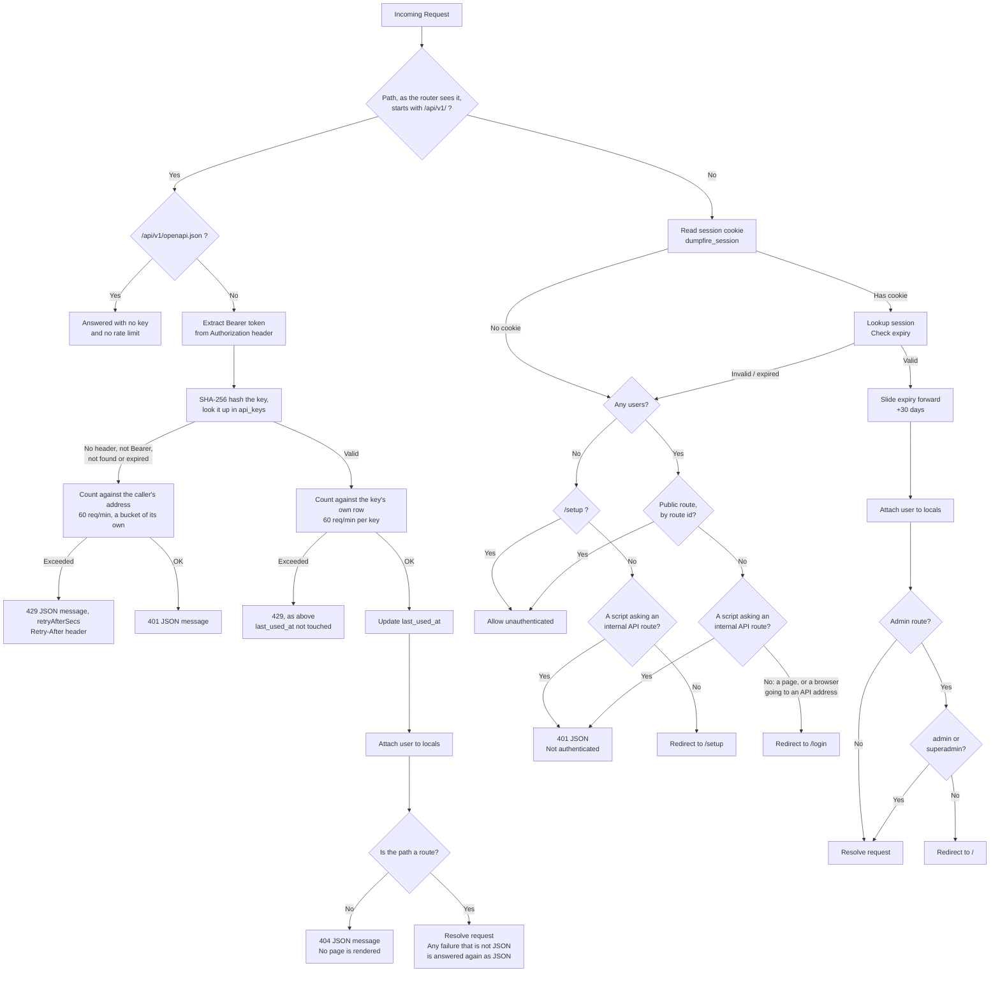

Every answer in the chart is returned by the gate and carries the security headers (see
[Security Headers](#security-headers)); none is thrown. A signed-in caller who asks for
`/login` or `/setup` is sent to `/` as well.

### Which Rule Applies to a Path

Every question the flow above asks about the path, whether it is under `/api/v1/`, a public
route or an admin route, is asked of the path as the router sees it, and not of the address
as it was sent. SvelteKit decodes an address before it looks for a route, so `/%61dmin` is
the route `/admin`. The gate once compared the address as sent, and a rule did not apply to
an address with one letter percent-encoded: a signed-in user who was no administrator was
shown the admin page and the audit page, and `/%61pi/v1/` was served without a key.

- **Where a route matched, the rule is decided on the route's id**, `/admin` or
  `/api/cards/[id]`, which is the router's own answer. Where none did, it is decided on the
  address decoded as SvelteKit decodes it, and nothing but a `404` is served.
- **`%2F` is no `/`, and nothing is decoded twice.** `/api%2Fv1%2Fme` is not under
  `/api/v1/`, and `/%2561dmin` is not `/admin`. Neither is a route. An address that cannot
  be decoded is answered `400` by SvelteKit before the gate is called.
- **The admin and audit page loads check the role themselves.**
  `src/routes/admin/+page.server.ts` and `src/routes/audit/+page.server.ts` send a caller
  who is not signed in to `/login` and one who is not an administrator to `/`, as the gate
  does. The handlers under `/api/admin/`, `/api/audit` and `/api/logs` each check the role
  too: no admin rule of the gate covers them.

How it is worked out is in [Architecture](architecture.md#the-path-a-rule-is-decided-on).
Covered by `tests/gate.test.ts`.

### Who Is Let Through Without a Session

A caller who is not signed in is let through to these routes, by route id, exactly, and to
no other:

| Route id | What it is |
|----------|------------|
| `/login` | The login page |
| `/docs` | The API's documents |
| `/invite/[token]` | The page an invite links to |
| `/request`, `/request/[id]/confirm`, `/request/[id]/reply` | The public request form, and the two pages its mails link to |
| `/api/requests`, `/api/requests/[id]`, `/api/requests/[id]/confirm`, `/api/requests/[id]/messages`, `/api/requests/targets` | The form's routes. Each handler asks for itself what it needs: a session, the token the form was given, or a request's link (see [The Public Request Form](#the-public-request-form)) |
| `/api/v1/openapi.json` | The API's description, answered with no key |

`/setup` is the one page there is before there is a user, and is never served once there
is one. `/favicon.ico` passes the gate without being asked who is calling.

A call to a remote function, `/_app/remote/<id>`, is answered `404` `{ "message": "Not
found" }` by the gate, to anybody, before any of this is asked. SvelteKit takes the path
such a call is for from its `x-sveltekit-pathname` header, which the caller writes, and has
set the route from it before the gate is called: decided on that, a call naming `/login`
was let through as the public page, and one naming `/_app/x` passed through unasked and
unlogged. DumpFire has no remote functions. The gate's log line for it is at the address
it was sent to.

- **By id, and not by how the address begins.** The list was compared with the start of
  the address, so `/requestX`, `/loginX`, `/api/requestsX` and `/faviconX` were let past the
  sign-in redirect, to a 404. A route under a public one is not public unless it is in the
  list itself, and a path that is no route has no id and is never public.
- **What a caller who is not signed in is answered elsewhere depends on who is asking.** A
  page's script, or any other program, asking an internal API route (under `/api/`,
  outside `/api/v1/` and the form's routes) is answered `401` `{ "message": "Not
  authenticated" }`. A browser going to an address is sent to `/login`: every page, and an
  API address opened as a page, such as an attachment in a new tab, the milestone PDF or an
  export's download. The gate tells them apart by `Sec-Fetch-Mode: navigate`, which
  browsers send with a navigation, or by an `Accept` header that prefers `text/html` to
  JSON, read as SvelteKit reads it.
- **Why not the redirect for everybody.** A script's `fetch` followed the redirect and was
  handed the login page's HTML with a `200`, so a page whose session had ended went on as if
  its requests had worked: a card moved on screen and not on the server.
- **With no users at all**, a browser is sent to `/setup` and a script is answered `401`.
  The form's routes are sent to `/setup` as before.
- **A redirect to a page's script is JSON.** A page asking for its own data, or posting one
  of its forms (`use:enhance`), is answered as SvelteKit answers it: `200` with
  `{ "type": "redirect", "location": "/login" }`, which the page follows itself.

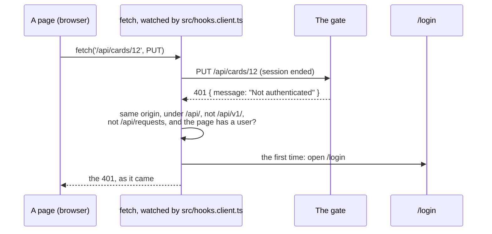

**In the browser,** `src/hooks.client.ts` replaces `window.fetch` once, as the application
starts, with the watch in `src/lib/signed-out.ts`. On the first `401` from the page's own
server to a path under `/api/` that is not under `/api/v1/` or `/api/requests`, and only when
the page has a signed-in user, it opens `/login`. Every answer is handed back untouched. A
requester on the public form whose form token has lapsed is answered `401` too, and is not
sent to a login page they have no account for.

**The live-update streams** (`/api/boards/[id]/events` and `/api/events`) are opened by
`src/lib/live-stream.ts`. After a failure it waits 3 seconds, then twice as long after each
failure that follows, up to five minutes, and asks the stream's address with `fetch` before
it opens it again. A `401`, `403` or `404` is not mended by asking again, and the stream
stays closed; the `401` also sends a signed-in page to the login page, through the watch.
Before, each open board asked again every three seconds for ever, and after a restore that
signs everybody out each wrote about 57,000 lines a day to the system log. A stream that is
already open when its session ends stops by itself at its next heartbeat: see
[An Open Stream and Its Session](#an-open-stream-and-its-session).

What cannot be run in the suite, which has no browser, is checked by calling the two files'
functions with stand-ins and by reading the source: `tests/page-failures.test.ts`. The gate's
half is in `tests/gate.test.ts`.

### How Large a Request May Be

Before any of the flow above, the gate asks how large the request's body is, of every
request: a page and a form action as much as a route under `/api/`. A body that declares
its length in `Content-Length` is asked of that, before it is read. A body that does not,
one sent in chunks, is counted as it is read, and no more of it is read once it has passed
the limit.

| The request | Answer |
|-------------|--------|
| Has no body: a `GET`, a `DELETE` with nothing in it, a `POST` with an empty body | Passed on |
| Declares more than its route accepts | `413` `{ "message": "The request is larger than this server accepts here: it is 2 MB, and the limit is 512 KB", "limitBytes": 524288 }`, before it is read |
| Declares no length, and its route reads past the limit | `413` `{ "message": "The request is larger than this server accepts here: the limit is 512 KB", "limitBytes": 524288 }`, when the handler reads it |
| Declares a length its route accepts, and runs past it | `413` `{ "message": "Payload Too Large" }`, when the handler reads it |
| Anything else | Passed on, and its body read as it was sent |

| The route | The most its body may be |
|-----------|--------------------------|
| Every route, the login, set-up and invite forms included | 512 KB |
| `POST /api/cards/[id]/attachments`, for a caller who is signed in | 26 MB |
| `POST /api/admin/import`, for the superadmin | All the server accepts: `BODY_SIZE_LIMIT`, 512M in the image |

- **Why every route.** The server has one limit for all of them, and it has to be large
  enough for a database backup. Without the narrowing, anybody could post half a gigabyte
  to the login form.
- **Why a body with no length is counted.** The server holds a body to the length it
  declared. One that declares none is held to nothing: with a limit of 512 KB, a chunked
  body of 64 MB was read in full. So the gate hands the handler a copy of the request whose
  body passes through a count (`heldToLimit()`), and a read that passes the limit fails with
  the `413`. The body is left unread there, not cancelled: the server answers a cancelled
  body by closing the connection, and the `413` would never arrive.
- **Why it is read, and not refused.** A browser says how long what it posts is, but a body
  can still arrive in chunks: from a client that sends it so, or through a proxy that passes
  it on so, as `cloudflared` does unless it is told not to. So it is read, and held to the
  same limit as a body that says how long it is.
- **The two larger limits are given to those who may use them.** The attachment upload's to
  anybody signed in, and the import's to the superadmin alone: an administrator who declares
  a whole backup to the import is refused for its size, and none of it is read. One who sends
  it in chunks is refused by the handler, with a chunk or two of it read at most. A caller with
  no session is turned away from both routes before the body matters, and each handler asks
  its own question before it reads a byte: edit access to the card's board, and the
  superadmin.

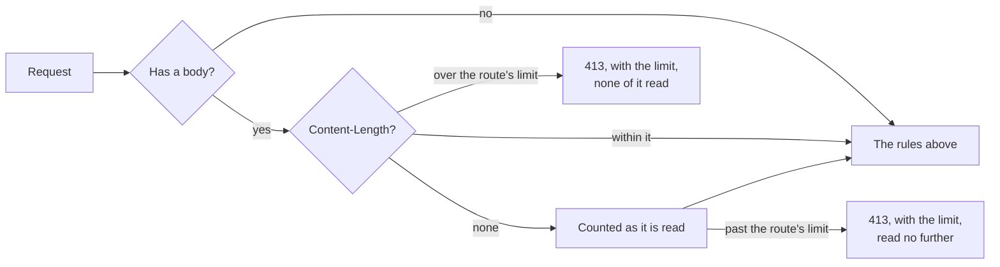

The limits are in `src/lib/server/body-limits.ts`, and the proxy's own are in
[Upload Size Limits](deployment.md#upload-size-limits). Covered by
`tests/body-limits.test.ts`.

## Session Management

| Property | Value |
|----------|-------|
| Cookie name | `dumpfire_session` |
| Token format | `crypto.randomUUID()` |
| Duration | 30 days sliding window |
| Storage | `sessions` table in SQLite |
| Flags | `httpOnly`, `sameSite: lax`, `secure` in production |

### Sliding Window

Every valid session access extends the expiry by 30 days. This means active users never get logged out, while inactive sessions expire naturally.

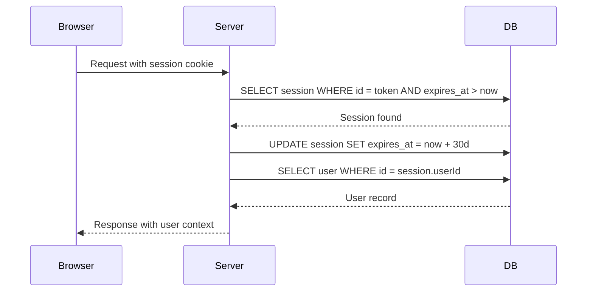

### An Open Stream and Its Session

The gate asks about a session once, when a request arrives. The three live streams are each
one request that stays open: `/api/events` (All Tasks, the dashboard and Burndown),
`/api/boards/[id]/events` (a board) and `/api/logs/stream` (the audit console's live log).
Each used to go on sending after its session was deleted, so a reset, a sign-out elsewhere
or a password change left every open tab of that session receiving card titles and who did
what, and an administrator's audit console receiving the system log, until the tab was
closed.

Each now reads its session cookie when it is opened and asks at every heartbeat it sends
(30 seconds; 25 for the log) whether that session is still there, has not expired and has
an account. If not, the stream ends and sends nothing more. The board stream asks
`sessionStillOpen()` in `src/lib/server/auth.ts`. The log stream and `/api/events`, which
are let in for what the account's role was when they opened, ask `openSessionUser()`, which
gives the account as it is now, and end as well when that role has changed. Each check is
two reads, with nothing written or logged, and the session's expiry is not moved on, so an open
tab does not keep a session alive.

| What happened | The stream |
|---------------|------------|
| The session was deleted: a sign-out, a password change, a reset, an invite used, a restore, Reset Everything | Ends at its next heartbeat |
| The session expired, or its account was deleted | Ends at its next heartbeat |
| Another session of the same account ended | Goes on: only the session that opened it counts |
| The account is no longer an administrator | The log stream ends at its next heartbeat, and so does `/api/events`, which sent it every board's events. The board stream goes on |
| An ordinary user was made an administrator | `/api/events` ends at its next heartbeat, and the page opens it again with every board's events |
| The check itself failed (a database that cannot be read) | Ends, with one `WARN` line under `AUTH`: "Live stream ended: its session could not be checked", with the route and the error |

What the person sees: a page that holds a stream (a board, the dashboard, All Tasks,
Burndown) goes to the login page by itself within about 35 seconds of its session ending
(one heartbeat, then the three seconds `keepStreamOpen()` waits before it asks again and is
answered `401`). A page that holds none (Account, Admin, Reports) goes there at its next
request. The audit console stops and shows it is disconnected. After a restore, every open
board, dashboard, All Tasks and Burndown page goes to the login page the same way. After you
change your own password, each of your other open tabs refreshes once within half a minute
and stays signed in: its stream opens again on the browser's new cookie. An administrator
made an ordinary user sees the audit console show it is disconnected, and an open All Tasks,
dashboard or Burndown page refreshes once, its data read again for the account as it is now.

The board stream still keeps the board access it was opened with: a user taken off a board
goes on receiving that board's events while the session lasts, so that a deleted board's
page is told by its event (card 2170 is to handle it). `/api/events` asks again whether an
ordinary user may open each board, through a cache that keeps each answer about 30 seconds.
See the sequence in [Architecture](architecture.md#an-open-stream-and-its-session). Covered by
`tests/live-streams.test.ts`.

## Password Hashing

- **Algorithm**: bcrypt via `bcryptjs`
- **Rounds**: 12
- **Functions**: `hashPassword()` and `verifyPassword()` in `auth.ts`
- **Never inside a transaction**: hashing takes about a quarter of a second, and nothing else can write while a transaction is open. A password is hashed before the transaction that stores it

### Guessing a Current Password

Three routes ask a caller who is already signed in for their current password: changing
your email (`PUT /api/account/email`), changing your password (`PUT /api/account/password`,
which the admin page's dialog on your own row uses too) and Generate Key
(`POST /api/account/api-keys`). The password is what whoever holds a session and not the
password (an unlocked machine, a copied cookie) would need to move the email, set a new
password or make a key, and each guess used to be answered at once, as often as asked.

They now follow sign-in's rule, counted on the **signed-in browser**: the session the
request was sent with. Ten attempts in 15 minutes, the three routes counted together, and the
right password clears the count. The eleventh attempt in the window is answered `429` "Too
many wrong passwords. Try again in N minute(s)." before any password is checked, whatever it
carries, the right one included, and nothing is written.

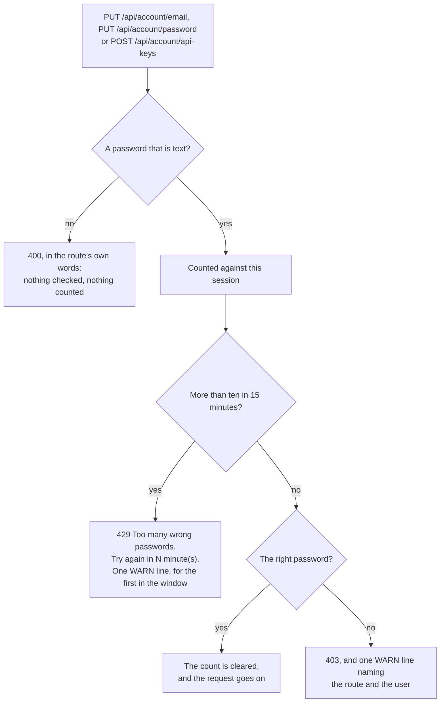

- **Why the session and not the account.** Counted on the account, whoever held one session
  of it could keep every session of it refused, the owner's included, and so keep the owner
  from changing the password, which is how an owner ends the other sessions. A session is
  only made by signing in or with an invite, each of which needs the password or sets it, so
  a count on the session slows the guesser as much. Signing in again, or another browser
  already signed in, is not held up.
- **One function.** `currentPasswordMatches(session, userId, password, hash, where)` in
  `src/lib/server/auth.ts` counts the attempt, answers the `429`, checks the password and
  clears the count when it matches. The session comes from the session cookie the gate
  checked; a request that reaches one of these routes without one is answered `401`. A route
  that checks the password again inside its transaction, because the password was changed in
  between, does not count it again: it is the same guess.
- **A fixed window, not a sliding one.** The 15 minutes start at the session's first attempt,
  and when they end the count starts again from nothing, however many attempts were refused
  in them (`src/lib/server/rate-limit.ts`, sign-in's limiter too). So a guesser who times it
  can make about 20 attempts back to back across the end of a window (nine at the end of one,
  ten at the start of the next), and one who keeps asking makes about 40 an hour for each
  session: ten in every window.
- **The system log.** Each wrong password is a `WARN` line under `AUTH`, "Wrong current
  password for user N on {route}", and the first refusal at the limit in each window one
  more, "Current password not checked for user N on {route}: too many wrong ones from this
  session". The refusals after it in the same window are not logged, so a script that goes
  on asking does not fill the log. The session is never logged.
- **A password that is not text** (a number, `true`, a list) is answered `400` before
  anything is counted: "Password is required" on the email and key routes, "Current password
  is required" on the password route. It used to reach bcrypt and be answered `500`. So did
  a new password that is not text, which is now `400` too: `newPassword must be text` on
  the password route, and `password must be text` on an administrator's reset
  (`PUT /api/users/:id/password`), which looks for the account and checks the caller before
  it reads the password (card 2117).
- **In memory**, as sign-in's count is: a restart clears it.

Covered by `tests/atomic-accounts.test.ts`.

## Passwords, Sessions and Invites Change Together

Every request that changes who can sign in makes its writes in one transaction (see [Architecture](architecture.md#writes-one-transaction-then-the-effects)). The cookie is set, and the redirect made, after the commit.

| Request | Changes together, or not at all | The account's invites not yet used | The account's API keys |
|---------|---------------------------------|------------------------------------|------------------------|
| Change your own password (`PUT /api/account/password`) | The new password, the end of every session the user has, and the new session that keeps this browser signed in | All end | Kept, unless the body says `endApiKeys: true`, which the Account page's box sends |
| An administrator sets a user's password (`PUT /api/users/:id/password`) | The new password and the end of every session that user has. Nobody sets their own password by this route, an administrator included: the caller's own id is answered 403 and told to use the Account page | All end | All end |
| Create a user (`POST /api/users`) | The user and, where no password was given, their invite. The invite email is sent after the commit | A new account has none | A new account has none |
| Send an invite again (`POST /api/users/:id/invite`) | The new invite. The email is sent after the commit | All earlier ones end | Kept |
| An administrator changes an account's email or role (`PUT /api/users/:id`) | The change, and the end of the account's invites when its email or role is changed | All end, when the email or role written differs from the one stored | Kept |
| Change your own email (`PUT /api/account/email`) | The new address and the end of the account's invites | All end, when the address differs from the one stored | Kept |
| Use an invite (`/invite/:token`) | The password, the invite marked used, the end of every session the account had, and the first session | All others end | All end |
| First-run set-up (`/setup`) | The superadmin and their session | | |

So a password is never changed while the old sessions stay good, an invite never sets a password and remains usable, and no invite waiting to be used outlives a newer invite, a password change, or a change of the account's email address or role.

### What Setting a Password Ends

**An API key outlives a password change only when the account's own holder made that
change with their current password, and chose to keep their keys. Every other way of
setting a password ends the account's keys. Every way of setting a password ends its
sessions and its invites that have not been used.**

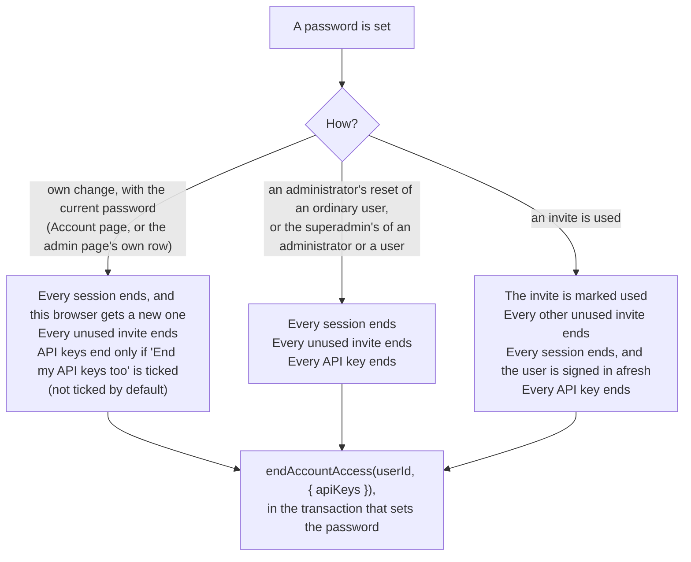

| How the password is set | Sessions | Invites not yet used | API keys |
|-------------------------|----------|----------------------|----------|
| Your own change, with your current password, on the Account page or your own row of the admin page. The superadmin's included | All end; this browser gets a new one | All end | **Kept, unless you tick "End my N API keys too"**, which is not ticked by default. The admin page's dialog sends no choice, so it keeps them, and says so |
| An administrator resets an ordinary user's password, or the superadmin an administrator's or a user's | All end | All end | **All end** |
| An invite is used | All end, and the user is signed in with one new session | All others end; the one used is kept, marked used | **All end** |
| A restore, an import, Reset Everything | Not a password change: these replace the whole database. See [What a Backup Holds](#what-a-backup-holds-and-what-a-restore-brings-in) | | |

Why a reset and an invite always end keys: they are how someone who does not have the
current password takes an account back from someone who has its password or a session.
Why your own change only offers it: you have just proved you hold the password, a routine
change is not about an intruder, and ending keys stops every script that uses them. The
server cannot tell a recovery from a takeover, so a user who forgot their password and is
sent a reset or an invite loses their keys too.

**What a reset does not end.** A reset, an invite used and a change with the box ticked end
the account's sessions, its waiting invites and its keys: every way in as that user. They
do not end everything an intruder could have set up while they held the account:

- **Webhooks registered with the account's keys.** A webhook has no owner column, and any
  key with edit access to a board can register one on it, so a webhook made that way keeps
  receiving the board's events after the key that made it has ended.
- **The account's report schedules.** They keep mailing their reports to the recipients
  they name.

After taking an account back, look over the webhooks of the boards it could edit (no page
lists them: `GET /api/v1/boards/{id}/webhooks`), and have the account's holder look over
their report schedules on the Reports page, where only they see them. Delete any that
nobody recognises.

- **One function.** `endAccountAccess(userId, { apiKeys })` in `src/lib/server/auth.ts`
  deletes the account's sessions, then its invites with `used = 0`, then, when asked, its
  API keys, and returns how many of each (`AccessEnded`: `{ sessions, invites, apiKeys }`).
  All three password routes call it inside the transaction that writes the password, and it
  throws if no transaction is open. Ending a key is deleting its row, as Revoke does; the
  gate then answers the key `401` `Invalid or expired API key`.
- **One invite per account.** `issueInvite(userId)` in `src/lib/server/invites.ts` deletes
  every invite of the account not yet used, expired or not (`endUnusedInvites()`, which
  `endAccountAccess()` and a change of email or role call too), writes the new one with its
  seven days (`INVITE_LIFETIME_MS`), and returns the token. Both routes that issue an invite
  call it, inside the transaction that checks the account may be invited, and it throws if
  no transaction is open. So an account has at most one invite that works, the newest, and
  the administrator who sends one is told "Invite sent to {email}. Any earlier invite to
  this account no longer works." An invite that was used is never deleted: `used` is how the
  invite page and the backup tell a spent invite from a waiting one.
- **An invite for the superadmin's account is refused.** Nobody may set the superadmin's
  password but the superadmin, and no route issues an invite for that account, but one
  written before that rule could still be waiting. The invite page reads the account's role
  with the invite, on the page, on the form's first look and again inside the transaction,
  and answers an invite for the superadmin as a dead link, with nothing written. Using it
  would otherwise set the only superadmin's password and end every session and key they
  have. An administrator's invite is not refused: the superadmin sends those.
- **One answer for every dead link.** An invite that has expired, was used, or was ended by
  a newer invite or by a change of the account's password, email address or role is told,
  on the page and from the form: "This invite link no longer works. It has expired, it has
  already been used, or it was cancelled when a newer invite was sent or the account's
  password, email address or role was changed. Ask an administrator to send you a new one."
  A deleted invite cannot be told from one that never was. The page and the form each hold
  the words, and `tests/page-failures.test.ts` holds them equal.
- **What each person is told beforehand.** The Account page, when you have keys: "You have N
  API keys. They keep working after a password change unless you tick the box" ("It keeps",
  for one), and the box. The box is cleared whenever the list of keys is empty, so it never
  comes back ticked beside a key made later. The admin page's reset dialog: "They have N API
  keys, which stop working" when there are any, then "They are signed out everywhere, every
  API key they have stops working, and any invite not yet used stops working." The page is
  given each count only for an account whose password the caller may reset (`null` for the
  caller's own, the superadmin's, and, for an ordinary administrator, another
  administrator's), and never a key's name or prefix. The dialog reads the counts again
  when it opens and shows none until it has, so a key made since the page was loaded is
  counted. The invite page, on an account with keys: "Setting a password here ends this
  account's N API keys and signs it out everywhere else."
- **And afterwards.** Your own change answers `{ success: true, apiKeysEnded }`, and the page
  says the keys were ended when they were. A reset answers
  `{ success: true, sessionsEnded, apiKeysEnded }`, and the toast gives both counts. The user
  whose password was reset is not mailed: the administrator gives them the new password and
  tells them then.
- **The system log.** Each writes one `INFO` line under `AUTH`, after the commit:
  `Password changed by user — ended S session(s), I invite(s) and K API key(s)`;
  `Password reset for user N ("name") by "actor" — ended S session(s), I invite(s) and K API key(s)`;
  `Password set with an invite for user N — ended S session(s), I other invite(s) and K API key(s)`.
- **A script's key.** A key on an account whose keys end is answered `401` `Invalid or
  expired API key` from then on, and whatever uses it stops until it is given a new key.
  Before resetting the password of an account a script or an integration runs on, look at
  the dialog's count.

Keys made before this are kept: nothing ends them on deploy. Covered by
`tests/atomic-accounts.test.ts`.

### When an Account's Email or Role Changes

An invite is addressed to an account as it was when it was sent: to its email address, and
with its role. So **every invite of the account that has not been used, expired or not, ends
when its email address or its role actually changes**, in the transaction that writes the
change. Before, an invite mailed to an address the account no longer had, or sent before the
superadmin made the account an administrator, still set the account's password, and whoever
held it was signed in, as an administrator in the second case.

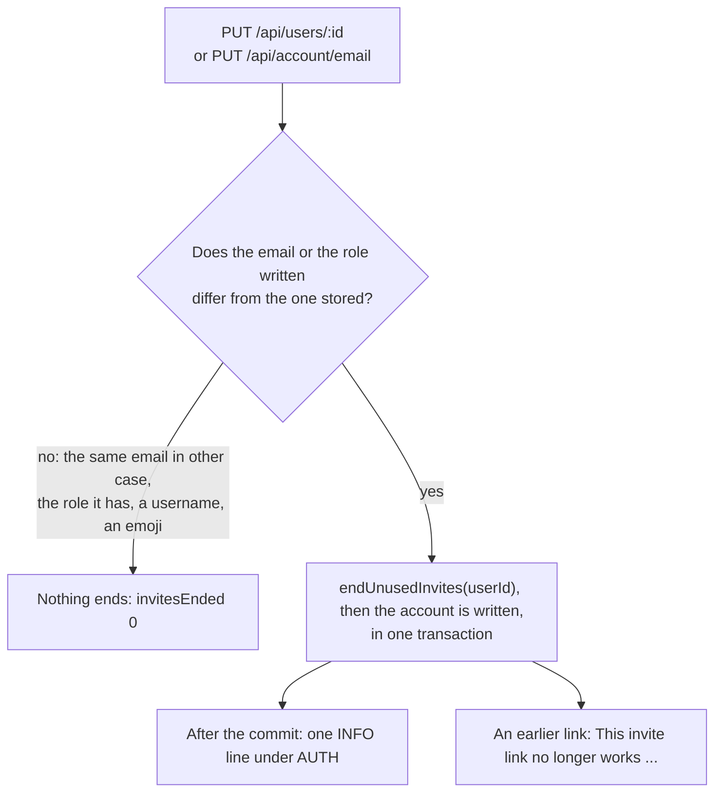

- **"Actually changes."** The value written differs from the one stored, an email compared in
  lower case, as it is stored. A change of username or emoji ends nothing, and no change ends
  a session or an API key: an email change is not a password change.
- **Both routes.** `PUT /api/users/:id` (an administrator, for an ordinary user; the
  superadmin, for an administrator too, and the only one who makes an account an
  administrator) and `PUT /api/account/email` (the account's holder, with their current
  password). The email route is now one transaction: the account read again, the password
  checked again if it changed meanwhile, the address checked as free, written, and the
  invites ended.
- **What is said.** `PUT /api/users/:id` answers `invitesEnded` beside the account's columns.
  When it is above 0 the admin page's toast after a role change reads "Role updated. The
  invite sent to this account earlier no longer works: send a new one with 📧." The Account
  page says nothing new: a user changing their own email has no use for an invite waiting for
  them. Whoever opens the old link is given the one dead-link answer, which names this reason.
- **The system log.** One `INFO` line under `AUTH` after the commit, when something changed:
  `User A changed the email address and role of user N — ended I unused invite(s)` (naming
  whichever of the two changed), or `User N changed their email address — ended I unused
  invite(s)`. No address is written.

An invite already waiting when an account's email or role changed before this was deployed
stays usable until it expires, within seven days. Covered by `tests/atomic-accounts.test.ts`.

### Who May Manage Which Account

Four routes manage somebody's account: `PUT /api/users/:id/password` sets its password,
`POST /api/users/:id/invite` mails it a link that sets one, `PUT /api/users/:id` changes
its role, name, email or emoji, and `DELETE /api/users/:id` deletes it. All four ask one
guard, `requireManagedAccount()` in `src/lib/server/route-guards.ts`, inside the
transaction that writes, so they cannot differ. They used to ask each for itself: an
administrator could not delete another administrator and could set their password, and
could send any account an invite, the superadmin's and their own included. Whoever holds
an invite sets the account's password with it and is asked for no other, so an invite is
a password reset by another way and is asked what a reset is asked.

| The account is | An ordinary user | An administrator | The superadmin |
|----------------|------------------|------------------|----------------|
| An ordinary user's | ❌ | ✅ | ✅ |
| An administrator's | ❌ | ❌ | ✅ |
| The superadmin's | ❌ | ❌ | ❌ |
| Another superadmin's, were there one | ❌ | ❌ | ❌ |
| The caller's own, on the password route | ❌ | ❌ | ❌ |
| The caller's own, on the invite route | ❌ | ❌ | ❌ |
| The caller's own, on the delete route | ❌ | ❌ | ❌ |
| The caller's own, on the change route: `email` | ❌ | ❌ | ❌ |
| The caller's own, on the change route: `role` | ❌ | ❌ | ❌ |
| The caller's own, on the change route: `emoji`, `username` | ❌ | ✅ | ✅ |

Columns are who is calling. Every ❌ is a 403 with nothing written, but for the caller's
own account on the delete route, which is a 400.

The caller's own `email` is refused on the change route because that route asks for no
password, and an email is where an invite to set a new one is sent:
`PUT /api/account/email` asks for the password the caller has. Their own `role` is refused
there too, for sending one at all, the role they have included, and nothing else sent with
it is saved (card 2117, decision 13): `Your own role is not changed here: the superadmin can
change it`, or to the superadmin `The superadmin's role cannot be changed`. Their own `emoji` is
theirs to change with no password on the account routes too. No account route changes a
`username`, so the change route is the only way to one, the caller's own included.

**What a role may be.** `POST /api/users` and `PUT /api/users/:id` are the two routes that
write a role, and both take it through one function, `requireAssignableRole()` in
`src/lib/server/account-fields.ts`:

| `role` as sent | Answer |
|----------------|--------|
| not sent | the role is left as it is, or is `user` for a new account |
| exactly `"user"` | written |
| exactly `"admin"` | written for the superadmin; 403 for anyone else |
| `"superadmin"` | 400. Neither route makes a superadmin: the set-up page makes the one there is |
| anything else: `"Admin"`, `null`, a number, an array, an object | 400 |

The value that is checked is the value that is written. It used to be compared with
`'admin'` and `'superadmin'` and then bound as it was sent: `["superadmin"]` is neither
string, and the database driver binds an array of one as the one, so an administrator
could make anyone the superadmin, themselves included. The same function's companion,
`readAccountFields()`, answers 400 for a `username`, `email`, `password` or `emoji` that
was sent and is not a string, and then holds each to its rule, the same on both routes
(card 2117, decision 14): a username trimmed and of at least 2 characters, an email an
address with no space and none of `, ; < > " ( )`, and an emoji of 1 to 32 characters. A
username or an email another account has is a 409, `Username already taken` or
`Email already in use`, from `requireUnusedAccountFields()`, in the transaction that writes.
`PUT /api/users/:id` used to write both as they came, and a duplicate was a 500 from the
database. A value the account already holds, sent back unchanged, is kept.

Nobody's own role is changed on `PUT /api/users/:id`, the superadmin's included. A role
the caller sends for their own account is a 403, before it is read, whatever it is. Until
card 2117, the superadmin's was answered 200 and not written, and an administrator who sent
`user` for their own account gave the role up, with one request and no way back but the
superadmin. The superadmin's own role is nobody's to change; an administrator's is the
superadmin's to change, as anyone else's role is.

This is the rule of the four routes above. Restoring a backup (`POST /api/admin/import`)
replaces every account with the backup's, password hashes and roles included, and a reset
(`POST /api/admin/reset`) clears every account. Both were open to any administrator, who
could so get round it. They are the superadmin's alone now, with the other routes that
act on the whole installation: see [The Superadmin's Operations](#the-superadmins-operations).

There is one way to change your own password, and it is not an administrator's route:

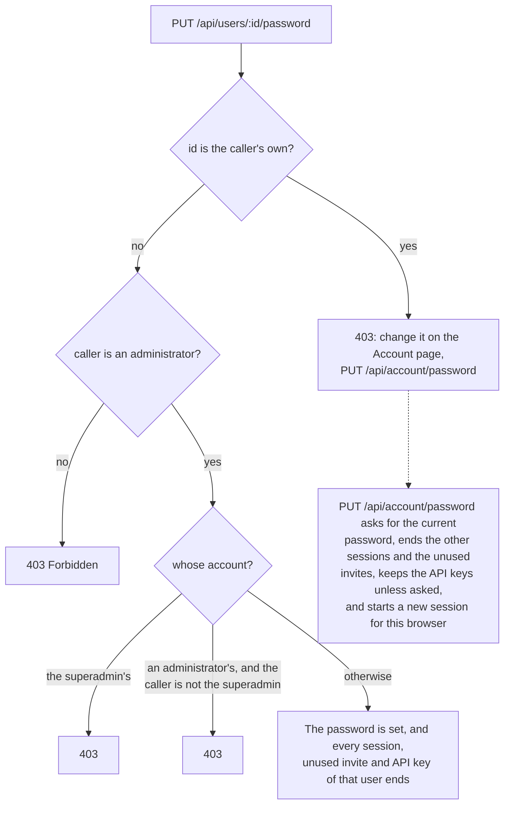

The admin page follows the same rule: on an administrator's own row the reset dialog asks
for the current password and sends it to `PUT /api/account/password`, with no
`endApiKeys`, so the keys are kept. The dialog says so: "Your API keys keep working. To
end them too, change your password on the Account page."

### The Superadmin's Operations

Some routes act on the whole installation, and each of them is the user list by another
way. All of them ask one guard, `requireSuperadmin()` in `src/lib/server/route-guards.ts`:
`401` for a caller who is not signed in, and `403` with one message, "This belongs to the
superadmin...", for everybody else who is not the superadmin, an administrator included.

| Route | What an administrator could do with it |
|-------|----------------------------------------|
| `GET /api/admin/export` | Download every password hash, the mail password and every backup destination's credentials. It held every session id and unused invite token too |
| `POST /api/admin/import` | Replace every account with accounts of their own |
| `POST /api/admin/reset` | Clear every account, and be the superadmin of the installation they then set up |
| `GET`, `PUT`, `POST /api/admin/backup` | Add a destination of their own and have the whole database sent to it |
| `POST /api/admin/backup/test` | Have a stored destination's password sent to a host of their choosing: a test whose secrets are masked connects with the stored ones |
| `GET`, `POST /api/admin/backup/gdrive/auth` | Connect a Google Drive of their own as a destination |
| `GET`, `PUT`, `POST /api/admin/smtp` | Point mail at a server of their own and the App URL at a host of their own, and read an invite meant for somebody else |

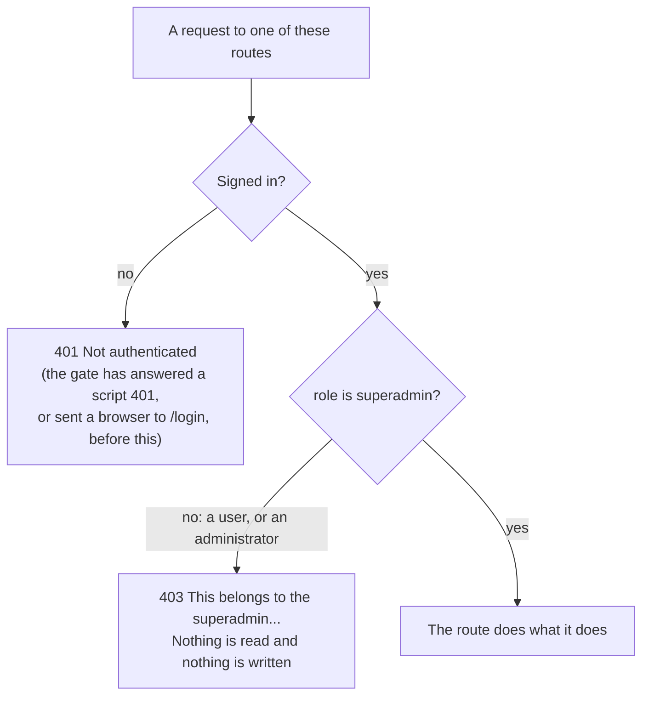

What stays with any administrator: `POST /api/admin/vacuum`, `purge-archived`, `reset-xp`,
`boards/[id]/clear-cards` and `clear-categories`, `GET /api/logs`, `/api/audit`, and the
user and team routes.

- **`superadmin` is written in one place.** Set-up makes the one there is. No route
  assigns the role, and nobody else can set the superadmin's password, so an installation
  whose superadmin cannot sign in has no page that puts it right. Three things stand
  against that. An import refuses a backup that has users and no superadmin among them,
  before anything is written. The server writes a `CRITICAL` line at every start while
  there are users and no superadmin. And the role can be given from the host: see
  [If Nobody Can Sign In as the Superadmin](deployment.md#if-nobody-can-sign-in-as-the-superadmin).
- **The admin page shows an administrator none of it**, and asks the server for none of it
  when it opens. In its place is one section that names the superadmin.

Covered by the `superadmin` kind in `tests/access-every-route.test.ts`, which has an entry
for every one of these routes, and by `tests/backups.test.ts`.

### What a Backup Holds, and What a Restore Brings In

A session's id is the whole of what its cookie carries, and an unused invite's token sets
its account's password. A backup that held them signed in whoever read it, as anybody who
was signed in when it was made, for as long as that session went on being used: a
session's expiry moves on every time it is used.

| | Sessions | Invites not yet used | Password hashes |
|---|----------|----------------------|-----------------|
| The file an export downloads | none | none | all |
| The copy a scheduled backup, or "Run Now", uploads | none | none | all |
| The running database, after a backup | as they were | as they were | as they were |
| The running database, after a restore of any backup | none: everybody is signed out | none: of the backup's invites, only those already used come in | the backup's |

- **One function makes both copies**, `generateBackupData()` in `src/lib/server/backup.ts`:
  the copy is made with `VACUUM INTO`, opened with no journal, cleared of every session and
  every invite with `used = 0`, its system log masked, **written out again** with a second
  `VACUUM INTO`, and only that second file is read.
- **The system log is masked too.** An invite's token is the last part of its address, and
  the gate wrote that address down for every request to it, where any administrator could
  read it from `GET /api/logs`. The gate now writes `/invite/[token]` in its place (only the
  path is ever written, never the query, so a request link's `?token=` is not written down
  at all), and a backup masks the same in every line the log already held, and replaces the
  token of any unused invite wherever else a line holds it. A line that holds a request
  link's `token=` all the same, written some other way, has that masked too. **The running
  database's log is masked by the same rule at every start** (`maskLiveLog()` in
  `src/lib/server/startup-checks.ts`, after the migrations; `maskSecretsInLog()` in
  `src/lib/server/secret-paths.ts` is the one rule for both), so an installation that ran
  the older gate has the tokens gone from `GET /api/logs` at its first start on this
  version. A later start finds nothing to change. A failure is logged at `WARN` and the
  server starts all the same.
- **Deleting the rows is not enough.** The pages they were on stay in the file until it is
  written again: after a plain `DELETE` of 400 sessions the count was 0 and their ids were
  in the file 925 times. The test looks for a known session id and a known invite token in
  the bytes of the file, and does not count rows.
- **A restore brings in neither, whatever the backup's age** (`rowsToRestore()` in
  `src/lib/server/db/restore.ts`). Without that, every backup made before this would bring
  its sessions back as live ones. So an import signs everybody out, whoever started it
  included: its answer says so, names the superadmin the restored data has, and takes the
  caller's cookie away.
- **A restore never commits users and no superadmin.** The import refuses a backup that has
  users and no superadmin before it starts, and the restore asks again of the rows it has
  restored, before it commits: a superadmin's row that could not be copied rolls the whole
  restore back, and nothing is changed.
- **Password hashes stay.** A backup that cannot restore its users is not a backup. It is
  still a file to keep where few can read it.
- **"Signs nobody in" is true of accounts, and of nothing else.** A backup holds no session
  and no unused invite, so it opens no account. It does still hold two other secrets: the
  link of every public request (`task_requests.access_token`), which lets whoever holds it
  read and reply to that request's thread and confirm it, and the key the public request
  form signs its tokens with (`request_form_secret` in `settings`). Taking those out is
  another card's work. Until then a backup is to be kept as carefully as the server.
- **Not covered.** Copies made before this, at a destination or downloaded, still hold the
  session ids of whoever was signed in then, and those sessions are still good on the
  installation they came from. Only ending every session there makes them dead. The safety
  copy an import writes before it replaces anything (`.pre-restore-safety.json`, in the
  server's working directory) holds every table as it was, sessions included, and is not
  deleted: see [How Large an Import Can Be](deployment.md#how-large-an-import-can-be).

Covered by `tests/backups.test.ts`.

### Where a Mailed Link's Address Comes From

An invite, a request's confirmation and reply links, the requester's progress mail and
the "View Task" link in a notification all begin with the server's own address. One
function gives it, `linkBaseUrl()` in `src/lib/server/email.ts`, and every caller asks it:

1. the App URL setting, which is the superadmin's to set;
2. the `APP_URL` environment variable;
3. `ORIGIN`, the address the server was started with, read as the node adapter reads it.

Nothing a request says is used in a built server: not `Host`, not `X-Forwarded-Host`, not
the address it was sent to. With no App URL set, a link used to take its host from
`X-Forwarded-Host`: an invite created by a request that carried `X-Forwarded-Host:
evil.example.test` was mailed with a link to `https://evil.example.test/invite/<token>`,
and the token sets the account's password. Under `vite dev` alone, where there is no
`ORIGIN`, the address the request was sent to is used last.

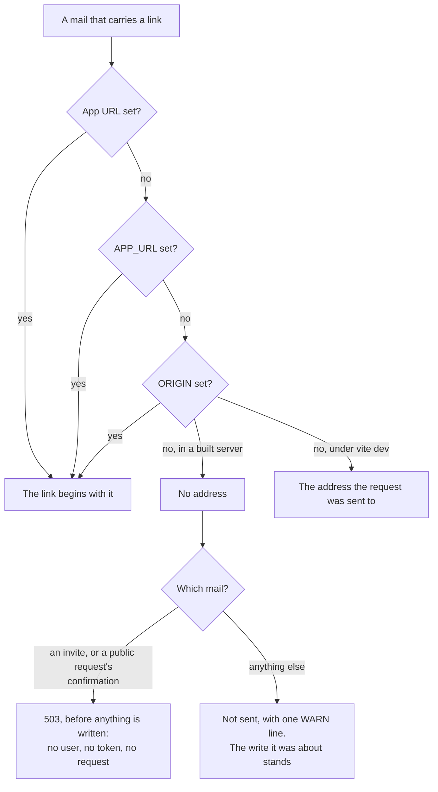

- **An invite and a public request are refused** when there is no address, with `503` and
  "This server has no address configured to make the link from". Each is nothing without
  its link: a user with a password nobody knows and no invite, a request nobody can
  confirm. The check is made before the row is.
- **A notification is skipped**, the requester's progress mail among them, with one
  `[WARN] [NOTIFY]` line, and never fails the move, the comment or the assignment it was
  about.
- **`http://localhost:3000` is an address.** It is what the image is built with, and a
  small installation really is served there. The server says so once at start, at `WARN`,
  when that is `ORIGIN` and no App URL is set.

Covered by `tests/mail-links.test.ts`, which runs as a built server and sends every
request with a forged `Host` and `X-Forwarded-Host`.

### What an Emailed Report's Answer Tells

`POST /api/reports/email` answers with each recipient's `success`, which is whether the mail
server accepted the mail for that address (card 2113), so the answer tells the sender which
of the addresses they typed the mail server accepted: one that refuses an unknown mailbox as
the mail is sent tells them which mailboxes exist on its own domain. This is accepted as
designed (the review of 2026-10-15): the sender needs it to send to the rest again, and the
mail server's own reason stays in the system log. Card 2182 is to cap how many recipients one
report may be sent to. See
[A Report Emailed on Demand](notifications-email.md#a-report-emailed-on-demand).

### One Use Means One Use

Two of these check something and then act on it: an invite must be unused, and set-up must find no user. Each reads the form first and makes its check again inside the transaction that writes, where no other request can write in between.

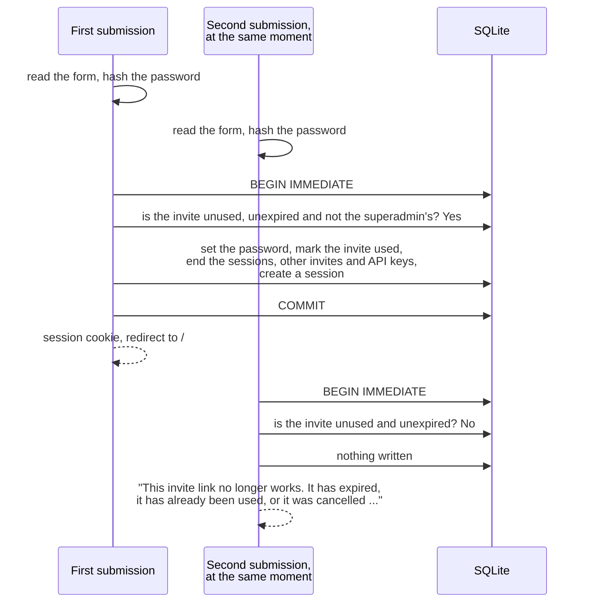

- **An invite cannot be used twice.** The second of two submissions of one link finds it used and is refused, with no password changed and no session made.
- **Set-up cannot create two superadmins.** The second of two submissions of the set-up form finds a user, creates nothing, gets no session and is redirected to `/`.
- **A password change is checked against the row as it is.** If the password was changed by another request between the check of the current password and the write, the current password is checked again against the new row inside the transaction. Making an API key and changing your email, which ask for the password too, are checked the same way, so a key cannot be made, nor an address moved, with a password a change has just ended. The email route also looks for the address being taken inside the transaction that writes it.

Covered by `tests/atomic-accounts.test.ts`.

## API Key System

API keys provide stateless authentication for the external API (`/api/v1/*`).

### Key Generation

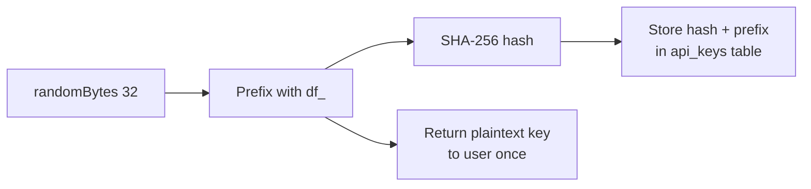

| Property | Value |
|----------|-------|
| Format | `df_` + 64 hex chars |
| Hash algorithm | SHA-256 |
| Storage | Only the hash is stored |
| Prefix stored | First 11 chars for identification |
| Expiry | Optional per-key: `expiresAt`, a timestamp in the future, stored in UTC as `toISOString()` writes it, because it is compared with the time as text. No page sends one |
| Rate limit | 60 requests/minute per key, counted against the key's own row once it is checked; 60 requests/minute per address for requests with no key the gate accepts |

### Key Lifecycle

1. The account's holder generates a key on the Account page, entering their current
   password (`POST /api/account/api-keys` with `{ name, password }`). The admin page makes
   none. Nothing else makes a key: the v1 API has no key route, and the gate accepts a key
   only under `/api/v1/`, so a key cannot make another
2. Plaintext shown **once** — user must copy it
3. Only the SHA-256 hash is stored in `api_keys` table, and one `INFO` line is written to
   the system log: `API key K created by user N`, with the key's id and the user's. Not its
   name or prefix: every administrator reads the system log, and every backup holds it
4. Each request the key is let in with updates `last_used_at`; one refused for being over
   the limit does not
5. Expired keys are rejected at validation time
6. A key ends when it is revoked on the Account page, or when its account's password is set
   in a way that ends keys: an administrator's reset, an invite used, or the holder's own
   change with "End my API keys too" ticked (see
   [What Setting a Password Ends](#what-setting-a-password-ends)). Either way its row is
   deleted, and the gate answers it `401` `Invalid or expired API key`

**Why a key asks for the password.** A key works until it is revoked, and the holder's own
password change keeps it unless they ask. A key made on a session alone let whoever held
that session for a moment (an unlocked machine, a copied cookie) keep the account after the
password was changed. The password is checked before the transaction and checked again
inside it if the stored hash has changed meanwhile; the ten-key limit is counted in the
same transaction as the insert.

| `POST /api/account/api-keys` sent | Answer, in this order |
|-----------------------------------|-----------------------|
| No session | `401` `Not authenticated` |
| No name, one that is not text, or one longer than 100 characters | `400` `Key name is required`, `name must be text`, `Key name too long (max 100 chars)` |
| No `password`, or one that is not text | `400` `Password is required` |
| An `expiresAt` that is not `null` and not a timestamp in the future | `400` `expiresAt must be a timestamp, such as 2027-01-01T09:00:00Z`, `expiresAt must be in the future`. Until card 2117 any text was stored, and `"banana"` never expired |
| The account already has ten keys | `400` `Maximum of 10 API keys per user` |
| The account has gone | `404` `User not found` |
| The eleventh attempt from this browser in 15 minutes, at any of the three routes that ask for the current password, right or wrong | `429` `Too many wrong passwords. Try again in N minute(s).` See [Guessing a Current Password](#guessing-a-current-password) |
| A wrong password | `403` `Password is incorrect` |
| All of it right | `201` with the key, shown once |

Keys made before the password was asked for are kept.

### What an API Caller Is Told

The key check and the rate limit are made by `handle` in `src/hooks.server.ts`, before any
handler runs. Every refusal under `/api/v1/` is JSON with a `message`, whatever `Accept`
header the request sent.

| Request | Answer |
|---------|--------|
| No `Authorization` header, or one that is not `Bearer <key>` | `401` `{ "message": "Missing or invalid Authorization header. Use: Bearer <api_key>" }` |
| A key that is not in `api_keys`, has expired, or belongs to a user who no longer exists | `401` `{ "message": "Invalid or expired API key" }` |
| More than 60 requests in the minute with one key | `429` `{ "message": "Rate limit exceeded", "retryAfterSecs": 42 }`, with a `Retry-After` header carrying the same number |
| More than 60 requests in the minute from one address with no key the gate accepts, a missing header included | `429`, the same |
| A path that is no route, sent with a key that is accepted | `404` `{ "message": "Not found" }` |
| A method the route does not have, sent with a key that is accepted | `405` `{ "message": "PATCH method not allowed" }`, with an `Allow` header naming the methods it has |

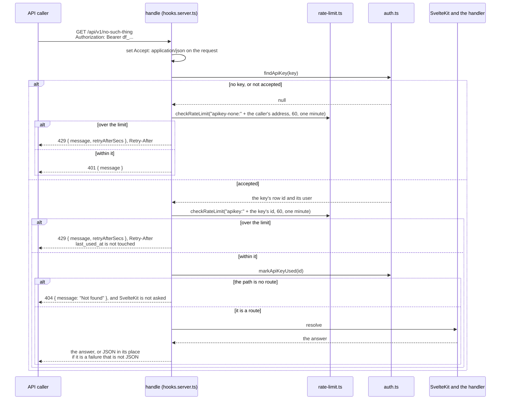

- **The key is checked before anything is counted.** A key's requests are counted against
  the key's own row, which only the key reaches. They were counted first, against the first
  11 characters of whatever was sent, which is the prefix stored for a real key: anybody who
  had seen a key's prefix could spend its allowance with requests that were not the key. The
  lookup is one SHA-256 and one read of a unique column.
- **A request with no key the gate accepts is counted against its address**, a missing
  header included, in a bucket of its own, so guessing at keys is slowed and never spends a
  real key's allowance. The address is the one the server is given: behind a reverse proxy
  that is the proxy's own unless the server is told where to find the caller's
  (`ADDRESS_HEADER`, in [Deployment](deployment.md#the-callers-address-behind-a-proxy)).
  Untold, every caller shares the one bucket: a valid key is never held up by it, and a
  mistyped key may be answered `429` while somebody else is guessing. Where the address
  cannot be read at all, the request is counted with every other whose address is unknown.
- **The counts are kept in memory**, in the one process, for a minute from the first
  request each counts.
- **Without a key every path is a `401`**, a path that is no route included: the key is
  checked before the path is looked at.
- **A path that is no route renders no page.** SvelteKit's own answer would be its 404
  page, which is HTML and has in it the name, email and role of the signed-in user, because
  the root layout loads them for every page. For a request with an accepted key that user is
  the key's owner. The gate answers the `404` itself, and SvelteKit is not asked.
- **A handler's refusal is JSON too.** The gate sets the request's `Accept` header to
  `application/json`, so SvelteKit answers every `error(status, text)` as `{ message }` and
  never as a page.
- **`GET /api/v1/openapi.json` is the one path under `/api/v1/` that needs no key.** It is
  answered before the key is asked for and is not counted against any limit.
- **A session cookie is not looked at under `/api/v1/`.** A signed-in browser with no key is
  answered `401` there.

How the gate does this, rule by rule, is in [Architecture](architecture.md#the-gate). What a
caller should make of each status is in the
[External API Reference](api-reference.md#error-format). Covered by `tests/gate.test.ts`.

## Board Access Control

Board access is determined by `board-access.ts` using a priority-based resolution.

### Access Resolution Order

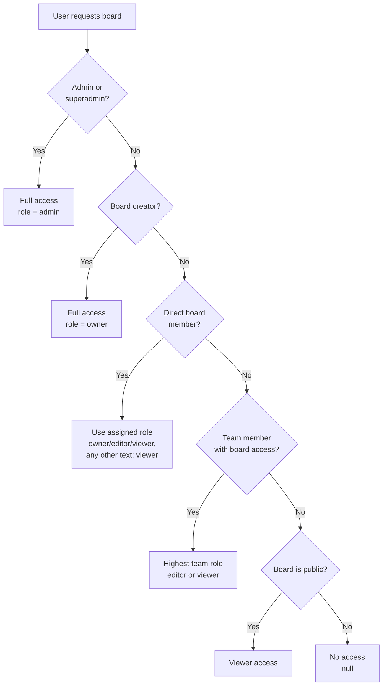

### Permission Matrix

"Admin" means either administrator role, `admin` or `superadmin`. Code tests for it
with `isAdmin()` from `board-access.ts`, never by comparing `role` to `'admin'`: the
bare comparison locked `superadmin` out of the v1 audit log and activity report
until October 2026.

| Action | Owner | Editor | Viewer | Admin |
|--------|-------|--------|--------|-------|
| View board, its archive, labels and templates | ✅ | ✅ | ✅ | ✅ |
| Create/edit/archive/restore cards and subtasks | ✅ | ✅ | ❌ | ✅ |
| Move and reorder cards | ✅ | ✅ | ❌ | ✅ |
| Add, edit, reorder and delete columns | ✅ | ✅ | ❌ | ✅ |
| Comment, and edit or delete your own comment | ✅ | ✅ | ❌ | ✅ |
| Create a card category or template on the board | ✅ | ✅ | ❌ | ✅ |
| Create, update and delete webhooks | ✅ | ✅ | ❌ | ✅ |
| Read a webhook's signing secret and address (the address since card 2133) | ✅ | ❌ | ❌ | ✅ |
| Read the email addresses in the board's share list (since card 2128) | ✅ | ❌ | ❌ | ✅ |
| Share board | ✅ | ❌ | ❌ | ✅ |
| Make the board public or private, by any route | ✅ | ❌ | ❌ | ✅ |
| Delete board | ✅ | ❌ | ❌ | ✅ |
| Put the board under a card, or take it out from under one | ✅ | ❌ | ❌ | ✅ |

### Where the Decision Is Made

The access decision for a route is made on the server, from the database row the
request is about. A board id sent in a request body is never used to decide access:
it says which board the caller would like to be judged against, and a caller who may
edit board A could name it while changing a card on board B. That was the central
finding of the October 2026 code review, and it applied to every internal card,
subtask and label route.

`src/lib/server/route-guards.ts` holds the guards. Each one looks the row up, finds
the board it is on, checks the caller against that board, and returns what it found —
so a handler cannot check one board and then act on another.

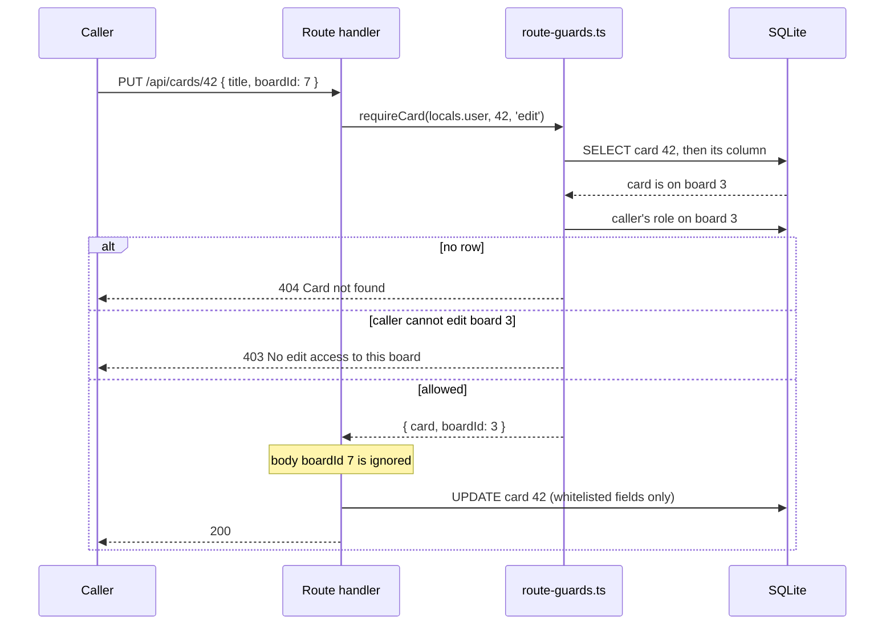

| Guard | Resolves the board from | Used by |
|-------|-------------------------|---------|
| `requireBoard(user, boardId, need)` | the board row itself (must exist) | board archive, favourites, labels, templates, columns, webhooks |
| `requireColumn(user, columnId, need)` | `columns.board_id` | card create, card move target, column reorder, request accept |
| `requireCard(user, cardId, need)` | the card's column | card update/delete/restore, subtask create, label toggle, comments, attachments |
| `requireSubtask(user, subtaskId, need)` | the parent card's column | subtask update/delete |
| `requireLabel(user, labelId, need)` | `labels.board_id` | label toggle and delete |
| `requireCategoryEdit(user, categoryId)` | `categories.board_id` | card category rename/delete, both API trees |
| `requireBoardCategoryEdit(user, categoryId)` | every board filed under the grouping | dashboard grouping rename/delete, both API trees |
| `requireBoardOwner(user, boardId, says?)` | the board row itself; the caller must own it (`getBoardRole`'s `owner`: its creator, or a member shared as Owner) or be an administrator. `says` is the refusal's text, so each route keeps its own words | `isPublic` on a board update, both API trees; sharing a board, its `POST`, `PATCH` and `DELETE` |
| `requireTeamManager(user, teamId)` | no board: the team, and the caller's membership of it; the caller must be its owner or an administrator | renaming and deleting a team, adding and removing its members |
| `requireParentCard(user, parentCardId)` | the parent card's column; the caller must be able to edit that board | creating a sub-board, both API trees |
| `requireSubBoardLink(user, boardId, parentCardId)` | `requireBoardOwner` on the board being linked, then `requireParentCard`, then `wouldLoop` (`sub-boards.ts`); `null` asks only the first | putting an existing board under a card, or taking it out from under one, on `PUT /api/boards/:id` |
| `requireManagedAccount(user, userId, says)` | no board: the role of the account and of the caller | setting a user's password, sending a user an invite, changing a user, deleting a user |

`need` is `'view'` or `'edit'`. Every guard answers 401 for no caller, 404 for no such
row and 403 for a row on a board the caller may not view or edit.

Every route that reads a body reads it first and calls its guard after it, and nothing is
awaited between a guard and the write it allows. The row that was checked is then the row
that is changed: a card cannot be moved to another board, or a caller's access removed,
between the check and the write, and a row deleted while the body was arriving is a 404 and
not an update that finds nothing. The handlers card 2115 moved call their guard inside the
transaction that writes, so a refusal thrown there rolls it back and a 403 or a 404 has
written nothing. A `DELETE` that reads no body checks and writes with no transaction, which
is as safe: the database calls are synchronous and nothing is awaited between the two, so
no other request runs between them. Before the body only what reads no row is asked: the
session the gate read (`requireUser`, `requireSuperadmin`, `isAdmin`) and the id in the
path (`pathId`). An upload is the one request that checks twice: once before the file is read,
so that a caller with no access is not sent 25 MB first, and again with the row. The
public request form and its confirmation ask their rate limits and the form token first,
and the import its media type: none of them a row.
`tests/check-at-the-write.test.ts` reads every handler under `src/routes/api` and fails on
any other call made before the body (card 2115), and on a handler whose text reads a body
where the test cannot find the read. Until 2026-10-14 twenty-two handlers, eleven in each
tree, checked the row and then awaited the body.

Rules that are not a plain board lookup:

- **Moving a card** (`PUT /api/cards/:id` with `columnId`, or `PUT /api/cards/reorder`)
  needs edit access at both ends: the board the card is on and the board the target
  column is on. A reorder must stay within one board.
- **Writable fields are whitelisted.** `PUT /api/cards/:id` never accepts `completedAt`
  or `archivedAt` — the server stamps them when the thing they record happens — and
  `PUT /api/subtasks/:id` accepts the same seven fields as the v1 route, so a subtask
  cannot be re-parented onto another card.
- **Card categories** belong to the board they were created on, and are listed to a
  caller only where that is a board they can open, or where they belong to no board
  (card 2128: every board's was listed to everyone; see [What a List Gives](#what-a-list-gives)).
  Changing or deleting one needs edit access to that board; one that
  belongs to no board is administrator-only. A card is filed only under a category of
  its own board or one that belongs to no board, by either API tree (card 2117): another
  board's, or one that is not there, is `404` `Category not found on this board`, and the
  card window offers no other. A card already filed under another board's keeps it while
  it is sent back unchanged.
- **Dashboard groupings** (board categories) may be renamed or deleted only by someone
  who can edit every board filed under them. A grouping is listed to a caller, and a board
  may be filed under it by them, when it holds a board they can open or holds none yet
  (card 2128).
- **Task requests** may be read, answered, accepted or rejected only by the user or
  team they are addressed to, or an administrator (`request-access.ts`). Accepting one
  needs edit access to the board the card is created on, and any assignee must be able
  to open that board.
- **The global event stream** (`GET /api/events`) forwards only events from boards the
  subscriber can view; the decision is cached per board for 30 seconds.
- **Being assigned or having commented does not outlive board access.** `/api/my-tasks`
  omits cards on boards the caller can no longer open, and a former member cannot edit
  comments they wrote while they had access, by either API tree
  (`PUT /api/v1/comments/:commentId` asks for edit access to the board as well as
  authorship, which is what posting a comment asks for and what the session route
  asks). Nor can they delete a card template they saved on that board, which asks for
  edit access as saving one there does; one saved on no board has no board to ask about
  and stays its maker's. Edit access and not view access: a member who has been made a
  viewer can read their comments and templates and can change neither. Nor do their own
  past actions there stay in their Recent Activity, on the dashboard or in
  `GET /api/v1/me/stats` (card 2126), and the dashboard's personal figures (assigned,
  active, overdue, due soon, Upcoming Deadlines, the trends and on hold) count only cards
  on boards they can open (card 2130), as My Tasks does.
- **`isPublic` is the owner's.** Making a board public shows it to everyone who is
  signed in. `PUT /api/boards/:id` and `PUT /api/v1/boards/:boardId` accept `isPublic`
  only from the board's owner or an administrator, as the share route does: an editor
  who sends it is answered 403 and nothing in the request is saved, whatever its value.
  From the owner or an administrator it is `true` or `false`, or the answer is 400.
- **A sub-board needs edit access to its parent card's board**, on `POST /api/boards`
  as on `POST /api/v1/boards`, checked in the transaction that creates the board.
- **Putting an existing board under a card is its owner's** (card 2139). A sub-board is
  deleted for good with its parent card, that card's column and the parent board, and
  any editor of the parent board may delete a card there: linking a board hands its
  deletion to the parent board's editors. So `PUT /api/boards/:id` with `parentCardId`
  asks for the owner of the board being linked, by `getBoardRole` (its creator, or a
  member shared as Owner; a team share never makes one), or an administrator, which is
  who may delete the board, and edit access to the parent card's board, as creating a
  sub-board does. Edit access to the board being linked is not enough: an editor of X
  who also edits P could otherwise put X under a card of P and delete the card. Taking a
  board out from under its card (`null`) and moving it to another card ask the same.
  The card may not be on the board itself or beneath it, `409`: `wouldLoop()` walks up
  from the card's board with a recursive `UNION` query, which ends on a loop already in
  the data. Access is not inherited through a parent, but linking is not without effect
  on who sees what. Since card 2130, those who can open the parent board see the linked
  board on the card only if they can open it as well; until card 2150 is built, the
  parent board's reports, scheduled ones included, take in the linked board's cards, for
  readers who cannot open it too. The linked board's members who cannot open the parent board no
  longer see it on their dashboard, which lists top-level boards and shows a sub-board on
  its parent's tile. And the parent board's editors can move the card to another board,
  taking the linked board with it. The confirmation says all of this (`subBoardLinkWarning`
  in `src/lib/api.ts`). A board with no owner, such as one whose creator was deleted, can
  be linked only by an administrator. The board page offers only the boards this would
  let through (`linkableBoards()`, by `getBoardRole`'s rule for an owner: the boards the
  caller created and those where they are a member stored as owner, read in two queries).
  An owner can always open the board, so the list holds only boards the caller can open,
  which is all card 2130 asked of it.
  The documented API's `PUT /api/v1/boards/:boardId` takes no `parentCardId`.
- **Removing a dependency** needs edit access to the board of the end that waits,
  whichever end's address the request is made to, and not to both boards as adding one
  does. An editor of the blocking end alone is refused. The refusal is decided before
  the link is looked for, so it does not say whether the link exists. The rule is in
  `removeDependencyLink()` in `dependency-refusals.ts`, which all four routes call. It
  sends the live event to both ends' boards, and writes the `dependency_removed` entry
  on the board of the end that waits, which is the board the caller was shown to edit,
  and not on the board of the card in the address. Adding one writes `dependency_added`
  on the board of the card in the address (`addDependencyLink()`). All four routes write
  both, the link and its entry in one transaction with the check; until card 2114 only
  the v1 card route wrote any.
- **A card's assignees** (`GET /api/v1/cards/:cardId/assignees`) are read by whoever
  may read the card.
- **The graph** (`GET /api/graph`) expands a board or a column only for a caller who can
  view the board it is on, taking the board from the column and not from the request,
  and lists a card's sub-board only where the caller can view the sub-board too. A
  dependency between two cards is drawn, from `work_dependencies`, only where the caller
  can view the board of the card that is waited on as well; a link with a subtask at
  either end is not drawn. Since card 2130 the board page, the card window and the
  dashboard leave out a sub-board the caller cannot open in the same way.

### What a List Gives

A guard decides about one row, and so one board. A list gives rows of many boards at once,
and no guard of one board covers it: until 2026-10-14 several lists, and the page loads that
draw the same things, gave every signed-in caller rows of boards they had never been given
(cards 2126, 2128, 2129 and 2130). Each list now asks one function, most of them in
`src/lib/server/list-access.ts`, which takes the caller and gives only what they may be
told. Recent activity and sub-boards are filtered in the query, before any limit: a filter
applied after a limit hands back fewer rows than were asked for. Groupings and card
categories, which are listed whole with no limit, are filtered in code once the rows are
read, by one rule each that a list, a read of one and a write all ask. The board a caller can open is the one list
`getAccessibleBoardIds()` gives: every board for an administrator, and otherwise the boards
they made, are a member of, have through a team, or are public. A sub-board is a board of
its own and inherits nothing from the board its card is on.

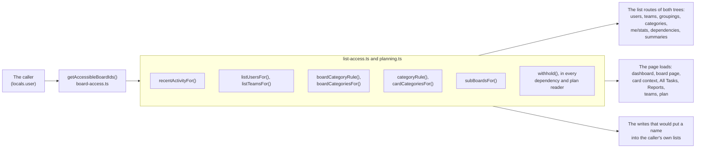

| What is listed | An ordinary user is given | Where | Card |
|---|---|---|---|
| Users | Every user's `id`, `username` and `emoji`; `email`, `role` and `createdAt` to an administrator only. Everybody is listed: a board's owner may share it with anyone, and the public form names every user | `GET /api/users`, the teams page | 2128, decisions 1 and 3 |
| Teams | Every team's `id`, `name`, `emoji` and `createdAt`; its `members` only on the teams the caller is in, and on every one to an administrator. A team's name is told to everyone, as a username is: the share dialog and the public form need it | `GET /api/teams` | 2128, decision 2 |
| The people who can be assigned a card | Name and emoji, with no email address. Every administrator is among them, and their addresses went to every viewer of every board | The board page, the card context | 2128, R1 |
| A board's share list | Its members and teams; each member's email to the board's owner and an administrator only, the callers Share Board is offered to | `GET /api/boards/:id/share` | 2128, R1 |
| Dashboard groupings | One that holds a board the caller can open, or holds no board yet (a grouping made in Manage Categories holds nothing until a board is filed under it); every one to an administrator. One outside the rule is `403` "No access to this board category" when read by its id, and `403` "No access to board category N" from the burndown | `GET /api/board-categories`, `GET /api/v1/board-categories` and the read of one, the burndown by grouping, the dashboard, All Tasks and Reports | 2128, decision 4 |
| Card categories | One of a board the caller can open, or of no board. A page or answer that shows cards also gives a category one of those cards carries, from a board the caller cannot open, marked `carried: true`, so that the card's chip keeps its name. One outside the rule is `403` "No access to this category" when read by its id. A board's categories, and its sub-boards', are deleted with it: kept, they became categories of no board, listed to everyone | `GET /api/categories`, `GET /api/v1/categories/:id`, the board page, the card context, All Tasks | 2128, decision 5 and its review |
| A card's request origin | The requester's name and the request's title, with no address: a requester often has no account, and no screen shows it | The board page, All Tasks | 2128's review |
| The public request form's boards | None to a holder of the form token; the boards they can open to a signed-in caller | `GET /api/requests/targets` | 2128, decision 6 |
| Recent activity | The caller's own entries on boards they can open, the 20 or 10 newest counted after the filter. The counts beside it (completed, streak, cycle time) are not filtered: they name nothing | `GET /api/v1/me/stats`, the dashboard | 2126, decision 13 |
| The other end of a dependency, and a plan's nodes | Still listed, so that blocked work stays blocked, but withheld when it is on a board the caller cannot open: its title reads "A card on a board you cannot open" or "A subtask on a board you cannot open", its board "A board you cannot open", its column is empty and its board, column, priority and milestone are null, with `withheld: true`. See [Critical-Path Planning](critical-path-planning.md#design-decisions-inside-that-flow) | Both trees' dependency routes and their answers, `GET /api/v1/cards/:id`, both summaries and both PDFs, the board page's Blocked chips, All Tasks, the plan page | 2129, decisions 7 and 8 |
| A milestone's cards, and its burndown | A card on a board the caller cannot open, which a card moved off the milestone's board can be, is listed withheld, as a plan's node is. The burndown by milestone charts only the cards on boards the caller can open, and its notes say how many it leaves out | `GET /api/v1/milestones/:id`, `GET /api/burndown` and `GET /api/v1/burndown` with `milestoneId`, the burndown page | 2129's review |
| A card's sub-boards | Those the caller can open. The dashboard's sub-board count, its All Tasks figures, their token cost and the spend by person cover only those | The board page, the card context, the dashboard | 2130, decision 9 |
| A sub-board's breadcrumbs | A board above it that the caller cannot open, as "🔒 A board you cannot open" with no link. It stays in the chain, so the page still offers Delete Sub-board; the boards above that the caller can open keep their names and links | The board page | 2130, decision 10 |
| "Link existing board" | The top-level boards the caller owns (card 2139), which they can always open | The board page | 2130, decision 11 |
| The dashboard's personal figures | Only cards on boards the caller can open: assigned, active, overdue, due soon, Upcoming Deadlines, the trends and on hold | The dashboard | 2130, decision 12 |
| A webhook's address | Left out, with its secret, but to the board's owner, an administrator and the request that made the webhook | Both webhook reads, the answer to an update | 2133, decision 14 |

An administrator opens every board and is given every row of each, as before.

**The writes that would put a hidden name in a list.** A grouping listed to a caller once
it holds a board of theirs, and a category listed once a card of theirs carries it, would
be one write away from any name. So `POST /api/boards`, `PUT /api/boards/:id` and
`PUT /api/v1/boards/:boardId` refuse a `categoryId` that is not the board's stored one and
names a grouping outside the caller's list, `403` "No access to this board category", by
the same rule (`requireBoardCategory()`). The four writes that give a card a category
already hold it to the card's own board's or a shared one (card 2117), which is stricter:
another board's is `404` "Category not found on this board". A card that carries such a
category keeps it while it is sent back unchanged. A carried category is offered on no
card, the one that carries it included: the card window offers the card's own board's and
the shared ones only, and only the chip of the card that carries it names it. A copied card
does not take it (`categoryToCopy`).

**The public request form** offers no board to someone without an account: `desiredBoardId`
is not read from a caller with no session, not checked, not looked up and not stored, so the
form tells nobody which board ids exist. From a signed-in caller it is optional, and is held
to a board they can open, `404` or `403`, before anything is written. Whoever accepts a
request chooses its board, as the inbox already asked them to. See
[The Public Request Form](#the-public-request-form).

**What remains, each a card of its own** (the plan's found nearby): a board or grouping
report still takes in the cards of sub-boards its reader cannot open (card 2150); completing
a card is refused while a sub-board the caller cannot open is unfinished, and the server's
refusal names it (card 2151): the board page counts that sub-board's open cards before a drop
onto Complete, without its name, and shows a refusal it did not stop in the server's words; the "Unblocked" comment and the plan-created mail carry another
board's card title (card 2152); the inbox names a request's desired board to an addressee
who cannot open it (card 2153); an editor can change a webhook's address they cannot read
(card 2154); and a card moved to another board keeps a milestone of the board it left
(card 2155). The dashboard's All Tasks walk follows only the
sub-boards the caller can open, so it cannot reach one shared with them under a card of a
board they cannot open, which `/all` counts.

### What Users Notice (cards 2126 to 2133)

What these changes look like to the people using DumpFire on production. Administrators and
the superadmin are still given everything by every list. Two things change for them: the
groupings on the dashboard, All Tasks and Reports are listed by name, where they were in the
order they were made, and the share list of a board that is not there is `404`, where it
was an empty list.

- **The Share Board dialog lists people by name, without email addresses**, for an ordinary
  user. Every user and every team is still listed, and sharing works as before. A script
  that reads a board's share list as a viewer or editor no longer gets addresses.
- **Groupings on the dashboard.** An ordinary user no longer sees, or files a board under, a
  grouping all of whose boards they cannot open. A new grouping they make stays in their
  list until a board is filed under it.
- **The category picker and Manage Categories** show the categories of boards the user can
  open and the shared ones. A card already carrying another board's category still shows its
  name. Through the API an ordinary user can no longer file a board under a grouping they
  cannot see, and a copied card does not keep a category of a board its copier cannot open.
- **The public request form** no longer asks someone without an account to pick a board or
  project, and their request arrives with none: the person who accepts it chooses the board
  in the inbox, as the accept dialog already asks. A signed-in requester may still choose
  one of the boards they can open, or none, and is refused one they cannot open.
- **A dependency on another board.** Someone who can open a board but not the board a card
  waits on sees "A card on a board you cannot open" in place of its title: on the Blocked
  chip, in the card window, on All Tasks and on the plan. The card is still shown as
  blocked, and the ✕ still removes the link. The DumpFire wrapper prints the same text when
  its key's user cannot open that board. A card moved to another board keeps its milestone
  for now (card 2155), and shows on the plan in the same words to anyone who cannot open the board it
  moved to. The milestone's burndown leaves it out for them, and its notes say that a card
  is left out; the plan's PDF calls a step of such a card "a step of a card on a board you
  cannot open".
- **Sub-boards.** Someone who can open a board, but was never given one of its sub-boards,
  no longer sees it on the card, in the card window or on the dashboard, and it is not in
  their dashboard figures. Completing such a card is still refused while the sub-board is
  unfinished: dropped onto Complete, the board page says how many cards are open "on a
  sub-board you cannot open", without its name, and offers no sub-board to open. A refusal
  the page did not stop is shown in the server's words, which name the sub-board until card
  2151 is done, and the card is put back. Someone given a
  sub-board but not the board above it sees that board in the breadcrumbs as "🔒 A board
  you cannot open", with no link.
- **"Link existing board"** offers only boards the user owns, so only boards they can open.
- **Deleting a board deletes its card categories**, and its sub-boards'. A card on another
  board that was filed under one has no category afterwards. They used to stay as shared
  categories, of no board, which every user is offered. Categories already left so on
  production cannot be told from ones made shared on purpose: the plan's query 7 lists them
  for the owner to review.
- **Someone taken off a board** stops seeing its cards in their dashboard figures and
  Upcoming Deadlines, and their past actions there in Recent Activity.
- **Webhook addresses.** An API key of a board's viewer or editor no longer gets webhook
  addresses, as it already got no secrets. No screen shows webhooks.
- **The request links.** Anything scripted against a request's routes without its link now
  gets `404` where it got `403`; the reply page says "This link is no longer valid" for any
  failure.

Every rule above has a regression test in `tests/access-control.test.ts` or in
`tests/access-every-route.test.ts`; see [Testing](testing.md).

## The Public Request Form

The request form (`/request`, and the API under `/api/requests`) is the one part of
DumpFire that someone without an account can reach. Two secrets stand in for the
sign-in they do not have, both in `src/lib/server/request-tokens.ts`.

| Secret | Issued | Lifetime | Opens |
|--------|--------|----------|-------|
| **Form token** | with the form page, by `issueFormToken()`; HMAC-SHA256 over an expiry and a nonce, signed with a key kept in `settings.request_form_secret` | 2 hours | `GET /api/requests/targets` and `POST /api/requests`, sent as `X-Form-Token` |
| **Request token** | when a request is created; 32 random bytes in `task_requests.access_token` | the life of the request | that one request's thread: read, reply, confirm |

A signed-in user needs neither: their session is checked, and `request-access.ts`
decides which requests are theirs.

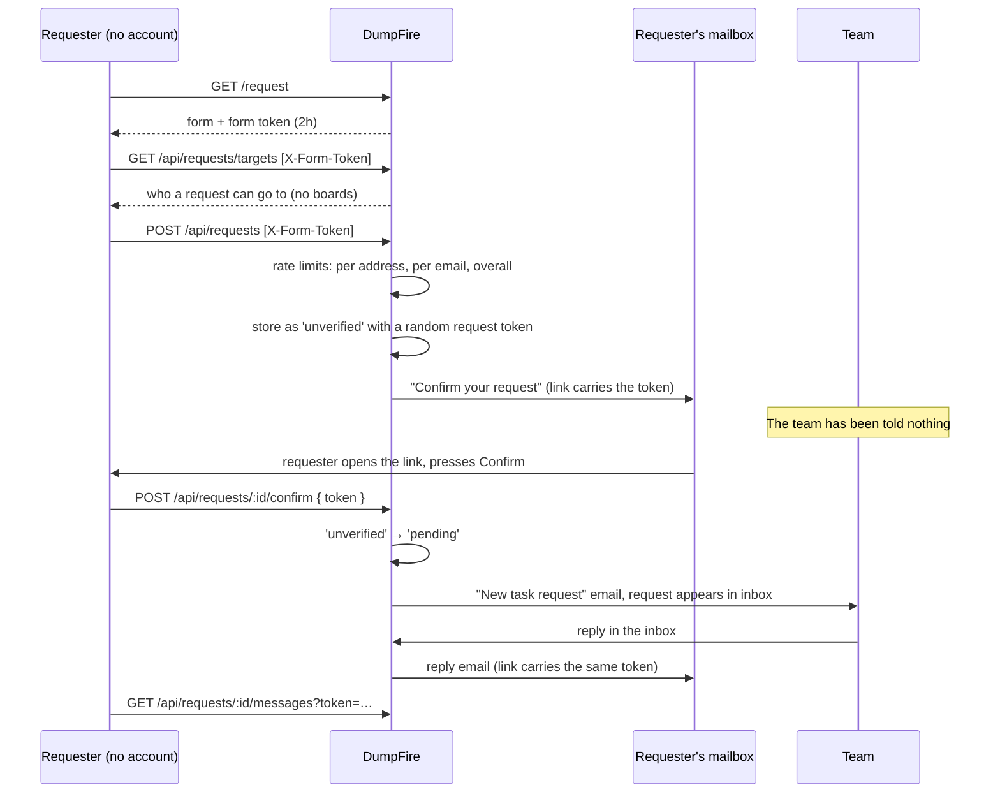

What each control is for:

- **The list of recipients is not an open directory.** `/api/requests/targets` used to
  answer any caller with every username, team name and board name. It now needs a
  session or a form token, and is limited to 30 calls per 15 minutes per address. The
  names of users and teams are still visible to anyone who loads the form — choosing a
  recipient requires it — but the list can no longer be fetched cold or polled.
- **The form names no board to someone without an account** (card 2128). Every board's
  name, private ones and sub-boards included, went to whoever loaded `/request`. A holder of
  the form token is now given `boards: []`, the form hides its board field when it has no
  boards, and `desiredBoardId` is not read from a caller with no session: not checked, not
  looked up and not stored, so a request cannot be used to learn which board ids exist. A
  signed-in caller is offered the boards they can open, may send none, and is refused one
  they cannot open (`404` for none such, `403` otherwise) before anything is written. A
  request with no board is accepted as any other: the inbox's accept dialog asks for a
  board and a column, from the boards the member of staff can open.
- **The form is not a relay to the team.** Every submission used to email the whole
  team at once. An anonymous submission is now held as `unverified`, hidden from the
  inbox, and the only email it sends goes to the address the requester gave. The team
  is notified when the requester confirms. Unconfirmed requests are deleted after 7
  days.
- **Confirmation is a button, not a link.** The emailed link opens a page; the request
  is confirmed by the POST the button makes. Mail scanners open links before the
  recipient does, and a link that confirmed on sight would let a request made with
  somebody else's address confirm itself.
- **A thread is opened by its own token.** The link used to carry the requester's
  email address, and the address was the only thing checked, so anyone who knew it
  could read that person's requests and reply as them. Tokens are compared in constant
  time, and never returned by any API response (`publicRequest()` strips them). To a
  caller with no session a wrong token and a missing request answer alike, `404`: on the
  confirmation, and since card 2132 on the request, its thread and a reply as the
  requester too, whatever the request's state, where a wrong token was `403` and a reply
  to a resolved or unconfirmed request `400`. A reply from the team with no session is
  `401` before the request is looked for. A signed-in caller is still answered `403` for
  a request that is not theirs. A token that is not text is answered as a wrong one is.
  Until card 2117 it reached the comparison and threw, a `500` for a request that is there
  and a `404` for one that is not, which told the ids of real requests from the rest. The
  reply page reads any failure as a link that is no longer valid. A confirmation's body that is
  missing, is not JSON or is not an object is `400`, where it was read as no token.

Rate limits on anonymous callers (`rate-limit.ts`, in memory, per process):

| Limit | Window | Key |
|-------|--------|-----|
| 5 submissions | 15 minutes | caller address |
| 3 submissions | 1 hour | requester email given |
| 30 submissions | 1 hour | all anonymous callers together |
| 30 target listings | 15 minutes | caller address |
| 20 confirmation attempts | 15 minutes | caller address |
| 20 replies as the requester | 1 hour | the request |

A requester's replies are limited because each one mails every member the request is
addressed to, from the server's own sender, and the link that lets someone reply can be
forwarded or read in a mailbox: 40 replies once made 80 mails to a team of two. Only a reply
that would be saved is counted, after the link and the request's state are checked, so a
wrong link, a resolved request or an empty or overlong message uses nothing. The 21st is
answered `429` "Too many replies to this request in the last hour. Try again in N
minute(s).", with nothing saved and nothing mailed, and the reply page shows the message and
keeps what was typed. A reply from the team clears the request's count and starts a new
window, so a conversation the team takes part in is not held up; a requester who sends 21
messages before any answer is, and so is a flood nobody answers. The first refusal in each
window is one `WARN` line under `REQUESTS` naming the request and not the message, so an
abused link shows on the Audit page; the gate also writes its own `WARN` line for every
refused request (`POST /api/requests/N/messages → 429`). Escaping keeps markup out of mail,
but not text: a report's subject and body still carry a board's name as typed, and a plain
address in it may be shown as a link by the reader's mail client.

The caller's address is asked so that it cannot throw (`addressToCount()` in
`src/lib/server/client-address.ts`), as is the sign-in form's, which allows ten attempts in
15 minutes from one address. Where it cannot be read, which a server started with
`ADDRESS_HEADER` meets in a request that arrives without that header, the request is counted
as `unknown`, with every other such request, and is never let past a limit uncounted. Asked
unguarded, as it was, that lookup threw, and every sign-in made that way was answered `500`.

With no SMTP configured there is no email to protect the team from and no way to ask
for confirmation, so an anonymous request is accepted as `pending` and the rate limits
are the only brake.

Links sent before this change carried `?email=` and no longer open anything. Existing
requests were given a token by migration `0051`, so the next email about them has a
working link.

Covered by `tests/public-requests.test.ts`.

## Security Headers

Set on every answer the gate gives, by one function, `secured()` in
`src/lib/server/gate-answers.ts`, which `handle` calls last: pages and the internal API, the
documented API, the gate's own `401`, `404` for a remote call, `413` and `429` and its
redirects, to a caller who is signed in or not.

| Header | Value | Purpose |
|--------|-------|---------|
| `X-Content-Type-Options` | `nosniff` | Prevents MIME sniffing |
| `X-Frame-Options` | `DENY` | Blocks iframe embedding |
| `Referrer-Policy` | `strict-origin-when-cross-origin` | Limits referrer leakage |
| `Permissions-Policy` | `camera=(), microphone=(), geolocation=()` | Disables unused browser APIs |
| `X-XSS-Protection` | `0` | Switches off the filter old browsers ran over a page, which could itself be used to make a page leak. Current browsers have dropped it. It was `1; mode=block` |

- **A header the answer already has is never replaced.** An attachment keeps the
  `X-Content-Type-Options` and `Content-Security-Policy: sandbox` it is served with (see
  [Attachments](#attachments)).
- **The public request form may be framed by another site.** `/request`,
  `/request/[id]/confirm` and `/request/[id]/reply`, by route id, exactly, carry every header
  but `X-Frame-Options`, in case the form is embedded in an intranet page. Every other page,
  the login page included, refuses to be framed. No `Content-Security-Policy:
  frame-ancestors` is sent: the application has no policy to add it to.
- **The gate's redirects are answers it returns.** They were thrown, and SvelteKit made
  each into an answer after the gate had returned, with none of the five on it. The gate
  makes each as SvelteKit would have: a `303` with `Location`, or, for a page's script
  asking for the page's data or posting one of its forms, `200` with JSON that says where to
  go.

They were set on the answers to a signed-in caller only, and under `/api/v1/` there was
`nosniff` alone: the login, set-up and invite pages, every redirect and the gate's own
refusals carried none.

**What the gate never sees cannot be headed by it, and is the reverse proxy's to head**
(see [Deployment](deployment.md#security-headers-from-the-proxy)):

- in a built server, every static file, which the adapter serves before the gate is called;
- the `403` SvelteKit answers to a form posted from another site;
- the `400` "Malformed URI" for an address that cannot be decoded;
- the redirect that adds or removes a trailing slash;
- the `404` for any other path that begins `/_app`, but a call to a remote function, which
  the gate answers itself;
- the `500` for a fault in the gate itself, which SvelteKit answers after the gate has
  failed.

Covered by `tests/gate.test.ts`.

## When Something Fails

A handler or a page's load that throws, a fault in the gate itself, and a path that is no
route are answered by SvelteKit, which first calls `handleError` in `src/hooks.server.ts`.

- **A fault, a status of 500 or more, is written to the system log at `ERROR`**, with what
  the exception said, its stack, the route, the method, the address as it was sent and the
  user. Before, SvelteKit wrote the stack to the console, and the system log had only the
  gate's line, `→ 500`, with no reason.
- **A 404 for a path that is no route is not a fault** and is not written at `ERROR`; the
  gate's own `WARN` line for it is enough. A handler's `error(404, ...)` is a refusal and
  never reaches `handleError`.
- **The caller is told nothing of the exception.** The answer is SvelteKit's message for
  the status: `{ "message": "Internal Error" }` for a fault, `{ "message": "Not Found" }` for
  no route.
- **A fault in the gate itself is written down once.** The gate writes it, with what it
  knows of the request, and throws it on; `handleError` is then called with the same error
  and leaves it.
- **It cannot throw.** A throw from it would leave the answer unmade and, in the node
  adapter, be an unhandled rejection. Whatever goes wrong in writing the line down is let
  go.

Covered by `tests/gate.test.ts`.

## Attachments

A file attached to a card is whatever the uploader chose to send, under whatever name and
type they gave it. Served back as it came, an HTML or SVG file would open as a page of
DumpFire and run its script with the reader's session. `attachmentHeaders()` in
`src/lib/server/uploads.ts` decides how every attachment is answered.

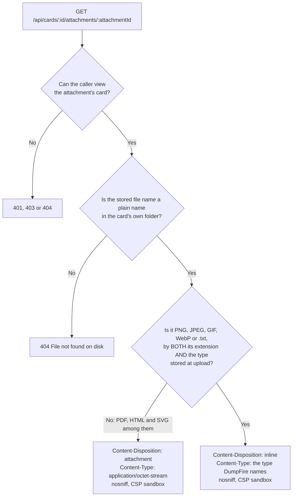

| Control | What it does |
|---------|--------------|
| **A download unless proven inert** | Everything is answered `Content-Disposition: attachment` with `Content-Type: application/octet-stream`, except five types that cannot run a script: PNG, JPEG, GIF, WebP and plain text (`.txt`). HTML, SVG and PDF are never shown in the browser |
| **Extension and stored type must agree** | Both are the uploader's. A file named `.png` that was uploaded as `text/html` is a download |
| **The served type is DumpFire's, not the uploader's** | An inline file is answered with the type written in the code for its kind (`image/png`, `text/plain; charset=utf-8`), never with the stored text |
| **`X-Content-Type-Options: nosniff`** on every answer | The browser shows the file as the type named and does not guess another |
| **`Content-Security-Policy: sandbox`** on every answer | Whatever is shown can run nothing. A PDF is a download for this reason: a browser shows one in its own viewer, which does not start under a sandbox, so a PDF could be shown only by leaving the sandbox off it |
| **The card's own link saves the file** | On a card, the name of every attachment is a link with a `download` attribute, so clicking it saves the file whatever its type. Only the thumbnail of a PNG, JPEG, GIF or WebP image opens the file in the browser |
| **The file name is encoded** | The name in `Content-Disposition` is the uploader's. It is written as a plain ASCII `filename`, with quotes, backslashes and anything outside printable ASCII replaced, and as an RFC 5987 `filename*`, so a quote or a line break in a name cannot write a header |
| **The stored file name is checked before it becomes a path** | After a restore a file name is data. A name with a separator, a drive letter or `..` is refused, and the request is answered as a file that is not there |

Uploading needs edit access to the card and is limited to 25 MB. Deleting an attachment
needs edit access; its row is deleted in a transaction and its file is moved to the
[uploads trash](architecture.md#uploads-and-the-trash) once that has committed.

Covered by `tests/uploads.test.ts`.

## First-Run Setup Guard

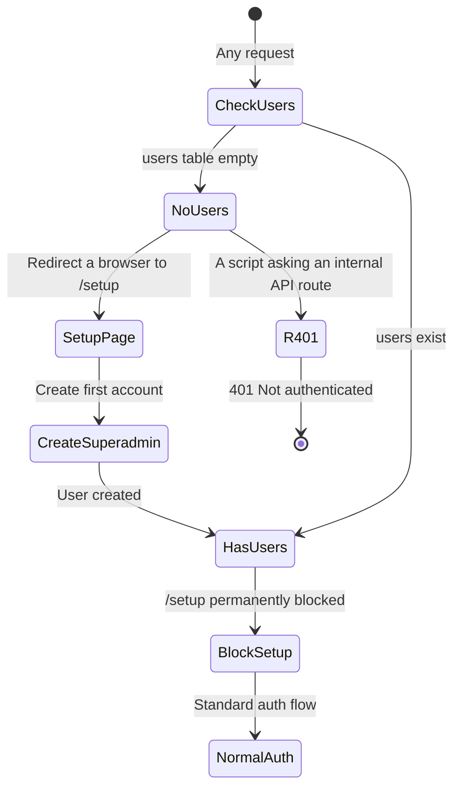

Whether a user exists is read inside the transaction that creates the superadmin, so two
set-up forms submitted at the same moment create one superadmin and not two; see
[One Use Means One Use](#one-use-means-one-use). `/setup` opens again when there is no user,
which is what Reset Everything in the admin panel leaves.

## Key Implementation Files

| File | Purpose |
|------|---------|
| `src/lib/server/auth.ts` | Password hashing, session CRUD, API key generation and validation; `endAccountAccess()`, what setting a password ends; `currentPasswordMatches()`, the count of current-password guesses for a session; `sessionStillOpen()` and `openSessionUser()`, which an open live stream asks at each heartbeat |
| `src/lib/server/invites.ts` | `issueInvite()`, the one way an invite is issued, which ends the account's earlier invites; `endUnusedInvites()`, which ends them when a password is set and when an account's email or role changes; `INVITE_LIFETIME_MS` |
| `src/lib/server/board-access.ts` | Board-level role resolution and permission checks; `isAdmin()` |
| `src/lib/server/route-guards.ts` | Per-route guards that resolve the board from the row and throw 401/404/403; `requireManagedAccount()`, `requireTeamManager()` and `requireSuperadmin()`, which look at no board; `requireSubBoardLink()`, who may put a board under a card |
| `src/lib/server/sub-boards.ts` | `wouldLoop()`, whether putting a board under a card would make a loop, by a walk that ends on a loop already in the data; `linkableBoards()`, what the board page offers to link |
| `src/lib/server/list-access.ts` | What a list answers a caller, decided in one place and filtered before any limit: `recentActivityFor()`, `listUsersFor()`, `listTeamsFor()`, `boardCategoryRule()` and `boardCategoriesFor()`, `categoryRule()` and `cardCategoriesFor()`, `subBoardsFor()`. See [What a List Gives](#what-a-list-gives) |
| `src/lib/server/planning.ts` | Besides the plan: the viewer every reader of a dependency or a plan must pass, and `withhold()`, which shows work on a board the viewer cannot open as "A card on a board you cannot open" |
| `src/lib/server/webhooks.ts` | `presentWebhook(hook, reveal)`, which leaves a webhook's `url` and `secret` out of every answer but the owner's, an administrator's and the one to the request that made it |
| `src/lib/server/request-access.ts` | Who may read, answer and resolve a task request |
| `src/lib/server/request-tokens.ts` | Form tokens and per-request tokens for callers without an account |
| `src/hooks.server.ts` | Request-level auth guard and the list of public routes, the v1 rate limit, the JSON answer to every failure under `/api/v1/`, and `handleError` |
| `src/lib/server/gate-answers.ts` | The gate's own answers: whether a request is a navigation, the `401` for an internal route with no session, its redirects in the form SvelteKit gives them, and the security headers with `secured()` |
| `src/hooks.client.ts`, `src/lib/signed-out.ts` | In the browser: the watch on `fetch` that sends a signed-in page to `/login` on the first `401` that says its session has ended |
| `src/lib/live-stream.ts` | In the browser: the live-update streams, opened again after a failure with a growing wait, and not at all after a `401`, `403` or `404` |
| `src/lib/server/api-errors.ts` | `guardBody()`, which makes a body the caller got wrong a `400` and a body over the size limit a `413`, and `failureAsJson()`, which answers a failure that is not JSON again as JSON |
| `src/lib/server/body-limits.ts` | How large a request's body may be, route by route and caller by caller; the gate's `413` for a body that declares more, and the count that holds a body with no length to the same limit as it is read |
| `src/lib/server/client-address.ts` | The caller's address, asked so that it cannot throw, and the `'unknown'` count a request with no readable address is held to |
| `src/lib/server/secret-paths.ts` | The paths that carry a secret, `/invite/[token]`, written to the log masked; `maskSecretsInLog()`, which masks what the log already holds, in a backup's copy and in the running log at start |
| `src/lib/server/backup.ts` | `generateBackupData()`, the one copy an export and a scheduled backup both send, cleared of sessions and unused invites |
| `src/lib/server/db/restore.ts` | What a restore brings in and what it never does; `backupLacksSuperadmin()` |
| `src/lib/server/email.ts` | `linkBaseUrl()`: the address a mailed link begins with, from configuration alone |
| `src/lib/server/startup-checks.ts` | The three lines the server writes at start: no superadmin, `ORIGIN` still the image's placeholder, and a board beneath one of its own cards (card 2142), which a restore of a backup that brings one writes at once too, with each control character in a board's name or a card's title printed as a space, so that a name holding a line break cannot split the line and forge one after it; and `maskLiveLog()`, which masks the running log's tokens at start |
| `src/lib/server/rate-limit.ts` | In-memory rate limiter, counting in a fixed window from each key's first attempt |
| `src/lib/server/uploads.ts` | Where attachment files are, which stored file names are refused, and the headers an attachment is served with |
| `src/lib/server/db/transaction.ts` | `inTransaction()`: the check and the write it guards are one transaction |
