# Authentication & Security

DumpFire uses two authentication methods: session cookies for browser users and bearer tokens for API clients. All auth logic lives in `src/lib/server/auth.ts` with board-level access control in `src/lib/server/board-access.ts`.

## Authentication Flow

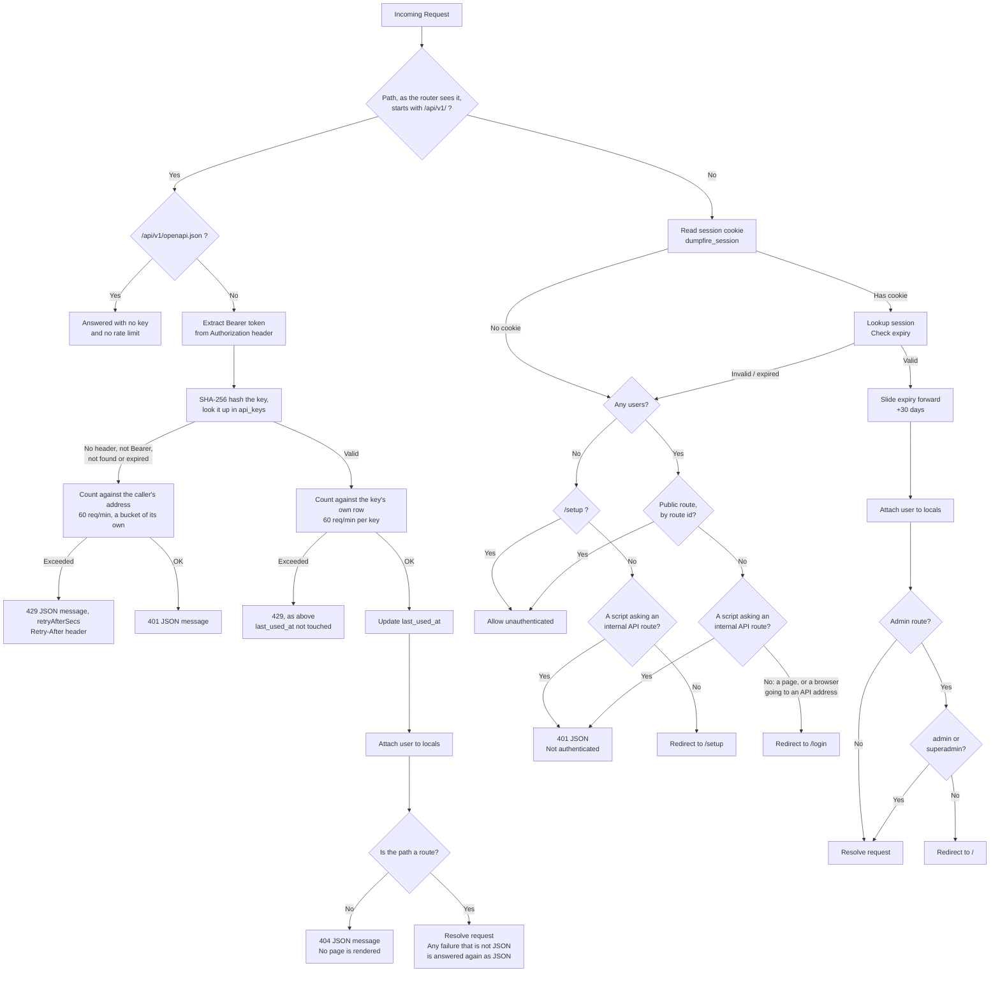

Every answer in the chart is returned by the gate and carries the security headers (see
[Security Headers](#security-headers)); none is thrown. A signed-in caller who asks for
`/login` or `/setup` is sent to `/` as well.

### Which Rule Applies to a Path

Every question the flow above asks about the path, whether it is under `/api/v1/`, a public
route or an admin route, is asked of the path as the router sees it, and not of the address
as it was sent. SvelteKit decodes an address before it looks for a route, so `/%61dmin` is
the route `/admin`. The gate once compared the address as sent, and a rule did not apply to
an address with one letter percent-encoded: a signed-in user who was no administrator was
shown the admin page and the audit page, and `/%61pi/v1/` was served without a key.

- **Where a route matched, the rule is decided on the route's id**, `/admin` or
  `/api/cards/[id]`, which is the router's own answer. Where none did, it is decided on the
  address decoded as SvelteKit decodes it, and nothing but a `404` is served.
- **`%2F` is no `/`, and nothing is decoded twice.** `/api%2Fv1%2Fme` is not under
  `/api/v1/`, and `/%2561dmin` is not `/admin`. Neither is a route. An address that cannot
  be decoded is answered `400` by SvelteKit before the gate is called.
- **The admin and audit page loads check the role themselves.**
  `src/routes/admin/+page.server.ts` and `src/routes/audit/+page.server.ts` send a caller
  who is not signed in to `/login` and one who is not an administrator to `/`, as the gate
  does. The handlers under `/api/admin/`, `/api/audit` and `/api/logs` each check the role
  too: no admin rule of the gate covers them.

How it is worked out is in [Architecture](architecture.md#the-path-a-rule-is-decided-on).
Covered by `tests/gate.test.ts`.

### Who Is Let Through Without a Session

A caller who is not signed in is let through to these routes, by route id, exactly, and to
no other:

| Route id | What it is |
|----------|------------|
| `/login` | The login page |
| `/docs` | The API's documents |
| `/invite/[token]` | The page an invite links to |
| `/request`, `/request/[id]/confirm`, `/request/[id]/reply` | The public request form, and the two pages its mails link to |
| `/api/requests`, `/api/requests/[id]`, `/api/requests/[id]/confirm`, `/api/requests/[id]/link`, `/api/requests/[id]/messages`, `/api/requests/targets` | The form's routes. Each handler asks for itself what it needs: a session, the token the form was given, or a request's link. The new link (card 2158) asks for nothing, answers everyone alike and mails only the request's address, an account's as it is now for a request made signed in (see [The Public Request Form](#the-public-request-form)) |
| `/api/v1/openapi.json` | The API's description, answered with no key |

`/setup` is the one page there is before there is a user, and is never served once there
is one. `/favicon.ico` passes the gate without being asked who is calling.

A call to a remote function, `/_app/remote/<id>`, is answered `404` `{ "message": "Not
found" }` by the gate, to anybody, before any of this is asked. SvelteKit takes the path
such a call is for from its `x-sveltekit-pathname` header, which the caller writes, and has
set the route from it before the gate is called: decided on that, a call naming `/login`
was let through as the public page, and one naming `/_app/x` passed through unasked and
unlogged. DumpFire has no remote functions. The gate's log line for it is at the address
it was sent to. A header that names a path that cannot be decoded is answered `400`
`Malformed URI` instead, as an address that cannot be decoded is, and as SvelteKit 2.60
also answered it.

- **By id, and not by how the address begins.** The list was compared with the start of
  the address, so `/requestX`, `/loginX`, `/api/requestsX` and `/faviconX` were let past the
  sign-in redirect, to a 404. A route under a public one is not public unless it is in the
  list itself, and a path that is no route has no id and is never public.
- **What a caller who is not signed in is answered elsewhere depends on who is asking.** A
  page's script, or any other program, asking an internal API route (under `/api/`,
  outside `/api/v1/` and the form's routes) is answered `401` `{ "message": "Not
  authenticated" }`. A browser going to an address is sent to `/login`: every page, and an
  API address opened as a page, such as an attachment in a new tab, the milestone PDF or an
  export's download. The gate tells them apart by `Sec-Fetch-Mode: navigate`, which
  browsers send with a navigation, or by an `Accept` header that prefers `text/html` to
  JSON, read as SvelteKit reads it.
- **Why not the redirect for everybody.** A script's `fetch` followed the redirect and was
  handed the login page's HTML with a `200`, so a page whose session had ended went on as if
  its requests had worked: a card moved on screen and not on the server.
- **With no users at all**, a browser is sent to `/setup` and a script is answered `401`.
  The form's routes are sent to `/setup` as before.
- **A redirect to a page's script is JSON.** A page asking for its own data, or posting one
  of its forms (`use:enhance`), is answered as SvelteKit answers it: `200` with
  `{ "type": "redirect", "location": "/login" }`, which the page follows itself.

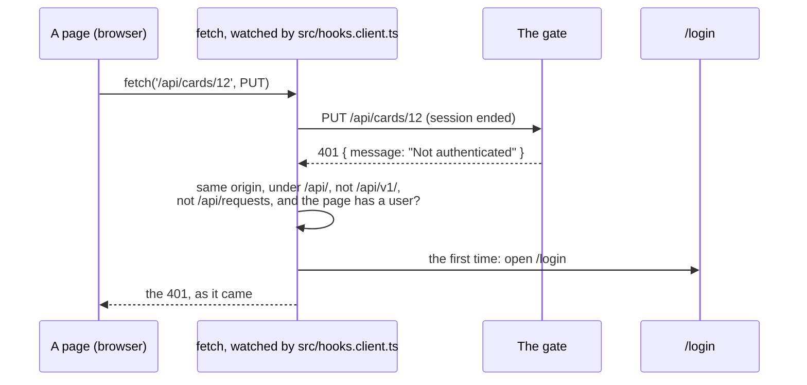

**In the browser,** `src/hooks.client.ts` replaces `window.fetch` once, as the application
starts, with the watch in `src/lib/signed-out.ts`. On the first `401` from the page's own
server to a path under `/api/` that is not under `/api/v1/` or `/api/requests`, and only when
the page has a signed-in user, it opens `/login`. Every answer is handed back untouched. A
requester on the public form whose form token has lapsed is answered `401` too, and is not
sent to a login page they have no account for.

**The live-update streams** (`/api/boards/[id]/events` and `/api/events`) are opened by
`src/lib/live-stream.ts`. After a failure it waits 3 seconds, then twice as long after each
failure that follows, up to five minutes, and asks the stream's address with `fetch` before
it opens it again. A `401`, `403` or `404` is not mended by asking again, and the stream
stays closed; the `401` also sends a signed-in page to the login page, through the watch.
Before, each open board asked again every three seconds for ever, and after a restore that
signs everybody out each wrote about 57,000 lines a day to the system log. A stream that is
already open when its session ends stops by itself at its next heartbeat: see
[An Open Stream and Its Session](#an-open-stream-and-its-session).

What cannot be run in the suite, which has no browser, is checked by calling the two files'
functions with stand-ins and by reading the source: `tests/page-failures.test.ts`. The gate's
half is in `tests/gate.test.ts`.

### How Large a Request May Be

Before any of the flow above, the gate asks how large the request's body is, of every
request: a page and a form action as much as a route under `/api/`. A body that declares
its length in `Content-Length` is asked of that, before it is read. A body that does not,
one sent in chunks, is counted as it is read, and no more of it is read once it has passed
the limit.

| The request | Answer |
|-------------|--------|
| Has no body: a `GET`, a `DELETE` with nothing in it, a `POST` with an empty body | Passed on |
| Declares more than its route accepts | `413` `{ "message": "The request is larger than this server accepts here: it is 2 MB, and the limit is 512 KB", "limitBytes": 524288 }`, before it is read |
| Declares no length, and its route reads past the limit | `413` `{ "message": "The request is larger than this server accepts here: the limit is 512 KB", "limitBytes": 524288 }`, when the handler reads it |
| Declares a length its route accepts, and runs past it | `413` `{ "message": "Payload Too Large" }`, when the handler reads it |
| Anything else | Passed on, and its body read as it was sent |

| The route | The most its body may be |
|-----------|--------------------------|
| Every route, the login, set-up and invite forms included | 512 KB |
| `POST /api/cards/[id]/attachments`, for a caller who is signed in | 26 MB |
| `POST /api/admin/import`, for the superadmin | All the server accepts: `BODY_SIZE_LIMIT`, 512M in the image |

- **Why every route.** The server has one limit for all of them, and it has to be large
  enough for a database backup. Without the narrowing, anybody could post half a gigabyte
  to the login form.
- **Why a body with no length is counted.** The server holds a body to the length it
  declared. One that declares none was held to nothing: with a limit of 512 KB, a chunked
  body of 64 MB was read in full. Since adapter-node 5.5.5 (card 2227) it is held to
  `BODY_SIZE_LIMIT`, but that is the whole server's limit, 512M in the image, and no
  route's. So the gate hands the handler a copy of the request whose
  body passes through a count (`heldToLimit()`), and a read that passes the limit fails with
  the `413`. The body is left unread there, not cancelled: the server answers a cancelled
  body by closing the connection, and the `413` would never arrive.
- **Why it is read, and not refused.** A browser says how long what it posts is, but a body
  can still arrive in chunks: from a client that sends it so, or through a proxy that passes
  it on so, as `cloudflared` does unless it is told not to. So it is read, and held to the
  same limit as a body that says how long it is.
- **The two larger limits are given to those who may use them.** The attachment upload's to
  anybody signed in, and the import's to the superadmin alone: an administrator who declares
  a whole backup to the import is refused for its size, and none of it is read. One who sends
  it in chunks is refused by the handler, with a chunk or two of it read at most. A caller with
  no session is turned away from both routes before the body matters, and each handler asks
  its own question before it reads a byte: edit access to the card's board, and the
  superadmin.

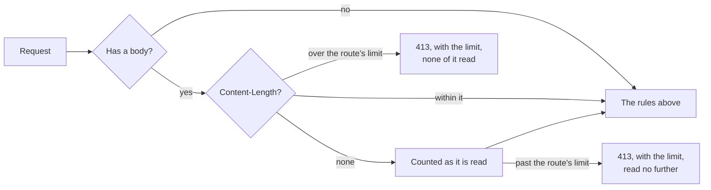

The limits are in `src/lib/server/body-limits.ts`, and the proxy's own are in
[Upload Size Limits](deployment.md#upload-size-limits). Covered by
`tests/body-limits.test.ts`.

### Asked Again at the Write (card 2253)

**Every write asks, in the transaction that writes, whether the key or session the gate let
it in with is still open, and who its account is now, and decides who the caller is with
that.** The gate decides who is calling before a request's body is read, and a body can take
as long as the caller likes to arrive: up to Node's request timeout of 300 seconds, on a slow
link or held open on purpose. A password reset, a key deleted, a sign-out or a role lowered,
committed meanwhile, was met by nothing: the write went through as the caller the gate had
read. Before this card only four handlers asked again (the two webhook writes and the two
report-schedule writes), and they asked only whether the credential was open, not what its
account now was. Now every `POST`, `PUT`, `PATCH` and `DELETE` under `src/routes/api`, both
trees (133 handlers in 95 files), asks.

```mermaid
sequenceDiagram
    participant C as Caller (key or session)
    participant G as Gate (hooks.server.ts)
    participant H as Write handler
    participant W as writeAs (write-as.ts)
    participant S as stillAuthenticated (auth.ts)
    participant DB as SQLite
    participant A as Someone else
    C->>G: POST, PUT, PATCH or DELETE, body still arriving
    G->>G: locals.credential = null, then the key or session found:<br/>locals.user and locals.credential set
    G->>H: handed on
    H->>H: quick check, binding no name (requireUser(locals.user);)<br/>await the body
    A->>DB: password reset, key deleted, sign-out or role lowered, committed
    C->>H: the rest of the body
    H->>W: writeAs(locals, (caller) => the write)
    W->>DB: BEGIN IMMEDIATE
    W->>S: stillAuthenticated(locals)
    S->>DB: the key or session, and its account, as they are now
    alt key or session ended, or its account gone
        S-->>C: 401 in the gate's words, ROLLBACK, nothing written
    else open
        S->>W: the account as it is now (locals.user set to it)
        W->>H: write(caller): every guard and role test given caller
        alt role or access lowered
            H-->>C: the guard's own 403 or 404 (a batch's 409), ROLLBACK, nothing written
        else allowed
            H->>DB: the write, COMMIT
            H-->>C: the answer, made after writeAs returns
        end
    end
```

**The rules.**

- **One helper, called by every write handler.** `writeAs(locals, (caller) => …)` in
  `src/lib/server/write-as.ts` is `inTransaction(() => write(stillAuthenticated(locals)))`:
  the check is the first statement of the transaction that writes, the callback must not be
  async, a throw rolls back, and inside another transaction it is a savepoint. Every decision
  about the caller (`require*` guards, role tests, `requireAssignableRole`, a service handed
  the user) is made inside the callback with `caller`, never with `locals.user` nor a name
  taken from it before the body. A check before the body may stay, as a quick refusal in the
  same words, but decides nothing.
- **What it reads and answers.** `stillAuthenticated(locals)` (`src/lib/server/auth.ts`) reads
  the credential the gate recorded: a key through `keyHolder`, a session through
  `findSession`, the account through `sessionUserOf`. A key deleted, expired or whose account
  is gone is `401 Invalid or expired API key`; a session the same, `401 Not authenticated`;
  otherwise it answers the account as it is now and sets `locals.user` to it, so what the
  handler answers after the transaction is consistent. It throws outside a transaction.
- **No key or session.** The gate sets `locals.credential = null` as the first statement of
  `handle`, before any branch, so every request it hands on carries it set. `null` (a public
  request route, with nobody signed in) answers `null`, and the handler's own rule decides with
  `caller === null`. A caller who came with a session that ended meanwhile is refused `401`,
  never treated as anonymous, on the public request routes too. `undefined` (a handler reached
  with no gate) is answered `locals.user` only under vitest; anywhere else it is `401 Not
  authenticated` and one line, word for word:
  `[ERROR] [AUTH] A write reached its handler with no credential recorded by the gate: <METHOD> <path>; refused 401; this is a fault in DumpFire, not in the request: report this line`,
  filed under the account when there is one, with five frames of the stack as its meta. The
  path is written as the gate writes it, so an invite's token is never logged.
- **A role lowered meanwhile has no answer of its own.** The guard, given the account as it is
  now, refuses as it would have refused that account at the gate: an administrator lowered to
  `user` while creating an account is `403 Forbidden`, as a `user` is; a batch under `/api/v1`
  (`POST /dependencies/bulk`, `POST /tokens/bulk`, and `POST` and `DELETE
  /milestones/{id}/cards/bulk`) is refused whole with its `409`, listing every item.
- **What cannot run in a transaction asks `stillCallerNow(locals)`**, the statement right after
  its body, with nothing awaited between it and the call it guards; better-sqlite3 is
  synchronous, so nothing runs between the check and the start of that call. Eight handlers,
  each held by name in the source rule:

  | Handler | Why not `writeAs` | The check guards |
  |---|---|---|
  | `POST /api/admin/vacuum` | `VACUUM` cannot run in a transaction | `sqlite.exec('VACUUM')`. The check is the first statement (no body), with no quick check before it |
  | `POST /api/admin/import` | the restore opens its own transaction, and files are written first | the temporary copy. Asked once the upload is in, before `.restore-temp.db` and `.pre-restore-safety.json` are written, so a refusal leaves neither; nothing is asked after the restore, whose database is the backup's |
  | `POST /api/reports` | it reads only, after a body | the first `generate*Report` |
  | `POST /api/reports/email` | mail leaves the process | the first `generate*Report`, and, **asked a second time** after the PDF is made, the sends. The second check decides again what the mail relies on: scope `all` asks `isAdmin` (`403 Only admins can generate all-boards reports`), scope `board` `canViewBoard`, and scope `category` that every board of the grouping in the PDF is still one the sender can open (`403 Failed to generate report or no access`). A refusal sends nothing; the day's allowance it took stays taken |
  | `POST /api/admin/backup` | the backup leaves the process | `runBackup` |
  | `POST /api/admin/backup/test` | a stored secret leaves the process | `createDestination`; the Test's ERROR lines are filed under the administrator the check answers |
  | `POST /api/admin/backup/gdrive/auth` | the code goes to Google | `getToken`. The Connect's save after Google answers is a `writeAs`: refused there (the session ended, or the account was made an ordinary user, while Google answered) it is `401` or `403`, with the folder it made removed and nothing saved, not `200 { success: false }`. A Connect refused at its first check takes no state |
  | `POST /api/admin/smtp` | the test mail leaves the process | `sendTestEmail`, to the address given or the caller's own as it is now |

  The four backup and mail routes ask for an administrator (`requireAdmin`) at each of these
  checks since card 2395; they asked for the superadmin before, so a superadmin made an
  administrator meanwhile was refused, where now an administrator made a user is.

- **A `writeAs` that only names the caller.** Where the caller is needed before an await no
  transaction can hold, a `writeAs` whose callback writes nothing asks who is calling, and the
  write's own `writeAs` asks everything again: the three current-password routes
  (`PUT /api/account/password`, `PUT /api/account/email`, `POST /api/account/api-keys`)
  before the password is checked, `POST /api/users` and `PUT /api/users/{id}/password` before
  the hash, and `POST /api/admin/reset` before it ends every session, so that its failure line
  can name who reset. What they look at in between stays outside a transaction, as before.
- **The current-password routes** write inside
  `whilePasswordHolds(…, () => writeAs(locals, (caller) => …), wrong)`: the credential check
  and the write commit or roll back with the password check (a nested transaction is a
  savepoint). `whilePasswordHolds` may run its transaction twice, its one retry when the
  stored hash changed between the check and the write; the first run returns before it calls
  the write, so the `writeAs` runs once a request. The password change asks twice, both before
  it rotates its own session; nothing asks after the rotation, which would meet the rotated
  session and be refused.
- **Effects stay after the write.** `emit`, `logActivity` and the notify functions may be
  called inside the callback (they wait for the commit); a file, mail, a fetch, a cookie, a
  redirect or the answer is made after `writeAs` returns. A refused write emits nothing, mails
  nothing and fires no webhook. An upload refused at its write removes the file it wrote.
- **One transaction where there were two steps.** Handlers that checked and then wrote with no
  transaction of their own are now one `writeAs` each, with the same answers: the comment and
  card category deletes, the favourite, the dashboard grouping create and delete, the team
  delete and the team member delete, a goal's change and delete (`PATCH` and
  `DELETE /api/milestones/{id}`, their services savepoints inside), the key revoke, the
  requester's reply, the request confirmation and the new request link, and under `/api/v1`
  the grouping create, the grouping, category and label deletes, the two token records, the
  token entry delete, the milestone change and the milestone card add and remove.
- **A brief write lock where none was taken.** The outermost transaction is `BEGIN IMMEDIATE`,
  so `stillCallerNow` takes the write lock for the moment it reads, with nothing written: in
  `POST /api/reports`, the report mail, the backup run, the Test, the Connect and the test
  mail. `POST /api/requests/{id}/link`, the new link a requester asks for, now takes it through
  `writeAs` for a read alone, for a caller with no session too; it is rate-limited before its
  body. The other public request routes (`POST /api/requests`, `…/confirm`, `…/messages`)
  already took the lock when they wrote, and still do; `…/messages` counts a requester's replies
  inside its `writeAs`, not before the body. On the one connection SQLite has, in WAL mode, a
  lock held for one read is not noticed.

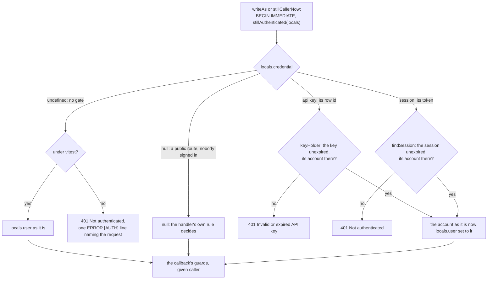

**What a user or a script may notice.** Nothing, while their key or session holds and their
role is as it was. A write whose key or session ended, or whose account's role or access
changed, while its body was arriving is refused `401` or `403` with nothing written.
`DELETE /api/report-schedules/{id}` asked nothing before: a session a reset had ended could
still delete a schedule; now `401`. For a credential that has already ended, some refusals of
the body now come before the `401`, since each check comes after its body is read: the test
mail's `400` for its address, and `readBody`'s `400` for a body that is not JSON or not an
object in the backup run, the Test and the Connect.

Since card 2012 the other way round holds for the handlers it moved onto services: their field
reads moved inside `writeAs`, after the caller is asked for, so a credential that ended while
the body arrived is now `401` where the body's own refusal used to come first. An empty card
reorder (`PUT /api/cards/reorder` with `updates: []`) is asked inside `writeAs` and answered
`200` with nothing written only for a caller still signed in; a session that ended is `401`,
where it was `200`, and so is one whose `updates` is missing, malformed or over the cap, names
an entry whose id is not an id, or names a card twice, where each was `400`. The same `401`
replaces the `400` in `POST /api/v1/tokens/bulk` (`entries` missing, or an entry not an
object); in both trees' board creates (`POST /api/boards`, `POST /api/v1/boards`) for any field
refused (`name`, `emoji`, `parentCardId`, and `categoryId` on the internal route); in both
trees' dashboard grouping creates (`POST /api/board-categories`,
`POST /api/v1/board-categories`) for any field refused (`name`, `color`); and in the column
reorder (`PUT /api/columns/reorder`) for `updates` missing or malformed. For a caller still
signed in every answer is as it was.

**What `stillCallerNow` does not cover.** It holds up to the call it guards. What runs after an
await that follows that call runs on the check already made: the second and later recipients
of a report mail, a long backup across several destinations, the Connect's folder steps after
Google's exchange, and the sub-boards a board's or grouping's report takes in, which are not
asked again. Each began under a caller who was still signed in and still allowed.

**What is not prevented.**

- **A write that committed before the credential ended** stands; only a write still arriving
  is refused. The effects it queued on its commit run.
- **Reads.** `GET` handlers answer with the caller the gate read. An open live stream asks its
  session at each heartbeat instead ([An Open Stream and Its Session](#an-open-stream-and-its-session)).
- **The four form actions** (`login`, `logout`, `setup`, `invite/[token]`) are outside: none
  acts under a credential the caller already had, except `logout`, which ends it.
- **A helper that writes, called outside the callback by a handler that calls no service.**
  The service rule (below) holds every call to `$lib/server/**` after the body inside the
  callback only in a handler that calls a service. The 54 other write handlers (the
  reports, accounts, administration, requests and the `stillCallerNow` routes among them) may
  call `$lib/server` outside their callback, on purpose, to read fields before it or to send mail
  after the commit, and what those helpers do is not read for writes. The walks below meet
  any write among them for every handler.
- **A reverse proxy that holds a body until it is complete** closes the window before DumpFire
  sees the request; one that passes a body on as it arrives does not. Either way the check
  holds; hands-on checks 186 and 187 in
  [Deployment](deployment.md#every-write-asked-again-at-the-write) measure which production has.

**How it is held.** `tests/check-at-the-write.test.ts` reads every handler under
`src/routes/api` through the TypeScript syntax tree and fails closed: a handler that calls
neither `writeAs` nor `stillCallerNow`; an `inTransaction` in a route file; a database write
outside a `writeAs` callback; `locals.user`, or a name bound from it, read after the body or
inside a callback; the locals copied, renamed or handed to anything but the two; a
`stillCallerNow` not on its list of eight, or an `await` between it and what it guards; a
current-password route whose write is not a `writeAs` inside `whilePasswordHolds`. Before the
body only the guards of `QUICK_CHECKS` (`requireUser`, `requireSuperadmin`, `requireAdmin`,
`refuseOwnAccount`, each reading no row) may take `locals.user`, in a call that binds no name.
Four narrow allowances, each by handler with its reason: `QUICK_CHECKS_IN` (`requireCard` before
the attachment upload, so that a caller with no access is not sent 25 MB first, and
`screenAnonymous` before the public form's body); `READS_IN` (the import's safety copy reads
every table with `sqlite.prepare(…).all()` outside a transaction, as the restore must run
outside one); `USER_FIELDS_IN` (`.user` on a name declared inside the mail settings' callback
is the mail server's user name, not the caller); and `USER_FOR_A_LINE_IN` (the reset's catch
may name `locals.user` in its failure line where the fault stopped the first check naming the
account). `tests/write-as.test.ts` holds the helper and each route slice's shapes, and
`tests/access-every-route.test.ts` walks every write handler of the tree twice: its allowed
caller's key or session ended while the body is held (401, nothing written; a request with no
body is handed the ended credential), and an administrator's or the superadmin's role lowered
meanwhile (refused as the lower role is, nothing written), each case with its control.

**The service rule (card 2012).** The 99 handlers of both API trees that card 2012 moved call
one service each for their work, a function in a module of `src/lib/server/` that both trees
share ([One Service per Action, Both Trees](architecture.md#one-service-per-action-both-trees)).
A service is a place where a write could slip outside the callback that asked who the caller
is, so it is held twice:

- **At run time.** Every write a service exports begins with `inWrite()`
  (`src/lib/server/write-as.ts`), which throws, a `500` with nothing written, unless a
  `writeAs` callback is running. `writeAs` counts its running callbacks and nothing else sets
  the count, so a service called outside one, or from a job's or a scheduler's bare
  `inTransaction`, is refused (`tests/write-as.test.ts`, the describe `inWrite`).
- **In the source.** A describe of its own in `tests/check-at-the-write.test.ts`, "one service per
  action, written only inside writeAs (card 2012)", decides by import, not by a list of names,
  and fails closed:
  1. in a write handler that calls a service, every call after the body to a function imported
     from `$lib/server/**` is inside the `writeAs` callback, unless it is on `OUTSIDE_WRITE`
     with its reason (`pathId`, `linkBaseUrl`, v1's `json`): what shapes the answer is made
     inside and returned. A service write is called in the callback itself, with no function
     between them (no `.map`, no local function), and is handed first that callback's own
     `caller`, as it is or through `requireUser(caller)`; the name is never declared again or
     assigned in the callback. Its options are an object written out at the call, with no
     spread and no computed key, and a `says` in them is a text written out or a constant of
     the route file holding one; or the write's own module's `<NAME>_PAGE_OPTIONS` constant,
     whole or spread into such an object, and used for nothing else (card 2296: a page route
     and a new card's nested write share it). A read is called only in a `GET` or inside a
     callback;
  2. each module on `SERVICES` exports `READS`, its reads by name; every other export is a
     write whose first statement is `inWrite();`; and it exports nothing else, in any form,
     but a `<NAME>_PAGE_OPTIONS` const written out of texts and booleans;
  3. no service names `inTransaction`, under any name or through a namespace, but in a write
     after its `inWrite()`; a read inserts, updates, deletes, runs, `exec`s or `prepare`s
     nothing, nor does a function of its module that it calls (one level); and no service names `locals`,
     `App.Locals`, `RequestEvent` or `getRequestEvent`, or imports `$app/server`;
  4. `SERVICES` names every module under `src/lib/server/` that imports `inWrite` or exports a
     function handed the caller (a first parameter `caller` typed as an account, or any first
     parameter typed exactly `SessionUser | null`), but those on `NOT_SERVICES` with why (one:
     `request-access.ts`, whose `requireRequest` is a guard of the public request routes), and
     nothing else; nothing re-exports a service or imports one with `import()`;
  5. the rule itself, against made-up source, every probe of its reviews among it.
- **The caller is never let out.** Card 2253's rule, extended by card 2012, finds a `writeAs` callback's caller
  assigned to anything declared outside the callback, returned or put in what it returns, or
  kept by a function that is returned, assigned out or handed to what runs later
  (`afterCommit`, timers, promises, listeners). A call's result and a field read off it
  (`caller.username`) are not the caller: a callback returns what the answer or a mail after
  the commit needs, never the account. `CALLER_LET_OUT_IN`, the handlers allowed to with their
  reasons, is empty.

## Session Management

| Property | Value |
|----------|-------|
| Cookie name | `dumpfire_session` |
| Token format | `crypto.randomUUID()` |
| Duration | 30 days sliding window |
| Storage | `sessions` table in SQLite |
| Flags | `httpOnly`, `sameSite: lax`, `secure` in production |

### Sliding Window

Every valid session access extends the expiry by 30 days. This means active users never get logged out, while inactive sessions expire naturally.

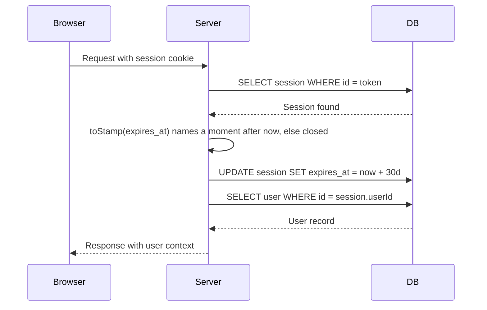

The expiry is read as the moment it names, with `toStamp` from `src/lib/timestamps.ts`, and
not compared with now as text. A session whose expiry names no moment, such as `zzz`,
`2099-02-30 08:00:00` or an hour of 24, is closed, where text comparison sorted it after now
and kept it open for good. API keys and invites are read the same way (the review of cards
2095, 2106 and 2107, item S2); `tests/timestamps.test.ts` holds all three. The sweep of
expired sessions at each start, `cleanExpiredSessions()`, deletes by the same rule (an expiry
that names no moment, or one at or before now), through the `stamp_of` SQL function
`registerStampFunctions` gives the connection.

### Every Session Ended Once, by Migration 0053

The update that brings migration `0053_index_foreign_keys_end_sessions.sql` (card 2106)
ends every session on the installation, the owner's included, on the start that applies it.
Its last statement is `DELETE FROM sessions`, under a header comment saying so, and it runs
once on each database, as every migration does.

The reason is the backups. Until card 2135 a backup, scheduled, run by hand or exported,
held every session id of its day, and a session's id is the whole of what its cookie
carries. Copies made then are at outside destinations and in download folders, and a
session's expiry moves on every time it is used, so a session in such a copy could stay
good for as long as its owner kept using DumpFire. A backup now holds no session (see
[What a Backup Holds](#what-a-backup-holds-and-what-a-restore-brings-in)), and ending
every session once makes the ids in the older copies dead. 0053 must therefore never be
deployed before card 2135's backups: a session made in between would leave in the next
backup, and the one-off would be spent. Both are in the same release.

| What | After the start that applies 0053 |
|---|---|
| Sessions | None: each browser is sent to the sign-in page at its next request, and signs in again |
| API keys | Untouched |
| Invites | Untouched by 0053. Every invite not yet used is ended by 0054, in the same release: see below |
| Requesters' links | Untouched by 0053. Every one is replaced by 0055 (card 2158): see below |
| The log | One `WARN` line, "token not in DB", for each request that carries a cookie whose session is gone, until that browser signs in again |

`tests/migrations.test.ts` holds it: 0053 empties `sessions` and leaves every other table as
it was; a later start deletes nothing, and a session made after it survives; and a backup
made after a session is made holds no trace of its id, so the tests of 0053 cannot pass in
a tree without card 2135's change.

### Every Unused Invite Ended Once, by Migration 0054

The next file, `0054_index_user_time_end_unused_invites.sql`, ends the other thing older
backups hold that signs somebody in: its last statement is
`DELETE FROM invite_tokens WHERE used = 0`, under a header comment saying so, run once on
each database.

Until card 2135 a backup held the token of every invite that was waiting when it was made,
and an invite's token sets its account's password, with no other question, until it expires
up to seven days after it was made. Those copies cannot be called back, and nothing lists
the invites in them for the owner to end one by one. A backup now holds no unused invite,
and a restore brings none in.

| What | After the start that applies 0054 |
|---|---|
| Invites not yet used, expired or not | Deleted. Each link shows the page for a link that no longer works |
| Invites already used | Kept, marked used |
| Accounts, sessions, API keys | Untouched |

The owner lists the waiting invites before the deploy, with the read-only command in
[The Update That Brings Migration 0053](deployment.md#before-the-deploy-checks-0a-0b-0c-and-0d)
(check 0d), and sends again, from User Management, the ones still wanted once the deploy is
done. `tests/migrations.test.ts` holds it: 0054 deletes every unused invite and keeps the
used ones and every other table as it was, a later start deletes nothing, and an invite
issued after it survives. The rehearsal notes the loss as a declared one-off.

### Every Request Link Replaced Once, by Migration 0055

`0055_replace_request_links.sql` (card 2158) ends the last thing older backups hold that
opens something: a request's link. Its one statement is
`UPDATE task_requests SET access_token = lower(hex(randomblob(32)))`, under a header comment
saying so, run once on each database.

Every backup made before card 2158 holds every request's token as it was mailed, open or
settled. A token is the whole of the key to its thread: whoever holds it reads every
message, the ones written since the copy was made included, replies as the requester and
confirms a request not yet confirmed, and it never expires. Replacing every token once makes
the tokens in those copies worthless. A backup made since holds none, and every restore
gives every request a new one, so nothing repeats the one-off.

| What | After the start that applies 0055 |
|---|---|
| Every request link mailed before the deploy (confirm, reply, progress) | Stops working. Its page says "This link no longer works" and asks for the address the request was made with, and the current link is mailed there (see [The Public Request Form](#the-public-request-form)) |
| Requests, their messages, the inbox | Untouched |
| The key the form signs with | Untouched: it lets nobody do more than opening the form does |

It is declared to the rehearsal as a one-off that keeps every row (`keepsRows` in
`tests/rehearsal/one-offs.ts`): the rehearsal still fails if `task_requests` loses a row,
and notes the change. `tests/migrations.test.ts` holds it: every token replaced, 64 hex
characters, all different, none the old; every other column and table as it was; harmless
on an empty table; recorded once, and a later start replaces nothing.

### An Open Stream and Its Session

The gate asks about a session once, when a request arrives. The three live streams are each
one request that stays open: `/api/events` (All Tasks, the dashboard and Burndown),
`/api/boards/[id]/events` (a board) and `/api/logs/stream` (the audit console's live log).
Each used to go on sending after its session was deleted, so a reset, a sign-out elsewhere
or a password change left every open tab of that session receiving card titles and who did
what, and an administrator's audit console receiving the system log, until the tab was
closed.

Each now reads its session cookie when it is opened and asks at every heartbeat it sends
(30 seconds; 25 for the log) whether that session is still there, has not expired and has
an account. If not, the stream ends and sends nothing more. Each asks `openSessionUser()` in
`src/lib/server/auth.ts`, which gives the account as it is now. The log stream and
`/api/events`, which are let in for what the account's role was when they opened, end as well
when that role has changed. The board stream ends as well when its board has gone or that
account can no longer open it (card 2170, below). The session check is two reads, and the
board stream's adds one for the board row and at most four for `canViewBoard`, with nothing
written or logged, and the session's expiry is not moved on, so an open tab does not keep a
session alive.

| What happened | The stream |
|---------------|------------|
| The session was deleted: a sign-out, a password change, a reset, an invite used, a restore, Reset Everything | Ends at its next heartbeat |
| The session expired, or its account was deleted | Ends at its next heartbeat |
| Another session of the same account ended | Goes on: only the session that opened it counts |
| The account is no longer an administrator | The log stream ends at its next heartbeat, and so does `/api/events`, which sent it every board's events. The board stream goes on if the account, as an ordinary user, can still open the board, and otherwise ends as the next row says |
| The account can no longer open the board: its share or its team's share taken away, taken out of that team, the board made private, or an administrator made an ordinary user who is not on it | The board stream sends one `update` with `{"type":"access"}`, on that stream alone, and ends at its next heartbeat. `/api/events` stops sending that board's events from its next heartbeat |
| The board was deleted | The board stream hands on the board's own `{"type":"board","action":"deleted"}` event as the delete commits, then at its next heartbeat the access event, and ends |
| An ordinary user was made an administrator | `/api/events` ends at its next heartbeat, and the page opens it again with every board's events |
| The check itself failed (a database that cannot be read), the session's or the board stream's access check | Ends, with no access event and one `WARN` line under `AUTH`: "Live stream ended: its session could not be checked", with the route and the error |

What the person sees: a page that holds a stream (a board, the dashboard, All Tasks,
Burndown) goes to the login page by itself within about 35 seconds of its session ending
(one heartbeat, then the three seconds `keepStreamOpen()` waits before it asks again and is
answered `401`). A page that holds none (Account, Admin, Reports) goes there at its next
request. The audit console stops and shows it is disconnected. After a restore, every open
board, dashboard, All Tasks and Burndown page goes to the login page the same way. After you
change your own password, each of your other open tabs refreshes once within half a minute
and stays signed in: its stream opens again on the browser's new cookie. An administrator
made an ordinary user sees the audit console show it is disconnected, and an open All Tasks,
dashboard or Burndown page refreshes once, its data read again for the account as it is now.

**Access to the board, at every heartbeat (card 2170).** The board stream asked
`canViewBoard` once, when it opened, and a user taken off the board went on receiving its
events (card titles, column names, who did what) while the session lasted. At each heartbeat
it now asks, after the session, whether the board row is still there and the account as it
is now can open it. If not, it enqueues one last `update` with `{"type":"access"}` on its own
stream (not emitted to anyone else) and ends: the board page re-reads on any `update` and
shows its load's refusal, "You do not have access to this board" or "Board not found".

- **A deleted board is still told first.** The delete's own event is delivered in the same
  synchronous run as the commit (`emit` queues it with `afterCommit`), and a heartbeat is a
  timer, which cannot come between. A stream closed after an `enqueue` still hands the
  reader what was enqueued. Board ids are never used again (`AUTOINCREMENT`), so a stream on
  a deleted board can receive nothing more, and ending it loses nothing.
- **Opening it asks the same question.** `requireBoard(user, id, 'view')`: `404` "Board not
  found" for a board that is not there, administrators included (an administrator was once
  let in on any id, and held a listener on it for ever); `403` "No access to this board" for
  one the caller cannot open; `400` "Invalid board ID" for an id that is not one. The page's
  `keepStreamOpen()` treats `403` and `404` alike and stays closed.
- **`/api/events` decides again at its heartbeat too.** It keeps each board's answer until
  its next heartbeat, which forgets them all once the session and the role are checked; the
  30-second clock it used to keep them by is gone. So a share taken away stops what it sends
  of that board at one moment, its heartbeat, where it used to be within about 30 seconds of
  whenever the answer was first kept.
- **Not asked on every event**, of which a busy board sends several a second; and open
  streams are not told when access changes, since every path that changes access (the share
  and team routes, a team's membership, `isPublic`, a role, a deletion, a restore) would have
  to, and one forgotten would be the fault again.

What the person sees: someone taken off a board, or an administrator made an ordinary user
who is not on it, sees the open board turn into "You do not have access to this board"
within about 30 seconds, with nothing changed on the board meanwhile; in the browser's
developer tools the stream's last message is `update` with `{"type":"access"}`. Any change
on the board before then already turned the page into the refusal, because the page re-reads
on every event and its load refuses. What the heartbeat closes is that one event, and
everything a stream held open outside the page (a script, or `curl` with the cookie) went on
receiving.

See the sequence in [Architecture](architecture.md#an-open-stream-and-its-session). Covered by
`tests/live-streams.test.ts`.

## Password Hashing

- **Algorithm**: bcrypt via `bcryptjs`
- **Rounds**: 12 (`BCRYPT_ROUNDS`). Every stored hash is cost 12
- **Functions**: `checkPassword(password, hash, lane, { gone })` and
  `makePasswordHash(password, lane, { gone })` in `src/lib/server/passwords.ts`, both async.
  `checkPassword` resolves to `{ matches }`, not to a boolean, so that a missed `await` does
  not compile: `!checkPassword(…)` on a promise would be `false`, a wrong password read as
  right, and TypeScript allows `!` of a promise, while `.matches` of one is an error
  (`npm run check`). `passwords.ts` is the only module that imports bcryptjs, and a test that
  reads `src/` holds that, and that every call of `checkPassword(` and
  `checkCurrentPassword(` is awaited. `hashPassword()` and `verifyPassword()` are gone from
  `auth.ts`
- **Never inside a transaction**: a hash or a check takes about a fifth of a second, is
  awaited, and a transaction cannot await. A password is hashed before the transaction that
  stores it, and a current password checked before the transaction it allows (see
  `whilePasswordHolds`, below)

### Off the Server's Thread (card 2191)

A bcrypt check at cost 12 takes about 0.2 s, and bcryptjs does it in JavaScript. It was made
with `compareSync` on the server's one thread, which answered nothing else meanwhile: each
sign-in held every other request up for 0.2 s, and a burst of them held the server for as
long as the burst lasted (a thousand attempts, three and a half minutes). bcryptjs's own
async `compare` gives the thread back only now and then: measured, five at once held it for
half a second at a stretch.

Every hash and every check is now made on a **worker thread** (`node:worker_threads`), and
the server's thread only waits for the answer, answering everyone else meanwhile.

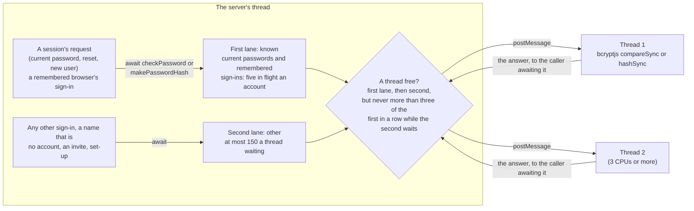

- **How many threads.** `min(2, max(1, CPUs − 1))`: two, or one on a machine with one or two
  CPUs. Never more than two: the threads are there to keep the server's thread free, not to
  check faster for whoever is guessing. `PASSWORD_THREADS` sets it (0 to 8); leave it unset
  (see [Deployment](deployment.md#environment-variables)). Each thread is a V8 heap of its own,
  about 10 MB.
- **How a thread starts.** From a string of code held in `passwords.ts`, because a worker file
  of its own would not be carried into the build. It loads bcryptjs by the absolute path
  `passwords.ts` resolves, which in the built server is `/app/node_modules/bcryptjs`, kept
  outside the bundle as every dependency is: the image did not change. A thread is given
  checks only once it has said it is ready, and never keeps the process alive.
- **One line in memory, in two lanes, in order of arrival.** A free thread takes the oldest
  check of the first lane, and of the second when the first is empty, **or when three of the
  first have been taken in a row while one of the second waited**: the second lane is always
  served. Without that, a stream of first-lane checks, each sent as the one before was
  answered, kept the first lane from ever being empty, and every sign-in, invite and set-up
  behind it waited until the second lane was full and was answered busy (measured: 66 checks
  of the first lane made while one of the second stayed unmade).

| Lane | Who | Where |
|------|-----|-------|
| First (`known`) | A caller the server already knows | The current-password check of the email, password and key routes, and its re-check (`checkCurrentPassword`, `whilePasswordHolds`); the hash of your own change, an administrator's reset and a new user (`POST /api/users`, the placeholder of an invited one included); a sign-in from a browser remembered for the account |
| Second (`other`) | Everyone else | A sign-in from a browser not remembered, a name that is no account included; the hash of an invite's use and of set-up |

- **The second lane is bounded: 150 checks waiting for each thread**, 300 with two: about
  thirty seconds of checks on a fast host, and 60 to 90 seconds on a small one, past the 60
  seconds nginx waits for an answer by default, so that a proxy left at its default answers
  `504` to whoever was last in the line (the configuration in Deployment waits 86400 s)
  ([Deployment](deployment.md#the-update-that-brings-password-checks-off-the-servers-thread-and-remembered-browsers)
  times one check on production). A check that arrives when it is full is not queued, and the
  caller is answered at once, `503`. Sign-in: "Sign-in is very busy right now. Wait a minute
  and try again, or sign in from a browser you have used here before."; the invite and
  set-up forms: "The server is very busy checking passwords right now. Wait a minute and try
  again." Nothing is counted at the account, since no password was checked; a sign-in was
  already counted at its address, and stays counted there (a later success at the account
  does not give it back).
- **The first lane is bounded for each account: five checks in flight**, its sessions'
  current passwords (with their re-checks) and its remembered browsers' sign-ins together,
  each holding a place at `known:user:<id>` (`FIRST_LANE_CHECKS_PER_ACCOUNT`, `enterSignIn`
  in `rate-limit.ts`) from before its check to its answer. A session's count of ten wrong
  passwords does not bound it, since the right password clears the count, and nor do a
  remembered browser's own five in flight, since every right password makes a new cookie.
  The sixth is refused before anything is counted or checked: a sign-in `429` in the words
  a browser not remembered is told, "A sign-in with this name is already under way from
  another browser…"; the email, password and key routes `429` "The server is very busy
  checking passwords right now. Wait a minute and try again." An administrator's reset and
  a new user are not bounded this way: they are an administrator's own actions. So one
  signed-in user, or whoever holds an account's password, keeps at most five checks in the
  first lane, plus the new hash of each password change it completes: `PUT
  /api/account/password` makes its hash after giving its place back. That cannot starve the
  second lane, which is served at least every fourth job while one of its checks waits.
- **A check whose caller has gone is not made.** When a thread is free for a check, the
  check's `gone()` is asked first: the sign-in, invite and set-up actions pass
  `callerHasGone(event.platform)`, which is `req.socket.destroyed` of the request the node
  adapter hands over. So when a burst ends, or a proxy gives up on a caller (nginx after 60
  s), the threads are not left checking passwords nobody will be told about. Its route answers
  as the `503` above, which nobody receives, and counts nothing at the account. Under `vite
  dev` and in the tests there is no `req`, and nobody is taken for gone. The routes of the
  first lane pass none.
- **A thread that stops during a check** is replaced, and the check sent once more, to the
  replacement, ahead of what arrived after it; a second stop fails the check, which its route
  answers `500`. **A check that throws** (a stored value 60 characters long that is not a
  bcrypt hash: `compareSync` throws for it, where a value of any other length is `false`)
  fails that one check, `500`, and the thread goes on. Nothing times a check: a stored hash of
  cost 31 would hold one thread, where it would have held the whole server. Only an import
  or a hand edit can store either. A stored hash of very high cost also holds one of the
  account's first-lane places for as long as each check of it runs, so five such checks at
  once leave that account answering `429` until they finish or the server restarts.
- **When no thread can start at all** (bcryptjs cannot be loaded in one), one `ERROR` line
  under `AUTH` says so, "Password checks cannot run on worker threads (…). Every password
  is checked on the server's thread until it restarts, which holds every other request for
  about a fifth of a second each time.", and every check runs on the server's thread as it
  did before, a turn later, for the life of the process, with the second lane bounded at
  150. Nobody is kept from signing in by it.
- **What it says in the log**, under `AUTH`: one `INFO` line at the first check, "Password
  checks run on 2 worker thread(s)" (or "on the server's thread (PASSWORD_THREADS=0)");
  "Password checks are queuing: 34 password checks waiting (sign-ins, invites, set-up), the
  oldest for 6 s" at `WARN` when the second lane holds more than 20, at most once every five
  minutes; and "Password checks are full: 300 password checks waiting (sign-ins, invites,
  set-up); sign-ins from browsers not remembered, invites and set-up are being answered
  'busy'" at `WARN` when the bound refuses one, at most once every five minutes. See
  [Admin Guide](admin-guide.md#logs).
- **What is queued.** The password, cut to its first 256 characters, and nothing else of
  the request. bcrypt reads only the first 72 bytes of a password, which the first 72
  characters always hold, so the cut changes no hash and no answer; and a longer passphrase's
  tail was never read. A password or a hash that is not text is refused with a `TypeError`
  before it is queued, rather than thrown inside a thread.
- **A name that is no account costs the same check** (card 2192). Sign-in at a name that
  matches no account checks the password typed against `DUMMY_HASH`, a fixed cost-12 hash of
  32 random bytes kept in `passwords.ts` that nothing matches, and ignores the answer: so it
  takes the time a wrong password at an account takes, in the same lane, and the clock no
  longer tells which names are accounts. It was answered at once (1 ms against 206 ms,
  measured). A test holds `DUMMY_HASH` at `BCRYPT_ROUNDS`, so a change of cost cannot leave it
  behind; an account whose stored hash had another cost would answer in another time, and
  none has.
- **In the tests** (`PASSWORD_THREADS=0`, set by `vitest.config.ts`) every check runs on the
  test's own thread a turn later (`setImmediate`), so that a test's `vi.mock('bcryptjs')` sees
  every call and a check is still never answered in the turn that asked for it.
  `tests/password-checks.test.ts` starts real threads.

**The re-check of a current password, outside the transaction.** The email, password and key
routes check the current password before their transaction, and a password changed in
between used to be checked again inside it: a bcrypt check with the write lock held, which a
transaction cannot make now that a check is awaited. `whilePasswordHolds(userId, password,
checkedHash, write, wrong)` in `auth.ts` runs the route's write in one transaction only while
the stored hash is still the one the password was checked against. If it has changed,
nothing is written, the transaction ends, the password is checked against the new hash
outside it (first lane, holding one of the account's five places, and not counted again:
the same guess), and the transaction runs
once more; the route's own `403` if it does not match. A second change in between answers
`409` "Your password was changed while this was being saved. Nothing was changed. Try
again." (`PASSWORD_CHANGED_MEANWHILE`). Nothing can change the hash between the comparison
and the write: better-sqlite3 runs the whole transaction without yielding, under
`BEGIN IMMEDIATE`.

**What the people using it notice:** nothing, until a burst of sign-in attempts. Then a
sign-in from a browser the server does not know waits its turn, about a tenth of a second
for each check ahead of it with two threads, up to a fifth on a host with one or two CPUs,
and when 150 checks for each thread are already waiting it is answered at once "Sign-in is
very busy right now…" instead; an invite's form and set-up the same. Signed-in people, and
browsers remembered for the account, go ahead of them, three at a time at most, and five in
flight for any one account, plus the new hash of each password change it completes.

Covered by `tests/password-checks.test.ts` and `tests/atomic-accounts.test.ts`.

### Guessing a Current Password

Three routes ask a caller who is already signed in for their current password: changing
your email (`PUT /api/account/email`), changing your password (`PUT /api/account/password`,
which the admin page's dialog on your own row uses too) and Generate Key
(`POST /api/account/api-keys`). The password is what whoever holds a session and not the
password (an unlocked machine, a copied cookie) would need to move the email, set a new
password or make a key, and each guess used to be answered at once, as often as asked.

They now follow sign-in's rule, counted on the **signed-in browser**: the session the
request was sent with. Ten attempts in 15 minutes, the three routes counted together, and the
right password clears the count. The eleventh attempt in the window is answered `429` "Too
many wrong passwords. Try again in N minute(s)." before any password is checked, whatever it
carries, the right one included, and nothing is written.

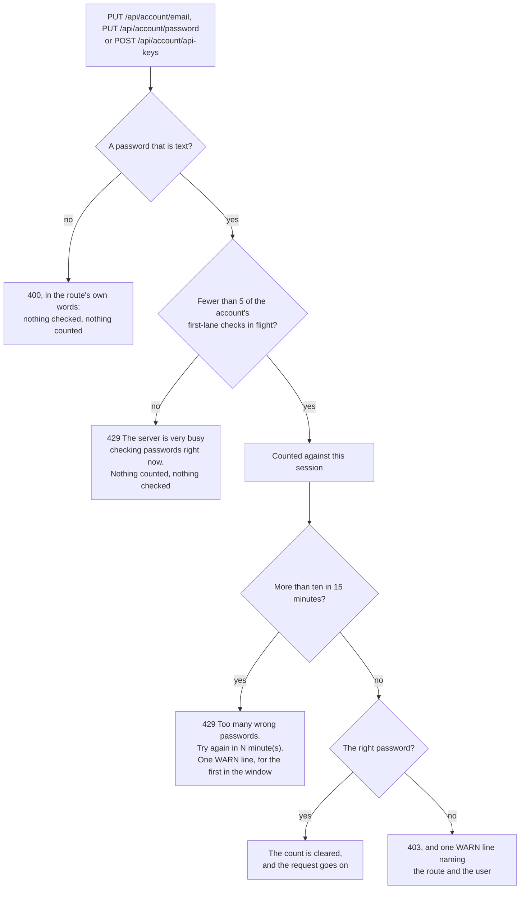

- **Why the session and not the account.** Counted on the account, whoever held one session
  of it could keep every session of it refused, the owner's included, and so keep the owner
  from changing the password, which is how an owner ends the other sessions. A session is
  only made by signing in or with an invite, each of which needs the password or sets it, so
  a count on the session slows the guesser as much. Signing in again, or another browser
  already signed in, is not held up.
- **Five in flight for the account.** The right password clears the session's count, so the
  count does not bound how many checks a signed-in user keeps going at once, and they go in
  the first lane, ahead of every sign-in. Each check holds one of the account's five places
  in the first lane, shared with its remembered browsers' sign-ins, from before it is counted
  to its answer; the sixth at once is answered `429` "The server is very busy checking
  passwords right now. Wait a minute and try again." with nothing counted and nothing
  checked. Nobody using the pages one at a time meets it. See
  [Off the Server's Thread](#off-the-servers-thread-card-2191).
- **One function.** `checkCurrentPassword(session, userId, password, hash, where)` in
  `src/lib/server/auth.ts` (named `currentPasswordMatches` until card 2191) counts the
  attempt, answers the `429`, checks the password on a worker thread in the first lane, and
  clears the count when it matches. It is async and resolves to `{ matches }`, so a missed
  `await` does not compile. The session comes from the session cookie the gate checked; a
  request that reaches one of these routes without one is answered `401`. A route whose
  password was changed in between is checked again by `whilePasswordHolds` (see
  [Password Hashing](#password-hashing)), which does not count it again: it is the same
  guess. Two changes in between answer `409`.
- **A fixed window, not a sliding one.** The 15 minutes start at the session's first attempt,
  and when they end the count starts again from nothing, however many attempts were refused
  in them (`src/lib/server/rate-limit.ts`, sign-in's limiter too). So a guesser who times it
  can make about 20 attempts back to back across the end of a window (nine at the end of one,
  ten at the start of the next), and one who keeps asking makes about 40 an hour for each
  session: ten in every window.
- **The system log.** Each wrong password is a `WARN` line under `AUTH`, "Wrong current
  password for user N on {route}", and the first refusal at the limit in each window one
  more, "Current password not checked for user N on {route}: too many wrong ones from this
  session". The refusals after it in the same window are not logged, so a script that goes
  on asking does not fill the log. The session is never logged.
- **A password that is not text** (a number, `true`, a list) is answered `400` before
  anything is counted: "Password is required" on the email and key routes, "Current password
  is required" on the password route. It used to reach bcrypt and be answered `500`. So did
  a new password that is not text, which is now `400` too: `newPassword must be text` on
  the password route, and `password must be text` on an administrator's reset
  (`PUT /api/users/:id/password`), which looks for the account and checks the caller before
  it reads the password (card 2117).
- **In memory**, as sign-in's count is: a restart clears it.

Covered by `tests/atomic-accounts.test.ts`.

### Guessing a Password at Sign-in

The sign-in form (`/login`, its action in `src/routes/login/+page.server.ts`) is the one part
of DumpFire anybody can reach that checks a password. It counts two things, holds browsers it
does not know to one sign-in at a time at an account under attack, and lets a browser that
has signed in to the account before past all of it (see
[Browsers That Have Signed In Before](#browsers-that-have-signed-in-before)).

**Per address.** Ten attempts from one address in 15 minutes, in a fixed window from the
first; the eleventh is answered at once, `429` "Too many login attempts. Please try again in
N minute(s).". An attempt it refuses never waits and is not counted at the account, since
no password was checked. On its own it let a guesser with N addresses try 10 × N passwords
at one account every 15 minutes (card 2177).

- **An address is counted by its key** (card 2195): an IPv6 address by its /64 network, an
  IPv4 address written as IPv6 (`::ffff:198.51.100.7`) as the IPv4 address, and no port. So
  everyone on one IPv6 network shares the ten, as an office behind one IPv4 address already
  does, and a caller holding a /64 no longer has 2^64 allowances. See
  [How an Address Is Counted](#how-an-address-is-counted).
- **A sign-in that succeeds gives back only the attempts its address made at that account**
  (card 2226). The count notes which account each admitted attempt was at (the key below:
  `user:<id>`, so a username and its email are one; `name:<sha-256>` for a name that is no
  account), and the right password takes that account's attempts off the address's count,
  and nothing else. Someone who mistypes their own password three times and then signs in
  has those four back, so mistypes at an account whose owner then signs in never add up
  across an office. Attempts at another account, at a name that is no account (a mistyped
  username included), and refusals stay counted to the end of the window, and the count
  never goes below zero. It used to clear the address's whole count, so anyone with an
  account could send nine guesses at another, sign in to their own, and go on from the same
  address as often as they liked: 36 wrong at another account in one window, measured, none
  refused. A browser remembered for the account is never counted at its address, so its
  success gives nothing back.
- **The lookup comes first.** The account is known only after the name is looked up, so the
  lookup is made before the address is counted; an attempt the address's limit refuses
  costs one indexed read before its `429`, the same for a name that is an account and one
  that is not.

**Per account, from any number of addresses (card 2177).** After five wrong passwords at one
account within 15 minutes of each other, every sign-in at it from a browser not remembered
for it waits before its password is checked, the right password included, and is then
answered as it would have been:

| Wrong passwords at the account when the attempt arrives | Wait before the password is checked |
|---|---|
| 0 to 4 | none |
| 5 | 1 s |
| 6 | 2 s |
| 7 or more | 4 s |

- **The wait refuses nothing.** The answer's status and words do not change: a wrong password
  is `400` "Invalid username/email or password", as before, and the right password signs in
  after at most four seconds, clearing the account's count and giving back the address's
  attempts at the account. What can refuse a sign-in at the account is the one-at-a-time
  rule below (card 2194), which reverses card 2177's "never refused": while the account has
  had five wrong passwords within 15 minutes of each other, a browser not remembered for it
  is let in one at a time, and the rest are refused at once, `429`. A browser remembered for
  the account is never made to wait or counted, and is refused only while five of the
  account's first-lane checks are already in flight (see
  [Off the Server's Thread](#off-the-servers-thread-card-2191)).
- **The key is the account, once the name is found.** The lookup is the one sign-in makes:
  a name with `@` is lower-cased and matched to an email, anything else matched exactly to
  a username. Found, the count is kept under `user:<id>`, so a username and its email share
  one count. Not found, it is kept under `name:` and the SHA-256 of the name exactly as the
  lookup read it: trimmed, a name with `@` lower-cased, a username in the case typed. So a
  name that is no account waits exactly as a real one would, and the count holds 64
  characters whatever was typed. It was lower-cased either way at first, while a username
  is matched exactly: five wrong at `ALICE` and then one at `alice` waited 1 s when `alice`
  was no account and none when it was one, which told the two apart.
- **An idle window.** The count is forgotten 15 minutes after the last wrong password, so
  the waits last as long as the guessing does. A fixed window would give five free guesses
  every 15 minutes.
- **Read when the attempt arrives, counted after the check.** Attempts sent together read
  the same count and would wait alike, side by side; the one-at-a-time rule below is what
  bounds how many are let in at once.
- **A wait holds nothing up.** It is an awaited timer, holding no transaction and no
  database handle, so every other request is answered meanwhile. Everything before it (the
  form read, the lookup, the remembered browser's cookie, the per-address count and the place
  of the one-at-a-time rule) is one synchronous stretch, after which the sign-in holds only
  the account's id (or nothing, for a name that is no account), the password cut to its
  first 256 characters, the name cut to 320 for the answer, its length, and the address,
  each copied so that nothing of the form is kept alive: well under 2 KB besides its
  connection, where the form can be the gate's 512 KB. bcrypt reads only the first 72 bytes
  of a password, which 256 characters always hold, so no password that signed in before
  stops signing in. The account is read again by its id after the wait, so the password is
  checked as it is then.
- **One `WARN` line when an account's waits begin**, at its fifth wrong password in the
  window, under `AUTH`: `Sign-ins at "pat" (user 12) are being slowed: 5 wrong passwords
  within 15 minutes of each other`, with the account as the line's user, so the Audit page
  finds it by user; or `Sign-ins at a name that is no account are being slowed: …`, with
  none. Not one line per wait, so a guesser does not fill the log. The "Failed login
  attempt" lines beside it hold nothing that was typed: see
  [What a Failed Sign-in Writes](#what-a-failed-sign-in-writes).
- **The page shows the wait.** The Sign In button is disabled, and reads "Signing in…",
  from the press until the answer, so that four seconds with nothing to see are not met by
  pressing again.
- **Apart from the current-password count** above. A wrong current password on My Account
  counts against its session, and a wrong sign-in against the account; neither counts toward
  the other, and neither a correct current password nor a password change clears the
  sign-in count.
- **In memory**, in its own map in `src/lib/server/rate-limit.ts` (`signInWait`,
  `countWrongSignIn`, `forgetWrongSignIns`), swept with the other counts every five minutes
  and emptied by a restart, as every count there is. The map holds at most
  `WRONG_SIGN_IN_KEYS = 10_000` counts, since every name that is no account is one of its
  own: full, the one counted longest ago is forgotten to make room. Pushing an account's
  count out so takes 10,000 names, a thousand addresses' worth of attempts at ten each in
  15 minutes, and only while the account's own guessing has paused. (Before card 2226 one
  address with an account of its own did it, signing in between: measured, 8.4 s.) A
  remembered browser's count of wrong passwords, kept under `nonce:<nonce>` in the same map,
  can be pushed out the same way.

**One at a time, for browsers not remembered (card 2194).** At one key (`user:<id>`, or
`name:<sha-256>` for a name that is no account), a sign-in from a browser not remembered for
the account is let in only while fewer such sign-ins are already in flight there than the
free guesses left, and never fewer than one: `max(1, 5 − n)`, where `n` is the count of
wrong passwords above. So five free guesses an idle window however they are sent, then
**one at a time while the waits last**. In flight is from passing the per-address count to
the answer, the wait and the check included; the place is taken in the synchronous stretch
as the attempt arrives, so attempts sent together take places in the order they arrived,
and given back in a `finally` however the sign-in is answered.

- **Beyond it, refused at once:** `429` "A sign-in with this name is already under way from
  another browser. Wait a few seconds and try again, or sign in from a browser you have used
  here before." The same words and the same rule for a name that is no account, so the
  refusal tells nothing about which names are accounts. Counted at the address, as every
  attempt is, and kept counted there, so a later success at the account does not give it
  back; not counted at the account, since no password was checked.
- **One `WARN` line under `AUTH` for the first refusal at a key**, and again only after 15
  minutes without one: `Sign-ins at "pat" (user 12) from browsers not known here are being
  let in one at a time`, with the account as the line's user, or `Sign-ins at a name that is
  no account from browsers not known here are being let in one at a time`, with none.
- **What it does to a guesser who sends many at once**: one guess per wait and check at one
  account, about one every 4.3 s, about 210 in 15 minutes, as a guesser who waits for each
  answer makes. Before it, each request waited its own few seconds side by side, and the
  first volley of every idle window, all reading a count of 0, was as large as the
  per-address limit allowed across every address the guesser had.
- **Turned off on the host** with `SIGN_IN_ONE_AT_A_TIME=off`, for an owner an attack keeps
  out of every browser not remembered: see
  [If an Attack Keeps an Owner Out](deployment.md#if-an-attack-keeps-an-owner-out). Off, every browser is
  let in after the account's wait, as card 2177 had it.
- **In memory**, in `src/lib/server/rate-limit.ts` (`enterSignIn`, `leaveSignIn`,
  `wrongSignInsAt`, `FREE_WRONG_SIGN_INS = 5`); a key with none in flight has no entry, so
  names that are no account do not pile up.

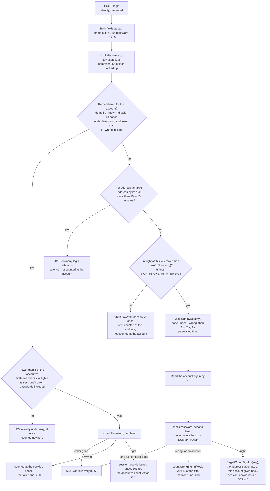

What it does, and what it does not, said plainly:

- **It slows a guesser who waits for each answer**, one request at a time through as many
  addresses as they like, to about one guess every 4 seconds at one account after the first
  five: about 220 in 15 minutes, where it was 10 for each address.
- **It slows a guesser who sends many at once to the same rate**, by the one-at-a-time rule.
  No wait that the right password always gets past could: the guesser learns within those
  seconds whether each guess was right. That rule refuses, and refusing is what can keep an
  owner out on a browser not remembered (see
  [Browsers That Have Signed In Before](#browsers-that-have-signed-in-before)). How many
  addresses a guesser has depends on how the server reads them behind a proxy: see
  [Deployment](deployment.md#the-callers-address-behind-a-proxy).
- **It does not slow one password tried across many accounts**, where each account's count
  stays low. The per-address limit bounds that.
- **The wait can be seen.** One wrong attempt shows whether the account has had five wrong in
  the last 15 minutes, and its going back to none that the owner has just signed in. And
  since one account's username and email share one count, wrong attempts at one show at the
  other: five wrong at a username and a sixth at an email, which waits only if both are one
  account's, tell whether they are, for 6 of an address's 10 attempts. That is accepted (the
  plan's decision 10, one count for the account, is deliberate), and since card 2192 it is
  the one tell left: whether a name is an account at all can no longer be told from how long
  a wrong password takes, because a name that is no account is checked as an account's
  wrong password is (see [Password Hashing](#password-hashing)). It links a username
  already known to an email, at the cost of 6 of an address's 10 attempts.

**What the owner of an account notices:** after five wrong passwords at it within 15 minutes
of each other, every sign-in at it from a browser not remembered for it, their own included,
waits 1 to 4 seconds before it is answered, until 15 minutes pass with no wrong password or
the right one is given; and while that lasts, a second sign-in at it at the same moment from
such a browser is refused at once, "A sign-in with this name is already under way from
another browser…". On a browser remembered for the account, none of that applies, unless
five sign-ins and current-password checks of the account are already in flight. A browser
remembered for the account is also answered `503` when its caller has gone before a thread
was free for its check, as any other; nobody receives that answer.

#### What a Failed Sign-in Writes

Each failed sign-in is one `WARN` line under `AUTH`, and holds nothing that was typed (card
2193):

| Case | The line | Fields |
|------|----------|--------|
| A wrong password at an account | `Failed login attempt at "alice" (user 12) from IP 203.0.113.7 (bad password)` | `user_id`, `ip` |
| A name that is no account | `Failed login attempt for a name that is no account (17 characters) from IP 203.0.113.7` | `ip` |

- **The account's own username**, from its row and cut to 100 characters, never the name as
  typed: an email typed is not repeated, and the Audit page finds the line by user, as it
  finds the "being slowed" line.
- **A name that is no account by its length only.** The name as typed was written, at any
  length until card 2177 cut it to 320, so a password typed into the name box was written in
  clear, where every administrator reads the log (the Audit page, `GET /api/logs`) and into
  every backup. A short hash of the name was not chosen: a hash of a short password can be
  matched against a list of common passwords by anyone who reads the log.
- **The address as received**, cut to 100 characters, in the text and as the line's `ip`,
  or `unknown` in the text and no `ip` where it cannot be read. Both lines had no `ip`.
- **The lines already in the log are rewritten** at the first start after the deploy, and in
  every backup's copy: a line in the old form for a name that was no account,
  `Failed login attempt for "<what was typed>" from IP …`, becomes
  `Failed login attempt for a name that is no account (N characters) from IP …`, N being the
  length of what was between the quotes, the whole of it to the last `" from IP `, quotes
  and line breaks included. An old line ending ` (bad password)` named an account and is
  left as it is, with the name as typed; those age out of the log (30 days or 50,000 lines)
  but stay in backups made before then. It is the third rule of `maskSecretsInLog()` in
  `src/lib/server/secret-paths.ts`, which `maskLiveLog()` runs at every start and
  `withoutSecrets()` over every backup's copy; a line in the new form does not begin as the
  old did, so a second start changes nothing. Backups made before the deploy keep the
  names.

Covered by `tests/gate.test.ts`, on a fake clock, and `tests/backups.test.ts`.

### Browsers That Have Signed In Before

Each browser that signs in to an account is **remembered for it for a year** (card 2194), by a
cookie of its own sent only to the sign-in page. A remembered browser skips all of sign-in's
throttling: the account's wait, the one-at-a-time rule and the per-address limit, and its
check goes in the first lane. So the account's owner, on a browser they have used, is never
made to wait or counted, however the account is being guessed at. It is refused only while
five of the account's checks in the first lane are already in flight, its sessions' current
passwords included (see [Off the Server's Thread](#off-the-servers-thread-card-2191)): every
right password makes a new cookie, so the five in flight for each cookie below do not bound
whoever has the password, and this does. Such a refusal is the one-at-a-time words, `429`,
and counts nothing. The code is
`src/lib/server/known-browsers.ts`; the order is the chart above.

**The cookie.**

| | |
|---|---|
| Name | `dumpfire_known_<user id>`, one for each account the browser has signed in to |
| Value | `<issued at>.<nonce>.<mac>`: the time of issue in seconds, 16 random bytes in hex, and `HMAC-SHA256(key, "known-browser:1:<user id>:<issued at>:<nonce>:<the account's password hash>")` in hex. About 110 bytes |
| Options | `Path=/login`, `HttpOnly`, `SameSite=Strict`, `Secure` by the session cookie's rule (`COOKIE_SECURE` when set, otherwise in production: `secureCookies()` in `auth.ts`), `Max-Age` a year |
| Good when | It parses, was issued no more than 365 days ago and not more than a minute in the future, and its MAC matches, compared in constant time, with the account's hash as it is now. Anything else is answered as no cookie at all |

**When a browser is remembered.** A new cookie (a new time and nonce) is set to the browser
that signs in successfully, at each sign-in; to the browser that changes its own password, with
the new hash; to the browser that uses an invite, and the one that sets the installation up;
and to a browser that signs out with an open session (`POST /logout`), with the account's
hash read before the session ends: a browser that signed out is a browser that signed in. So
after the deploy that brought this in, a browser is remembered once it signs in or signs out.
`rememberBrowser()` runs after the change is committed and never fails the request: a key
that cannot be had is one `WARN` line, "A browser could not be remembered for user N: …", and
no cookie.

**What ends it.** Nothing is stored for a browser, so nothing is deleted:

- **Any change of the account's password hash**: the holder's own change, an administrator's
  reset, an invite's use. The MAC is over the hash, so every remembered browser of the
  account stops counting at once. The browser that made the change, or used the invite, is
  remembered anew; an administrator's reset remembers none. So does an account deleted and
  its id used again (another hash).
- **A year** after it was issued.
- **The key replaced**: a restore (Import Backup), Reset Everything, or the key's row deleted
  on the host (see [Deployment](deployment.md#if-an-attack-keeps-an-owner-out)).
- **Not sign-out**, which remembers the browser, and **not** a change of email or role, which
  ends invites and no session. The cookie outlives every session: ending a session, by
  signing out, by its expiry or by an administrator's action, does not end it; only setting
  the password does.
- **Five wrong passwords from the cookie** within 15 minutes of each other: it then counts as
  not remembered until 15 minutes pass without one. A remembered browser's wrong password is
  counted at its own nonce (`nonce:<nonce>`), not at the account, and writes the failed line
  as any other, but never the "being slowed" line.
- **At most five sign-ins from one cookie in flight at once**, less its wrong ones; past that
  an attempt is treated as from a browser not remembered (the per-address limit, the
  one-at-a-time rule, the wait, the second lane). So a copied cookie (a shared or lost
  computer, a copied browser profile) buys at most five guesses in flight and five each idle
  quarter of an hour, never a volley, and setting the password ends it.

**What a remembered browser's success does.** It signs in and is issued a new cookie. It
leaves the account's count of wrong passwords as it is, because an attack is not over when the
owner signs in, and gives the address nothing back, since nothing was counted there. A browser
not remembered keeps card 2177's rule that the right password clears the account's count.

**The key: 32 random bytes in `settings`, key `known_browser_secret`.** Made by the first
browser remembered (a check of a cookie never makes one: with no key no cookie is good), read
once into memory, as the request form's key is. **Never in a backup and never restored**:
`withoutSecrets()` deletes the row from every backup's copy, and `rowsToRestore()` leaves it
out of a restore, which clears the live row with every other; so the restored server makes a
new key, and every browser is forgotten, as every session already is. Whoever held the key and
an account's hash (which a backup holds) could make a cookie for that account. Reset and both
import paths forget the cached key (`resetKnownBrowserSecretCache()`).

**When an attack keeps an owner out.** On any browser not remembered, while the account is
being guessed at in parallel, the one place is almost always taken by the guesser, so the
owner is refused with the one-at-a-time words. Keeping it so needs only the account's username
or email, which every signed-in user can read, and one admitted attempt per wait and check,
about two dozen IPv4 addresses, or one IPv6 /48. Each refusal is also counted at the refused
caller's address. The ways in:

- a browser remembered for the account;
- a session already open, which is not touched;
- an invite, only where mail is set up, and only for an account an administrator may manage:
  never the superadmin's, and an administrator's only from the superadmin. An invite signs the
  browser in without the sign-in page and remembers it;
- waiting until 15 minutes after the last wrong guess;
- `SIGN_IN_ONE_AT_A_TIME=off` on the host, for one sign-in: see
  [If an Attack Keeps an Owner Out](deployment.md#if-an-attack-keeps-an-owner-out).

An attacker with a whole IPv6 /48 (65,536 networks of /64, each with ten attempts of its own)
can instead keep the second lane of password checks full, at any accounts or none: every
sign-in from a browser not remembered, every invite and set-up is then answered busy, `503`.
`SIGN_IN_ONE_AT_A_TIME=off` does not help with that. Only a remembered browser or a session
already open gets in, their checks being in the first lane, and only the proxy's own limits,
if it has any, can hold such an attacker back.

After an administrator sets a password during an attack, no browser is remembered for the
account: where mail is set up, send an invite instead; where it is not, its owner signs in
once the attack stops, or the host's operator turns the rule off for one sign-in. Nobody can
reset the superadmin's password; the superadmin keeps a remembered browser by changing their
own password from one, which keeps that browser remembered. A restart does not help: it
empties the counts, and five wrong passwords, a second's work, fill them again.

**What the owner of an account notices:** a browser you have signed in with, or signed out
of, is remembered for a year or until the password is set again, and signing out does not
forget it. To forget every browser of an account, set its password; to forget every browser of
every account, see [Deployment](deployment.md#if-an-attack-keeps-an-owner-out). After the
deploy, sign in again, or sign out and in, on each browser you will want during an attack,
the superadmin's first.

Covered by `tests/gate.test.ts` ("a browser that has signed in here before"),
`tests/atomic-accounts.test.ts` ("remembered browsers, when a password is set") and
`tests/backups.test.ts`.

### How an Address Is Counted

Three things are counted by the caller's address: sign-in's ten attempts in 15 minutes, the
public request form's limits (`addressToCount()`, in its three routes), and the documented
API's sixty requests a minute with no key it accepts (the gate's `apikey-none:` count). Each
counts the address's **key**, `addressKey()` in `src/lib/server/client-address.ts` (card
2195), and not the address as received:

| The address received | Counted as |
|----------------------|------------|
| `unknown` (no address could be read) | `unknown`, with every other such request |
| `198.51.100.7`, `198.51.100.7:51234` | `198.51.100.7`: a port is taken off |
| `::ffff:198.51.100.7`, `::FFFF:c633:6407` | `198.51.100.7`: an IPv4 address written as IPv6 is the IPv4 address |
| `2001:db8:1:2::1`, `2001:0DB8:0001:0002:ffff::9`, `[2001:db8:1:2::1]:443`, `2001:db8:1:2::198.51.100.7` | `2001:db8:1:2::/64`: an IPv6 address by its first four groups, its /64 network |
| `fe80::1%eth0` | `fe80:0:0:0::/64`: a zone is taken off |
| Anything else | As received, cut to 100 characters, so a key's size is bounded |

- **Why the /64.** A whole IPv6 address was counted, so a caller given a /64 (one host, one
  household, one office subnet: every IPv6 network) had 2^64 allowances: eleven wrong
  sign-ins from eleven addresses of one /64 were never refused. A /64 is one network, which
  already shares one IPv4 address through NAT. A /48 is a whole site and would put everyone
  there in one count; what a holder of many /64s can still do is bounded at each account by
  the waits and the one-at-a-time rule.
- **A port is taken off only from what is no address as it stands**, so `fe80::1`, which ends
  in a group, keeps it. A proxy can write a port into the caller's address header
  (`1.2.3.4:5678`), and each connection would have been an allowance of its own.
- **Every log line keeps the address as received**: the gate's `ip`, the sign-in lines. Sign-in's
  refusal line adds the key where it differs: `Rate limit hit for IP 2001:db8:1:2::9, counted
  as 2001:db8:1:2::/64 (login attempts)`, with the address as the line's `ip`.
- **Behind a proxy that is not told the caller's address**, every caller has the proxy's,
  which is one IPv4 address: nothing here changes. IPv6 reaches the counts only through
  `ADDRESS_HEADER`, as behind Cloudflare: see
  [Deployment](deployment.md#the-callers-address-behind-a-proxy).

- **Some addresses share a key they do not share a network with.** Every link-local address
  (`fe80::…`, any zone) is one key, `fe80:0:0:0::/64`, and every address whose first four
  groups are zero (`::`, `::1`, the old IPv4-compatible `::198.51.100.7`) is `0:0:0:0::/64`. A caller should never reach the server from either, but
  behind a proxy that hands one on, all such callers share one count.

**What the people using it notice:** everyone on one IPv6 network shares sign-in's ten attempts
in 15 minutes and the request form's limits, as an office behind one IPv4 address already
does: an office whose LAN is one /64 shares the ten, so a few people mistyping at once can
hold the office's sign-ins for up to 15 minutes. Browsers remembered for an account are not counted at their address at all.

Covered by `tests/gate.test.ts` ("counting an address").

## Passwords, Sessions and Invites Change Together

Every request that changes who can sign in makes its writes in one transaction (see [Architecture](architecture.md#writes-one-transaction-then-the-effects)). The cookie is set, and the redirect made, after the commit.

| Request | Changes together, or not at all | The account's invites not yet used | The account's API keys |
|---------|---------------------------------|------------------------------------|------------------------|
| Change your own password (`PUT /api/account/password`) | The new password, the end of every session the user has, and the new session that keeps this browser signed in | All end | Kept, unless the body says `endApiKeys: true`, which the Account page's box sends |
| An administrator sets a user's password (`PUT /api/users/:id/password`) | The new password and the end of every session that user has. Nobody sets their own password by this route, an administrator included: the caller's own id is answered 403 and told to use the Account page | All end | All end |
| Create a user (`POST /api/users`) | The user and, where no password was given, their invite. The invite email is sent after the commit, and waited for (card 2196) | A new account has none | A new account has none |
| Send an invite again (`POST /api/users/:id/invite`) | The new invite. The email is sent after the commit, and waited for (card 2196) | All earlier ones end | Kept |
| An administrator changes an account's email or role (`PUT /api/users/:id`) | The change, and the end of the account's invites when its email or role is changed | All end, when the email or role written differs from the one stored | Kept |
| Change your own email (`PUT /api/account/email`) | The new address and the end of the account's invites | All end, when the address differs from the one stored | Kept |
| Use an invite (`/invite/:token`) | The password, the invite marked used, the end of every session the account had, and the first session | All others end | All end |
| First-run set-up (`/setup`) | The superadmin and their session | | |

So a password is never changed while the old sessions stay good, an invite never sets a password and remains usable, and no invite waiting to be used outlives a newer invite, a password change, or a change of the account's email address or role.

### What Setting a Password Ends

**An API key outlives a password change only when the account's own holder made that
change with their current password, and chose to keep their keys. Every other way of
setting a password ends the account's keys. Every way of setting a password ends its
sessions and its invites that have not been used. The webhooks the account set go with its
keys, switched off; its report schedules are paused by a reset and an invite, never by the
holder's own change** (card 2168).

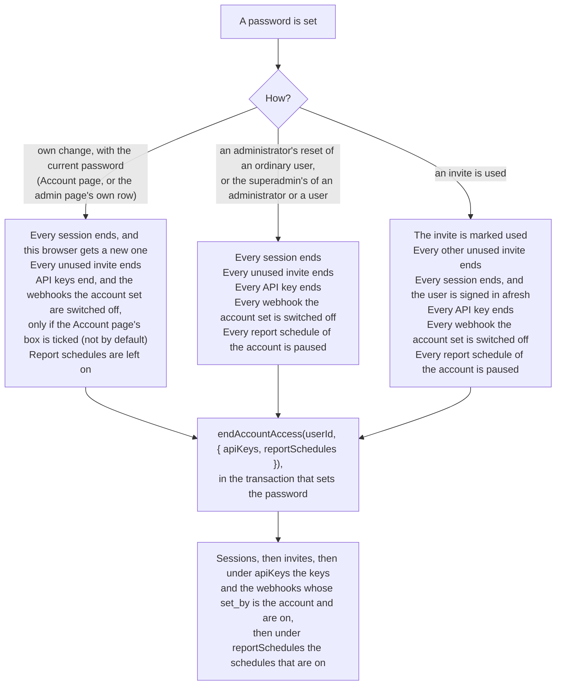

| How the password is set | Sessions | Invites not yet used | API keys | Webhooks the account set | Its report schedules |
|-------------------------|----------|----------------------|----------|--------------------------|----------------------|
| Your own change, with your current password, on the Account page or your own row of the admin page. The superadmin's included | All end; this browser gets a new one | All end | **Kept, unless you tick "End my N API keys too"**, which is not ticked by default. The admin page's dialog sends no choice, so it keeps them, and says so | **Kept on, unless the box is ticked**, with the keys. The box is offered for a webhook alone too, "Switch off the N webhooks I set up", once the key list has loaded. The admin page's own-row dialog keeps them | Left on |
| An administrator resets an ordinary user's password, or the superadmin an administrator's or a user's | All end | All end | **All end** | **All switched off** | **All paused** |
| An invite is used | All end, and the user is signed in with one new session | All others end; the one used is kept, marked used | **All end** | **All switched off** | **All paused** |
| A restore, an import, Reset Everything | Not a password change: these replace the whole database. See [What a Backup Holds](#what-a-backup-holds-and-what-a-restore-brings-in) | | | | |

Why a reset and an invite always end keys: they are how someone who does not have the
current password takes an account back from someone who has its password or a session.
Why your own change only offers it: you have just proved you hold the password, a routine
change is not about an intruder, and ending keys stops every script that uses them. The
server cannot tell a recovery from a takeover, so a user who forgot their password and is
sent a reset or an invite loses their keys too.

**What it switches off, and why not deleted.** A webhook is made with a key and keeps
sending a board's events to its address after the key has gone, so it goes with the keys:
every webhook whose `webhooks.set_by` is the account and that is on is switched off
(`active = 0`). `set_by` is the account that last set the webhook's address or secret, or
switched it on, not the one that first made it: an administrator's key that points somebody
else's webhook at an address of its holder's choosing becomes its setter, and that
administrator's reset reaches it; so does the owner's or administrator's key that switches on
again a webhook a reset switched off, since whoever starts its deliveries again answers for
them. A report schedule keeps mailing its recipients, so a reset and an invite pause
every one of the account's that is on (`enabled = 0`, `updated_at` stamped); the holder's own
change leaves them, since they are made with a session, which that change ends, and their
owner sees them on the Reports page. Neither is deleted: the account's own integrations and
reports would go with an intruder's, and a webhook's secret with it. A switched-off webhook
is switched on again by the board's owner or an administrator with `PUT
/api/v1/webhooks/{id}` and `{"active": true}` (an editor is refused: see
[Permission Matrix](#permission-matrix)); a paused schedule by its owner on the Reports page,
where it shows ⏸️. Deleting an account switches off what it set too, before its row goes and
the key clears `set_by` (`deleteUser`).

**What a reset does not end.** A reset, an invite used and a change with the box ticked end
the account's sessions, its waiting invites and its keys, and switch off the webhooks it set.
They do not reach:

- **A webhook nobody is recorded as having set**: one registered before migration 0056, or
  one whose setter's account was deleted. A reset leaves it on. **Since card 2325 it is held
  from the deploy on all the same**: nothing is sent to it at any event until the board's owner
  or an administrator takes it over, so a webhook made that way with the account's keys no
  longer receives its board's events.
- **A webhook somebody else set since**: an owner or administrator who changed its address
  or secret, or switched it on, became its setter.

Losing the board is not a reset, and needs none (card 2325): a webhook whose setter can no
longer open its board is held at every event, not switched off. It keeps `active`, says why in
`pausedBecause` to the board's owner and administrators, and sends again by itself if that
account is given the board back. To keep it without that, the owner or an administrator takes
it over: delete it unless you recognise the address; to keep it, switch it off, then on, which
makes you its setter, set a new secret, and update the receiver with it. The board's Share
window counts them for the same people (card 2329): it asks before a removal that would hold
webhooks, and says how many are held now. See
[When Nobody Who Can Open the Board Set It Up](notifications-email.md#when-nobody-who-can-open-the-board-set-it-up).

**A request still arriving when the reset is committed.** The gate decides who is calling
before a request's body is read, and a body can take as long as the caller likes to arrive. A
webhook created or changed (`POST /api/v1/boards/{id}/webhooks`, `PUT /api/v1/webhooks/{id}`),
or a report schedule created or changed (`POST /api/report-schedules`, `PUT
/api/report-schedules/{id}`), by a request the gate let in before the reset and whose body
arrived after it, was written, for the account just taken back, on and running. Every write
route now asks again, inside the transaction that writes, that the key or the session the gate
let it in with is still open, and who its account is now (`writeAs` in
`src/lib/server/write-as.ts`, through `stillAuthenticated` in `src/lib/server/auth.ts`, reading
`locals.credential`, which the gate sets beside `locals.user`), and answers `401` in the gate's
own words, "Invalid or expired API key" for a key and "Not authenticated" for a session, with
nothing written (card 2253). A request let in before a reset and sending its body after it
writes nothing anywhere; the report-schedule delete, which asked nothing before, asks too. See
[Asked Again at the Write](#asked-again-at-the-write-card-2253).

A switched-off webhook keeps naming its setter, so a second reset counts it again only if it
was switched on in between. After taking an account back, look over once the webhooks with no
setter on the boards it could edit (no page lists them: `GET /api/v1/boards/{id}/webhooks`).
Delete any that nobody recognises.

- **One function.** `endAccountAccess(userId, { apiKeys, reportSchedules })` in
  `src/lib/server/auth.ts` deletes the account's sessions, then its invites with `used = 0`,
  then, under `apiKeys`, its API keys and switches off the webhooks it set that are on, then,
  under `reportSchedules`, pauses its report schedules that are on. Each statement runs only
  under its option, whether or not a row matches. It returns how many of each and which
  (`AccessEnded`: `{ sessions, invites, apiKeys, webhooks, reportSchedules, webhookIds,
  reportScheduleIds }`, the ids sorted). Each caller states both options: the reset and the
  invite `{ apiKeys: true, reportSchedules: true }`, the holder's own change `{ apiKeys:
  endApiKeys, reportSchedules: false }`. All three password routes call it inside the
  transaction that writes the password, and it throws if no transaction is open. Ending a key
  is deleting its row, as Revoke does; the gate then answers the key `401` `Invalid or
  expired API key`.
- **One invite per account.** `issueInvite(userId)` in `src/lib/server/invites.ts` deletes
  every invite of the account not yet used, expired or not (`endUnusedInvites()`, which
  `endAccountAccess()` and a change of email or role call too), writes the new one with its
  seven days (`INVITE_LIFETIME_MS`), and returns the token. Both routes that issue an invite
  call it, inside the transaction that checks the account may be invited, and it throws if
  no transaction is open. So an account has at most one invite that works, the newest, and
  the administrator who sends one is told "Invite sent to {email}. Any earlier invite to
  this account no longer works." when its mail went (below for when it did not). An invite
  that was used is never deleted: `used` is how the invite page and the backup tell a spent
  invite from a waiting one.
- **An invite whose mail did not go: its link to the administrator who issued it** (card
  2196). Both routes wait for the invite's mail after their commit. When the mail server
  refused it or did not answer, the invite is kept (its earlier one was deleted at the commit)
  and the answer carries `mailSent: false`, the problem in words, and `inviteUrl`, the mail's
  own link, with `Cache-Control: no-store`, for the issuer to pass on by hand; the admin page
  shows it once, in a dialog cleared on Done. A mail host cleared between the commit and the
  send counts as a mail not sent. See
  [When a Mail Fails](notifications-email.md#when-a-mail-fails).

  *Why it grants nothing new.* The link goes only to the administrator whose request issued
  it, and `requireManagedAccount` has already let that administrator manage the account,
  which is the rule that lets them reset its password (`PUT /api/users/:id/password`). A reset
  ends what an invite's use ends, sessions, invites and keys, and signs nobody in as the
  user; what the link adds is that the person sets a password the administrator never knows.
  No administrator is given a link for another administrator or for the superadmin: the
  caller's own account is refused first, an administrator's account is managed only by the
  superadmin, the superadmin's by nobody, and a superadmin's invite never works. An API key
  reaches no internal route, so the link is never answered to a key.

  *Asked again before it is given.* The mail takes seconds, and meanwhile the issuer may be
  made an ordinary user or signed out (a reset of their password ends their sessions), and
  another administrator may send a newer invite. So before the link is put in the answer,
  `inviteMailAnswer` (`src/lib/server/invite-link.ts`) reads, without writing: the caller's
  session is still open and still an administrator's (`openSessionUser`, as the live console
  asks it); `mayManageAccount` still holds between the caller and the account, both read
  afresh; and the token is still a usable invite (`usableInvite`, moved to `invites.ts` and
  imported by the invite page). Any failing, no link is given, and the answer says to send a
  new invite once mail works.

  *The trail.* Either way one `WARN` line under `AUTH`, with the issuer as the row's user,
  names the account and the issuer by id, says whether the link was given and, if not, which
  check failed; it holds no link and no token. The answer is in no log (the gate writes the
  method, the path and the status), no activity entry and no backup. A link handed over works
  for seven days whether or not its holder stays an administrator, and 📧 is offered on every
  account they manage, in use or not: when an administrator leaves, search the log for "its
  link was given" naming them, and send each account named a new invite, which ends the old
  link.
- **An invite for the superadmin's account is refused.** Nobody may set the superadmin's
  password but the superadmin, and no route issues an invite for that account, but one
  written before that rule could still be waiting. The invite page reads the account's role
  with the invite, on the page, on the form's first look and again inside the transaction,
  and answers an invite for the superadmin as a dead link, with nothing written. Using it
  would otherwise set the only superadmin's password and end every session and key they
  have. An administrator's invite is not refused: the superadmin sends those.
- **One answer for every dead link.** An invite that has expired, was used, or was ended by
  a newer invite or by a change of the account's password, email address or role is told,
  on the page and from the form: "This invite link no longer works. It has expired, it has
  already been used, or it was cancelled when a newer invite was sent or the account's
  password, email address or role was changed. Ask an administrator to send you a new one."
  A deleted invite cannot be told from one that never was. The page and the form each hold
  the words, and `tests/page-failures.test.ts` holds them equal.
- **What each person is told beforehand.** The Account page, when you have keys: "You have N
  API keys. They keep working after a password change unless you tick the box" ("It keeps",
  for one); when you set up webhooks that are on: "You set up N webhooks. They keep sending
  your boards' events after a password change unless you tick the box." The box reads "End my
  N API keys too, and switch off the N webhooks I set up.", "End my N API keys too." or, with
  no key left, "Switch off the N webhooks I set up.", followed by "Do this if anyone else may
  have used your account." and, for what it holds, "Anything that uses the keys stops working
  until it is given a new key." and "A webhook switched off sends nothing until the board's
  owner or an administrator switches it on again." It is offered while the key list holds a
  key, or, once that list has loaded, while a webhook of the account's is on: deleting the key
  that made a webhook leaves the webhook sending, and the box is the holder's way to stop it.
  A key list that failed to load offers no box for a webhook alone, so nothing is ended that
  was not shown. The box is cleared whenever there is nothing left for it to end, so it never
  comes back ticked. The admin page's reset dialog: "They have N API keys, which stop
  working", "They set up N webhooks, which are switched off." and "They have N report
  schedules, which are paused.", each only above zero, then "They are signed out everywhere,
  every API key they have stops working, any invite not yet used stops working, the webhooks
  they set up are switched off and their report schedules are paused." The page is given each
  count only for an account whose password the caller may reset (`null` for the caller's own,
  the superadmin's, and, for an ordinary administrator, another administrator's), and never a
  key's name or prefix, nor a webhook's address. The dialog reads the counts again when it
  opens and shows none until it has, so a key or webhook made since the page was loaded is
  counted. The invite page names what there is: "Setting a password here ends this account's
  N API keys, switches off the N webhooks it set up, pauses its N report schedules and signs it
  out everywhere else.", each part only above zero, and no notice when all three are zero. The
  admin page's own-row dialog says "Your API keys and the webhooks you set up keep working. To
  end the keys and switch off those webhooks too, change your password on the Account page."
- **And afterwards.** Your own change answers `{ success: true, apiKeysEnded,
  webhooksSwitchedOff }`, and the page says what was ended: "Password changed. Your other
  sessions were signed out; your 2 API keys were ended and the 1 webhook you set up was
  switched off." A reset answers `{ success: true, sessionsEnded, apiKeysEnded,
  webhooksSwitchedOff, reportSchedulesPaused }`, and the toast gives all four counts, zeros
  included: "Password reset: 1 session and 1 API key ended, 3 webhooks switched off and 1
  report schedule paused". The user whose password was reset is not mailed: the administrator
  gives them the new password and tells them then.
- **The system log.** Each writes one `INFO` line under `AUTH`, after the commit, naming the
  webhooks and schedules by id:
  `Password changed by user — ended S session(s), I invite(s) and K API key(s), and switched off W webhook(s) they set up (ids 4, 9)`;
  `Password reset for user N ("name") by "actor" — ended S session(s), I invite(s) and K API key(s), switched off W webhook(s) they set up (ids 4, 9, 12) and paused R report schedule(s) (id 2)`;
  `Password set with an invite for user N — ended S session(s), I other invite(s) and K API key(s), switched off W webhook(s) they set up (…) and paused R report schedule(s) (…)`.
  The ids are left out where there are none. The line's meta adds `webhooksSwitchedOff`,
  `webhookIds`, and for the reset and the invite `reportSchedulesPaused` and
  `reportScheduleIds`.
- **A script's key.** A key on an account whose keys end is answered `401` `Invalid or
  expired API key` from then on, and whatever uses it stops until it is given a new key.
  Before resetting the password of an account a script or an integration runs on, look at
  the dialog's count.
- **Remembered browsers** (card 2194). Every way of setting a password ends every browser
  remembered for the account, because the cookie's MAC is over the password hash. Your own
  change and an invite's use remember the browser that made the change, with the new hash; an
  administrator's reset remembers none, so during an attack on that account send an invite
  rather than set a password where mail is set up. See
  [Browsers That Have Signed In Before](#browsers-that-have-signed-in-before).

Keys made before this are kept: nothing ends them on deploy. Covered by
`tests/atomic-accounts.test.ts`.

### When an Account's Email or Role Changes

An invite is addressed to an account as it was when it was sent: to its email address, and
with its role. So **every invite of the account that has not been used, expired or not, ends
when its email address or its role actually changes**, in the transaction that writes the
change. Before, an invite mailed to an address the account no longer had, or sent before the
superadmin made the account an administrator, still set the account's password, and whoever
held it was signed in, as an administrator in the second case.

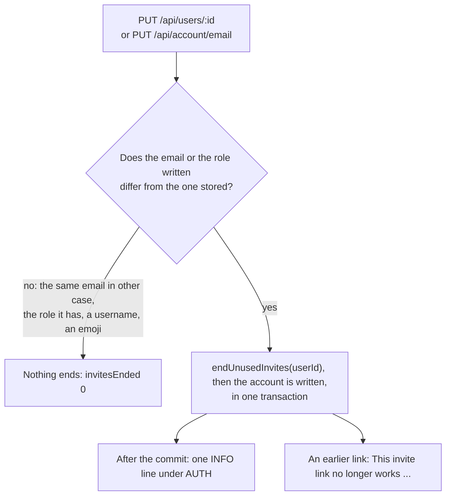

- **"Actually changes."** The value written differs from the one stored, an email compared in
  lower case, as it is stored. A change of username or emoji ends nothing, and no change ends
  a session or an API key: an email change is not a password change.
- **Both routes.** `PUT /api/users/:id` (an administrator, for an ordinary user; the
  superadmin, for an administrator too, and the only one who makes an account an
  administrator) and `PUT /api/account/email` (the account's holder, with their current
  password). The email route is now one transaction: the account read again, the password
  checked again if it changed meanwhile, the address checked as free, written, and the
  invites ended.
- **What is said.** `PUT /api/users/:id` answers `invitesEnded` beside the account's columns.
  When it is above 0 the admin page's toast after a role change reads "Role updated. The
  invite sent to this account earlier no longer works: send a new one with 📧." The Account
  page says nothing new: a user changing their own email has no use for an invite waiting for
  them. Whoever opens the old link is given the one dead-link answer, which names this reason.
- **The system log.** One `INFO` line under `AUTH` after the commit, when something changed:
  `User A changed the email address and role of user N — ended I unused invite(s)` (naming
  whichever of the two changed), or `User N changed their email address — ended I unused
  invite(s)`. No address is written.

Invites waiting at the update that brings migration 0054 were ended by it, whatever their
account: see [Every Unused Invite Ended Once](#every-unused-invite-ended-once-by-migration-0054).
Send again with 📧 the ones still wanted. Covered by `tests/atomic-accounts.test.ts`.

### Who May Manage Which Account

Four routes manage somebody's account: `PUT /api/users/:id/password` sets its password,
`POST /api/users/:id/invite` mails it a link that sets one, `PUT /api/users/:id` changes
its role, name, email or emoji, and `DELETE /api/users/:id` deletes it. All four ask one
guard, `requireManagedAccount()` in `src/lib/server/route-guards.ts`, inside the
transaction that writes, so they cannot differ. They used to ask each for itself: an
administrator could not delete another administrator and could set their password, and
could send any account an invite, the superadmin's and their own included. Whoever holds
an invite sets the account's password with it and is asked for no other, so an invite is
a password reset by another way and is asked what a reset is asked.

| The account is | An ordinary user | An administrator | The superadmin |
|----------------|------------------|------------------|----------------|
| An ordinary user's | ❌ | ✅ | ✅ |
| An administrator's | ❌ | ❌ | ✅ |
| The superadmin's | ❌ | ❌ | ❌ |
| Another superadmin's, were there one | ❌ | ❌ | ❌ |
| The caller's own, on the password route | ❌ | ❌ | ❌ |
| The caller's own, on the invite route | ❌ | ❌ | ❌ |
| The caller's own, on the delete route | ❌ | ❌ | ❌ |
| The caller's own, on the change route: `email` | ❌ | ❌ | ❌ |
| The caller's own, on the change route: `role` | ❌ | ❌ | ❌ |
| The caller's own, on the change route: `emoji`, `username` | ❌ | ✅ | ✅ |

Columns are who is calling. Every ❌ is a 403 with nothing written, but for the caller's
own account on the delete route, which is a 400.

The caller's own `email` is refused on the change route because that route asks for no
password, and an email is where an invite to set a new one is sent:
`PUT /api/account/email` asks for the password the caller has. Their own `role` is refused
there too, for sending one at all, the role they have included, and nothing else sent with
it is saved (card 2117, decision 13): `Your own role is not changed here: the superadmin can
change it`, or to the superadmin `The superadmin's role cannot be changed`. Their own `emoji` is
theirs to change with no password on the account routes too. No account route changes a
`username`, so the change route is the only way to one, the caller's own included.

**What a role may be.** `POST /api/users` and `PUT /api/users/:id` are the two routes that
write a role, and both take it through one function, `requireAssignableRole()` in
`src/lib/server/account-fields.ts`:

| `role` as sent | Answer |
|----------------|--------|
| not sent | the role is left as it is, or is `user` for a new account |
| exactly `"user"` | written |
| exactly `"admin"` | written for the superadmin; 403 for anyone else |
| `"superadmin"` | 400. Neither route makes a superadmin: the set-up page makes the one there is |
| anything else: `"Admin"`, `null`, a number, an array, an object | 400 |

The value that is checked is the value that is written. It used to be compared with
`'admin'` and `'superadmin'` and then bound as it was sent: `["superadmin"]` is neither
string, and the database driver binds an array of one as the one, so an administrator
could make anyone the superadmin, themselves included. The same function's companion,
`readAccountFields()`, answers 400 for a `username`, `email`, `password` or `emoji` that
was sent and is not a string, and then holds each to its rule, the same on both routes
(card 2117, decision 14): a username trimmed and of at least 2 characters, an email an
address with no space and none of `, ; < > " ( )`, and an emoji of 1 to 32 characters. A
username or an email another account has is a 409, `Username already taken` or
`Email already in use`, from `requireUnusedAccountFields()`, in the transaction that writes.
`PUT /api/users/:id` used to write both as they came, and a duplicate was a 500 from the
database. A value the account already holds, sent back unchanged, is kept.

Nobody's own role is changed on `PUT /api/users/:id`, the superadmin's included. A role
the caller sends for their own account is a 403, before it is read, whatever it is. Until
card 2117, the superadmin's was answered 200 and not written, and an administrator who sent
`user` for their own account gave the role up, with one request and no way back but the
superadmin. The superadmin's own role is nobody's to change; an administrator's is the
superadmin's to change, as anyone else's role is.

This is the rule of the four routes above. Restoring a backup (`POST /api/admin/import`)
replaces every account with the backup's, password hashes and roles included, and a reset
(`POST /api/admin/reset`) clears every account. Both were open to any administrator, who
could so get round it. They are the superadmin's alone now, with the other routes that
act on the whole installation: see [The Superadmin's Operations](#the-superadmins-operations).

There is one way to change your own password, and it is not an administrator's route:

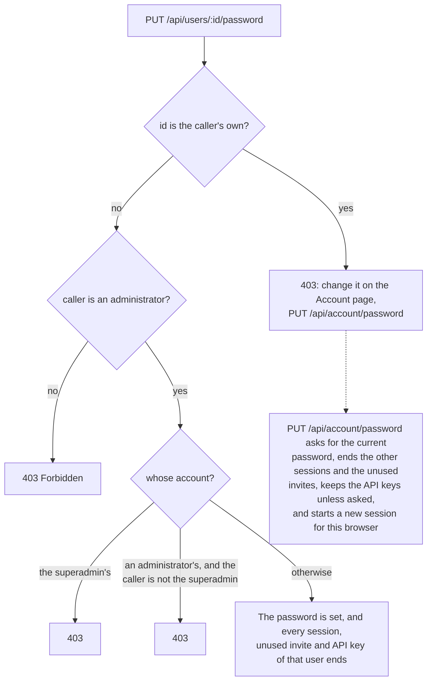

The admin page follows the same rule: on an administrator's own row the reset dialog asks
for the current password and sends it to `PUT /api/account/password`, with no
`endApiKeys`, so the keys, and the webhooks you set, are kept. The dialog says so: "Your API
keys and the webhooks you set up keep working. To end the keys and switch off those webhooks
too, change your password on the Account page."

### The Superadmin's Operations

Three routes act on the whole installation, and each of them is the user list by another
way. They ask one guard, `requireSuperadmin()` in `src/lib/server/route-guards.ts`:
`401` for a caller who is not signed in, and `403` with one message, "This belongs to the
superadmin. Exporting, importing and resetting the database can be used by the superadmin
account only", for everybody else who is not the superadmin, an administrator included.
The backup and mail settings were the superadmin's too until card 2395, and the message
named them; they are every administrator's now (the next section).

| Route | What an administrator could do with it |
|-------|----------------------------------------|
| `GET /api/admin/export` | Download every password hash and email and every webhook's address. It held every session id and unused invite token too, and until card 2169 the mail password, every backup destination's credentials and every webhook's signing secret. It carries a seal made with a key no backup holds, so that only this server fills its secrets back into it, unchanged |
| `POST /api/admin/import` | Replace every account with accounts of their own |
| `POST /api/admin/reset` | Clear every account, and be the superadmin of the installation they then set up |

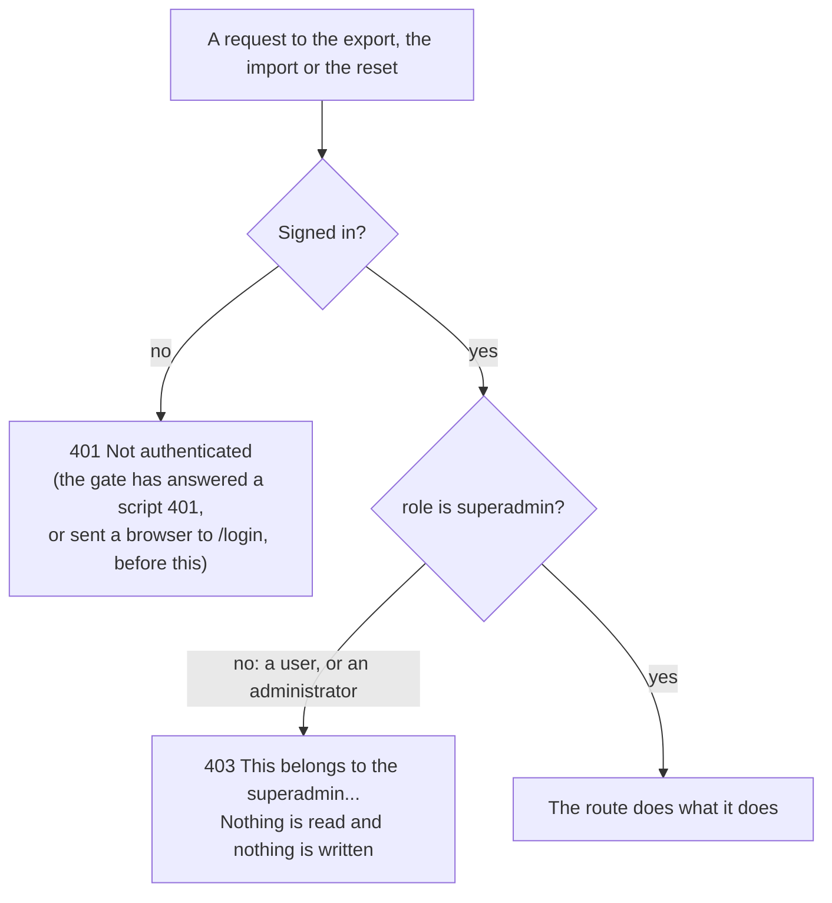

### The Mail and Backup Settings: Every Administrator's (Card 2395)

Since card 2395 (2026-10-21), at the owner's request ("Normal admins should be able to do
email and backup settings not just superadmins"), the four routes below ask `requireAdmin()`
in place of `requireSuperadmin()`: an administrator or the superadmin is let through, and
anybody else is answered `403 Forbidden`, as every other administrator route answers. A
request with no session that reaches one of these handlers is `403` too, where it was `401`;
the gate answers such a request `401` before any handler, so nobody on the wire sees it. Each
check is where it was, at the administrator level: before the body as a quick refusal,
inside the `writeAs` that saves, and on `stillCallerNow` before a backup, a Test, a code to
Google or a test mail leaves the process (card 2253). An administrator made a user while one
is on its way is refused there, with nothing saved and nothing sent. The secrets are masked
exactly as before for every reader, and nothing in them asks who the reader is.

| Who | The mail settings, the App URL, Send Test | The backup settings, Run Now, Test, Connect | Export, import, Reset Everything |
|-----|------|------|------|
| An ordinary user | ❌ `403 Forbidden` | ❌ `403 Forbidden` | ❌ `403 This belongs to the superadmin…` |
| An administrator | ✅ (❌ before card 2395) | ✅ (❌ before card 2395) | ❌ `403 This belongs to the superadmin…` |
| The superadmin | ✅ | ✅ | ✅ |

**Owner to know.** These were the superadmin's because each is the user list by another way,
and that is still so:

- **An administrator who sets a backup destination can receive a full copy of the
  database**: every account's password hash and email address, every board, card and
  comment, and every webhook's address. The copy is cleared of sessions, unused invites, the
  mail password, destination credentials and webhook secrets (card 2169), not of the hashes.
  They can add a destination of their own and press Run Now, or wait for the schedule.
- **An administrator who sets the mail server sees every mail the app sends**, invite links
  and password-reset links included, the superadmin's among them: whoever reads such a link
  sets that account's password. The App URL is saved by the same route and decides where
  every link in a mail points. Since card 2396 each save that changes the mail settings or
  the App URL is one line under `SMTP` naming who, with the old and new values (the user
  name and the password as `user changed` and `password changed` alone), always a `WARN`. It
  is logged, not prevented.
- So an administrator can make themselves any account, the superadmin included, which the
  rule "only the superadmin manages an administrator" (above) otherwise prevents.
- **The stored secrets stay where they were saved.** An administrator cannot read the stored
  mail password or a destination's stored secret, and cannot send one elsewhere: a save or a
  Test that points a masked secret at another host, port, user, bucket, folder or path is
  refused (cards 2187, 2190, 2250). They can type new ones of their own. Two exceptions: an
  administrator may confirm a host key for an SFTP destination that has a stored password but
  no confirmed key yet (a key added where none is stored does not differ, `differences` in
  `backup-secrets.ts`), and the stored password then goes to whichever server shows that key;
  and Connect on an existing Google Drive OAuth destination binds it to the connecting
  person's Google account, using the stored client id and secret (one line under `BACKUP`, a
  `WARN` where it replaces a connection the destination had; card 2273).
- **An administrator could leave nothing to restore from; since card 2398 (2026-10-22) the
  history wipe is guarded.** Lowering Keep Last (its least is 1) and pressing Run Now deletes
  every older copy at every destination once the new one is up (`cleanupRetention` in
  `backup.ts`); removing the destinations or switching the schedule off stops the copies. Each
  such save was a `WARN` line under `BACKUP` naming who (card 2270), logged and not prevented.
  Now `PUT /api/admin/backup` refuses all three to anyone but the superadmin: see
  [Fewer Copies Are the Superadmin's](#fewer-copies-are-the-superadmins-card-2398). One way
  round is left: Run Now pressed Keep Last times pushes every older copy out (nearby fault in
  `docs/planning/cards-2397-2398.md`).
- **An administrator can probe the inside of the network.** The SMTP host, an SFTP host and an
  S3 endpoint may be any address, inside the network included (loopback, the Docker host, the
  internal ranges, `169.254.169.254`), and the answers of Send Test and Test tell whether a
  port answered: a simple internal port scan. Webhooks refuse addresses inside the network
  (card 2161, below); these settings do not, since real setups use a NAS or a mail relay on
  the LAN.

**A setter who is demoted (the card 2395 ruling, replaced by card 2397 on 2026-10-22).** Card
2395 ruled that the settings record nobody as having set them, so that settings an
administrator saved stayed in force when that administrator was demoted or deleted. That is
no longer so: `setting_setters` (migration 0059) records who moved the mail settings, set the
App URL, and added or moved each destination to where it is now (a setting changed and changed
back is its first setter's again), and demoting that account to user, or deleting it, removes
what it set in the same transaction. See
[Settings Go With Their Setter](#settings-go-with-their-setter-card-2397). Settings saved
before 0059 record nobody and still stay in force. Each backup
settings change, Connect and Test is in the system log under the account that made it (cards
2267, 2270, 2273), and so, since card 2396, is each mail settings or App URL change, as well
as the `WARN` of the "Allow mail without a checked, encrypted connection" box (card 2189).

| Route | What whoever holds it can do with it |
|-------|----------------------------------------|
| `GET`, `PUT`, `POST /api/admin/backup` | Add a destination of their own and have the whole database sent to it. The `GET` masks every secret field of every destination (card 2187; it answered a Google Drive refresh token as stored), and a `PUT` keeps a masked secret only for the one stored destination that is the same in type, name and every setting that is not secret (card 2190; it was taken by the destination's place in the list), and, for SFTP, whose confirmed host key it keeps or adds where none was stored (card 2250; below): a key added is saved, and shown on the destination. Each SFTP host key a `PUT` adds, changes, clears or removes with its destination is one `WARN` line under `BACKUP`, filed under the saving account, written only once the save is committed (card 2267); as a `WARN`, it is not written with `LOG_LEVEL` at `ERROR` (the default is `INFO`). Every `PUT` that changes anything is also one line under `BACKUP`, before those, filed under the saving account and written only once committed (card 2270): `Backup settings changed: …`, naming the settings changed with their values (`notifyEmail` by name alone), each destination added or removed by name and type, and each changed one by the names of its fields, never a value, so a destination of one's own added, or the copies stopped, is on record under the account. It is a `WARN` where the save leaves fewer copies or sends them elsewhere: a destination removed, a destination kept but pointed at another account or place (a field of `SAME_IN`'s rule changed), less time covered by the copies kept (the retention times the schedule's interval: the schedule switched off or made more frequent), or the retention lowered; an `INFO` otherwise (not kept at `LOG_LEVEL=WARN`). A `"` or `\` in a destination's name is escaped in it and in card 2267's lines, so a name cannot make the line read as something else; a save that changes nothing writes none |
| `POST /api/admin/backup/test` | Have a stored destination's password sent to a host of their choosing, which until card 2190 a test whose secrets were masked did: it connected with the stored ones whatever host it named. Now a masked secret is used only for an unchanged destination, by the `PUT`'s rule, and any other is refused `400` before anything connects; for SFTP its host key must be the stored one exactly, none for none, since a Test that could add one would send the stored password to the key it named (the card 2250 review's M1). An SFTP Test with no host key confirmed sends no secret at all and answers the key presented (`hostKey`); one with a key refuses any other before a credential is sent, answering both keys (card 2250; below) |
| `GET`, `POST /api/admin/backup/gdrive/auth` | Connect a Google Drive of their own as a destination. Connect asks Google for `drive.file`, DumpFire's own files, where it asked for the whole of Drive (card 2188). The `POST` takes a code only with the state the same session's `GET` put in the consent address, once and within ten minutes, and exchanges it with that Connect's PKCE verifier (card 2251; below). A Connect saved is one line under `BACKUP`, filed under the connecting account and written only once the write is committed (card 2273): `Google Drive destination "…" connected: scope narrow (drive.file); a folder made` (or `scope wide`, `scope none named (read as wide)`; `its folder reached`), never the token, code, state, verifier or folder id; an `INFO` for a destination's first connection and a `WARN`, `… connected again, replacing the connection it had: …`, where the destination held a refresh token, since the new one may be another Google account's. A Connect refused or not saved writes none |
| `GET`, `PUT`, `POST /api/admin/smtp` | Point mail at a server of their own and the App URL at a host of their own, and read an invite meant for somebody else. A `PUT` keeps a masked or missing mail password only while the host, port, user name and "Allow mail without a checked, encrypted connection" are as stored, and turning that setting on or off from the panel needs the password typed and writes a `WARN` line naming who (cards 2190 and 2189), so a session in the wrong hands cannot send the stored password elsewhere, or lower its protection, without knowing it. The host is compared trimmed of ASCII spaces and tabs, ASCII letters in any case, and stored as it was saved while the password is kept, so the host compared is the host connected to (the review-fix pass's S1). A restore also brings the setting in, with the backup's other mail settings and with neither: it keeps this server's password only where the setting is this server's, and its "To enter again" line names the box where it differs (S5). Every `PUT` that changes a mail setting or the App URL, as a mail reads them, is one line under `SMTP`, filed under the saving account and written only once committed (card 2396): `Mail settings changed: …`, each setting with its old and new values, text quoted with `"` and `\` escaped, the user name and the password as `user changed` and `password changed` and never a value (some providers take the API token as both), then `(set by "<username>")`, quoted as the values are. Always a `WARN`, so it is kept at `LOG_LEVEL=WARN`; a save that changes nothing, or is refused, writes none |

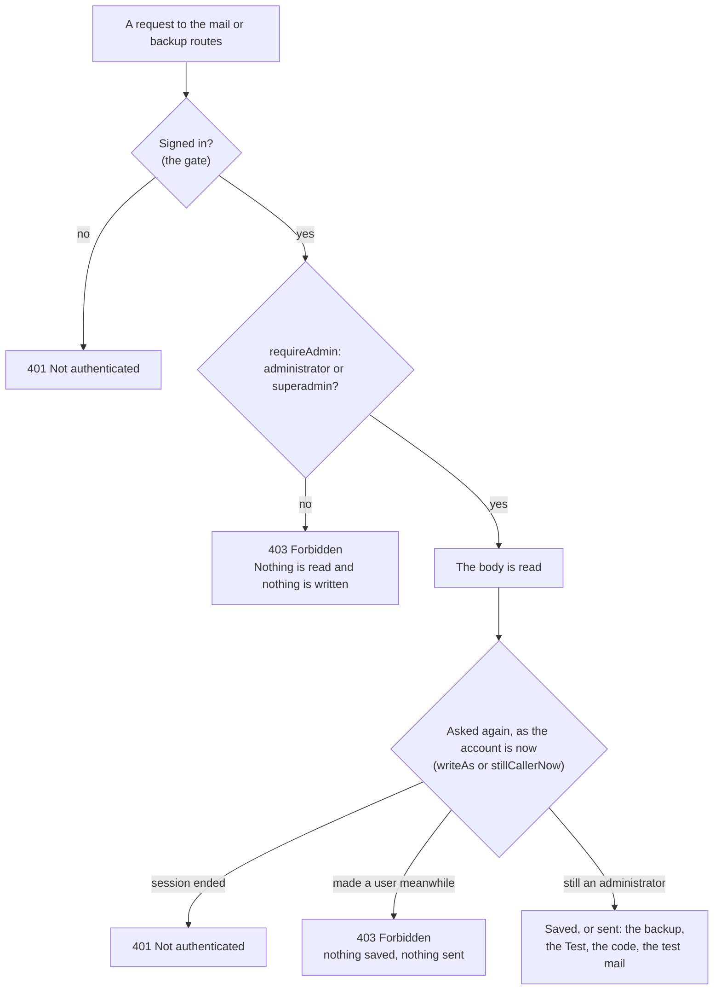

What else is any administrator's: `POST /api/admin/vacuum`, `purge-archived`, `reset-xp`,
`boards/[id]/clear-cards` and `clear-categories`, `GET /api/logs`, `/api/audit`, and the
user and team routes.

- **`superadmin` is written in one place.** Set-up makes the one there is. No route
  assigns the role, and nobody else can set the superadmin's password, so an installation
  whose superadmin cannot sign in has no page that puts it right. Three things stand
  against that. An import refuses a backup that has users and no superadmin among them,
  before anything is written. The server writes a `CRITICAL` line at every start while
  there are users and no superadmin. And the role can be given from the host: see
  [If Nobody Can Sign In as the Superadmin](deployment.md#if-nobody-can-sign-in-as-the-superadmin).
- **The admin page shows an administrator neither the export, the import nor Reset
  Everything**, and asks the server for none of them. In place of Backup & Restore is one
  section that names the superadmin. It shows every administrator the App URL, Scheduled
  Backups and Email / SMTP since card 2395 (it showed them to the superadmin alone), and
  each reads its settings as it opens.
- **A Google Drive Connect is finished only by the session that started it** (card 2251).
  The `POST` exchanged any code it was sent, with the destination's name as the OAuth
  `state` and no check of it, so a superadmin led to paste a code or address from somebody
  else's consent connected that person's Google account, and with the Folder ID empty every
  later backup went to it. Now each `GET` makes a `state` of 32 random bytes and a PKCE
  `code_verifier`, held in memory (`src/lib/server/gdrive-connect.ts`) for ten minutes and
  bound to the SHA-256 of the session's token, the account and the destination; the consent
  address carries the state and `code_challenge` (S256), and is answered `Cache-Control:
  no-store`. The `POST` must send the state back: it is removed the first time it is
  presented, whatever follows, and a missing, unknown, expired or used one, or one another
  session, account or destination started, is `400` in one sentence ("This connection was
  not started from this session, or has expired or been used. …"), never saying which,
  with nothing exchanged or written and one `WARN` line, filed under the account, whose meta
  `stateSent` tells a `POST` with no state from one whose state failed. The code goes to
  Google with the verifier, and Google refuses a code issued for another challenge. The
  state and the challenge both sit in the consent address, so whoever holds that address
  can finish the Connect it started: an address somebody else sends cannot connect their
  account unless they also had the consent address this session's Connect opened. The page
  reads the code and the state from the whole address pasted and sends nothing for a bare
  code. One Connect per session and destination, 20 at most; a restart ends those under
  way. A connection already made is not checked again.

  ```mermaid
  sequenceDiagram
      participant S as An administrator's session
      participant D as DumpFire
      participant X as Somebody else
      participant G as Google
      S->>D: GET gdrive/auth: state s1 and verifier v1 kept, bound to this session
      X->>G: consents with their own account (state x, or none)
      X-->>S: "paste this address": code c2 with state x
      S->>D: POST code c2, state x
      D-->>S: 400, x is not a state this session started; nothing sent to Google
  ```

- **The Connect `GET` can be reached from another site** (card 2251). A cross-site
  navigation to it (the session cookie goes with it) replaces this session's pending
  Connect for each destination name it names, and fills slots under the shared cap of 20,
  pushing out other sessions' pending Connects. That is denial of service only: the other
  site never sees a state or the consent address, so it cannot finish a Connect; the
  administrator presses Connect again.
- **Not prevented here: an administrator who connects someone else's Drive on purpose**
  (card 2251; the superadmin alone could Connect until card 2395). An administrator who gets
  someone else to approve their consent address and paste back the result connects that
  person's Drive. The server cannot see which Google account approved (`drive.file`
  returns no identity), so it cannot refuse it. It is limited: `drive.file` reaches only the
  files DumpFire makes, and any administrator can already edit every destination. It is on record: every Connect saved writes a line under
  `BACKUP` filed under the account that connected (card 2273), a `WARN` where it replaced the
  connection the destination had, so a destination re-pointed at another account this way
  shows when and by whom, though not which account.
- **An SFTP destination connects only to the host key it was confirmed with** (card 2250).
  `SftpDestination` connected with no `hostVerifier`, and ssh2 accepts any host key without
  one, so whatever answered for the host on the network path (the LAN, the ISP, a DNS answer
  for its name) received the password, or a signature made with the private key, in
  `ssh-userauth`, and then the backup. Now each SFTP destination holds `hostKey`, `<type>
  SHA256:<43>` (`src/lib/server/ssh-host-key.ts`), and every connect but a Test's first look
  goes through `getConnectConfig()`, which adds a `hostVerifier` comparing the SHA-256
  fingerprint of the key the server presents with the stored one and pins
  `algorithms.serverHostKey` to its type. ssh2 asks the verifier inside the key exchange and
  authenticates only after the handshake completes, so a key refused is refused before any
  credential is sent (`HostKeyMismatch`), and a server that no longer offers a key of the
  pinned type ends the negotiation before any key is presented (`HostKeyTypeNotOffered`).
  ssh2 checks the server's signature over the exchange after the verifier said yes, so a
  replay of the real server's public key by something without its private key ends there,
  still before any credential, and is named (`HostKeySignatureFailed`, "SFTP host key
  refused: the server at H:P showed the confirmed key but could not prove it holds it —
  something on the network may be answering for it. Nothing was sent.", one `[ERROR]
  [BACKUP] SFTP host key signature failed …` line naming the confirmed fingerprint; the
  card 2250 review's S4). An `ssh-keygen -l` line for an RSA key of fewer than 1,024 bits is
  refused as a key that does not read (S5).
  With no key stored, `getConnectConfig()` throws `HostKeyNotConfirmed` and opens nothing, so
  an upload, a listing or a delete cannot reach an unconfirmed host however it is called, and
  `runBackup` does not try such a destination (`hostKeyMissing()`). A Test with no key stored
  makes the one connect without it: a configuration of its own with no password, private key
  or passphrase, and a verifier that records the key and answers `false`, so the connection
  ends in the key exchange and the key is shown to be confirmed (`hostKey` in the answer).
  Confirming saves exactly the text shown, by the ordinary `PUT`, never what the server
  presents at the moment of saving. The key is no secret (`maskDestination` shows it, a backup
  holds it), but it decides where the secret may go, so the save-and-test rule of card 2190
  compares it as a narrowing on a save: a key added where none was stored keeps a masked
  secret; one changed, emptied or left out of the entry sent is refused `400`, naming "host
  key". A Test compares it exactly (`keepMaskedSecrets(…, 'test')`): with a secret masked, its
  key must be the stored one, none where none is stored, or it is refused `400` the same way
  and nothing connects (the card 2250 review's M1), so only a save, whose key the page then
  shows, can add one. A restore never takes one from a backup (below).

  ```mermaid
  sequenceDiagram
      participant D as DumpFire
      participant M as Something on the path
      participant S as The SFTP server
      D->>M: connect to nas.example:22 (hostKey confirmed: SHA256:OLD)
      M-->>D: presents its own key SHA256:NEW in the key exchange
      Note over D: hostVerifier: SHA256:NEW is not SHA256:OLD, answers false
      D--xM: "Host denied", the connection ends before ssh-userauth
      Note over D: no password or key sent; the Test, the run<br/>and one ERROR line name both keys
  ```

- **Not prevented: the first look, and a confirmation not checked** (card 2250). The Test
  that shows a key trusts nothing, and Confirm saves what the superadmin was shown; whether
  it is the server's own key is known only by comparing it on the server (`ssh-keygen -lf`),
  which the page and the guides ask for every time. Until a destination's key is confirmed,
  someone who holds the superadmin's session and is also on the network path can press Test,
  be shown their own key and press Confirm, which saves that key, a key added where none was
  keeping the masked password, and tests again at once, so the password goes to them
  there and then. The comparison on the server has to come before Confirm, not after. A save
  writes one `[WARN] [BACKUP] SFTP host key of destination "…" at host:22 added: …` line
  (`changed from … to …`, `cleared: was …`, `removed with the destination: was …`) per key
  it adds, changes, clears or removes, filed under the account that saved it, with the meta
  `{ destination, from, to }` (card 2267), the old key followed by `(at oldhost:22)` and the
  meta by `fromAt` where the same save moved the destination: so a key confirmed this way and
  the real key put back afterwards leave both changes on record, under the account that saved
  them, though the password has gone by then (the line is a `WARN`, so it is not written with
  `LOG_LEVEL` at `ERROR`; the default is `INFO`). The same save's `Backup settings changed: …`
  line names `hostKey` among the destination's changed fields (card 2270), without the key. A Test cannot send it on its own: one that
  names a key with the password masked is refused unless it is the stored key (the card
  2250 review's M1). That is no worse than before
  card 2250, when the password went to whoever answered with neither step, and it closes for
  each destination once its key is confirmed; the deployment guide makes confirming every SFTP
  destination the first step after the deploy. A database put in place by hand keeps whatever
  keys the file holds: nothing reads it on the way in.

Covered by the `superadmin` kind in `tests/access-every-route.test.ts`, which has an entry
for every one of these routes, and by `tests/backups.test.ts`.

### Fewer Copies Are the Superadmin's (Card 2398)

Since card 2398 (2026-10-22, the owner's ruling), a save of the backup settings that leaves
fewer copies to restore from is the superadmin's alone. `PUT /api/admin/backup` reads the save
as it does any other, then, inside the `writeAs` that writes and before anything is written or
queued, asks the account as it is now (card 2253): where the save lowers the retention (Keep
Last), removes a destination, or switches the schedule off, and that account is not the
superadmin, it is `403`, nothing is written and no line is logged.

| The save | An administrator | The superadmin |
|----------|------------------|----------------|
| Keep Last lowered | ❌ `403` | ✅ |
| A destination removed: by card 2270's matching of name and type, so a rename, or another type under the name, is the old one removed | ❌ `403` | ✅ |
| The schedule switched off (`disabled` where it ran) | ❌ `403` (the owner's recommendation, taken) | ✅ |
| Keep Last raised, a schedule that runs changed for another (more frequent included), a destination added or edited in place (another host or bucket included, its secret typed again), the failure mail | ✅ | ✅ |
| Run Now, Test, Connect | ✅ (unchanged) | ✅ |

The words name what the save would do: `Lowering Keep Last, removing a destination or
switching the schedule off needs the superadmin. This save would lower Keep Last from 7 to 1,
and remove the destination "NAS" (a destination renamed, or saved as another type, is the old
one removed), and switch the schedule off.` (each part only where it applies). The check
before the body stays `requireAdmin`, as the body is not known then; a superadmin made an
administrator from the host while the body arrives is refused as an administrator is, and an
administrator made a user is refused `Forbidden` by the administrator check first.
`ScheduledBackupsPanel.svelte` shows an administrator 🗑️ and the schedule's
`Disabled (superadmin only)` `aria-disabled` (not `disabled`, which would drop the focus), each
saying the rule when chosen and sending nothing, Keep Last with the stored number as its least
(a lower one put back), and one line under the schedule; the superadmin's panel is unchanged.
Removing destinations when their setter is demoted or deleted (card 2397, below) is not a save
and is not refused.

**Owner to know.** Run Now pressed Keep Last times still pushes every older copy out, as each
run adds a copy and the retention keeps a number of copies, not an age; a schedule made more
frequent does the same over time. Each Run Now is in the backup history and each schedule
change a line under `BACKUP`.

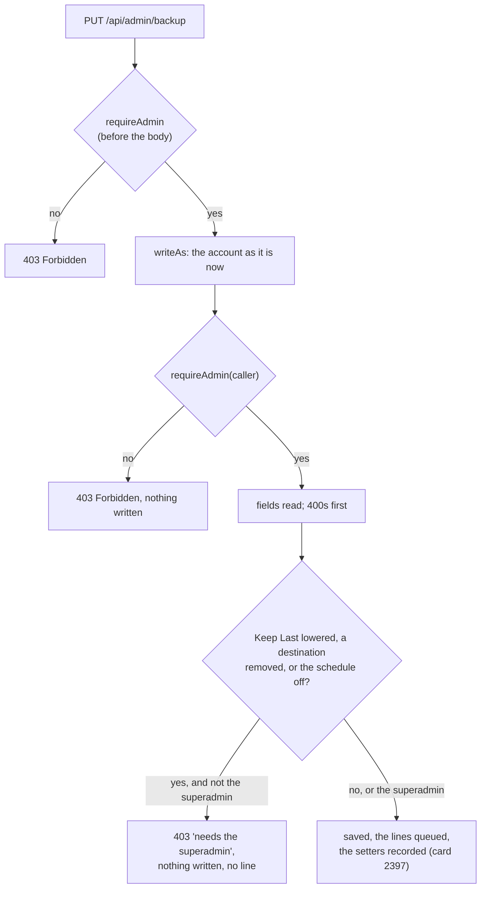

Covered by `tests/setting-setters.test.ts` and `tests/admin-panels.test.ts`.

### Settings Go With Their Setter (Card 2397)

Since card 2397 (2026-10-22, the owner's ruling), the settings that send mail or backups
somewhere are removed when the account that set them where they are stops being an
administrator. `setting_setters` (migration 0059; see [Data Model](data-model.md)) holds, for
each setting, a row for each place it has been put, naming the account that put it there, or
nobody (`user_id` NULL). Its key is the setting and the place; the place is a SHA-256 digest of what decides
where the setting sends, so no host, user name or key ID is copied into the table:

| Setting | What it names | Its place | Written by |
|---------|---------------|-----------|------------|
| `mail` | every `smtp_*` row of `settings`, as one (the password goes with its host) | the host, port, user and `allowInsecure`, as a mail reads them | a `PUT /api/admin/smtp` that moves them to a place nobody is recorded for |
| `app_url` | the App URL | the App URL row, as a link reads it; recorded only for an address | a `PUT /api/admin/smtp` that sets it to an address nobody is recorded for |
| `backup_destination:<name>` | the destination of that name in `backup_config` | its type and every field `SAME_IN` compares but the name, as each is used, and a service account's `client_email` and `private_key_id` (`destinationPlace()`: card 2270's `elsewhere` rule) | a `PUT /api/admin/backup` that adds it, or moves it to a place nobody is recorded for (a removed one loses every row), and a Google Drive Connect saved, which makes the connecting account the setter at its place whoever was |

A setting's setter is **the account recorded for the place it is at now**. A save that moves it
to a place nobody is recorded for makes the saver its setter there, as card 2168 has the last to
change a webhook; one that moves it back to a recorded place leaves it that account's (the
second code review, 2026-10-22: an administrator who changed a passwordless relay's port and
changed it back, a keyless S3 destination's prefix, or the App URL, became the setter of the
superadmin's own settings with no secret to type, and their demotion removed them). Only a
move counts (the first review): the sender's name or address, a password or secret typed again
for the same server or place, an App URL cleared, and an SFTP host key confirmed record
nobody, and a save that changes nothing records nothing. A superadmin who moves the mail to a
new place (another port, say) takes it over. The third code review (2026-10-22) added three
rules. **A move by the superadmin, or one made with a password or secret typed** (the mail
password typed, or a destination's secret typed rather than sent back masked, `typedSecret()`),
**is the saver's whoever was recorded for the place it moves to**: otherwise an administrator
who visited a place first (port 465 with a garbage password, then back) kept it, and the
superadmin's later move there with the real password stayed theirs, to be removed on their
demotion. A move with no secret typed keeps the change-and-back protection. **Each account
keeps one row per setting**, its latest place (`claim()` drops its others), so the table grows
with the accounts and not with every save. **The place a setting saved before 0059 leaves when
first moved is recorded as nobody's** (`user_id` NULL), so changed and changed back it is
nobody's again; a row naming nobody is never held, by the removal or by `settingsHeldBy()`. Demoting an account to user (`PUT
/api/users/:id`; only the superadmin lowers an administrator) or deleting it (`deleteUser`)
calls `removeSettingsSetBy` in the same transaction, which takes each setting still at a place
the account's rows record: every `smtp_*` row for the mail (no mail is sent, invites and
password resets included, until an administrator sets it up again), the `app_url` row (links
use `APP_URL`, or else `ORIGIN`; an App URL cleared since is at no recorded place and stays),
each such destination, out of `backup_config` with its stored secrets; then every row of each
setting removed, whoever's, and every row of the account. A setting moved since to somebody
else's place, or to one nobody is recorded for, stays. Just before either is sent, the users
panel reads what the account holds now from `GET /api/users/:id` (`settingsHeldBy(id)`, read
as the removal reads it; by the admin page's rule of the counts, null for the caller's own
account and any the caller may not manage), so a setting another administrator took over, or
gave back, after the page loaded is asked about as it is (the second review); the delete's
confirmation adds it, and a role change to User for such an account asks first in the page's
confirm dialog. Where that read fails, both ask all the same, saying that whatever of those
settings is still theirs goes too. Once committed, one `WARN` under
`SMTP` (`The mail settings and the App URL removed: saved by "ann", who was made a user by
"chief". …`) and one under `BACKUP` (`Backup destination "NAS" (sftp) removed: saved by "ann",
… Its stored secrets went with it; the copies already there are kept.`), filed under the
account that made the change. The answer carries `settingsRemoved: { mail, appUrl,
destinations }` only where something went, and the admin page says so in a warning toast that
stays until closed (⚠️; said politely through the toast's `role="status"` region, which is
always on the page, while a warning that goes by itself, such as the board's WIP-limit one, is
still an alert) and draws again only the panels that show what went:
the App URL and mail panels for the mail settings or the App URL, Scheduled Backups for a
destination. A failure anywhere rolls back the role change or the delete with every removal,
and logs nothing.

- **A backup already running is not stopped.** A run reads the destinations, with their
  secrets, as it starts (`runBackup`): one under way when the account is demoted or deleted
  finishes its uploads to the destinations it read, the removed one included, and records them
  in the history. The next run, scheduled or **▶ Run Now**, no longer has it. A mail already
  handed to the mail server is likewise sent.

- **The superadmin**: the same rule. Their role is changed only from the host, to `admin`,
  which keeps an administrator's rights, so nothing is removed then; lowered to user
  afterwards on the admin page, what they set goes.
- **Settings from before 0059** are at a place nobody is recorded for, and stay in force,
  unattributed, whoever is demoted; the first save that moves one makes its saver the setter
  and records the place it left as nobody's, so moving it back makes it nobody's again (unless
  the superadmin moves it, or a secret is typed with the move). A restore of a backup from before 0059 leaves
  every setting it brings unattributed; a backup from after it brings its setter rows.
- **The host is outside the code.** A role written to `user`, or an account deleted, with
  `node -e` from the host leaves the settings in force; for a delete the key
  (`ON DELETE CASCADE`) then takes the setter rows, and the settings are unattributed.

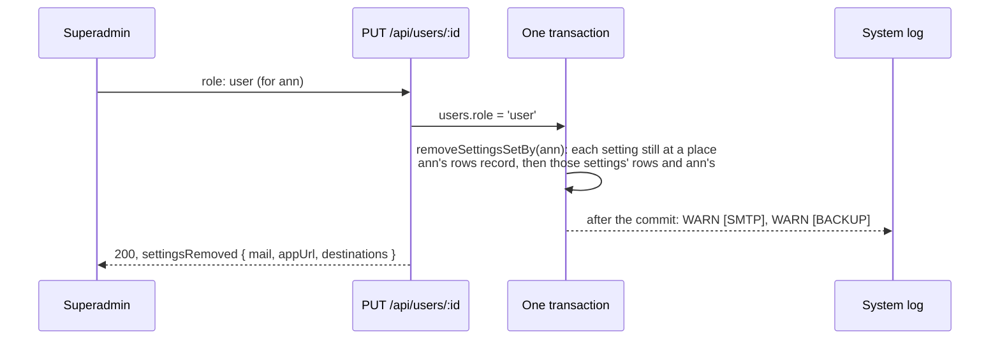

Covered by `tests/setting-setters.test.ts`, `tests/migrations.test.ts` (0059 and a restore of a
backup from before it) and `tests/admin-panels.test.ts`.

### What a Backup Holds, and What a Restore Brings In

A session's id is the whole of what its cookie carries, and an unused invite's token sets
its account's password. A backup that held them signed in whoever read it, as anybody who
was signed in when it was made, for as long as that session went on being used: a
session's expiry moves on every time it is used.

| | Sessions | Invites not yet used | Request links | The request form's key | Password hashes |
|---|----------|----------------------|---------------|------------------------|-----------------|
| The file an export downloads | none | none | none: every request is there, with no link | none | all |
| The copy a scheduled backup, or "Run Now", uploads | none | none | none | none | all |
| The running database, after a backup | as they were | as they were | as they were | as it was | as they were |
| The running database, after a restore of any backup | none: everybody is signed out | none: of the backup's invites, only those already used come in | every request given a new one: every link mailed before stops working | none: a new one is made at first use | the backup's |

- **One function makes both copies**, `generateBackupData()` in `src/lib/server/backup.ts`:
  the copy is made with `VACUUM INTO`, opened with no journal, cleared of every session and
  every invite with `used = 0`, every request's link set to `NULL` and the form's key
  deleted, its system log masked, every secret taken out (below), **written out again** with a second `VACUUM INTO`, and
  only that second file is read.
- **The system log is masked too.** An invite's token is the last part of its address, and
  the gate wrote that address down for every request to it, where any administrator could
  read it from `GET /api/logs`. The gate now writes `/invite/[token]` in its place (only the
  path is ever written, never the query, so a request link's `?token=` is not written down
  at all), and a backup masks the same in every line the log already held, and replaces the
  token of any unused invite wherever else a line holds it. A line that holds a request
  link's `token=` all the same, written some other way, has that masked too, and an old
  failed sign-in line at a name that was no account loses the name typed (see
  [What a Failed Sign-in Writes](#what-a-failed-sign-in-writes)). **The running
  database's log is masked by the same rule at every start** (`maskLiveLog()` in
  `src/lib/server/startup-checks.ts`, after the migrations; `maskSecretsInLog()` in
  `src/lib/server/secret-paths.ts` is the one rule for both), so an installation that ran
  the older gate has the tokens gone from `GET /api/logs` at its first start on this
  version. A later start finds nothing to change. A failure is logged at `WARN` and the
  server starts all the same.
- **Deleting the rows is not enough.** The pages they were on stay in the file until it is
  written again: after a plain `DELETE` of 400 sessions the count was 0 and their ids were
  in the file 925 times. The test looks for a known session id and a known invite token in
  the bytes of the file, and does not count rows.
- **A restore brings in neither, whatever the backup's age** (`rowsToRestore()` in
  `src/lib/server/db/restore.ts`). Without that, every backup made before this would bring
  its sessions back as live ones. So an import signs everybody out, whoever started it
  included: its answer says so, names the superadmin the restored data has, and takes the
  caller's cookie away.
- **A restore never commits users and no superadmin.** The import refuses a backup that has
  users and no superadmin before it starts, and the restore asks again of the rows it has
  restored, before it commits: a superadmin's row that could not be copied rolls the whole
  restore back, and nothing is changed.
- **Password hashes stay.** A backup that cannot restore its users is not a backup. It is
  still a file to keep where few can read it.
- **No request's link, and not the form's key** (card 2158). A request's link
  (`task_requests.access_token`) lets whoever holds it read every message of that request's
  thread, the ones written after the copy was made included, reply as the requester and
  confirm it, and it never expires. `withoutSecrets()` sets every one to `NULL` in the copy
  (the unique index on the column takes any number of NULLs) and deletes the key the public
  request form signs its tokens with (`request_form_secret` in `settings`), which lets
  nobody do more than opening the form does but is a secret all the same.
- **A restore gives every request a new link, whatever the backup's age**, inside its
  transaction, once the rows are copied: a backup made before card 2158 holds every link as
  it was mailed, and one made since holds none. A request's link is not kept even where the
  database being replaced has the same request id: a backup of another installation, whose
  request 5 is somebody else's, would give one requester's link to another person's thread.
  So after any restore every request link mailed before it stops working, and its requester
  asks for the current one from the page it opens. The import's answer and log line say
  "N request link(s) replaced: a link mailed before this restore no longer works, and its
  requester can have a new one sent from the page it opens." (`requestLinksReplaced` in its
  figures), when there were any. A restore that rolls back leaves every link as it was.
  `rowsToRestore()` never brings the form's key in; the restored server makes a new one at
  first use, and a form open during the restore fails once and is reloaded. A backup with no
  links restored by an image from before this change, or put in place by hand as the
  database file, has them filled in by the start's backfill.
- **What a backup still holds that is worth guarding** (card 2169, decision 3). Every user's
  password hash and email, API keys as hashes, the mail server and its user name, each
  backup destination's fields other than its secrets, the system log (masked, above), and
  **every webhook's address**. An address can itself be a key: a Slack or Teams incoming
  webhook's address is all anyone needs to post to that channel. It is kept, because a
  webhook restored without its address could not be put back by anybody who did not know
  it. If a copy may have been read by somebody who should not have, re-issue any
  incoming-webhook address at its service. A backup is still to be kept where few can read
  it.
- **The key remembered browsers are signed with is in no backup** (`known_browser_secret` in
  `settings`, card 2194): `withoutSecrets()` deletes its row from every copy, and
  `rowsToRestore()` never brings it in, from a backup of any age, while the restore clears
  the live one. Whoever held it and an account's hash, which a backup does hold, could make a
  cookie that lets a browser past sign-in's throttling for that account. So a restore forgets
  every remembered browser, as it signs everybody out, and the restored server makes a new
  key. See [Browsers That Have Signed In Before](#browsers-that-have-signed-in-before).
- **Copies made before this.** Copies made before card 2135, at a destination or
  downloaded, still hold the session ids of whoever was signed in then. Migration 0053 ends
  every session once, on the update that brings it, so those ids sign nobody in from then on:
  see [Every Session Ended Once](#every-session-ended-once-by-migration-0053). They also hold
  the invites not yet used on their day, which 0053 does not end and migration 0054 does,
  once, on the update that brings it: see
  [Every Unused Invite Ended Once](#every-unused-invite-ended-once-by-migration-0054). And they
  hold every request's link as it was mailed, which migration 0055 replaces, once: see
  [Every Request Link Replaced Once](#every-request-link-replaced-once-by-migration-0055). And
  they hold the mail password, every destination's credentials and every webhook's signing
  secret (card 2169). Nothing can reach a copy at a destination or a downloaded export, so
  nothing is done to them: they go as each destination's retention removes them, the oldest
  first at each successful run. If one of them may have been read by somebody who should not
  have, change the mail password and each destination's credentials at their services and
  enter them again, and set new webhook secrets with their receivers. They carry no seal
  either (below): Import Backup of one fills nothing from this server, which changes nothing,
  since they hold their own secrets. The safety
  copy an import writes before it replaces anything (`.pre-restore-safety.json`, in the
  server's working directory, which in the image is `/app`: inside the container's own
  storage, off the volume, never read back by the server and never sent anywhere) holds every
  table as it was, sessions, secrets and the seal's key included, and is not deleted; it leaves out only the key remembered browsers are signed with, as a
  backup does, since the restore forgets that key anyway: see [How Large an Import Can Be](deployment.md#how-large-an-import-can-be).

#### The Secrets a Backup Does Not Hold (card 2169)

A backup held the mail password, every backup destination's credentials and every
webhook's signing secret. Whoever read one copy could send mail as the server's mail
account, read, replace or delete the copies at every destination (a replaced copy, restored
later, hands them the superadmin), reach the whole Google Drive of the account that
connected a Drive destination, and sign forged deliveries to every webhook's receiver. A
backup now holds none of them, and a restore keeps this server's own where they are for the
same account, and only into a backup this server made and nobody has changed since: every
backup is sealed with a key this server keeps and no backup holds (the review's S1).

| | The mail password | A backup destination's credentials | A webhook's signing secret |
|---|---|---|---|
| The file an export downloads, and the copy a scheduled backup or "Run Now" uploads | none: its row is deleted | none: each secret field `''`, every other field kept | none: `''`, and a webhook that had one is switched off and listed in `webhook_secrets_left_out` with whether it was on |
| The running database, after a backup | as it was | as they were | as they were |
| After Import Backup "as it is" on the server the backup came from, the file unchanged | kept from this server, if its mail settings name the same host, port, "Allow mail without a checked, encrypted connection" and user (card 2189; "Use SSL/TLS" before it) | kept from this server, if exactly one destination here is the same in every field that is not secret | kept, if a webhook here has the same id, board, address and setter (`set_by`, card 2168), and the webhook on or off as it was |
| After Import Backup "as it is" on another server or a fresh one, of a backup changed since it was made, or of a file that fails `PRAGMA integrity_check` or holds an object named as SQLite's own that no backup of this server's holds | to enter again: there is no seal this server can check, or it does not verify, or the file failed a check made first | to enter again | to enter again. Off until it is set |
| After Import Backup as a working copy | removed with the other mail settings, as before | removed with the destinations, as before | filled where it can be, and off with every webhook. Those not filled are listed |
| A backup file put in place by hand as the database | none, named at every start | none, named at every start | none, the webhook off, named at every start |

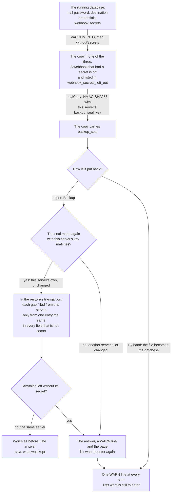

- **The copy is cleared before it is written out again.** `clearSecrets()` in
  `src/lib/server/backup-secrets.ts`, called by `withoutSecrets()` before the second
  `VACUUM INTO`, deletes the `smtp_pass` row; sets each destination's secret fields to `''`
  (SFTP `password` and `privateKey`, S3 `secretAccessKey`, Google Drive `clientSecret` and
  `refreshToken`, a Drive service account's `private_key` inside `serviceAccountJson`, OneDrive
  `clientSecret`; every one of these on every destination, whatever its type, so that a field
  left over from a change of type is cleared too), keeping its name, host, bucket, folder,
  user names and ids; deletes the key this server seals its backups with (`backup_seal_key`)
  and any seal already in the copy; leaves out a
  destination of a type this version does not know, and a `backup_config` that is not JSON;
  and sets each webhook's secret to `''` and switches it off. A webhook is switched off because
  the file can become a database without a restore, by hand or in an older image: left on with
  no secret it would send every event unsigned, refused by a receiver that checks and accepted
  by one that checks only when a signature is sent. The `webhook_secrets_left_out` setting
  lists each such webhook as `{"id":3,"active":true}`, which is how a restore tells it from a
  webhook made without a secret; an entry already in the copy whose webhook still has no
  secret is kept. `clearSecrets()` throws before it writes anything when handed the running
  database.
- **Every backup is sealed, and only a backup this server made, unchanged since, has anything
  filled** (the review's S1). Matching the fields beside a secret is not enough on its own: a
  backup that is this server's own in every field but one added superadmin would have every
  secret filled on this server, and the superadmin it added would then hold them (the review's
  probe: the real mail password, a Drive refresh token and a webhook secret filled back).
  So once the copy is cleared, `sealCopy()` writes an HMAC-SHA256 of it into it as the
  `backup_seal` setting, stored as the seal's form number, a colon and 64 hex characters
  (`2:…`), and the file stays one `.db`. A seal of any other form, the bare 64 characters
  included, is one this build cannot check, and is taken as no seal. The key is 32 random bytes kept as the
  `backup_seal_key` setting, made by the first backup the server takes (`backupSealKey()`);
  `clearSecrets()` deletes it from every copy, and a restore never brings one in and puts this
  server's back after it clears `settings`, so that the backups made before a restore still
  verify after it. A restore never changes the key, so every backup this server has sealed
  goes on verifying; to revoke every old seal at once, delete `backup_seal_key` (the command
  in the rollback note of [the update that brings migration 0055](deployment.md#the-update-that-brings-migration-0055-secrets-out-of-backups-and-request-mail-to-the-accounts-address)),
  and the next backup makes a new key. The HMAC is taken over a logical dump, the same from the same rows whatever
  file they are in (`sealOf()`): the structure (every row of `sqlite_master`, by type and name,
  as written, SQLite's own included: the index it makes for a UNIQUE column, `sqlite_stat1`
  once ANALYZE has run, and anything named as SQLite's own put there by hand); then every table
  but `sqlite_sequence`, the `sqlite_stat1` to `sqlite_stat4` tables that steer how a query
  reads included, by name, with its columns' names and every row read from the table's own
  storage (`NOT INDEXED`) in rowid order (primary key order for a table without one), each
  value written as its type and its bytes, text and blobs with their length first, so that
  `'1'` and `1`, or `'ab'`+`'c'` and `'a'`+`'bc'`, are told apart; the seal's own row is left
  out. `VACUUM INTO` moves rows to other pages and changes none of them, so the seal written
  before it holds for the file after it. A restore makes the seal again from the backup with
  this server's key, before it writes anything, and compares it in constant time
  (`sealVerifies()`): a backup made by another server, or by this one and then changed by a
  single value (a superadmin added, a card changed, a table or an index added, ANALYZE run on
  it, its seal taken out), has nothing filled, and every gap listed to enter again. Measured on
  a development machine: sealing a made-up 59 MB copy of 115,000 rows took 0.2 s, and
  verifying it as much; 177 MB and 345,000 rows, 0.56 s and 0.54 s. Both are synchronous,
  inside the time a backup or an import already stops the server answering.
- **What the seal covers and what a restore copies are the same rows** (the second review's
  B1). A query can read an index in place of its table, and in a file made by hand an index can
  hold rows its table does not: a covering index named `sqlite_cover`, with one more superadmin
  in it than the table, and a `sqlite_stat1` row saying the index is the smaller, had a bare
  `SELECT *` copy the index's rows while the seal, which left `sqlite_` names out, read the
  table's. Three things close it, each on its own. The seal covers every `sqlite_master` row
  and the `sqlite_stat*` tables, as above. Before the seal is asked, a backup that carries one,
  restored on a server with a key, is checked (`backupFailsCheck()`, called by
  `unsealedBecause()`): it is treated as unsealed when it holds any object named as SQLite's own
  other than `sqlite_sequence`, `sqlite_stat1` to `sqlite_stat4` and the
  `sqlite_autoindex_<table>_<n>` indexes of its own tables (`strayInternalObjects()`), or when
  `PRAGMA integrity_check`, which compares every index with its table, answers anything but
  `ok`. The restore itself goes ahead as it does for any unsealed backup; only the filling is
  withheld, and the import writes one `WARN` line naming the check: "Nothing was kept from this
  server, because the backup failed a check made before its seal is checked: … The restore
  itself went ahead." The integrity check took 0.12 s on a made-up 59 MB database. And the seal,
  `rowsToRestore()` read each table `NOT INDEXED`, in rowid order (`fromTableStorage()`), and
  the backup's settings the restore reads (`settingOf()`, so `readListed()` and the seal
  itself) read `settings` `NOT INDEXED` and take the one row for its primary key, so that the
  rows copied come from the storage the seal hashed. `lacksSuperadmin()`'s two counts of the
  backup's users read `NOT INDEXED` too. And every read of the backup, from its list and its
  checks to the rows copied, is made inside one read transaction on its connection
  (`BEGIN`, and `ROLLBACK` in a `finally`), so that all of them see one snapshot.
- **A restore fills each gap from this server, and only from the same account in the same
  place.** For a backup whose seal verified, inside the restore's transaction, `readSecretsHere()` reads this server's secrets
  before the first table is cleared, and `fillSecretGaps()` fills the restored rows after the
  copy. The mail password is filled when the restored host (trimmed of ASCII spaces and tabs, ASCII letters in any case), port (587
  when not set), "Allow mail without a checked, encrypted connection" (`smtp_allow_insecure`,
  off when not set, as in a backup made before card 2189) and user are all this server's: a
  backup that named this server's host and user with the way out ticked would otherwise have
  the password sent where the certificate is not checked. The restore does bring in the backup's
  way out, with no password asked and no `WARN` line; where it differs from this server's, the
  password is not filled and the "To enter again" line names the box ("the mail password
  (Admin, 📧 Email / SMTP, where the backup brought in … ticked and this server had it
  unticked)", the review-fix pass's S5). (Until card 2189 the rule compared
  "Use SSL/TLS", `smtp_secure`, which is no longer read.) The same rule decides when a save of
  the mail settings keeps a masked password (card 2190). A destination is filled from the one
  destination here of its type that is the same in every field that is not secret, compared
  as the destination would use them (missing and empty alike, the host trimmed of ASCII spaces and tabs, ASCII
  letters in any case, an S3 region `us-east-1` and an SFTP port 22 when not set, a OneDrive folder path with
  its slashes trimmed and `DumpFire Backups` when not set: card 2190's R8, the rule a save
  keeps a masked secret by), the name and the place included (SFTP name,
  host, port, user name and remote path; S3 name, region, bucket, prefix, endpoint and access
  key id; Drive name, method, folder and client id, a service account also by its JSON's
  `client_email` and `private_key_id`, its JSON then taken whole; OneDrive name, tenant,
  client id and folder path). None, or more than one, and nothing is filled: every field
  beside a secret is the backup's word, and a destination matched on its connection alone
  would upload this server's database, with this server's credentials, to a bucket or folder
  the backup chose, and have retention delete backups there. A Drive OAuth destination is
  filled only when both its client secret and its refresh token are empty, and a refresh
  token filled brings this server's `grantedScope` with it, or none (card 2188). An SFTP
  destination never keeps the `hostKey` the backup gives it, filled or not, sealed or not: it
  is removed first, on every path, and one filled, or with neither secret here either, takes
  the key of the entry here it was matched with, or none (card 2250). A crafted backup could
  otherwise pin a key of its choosing beside the real host's name, waiting for the password
  to be typed again; the restore's own match does not compare the key, so a backup made
  before card 2250 still fills, and `needs()` lists an SFTP destination as "SFTP: its password
  or private key, then Test to confirm its host key". A webhook listed
  in the backup's `webhook_secrets_left_out` is filled from the webhook here with the same id,
  board, address and setter (`set_by`, none and none alike: card 2168), and switched on or off
  as the list says it was. A secret here set by another account than the one the backup's row
  names was set again since: filled, it would be that account's secret under the backup's
  setter, out of reach of that account's reset, so it is listed to enter again. A backup made
  before migration 0056 restored onto rows nobody has set since matches. A value the backup has is
  never replaced, so a backup made before this change restores as it always did. A restore
  that rolls back leaves this server's secrets as they were.
- **The list is never brought in as it is.** `rowsToRestore()` leaves `webhook_secrets_left_out`
  out; the restore reads it from the backup, as the backup's word: a list that is not a JSON
  list, or an entry without a whole-number id and a true-or-false `active`, is ignored and said
  among the import's problems. A restore "as it is" that leaves listed webhooks unfilled writes
  the list again, trimmed to those, so that every start names them; a working copy writes
  none, since its webhooks are off on purpose.
- **What is left to enter is said three ways.** The import's answer, its log line and the
  admin page's report add "Kept from this server, because a backup does not hold them: …" and
  "To enter again, because a backup does not hold them: …", each only when there is something
  to say (`secretsKept` and `secretsToEnter` in its figures); the second is also written as a
  `WARN` line of its own. For a backup whose seal did not verify, or whose file failed a check
  made before it, that line ends "None was kept from this server, because this backup was not
  made by this server, or was changed since."; for one with no seal this server can check (a
  backup made before seals, or a server that has made no backup yet), "None was kept from this
  server, because this backup carries no seal this server can check." (the second review's N7).
  A restore committed with foreign keys left off says the same, and the request links it
  replaced, in its `500` answer and log line (the review's O8). Each place is named as the
  admin page names it: the mail password in "📧 Email / SMTP". At every start, `reportSecretsToEnter()` in
  `src/lib/server/startup-checks.ts` writes one `[WARN] [STARTUP]` line while the mail settings
  name a host and a user and hold no password, a destination lacks its credentials, or a webhook
  the database's own list names is still off with no secret; it reads and writes nothing. And a
  scheduled backup or Run Now does not try a destination that lacks its credentials
  (`credentialsMissing()`): Backup History and the failure mail say "This destination's
  credentials are not entered: …". An SFTP destination with neither password nor key is the
  exception at start and in the backup run, because a server that allows `none`
  authentication accepts it; the restore's answer still lists one it could not fill. After a
  restore onto another server, then, an SFTP destination left with neither password nor key is
  tried against the real host at every scheduled run, and its failed logins may trip a lockout
  there: enter its credentials, or remove it (the review's S5). Since card 2250 that holds
  only once its host key is confirmed again: an SFTP destination with no confirmed key,
  credentials or none, is not tried, with "SFTP host key not confirmed: nothing was sent to
  this destination. …" (`hostKeyMissing()`), and a thirteenth start-up line,
  `reportUnconfirmedHostKeys()`, names each such destination.
- **A backup alone no longer rebuilds a lost server.** On a server that still runs, restore
  with Import Backup, which keeps this server's secrets. A server rebuilt from nothing needs
  the mail password, every destination's credentials and every webhook's secret from
  somewhere else: keep the first two outside DumpFire (a password manager), and know who
  holds each webhook's secret at its receiver.
- **Not encrypted, not kept.** Encrypting them in the copy with a key kept outside it would
  add a key that must be kept apart from both the server and its backups and is lost with
  either; keeping this server's secrets on a restore to the same server gives the same result
  with nothing more to keep outside the server. The seal's key is in the running database,
  beside the secrets it guards: whoever can read it can read them already. Lost with the
  database, it costs only the fill: a backup made before is restored with its gaps listed. A webhook is re-armed by the board's owner or an administrator with
  `PUT /api/v1/webhooks/{id}` and `{ "secret": "…", "active": true }`.

Covered by `tests/backups.test.ts` and `tests/import-working-copy.test.ts`.

### Where a Mailed Link's Address Comes From

An invite, a request's confirmation and reply links, the requester's progress mail and
the "View Task" link in a notification all begin with the server's own address. One
function gives it, `linkBaseUrl()` in `src/lib/server/email.ts`, and every caller asks it:

1. the App URL setting, which any administrator sets (the superadmin alone until card 2395);
2. the `APP_URL` environment variable;
3. `ORIGIN`, the address the server was started with, read as the node adapter reads it.

Nothing a request says is used in a built server: not `Host`, not `X-Forwarded-Host`, not
the address it was sent to. With no App URL set, a link used to take its host from
`X-Forwarded-Host`: an invite created by a request that carried `X-Forwarded-Host:
evil.example.test` was mailed with a link to `https://evil.example.test/invite/<token>`,
and the token sets the account's password. Under `vite dev` alone, where there is no
`ORIGIN`, the address the request was sent to is used last.

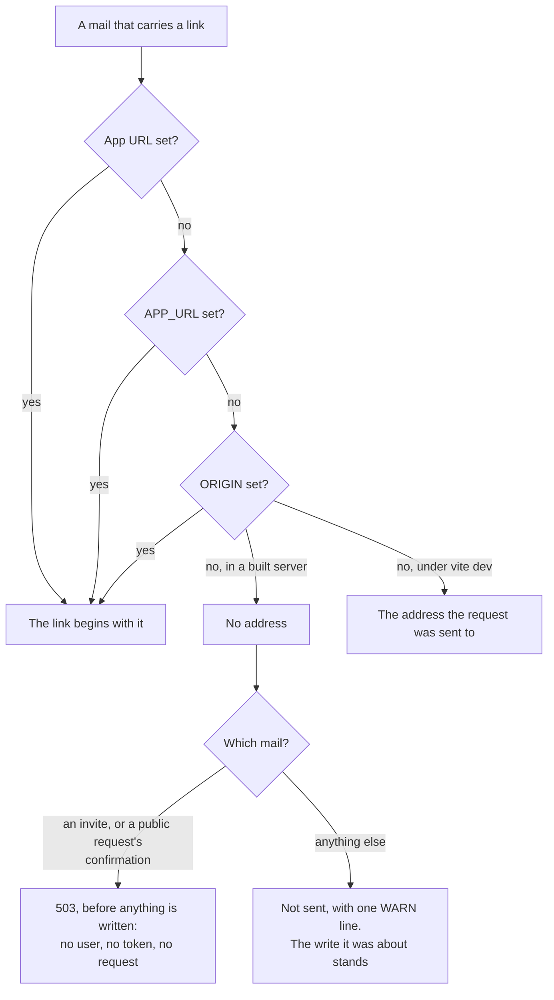

- **An invite and a public request are refused** when there is no address, with `503` and
  "This server has no address configured to make the link from". Each is nothing without
  its link: a user with a password nobody knows and no invite, a request nobody can
  confirm. The check is made before the row is.
- **A notification is skipped**, the requester's progress mail among them, with one
  `[WARN] [NOTIFY]` line, and never fails the move, the comment or the assignment it was
  about.
- **`http://localhost:3000` is an address.** It is what the image is built with, and a
  small installation really is served there. The server says so once at start, at `WARN`,
  when that is `ORIGIN` and no App URL is set.

Covered by `tests/mail-links.test.ts`, which runs as a built server and sends every
request with a forged `Host` and `X-Forwarded-Host`.

### What an Emailed Report's Answer Tells

`POST /api/reports/email` answers with each recipient's `success`, which is whether the mail
server accepted the mail for that address (card 2113), so the answer tells the sender which
of the addresses they typed the mail server accepted: one that refuses an unknown mailbox as
the mail is sent tells them which mailboxes exist on its own domain. This is accepted as
designed (the review of 2026-10-15): the sender needs it to send to the rest again, and the
mail server's own reason stays in the system log. Since card 2182 a call names at most 10
addresses and one account's report mail reaches at most 100 in a 24-hour window counted
from its first take (so up to 200 across one window's end and the next's start), which
bounds what one account can learn so. See
[A Report Emailed on Demand](notifications-email.md#a-report-emailed-on-demand) and
[Who a Report Can Be Mailed To](notifications-email.md#who-a-report-can-be-mailed-to).

### One Use Means One Use

Two of these check something and then act on it: an invite must be unused, and set-up must find no user. Each reads the form first and makes its check again inside the transaction that writes, where no other request can write in between.

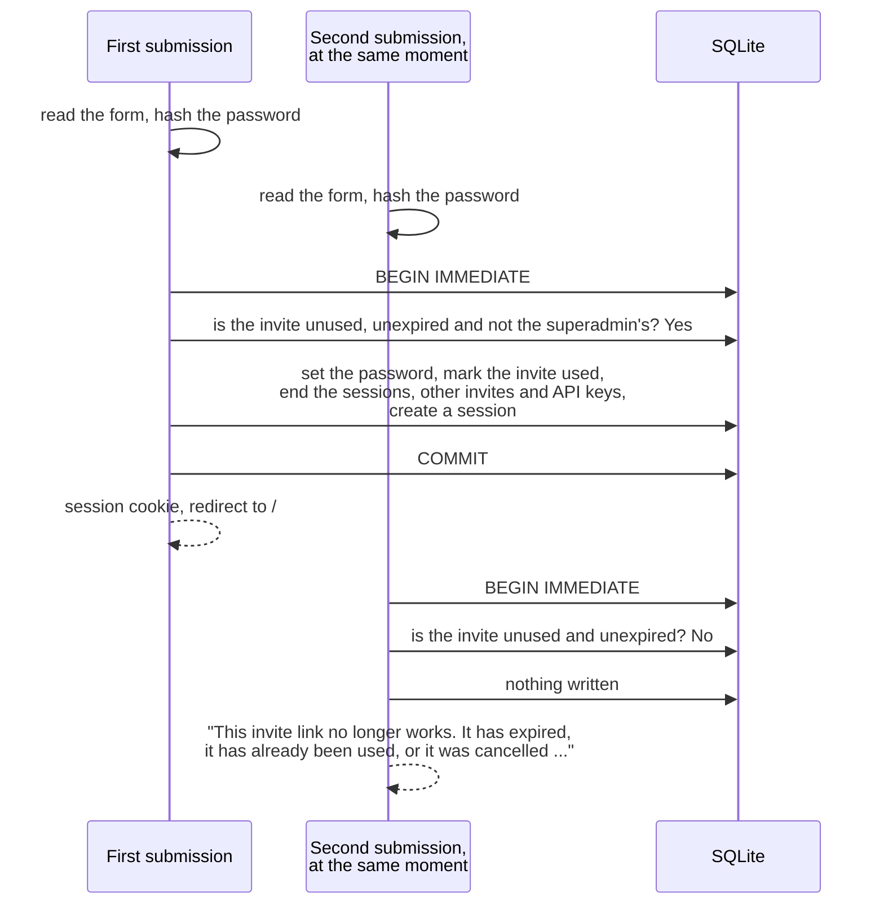

- **An invite cannot be used twice.** The second of two submissions of one link finds it used and is refused, with no password changed and no session made.
- **Set-up cannot create two superadmins.** The second of two submissions of the set-up form finds a user, creates nothing, gets no session and is redirected to `/`.
- **A password change is checked against the row as it is.** The transaction writes only while the stored hash is still the one the current password was checked against. If the password was changed by another request in between, nothing is written, the current password is checked again against the new hash outside the transaction (a check is awaited, on a worker thread, and a transaction cannot await), and the transaction is run once more; a second change in between answers `409` with nothing written (`whilePasswordHolds()`, see [Password Hashing](#password-hashing)). Making an API key and changing your email, which ask for the password too, are checked the same way, so a key cannot be made, nor an address moved, with a password a change has just ended. The email route also looks for the address being taken inside the transaction that writes it.
- **Two submissions at once each hash.** The hash of an invite's or set-up's password is awaited, so the second submission passes its first look at the invite before the first commits, and each hashes (card 2191); the one transaction still lets exactly one in.

Covered by `tests/atomic-accounts.test.ts`.

## API Key System

API keys provide stateless authentication for the external API (`/api/v1/*`).

### Key Generation

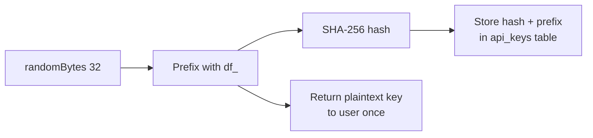

| Property | Value |
|----------|-------|
| Format | `df_` + 64 hex chars |
| Hash algorithm | SHA-256 |
| Storage | Only the hash is stored |
| Prefix stored | First 11 chars for identification |
| Expiry | Optional per-key: `expiresAt`, a timestamp in the future, stored as `YYYY-MM-DD HH:MM:SS` in UTC (card 2095), and read as the moment it names when the key is checked. An expiry that names no moment, which only a row from before card 2117 or a restore could hold, ends the key. No page sends one |
| Rate limit | 60 requests/minute per key, counted against the key's own row once it is checked; 60 requests/minute per address for requests with no key the gate accepts |

### Key Lifecycle

1. The account's holder generates a key on the Account page, entering their current
   password (`POST /api/account/api-keys` with `{ name, password }`). The admin page makes
   none. Nothing else makes a key: the v1 API has no key route, and the gate accepts a key
   only under `/api/v1/`, so a key cannot make another
2. Plaintext shown **once** — user must copy it
3. Only the SHA-256 hash is stored in `api_keys` table, and one `INFO` line is written to
   the system log: `API key K created by user N`, with the key's id and the user's. Not its
   name or prefix: every administrator reads the system log, and every backup holds it
4. Each request the key is let in with updates `last_used_at`; one refused for being over
   the limit does not
5. Expired keys are rejected at validation time, and so is a key whose expiry names no
   moment (`zzz`, `2099-02-30 08:00:00`): compared as text, such a key never expired
6. A key ends when it is revoked on the Account page, or when its account's password is set
   in a way that ends keys: an administrator's reset, an invite used, or the holder's own
   change with "End my API keys too" ticked (see
   [What Setting a Password Ends](#what-setting-a-password-ends)). Either way its row is
   deleted, and the gate answers it `401` `Invalid or expired API key`

**Why a key asks for the password.** A key works until it is revoked, and the holder's own
password change keeps it unless they ask. A key made on a session alone let whoever held
that session for a moment (an unlocked machine, a copied cookie) keep the account after the
password was changed. The password is checked before the transaction and checked again
inside it if the stored hash has changed meanwhile; the ten-key limit is counted in the
same transaction as the insert.

| `POST /api/account/api-keys` sent | Answer, in this order |
|-----------------------------------|-----------------------|
| No session | `401` `Not authenticated` |
| No name, one that is not text, or one longer than 100 characters | `400` `Key name is required`, `name must be text`, `name must be at most 100 characters` (card 2218; it was `Key name too long (max 100 chars)`) |
| No `password`, or one that is not text | `400` `Password is required` |
| An `expiresAt` that is not `null` and not a timestamp in the future | `400` `expiresAt must be a timestamp, such as 2027-01-01T09:00:00Z`, `expiresAt must be in the future`. Until card 2117 any text was stored, and `"banana"` never expired |
| The account already has ten keys | `400` `Maximum of 10 API keys per user` |
| The account has gone | `404` `User not found` |
| The eleventh attempt from this browser in 15 minutes, at any of the three routes that ask for the current password, right or wrong | `429` `Too many wrong passwords. Try again in N minute(s).` See [Guessing a Current Password](#guessing-a-current-password) |
| A wrong password | `403` `Password is incorrect` |
| All of it right | `201` with the key, shown once |

Keys made before the password was asked for are kept.

### What an API Caller Is Told

The key check and the rate limit are made by `handle` in `src/hooks.server.ts`, before any
handler runs. Every refusal under `/api/v1/` is JSON with a `message`, whatever `Accept`
header the request sent.

| Request | Answer |
|---------|--------|
| No `Authorization` header, or one that is not `Bearer <key>` | `401` `{ "message": "Missing or invalid Authorization header. Use: Bearer <api_key>" }` |
| A key that is not in `api_keys`, has expired, or belongs to a user who no longer exists | `401` `{ "message": "Invalid or expired API key" }` |
| More than 60 requests in the minute with one key | `429` `{ "message": "Rate limit exceeded", "retryAfterSecs": 42 }`, with a `Retry-After` header carrying the same number |
| More than 60 requests in the minute from one address with no key the gate accepts, a missing header included | `429`, the same |
| A path that is no route, sent with a key that is accepted | `404` `{ "message": "Not found" }` |
| A method the route does not have, sent with a key that is accepted | `405` `{ "message": "PATCH method not allowed" }`, with an `Allow` header naming the methods it has |

```mermaid
sequenceDiagram
    participant C as API caller
    participant G as handle (hooks.server.ts)
    participant R as rate-limit.ts
    participant A as auth.ts
    participant K as SvelteKit and the handler

    C->>G: GET /api/v1/no-such-thing<br/>Authorization: Bearer df_...
    G->>G: set Accept: application/json on the request
    G->>A: findApiKey(key)
    alt no key, or not accepted
        A-->>G: null
        G->>R: checkRateLimit("apikey-none:" + addressKey(the caller's address), 60, one minute)<br/>an IPv6 address by its /64
        alt over the limit
            G-->>C: 429 { message, retryAfterSecs }, Retry-After
        else within it
            G-->>C: 401 { message }
        end
    else accepted
        A-->>G: the key's row id and its user
        G->>R: checkRateLimit("apikey:" + the key's id, 60, one minute)
        alt over the limit
            G-->>C: 429 { message, retryAfterSecs }, Retry-After<br/>last_used_at is not touched
        else within it
            G->>A: markApiKeyUsed(id)
            alt the path is no route
                G-->>C: 404 { message: "Not found" }, and SvelteKit is not asked
            else it is a route
                G->>K: resolve
                K-->>G: the answer
                G-->>C: the answer, or JSON in its place<br/>if it is a failure that is not JSON
            end
        end
    end
```

- **The key is checked before anything is counted.** A key's requests are counted against
  the key's own row, which only the key reaches. They were counted first, against the first
  11 characters of whatever was sent, which is the prefix stored for a real key: anybody who
  had seen a key's prefix could spend its allowance with requests that were not the key. The
  lookup is one SHA-256 and one read of a unique column.
- **A request with no key the gate accepts is counted against its address**, a missing
  header included, in a bucket of its own, so guessing at keys is slowed and never spends a
  real key's allowance. An IPv6 address is counted by its /64 network, an IPv4 address
  written as IPv6 as the IPv4 address, and a port is taken off (card 2195, see
  [How an Address Is Counted](#how-an-address-is-counted)). The address is the one the server is given: behind a reverse proxy
  that is the proxy's own unless the server is told where to find the caller's
  (`ADDRESS_HEADER`, in [Deployment](deployment.md#the-callers-address-behind-a-proxy)).
  Untold, every caller shares the one bucket: a valid key is never held up by it, and a
  mistyped key may be answered `429` while somebody else is guessing. Where the address
  cannot be read at all, the request is counted with every other whose address is unknown.
- **The counts are kept in memory**, in the one process, for a minute from the first
  request each counts.
- **Without a key every path is a `401`**, a path that is no route included: the key is
  checked before the path is looked at.
- **A path that is no route renders no page.** SvelteKit's own answer would be its 404
  page, which is HTML and has in it the name, email and role of the signed-in user, because
  the root layout loads them for every page. For a request with an accepted key that user is
  the key's owner. The gate answers the `404` itself, and SvelteKit is not asked.
- **A handler's refusal is JSON too.** The gate sets the request's `Accept` header to
  `application/json`, so SvelteKit answers every `error(status, text)` as `{ message }` and
  never as a page.
- **`GET /api/v1/openapi.json` is the one path under `/api/v1/` that needs no key.** It is
  answered before the key is asked for and is not counted against any limit.
- **A session cookie is not looked at under `/api/v1/`.** A signed-in browser with no key is
  answered `401` there.

How the gate does this, rule by rule, is in [Architecture](architecture.md#the-gate). What a
caller should make of each status is in the
[External API Reference](api-reference.md#error-format). Covered by `tests/gate.test.ts`.

## Board Access Control

Board access is determined by `board-access.ts` using a priority-based resolution.

### Access Resolution Order

```mermaid
flowchart TD
    User["User requests board"] --> IsAdmin{"Admin or\nsuperadmin?"}
    IsAdmin -->|"Yes"| FullAccess["Full access\nrole = admin"]
    IsAdmin -->|"No"| IsCreator{"Board creator?"}
    IsCreator -->|"Yes"| OwnerAccess["Full access\nrole = owner"]
    IsCreator -->|"No"| DirectMember{"Direct board\nmember?"}
    DirectMember -->|"Yes"| DirectRole["Use assigned role\nowner/editor/viewer,\nany other text: viewer"]
    DirectMember -->|"No"| TeamMember{"Team member\nwith board access?"}
    TeamMember -->|"Yes"| TeamRole["Highest team role\neditor or viewer"]
    TeamMember -->|"No"| IsPublic{"Board is public?"}
    IsPublic -->|"Yes"| ViewerAccess["Viewer access"]
    IsPublic -->|"No"| NoAccess["No access\nnull"]
```

### Permission Matrix

"Admin" means either administrator role, `admin` or `superadmin`. Code tests for it
with `isAdmin()` from `board-access.ts`, never by comparing `role` to `'admin'`: the
bare comparison locked `superadmin` out of the v1 audit log and activity report
until October 2026.

| Action | Owner | Editor | Viewer | Admin |
|--------|-------|--------|--------|-------|
| View board, its archive, labels and templates | ✅ | ✅ | ✅ | ✅ |
| Create/edit/archive/restore cards and subtasks | ✅ | ✅ | ❌ | ✅ |
| Move and reorder cards | ✅ | ✅ | ❌ | ✅ |
| Add, edit, reorder and delete columns | ✅ | ✅ | ❌ | ✅ |
| Comment, and edit or delete your own comment (an owner may not edit or delete another's; an admin may edit or delete any; by either API tree, the v1 delete since card 2283) | ✅ | ✅ | ❌ | ✅ |
| Create a card category or template on the board | ✅ | ✅ | ❌ | ✅ |
| Create a webhook, change its events, switch it off, and delete it | ✅ | ✅ | ❌ | ✅ |
| Change a webhook's address or secret, or switch it on (since card 2154: an editor who sends `url` or `secret` at all, or `active: true` for one that is off, is `403`) | ✅ | ❌ | ❌ | ✅ |
| Read a webhook's signing secret, address and last delivery result (the address since card 2133, `lastDelivery` since card 2178) | ✅ | ❌ | ❌ | ✅ |
| Read the email addresses in the board's share list (since card 2128) | ✅ | ❌ | ❌ | ✅ |
| Read the webhook counts in the board's share list: each share's `stopsWebhooks` and the list's `heldWebhooks` (since card 2329) and `privateStopsWebhooks` (since card 2385) | ✅ | ❌ | ❌ | ✅ |
| Share board | ✅ | ❌ | ❌ | ✅ |
| Make the board public or private, by any route | ✅ | ❌ | ❌ | ✅ |
| Delete board | ✅ | ❌ | ❌ | ✅ |
| Put the board under a card, or take it out from under one | ✅ | ❌ | ❌ | ✅ |

What is on no board is decided by role alone. "Admin" here is `admin` only; the superadmin
has every ✅ an administrator has:

| Action on the whole installation | User | Admin | Superadmin |
|--------|------|-------|------------|
| Manage an ordinary user's account; teams; clear a board; purge, vacuum, reset XP; the system log and the audit trail | ❌ | ✅ | ✅ |
| Manage an administrator's account, or make one | ❌ | ❌ | ✅ |
| The mail settings, the App URL, Send Test and what mail has done (since card 2395) | ❌ | ✅ | ✅ |
| The backup settings, Run Now, a destination's Test and Google Drive's Connect (since card 2395) | ❌ | ✅ | ✅ |
| Export, import, Reset Everything | ❌ | ❌ | ✅ |

The two rows marked since card 2395 were the superadmin's alone; what that hands every
administrator is in [The Mail and Backup Settings: Every Administrator's](#the-mail-and-backup-settings-every-administrators-card-2395).

### Where the Decision Is Made

The access decision for a route is made on the server, from the database row the
request is about. A board id sent in a request body is never used to decide access:
it says which board the caller would like to be judged against, and a caller who may
edit board A could name it while changing a card on board B. That was the central
finding of the October 2026 code review, and it applied to every internal card,
subtask and label route.

`src/lib/server/route-guards.ts` holds the guards. Each one looks the row up, finds
the board it is on, checks the caller against that board, and returns what it found —
so a handler cannot check one board and then act on another.

```mermaid
sequenceDiagram
    participant C as Caller
    participant H as Route handler
    participant G as route-guards.ts
    participant DB as SQLite

    C->>H: PUT /api/cards/42 { title, boardId: 7 }
    H->>G: requireCard(locals.user, 42, 'edit')
    G->>DB: SELECT card 42, then its column
    DB-->>G: card is on board 3
    G->>DB: caller's role on board 3
    alt no row
        G-->>C: 404 Card not found
    else caller cannot edit board 3
        G-->>C: 403 No edit access to this board
    else allowed
        G-->>H: { card, boardId: 3 }
        Note over H: body boardId 7 is ignored
        H->>DB: UPDATE card 42 (whitelisted fields only)
        H-->>C: 200
    end
```

| Guard | Resolves the board from | Used by |
|-------|-------------------------|---------|
| `requireBoard(user, boardId, need)` | the board row itself (must exist) | board archive, favourites, labels, templates, columns, webhooks |
| `requireColumn(user, columnId, need)` | `columns.board_id` | card create, card move target, column reorder, request accept |
| `requireCard(user, cardId, need)` | the card's column | card update/delete/restore, subtask create, label toggle, comments, attachments |
| `requireSubtask(user, subtaskId, need)` | the parent card's column | subtask update/delete |
| `requireLabel(user, labelId, need)` | `labels.board_id` | label toggle and delete |
| `requireCategoryEdit(user, categoryId)` | `categories.board_id` | card category rename/delete, both API trees |
| `requireBoardCategoryEdit(user, categoryId)` | every board filed under the grouping | dashboard grouping rename/delete, both API trees |
| `requireBoardOwner(user, boardId, says?)` | the board row itself; the caller must own it (`getBoardRole`'s `owner`: its creator, or a member shared as Owner) or be an administrator. `says` is the refusal's text, so each route keeps its own words | `isPublic` on a board update, both API trees; sharing a board, its `POST`, `PATCH` and `DELETE` |
| `requireTeamManager(user, teamId)` | no board: the team, and the caller's membership of it; the caller must be its owner or an administrator | renaming and deleting a team, adding and removing its members |
| `requireParentCard(user, parentCardId)` | the parent card's column; the caller must be able to edit that board | creating a sub-board, both API trees |
| `requireSubBoardLink(user, boardId, parentCardId)` | `requireBoardOwner` on the board being linked, then `requireParentCard`, then `wouldLoop` (`sub-boards.ts`); `null` asks only the first | putting an existing board under a card, or taking it out from under one, on `PUT /api/boards/:id` |
| `requireManagedAccount(user, userId, says)` | no board: the role of the account and of the caller | setting a user's password, sending a user an invite, changing a user, deleting a user |
| `requireAdmin(user, says?)` | no row: the caller's role; `403` in the route's words (`Forbidden` unless given) for anyone who is not an administrator, nobody signed in included (card 2253) | the user routes, the request delete, the five administrators' routes under `/api/admin/`; the quick check before a body, and asked again of `caller` inside `writeAs` |
| `refuseOwnAccount(user, userId, says)` | no row: `403` for the caller's own account. Not a guard on its own, as it lets a null caller through: `requireUser` or `requireAdmin` is asked first (card 2253) | setting a user's password, whose check of the caller's own account comes before its role test; deleting a user and sending an invite make their own check of it inside `writeAs` |

`need` is `'view'` or `'edit'`. Every guard answers 401 for no caller, 404 for no such
row and 403 for a row on a board the caller may not view or edit.

Every route that reads a body reads it first and calls its guard after it, and nothing is
awaited between a guard and the write it allows. The row that was checked is then the row
that is changed: a card cannot be moved to another board, or a caller's access removed,
between the check and the write, and a row deleted while the body was arriving is a 404 and
not an update that finds nothing. The handlers card 2115 moved call their guard inside the
transaction that writes, so a refusal thrown there rolls it back and a 403 or a 404 has
written nothing. A `DELETE` that reads no body checked and wrote with no transaction until
card 2253, which was as safe: the database calls are synchronous and nothing is awaited
between the two, so no other request runs between them. Before the body only what reads no row is asked: the
session the gate read, through a guard of `QUICK_CHECKS` (`requireUser`, `requireSuperadmin`,
`requireAdmin`, `refuseOwnAccount`) in a call that binds no name, and the id in the path
(`pathId`). `isAdmin` is no longer asked before the body in a write handler: the source rule
lets no other call take `locals.user` there. Since card 2253 such a check is a quick refusal
that decides nothing, and every write that has one checks twice, not only the upload (the
vacuum and the reset have none, and ask first at the write): every guard is asked again inside the
`writeAs` that writes, given the account as it is now, and every handler, a `DELETE` with no
body included, checks and writes in one transaction (see
[Asked Again at the Write](#asked-again-at-the-write-card-2253)). An upload is the one request
whose first check reads a row (`requireCard`, before the file is read, so that a caller with no
access is not sent 25 MB first), and it asks the row again inside its `writeAs`. The public
request form and its confirmation ask their rate limits and the form token first, and the
import its media type: none of them a row.
`tests/check-at-the-write.test.ts` reads every handler under `src/routes/api` and fails on
any other call made before the body (card 2115), and on a handler whose text reads a body
where the test cannot find the read. Until 2026-10-14 twenty-two handlers, eleven in each
tree, checked the row and then awaited the body.

Rules that are not a plain board lookup:

- **Moving a card** (`PUT /api/cards/:id` with `columnId`, or `PUT /api/cards/reorder`)
  needs edit access at both ends: the board the card is on and the board the target
  column is on. A reorder must stay within one board, names each card once (`400`
  `updates names card 12 more than once`, before any card is read: a card named over and
  over, to and fro between two columns, was a real move for every entry, past the second
  cap), and is held to two caps (card 2209):
  at most 5,000 cards named, checked before any card is read, and at most 100 of them moved
  to another column, checked once every card and column has been read and the caller found
  able to edit them, so a caller who may not edit the board is refused `403` first. Either
  is `400` and moves nothing: `A reorder can name at most 5,000 cards, and this names
  5,001. Nothing was moved.`, or `At most 100 cards can be moved to another column at once,
  and this moves 101. Nothing was moved: move them in groups of 100 or fewer.` Each card
  moved is an activity entry, a delivery to each of the board's webhooks and mail to its
  assignees, which the second cap bounds; the board page's drop sends every card of the
  two columns it touches, the one dropped into and the one the card came from (card 2213;
  it sent every card of the board), which the first sits far above. The session routes have no rate limit, so the caps
  bound one request and not how many a script sends.
- **Writable fields are whitelisted.** `PUT /api/cards/:id` never accepts `completedAt`
  or `archivedAt` — the server stamps them when the thing they record happens — and
  `PUT /api/subtasks/:id` accepts the same seven fields as the v1 route, so a subtask
  cannot be re-parented onto another card.
- **Card categories** belong to the board they were created on, and are listed to a
  caller only where that is a board they can open, or where they belong to no board
  (card 2128: every board's was listed to everyone; see [What a List Gives](#what-a-list-gives)).
  Changing or deleting one needs edit access to that board; one that
  belongs to no board is administrator-only. A card is filed only under a category of
  its own board or one that belongs to no board, by either API tree (card 2117): another
  board's, or one that is not there, is `404` `Category not found on this board`, and the
  card window offers no other. A card already filed under another board's keeps it while
  it is sent back unchanged.
- **Dashboard groupings** (board categories) may be renamed or deleted only by someone
  who can edit every board filed under them. A grouping is listed to a caller, and a board
  may be filed under it by them, when it holds a board they can open or holds none yet
  (card 2128).
- **Task requests** may be read, answered, accepted or rejected only by the user or
  team they are addressed to, or an administrator (`request-access.ts`). Accepting one
  needs edit access to the board the card is created on, and any assignee must be able
  to open that board. The inbox (`GET /api/requests`) gives a row's `desiredBoardId`,
  `desiredBoardName` and `desiredBoardEmoji` only to a reader who can open that board, and
  all three null to anyone else, each member of an addressed team judged for themselves
  (card 2153): the accept dialog then starts at "Select a board…", where it preselected a
  board missing from its own list.
- **The global event stream** (`GET /api/events`) forwards only events from boards the
  subscriber can view; each board's answer is kept until the stream's next heartbeat, which
  forgets them all (card 2170). **The board stream** (`GET /api/boards/:id/events`) asks
  again at each heartbeat whether its account can open the board, and ends with an access
  event when not; see [An Open Stream and Its Session](#an-open-stream-and-its-session).
- **A report is its reader's** (card 2150). A board or grouping report takes in only the
  sub-boards its reader can open, and does not walk through one they cannot; a board whose
  parent the reader cannot open is shown as a board of its own, the parent not named. The
  reader is the caller for a download, the sender for a mailed report and the schedule's
  owner, as their account stands at the run, for a scheduled one; recipients get that view
  whoever they are. See [Whose Report It Is](backup-reporting.md#whose-report-it-is).
- **The completion refusal names only a sub-board the caller can open** (card 2151).
  `getCompletionBlocker(cardId, viewer)` checks first the unfinished sub-boards the caller
  can open, and names one as before; when the only unfinished ones are sub-boards they
  cannot open, every move route answers `409` "A sub-board you cannot open still has
  incomplete cards that must be completed first. Ask this board's owner.", with no name and no count.
- **Notices across boards** (card 2152). The "Unblocked" comment is stored once and read by
  everyone who can open the waiting card's board, so it names the finished work by title
  only when that work is on the same board, and otherwise reads `Unblocked: #12, a card on
  another board, completed — nothing is blocking this card now.` or `Unblocked: a subtask on
  another board completed — …`. The mails are one person's each: an assignee is mailed the
  finished work's title when they can open its board, and "A card on a board you cannot
  open" (or "A subtask on a board you cannot open") otherwise; the plan-created mail goes
  only to recipients who can open the plan, each drawn from the plan as they would see it.
  See [Critical-Path Planning](critical-path-planning.md#unblock-notification).
- **A board's milestone holds only that board's cards** (card 2155). A move to another
  board takes the card out of a milestone of a board other than the one it arrives on, in
  the same update of the card, and the source board's `card_moved_away` entry says so; a
  goal across boards keeps its cards. Migration 0057 took out those already in that state.
- **Being assigned or having commented does not outlive board access.** `/api/my-tasks`
  omits cards on boards the caller can no longer open, and a former member cannot edit
  or delete comments they wrote while they had access, by either API tree
  (`PUT /api/v1/comments/:commentId`, and `DELETE` there, new with card 2283, ask for
  edit access to the board as well as authorship, which is what posting a comment asks
  for and what the session routes ask). Nor can they delete a card template they saved on that board, which asks for
  edit access as saving one there does; one saved on no board has no board to ask about
  and stays its maker's. Edit access and not view access: a member who has been made a
  viewer can read their comments and templates and can change neither. Nor do their own
  past actions there stay in their Recent Activity, on the dashboard or in
  `GET /api/v1/me/stats` (card 2126), and the dashboard's personal figures (assigned,
  active, overdue, due soon, Upcoming Deadlines, the trends and on hold) count only cards
  on boards they can open (card 2130), as My Tasks does. So do the open count and the
  average cycle time of `GET /api/v1/me/stats`, and the dashboard's Velocity window
  (`GET /api/velocity`), since card 2292: they counted every board, and moved as work went
  on on a board the caller had lost.
- **`isPublic` is the owner's.** Making a board public shows it to everyone who is
  signed in. `PUT /api/boards/:id` and `PUT /api/v1/boards/:boardId` accept `isPublic`
  only from the board's owner or an administrator, as the share route does: an editor
  who sends it is answered 403 and nothing in the request is saved, whatever its value.
  From the owner or an administrator it is `true` or `false`, or the answer is 400.
- **A sub-board needs edit access to its parent card's board**, on `POST /api/boards`
  as on `POST /api/v1/boards`, checked in the transaction that creates the board.
- **Putting an existing board under a card is its owner's** (card 2139). A sub-board is
  deleted for good with its parent card, that card's column and the parent board, and
  any editor of the parent board may delete a card there: linking a board hands its
  deletion to the parent board's editors. So `PUT /api/boards/:id` with `parentCardId`
  asks for the owner of the board being linked, by `getBoardRole` (its creator, or a
  member shared as Owner; a team share never makes one), or an administrator, which is
  who may delete the board, and edit access to the parent card's board, as creating a
  sub-board does. Edit access to the board being linked is not enough: an editor of X
  who also edits P could otherwise put X under a card of P and delete the card. Taking a
  board out from under its card (`null`) and moving it to another card ask the same.
  The card may not be on the board itself or beneath it, `409`: `wouldLoop()` walks up
  from the card's board with a recursive `UNION` query, which ends on a loop already in
  the data. Access is not inherited through a parent, but linking is not without effect
  on who sees what. Since card 2130, those who can open the parent board see the linked
  board on the card only if they can open it as well, and since card 2150 the parent
  board's reports take in the linked board's cards only when whoever downloads, sends
  or schedules the report can open it as well (a mailed report's reader is whoever sends
  it, a scheduled one's its owner); whoever they send it to gets what that person can see. The linked board's members who cannot open the parent board no
  longer see it on their dashboard, which lists top-level boards and shows a sub-board on
  its parent's tile. And the parent board's editors can move the card to another board,
  taking the linked board with it. The confirmation says all of this (`subBoardLinkWarning`
  in `src/lib/api.ts`). A board with no owner, such as one whose creator was deleted, can
  be linked only by an administrator. The board page offers only the boards this would
  let through (`linkableBoards()`, by `getBoardRole`'s rule for an owner: the boards the
  caller created and those where they are a member stored as owner, read in two queries).
  An owner can always open the board, so the list holds only boards the caller can open,
  which is all card 2130 asked of it.
  The documented API's `PUT /api/v1/boards/:boardId` takes no `parentCardId`.
- **Removing a dependency** needs edit access to the board of the end that waits,
  whichever end's address the request is made to, and not to both boards as adding one
  does. An editor of the blocking end alone is refused. The refusal is decided before
  the link is looked for, so it does not say whether the link exists. The rule is in
  `removeDependencyLink()` in `dependency-refusals.ts`, which all four routes call. It
  sends the live event to both ends' boards, and writes the `dependency_removed` entry
  on the board of the end that waits, which is the board the caller was shown to edit,
  and not on the board of the card in the address. Adding one writes `dependency_added`
  on the board of the card in the address (`addDependencyLink()`). All four routes write
  both, the link and its entry in one transaction with the check; until card 2114 only
  the v1 card route wrote any.
- **A card's assignees** (`GET /api/v1/cards/:cardId/assignees`) are read by whoever
  may read the card.
- **The graph** (`GET /api/graph`) expands a board or a column only for a caller who can
  view the board it is on, taking the board from the column and not from the request,
  and lists a card's sub-board only where the caller can view the sub-board too. A
  dependency between two cards is drawn, from `work_dependencies`, only where the caller
  can view the board of the card that is waited on as well; a link with a subtask at
  either end is not drawn. Since card 2130 the board page, the card window and the
  dashboard leave out a sub-board the caller cannot open in the same way.

### What a List Gives

A guard decides about one row, and so one board. A list gives rows of many boards at once,
and no guard of one board covers it: until 2026-10-14 several lists, and the page loads that
draw the same things, gave every signed-in caller rows of boards they had never been given
(cards 2126, 2128, 2129 and 2130). Each list now asks one function, most of them in
`src/lib/server/list-access.ts`, which takes the caller and gives only what they may be
told. Recent activity, sub-boards and the card search are filtered in the query, before any limit: a filter
applied after a limit hands back fewer rows than were asked for. Groupings and card
categories, which are listed whole with no limit, are filtered in code once the rows are
read, by one rule each that a list, a read of one and a write all ask. The board a caller can open is the one list
`getAccessibleBoardIds()` gives: every board for an administrator, and otherwise the boards
they made, are a member of, have through a team, or are public. A sub-board is a board of
its own and inherits nothing from the board its card is on. A load that has read that list
already may hand it to `recentActivityFor()`, `boardCategoryRule()`, `boardCategoriesFor()`
and `subBoardsFor()` (the dashboard does, card 2393), and a `null` handed to them is taken as
"every board" only from an administrator: from anyone else each reads the caller's boards
for itself (card 2393's review).

```mermaid
flowchart LR
    Caller["The caller<br/>(locals.user)"] --> Access["getAccessibleBoardIds()<br/>board-access.ts"]
    Access --> Lists
    subgraph Lists["list-access.ts and planning.ts"]
        Activity["recentActivityFor()"]
        People["listUsersFor(), listTeamsFor()"]
        Groupings["boardCategoryRule(),<br/>boardCategoriesFor()"]
        Categories["categoryRule(),<br/>cardCategoriesFor()"]
        Subs["subBoardsFor()"]
        Withhold["withhold(), in every<br/>dependency and plan reader"]
    end
    Lists --> Routes["The list routes of both trees:<br/>users, teams, groupings, categories,<br/>me/stats, dependencies, summaries"]
    Lists --> Pages["The page loads: dashboard, board page,<br/>card context, All Tasks, Reports,<br/>teams, plan"]
    Lists --> Writes["The writes that would put a name<br/>into the caller's own lists"]
```

| What is listed | An ordinary user is given | Where | Card |
|---|---|---|---|
| Users | Every user's `id`, `username` and `emoji`; `email`, `role` and `createdAt` to an administrator only. Everybody is listed: a board's owner may share it with anyone, and the public form names every user | `GET /api/users`, the teams page | 2128, decisions 1 and 3 |
| Teams | Every team's `id`, `name`, `emoji` and `createdAt`; its `members` only on the teams the caller is in, and on every one to an administrator. A team's name is told to everyone, as a username is: the share dialog and the public form need it | `GET /api/teams` | 2128, decision 2 |
| The people who can be assigned a card | Name and emoji, with no email address. Every administrator is among them, and their addresses went to every viewer of every board | The board page, the card context | 2128, R1 |
| A board's share list | Its members and teams; each member's email, each member's and team's `stopsWebhooks` (how many of the board's webhooks sent now that share's removal would hold) and the list's `heldWebhooks` (how many are on and held now) and `privateStopsWebhooks` (on a public board, how many sent now making it private would hold) to the board's owner and an administrator only, the callers Share Board is offered to. A member row whose `stopsWebhooks` is above 0 lets the owner infer that member set up that many of the board's webhooks, which `presentWebhook` keeps out of every webhook answer by leaving `setBy` out (card 2168); accepted under card 2329's ruling, as the confirm before that removal names the person anyway. `privateStopsWebhooks` says only how many were set up by accounts with no share on the board, never which | `GET /api/boards/:id/share` | 2128, R1; 2329; 2385 |
| Dashboard groupings | One that holds a board the caller can open, or holds no board yet (a grouping made in Manage Categories holds nothing until a board is filed under it); every one to an administrator. One outside the rule is `403` "No access to this board category" when read by its id, and `403` "No access to board category N" from the burndown | `GET /api/board-categories`, `GET /api/v1/board-categories` and the read of one, the burndown by grouping, the dashboard, All Tasks and Reports | 2128, decision 4 |
| Card categories | One of a board the caller can open, or of no board. A page or answer that shows cards also gives a category one of those cards carries, from a board the caller cannot open, marked `carried: true`, so that the card's chip keeps its name. One outside the rule is `403` "No access to this category" when read by its id. A board's categories, and its sub-boards', are deleted with it: kept, they became categories of no board, listed to everyone | `GET /api/categories`, `GET /api/v1/categories/:id`, the board page, the card context, All Tasks | 2128, decision 5 and its review |
| A card's request origin | The requester's name and the request's title, with no address: a requester often has no account, and no screen shows it | The board page, All Tasks | 2128's review |
| The public request form's boards | None to a holder of the form token; the boards they can open to a signed-in caller | `GET /api/requests/targets` | 2128, decision 6 |
| Recent activity | The caller's own entries on boards they can open, the 20 or 10 newest counted after the filter. The completed count and streak beside it are not filtered: they are the caller's own entries in the log, and name nothing | `GET /api/v1/me/stats`, the dashboard | 2126, decision 13 |
| Personal figures from assignments | Only the assigned cards on boards the caller can open: the open count (`activeCards`) and the average cycle time (`avgCycleTimeDays`), `0` and `null` to a caller who opens no board, and the Velocity window's completions; every board to an administrator. They counted every board, so a figure moved when a card on a board the caller had lost was completed, archived or unassigned | `GET /api/v1/me/stats`, `GET /api/velocity` (the dashboard's Velocity window) | 2292, reversing 2126's decision 13 for these two counts |
| The other end of a dependency, and a plan's nodes | Still listed, so that blocked work stays blocked, but withheld when it is on a board the caller cannot open: its title reads "A card on a board you cannot open" or "A subtask on a board you cannot open", its board "A board you cannot open", its column is empty and its board, column, priority and milestone are null, with `withheld: true`. See [Critical-Path Planning](critical-path-planning.md#design-decisions-inside-that-flow) | Both trees' dependency routes and their answers, `GET /api/v1/cards/:id`, both summaries and both PDFs, the board page's Blocked chips, All Tasks, the plan page | 2129, decisions 7 and 8 |
| A card's milestone, by name | Only for a milestone the caller may open (`canViewMilestone`): a board's milestone to whoever can open that board, a goal across boards to whoever can open every board its cards are on. Otherwise no name, so the page shows no chip, and `milestoneName: null` in the report; the card's `milestoneId` is still given, as its own field. The board page and the card window already read `milestonesForBoard`, which asks the same | All Tasks, All To Do (`milestoneNamesForCards`, through `readCrossBoardCards`), `GET /api/v1/reports/activity` (each card's `milestoneName`, and its `milestones` list) | 2257 |
| A milestone's cards, and its burndown | A card on a board the caller cannot open is listed withheld, as a plan's node is. Since card 2155 a card moved off a milestone's board leaves the milestone, and migration 0057 took out those already moved; the withholding stays for a goal across boards and for an older backup restored. The goal's archived cards, listed apart in `archivedCards` since card 2346 so that the ones stopping a board change can be found, are withheld the same way, with `archivedAt` `null`; a non-administrator reads a goal across boards only if they open every board its cards are on, archived ones included (`canViewMilestone`), so a withheld one, in either list, comes only from a stray row in a board's goal. The burndown by milestone charts only the cards on boards the caller can open, and its notes say how many it leaves out | `GET /api/v1/milestones/:id`, `GET /api/burndown` and `GET /api/v1/burndown` with `milestoneId`, the burndown page | 2129's review, 2346 |
| A card's sub-boards | Those the caller can open. The dashboard's sub-board count, its All Tasks figures, their token cost and the spend by person cover only those | The board page, the card context, the dashboard | 2130, decision 9 |
| A sub-board's breadcrumbs | A board above it that the caller cannot open, as "🔒 A board you cannot open" with no link. It stays in the chain, so the page still offers Delete Sub-board; the boards above that the caller can open keep their names and links | The board page | 2130, decision 10 |
| "Link existing board" | The top-level boards the caller owns (card 2139), which they can always open | The board page | 2130, decision 11 |
| The dashboard's personal figures | Only cards on boards the caller can open: assigned, active, overdue, due soon, Upcoming Deadlines, the trends and on hold | The dashboard | 2130, decision 12 |
| A webhook's address | Left out, with its secret, but to the board's owner, an administrator and the request that made the webhook | Both webhook reads, the answer to an update | 2133, decision 14 |
| A board's events, by webhook | Sent only while the account that set the webhook up can open the board, asked at each event with its role as it is then; none for a webhook with no recorded setter, from the deploy on. A held webhook is not sent to, keeps `active`, and says why in `pausedBecause`, given where its address is given. Before, a former editor, or an administrator made an ordinary user, went on receiving every event of the board | Every delivery (`deliver`); `pausedBecause` in both webhook reads, the answer to an update and the create | 2325 |
| The activity report | Only the boards the caller can open are read, before the query. A board named in `boardIds` they cannot open is refused, `403` "No access to board N", and one that does not exist `404` "Board N not found", administrators included, as the burndown answers. `meta.boardsExcludedForAccess` is always `0`: it counted the boards with activity the caller could not open, and with a window down to the second it told them when such a board was worked on. A milestone's counts in the report are of its cards on boards the caller can open, as its burndown's are: a card moved onto a board they cannot open told them, by moving `from`, the second it was completed | `GET /api/v1/reports/activity` | 2326 |
| Card search (the pickers) | Cards and subtasks on boards the caller can open, filtered in the query with "not archived", the card left out (`exclude`) and the card's column being there, before its limit of 60, then the first 25 (40 with subtasks) by id. It read the first 60 matches of every board and dropped the hidden ones afterwards, so matches on other people's boards pushed the caller's own out, and an answer shorter than the cap told them that hidden matches existed. A caller who opens no board is answered `[]` with no query; `#<id>` of a hidden card is `[]`, as a missing one is | `GET /api/cards/search` (the dependency picker, the plan page's **+ Add cards**) | 2327 |

An administrator opens every board and is given every row of each, as before.

**The writes that would put a hidden name in a list.** A grouping listed to a caller once
it holds a board of theirs, and a category listed once a card of theirs carries it, would
be one write away from any name. So `POST /api/boards`, `PUT /api/boards/:id` and
`PUT /api/v1/boards/:boardId` refuse a `categoryId` that is not the board's stored one and
names a grouping outside the caller's list, `403` "No access to this board category", by
the same rule (`requireBoardCategory()`). The four writes that give a card a category
already hold it to the card's own board's or a shared one (card 2117), which is stricter:
another board's is `404` "Category not found on this board". A card that carries such a
category keeps it while it is sent back unchanged. A carried category is offered on no
card, the one that carries it included: the card window offers the card's own board's and
the shared ones only, and only the chip of the card that carries it names it. A copied card
does not take it (`categoryToCopy`).

**The public request form** offers no board to someone without an account: `desiredBoardId`
is not read from a caller with no session, not checked, not looked up and not stored, so the
form tells nobody which board ids exist. From a signed-in caller it is optional, and is held
to a board they can open, `404` or `403`, before anything is written. Whoever accepts a
request chooses its board, as the inbox already asked them to. See
[The Public Request Form](#the-public-request-form).

**What remained, each a card of its own, and is now closed** (cards 2150, 2151, 2152, 2153,
2155 and 2170, in the bullets above): a report walking into sub-boards its reader cannot open,
the completion refusal naming one, the "Unblocked" comment and the plan-created mail carrying
another board's card title, the inbox naming a desired board, a card moved to another board
keeping a milestone of the board it left, and an open board stream keeping the access it was
opened with. The dashboard's All Tasks walk and the reports follow only the sub-boards the
reader can open, so neither reaches one shared with them under a card of a board they cannot
open, which `/all` counts; such a board is in the Reports page's board list, and can be
reported on by itself.

### What Users Notice (cards 2126 to 2133)

What these changes look like to the people using DumpFire on production. Administrators and
the superadmin are still given everything by every list. Two things change for them: the
groupings on the dashboard, All Tasks and Reports are listed by name, where they were in the
order they were made, and the share list of a board that is not there is `404`, where it
was an empty list.

- **The Share Board dialog lists people by name, without email addresses**, for an ordinary
  user. Every user and every team is still listed, and sharing works as before. A script
  that reads a board's share list as a viewer or editor no longer gets addresses.
- **Groupings on the dashboard.** An ordinary user no longer sees, or files a board under, a
  grouping all of whose boards they cannot open. A new grouping they make stays in their
  list until a board is filed under it.
- **The category picker and Manage Categories** show the categories of boards the user can
  open and the shared ones. A card already carrying another board's category still shows its
  name. Through the API an ordinary user can no longer file a board under a grouping they
  cannot see, and a copied card does not keep a category of a board its copier cannot open.
- **The public request form** no longer asks someone without an account to pick a board or
  project, and their request arrives with none: the person who accepts it chooses the board
  in the inbox, as the accept dialog already asks. A signed-in requester may still choose
  one of the boards they can open, or none, and is refused one they cannot open.
- **A dependency on another board.** Someone who can open a board but not the board a card
  waits on sees "A card on a board you cannot open" in place of its title: on the Blocked
  chip, in the card window, on All Tasks and on the plan. The card is still shown as
  blocked, and the ✕ still removes the link. The DumpFire wrapper prints the same text when
  its key's user cannot open that board. A card moved to another board now leaves a
  milestone of the board it left (card 2155); a card of a goal across boards on a board
  someone cannot open shows on the plan in the same words to them. The milestone's burndown
  leaves it out for them, and its notes say that a card is left out; the plan's PDF calls a step of such a card "a step of a card on a board you
  cannot open".
- **Sub-boards.** Someone who can open a board, but was never given one of its sub-boards,
  no longer sees it on the card, in the card window or on the dashboard, and it is not in
  their dashboard figures. Completing such a card is still refused while the sub-board is
  unfinished: dropped onto Complete, the board page says how many cards are open "on a
  sub-board you cannot open", without its name, ends "Ask this board's owner.", and offers no
  sub-board to open. A refusal
  the page did not stop is shown in the server's words, which since card 2151 name only a
  sub-board the caller can open, and the card is put back. Someone given a
  sub-board but not the board above it sees that board in the breadcrumbs as "🔒 A board
  you cannot open", with no link. An archived card on a sub-board is not counted, in the
  refusal or in any sub-board's progress (card 2205): a card held back only by archived
  cards can now be completed, by any route, and the board page's sub-board figures, on the
  card and in its window, show what the dashboard and the plan page already showed: a
  sub-board with one card in Complete, one archived card in To Do and one archived card in
  Complete reads 1/1 where the board page read 2/3. A card already complete stays complete
  when an archived card under it is restored.
- **"Link existing board"** offers only boards the user owns, so only boards they can open.
- **Deleting a board deletes its card categories**, and its sub-boards'. A card on another
  board that was filed under one has no category afterwards. They used to stay as shared
  categories, of no board, which every user is offered. Categories already left so on
  production cannot be told from ones made shared on purpose: the plan's query 7 lists them
  for the owner to review.
- **Someone taken off a board** stops seeing its cards in their dashboard figures and
  Upcoming Deadlines, and their past actions there in Recent Activity. Since card 2325 a
  webhook they set up on it stops sending too, held until they can open the board again or the
  board's owner or an administrator takes it over; one nobody is recorded as having set up is
  held from the deploy on.
- **Webhook addresses.** An API key of a board's viewer or editor no longer gets webhook
  addresses, as it already got no secrets. No screen shows webhooks. Since card 2154 an
  editor's key cannot change an address or a secret, or switch a webhook on, either: see
  [Who May Change a Webhook](notifications-email.md#who-may-change-a-webhook).
- **The request links.** Anything scripted against a request's routes without its link now
  gets `404` where it got `403`; the reply page says "This link is no longer valid" for any
  failure.

Every rule above has a regression test in `tests/access-control.test.ts` or in
`tests/access-every-route.test.ts`; see [Testing](testing.md).

### What Users Notice (cards 2150, 2151, 2152, 2153, 2155 and 2170)

Administrators and the superadmin open every board. What changes for them is the board
stream's `404` on a board that is not there, and the milestone rule for a move, which is
everyone's.

- **Reports.** A report downloaded, mailed or scheduled by someone who was not given every
  sub-board of their board leaves those sub-boards out, with no line saying so. A report of
  a sub-board shared with someone who cannot open its parent no longer names the parent.
  Someone given a sub-board but not its parent board now finds that sub-board in the Reports
  page's board list. A schedule's report follows its owner's access at each run, growing as
  well as shrinking, and nobody confirms its recipients again.
- **Completing a card.** Someone who cannot open a card's unfinished sub-board is told "A
  sub-board you cannot open still has incomplete cards that must be completed first. Ask
  this board's owner.", not its name or how many cards are open.
- **"Unblocked".** The comment about a card on another board gives its number, not its
  title: `Unblocked: #12, a card on another board, completed — …`. The DumpFire wrapper's
  reference shows the same-board form, which stays true. An assignee who cannot open the
  finished card's board is mailed "A card on a board you cannot open" in place of its title;
  someone taken off the waiting card's board is not mailed at all. A card moved to another
  board takes its notices in that form (card 2256): one naming a card of the board it left
  then gives the number alone, one naming a subtask reads "a subtask on another board"
  (unless every subtask it names has the title of one of the card's own subtasks, which go
  with it and can be read on it), and neither is marked "(edited)". Notices on cards moved before then keep their names.
  The moved card's own name goes too (card 2261): on every card not on the board it
  arrives on, a notice naming it gives its number alone, and one naming one of its
  subtasks (found through the dependency rows still recorded) reads "a subtask on another
  board", again not marked "(edited)". Notices naming cards moved before then keep their
  names.
- **"Plan created".** An assignee who cannot open the plan (a former member of its board, or
  someone who cannot open every board of a goal across boards) is no longer mailed when it is
  created. Everyone else's mail is unchanged unless the chain runs through a board they
  cannot open, where that step reads "A card on a board you cannot open".
- **The inbox.** A request naming a board the reader cannot open shows them no board badge,
  and its accept dialog does not preselect one.
- **Moving a card to another board** takes it out of a milestone of the board it left, as it
  already loses that board's labels and categories; a goal across boards is unaffected.
- **A goal's name** (card 2257). Someone who cannot open every board of a goal across boards
  no longer sees its chip on All Tasks and All To Do, and the activity report gives them
  `milestoneName: null` on its cards and leaves the goal out of its `milestones`. The card's
  `milestoneId` is still given.
  Through the API the move answers `milestoneId: null`, and the board's activity reads
  `"T" moved to board "B" (To Do → To Do) and out of milestone "M"` (since card 2181,
  `"T" moved to another board (To Do → To Do) and out of milestone "M"`). Whoever moves it is
  told: both move answers name the milestone left as `leftMilestone`, and All Tasks says
  `Moved. It left milestone "M"; moving it back does not put it back in.` At the deploy, the cards
  that query 3 of [Deployment](deployment.md) lists leave their milestones.
- **An open board** turns into "You do not have access to this board" within about 30 seconds
  of its reader being taken off it, or of an administrator who is not on it being made an
  ordinary user; a deleted board into "Board not found".

### What Users Notice (cards 2179, 2181, 2198, 2199, 2206 and 2207)

Each closes a way to read, or be mailed, something of a board the reader cannot open, or
reaches people a mention could not. Administrators open every board; what changes for them
is the milestone rule, the activity text and the mention rule, which are everyone's.

- **Giving a goal to another board.** Through the API a milestone is given a new board only
  when every card in it, archived ones included, is on that board; otherwise `400`. The
  new board's readers would have read the other cards' titles in it. Making it a goal across
  boards still works, and no page sends a board for a goal. A board id that does not exist
  is `404` for everyone, where an administrator was answered `500` and anyone else `403`.
  The same repair as 0057's runs at every start and after every restore, so a backup taken
  before 0057 comes back with such cards taken out of their goals, counted in the restore's
  result.
- **A move between boards.** Neither board's activity names the other board, for anyone:
  `"T" moved to another board (To Do → Done)` and `"T" moved from another board (To Do →
  Done)`, and the live events carry no board name. Someone who can open both boards finds
  both entries in All Tasks, each under its board. Entries written before still name the
  other board.
- **Mentions.** Someone named in a comment on a board they cannot open is not mailed, and
  the author is not told. A mention is the longest username the text after `@` begins
  with, in any case, so names with capitals, dots, hyphens and spaces can be mentioned,
  `@jane.doe` never reaches `jane`, and an email address is not a mention.
- **The milestone list.** `boardIds` gives only boards the caller can open; the counts still
  count every card, as the read of one milestone lists such a card withheld.
- **The board history** of a card with no recorded creation begins with the board it
  started on. A board the caller cannot open keeps its place without its name.

Covered by `tests/access-every-route.test.ts`, `tests/atomic-moves.test.ts`,
`tests/live-streams.test.ts`, `tests/atomic-creation.test.ts`, `tests/mail-escaping.test.ts`,
`tests/mentions.test.ts`, `tests/card-completion.test.ts` and `tests/migrations.test.ts`;
see [Testing](testing.md).

## The Public Request Form

The request form (`/request`, and the API under `/api/requests`) is the one part of
DumpFire that someone without an account can reach. Two secrets stand in for the
sign-in they do not have, both in `src/lib/server/request-tokens.ts`.

| Secret | Issued | Lifetime | Opens |
|--------|--------|----------|-------|
| **Form token** | with the form page, by `issueFormToken()`; HMAC-SHA256 over an expiry and a nonce, signed with a key kept in `settings.request_form_secret` | 2 hours | `GET /api/requests/targets` and `POST /api/requests`, sent as `X-Form-Token` |
| **Request token** | when a request is created; 32 random bytes in `task_requests.access_token` | the life of the request, or until it is replaced: once by migration 0055, and for every request at every restore | that one request's thread: read, reply, confirm |

A signed-in user needs neither: their session is checked, and `request-access.ts`
decides which requests are theirs.

```mermaid
sequenceDiagram
    participant P as Requester (no account)
    participant S as DumpFire
    participant M as Requester's mailbox
    participant T as Team

    P->>S: GET /request
    S-->>P: form + form token (2h)
    P->>S: GET /api/requests/targets  [X-Form-Token]
    S-->>P: who a request can go to (no boards)
    P->>S: POST /api/requests  [X-Form-Token]
    S->>S: rate limits: per address, per email, overall
    S->>S: store as 'unverified' with a random request token
    S->>M: "Confirm your request" (link carries the token)
    Note over T: The team has been told nothing
    M->>P: requester opens the link, presses Confirm
    P->>S: POST /api/requests/:id/confirm { token }
    S->>S: 'unverified' → 'pending'
    S->>T: "New task request" email, request appears in inbox
    T->>S: reply in the inbox
    S->>M: reply email (link carries the same token)
    P->>S: GET /api/requests/:id/messages?token=…
    Note over S: a restore, or migration 0055, replaces every token
    P->>S: GET /api/requests/:id?token=old
    S-->>P: 404, and the page offers the address field
    P->>S: POST /api/requests/:id/link with the address
    S-->>P: 202, one sentence, the same either way
    S->>S: afterwards, the request's address? within the limits?
    S->>M: A new link to your request, only if it matches
```

What each control is for:

- **The list of recipients is not an open directory.** `/api/requests/targets` used to
  answer any caller with every username, team name and board name. It now needs a
  session or a form token, and is limited to 30 calls per 15 minutes per address. The
  names of users and teams are still visible to anyone who loads the form — choosing a
  recipient requires it — but the list can no longer be fetched cold or polled.
- **The form names no board to someone without an account** (card 2128). Every board's
  name, private ones and sub-boards included, went to whoever loaded `/request`. A holder of
  the form token is now given `boards: []`, the form hides its board field when it has no
  boards, and `desiredBoardId` is not read from a caller with no session: not checked, not
  looked up and not stored, so a request cannot be used to learn which board ids exist. A
  signed-in caller is offered the boards they can open, may send none, and is refused one
  they cannot open (`404` for none such, `403` otherwise) before anything is written. A
  request with no board is accepted as any other: the inbox's accept dialog asks for a
  board and a column, from the boards the member of staff can open.
- **The form is not a relay to the team.** Every submission used to email the whole
  team at once. An anonymous submission is now held as `unverified`, hidden from the
  inbox, and the only email it sends goes to the address the requester gave. The team
  is notified when the requester confirms. An unconfirmed request more than 7 days old is
  deleted when the next anonymous request is made (the form clears them as it takes one);
  until then it is still in the table, no new link is ever mailed for it, and its
  confirmation link no longer confirms it (card 2243): the confirmation answers it as a
  wrong token, `404` "This confirmation link is not valid.", and the request, its thread
  and a reply answer its link `404` as for a request that is not there when there is no
  session, so the thread page shows the link as gone rather than offering "Confirm it"; a
  signed-in account is answered `404` too, where it was `403` ("Access denied", or
  "Invalid or missing link token" on a reply): since card 2260 an unconfirmed request is
  not there to anyone signed in without its link. One rule says when it has
  lapsed (`hasLapsed` in `request-access.ts`), and every route that takes the link asks it.
- **Confirmation is a button, not a link.** The emailed link opens a page; the request
  is confirmed by the POST the button makes. Mail scanners open links before the
  recipient does, and a link that confirmed on sight would let a request made with
  somebody else's address confirm itself.
- **A thread is opened by its own token.** The link used to carry the requester's
  email address, and the address was the only thing checked, so anyone who knew it
  could read that person's requests and reply as them. Tokens are compared in constant
  time, and never returned by any API response (`publicRequest()` strips them). To a
  caller with no session a wrong token and a missing request answer alike, `404`: on the
  confirmation, and since card 2132 on the request, its thread and a reply as the
  requester too, whatever the request's state, where a wrong token was `403` and a reply
  to a resolved or unconfirmed request `400`. A reply from the team with no session is
  `401` before the request is looked for. A signed-in caller is still answered `403` for
  a request that is not theirs, but for one nobody has confirmed (card 2260): until its
  requester confirms it, it is not the team's, and the request, its thread, an accept, a
  reject and a reply from the team answer every signed-in caller without its link `404`
  "Request not found", the person or team it is addressed to and administrators included,
  where they read it with the requester's address (the inbox never listed it) and an accept
  or a reply was `400 … already resolved`. One rule says it (`awaitsConfirmation` in
  `request-access.ts`, asked by `canHandleRequest`, `canReadRequest` and `requireRequest`,
  and by the accept and reject route before it asks whose the request is). Its own link
  opens it as before, without the address. An administrator can still delete one by its
  id. A token that is not text is answered as a wrong one is.
  Until card 2117 it reached the comparison and threw, a `500` for a request that is there
  and a `404` for one that is not, which told the ids of real requests from the rest. The
  reply page reads any failure as a link that no longer works, and starts its five-second
  poll only once a thread has loaded, stopping it at the first `403` or `404`: with a dead
  link it used to be refused every five seconds, a `WARN` line each time, for as long as the
  tab was open. A confirmation's body that is missing, is not JSON or is not an object is
  `400`, where it was read as no token.
- **A link that no longer works can be replaced by its requester** (card 2158). A link stops
  working when its token is replaced: every request's once by migration 0055, and every
  request's again at each restore. The reply page, in place of the thread, and the confirm
  page, under its refusal, say "This link no longer works. Enter the email address you made
  the request with (if you made it while signed in to DumpFire, your account's email address
  as it is now), and a new link will be sent to it.", with an address field and "Send me
  a new link" (`src/lib/components/NewRequestLink.svelte`). `POST /api/requests/[id]/link`
  takes `{ email }`. When the request is there and the address is the request's address
  (case and surrounding spaces ignored), the current link is mailed to that address: the
  request's address is `requesterAddress()`'s (card 2171, the next point), so for a request
  made signed in it is the account's email as it is now, and whoever gives the address the
  account had before is answered the same sentence and sent nothing. The link mailed is
  the confirmation link for a request not yet confirmed, the thread's link otherwise ("A new
  link to your request", with "Confirm my request" or "View the conversation"). The answer
  is `202` "If that is the address the request was made with, a new link has been sent to
  it." whatever was found: for a wrong address, a request that is not there, an id that is
  not a number, an unconfirmed request more than 7 days old and a mail past a limit, as
  for a link sent. Everything a match leads to (the limits counted, the mail settings read,
  the mail made and handed on, the `INFO` line) is done after the answer has gone
  (`setImmediate`, the review's S3), so the answer is the same work either way: the same
  answer, at about the same time. The page adds "It can take a few minutes to arrive." The
  only other answers come before any request is looked up: `429` past five asks in 15
  minutes from one address, counted first, whatever is asked; `400` "Enter the email address
  you made the request with" for a body with no `email` text; `503` "New links cannot be sent
  just now. Please contact the team that sent you the link." when mail is not set up, when
  the mail settings name a user and hold no password (as a restore leaves them, so that a
  requester is not told a link was sent when every mail would fail, O6), or when the server
  has no address to make a link from ([Where a Mailed Link's Address Comes From](#where-a-mailed-links-address-comes-from)).
  The `503` is in plain words for somebody with no account; why is the superadmin's, and is
  said only in a `WARN` line under `REQUESTS` ("A new link to a request was asked for, and
  none can be sent: …", O7). At most three new-link mails an hour go to one address,
  whichever requests they are for, counted only when a mail is about to be sent: anyone can
  make requests with somebody else's address, and a limit per request would let them have
  the server mail that person three times an hour for each, while counting every ask would
  let wrong addresses use up a real requester's three. A new link to a request not yet
  confirmed is a confirmation mail too, and also counts against the form's three an hour to
  that address (`request-email:`), so that the form and the new link together send no more
  than either; and at most 30 new-link mails an hour go out in all, the form's own figure
  for anonymous requests (S2). Nothing is written; one `INFO` line under `REQUESTS` when a
  link is mailed ("mailed to its requester's address"), naming the request and not the
  address. The
  route answers no `403` and no `404`, so card 2132's rule holds: a caller without a link
  cannot tell a request from no request.
- **A requester's mail goes to the address the request has now, not the one stored when it
  was made** (card 2171). A request made while signed in stores the account's email in
  `task_requests.requester_email` as it was then; an account's email can change since, and
  a changed address is one that may be in other hands. Every mail to a requester, and every
  address the team is shown, asks one function, `requesterAddress()` in
  `src/lib/server/request-access.ts`, when the mail is sent: the team's reply, "Request
  accepted" and "Request declined", the progress and completion mails, and the new link
  above; and `requesterEmail` in `GET /api/requests` (the inbox), `GET /api/requests/[id]`
  and the accept and decline answers. For a request whose `requester_user_id` is set it is
  that account's `users.email` as it is now; for one with none, the stored
  `requester_email`; and none, so nothing is sent, when there is neither or when the account
  named is not there. When an account is deleted, `deleteUser()` first writes its email as
  it is then onto every request it made (in the delete's transaction), so that the request,
  whose `requester_user_id` the foreign key then sets to NULL, is mailed at the account's
  last address and not at the one it had when the request was made. A request whose account
  was deleted before this change keeps the address stored when it was made. No board or All
  Tasks page is sent a requester's address at all (card 2128's review): a card made from a
  request shows only the requester's name.

Rate limits on anonymous callers (`rate-limit.ts`, in memory, per process):

| Limit | Window | Key |
|-------|--------|-----|
| 5 submissions | 15 minutes | caller address |
| 3 submissions | 1 hour | requester email given |
| 30 submissions | 1 hour | all anonymous callers together |
| 30 target listings | 15 minutes | caller address |
| 20 confirmation attempts | 15 minutes | caller address |
| 20 replies as the requester | 1 hour | the request |
| 5 asks for a new link | 15 minutes | caller address |
| 3 new-link mails | 1 hour | the request's address (`requesterAddress()`, card 2171), in lower case |
| 3 submissions and new links to a request not yet confirmed, together | 1 hour | that address, in lower case (`request-email:`, card 2169's S2) |
| 30 new-link mails | 1 hour | all of them together (`request-link-mails-in-all`, a key no client address or mail address can make) |

A requester's replies are limited because each one mails every member the request is
addressed to, from the server's own sender, and the link that lets someone reply can be
forwarded or read in a mailbox: 40 replies once made 80 mails to a team of two. Only a reply
that would be saved is counted, after the link and the request's state are checked, so a
wrong link, a resolved request or an empty or overlong message uses nothing. The 21st is
answered `429` "Too many replies to this request in the last hour. Try again in N
minute(s).", with nothing saved and nothing mailed, and the reply page shows the message and
keeps what was typed. A reply from the team clears the request's count and starts a new
window, so a conversation the team takes part in is not held up; a requester who sends 21
messages before any answer is, and so is a flood nobody answers. The first refusal in each
window is one `WARN` line under `REQUESTS` naming the request and not the message, so an
abused link shows on the Audit page; the gate also writes its own `WARN` line for every
refused request (`POST /api/requests/N/messages → 429`). Escaping keeps markup out of mail,
but not text: a report's subject and body still carry a board's name as typed, and a plain
address in it may be shown as a link by the reader's mail client. What bounds a report is
who it may reach (card 2182): any address may be a recipient, but at most 10 a call and 10
a schedule, at most 20 schedules an account, and at most 100 addresses a day from one
account, by hand, by the schedules it makes, turns on or re-times, and by the addresses a
change of a schedule's list adds, together (a day being 24 hours from the first, so up to
200 across one day's end and the next's start); and every
report mail names the account behind it, "Sent by" or "Set up by". See
[Who a Report Can Be Mailed To](notifications-email.md#who-a-report-can-be-mailed-to).

The caller's address is asked so that it cannot throw (`addressToCount()` in
`src/lib/server/client-address.ts`), and counted by its key, an IPv6 address by its /64
network (see [How an Address Is Counted](#how-an-address-is-counted)), as is the sign-in
form's, which allows ten attempts in 15 minutes from one address, of which a sign-in that
succeeds gives back only those the address made at the account that signed in; its waits at
one account are counted by account, whatever the address (see
[Guessing a Password at Sign-in](#guessing-a-password-at-sign-in)). Where it cannot be read, which a server started with
`ADDRESS_HEADER` meets in a request that arrives without that header, the request is counted
as `unknown`, with every other such request, and is never let past a limit uncounted. Asked
unguarded, as it was, that lookup threw, and every sign-in made that way was answered `500`.

With no SMTP configured there is no email to protect the team from and no way to ask
for confirmation, so an anonymous request is accepted as `pending` and the rate limits
are the only brake.

Links sent before this change carried `?email=` and no longer open anything. Existing
requests were given a token by migration `0051`, so the next email about them has a
working link.

Covered by `tests/public-requests.test.ts`.

## Webhook Destinations

A webhook is a request the server makes, to an address a caller chose. That makes it a way
to have the server send requests where the caller could not (server-side request forgery):
any API key with edit access to a board could register a webhook and have every event of the
board `POST`ed to this server's own ports, the Docker host and its other containers, the
office or cloud network, or the cloud metadata service at `169.254.169.254`. The caller never
sees the answer, but the request is made. Since card 2161 **an address inside the network is
refused**, and what is left is bounded. The tables, the words and the log lines are in
[Where a Webhook May Send](notifications-email.md#where-a-webhook-may-send).

```mermaid
sequenceDiagram
    participant K as API key (editor)
    participant S as DumpFire
    participant D as DNS
    participant R as Receiver
    K->>S: POST /boards/3/webhooks with url http://hooks.example.com/x
    S->>S: As written: no credentials, no inside address or name
    S-->>K: 201, no name looked up
    Note over S: Later, an event on board 3
    S->>S: As written again
    S->>D: Every address of hooks.example.com
    D-->>S: 203.0.113.9 or, rebound, 127.0.0.1
    alt Any address inside and not allowed
        S->>S: EWEBHOOKINSIDE: WARN, no connection
    else All outside
        S->>R: POST, connected to the address judged
        R-->>S: Status line, kept as lastDelivery, a redirect logged
    end
```

- **Judged twice, at the moment it matters.** At registration (`POST`, and a `PUT` that sends
  `url`) the address as written: an inside IP or a name that is inside whatever it resolves to
  (`localhost`, a name with no dot, `.local`, `.internal`, `.home.arpa`) is `400`, and so is an
  address with a user name or password. No name is looked up then: its answer could change a
  second later. At every delivery the address as written again, then every address the name
  resolves to, judged by the lookup of the webhooks' own agents as the connection is made, so
  the address judged is the address connected to. A name that answers one outside and one
  inside address is refused: that is what DNS rebinding looks like, and the connection could
  be made to either.
- **One judgement, read by family.** `insideReason()` reads an address into a number with its
  family from `net.isIP`, judges an IPv6 form that holds an IPv4 address (mapped, NAT64, 6to4)
  by that address, and treats anything it cannot read as inside. It does not use
  `net.BlockList`, whose `check` answers "not listed" for an IPv6 address it is not told is
  IPv6, which would have let every IPv6 inside address through at delivery.
- **No connection kept, no redirect followed.** The agents use `keepAlive: false` and every
  request says `Connection: close`, so each delivery is a connection of its own, made through
  the lookup. Each agent holds at most 20 connections to one host and port at once
  (`maxSockets: 20`); a delivery past that waits, and is given a new connection, with its
  lookup. A delivery that waits is never handed another host's socket: the socket is destroyed
  on `'response'`, and Node pools sockets by host, port and family. `http.request` never follows
  a redirect; a 3xx is logged.
- **No proxy.** The agents are never given a proxy from the environment: through a proxy the
  lookup would judge the proxy's address, not the receiver's.
- **An exception is named by whoever runs the server.** `WEBHOOK_ALLOW_INSIDE` lets in named
  hosts, addresses and ranges inside the network. An entry wider than one row of the tables
  (`0.0.0.0/0`, `::/0`, `::ffff:0:0/96`, `10.0.0.0/2` written for `/24`) is ignored and named in
  the start-up log, and so is one a row holds that holds `0.0.0.0` or `::`, or a row listed
  before the one that holds it (`0.0.0.0/8`, `::/8`, `::/96`, `::1/8`, anything else in `::/8`,
  and `::ffff:10.0.5.0/24`, which is `::/24` and held `::1`). These rules shut out `0.0.0.0`,
  `::` and the reserved forms only. A listed name is never let reach `0.0.0.0` or `::`: a DNS
  filter answers `0.0.0.0` for a name it blocks, which would reach this server, so such an
  answer is refused at the connection, and an address written in `0.0.0.0/8` is refused
  whatever range is listed. An entry that names this server on purpose (`127.0.0.1`, `::1`,
  `localhost`) is taken as written, and every entry trusts every account that can register a
  webhook with every port and path on that host: an entry with a port is not taken. So a host
  with anything else listening on it, `host.docker.internal` above all, is not to be listed;
  name a dedicated host or address. Nor is a range that holds this container's own address:
  its Docker network (`172.16.0.0/12`, or the narrower network it is on) opens this server too;
  name the receiver's single address or name instead. A board's owner, which any account can
  be, also reads back what each port of a listed host answers, in the webhook's `lastDelivery`
  (card 2178): a web server's status, a certificate a TLS server presents, or not reached. It is an environment variable, not an admin setting, so neither an administrator's
  session nor a restore can change it. See [Deployment](deployment.md#where-a-webhook-may-send).
- **The address goes with the secret.** Only the board's owner and an administrator may read a
  webhook's address (card 2133), and only they may change it or its secret, or switch a webhook
  on (card 2154): an editor could otherwise point a webhook somewhere they cannot see, or start
  again one a password reset switched off. Both refusals end "Ask the board's owner.": an
  editor whose own webhook their own reset switched off asks the owner too, or deletes it and
  creates it again. See [Permission Matrix](#permission-matrix).
- **What one event sends is bounded.** A board holds at most 10 webhooks (card 2201), switched
  off ones counted, so one event makes at most 10 requests, except on a board already over the
  cap from before it (one of 14 makes 14), each a connection of its own held up to 10 seconds; a reorder moves at most 100 cards to another column (card 2209), so one request
  makes at most 1,000.

**What is left.**

- **This server's own public address.** A webhook to production's public IPv4 or IPv6 address,
  or to a name that resolves to one, leaves the container, turns at the host, and reaches what
  listens there from the host's own address, inside the cloud firewall that keeps the internet
  out. The tables cannot name that address, and ports are not limited: the proxy on 443 is on
  it anyway. Nothing on the host should trust a request for coming from the host's own address
  (see [Deployment](deployment.md#where-a-webhook-may-send)).
- **Rows stored before card 2161.** They are kept, and refused at every delivery until their
  address is changed or allowed; nothing stops their being sent back unchanged.
- **How much a board sends over time.** Nothing limits deliveries per board per minute, or
  across the server: the cap is per event, and a burst of changes on a board of 10 webhooks
  sends 10 for each.
- **What a board's owner now reads back** (card 2178). A webhook's answer gives its owner and
  administrators `lastDelivery`, the last result since the server started (see
  [Last Delivery](notifications-email.md#last-delivery)). Any signed-in user can own a board and
  make a key, and until then the requests a webhook made were blind, so two things become
  readable to a board's owner: whether a host name they typed resolves inside the network
  (`Not sent: the address is inside the network`, never which address), and the status a
  service answers on any address a webhook may reach, this server's own public address among
  them (above). The rest is held to as little as a genuine owner needs. A refused port, a
  filtered one, a reset, the timeout, something that does not speak HTTP and a TLS error that is
  not about the certificate all read `The receiver could not be reached, or did not answer
  within 10 seconds`, and no reason carries a code. Nor does the timing: such a result is
  recorded no sooner than the timeout after the delivery was given its connection, so a port
  that refuses at once and one that drops the connection are recorded alike. So the answers
  cannot map which ports of a host are open beyond those where a web server answers or a TLS
  server presents a certificate, or fingerprint what listens on the others. Only a name not found and a certificate that fails a check are told apart, since each
  needs its own fix; a certificate is told only by a TLS server that presents one. A reason never
  holds the address, its path or query, the secret, an address a name resolved to, or Node's own
  words. The result is kept in memory, with no row written. The system log keeps each error for
  administrators: one refusal or redirect `WARN` per webhook and kind of refusal per hour (the
  next one counts those not written), each failure `ERROR` every time, and at every start one
  line naming each webhook that is on and refused as written. At `LOG_LEVEL=ERROR` neither
  `WARN` is written.

Covered by `tests/webhooks.test.ts` and `tests/access-control.test.ts`.

## Security Headers

Set on every answer the gate gives, by one function, `secured()` in
`src/lib/server/gate-answers.ts`, which `handle` calls last: pages and the internal API, the
documented API, the gate's own `401`, `404` for a remote call, `413` and `429` and its
redirects, to a caller who is signed in or not.

| Header | Value | Purpose |
|--------|-------|---------|
| `X-Content-Type-Options` | `nosniff` | Prevents MIME sniffing |
| `X-Frame-Options` | `DENY` | Blocks iframe embedding |
| `Referrer-Policy` | `strict-origin-when-cross-origin` | Limits referrer leakage |
| `Permissions-Policy` | `camera=(), microphone=(), geolocation=()` | Disables unused browser APIs |
| `X-XSS-Protection` | `0` | Switches off the filter old browsers ran over a page, which could itself be used to make a page leak. Current browsers have dropped it. It was `1; mode=block` |
| `Content-Security-Policy` | **On pages only**, and set by SvelteKit, not by `secured()`: the directives below, with a new nonce on every page | Says where a page may load scripts, styles, images, fonts and connections from, and that no page asks another site for anything. See [The Content-Security-Policy](#the-content-security-policy) |

- **A header the answer already has is never replaced.** An attachment keeps the
  `X-Content-Type-Options` and `Content-Security-Policy: sandbox` it is served with (see
  [Attachments](#attachments)).
- **The public request form may be framed by another site.** `/request`,
  `/request/[id]/confirm` and `/request/[id]/reply`, by route id, exactly, carry every header
  but `X-Frame-Options`, in case the form is embedded in an intranet page. Every other page,
  the login page included, refuses to be framed. The pages' Content-Security-Policy has no
  `frame-ancestors` (card 2162): it is one policy for every page, so it would refuse these
  three as well. Without that directive `X-Frame-Options`, set route by route, is the frame
  rule every current browser reads.
- **The gate's redirects are answers it returns.** They were thrown, and SvelteKit made
  each into an answer after the gate had returned, with none of the five on it. The gate
  makes each as SvelteKit would have: a `303` with `Location`, or, for a page's script
  asking for the page's data or posting one of its forms, `200` with JSON that says where to
  go.

They were set on the answers to a signed-in caller only, and under `/api/v1/` there was
`nosniff` alone: the login, set-up and invite pages, every redirect and the gate's own
refusals carried none.

**What the gate never sees cannot be headed by it, and is the reverse proxy's to head**
(see [Deployment](deployment.md#security-headers-from-the-proxy)):

- in a built server, every static file, which the adapter serves before the gate is called;
- the `403` SvelteKit answers to a form posted from another site;
- the redirect that adds or removes a trailing slash;
- the `404` for any other path that begins `/_app`, but a call to a remote function, which
  the gate answers itself;
- the `500` for a fault in the gate itself, which SvelteKit answers after the gate has
  failed.

The `400` "Malformed URI" for an address that cannot be decoded was on this list up to
SvelteKit 2.60, which answered it before calling the gate. Since 2.61 SvelteKit calls the
gate for it, so the gate answers it, first and unlogged, in the same plain text, and heads
it (card 2227).

Covered by `tests/gate.test.ts`.

### The Content-Security-Policy

Every page SvelteKit renders, its error pages included, carries a `Content-Security-Policy`
(card 2162), from `kit.csp` in `svelte.config.js`, `mode: 'auto'`. No page is prerendered,
so that is a new nonce on every page. SvelteKit puts the nonce on its own start-up script
and on the one other inline script, the theme script in `src/app.html`
(`<script nonce="%sveltekit.nonce%">`), which sets the dark theme before the page's CSS is
applied; it was in the root layout's `<svelte:head>`, where it had no nonce. Every other
script is a file under `/_app/`.

| Directive | Value | Why this and not more |
|-----------|-------|-----------------------|
| `default-src` | `'self'` | Anything not named below |
| `script-src` | `'self'` and the page's nonce | SvelteKit's start-up script and the theme script carry the nonce. No page has an inline handler, a `javascript:` address or `eval`. An attachment cannot be run as a script: it is served as an image type or `application/octet-stream`, with `nosniff` |
| `style-src` | `'self' 'unsafe-inline'` | Read only by a browser that knows neither of the next two; it keeps such a browser working, at the cost of letting it have `<style>` elements |
| `style-src-elem` | `'self'` | No `<style>` element. A built page links its CSS from files and writes none, so one smuggled into a description could not restyle the page even if the sanitiser missed it. Under `vite dev`, which injects style elements, SvelteKit adds `'unsafe-inline'` to the style directives itself; a built server does not |
| `style-src-attr` | `'unsafe-inline'` | Svelte writes `style="…"` into the server's HTML and its own templates: every colour strip, bar width and menu position. What makes one safe is [Colours From a Request](#colours-from-a-request), the sanitiser that takes `style` out of Markdown, and `img-src` |
| `img-src` | `'self' data:` | Attachments are DumpFire's; the tab icon and the select arrow are `data:`. This is what stops a `url()` in any style, stored before the colour rule or not, from fetching from another site. Not `https:`, which would allow it again |
| `font-src` | `'self'` | Inter, served by DumpFire itself (card 2203): see [Architecture](architecture.md#technology-stack) |
| `connect-src` | `'self'` | Every `fetch`, and the three live streams, `/api/events`, `/api/boards/[id]/events` and `/api/logs/stream`, are DumpFire's own |
| `frame-src`, `object-src` | `blob:` | The reports page shows its PDF in a frame from a `blob:` address, and the browser's PDF viewer in it is a plugin. Only the page's own script can make a `blob:` address, and the sanitiser keeps no `<object>`, `<embed>` or frame. The page makes that blob `application/pdf` whatever type the answer gave, since a `blob:` frame runs as the page's own origin: an answer that was HTML, a proxy's page among them, is never drawn there as a page |
| `base-uri`, `form-action` | `'self'` | The sign-in, set-up, invite and sign-out forms post to DumpFire |
| Not set: `upgrade-insecure-requests` | | An installation served over plain HTTP, such as `http://localhost:3000`, would have every script and style asked for over HTTPS and fail |
| Not set: `frame-ancestors` | | One policy for every page would refuse the request form's three frameable pages: `X-Frame-Options` stays the frame rule |
| Not set: `report-uri`, `report-to` | | Nothing is collected. A report's document address can carry an invite's token |

**Every directive is `'self'` or narrower but `style-src-attr` and the PDF frame's `blob:`:
no page asks another site for anything.** The font was the last thing that did: until card
2203 every page, signed out included, loaded Inter from Google, which told Google the
address of whoever opened DumpFire, and when.

**Nothing but a page carries one.** An answer of the internal or the documented API, the
gate's own refusals and its redirects carry no policy and are given none; an attachment
keeps its own `Content-Security-Policy: sandbox`. Static files, the font files and
`/licences/inter-OFL.txt` among them, are served before the gate and carry none either.

**Report-only mode.** With `CSP_MODE=report-only`, `secured()` moves a page's policy,
unchanged and with its nonce, from `Content-Security-Policy` to
`Content-Security-Policy-Report-Only`: the browser then names in its console what the policy
would have refused, and refuses nothing. A page is an answer SvelteKit rendered, which
carries `x-sveltekit-page: true`; nothing else is touched, so an attachment's `sandbox` stays
enforced. `cspMode()` in `src/lib/server/gate-answers.ts` reads the variable: `report-only`,
exactly, is report-only, and anything else, nothing set included, is enforced, so an
installation nobody told is protected. `REPORT-ONLY` and ` report-only` are enforced too.
While it is set, and for a value that is neither mode, one `[WARN] [STARTUP]` line at every
start says so (`reportCspMode()` in `src/lib/server/startup-checks.ts`), on the console
whatever `LOG_LEVEL` is. It is meant for the policy's first deploy and is then removed: see
[Deployment](deployment.md#the-update-that-brings-the-content-security-policy). SvelteKit's
own report-only policy is not used: it refuses to start without a `report-uri`, a public
route that would write browsers' reports, whose page addresses can carry an invite's token,
to the log.

```mermaid
sequenceDiagram
    participant B as Browser
    participant H as handle (hooks.server.ts)
    participant K as SvelteKit's renderer
    participant S as secured() (gate-answers.ts)
    B->>H: GET /board/7
    H->>K: resolve(event), after the gate's own checks
    K->>K: a new nonce, on its start-up script and on app.html's theme script
    K-->>H: 200 text/html, x-sveltekit-page true,<br/>Content-Security-Policy with the nonce
    H->>S: secured(response, '/board/[id]')
    opt CSP_MODE=report-only, and the answer is a page
        S->>S: the same policy, moved to Content-Security-Policy-Report-Only
    end
    S->>S: each of the five headers the answer lacks<br/>(X-Frame-Options but on the request form's three pages)
    S-->>B: the answer
    Note over B,S: An API answer, a redirect or a gate refusal has no policy and gets none.<br/>An attachment keeps its own Content-Security-Policy sandbox.
```

The suite renders pages through SvelteKit in development mode, which adds `'unsafe-inline'`
to the style directives of the header, so it reads the configured style directives from
`svelte.config.js` instead. That a built server sends `style-src-elem 'self'` alone was
checked by hand on 2026-10-15, with a production build on a scratch database: `/login`
carried the policy with a script nonce, `style-src-elem 'self'` and `font-src 'self'`, two
nonced scripts, no `<style>` and nothing from Google; the fonts were served from
`/_app/immutable/assets/` as `font/woff2`, cached for a year as immutable;
`/licences/inter-OFL.txt` answered `200`; and an API `401` carried no policy.

Covered by `tests/content-security-policy.test.ts`.

## Colours From a Request

A colour is written into a `style` attribute, or an SVG `fill` or `stroke`, on every page
that draws it: a column's top bar, a label's chip, a category's badge, a board grouping, a
card's colour tag. Until card 2162 every route stored whatever text it was sent as a colour,
so `red;background:url(//x.io)` made the browser of everyone who opened the board fetch
from another site, and `red;position:fixed;inset:0;z-index:9999` laid one chip over the
whole page. A board grouping can be made by any signed-in account or API key. Two rules
close it, one where a colour is written and one where it is drawn, with the policy's
`img-src 'self' data:` behind them.

**Written: `#rrggbb` and nothing else.** Every route that stores a colour reads it with
`readColour` in `src/lib/server/request-body.ts`, which asks `isHexColour` in
`src/lib/colours.ts`: `#` and six hex digits, in either case, trimmed, and stored as sent.
Anything else, `red` and `#fff` included, and a value that is not text, is `400`
`color must be a colour written #rrggbb`, or for a colour tag
`colorTag must be a colour written #rrggbb, or empty`, where `''` clears the tag. Nothing is
written. A colour the row already holds, sent back unchanged, is accepted as it is, so
renaming a column whose colour was stored before the rule never fails over it. `#fff` is
refused because the pages make a pale shade of a colour by appending two hex digits to it
(`{cat.color}20`), which only works on six. The 24 routes:

| Tree | Routes |
|------|--------|
| Internal (`color`) | `POST /api/board-categories`, `PUT /api/board-categories/{id}`, `POST /api/categories`, `PUT /api/categories/{id}`, `POST /api/columns`, `PUT /api/columns/{id}`, `POST` and `PATCH /api/labels` |
| Internal (`colorTag`) | `POST /api/cards`, `PUT /api/cards/{id}`, `POST /api/subtasks`, `PUT /api/subtasks/{id}` |
| `/api/v1/` (`color`) | `POST /board-categories`, `PUT /board-categories/{categoryId}`, `POST /boards/{boardId}/categories`, `/columns` and `/labels`, `PUT /categories/{categoryId}`, `/columns/{columnId}` and `/labels/{labelId}` |
| `/api/v1/` (`colorTag`) | `POST /boards/{boardId}/cards`, `PUT /cards/{cardId}`, `POST /cards/{cardId}/subtasks`, `PUT /subtasks/{subtaskId}` |

A page that copies a stored colour tag into a new card or subtask (Duplicate, the duplicate's
subtasks and the card window's pending subtasks) sends it only when it is `#rrggbb`, and
`''` otherwise (`colourToCopy` in `src/lib/utils/card-utils.ts`), so a copy is never refused
over an old tag.

**Drawn: a colour and nothing more, or grey.** Colours stored before the rule are kept, and
answered by the API as stored. A page draws every one through `drawnColour` in
`src/lib/colours.ts`:

- no value (`null`, `undefined`, `''`): `''`, so nothing is drawn where nothing was;
- a value for which `isSafeColour` holds once its leading and trailing spaces, tabs and line
  breaks are trimmed, `#` and 3, 4, 6 or 8 hex digits, one word of 1 to 30 letters such as
  `red`, or `var(--name)`, in any case: the value, trimmed, so a stored `red`, `#fff` or
  `#ef4444 ` looks as it did;
- anything else: `NEUTRAL_COLOUR`, `#94a3b8`, the grey the reports use for
  "Uncategorised", so a stored `red;background:url(//x.io)` is drawn grey and fetches
  nothing.

None of the forms `isSafeColour` takes can end a declaration, call any function but `var()`
(so never `url()`), or leave the attribute. Every colour interpolated into a `style`, `fill`
or `stroke` attribute of a `.svelte` file goes through `drawnColour`, constants included, so
that one rule can be held by a test that reads every `.svelte` file under `src`. SQL 1 under
[Deployment](deployment.md#the-update-that-brings-the-content-security-policy) is
`isSafeColour` written in SQL, on the value trimmed the same way: it lists, on production,
the stored colours that will be drawn grey.

**Why a style attribute is allowed at all.** Svelte writes `style="…"` into the server's HTML
and its own templates, so the policy has `style-src-attr 'unsafe-inline'`. A style attribute
is safe because of the two rules above, because the Markdown sanitiser takes every `style`
out of a description or comment, and because `img-src 'self' data:` stops any `url()` from
fetching from another site whatever is drawn.

```mermaid
flowchart LR
    Req["A colour in a request<br/>(a page, or an API key, either tree)"] --> RC{"readColour:<br/>#rrggbb?"}
    RC -->|"No"| R400["400: the field must be a colour written #rrggbb<br/>nothing written"]
    RC -->|"Yes"| DB[("labels, categories, board_categories,<br/>columns, cards.color_tag, subtasks.color_tag")]
    Old["Stored before the rule,<br/>or brought back by a restore"] --> DB
    DB --> DC{"drawnColour, on the value trimmed:<br/>a colour and nothing more?"}
    DC -->|"Yes"| Draw["drawn as stored, trimmed"]
    DC -->|"No"| Grey["drawn #94a3b8"]
    DC -->|"No value"| None["nothing drawn"]
    Draw --> Pol["the browser, under the policy:<br/>img-src 'self' data:"]
    Grey --> Pol
```

Covered by `tests/colours.test.ts`, and by `tests/request-body.test.ts` for `readColour`'s
own rule.

## Markdown in Descriptions and Comments

A card's description and its comments are written by one person and drawn for everyone who
opens the card. Both are Markdown, drawn in the card window (the description's Preview, and
every comment) by `renderMarkdown` in `src/lib/markdown.ts` (cards 2202 and 2210), as
`{@html renderMarkdown(...)}`. It is the only module that imports `marked` or `dompurify`.
Until then each place ran `DOMPurify.sanitize(marked(...))` with DOMPurify's defaults, which
keep `style` attributes, `<style>` elements, any class of the page's own, forms, SVG and
images from any address, and put mention chips into the HTML, attributes included.

```mermaid
flowchart TD
    Text["The stored text, as written"] --> Win{"A window to clean with?"}
    Win -->|"No: a server render"| Esc["The text HTML-escaped,<br/>no HTML at all"]
    Win -->|"Yes: the browser"| Marked["marked: Markdown to HTML,<br/>raw HTML passed through"]
    Marked --> Purify["DOMPurify, an instance of the renderer's own:<br/>the HTML profile, no SVG or MathML,<br/>no style element, no form or its controls,<br/>no dialog, template, map or area,<br/>no style, srcset, background, poster, usemap or popover attribute,<br/>class kept only as language-…,<br/>id and name prefixed user-content-"]
    Purify --> Clean["A pass over its DOM:<br/>every input removed but a disabled checkbox,<br/>src kept only when a card attachment or data:"]
    Clean --> Img{"Any other image,<br/>another site's or another address here?"}
    Img -->|"Inside a link"| ImgText["its text alone: 🖼 and the alt text"]
    Img -->|"Elsewhere"| ImgLink["a link to its address,<br/>reading 🖼 and the alt text"]
    Img -->|"None"| Kind{"A comment?"}
    ImgText --> Kind
    ImgLink --> Kind
    Kind -->|"Yes"| Chips["findMentions in every text node:<br/>each mention a span made with textContent"]
    Kind -->|"No: a description"| Out["HTML drawn in the card window"]
    Chips --> Out
    Esc --> Out
```

What a description or comment may hold:

| What | Rule | Why |
|------|------|-----|
| The profile | DOMPurify's HTML profile (`USE_PROFILES: { html: true }`) | No SVG and no MathML. SVG's `<image href>` fetches from wherever it names |
| `<style>` | Removed with its content (`FORBID_TAGS`) | It restyles the whole page |
| Forms | `form`, `button`, `select`, `option`, `textarea`, `fieldset` and `label` removed, their text kept (`FORBID_TAGS`); every `input` removed but `<input type="checkbox" disabled>`, checked or not, which is what marked makes for a task list | A comment could draw a password form asking everyone who opens the card to "sign in again". The policy's `form-action 'self'` stays behind it |
| Things drawn over the window | `dialog` removed, its text kept (`FORBID_TAGS`); the attributes `popover`, `popovertarget` and `popovertargetaction` removed (`FORBID_ATTR`) | `<dialog open>` and a popover are drawn above the page with no style at all: the same "sign in again" box, without a form |
| `template` | Removed with what it holds (`FORBID_TAGS`) | What it holds is out of reach of the passes below, which read the drawn elements |
| Image maps | `map` and `area` removed (`FORBID_TAGS`), and `usemap` (`FORBID_ATTR`) | An area lays a link of any shape over a picture, so a picture of a button can lead anywhere |
| Attributes | `style`, `srcset`, `background` and `poster` removed (`FORBID_ATTR`) | `style` draws an overlay over the window; the other three fetch |
| `id`, `name` | Kept with `user-content-` put before the value (`SANITIZE_NAMED_PROPS`) | A comment's `id="…"` cannot stand for one of the page's own elements, nor a name for one of the document's properties. So a link to an anchor written in the same text must name it with the prefix: `<a href="#user-content-sec">` for `<a id="sec">` |
| `class` | Only the tokens `language-<name>` kept, which marked puts on a fenced code block; the attribute goes when none is left | Any other class is one of the page's own: `modal-overlay` covers the window with no style attribute. A typed `mention-chip` goes too: a chip is made only by the renderer |
| `src`, on any element | Kept only when it is a card attachment on this DumpFire (`isAttachmentAddress`), or a `data:` address where DOMPurify allows one (images, audio, video). On anything but an image any other `src` is removed | An outside address tells another server who opened the card, and when. Any other address here makes the browser of everyone who opens the card call that route as them: `/api/admin/export` as an administrator, `/api/events` holding a stream open |
| Any other image | Another site's, or another address here: becomes a link to its address reading `🖼 ` and its alt text, or the address when it has none, made with `textContent`, never HTML. Inside a link it becomes that text alone, so links never nest | The reader keeps the address, and nothing is fetched |
| DOMPurify's own | `on…` handlers, `javascript:` addresses and `<script>` removed, as by default | |

**A picture may show a card attachment and nothing else.** `isAttachmentAddress(value,
origin)` reads the address as the browser's URL parser does: leading and trailing spaces and
control characters removed, tabs and new lines taken out. It is an attachment when it is the
path `/api/cards/<id>/attachments/<id>` exactly, or a full `http` or `https` address whose
origin is the page's own (`window.location.origin`) with that same path and no query,
fragment, name or password. So `/api/cards/1/attachments/2` and
`https://<DumpFire's address>/api/cards/1/attachments/2` show as pictures. Every other
address is drawn as a link, whatever it points at: another site's (`//host`, `/\host`,
`\\host`, `/<tab>/host`, `ht<tab>tp://host`, `HTTPS://host`, the same path on another
origin), and every other address on DumpFire (`/api/admin/export?1`, `/api/events`, `x.png`,
`../x.png`, a path with `?`, `/..` or a trailing `/`), since a picture there would make the
viewer's browser call that route, signed in as them. A `data:` image still shows; an
attachment's `<video>` or `<audio>` keeps its address, and any other address on one is
removed.

**With no DOM, no HTML.** `createMarkdownRenderer()` with no window, or one DOMPurify cannot
use, and `renderMarkdown` where there is no `window`, give back the text HTML-escaped (`&`,
`<`, `>`, `"` and `'`), never HTML, and never throw. The card window renders only in the
browser; a render on the server would show the text plainly. Before, DOMPurify with no window
had no `sanitize` at all, and such a render would have been a `500`.

**Stored text is kept exactly as written.** Nothing stored is changed: the API answers a
description and a comment as stored, and editing a description shows the text as written.
These rules decide only what is drawn. SQL 4 under
[Deployment](deployment.md#the-update-that-brings-the-content-security-policy) counts, on
production, the stored text they draw differently.

**Mentions are made last, in text, never in an attribute.** In a comment, after the sanitiser
and the image pass, every text node is read by `findMentions` in `src/lib/mentions.ts`, and
each mention becomes a `<span class="mention-chip">` made with `createElement` and
`textContent`. It is the function the server's `parseMentions` reads to decide who is mailed,
so for text written as text the page chips what the server mails, in code, fenced blocks and
link text too; a chip in a link's text is a `span` inside the link, which is valid. The
server reads the stored text and the page the text of the HTML drawn, so the two differ
where a comment is written as HTML: a mention inside an HTML comment, an
attribute or a link's address is mailed but not chipped, and one written with an entity,
`&#64;name`, is chipped but not mailed. A link's address, its title and an
image's alt text are attributes, and keep their text: an email address in a comment is a
working `mailto:` link. Card 2207 changed the rule, in that one function, and not what
each side reads, so the difference for text written as HTML stays. The rule: a mention
starts at an `@` that begins the text or follows anything but a letter, a digit or `_`, so
`a@example.com` holds none and mails nobody; its name is the longest username the text
after the `@` begins with, case ignored, ending a word. The card window passes the usernames
of the card's own board as `mentions` (its owner, its members, the members of the teams it
is shared with, and administrators), and chips only those, on the board page, the plan, All
Tasks and All To Do alike: All Tasks and All To Do read them with the card's context
(`GET /api/cards/:id/context`) since the review of card 2198, and before it gave every
account, so a chip there could name someone who was not mailed. The server matches every
account's username and then mails only those who can open the board (card 2198), so the two
differ only for a public board, where someone who is none of those people is mailed and not
chipped. Only the first 200 `@` of a text that could start a name are looked up (an `@` at
the end or before a space or another `@` is not), and each is checked against the usernames
that begin with its next letter, not against every account, because the server finds them
inside the comment's write: a mention after the first 200 is not mailed and not chipped. A
description is drawn with none, and has no chips.

**The policy is the second line.** The sanitiser removes, before the browser sees them,
what the policy's `style-src-elem` and `img-src` would refuse in a description or comment,
so a description no longer makes a policy report. What it misses, the policy refuses.

Covered by `tests/markdown.test.ts`, which renders through a jsdom window.

## When Something Fails

A handler or a page's load that throws, a fault in the gate itself, and a path that is no
route are answered by SvelteKit, which first calls `handleError` in `src/hooks.server.ts`.

- **A fault, a status of 500 or more, is written to the system log at `ERROR`**, with what
  the exception said, its stack, the route, the method, the address as it was sent and the
  user. Before, SvelteKit wrote the stack to the console, and the system log had only the
  gate's line, `→ 500`, with no reason.
- **A 404 for a path that is no route is not a fault** and is not written at `ERROR`; the
  gate's own `WARN` line for it is enough. A handler's `error(404, ...)` is a refusal and
  never reaches `handleError`.
- **The caller is told nothing of the exception.** The answer is SvelteKit's message for
  the status: `{ "message": "Internal Error" }` for a fault, `{ "message": "Not Found" }` for
  no route.
- **A fault in the gate itself is written down once.** The gate writes it, with what it
  knows of the request, and throws it on; `handleError` is then called with the same error
  and leaves it.
- **It cannot throw.** A throw from it would leave the answer unmade and, in the node
  adapter, be an unhandled rejection. Whatever goes wrong in writing the line down is let
  go.

Covered by `tests/gate.test.ts`.

### Every Log Line Is One Line (card 2214)

Many lines of the system log carry text somebody typed: a board's name, a card's title, a
user name. The logger wrote it to the console, to `system_logs` and to the live feed as it
was given, so a board named `a`, a line break and `[CRITICAL] [AUTH] x` wrote a second
console line that read as a critical line of its own, in `docker logs` and in the Audit
page's detail, and an ESC in a name reached the terminal of whoever tailed the log.

`emit` in `src/lib/server/logger.ts` now passes the message, the context, the serialised
meta and the address (`ip`, read from a header behind a proxy) through `printable()` once,
before the entry is built, so the console, the row, the ring buffer and the live feed all
hold the same text. `printable()` puts one space in place of each character from U+0000 to
U+001F (the tab and every line break among them), DEL (U+007F), each of U+0080 to U+009F
(U+0085 is a line break to some viewers), U+2028 and U+2029; each bidi control, U+202A to
U+202E and U+2066 to U+2069, which can make a line read in an order other than its own;
and U+200B to U+200F and U+FEFF, which show as nothing. It makes what it is given text
first, so a message passed as `undefined` is logged as `undefined` and does not throw. In
the meta it changes only the characters past U+001F, since JSON has already escaped the
rest, and the JSON stays valid. `startup-checks.ts` uses the same function (it had its own,
card 2142) for names inside quotes and for the line it prints to the console past
`LOG_LEVEL`, and so does `backup-secrets.ts` for the names its sentences quote (it had its
own, which cleaned only the C0 range and DEL). A message that held a line break on purpose
is now one line: the migration runner's rebuild-not-done line quotes table definitions,
which now read on one line; the report's `reason` itself is unchanged. Rows `emit` did not
write are not cleaned: those stored before the change, and those a restored backup brings
in, keep what they hold until the 30-day retention takes them.

```mermaid
flowchart LR
    Caller["log.info, warn, error and the rest,<br/>from every module that logs"] --> Emit["emit()"]
    Emit --> P["printable(): message, context, meta"]
    P --> Console["console line"]
    P --> Row["system_logs row<br/>(held until a transaction ends)"]
    P --> Feed["ring buffer and live feed"]
```

Covered by `tests/logger.test.ts`.

## Attachments

A file attached to a card is whatever the uploader chose to send, under whatever name and
type they gave it. Served back as it came, an HTML or SVG file would open as a page of
DumpFire and run its script with the reader's session. `attachmentHeaders()` in
`src/lib/server/uploads.ts` decides how every attachment is answered.

```mermaid
flowchart TD
    Get["GET /api/cards/:id/attachments/:attachmentId"] --> View{"Can the caller view<br/>the attachment's card?"}
    View -->|"No"| R403["401, 403 or 404"]
    View -->|"Yes"| Name{"Is the stored file name a plain name<br/>in the card's own folder?"}
    Name -->|"No"| R404["404 File not found on disk"]
    Name -->|"Yes"| Inert{"Is it PNG, JPEG, GIF, WebP or .txt,<br/>by BOTH its extension AND the type<br/>stored at upload?"}
    Inert -->|"No: PDF, HTML and SVG among them"| Download["Content-Disposition: attachment<br/>Content-Type: application/octet-stream<br/>nosniff, CSP sandbox"]
    Inert -->|"Yes"| Inline["Content-Disposition: inline<br/>Content-Type: the type DumpFire names<br/>nosniff, CSP sandbox"]
```

| Control | What it does |
|---------|--------------|
| **A download unless proven inert** | Everything is answered `Content-Disposition: attachment` with `Content-Type: application/octet-stream`, except five types that cannot run a script: PNG, JPEG, GIF, WebP and plain text (`.txt`). HTML, SVG and PDF are never shown in the browser |
| **Extension and stored type must agree** | Both are the uploader's. A file named `.png` that was uploaded as `text/html` is a download |
| **The served type is DumpFire's, not the uploader's** | An inline file is answered with the type written in the code for its kind (`image/png`, `text/plain; charset=utf-8`), never with the stored text |
| **`X-Content-Type-Options: nosniff`** on every answer | The browser shows the file as the type named and does not guess another |
| **`Content-Security-Policy: sandbox`** on every answer | Whatever is shown can run nothing. A PDF is a download for this reason: a browser shows one in its own viewer, which does not start under a sandbox, so a PDF could be shown only by leaving the sandbox off it |
| **The card's own link saves the file** | On a card, the name of every attachment is a link with a `download` attribute, so clicking it saves the file whatever its type. Only the thumbnail of a PNG, JPEG, GIF or WebP image opens the file in the browser |
| **The file name is encoded** | The name in `Content-Disposition` is the uploader's. It is written as a plain ASCII `filename`, with quotes, backslashes and anything outside printable ASCII replaced, and as an RFC 5987 `filename*`, so a quote or a line break in a name cannot write a header |
| **The stored file name is checked before it becomes a path** | After a restore a file name is data. A name with a separator, a drive letter or `..` is refused, and the request is answered as a file that is not there |

Uploading needs edit access to the card and is limited to 25 MB. Deleting an attachment
needs edit access; its row is deleted in a transaction and its file is moved to the
[uploads trash](architecture.md#uploads-and-the-trash) once that has committed.

Covered by `tests/uploads.test.ts`.

## First-Run Setup Guard

```mermaid
stateDiagram-v2
    [*] --> CheckUsers : Any request
    CheckUsers --> NoUsers : users table empty
    CheckUsers --> HasUsers : users exist
    NoUsers --> SetupPage : Redirect a browser to /setup
    NoUsers --> R401 : A script asking an internal API route
    R401 --> [*] : 401 Not authenticated
    SetupPage --> CreateSuperadmin : Create first account
    CreateSuperadmin --> HasUsers : User created
    HasUsers --> BlockSetup : /setup permanently blocked
    BlockSetup --> NormalAuth : Standard auth flow
```

Whether a user exists is read inside the transaction that creates the superadmin, so two
set-up forms submitted at the same moment create one superadmin and not two; see
[One Use Means One Use](#one-use-means-one-use). `/setup` opens again when there is no user,
which is what Reset Everything in the admin panel leaves.

## Key Implementation Files

| File | Purpose |
|------|---------|
| `src/lib/server/auth.ts` | Session CRUD, API key generation and validation; `endAccountAccess()`, what setting a password ends; `stillAuthenticated()`, the key or session asked again inside a write's transaction, which answers the account as it is now and sets `locals.user` to it (`null` for a public route with nobody signed in; `401` and an ERROR line for a handler reached with no credential recorded, outside vitest); `checkCurrentPassword()`, the count of current-password guesses for a session, and `whilePasswordHolds()`, its write only while the hash checked is still stored; `secureCookies()`, the `Secure` rule of the session cookie and the remembered browser's; `openSessionUser()`, which each open live stream asks at each heartbeat, and `sessionStillOpen()`, the same question without the account |
| `src/lib/server/write-as.ts` | Who the caller is, asked again at the write (card 2253): `writeAs(locals, (caller) => …)`, the one transaction every write handler writes in, beginning with `stillAuthenticated()`; `stillCallerNow(locals)`, the same question in a transaction of its own, for the eight handlers whose work cannot run in one; `inWrite()`, the first statement of every service write, refused unless a `writeAs` callback is running, and `ServiceOptions`, what every service write is handed beside the caller (card 2012). See [Asked Again at the Write](#asked-again-at-the-write-card-2253) |
| `src/lib/server/passwords.ts` | Every bcrypt hash and check, on worker threads in two lanes (card 2191): `checkPassword()`, `makePasswordHash()`, `CheckNotMade`, `callerHasGone()`, `passwordChecks()`, `BCRYPT_ROUNDS` and `DUMMY_HASH`. The only importer of bcryptjs |
| `src/lib/server/known-browsers.ts` | Browsers that have signed in before (card 2194): `rememberBrowser()`, `rememberedNonce()`, the key in `settings` and `resetKnownBrowserSecretCache()`, and `signInsOneAtATime()`, which reads `SIGN_IN_ONE_AT_A_TIME` |
| `src/lib/server/invites.ts` | `issueInvite()`, the one way an invite is issued, which ends the account's earlier invites; `endUnusedInvites()`, which ends them when a password is set and when an account's email or role changes; `INVITE_LIFETIME_MS` |
| `src/lib/server/board-access.ts` | Board-level role resolution and permission checks; `isAdmin()` |
| `src/lib/server/route-guards.ts` | Per-route guards that resolve the board from the row and throw 401/404/403; `requireManagedAccount()`, `requireTeamManager()` and `requireSuperadmin()`, which look at no board; `requireAdmin()` and `refuseOwnAccount()`, which read no row (card 2253); `requireSubBoardLink()`, who may put a board under a card |
| `src/lib/server/sub-boards.ts` | `wouldLoop()`, whether putting a board under a card would make a loop, by a walk that ends on a loop already in the data; `linkableBoards()`, what the board page offers to link |
| `src/lib/server/list-access.ts` | What a list answers a caller, decided in one place and filtered before any limit: `recentActivityFor()`, `listUsersFor()`, `listTeamsFor()`, `boardCategoryRule()` and `boardCategoriesFor()`, `categoryRule()` and `cardCategoriesFor()`, `subBoardsFor()`. See [What a List Gives](#what-a-list-gives) |
| `src/lib/server/planning.ts` | Besides the plan: the viewer every reader of a dependency or a plan must pass, and `withhold()`, which shows work on a board the viewer cannot open as "A card on a board you cannot open" |
| `src/lib/server/webhooks.ts` | `presentWebhook(hook, reveal)`, which leaves a webhook's `url` and `secret` out of every answer but the owner's, an administrator's and the one to the request that made it, and `setBy` out of every answer; `deliver()` on the webhooks' own agents; the cap of 10 a board |
| `src/lib/server/webhook-address.ts` | Where a webhook may send (card 2161): `insideReason()`, `addressRefusal()`, `guardedLookup()`, `allowInside()` for `WEBHOOK_ALLOW_INSIDE`, and `readWebhookUrl()`, the registration's `400` |
| `src/lib/server/request-access.ts` | Who may read, answer and resolve a task request; `requesterAddress()`, the one address a requester is mailed at and the team is shown (card 2171) |
| `src/lib/server/request-tokens.ts` | Form tokens and per-request tokens for callers without an account |
| `src/routes/api/requests/[id]/link/+server.ts` | The new link a requester asks for when theirs no longer works (card 2158): one answer for every ask, the link mailed only to the request's address (`requesterAddress()`, card 2171), after the answer and within three limits (`mayMail()`); a `503` in plain words, its reason in the log |
| `src/hooks.server.ts` | Request-level auth guard and the list of public routes; `locals.credential`, set to `null` as the first statement of `handle` and then to the key or session found, which `stillAuthenticated()` reads at the write; the v1 rate limit, the JSON answer to every failure under `/api/v1/`, and `handleError` |
| `src/lib/server/gate-answers.ts` | The gate's own answers: whether a request is a navigation, the `401` for an internal route with no session, its redirects in the form SvelteKit gives them, and the security headers with `secured()`, which moves a page's Content-Security-Policy to report only while `cspMode()` says `CSP_MODE=report-only` (card 2162) |
| `svelte.config.js` | `kit.csp`: the pages' Content-Security-Policy, each directive with why it is there. See [The Content-Security-Policy](#the-content-security-policy) |
| `src/app.html` | The theme script, with `nonce="%sveltekit.nonce%"`; no link to any other site |
| `src/lib/colours.ts` | `isHexColour()`, what a colour from a request may be; `isSafeColour()`, `NEUTRAL_COLOUR` and `drawnColour()`, how a stored colour is drawn (card 2162). See [Colours From a Request](#colours-from-a-request) |
| `src/lib/server/request-body.ts` | Besides every other reader, `readColour()`, the one way a route reads `color` or `colorTag` |
| `src/lib/markdown.ts` | `renderMarkdown()` and `createMarkdownRenderer()`, the one way a description or comment becomes HTML, and `isAttachmentAddress()`, the one address a picture may show (cards 2202 and 2210). See [Markdown in Descriptions and Comments](#markdown-in-descriptions-and-comments) |
| `src/lib/mentions.ts` | `findMentions()`, where a mention is in a text: the one rule the server mails by and the card window chips by |
| `src/lib/fonts/inter.css`, `static/licences/inter-OFL.txt` | Inter, served by DumpFire (card 2203), and its licence, served at `/licences/inter-OFL.txt` |
| `src/hooks.client.ts`, `src/lib/signed-out.ts` | In the browser: the watch on `fetch` that sends a signed-in page to `/login` on the first `401` that says its session has ended |
| `src/lib/live-stream.ts` | In the browser: the live-update streams, opened again after a failure with a growing wait, and not at all after a `401`, `403` or `404` |
| `src/lib/server/api-errors.ts` | `guardBody()`, which makes a body the caller got wrong a `400` and a body over the size limit a `413`, and `failureAsJson()`, which answers a failure that is not JSON again as JSON |
| `src/lib/server/body-limits.ts` | How large a request's body may be, route by route and caller by caller; the gate's `413` for a body that declares more, and the count that holds a body with no length to the same limit as it is read |
| `src/lib/server/client-address.ts` | The caller's address, asked so that it cannot throw, and the `'unknown'` count a request with no readable address is held to; `addressKey()`, what a count by address counts, an IPv6 address by its /64 (card 2195) |
| `src/lib/server/logger.ts` | The system log: the console, `system_logs` and the live feed, from one `emit()`; `printable()`, which puts a space in place of every control character of a line, so that a name holding a line break cannot split it (card 2214) |
| `src/lib/server/secret-paths.ts` | The paths that carry a secret, `/invite/[token]`, written to the log masked; `maskSecretsInLog()`, which masks what the log already holds, in a backup's copy and in the running log at start, and `maskFailedSignIn()`, which takes the name typed out of an old failed sign-in line (card 2193) |
| `src/lib/server/backup.ts` | `generateBackupData()`, the one copy an export and a scheduled backup both send, cleared of sessions, unused invites, the key remembered browsers are signed with, every request's link and the request form's key, and every secret, then sealed (`withoutSecrets()`); `runBackup()` does not try a destination whose credentials are not entered |
| `src/lib/server/backup-secrets.ts` | What a backup leaves out because it is a secret, and what is done about the gaps (card 2169): `clearSecrets()`, `readSecretsHere()`, `fillSecretGaps()`, `credentialsMissing()`, `secretsToEnter()` and the two sentences; the seal: `backupSealKey()`, `sealOf()`, `sealCopy()`, `sealVerifies()`, `keepSealKey()`, and the checks made before it, `unsealedBecause()`, `backupFailsCheck()`, `strayInternalObjects()`; `fromTableStorage()`, how a table is read for the seal and the restore |
| `src/lib/server/db/restore.ts` | What a restore brings in and what it never does, the new link it gives every request, and the secrets it keeps from this server (`RestoreResult.secrets`), only for a backup whose seal verifies (`RestoreResult.sealVerified`, and why not, `RestoreResult.unsealed`); `rowsToRestore()`, each table read `NOT INDEXED`; `backupLacksSuperadmin()` |
| `src/lib/server/email.ts` | `linkBaseUrl()`: the address a mailed link begins with, from configuration alone |
| `src/lib/server/startup-checks.ts` | The eight lines the server writes at start: no superadmin, `ORIGIN` still the image's placeholder, and a board beneath one of its own cards (card 2142), which a restore of a backup that brings one writes at once too, with each control character in a board's name or a card's title printed as a space, so that a name holding a line break cannot split the line and forge one after it (with the logger's `printable()`, card 2214); and three about the database (card 2083): the new-database line (a new, empty database was made at this start, the alarm on an installation that had data, since set-up is then open to whoever comes first), the off-volume line (the database is in the container's own file system), and the other-database line (a database at `/app/dumpfire.db` beside the one in use); and the line that `SIGN_IN_ONE_AT_A_TIME` is off (card 2194), and `reportCspMode()`'s line that `CSP_MODE` is `report-only` or neither mode (card 2162), each to the console whatever `LOG_LEVEL` is; `refuseUserlessBesideAnother()`, which stops the server before it listens when the database in use has no users while another is beside it; and `maskLiveLog()`, which masks the running log's tokens and old failed sign-in names at start |
| `src/lib/server/rate-limit.ts` | In-memory rate limiter, counting in a fixed window from each key's first attempt (`checkRateLimit`), an amount in the same way (`takeAllowance`, the day's report mail of card 2182), and wrong passwords at one account in an idle window (`signInWait`, `countWrongSignIn`, `forgetWrongSignIns`, card 2177); sign-in's count by address with the account each attempt was at (`countSignInAttempt`, `refundSignInAttempts`, `keepSignInAttemptCounted`, card 2226); and the sign-ins in flight at one key (`enterSignIn`, `leaveSignIn`, card 2194) |
| `src/lib/server/uploads.ts` | Where attachment files are, which stored file names are refused, and the headers an attachment is served with |
| `src/lib/server/db/transaction.ts` | `inTransaction()`: the check and the write it guards are one transaction |
