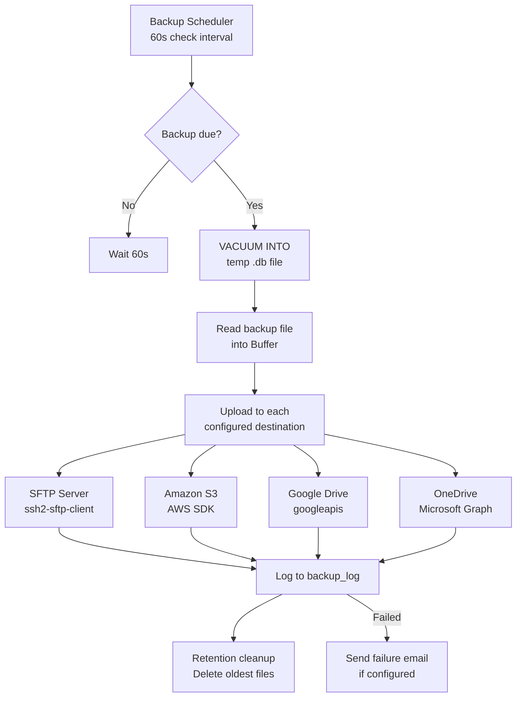
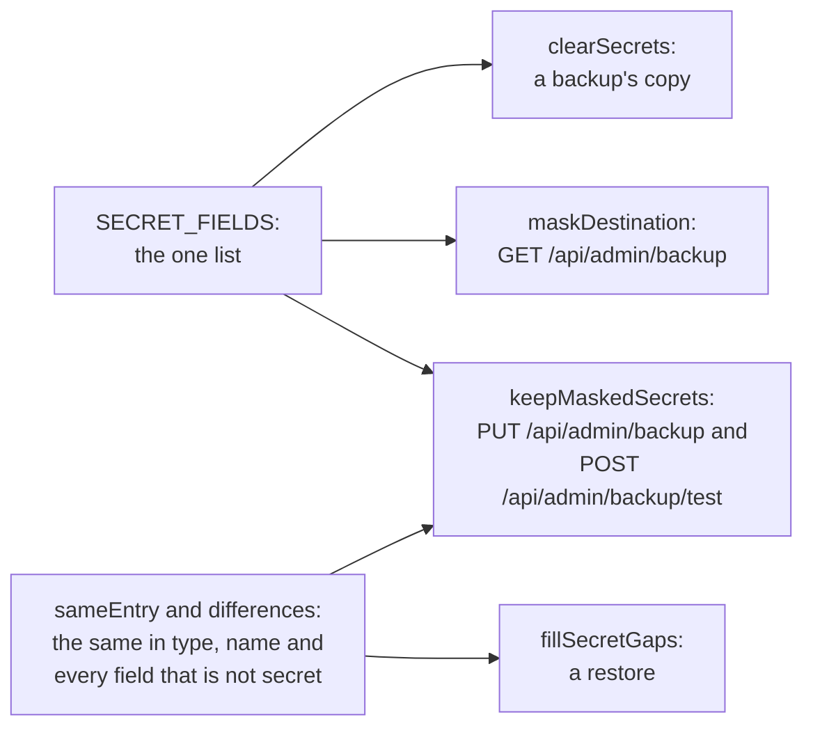
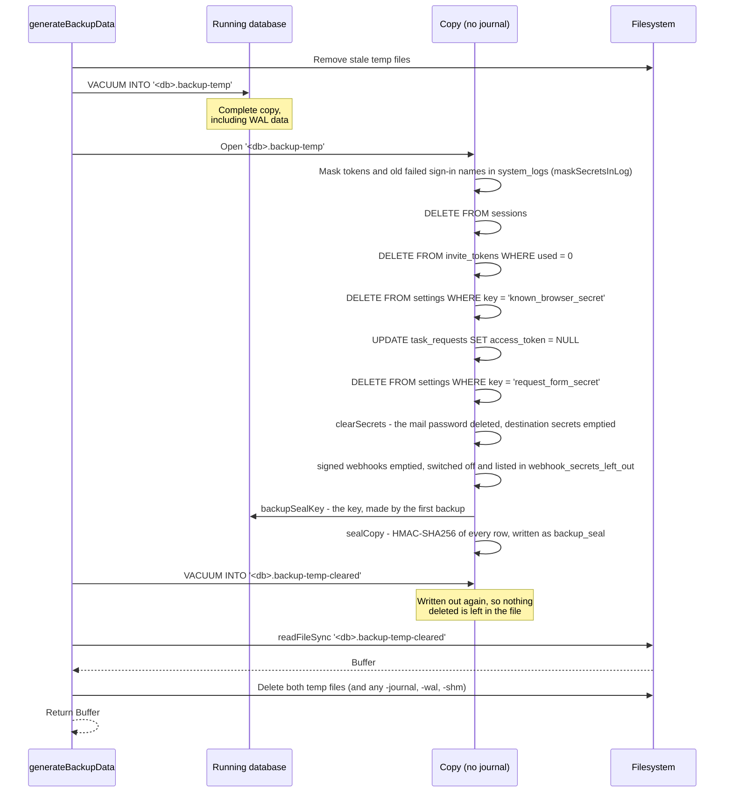
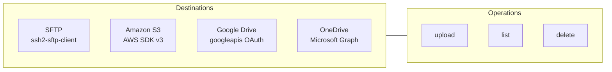
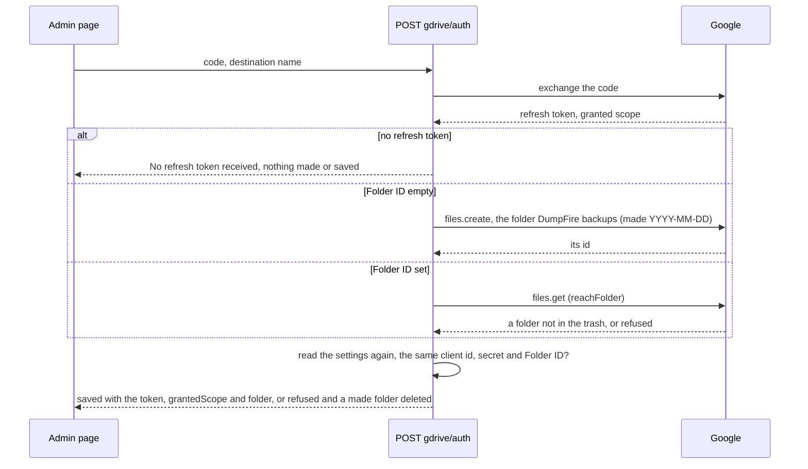
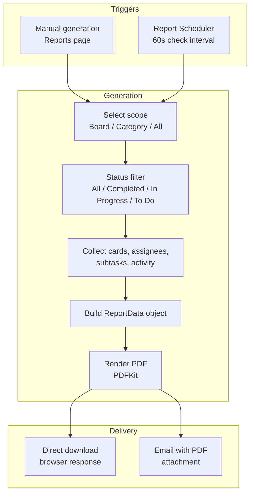
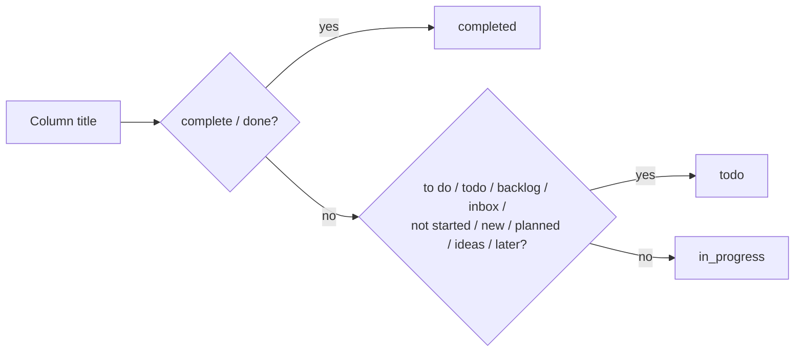
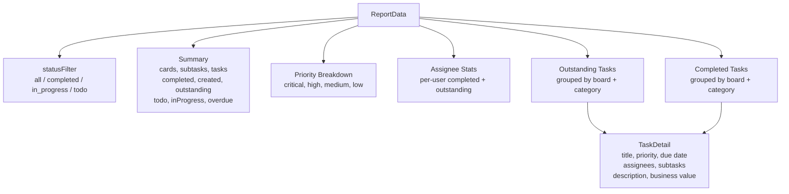
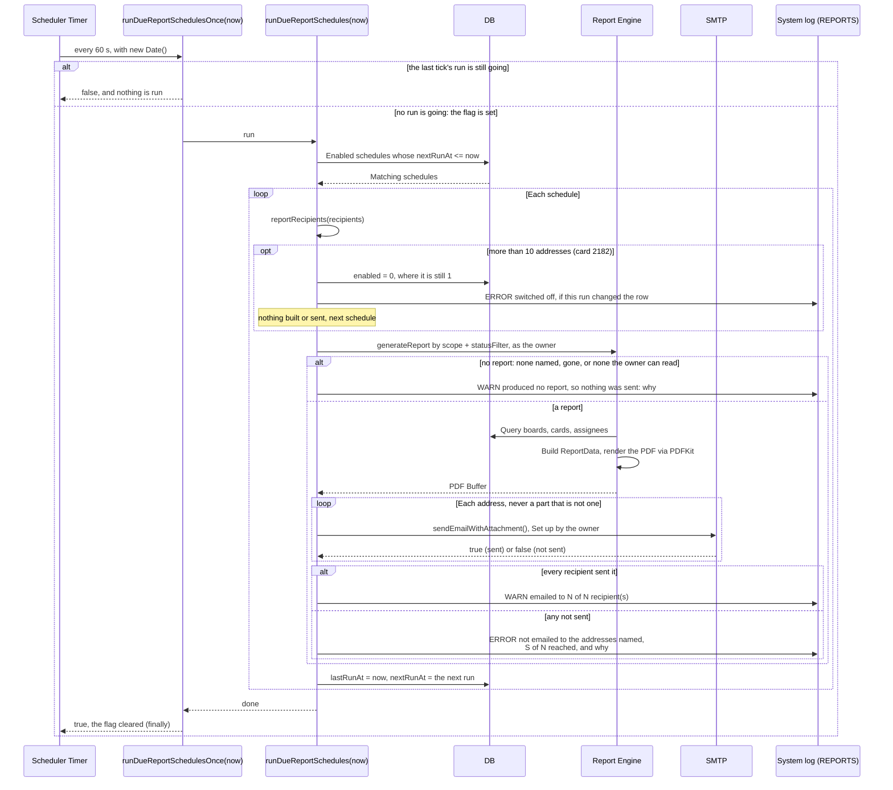

# Backup & Reporting System

DumpFire includes two scheduled systems: automated database backups to multiple cloud/remote destinations, and PDF report generation with email delivery.

## Backup System

### Backup Architecture



### What a Backup Holds

A backup is the database file and nothing else. Files attached to cards are stored on
disk, in the `uploads` folder beside the database, and are in no backup this system makes.
They have to be backed up separately: see
[Deployment](deployment.md#attachment-files).

So that a restored database is not left without its files, the attachment files of a
deleted card are not removed with it. They are moved to a trash folder inside `uploads`
and kept for 30 days, and Import Backup puts back any file in the trash that a restored
attachment names.

Nor does the file hold what opens something for whoever reads it: no session, no invite
that has not been used, no task request's link and not the key the public request form
signs with (card 2158). Every request is in it, with its link empty, and a restore gives
every request a new link, so a link mailed before a restore stops working and its
requester asks for the current one from the page it opens. See
[What a Backup Holds](authentication-security.md#what-a-backup-holds-and-what-a-restore-brings-in).

Nor does it hold a secret (card 2169): not the mail password, not a destination's
credentials, not a webhook's signing secret. Each destination is in it with its other
fields, and a webhook that had a secret is in it switched off, listed in the
`webhook_secrets_left_out` setting. Every backup is sealed: an HMAC of every row, made with
a key this server keeps and no backup holds. A restore keeps this server's own where they are
for the same account (for a webhook, the same id, board, address and setter), and only into a
backup this server made and nobody has changed since,
and says which are to enter again; a destination still without its
credentials is not tried by a backup run (below). So a backup alone no longer rebuilds a lost
server: keep the mail password and each destination's credentials outside DumpFire. What it
does still hold that is worth guarding: every user's password hash and email, and every
webhook's address, which for a Slack or Teams incoming webhook is all anyone needs to post to
that channel.

### Schedule Options

| Schedule | Mechanism | Description |
|----------|-----------|-------------|
| `disabled` | — | No automatic backups |
| `hourly` | Interval | Every 60 minutes since last backup |
| `every6h` | Interval | Every 6 hours since last backup |
| `every12h` | Interval | Every 12 hours since last backup |
| `daily` | Time-based | Once per day at configured time |
| `weekly` | Time-based | Once per week on configured day and time |

### Backup Configuration

Stored as JSON in the `settings` table under key `backup_config`:

```json
{
  "schedule": "daily",
  "scheduleTime": "02:00",
  "scheduleDay": 0,
  "retention": 7,
  "destinations": [],
  "notifyOnFailure": true,
  "notifyEmail": "admin@example.com"
}
```

`PUT /api/admin/backup` writes what it is sent over this and keeps the rest, and `{}` is
`400 No valid fields to update` (card 2117). A save of part of the settings used to write
the defaults over the rest, and `{}` switched the schedule off and deleted every
destination. Each field is read by its rule: `schedule` one of the six above,
`scheduleTime` `HH:MM` (empty is 02:00), `scheduleDay` 0 to 6, `retention` 1 to 100,
`notifyOnFailure` `true` or `false`, `notifyEmail` one address or more, separated by
commas, semicolons or lines and stored separated by commas, or empty. Each destination is
a text `name`, a `type` of `sftp`, `s3`, `gdrive` or `onedrive`, and the fields of its
type (`readDestination()` in `src/lib/server/backup-destinations.ts`); any other field is
not kept, `grantedScope` included (only Connect writes it). An SFTP `port` is a whole number
from 1 to 65535, or `null`, which connects to 22. `readDestination()` no longer puts a stored
secret in place of a mask: it did until card 2190, finding the stored destination by name or
by its place in the list. A mask is now resolved by `keepMaskedSecrets()`, below. An SFTP
`host` is saved trimmed of ASCII spaces and tabs only, one sent back as stored kept as it is
(`trimHost()`, the review-fix pass's S1). A list that names two destinations alike is refused
`400` before anything else is asked of it (`twiceNamed()`, S4): "Two backup destinations are
named "NAS"." and, where two of that name were saved before, "Remove the destinations named
"NAS" (the page's Remove removes every one of that name) and add it once with its secret
typed.", or otherwise "Each destination needs a name of its own: give one of them another
name." A destination is found by its name to connect, test and back up to.

**The secret fields, as the admin page is told them and as a save keeps them** (cards 2187
and 2190). One list, `SECRET_FIELDS` in `src/lib/server/backup-secrets.ts` (the list a backup
clears, card 2169's), serves three routes, so a field added to it is masked, kept and cleared
with nothing else to change:



- **`maskDestination()`** answers every secret field of any type that holds anything as
  `••••••••` (`SECRET_MASK`), whatever the destination's type: SFTP `password` and
  `privateKey`, S3 `secretAccessKey`, `clientSecret`, Google Drive `refreshToken` (which the
  answer carried as stored until card 2187), and a service account's `private_key` inside
  `serviceAccountJson` where the JSON reads as an object, and a `privateKey` beside it; such JSON is
  always written out again from what was read, never shown as stored, so text that names
  `private_key` twice (which reads as its last) cannot carry the first to the browser (S3).
  JSON that cannot be read, or reads as anything else (a string, a list), is masked whole. Every other field is as stored,
  `grantedScope` included.
- **`keepMaskedSecrets(incoming, stored)`**, for the `PUT` (each destination, inside its
  transaction, `400` on the first refusal) and the test route: a destination with a mask in
  any secret field takes each masked field's value from the one stored destination that is
  the same in type, name and every field that is not secret (`sameEntry`, compared as the
  destination would use them: missing, `null` and `''` alike; the host trimmed of ASCII spaces
  and tabs, ASCII letters in any case, any other difference a change; an SFTP port 22, an S3 region `us-east-1` and a OneDrive folder path `DumpFire
  Backups`, slashes trimmed, when not set; a service account by its JSON's `client_email` and
  `private_key_id`, its JSON then taken whole), and an SFTP host is then written as that entry
  has it, so the secret goes to the host it was saved with byte for byte (S1). None, and it is
  refused with decision 3's words, naming every field still masked and what changed; more than
  one, and the words say to remove the destinations of that name, which the page's Remove
  does, and add it once with its secret typed (O1). A Google Drive
  OAuth destination with its token masked is told to be removed, added again and connected,
  beginning with removing DumpFire's access in the Google account unless every stored
  destination it could be was connected with `drive.file` alone. A destination with no mask
  is used as sent. `grantedScope` is never taken from a request: it comes back only with a
  kept refresh token.

### Backup Data Generation

`generateBackupData()` in `src/lib/server/backup.ts` makes the one copy that both a
scheduled backup and "Export Backup" send. It uses SQLite's `VACUUM INTO` twice: once to
take a self-contained snapshot of the running database, and once to write out again a copy
that has been cleared of what signs somebody in or opens a request's thread, and of every
secret (`withoutSecrets()`, which was `withoutSignIns()` until card 2169):



- **The snapshot includes all WAL data.** A raw file copy would miss unflushed writes.
- **No session and no unused invite is in the file**, and its system log is masked: every
  invite's address written as `/invite/[token]`, the token of every unused invite replaced
  wherever a line holds it, a request link's `token=` masked, and an old failed sign-in line
  at a name that was no account rewritten to hold only the name's length (card 2193).
- **The key remembered browsers are signed with is not in the file** (the row
  `known_browser_secret` of `settings`, card 2194), and a restore never brings it in from a
  backup of any age (`rowsToRestore()` in `src/lib/server/db/restore.ts`). Whoever held it
  and an account's password hash, which a backup does hold, could make a cookie that lets a
  browser past sign-in's throttling for that account. So a restore forgets every remembered
  browser, and the restored server makes a new key.
- **No request's link and not the form's key** (card 2158): every `task_requests.access_token`
  is `NULL` in the file, and the `request_form_secret` row of `settings` is gone. A restore
  gives every request a new link inside its transaction, whatever the backup's age, and
  never brings the form's key in; the import's answer says how many links were replaced.
  The running database is not touched by a backup. Deleting the rows alone is not enough, because the pages they
  were on stay in the file until it is written again; hence the second `VACUUM INTO`.
- **No secret** (card 2169): `clearSecrets()` in `src/lib/server/backup-secrets.ts` deletes the
  `smtp_pass` row, sets each destination's secret fields in `backup_config` to `''` (SFTP
  `password` and `privateKey`, S3 `secretAccessKey`, Google Drive `clientSecret` and
  `refreshToken`, a service account's `private_key` inside `serviceAccountJson`, OneDrive
  `clientSecret`; every one of them on every destination, whatever its type), deletes the
  `backup_seal_key` row, leaves out a destination of a type this version does not know and a
  `backup_config` that is not JSON, and sets each webhook's secret to `''` with the webhook
  switched off and listed, as `[{"id":3,"active":true}]`, in `webhook_secrets_left_out`. A
  webhook is switched off because the file can become a database without a restore, and one
  left on with no secret would send every event unsigned. It throws before writing anything
  if handed the running database. A restore fills each gap from this server only from an
  entry the same in every field that is not secret (`fillSecretGaps()`), and only into a
  backup whose seal verifies. For a webhook that is the webhook here with the same id, board,
  address and setter (`set_by`, the account that last set its address or secret, or switched it on, card 2168;
  none and none alike, and none on a database from before migration 0056): a secret here set
  by another account than the backup's row names was set again since, and is listed to enter
  again rather than filled under the backup's setter, where that account's password reset
  would not reach it. See
  [The Secrets a Backup Does Not Hold](authentication-security.md#the-secrets-a-backup-does-not-hold-card-2169).
- **Sealed** (card 2169's review, S1): `sealCopy()` writes into the cleared copy, as the
  `backup_seal` setting, an HMAC-SHA256 of a dump of it that is the same from the same rows
  whatever file they are in (`sealOf()`: every row of `sqlite_master` by type and name, SQLite's own included; every
  table but `sqlite_sequence`, `sqlite_stat1` to `sqlite_stat4` included, by name, every row
  read `NOT INDEXED` in rowid order, each value typed and its length given; the seal's own row
  left out; the second review's B1), so the seal written before the second `VACUUM INTO` holds for the
  file after it. It is stored as its form number, a colon and the 64 hex characters (`2:…`); a
  restore takes a seal of any other form as none. The key is the `backup_seal_key` setting of the running database, made by the
  first backup (`backupSealKey()`): the one thing a backup writes there. `withoutSecrets(from,
  to, key)` takes it, this server's unless a test gives another. Measured on made-up copies on
  a development machine: 0.2 s for 59 MB and 115,000 rows, 0.56 s for 177 MB and 345,000.
- **The server answers nothing while it runs.** Every step is synchronous, from the first
  `VACUUM INTO` to the read: see "How long the server stops answering" under
  [Backup Destinations](deployment.md#backup-destinations) in the deployment guide for the
  figures, which are an estimate from parts.
- **The two temporary files are beside the database**, on the volume, and are deleted
  whether or not the backup succeeds. A database in memory has nothing beside it, so they
  go to a folder of their own under the temp folder. A crash can leave them behind; the
  first holds live sessions, which is why `.gitignore` and `.dockerignore` keep both out.

See [What a Backup Holds](authentication-security.md#what-a-backup-holds-and-what-a-restore-brings-in)
for why, and what a restore brings in.

### Destination Types



Each destination implements three operations:
- **upload** — Push a backup buffer with a timestamped filename
- **list** — List existing backups for retention cleanup
- **delete** — Remove old backups beyond retention limit

**Google Drive's scope and folder** (card 2188). Connect (`POST
/api/admin/backup/gdrive/auth`) asks for `https://www.googleapis.com/auth/drive.file`
(`DRIVE_FILE_SCOPE` in `src/lib/drive-scope.ts`), the files DumpFire makes, where it asked for
the whole of Drive; a service account already asked for `drive.file`. A token refreshes with
the scopes it was granted, so a connection made before keeps the whole of Drive until it is
connected again. The Connect, in order:



- A folder that cannot be reached refuses the Connect with nothing saved, the destination
  keeping the connection it had; Google's reason is a `WARN` line under `GDRIVE`.
- The settings are read again after Google's answers and written with no `await` between,
  only if the destination is still there with the client id, client secret and Folder ID it
  had; otherwise "The destination was changed or removed while it was being connected, so
  the connection was not saved. Connect it again." A folder made by a Connect that is not
  saved, or that throws, is deleted again (best effort, a `WARN` naming its id on failure).
- `grantedScope` is Google's `tokens.scope` as granted, and nothing when Google names none.
  `driveScopeIsNarrow()` (in `src/lib/drive-scope.ts`, no server imports, read by the admin
  page and by `keepMaskedSecrets()`) is true only when every scope in it, split on white
  space, is exactly `drive.file`; a missing one is all of Drive. The page shows `✅ Connected`
  or `⚠️ Connected · all of Drive` by it.
- `GDriveDestination.test()` fetches the folder (`reachFolder()`) before it lists it, for
  either sign-in method, and says when it cannot reach it; with no Folder ID it answers as
  before.
- A failed Connect is one `ERROR` line, `Google Drive Connect failed for destination "…": …`.

### Retention Cleanup

After each successful upload, the system:
1. Lists all backup files at the destination
2. Sorts oldest-first
3. Deletes files exceeding the configured retention count

On Google Drive the listing reads every page of the folder (up to 100 pages of 1,000 files; past that it stops with an error rather than follow a page token for ever) and each file's `capabilities.canDelete` and `canTrash` (card 2238), through the destination's optional `listForRetention()`. A file the account may delete is deleted by the id it was listed under; one it may only trash is moved to the trash, and logged `Retention cleanup: moved to the trash <name>` rather than `deleted` (its `delete()` answers `'trashed'`); one it may do neither to is set aside, not counted towards the retention number and not tried, and each run that finds any writes one `WARN` line saying how many and naming the oldest. The other destinations have no `listForRetention()` and are counted from `list()` as before. See [Configuring Backups](admin-guide.md#configuring-backups) for what to do about files set aside.

### A Destination Without Its Credentials

`runBackup()` asks `credentialsMissing()` (in `src/lib/server/backup-secrets.ts`) of each
destination before it makes the copy (card 2169). One that lacks its credentials is not
handed to `createDestination()`: an S3 destination with no secret access key, a Google Drive
one with no client secret or no refresh token (OAuth) or whose service account JSON holds no
private key, a OneDrive one with no client secret. Its result and its `backup_log` row are
`failed`, with the `ERROR` line and the failure mail any failure has, and the error is
"This destination's credentials are not entered: a backup does not hold them, so they are
entered again after a restore. Enter them in Admin, Scheduled Backups." (Google Drive OAuth:
"… In Admin, Scheduled Backups, enter its client secret and connect it again."). That is
what Backup History shows after a restore onto another server, where it would have shown a
library's error. The copy is made only when at least one destination can be tried, so a run
with none makes no copy and does not stop the server answering for it. An SFTP destination
with neither a password nor a key is tried as before, since a server that allows `none`
authentication accepts it; after a restore onto another server such a destination is tried
against the real host at every run, and its failed logins may trip a lockout there, so its
credentials are entered or it is removed. The results are given in the destinations' order.

### Failure Notifications

If `notifyOnFailure` is enabled and SMTP is configured, a styled HTML email is sent to the configured address with the error details, a destination not tried for want of its credentials included. The destination's name and type and the error text, which is whatever the destination's server answered, are escaped where they are put into the mail, so markup in them is shown as text and never drawn (see [Text in Mail Is Text](notifications-email.md#text-in-mail-is-text)).

---

## Report System

### Report Architecture



### Report Scopes

| Scope | Description | Data Included |
|-------|-------------|---------------|
| `board` | Single board | All cards in that board for the period |
| `category` | Board category | All boards in a category, aggregated |
| `all` | All boards | Every board across the system |

Every scope walks into sub-boards recursively (`collectSubBoardIds`), so a board report includes the cards on its sub-boards and an all-boards report counts every card in the system.

A report emailed by hand carries the board's or grouping's name and the sender's username, and a scheduled report the schedule's name. Each is escaped where it is put into the mail's HTML, so a name with markup in it reads as typed and draws nothing; the subject keeps the name as typed, because a subject is plain text (see [Text in Mail Is Text](notifications-email.md#text-in-mail-is-text)).

A report asked for by hand (`POST /api/reports`, and `POST /api/reports/email` for the
emailed one) reads its fields as a schedule does (card 2117): `scope` is `board`,
`category` or `all`, where the emailed one read any other word as every board the sender
can see; `periodStart` and `periodEnd` are a date or a timestamp, and `periodStart` is not
after `periodEnd` (`periodStart is after periodEnd`; a bare date is the whole day, so a
date to the same date is that day), where a period that ended before it began was drawn as
a report of nothing; `scopeId` is an id;
`detailLevel` and `statusFilter` are among their values, where another was read as
`detailed` or `all`; and `assigneeUserId` is a user's id or `null` for everyone, where
`"all"` and `''` were taken for everyone. Each of the emailed report's `recipients` is an
address, `recipients[1] must be an email address`: one that was not used to be dropped
without a word and the report sent to the rest.

The emailed report's answer says what was sent (card 2113): `503` with no mail set up,
before the PDF is built; `200` when every recipient was sent it; `200` naming the addresses
not reached when some were; `502` when none was; each but the `503` with every recipient's
result. The Reports page keeps the dialog open for a report not sent to everyone, with only
the addresses not reached left in it. See
[A Report Emailed on Demand](notifications-email.md#a-report-emailed-on-demand).

### Status Filter

Every report (one-off, emailed and scheduled) carries a `statusFilter` that decides which slice of the scope is listed. Summary metrics always describe the whole scope — the filter only changes the task listings and the priority breakdown.

| Value | Lists | Section order |
|-------|-------|---------------|
| `all` (default) | Completed in period, then everything still open | **Completed in Period first**, then Outstanding per board |
| `completed` | Only cards completed within the period | Completed in Period |
| `in_progress` | Open cards that have left To Do (In Progress, On Hold, Review, Testing…) | In Progress per board |
| `todo` | Open cards still in a To Do / Backlog style column | To Do per board |

Cards are classified by the title of the column they sit in (`classifyColumnTitle`):



A board with no recognisable To Do column still gets one: its left-most column that is not Done is treated as To Do. A stored filter value it does not know falls back to `all` (`parseStatusFilter`), so an existing schedule keeps working. A request that sends one is refused, `400 statusFilter must be one of: all, completed, in_progress, todo`: until card 2117 it was read as `all`.

When a filter other than `all` is active the PDF header carries the filter label and a **SHOWING** banner under the metric tiles states how many cards are in that slice.

### Cards vs Tasks

Two figures appear side by side in the summary tiles, and the same two on the dashboard's **All Tasks** row:

| Figure | Definition |
|--------|------------|
| **Cards** | Non-archived kanban cards across every board *and sub-board* in scope, regardless of period |
| **Tasks** | Cards plus the subtasks hanging off them (`totalCards + totalSubtasks`) |

The dashboard row uses the same board → cards → sub-boards walk as the report engine (`src/routes/+page.server.ts`), so an all-boards report and the dashboard always quote the same card count. Historically the row only summed top-level boards, which is why it used to show fewer cards than the report.

### Report Data Structure



### PDF Generation

PDFs are rendered server-side using PDFKit with a professional layout:

- **Header** — DumpFire branding, report title, date range, detail level and (when set) the status filter
- **Executive Summary** — Six stat tiles: Cards, Tasks incl. subtasks, Completed, Created, Outstanding, Overdue, with a caption spelling out what each one counts
- **Status banner** — Only when a filter is active: "SHOWING Completed in period only — N cards" etc.
- **Priority Breakdown** — Visual bar chart of the slice being reported (Outstanding by default, Completed in Period for the completed filter)
- **Assignee Performance** — Table of completions per user (scope-wide)
- **Board Breakdown** — Per-board totals with sub-boards nested under their parent (scope-wide)
- **Completed Tasks** — Completions in the period with timestamps; drawn **before** the open work in the `all` report
- **Outstanding / In Progress / To Do** — Open work grouped by category and board, sub-boards nested under their parent; the heading follows the filter

All free text (titles, descriptions, business value, subtasks) passes through `stripTag()`, which removes the internal AI bookkeeping tags `[Antigravity]`, `[Claude]` and `[AI]` before printing.

### Report Scheduling

Configured per-user via the Reports page:

| Field | Type | Description |
|-------|------|-------------|
| `scope` | board/category/all | What to report on |
| `scopeId` | number | Board or category ID |
| `frequency` | weekly/monthly | How often |
| `dayOfWeek` | 0-6 | Day for weekly reports |
| `dayOfMonth` | 1-28 | Day for monthly reports |
| `timeOfDay` | HH:MM, 00:00 to 23:59; empty is 09:00 | When to generate |
| `recipients` | Up to 10 addresses, separated by commas, semicolons or spaces (tabs and new lines too), an address written `<address>` read as the one inside; each part must be an address. Stored as the addresses it is sent to, lower-cased, each once, separated by `, ` | Where to send |
| `periodDays` | 1-366 | Lookback period in days |
| `detailLevel` | summary/detailed | Metrics and listings only, or full descriptions, business value and subtasks |
| `statusFilter` | all/completed/in_progress/todo | Which slice to list (see Status Filter); stored in `report_schedules.status_filter`, migration `0041` |
| `enabled` | boolean | Active toggle |

Who a report may reach (card 2182), told in full in
[Who a Report Can Be Mailed To](notifications-email.md#who-a-report-can-be-mailed-to):

- **A schedule holds at most 10 addresses.** More is `400` `A schedule can be sent to at
  most 10 addresses, and this names 12. The schedule was not saved.` (`… was not changed.`
  on `PUT /api/report-schedules/{id}`), and a part that is not an address is `400`
  `recipients holds "smith", which is not an email address`, with nothing saved. Any address
  may be one, an account's or not.
- **An account has at most 20 schedules.** The 21st is `409` `You have 20 report schedules,
  the most one account may have. Delete one first.` An account that already has more keeps
  them all and makes no more until it has fewer than 20.
- **The day's 100 addresses.** One account's report mail reaches at most 100 addresses in a
  24-hour window counted from its first take (so up to 200 across one window's end and the
  next's start): the reports it emails by hand, and the schedules it makes, turns on or
  re-times, each of which takes the schedule's addresses, because each can bring a send
  forward; and a change of a schedule's list, which takes the addresses it adds, those not
  in the stored list (one address changed to ten takes nine). The stored list sent back in
  another order or case, or cut down, a change of name or filter, and turning a schedule
  off take nothing, and nothing is given back when a schedule is deleted. Past it, `429`
  `Report mail can reach at most 100 addresses a day from one account, and this schedule's
  10 would make 104. The schedule was not saved. Try again in 5 hour(s).` (`this schedule's
  4 new addresses would make 104` and `was not changed` for a changed list), nothing saved.
  A scheduled run takes nothing.
- **A schedule kept from before with more than 10** cannot be turned on as it is: `PUT` with
  `enabled: true` on such a schedule that is off is `400` `This schedule cannot be turned
  on: it is sent to 15 addresses, and the most is 10. Delete it and make it again with at
  most 10.` One still on can be sent back with `enabled: true` and a new name, as a page
  sends the row. A caller of the route can also send a list of 10 or fewer with `enabled:
  true` in the same `PUT`, which is accepted. The Reports page cannot edit a list, so it
  shows such a schedule's addresses as text to copy, with "Copy the ones to keep into a new
  schedule of at most 10, then delete this one."

A report emailed by hand from the Reports page is held to the same reading: at most 10
distinct addresses a call (`400` `A report can be emailed to at most 10 addresses at a time,
and this names 12. Nothing was sent.`, before the board is looked at), and the account's
100 a day, counted in a 24-hour window from its first (`429` `Reports can be emailed to at most 100 addresses a day from one account,
and this would make 104. Try again in 5 hour(s).`, taken before the PDF is built). See
[A Report Emailed on Demand](notifications-email.md#a-report-emailed-on-demand).

### Schedule Execution

Every minute the timer of `initReportScheduler()` calls `runDueReportSchedulesOnce(now)` in
`src/lib/server/reports.ts`, with the time it is then, and that calls
`runDueReportSchedules(now)` unless the last minute's run is still going. Both are exported
so that the tests can call them with a time of their own; under test the timer is off
(`SCHEDULERS=off`). A run takes each enabled schedule whose `nextRunAt` has come, as its
owner: the report is built with the owner's access, as if they had asked for it.

**One run at a time.** A run can take longer than the minute between ticks: about 35 seconds
for each address a slow mail server holds up, and the PDF before that. A schedule's next run
is written only once its mail has gone, so a tick that started while the last run was still
sending found the same schedule due and sent its report a second time. A module flag now
marks a run in progress: a tick that finds it set does nothing and answers `false`, and the
flag is cleared in a `finally`, so a run that throws does not stop the scheduler. A schedule
that came due during a run is still due at the next tick that runs.



What the system log says, under the context `REPORTS` (card 2113). Each send's result is
counted; it used to say "emailed to N recipient(s)" whatever the mail server answered, and
nothing at all for a schedule that produced no report.

| What happened | Level | Line |
|---------------|-------|------|
| Every recipient was sent it | `WARN` | `Scheduled report emailed: "<name>" to 3 of 3 recipient(s)` |
| One or more were not | `ERROR` | `Scheduled report "<name>" was not emailed to b@example.com (2 of 3 recipient(s) reached). The mail server did not accept it: its reason is in the EMAIL line logged for each address. It is not sent again before its next run.` |
| None could be, mail not being set up | `ERROR` | The same line, with `Mail is not set up on this server` as the reason. `email.ts` logs nothing of its own then |
| No report: its board is gone, or its owner can no longer read it | `WARN` | `Scheduled report "<name>" produced no report, so nothing was sent: the board it covers (id 7) is gone, or the schedule's owner can no longer read it` |
| No report: its grouping is gone, holds no board, or holds none its owner can read | `WARN` | `... produced no report, so nothing was sent: the grouping it covers (id 7) is gone, holds no board, or holds none the schedule's owner can read` |
| No report: a board or grouping schedule that names none (`scopeId` empty) | `WARN` | `... produced no report, so nothing was sent: the schedule has no board` (`the schedule has no grouping` for a grouping) |
| No report: a report on every board, and its owner is not an administrator | `WARN` | `... produced no report, so nothing was sent: a report on every board is for an administrator, and the schedule's owner is not one` |
| No recipients | `WARN` | `Scheduled report generated but no recipients configured: "<name>"` |
| More than 10 addresses, kept from before the cap (card 2182) | `ERROR` | `Report schedule 12 "Weekly sales", owner "pat" (user 7), was switched off: it is sent to 15 addresses, and the most is 10. Nothing was sent. Its owner can delete it and make it again with at most 10.`, with the owner as the line's user. Once: the switch-off is written only where the schedule is still on, and only the run that changed the row writes the line |
| A list that also holds parts that are not addresses, kept from before (card 2182) | As the line | The emailed, not-emailed or no-recipients line above ends `Left out, as not email addresses: "alice", "smith".` Those parts are never sent to; the addresses are, and the schedule is not switched off for them |

- **A schedule moves on to its next run whatever was sent.** `lastRunAt` and `nextRunAt` are
  written after each of the cases above, and nothing is sent again before the next run: a
  retry would mail the report a second time to everyone it did reach. A schedule with no
  report also moves on, and goes on logging its `WARN` line at each run until it is mended
  or deleted.
- **A schedule whose report throws is tried again at the next minute.** An error while the
  report or its PDF is made is logged at `ERROR`, `Failed to run scheduled report "<name>"`,
  and the schedule is left as it was, so it is still due a minute later, and fails again.
  Card 2144 is to settle it.
- **A schedule switched off for more than 10 addresses is not run again** until it is
  remade with 10 or fewer, or a `PUT` sends a list of 10 or fewer with `enabled: true`. Its
  last and next run are left as they were, so a schedule turned back on that way is due at
  the scheduler's next tick, and the `PUT` takes its addresses from the day's 100. Its owner sees why on the Reports page, with its
  addresses to copy; the administrators see the `ERROR` line on the Audit page.
- **Every scheduled mail names the account that set it up**: "Set up by `<username>`" above
  "— DumpFire Automated Reports", the username escaped (card 2182), as the report emailed by
  hand says "Sent by `<username>` via DumpFire".
- **The `WARN` lines are kept at the default level, `INFO`.** A server started with
  `LOG_LEVEL=ERROR` keeps the `ERROR` lines only.

### Card Reports

Individual card reports can be generated for completion notifications. These include:
- Card title, priority, and business value
- Description rendered as text
- Subtask completion status
- Assignee list
- Activity timeline

## Key Implementation Files

| File | Lines | Purpose |
|------|-------|---------|
| `src/lib/server/backup.ts` | ~570 | Backup scheduling, data generation (`withoutSecrets()`: no session, no unused invite, no key remembered browsers are signed with, no request link or form key, no secret, and sealed), upload orchestration (`runBackup()`, which does not try a destination without its credentials) |
| `src/lib/server/backup-secrets.ts` | ~1,400 | What a backup leaves out because it is a secret (card 2169), and what the admin routes mask and keep (cards 2187 and 2190: `SECRET_MASK`, `maskDestination()`, `keepMaskedSecrets()`, `keepMailPassword()`): `clearSecrets()`, `readSecretsHere()` and `fillSecretGaps()` for a restore, `credentialsMissing()`, `secretsToEnter()` for the start-up line, and the two sentences; the seal: `backupSealKey()`, `sealOf()`, `sealCopy()`, `sealVerifies()`, `keepSealKey()`, and the checks made before it, `unsealedBecause()`, `backupFailsCheck()`, `strayInternalObjects()`; `fromTableStorage()`, how a table is read for the seal and the restore |
| `src/lib/server/backup-destinations.ts` | ~670 | SFTP, S3, Google Drive, OneDrive destination implementations; `readDestination()`; `reachFolder()` and `makeDumpfireFolder()` for Google Drive (card 2188) |
| `src/lib/drive-scope.ts` | ~40 | `DRIVE_FILE_SCOPE`, `driveScopeIsNarrow()` and `dumpfireFolderName()`, read by the server and the admin page (card 2188) |
| `src/lib/server/reports.ts` | ~1,700 | Report data collection, status filter, PDF rendering, schedule management, `runDueReportSchedules()` and the timer's `runDueReportSchedulesOnce()`; `takeReportMail()`, the day's 100 addresses (card 2182) |
| `src/routes/api/reports/email/+server.ts` | ~170 | A report emailed on demand, and its answer |
| `src/lib/report-recipients.ts` | ~70 | `reportRecipients()` and `MAX_REPORT_RECIPIENTS`: the one reading of a list of recipients, for the routes, the scheduler and the page (card 2182) |
| `src/lib/server/snapshots.ts` | ~85 | Daily card count snapshots for the CFD (burndowns use card timestamps) |
