# Backup & Reporting System

DumpFire includes two scheduled systems: automated database backups to multiple cloud/remote destinations, and PDF report generation with email delivery.

## Backup System

### Backup Architecture

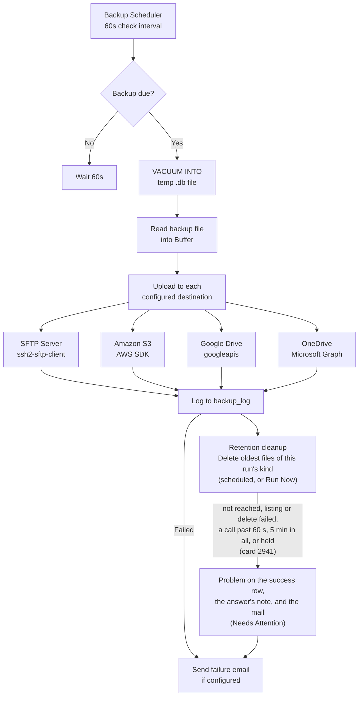

### What a Backup Holds

A backup is the database file and nothing else. Files attached to cards are stored on
disk, in the `uploads` folder beside the database, and are in no backup this system makes.
They have to be backed up separately: see
[Deployment](deployment.md#attachment-files).

So that a restored database is not left without its files, the attachment files of a
deleted card are not removed with it. They are moved to a trash folder inside `uploads`
and kept for 30 days, and Import Backup puts back any file in the trash that a restored
attachment names. The same holds for the images [image retention](#image-retention) moves.

That is still so since card 2754, which lets an API key attach images: an image is a file
in `uploads/<card id>/` with a row of about a hundred bytes, never a blob in the database,
so screenshots do not grow a backup.

Nor does the file hold what opens something for whoever reads it: no session, no invite
that has not been used (and the used ones only as hashes, card 2849), no task request's link and not the key the public request form
signs with (cards 2158 and 2870). Every request is in it with no link: the links are kept
only as hashes, in `request_links`, and the file holds none of them. A restore brings in no
link, so a link mailed before a restore stops working and its requester asks for a new one
from the page it opens, or gets one in the next mail. See
[What a Backup Holds](authentication-security.md#what-a-backup-holds-and-what-a-restore-brings-in).

Nor does it hold a secret (card 2169): not the mail password, not a destination's
credentials, not a webhook's signing secret. Each destination is in it with its other
fields, and a webhook that had a secret is in it switched off, listed in the
`webhook_secrets_left_out` setting. Every backup is sealed: an HMAC of every row, made with
a key this server keeps and no backup holds. A restore keeps this server's own where they are
for the same account (for a webhook, the same id, board, address and setter), and only into a
backup this server made and nobody has changed since,
and says which are to enter again; a destination still without its
credentials is not tried by a backup run (below). So a backup alone no longer rebuilds a lost
server: keep the mail password and each destination's credentials outside DumpFire. What it
does still hold that is worth guarding: every user's password hash and email, and every
webhook's address, which for a Slack or Teams incoming webhook is all anyone needs to post to
that channel.

The file also holds the system log as it was when the backup was made, masked. A restore does
not bring it in (card 2899): this server's log is kept as it was, line for line, and the
backup's lines stay in the file. The import says how many there were, and its `CRITICAL` line
names who imported the file and its SHA-256, so that the file, and the log in it, can be found
again. The file's log is described, never quoted: its first and last times are named only where
both are real times, and a log in it that cannot be read is said to be one that could not be
counted, with the restore going ahead (card 2899's code review). See
[Restoring from Backup](admin-guide.md#restoring-from-backup).

A restore also judges the backup's webhooks against its own disabled owners and administrators
(card 2935, P12; its code review, C3). Every restore runs the start pass itself, after this
server's holds and disabled accounts are carried and before any secret is filled, from the
restored `settings`' own `webhooks_readable_by_disabled_held` moment: every webhook with a secret
(one the backup left without its secret counted as having one) that an owner or administrator
disabled after that moment could read and did not set, made before its disable, is held as
`setter access ended`; with no moment at all, every disabled one's, and every webhook with a
secret made before setters were recorded too. Where anything lay after the moment it is written as
now; where no account was disabled after it, nothing is held or written. The server's own restore
tells them with its sweep (the owners mailed where the schedulers run); a working copy tells
nobody.

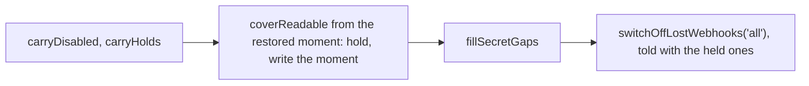

A restore never fails open on which API key was given which webhook's secret (card 2947, R1,
R2). The backup carries `webhook_reveals` like any table. This server's rows are read before the
clear, and after the secrets are filled each is put back for every restored webhook on the same id
and board that has a secret, whether filled from here or brought in with the backup's own (a whole
database copy carries its secrets; code review FP6), and only where the restore brought back the
same key, by id and hash (`carryRevealsHere`); every other row of such a webhook names a key the
restore did not bring back, and that webhook is held as `setter access ended` (holding one whose
secret differs only over-holds). The keys of an account disabled again (`carryDisabled`) have their
rows deleted with them, the foreign keys being off during a restore, and what they were given is
held too. A working copy holds the same, before it switches every webhook off, and tells nobody
(FP1). On the server's own restore the sweep of ended keys then runs inside the restore, the
once-only seed first where the restored settings lack `webhook_reveals_seeded`, and all of it is
told with the restore's sweep; the owners' mail says "found after a restore" and names nobody, the
log naming who restored (FP5).

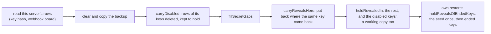

### Image Retention

A card keeps its images when it is completed: cards are reopened, and the screenshots are the
record of what was asked. **Images of cards closed long ago are moved to the trash by DumpFire
itself** (card 2754, `src/lib/server/image-retention.ts`), so that the uploads folder does not
grow for ever.

- **What counts as closed.** A card archived with `archived_at` older than the cutoff, in any
  column; or a card that sits now in a Complete-role column (titled Complete or Done, any case,
  as burndown reads it) with `completed_at` older than the cutoff. `completed_at` alone is not
  enough: a card moved out of Complete keeps its images whatever stamp it still carries.
- **The cutoff.** `IMAGE_RETENTION_DAYS` before now: 180 days unless the server sets it. A whole
  number from 30 to 3650 (digits only) sets it; `off` turns retention off. Any other value is
  refused: nothing is moved, and every run logs an error until it is put right. See
  [Deployment](deployment.md#image-retention).
- **What is moved.** Only image rows, a stored type of `image/png`, `image/jpeg`, `image/gif`
  or `image/webp`, whichever way they were attached (the card window or an API key). A PDF, a
  text file or any other attachment stays.
- **How.** In one transaction, at most 200 rows a run, the longest-closed first; the rest go in
  the next run. Each row is deleted with an `attachment_expired` entry, `Moved "<file>" on
  "<card>" to the trash: the card was closed more than N days ago`, whose source is `system`,
  with no user and the name **DumpFire** (the Audit page's Source filter lists it as DumpFire);
  each card's board gets a live update, so an open card window drops the file. No webhook is
  sent. Once that commits, the files are moved to `uploads/.trash/<card id>/`, where they stay
  30 days like a deleted card's. One `[INFO] [UPLOADS]` line gives the count.
- **When.** First in each run of the attachment file sweep, in a try/catch of its own, so only
  where the schedulers run (15 minutes after a start, then every six hours) and never while a
  transaction is open. Whatever retention meets, the orphan sweep after it still runs, and
  moves any file whose move to the trash failed.
- **An upload to such a card.** An image sent to a card retention would already take is
  refused `409` ("reopen or restore it to attach one"), since the next run would move it:
  through an API key since card 2754, and through the card window since card 2761 (which took
  card 2754's code review C3, that the card window's upload was not refused). A file of any
  other type is still attached there, as retention takes only images.
- **Getting one back.** Within 30 days, an Import Backup of a backup that holds the row puts
  the file back from the trash. The card is still closed in that backup, so set
  `IMAGE_RETENTION_DAYS` higher, or `off`, before the import, or the next run moves it again.
  To keep a card's images, reopen the card, or restore it from the archive. After 30 days only
  your own copy of the uploads folder has the file.

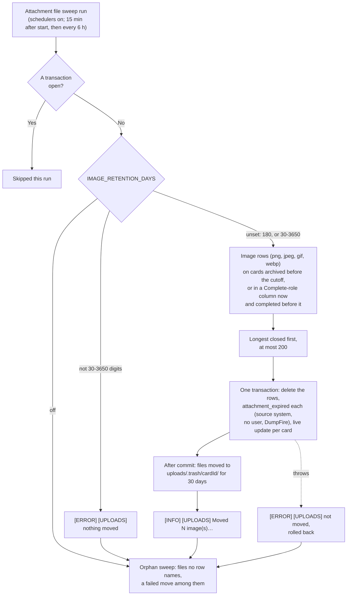

### Schedule Options

| Schedule | Mechanism | Description |
|----------|-----------|-------------|
| `disabled` | — | No automatic backups |
| `hourly` | Interval | Every 60 minutes since last backup |
| `every6h` | Interval | Every 6 hours since last backup |
| `every12h` | Interval | Every 12 hours since last backup |
| `daily` | Time-based | Once per day at configured time; made up once if missed (card 2415) |
| `weekly` | Time-based | Once per week on configured day and time; made up once if missed (card 2415) |

The time of day is read on the server's own clock and zone: the `TZ` variable, otherwise the
host's. The image sets no `TZ`, so in a container it is UTC (see
[Deployment](deployment.md)); daylight saving matters only where a zone such as
`Europe/London` is set.

**After a start, the interval schedules count from the last scheduled run** (card 2412,
2026-10-22). The scheduler keeps the time of its last run in memory, and at its first check
after a start reads it from `backup_log`: the newest successful row that is not a **▶ Run
Now**'s (`lastScheduledBackupAt()` in `src/lib/server/backup.ts`). It read the newest
successful row of any kind, so a Run Now pressed just before a restart moved the next hourly,
6-hourly or 12-hourly run that much later once, which a Run Now without a restart never did.
`backup_log` has no column for the kind of run, and none was added: a Run Now's row is told by
its file's name, `…-manual.db` (`MANUAL_COPY`), as retention tells its copies (card 2405). A
Run Now made before card 2405 has no `-manual` and is still counted. The history keeps that row
whatever came after it (card 2413, below), so the first check after a start always finds the
last scheduled run; it kept the newest 10 rows, and ten Run Now rows or failures pushed it out,
so the first check ran one at once. `lastScheduledBackupAt()` is one query for the newest such
row (`status = 'success' AND filename NOT GLOB '*-manual.db'`, `LIMIT 1`).

**A daily or weekly backup is not made twice in its minute** (card 2414, 2026-10-22). The
daily and weekly schedules run only in their target minute (local time). The scheduler
remembers the minute it ran in, in memory; at a check in the target minute it now also asks
`lastScheduledBackupAt()`, and runs nothing where a successful scheduled run is stamped from the
start of that minute to an hour after it (a run's rows are written after its upload, so none
is stamped earlier), with one `[WARN] [BACKUP] Scheduled daily backup at 02:00 not made: a
scheduled backup recorded at … was already made in this minute …` line. A plain restart could
not repeat the run: the first check comes a minute after the start, in a later minute. One
whose first check still falls in the minute could: the clock put back across the restart, or a
second instance started before the minute on the same database. Only **a run that has already
finished** in the minute is seen: one still uploading has no row yet, so another instance
checking meanwhile makes a second copy all the same. A Run Now in the minute does not hold the
scheduled run back, and a scheduled run that failed at every destination does not count, so a
restart after it tries again. `initBackupScheduler()` starts with nothing remembered, as a new
process does.

**Bounded above** (the card 2414 review). With no upper bound, a scheduled row stamped in the
future (a clock that ran fast, then was corrected) stopped every daily or weekly backup until
the real time passed it, and the trim keeps that row. A row stamped more than an hour after the
minute's start does not count, and a newest scheduled stamp later than now writes `[WARN]
[BACKUP] The last scheduled backup is recorded at …, later than the server's clock (…): the clock
may have run fast and been put back. Check the server's time.` at each daily or weekly check
while it is newest.

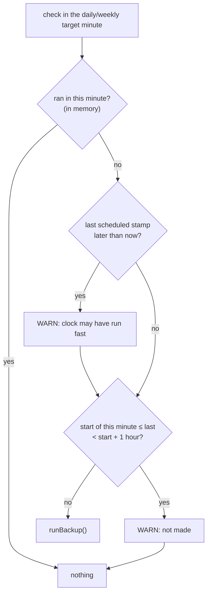

The two paragraphs above and their diagram are as card 2414 built it; card 2415, below,
replaces the target minute with the latest target time and keeps every case they describe.

**A daily or weekly backup is decided by its latest target time** (card 2415, 2026-10-22). At
each check `latestTarget()` finds the latest moment at or before now that is the configured time
of day (on the configured weekday, for `weekly`): today's, or the one before where today's is
still to come. The schedule is due where no successful scheduled backup is stamped from that
time to an hour later than the server's clock (`scheduledRunSince()`). So:

- **Missed while down, or while the server was busy past the check, is made up once**: the
  first check after the start (or the next check) makes it, with `[WARN] [BACKUP] Scheduled daily
  backup at 02:00 was not made at its time, <ISO> (the server was down, or busy past the check):
  made now.` A start with a daily or weekly schedule and no scheduled backup since its latest time
  makes one within a minute. It ran only in the target minute, and a day was lost.
- **The days the clocks change still have one run each.** A date made from a day and a time of
  day is the wall clock's: when the clocks go back, a time in the hour that comes twice is the first
  of the two (01:30 BST), and the second finds its row, after a restart too; when they go forward,
  a time in the hour skipped is read an hour on (01:30 is 02:30 BST). That time never ran on that
  day. (Card 2414's plan said a restart in the hour that comes twice ran it twice; it did not: the
  minute's start, `setSeconds(0, 0)`, also resolves to the first of the two, so its row was seen.)
- **A target time is decided once in a process** (`decidedTarget`, in place of the local
  minute it ran in): `backup_log` is asked once a target time and at the first check after a start,
  and a run still uploading, which has no row yet, is not started again at the next check.
- **A change in a running process does not make up a time already passed**: where the schedule,
  its time, its day or whether there is any destination changed since the last check, the latest
  target time **as of that last check** (`latestTarget(config, previous check)`) is taken as
  decided. Setting a daily 02:00 schedule at 10:00 runs it first at 02:00 the next day; setting
  the time to 02:00 at 01:59:40, or switching daily 02:00 on then, runs it at 02:00, though the
  first check after the save comes after 02:00 (the code review: deciding the latest target as of
  the check after the change let that one pass). After a restart nothing is remembered, so it
  would be made at once.
- **The hour's allowance is card 2414's**: a clock put back across a restart into the target
  minute, before the first run's stamp, still finds that run; a row stamped further ahead (a clock
  that ran fast) counts for nothing, so it holds nothing back. The `not made: … was already made in
  this minute` `WARN` is written only where the check is in the target minute itself: finding the
  time made is ordinary after a restart.

**A run that failed at every destination is tried again 15 minutes later, at most three
times** (card 2415). For every schedule (`BACKUP_RETRY_DELAY`, `BACKUP_RETRIES`). It waited for the
schedule's next run, an hour to a week, while a restart tried again at once. A run whose copy of
the database could not be made fails each destination it was to try (card 2416, [A Copy That
Cannot Be Made](#a-copy-that-cannot-be-made)), so it counts as failed everywhere, and not as
failed before anything was sent; a run that threw for any other reason counts as failed
everywhere too. The three tries are spent
until a run the scheduler makes succeeds at a destination: a destination down for days sends four
failure mails in its first 45 minutes and then one a scheduled run. A run that succeeded at any
destination is not tried again. The schedule switched off, or its last destination removed, drops
a try pending. The code review added three limits:

- **A restart.** A start gives the three tries back, except where the run due has already been
  tried and failed before it (`scheduledFailureSince()`: a failed scheduled row since the daily or
  weekly target time, or since an interval schedule's last successful run). Then the start's first
  run is its one try until a run succeeds, with `[WARN] [BACKUP] This scheduled backup already
  failed before this start: this is its one try until a run succeeds, …`. So a server restarted
  again and again makes one try a start, not four: one failure mail a start, and one refused SFTP
  login a start, not four that could lock the account.
- **Nothing sent.** A run where every destination failed before anything was sent (credentials not
  entered, `credentialsMissing()`; an SFTP host key not confirmed, `hostKeyMissing()`) is not tried
  again: only an administrator can put that right. `[WARN] [BACKUP] Scheduled backup failed at every
  destination before anything was sent (…): not tried again, …`. Where any destination failed after
  being tried, the run is tried again as above.
- **Runs that overlap.** Each scheduled run is numbered as it starts; a failure of a run older than
  one that has since succeeded (a slow upload still going when the next run started and finished)
  arms no try again. Lines: `Scheduled backup failed at every destination: tried again at
<ISO> (1 of 3).`, `Scheduled backup tried again (1 of 3) after a run that failed at every
destination`, and, once the third fails, `… and its 3 tries again are spent: the next is the
schedule's own, and a run that succeeds gives them back.`

**An interval schedule leaves out a stamp later than now** (card 2415).
`lastScheduledBackupAt(now)` reads the newest successful scheduled row stamped no later than
`now`. It read the newest whatever its stamp, so after a start a row stamped ahead (a clock that
ran fast, then corrected) held every hourly, 6-hourly or 12-hourly run off until the real time
passed it and one interval more, with nothing said. The first check after a start now writes the
`The last scheduled backup is recorded at …, later than the server's clock` `WARN` where there is
such a row. A clock put back past the last run across a restart can then make one copy early. The
trim keeps the newest scheduled row stamped no later than now, the one read here (card 2416): it
kept the newest of all, so where that one was stamped ahead, the one read went once 30 runs had
come after it, and an interval schedule restarted then counted from an older row, or none, and
ran at once.

**Copies are named to the millisecond** (card 2415): `dumpfire-backup-<UTC date and
time>-<milliseconds>.db`, `…-manual.db` for a Run Now. Two Run Now presses in one second shared
a name: one run in Backup History, and the second upload replaced the first copy where the
destination allowed it. A run named in the same millisecond as the one before it, in one process,
is named a millisecond on. Names still sort by time, and retention's rule (`MANUAL_COPY`) and the
destinations' `dumpfire-backup-*.db` filters are unchanged.

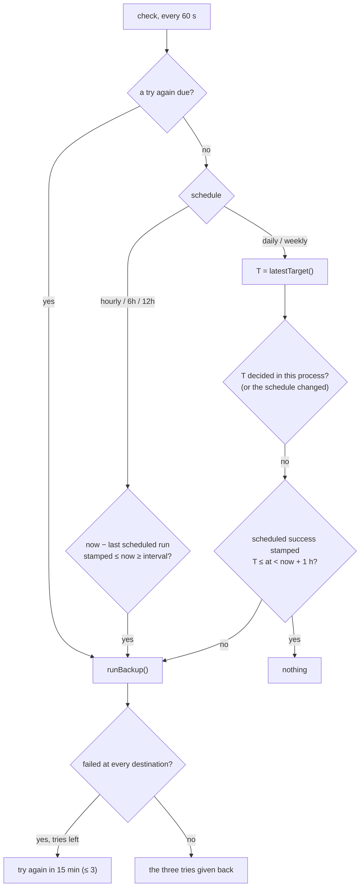

**The history is trimmed where a row is added, not where it is read** (card 2412). `logBackup()`
adds each destination's row and then trims; `getBackupHistory()`, which
`GET /api/admin/backup` reads for the panel's Backup History, writes nothing. It deleted every
row past the newest 10 on each call, so opening the admin page wrote to the database.

**The history is kept by runs: every row of the newest 30** (card 2413, 2026-10-22). A run is
the rows that share a file name: `runBackup()` names its copy once, from the run's start (with
`-manual` for a Run Now), and writes one row a destination with it. Runs are ordered by their
newest row. The trim deletes every row outside the newest `BACKUP_HISTORY_RUNS` (30) runs except
the newest successful scheduled row stamped no later than now (card 2416: the newest of all
before it), which `lastScheduledBackupAt()` reads; so the table holds at most 30 rows a
destination and that one. A row stamped ahead by a clock that ran fast is kept as any other row
is, while it is in the newest 30 runs. `getBackupHistory()` answers every row of the newest
30 runs, newest first, which is what the GET asked for (`getBackupHistory(30)` of a table kept
at 10 rows). The history kept the newest 10 rows, one a destination a run: four destinations
left under three runs. By age was not taken: 30 days of an hourly schedule is 720 rows a
destination, and nothing after a month switched off.

| | Before card 2413 | Now |
|---|---|---|
| Kept by `logBackup()` | the newest 10 rows | every row of the newest 30 runs, and the newest successful scheduled row stamped no later than now (card 2416) |
| Answered by the GET | the newest 30 rows (at most 10 there) | every row of the newest 30 runs |
| `lastScheduledBackupAt()` | 0 once ten newer rows had pushed the last scheduled row out | the last scheduled run, whatever came after it |

### Backup Configuration

**Who may use it.** The backup settings, Run Now, a destination's Test and Google Drive's
Connect are every administrator's (`/api/admin/backup`, `/backup/test` and
`/backup/gdrive/auth` ask `requireAdmin`), since card 2395 (2026-10-21), at the owner's
request; they were the superadmin's alone. The export and the import stay the superadmin's.
Whoever sets a destination can be sent the whole database, every password hash and email
address included: an administrator can add a destination of their own and press Run Now. The
stored secrets are masked for every reader and are never sent to a destination they were not
saved with (cards 2187, 2190), with two exceptions: the first host key confirmed for an SFTP
destination with a stored password keeps the password, which then goes to whichever server
shows that key (card 2250); and Connect on an existing Google Drive OAuth destination binds it
to the connecting person's Google account with the stored client id and secret (a `WARN` line
where it replaces a connection, card 2273). Each change is a line in the system log under
that account (card 2270). See
[The Mail and Backup Settings: Every Administrator's](authentication-security.md#the-mail-and-backup-settings-every-administrators-card-2395).

**Fewer copies are the superadmin's** (card 2398, 2026-10-22). A `PUT` that lowers `retention`,
removes a destination (by the matching of [A Save of the Backup Settings, on
Record](#a-save-of-the-backup-settings-on-record): a rename, or another type under the name,
is the old one removed) or sets `schedule` to `disabled` where it ran is `403` for anyone but
the superadmin, asked of the account as it is at the write (`superadminOnly()` in
`src/routes/api/admin/backup/+server.ts`), with words that name what it would do; nothing is
written and no line is logged. Since card 2408 (2026-10-22) the same check refuses a save that
sets `notifyOnFailure` from `true` to `false`, or changes who `notifyEmail` sends to in any way
(compared as a set of addresses, the ASCII capitals lower-cased and no other letter, so a
look-alike such as U+212A KELVIN SIGN for `k` is another address: another order, ASCII case
or separation is no change;
an address added beside the others, one removed or replaced, all cleared, or a change made
while the mail is off, is), since the failure mail is how the superadmin hears the copies have
stopped. Raising the retention, changing between schedules that run, adding or editing
destinations, and switching the failure mail on stay every administrator's. See
[Fewer Copies Are the Superadmin's](authentication-security.md#fewer-copies-are-the-superadmins-card-2398).
Keep Last counts Run Now copies and scheduled copies separately, so a Run Now removes only
older Run Now copies (card 2405): see [Retention Cleanup](#retention-cleanup).

**Each destination's setter** (card 2397, 2026-10-22). Who added each destination, pointed it
at each place or account it has been, or connected its Google Drive, is a
`backup_destination:<name>` row of `setting_setters` (migration 0059) for that place
(`destinationPlace()`: its type and the fields of card 2270's `elsewhere` rule, as a digest):
written in the save's transaction for one added, or moved to a place nobody is recorded for
(`recordDestinationSetters()`; a destination removed loses every row, so a rename is the
saver's under its new name), and by a Connect saved (`recordDestinationSetter()`, which makes
the connecting account the setter at its place). Its setter is the account recorded for where
it is now, so one moved and moved back, a keyless S3 destination's prefix say, is its first
setter's again (the second code review). A secret typed again for the same place, or an SFTP
host key confirmed, changes nobody's (the first review: an administrator who did either became
the setter of the superadmin's destination, and their demotion removed it). A run already under way when the setter is
demoted or deleted finishes with the destinations it read as it started. When that account is made a user or deleted, its destinations
are taken out of `backup_config`, with their stored secrets, in the same transaction, and one
`WARN` under `BACKUP` says so once committed: `Backup destination "NAS" (sftp) removed: saved
by "ann", who was made a user by "chief". Its stored secrets went with it; the copies already
there are kept.` (meta `{ "setter", "reason", "destinations": [{ "name", "type" }] }`). Nothing
is deleted at the destination. Every start does the same for a setter made a user from the host,
or whose account is gone, before the scheduler starts (card 2406: see
[Settings Go With Their Setter](authentication-security.md#settings-go-with-their-setter-card-2397)),
and so does Import Backup once a restore is committed, for a setter who is not an administrator
in the restored data, with the lines ending `(found after a restore)`, and the import's result
naming what went and listing none of it as kept or to enter again (card 2411).
A destination saved before 0059 has no row and stays. The
schedule, the retention and the failure mail have no setter. See
[Settings Go With Their Setter](authentication-security.md#settings-go-with-their-setter-card-2397).

Stored as JSON in the `settings` table under key `backup_config`:

```json
{
  "schedule": "daily",
  "scheduleTime": "02:00",
  "scheduleDay": 0,
  "retention": 7,
  "destinations": [],
  "notifyOnFailure": true,
  "notifyEmail": "admin@example.com"
}
```

`PUT /api/admin/backup` writes what it is sent over this and keeps the rest, and `{}` is
`400 No valid fields to update` (card 2117). A save of part of the settings used to write
the defaults over the rest, and `{}` switched the schedule off and deleted every
destination. Each field is read by its rule: `schedule` one of the six above,
`scheduleTime` `HH:MM` (empty is 02:00), `scheduleDay` 0 to 6, `retention` 1 to 100,
`notifyOnFailure` `true` or `false`, `notifyEmail` one address or more, separated by
commas, semicolons or lines and stored separated by commas, or empty. Each destination is
a text `name`, a `type` of `sftp`, `s3`, `gdrive` or `onedrive`, and the fields of its
type (`readDestination()` in `src/lib/server/backup-destinations.ts`); any other field is
not kept, `grantedScope` included (only Connect writes it). An SFTP `port` is a whole number
from 1 to 65535, or `null`, which connects to 22. An SFTP `hostKey` is a host key
fingerprint with its type, saved as `<type> SHA256:<43>`, or `''` for none (card 2250: see
[The SFTP Host Key](#the-sftp-host-key)). `readDestination()` no longer puts a stored
secret in place of a mask: it did until card 2190, finding the stored destination by name or
by its place in the list. A mask is now resolved by `keepMaskedSecrets()`, below. An SFTP
`host` is saved trimmed of ASCII spaces and tabs only, one sent back as stored kept as it is
(`trimHost()`, the review-fix pass's S1). A list that names two destinations alike is refused
`400` before anything else is asked of it (`twiceNamed()`, S4): "Two backup destinations are
named "NAS"." and, where two of that name were saved before, "Remove the destinations named
"NAS" (the page's Remove removes every one of that name, and removing a destination is the
superadmin's) and add it once with its secret typed.", or otherwise "Each destination needs a name of its own: give one of them another
name." A destination is found by its name to connect, test and back up to.

**The secret fields, as the admin page is told them and as a save keeps them** (cards 2187
and 2190). One list, `SECRET_FIELDS` in `src/lib/server/backup-secrets.ts` (the list a backup
clears, card 2169's), serves three routes, so a field added to it is masked, kept and cleared
with nothing else to change:

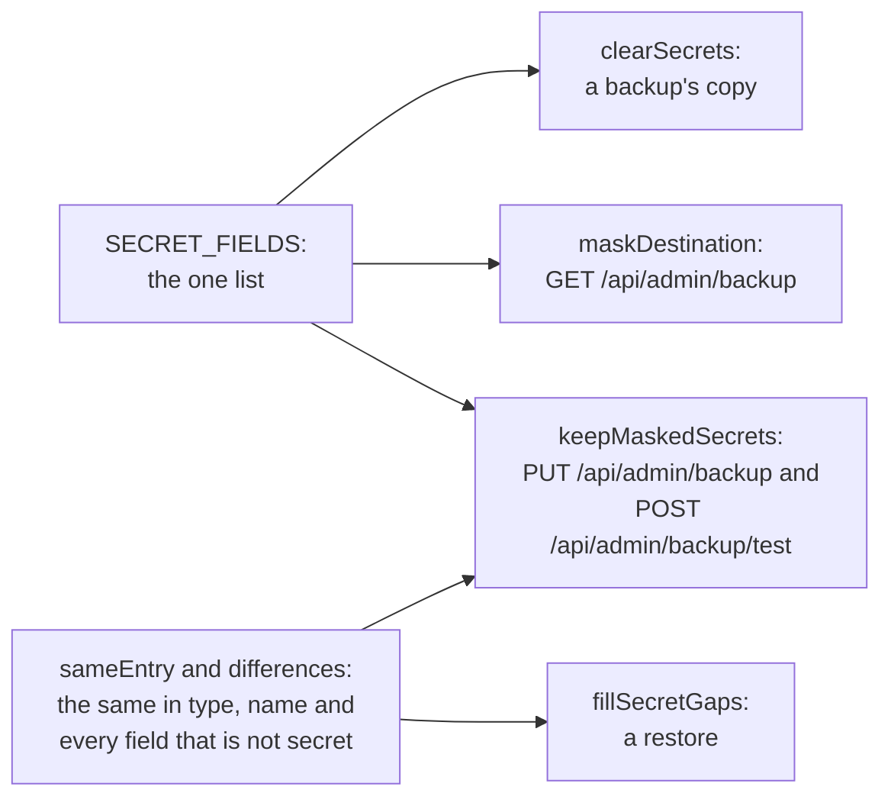

- **`maskDestination()`** answers every secret field of any type that holds anything as
  `••••••••` (`SECRET_MASK`), whatever the destination's type: SFTP `password` and
  `privateKey`, S3 `secretAccessKey`, `clientSecret`, Google Drive `refreshToken` (which the
  answer carried as stored until card 2187), and, inside `serviceAccountJson` where the JSON
  reads as an object, every field but the allowlist `type`, `project_id`, `client_email`,
  `private_key_id` and `client_id` (each shown only where it is text): `private_key`, a
  `privateKey`, and JSON of another shape's secrets (an `authorized_user`'s `client_secret` and
  `refresh_token`, an impersonated account's `source_credentials`) alike
  (`SERVICE_ACCOUNT_SHOWN`, the list the copy keeps too, card 2938 and its code review); an
  empty field shows empty. Such JSON is
  always written out again from what was read, never shown as stored, so text that names
  `private_key` twice (which reads as its last) cannot carry the first to the browser (S3).
  JSON that cannot be read, or reads as anything else (a string, a list), is masked whole. Every other field is as stored,
  `grantedScope` included.
- **`keepMaskedSecrets(incoming, stored)`**, for the `PUT` (each destination, inside its
  transaction, `400` on the first refusal) and the test route: a destination with a mask in
  any secret field takes each masked field's value from the one stored destination that is
  the same in type, name and every field that is not secret (`sameEntry`, compared as the
  destination would use them: missing, `null` and `''` alike; the host trimmed of ASCII spaces
  and tabs, ASCII letters in any case, any other difference a change; an SFTP port 22, an S3 region `us-east-1` and a OneDrive folder path `DumpFire
  Backups`, slashes trimmed, when not set; a OneDrive `drive` as stored, card 2941; a service account by its JSON's `client_email` and
  `private_key_id`, its JSON then taken whole), and an SFTP host is then written as that entry
  has it, so the secret goes to the host it was saved with byte for byte (S1). None, and it is
  refused with decision 3's words, naming every field still masked and what changed; more than
  one, and the words say to remove the destinations of that name, which the page's Remove
  does, and add it once with its secret typed (O1). A Google Drive
  OAuth destination with its token masked is told to be removed, added again and connected,
  beginning with removing DumpFire's access in the Google account unless every stored
  destination it could be was connected with `drive.file` alone. A destination with no mask
  is used as sent. `grantedScope` is never taken from a request: it comes back only with a
  kept refresh token. An SFTP `hostKey` is compared too, as a narrowing on a save (card
  2250): a destination sent with a mask differs where the stored one has a key and the one
  sent has another fingerprint, or none; a key sent where none is stored does not differ. On
  the test route (`keepMaskedSecrets(…, 'test')`) it is compared exactly: the key sent must be
  the stored one, `''` for `''`, so that a Test never sends the stored secret to a key it
  supplies (the card 2250 review's M1); only a save adds one. It is not
  secret: `maskDestination()` shows it, and `SECRET_FIELDS` does not name it.

### Backup Data Generation

`generateBackupData()` in `src/lib/server/backup.ts` makes the one copy that both a
scheduled backup and "Export Backup" send. It uses SQLite's `VACUUM INTO` twice: once to
take a self-contained snapshot of the running database, and once to write out again a copy
that has been cleared of what signs somebody in or opens a request's thread, and of every
secret (`withoutSecrets()`, which was `withoutSignIns()` until card 2169):

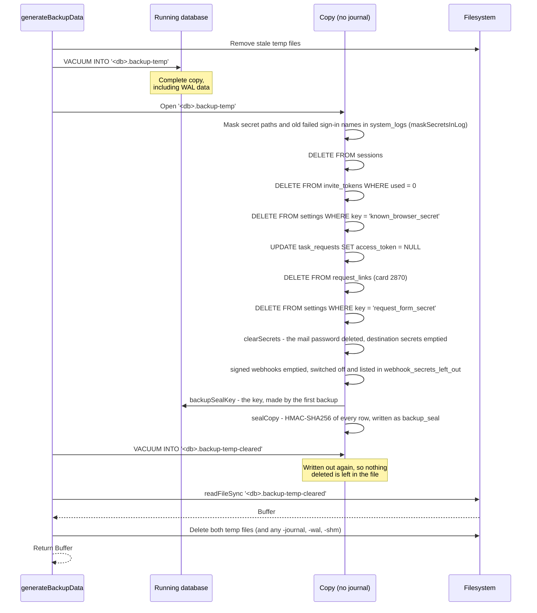

- **The snapshot includes all WAL data.** A raw file copy would miss unflushed writes.
- **No session and no unused invite is in the file**, and its system log is masked: every
  invite's address written as `/invite/[token]`, a request link's `token=` masked, and an old
  failed sign-in line at a name that was no account rewritten to hold only the name's length
  (card 2193). Since card 2849 an invite's token is kept only as its SHA-256 (a 32-byte BLOB),
  so the used invites the file holds carry no token, and there is no unused token for the mask
  to look for elsewhere in a line: that pass is gone.
- **A restore of a backup made before card 2849** brings its used invites in with each token
  that was held as mailed replaced by 32 random bytes, as migration 0068 does, so no token as
  mailed reaches the running database. See
  [Invite Tokens Stored as Hashes](authentication-security.md#invite-tokens-stored-as-hashes-card-2849).
- **A restore of a backup made before migration 0069** (card 2772), whose `api_keys` has no
  `deadline_at`, gives its API keys this server's deadline, as 0069 gave the keys here. The
  server's `api_key_deadline` setting is read before the restore clears `settings`; after the
  copy, inside the restore's transaction, every key of the backup with no expiry, or one later
  than the deadline (read as the moment it names, `stamp_of`, since an older backup may hold
  another form), is given it, and the setting is written back where the backup held none. With
  no readable deadline on this server, the restore's own moment is used and written as the
  setting, so such keys end at once: the safe side. A backup made since 0069 is restored as it
  is, so a key kept there stays kept and a key given a deadline there keeps it. The count is
  `apiKeyDeadlines` in the restore's result; the import's answer carries it with
  `apiKeyDeadline`, the date as `YYYY-MM-DD HH:MM UTC`, and adds the sentence "*n* API key(s)
  from before two-step sign-in were given this server's deadline, *date time* UTC." when it is
  above 0 (also when the restore committed but switching foreign keys back on failed). The admin
  page's restore report says "*n* API key(s) from before two-step sign-in was/were given this
  server's deadline, *date*: each stops working then unless its holder keeps it on their Account
  page." See [Keys Made Before Two-Step Sign-In: the Deadline](authentication-security.md#keys-made-before-two-step-sign-in-the-deadline-card-2772).

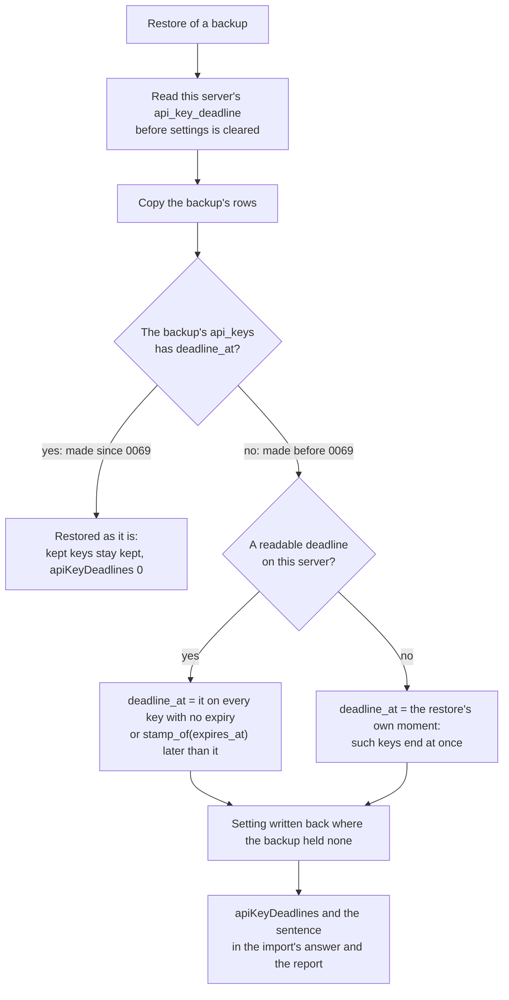

- **A restore of a backup made before migration 0071** (card 2752), whose `webhooks` has no
  `held_because`, `held_at`, `set_by_key` or `set_with_key`, brings its webhooks in with all four
  NULL and `active` as the backup had it. Whatever the backup's age, this server's webhooks
  switched off for good are read before the clear, whatever their secret, and each hold is carried
  onto the restored row of the same webhook (same id, board, address and setter: `carryHolds`, the
  code review's CS5), even where the backup had it on and its setter can open the board there. A
  restore as it is (`outside=keep`) then, inside its transaction and after the secrets are filled
  (`fillSecretGaps`), switches off for good every
  restored webhook that is on and whose setter cannot open its board in the restored data, or
  that nobody is recorded as having set up (`switchOffLostWebhooks('all')`), with the cause
  "found after a restore by *name*". It does the same for a backup made since 0071, and
  `fillSecretGaps` never switches on a webhook held off here or in the backup's row: it keeps this
  server's hold. The count is `webhooksSwitchedOff` in the restore's result. After the commit
  each is a `WARN` line under `Webhooks`, and the boards' owners are mailed only where the
  schedulers run. A working copy (`outside=off`) is not swept: it switches every webhook off and
  mails nobody. This server's `webhook_keys_recorded_at` (0071's setting, card 2893) is read
  before the clear and kept over the backup's. See
  [A Webhook Switched Off When Its Setter Loses the Board](authentication-security.md#a-webhook-switched-off-when-its-setter-loses-the-board-card-2752).
- **A restore keeps this server's disabled accounts disabled** (card 2671, migration 0072),
  whatever the backup holds, a backup made before 0072 included. This server's disabled accounts
  (id, `created_at`, `disabled_at`, `disabled_by`, and the disabler's `created_at` and role) are
  read before `users` is cleared, a database without the columns read as having none and any
  other failure rolling the restore back (the code review's CS4); after the copy, inside the
  restore's transaction, each restored account with the same id and `created_at` that is not a
  superadmin is disabled again (`carryDisabled`), with `disabled_by` kept only where that account
  is restored as itself, by id and `created_at`, the restored superadmin where the superadmin
  disabled it and is not, else NULL (CS3), its restored API keys deleted and its restored report
  schedules paused. That runs before the superadmin check and the webhook sweep above, which
  then switches off the webhooks it set. A restored superadmin is never disabled, and a backup
  with user accounts and no enabled superadmin among them is refused before anything is written.
  The settings an administrator disabled here set are removed after the restore, as for a demoted
  one, with the lines ending `(found after a restore)`, and every disabled account's address is
  taken out of the backup failure address again, whatever its role, one `WARN` under `BACKUP`
  each (CS2). See
  [Disabled Accounts](authentication-security.md#disabled-accounts-card-2671).

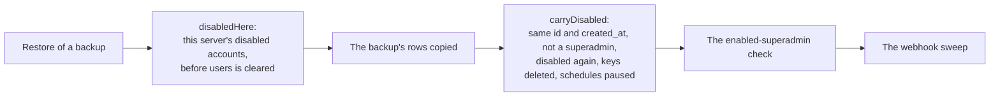

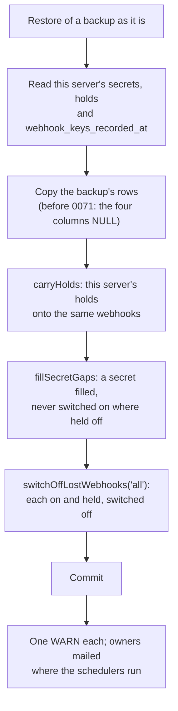

- **The key remembered browsers are signed with is not in the file** (the row
  `known_browser_secret` of `settings`, card 2194), and a restore never brings it in from a
  backup of any age (`rowsToRestore()` in `src/lib/server/db/restore.ts`). Whoever held it
  and an account's password hash, which a backup does hold, could make a cookie that lets a
  browser past sign-in's throttling for that account. So a restore forgets every remembered
  browser, and the restored server makes a new key.
- **No request's link and not the form's key** (cards 2158 and 2870): every `request_links`
  row is deleted from the copy, the retired `task_requests.access_token` stays `NULL` (as it is
  in the live file), and the `request_form_secret` row of `settings` is gone. A restore brings
  in no `request_links` row from a backup of any age and reads every `access_token` as `NULL`
  (`rowsToRestore()`), so a backup made before card 2158, which holds each token as it was
  mailed, puts none in the live file; the clear empties the live `request_links`, so every link
  is ended. It never brings the form's key in. The import's answer says how many requests'
  links were ended (`requestLinksReplaced`, the number of requests restored), in its usual
  words, "N request link(s) replaced: …".
  The running database is not touched by a backup. Deleting the rows alone is not enough, because the pages they
  were on stay in the file until it is written again; hence the second `VACUUM INTO`.
- **No secret** (card 2169): `clearSecrets()` in `src/lib/server/backup-secrets.ts` deletes the
  `smtp_pass` row, sets each destination's secret fields in `backup_config` to `''` (SFTP
  `password` and `privateKey`, S3 `secretAccessKey`, Google Drive `clientSecret` and
  `refreshToken`, a service account's key inside `serviceAccountJson`, OneDrive
  `clientSecret`; every one of them on every destination, whatever its type), deletes the
  `backup_seal_key` row and its record, `backup_seal_key_made_at` (card 2943), leaves out a destination of a type this version does not know and a
  `backup_config` that is not JSON, and sets each webhook's secret to `''` with the webhook
  switched off and listed, as `[{"id":3,"active":true}]`, in `webhook_secrets_left_out`. A
  webhook is switched off because the file can become a database without a restore, and one
  left on with no secret would send every event unsigned. It throws before writing anything
  if handed the running database. A restore fills each gap from this server only from an
  entry the same in every field that is not secret (`fillSecretGaps()`), and only into a
  backup whose seal verifies. For a webhook that is the webhook here with the same id, board,
  address and setter (`set_by`, the account that last set its address or secret, or switched it on, card 2168;
  none and none alike, and none on a database from before migration 0056): a secret here set
  by another account than the backup's row names was set again since, and is listed to enter
  again rather than filled under the backup's setter, where that account's password reset
  would not reach it. See
  [The Secrets a Backup Does Not Hold](authentication-security.md#the-secrets-a-backup-does-not-hold-card-2169).
  A service account's JSON keeps only an allowlist in the copy, `type`, `project_id`,
  `client_email`, `private_key_id` and `client_id`, each only where it is text
  (`SERVICE_ACCOUNT_SHOWN`, the list the settings' `GET` shows too); every other field is set
  to `''` whatever it holds, and none is added (card 2938 and its code review, R1). Until card
  2938 the copy emptied `private_key` alone, so a JSON holding a `privateKey`, or JSON of
  another shape (an `authorized_user`'s `client_secret` and `refresh_token`), carried it into
  every copy and export, a `privateKey` sealed since card 2898. A restore still knows the same
  account by `client_email` and `private_key_id` and fills this server's JSON whole.
  A service account JSON has its key only where the one rule finds one (R2, and card 2939's
  `serviceAccountKey`): an object whose `type` is `service_account`, with text `private_key` and
  `client_email`, each field the rule reads text, and Google's own universe. An entry here whose
  JSON is not such a key (one holding only a `privateKey`, another type, no type, no
  `client_email`) is never used to fill, so the restored entry is listed to enter (R3);
  `runBackup` does not try one, and says "This destination's JSON is not a service account key
  file from Google, so it is not tried …" (`SERVICE_ACCOUNT_NOT_A_KEY`) where JSON was entered
  that way, and that its credentials are not entered where the JSON is empty or as a copy leaves
  it. Since card 2939 a restore brings each destination's JSON to the rule before it reaches the
  live file (`sealedForRestore`), and so does every start.
- **No webhook address is in a copy** (card 2928): each `url` is `''`, its plain `receiver` kept,
  the webhook switched off, and listed in `webhook_addresses_left_out` with whether it was on and
  a match of the address, an HMAC under `webhook_address_mac_key`, a key no copy holds. A restore
  of this server's own sealed backup moves each address back byte for byte from the one webhook
  here with the same id, board, receiver, setter and match, switching nothing on until the holds
  are carried, and only one whose address opens; otherwise, or with the key lost, it is named
  "the address(es) of webhook(s) …" until its `url` is sent with `active: true`. A plain address a
  backup made before then holds is sealed as it is read, its `receiver` worked out from it; a plain
  secret beside an address that is `''` or does not open is left out and listed, never sealed.

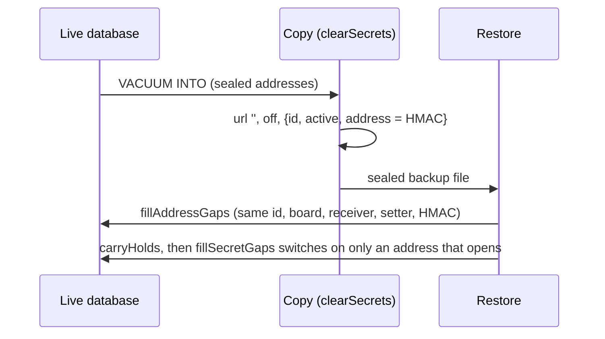

- **The live file holds those secrets sealed** (card 2898): the mail password, each
  destination's secret fields and each webhook's secret are stored under a key derived from the
  MFA key file, bound to where each is used, and so are `backup_seal_key`, the request-form key
  and the remembered-browser key. A copy holds none of them, sealed or not. A restore of this
  server's own backup moves each sealed value as it is (its match rules are what it is bound to,
  so it opens where it is put); a value here that does not open is not moved, and its gap is
  listed, a matched destination whose credential does not open among them (never given the host
  key as one with no credentials; card 2898's code review, E2). A backup whose secrets were sealed
  under another key brings them in as they are: they stay unopenable, are never used or filled,
  and are listed to enter. Every restore, a working copy's included, marks
  `secrets_scrub_pending` in its transaction and never brings in a backup's marker (S1), so the
  replaced rows' old text is scrubbed from the file after it. A backup that holds secrets in plain (one made before card 2169, or a file copied by
  hand) has each sealed as the restore reads it (`rowsToRestore()`), so none reaches the live
  file in plain, and the write-ahead log is emptied after the commit; with no MFA key loaded, such
  a restore is refused and rolled back. See
  [Service Secrets at Rest](authentication-security.md#service-secrets-at-rest-card-2898).
- **Sealed** (card 2169's review, S1): `sealCopy()` writes into the cleared copy, as the
  `backup_seal` setting, an HMAC-SHA256 of a dump of it that is the same from the same rows
  whatever file they are in (`sealOf()`: every row of `sqlite_master` by type and name, SQLite's own included; every
  table but `sqlite_sequence`, `sqlite_stat1` to `sqlite_stat4` included, by name, every row
  read `NOT INDEXED` in rowid order, each value typed and its length given; the seal's own row
  left out; the second review's B1), so the seal written before the second `VACUUM INTO` holds for the
  file after it. It is stored as its form number, a colon and the 64 hex characters (`2:…`); a
  restore takes a seal of any other form as none. The key is the `backup_seal_key` setting of the running database, made by the
  start, or by the first backup where a Reset cleared it (`backupSealKey()`): the one thing a
  backup may write there, with its record, `backup_seal_key_made_at`. `withoutSecrets(from,
  to, key)` takes it, this server's unless a test gives another. Measured on made-up copies on
  a development machine: 0.2 s for 59 MB and 115,000 rows, 0.56 s for 177 MB and 345,000.
- **The seal key is the server's only while it is sealed and of the `v2` form** (card 2943).
  It is stored as the envelope of `v2:` and 64 hex. The first start of the release makes it
  anew, because the key before it was stored in plain until card 2898 and is in every whole
  copy of the database made before then, and so does any start that finds it in plain, of the
  older form, or missing. A key in any other form at run time is no key: a restore fills nothing
  for it, and `backupSealKey()` replaces it with one `[CRITICAL] [BACKUP]` key-change record,
  "Key change recorded: made by a backup, …", kept for good with the system log's CRITICAL lines. **Every backup made
  before the key is made anew is restored as another server's**: everything restores, the
  secrets and addresses it left out are listed to enter, and it takes no second factors for
  accounts not on this server. `clearSecrets()` deletes the record from every copy with the key,
  and a restore keeps this server's record only beside the key it keeps. See
  [The Signing Keys Made Anew Once](authentication-security.md#the-signing-keys-made-anew-once-card-2943).
- **The server answers nothing while it runs.** Every step is synchronous, from the first
  `VACUUM INTO` to the read: see "How long the server stops answering" under
  [Backup Destinations](deployment.md#backup-destinations) in the deployment guide for the
  figures, which are an estimate from parts.
- **The two temporary files are beside the database**, on the volume, and are deleted
  whether or not the backup succeeds. A database in memory has nothing beside it, so they
  go to a folder of their own under the temp folder. A crash can leave them behind; the
  first holds live sessions, which is why `.gitignore` and `.dockerignore` keep both out.

See [What a Backup Holds](authentication-security.md#what-a-backup-holds-and-what-a-restore-brings-in)
for why, and what a restore brings in.

### Destination Types

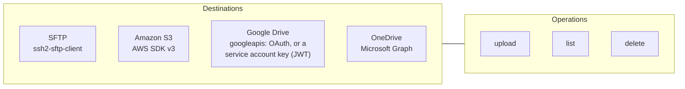

Each destination implements three operations:
- **upload** — Push a backup buffer with a timestamped filename
- **list** — List existing backups for retention cleanup: every provider keeps only names
  `COPY_NAME` matches, `dumpfire-backup-<time to the second or millisecond>[-manual].db`, the
  names `copyName` gives (card 2941, R5); a listing that fails throws, never an empty folder.
  Files alone: SFTP keeps only regular files (`type` `-`), OneDrive only items with a `file`
  facet (`$select=name,file`), so a folder or link of a copy's name is never one (the fix pass's
  C2). **S3** (card 2941's C1, which took in card 2991) lists under the prefix and a `/`
  (`Prefix: 'dumpfire/'`, or `''` with none) one level deep (`Delimiter: '/'`), every page
  (`ContinuationToken`, at most 100 pages of 1,000 keys, then an error), and keeps a key only
  where it is exactly where an upload of its name puts it (`Key === getKey(name)`): a key in a
  folder below the prefix, or under a sibling prefix such as `dumpfire-old/`, is not counted. It
  read one page of 1,000 keys of any key whose text began with the prefix, by the last part of
  its key
- **delete** — Remove old backups beyond retention limit. Google Drive removes only a file it
  has just listed for retention, by that file's ID, every file of one name in turn; a name not
  listed is refused (`GDRIVE_NOT_LISTED`), and no name is ever put into a query (card 2941, R5).
  S3 likewise deletes only a key its last listing found (`S3_NOT_LISTED`, C1)

**OneDrive with Microsoft's app-only sign-in** (card 2941). DumpFire signs in to Microsoft Graph
as the app itself (`ClientSecretCredential`: tenant, client ID, client secret), with no user, so
`/me` and `/drive` name nothing. The addresses used before card 2941, `/drives/root:/…`, were
valid for no sign-in. A OneDrive destination now holds **`drive`**, whose OneDrive, by
`src/lib/server/onedrive-address.ts`:

| `drive` | Address base |
|---|---|
| A user's sign-in name (one `@`, no control character, space or any of `/ \ ? # % : " * < > \|`) | `/users/{encoded}/drive` |
| A user's object ID (a GUID, saved in lower case) | `/users/{guid}/drive` |
| A drive ID, `b!` and up to 200 of `A-Z a-z 0-9 _ -` (a OneDrive for Business or a SharePoint library) | `/drives/{encoded}` |

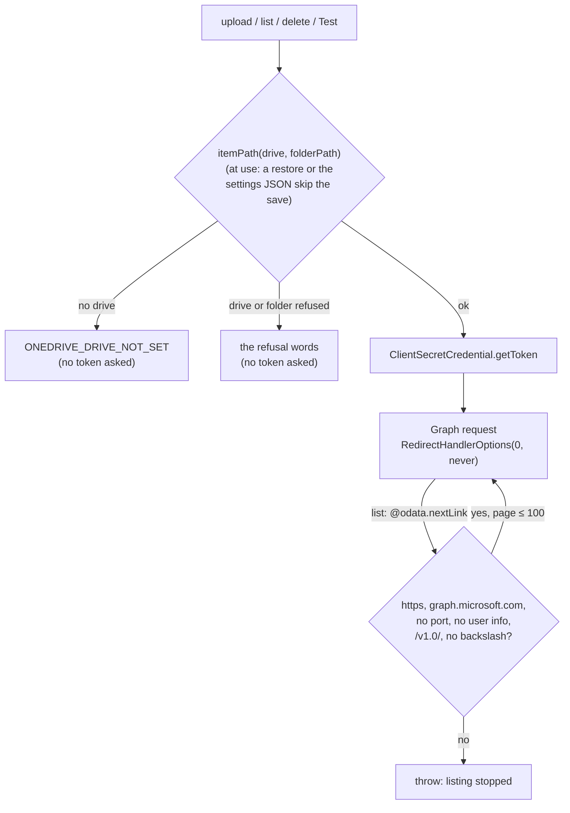

- **The folder path** is folders separated by `/` (slashes at either end trimmed; empty is
  `DumpFire Backups`), none of them empty, `.` or `..`, none holding a control character or any
  of `" * : < > ? \ |`. It is read by this rule at save and again at use, and every folder and
  the file name are `encodeURIComponent`-encoded: the Graph client encodes nothing and reads
  everything after a `?` as a query.
- **Addresses:** upload `PUT {base}/root:/{folders}/{file}:/content` (one request, which Graph
  takes up to 250 MB; card 2990 for larger), list `GET {base}/root:/{folders}:/children?$select=name&$top=200`
  and every next page, delete `DELETE {base}/root:/{folders}/{file}`.
- **A listing** follows `@odata.nextLink` only where `new URL()` reads it as `https:` on
  `graph.microsoft.com`, no port, no user name or password, a path under `/v1.0/`, and its text
  holds no `\`; up to 100 pages. The client's own host check reads the host as the text before
  the first `:` or `/`, so `https://graph.microsoft.com:x@elsewhere/` would be given its bearer
  token. No request follows a redirect. Any failure throws: it answered an empty folder, and
  retention removed nothing with nothing said. The sign-in's own failure (an `AADSTS…` error
  from `ClientSecretCredential`) is capped at 300 characters as Graph's words are (C4).
- **Test** reads the drive (`GET {base}?$select=id,driveType,owner`), then the folder: found
  ("Connected to <owner>'s OneDrive (drive business); folder "…" found"), not there yet ("… will be
  made by the first backup"), or a file (a failure). It makes nothing. Graph's words are capped at
  300 characters.
- **Save:** a `drive` of none of the three forms, or a folder path the rule refuses, is a `400`
  naming the field. A typed drive is trimmed and an object ID lower-cased; one sent back as stored
  is kept byte for byte, as a host is, and only checked (C5), so a restore's upper-case object ID
  keeps its place and its secret. A change of case is a change of place. A OneDrive destination with no drive is a `400` (`drive is required for
  OneDrive: …`), but for one stored without a drive under the same name and sent back at the same
  place, so that other settings can be saved while it waits (ruling R9).
- **Run:** one with no drive is not tried (`driveMissing`, after the credentials and the host
  key): its row, the ERROR line and the mail say "This OneDrive destination does not say whose
  OneDrive to use…", nothing is asked of Graph, and a scheduled run of it alone is not tried again.
- **Its place** (`destinationPlace`, and the seal's additional data) gains `drive` last, as
  stored, only when it is a non-empty text: an entry without one keeps the place, the seal and
  the holds it had. A changed drive needs the client secret typed again.

**Google Drive's service account: its key file alone** (card 2939). A Google Drive destination
that signs in with a service account holds the JSON key file Google gives for it
(`serviceAccountJson`). Until card 2939 it was handed as pasted to `GoogleAuth({ credentials })`,
which picks its way to sign in by the JSON's `type`: an `external_account` JSON read any file the
server could read (`credential_source.file`: the MFA key file, the database) and posted it to a
`token_url` of the sender's choosing, before anything reached Google, and JSON that read as
`null` fell back to the server's own Google identity. Now one rule reads it
(`readServiceAccountJson`, `src/lib/server/service-account-json.ts`, a module that imports
nothing): a JSON object whose `type` is `service_account`, each field the rule reads (`type`,
`client_email`, `private_key`, `private_key_id`, `universe_domain`) text where present, and either
a key (`private_key` and `client_email` text, `universe_domain` absent, `''` or `googleapis.com`)
or the key-less shape a backup's copy leaves (`private_key` empty or absent). It is stored rebuilt to
`type`, `project_id`, `client_email`, `private_key_id`, `client_id` and `private_key`, each only
where it is text, in the order given; every other field is dropped, whatever it holds. `getDrive`
builds `new google.auth.JWT({ email, key, keyId, scopes: [drive.file] })` from the key's fields
alone, a literal of those four, and never `GoogleAuth`; JSON that is not a key throws the run's
own sentence, never a parse error (which would quote the text). The same rule is applied to every
stored destination at every start (`normaliseServiceAccounts`, with one `[WARN] [STARTUP]` line
naming each destination it changed, never a value) and in a restore (`sealedForRestore`), so a
JSON that is not a key cannot stay stored: another type, text that is not an object, and any JSON
on an OAuth or a non-Drive destination become `''`; a `service_account` JSON that is not a key
loses its key. A sealed `private_key` is carried byte for byte, never opened. **A Test runs only a
saved destination**, exactly as it is stored, for every type: a Test with a secret typed, or with
any setting that is not secret changed, is refused (`destinationToTest`): with its secret masked,
in the save's own words ("type its … again"); otherwise "Save the destination first, then Test
it.". Nothing typed into a Test is ever connected to.

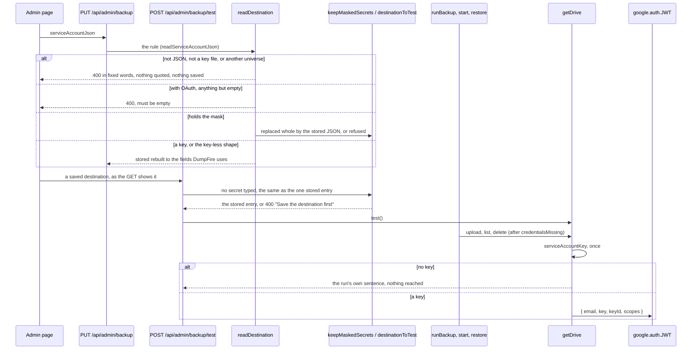

**Google Drive's scope and folder** (card 2188). Connect (`POST
/api/admin/backup/gdrive/auth`) asks for `https://www.googleapis.com/auth/drive.file`
(`DRIVE_FILE_SCOPE` in `src/lib/drive-scope.ts`), the files DumpFire makes, where it asked for
the whole of Drive; a service account already asked for `drive.file`. A token refreshes with
the scopes it was granted, so a connection made before keeps the whole of Drive until it is
connected again. The Connect, in order (the `GET`, the state and PKCE from card 2251):

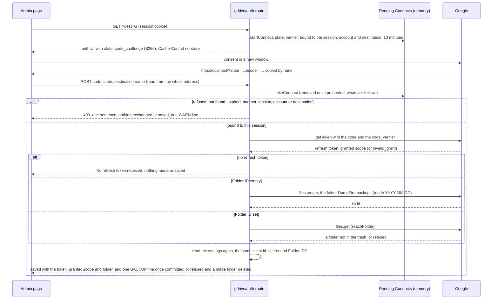

- A folder that cannot be reached refuses the Connect with nothing saved, the destination
  keeping the connection it had; Google's reason is a `WARN` line under `GDRIVE`, `Connect of
  destination "G" refused: Google Drive cannot reach its folder …: …`.
- The settings are read again after Google's answers and written with no `await` between,
  only if the destination is still there with the client id, client secret and Folder ID it
  had; otherwise "The destination was changed or removed while it was being connected, so
  the connection was not saved. Connect it again." A folder made by a Connect that is not
  saved, or that throws, is deleted again (best effort, a `WARN` naming its id on failure,
  `Could not delete the folder … made for destination "G" by a Connect that was not saved: …`).
- `grantedScope` is Google's `tokens.scope` as granted, and nothing when Google names none.
  `driveScopeIsNarrow()` (in `src/lib/drive-scope.ts`, no server imports, read by the admin
  page and by `keepMaskedSecrets()`) is true only when every scope in it, split on white
  space, is exactly `drive.file`; a missing one is all of Drive. The page shows `✅ Connected`
  or `⚠️ Connected · all of Drive` by it.
- `GDriveDestination.test()` fetches the folder (`reachFolder()`) before it lists it, for
  either sign-in method, and says when it cannot reach it; with no Folder ID it answers as
  before.
- A failed Connect is one `ERROR` line, `Google Drive Connect failed for destination "…": …`.
- Every line of the Connect is filed under the account that pressed it (`user_id`), and writes
  the destination's name as the backup settings' lines do (`quotedName()`, each `\` and `"`
  escaped): the refusal of a state (card 2251), the folder not reached, the made folder not
  deleted and the failure, under `GDRIVE`, and the Connect saved, under `BACKUP` (the card 2273
  review). Only the state refusal was filed before.
- A Connect saved is one line under `BACKUP`, filed under the connecting account (`user_id`)
  (card 2273): `Google Drive destination "G" connected: scope narrow (drive.file); a folder made`.
  The scope is named by its kind as the page reads it, `scope narrow (drive.file)`, `scope wide`
  or `scope none named (read as wide)`, and the folder as `a folder made` or `its folder
  reached`; never the token, code, state, verifier, folder id or the folder's name. It is an
  `INFO` for a destination's first connection, and a `WARN`, `… connected again, replacing the
  connection it had: …`, where the destination held a refresh token in the settings as read
  again: the new token may be another Google account's, which the server cannot see, and with
  the Folder ID empty the copies go to a new folder. The meta is
  `{"destination":"G","scope":"narrow","folder":"made","replaced":false}`. The read again
  and the write are one `writeAs`, which first asks again whether the session is still open
  and still an administrator's (card 2253, at the administrator level since card 2395; see
  [Asked Again at the Write](authentication-security.md#asked-again-at-the-write-card-2253)):
  refused there, the Connect answers `401` or `403` with the folder it made removed. The line is
  queued with `afterCommit`, so a Connect refused, changed meanwhile or whose write fails
  writes none. The name is quoted as the
  settings' lines quote it (`quotedName()`).

**Who started the Connect** (card 2251). The `POST` used to exchange any code it was sent, so a
code from somebody else's consent, pasted by a superadmin who was led to, connected that
person's Google account (with the Folder ID empty, every later backup went to a folder in it).
`src/lib/server/gdrive-connect.ts` now holds each Connect under way, in memory:

| What | How |
|---|---|
| `state` | 32 random bytes from `node:crypto`, base64url (43 characters), new at every `GET`; never the destination's name, which it was |
| Bound to | the SHA-256 of the session's token (`locals.credential`; no token is held), the account's id and the destination's name; a request with no credential is bound to its account alone |
| PKCE | a `code_verifier` of 32 random bytes, kept only here; the consent address carries `code_challenge` (its SHA-256, base64url) and `code_challenge_method=S256`; the exchange is `getToken({ code, codeVerifier })` (google-auth-library 10.6.2) |
| Lifetime | `CONNECT_LIFETIME_MS`, ten minutes; the expired swept at every Connect started and every state presented |
| Once | `takeConnect` removes a state the first time a `POST` presents it, whether the check then passes or not |
| How many | one per session and destination (a new `GET` replaces the older); at most `MOST_PENDING`, 20, the oldest dropped |
| A restart | ends every Connect under way: press Connect again |

- `state` is read as text after `code` and `destName` (`state must be text`). A missing, empty,
  unknown, expired or used state, or one another session, account or destination started, is
  `400 {"message":"This connection was not started from this session, or has expired or been used. Press Connect again, and paste the whole address Google's page leads to."}`,
  with nothing exchanged or written and one `WARN` line under `GDRIVE`: `Google Drive Connect
  refused for destination "G": its state was not one this session started, or had expired or
  been used`, filed under the account (`user_id`) with the meta `{"stateSent":false}` for a
  `POST` with no state (or an empty one) and `{"stateSent":true}` for one whose state failed;
  the answer is the same sentence for both. The check comes before the destination is looked up.
- The `GET` answers `Cache-Control: no-store`. It stays a `GET`: another site that sends the
  browser to it makes a pending Connect whose state and verifier it never sees, and can at most
  replace one in progress.
- The admin page reads `code` and `state` from the whole address pasted, and sends neither for
  a bare code, nor for an address holding Google's `error=` (consent refused is
  `error=access_denied`): it says why instead (the admin guide, Configuring Backups).
- **The page's side of the `GET`** (cards 2265 and 2266). `connectGDriveOAuth()` shows a
  refusal in the server's own words, read by `failureMessage()` ("Client ID and Secret
  required", "Google Drive destination not found", the administrator guard's `403`), and "Failed to
  generate auth URL" only where the answer says nothing (a proxy's page); it used to say that for
  every refusal. The answer is read by `answerBody()`, and an `authUrl` that is not a non-empty
  string, or not an address on `https://accounts.google.com` (`isGoogleConsent()`, the card 2266
  review: never a `javascript:` address as the link), opens no window and says "Failed to
  generate auth URL". The window is opened after the
  `GET`, which Safari, a strict blocker or an answer slower than a click's activation (about five
  seconds in Chrome and Firefox) stops: the page reads what `window.open` returns, and the box
  says "Opening Google's sign-in page…" until the address is known (`gdriveAuthUrl`, the paste
  box and its ✅ Connect disabled meanwhile), then "Your browser blocked Google's sign-in window."
  when it returned `null` (`gdriveBlocked`), or "A Google sign-in window has opened." otherwise;
  both give the address as a link (`rel="noopener noreferrer"`), since a blocker may hand back a
  window it then closes. Each Connect takes a number, `gdriveAttempt`, which
  `closeGDriveConnect()` moves on whenever the box closes (Cancel, a refusal, the exchange
  answered): an answer that comes back after Cancel or a later Connect opens and says nothing,
  as the server has replaced that Connect's state with the later one's.
- Connections made before are untouched: a stored refresh token is not checked again.

### The SFTP Host Key

An SFTP destination connected with no `hostVerifier`, and ssh2 accepts any host key without
one, so the password, or a signature made with the private key, and then the backup went to
whatever answered for the host (card 2250). Each SFTP destination now holds the key it was
confirmed with, `hostKey`, one more field of it in the `backup_config` setting's JSON: `<type>
SHA256:<43>`, the key's type and its fingerprint as OpenSSH prints it (`SHA256:` and the
unpadded standard base64 of SHA-256 over the key's blob). Every connect goes through one of two
configurations:

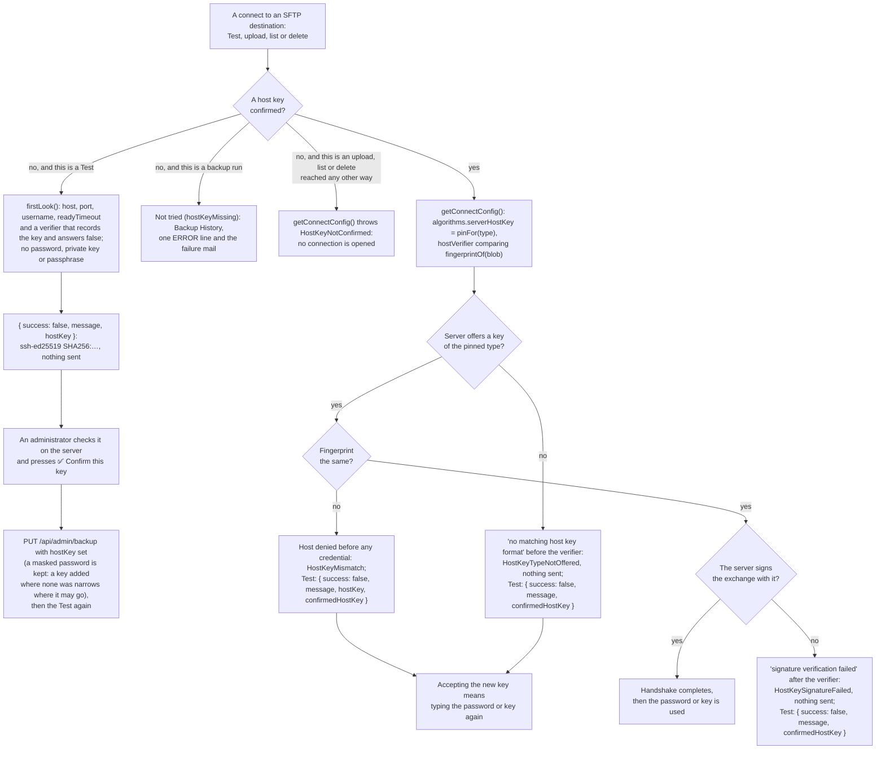

| What | Where | How |
|---|---|---|
| Reading it | `readHostKey()` in `src/lib/server/ssh-host-key.ts`, from `readDestination()` | `<type> SHA256:<43>`, the type one of `ssh-ed25519`, `ecdsa-sha2-nistp256`, `ecdsa-sha2-nistp384`, `ecdsa-sha2-nistp521`, `ssh-rsa`; or the line `ssh-keygen -l` prints, pasted whole (`256 SHA256:… root@nas (ED25519)`: ED25519, RSA of 1,024 bits or more, ECDSA of 256, 384 or 521 bits). Spaces, tabs and line breaks around are trimmed. The 43 characters must decode to 32 bytes and encode to the same text. Saved as `<type> SHA256:<43>`; empty once trimmed is `''`. Anything else is `400 destinations[0].hostKey must be an SSH host key fingerprint with its type: …` (no prefix on the test route) |
| A key's blob | `fingerprintOf()`, `typeOf()`, `shownHostKey()` | The fingerprint is over the whole blob; the type is the blob's first string (RFC 4253, section 6.6), read without importing ssh2, which comes only with `ssh2-sftp-client` |
| The pin | `pinFor()` | `ssh-rsa` as `rsa-sha2-512`, `rsa-sha2-256`, `ssh-rsa`; every other type as itself. ssh2 offers `ssh-ed25519` first, so without the pin a server that gains a key of a preferred type would look changed |
| The words | every message below | Each says what happened in its first 40 characters, which is what Backup History shows of a message (the card 2250 review's S2): "SFTP host key not confirmed: " for none confirmed and a Test's first look ("SFTP host key not confirmed: the server at nas.example:22 presented the host key ssh-ed25519 SHA256:…. Check it is the server's own (on the server: ssh-keygen -lf /etc/ssh/ssh_host_ed25519_key.pub) and confirm it. Nothing was sent to the server."), "SFTP host key refused: " for a key refused |
| No key | `getConnectConfig()`, `hostKeyMissing()` in `backup-secrets.ts` | `HostKeyNotConfirmed`, whose message is `HOST_KEY_NOT_CONFIRMED`: "SFTP host key not confirmed: nothing was sent to this destination. In Admin, Scheduled Backups, press Test on it and confirm the key it shows." A stored key that does not read counts as none |
| A key that does not match | `HostKeyMismatch` (`presented`, `confirmed`) | "SFTP host key refused: the server at nas.example:22 presented the host key ssh-ed25519 SHA256:NEW, not the confirmed SHA256:OLD, so nothing was sent to it. If the server's key was changed on purpose, check the new key on the server and confirm it, typing the password or private key again; otherwise something else may be answering for the server." |
| The type no longer offered | `HostKeyTypeNotOffered` (`confirmed`) | "SFTP host key refused: the server at nas.example:22 no longer offers a host key of the confirmed type (ssh-ed25519), so nothing was sent to it. If the server's keys were changed on purpose, clear the Host key or replace it with the server's new key, typing the password or private key again, then press Test; otherwise something else may be answering for the server." |
| The confirmed key, not signed with | `HostKeySignatureFailed` (`confirmed`), when the verifier matched and ssh2 then says "signature verification failed" (the review's S4) | "SFTP host key refused: the server at nas.example:22 showed the confirmed key but could not prove it holds it — something on the network may be answering for it. Nothing was sent." `test()` throws it, and the test route answers `{ success: false, message, confirmedHostKey }` |
| The test route | `POST /api/admin/backup/test` | Answers `SftpTestResult`: `{ success, message }`, plus `hostKey` where none is confirmed or it did not match, and `confirmedHostKey` where a key was refused. Writes one `[ERROR] [BACKUP]` line for a refusal, from the answer's keys: `SFTP host key mismatch for destination "NAS" at nas.example:22: presented SHA256:NEW, confirmed SHA256:OLD. Nothing was sent.`, or `SFTP host key type not offered for destination "NAS" at nas.example:22: confirmed ssh-ed25519 SHA256:OLD. Nothing was sent.`, or, for `HostKeySignatureFailed`, `SFTP host key signature failed for destination "NAS" at nas.example:22: confirmed SHA256:OLD. Nothing was sent.`; none for a first look. A masked secret is kept only with the stored key exactly (M1) |
| A backup run | `runBackup()` | An unconfirmed destination is not tried, beside `credentialsMissing()`; a refused key fails the upload with the class's message, `Backup failed: NAS → …`, with its Backup History row and failure mail, and no line of its own |
| The start | `reportUnconfirmedHostKeys()` in `startup-checks.ts`, the thirteenth line | `[WARN] [STARTUP] 1 SFTP backup destination(s) have no confirmed host key, and nothing is sent to them until one is confirmed: "NAS". In Admin, Scheduled Backups, press Test on each and confirm the key it shows.`, the first 20 named, then `; and N more` |
| A restore | `fillSecretGaps()`, `withSecretsOf()` | Every SFTP entry loses the backup's `hostKey` first; one filled, or with neither secret here either, takes the key of the entry here it was matched with, or none. `needs()` reads "SFTP: its password or private key, then Test to confirm its host key" |
| A save | `hostKeyChanges()` in `backup-secrets.ts`, from `PUT /api/admin/backup` | One `WARN` line under `BACKUP` per SFTP destination whose key as stored (`<type> SHA256:…`, `''` for none or for stored text that does not read) the save changes, filed under the saving account (`user_id`), with the meta `{"destination":"NAS","from":"<key or ''>","to":"<key or ''>"}` (card 2267), and `"fromAt":"oldhost:22"` beside them where the same save moved the destination as well as changing or clearing its key: `SFTP host key of destination "NAS" at nas.example:22 added: ssh-ed25519 SHA256:NEW`, `… changed from ssh-ed25519 SHA256:OLD to ssh-ed25519 SHA256:NEW`, `… cleared: was ssh-ed25519 SHA256:OLD`, and `… removed with the destination: was ssh-ed25519 SHA256:OLD` for a name stored with a key that the save drops or makes another type (decision 2). Stored and saved destinations are matched one to one, as the settings line matches them (`matchOneToOne()`, the card 2270 review): where two were stored under one name and the save keeps one, a key on the other is `removed with the destination`, and a second saved under a name stored once is a key `added`. The host and port are the saved destination's, or the stored one's when it is gone; where a save moves the destination and changes or clears its key, the old key is followed by the place it was for, `… changed from ssh-ed25519 SHA256:OLD (at oldhost:22) to ssh-ed25519 SHA256:NEW` (the card 2267 review); a `\` or `"` in the name is escaped, `\\` or `\"` (the card 2270 review), and the logger makes the name and host printable. The line is a `WARN`, so it is not written with `LOG_LEVEL` at `ERROR` (the default is `INFO`). A change of type with the same fingerprint is a change (decision 3); the same key sent as `ssh-keygen -l` prints it is stored canonical and is none. Queued with `afterCommit()`, so a save refused or rolled back writes no line: the logger keeps a row logged inside a transaction whichever way it ends |

A save's line, in order (card 2267):

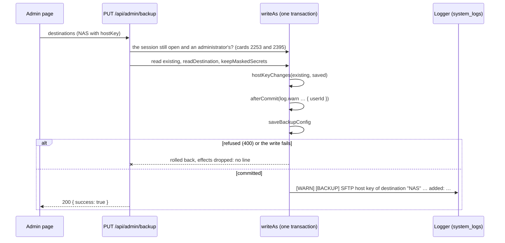

**The admin page.** Both SFTP forms have a Host key box (placeholder `Paste the line ssh-keygen
-lf /etc/ssh/ssh_host_ed25519_key.pub prints, or leave it empty and press Test`), carried by
`populateDestForm()` and sent by `buildDestConfig()` with every SFTP destination: a field not
sent is not kept, so a save without it would remove the key, which with the password masked is
refused. `testDestination()` reads the answer with `hostKeyCheckOf()`: an SFTP answer holding
`hostKey` or `confirmedHostKey` is shown in a box under the destination, in place of a toast,
and any other answer clears the box. `hostKey` alone shows the key and ✅ Confirm this key;
both show the key presented and the confirmed one, with no Confirm and the way to accept a new
key (Edit, the password typed again); `confirmedHostKey` alone shows the confirmed key and no
Confirm, there being no key to confirm. `confirmHostKey()` sets the destination's `hostKey` to
exactly the text shown, saves the whole list with `saveBackupConfig()`, puts the list back if
the save is refused, and only once it is saved reads the list back and runs the Test again on
the destination as the server now holds it. The card 2250 review added:

- **The private key box in the edit form** (M2), as the add form has it under Advanced: Private
  Key auth, filled by `populateDestForm()` with what the GET shows, the mask for a stored key,
  so a key-based destination can be given its key again when its host key changes.
- **The list read back after a save** (M3): `addDestination()`, `updateDestination()` and
  `confirmHostKey()` call `loadBackupConfig(true)` once saved, `quiet` leaving the section in
  place, so the list holds the secrets masked as the GET shows them. It held the password as
  typed, and a later save of the destination "with the password left masked" sent it typed and
  was saved, not refused. Since card 2939's code review (F10), Confirm's Test (`testSavedKey`)
  runs only once the list is read back, on the destination as saved; where it could not be read,
  the toast says so and nothing is tested, since a Test runs only a saved destination as stored.
- **A mark on the card** (S1): an SFTP destination with no `hostKey` shows "⚠️ Host key not
  confirmed — press Test" beside its buttons.
- **No stale box** (S3): `forgetHostKeyCheck(name)` clears a destination's box and moves on its
  number in `hostKeyTests` when it is added, saved or removed; `testDestination()` takes the
  next number, and an answer that comes back after the number has moved on says nothing.
- **Each Test button waits for its own Test** (card 2268). `testsInFlight` holds, by name, the
  number of each destination's Test still waiting for its answer; the Test button is disabled,
  and shows ⏳, while its destination has one. A Test's `finally` clears the entry only where
  it still holds its own number, so a second destination's Test no longer brings the first's
  button back when it starts (one `testingDest` name did), nor when it answers. A save moves
  `hostKeyTests` on and never `testsInFlight`, so a Test whose answer is dropped still clears its
  own entry when the answer comes.

### A Save of the Backup Settings, on Record

Every save of `PUT /api/admin/backup` that changes anything writes one line under `BACKUP`,
filed under the saving account (`user_id`, the chip on the Audit page), naming what it changed
(card 2270). `settingsChanges(before, after)` in `backup-secrets.ts`, beside `hostKeyChanges()`,
compares the settings as stored with the settings about to be saved, and returns `null` where
nothing changed, so a save that changes nothing writes nothing: the page's Save of the list as
shown, with every secret masked, is one. The route words the line (`settingsChangeLine()`) and
queues it with `afterCommit`, so a save refused or failed leaves none.

| | |
|---|---|
| The settings | `schedule`, `scheduleTime`, `scheduleDay`, `retention` and `notifyOnFailure` named with their old and new values (`schedule from daily to disabled`); `notifyEmail` named alone, never its addresses. `retention` and `scheduleDay` are compared as numbers, so `"7"` stored and `7` saved is no change |
| A destination's name | In quotation marks, each `\` and `"` in it escaped as `\\` and `\"` (`quotedName()` in `backup-secrets.ts`), so a name cannot end the quotation early and make the rest of the line read as something else. Card 2267's host key lines and a Google Drive Connect's line (card 2273) write the name the same way. The logger then makes it printable |
| A destination added | By name, new in the save: `destination "Offsite" added (sftp)` |
| A destination removed | By name, gone from the save: `destination "Old" removed (s3)`. One saved as another type under its name is removed and added, as card 2267 has it. Stored and saved destinations are matched one to one: each stored entry is taken once it is matched, so where two were stored under one name and the save keeps one, the other is removed |
| A destination changed | The names of its fields that changed, never a value, secrets and the rest alike: `destination "NAS" changed: host, port, password, privateKey, hostKey`. Every field either entry holds but `name` and `type` is compared (so `grantedScope` too), as it is used: `host`, `port`, `region` and `folderPath` by their defaults (`inUse`: a port left empty is 22, a host in other case is the same host), `hostKey` as stored (`keyAsStored`), every other field with missing, `null` and empty text alike. A secret sent back masked is the stored secret by then (`keepMaskedSecrets`), so it is no change. Where a field that says where the copies go changed, by the rule a masked secret is kept by (`SAME_IN` and a service account's address and key ID, the host key aside), its entry in the meta holds `"elsewhere":true`: an SFTP host, port, user name or remote path; an S3 region, bucket, prefix, endpoint or access key ID; a Google Drive sign-in method, folder ID, client ID or service account; a OneDrive tenant ID, client ID or folder path |
| The order | Settings, then destinations added, changed and removed, separated by `; `. The order of the list is not a change |
| The level | `WARN` where the save leaves fewer copies, or sends them elsewhere: a destination removed (or saved as another type); a destination kept with `elsewhere`; less time covered by the copies kept, the retention times the schedule's interval (`SCHEDULE_INTERVALS` in `backup.ts`, none for `disabled`), which is the schedule switched to `disabled` or to one more frequent (weekly to hourly with the retention kept); or the retention lowered, which the next run keeps to at every destination, a **Run Now** under `disabled` too, deleting the older copies. `INFO` for any other: a schedule less frequent (hourly to daily), a secret typed again alone, an address added. At `LOG_LEVEL=WARN` the `INFO` lines are not kept; the default is `INFO` |
| The meta | `{"settings":[{"field":"schedule","from":"daily","to":"disabled"},{"field":"notifyEmail"}],"added":[{"name":"Offsite","type":"sftp"}],"removed":[{"name":"Old","type":"s3"}],"changed":[{"name":"NAS","fields":["host","port"],"elsewhere":true}]}`, each list present, empty where nothing of its kind changed; `elsewhere` only where it is true |
| Beside card 2267's lines | This line names `hostKey` among a kept destination's changed fields (one of the same name and type in both) exactly when 2267 writes a key line for that destination, and never the key: the keys are in 2267's line alone. A destination added or removed with a key is named as added or removed, and 2267's line gives the key. It is queued first, so it reads before them |

A whole save, in order:

```
[WARN] [BACKUP] Backup settings changed: schedule from daily to disabled; destination "NAS" changed: hostKey; destination "Old" removed (s3)
[WARN] [BACKUP] SFTP host key of destination "NAS" at nas.example:22 added: ssh-ed25519 SHA256:…
```

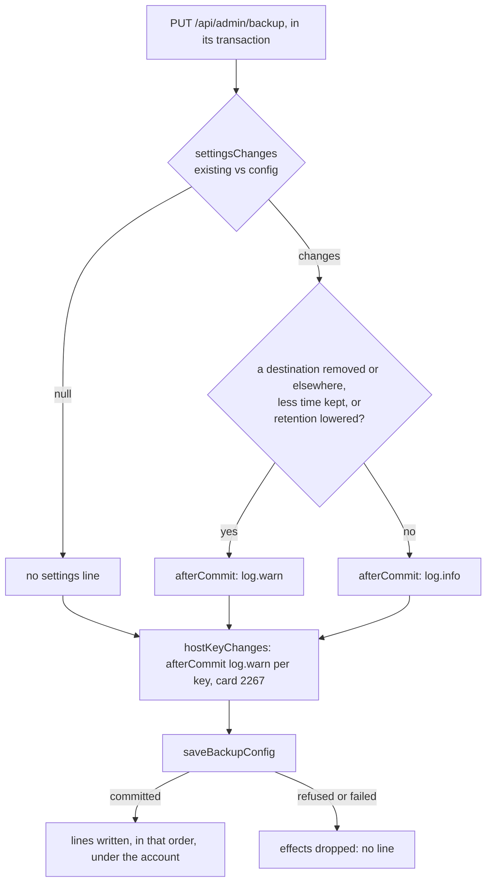

The other writer of `backup_config`, a Google Drive Connect saved, writes its own line under
`BACKUP`, filed under the account, once committed (card 2273; see
[Destination Types](#destination-types) above): an `INFO` for a first
connection, a `WARN` for one that replaced a connection. A third, since card 2397, takes a
demoted or deleted account's destinations out (`removeSettingsSetBy()` in
`src/lib/server/setting-setters.ts`), with its own `WARN` (above, Backup Configuration).

Before any of this, a save cards 2398 and 2408 keep for the superadmin is refused `403` inside
the same transaction, so nothing above is queued for it:

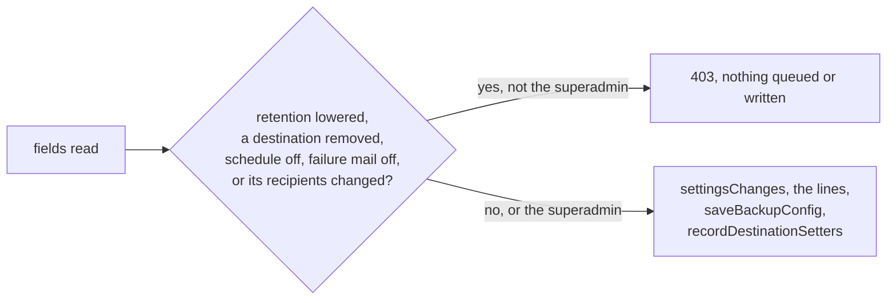

### Retention Cleanup

After each successful upload, the system:
1. Lists all backup files at the destination
2. Keeps only this run's kind of copy: the scheduled copies after a scheduled run, the copies
   made by **▶ Run Now** (named `…-manual.db`) after a Run Now
3. Sorts them oldest-first
4. Deletes those exceeding the configured retention count

**Keep Last counts Run Now copies and scheduled copies separately** (card 2405, 2026-10-22,
and its code review). Keep Last counted every copy, so an administrator who pressed Run Now
Keep Last times pushed every older copy out, which card 2398 had made lowering Keep Last the
superadmin's to prevent. A manual run (`POST /api/admin/backup`, `runBackup(name,
'manual')`) now names its copy `dumpfire-backup-<UTC date and time>-manual.db` (the time to the millisecond since card 2415), which still
sorts by its time, and `cleanupRetention(config, retention, kind)` keeps the two lists apart:
a Run Now removes only the oldest `…-manual.db` copies beyond Keep Last, and a scheduled run
(`runBackup()`, the default `'scheduled'`) only the oldest copies that are not `…-manual.db`
(`MANUAL_COPY` in `src/lib/server/backup.ts`). So a Run Now can push out only older Run Now
copies, and a destination holds at most twice Keep Last. The Run Now's `Backup succeeded` line
ends `. Made by Run Now: Keep Last counts Run Now copies apart from scheduled ones, so only an
older Run Now copy can be removed`; the panel says the same under Keep Last and in the Run
Now toast. Not pruning on Run Now at all would not have been enough: the next scheduled run
would have kept the newest copies, Run Now's, and removed the rest; and Run Now copies kept
until removed by hand would have grown without limit (the code review). Copies made by Run
Now before this change carry no `-manual` and are counted as scheduled ones. A schedule made
more frequent still keeps Keep Last copies over a shorter time: changing between schedules
that run is every administrator's (card 2398's ruling).

```mermaid
flowchart LR
    Run{"which run?"} -->|"▶ Run Now"| M["upload …-manual.db"]
    Run -->|"scheduled"| S["upload …db"]
    M --> LM["list: …-manual.db only"]
    S --> LS["list: all but …-manual.db"]
    LM --> K["keep the newest Keep Last<br/>of that list, remove the older"]
    LS --> K
```

On Google Drive the listing reads every page of the folder (up to 100 pages of 1,000 files; past that it stops with an error rather than follow a page token for ever) and each file's `capabilities.canDelete` and `canTrash` (card 2238), through the destination's optional `listForRetention()`. A file the account may delete is deleted by the id it was listed under; one it may only trash is moved to the trash, and logged `Retention cleanup: moved to the trash <name>` rather than `deleted` (its `delete()` answers `'trashed'`); one it may do neither to is set aside, not counted towards the retention number and not tried, and each run that finds any writes one `WARN` line saying how many and naming the oldest. The other destinations have no `listForRetention()` and are counted from `list()` as before. See [Configuring Backups](admin-guide.md#configuring-backups) for what to do about files set aside.

**What retention could not do is reported** (card 2941). `cleanupRetention()` answers what went
wrong, or null. It caught every failure into one ERROR line, so a destination whose listing or
deletes failed after a good upload showed ✅, sent no mail and filled unnoticed.

- **A destination that could not be made** (`createDestination` threw): `Keep Last was not
  applied: this destination could not be reached: <message>`.
- **A listing that failed** (`list()` or `listForRetention()` threw, Google Drive's, OneDrive's
  and S3's 100-page caps included): `Keep Last was not applied: the backups at this destination could not be listed: <message>`.
- **Deletes that failed:** `Keep Last was not fully applied: <n> of <m> older copies could not be removed (first: <file>: <message>)`.
  Each failed delete keeps its own ERROR line, and the rest are still tried, but for a call that
  did not answer (below).
- **Each listing and each delete is given 60 seconds** (`RETENTION_CALL_MS`): far past one Graph,
  Drive or S3 call and three times the SFTP handshake's 20, so a connection that hangs cannot hold
  the run. A call past it is a problem worded `The listing did not answer in time; it may still
  complete` (or `The delete …`): it is not cancelled, the run stops waiting for it, and it may
  still finish at the far end. **The first that does not answer stops the deletes**: the rest are
  counted as not removed (the fix pass's C3).
- **One destination's retention may take five minutes in all** (`RETENTION_DEADLINE_MS`): a
  destination answering each call just inside a minute could otherwise hold the run, the next
  destination's upload and an hourly schedule's next run for Keep Last minutes and more. Each
  call's time is cut to what is left; past it, the rest are counted as not removed ("Keep Last
  stops after 5 minutes").
- **Held while older copies are removed:** the destination is asked again before each delete
  (`destinationHeldNow`), and a hold written meanwhile stops it: `Keep Last was not fully applied:
  <n> of <m> older copies were not removed. <the held sentence>` (C3).
- **The far end's message is capped at 300 characters** (`cappedMessage`), and escaped where it
  is put in the mail.
- **The run's success row is inserted where it always was**, before retention, since the
  scheduler counts from its `created_at`; a problem then sets its `error`
  (`UPDATE … SET error = ? WHERE id = ?`, by `logBackup`'s `lastInsertRowid`). The status stays
  `success` and the run is not tried again. An update that fails writes an ERROR line, and the
  answer's note says so ("Backup History could not record that either: …").
- **The answer's `note`** carries it, after card 2417's history note where both apply, each part
  a sentence ending with a full stop (C9); the Run
  Now toast shows it as a warning. **Backup History** shows `✅ ⚠️ <first 40 characters>` in
  amber, with the whole text as its title.
- **A destination held while its upload ran** gets `Keep Last was not applied: <the held
  sentence>` on its row and note, and no paragraph in the mail: the hold is the superadmin's to
  review already.
- **The mail** (when failure mail is on) carries a paragraph for each: "… to **X** (type) was
  uploaded, but older copies were not removed.", the problem labelled `Problem:`. A run with only
  such problems is `⚠️ DumpFire Backup Needs Attention`, headed "Scheduled (or Run Now) Backup
  Needs Attention" in amber (`#f59e0b`, the amber the other mails use), each problem in an amber
  box; a run with a failure as well is `⚠️ DumpFire Backup Failed`, its heading red, with both kinds
  of paragraph, each failure in a red box (C13). It is sent every run until the problem is put right.

```mermaid
stateDiagram-v2
    [*] --> Inserted: upload succeeded, row inserted (success, error null)
    Inserted --> Held: held now (card 2922)
    Inserted --> Cleaned: cleanupRetention
    Cleaned --> Clean: null
    Cleaned --> Problem: not reached, listing or deletes failed, a call past 60 s, the 5-minute deadline, or held before a delete
    Held --> Noted: error = Keep Last was not applied (held), note
    Problem --> Noted: error = problem, note, mail paragraph
    Clean --> [*]
    Noted --> [*]
```

### A Destination Without Its Credentials

`runBackup()` asks `credentialsMissing()` (in `src/lib/server/backup-secrets.ts`) of each
destination before it makes the copy (card 2169). One that lacks its credentials is not
handed to `createDestination()`: an S3 destination with no secret access key, a Google Drive
one with no client secret or no refresh token (OAuth) or whose service account JSON holds no
private key, a OneDrive one with no client secret (or, after the host key, with no user or drive
ID: `driveMissing()`, card 2941). Its result and its `backup_log` row are
`failed`, with the `ERROR` line and the failure mail any failure has, and the error is
"This destination's credentials are not entered: a backup does not hold them, so they are
entered again after a restore. Enter them in Admin, Scheduled Backups." (Google Drive OAuth:
"… In Admin, Scheduled Backups, enter its client secret and connect it again."). That is
what Backup History shows after a restore onto another server, where it would have shown a
library's error. The copy is made only when at least one destination can be tried, so a run
with none makes no copy and does not stop the server answering for it. An SFTP destination
with neither a password nor a key is tried as before, since a server that allows `none`
authentication accepts it, once its host key is confirmed; after a restore onto another server
such a destination, its key confirmed again, is tried against the real host at every run, and
its failed logins may trip a lockout there, so its credentials are entered or it is removed.
`hostKeyMissing()` is asked beside `credentialsMissing()` (card 2250): an SFTP destination with
no confirmed host key is not tried either, with "SFTP host key not confirmed: nothing was sent
to this destination. In Admin, Scheduled Backups, press Test on it and confirm the key it
shows." (see [The SFTP Host Key](#the-sftp-host-key)). The results are given in the
destinations' order.

### A Destination Held for Review (Card 2922)

When the access of the account that set a destination ends with its API keys (a password or
two-step reset, an invite used, the holder's own change ending keys, or the host's
`scripts/mfa-reset.mjs`), the destination is **held for the superadmin's review**
(`setting_holds`, migration 0074). `notTried()` asks first, and `runBackup()` asks again
synchronously, by the place of the entry in use, immediately before each destination's upload and
again before its retention, so a hold written while an earlier destination is uploading is not
missed; an upload already on the wire finishes. A held destination is not tried, pruned, tested
(`POST /api/admin/backup/test` answers `409`) or connected (Google Drive Connect answers `409`); its
result and `backup_log` row are `failed` with "This backup destination is held for the
superadmin's review: the account that set it up had its access ended. Nothing is sent to it until
the superadmin keeps or removes it under Settings held for review on the admin page.", the failure
mail naming it where mail is not held, and it is not tried again as fixable. A save of the backup
settings that renames, retypes or removes a held destination is refused `409`: keep or remove it
under Settings held for review first. **Nor can a save move it** (card 2941, ruling R1): one that
keeps its name and type but changes where it sends its copies (any field of its place: a host,
bucket, folder or folder path, a OneDrive `drive` added, changed or removed) is refused `409`,
"Backup destination "X" is held for the superadmin's review: where it sends its copies cannot be
changed by a save. Keep it or remove it under Settings held for review first. Nothing was saved.",
asked before the password and again in the transaction. Before card 2941 such a save went through,
and the destination at its new place was no longer held. Keep puts it back in use exactly as it is; Remove takes it out
of `backup_config` with its stored secrets and leaves the hold, so the same destination saved again
is held again.

**A hold is by place, under any name** (the code review's C12). A destination's place leaves its
name out, and a hold of any destination's name at a place holds every destination at that place:
a held destination renamed (by a restore or on the host), or one removed and saved again under a
new name with the same type, account and folder, is held. Keep releases every destination hold at
that place. For an SFTP destination, Keep is checked against the host key the superadmin saw: one
confirmed after the list was read is refused `409` (C16).

**Restore.** A backup carries `setting_holds`. The restore carries this server's holds over the
backup's as a union (`carrySettingHolds`), so a destination removed here after a hold, or kept here
since the backup was made, comes back held; the import's answer says how many holds it carried. A
working copy, which removes every destination, deletes their holds after the carry.

```mermaid
flowchart TD
    Run["runBackup()"] --> NT{"notTried():<br/>held?"}
    NT -->|yes| F["failed: held words"]
    NT -->|no| Again{"held now?<br/>(before upload)"}
    Again -->|yes| F
    Again -->|no| Up["upload"]
    Up --> Ret{"held now?<br/>(before retention)"}
    Ret -->|yes| Skip["retention skipped, WARN"]
    Ret -->|no| Clean["cleanupRetention"]
```

### A Copy That Cannot Be Made

When `generateBackupData()` throws (card 2416, 2026-10-22): `VACUUM INTO` failing because the
volume beside the database is full or a disk error, or the clearing of the copy failing,
`runBackup()` calls `failed()` for each destination the pre-flight above let through, with the
error `The copy of the database could not be made: <the error's message>`, size 0 and the time
the copy took to fail, and returns through `finish()`. So:

- **Backup History** has a failed row for each of those destinations, under the run's one file
  name (one run, card 2413); a destination that failed the pre-flight keeps its own row and error.
  Not one row for the run: every row names a destination, and the panel shows each by it.
- **The answer**: ▶ Run Now (`POST /api/admin/backup`) answers `200` with each destination's
  result in the destinations' order, where it was a `500`; the panel's toast names each
  destination that failed with its reason ([The Run Now Toast](#the-run-now-toast)).
- **The mail**: the run's one failure mail, with that error in each destination's error box.
- **The log**: one `[ERROR] [BACKUP] The copy of the database could not be made` with the error
  itself, then `Backup failed: <destination> → The copy of the database could not be made: …` for
  each destination.
- **The scheduler** counts it as a run that failed at every destination, tried again 15 minutes
  later (card 2415); those destinations were tried, so it is not a failure before anything was
  sent.

Nothing is uploaded and no retention runs. It threw out of `runBackup()` before card 2416: no row,
no mail, a `500` for Run Now and only the scheduler's `Scheduler error` line. A row that cannot be
written (the volume too full for the copy may be too full for a row) is one `[ERROR] [BACKUP]
Backup History row for <destination> could not be written` line, and the run still answers and
mails; this holds for every failed row.

```mermaid
sequenceDiagram
    participant R as runBackup()
    participant G as generateBackupData()
    participant L as backup_log
    participant M as failure mail
    R->>G: make the copy
    G-->>R: throws (database or disk is full)
    loop each destination the pre-flight let through
        R->>L: failed row: "The copy of the database could not be made: …"
    end
    R->>M: one mail, every failed destination
    R-->>R: results (Run Now: 200), scheduler: try again in 15 min
```

### An Upload Whose History Row Cannot Be Written

A destination whose upload succeeded is a success, whether or not its `backup_log` row can be
written (card 2417, 2026-10-22): the copy is at the destination. The row was written inside the
upload's `try`, so a row that could not be written (a full volume beside the database, a disk
error) was caught with the upload's errors and handed to `failed()`: the result said the
destination failed with the database's error, the failure mail said so, retention was not run
for it, and a scheduled run of that one destination was tried again 15 minutes later, uploading a
second copy. Now `runBackup()` writes the row in a `try` of its own after the upload, and where it
throws:

- **The log**: one `[ERROR] [BACKUP] Backup History row for <destination> could not be written,
  though <file> was uploaded to it` with the error, then the usual `Backup succeeded` `WARN`. No
  `Backup failed` line.
- **The result**: `status: 'success'`, the usual `Uploaded <file> (<size> KB)` message, and a
  `note`: `Uploaded, but Backup History could not record it: <the error's message>`. `note` is
  on no other result.
- **Retention** runs for it, as for any success.
- **The mail and the scheduler** do not count it as a failure: it is in no failure mail, and a
  scheduled run with a success gives its tries again back (card 2415) and is not tried again.

Backup History has no row for that upload, so the scheduler, which reads `backup_log`, does not
see it after a restart (see the plan of card 2417, section 4).

```mermaid
flowchart TD
    Up["dest.upload()"] -->|"throws"| F["failed(): row, result, ERROR, mail"]
    Up -->|"succeeds"| Row{"logBackup() success row"}
    Row -->|"written"| Ret["cleanupRetention()"]
    Row -->|"throws (card 2417)"| Err["ERROR: row could not be written, though uploaded<br/>note on the result"]
    Err --> Ret
    Ret --> Ok["result: success<br/>(no mail, no try again)"]
```

### The Run Now Toast

What ▶ Run Now's toast says (card 2417, 2026-10-22; `runManualBackup` in
`src/lib/components/admin/ScheduledBackupsPanel.svelte`):

| The results | The toast |
|---|---|
| every one a success, none with a `note` | `Backup completed to N destination(s).` and the Keep Last rule (card 2405), going after 3 s |
| every one a success, some with a `note` | the same, with `<destination>: <note>` for each before the rule, as a warning that stays until closed |
| any failed | `F of N backup(s) failed: <destination>: <reason>; <destination>: <reason>.`, any notes after it, as an error that stays until closed |

It said only `F of N backup(s) failed`, the reasons in Backup History alone. A reason is whatever
the destination's server answered and the toast is 360 px wide, so each name and reason is put on
one line (white space run together), a name cut to 60 characters and a reason to 160 with `…`, and
at most three destinations are named, the rest as `and N more (see Backup History)`. The toast
draws its message as text, so markup in a name or a reason is shown as written, never drawn.

### Failure Notifications

Only the superadmin switches the failure mail off or changes who receives it, since card 2408 (2026-10-22); switching it on is every administrator's (see Backup Configuration above).

If `notifyOnFailure` is enabled and SMTP is configured, a styled HTML email is sent to the configured address with the error details, a destination not tried for want of its credentials included. The destination's name and type and the error text, which is whatever the destination's server answered, are escaped where they are put into the mail, so markup in them is shown as text and never drawn (see [Text in Mail Is Text](notifications-email.md#text-in-mail-is-text)).

The mail says which kind of run failed (card 2413, 2026-10-22): **Scheduled Backup Failed**, "A scheduled backup to *name* (*type*) failed." for a scheduled run, and **Run Now Backup Failed**, "A backup made by ▶ Run Now to *name* (*type*) failed." for a Run Now. It said "scheduled" for both. The subject, `⚠️ DumpFire Backup Failed`, is the same for both.

**One failure mail a run** (card 2415, 2026-10-22). `runBackup()` keeps each failed destination and its error, and after its last destination sends one mail with the paragraph above and the error box for each, in the destinations' order (`mailFailures`); a run with one failed destination reads as before. It sent one mail for each destination that failed, so four failing sent four for one run. A run none of whose destinations could be tried (credentials or host key missing) sends its one mail too. A scheduled run that failed at every destination is tried again up to three times (above), each with its own mail.

**A copy that cannot be made sends the mail too** (card 2416, 2026-10-22): each destination that was to be tried is in it with `The copy of the database could not be made: …` in its error box ([A Copy That Cannot Be Made](#a-copy-that-cannot-be-made)). It sent none.

**An upload whose Backup History row cannot be written is not in the mail** (card 2417, 2026-10-22): the copy is at the destination, so it is a success with a note ([An Upload Whose History Row Cannot Be Written](#an-upload-whose-history-row-cannot-be-written)). It was mailed as a failure with the database's error.

---

## Report System

### Report Architecture

```mermaid
flowchart TD
    subgraph Triggers
        Manual["Manual generation\nReports page"]
        Scheduled["Report Scheduler\n60s check interval"]
    end

    subgraph Generation
        ScopeSelect["Select scope\nBoard / Category / All"]
        ScopeSelect --> FilterSelect["Status filter\nAll / Completed / In Progress / To Do"]
        FilterSelect --> DataCollect["Collect cards, assignees,\nsubtasks, activity"]
        DataCollect --> BuildReport["Build ReportData object"]
        BuildReport --> RenderPDF["Render PDF\nPDFKit"]
    end

    subgraph Delivery
        Download["Direct download\nbrowser response"]
        EmailDelivery["Email with PDF\nattachment"]
    end

    Manual --> ScopeSelect
    Scheduled --> ScopeSelect
    RenderPDF --> Download
    RenderPDF --> EmailDelivery
```

### Report Scopes

| Scope | Description | Data Included |
|-------|-------------|---------------|
| `board` | Single board | All cards in that board for the period |
| `category` | Board category | All boards in a category, aggregated |
| `all` | All boards | Every board across the system |

Every scope walks into sub-boards at any depth (`collectSubBoardIds`), but only into those its reader can open, and the walk does not pass through one they cannot (card 2150): a sub-board further down that they can open, under one they cannot, is not reached. So a board report holds the cards of the sub-boards beneath it that its reader can open, and an administrator's all-boards report counts every card in the system. A sub-board left out is not mentioned: no line says that some were.

#### Whose Report It Is

A report is always one person's view, drawn from `getAccessibleBoardIds` of that person
(`null` for an administrator, who opens everything). The three report functions build one
`canOpen(boardId)` from it (`openerFor`) and hand it to the walk and to
`generateReportForBoards`:

| Path | The reader |
|------|------------|
| Downloaded (`POST /api/reports`) | The caller |
| Emailed by hand (`POST /api/reports/email`) | The caller who sends it |
| Scheduled | The schedule's owner, as their account stands at the time of the run |

Recipients are addresses, not accounts. Each gets the report its sender or owner may read,
whoever the recipient is: having an account gives a recipient neither more nor less, and
sending it to someone is the sender's decision. The rule cuts both ways for a schedule: its
report grows when its owner is given a sub-board, or made an administrator, and shrinks when
they lose one, and nobody confirms its recipients again.

A board in the report whose parent board the reader cannot open is shown under its own name,
as a board of its own: `parentBoardName` is null for it, so the Board Breakdown and the open
work draw it as a row of its own and not nested. The parent is named (`A → S`) only when the
reader can open it. A report of a sub-board shared with someone who cannot open its parent
names the parent nowhere, the PDF's title and subject included.

The Reports page lists the boards a report can be chosen of: for an ordinary user, the
top-level boards they can open and each board they can open whose parent board they cannot
(a sub-board shared with them on its own, which no report they could choose would otherwise
reach); for an administrator, the top-level boards, as before.

```mermaid
flowchart TD
    Reader["The reader: caller, sender, or the schedule's owner at the run"] --> Ids["getAccessibleBoardIds(reader)"]
    Ids --> CanOpen["canOpen(boardId): a Set, or everything for an administrator"]
    Scope["Boards of the scope"] --> Walk["collectSubBoardIds(boardIds, canOpen)"]
    CanOpen --> Walk
    Walk --> Sub{"A sub-board under a card of a board in the walk"}
    Sub -->|reader can open it| Add["Added, and walked into in turn"]
    Sub -->|reader cannot| Stop["Left out, and nothing beneath it is reached"]
    Add --> Gen["generateReportForBoards(..., canOpen)"]
    CanOpen --> Gen
    Gen --> Parent{"Parent board openable?"}
    Parent -->|yes| Nested["Named under its parent"]
    Parent -->|no| Own["A board of its own, parent not named"]
```

A report emailed by hand carries the board's or grouping's name and the sender's username, and a scheduled report the schedule's name. Each is escaped where it is put into the mail's HTML, so a name with markup in it reads as typed and draws nothing; the subject keeps the name as typed, because a subject is plain text (see [Text in Mail Is Text](notifications-email.md#text-in-mail-is-text)).

A report asked for by hand (`POST /api/reports`, and `POST /api/reports/email` for the
emailed one) reads its fields as a schedule does (card 2117): `scope` is `board`,
`category` or `all`, where the emailed one read any other word as every board the sender
can see; `periodStart` and `periodEnd` are a date or a timestamp, and `periodStart` is not
after `periodEnd` (`periodStart is after periodEnd`; a bare date is the whole day, so a
date to the same date is that day), where a period that ended before it began was drawn as
a report of nothing; `scopeId` is an id;
`detailLevel` and `statusFilter` are among their values, where another was read as
`detailed` or `all`; and `assigneeUserId` is a user's id or `null` for everyone, where
`"all"` and `''` were taken for everyone. Each of the emailed report's `recipients` is an
address, `recipients[1] must be an email address`: one that was not used to be dropped
without a word and the report sent to the rest.

Both take an optional `timeZone` (card 2258): the zone whose day the Overdue figure counts
from, read as a schedule's `timeZone` is and refused in its words (`timeZone must be a time
zone name, such as Europe/London`). The Reports page sends the viewer's browser zone; a call
without one counts from the UTC day, as every report did before. The PDF of a report made by
hand prints its period, generated date and completion dates in UTC whatever is sent, as the
emailed one's mail writes its period.

The Reports page sends "This month", "This quarter" and "Year to date" as dates (card 2271):
from the first day of the month, the quarter or the year to today, both as the clock reads
them in the zone it sends as `timeZone` (UTC when the browser gives none this server knows),
so each is the custom range the viewer would type, read as whole UTC days and printed as the
days chosen. The first day used to be sent as the browser's midnight, a moment, which the PDF
printed in UTC: east of UTC the period began the day before ("30 Sept 2026" for October from
London in summer). What a preset covers moved with it: east of UTC the first hours of the 1st
by the viewer's clock (00:00 to 01:00 in UK summer time) are now in the month before, and west
of UTC work finished in the evening after UTC's midnight (after 20:00 in New York in summer)
is counted from the next day, as a custom range counts it.

The rolling periods are calendar days too (card 2275): "Last 7 days" to "Last 90 days" run from
that many days before today, and "Last 12 months" from the same date a year before (29
February then the 28th), to today, sent as dates in the same zone. They were sent as moments,
N × 24 hours back from the moment, printed as the UTC days of those moments: from London at
00:30 BST both ends read the day before.

Where the server does not know the zone the browser sends (a browser newer than the server can
name one), the Reports page asks once more without it, so the report is made with its Overdue
figure counted from the UTC day, and says so in a notice naming the zone. The period is the
browser's own dates either way.

The emailed report's answer says what was sent (card 2113): `503` with no mail set up,
before the PDF is built; `200` when every recipient was sent it; `200` naming the addresses
not reached when some were; `502` when none was; each but the `503` with every recipient's
result. The Reports page keeps the dialog open for a report not sent to everyone, with only
the addresses not reached left in it. See
[A Report Emailed on Demand](notifications-email.md#a-report-emailed-on-demand).

### Status Filter

Every report (one-off, emailed and scheduled) carries a `statusFilter` that decides which slice of the scope is listed. Summary metrics always describe the whole scope — the filter only changes the task listings and the priority breakdown.

| Value | Lists | Section order |
|-------|-------|---------------|
| `all` (default) | Completed in period, then everything still open | **Completed in Period first**, then Outstanding per board |
| `completed` | Only cards completed within the period | Completed in Period |
| `in_progress` | Open cards that have left To Do (In Progress, On Hold, Review, Testing…) | In Progress per board |
| `todo` | Open cards still in a To Do / Backlog style column | To Do per board |

Cards are classified by the column they sit in (`classifyColumn` in `src/lib/server/reports.ts`). An upstream column, a board's Options column or any column of an ideas board, holds options whatever it is called. Any other column goes by its title: To Do is `countsAsToDo` in `src/lib/column-role.ts`, the same rule All Tasks' To Do bucket and the All To Do page use (card 2474).

```mermaid
flowchart LR
    Col["Column"] --> Up{"Options column or\nideas board?"}
    Up -->|yes| Option["option"]
    Up -->|no| Done{"complete / done?"}
    Done -->|yes| Completed["completed"]
    Done -->|no| Todo{"to do / todo / to-do / backlog / inbox /\nnot started / new / planned / ideas / idea / later?"}
    Todo -->|yes| ToDo["todo"]
    Todo -->|no| InProgress["in_progress"]
```

A board with no recognisable To Do column still gets one: its left-most column that is neither Done nor the Options column is treated as To Do. All Tasks and All To Do do not do this; they list nothing as To Do for such a board. A stored filter value it does not know falls back to `all` (`parseStatusFilter`), so an existing schedule keeps working. A request that sends one is refused, `400 statusFilter must be one of: all, completed, in_progress, todo`: until card 2117 it was read as `all`.

When a filter other than `all` is active the PDF header carries the filter label and a **SHOWING** banner under the metric tiles states how many cards are in that slice.

### Cards vs Tasks

Two figures appear side by side in the summary tiles, and the same two on the dashboard's **All Tasks** row:

| Figure | Definition |
|--------|------------|
| **Cards** | Non-archived kanban cards across every board in scope *and each sub-board beneath it that the reader can open*, regardless of period |
| **Tasks** | Cards plus the subtasks hanging off them (`totalCards + totalSubtasks`) |

The dashboard row uses the same board → cards → sub-boards walk as the report engine (`src/routes/+page.server.ts`), and both stop at a sub-board their reader cannot open (cards 2130 and 2150), so an administrator's all-boards report and their dashboard quote the same card count again. Historically the row only summed top-level boards, which is why it used to show fewer cards than the report; and until card 2150 the report walked into every sub-board, opened or not, while the dashboard did not.

### Report Data Structure

```mermaid
flowchart TD
    ReportData["ReportData"]
    ReportData --> Filter["statusFilter\nall / completed / in_progress / todo"]
    ReportData --> Summary["Summary\ncards, subtasks, tasks\ncompleted, created, outstanding\ntodo, inProgress, overdue\nupstream (null for one person)"]
    ReportData --> Priority["Priority Breakdown\ncritical, high, medium, low"]
    ReportData --> Assignees["Assignee Stats\nper-user completed + outstanding"]
    ReportData --> Outstanding["Outstanding Tasks\ngrouped by board + category"]
    ReportData --> Completed["Completed Tasks\ngrouped by board + category"]

    Outstanding --> TaskDetail["TaskDetail\ntitle, priority, due date\nassignees, subtasks\ndescription, business value"]
    Completed --> TaskDetail
```

### PDF Generation

PDFs are rendered server-side using PDFKit with a professional layout:

- **Header** — DumpFire branding, report title, date range, detail level and (when set) the status filter
- **Executive Summary** — Six stat tiles: Cards, Tasks incl. subtasks, Completed, Created, Outstanding, Overdue, with a caption spelling out what each one counts. Overdue is the open cards due before the reader's today (card 2258): the day in the zone the Reports page sends, or the schedule's zone, and the UTC day when there is none. It was always the UTC day, so east of UTC after midnight a card due the day before was not yet counted
- **Options and abandoned work** (milestone 22, card 2462) — A card in a board's Options column or on an ideas board is an option, in none of the figures, lists or breakdowns: a column is classified by its stored role first (`classifyColumn`), so neither the Options column nor an ideas board's column called "Ideas" is ever taken for To Do. Under the caption, `Upstream: N options now, oldest D days, A over 30 days · C committed from options · R returned to options · X discarded · S sent to other boards · discard rate P%.` when any upstream figure is not zero (`summary.upstream`, from `upstreamFigures`), and `Abandoned (committed work archived before Complete): N` on its own line when that is not zero, which a board whose Options column has never held an idea can show too. A report about one person (`assigneeUserId`) has `summary.upstream` null and neither line, and says instead that the upstream line is left out because those figures describe the boards, not one person's work, only where there is something to leave out: `summary.upstreamLeftOut`, true when a board in scope has an upstream column or abandoned work in the period. A single card's report lists an option in no outstanding work
- **Dates** — A due date (the Due Date column) is printed as the day stored, in any zone (`formatDueDate`). The period, the generated date and the completion dates are printed in the schedule's zone for a scheduled report and in UTC for one made by hand (card 2258); they were printed in the server's zone, so a Tokyo schedule's PDF read a day before its mail's period
- **Status banner** — Only when a filter is active: "SHOWING Completed in period only — N cards" etc.
- **Priority Breakdown** — Visual bar chart of the slice being reported (Outstanding by default, Completed in Period for the completed filter)
- **Assignee Performance** — Table of completions per user (scope-wide)
- **Board Breakdown** — Per-board totals with sub-boards nested under their parent (scope-wide)
- **Completed Tasks** — Completions in the period with timestamps; drawn **before** the open work in the `all` report
- **Outstanding / In Progress / To Do** — Open work grouped by category and board, sub-boards nested under their parent; the heading follows the filter

All free text (titles, descriptions, business value, subtasks) passes through `stripTag()`, which removes the internal AI bookkeeping tags `[Antigravity]`, `[Claude]` and `[AI]` before printing.

### Report Scheduling

Configured per-user via the Reports page:

| Field | Type | Description |
|-------|------|-------------|
| `scope` | board/category/all | What to report on |
| `scopeId` | number | Board or category ID |
| `frequency` | weekly/monthly | How often |
| `dayOfWeek` | 0-6 | Day for weekly reports |
| `dayOfMonth` | 1-28 | Day for monthly reports. A value above 28 kept from before is read as 28 |
| `timeOfDay` | HH:MM, 00:00 to 23:59; empty is 09:00 | When to generate: a wall-clock time in `timeZone` |
| `timeZone` | An IANA zone name, such as `Europe/London`, at most 64 characters; stored as the server names it (`europe/london` is `Europe/London`, `Etc/UTC` is `UTC`). None is `UTC` | The zone `timeOfDay` is read in (card 2159, migration `0058`). The Reports page sends its creator's browser zone |
| `recipients` | Up to 10 addresses, separated by commas, semicolons or spaces (tabs and new lines too), an address written `<address>` read as the one inside; each part must be an address. Stored as the addresses it is sent to, lower-cased, each once, separated by `, ` | Where to send |
| `periodDays` | 1-366 | Lookback period in days: from the same time by the schedule's clock that many dates before the run, in its `timeZone`, so a week across a clock change is still Monday 09:00 to Monday 09:00 (card 2159). The mail's "Period" is written in that zone too, and so are the PDF's period, generated date and completion dates (card 2258), and the day its Overdue figure counts from, at the run's own moment, so a run made late counts from where its period ends |
| `detailLevel` | summary/detailed | Metrics and listings only, or full descriptions, business value and subtasks |
| `statusFilter` | all/completed/in_progress/todo | Which slice to list (see Status Filter); stored in `report_schedules.status_filter`, migration `0041` |
| `enabled` | boolean | Active toggle |

**What asks for the password and a code (card 2751).** A schedule mails a board's activity on
its timetable after the session that made it has ended, and after its owner's password changes,
so starting one or widening one asks for the owner's current password and a code from their
authenticator app, as every step-up action does:

- **Making a schedule** (`POST /api/report-schedules`), always: to the owner's own address, to
  the company's, or to none.
- **A change** (`PUT /api/report-schedules/{id}`) that **adds an address** (one not in the
  stored list, both read as the scheduler reads them; a swap adds one; whether the schedule is on
  or off), **turns it on**, or **widens its status filter** (any new filter while the stored one,
  as the scheduler reads it, is not `all`: the narrow filters are disjoint parts of `all`).
- **Nothing else**: a rename, a re-timing (**Use my time zone** among them), an address removed,
  a narrower filter, turning it off, deleting it.

Every refusal below that needs no password is made first, in the same words, with the day's
100 read and nothing taken, so none of them costs a check or a guess. A change that asks
nothing is decided and written in one transaction on the stored row; one that asks writes
nothing until the password and the code are checked, then is read and written again while the
password holds. Each schedule made, given an address, turned on or widened writes one `INFO`
line under `REPORTS` naming it, what it covers and every address it is sent to, and mails its
owner the `report-schedule-set` notice
([Report Schedule Notices](notifications-email.md#report-schedule-notices-card-2751)). On the
Reports page, **+ New Schedule** has the password and code fields; the switch turns a schedule
off at once, and on through **Turn on this schedule?**, which names every address it will
email and asks for both. See
[Report Schedules and Report Mail](authentication-security.md#report-schedules-and-report-mail-card-2751).

**Schedules that existed before card 2751** keep running: the scheduler is unchanged, and a run
asks nothing. At the first start after the release each owner of a schedule that is on is
mailed once, "Your DumpFire report schedules", listing each of theirs that is on with what it
covers and its addresses, and asked to delete any not recognised; each is also one `WARN` line
in the log, which is the record where mail is not set up. A mail that did not go is tried again,
to every owner, at the next start; a start where the schedulers do not run (`SCHEDULERS=off`, the
dev server) mails nobody
(`announceReportSchedules()`, `settings.report_schedules_announced`; see
[Deployment](deployment.md#the-release-that-asks-for-the-password-before-report-mail-card-2751)).

**What a schedule covers can still grow without a step-up (accepted residual).** A schedule on a
grouping or on every board covers what is in it at each run: a board moved into the grouping, a
sub-board made, or the owner given a board widens what it mails, and a board schedule's
sub-boards likewise. Storing the boards approved at the step-up, and reporting on those alone,
is card 2897.

**A time in a zone (card 2159).** A schedule's time is a wall-clock time in its own zone, so
"weekly on Monday at 09:00 Europe/London" is sent at 09:00 in London all year: 08:00 UTC in
British summer time, 09:00 UTC in winter. It used to be set with `setHours` on the server's
own clock, so on a server on UTC (the image sets no `TZ`) it was sent at 10:00 all summer.
`nextRunAfter` in `src/lib/report-schedule-time.ts` works every run out afresh from now,
never by adding seven days to the last, and the server's own zone plays no part:

- **A time the clocks jump over** (01:30 in the UK on the last Sunday in March) is sent an
  hour later by the clock, 02:30 BST, the moment 01:30 GMT would have been.
- **A time that happens twice** (01:30 on the last Sunday in October) is sent once, at the
  first.
- **A zone the server does not know**, an offset such as `+01:00` or `−01:00` (either
  minus sign), or more than 64 characters is `400` `timeZone must be a time zone name, such as Europe/London`. Zone rules
  come with Node's own build in the image; a government's change to its clocks reaches the
  schedules with a later Node 22 image.
- **Schedules made before card 2159** were given `UTC` by migration `0058`, the zone they had
  been running in, so each is sent when it always was. The page offers "Use my time zone
  (Europe/London)" on any schedule whose zone is not the viewer's; only the schedule's owner
  can press it.

**When the next run moves (card 2159).** `POST` works out the first run in the schedule's
zone. `PUT` works the next run out again from now when it sends a new `frequency`,
`dayOfWeek`, `dayOfMonth`, `timeOfDay` or `timeZone`, and when it turns the schedule on; any
other change leaves it, so a rename does not move a run that is due. So turning a schedule
back on sends nothing at once for a run missed while it was off, a working-copy restore's
schedules included; it is sent at its next time. A changed time takes effect at once, where
the old time used to be sent once more. A new zone takes the schedule's addresses from the
day's 100, as a new time does, since it can bring a send forward to any time; a schedule
that is off after the change takes nothing. A timing the scheduler cannot date is refused,
with nothing changed: `400` `The schedule was not changed: its time of day "9" is not a time
from 00:00 to 23:59`, or, turning one on, `400` `This schedule cannot be turned on: its time
of day "9" is not a time from 00:00 to 23:59. Turn it on with a time, day and zone that can
be read, or delete it and make it again.` A `PUT` that sends `enabled: true` with a timing
that can be read, `{"enabled": true, "timeOfDay": "10:00"}`, turns such a schedule on.

Who a report may reach (card 2182), told in full in
[Who a Report Can Be Mailed To](notifications-email.md#who-a-report-can-be-mailed-to):

- **A schedule holds at most 10 addresses.** More is `400` `A schedule can be sent to at
  most 10 addresses, and this names 12. The schedule was not saved.` (`… was not changed.`
  on `PUT /api/report-schedules/{id}`), and a part that is not an address is `400`
  `recipients holds "smith", which is not an email address`, with nothing saved. Any address
  may be one, an account's or not.
- **An account has at most 20 schedules.** The 21st is `409` `You have 20 report schedules,
  the most one account may have. Delete one first.` An account that already has more keeps
  them all and makes no more until it has fewer than 20.
- **The day's 100 addresses.** One account's report mail reaches at most 100 addresses in a
  24-hour window counted from its first take (so up to 200 across one window's end and the
  next's start): the reports it emails by hand, and the schedules it makes, turns on or
  re-times while on, each of which takes the schedule's addresses, because each can bring a
  send forward; and a change of a schedule's list, which takes the addresses it adds, those not
  in the stored list (one address changed to ten takes nine). The stored list sent back in
  another order or case, or cut down, a change of name or filter, and turning a schedule
  off take nothing, and nothing is given back when a schedule is deleted. Past it, `429`
  `Report mail can reach at most 100 addresses a day from one account, and this schedule's
  10 would make 104. The schedule was not saved. Try again in 5 hour(s).` (`this schedule's
  4 new addresses would make 104` and `was not changed` for a changed list), nothing saved.
  A scheduled run takes nothing.
- **A schedule kept from before with more than 10** cannot be turned on as it is: `PUT` with
  `enabled: true` on such a schedule that is off is `400` `This schedule cannot be turned
  on: it is sent to 15 addresses, and the most is 10. Delete it and make it again with at
  most 10.` One still on can be sent back with `enabled: true` and a new name, as a page
  sends the row. A caller of the route can also send a list of 10 or fewer with `enabled:
  true` in the same `PUT`, which is accepted. The Reports page cannot edit a list, so it
  shows such a schedule's addresses as text to copy, with "Copy the ones to keep into a new
  schedule of at most 10, then delete this one."

A report emailed by hand from the Reports page is held to the same reading: at most 10
distinct addresses a call (`400` `A report can be emailed to at most 10 addresses at a time,
and this names 12. Nothing was sent.`, before the board is looked at), and the account's
100 a day, counted in a 24-hour window from its first (`429` `Reports can be emailed to at most 100 addresses a day from one account,
and this would make 104. Try again in 5 hour(s).`, taken before the PDF is built). Since card
2751 it also asks for the password and a code, for every address, each of those refusals made
before them; the session, the sender's access and the password are asked again before every
send, and a refusal once a mail has gone stops the sending, the rest answered "Not sent:
sending stopped because …". See
[A Report Emailed on Demand](notifications-email.md#a-report-emailed-on-demand).

### Schedule Execution

Every minute the timer of `initReportScheduler()` calls `runDueReportSchedulesOnce(now)` in
`src/lib/server/reports.ts`, with the time it is then, and that calls
`runDueReportSchedules(now)` unless the last minute's run is still going. Both are exported
so that the tests can call them with a time of their own; under test the timer is off
(`SCHEDULERS=off`). A run takes each enabled schedule whose `nextRunAt` has come, or that has
none, as its owner: the report is built with the owner's access, as if they had asked for
it.

**The next run first, then the claim, then the send (card 2144).** For each schedule due, in
this order:

1. Its next run is worked out from now, in its own zone (`nextRunAfter`). A schedule whose
   next run cannot be worked out is switched off, with one `ERROR` line, and nothing is sent
   (below).
2. A schedule with no next run (a restored or hand-made row) is given one, and nothing is
   sent: it is not mailed the moment it arrives. A next run that cannot be read counts as
   none: `NaN-NaN-NaN NaN:NaN:NaN`, which the image before card 2144 wrote for a time it could
   not read, was after every moment when compared as text, so such a schedule was never due.
   Where the schedule cannot be dated either, step 1 switches it off and clears the value.
3. The run is claimed: one conditional write, `UPDATE report_schedules SET last_run_at = now,
   next_run_at = next, updated_at = now WHERE id = ? AND enabled = 1 AND next_run_at <= now`,
   in the stored form (`stamp()`), made before the report is built (`claimScheduleRun`). A
   claim that changes no row means another run has it, and the schedule is skipped. SQLite
   takes the write lock, so of two ticks, or two processes on one database, only one sends.
4. The report and its PDF are built from the row as claimed, so a change of recipients made
   in between is honoured, and sent.

The next run used to be worked out after the sends: a time it could not read was sent at
every minute's tick, and a weekly day of -2 gave a next run in the past and did the same.

**At most once.** Because the claim moves `lastRunAt` and `nextRunAt` before anything is
sent, a failure after it, or a restart during the sends (a deploy), loses the rest of that
run, which is not sent again. Before card 2144 the same run was sent again to every recipient
at the next start. For mail to outside addresses that is the right way round.

**One run at a time.** A run can take longer than the minute between ticks: about 35 seconds
for each address a slow mail server holds up, and the PDF before that. A module flag marks a
run in progress: a tick that finds it set does nothing and answers `false`, and the flag is
cleared in a `finally`, so a run that throws does not stop the scheduler. A schedule that came
due during a run is still due at the next tick that runs. The claim would stop a second send
on its own; the flag keeps one process from doing two ticks' work at once.

**At the start.** `initReportScheduler()` gives every schedule with no next run its first,
enabled or not, through the same function, and switches off one it cannot date. It never
throws: a failure is logged at `ERROR` and the timer starts all the same. A schedule with no
next run and a time that could not be read used to stop the server starting.

```mermaid
sequenceDiagram
    participant Timer as Scheduler Timer
    participant Once as runDueReportSchedulesOnce(now)
    participant Run as runDueReportSchedules(now)
    participant DB
    participant Engine as Report Engine
    participant SMTP
    participant Log as System log (REPORTS)

    Timer->>Once: every 60 s, with new Date()
    alt the last tick's run is still going
        Once-->>Timer: false, and nothing is run
    else no run is going: the flag is set
        Once->>Run: run
        Run->>DB: Enabled schedules whose nextRunAt is empty or not after now
        DB-->>Run: Matching schedules

        loop Each schedule
            Run->>Run: nextRunAfter(schedule, now), in its own zone
            alt the next run cannot be worked out (card 2144)
                Run->>DB: nextRunAt = null, if it cannot be read
                Run->>DB: enabled = 0, where it is still 1
                Run->>Log: ERROR switched off, naming the field, if this run changed the row
                Note over Run: nothing built or sent, next schedule
            else no next run yet, or one that cannot be read
                Run->>DB: nextRunAt = the run found, where it is still as read
                Note over Run: nothing sent, next schedule
            else more than 10 addresses (card 2182)
                Run->>DB: enabled = 0, where it is still 1
                Run->>Log: ERROR switched off, if this run changed the row
                Note over Run: nothing built or sent, next schedule
            else a run is due
                Run->>DB: claim: lastRunAt = now, nextRunAt = next,<br/>where it is on and nextRunAt is not after now
                DB-->>Run: the row as claimed, or none: another run has it, next schedule
            end
            Run->>Engine: generateReport by scope + statusFilter, as the owner
            alt no report: none named, gone, or none the owner can read
                Run->>Log: WARN produced no report, so nothing was sent: why
            else a report
                Engine->>DB: Query boards, cards, assignees
                Engine->>Engine: Build ReportData, render the PDF via PDFKit
                Engine-->>Run: PDF Buffer
                loop Each address, never a part that is not one
                    Run->>SMTP: sendEmailWithAttachment(), Set up by the owner
                    SMTP-->>Run: true (sent) or false (not sent)
                end
                alt every recipient sent it
                    Run->>Log: WARN emailed, naming every address (card 2895)
                else any not sent
                    Run->>Log: ERROR not emailed to the addresses named,<br/>the ones reached named, S of N, and why
                end
            end
        end
        Run-->>Once: done
        Once-->>Timer: true, the flag cleared (finally)
    end
```

What the system log says, under the context `REPORTS` (card 2113). Each send's result is
counted; it used to say "emailed to N recipient(s)" whatever the mail server answered, and
nothing at all for a schedule that produced no report.

| What happened | Level | Line |
|---------------|-------|------|
| Every recipient was sent it | `WARN` | `Scheduled report emailed: "<name>" (schedule 12) to: a@example.com, b@example.com, c@example.com`, with `{ scheduleId }` and the owner as the line's user (card 2895) |
| One or more were not | `ERROR` | `Scheduled report "<name>" (schedule 12) was not emailed to b@example.com; it reached: a@example.com, c@example.com (2 of 3). The mail server did not accept it: its reason is in the EMAIL line logged for each address. It is not sent again before its next run.` |
| None could be, mail not being set up | `ERROR` | The same line, `it reached: no address (0 of 3)`, with `Mail is not set up on this server` as the reason. `email.ts` logs nothing of its own then |
| No report: its board is gone, or its owner can no longer read it | `WARN` | `Scheduled report "<name>" produced no report, so nothing was sent: the board it covers (id 7) is gone, or the schedule's owner can no longer read it` |
| No report: its grouping is gone, holds no board, or holds none its owner can read | `WARN` | `... produced no report, so nothing was sent: the grouping it covers (id 7) is gone, holds no board, or holds none the schedule's owner can read` |
| No report: a board or grouping schedule that names none (`scopeId` empty) | `WARN` | `... produced no report, so nothing was sent: the schedule has no board` (`the schedule has no grouping` for a grouping) |
| No report: a report on every board, and its owner is not an administrator | `WARN` | `... produced no report, so nothing was sent: a report on every board is for an administrator, and the schedule's owner is not one` |
| No recipients | `WARN` | `Scheduled report generated but no recipients configured: "<name>"` |
| Its next run cannot be worked out (card 2144) | `ERROR` | `Report schedule 12 "Weekly sales", owner "pat" (user 7), was switched off: its time of day "9" is not a time from 00:00 to 23:59, so its next run cannot be worked out. Nothing was sent. Its owner can turn it on again with a time, day and zone that can be read, or delete it and make it again.`, with the owner as the line's user. The other faults: `its frequency "daily" is not weekly or monthly`, `its day of the week -2 is not a whole number from 0 (Sunday) to 6 (Saturday)`, `its day of the month 0 is not a whole number of 1 or more`, `its time zone "Mars/Base" is not one this server knows`. A stored value is named to its first 80 characters, then `…`. Once, as the line below: written only by the run, or the start, that changed the row |
| More than 10 addresses, kept from before the cap (card 2182) | `ERROR` | `Report schedule 12 "Weekly sales", owner "pat" (user 7), was switched off: it is sent to 15 addresses, and the most is 10. Nothing was sent. Its owner can delete it and make it again with at most 10.`, with the owner as the line's user. Once: the switch-off is written only where the schedule is still on, and only the run that changed the row writes the line |
| A list that also holds parts that are not addresses, kept from before (card 2182) | As the line | The emailed, not-emailed or no-recipients line above ends `Left out, as not email addresses: "alice", "smith".` Those parts are never sent to; the addresses are, and the schedule is not switched off for them |
| A change that asks no password (card 2895): renamed, re-timed, turned off, a narrower filter, addresses removed | `INFO` | `Report schedule 12 "New" was renamed from "Weekly", re-timed, turned off, narrowed to Completed only, had addresses removed, a report of the board "Sales", sent to: a@example.com; removed: b@example.com` (each part only where it happened), with `{ scheduleId }` and the owner as the line's user, once committed. No notice. A change sent back as it is stored writes none. A change that asks for the password writes card 2751's line instead (`was made`, `given addresses`, `turned on`, `widened to …`) |
| A schedule deleted (card 2895) | `INFO` | `Report schedule 12 "Weekly", a report of the board "Sales", was deleted; it was sent to: a@example.com, b@example.com`, with `{ scheduleId }` and the owner as the line's user, once committed |

**Every change to a schedule is logged with its addresses** (card 2895): one asked for by the
password by `reportScheduleSet` (card 2751), one that asks nothing by `reportScheduleChanged`,
a delete by `reportScheduleDeleted` (`reports.ts`), and every run names the addresses it reached
and missed, so the log says where a schedule sent at every point of its life.

- **A schedule moves on to its next run whatever was sent.** `lastRunAt` and `nextRunAt` are
  written by the claim, before each of the cases above, and nothing is sent again before the
  next run: a retry would mail the report a second time to everyone it did reach. A schedule
  with no report also moves on, and goes on logging its `WARN` line at each run until it is
  mended or deleted.
- **A schedule whose report throws is not tried again before its next run** (card 2144). An
  error while the report or its PDF is made is logged at `ERROR`, `Failed to run scheduled
  report "<name>". It is not sent again before its next run.`; the run was claimed, so the
  schedule is due again at its next time. It used to be left as it was, and failed again
  every minute. A claim that meets another connection's write lock throws the same way
  before anything is built, is logged without the second sentence, and leaves the schedule
  due for the next tick.
- **A schedule switched off because its next run cannot be worked out is not run again**
  until its owner mends it. Turning it on alone is refused with the same reason; a `PUT`
  that sends `enabled: true` with a time, day and zone that can be read (`{"enabled": true,
  "timeOfDay": "10:00"}`) turns it on and works its next run out again. The Reports page
  shows the reason in place of "Next" and offers no **Use my time zone**; it cannot change a
  time, so there its owner deletes it and makes it again.
- **A schedule switched off for more than 10 addresses is not run again** until it is
  remade with 10 or fewer, or a `PUT` sends a list of 10 or fewer with `enabled: true`. Its
  last run is left as it was; turning it back on works its next run out again from now
  (card 2159), and the `PUT` takes its addresses from the day's 100. Its owner sees why on
  the Reports page, with its addresses to copy; the administrators see the `ERROR` line on
  the Audit page.
- **The Reports page shows a schedule's time with its zone** (card 2159): the badge reads
  "Weekly on Mon at 09:00 Europe/London", "Last" and "Next" are written in the schedule's own
  zone with its short name ("Next: 26 Oct 2026, 09:00 GMT"), and the form says under the
  time "In your time zone, Europe/London". Where the schedule's zone is not the viewer's,
  Next is followed by the viewer's own time ("Next: 26 Oct 2026, 09:00 UTC (10:00 your
  time)", with the date as well when it is another day there), and **Use my time zone** by
  a line saying it reads the time in the viewer's zone from now on and works the next run
  out again. The viewer's zone is read in the browser once the page has loaded.
- **Every scheduled mail names the account that set it up**: "Set up by `<username>`" above
  "— DumpFire Automated Reports", the username escaped (card 2182), as the report emailed by
  hand says "Sent by `<username>` via DumpFire".
- **The `WARN` lines are kept at the default level, `INFO`.** A server started with
  `LOG_LEVEL=ERROR` keeps the `ERROR` lines only.

### Card Reports

Individual card reports can be generated for completion notifications. These include:
- Card title, priority, and business value
- Description rendered as text
- Subtask completion status
- Assignee list
- Activity timeline

## Key Implementation Files

| File | Lines | Purpose |
|------|-------|---------|
| `src/lib/server/backup.ts` | ~570 | Backup scheduling, data generation (`withoutSecrets()`: no session, no unused invite, no key remembered browsers are signed with, no request link or form key, no secret, and sealed), upload orchestration (`runBackup()`, which does not try a destination without its credentials) |
| `src/lib/server/backup-secrets.ts` | ~1,400 | What a backup leaves out because it is a secret (card 2169), and what the admin routes mask and keep (cards 2187 and 2190: `SECRET_MASK`, `maskDestination()`, `keepMaskedSecrets()`, `keepMailPassword()`): `clearSecrets()`, `readSecretsHere()` and `fillSecretGaps()` for a restore, `credentialsMissing()`, `secretsToEnter()` for the start-up line, and the two sentences; the seal: `backupSealKey()`, `sealOf()`, `sealCopy()`, `sealVerifies()`, `keepSealKey()`, and the checks made before it, `unsealedBecause()`, `backupFailsCheck()`, `strayInternalObjects()`; `fromTableStorage()`, how a table is read for the seal and the restore |
| `src/lib/server/image-retention.ts` | ~230 | Image retention (card 2754): `retentionDays()` reads `IMAGE_RETENTION_DAYS`, `expireClosedCardImages()` moves at most `MOST_EXPIRED_A_RUN` (200) images of closed cards to the trash with an `attachment_expired` entry by `RETENTION_ACTOR` (DumpFire), `isExpiredCard()` for the v1 upload's `409`; called first by `sweepUploads()` in `uploads-sweep.ts` |
| `src/lib/server/backup-destinations.ts` | ~1,100 | SFTP, S3, Google Drive, OneDrive destination implementations; `readDestination()`; `reachFolder()` and `makeDumpfireFolder()` for Google Drive (card 2188); the SFTP host key's verifier and pin, the first look, and `HostKeyNotConfirmed`, `HostKeyMismatch`, `HostKeyTypeNotOffered` and `HostKeySignatureFailed` (card 2250); `COPY_NAME`, `cappedMessage`, Google Drive's delete by listed ID, OneDrive by Graph's app-only addresses and `legacyUnmoved` (card 2941) |
| `src/lib/server/onedrive-address.ts` | ~150 | A leaf (card 2941): a OneDrive `drive`'s three forms (`driveForm`, `savedDrive`, `driveSet`), the folder path rule (`folderSegments`), the Graph addresses (`driveBase`, `itemPath`), and the next-page pin (`nextPageUrl`), asked at save and at use |
| `src/lib/server/ssh-host-key.ts` | ~160 | An SFTP destination's host key, read, stored and checked (card 2250): `readHostKey()`, `confirmedHostKey()`, `fingerprintOf()`, `typeOf()`, `pinFor()`, `serverKeyFile()`, `HOST_KEY_NOT_CONFIRMED` and `HOST_KEY_REFUSAL`; it connects to nothing |
| `src/lib/drive-scope.ts` | ~40 | `DRIVE_FILE_SCOPE`, `driveScopeIsNarrow()` and `dumpfireFolderName()`, read by the server and the admin page (card 2188) |
| `src/lib/server/gdrive-connect.ts` | ~120 | The Google Drive Connects under way, in memory: `startConnect()` (state and PKCE challenge), `takeConnect()` (once, bound to the session, account and destination, ten minutes), `forgetConnects()` for the tests (card 2251) |
| `src/lib/server/reports.ts` | ~2,160 | Report data collection, status filter, PDF rendering, schedule management, `runDueReportSchedules()`, `claimScheduleRun()` and the timer's `runDueReportSchedulesOnce()`; `takeReportMail()`, the day's 100 addresses (card 2182); `checkReportMail()`, the same read with nothing taken, `reportScopeOpen()`, the one rule the generators and the email's guard open with, `reportCovers()` and `reportScheduleSet()`, a schedule's `INFO` line and its owner's notice (card 2751) |
| `src/routes/api/reports/email/+server.ts` | ~300 | A report emailed on demand, and its answer; `readReportMail()`, every refusal before the password and a code, and the checks before every send (card 2751) |
| `src/routes/api/report-schedules/+server.ts`, `src/routes/api/report-schedules/[id]/+server.ts` | ~240, ~290 | List, make, change and delete a schedule; `readNewSchedule()` and `readScheduleChange()`, every refusal before the password and a code, and what a change asks for (card 2751) |
| `src/lib/report-schedule-time.ts` | ~210 | `nextRunAfter()`, `canonicalTimeZone()`, `readTimeOfDay()` and `DEFAULT_SCHEDULE_TIME_ZONE`: when a schedule is next sent, in its own zone, for the routes, the scheduler and the page (cards 2144 and 2159) |
| `src/lib/report-recipients.ts` | ~70 | `reportRecipients()` and `MAX_REPORT_RECIPIENTS`: the one reading of a list of recipients, for the routes, the scheduler and the page (card 2182) |
| `src/lib/server/snapshots.ts` | ~85 | Daily card count snapshots for the CFD (burndowns use card timestamps) |
