# Backup & Reporting System

DumpFire includes two scheduled systems: automated database backups to multiple cloud/remote destinations, and PDF report generation with email delivery.

## Backup System

### Backup Architecture

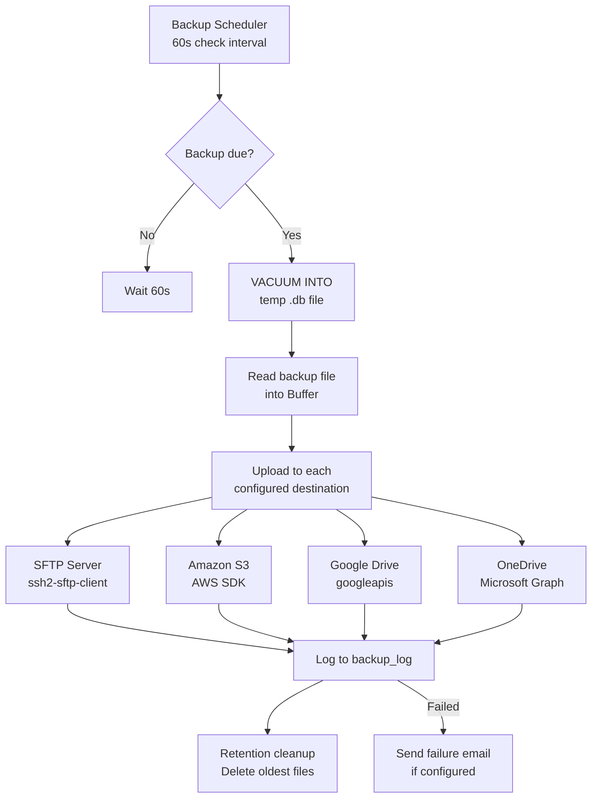

### What a Backup Holds

A backup is the database file and nothing else. Files attached to cards are stored on
disk, in the `uploads` folder beside the database, and are in no backup this system makes.
They have to be backed up separately: see
[Deployment](deployment.md#attachment-files).

So that a restored database is not left without its files, the attachment files of a
deleted card are not removed with it. They are moved to a trash folder inside `uploads`
and kept for 30 days, and Import Backup puts back any file in the trash that a restored
attachment names.

Nor does the file hold what opens something for whoever reads it: no session, no invite
that has not been used, no task request's link and not the key the public request form
signs with (card 2158). Every request is in it, with its link empty, and a restore gives
every request a new link, so a link mailed before a restore stops working and its
requester asks for the current one from the page it opens. See
[What a Backup Holds](authentication-security.md#what-a-backup-holds-and-what-a-restore-brings-in).

Nor does it hold a secret (card 2169): not the mail password, not a destination's
credentials, not a webhook's signing secret. Each destination is in it with its other
fields, and a webhook that had a secret is in it switched off, listed in the
`webhook_secrets_left_out` setting. Every backup is sealed: an HMAC of every row, made with
a key this server keeps and no backup holds. A restore keeps this server's own where they are
for the same account (for a webhook, the same id, board, address and setter), and only into a
backup this server made and nobody has changed since,
and says which are to enter again; a destination still without its
credentials is not tried by a backup run (below). So a backup alone no longer rebuilds a lost
server: keep the mail password and each destination's credentials outside DumpFire. What it
does still hold that is worth guarding: every user's password hash and email, and every
webhook's address, which for a Slack or Teams incoming webhook is all anyone needs to post to
that channel.

### Schedule Options

| Schedule | Mechanism | Description |
|----------|-----------|-------------|
| `disabled` | — | No automatic backups |
| `hourly` | Interval | Every 60 minutes since last backup |
| `every6h` | Interval | Every 6 hours since last backup |
| `every12h` | Interval | Every 12 hours since last backup |
| `daily` | Time-based | Once per day at configured time |
| `weekly` | Time-based | Once per week on configured day and time |

### Backup Configuration

Stored as JSON in the `settings` table under key `backup_config`:

```json
{
  "schedule": "daily",
  "scheduleTime": "02:00",
  "scheduleDay": 0,
  "retention": 7,
  "destinations": [],
  "notifyOnFailure": true,
  "notifyEmail": "admin@example.com"
}
```

`PUT /api/admin/backup` writes what it is sent over this and keeps the rest, and `{}` is
`400 No valid fields to update` (card 2117). A save of part of the settings used to write
the defaults over the rest, and `{}` switched the schedule off and deleted every
destination. Each field is read by its rule: `schedule` one of the six above,
`scheduleTime` `HH:MM` (empty is 02:00), `scheduleDay` 0 to 6, `retention` 1 to 100,
`notifyOnFailure` `true` or `false`, `notifyEmail` one address or more, separated by
commas, semicolons or lines and stored separated by commas, or empty. Each destination is
a text `name`, a `type` of `sftp`, `s3`, `gdrive` or `onedrive`, and the fields of its
type (`readDestination()` in `src/lib/server/backup-destinations.ts`); any other field is
not kept, `grantedScope` included (only Connect writes it). An SFTP `port` is a whole number
from 1 to 65535, or `null`, which connects to 22. An SFTP `hostKey` is a host key
fingerprint with its type, saved as `<type> SHA256:<43>`, or `''` for none (card 2250: see
[The SFTP Host Key](#the-sftp-host-key)). `readDestination()` no longer puts a stored
secret in place of a mask: it did until card 2190, finding the stored destination by name or
by its place in the list. A mask is now resolved by `keepMaskedSecrets()`, below. An SFTP
`host` is saved trimmed of ASCII spaces and tabs only, one sent back as stored kept as it is
(`trimHost()`, the review-fix pass's S1). A list that names two destinations alike is refused
`400` before anything else is asked of it (`twiceNamed()`, S4): "Two backup destinations are
named "NAS"." and, where two of that name were saved before, "Remove the destinations named
"NAS" (the page's Remove removes every one of that name) and add it once with its secret
typed.", or otherwise "Each destination needs a name of its own: give one of them another
name." A destination is found by its name to connect, test and back up to.

**The secret fields, as the admin page is told them and as a save keeps them** (cards 2187
and 2190). One list, `SECRET_FIELDS` in `src/lib/server/backup-secrets.ts` (the list a backup
clears, card 2169's), serves three routes, so a field added to it is masked, kept and cleared
with nothing else to change:

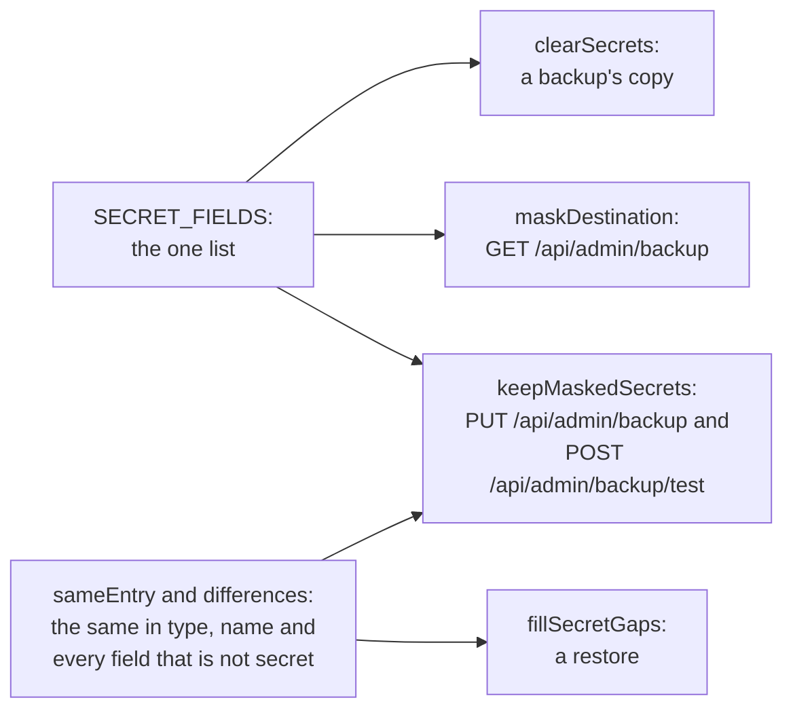

- **`maskDestination()`** answers every secret field of any type that holds anything as
  `••••••••` (`SECRET_MASK`), whatever the destination's type: SFTP `password` and
  `privateKey`, S3 `secretAccessKey`, `clientSecret`, Google Drive `refreshToken` (which the
  answer carried as stored until card 2187), and a service account's `private_key` inside
  `serviceAccountJson` where the JSON reads as an object, and a `privateKey` beside it; such JSON is
  always written out again from what was read, never shown as stored, so text that names
  `private_key` twice (which reads as its last) cannot carry the first to the browser (S3).
  JSON that cannot be read, or reads as anything else (a string, a list), is masked whole. Every other field is as stored,
  `grantedScope` included.
- **`keepMaskedSecrets(incoming, stored)`**, for the `PUT` (each destination, inside its
  transaction, `400` on the first refusal) and the test route: a destination with a mask in
  any secret field takes each masked field's value from the one stored destination that is
  the same in type, name and every field that is not secret (`sameEntry`, compared as the
  destination would use them: missing, `null` and `''` alike; the host trimmed of ASCII spaces
  and tabs, ASCII letters in any case, any other difference a change; an SFTP port 22, an S3 region `us-east-1` and a OneDrive folder path `DumpFire
  Backups`, slashes trimmed, when not set; a service account by its JSON's `client_email` and
  `private_key_id`, its JSON then taken whole), and an SFTP host is then written as that entry
  has it, so the secret goes to the host it was saved with byte for byte (S1). None, and it is
  refused with decision 3's words, naming every field still masked and what changed; more than
  one, and the words say to remove the destinations of that name, which the page's Remove
  does, and add it once with its secret typed (O1). A Google Drive
  OAuth destination with its token masked is told to be removed, added again and connected,
  beginning with removing DumpFire's access in the Google account unless every stored
  destination it could be was connected with `drive.file` alone. A destination with no mask
  is used as sent. `grantedScope` is never taken from a request: it comes back only with a
  kept refresh token. An SFTP `hostKey` is compared too, as a narrowing on a save (card
  2250): a destination sent with a mask differs where the stored one has a key and the one
  sent has another fingerprint, or none; a key sent where none is stored does not differ. On
  the test route (`keepMaskedSecrets(…, 'test')`) it is compared exactly: the key sent must be
  the stored one, `''` for `''`, so that a Test never sends the stored secret to a key it
  supplies (the card 2250 review's M1); only a save adds one. It is not
  secret: `maskDestination()` shows it, and `SECRET_FIELDS` does not name it.

### Backup Data Generation

`generateBackupData()` in `src/lib/server/backup.ts` makes the one copy that both a
scheduled backup and "Export Backup" send. It uses SQLite's `VACUUM INTO` twice: once to
take a self-contained snapshot of the running database, and once to write out again a copy
that has been cleared of what signs somebody in or opens a request's thread, and of every
secret (`withoutSecrets()`, which was `withoutSignIns()` until card 2169):

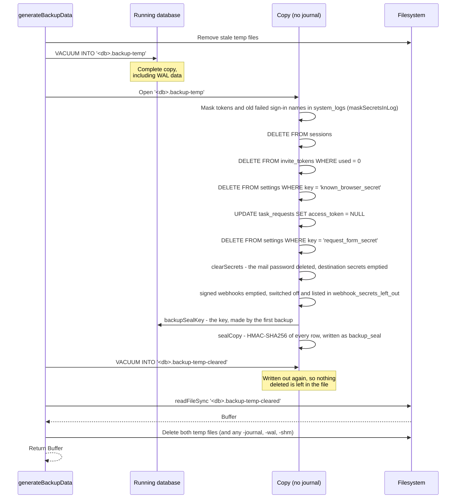

- **The snapshot includes all WAL data.** A raw file copy would miss unflushed writes.
- **No session and no unused invite is in the file**, and its system log is masked: every
  invite's address written as `/invite/[token]`, the token of every unused invite replaced
  wherever a line holds it, a request link's `token=` masked, and an old failed sign-in line
  at a name that was no account rewritten to hold only the name's length (card 2193).
- **The key remembered browsers are signed with is not in the file** (the row
  `known_browser_secret` of `settings`, card 2194), and a restore never brings it in from a
  backup of any age (`rowsToRestore()` in `src/lib/server/db/restore.ts`). Whoever held it
  and an account's password hash, which a backup does hold, could make a cookie that lets a
  browser past sign-in's throttling for that account. So a restore forgets every remembered
  browser, and the restored server makes a new key.
- **No request's link and not the form's key** (card 2158): every `task_requests.access_token`
  is `NULL` in the file, and the `request_form_secret` row of `settings` is gone. A restore
  gives every request a new link inside its transaction, whatever the backup's age, and
  never brings the form's key in; the import's answer says how many links were replaced.
  The running database is not touched by a backup. Deleting the rows alone is not enough, because the pages they
  were on stay in the file until it is written again; hence the second `VACUUM INTO`.
- **No secret** (card 2169): `clearSecrets()` in `src/lib/server/backup-secrets.ts` deletes the
  `smtp_pass` row, sets each destination's secret fields in `backup_config` to `''` (SFTP
  `password` and `privateKey`, S3 `secretAccessKey`, Google Drive `clientSecret` and
  `refreshToken`, a service account's `private_key` inside `serviceAccountJson`, OneDrive
  `clientSecret`; every one of them on every destination, whatever its type), deletes the
  `backup_seal_key` row, leaves out a destination of a type this version does not know and a
  `backup_config` that is not JSON, and sets each webhook's secret to `''` with the webhook
  switched off and listed, as `[{"id":3,"active":true}]`, in `webhook_secrets_left_out`. A
  webhook is switched off because the file can become a database without a restore, and one
  left on with no secret would send every event unsigned. It throws before writing anything
  if handed the running database. A restore fills each gap from this server only from an
  entry the same in every field that is not secret (`fillSecretGaps()`), and only into a
  backup whose seal verifies. For a webhook that is the webhook here with the same id, board,
  address and setter (`set_by`, the account that last set its address or secret, or switched it on, card 2168;
  none and none alike, and none on a database from before migration 0056): a secret here set
  by another account than the backup's row names was set again since, and is listed to enter
  again rather than filled under the backup's setter, where that account's password reset
  would not reach it. See
  [The Secrets a Backup Does Not Hold](authentication-security.md#the-secrets-a-backup-does-not-hold-card-2169).
- **Sealed** (card 2169's review, S1): `sealCopy()` writes into the cleared copy, as the
  `backup_seal` setting, an HMAC-SHA256 of a dump of it that is the same from the same rows
  whatever file they are in (`sealOf()`: every row of `sqlite_master` by type and name, SQLite's own included; every
  table but `sqlite_sequence`, `sqlite_stat1` to `sqlite_stat4` included, by name, every row
  read `NOT INDEXED` in rowid order, each value typed and its length given; the seal's own row
  left out; the second review's B1), so the seal written before the second `VACUUM INTO` holds for the
  file after it. It is stored as its form number, a colon and the 64 hex characters (`2:…`); a
  restore takes a seal of any other form as none. The key is the `backup_seal_key` setting of the running database, made by the
  first backup (`backupSealKey()`): the one thing a backup writes there. `withoutSecrets(from,
  to, key)` takes it, this server's unless a test gives another. Measured on made-up copies on
  a development machine: 0.2 s for 59 MB and 115,000 rows, 0.56 s for 177 MB and 345,000.
- **The server answers nothing while it runs.** Every step is synchronous, from the first
  `VACUUM INTO` to the read: see "How long the server stops answering" under
  [Backup Destinations](deployment.md#backup-destinations) in the deployment guide for the
  figures, which are an estimate from parts.
- **The two temporary files are beside the database**, on the volume, and are deleted
  whether or not the backup succeeds. A database in memory has nothing beside it, so they
  go to a folder of their own under the temp folder. A crash can leave them behind; the
  first holds live sessions, which is why `.gitignore` and `.dockerignore` keep both out.

See [What a Backup Holds](authentication-security.md#what-a-backup-holds-and-what-a-restore-brings-in)
for why, and what a restore brings in.

### Destination Types

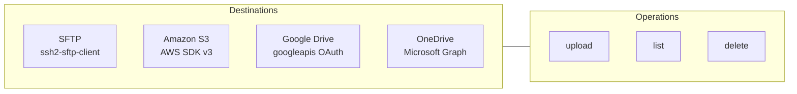

Each destination implements three operations:
- **upload** — Push a backup buffer with a timestamped filename
- **list** — List existing backups for retention cleanup
- **delete** — Remove old backups beyond retention limit

**Google Drive's scope and folder** (card 2188). Connect (`POST
/api/admin/backup/gdrive/auth`) asks for `https://www.googleapis.com/auth/drive.file`
(`DRIVE_FILE_SCOPE` in `src/lib/drive-scope.ts`), the files DumpFire makes, where it asked for
the whole of Drive; a service account already asked for `drive.file`. A token refreshes with
the scopes it was granted, so a connection made before keeps the whole of Drive until it is
connected again. The Connect, in order (the `GET`, the state and PKCE from card 2251):

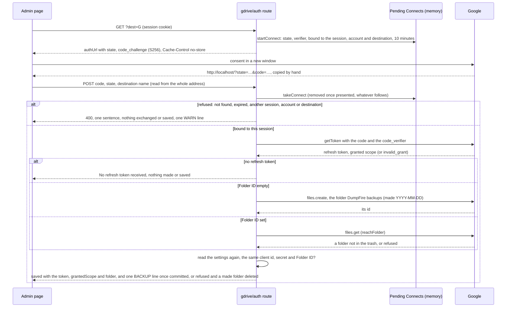

- A folder that cannot be reached refuses the Connect with nothing saved, the destination
  keeping the connection it had; Google's reason is a `WARN` line under `GDRIVE`, `Connect of
  destination "G" refused: Google Drive cannot reach its folder …: …`.
- The settings are read again after Google's answers and written with no `await` between,
  only if the destination is still there with the client id, client secret and Folder ID it
  had; otherwise "The destination was changed or removed while it was being connected, so
  the connection was not saved. Connect it again." A folder made by a Connect that is not
  saved, or that throws, is deleted again (best effort, a `WARN` naming its id on failure,
  `Could not delete the folder … made for destination "G" by a Connect that was not saved: …`).
- `grantedScope` is Google's `tokens.scope` as granted, and nothing when Google names none.
  `driveScopeIsNarrow()` (in `src/lib/drive-scope.ts`, no server imports, read by the admin
  page and by `keepMaskedSecrets()`) is true only when every scope in it, split on white
  space, is exactly `drive.file`; a missing one is all of Drive. The page shows `✅ Connected`
  or `⚠️ Connected · all of Drive` by it.
- `GDriveDestination.test()` fetches the folder (`reachFolder()`) before it lists it, for
  either sign-in method, and says when it cannot reach it; with no Folder ID it answers as
  before.
- A failed Connect is one `ERROR` line, `Google Drive Connect failed for destination "…": …`.
- Every line of the Connect is filed under the account that pressed it (`user_id`), and writes
  the destination's name as the backup settings' lines do (`quotedName()`, each `\` and `"`
  escaped): the refusal of a state (card 2251), the folder not reached, the made folder not
  deleted and the failure, under `GDRIVE`, and the Connect saved, under `BACKUP` (the card 2273
  review). Only the state refusal was filed before.
- A Connect saved is one line under `BACKUP`, filed under the connecting account (`user_id`)
  (card 2273): `Google Drive destination "G" connected: scope narrow (drive.file); a folder made`.
  The scope is named by its kind as the page reads it, `scope narrow (drive.file)`, `scope wide`
  or `scope none named (read as wide)`, and the folder as `a folder made` or `its folder
  reached`; never the token, code, state, verifier, folder id or the folder's name. It is an
  `INFO` for a destination's first connection, and a `WARN`, `… connected again, replacing the
  connection it had: …`, where the destination held a refresh token in the settings as read
  again: the new token may be another Google account's, which the server cannot see, and with
  the Folder ID empty the copies go to a new folder. The meta is
  `{"destination":"G","scope":"narrow","folder":"made","replaced":false}`. The read again
  and the write are one `inTransaction`, the line queued with `afterCommit`, so a Connect
  refused, changed meanwhile or whose write fails writes none. The name is quoted as the
  settings' lines quote it (`quotedName()`).

**Who started the Connect** (card 2251). The `POST` used to exchange any code it was sent, so a
code from somebody else's consent, pasted by a superadmin who was led to, connected that
person's Google account (with the Folder ID empty, every later backup went to a folder in it).
`src/lib/server/gdrive-connect.ts` now holds each Connect under way, in memory:

| What | How |
|---|---|
| `state` | 32 random bytes from `node:crypto`, base64url (43 characters), new at every `GET`; never the destination's name, which it was |
| Bound to | the SHA-256 of the session's token (`locals.credential`; no token is held), the account's id and the destination's name; a request with no credential is bound to its account alone |
| PKCE | a `code_verifier` of 32 random bytes, kept only here; the consent address carries `code_challenge` (its SHA-256, base64url) and `code_challenge_method=S256`; the exchange is `getToken({ code, codeVerifier })` (google-auth-library 10.6.2) |
| Lifetime | `CONNECT_LIFETIME_MS`, ten minutes; the expired swept at every Connect started and every state presented |
| Once | `takeConnect` removes a state the first time a `POST` presents it, whether the check then passes or not |
| How many | one per session and destination (a new `GET` replaces the older); at most `MOST_PENDING`, 20, the oldest dropped |
| A restart | ends every Connect under way: press Connect again |

- `state` is read as text after `code` and `destName` (`state must be text`). A missing, empty,
  unknown, expired or used state, or one another session, account or destination started, is
  `400 {"message":"This connection was not started from this session, or has expired or been used. Press Connect again, and paste the whole address Google's page leads to."}`,
  with nothing exchanged or written and one `WARN` line under `GDRIVE`: `Google Drive Connect
  refused for destination "G": its state was not one this session started, or had expired or
  been used`, filed under the account (`user_id`) with the meta `{"stateSent":false}` for a
  `POST` with no state (or an empty one) and `{"stateSent":true}` for one whose state failed;
  the answer is the same sentence for both. The check comes before the destination is looked up.
- The `GET` answers `Cache-Control: no-store`. It stays a `GET`: another site that sends the
  browser to it makes a pending Connect whose state and verifier it never sees, and can at most
  replace one in progress.
- The admin page reads `code` and `state` from the whole address pasted, and sends neither for
  a bare code, nor for an address holding Google's `error=` (consent refused is
  `error=access_denied`): it says why instead (the admin guide, Configuring Backups).
- **The page's side of the `GET`** (cards 2265 and 2266). `connectGDriveOAuth()` shows a
  refusal in the server's own words, read by `failureMessage()` ("Client ID and Secret
  required", "Google Drive destination not found", the superadmin guard's `403`), and "Failed to
  generate auth URL" only where the answer says nothing (a proxy's page); it used to say that for
  every refusal. The answer is read by `answerBody()`, and an `authUrl` that is not a non-empty
  string, or not an address on `https://accounts.google.com` (`isGoogleConsent()`, the card 2266
  review: never a `javascript:` address as the link), opens no window and says "Failed to
  generate auth URL". The window is opened after the
  `GET`, which Safari, a strict blocker or an answer slower than a click's activation (about five
  seconds in Chrome and Firefox) stops: the page reads what `window.open` returns, and the box
  says "Opening Google's sign-in page…" until the address is known (`gdriveAuthUrl`, the paste
  box and its ✅ Connect disabled meanwhile), then "Your browser blocked Google's sign-in window."
  when it returned `null` (`gdriveBlocked`), or "A Google sign-in window has opened." otherwise;
  both give the address as a link (`rel="noopener noreferrer"`), since a blocker may hand back a
  window it then closes. Each Connect takes a number, `gdriveAttempt`, which
  `closeGDriveConnect()` moves on whenever the box closes (Cancel, a refusal, the exchange
  answered): an answer that comes back after Cancel or a later Connect opens and says nothing,
  as the server has replaced that Connect's state with the later one's.
- Connections made before are untouched: a stored refresh token is not checked again.

### The SFTP Host Key

An SFTP destination connected with no `hostVerifier`, and ssh2 accepts any host key without
one, so the password, or a signature made with the private key, and then the backup went to
whatever answered for the host (card 2250). Each SFTP destination now holds the key it was
confirmed with, `hostKey`, one more field of it in the `backup_config` setting's JSON: `<type>
SHA256:<43>`, the key's type and its fingerprint as OpenSSH prints it (`SHA256:` and the
unpadded standard base64 of SHA-256 over the key's blob). Every connect goes through one of two
configurations:

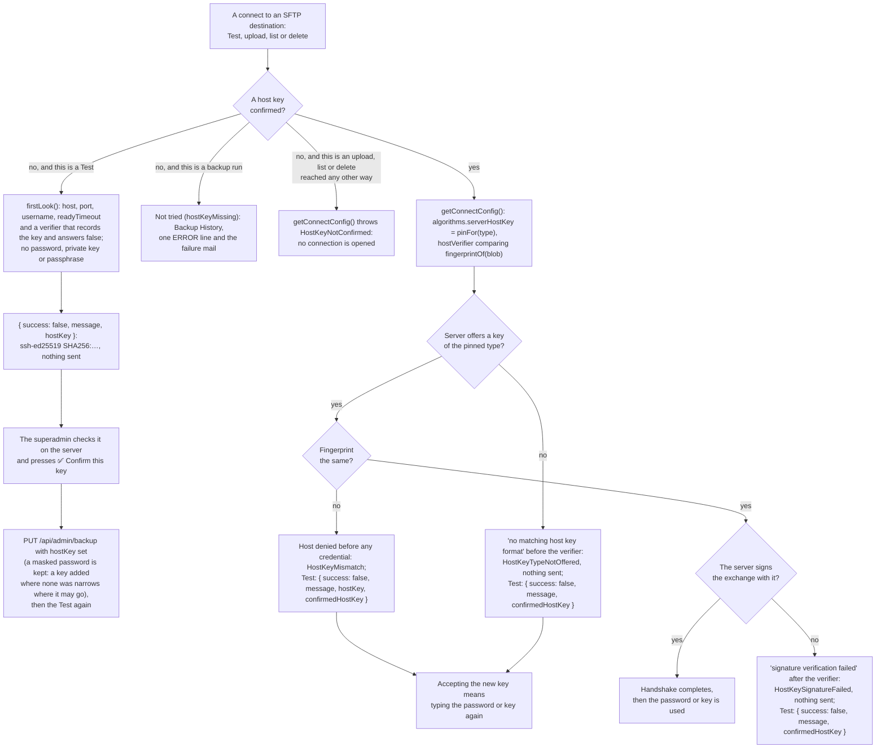

| What | Where | How |
|---|---|---|
| Reading it | `readHostKey()` in `src/lib/server/ssh-host-key.ts`, from `readDestination()` | `<type> SHA256:<43>`, the type one of `ssh-ed25519`, `ecdsa-sha2-nistp256`, `ecdsa-sha2-nistp384`, `ecdsa-sha2-nistp521`, `ssh-rsa`; or the line `ssh-keygen -l` prints, pasted whole (`256 SHA256:… root@nas (ED25519)`: ED25519, RSA of 1,024 bits or more, ECDSA of 256, 384 or 521 bits). Spaces, tabs and line breaks around are trimmed. The 43 characters must decode to 32 bytes and encode to the same text. Saved as `<type> SHA256:<43>`; empty once trimmed is `''`. Anything else is `400 destinations[0].hostKey must be an SSH host key fingerprint with its type: …` (no prefix on the test route) |
| A key's blob | `fingerprintOf()`, `typeOf()`, `shownHostKey()` | The fingerprint is over the whole blob; the type is the blob's first string (RFC 4253, section 6.6), read without importing ssh2, which comes only with `ssh2-sftp-client` |
| The pin | `pinFor()` | `ssh-rsa` as `rsa-sha2-512`, `rsa-sha2-256`, `ssh-rsa`; every other type as itself. ssh2 offers `ssh-ed25519` first, so without the pin a server that gains a key of a preferred type would look changed |
| The words | every message below | Each says what happened in its first 40 characters, which is what Backup History shows of a message (the card 2250 review's S2): "SFTP host key not confirmed: " for none confirmed and a Test's first look ("SFTP host key not confirmed: the server at nas.example:22 presented the host key ssh-ed25519 SHA256:…. Check it is the server's own (on the server: ssh-keygen -lf /etc/ssh/ssh_host_ed25519_key.pub) and confirm it. Nothing was sent to the server."), "SFTP host key refused: " for a key refused |
| No key | `getConnectConfig()`, `hostKeyMissing()` in `backup-secrets.ts` | `HostKeyNotConfirmed`, whose message is `HOST_KEY_NOT_CONFIRMED`: "SFTP host key not confirmed: nothing was sent to this destination. In Admin, Scheduled Backups, press Test on it and confirm the key it shows." A stored key that does not read counts as none |
| A key that does not match | `HostKeyMismatch` (`presented`, `confirmed`) | "SFTP host key refused: the server at nas.example:22 presented the host key ssh-ed25519 SHA256:NEW, not the confirmed SHA256:OLD, so nothing was sent to it. If the server's key was changed on purpose, check the new key on the server and confirm it, typing the password or private key again; otherwise something else may be answering for the server." |
| The type no longer offered | `HostKeyTypeNotOffered` (`confirmed`) | "SFTP host key refused: the server at nas.example:22 no longer offers a host key of the confirmed type (ssh-ed25519), so nothing was sent to it. If the server's keys were changed on purpose, clear the Host key or replace it with the server's new key, typing the password or private key again, then press Test; otherwise something else may be answering for the server." |
| The confirmed key, not signed with | `HostKeySignatureFailed` (`confirmed`), when the verifier matched and ssh2 then says "signature verification failed" (the review's S4) | "SFTP host key refused: the server at nas.example:22 showed the confirmed key but could not prove it holds it — something on the network may be answering for it. Nothing was sent." `test()` throws it, and the test route answers `{ success: false, message, confirmedHostKey }` |
| The test route | `POST /api/admin/backup/test` | Answers `SftpTestResult`: `{ success, message }`, plus `hostKey` where none is confirmed or it did not match, and `confirmedHostKey` where a key was refused. Writes one `[ERROR] [BACKUP]` line for a refusal, from the answer's keys: `SFTP host key mismatch for destination "NAS" at nas.example:22: presented SHA256:NEW, confirmed SHA256:OLD. Nothing was sent.`, or `SFTP host key type not offered for destination "NAS" at nas.example:22: confirmed ssh-ed25519 SHA256:OLD. Nothing was sent.`, or, for `HostKeySignatureFailed`, `SFTP host key signature failed for destination "NAS" at nas.example:22: confirmed SHA256:OLD. Nothing was sent.`; none for a first look. A masked secret is kept only with the stored key exactly (M1) |
| A backup run | `runBackup()` | An unconfirmed destination is not tried, beside `credentialsMissing()`; a refused key fails the upload with the class's message, `Backup failed: NAS → …`, with its Backup History row and failure mail, and no line of its own |
| The start | `reportUnconfirmedHostKeys()` in `startup-checks.ts`, the thirteenth line | `[WARN] [STARTUP] 1 SFTP backup destination(s) have no confirmed host key, and nothing is sent to them until one is confirmed: "NAS". In Admin, Scheduled Backups, press Test on each and confirm the key it shows.`, the first 20 named, then `; and N more` |
| A restore | `fillSecretGaps()`, `withSecretsOf()` | Every SFTP entry loses the backup's `hostKey` first; one filled, or with neither secret here either, takes the key of the entry here it was matched with, or none. `needs()` reads "SFTP: its password or private key, then Test to confirm its host key" |
| A save | `hostKeyChanges()` in `backup-secrets.ts`, from `PUT /api/admin/backup` | One `WARN` line under `BACKUP` per SFTP destination whose key as stored (`<type> SHA256:…`, `''` for none or for stored text that does not read) the save changes, filed under the saving account (`user_id`), with the meta `{"destination":"NAS","from":"<key or ''>","to":"<key or ''>"}` (card 2267), and `"fromAt":"oldhost:22"` beside them where the same save moved the destination as well as changing or clearing its key: `SFTP host key of destination "NAS" at nas.example:22 added: ssh-ed25519 SHA256:NEW`, `… changed from ssh-ed25519 SHA256:OLD to ssh-ed25519 SHA256:NEW`, `… cleared: was ssh-ed25519 SHA256:OLD`, and `… removed with the destination: was ssh-ed25519 SHA256:OLD` for a name stored with a key that the save drops or makes another type (decision 2). Stored and saved destinations are matched one to one, as the settings line matches them (`matchOneToOne()`, the card 2270 review): where two were stored under one name and the save keeps one, a key on the other is `removed with the destination`, and a second saved under a name stored once is a key `added`. The host and port are the saved destination's, or the stored one's when it is gone; where a save moves the destination and changes or clears its key, the old key is followed by the place it was for, `… changed from ssh-ed25519 SHA256:OLD (at oldhost:22) to ssh-ed25519 SHA256:NEW` (the card 2267 review); a `\` or `"` in the name is escaped, `\\` or `\"` (the card 2270 review), and the logger makes the name and host printable. The line is a `WARN`, so it is not written with `LOG_LEVEL` at `ERROR` (the default is `INFO`). A change of type with the same fingerprint is a change (decision 3); the same key sent as `ssh-keygen -l` prints it is stored canonical and is none. Queued with `afterCommit()`, so a save refused or rolled back writes no line: the logger keeps a row logged inside a transaction whichever way it ends |

A save's line, in order (card 2267):

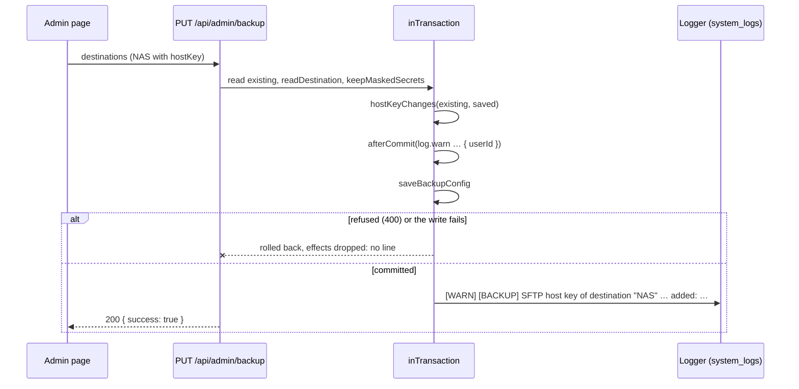

**The admin page.** Both SFTP forms have a Host key box (placeholder `Paste the line ssh-keygen
-lf /etc/ssh/ssh_host_ed25519_key.pub prints, or leave it empty and press Test`), carried by
`populateDestForm()` and sent by `buildDestConfig()` with every SFTP destination: a field not
sent is not kept, so a save without it would remove the key, which with the password masked is
refused. `testDestination()` reads the answer with `hostKeyCheckOf()`: an SFTP answer holding
`hostKey` or `confirmedHostKey` is shown in a box under the destination, in place of a toast,
and any other answer clears the box. `hostKey` alone shows the key and ✅ Confirm this key;
both show the key presented and the confirmed one, with no Confirm and the way to accept a new
key (Edit, the password typed again); `confirmedHostKey` alone shows the confirmed key and no
Confirm, there being no key to confirm. `confirmHostKey()` sets the destination's `hostKey` to
exactly the text shown, saves the whole list with `saveBackupConfig()`, puts the list back if
the save is refused, and only once it is saved reads the list back and runs the Test again on
the destination as the server now holds it. The card 2250 review added:

- **The private key box in the edit form** (M2), as the add form has it under Advanced: Private
  Key auth, filled by `populateDestForm()` with what the GET shows, the mask for a stored key,
  so a key-based destination can be given its key again when its host key changes.
- **The list read back after a save** (M3): `addDestination()`, `updateDestination()` and
  `confirmHostKey()` call `loadBackupConfig(true)` once saved, `quiet` leaving the section in
  place, so the list holds the secrets masked as the GET shows them. It held the password as
  typed, and a later save of the destination "with the password left masked" sent it typed and
  was saved, not refused.
- **A mark on the card** (S1): an SFTP destination with no `hostKey` shows "⚠️ Host key not
  confirmed — press Test" beside its buttons.
- **No stale box** (S3): `forgetHostKeyCheck(name)` clears a destination's box and moves on its
  number in `hostKeyTests` when it is added, saved or removed; `testDestination()` takes the
  next number, and an answer that comes back after the number has moved on says nothing.
- **Each Test button waits for its own Test** (card 2268). `testsInFlight` holds, by name, the
  number of each destination's Test still waiting for its answer; the Test button is disabled,
  and shows ⏳, while its destination has one. A Test's `finally` clears the entry only where
  it still holds its own number, so a second destination's Test no longer brings the first's
  button back when it starts (one `testingDest` name did), nor when it answers. A save moves
  `hostKeyTests` on and never `testsInFlight`, so a Test whose answer is dropped still clears its
  own entry when the answer comes.

### A Save of the Backup Settings, on Record

Every save of `PUT /api/admin/backup` that changes anything writes one line under `BACKUP`,
filed under the saving account (`user_id`, the chip on the Audit page), naming what it changed
(card 2270). `settingsChanges(before, after)` in `backup-secrets.ts`, beside `hostKeyChanges()`,
compares the settings as stored with the settings about to be saved, and returns `null` where
nothing changed, so a save that changes nothing writes nothing: the page's Save of the list as
shown, with every secret masked, is one. The route words the line (`settingsChangeLine()`) and
queues it with `afterCommit`, so a save refused or failed leaves none.

| | |
|---|---|
| The settings | `schedule`, `scheduleTime`, `scheduleDay`, `retention` and `notifyOnFailure` named with their old and new values (`schedule from daily to disabled`); `notifyEmail` named alone, never its addresses. `retention` and `scheduleDay` are compared as numbers, so `"7"` stored and `7` saved is no change |
| A destination's name | In quotation marks, each `\` and `"` in it escaped as `\\` and `\"` (`quotedName()` in `backup-secrets.ts`), so a name cannot end the quotation early and make the rest of the line read as something else. Card 2267's host key lines and a Google Drive Connect's line (card 2273) write the name the same way. The logger then makes it printable |
| A destination added | By name, new in the save: `destination "Offsite" added (sftp)` |
| A destination removed | By name, gone from the save: `destination "Old" removed (s3)`. One saved as another type under its name is removed and added, as card 2267 has it. Stored and saved destinations are matched one to one: each stored entry is taken once it is matched, so where two were stored under one name and the save keeps one, the other is removed |
| A destination changed | The names of its fields that changed, never a value, secrets and the rest alike: `destination "NAS" changed: host, port, password, privateKey, hostKey`. Every field either entry holds but `name` and `type` is compared (so `grantedScope` too), as it is used: `host`, `port`, `region` and `folderPath` by their defaults (`inUse`: a port left empty is 22, a host in other case is the same host), `hostKey` as stored (`keyAsStored`), every other field with missing, `null` and empty text alike. A secret sent back masked is the stored secret by then (`keepMaskedSecrets`), so it is no change. Where a field that says where the copies go changed, by the rule a masked secret is kept by (`SAME_IN` and a service account's address and key ID, the host key aside), its entry in the meta holds `"elsewhere":true`: an SFTP host, port, user name or remote path; an S3 region, bucket, prefix, endpoint or access key ID; a Google Drive sign-in method, folder ID, client ID or service account; a OneDrive tenant ID, client ID or folder path |
| The order | Settings, then destinations added, changed and removed, separated by `; `. The order of the list is not a change |
| The level | `WARN` where the save leaves fewer copies, or sends them elsewhere: a destination removed (or saved as another type); a destination kept with `elsewhere`; less time covered by the copies kept, the retention times the schedule's interval (`SCHEDULE_INTERVALS` in `backup.ts`, none for `disabled`), which is the schedule switched to `disabled` or to one more frequent (weekly to hourly with the retention kept); or the retention lowered, which the next run keeps to at every destination, a **Run Now** under `disabled` too, deleting the older copies. `INFO` for any other: a schedule less frequent (hourly to daily), a secret typed again alone, an address added. At `LOG_LEVEL=WARN` the `INFO` lines are not kept; the default is `INFO` |
| The meta | `{"settings":[{"field":"schedule","from":"daily","to":"disabled"},{"field":"notifyEmail"}],"added":[{"name":"Offsite","type":"sftp"}],"removed":[{"name":"Old","type":"s3"}],"changed":[{"name":"NAS","fields":["host","port"],"elsewhere":true}]}`, each list present, empty where nothing of its kind changed; `elsewhere` only where it is true |
| Beside card 2267's lines | This line names `hostKey` among a kept destination's changed fields (one of the same name and type in both) exactly when 2267 writes a key line for that destination, and never the key: the keys are in 2267's line alone. A destination added or removed with a key is named as added or removed, and 2267's line gives the key. It is queued first, so it reads before them |

A whole save, in order:

```
[WARN] [BACKUP] Backup settings changed: schedule from daily to disabled; destination "NAS" changed: hostKey; destination "Old" removed (s3)
[WARN] [BACKUP] SFTP host key of destination "NAS" at nas.example:22 added: ssh-ed25519 SHA256:…
```

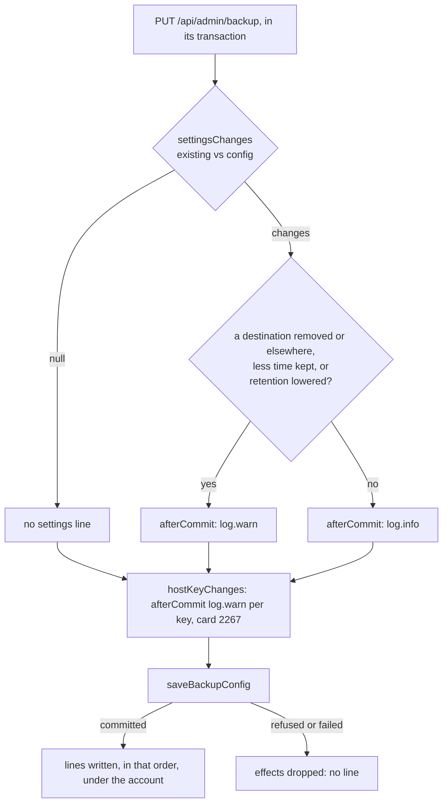

The other writer of `backup_config`, a Google Drive Connect saved, writes its own line under
`BACKUP`, filed under the account, once committed (card 2273; see
[Destination Types](#destination-types) above): an `INFO` for a first
connection, a `WARN` for one that replaced a connection.

### Retention Cleanup

After each successful upload, the system:
1. Lists all backup files at the destination
2. Sorts oldest-first
3. Deletes files exceeding the configured retention count

On Google Drive the listing reads every page of the folder (up to 100 pages of 1,000 files; past that it stops with an error rather than follow a page token for ever) and each file's `capabilities.canDelete` and `canTrash` (card 2238), through the destination's optional `listForRetention()`. A file the account may delete is deleted by the id it was listed under; one it may only trash is moved to the trash, and logged `Retention cleanup: moved to the trash <name>` rather than `deleted` (its `delete()` answers `'trashed'`); one it may do neither to is set aside, not counted towards the retention number and not tried, and each run that finds any writes one `WARN` line saying how many and naming the oldest. The other destinations have no `listForRetention()` and are counted from `list()` as before. See [Configuring Backups](admin-guide.md#configuring-backups) for what to do about files set aside.

### A Destination Without Its Credentials

`runBackup()` asks `credentialsMissing()` (in `src/lib/server/backup-secrets.ts`) of each
destination before it makes the copy (card 2169). One that lacks its credentials is not
handed to `createDestination()`: an S3 destination with no secret access key, a Google Drive
one with no client secret or no refresh token (OAuth) or whose service account JSON holds no
private key, a OneDrive one with no client secret. Its result and its `backup_log` row are
`failed`, with the `ERROR` line and the failure mail any failure has, and the error is
"This destination's credentials are not entered: a backup does not hold them, so they are
entered again after a restore. Enter them in Admin, Scheduled Backups." (Google Drive OAuth:
"… In Admin, Scheduled Backups, enter its client secret and connect it again."). That is
what Backup History shows after a restore onto another server, where it would have shown a
library's error. The copy is made only when at least one destination can be tried, so a run
with none makes no copy and does not stop the server answering for it. An SFTP destination
with neither a password nor a key is tried as before, since a server that allows `none`
authentication accepts it, once its host key is confirmed; after a restore onto another server
such a destination, its key confirmed again, is tried against the real host at every run, and
its failed logins may trip a lockout there, so its credentials are entered or it is removed.
`hostKeyMissing()` is asked beside `credentialsMissing()` (card 2250): an SFTP destination with
no confirmed host key is not tried either, with "SFTP host key not confirmed: nothing was sent
to this destination. In Admin, Scheduled Backups, press Test on it and confirm the key it
shows." (see [The SFTP Host Key](#the-sftp-host-key)). The results are given in the
destinations' order.

### Failure Notifications

If `notifyOnFailure` is enabled and SMTP is configured, a styled HTML email is sent to the configured address with the error details, a destination not tried for want of its credentials included. The destination's name and type and the error text, which is whatever the destination's server answered, are escaped where they are put into the mail, so markup in them is shown as text and never drawn (see [Text in Mail Is Text](notifications-email.md#text-in-mail-is-text)).

---

## Report System

### Report Architecture

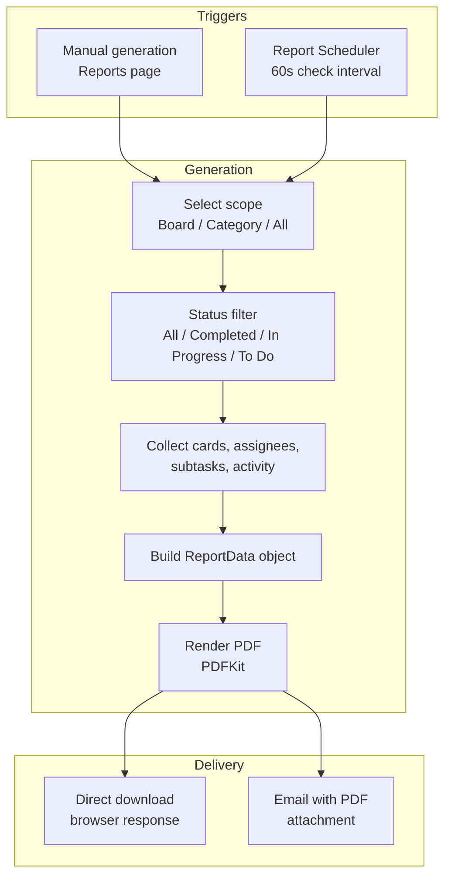

### Report Scopes

| Scope | Description | Data Included |
|-------|-------------|---------------|
| `board` | Single board | All cards in that board for the period |
| `category` | Board category | All boards in a category, aggregated |
| `all` | All boards | Every board across the system |

Every scope walks into sub-boards at any depth (`collectSubBoardIds`), but only into those its reader can open, and the walk does not pass through one they cannot (card 2150): a sub-board further down that they can open, under one they cannot, is not reached. So a board report holds the cards of the sub-boards beneath it that its reader can open, and an administrator's all-boards report counts every card in the system. A sub-board left out is not mentioned: no line says that some were.

#### Whose Report It Is

A report is always one person's view, drawn from `getAccessibleBoardIds` of that person
(`null` for an administrator, who opens everything). The three report functions build one
`canOpen(boardId)` from it (`openerFor`) and hand it to the walk and to
`generateReportForBoards`:

| Path | The reader |
|------|------------|
| Downloaded (`POST /api/reports`) | The caller |
| Emailed by hand (`POST /api/reports/email`) | The caller who sends it |
| Scheduled | The schedule's owner, as their account stands at the time of the run |

Recipients are addresses, not accounts. Each gets the report its sender or owner may read,
whoever the recipient is: having an account gives a recipient neither more nor less, and
sending it to someone is the sender's decision. The rule cuts both ways for a schedule: its
report grows when its owner is given a sub-board, or made an administrator, and shrinks when
they lose one, and nobody confirms its recipients again.

A board in the report whose parent board the reader cannot open is shown under its own name,
as a board of its own: `parentBoardName` is null for it, so the Board Breakdown and the open
work draw it as a row of its own and not nested. The parent is named (`A → S`) only when the
reader can open it. A report of a sub-board shared with someone who cannot open its parent
names the parent nowhere, the PDF's title and subject included.

The Reports page lists the boards a report can be chosen of: for an ordinary user, the
top-level boards they can open and each board they can open whose parent board they cannot
(a sub-board shared with them on its own, which no report they could choose would otherwise
reach); for an administrator, the top-level boards, as before.

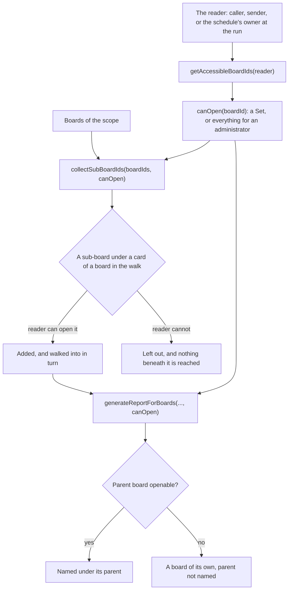

A report emailed by hand carries the board's or grouping's name and the sender's username, and a scheduled report the schedule's name. Each is escaped where it is put into the mail's HTML, so a name with markup in it reads as typed and draws nothing; the subject keeps the name as typed, because a subject is plain text (see [Text in Mail Is Text](notifications-email.md#text-in-mail-is-text)).

A report asked for by hand (`POST /api/reports`, and `POST /api/reports/email` for the
emailed one) reads its fields as a schedule does (card 2117): `scope` is `board`,
`category` or `all`, where the emailed one read any other word as every board the sender
can see; `periodStart` and `periodEnd` are a date or a timestamp, and `periodStart` is not
after `periodEnd` (`periodStart is after periodEnd`; a bare date is the whole day, so a
date to the same date is that day), where a period that ended before it began was drawn as
a report of nothing; `scopeId` is an id;
`detailLevel` and `statusFilter` are among their values, where another was read as
`detailed` or `all`; and `assigneeUserId` is a user's id or `null` for everyone, where
`"all"` and `''` were taken for everyone. Each of the emailed report's `recipients` is an
address, `recipients[1] must be an email address`: one that was not used to be dropped
without a word and the report sent to the rest.

Both take an optional `timeZone` (card 2258): the zone whose day the Overdue figure counts
from, read as a schedule's `timeZone` is and refused in its words (`timeZone must be a time
zone name, such as Europe/London`). The Reports page sends the viewer's browser zone; a call
without one counts from the UTC day, as every report did before. The PDF of a report made by
hand prints its period, generated date and completion dates in UTC whatever is sent, as the
emailed one's mail writes its period.

The Reports page sends "This month", "This quarter" and "Year to date" as dates (card 2271):
from the first day of the month, the quarter or the year to today, both as the clock reads
them in the zone it sends as `timeZone` (UTC when the browser gives none this server knows),
so each is the custom range the viewer would type, read as whole UTC days and printed as the
days chosen. The first day used to be sent as the browser's midnight, a moment, which the PDF
printed in UTC: east of UTC the period began the day before ("30 Sept 2026" for October from
London in summer). What a preset covers moved with it: east of UTC the first hours of the 1st
by the viewer's clock (00:00 to 01:00 in UK summer time) are now in the month before, and west
of UTC work finished in the evening after UTC's midnight (after 20:00 in New York in summer)
is counted from the next day, as a custom range counts it.

The rolling periods are calendar days too (card 2275): "Last 7 days" to "Last 90 days" run from
that many days before today, and "Last 12 months" from the same date a year before (29
February then the 28th), to today, sent as dates in the same zone. They were sent as moments,
N × 24 hours back from the moment, printed as the UTC days of those moments: from London at
00:30 BST both ends read the day before.

Where the server does not know the zone the browser sends (a browser newer than the server can
name one), the Reports page asks once more without it, so the report is made with its Overdue
figure counted from the UTC day, and says so in a notice naming the zone. The period is the
browser's own dates either way.

The emailed report's answer says what was sent (card 2113): `503` with no mail set up,
before the PDF is built; `200` when every recipient was sent it; `200` naming the addresses
not reached when some were; `502` when none was; each but the `503` with every recipient's
result. The Reports page keeps the dialog open for a report not sent to everyone, with only
the addresses not reached left in it. See
[A Report Emailed on Demand](notifications-email.md#a-report-emailed-on-demand).

### Status Filter

Every report (one-off, emailed and scheduled) carries a `statusFilter` that decides which slice of the scope is listed. Summary metrics always describe the whole scope — the filter only changes the task listings and the priority breakdown.

| Value | Lists | Section order |
|-------|-------|---------------|
| `all` (default) | Completed in period, then everything still open | **Completed in Period first**, then Outstanding per board |
| `completed` | Only cards completed within the period | Completed in Period |
| `in_progress` | Open cards that have left To Do (In Progress, On Hold, Review, Testing…) | In Progress per board |
| `todo` | Open cards still in a To Do / Backlog style column | To Do per board |

Cards are classified by the title of the column they sit in (`classifyColumnTitle`):

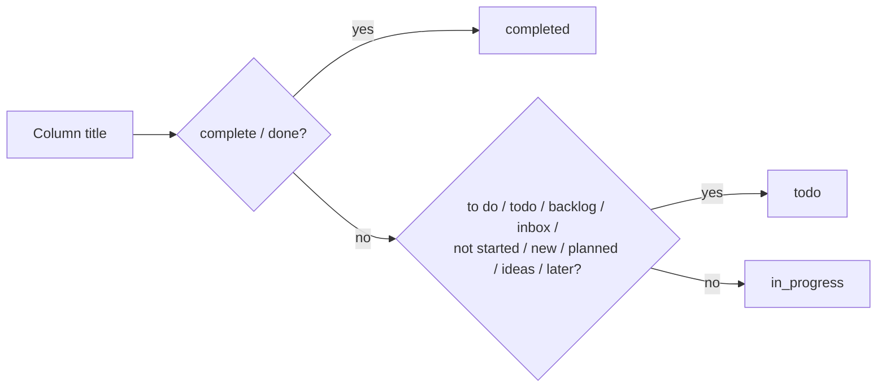

A board with no recognisable To Do column still gets one: its left-most column that is not Done is treated as To Do. A stored filter value it does not know falls back to `all` (`parseStatusFilter`), so an existing schedule keeps working. A request that sends one is refused, `400 statusFilter must be one of: all, completed, in_progress, todo`: until card 2117 it was read as `all`.

When a filter other than `all` is active the PDF header carries the filter label and a **SHOWING** banner under the metric tiles states how many cards are in that slice.

### Cards vs Tasks

Two figures appear side by side in the summary tiles, and the same two on the dashboard's **All Tasks** row:

| Figure | Definition |
|--------|------------|
| **Cards** | Non-archived kanban cards across every board in scope *and each sub-board beneath it that the reader can open*, regardless of period |
| **Tasks** | Cards plus the subtasks hanging off them (`totalCards + totalSubtasks`) |

The dashboard row uses the same board → cards → sub-boards walk as the report engine (`src/routes/+page.server.ts`), and both stop at a sub-board their reader cannot open (cards 2130 and 2150), so an administrator's all-boards report and their dashboard quote the same card count again. Historically the row only summed top-level boards, which is why it used to show fewer cards than the report; and until card 2150 the report walked into every sub-board, opened or not, while the dashboard did not.

### Report Data Structure

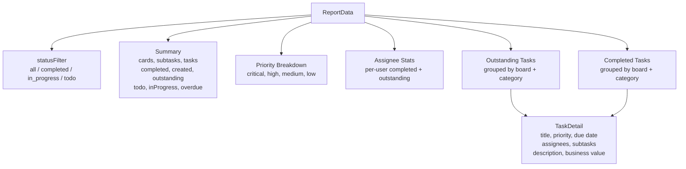

### PDF Generation

PDFs are rendered server-side using PDFKit with a professional layout:

- **Header** — DumpFire branding, report title, date range, detail level and (when set) the status filter
- **Executive Summary** — Six stat tiles: Cards, Tasks incl. subtasks, Completed, Created, Outstanding, Overdue, with a caption spelling out what each one counts. Overdue is the open cards due before the reader's today (card 2258): the day in the zone the Reports page sends, or the schedule's zone, and the UTC day when there is none. It was always the UTC day, so east of UTC after midnight a card due the day before was not yet counted
- **Dates** — A due date (the Due Date column) is printed as the day stored, in any zone (`formatDueDate`). The period, the generated date and the completion dates are printed in the schedule's zone for a scheduled report and in UTC for one made by hand (card 2258); they were printed in the server's zone, so a Tokyo schedule's PDF read a day before its mail's period
- **Status banner** — Only when a filter is active: "SHOWING Completed in period only — N cards" etc.
- **Priority Breakdown** — Visual bar chart of the slice being reported (Outstanding by default, Completed in Period for the completed filter)
- **Assignee Performance** — Table of completions per user (scope-wide)
- **Board Breakdown** — Per-board totals with sub-boards nested under their parent (scope-wide)
- **Completed Tasks** — Completions in the period with timestamps; drawn **before** the open work in the `all` report
- **Outstanding / In Progress / To Do** — Open work grouped by category and board, sub-boards nested under their parent; the heading follows the filter

All free text (titles, descriptions, business value, subtasks) passes through `stripTag()`, which removes the internal AI bookkeeping tags `[Antigravity]`, `[Claude]` and `[AI]` before printing.

### Report Scheduling

Configured per-user via the Reports page:

| Field | Type | Description |
|-------|------|-------------|
| `scope` | board/category/all | What to report on |
| `scopeId` | number | Board or category ID |
| `frequency` | weekly/monthly | How often |
| `dayOfWeek` | 0-6 | Day for weekly reports |
| `dayOfMonth` | 1-28 | Day for monthly reports. A value above 28 kept from before is read as 28 |
| `timeOfDay` | HH:MM, 00:00 to 23:59; empty is 09:00 | When to generate: a wall-clock time in `timeZone` |
| `timeZone` | An IANA zone name, such as `Europe/London`, at most 64 characters; stored as the server names it (`europe/london` is `Europe/London`, `Etc/UTC` is `UTC`). None is `UTC` | The zone `timeOfDay` is read in (card 2159, migration `0058`). The Reports page sends its creator's browser zone |
| `recipients` | Up to 10 addresses, separated by commas, semicolons or spaces (tabs and new lines too), an address written `<address>` read as the one inside; each part must be an address. Stored as the addresses it is sent to, lower-cased, each once, separated by `, ` | Where to send |
| `periodDays` | 1-366 | Lookback period in days: from the same time by the schedule's clock that many dates before the run, in its `timeZone`, so a week across a clock change is still Monday 09:00 to Monday 09:00 (card 2159). The mail's "Period" is written in that zone too, and so are the PDF's period, generated date and completion dates (card 2258), and the day its Overdue figure counts from, at the run's own moment, so a run made late counts from where its period ends |
| `detailLevel` | summary/detailed | Metrics and listings only, or full descriptions, business value and subtasks |
| `statusFilter` | all/completed/in_progress/todo | Which slice to list (see Status Filter); stored in `report_schedules.status_filter`, migration `0041` |
| `enabled` | boolean | Active toggle |

**A time in a zone (card 2159).** A schedule's time is a wall-clock time in its own zone, so
"weekly on Monday at 09:00 Europe/London" is sent at 09:00 in London all year: 08:00 UTC in
British summer time, 09:00 UTC in winter. It used to be set with `setHours` on the server's
own clock, so on a server on UTC (the image sets no `TZ`) it was sent at 10:00 all summer.
`nextRunAfter` in `src/lib/report-schedule-time.ts` works every run out afresh from now,
never by adding seven days to the last, and the server's own zone plays no part:

- **A time the clocks jump over** (01:30 in the UK on the last Sunday in March) is sent an
  hour later by the clock, 02:30 BST, the moment 01:30 GMT would have been.
- **A time that happens twice** (01:30 on the last Sunday in October) is sent once, at the
  first.
- **A zone the server does not know**, an offset such as `+01:00` or `−01:00` (either
  minus sign), or more than 64 characters is `400` `timeZone must be a time zone name, such as Europe/London`. Zone rules
  come with Node's own build in the image; a government's change to its clocks reaches the
  schedules with a later Node 22 image.
- **Schedules made before card 2159** were given `UTC` by migration `0058`, the zone they had
  been running in, so each is sent when it always was. The page offers "Use my time zone
  (Europe/London)" on any schedule whose zone is not the viewer's; only the schedule's owner
  can press it.

**When the next run moves (card 2159).** `POST` works out the first run in the schedule's
zone. `PUT` works the next run out again from now when it sends a new `frequency`,
`dayOfWeek`, `dayOfMonth`, `timeOfDay` or `timeZone`, and when it turns the schedule on; any
other change leaves it, so a rename does not move a run that is due. So turning a schedule
back on sends nothing at once for a run missed while it was off, a working-copy restore's
schedules included; it is sent at its next time. A changed time takes effect at once, where
the old time used to be sent once more. A new zone takes the schedule's addresses from the
day's 100, as a new time does, since it can bring a send forward to any time; a schedule
that is off after the change takes nothing. A timing the scheduler cannot date is refused,
with nothing changed: `400` `The schedule was not changed: its time of day "9" is not a time
from 00:00 to 23:59`, or, turning one on, `400` `This schedule cannot be turned on: its time
of day "9" is not a time from 00:00 to 23:59. Turn it on with a time, day and zone that can
be read, or delete it and make it again.` A `PUT` that sends `enabled: true` with a timing
that can be read, `{"enabled": true, "timeOfDay": "10:00"}`, turns such a schedule on.

Who a report may reach (card 2182), told in full in
[Who a Report Can Be Mailed To](notifications-email.md#who-a-report-can-be-mailed-to):

- **A schedule holds at most 10 addresses.** More is `400` `A schedule can be sent to at
  most 10 addresses, and this names 12. The schedule was not saved.` (`… was not changed.`
  on `PUT /api/report-schedules/{id}`), and a part that is not an address is `400`
  `recipients holds "smith", which is not an email address`, with nothing saved. Any address
  may be one, an account's or not.
- **An account has at most 20 schedules.** The 21st is `409` `You have 20 report schedules,
  the most one account may have. Delete one first.` An account that already has more keeps
  them all and makes no more until it has fewer than 20.
- **The day's 100 addresses.** One account's report mail reaches at most 100 addresses in a
  24-hour window counted from its first take (so up to 200 across one window's end and the
  next's start): the reports it emails by hand, and the schedules it makes, turns on or
  re-times while on, each of which takes the schedule's addresses, because each can bring a
  send forward; and a change of a schedule's list, which takes the addresses it adds, those not
  in the stored list (one address changed to ten takes nine). The stored list sent back in
  another order or case, or cut down, a change of name or filter, and turning a schedule
  off take nothing, and nothing is given back when a schedule is deleted. Past it, `429`
  `Report mail can reach at most 100 addresses a day from one account, and this schedule's
  10 would make 104. The schedule was not saved. Try again in 5 hour(s).` (`this schedule's
  4 new addresses would make 104` and `was not changed` for a changed list), nothing saved.
  A scheduled run takes nothing.
- **A schedule kept from before with more than 10** cannot be turned on as it is: `PUT` with
  `enabled: true` on such a schedule that is off is `400` `This schedule cannot be turned
  on: it is sent to 15 addresses, and the most is 10. Delete it and make it again with at
  most 10.` One still on can be sent back with `enabled: true` and a new name, as a page
  sends the row. A caller of the route can also send a list of 10 or fewer with `enabled:
  true` in the same `PUT`, which is accepted. The Reports page cannot edit a list, so it
  shows such a schedule's addresses as text to copy, with "Copy the ones to keep into a new
  schedule of at most 10, then delete this one."

A report emailed by hand from the Reports page is held to the same reading: at most 10
distinct addresses a call (`400` `A report can be emailed to at most 10 addresses at a time,
and this names 12. Nothing was sent.`, before the board is looked at), and the account's
100 a day, counted in a 24-hour window from its first (`429` `Reports can be emailed to at most 100 addresses a day from one account,
and this would make 104. Try again in 5 hour(s).`, taken before the PDF is built). See
[A Report Emailed on Demand](notifications-email.md#a-report-emailed-on-demand).

### Schedule Execution

Every minute the timer of `initReportScheduler()` calls `runDueReportSchedulesOnce(now)` in
`src/lib/server/reports.ts`, with the time it is then, and that calls
`runDueReportSchedules(now)` unless the last minute's run is still going. Both are exported
so that the tests can call them with a time of their own; under test the timer is off
(`SCHEDULERS=off`). A run takes each enabled schedule whose `nextRunAt` has come, or that has
none, as its owner: the report is built with the owner's access, as if they had asked for
it.

**The next run first, then the claim, then the send (card 2144).** For each schedule due, in
this order:

1. Its next run is worked out from now, in its own zone (`nextRunAfter`). A schedule whose
   next run cannot be worked out is switched off, with one `ERROR` line, and nothing is sent
   (below).
2. A schedule with no next run (a restored or hand-made row) is given one, and nothing is
   sent: it is not mailed the moment it arrives. A next run that cannot be read counts as
   none: `NaN-NaN-NaN NaN:NaN:NaN`, which the image before card 2144 wrote for a time it could
   not read, was after every moment when compared as text, so such a schedule was never due.
   Where the schedule cannot be dated either, step 1 switches it off and clears the value.
3. The run is claimed: one conditional write, `UPDATE report_schedules SET last_run_at = now,
   next_run_at = next, updated_at = now WHERE id = ? AND enabled = 1 AND next_run_at <= now`,
   in the stored form (`stamp()`), made before the report is built (`claimScheduleRun`). A
   claim that changes no row means another run has it, and the schedule is skipped. SQLite
   takes the write lock, so of two ticks, or two processes on one database, only one sends.
4. The report and its PDF are built from the row as claimed, so a change of recipients made
   in between is honoured, and sent.

The next run used to be worked out after the sends: a time it could not read was sent at
every minute's tick, and a weekly day of -2 gave a next run in the past and did the same.

**At most once.** Because the claim moves `lastRunAt` and `nextRunAt` before anything is
sent, a failure after it, or a restart during the sends (a deploy), loses the rest of that
run, which is not sent again. Before card 2144 the same run was sent again to every recipient
at the next start. For mail to outside addresses that is the right way round.

**One run at a time.** A run can take longer than the minute between ticks: about 35 seconds
for each address a slow mail server holds up, and the PDF before that. A module flag marks a
run in progress: a tick that finds it set does nothing and answers `false`, and the flag is
cleared in a `finally`, so a run that throws does not stop the scheduler. A schedule that came
due during a run is still due at the next tick that runs. The claim would stop a second send
on its own; the flag keeps one process from doing two ticks' work at once.

**At the start.** `initReportScheduler()` gives every schedule with no next run its first,
enabled or not, through the same function, and switches off one it cannot date. It never
throws: a failure is logged at `ERROR` and the timer starts all the same. A schedule with no
next run and a time that could not be read used to stop the server starting.

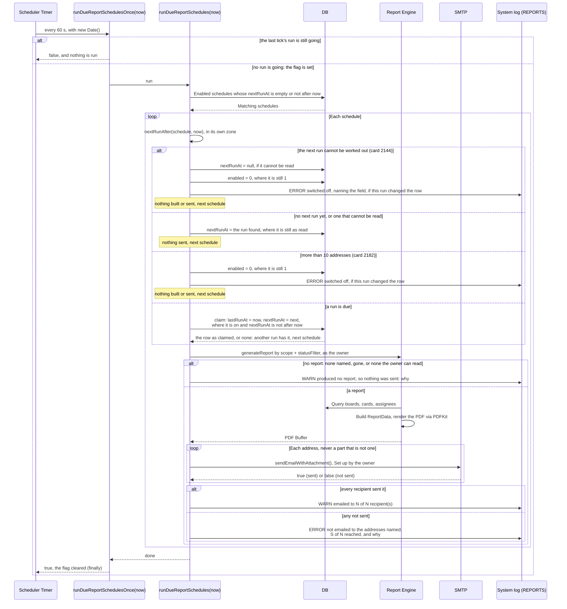

What the system log says, under the context `REPORTS` (card 2113). Each send's result is
counted; it used to say "emailed to N recipient(s)" whatever the mail server answered, and
nothing at all for a schedule that produced no report.

| What happened | Level | Line |
|---------------|-------|------|
| Every recipient was sent it | `WARN` | `Scheduled report emailed: "<name>" to 3 of 3 recipient(s)` |
| One or more were not | `ERROR` | `Scheduled report "<name>" was not emailed to b@example.com (2 of 3 recipient(s) reached). The mail server did not accept it: its reason is in the EMAIL line logged for each address. It is not sent again before its next run.` |
| None could be, mail not being set up | `ERROR` | The same line, with `Mail is not set up on this server` as the reason. `email.ts` logs nothing of its own then |
| No report: its board is gone, or its owner can no longer read it | `WARN` | `Scheduled report "<name>" produced no report, so nothing was sent: the board it covers (id 7) is gone, or the schedule's owner can no longer read it` |
| No report: its grouping is gone, holds no board, or holds none its owner can read | `WARN` | `... produced no report, so nothing was sent: the grouping it covers (id 7) is gone, holds no board, or holds none the schedule's owner can read` |
| No report: a board or grouping schedule that names none (`scopeId` empty) | `WARN` | `... produced no report, so nothing was sent: the schedule has no board` (`the schedule has no grouping` for a grouping) |
| No report: a report on every board, and its owner is not an administrator | `WARN` | `... produced no report, so nothing was sent: a report on every board is for an administrator, and the schedule's owner is not one` |
| No recipients | `WARN` | `Scheduled report generated but no recipients configured: "<name>"` |
| Its next run cannot be worked out (card 2144) | `ERROR` | `Report schedule 12 "Weekly sales", owner "pat" (user 7), was switched off: its time of day "9" is not a time from 00:00 to 23:59, so its next run cannot be worked out. Nothing was sent. Its owner can turn it on again with a time, day and zone that can be read, or delete it and make it again.`, with the owner as the line's user. The other faults: `its frequency "daily" is not weekly or monthly`, `its day of the week -2 is not a whole number from 0 (Sunday) to 6 (Saturday)`, `its day of the month 0 is not a whole number of 1 or more`, `its time zone "Mars/Base" is not one this server knows`. A stored value is named to its first 80 characters, then `…`. Once, as the line below: written only by the run, or the start, that changed the row |
| More than 10 addresses, kept from before the cap (card 2182) | `ERROR` | `Report schedule 12 "Weekly sales", owner "pat" (user 7), was switched off: it is sent to 15 addresses, and the most is 10. Nothing was sent. Its owner can delete it and make it again with at most 10.`, with the owner as the line's user. Once: the switch-off is written only where the schedule is still on, and only the run that changed the row writes the line |
| A list that also holds parts that are not addresses, kept from before (card 2182) | As the line | The emailed, not-emailed or no-recipients line above ends `Left out, as not email addresses: "alice", "smith".` Those parts are never sent to; the addresses are, and the schedule is not switched off for them |

- **A schedule moves on to its next run whatever was sent.** `lastRunAt` and `nextRunAt` are
  written by the claim, before each of the cases above, and nothing is sent again before the
  next run: a retry would mail the report a second time to everyone it did reach. A schedule
  with no report also moves on, and goes on logging its `WARN` line at each run until it is
  mended or deleted.
- **A schedule whose report throws is not tried again before its next run** (card 2144). An
  error while the report or its PDF is made is logged at `ERROR`, `Failed to run scheduled
  report "<name>". It is not sent again before its next run.`; the run was claimed, so the
  schedule is due again at its next time. It used to be left as it was, and failed again
  every minute. A claim that meets another connection's write lock throws the same way
  before anything is built, is logged without the second sentence, and leaves the schedule
  due for the next tick.
- **A schedule switched off because its next run cannot be worked out is not run again**
  until its owner mends it. Turning it on alone is refused with the same reason; a `PUT`
  that sends `enabled: true` with a time, day and zone that can be read (`{"enabled": true,
  "timeOfDay": "10:00"}`) turns it on and works its next run out again. The Reports page
  shows the reason in place of "Next" and offers no **Use my time zone**; it cannot change a
  time, so there its owner deletes it and makes it again.
- **A schedule switched off for more than 10 addresses is not run again** until it is
  remade with 10 or fewer, or a `PUT` sends a list of 10 or fewer with `enabled: true`. Its
  last run is left as it was; turning it back on works its next run out again from now
  (card 2159), and the `PUT` takes its addresses from the day's 100. Its owner sees why on
  the Reports page, with its addresses to copy; the administrators see the `ERROR` line on
  the Audit page.
- **The Reports page shows a schedule's time with its zone** (card 2159): the badge reads
  "Weekly on Mon at 09:00 Europe/London", "Last" and "Next" are written in the schedule's own
  zone with its short name ("Next: 26 Oct 2026, 09:00 GMT"), and the form says under the
  time "In your time zone, Europe/London". Where the schedule's zone is not the viewer's,
  Next is followed by the viewer's own time ("Next: 26 Oct 2026, 09:00 UTC (10:00 your
  time)", with the date as well when it is another day there), and **Use my time zone** by
  a line saying it reads the time in the viewer's zone from now on and works the next run
  out again. The viewer's zone is read in the browser once the page has loaded.
- **Every scheduled mail names the account that set it up**: "Set up by `<username>`" above
  "— DumpFire Automated Reports", the username escaped (card 2182), as the report emailed by
  hand says "Sent by `<username>` via DumpFire".
- **The `WARN` lines are kept at the default level, `INFO`.** A server started with
  `LOG_LEVEL=ERROR` keeps the `ERROR` lines only.

### Card Reports

Individual card reports can be generated for completion notifications. These include:
- Card title, priority, and business value
- Description rendered as text
- Subtask completion status
- Assignee list
- Activity timeline

## Key Implementation Files

| File | Lines | Purpose |
|------|-------|---------|
| `src/lib/server/backup.ts` | ~570 | Backup scheduling, data generation (`withoutSecrets()`: no session, no unused invite, no key remembered browsers are signed with, no request link or form key, no secret, and sealed), upload orchestration (`runBackup()`, which does not try a destination without its credentials) |
| `src/lib/server/backup-secrets.ts` | ~1,400 | What a backup leaves out because it is a secret (card 2169), and what the admin routes mask and keep (cards 2187 and 2190: `SECRET_MASK`, `maskDestination()`, `keepMaskedSecrets()`, `keepMailPassword()`): `clearSecrets()`, `readSecretsHere()` and `fillSecretGaps()` for a restore, `credentialsMissing()`, `secretsToEnter()` for the start-up line, and the two sentences; the seal: `backupSealKey()`, `sealOf()`, `sealCopy()`, `sealVerifies()`, `keepSealKey()`, and the checks made before it, `unsealedBecause()`, `backupFailsCheck()`, `strayInternalObjects()`; `fromTableStorage()`, how a table is read for the seal and the restore |
| `src/lib/server/backup-destinations.ts` | ~870 | SFTP, S3, Google Drive, OneDrive destination implementations; `readDestination()`; `reachFolder()` and `makeDumpfireFolder()` for Google Drive (card 2188); the SFTP host key's verifier and pin, the first look, and `HostKeyNotConfirmed`, `HostKeyMismatch`, `HostKeyTypeNotOffered` and `HostKeySignatureFailed` (card 2250) |
| `src/lib/server/ssh-host-key.ts` | ~160 | An SFTP destination's host key, read, stored and checked (card 2250): `readHostKey()`, `confirmedHostKey()`, `fingerprintOf()`, `typeOf()`, `pinFor()`, `serverKeyFile()`, `HOST_KEY_NOT_CONFIRMED` and `HOST_KEY_REFUSAL`; it connects to nothing |
| `src/lib/drive-scope.ts` | ~40 | `DRIVE_FILE_SCOPE`, `driveScopeIsNarrow()` and `dumpfireFolderName()`, read by the server and the admin page (card 2188) |
| `src/lib/server/gdrive-connect.ts` | ~120 | The Google Drive Connects under way, in memory: `startConnect()` (state and PKCE challenge), `takeConnect()` (once, bound to the session, account and destination, ten minutes), `forgetConnects()` for the tests (card 2251) |
| `src/lib/server/reports.ts` | ~1,900 | Report data collection, status filter, PDF rendering, schedule management, `runDueReportSchedules()`, `claimScheduleRun()` and the timer's `runDueReportSchedulesOnce()`; `takeReportMail()`, the day's 100 addresses (card 2182) |
| `src/routes/api/reports/email/+server.ts` | ~170 | A report emailed on demand, and its answer |
| `src/lib/report-schedule-time.ts` | ~210 | `nextRunAfter()`, `canonicalTimeZone()`, `readTimeOfDay()` and `DEFAULT_SCHEDULE_TIME_ZONE`: when a schedule is next sent, in its own zone, for the routes, the scheduler and the page (cards 2144 and 2159) |
| `src/lib/report-recipients.ts` | ~70 | `reportRecipients()` and `MAX_REPORT_RECIPIENTS`: the one reading of a list of recipients, for the routes, the scheduler and the page (card 2182) |
| `src/lib/server/snapshots.ts` | ~85 | Daily card count snapshots for the CFD (burndowns use card timestamps) |
