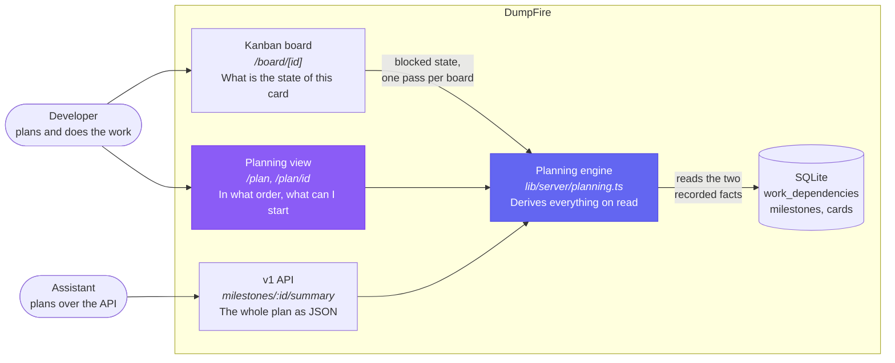
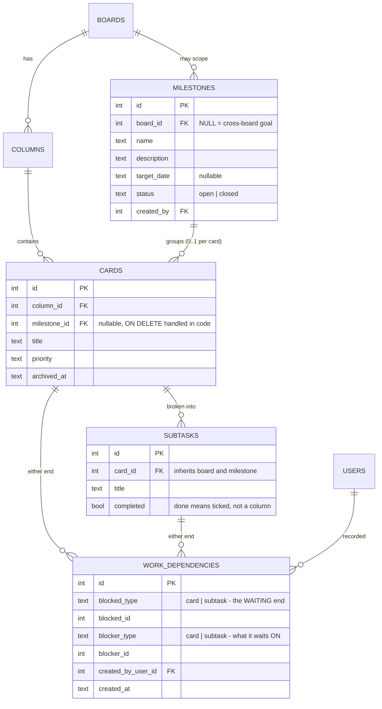
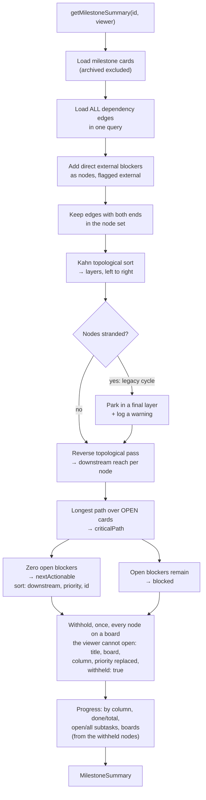
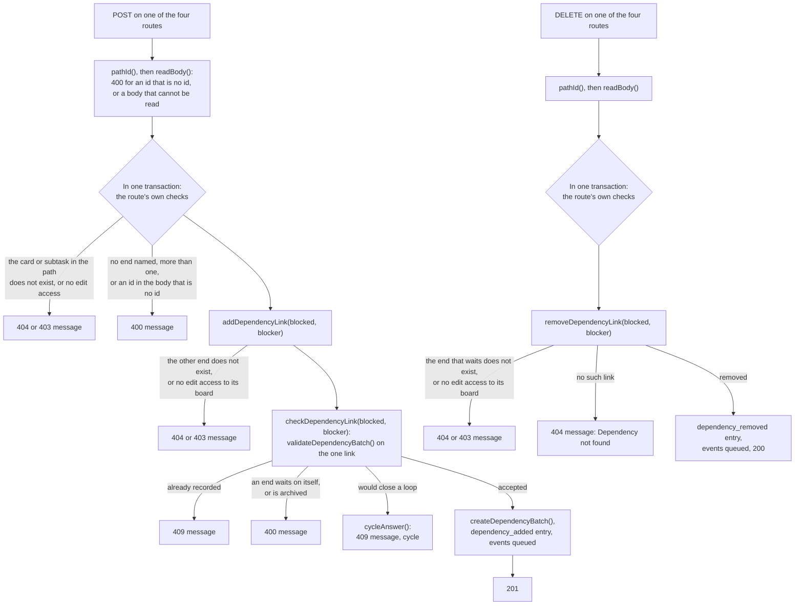
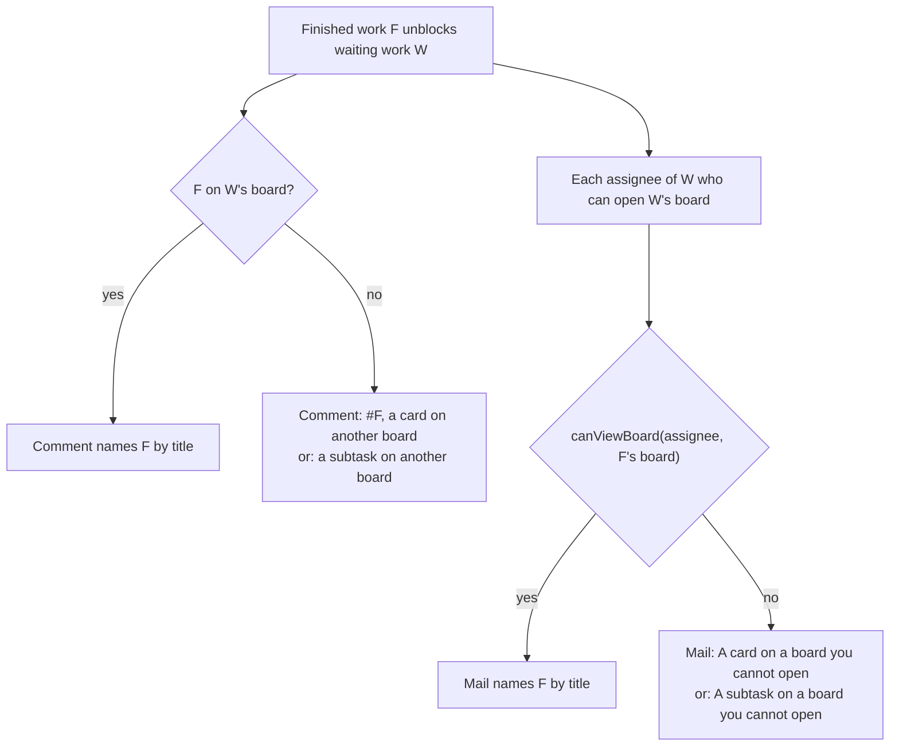
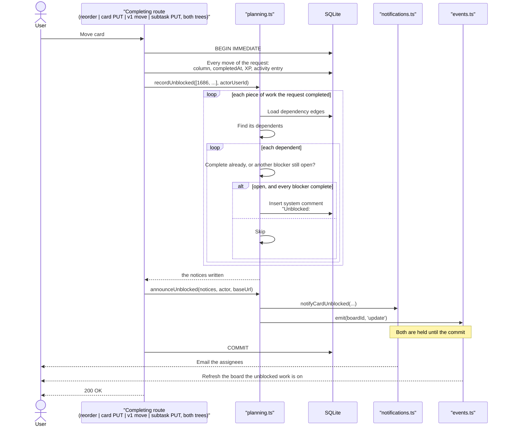
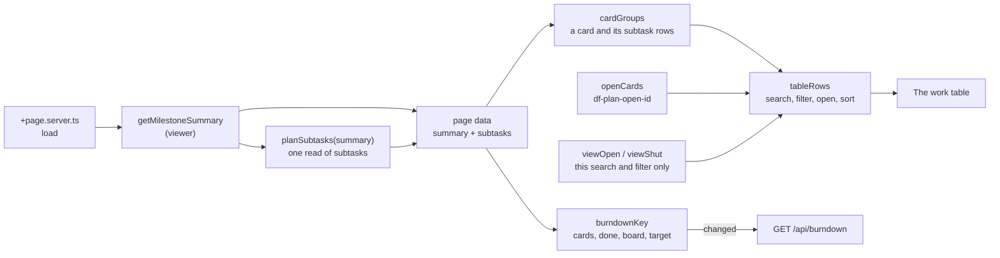
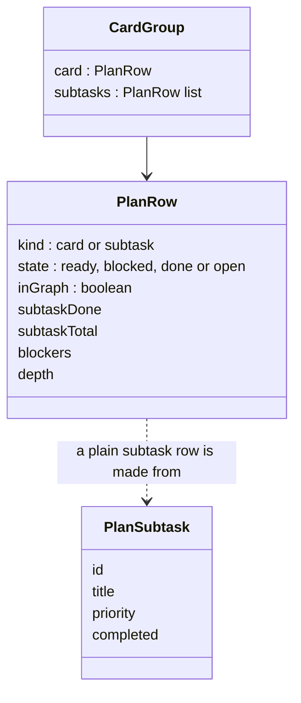

# Critical-Path Planning

## The problem

A Kanban board is good at "what is the state of this card" and has nothing to say about
"in what order does this have to happen". A board with 69 To Do, 13 On Hold and 10 In
Progress cards has no structure beyond priority. A goal such as *migrate all environments
to Azure VMs* has prerequisites that must land in a particular order — cloud test
environment, secrets management, network segmentation, backup restore drills, DNS cutover,
decommissioning — and without somewhere to record that order it lives in people's heads and
in markdown plans that go stale.

## The principle

**Record only facts that are cheap to keep true.** DumpFire stores exactly two planning
facts by hand:

1. **Which card or subtask blocks which** — `work_dependencies`
2. **Which milestone a card belongs to** — `cards.milestone_id`

Everything else — the critical path, what is startable today, what is blocked and by what,
how much finishing a card would unblock, percent complete — is **computed on read** in
`src/lib/server/planning.ts`. Nothing derived is stored, so nothing derived can drift.

There are deliberately **no start or end dates on cards** and no estimates. A chain of cards
is enough to say what cannot slip. Per-card dates, resource levelling, hours tracking and
drag-to-reschedule Gantt charts are the features that make planning tools go stale for a
one- or two-person team, and they are out of scope.

## Where it sits

The planning view at `/plan` is a **separate view**, not a mode of the board. Same cards,
different question. The Kanban board is untouched apart from two chips on the card face and
one filter.



## Cards and subtasks are both nodes

A "piece of work" is a card **or** a subtask, and both are nodes in one graph
keyed as `card:123` / `subtask:456`. Ordering genuinely exists at both levels —
step two of a card cannot start before step one, and sometimes a whole card
waits on one specific step of another. Before this, the only way to express that
was to promote the subtask to a card, which distorts the board to satisfy the
planning tool.

**One polymorphic table, not three.** `work_dependencies` carries
`(blocked_type, blocked_id, blocker_type, blocker_id)` rather than separate
tables for card→card, subtask→subtask and the two mixed directions. The planning
engine then walks a single graph regardless of node type; three tables would
mean three near-identical traversals that can drift apart, which is exactly what
this feature exists to prevent. The cost is losing foreign keys on the
polymorphic ids, so nothing cascades and the edges are cleared explicitly. Deleting
a subtask clears its own with `removeWorkNodeEdges`. Permanently deleting a card, a
column or a board clears every edge that has one of the deleted cards or subtasks at
either end, sub-boards included, in the transaction that deletes them
(`src/lib/server/deletes.ts`). Archiving a card clears nothing: an archived card
keeps its edges and has them when it is restored. See
[Data Model](data-model.md#what-a-delete-removes).

**Done means different things.** A card is complete when it reaches a Complete
column; a subtask when it is ticked. Both resolve through the same `isComplete`
field, decided per type at load.

**A subtask belongs to its parent card's milestone**, never to one directly, and
inherits its parent's board for access checks.

**Only subtasks that carry an edge become nodes.** Every subtask of every card
would swamp the graph, and most carry no ordering at all.

**Progress still counts cards.** Adding an ordering to a subtask must not
silently change how big a goal looks, so `progress.total` covers the milestone's
cards and subtasks stay in `openSubtasks` as before. Beside it, `totalSubtasks` counts
every subtask of the same cards, ticked or not (card 2225), so the open figure has a total
to be read against: the Progress panel shows them as `open/all`, "open subtasks / all",
in the form of its "cards complete" tile, and the PDF's "Open steps" as `open of all`.

## Data model

Two tables and one column carry every planning fact.



### Edge direction

Stated once, because getting it backwards is the easiest mistake here:

- `work_dependencies.blocked_*` is the work that is **waiting**
- `work_dependencies.blocker_*` is what it is **waiting on**

An edge points **blocker → blocked**, which is also the left-to-right reading order of the
milestone graph. The API accepts both spellings (`dependsOnCardId` / `dependsOnSubtaskId`
and `blocksCardId` / `blocksSubtaskId`) so a caller never has to work out which end owns
the row. In bulk, a bare number means a card and `"subtask:42"` means a subtask, so
card-only lists written before subtasks existed are untouched.

### Constraints worth knowing

| Constraint | Why |
|------------|-----|
| `UNIQUE (card_id, depends_on_card_id)` | The duplicate check used to be handler-only. Migration `0042` de-duplicates to `MIN(id)` per pair before creating the index, or it fails on live data. |
| `cards.milestone_id` has no `REFERENCES` clause | SQLite cannot add a column with `ON DELETE` to an existing table. The delete handler nulls it instead — which is the wanted behaviour anyway: **deleting a goal must never delete the work.** |
| `milestones.board_id` nullable | A goal can span several projects. A migration touches more than one board. |
| A board's milestone holds only that board's cards | `setCardMilestone` and the bulk attach refuse a card of another board for it, and since card 2155 a move to another board takes the card out of a milestone of a board other than the one it arrives on, in the same update of the card (`moveCard`, beside the category rule). The source board's `card_moved_away` entry ends `and out of milestone "M"`, or `and out of a milestone of another board` for a third board's. The mover is told: `PUT /api/cards/{id}` and the v1 move answer `leftMilestone` `{ id, name }` for a milestone of the board the card left (null otherwise, and for a third board's), and All Tasks says `Moved. It left milestone "M"; moving it back does not put it back in.` A goal across boards keeps its cards wherever they move. Migration `0057` took out the cards already in a milestone of another board, once (a card whose column row is gone is left alone, its board being unknown; nothing repeats 0057 after an older backup is imported). Membership is not historised, so a goal that loses a card, to 0057 or to any later move, shows a burndown, a milestone PDF and, closed, final figures without it across its whole window, not only from the move. The one way left in is `PATCH` of a milestone with a new `boardId`, which moves it with its cards, and which card 2179 is to close. |
| Archived cards are excluded everywhere | An archived blocker is not a live dependency. |

### What counts as "done"

A dependency is resolved when its blocker sits in a **Complete** column, decided by
`isCompleteColumnTitle()` in `card-completion.ts` — the same strict helper the rest of the
app uses for XP and completion blocking. One definition of done across the whole app; two
would be exactly the drift this feature exists to remove.

## How a milestone summary is computed



Everything above the withholding step works on the real nodes, so the plan is the same
whoever asks; only what is shown of each node differs (card 2129, below).

### Design decisions inside that flow

**External blockers are included.** The node set is the milestone's cards *plus* any card
outside it that directly blocks one of them, marked `external: true`. Without them, a card
whose only blocker sits on another board would appear startable when it is not — precisely
the mistake the feature exists to prevent. Direct blockers only: one level is exactly what
"can I start this" depends on. External nodes are never offered in `nextActionable`; they
are context, not scope.

**Work on a board the viewer cannot open is withheld, not left out** (card 2129). An
external blocker can sit on a board the person reading the plan was never given, and so can
a card of a goal across boards (a card of a board's milestone moved to another board leaves
the milestone, card 2155, but a backup restored from before it can still hold one). Leaving such a node out would make a blocked card look startable, so it
stays, with its id, its kind, whether it is finished and its place in the plan (`external`,
its layer, its edges, `openBlockers`, `downstreamCount`, `onCriticalPath`). What is
withheld: its title reads "A card on a board you cannot open" or "A subtask on a board you
cannot open", its board name "A board you cannot open", its column title is empty, and its
board id, column id, priority and milestone are null; a withheld subtask has no
`parentCardId`. `withheld: true` says so, and every node carries the flag. Every reader of
the planning engine passes the viewer, and the argument is required, so the type check
finds a caller that forgets: `getWorkDependencies(ref, viewer)`,
`getCardDependencies(id, viewer)`, `getBlockedStateForCards(ids, viewer)`,
`getBoardBlockedState(boardId, viewer)` and `getMilestoneSummary(id, viewer)`. Which boards
the viewer can open is read once per call (`getAccessibleBoardIds`), not once per node. An
administrator is never given a withheld node. The engine's own uses (`recordUnblocked`, the
cycle check, `loadPlanNodes`) read the real nodes and are unchanged.

In the summary the withholding is done once, after the plan is worked out: the layers, the
reach, the critical path, the `criticalPath` ids (a subtask on the chain stands for its real
parent card) and the order of `nextActionable` come from the real nodes, so a null priority
or a missing parent cannot change which chain is critical for one reader and not another.
Then `nodes`, `criticalPathNodes`, `blocked[].blockers`, `nextActionable` and `progress` are
all built from the withheld nodes. `progress.boards` counts the cards on boards the viewer
cannot open in one entry, `{ id: null, name: "A board you cannot open" }`, and
`progress.byColumn` under an empty column title.

**The critical path covers open work only.** It is the longest chain of dependencies among
cards that are not yet complete. A finished prerequisite adds no risk, so it drops out and
the chain shortens as work lands. Ties break on accumulated priority, then on the lowest
card id, so the highlighted chain does not jitter between reloads. A chain of one card is
not reported — that is just the next thing to do, and it shows up in `nextActionable`.

**Next-actionable is sorted by how much it unblocks.** `downstreamCount` is the number of
open cards transitively reachable from a card. On a one- or two-person team, the card that
frees the most downstream work is the one worth starting, ahead of raw priority.

**The whole edge table is read in one query.** It is small — one row per ordering decision
somebody actually made, not one per card — and cycle detection, downstream counts and the
critical path all walk it repeatedly. Paging it would cost more queries than it saves rows.

**Complexity.** Layering, reach and longest-path are each a single pass over nodes and
edges: O(V + E) per summary, with one bounded query for cards, one for columns, one for
boards and one for the edge table.

### Cycle detection

Adding "A waits on B" closes a loop exactly when B is already reachable *downstream* of A.
`validateDependencyBatch()` in `planning.ts` walks forward from A over blocker → blocked
edges looking for B, and returns the offending chain rather than a boolean, each entry the
`kind` and `id` of a card or a subtask — so the API can name the cycle it rejected:

```json
{ "message": "#1559 waiting on #1198 would create a cycle: #1559 → #1686 → #1198 → #1559",
  "cycle": [ { "kind": "card", "id": 1559 },
             { "kind": "card", "id": 1686 },
             { "kind": "card", "id": 1198 } ] }
```

"Rejected" on its own is not useful when the loop runs through five cards on three boards.
In a message, `#1559` is a card and `subtask #42` is a subtask.

One link and a batch go through the same function, so they cannot disagree about what is
allowed. A batch is checked link by link against the stored graph and the links accepted so
far, which is how a loop between two links of the same batch is caught.

### How a refused link is answered

Four routes add and remove a single link: the card route and the subtask route, each under
`/api/v1/` for an API key and under `/api/` for the session the pages use. All four hand the
link to `src/lib/server/dependency-refusals.ts`, which is the one place that turns what the
validator found into an answer, and the one place that writes the link or takes it away,
with its activity entry (`addDependencyLink()`, `removeDependencyLink()`). Each route reads
its body first, then runs one transaction: its own checks, the shared function, the entry,
and the live events queued for the commit. A refused request writes nothing.

| Refusal | Answer |
|---------|--------|
| An end waits on itself | `400` `{ message }` |
| An end is archived | `400` `{ message }` |
| The link is already recorded | `409` `{ message }` |
| The link would close a loop | `409` `{ message, cycle }` |
| Removing a link that is not there | `404` `{ message }` |

A duplicate and a cycle are both `409`. A cycle is the one with `cycle` in it.



- **The route's own checks come first.** For a `POST`: the card or subtask in the path and
  the caller's edit access to its board, then that the body names exactly one end, by an id.
  The other end, and the caller's edit access to its board, are `addDependencyLink()`'s. A
  `DELETE` checks the card or subtask in the path and the caller's view access to its
  board, and the body; who may remove the link is `removeDependencyLink()`'s.
- **Every link added or removed is recorded**, by all four routes (card 2114). Until then
  only the v1 card route wrote an entry, so a dependency changed in the card window or
  through the v1 subtask route was missing from the activity feed and the Audit page:

  | | Addition | Removal |
  |---|---|---|
  | Action | `dependency_added` | `dependency_removed` |
  | Source | `ui` from the two routes under `/api/`, `api` from the two under `/api/v1/`, stored `api:` | the same |
  | Board | The board of the card in the address, or of the subtask's card | The board of the end that waits |
  | Card | The card in the address, or the subtask's card | That card where it is on that board, otherwise the card that waits |
  | Detail | `#12 now waits on subtask #45` | `#12 no longer waits on subtask #45` |

  No webhook is sent for either. The graph the link is checked against is read in the
  transaction that writes it, so a link written by another writer cannot close a loop
  between the check and the write.
- **A cycle is returned, not thrown.** `checkDependencyLink()` throws the `400` and the
  duplicate's `409` with `error()`, which sends a text alone. A cycle carries its chain
  beside the text, so it is handed back to the route, which answers it with
  `cycleAnswer()`. On the v1 card route that happens once the transaction is over.
- **What a success answers differs by route.** The v1 card route answers `201` with
  `{ blocked, blocker, isBlocked }` and its `DELETE` answers `{ success, removed }`. The
  session card route and both subtask routes answer the dependencies as they then are.
- **The bulk endpoint does not use this.** `POST /api/v1/dependencies/bulk` answers a
  rejected batch as a whole: `409` with `message` and every link at fault in `rejected` and
  `forbidden`, and nothing written.

Covered by `tests/dependency-refusals.test.ts`, which asks each refusal of each of the four
routes, and `tests/atomic-dependencies.test.ts`, which fails each write in turn, holds the
entries, and shows every read inside the transaction.

**The card window** lists a card's links in two lists, "Blocked by" and "Blocks", and each
row is a card or a subtask: the session card route answers each with its `kind`, its own id
as `cardId`, and for a subtask `parentCardId`. `dependencyEndBody()` in `src/lib/api.ts`
builds the body that names a row's end from its kind (`dependsOnSubtaskId` for a subtask
this card waits on), and `dependencyRow()` labels it, "#12" for a card and "subtask #45 of
#12" for a subtask, whose link opens card 12. Until card 2138 the remove button sent every
row's id as a card's, so removing a subtask row removed nothing, or the link to the card
with the subtask's number, and the row's link opened that card.

## Unblock notification

When a card reaches a Complete column, or a subtask is ticked, anything that was waiting
only on it becomes startable. Three routes complete a card and two complete a subtask, so
the reaction lives in `planning.ts`, in two halves:

| Half | Function | What it does | Where it runs |
|------|----------|--------------|---------------|
| The rows | `recordUnblocked(completed, actorUserId)` | Writes an "Unblocked" system comment on every card that was waiting on one of the completed pieces of work and now has nothing open blocking it. Returns what it wrote | Inside the request's transaction, once, as its last write. It throws if no transaction is open |
| The telling | `announceUnblocked(unblocked, actor, baseUrl)` | For each notice written: emails the assignees and refreshes the board the unblocked work is on | Queued until the transaction commits. Nothing is sent if it rolls back |

The card routes reach them through `recordUnblockedByMoves()` and `announceCardMoves()` in
`card-moves.ts`, which pass on the cards a request completed. The two subtask routes call
the halves directly.

A request writes one notice for each piece of work it unblocks, however many of that work's
blockers it completed. The notice names the last of those blockers to be completed in the
request, and the assignees are mailed once for it.

**What the notice says, and to whom** (card 2152). The finished work can be on another board
than the work that waited on it, and the two halves name it differently because they have
different readers:

- **The comment** is stored once and read by everyone who can open the waiting card's board,
  so it cannot be drawn per reader. It names the finished work by its title only when that
  work is on the same board: `Unblocked: #1686 "Ship the API" completed — nothing is blocking
  this card now.`, or `Unblocked: subtask "Write tests" completed — …`. Otherwise it reads
  `Unblocked: #1686, a card on another board, completed — nothing is blocking this card
  now.`, or `Unblocked: a subtask on another board completed — …`. The number is kept, as a
  withheld plan node keeps its id: whoever can open the other board can find it. A waiting
  subtask's comment ends `nothing is blocking subtask "…" now.`, as before. Comments written
  before card 2152 stay as they are.
- **The mail** is one person's. It goes to the waiting card's assignees who can open its
  board (card 2180), and names the finished work by its title to an assignee who can open
  the board it is on, and otherwise as "A card on a board you cannot open" (with its number)
  or "A subtask on a board you cannot open". A finished subtask is named as a subtask, never
  by its id. `UnblockedWork.completed` carries the finished work's `boardId` for this, and
  `notifyCardUnblocked` takes it whole.





Three things follow from the notice being a write of the completion's own transaction:

- **The notice is saved with the completion or not at all.** If a notice cannot be written,
  the completion fails with it and the card or subtask is where it was. A completion is never
  saved without the notice that tells the next person it is their turn.
- **One request, one pass.** `recordUnblocked` runs after the last move and reads the state
  the whole request has made. A card that one move of a drop unblocked and a later move of
  the same drop completed gets no notice, because by then it is complete.
- **A subtask ticked twice writes one notice.** The subtask is read inside the transaction,
  so the second request finds it already complete and writes nothing.

An email is a different matter from a notice. It is sent after the commit, and one that
fails is logged and fails nothing: the completion is saved and the caller is told so.

The email reuses the existing `email_moved` preference rather than introducing a new
toggle: being unblocked is a column change on somebody else's card, and a user who muted
move notifications does not want this one either.

## Upgrading a live system

This feature adds a migration, so it is worth being explicit about what it does to a
populated database.

**Additive by default.** Migration `0042` creates the `milestones` table, adds two nullable
columns (`cards.milestone_id`, `card_dependencies.created_by_user_id`) and three indexes.
SQLite adds a nullable column as a schema change, not a table rewrite, so no existing row is
read or written.

**One statement removes anything.** Before this migration the duplicate check for
dependencies lived in the request handler rather than the database, so identical
`(card_id, depends_on_card_id)` pairs were possible and `CREATE UNIQUE INDEX` would fail on
them. The de-dupe keeps `MIN(id)` of each pair and groups on exactly the two columns the
index covers, which makes losing a dependency unrepresentable: a row can only be deleted
when another row with the same pair survives.

**Legacy table shapes are repaired in code, not SQL.** `repairLegacyCardDependencies()` in
`migrate.ts` runs before the migration loop. It inspects `card_dependencies`, does nothing
when the columns are already current, refuses to touch a shape it does not recognise, and
converts a genuinely legacy table inside a transaction that compares row counts and rolls
back rather than dropping the original if they disagree.

That check exists in code because plain SQL cannot ask "which shape is this table?" — the
assumption that it could is precisely what made migration `0036` destructive (see the
comment in that file). Putting it where it can be guarded, counted and rolled back is the
difference between a conversion and a data-loss bug.

**Migration 0043** adds `work_dependencies` and copies every `card_dependencies` row across
as a `(card, card)` pair with `INSERT OR IGNORE`, so it is safe to re-run. The old table is
deliberately **left in place** rather than dropped: this is the migration that could lose
the ordering decisions already recorded, and a table nothing reads costs nothing. A later
migration can drop it once `work_dependencies` has been in production long enough to trust.
(Migration `0036` is the cautionary tale — see the comment in that file.)

**Verified, not assumed.** The upgrade was run against three populated databases — one at
`0041` with several hundred cards, comments, subtasks and assignees; the same database
forced into the legacy dependency shape; and a real working database already upgraded. In
every case cards, comments, subtasks and assignees were preserved, every distinct dependency
survived (with blocker/blocked mapped the right way round on conversion), and two further
simulated restarts re-ran no migration and changed no row.

That last property matters most: a migration that does work on every boot rather than once
is exactly the failure mode `0036` had, and it went unnoticed for months because the table
it emptied was never read.

## The planning view

`/plan` lists the goals. `/plan/[id]` is one milestone, rendering five blocks in the order
they answer a real question:

| Block | Question it answers |
|-------|---------------------|
| Progress | How far along is this goal: cards complete of all, startable now, blocked, and open subtasks of all |
| Burndown | Will it land by its date |
| Critical path | Which chain cannot slip |
| The work | What is in the goal, what can I start today, and what is waiting on what |
| Dependency graph | What is the overall shape |

The work is one table of every card in the goal, searchable and sortable, with a state filter
(All, Startable, Blocked, Done) whose counts are what were once the Next actionable and Blocked
lists. A blocked row opens to what it is waiting on.

Nothing is computed in the browser. The server hands over a `MilestoneSummary` and the page
draws it, so the page and the API can never disagree about what the critical path is.

### Opening a card to its subtasks

Each card in the work table is collapsed by default. A card with subtasks has a button after
its title, "▸ 3/5 subtasks" (ticked of all), that opens it to **every** one of its subtasks,
in the card's own order (`position`, then id, as the card window has them). Its name to a
screen reader is its text and the card, "3/5 subtasks of #123", the same open or closed;
`aria-expanded` says which. "Expand all" and "Collapse all" beside the state filter act on the
cards drawn that have subtasks, and the label follows them: it reads "Collapse all" once every
one of them is drawn open (card 2221).

- **Two kinds of subtask row.** One that carries a dependency is a node of the graph and keeps
  what the plan says of it: Startable, Blocked or Done, what it waits on, its Unblocks count and
  whether it is on the critical path. One that does not is Done or Open and nothing more.
  Clicking either opens its card's window.
- **Search and the state filter.** A card is listed when it matches or one of its subtasks
  does, and a subtask that matches opens its card without changing what is remembered. Inside
  a card opened so, all its subtasks show when the card itself matches, otherwise only the
  ones that match. A subtask matches a search on its title. Only an ordered subtask has a state
  the filter can find, and `#123` matches a card's id only. The counts are the cards and the
  ordered subtasks, as before.
- **Sorting** orders the cards; a card's subtasks always follow it, in its order.
- **Remembered per browser**, per milestone, in `localStorage` under `df-plan-open-<id>`, a
  list of card ids, read once the page is in the browser. A private window or blocked site data
  means nothing is remembered and every card starts collapsed. Ids no longer in the milestone
  are dropped on the next write, and stored entries that are not positive whole numbers are
  dropped on the read.
- **Under a search or filter, nothing is remembered.** A card opened or closed by hand there,
  and Expand all or Collapse all there, act for that search and filter alone (`viewOpen`,
  `viewShut`); a card remembered open and closed under a search is shut for it, never taken
  out of what is stored. A new search or filter starts from what is remembered again. Only
  with nothing searched or filtered is what is open written to storage (`afterToggle`,
  `afterExpandAll`).
- **Where the subtasks come from.** The page load gives them beside the summary, as
  `subtasks`, from `planSubtasks(summary)` in `planning.ts`: the subtasks of the summary's member
  cards that are not withheld, in one read. A card on a board the reader cannot open is withheld
  in the summary (card 2129), so it has no entry, no button and no subtask rows. The summary is
  unchanged, so the API, its compact form and both PDFs are too. Each subtask is sent as
  `id, title, priority, completed`: its card is the key of the list it is under.
- **Kept current.** Closing the card window re-runs the load, saved or not: the window writes a
  subtask ticked, added or removed at once, before any Save, and says nothing of it to the
  page. The burndown is fetched again only when what it charts changes, `burndownKey`: the
  milestone, its target date, and each member card with its board and whether it is done. A
  window closed with nothing changed, a subtask ticked or a card moved between open columns
  leaves it, and the chart is not dimmed for a fetch that would draw the same thing.



The rows are arranged by `src/lib/plan-table.ts`, pure functions with no DOM, so that
`tests/plan-table.test.ts` can run them: a page cannot be run in the tests.



### Why the graph is hand-laid-out SVG

The milestone graph is inline SVG positioned in topological layers, **not** the existing
`ForceGraph` component used by `/graph`. The point of this graph is that reading left to
right is reading the order the work happens in, and a force layout scrambles exactly that.

Nodes keep a fixed size (190×58) and the container scrolls horizontally; shrinking nodes to
fit thirty cards on one screen produces a picture nobody can read. The page body itself
never scrolls sideways.

**Subtasks are collapsed under their card by default.** A card with ordered subtasks shows
a `+n` badge and expands inline on click. This was chosen over drawing them always-inline
because node count is the real readability risk at this scale — and it costs nothing in
accuracy: the critical path is computed over the **full** graph either way, so collapsing
is purely a display choice. A collapsed subtask's edges roll up to its card, so nothing
dangles; the client re-layers the rolled-up graph with the same Kahn pass and
stranded-node fallback the server uses, because rolling up can produce a cycle the full
graph does not have.

| Node state | Appearance |
|------------|------------|
| On the critical path | Red border, heavier stroke; its edges drawn red and thicker |
| Complete | Green, text dimmed so finished work recedes |
| Blocked | Amber |
| Startable | Indigo |
| Outside the milestone | Dashed grey border |
| Withheld: on a board the reader cannot open | "A card on a board you cannot open", with no board or column line and no priority dot, and it does not open: there is no card the reader may see behind it |

Cards with no dependencies recorded in either direction appear in a **Parallel / unordered**
group beneath the graph, so a card is never invisible just because nobody sequenced it.

## Board integration

The board picks up exactly three things:

- A **Blocked** chip on the card face when any blocker is not in a Complete column, with a
  tooltip listing each blocker, its column, and its board when it lives on another one. A
  blocker on a board the reader cannot open is listed by its number and "A card on a board
  you cannot open" (card 2129): the card is still blocked, and nothing of the other board is
  shown. Amber, not red — On Hold already owns red, and *waiting* must stay distinguishable
  from *stopped*.
- A **milestone** chip linking through to the planning view.
- A **Hide blocked** filter, which also adjusts the per-column counts so a filtered column
  reads `3/12` rather than silently under-reporting.

Blocked state is computed once per board by `getBoardBlockedState(boardId, viewer)` and
shipped with the page payload — one query for the whole board rather than one request per
card face. All Tasks does the same over every card it shows with
`getBlockedStateForCards(ids, viewer)`. The card window's dependency rows draw a withheld
end with no link and no board or column line; its ✕ still removes the link, by the other
end's id.

Moving a blocked card to In Progress **stays allowed**; it raises a warning toast naming the
outstanding blockers rather than a modal. A dialog that interrupts the drag would make the
common case — the graph is out of date and you know what you are doing — annoying enough to
stop people recording dependencies at all.

## Planning over the API

`GET /api/v1/milestones/:id/summary` returns the whole plan in one payload, and is the call
to make to answer *"what should I work on next for milestone X"*. Add `?compact=true` to
drop the graph (the bulky part, only needed for drawing) and get two maps instead:
`cardTitles`, card id to title, and `subtaskTitles`, subtask id to title. Until 2026-10-14
both were in `cardTitles` by the bare id, so card 32 and subtask 32 took one key between them.

A key whose user cannot open a board is given its work withheld, as the screens are, with
`withheld: true` on each such node and the replacement text in `cardTitles` and
`subtaskTitles`; so are the dependency routes and `GET /api/v1/cards/:id`. The DumpFire
wrapper prints that text for such an end. Until 2026-10-14 the title, board, column and
priority of an external blocker were given to anyone who could read the plan.

### Recording a plan

Goals are recorded in bulk, not link by link. On a board of any size, entering dependencies
one at a time is the thing that stops them being entered at all, so the batch endpoints are
the intended path:

```powershell
$ms = & $API -Action create-milestone -ApiKey $KEY -Name "Azure VM migration" | ConvertFrom-Json
& $API -Action add-milestone-cards -ApiKey $KEY -MilestoneId $ms.id -CardIds "1198,1686,1559,1444,1201"
& $API -Action add-chain          -ApiKey $KEY -Chain "1198,1686,1559,1444,1201"
```

`add-chain` exists because a critical path *is* a linear chain; writing it out as pairs is
where transcription mistakes come from. Branches go in with `add-dependencies -Links
"1444:1320"`, where each entry reads `blocked:blocker`.

A subtask end is written `s<id>` (or `subtask:<id>`); a bare number stays a card:

```powershell
& $API -Action add-chain -ApiKey $KEY -Chain "1686,s4821,s4822,1559"
& $API -Action add-subtask-dependency -ApiKey $KEY -SubtaskId 4821 -SubtaskDependsOn 1686
```

A batch is validated as a whole and written all-or-nothing, reporting every problem at once
rather than one per attempt. The checks and the writes are one transaction, so a write that
fails part of the way through leaves nothing of the batch behind either. Two details matter:

- **Duplicates are skipped rather than rejected**, so a batch can live in a file and be
  replayed as the plan changes.
- **Cycle detection covers the batch itself.** Two links can each be safe against the stored
  graph and still close a loop between themselves; a per-link check would write both and
  strand nodes in the milestone view. The proposed edges are layered on the stored graph and
  added one at a time instead.

From the wrapper script:

```powershell
.\.agent\scripts\dumpfire-api.ps1 -Action milestone-summary -ApiKey <KEY> -MilestoneId 4 -NoGraph
```

Use `-NoGraph`, never `-Compact`: the wrapper's `-Compact` trims responses to
`id`/`title`/`status` fields, which would discard the plan itself.

See [External API Reference](api-reference.md) and `.agent/workflows/dumpfire-api-reference.md`
for the full endpoint contracts.

## When a plan appears, people are told

Agents create milestones on their own when they spot that a set of cards forms a goal with
a real order. That is useful, but **a plan that appears silently is a plan nobody agreed
to** — so one is announced by email.

It fires at the moment a plan becomes real: when a milestone that had **no cards** first
gets some. A milestone is created empty and means nothing until there is work in it, so
creation is the wrong trigger and every later attach would be noise.

Recipients are the assignees of the cards in the plan, plus admins — a cross-board goal has
no single board owner, and somebody needs to see a plan appear even when its cards are
unassigned — minus whoever created it, who already knows. It respects an `email_planning`
preference and, like every other notification, no-ops entirely when SMTP is unconfigured.

The email carries the goal, who created it, how many cards and which boards, how much is
startable versus waiting, and the critical path if one exists. Since card 2152 each
recipient is first asked whether they can open the plan (`canViewMilestone`): someone who
cannot, such as a former member of its board, or an assignee who cannot open every board of
a goal across boards, is not mailed. Each one mailed is sent the plan as they would read it
on its page, from `getMilestoneSummary(milestoneId, recipient)`: a step on a board they
cannot open is `#12 A card on a board you cannot open` in the chain, and "Covering" counts
the boards they cannot open as "A board you cannot open". Recipients who can open the same
boards share one summary and one mail, so the administrators cost one. The route hands
`notifyPlanCreated` a function that gives a recipient's notice or null, so that
`notifications.ts` imports neither `planning.ts` nor `milestones.ts`, which import it. The
mail used to be read as the person who attached the cards would read it, for everyone. It
is wrapped in a `try` that
swallows its own failures: the cards are attached either way, and a notification must never
fail the write it is reporting on.

## Getting a plan out of the app

A plan is only useful if it can leave the screen. `GET /api/v1/milestones/:id/pdf` (and the
download button on the milestone view) produces the plan as a PDF for a stakeholder pack:
progress, the chain that cannot slip, what can be started today, what is waiting and on
what, and the full list of work.

It is drawn with the palette and helpers exported from `reports.ts` rather than its own
look. These documents land in the same packs as the board reports, and a second visual
language would read as coming from somewhere else. The `[Claude]` tag is stripped from
every title — these go to people who do not need that bookkeeping.

The dependency graph is drawn **only when it fits at a readable size**. Past that, the
document prints how many items and stages there are and points at the planning screen. A
picture nobody can read is worse than a sentence admitting it does not fit.

Because it takes the same `MilestoneSummary` the screen renders, the document and the view
cannot disagree about what the critical path is.

## Files

| File | Responsibility |
|------|----------------|
| `drizzle/0042_add_milestones_and_planning.sql` | Milestones table, `cards.milestone_id`, unique dependency pair index |
| `drizzle/0043_add_work_dependencies.sql` | Polymorphic `work_dependencies`; carries every card dependency across |
| `src/lib/server/work-access.ts` | Which board a piece of work lives on |
| `src/lib/server/subtask-dependencies.ts` | Shared handler body for both subtask dependency routes |
| `src/lib/server/dependency-refusals.ts` | How one link that cannot be made or removed is answered, and the link written or taken away with its activity entry, for all four single-link routes |
| `src/lib/server/planning.ts` | Every derived planning fact — graph, cycles, critical path, actionable, unblock hook |
| `src/lib/server/milestones.ts` | Milestone CRUD, card assignment, access rules |
| `src/routes/api/v1/milestones/**` | Bearer-token API |
| `src/routes/api/milestones/**`, `src/routes/api/cards/[id]/dependencies` | Session-cookie siblings for the UI |
| `src/routes/plan/**` | The planning view |
| `src/lib/plan-table.ts` | The work table's rows: a card and its subtasks, search, the state filter, sorting, what is open and what is remembered, and `burndownKey`, which says when the page fetches the burndown again |
| `src/lib/server/milestone-report.ts` | The plan as a PDF, in the board-report house style |
| `src/lib/components/CardModal.svelte` | Dependency editor and milestone picker |
| `src/lib/api.ts` | `dependencyEndBody()` and `dependencyRow()`: the body that names a row's end by its kind, and how a row reads and which card it opens, for the card window |

## Out of scope

Per-card start and end dates, estimates, duration-weighted critical path, resource
levelling, hours tracking, and Gantt charts with drag-to-reschedule. Estimates and a
duration-weighted path may be worth revisiting once the card-count critical path has been
used in anger for a while — but only then.
