# DumpFire Data Model

DumpFire uses SQLite as its embedded database, managed by Drizzle ORM. The schema is defined in `src/lib/server/db/schema.ts` and migrations live in `drizzle/`. How the migrations are applied, and how a database is checked against the schema, is described under [Migrations and Schema Reconciliation](#migrations-and-schema-reconciliation).

## Entity-Relationship Diagram

```mermaid
erDiagram
    users {
        int id PK
        text username UK
        text email UK
        text password_hash
        text emoji
        text role
        text notification_prefs
        text created_at
    }

    sessions {
        text id PK
        int user_id FK
        text expires_at
        text created_at
    }

    teams {
        int id PK
        text name
        text emoji
        text created_at
    }

    team_members {
        int team_id PK_FK
        int user_id PK_FK
        text role
    }

    api_keys {
        int id PK
        text key_hash UK
        text key_prefix
        text name
        int user_id FK
        text last_used_at
        text expires_at
        text created_at
    }

    board_categories {
        int id PK
        text name
        text color
    }

    boards {
        int id PK
        text name
        text emoji
        int parent_card_id FK
        int category_id "no foreign key"
        bool is_public
        int created_by FK
        text kind "delivery (default) or ideas, 0060"
        text created_at
        text updated_at
    }

    board_members {
        int board_id PK_FK
        int user_id PK_FK
        text role
    }

    board_teams {
        int board_id PK_FK
        int team_id PK_FK
        text role
    }

    board_favourites {
        int user_id PK_FK
        int board_id PK_FK
        text created_at
    }

    columns {
        int id PK
        int board_id FK
        text title
        real position
        text color
        bool show_add_card
        int wip_limit
        text role "NULL or options, 0060"
    }

    categories {
        int id PK
        int board_id FK
        text name
        text color
    }

    cards {
        int id PK
        int column_id FK
        int category_id FK
        text title
        text description
        real position
        text priority
        text color_tag
        text due_date
        text on_hold_note
        text business_value
        bool pinned
        text completed_at
        text first_completed_at
        text archived_at
        text cover_url
        text recurrence_rule
        text next_recurrence
        int milestone_id FK
        int created_by FK
        text committed_at "when committed; NULL on an option, 0060"
        int committed_by FK
        text discarded_at "0060"
        int discarded_by FK
        text summary
        text theme
        text customer_impact
        text close_reason
        text release_state
        text created_at
        text updated_at
    }

    subtasks {
        int id PK
        int card_id FK
        text title
        text description
        text priority
        text color_tag
        text due_date
        bool completed
        real position
    }

    card_assignees {
        int card_id PK_FK
        int user_id PK_FK
    }

    labels {
        int id PK
        int board_id FK
        text name
        text color
    }

    card_labels {
        int card_id FK
        int label_id FK
    }

    card_comments {
        int id PK
        int card_id FK
        int user_id FK
        text content
        text created_at
        text updated_at
    }

    card_attachments {
        int id PK
        int card_id FK
        text filename
        text original_name
        text mime_type
        int size_bytes
        int uploaded_by FK
        text created_at
    }

    card_dependencies {
        int id PK
        int card_id FK
        int depends_on_card_id FK
        int created_by_user_id FK
        text created_at
    }

    work_dependencies {
        int id PK
        text blocked_type
        int blocked_id
        text blocker_type
        int blocker_id
        int created_by_user_id FK
        text created_at
    }

    milestones {
        int id PK
        int board_id FK
        text name
        text description
        text target_date
        text status
        int created_by FK
        text created_at
        text updated_at
    }

    card_templates {
        int id PK
        int board_id FK
        text name
        text title
        text description
        text priority
        text subtasks_json
        text labels_json
        int created_by FK
        text created_at
    }

    activity_log {
        int id PK
        int board_id FK
        int card_id FK
        int user_id FK
        text action
        text detail
        text user_name
        text user_emoji
        text source
        text created_at
    }

    daily_snapshots {
        int id PK
        int board_id FK
        int column_id FK
        text date
        int card_count
    }

    task_requests {
        int id PK
        text target_type
        int target_id
        text requester_name
        text requester_email
        int requester_user_id FK
        text title
        text description
        text priority
        text status
        text access_token
        text business_value
        int resolved_by FK
        int resolved_card_id FK
        text reject_reason
        text created_at
        text resolved_at
    }

    request_messages {
        int id PK
        int request_id FK
        text sender_type
        text sender_name
        text message
        text created_at
    }

    webhooks {
        int id PK
        int board_id FK
        text url
        text secret
        text events
        bool active
        text created_at
        int set_by FK
    }

    report_schedules {
        int id PK
        int user_id FK
        text name
        text scope
        int scope_id
        text frequency
        int day_of_week
        int day_of_month
        text time_of_day
        text time_zone
        bool enabled
        text recipients
        int period_days
        text last_run_at
        text next_run_at
        text created_at
        text updated_at
    }

    backup_log {
        int id PK
        text destination_type
        text destination_name
        text filename
        int size_bytes
        text status
        text error
        int duration_ms
        text created_at
    }

    user_xp {
        text name PK
        int xp
        text emoji
    }

    settings {
        text key PK
        text value
    }

    setting_setters {
        text setting PK
        text place PK
        int user_id FK "NULL: nobody's"
    }

    users ||--o{ setting_setters : "put it there"
    users ||--o{ sessions : "has"
    users ||--o{ api_keys : "owns"
    users ||--o{ team_members : "belongs to"
    teams ||--o{ team_members : "has"
    users ||--o{ board_members : "member of"
    users ||--o{ board_favourites : "favourites"
    users ||--o{ card_assignees : "assigned to"
    users ||--o{ card_comments : "writes"
    users ||--o{ report_schedules : "configures"
    users |o--o{ webhooks : "set by"
    users |o--o{ cards : "created, committed, discarded (SET NULL)"

    boards ||--o{ columns : "contains"
    boards ||--o{ board_members : "shared with"
    boards ||--o{ board_teams : "shared with"
    boards ||--o{ board_favourites : "favourited by"
    boards |o--o{ categories : "may own"
    boards ||--o{ labels : "has"
    boards ||--o{ activity_log : "logs"
    boards ||--o{ daily_snapshots : "snapshot"
    boards ||--o{ webhooks : "fires"
    boards ||--o{ card_templates : "templates"
    board_categories |o..o{ boards : "groups (no foreign key)"
    teams ||--o{ board_teams : "access"

    columns ||--o{ cards : "contains"
    columns ||--o{ daily_snapshots : "tracked in"
    cards ||--o{ subtasks : "has"
    cards ||--o{ card_assignees : "assigned"
    cards ||--o{ card_labels : "tagged"
    cards ||--o{ card_comments : "discussed"
    cards ||--o{ card_attachments : "attached"
    cards ||--o{ card_dependencies : "depends on"
    cards |o--o{ boards : "parent of sub-boards"
    boards |o--o{ milestones : "may scope"
    milestones ||--o{ cards : "groups"
    categories ||--o{ cards : "categorises"
    labels ||--o{ card_labels : "applied to"

    task_requests ||--o{ request_messages : "thread"
```

## Cascade Behaviour

| Parent | Child | On Delete |
|--------|-------|-----------|
| `users` | `sessions` | CASCADE |
| `users` | `api_keys` | CASCADE |
| `users` | `team_members` | CASCADE |
| `users` | `board_members` | CASCADE |
| `users` | `card_assignees` | CASCADE |
| `users` | `card_comments` | CASCADE |
| `users` | `report_schedules` | CASCADE |
| `users` | `board_favourites` | CASCADE |
| `users` | `invite_tokens` | CASCADE |
| `users` | `card_attachments.uploaded_by`, `card_templates.created_by`, `milestones.created_by`, `work_dependencies.created_by_user_id`, `card_dependencies.created_by_user_id` | **none — set to NULL in code** |
| `boards` | `columns` | CASCADE |
| `boards` | `board_members` | CASCADE |
| `boards` | `labels` | CASCADE |
| `boards` | `activity_log` | CASCADE |
| `boards` | `webhooks` | CASCADE |
| `boards` | `categories.boardId` | SET NULL |
| `columns` | `cards` | CASCADE |
| `cards` | `boards.parentCardId` (sub-boards) | CASCADE |
| `cards` | `subtasks` | CASCADE |
| `cards` | `card_assignees` | CASCADE |
| `cards` | `card_labels` | CASCADE |
| `cards` | `card_comments` | CASCADE |
| `cards` | `card_attachments` | CASCADE |
| `cards` | `card_dependencies` | CASCADE (both ends) |
| `cards` / `subtasks` | `work_dependencies` | **none — cleared in code** |
| `boards` | `milestones` | CASCADE |
| `boards` | `report_schedules` (`scope = 'board'`, `scope_id`) | **none — deleted in code** |
| `milestones` | `cards.milestoneId` | SET NULL — **in code, not SQL** |
| `categories` | `cards.categoryId` | SET NULL |
| `users` | `boards.createdBy` | SET NULL |
| `users` | `webhooks.set_by` (migration 0056, card 2168) | SET NULL. `deleteUser()` switches the user's webhooks off first, while they still name the user |
| `users` | `setting_setters.user_id` (migration 0059, card 2397) | CASCADE. `deleteUser()` removes first the mail settings, App URL and destinations still at a place the rows record (`removeSettingsSetBy`), and a demotion to user does the same; the key then takes only the rows |
| `users` | `cards.createdBy`, `activity_log.userId`, `task_requests.requesterUserId`, `task_requests.resolvedBy`, `token_usage.reportedByUserId` | SET NULL |
| `users` | `cards.committed_by` (migration 0060, milestone 22) | SET NULL: the card keeps `committed_at`, and who committed it reads as not recorded. `deleteUser()` clears nothing of it by hand |
| `users` | `cards.discarded_by` (migration 0060, milestone 22) | SET NULL, as `committed_by` |

What the rows marked "in code" mean for each kind of delete is set out under
[What a Delete Removes](#what-a-delete-removes).

**Every foreign key column leads an index** (card 2106, migration
`0053_index_foreign_keys_end_sessions.sql`). When a parent row goes, SQLite looks up its
children in every child table, for each row removed; with no index on the child's column
that lookup reads the whole table. A permanent delete of a board paid that cost once per
card, per child table, and held the write lock throughout. Measured in memory on 20,000
cards, 80,000 subtasks, 40,000 comments and 100,000 activity rows, deleting one board of
2,000 cards took 9.4 seconds before 0053 and 48 ms after it; applying 0053 to that database
took 30 ms. Migration 0053 added the 39 indexes the model lacked, among them
`idx_cards_column_id` and `idx_subtasks_card_id`, which the board and card views read by
too (card 2216). A composite primary key or a unique index whose first column is the
foreign key counts; one that covers it only further along does not. Migration
`0054_index_user_time_end_unused_invites.sql` replaced one of the 39, 0053's
`idx_activity_log_user_id`, with `idx_activity_log_user_id_created_at` on `user_id` and
`created_at`, which still leads with the foreign key: see
[Key Schema Notes](#key-schema-notes).

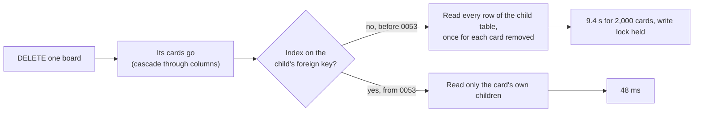

`work_dependencies` holds dependencies between any two pieces of work — card or subtask —
in one polymorphic table, so the planning engine walks a single graph. Polymorphic ids
cannot carry a foreign key, so nothing cascades and the edges are cleared in code. Deleting
a subtask clears its own (`removeWorkNodeEdges`, in the same transaction as the delete). A
permanent delete of a card, a column or a board clears the edges of every card and subtask
that goes with it (`src/lib/server/deletes.ts`). It supersedes `card_dependencies`, which migration 0043 copied
across and left in place. Nothing writes to the old table. One thing still reads it: the
restore, which refills `work_dependencies` from it when a backup predates migration 0043.
The graph view was the other, and now draws its `depends_on` edges from
`work_dependencies`: card-to-card links only, and only where the caller can view the
board of the card that is waited on.

`milestones → cards.milestoneId` is nulled by the delete handler rather than by a foreign
key. The column was added without one (migration 0042), SQLite cannot add a foreign key
to a column that already exists without rebuilding the table, and the behaviour matters — **deleting a goal must never delete the work**. The delete response
reports how many cards were released.

`cards → boards.parentCardId` is a foreign key with `ON DELETE CASCADE`. A sub-board
belongs to the card it was opened from, so permanently deleting a card deletes its
sub-boards, and with them their columns and cards. The delete does not lean on that key
alone: it finds every sub-board under the card, at every depth, and deletes each by its own
statement, because a database whose `boards` table the migration runner had to leave in an
older shape has no such key. Archiving a card is a soft delete and removes nothing.

`boards → categories.boardId` is nullable, with `ON DELETE SET NULL`. A category that
belongs to no board is a shared one, listed to everyone. So the key alone would keep a
deleted board's categories as shared ones, and the delete removes them itself; see
[What a Delete Removes](#what-a-delete-removes). Until 2026-10-14 they were kept.

Not every older database had these two keys in this form. `boards` and `categories` are
among the six tables the migration runner rebuilds in the model's shape at start-up; see
[Reconciliation: The Six Tables](#reconciliation-the-six-tables).

See [Critical-Path Planning](critical-path-planning.md) for how `work_dependencies` and
`milestones` are read to derive the critical path and what is startable.

## What a Delete Removes

Every delete below is one transaction: all of it is removed or none of it. The routine is
`src/lib/server/deletes.ts`, used by both API trees and by the admin panel. How it sits in
a request is in [Architecture](architecture.md#writes-one-transaction-then-the-effects).

### Archive

Archiving a card (`DELETE` on a card without `?permanent=true`, in either API tree) sets
`cards.archived_at` and `updated_at` and writes one `card_archived` activity entry. It
touches nothing else: no subtask, comment, attachment row or file, dependency link or
sub-board. Restoring clears `archived_at` and sets `updated_at`, so the card comes back
whole, and writes one `card_restored` entry on the card's board, with the title as its
detail, as the archive's entry has (card 2108). `restoreCard()` in
`src/lib/server/card-restore.ts` does it for all three routes that restore: the two of the
web application and `PUT /api/v1/cards/:cardId` with `archivedAt: null`, which writes
`api:card_restored`. A card that is not archived is handed back as it is, with nothing
written: the two routes of the web application then tell its board nothing, and the API's
names `archivedAt` in its `api:card_updated` entry, as it did. Until 2026-10-14 a restore
wrote no entry, and the API's was recorded as `api:card_updated`.

Since milestone 22 (card 2461) the archive's one entry says what was archived: an option, in
an upstream column, is **discarded** (`discarded_at` and `discarded_by` stamped with
`archived_at`, `card_discarded`, which sends `card.discarded`); committed work that is not in
a Complete column is **abandoned** (`card_abandoned`, "Archived unfinished card", no field, no
webhook); finished work is `card_archived` as before. A restore clears the discard mark too.
A permanent delete of a live option writes `card_discarded` before `card_deleted`. See
[An archive, a delete and a restore](#an-archive-a-delete-and-a-restore). None of the
wholesale deletes below discards anything (decision M22-9).

### Permanent deletes

A permanent delete starts from a set of cards and takes everything beneath them.

| Delete | Starts from |
|--------|-------------|
| A card, with `?permanent=true` | That card |
| A column | Every card in the column, archived or not, and then the column |
| A board | Every card on the board, and then the board |
| Purge Archived Cards (admin) | Every archived card on every board |
| Clear Cards (admin) | Every card on one board. The board and its columns stay, unless the board is in a loop (below) |

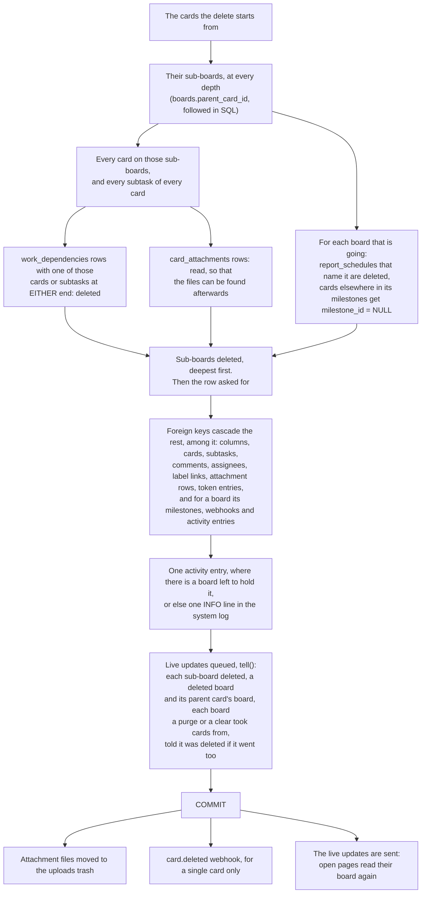

What is removed that no foreign key removes:

- **Dependency links at either end.** A `work_dependencies` row goes when a deleted card or
  subtask is its blocked end or its blocker end. Type and id are matched together, because
  card 7 and subtask 7 are different work. A card left behind that was waiting on a deleted
  card is no longer waiting on it.
- **Sub-boards at every depth.** A sub-board of a card on a sub-board of the deleted card
  goes too, with its cards and their subtasks, links and files. A loop from before card
  2141, a card moved onto its own sub-board, cannot make the query that follows sub-boards
  run round it, and `deepestFirst()` stops on a board it has seen. But a delete that reaches
  any board of a loop takes every board of it and every board below it, because each is
  beneath the others: deleting a board of the loop, the card it hangs from or that card's
  column, Purge Archived Cards while that card is archived, and Clear Cards on a board of
  the loop, which then deletes that board too. `tests/board-tree-loops.test.ts` holds each.
  Where the board a delete would write its activity entry on went with it, one `INFO` line
  in the system log, context `DELETE`, says what went instead: for a card or a column, and
  since card 2142's review for Clear Cards and the purge too, which wrote none. A board that
  Clear Cards or the purge took cards from and that went with them is told
  `{ type: 'board', action: 'deleted' }`, where it was told its cards were cleared or purged.
- **Report schedules for a deleted board.** A `report_schedules` row with `scope = 'board'`
  and that board's id is deleted. This applies to a deleted sub-board as well as to a board
  deleted directly.
- **Milestone membership of cards elsewhere.** A board's milestones are deleted with it by
  cascade. A card on another board that was in one of them is kept, with `milestone_id` set
  to NULL.
- **Card categories of a deleted board.** `categories.board_id` is `ON DELETE SET NULL`,
  which would keep them as categories of no board: shared, and listed to everyone. They are
  deleted with the board, and with every sub-board deleted, whatever was asked for. A card
  elsewhere that carried one has `category_id` set to NULL by its key. Until 2026-10-14
  they were kept.
- **Attachment files.** The rows cascade; the files are moved to the trash after the commit
  and kept for 30 days. See [Architecture](architecture.md#uploads-and-the-trash).

What is left:

- **Dependency links that were already orphaned** before this routine existed. They name
  cards that no longer exist, are hidden from every view, and are not looked for.
- **Earlier activity entries of a deleted card**, where its board remains. They stay on the
  board with `card_id` set to NULL by the key.
- **Everything outside the tree.** The other end of a deleted link is not touched.

What is recorded:

| Delete | Activity entry | Webhook |
|--------|----------------|---------|
| Archive | `card_archived`, with the card's id: from a Complete column. From an upstream column `card_discarded` instead, and from any other column `card_abandoned` (milestone 22, card 2461) | None; `card.discarded` for a discard |
| Restore | `card_restored`, with the card's id, only when the card was archived; `"<title>": back in <column>` for a discard | None |
| Card | `card_deleted`, stored with `card_id` NULL because the card is gone; for a live card in an upstream column, `card_discarded` (also with `card_id` NULL) first | `card.deleted`, whose `data.cardId` is the deleted card's id; `card.discarded` before it for an option |
| Column | `column_deleted` on its board, naming the column and how many cards went | None, for the column or for its cards |
| Purge Archived Cards | `cards_purged` on each board that had any, with the count | None |
| Clear Cards | `cards_cleared` on the board, with the count, if it held any | None |
| Board | None: the entry would be deleted with the board. One `INFO` line in `system_logs`, context `DELETE`, names the board, who deleted it and what went | None |
| Subtask | `subtask_deleted` on its card's board, naming the subtask; through the API too since 2026-10-14 | None |

Entries made through the v1 API are stored with the `api:` prefix (`api:column_deleted`),
like every other action.

Who is told (card 2108). Each delete queues one live `update` for every board it removed or
emptied, through `tell()` in `deletes.ts`, beside its entry, and the event is sent once the
delete is committed, as every `emit` is. The payload says what kind of change it was and
nothing else, because the board of a sub-board's card can be viewed by people who could
never open the sub-board, and a page only reads its board again, under its own access
check:

| Delete | Told | Payload |
|--------|------|---------|
| A card or a column, for good | Each sub-board deleted with it. The route tells the card's or the column's board itself, as it did | `{ type: 'board', action: 'deleted' }` |
| A board | The board and each sub-board deleted with it | `{ type: 'board', action: 'deleted' }` |
| A sub-board, on its own | Also the board of the card it hung from, read before the delete, which is still there | `{ type: 'board', action: 'sub_board_deleted' }` |
| Purge Archived Cards | Each board that had an archived card and is still there, and each sub-board deleted | `{ type: 'card', action: 'purged' }` |
| Purge Archived Cards, a board that had an archived card and went with the purge, as a board in a loop does | That board | `{ type: 'board', action: 'deleted' }` |
| Clear Cards | The board and each sub-board deleted, when the board held any card | `{ type: 'card', action: 'cleared' }` |
| Clear Cards on a board in a loop, which goes with its cards | The board, and each other sub-board deleted is told `cleared` | `{ type: 'board', action: 'deleted' }` |

A board is told once however many reasons it has. `removeUnder()` hands back the ids of the
sub-boards it deleted for this. A page open on a deleted board reads it again and shows
"Board not found". A member's dashboard is not told: the global stream checks the caller
against the board each event is for, and a board that is gone can be viewed by nobody but
an administrator, so the dashboard catches up when it is next brought to the front. Until
2026-10-14 a board delete, a purge and a clear told nobody, and a card or column delete
told only its own board.

### Deleting a user

`deleteUser()` first clears the five columns that name a user through a foreign key with no
`ON DELETE` action, then writes the user's email onto every task request they made, then
deletes the user, in one transaction. While any of the five named a user, the delete used to
be refused by the key. The email is written (card 2171) because a request made signed in is
mailed at its account's email as it is when each mail is sent (`requesterAddress()`): once
the key has set `requester_user_id` to NULL, the request is mailed at `requester_email`, as a
request made without an account is, and without the write that would be the address the
account had when the request was made, perhaps long changed since. Then every webhook the
user set that is on is switched off (`UPDATE webhooks SET active = 0 WHERE set_by = ? AND
active = 1`, card 2168), while it still names them: deleting an account is the strongest way
of taking it back, and once the key has set `set_by` to NULL a webhook an intruder set would
go on sending with nobody named for a reset to reach. Then the mail settings, the App URL and
the backup destinations still where the user set them are removed (`removeSettingsSetBy`, card 2397),
while `setting_setters` still names them: the key would take only those rows, and the settings
would stay in force with nobody named. Those three are the only writes besides the five that
card 2007's rule ("nothing else is written") allows.

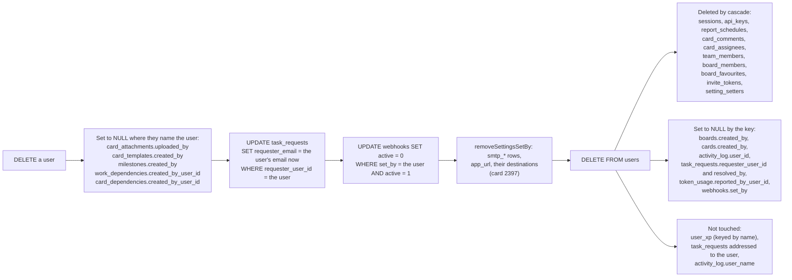

| What | After the user is deleted |
|------|---------------------------|
| Files they uploaded; templates, milestones and dependencies they created | Kept, with nobody named as having made them |
| A template they created, or a milestone of theirs that belongs to no board | Kept. Only an administrator can then delete the template or edit the milestone. A milestone that belongs to a board is still edited by whoever can edit that board |
| Their comments, "Unblocked" notices written in their name among them | Deleted |
| Their API keys and report schedules | Deleted |
| Their sessions, team and board memberships, favourites, invites and card assignments | Deleted |
| Boards and cards they created; activity entries they made | Kept. The link to the user is cleared; an activity entry keeps the name it was written with |
| Task requests addressed to them | Kept, with the same target. Only an administrator can then accept, reject or reply |
| Task requests they made | Kept, with `requester_user_id` NULL and `requester_email` the account's email at the delete, where mail about them goes from then on (card 2171) |
| Webhooks they set (their address or secret last set, or last switched on, by the user) | Kept, switched off, with `set_by` NULL (card 2168). The board's owner or an administrator switches one on again through the API |
| The mail settings, App URL and backup destinations still where they set them (card 2397) | Removed, with a `WARN` under `SMTP` or `BACKUP`; settings somebody else moved since, or moved back to where somebody else put them, or saved before 0059, stay |
| Their XP | Kept. `user_xp` is keyed by username and has no key to `users` |

One `INFO` line in `system_logs`, written after the commit, says who deleted whom, how
many API keys, report schedules and comments went, and how many webhooks were switched off,
naming them by id (`… 1 webhook(s) they set up were switched off (id 4); …`).

### Ids are never reused

Every table with a numeric id declares it `AUTOINCREMENT`, and SQLite keeps each table's
counter in `sqlite_sequence`. No delete, Vacuum or Reset touches those counters, and the
migration runner carries them across a table rebuild. So a new card is never given the id a
deleted card had, and a reference that has no foreign key (a dependency link, a report
schedule's scope, a card's milestone) can never come to point at a different row. An insert
that is rolled back gives its id back; no row was ever committed under it.

## Card Lifecycle

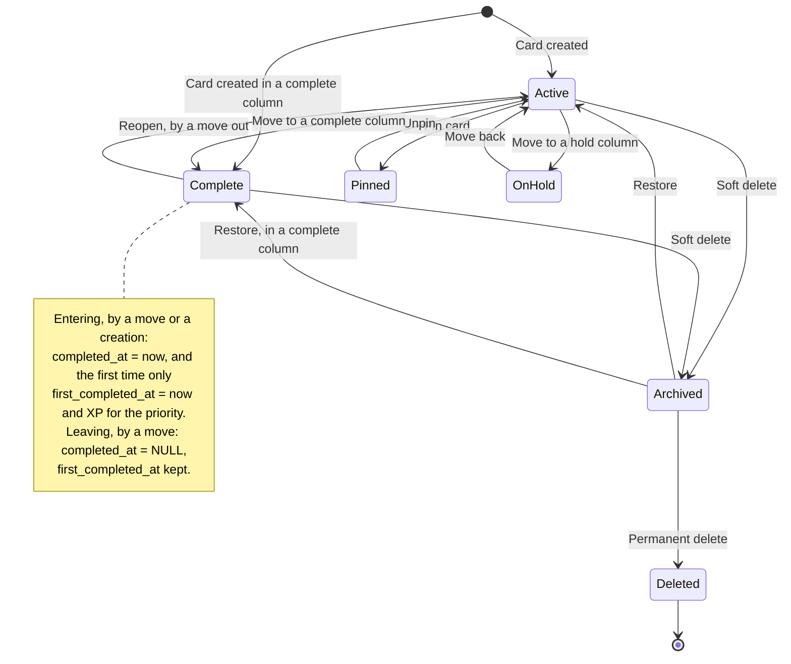

### What a column means

Whether a card is complete or on hold is decided by the title of the column it is
in, and by nothing else. The decision is made in one module, `src/lib/column-role.ts`,
which has no server imports so the browser and the server share it:

| Role | Column titles (case and surrounding space ignored) |
|------|------------------------------------------------------|
| `complete` | Complete, Done |
| `hold` | On Hold, Hold, Blocked, Parked, Waiting |
| `todo` | To Do, Todo (checked after the other two) |
| none | anything else |

The `todo` role (card 2240) changes nothing about a card: no move stamps, clears or
awards anything for it. It says which columns All Tasks puts in its To Do bucket and All
To Do lists, every such column of a board, and which column the board's list view opens
on (the first of them, else the first column that is not the Options column, else the
first). "To-Do", "Backlog" and the like are not
To Do; the reports' own wider list (`src/lib/server/reports.ts`) is separate.

#### The Options column (milestone 22)

One meaning is stored rather than read from the title: `columns.role = 'options'`, the
board's Options column, upstream of the commitment point; and every column of a board whose
`kind` is `'ideas'` is upstream too. `column-role.ts` asks it first:

| Helper | What it answers |
|--------|-----------------|
| `isOptionsColumn(column)` | `role === 'options'` |
| `isUpstreamColumn(column, boardKind)` | the Options column, or any column of an ideas board; both arguments required |
| `columnRoleOf(column)` | `'options'` first, then `columnRole(title)`: an Options column is never also To Do, On Hold or Complete on any page |
| `firstOpenColumn(columns)` | the leftmost column whose `columnRoleOf` is not Complete and that is not the Options column; the Options column only when nothing else is open (decision M22-6). Where a copy of a finished card and a sub-board's parent card go |
| `completeColumnIds`, `holdColumnIds`, `todoColumnIds` | never the Options column |

`src/lib/server/upstream.ts` reads what the rule needs from the database: `UPSTREAM` (the SQL
fragment, with `IS`), `boardKinds(boardIds)` in one query, `upstreamColumnIds(rows)`,
`isUpstreamColumnId(columnId)`, and `commitmentOnCreation`, which every creation route asks.

Every column write in both trees holds the Options column to its rules (`createColumn`,
`updateColumn`, `reorderColumns`, `deleteColumnFor` and `convertColumnFor` in
`src/lib/server/columns.ts`), inside the write's transaction, after every field is read and
after the completion rule below, each refusal `409` with nothing written:

1. `role` is `'options'` or null, read with the column's own as `keep`, so an update that
   leaves it out keeps it; anything else is `400 role must be "options" or null, not
   "<what was sent>"`.
2. No Options column on an ideas board; no second Options column on a board.
3. The role is given or taken away with a plain update only while the column is empty,
   archived cards included. A column that holds cards becomes the Options column by the
   conversion (below); the role comes off only once the column is empty.
4. No Options column whose title means To Do, On Hold or Complete, whether the role is
   given or the Options column renamed (ruling x): about thirty places still ask the title
   alone.
5. No WIP limit above 0 on the Options column.
6. The Options column stays the leftmost. Given the role, a column moves to one less than the
   lowest position of the others and its `wip_limit` goes to 0, whatever was sent; any other
   column placed at or left of it, by a create, an update or a reorder, is refused, and so is
   the Options column moved to or past another. A column made on the board page with no
   position goes straight after the Options column, half way to the next; when halving has
   left no number strictly between the two (about 53 such creates), the board's columns are
   numbered again 0, 1, 2… in their order, in the same transaction, first (`renumberColumns`).
   Through v1 it still goes after the last.
7. The Options column is not deleted while it holds a card that is not archived (ruling m):
   `This Options column still holds N options: move them out, or archive them to discard them,
   first.` (`1 option: move it out, or archive it to discard it, first.`). Its archived cards
   go with it, as any column's, and are not discarded by it (decision M22-9).

**The conversion** (`POST /api/columns/:id/convert`, `POST /api/v1/columns/:columnId/convert`,
ruling i) makes a column holding cards the Options column. Only the board's owner or an
administrator may. The body carries `role: 'options'` and `cards`, the number of live and
archived cards the page's question named; another number now is refused. It is also refused
on an ideas board, on a board that has an Options column, for a column whose title means To
Do, On Hold or Complete, and for a column holding a card with a sub-board. One transaction
clears `committed_at` and `committed_by` on every card in the column, archived ones included,
gives the column the role, moves it leftmost and sets `wip_limit` to 0, and writes one
`column_converted_to_options` entry (`"<title>": N cards became options (column <id>)`): no
entry, webhook or mail for any card, and one `update (column)` event to the board. The
activity log has no column of its own for a column, so the entry names it at the end of its
detail (`conversionSuffix` in `upstream.ts`), after the quoted title, where no title can put
it: the board's contents read an option's age from the latest of its creation, its latest
`card_returned_to_options` entry and its column's latest conversion (`optionsSince`), so a
converted card is an option from the conversion, not from its creation.

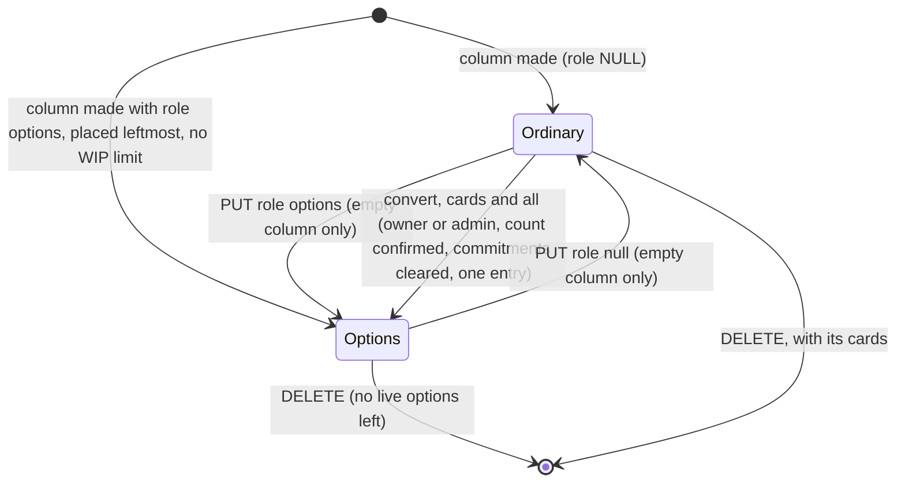

Until October 2026 this was worked out wherever it was needed — about twenty places
with three different word lists. The browser accepted only "complete" where the
server also accepted "done", and the dashboard counted "Waiting" as on hold where
the reports did not, so the same card could be complete on one screen and in
progress on another. Nothing may compare a column title to a word list now; ask
`columnRole()`, `isCompleteColumnTitle()`, `isHoldColumnTitle()`,
`isTodoColumnTitle()`, `completeColumnIds()`, `holdColumnIds()` or `todoColumnIds()`.

The `hold` role also decides what a move does to the card's `on_hold_note`. A move
from a `hold` column to one that is not clears it to `''`, in the same `UPDATE` as the
change of column, inside `moveCard` in `src/lib/server/card-moves.ts`, so every route
that moves a card does it, and a move that is refused leaves the note as it was. A
move into a `hold` column, between two of them, or between two working columns keeps
the note. The move's own activity entry is the record; nothing else is written for it
(card 2208). Until 15 October 2026 only a drag on the board page cleared the note,
with a second request. A column renamed out of the `hold` role leaves its cards' notes
as they are, since nothing moves.

#### A rename that would change what its cards mean

Because the title decides, renaming a column can finish or reopen every card in it at once,
with no completion date, no XP and no entry: "Review" renamed "Done" made cards finished
that nobody finished, and "Done" renamed "Completed", which is not a Complete title, turned
finished work back into open work on every screen while each card kept its `completed_at`.
So a rename that changes whether the column is a Complete column is refused, `409`, while
the column holds any card, archived ones included, because a restore puts them back in it
(card 2134). An empty column is renamed freely, and so is one whose new title keeps its
role: Complete to Done, To Do to Backlog. Every completion and reopening still goes through
a move, with its check for open subtasks, its XP and its entries.

`completionRoleRefusal(column, storedTitle)` in `src/lib/server/card-completion.ts` decides,
and both routes that write a title call it, `PUT /api/columns/:id` and
`PUT /api/v1/columns/:columnId`. Each calls it after the `UPDATE ... RETURNING`, on the
title as stored, inside the transaction that wrote it, so a refusal rolls the write back,
and no card can be moved in or created between the count and the write.

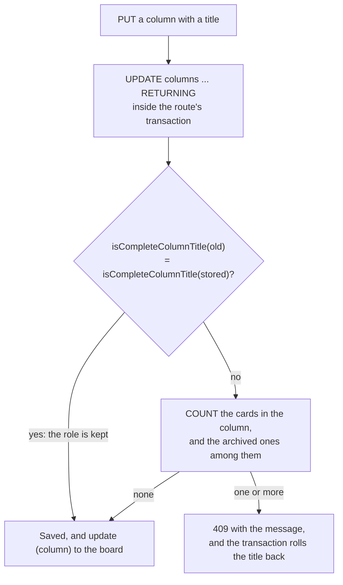

The message counts the cards: `1 card`, `1 card, which is archived`, `3 cards`,
`3 cards, all of them archived` or `3 cards, 1 of them archived`. Out of a Complete column
it reads `This column holds 3 cards, 1 of them archived. They count as finished because the
column is called Complete or Done, and renaming it to "Shipped" would turn them back into
open work. Keep it called Complete or Done.`; into one, `This column holds 1 card.
Renaming it to "Done" would mark it finished without anyone finishing it. Move each
finished card to a Complete column and the rest out of this one first, or choose another
name.` A Complete or Done column that holds any card, archived or not, can therefore be
renamed only to Complete or Done. The board page says the refusal in the server's words and
keeps the old title.

### One completion, however a card arrives

A card comes to be in a Complete column by a move or by being created in one; a rename can
no longer put it there (above). Both ways stamp, score and announce it by the same rule,
written once in `src/lib/server/card-moves.ts`:

| Function | What it does |
|----------|--------------|
| `completionOf(card, now)` | The stamp and the XP due, writing nothing: `completedAt` is `now`; a card never completed before also gets `firstCompletedAt` and the XP for its priority (low 50, medium 100, high 150, critical 200) |
| `awardXp(actor, xp)` | Adds the XP to the actor's `user_xp` row, inside the caller's transaction. Nothing for 0 |
| `celebrateCompletions(boardId, completions, actor)` | `xp-update` when any XP was given, then one `celebrate` naming the last card completed and the XP for all of them. Each `emit` waits for the commit |

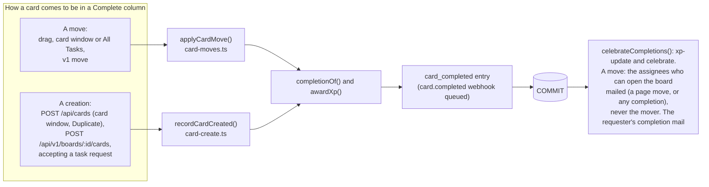

#### A move

A card changes column by one of three routes — a drag (`PUT /api/cards/reorder`),
the All Tasks page or the card modal (`PUT /api/cards/:id` with a `columnId`), and
the API (`PUT /api/v1/cards/:id/move`). All three call the same three functions in
`src/lib/server/card-moves.ts`, in the same order and inside one transaction, so a move
means the same thing however it is made.

The drag is the one that names many cards. The board page's drop sends every card that is
not archived of the column dropped into and of the column the card came from (an archived
card is not on the page, so it is never sent), with its column and position,
not only the card it moved, so that both columns are numbered from 0 with no gap (card
2213; it sent every card of the board, from both columns' drop events); a bulk move of
selected cards sends those cards. So the reorder is held to
two caps (card 2209), `MAX_REORDER_ENTRIES = 5000` and `MAX_CARDS_MOVED_AT_ONCE = 100` in
`card-moves.ts`:

- **At most 5,000 entries**, checked as soon as `updates` is read, before any card is read.
  It sits far above any real drop, which names the cards of two columns.
  `400` `A reorder can name at most 5,000 cards, and this names 5,001. Nothing was moved.`
- **Each card once**, checked next, from the entries' ids alone, before any card is read
  (the review of card 2209). `400` `updates names card 12 more than once`. A card named
  over and over, to and fro between two columns, was counted against the next cap only for
  the entries to a column other than the one it was in before the request, and each entry
  was a real move: 200 entries made 200 moves. The page never names a card twice.
- **At most 100 of them moving a card to another column**, counted from the column each
  card is in when the request reads it, and checked once every entry's card and column has
  been read and the caller found able to edit them, after "A reorder must stay within one
  board" and the positions, immediately before the first move. Each card moved is an
  activity entry, a delivery to each of the board's webhooks and mail, where a changed
  position is one write. `400` `At most 100 cards can be moved to another column at once,
  and this moves 101. Nothing was moved: move them in groups of 100 or fewer.`

Each refuses the whole request, with nothing written or sent. On the board page only a
bulk move of more than 100 selected cards meets the second, and the page says so in an
error toast and keeps the selection; a drop, Move to and the On Hold confirmation each move
one card.

| Function | What it does | When |
|----------|--------------|------|
| `applyCardMove()` | Changes the database and nothing else: the card, the XP, the activity entry | Once for each card moved |
| `recordUnblockedByMoves()` | Writes the "Unblocked" notice on every card that the completed cards were the last open blocker of. One notice for each piece of work unblocked, however many of its blockers the request completed, naming the last of them to be completed in it | Once, after the last move, as the last write of the transaction |
| `announceCardMoves()` | Queues what people are told: the live updates, the celebration, the emails to assignees and to whoever requested the work, and the "you are no longer blocked" mail for the notices. Assignees are mailed "Card moved" for every move made on a page and for a completion by any route, never the one who made the move; a plain move through the API mails nobody (card 2134). Only the assignees who can open the board the card is on after the move are mailed (card 2180; see [Notifications & Email](notifications-email.md#email-types)) | Called inside the transaction; nothing it queues is sent before the commit, or at all after a rollback |

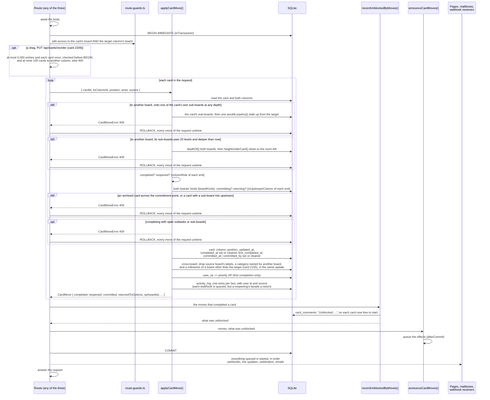

`applyCardMove()` opens its own `inTransaction`, which inside the route's transaction is a
savepoint. A drop of several cards is therefore one transaction: if the last card cannot be
completed, the earlier ones are rolled back with it and nothing is announced for any of them.
A failure to write an "Unblocked" notice fails the move it belongs to in the same way.

The check for open subtasks and sub-boards is `getCompletionBlocker(cardId, viewer)` in
`src/lib/server/card-completion.ts`, and `moveCard` passes the actor as the viewer (card
2151). Subtasks are the card's own and keep their message. Of the unfinished sub-boards, the
first the viewer can open is named, as before (`Sub-board "<name>" has 1 incomplete card that
must be completed first`); when the only unfinished ones are sub-boards the viewer cannot
open, the refusal is `409` `A sub-board you cannot open still has incomplete cards that must
be completed first. Ask this board's owner.`, with no name and no count. A sub-board holds its card back while it has a card that
is not archived and not in a Complete column; an archived card is not live work and holds
nothing back (card 2205). It reads each sub-board's figures from `subBoardProgress(boardIds)`
beside it, one query giving `{ done, total }` for every board asked: `total` the cards on
the board's own columns that are not archived, `done` those of them in a Complete column, and
0 of 0 for a board with no columns or no cards. The board page, the card context, the
dashboard's tiles and `hiddenOpenCountsFor()` (the open cards on the sub-boards a caller
cannot open) read the same helper, so every page shows the figures the server refuses a
completion on. A card already complete stays complete when an archived card under it is
restored, as it does when a card is added to its sub-board. `completionRoleRefusal()`, which
refuses a column rename that changes its role, still counts archived cards: a restore would
put them back in the column.

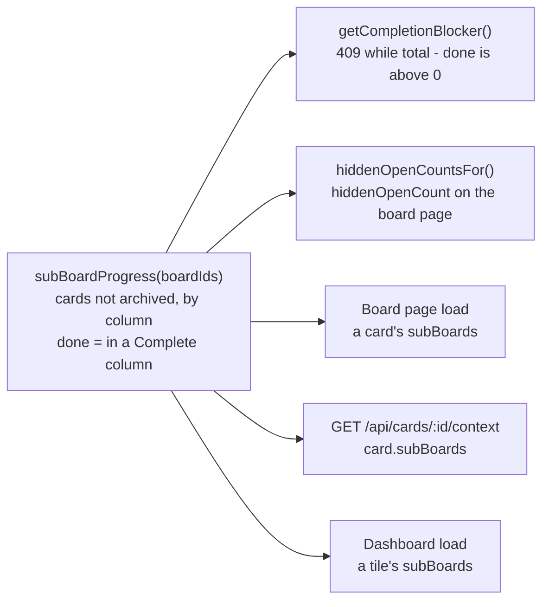

A card's sub-boards go with it, so a move to another board is refused, `409`
`Card "<title>" cannot go onto "<board>", which hangs beneath it`, when the target board is
one of them or beneath one, at any depth (card 2141). `refuseLoop()` reads the boards that
hang from the card and asks `wouldLoopAny()` of `src/lib/server/sub-boards.ts` about all of
them at once: one walk up from the target board, with the query that refuses linking a
board under a card on itself or beneath it (`wouldLoop()`, card 2139), however many
sub-boards the card has. Asking `wouldLoop()` of each sub-board in turn walked up from the
same board once for each, and a card with thousands of sub-boards moved onto a board
thousands deep held the server for seconds (card 2141's review). It comes before the
completion check, so a move that would make a loop is refused whatever else it would do. A
move within one board cannot change the tree and is not asked.

Then, for the same move to another board, `refuseTooDeep()` asks whether the card's
sub-boards would be nested deeper than the limit of 20, and deeper than they are now (card
2172): `409` `Card "<title>" cannot go onto "<board>": its sub-boards would then be nested
more than 20 levels deep.` It reuses the read of the card's sub-boards, so a card with none
costs nothing more and is never refused. Otherwise `moveTooDeep()` compares `depthOf()` of
the two boards, and only when the target is the deeper one counts the levels the card
carries, with `heightUnderCard()` stopped at the room the target leaves. A move that lifts a
tree, or leaves it no deeper, is allowed, which is how a tree already too deep is put right.

A move to another board also takes the card out of its milestone when the milestone belongs
to a board other than the one it arrives on (card 2155): beside the category rule, the
milestone is read and `milestoneId` set to null in the same `UPDATE` of the card, so the move
makes no extra write, and every move route has the rule. A goal across boards (no
`board_id`) keeps its cards, and a card already in a milestone of the board it arrives on
keeps it. `CardMove.leftMilestone` is `{ id, name, ofSourceBoard }` or null, and the source
board's `card_moved_away` entry ends `and out of milestone "M"` for a milestone of the board
it left, or `and out of a milestone of another board` for a third board's (one restored from
an older backup); `card_moved_in` does not mention it. Both API trees answer the moved card
with `milestoneId: null`, and `PUT /api/cards/:id` and `PUT /api/v1/cards/:id/move` add
`leftMilestone`, `leftMilestoneOf(move)`: `{ id, name }` for a milestone of the board it
left, which the mover can read as an editor of that board, and null otherwise, a third
board's included (the review's O3). All Tasks shows it as a toast. Migration `0057` took out, once, the cards that were already in a
milestone of another board, and since card 2179 the start-up backfill repeats the same
statement at every start and after every restore (step 5 below); see
[Deployment](deployment.md).

`PUT /api/cards/:id` can carry other fields beside the move. The move, the update of those
fields and the `card_updated` entry are one transaction.

| Field | Set when | Cleared when |
|-------|----------|--------------|
| `completed_at` | the card enters a complete column from a column that is not one, or is created in one | it leaves for a column that is not one |
| `first_completed_at` | the first time `completed_at` is ever set (backfilled from `completed_at` by migration 0050) | never |

`first_completed_at` exists because `completed_at` used to do two jobs. It was
never cleared, so as well as "when was this finished" it answered "has this card
been completed before", which is what stops XP being awarded again for dragging a
card out of Complete and back in. A reopened card is not complete, so
`completed_at` is now cleared, and the second job has a column of its own.

The activity entry is `card_completed`, `card_reopened` or `card_moved`; a move
to another board also writes `card_moved_away` on the board it left and
`card_moved_in` on the one it joined. Neither names the other board (card 2181):
`"T" moved to another board (To Do → Done)` and `"T" moved from another board
(To Do → Done)`. An entry is stored once and read by everyone who can open its board,
so a name in it cannot be kept from a reader who cannot open the other board. The pair
still records both boards, one entry on each, and the board history
(`getCardBoardHistory`) reads the boards from `board_id`, never from the text. Entries
written before card 2181 still name the other board, and are left as they are. Entries made through the API are stored with
an `api:` prefix, so a query must match both spellings — use `storedActions()`
from `logActivity.ts`. Board cycle time and `/api/v1/me/stats` compared against
the bare name and so ignored everything done through the API.

**Across the commitment point** (milestone 22, card 2460, slice S2), `moveCard` asks
`isUpstreamColumn` of both ends, with both boards' kinds read in one query:

| The move | `committed_at` / `committed_by` | Entries, on the board the card is on now | Webhooks |
|---|---|---|---|
| Upstream (the Options column, any column of an ideas board) to a committed column | the moment of the move / the mover | `card_committed`, `"<title>": <from> → <to> (column <id>)`, in place of `card_moved` | `card.committed` |
| … into a Complete column | as above, equal to `completed_at` | `card_committed`, then `card_completed` | `card.committed`, then `card.completed` |
| A committed column to an upstream one | both NULL | `card_returned_to_options`, in place of `card_moved` | `card.moved` |
| … from a Complete column | both NULL, and `completed_at` | `card_reopened`, then `card_returned_to_options` | one `card.moved`, from the return (ruling q: `webhook: false` on the reopening) |
| Within upstream, or between committed columns | left as they were | as before | as before |

A move to another board writes `card_moved_away` and `card_moved_in` first, as always, then
the commitment entry on the board it joined. The commitment entry names the column the card
went into twice: by its title in the route and by its id at the end of its detail,
`(column <id>)`, the same suffix a conversion's entry ends with (`conversionSuffix` in
`upstream.ts`), so the cycle time reads the column by its id, not by its title (ruling a; the
S2 review's C3). It is not a `card_moved`, so the first `card_moved` after it is still the
start of work. Two moves are refused, 409, with nothing written: an archived card across the
commitment point, either way (`Card "<title>" is archived: restore it before moving it out of
or back into Options`, ruling n), and a committed card with a sub-board into an upstream column
(`Card "<title>" has a sub-board, so it cannot go into the Options column: a card with
sub-boards is committed work. Keep it in a committed column, or archive it if it is no longer
wanted.`, or `onto an ideas board`, ruling o). A card already upstream with a sub-board, made
before S5 refuses one there, may still move within upstream and out of it (the S2 review's
C1). Both are asked after the loop and depth refusals, which read the card's sub-boards once
for all three, and before the check for open subtasks.

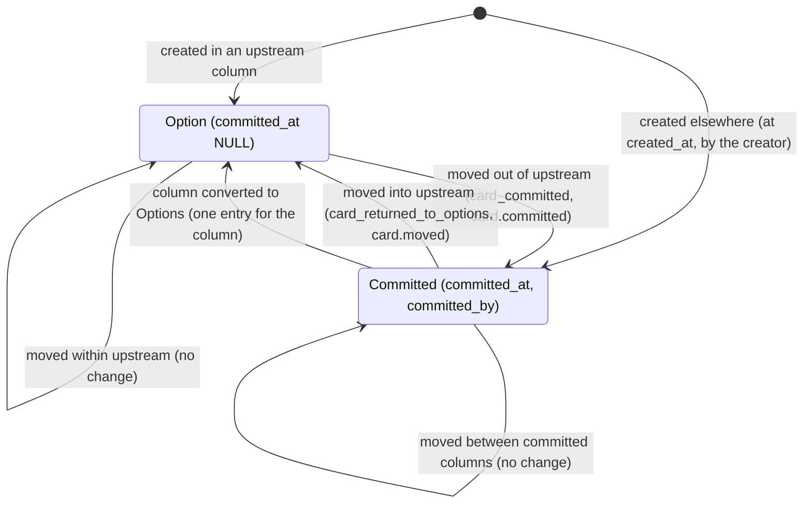

#### An archive, a delete and a restore

Every archive goes through `archiveCard` and every permanent delete of one card through
`deleteCard` (`src/lib/server/deletes.ts`); every restore through `restoreCard`
(`src/lib/server/card-restore.ts`). The routes: `DELETE /api/cards/:id` (the card window and
the card menu on a board, the card window in All Tasks and in All To Do, the board page's bulk
archive, which sends one card at a time) and `DELETE
/api/v1/cards/:cardId`, each with `?permanent=true` for a delete; `POST /api/cards/:id/restore`
(All Tasks, the Archived page), `POST /api/boards/:id/archive` (the board's Archived Cards) and
`PUT /api/v1/cards/:cardId` with `archivedAt: null`. Since milestone 22 (card 2461, slice S3)
what the card's column is decides the record, one entry per act:

| The act | Card fields | Entry, on the card's board | Webhook |
|---|---|---|---|
| Archive from an upstream column (the Options column, any column of an ideas board): a **discard** | `archived_at`, `discarded_at` = now, `discarded_by` = the archiver, in one `UPDATE` | `card_discarded`, `"<title>": discarded from <column>`, in place of `card_archived` | `card.discarded` |
| Archive from a committed column that is not Complete: **abandoned** work (ruling f) | `archived_at` alone: no marker column (decision M22-21) | `card_abandoned`, labelled "Archived unfinished card", `"<title>": archived unfinished, from <column>`, in place of `card_archived` (the S3 review's E5). A final column not titled Complete or Done (Released, Shipped) reads as unfinished | none |
| Archive from a Complete column | `archived_at` | `card_archived`, `"<title>"`, as before | none |
| Archive of a card already archived | nothing (card 2285) | none | none |
| Delete of a live card (not archived) in an upstream column | the row goes | `card_discarded`, `"<title>": deleted from <column>`, then `card_deleted`, both with `card_id` NULL | `card.discarded`, then `card.deleted`, each naming the card |
| Delete of anything else, any archived card included (a discarded one, or one archived as committed work before its column was converted to Options: it had left play, the S3 review's E2) | the row goes | `card_deleted` alone | `card.deleted` |
| Restore | `archived_at`, `discarded_at` and `discarded_by` NULL | `card_restored`, `"<title>"`, or `"<title>": back in <column>` for a discard | none |

A restored discard is back in its column, still upstream and uncommitted; its
`card_discarded` entry stays, since the discard happened, and `upstreamFigures` still counts
it in its window (decision M22-10, ruling c). Deleting a column or a board, Clear Board and
Purge Archived discard nothing (decision M22-9): housekeeping, with no entry for each card.

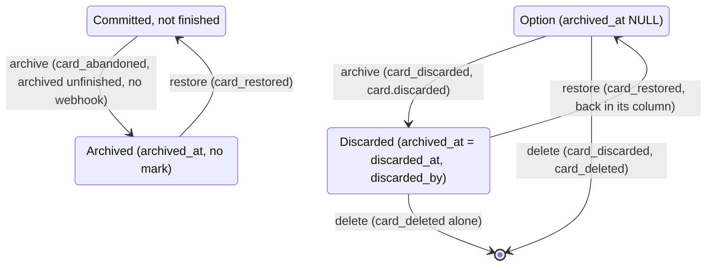

**The upstream figures** (`upstreamFigures(boardIds, from, to)` in
`src/lib/server/upstream.ts`, read by the measures, reports and API of later slices) are
counted from the activity log over a window, the boards named and no others. **Both ends of
the window are included**, as in `reports.ts`: a bare date as the end is the whole of that
day, and a caller passing a moment passes the end of the day it means (the S3 review's E4).
The figures take four reads, however many boards and columns (E3):

| Figure | What it counts |
|---|---|
| `options` | Live cards in an upstream column of the boards, now |
| `committedFromOptions`, `returnedToOptions`, `discarded`, `sentOn` | Distinct cards whose **last** upstream act in the window was `card_committed`, `card_returned_to_options`, `card_discarded` or `card_sent`, both spellings (ruling c). Entries with no card id (a deleted card's) each count once. A `card_sent` whose `card_moved_in` (same card, same moment) is on a board in scope is dropped (ruling b) |
| `abandoned` | Distinct cards with a `card_abandoned` in the window, counted on their own: abandonment is downstream, so a card committed and then abandoned counts as committed and as abandoned (the S3 review's E1) |
| `discardRate` | `discarded / (discarded + committedFromOptions + sentOn)`, null when that is 0. Abandoned work is not in it |
| `oldestOptionDays`, `agingOptions` | The oldest option's age in whole days, and how many are older than 30 days. An option's age runs from the latest of its creation, its latest `card_returned_to_options` and the latest conversion of its column (the rule of `optionsSince`, the S1b review's B2, read here for every column at once: one read of the returns, one of the conversions), as the Options strip counts it |

The browser does not write activity entries. It used to write a second one for
every create, move, completion and delete, with no user id; `POST /api/activity`
has been removed.

#### A creation

A card is created by `POST /api/cards` (the card window, the board page's Duplicate, and
the parent card the dashboard makes for a new sub-board), by `POST /api/v1/boards/:boardId/cards`, and by accepting a task request
(`PATCH /api/requests/:id`). Each inserts its row and then, inside the same transaction,
calls the two functions of `src/lib/server/card-create.ts` (card 2134):

| Function | What it does |
|----------|--------------|
| `recordCardCreated({ card, column, actor, source })` | A savepoint of the route's transaction. Writes `card_created`, with the title as its detail, by the actor and from the route's source. In a Complete column it also completes the card by the move's rule: the stamp from `completionOf()` in one `UPDATE`, `awardXp()`, and a `card_completed` entry, `"<title>": created in <column>`. Returns the card as written, its board, whether it was completed and the XP given |
| `announceCardCreated(creation, actor, baseUrl)` | Queues, for after the commit, the live `update` with `action: 'created'` to the board; for a completion, `celebrateCompletions()` and the requester's "Your request is complete" mail, which goes only when the card is the one an accepted request made |

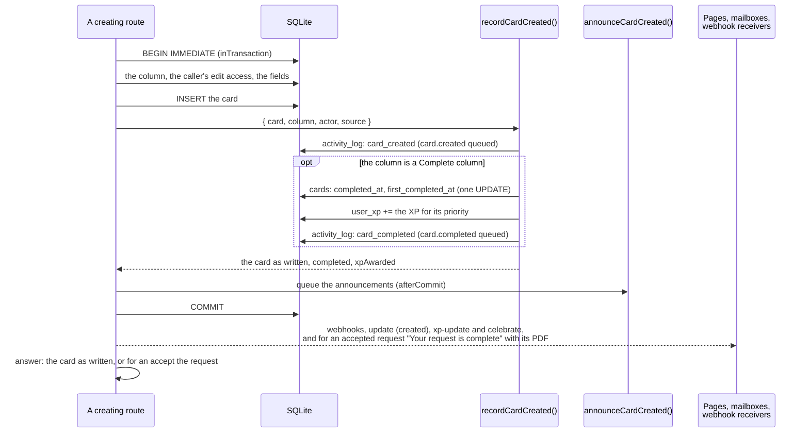

A creation is not a move:

- **No check for open subtasks or sub-boards**: a card that did not exist has neither.
- **No "Card moved" mail and no "Unblocked" notice**: nothing moved, and nothing can have
  been waiting on a card that did not exist (ids are never reused).
- **Subtasks typed in the card window are added after the card**, open. A card created in a
  Complete column with subtasks typed in the window is completed and then has open
  subtasks, which is the state a subtask added to any finished card leaves. It is allowed.
- **Accepting a request records what the other two record**: the `card_created` entry by
  the accepter, source `ui`, the live update, and the accepter as `created_by`. It recorded
  none of them. Accepted into a Complete column, the requester is mailed "Request accepted"
  and then, unless the requester is the accepter, "Your request is complete" with its PDF.
- **Duplicate on the board page makes a new piece of work.** `columnForCopy()` in
  `src/lib/board/card-actions.ts` makes the copy of a card in a Complete column at the end of
  the board's first column, by position, that is not one, where it is open. On a board with
  no such column the copy is made beside the original, where it is completed. A copy of a
  card in any other column is made beside it, as before.
- **The dashboard's new sub-board puts the card it makes for it in an open column.** With no
  parent card chosen, the dashboard's inline sub-board creates one named after the sub-board
  in the first column, by position, that is not a Complete column (`firstOpenColumn()` in
  `src/lib/column-role.ts`, which `columnForCopy()` uses too), and in the first column only
  when every column is one. It used to take the first column whatever it was, so on a board
  whose first column was Complete or Done the card was completed as it was made.

Until 2026-10-14 a card created in a Complete column had no `completed_at`, no XP and no
`card_completed` entry, so velocity, the dashboard's week and month figures, board metrics,
personal stats and the activity report missed it, while the burndown and the board report
counted it as done on its last update. Cards left that way before are not backfilled.
Velocity, the dashboard's figures, board metrics, personal stats and the management activity
report (`GET /api/v1/reports/activity`, which the reports for senior management are made
from; see [Management Activity Reporting](management-reporting.md)) now count a card created
in a Complete column as completed when it was created, and board metrics give it a lead time
of about zero.

## Key Schema Notes

- **Every timestamp is stored in one form: `YYYY-MM-DD HH:MM:SS`, in UTC, to the whole
  second** (card 2095). It is what SQLite's `datetime('now')` writes, which 22 columns take
  as their default. Text orders moments only when both sides are in one form: a space
  (`0x20`) sorts before `T` (`0x54`), so `'2026-09-14 09:00:00' < '2026-09-14T00:00:00.000Z'`
  was **true** while some columns held ISO 8601, and a date filter gained or lost a whole
  day at the end of a window. Now every comparison is between stored values, or between a
  stored value and a bound made in the same form.
  - **The naming rule.** A column whose name ends in `_at`, and `system_logs.timestamp`, is
    a moment in the stored form; one ending in `_date` (and `daily_snapshots.date`) is a day,
    `YYYY-MM-DD`, never compared with a moment. `schema.ts` says so in its header.
    `timestampColumns(database)` in `src/lib/server/db/timestamps.ts` finds every such
    TEXT column by the rule (37 on the model), leaving out SQLite's own tables,
    `__drizzle_migrations` and `__new_*` leftovers of a rebuild.
  - **A wall-clock time is not a moment** (card 2159). `report_schedules.time_of_day` is
    `HH:MM` on a clock, and `report_schedules.time_zone` the IANA zone it is read in
    (`Europe/London`; migration `0058`, `NOT NULL DEFAULT 'UTC'`, which every schedule made
    before it was given). Neither ends in `_at`, so the conversion leaves both alone; a
    schedule's `next_run_at` and `last_run_at` are moments in the stored form like any
    other. `nextRunAfter` in `src/lib/report-schedule-time.ts` turns the pair into the next
    moment, afresh from now each time, so a weekly run stays on its wall-clock time across a
    clock change. `schema.ts` says so in its header.
  - **One helper writes and reads them**, `src/lib/timestamps.ts`, used by the server and
    the pages alike: `stamp(date)` gives the stored form, and every write from JavaScript
    goes through it; `toStamp(input, edge)` reads what a caller sends (the stored form,
    ISO 8601 with or without a fraction, `Z` or an offset, or a date, which is 00:00:00 as
    a lower bound and 23:59:59 as an upper one) and gives `null` for anything else;
    `parseStamp(value)` gives the `Date` a stored value names, read as UTC, and every page
    and report parses through it; `toIso(value)` gives ISO 8601 with `Z`.
  - **What is answered.** The v1 API turns every stored moment into ISO 8601 with `Z` as it
    answers (`onTheWire`, `src/lib/server/v1-json.ts`), because the stored form names no
    zone and most readers take it as their own. The web application's routes, its pages'
    data and the CSV exports answer the stored form.
  - **Kept one form.** At every start, after the backfills, and after every restore,
    `normaliseTimestamps()` converts any value in a shape it reads (ISO 8601 with `T`, the
    stored form with a fraction or a zone, the stored form to the minute with no seconds,
    a bare date) with SQLite's
    `strftime('%Y-%m-%d %H:%M:%S', value)`, in one immediate transaction, and only where
    `toStamp` reads the value as that same moment; a value it cannot read is left as it is
    and reported at every start. SQLite and the helper read a value by one rule: the
    conversion gives its connection two functions from `src/lib/timestamps.ts`,
    `stamp_of(v)` (`toStamp`) and `is_stamp(v)` (`isStamp`: a real moment in the stored
    form). A GLOB sees only the shape and `strftime` reads `2026-02-30` as 2 March and keeps
    an hour of 24, so `2026-02-30`, `2026-10-14T24:00:00` and `9999-99-99 99:99:99` are
    reported, never converted to another moment or passed as stored. Calling the function
    costs about a microsecond a value at every start (600,000 values in 0.53 s, in memory,
    against 0.07 s for the GLOB alone). A restore copies a backup's values
    verbatim, so an older backup brings the other form back, and this is what puts it
    right. See [Migrations and Schema Reconciliation](#migrations-and-schema-reconciliation).
    The test suite checks after every test that every such column holds a real moment in the
    stored form, by the same `is_stamp`, or NULL (`tests/helpers/timestamps.ts`).
  - **An expiry is read as the moment it names.** A session's, an API key's and an invite's
    expiry is read with `toStamp` before it is compared with now, and one that names no
    moment counts as passed: compared as text, `zzz` sorted after every stamp and never
    expired (the review of cards 2095, 2106 and 2107, item S2).

  ```mermaid
  flowchart LR
      Code["A write from code"] -->|"stamp()"| Store[("Every *_at column,<br/>system_logs.timestamp")]
      Default["datetime('now') default"] --> Store
      Restore["A restore, copied verbatim"] --> Store
      Start["Every start, every restore"] -->|"normaliseTimestamps"| Store
      Caller["A bound a caller sends"] -->|"toStamp, or 400"| Bound["Stored form"]
      Bound -->|"compared as text"| Store
      Store -->|"parseStamp, as UTC"| Pages["Pages and reports"]
      Store -->|"onTheWire, ISO 8601 with Z"| V1["v1 answers"]
  ```
- **Indexes are named `idx_<table>_<column>`**, and an index on two columns
  `idx_<table>_<first>_<second>`. Migration 0053 added 39, one for every foreign key column
  that led no index (card 2106); 0056 created `idx_webhooks_set_by` with its column, 0059
  `idx_setting_setters_user_id` with its table (card 2397), and 0060 `idx_cards_committed_by`
  and `idx_cards_discarded_by` with their columns (milestone 22).
  `tests/migrations.test.ts` fails on a foreign key column
  that leads no index, in the model, on a new database and on the production fixture taken
  through the runner, and names it.
- **A person's log entries are indexed by person and time** (migration 0054, the review of
  the three cards). 0053 indexed `activity_log.user_id` alone, and SQLite then answered
  "this person's newest entries" by finding all of them and sorting them. 0054 dropped it
  for `idx_activity_log_user_id_created_at` on (`user_id`, `created_at`): the audit routes
  filtered by a person (`/api/audit`, `/api/v1/audit-log`) read the newest entries straight
  from it and stop at the page, and `/api/v1/me/stats` reads only the days it counts.
  `card_comments.user_id` keeps its index on that column alone: the one query by a person is
  the count when an account is deleted, and comments are listed by card.
  An index that leads with the person is the wrong one where each card's own entries are
  wanted, so those queries ask for the person as `+user_id`, which no index serves: the
  activity report filtered by a person (`activity-report.ts`, `+al2.user_id` and
  `+cc2.user_id`), which otherwise read every entry of the person's once for each card
  (4,215 ms against 9 ms on 2,000 cards and 60,000 entries), and a person's recent activity
  (`recentActivityFor`, `list-access.ts`), which walks the index of time. The audit routes
  ask `+user_id` too when a board or a card is filtered as well (`boardId` on both,
  `cardId` on `/api/v1/audit-log`), so that board's or card's own index serves the page and
  its total: asked plainly, SQLite took the composite for its order and read every entry of
  the person's to find the few on that board or card (the second review of the three).
  `tests/migrations.test.ts` asserts each of these plans.

  ```mermaid
  flowchart LR
      Audit["Audit routes, me/stats:<br/>one person, newest first"] -->|"user_id = ?"| Composite[("idx_activity_log_user_id_created_at")]
      Report["Activity report:<br/>an entry by this person on this card"] -->|"card_id = ? and +user_id = ?"| Card[("idx_activity_log_card")]
      AuditCard["Audit routes:<br/>one person on one card"] -->|"card_id = ? and +user_id = ?"| Card
      AuditBoard["Audit routes:<br/>one person on one board"] -->|"board_id = ? and +user_id = ?"| Board[("idx_activity_log_board_created")]
      Recent["recentActivityFor:<br/>newest on the boards they open"] -->|"+user_id = ? and +board_id"| Time[("idx_activity_log_created_at")]
  ```
- **Task request status** is `unverified`, `pending`, `accepted` or `rejected`. A request
  from someone without an account starts `unverified` and is hidden from the inbox until
  the requester confirms it; see
  [Authentication & Security](authentication-security.md#the-public-request-form).
  `task_requests.access_token` is the secret in the requester's link (migration `0051`,
  unique index) and is never returned by an API response. It is written when a request is
  made and changes only in two ways (card 2158): migration `0055` replaced every request's
  once, and every restore gives every request a new one inside its transaction, whatever
  the backup holds. A backup holds it as `NULL` (the unique index takes any number of
  NULLs); the start's backfill gives a token to any row without one, so a backup put in
  place by hand, or restored by an older image, has them filled in. The key the request
  form signs its tokens with, the `request_form_secret` row of `settings`, is in no backup
  and never restored: a new one is made at first use.
- **`task_requests.requester_email` is where a request made without an account is mailed.**
  It is written when any request is made: the address given on the form, or for a request
  made while signed in the account's email at that moment. For a request with
  `requester_user_id` set it is no longer read for mail (card 2171): every mail to the
  requester, and the address the inbox and `GET /api/requests/[id]` show, is
  `requesterAddress()` in `src/lib/server/request-access.ts`, the account's `users.email` as
  it is when the mail is sent, or no address (nothing sent) when the account named is not
  there. `deleteUser()` writes the account's email into it before the account's row goes, so
  the request is then mailed at the account's last address. A request whose account was
  deleted before card 2171 keeps the address stored when it was made.
- **`webhooks.set_by` is who last set a webhook's address or secret, or switched it on** (card 2168, migration
  `0056_add_webhook_set_by.sql`): a nullable integer, `REFERENCES users(id) ON DELETE SET
  NULL`, with `idx_webhooks_set_by` (card 2106's rule that every foreign key leads an index).
  The `POST` that makes a webhook sets it to its caller, and a `PUT` whose `url` or `secret`
  differs from what is stored, or that switches the webhook on, to its caller (only the
  board's owner or an administrator may do either). `endAccountAccess()` switches off the webhooks a taken-back account set
  (`active = 0`, `set_by` left as it is), and `deleteUser()` does before the key clears it.
  `presentWebhook()` leaves it out of every answer. Rows made before 0056, and those whose
  setter was deleted, hold NULL: nothing fills them, since no record says who made them.
  **It is checked at each delivery** (card 2325): `deliver` sends a webhook only while the
  account `set_by` names can open the board (`holdOf`, `canViewBoard`, with the role read
  then), and **a NULL holds the webhook**, as does an account that cannot open the board or no
  longer exists. A hold is worked out each time and never stored: `active` is not touched, and
  nothing is written but an hourly log line. A sealed restore fills a webhook's secret only from the webhook here with the same id,
  board, address and setter (`fillSecretGaps()`), reading `set_by` as NULL on a database
  without the column. 0056 changes no row, so it declares nothing to the rehearsal.
- **`setting_setters` is who put each setting that sends mail or backups somewhere at each
  place it has been** (card 2397, migration `0059_add_setting_setters.sql`): `setting` text,
  `place` text, both `NOT NULL`, the key `PRIMARY KEY(setting, place)`, and `user_id` integer,
  nullable, `REFERENCES users(id) ON DELETE CASCADE`, with `idx_setting_setters_user_id`.
  `user_id` NULL is a place recorded as nobody's: the place a setting with no row (saved before
  0059) leaves when it is first moved, so that moved back it is nobody's again; such a row is
  never held, and no delete of an account takes it (the third code review). Each account has
  at most one row per setting, its latest place. Three
  kinds of `setting`: `mail` (every `smtp_*` row of `settings`, as one), `app_url`, and
  `backup_destination:<name>` (a destination of `backup_config`, by name). `place` is a SHA-256
  digest, in hex, of the JSON of what decides where the setting sends, so no host, user name
  or key ID is copied here: for `mail` the host, port, user and `allowInsecure` as a mail reads
  them; for `app_url` the App URL row as a link reads it; for a destination
  `destinationPlace()`, its type and every field `SAME_IN` compares but its name, each as it is
  used (`inUse`), and a service account's `client_email` and `private_key_id` (card 2270's
  `elsewhere` rule). A setting's setter is the account of the row for its setting and its place
  now; a setting at a place with no row is nobody's (the second code review, 2026-10-22, so a
  setting changed and changed back is its first setter's again). `PUT /api/admin/smtp` writes a
  `mail` row for a save that moves the mail to a place with no row, and an `app_url` row for one
  that sets the App URL to such an address; `PUT /api/admin/backup` a destination's for one it
  adds or moves to such a place (it deletes every row of one it removes); a move by the
  superadmin, or with the mail password or a destination's secret typed, takes over a row
  already at its place; a Google Drive Connect
  saved writes, or takes over, its destination's row at its place. A sender's name or address,
  a secret typed again for the same place, an App URL cleared or a host key confirmed writes
  none (the review of 2026-10-22; `src/lib/server/setting-setters.ts`). Demoting an account to
  user, or `deleteUser()`, removes each setting still at a place its rows record, then every row
  of each setting removed and every row of the account, in the same transaction
  (`removeSettingsSetBy`); `settingsHeldBy()` reads the same for the admin page and `GET
  /api/users/:id`. A table of
  its own rather than a column: the destinations are one JSON row, and `settings` is a
  reconciled table, rebuilt whenever it differs from the model. 0059 changes no row: every
  setting already stored has no row, names nobody and stays in force, so it declares nothing to
  the rehearsal. A backup from before 0059 restores with the table empty; one from after it
  brings its rows, with the accounts they name. A backup copy keeps the table (it holds no
  secret).
- **Upstream and the commitment point** (milestone 22, migration
  `0060_add_upstream_options.sql`, 2026-10-26). Four things are stored, each free text
  checked in code rather than a `CHECK`, since `columns` and `boards` are reconciled tables
  that the rebuild refuses with a `CHECK` naming them:
  - `columns.role`, text, nullable, no default: NULL for an ordinary column, whose title still
    decides To Do, On Hold or Complete, or `'options'` for the board's **Options column**,
    upstream of the commitment point. A board has one at most, at its far left, with
    `wip_limit` 0 (see [What a column means](#what-a-column-means)).
  - `boards.kind`, text `NOT NULL DEFAULT 'delivery'`: `'delivery'` or `'ideas'`, a board every
    column of which is upstream. Any other value counts as delivery everywhere.
  - `cards.committed_at` (a moment) and `cards.committed_by` (`REFERENCES users(id) ON DELETE
    SET NULL`): when the card crossed the commitment point and who moved it across. NULL while
    the card is an option. A card created outside an upstream column is committed as it is
    created, at its `created_at` and by its creator, on every creation route
    (`recordCardCreated`, `commitmentOnCreation` in `src/lib/server/upstream.ts`). A move out of
    an upstream column into a committed one sets them to the moment of the move and the mover,
    and a move back into an upstream column clears them, on every move route (`moveCard`, slice
    S2; see [A move](#a-move)). Converting a
    column to the Options column clears both on every card in it, archived ones included.
    Nothing reads a NULL `committed_at` as upstream: the column and the board decide that.
  - `cards.discarded_at` and `cards.discarded_by` (`ON DELETE SET NULL`): when an option was
    archived, which discards it, and by whom. `archiveCard` stamps them with `archived_at`, in
    one `UPDATE`, for a card in an upstream column, and `restoreCard` clears them with it (card
    2461, slice S3; see [An archive, a delete and a restore](#an-archive-a-delete-and-a-restore)).
    Set only while `archived_at` is set: the start-up repair clears them on a live card.
  - Indexes `idx_cards_committed_by` and `idx_cards_discarded_by`, card 2106's rule, `IF NOT
    EXISTS`.

  0060 also commits every existing card not upstream, archived ones included, at its
  `created_at` and by its `created_by` (NULL stays NULL: not recorded). No card was upstream
  before it, so that is every card, and it is the value a card created in a committed column is
  given; it is declared to the rehearsal as a `keepsRows` one-off on `cards`. The runner repeats
  it (step 5 below), with two clears beside it. Upstream as SQL is `UPSTREAM` in
  `upstream.ts`, `(col.role IS 'options' OR b.kind IS 'ideas')`: `IS`, never `=`, so that the
  negation keeps every ordinary column whose role is NULL. One Options column a board is
  checked in the write's immediate transaction, not by a partial unique index.
- **No secret is in a backup's copy** (card 2169): no `smtp_pass` row, every secret field of
  `backup_config`'s destinations `''`, and every `webhooks.secret` `''` with the webhook's
  `active` 0. The `webhook_secrets_left_out` row of `settings` lists, as a JSON array of
  `{"id": n, "active": true|false}`, each webhook the copy left without its secret and
  whether it was on. A restore reads it from the backup and never brings it in as it is;
  a restore "as it is" that leaves listed webhooks without a secret writes it again, trimmed
  to those, and the start-up line reads it. Two more rows of `settings` are about backups
  (the review's S1): `backup_seal_key`, this server's key for sealing its backups (32 random
  bytes as 64 hex characters, made by the first backup, in no backup, and kept by a restore
  from the running database in place of anything a backup brings), and `backup_seal`, in a
  backup's copy only, the HMAC-SHA256 with that key of every other row of the copy. A restore
  never brings either in, and fills this server's secrets only into a backup whose seal it
  can make again. See
  [The Secrets a Backup Does Not Hold](authentication-security.md#the-secrets-a-backup-does-not-hold-card-2169).
- **Positions** use `real` float type for fractional ordering — allows inserting between items without reordering all rows
- **Sub-boards** are regular boards with a `parent_card_id` linking them to a card. The
  column is a foreign key to `cards` with `ON DELETE CASCADE`, so a sub-board is deleted
  with its card. The boards form a tree: a card is on a board, and a board hangs beneath at
  most one card. Nothing in the schema keeps it one, so the writes do: a move of a card onto
  one of its own sub-boards (card 2141) and a link of a board under a card on itself or
  beneath it (card 2139) are refused, `409`, by `wouldLoopAny()` and `wouldLoop()` in
  `src/lib/server/sub-boards.ts`.
  **At most 20 levels deep** (card 2172, `MAX_SUB_BOARD_DEPTH` in the same file). A board
  under no card is at depth 0, a sub-board of a card on it at 1, and so on; a board whose
  parent card, or that card's column, is gone is a top, as the breadcrumbs treat it.
  Archived cards count: the tree is the `parent_card_id` links, archived or not.
  `depthOf()` walks up and `heightOfBoard()` and `heightUnderCard()` walk down, each one
  recursive statement that stops one level past the limit (answering 21), so each ends on a
  loop and on a tree already deeper. A board in a loop, or below one, reads as past the
  limit. Each way a board gets deeper is held, `409`, with nothing written: a sub-board
  made under a card on a board already 20 deep (`POST /api/boards`, `POST /api/v1/boards`,
  after `requireParentCard`): `Sub-boards can be nested at most 20 levels deep, and a board
  under this card would be deeper.`; a board linked under a card
  (`PUT /api/boards/{id}` with `parentCardId`, after the loop check) where it or a board
  beneath it would be deeper than 20 and deeper than now: `Board "<name>" cannot go under
  this card: it and its sub-boards would then be nested more than 20 levels deep.`; and a
  card moved to another board, above. Nothing else changes the tree, and a restored backup
  is not checked. A tree already deeper keeps every board and works as before: nothing new
  goes below its deep boards, and a move or link that lifts it, or leaves it no deeper, is
  allowed. A board in or below a loop can have nothing made under it, nor anything linked or
  moved there with sub-boards, until it is taken out of the loop. The board page's
  breadcrumbs show at most the nearest 20 boards above, and above them one crumb "…", with
  no link and the title "More boards above", when there are more: the walk reads at most 61
  rows however deep the tree for an administrator. For anyone else `canViewBoard()` reads
  each crumb's board again, then the membership, team and team-access rows it needs, up to
  four more reads a crumb, so at most 141. Its Link existing board list is empty on a board 20 or more
  levels deep, where every link would be refused; a board offered that is too tall to fit
  is refused in the link's own toast. `boardAncestry()`, which All Tasks reads, is not
  capped: an older or restored deeper tree is walked whole, so its paths and board filter
  stay right.
  A loop from before them, from the legacy JSON import or from a restored backup is a board
  beneath one of its own cards: it has no top, so it is on no dashboard, and the card it
  hangs from can never be completed. Every walk of the tree ends on one (card 2142): the
  board page's breadcrumbs visit each board once and show the loop once round, and the
  recursive queries are built with `UNION`, which keeps each row once. `boardsInLoops()`
  finds every such board, from one read of the boards and a walk in memory that looks at
  each board once, and at every start one `[WARN] [STARTUP]` line names at most 20 of them,
  then how many more; a restore of a backup that brings one writes the same line at once,
  as `[WARN] [IMPORT]`. See
  [Admin Operations Guide](admin-guide.md#a-board-beneath-one-of-its-own-cards)
- **`boards.category_id` is a reference with no foreign key** (card 2293). It names the
  dashboard grouping (`board_categories`) the board is filed under, or is NULL for none, and
  nothing in the database holds it to a row that is there: the ER diagram above draws it
  without `FK`, where it was drawn as one. The application keeps it true in three places.
  Deleting a grouping (`deleteBoardGrouping`) sets it to NULL on every board filed under
  it, sub-boards included, in the same transaction, leaving `updated_at` as it is. The
  start-up backfill sets it to NULL on any board whose grouping is not there
  (`BOARDS_LEAVE_DELETED_GROUPINGS` in `migrate.ts`; see
  [Migrations and Schema Reconciliation](#migrations-and-schema-reconciliation)), so the
  boards that deletes before card 2293 left pointing at nothing were cleared at the first
  start after its deploy. And a restore treats it as a foreign key: a restore that could
  not copy a grouping some board points at is refused, as for a real one, and one whose
  backup itself holds such a board is committed with a note and cleared by the backfill.
  Every page already showed a board under a grouping that is gone as uncategorised;
  before card 2293 the API answered the dead id, and a grouping later given the same id
  (which a restore onto another server can do) would have had the board filed under it.
  A foreign key was not added: `boards` is one of the six reconciled tables, so it would
  need a migration and a rebuild of `boards` at every database's next start
- **Soft delete** uses the `archived_at` column — a non-null value means the card is archived
- **XP system** uses a separate `user_xp` table keyed by username for historical tracking
- **Settings** is a simple key-value store for SMTP config, app URL, etc.
- **Reporting fields** (`summary`, `theme`, `customer_impact`, `close_reason`,
  `release_state`) are nullable and never backfilled — a null is "not recorded",
  which is a different and more honest answer than a guess. Vocabularies are
  enforced in the application rather than by `CHECK` constraints, because they
  will change and SQLite cannot alter a `CHECK` without rebuilding the table.
- **`cards.recurrence_rule` and `cards.next_recurrence` are kept and not used** (card
  2010). Recurrence was never built: no page set a rule and nothing read one. Nothing
  writes either column now, and every card answer still carries both, null unless a rule
  was stored before. They stay so that no migration is needed and the answers keep their
  shape; a later card may drop them.
- **`cards.created_by`** records who raised a card; null for cards created before
  it existed. **`activity_log.source`** records `ui` or `api`; null on older rows,
  where the `api:` prefix on `action` carries the same fact and readers derive it.
- **What a write may put in a text column is decided in the application**, by the readers
  of `src/lib/server/request-body.ts` (card 2117), not by the schema, which takes any text:
  - `priority` on `cards`, `subtasks`, `card_templates` and `task_requests` is `low`,
    `medium`, `high` or `critical`, stored in lower case whatever case was sent;
  - `cards.due_date`, `subtasks.due_date` and `milestones.target_date` are a calendar day
    written `YYYY-MM-DD`, or null; never a timestamp, and never empty text, which a write
    stores as null;
  - `cards.cover_url` is a colour written `#rrggbb`, one of the eight preset gradients in
    `COVER_PRESETS` (`src/lib/colours.ts`), or null (card 2010). It holds a colour, not a
    URL, whatever its name says: it is drawn as a `background`, as a strip across the top
    of the card on the board and in the card window, and a page draws it only when
    `isCoverValue` takes it, so a value stored before the rule is kept and not drawn;
  - `cards.color_tag` and `subtasks.color_tag` are `#rrggbb` or empty text, and
    `labels.color`, `categories.color`, `board_categories.color` and `columns.color` are
    `#rrggbb`, on every route of both trees that writes one (`readColour`, card 2162).
    An older value in any of the six is kept and answered as stored, and a page draws it,
    trimmed of spaces, tabs and line breaks at either end, only if `isSafeColour`
    (`src/lib/colours.ts`) takes it so, a colour and nothing more (`red`, `#fff`,
    `var(--x)`, `#ef4444 `), and grey (`#94a3b8`) otherwise: see
    [Colours From a Request](authentication-security.md#colours-from-a-request);
  - `position` on `cards`, `subtasks` and `columns` is a number, never text;
  - `api_keys.expires_at` is null or a timestamp in the stored form, read from what the
    caller sent with `toStamp` (card 2095), because `findApiKey()` compares it with the
    time as text; `cards.archived_at` sent through `PUT /api/v1/cards/{id}` is read the
    same way.

  Rows written before these rules may hold other values. They are left as they are: a
  write that sends a row's stored value back unchanged is accepted, so a card with an old
  priority can still be saved, and the pages draw an unknown priority as none.

## Migrations and Schema Reconciliation

The model in `src/lib/server/db/schema.ts` says what every database should look like.
The SQL files in `drizzle/` are how a database gets there. The application's own runner,
`src/lib/server/db/migrate.ts`, does three things at every start: it applies the files a
database has not had, it rebuilds six named tables wherever they are not in the model's
shape, and it compares the whole database with the model and reports any difference.

What a deployer sees of this (the log, a failed start, going back to the previous image)
is in [Deployment](deployment.md#start-up-sequence). This section is how it works.

| Step, in order | Can it stop start-up? |
|----------------|-----------------------|
| 1. Create `system_logs` if it is missing, so the logger has somewhere to write | No |
| 2. Convert a `card_dependencies` table still in its original shape | Yes, if the conversion fails |
| 3. Apply each file not yet recorded, one transaction per file | Yes, on the first failure |
| 4. Rebuild any of the six reconciled tables that is not in the model's shape | Only if foreign keys cannot be switched back on |
| 5. Repeat seven backfills (`runBackfills`, one transaction): `first_completed_at` of migration `0050` and `access_token` of `0051` for rows that lack them, `0057`'s statement, which takes a card out of a milestone that belongs to another board (card 2179), the statement that takes a board out of a grouping that no longer exists (card 2293), and the commitment point's three (milestone 22): `0060`'s commit of every card not upstream that has none (`COMMITTED_BEFORE_UPSTREAM`), the clear of the commitment of every upstream card (`UPSTREAM_NOT_COMMITTED`), and the clear of the discard mark of every card that is not archived (`LIVE_NOT_DISCARDED`) | Yes, if they fail: the halt's stage reads `backfilling cards.first_completed_at, task_requests.access_token, cards.milestone_id, boards.category_id, cards.committed_at and cards.discarded_at` |
| 6. Bring every timestamp to the stored form (`normaliseTimestamps`, card 2095), unless the database records a migration this build has no file for | No: a failure is rolled back, logged at `ERROR`, and tried again at the next start |
| 7. Compare the whole database with the model and report differences | No |

`runMigrations()` returns a report of all of it (files applied, statements tolerated,
tables rebuilt or left alone, sub-boards detached, rows backfilled, timestamps converted or
left unread, differences found), which is what the tests assert on. A restore runs steps 5
and 6 again on what it brought in.

Step 5 logs at `WARN` when it fills anything: `Backfilled first_completed_at on <n> card(s)
and access_token on <n> request(s)` for the first two, and, on a line of its own, `Took <n>
card(s) out of a milestone that belongs to another board: card <id> left milestone <id>, …`
for the third, naming the first 50 cards by id (`; and <n> more` after them): the backfill
reads them, by the statement's own `WHERE`, just before it runs, because once a card is out
nothing records which goal held it. A restore names the same in its "Filled in". The third repeats
0057 because a backup taken before that migration, restored, brings such cards back, and a
restore runs no migration. It is safe at every start because no write can make such a card
any more: putting a card in a milestone of another board is refused, a move to another
board takes the card out (card 2155), and a milestone is given to another board only when
all its cards are there (card 2179). So it finds cards only after a restore of an older
backup or a return from an older image, and a count at any other start means some write
still makes such a card. `migrate.ts` exports the statement as
`CARDS_LEAVE_OTHER_BOARDS_MILESTONES`, and a test holds it to 0057's text.

The fourth (card 2293) has no migration file of its own: it is the one-off as well as the
repair, since it runs at the first start of the image that brings it. It sets
`boards.category_id` to NULL on every board whose grouping is not there
(`BOARDS_LEAVE_DELETED_GROUPINGS`, which has no foreign key to lean on; see
[Key Schema Notes](#key-schema-notes)), leaving `updated_at` and every other column as they
are, and logs `Took <n> board(s) out of a grouping that no longer exists: board <id>
(grouping <id>), …` at `WARN`, naming the first 50 boards by id (`; and <n> more` after
them), read by the statement's own `WHERE` just before it runs (`BOARDS_LEAVING_DELETED_GROUPINGS`).
A restore names the same in its "Filled in". Deleting a grouping clears its boards, so a
count at a start that follows no restore and no return from an older image means some write
still leaves such a board. The restore asks the same `WHERE` (`BOARDS_UNDER_DELETED_GROUPINGS`)
before it commits, as for a foreign key, so the backfill never clears a board because a
restore could not copy its grouping. It keeps every row, moves no id counter and makes no
foreign-key violation, so the rehearsal has nothing to note for it and nothing is declared
for it in `tests/rehearsal/one-offs.ts`.

The commitment point's three (milestone 22) each run only where their columns exist
(`hasColumn`). The first is 0060's own `UPDATE`, exported as `COMMITTED_BEFORE_UPSTREAM`
and held to the file's text by a test: every card with no `committed_at` on a column whose
`role IS NOT 'options'` of a board whose `kind IS NOT 'ideas'` is given `committed_at =
created_at` and `committed_by = created_by`. The second is its exact complement, clearing both
on every card in an Options column or on an ideas board; the third clears `discarded_at` and
`discarded_by` on every card whose `archived_at` is NULL. Each logs at `WARN` when it changes
anything, and none of the lines begins "Took": `Committed <n> card(s) that are not upstream and
had no commitment recorded, at the moment each was created and by whoever created it`,
`Cleared the commitment on <n> card(s) in an Options column or on an ideas board: an option is
not committed`, and `Cleared the discard mark on <n> card(s) that are not archived`. A
restore reports the first in its "Filled in" and the two clears after it, in a separate
"Cleared:". The first start of the image with 0060 commits whatever the file did not see; a
backup made before 0060 brings cards with no commitment, and one made after it, restored into
an older build and brought forward, can bring the other two. Every write keeps all three, so a
count at any other start means some write does not.

A migration file may hold a one-off change to stored data as well as structure, as 0053
ends every session once, 0054 every invite not yet used, and 0055 gives every task request
a new link. Such a statement comes after the structural ones, under a header
comment that says what it changes, why, that it runs once on each database and what people
will see; it does nothing harmful on an empty table; and it is declared, by file and table,
in `tests/rehearsal/one-offs.ts`, so that the rehearsal reports the loss as expected. One
that rewrites values and keeps every row, as 0055 does, is declared with `keepsRows`: the
rehearsal then excuses no loss from its table, and notes the change. A
unit test fails on any file from 0053 on that loses rows undeclared: a `DELETE`, a
`DROP TABLE`, a `REPLACE`, a statement that opens with `WITH`, an `INSERT OR REPLACE` or
`UPDATE OR REPLACE`, or a trigger whose body deletes or replaces (a `DROP INDEX` loses no
row, and is not one). A change that would need repeating after a restore is a backfill or a runner step, not a
one-off.

### Two Lineages Share 0001 to 0005

Six of the files in `drizzle/` were generated by drizzle-kit: `0000_light_tenebrous.sql`
to `0005_shallow_excalibur.sql`. The rest were written by hand, in a series of their own
that also uses the numbers 0001 to 0005 and is the one that continues. Ten files
therefore share five numbers. Files are applied in file-name order, so the two series
interleave: `0001_add_categories.sql` runs before `0001_dear_pandemic.sql`, and
`0001_dear_pandemic.sql` runs well before the hand-written `0010_add_sub_boards.sql`,
which adds a column that the earlier file has by then already added.

On a new database, 25 statements in 19 of the older files try to create a table or add a
column that an earlier file has already created. Those statements are skipped, so the
table or column keeps whichever definition reached the database first. A database that
is older than some of those files received them in a different order and kept the other
definition. That is how one table came to exist in two shapes, differing in a `NOT NULL`
or a foreign key that the application depends on.

The overlap cannot be renamed away. A migration is recorded in `__drizzle_migrations` by
its file name. Rename a file, and every existing database sees a migration it has not
had and runs it again, and also sees a recorded migration with no file behind it. So the
ten names stay as they are, and a test forbids any two files from sharing a number from
0006 onward.

The two `0001` files have been corrected so that a new database is created in the
model's shape. That changes nothing on a database that has already recorded them, which
is what reconciliation is for.

### The Runner's Rules

| Rule | Detail |
|------|--------|
| **Where the files are** | `drizzle/` under the working directory (`/app/drizzle` in the image). It must exist and hold at least one `.sql` file, or start-up stops: an image without its migrations is a broken build, not an up-to-date database. |
| **Once each, by name** | Files are applied in file-name order. Each is recorded by its file name (`__drizzle_migrations.hash`), and a recorded name is never run again, so editing a released file changes new databases only. |
| **One transaction per file** | A file is split into blocks at its `--> statement-breakpoint` markers. All its blocks, and the row that records it, run in one `BEGIN IMMEDIATE` transaction: the file is applied in full and recorded, or not at all. |
| **The first failure stops the run** | The failing file is rolled back and no later file is attempted. The failure is logged at `CRITICAL` and thrown as a `MigrationError` that carries the file, the position of the failing block, what SQLite said and the files already committed. `hooks.server.ts` calls `runMigrations()` with no `try`/`catch`, so in the built server the throw ends the process before it listens. |
| **Refused before any of it runs** | A file that cannot be read; a file with no SQL statement, because once recorded it could never be given one; and a file with a statement that begins `PRAGMA`, `BEGIN`, `COMMIT`, `END`, `ROLLBACK`, `SAVEPOINT`, `RELEASE`, `VACUUM`, `ATTACH` or `DETACH`. Inside the file's transaction those fail, end the transaction early or, in the case of `PRAGMA foreign_keys`, do nothing without saying so. Statements are found by a scanner that skips comments, strings and quoted names and reads a `CREATE TRIGGER`, with the `BEGIN … END` of its body, as one statement. |
| **Tolerated errors** | "already exists" and "duplicate column" are skipped only in the 19 files named in `TOLERANT_FILES`, a frozen list with nothing later than `0037`, and only where the failing block is a single statement. SQLite stops a block at its first error, so skipping an error in a block of several would skip the statements after it as well. Every other error stops the run, in those files as in any other. |
| **Nothing is logged inside a transaction** | The logger writes to `system_logs` on the same connection. A line written inside a transaction would be rolled back with it, and the message that mattered would be the one that vanished. Messages are collected and logged after the commit or the rollback. |

The `time_entries` table no longer exists. Migration `0028` created it, nothing ever used
it, and `0052_drop_time_entries.sql` drops it. It is not in the model.

### The Expected Schema

The runner needs the model's structure in production, to compare the live database with
it. It cannot ask drizzle-kit, which is a development dependency and is not in the
production image. So the model's DDL is kept as a generated module that is checked in.

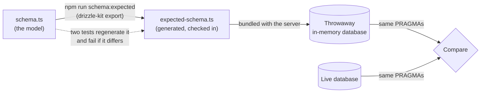

- `src/lib/server/db/expected-schema.ts` exports `EXPECTED_SCHEMA`: the DDL that
  `drizzle-kit export` prints for `schema.ts`, one statement per entry. It is bundled
  with the server, so nothing is read from disk at run time.
- `scripts/generate-expected-schema.mjs` writes it. Run `npm run schema:expected` after
  any change to `schema.ts`. With `-- --check` it writes nothing and exits 1 if the
  module is out of date. It opens no database file.
- Two tests in `tests/migrations.test.ts` guard it. One compares the module with a fresh
  `drizzle-kit export`, statement for statement; the other runs the generator with
  `--check`. Changing `schema.ts` without regenerating, or editing the module by hand,
  fails the suite.
- At start-up the runner executes that DDL in a throwaway in-memory database and reads
  it back with the same PRAGMAs it uses on the live one (`table_xinfo`,
  `foreign_key_list`, `index_list`, `index_xinfo`), so the two are compared like with
  like. Structure is never compared as text: the same table can be written many ways,
  and after a rename SQLite stores its name quoted. The one thing taken from the text is
  whether it says `AUTOINCREMENT`, which no PRAGMA reports.

### Reconciliation: The Six Tables

Six tables are known to have reached databases in two shapes, and they are the only
tables ever rebuilt. The list is fixed in code (`RECONCILED_TABLES`):

| Table | Column | Shape some databases have | The model's shape |
|-------|--------|---------------------------|-------------------|
| `boards` | `parent_card_id` | no foreign key | references `cards(id)`, `ON DELETE CASCADE` |
| `boards` | `created_by` | references `users(id)` with no `ON DELETE` action | `ON DELETE SET NULL` |
| `columns` | `wip_limit` | nullable | `NOT NULL DEFAULT 0` |
| `categories` | `board_id` | `NOT NULL`, `ON DELETE CASCADE` | nullable, `ON DELETE SET NULL` |
| `settings` | `key` | `TEXT PRIMARY KEY` that accepts NULL | `NOT NULL` |
| `user_xp` | `name` | `TEXT PRIMARY KEY` that accepts NULL | `NOT NULL` |
| `invite_tokens` | `token` | `TEXT PRIMARY KEY` that accepts NULL | `NOT NULL` |

SQLite cannot alter a `NOT NULL`, a primary key or a foreign key in place, so a table
that differs is rebuilt: a new one is created, the rows are copied, the old one is
dropped and the new one takes its name.

The list is not a catch-all. A difference in any other table is reported by the
[schema check](#the-start-up-schema-check) and is a fault to look into. Rebuilding
whatever differs would turn a forgotten migration into a schema change nobody wrote.

Reconciliation runs after the migration files, at every start, and does nothing unless
one of the six exists and differs from the model. It is not attempted at all when the
database records a migration this build has no file for. That database may be newer than
the build, a later build may have changed one of the six on purpose, and an older build
must not reshape it. Going back to the previous image has to keep working.

**Guards.** Each differing table is checked before anything is changed. A table that
fails a guard is left exactly as it is, and the others go ahead.

1. Its column names are exactly the model's. A column on one side only is a migration
   that has not run, or one this build does not have. It is not a difference of shape.
2. No trigger or view belongs to the table or mentions it, and the scratch name
   (`<table>_rebuild_2006`) is not in use.
3. Where the model's column is `NOT NULL` and the live one is not: if the model gives
   the column a default, NULLs are copied as that default (`columns.wip_limit` becomes
   0). If it gives none (the three text keys), any NULL fails the guard, and the message
   names the table, the column and the number of rows.
4. No transaction is open on the connection. This one applies to every table alike.

**The rebuild.** All the tables that pass their guards are rebuilt in one transaction,
so they end up all rebuilt or all as they were. There is one case in which the
transaction is run a second time with a table fewer; see
[when a table cannot be rebuilt](#when-a-table-cannot-be-rebuilt).

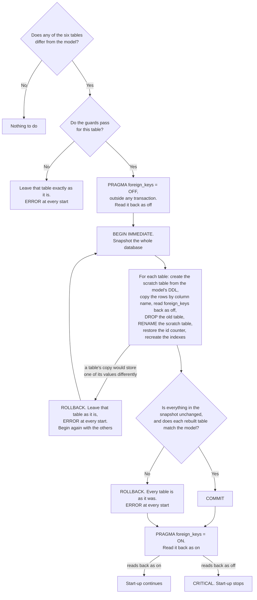

1. **Foreign keys off, outside the transaction, and read back.** SQLite ignores
   `PRAGMA foreign_keys` inside a transaction and reports no error. With foreign keys
   still on, `DROP TABLE columns` deletes the table's rows first and every card goes
   with them. So the pragma is set before the transaction opens and read back as off,
   and it is read back again immediately before each drop.
2. **`BEGIN IMMEDIATE`, then a snapshot of the whole database**: the row count of every
   table; for every foreign key column in every table, how many rows have a value and
   what the values add up to; the stored definition of every object that is not being
   rebuilt; every id counter in `sqlite_sequence`; and every row that
   `PRAGMA foreign_key_check` reports.
3. **Create, copy, drop, rename**, for each table. The scratch table is created from the
   model's own `CREATE TABLE` statement with only the name changed. Rows are copied with
   an explicit column list on both sides. Before anything is dropped the two row counts
   must agree, and every row of the copy must be a row of the table exactly, type as
   well as content and byte for byte: the text `'007'` copied into an `INTEGER` column
   is stored as the integer 7 without an error, and a rebuild must not change a value. Then the old table is dropped and the scratch table renamed to
   its name, in that order: renaming the old table out of the way first would rewrite
   every other table's foreign key to follow it, and the drop would then leave them
   pointing at a table that is gone. The id counter is put back as the larger of the old
   value and the new, because an id is never reused, and the indexes the model declares
   for the table are recreated.
4. **The whole-database comparison, before the commit.** Every row count, every foreign
   key column's count and total, and every other object's definition must be unchanged.
   The same rows must break a foreign key afterwards as did before, no more and no
   fewer. A row that already broke one is carried across still breaking it, including
   where the rebuild changes that key's `ON DELETE` rule; a rebuild neither repairs nor
   hides it. Where the model has no such key at all, the row is carried across unchanged
   and breaks nothing afterwards, because the key is gone; the table's log line names the
   key that went. No id counter may have fallen, and only a rebuilt table's may have moved. Each
   rebuilt table must now match the model. Anything else rolls the whole transaction
   back. The comparison covers the whole database because a rebuild that goes wrong does
   not show in the table being rebuilt, which comes out with the right rows. The damage
   is in the tables that refer to it.
5. **Commit, then foreign keys on, and read back**, whichever way the transaction ended.

One line is logged for each rebuilt table once the work is committed, giving the table,
the rows carried across, any NULLs that were replaced by a default, and what differed
from the model and no longer does. The last part is where a constraint the rebuild took
away can be seen: a foreign key the table had and the model has not is gone afterwards.

#### When a table cannot be rebuilt

A table that cannot be rebuilt has been running in
the shape it has. Leaving it there breaks nothing that was working, and stopping the
server over it would.

| What happens | Outcome |
|--------------|---------|
| A table fails a guard | That table is left exactly as it is; the others are rebuilt. Logged at `ERROR`, at this start and at every one after it until the cause is dealt with. The server starts. |
| Foreign keys cannot be switched off | The rebuild is not started. Logged at `ERROR` in the same way. The server starts. |
| A step of the rebuild fails, or the comparison finds a change | The whole transaction is rolled back, foreign keys are switched back on and every table in it is as it was. Logged at `ERROR` in the same way. The server starts. |
| A table holds a value that the model's column type would store differently | The transaction is rolled back, that table is left exactly as it is, and the rebuild is run again without it, so the others are rebuilt at the same start. Logged at `ERROR` for that table in the same way; it needs a migration that says what each value is to become. The server starts. This is the only failure after which the rebuild is tried again: it is a fact about one table's rows, where every other failed check is a fault in the rebuild and says nothing good about the rest of it. It is not taken on trust from the two type names. The table's values are stored once more in a column of the model's type, apart from the copy, and the difference counts as the table's own only if they come out exactly as the copy has them. |
| Foreign keys cannot be read back as on afterwards | **Start-up stops**, with a `CRITICAL` line. This is the application's only connection, and with foreign keys off every cascade and every constraint is silently off. It is the one case in which reconciliation stops the server. |

**Sub-boards whose card has gone.** A `boards` table with no foreign key on
`parent_card_id` let a card be deleted while its sub-board stayed behind, still pointing
at a card that is not there. Such a row would break the key the model adds. Where a
rebuild gives `boards` that key and the live table has no foreign key on the column,
those sub-boards are detached inside the rebuild's transaction, before the copy:
`parent_card_id` is cleared and each becomes an ordinary board. Nothing is deleted, and
each is logged by id and name with the id of the card it belonged to. The comparison is
told to expect exactly that many references cleared from that one column, and no other
change. A row that breaks any other foreign key a rebuild adds still fails the
comparison, and the rebuild is rolled back and reported.

### The Start-Up Schema Check

After the backfills and the timestamp conversion, the whole live database is compared with the model
(`schemaDifferences()`): a table, column, view or trigger that only one side has; a
column whose type, nullability, default, position in the primary key or kind (ordinary
or generated) differs; a foreign key or an index that only one side has; and whether a
table is `AUTOINCREMENT`. The migration record and SQLite's own tables are left out.

Every difference goes into one `ERROR` line. Nothing is changed and start-up continues,
because an older build started against a newer database differs in exactly this way and
has to start. On a database that matches the model it says nothing at all.

A difference means one of four things: an older build is running against a newer
database; one of the six tables could not be rebuilt, which has a line of its own; the
model has a change that no migration makes; or the database was changed outside the
migrations, for example with `drizzle-kit push`.

### What the Comparison Ignores

What the comparison ignores is set by six rules, not by a list of exceptions. No table
and no column is excused from it.

| Ignored | Why |
|---------|-----|
| The case of a type name (`INTEGER`, `integer`) | SQLite treats the two as the same |
| `NOT NULL` on an `INTEGER PRIMARY KEY` | The column is the rowid, which is never NULL whether or not `NOT NULL` is written |
| `false` and `true` as defaults, against `0` and `1` | They are SQLite's names for 0 and 1 |
| `DEFAULT NULL`, against no default | They are the same thing |
| The order of a table's columns | Column order is not part of the schema |
| The case of a foreign key's parent table name, and a parent column left out | `REFERENCES Boards` and `REFERENCES boards(id)` are the same key: SQLite does not distinguish the case, and no column named means the parent's primary key |

The first four, and the sixth, are things SQLite itself treats as identical. The fifth is a
rule of this comparison. A column added by `ALTER TABLE` goes on the end, so a table that grew over
the years has its columns in a different order from one created whole from the model.
Nine tables on production do. That is no difference, because nothing reads a column by
its position: the application, the restore and the rebuild name the columns they write,
and rows are read as objects keyed by name. Columns are therefore matched by name.

Order inside a primary key or an index is another matter. It decides what the key or the
index does, and it is compared. An index made by `CREATE INDEX` is compared by its name
and the columns it covers; one SQLite made for a `PRIMARY KEY` or `UNIQUE` constraint
has a name nobody chose and is compared by what it covers.

Some things are not compared because no PRAGMA read here reports them, and a difference in
any of them goes unseen: `CHECK` constraints; the `WHERE` of a partial index (that it is
partial is compared); `COLLATE` on a column that no index covers; `DEFERRABLE` on a
foreign key; `STRICT`, and `WITHOUT ROWID`; `ON CONFLICT` clauses on a constraint; and the
expression of a generated column (that it is generated is compared). The model uses only
the first of these. The schema has one `CHECK`, on `token_usage`, and a test of
its own covers it.
