# DumpFire Data Model

DumpFire uses SQLite as its embedded database, managed by Drizzle ORM. The schema is defined in `src/lib/server/db/schema.ts` and migrations live in `drizzle/`. How the migrations are applied, and how a database is checked against the schema, is described under [Migrations and Schema Reconciliation](#migrations-and-schema-reconciliation).

## Entity-Relationship Diagram

```mermaid
erDiagram
    users {
        int id PK
        text username UK
        text email UK
        text password_hash
        text emoji
        text role
        text notification_prefs
        text created_at
    }

    sessions {
        text id PK
        int user_id FK
        text expires_at
        text created_at
    }

    teams {
        int id PK
        text name
        text emoji
        text created_at
    }

    team_members {
        int team_id PK_FK
        int user_id PK_FK
        text role
    }

    api_keys {
        int id PK
        text key_hash UK
        text key_prefix
        text name
        int user_id FK
        text last_used_at
        text expires_at
        text created_at
    }

    board_categories {
        int id PK
        text name
        text color
    }

    boards {
        int id PK
        text name
        text emoji
        int parent_card_id FK
        int category_id FK
        bool is_public
        int created_by FK
        text created_at
        text updated_at
    }

    board_members {
        int board_id PK_FK
        int user_id PK_FK
        text role
    }

    board_teams {
        int board_id PK_FK
        int team_id PK_FK
        text role
    }

    board_favourites {
        int user_id PK_FK
        int board_id PK_FK
        text created_at
    }

    columns {
        int id PK
        int board_id FK
        text title
        real position
        text color
        bool show_add_card
        int wip_limit
    }

    categories {
        int id PK
        int board_id FK
        text name
        text color
    }

    cards {
        int id PK
        int column_id FK
        int category_id FK
        text title
        text description
        real position
        text priority
        text color_tag
        text due_date
        text on_hold_note
        text business_value
        bool pinned
        text completed_at
        text first_completed_at
        text archived_at
        text cover_url
        text recurrence_rule
        text next_recurrence
        int milestone_id FK
        int created_by FK
        text summary
        text theme
        text customer_impact
        text close_reason
        text release_state
        text created_at
        text updated_at
    }

    subtasks {
        int id PK
        int card_id FK
        text title
        text description
        text priority
        text color_tag
        text due_date
        bool completed
        real position
    }

    card_assignees {
        int card_id PK_FK
        int user_id PK_FK
    }

    labels {
        int id PK
        int board_id FK
        text name
        text color
    }

    card_labels {
        int card_id FK
        int label_id FK
    }

    card_comments {
        int id PK
        int card_id FK
        int user_id FK
        text content
        text created_at
        text updated_at
    }

    card_attachments {
        int id PK
        int card_id FK
        text filename
        text original_name
        text mime_type
        int size_bytes
        int uploaded_by FK
        text created_at
    }

    card_dependencies {
        int id PK
        int card_id FK
        int depends_on_card_id FK
        int created_by_user_id FK
        text created_at
    }

    work_dependencies {
        int id PK
        text blocked_type
        int blocked_id
        text blocker_type
        int blocker_id
        int created_by_user_id FK
        text created_at
    }

    milestones {
        int id PK
        int board_id FK
        text name
        text description
        text target_date
        text status
        int created_by FK
        text created_at
        text updated_at
    }

    card_templates {
        int id PK
        int board_id FK
        text name
        text title
        text description
        text priority
        text subtasks_json
        text labels_json
        int created_by FK
        text created_at
    }

    activity_log {
        int id PK
        int board_id FK
        int card_id FK
        int user_id FK
        text action
        text detail
        text user_name
        text user_emoji
        text source
        text created_at
    }

    daily_snapshots {
        int id PK
        int board_id FK
        int column_id FK
        text date
        int card_count
    }

    task_requests {
        int id PK
        text target_type
        int target_id
        text requester_name
        text requester_email
        int requester_user_id FK
        text title
        text description
        text priority
        text status
        text access_token
        text business_value
        int resolved_by FK
        int resolved_card_id FK
        text reject_reason
        text created_at
        text resolved_at
    }

    request_messages {
        int id PK
        int request_id FK
        text sender_type
        text sender_name
        text message
        text created_at
    }

    webhooks {
        int id PK
        int board_id FK
        text url
        text secret
        text events
        bool active
        text created_at
    }

    report_schedules {
        int id PK
        int user_id FK
        text name
        text scope
        int scope_id
        text frequency
        int day_of_week
        int day_of_month
        text time_of_day
        bool enabled
        text recipients
        int period_days
        text last_run_at
        text next_run_at
        text created_at
        text updated_at
    }

    backup_log {
        int id PK
        text destination_type
        text destination_name
        text filename
        int size_bytes
        text status
        text error
        int duration_ms
        text created_at
    }

    user_xp {
        text name PK
        int xp
        text emoji
    }

    settings {
        text key PK
        text value
    }

    users ||--o{ sessions : "has"
    users ||--o{ api_keys : "owns"
    users ||--o{ team_members : "belongs to"
    teams ||--o{ team_members : "has"
    users ||--o{ board_members : "member of"
    users ||--o{ board_favourites : "favourites"
    users ||--o{ card_assignees : "assigned to"
    users ||--o{ card_comments : "writes"
    users ||--o{ report_schedules : "configures"

    boards ||--o{ columns : "contains"
    boards ||--o{ board_members : "shared with"
    boards ||--o{ board_teams : "shared with"
    boards ||--o{ board_favourites : "favourited by"
    boards |o--o{ categories : "may own"
    boards ||--o{ labels : "has"
    boards ||--o{ activity_log : "logs"
    boards ||--o{ daily_snapshots : "snapshot"
    boards ||--o{ webhooks : "fires"
    boards ||--o{ card_templates : "templates"
    board_categories ||--o{ boards : "groups"
    teams ||--o{ board_teams : "access"

    columns ||--o{ cards : "contains"
    columns ||--o{ daily_snapshots : "tracked in"
    cards ||--o{ subtasks : "has"
    cards ||--o{ card_assignees : "assigned"
    cards ||--o{ card_labels : "tagged"
    cards ||--o{ card_comments : "discussed"
    cards ||--o{ card_attachments : "attached"
    cards ||--o{ card_dependencies : "depends on"
    cards |o--o{ boards : "parent of sub-boards"
    boards |o--o{ milestones : "may scope"
    milestones ||--o{ cards : "groups"
    categories ||--o{ cards : "categorises"
    labels ||--o{ card_labels : "applied to"

    task_requests ||--o{ request_messages : "thread"
```

## Cascade Behaviour

| Parent | Child | On Delete |
|--------|-------|-----------|
| `users` | `sessions` | CASCADE |
| `users` | `api_keys` | CASCADE |
| `users` | `team_members` | CASCADE |
| `users` | `board_members` | CASCADE |
| `users` | `card_assignees` | CASCADE |
| `users` | `card_comments` | CASCADE |
| `users` | `report_schedules` | CASCADE |
| `users` | `board_favourites` | CASCADE |
| `users` | `invite_tokens` | CASCADE |
| `users` | `card_attachments.uploaded_by`, `card_templates.created_by`, `milestones.created_by`, `work_dependencies.created_by_user_id`, `card_dependencies.created_by_user_id` | **none — set to NULL in code** |
| `boards` | `columns` | CASCADE |
| `boards` | `board_members` | CASCADE |
| `boards` | `labels` | CASCADE |
| `boards` | `activity_log` | CASCADE |
| `boards` | `webhooks` | CASCADE |
| `boards` | `categories.boardId` | SET NULL |
| `columns` | `cards` | CASCADE |
| `cards` | `boards.parentCardId` (sub-boards) | CASCADE |
| `cards` | `subtasks` | CASCADE |
| `cards` | `card_assignees` | CASCADE |
| `cards` | `card_labels` | CASCADE |
| `cards` | `card_comments` | CASCADE |
| `cards` | `card_attachments` | CASCADE |
| `cards` | `card_dependencies` | CASCADE (both ends) |
| `cards` / `subtasks` | `work_dependencies` | **none — cleared in code** |
| `boards` | `milestones` | CASCADE |
| `boards` | `report_schedules` (`scope = 'board'`, `scope_id`) | **none — deleted in code** |
| `milestones` | `cards.milestoneId` | SET NULL — **in code, not SQL** |
| `categories` | `cards.categoryId` | SET NULL |
| `users` | `boards.createdBy` | SET NULL |
| `users` | `cards.createdBy`, `activity_log.userId`, `task_requests.requesterUserId`, `task_requests.resolvedBy`, `token_usage.reportedByUserId` | SET NULL |

What the rows marked "in code" mean for each kind of delete is set out under
[What a Delete Removes](#what-a-delete-removes).

`work_dependencies` holds dependencies between any two pieces of work — card or subtask —
in one polymorphic table, so the planning engine walks a single graph. Polymorphic ids
cannot carry a foreign key, so nothing cascades and the edges are cleared in code. Deleting
a subtask clears its own (`removeWorkNodeEdges`, in the same transaction as the delete). A
permanent delete of a card, a column or a board clears the edges of every card and subtask
that goes with it (`src/lib/server/deletes.ts`). It supersedes `card_dependencies`, which migration 0043 copied
across and left in place. Nothing writes to the old table. One thing still reads it: the
restore, which refills `work_dependencies` from it when a backup predates migration 0043.
The graph view was the other, and now draws its `depends_on` edges from
`work_dependencies`: card-to-card links only, and only where the caller can view the
board of the card that is waited on.

`milestones → cards.milestoneId` is nulled by the delete handler rather than by a foreign
key. The column was added without one (migration 0042), SQLite cannot add a foreign key
to a column that already exists without rebuilding the table, and the behaviour matters — **deleting a goal must never delete the work**. The delete response
reports how many cards were released.

`cards → boards.parentCardId` is a foreign key with `ON DELETE CASCADE`. A sub-board
belongs to the card it was opened from, so permanently deleting a card deletes its
sub-boards, and with them their columns and cards. The delete does not lean on that key
alone: it finds every sub-board under the card, at every depth, and deletes each by its own
statement, because a database whose `boards` table the migration runner had to leave in an
older shape has no such key. Archiving a card is a soft delete and removes nothing.

`boards → categories.boardId` is nullable, with `ON DELETE SET NULL`. A category that
belongs to no board is a shared one, listed to everyone. So the key alone would keep a
deleted board's categories as shared ones, and the delete removes them itself; see
[What a Delete Removes](#what-a-delete-removes). Until 2026-10-14 they were kept.

Not every older database had these two keys in this form. `boards` and `categories` are
among the six tables the migration runner rebuilds in the model's shape at start-up; see
[Reconciliation: The Six Tables](#reconciliation-the-six-tables).

See [Critical-Path Planning](critical-path-planning.md) for how `work_dependencies` and
`milestones` are read to derive the critical path and what is startable.

## What a Delete Removes

Every delete below is one transaction: all of it is removed or none of it. The routine is
`src/lib/server/deletes.ts`, used by both API trees and by the admin panel. How it sits in
a request is in [Architecture](architecture.md#writes-one-transaction-then-the-effects).

### Archive

Archiving a card (`DELETE` on a card without `?permanent=true`, in either API tree) sets
`cards.archived_at` and `updated_at` and writes one `card_archived` activity entry. It
touches nothing else: no subtask, comment, attachment row or file, dependency link or
sub-board. Restoring clears `archived_at` and sets `updated_at`, so the card comes back
whole, and writes one `card_restored` entry on the card's board, with the title as its
detail, as the archive's entry has (card 2108). `restoreCard()` in
`src/lib/server/card-restore.ts` does it for all three routes that restore: the two of the
web application and `PUT /api/v1/cards/:cardId` with `archivedAt: null`, which writes
`api:card_restored`. A card that is not archived is handed back as it is, with nothing
written: the two routes of the web application then tell its board nothing, and the API's
names `archivedAt` in its `api:card_updated` entry, as it did. Until 2026-10-14 a restore
wrote no entry, and the API's was recorded as `api:card_updated`.

### Permanent deletes

A permanent delete starts from a set of cards and takes everything beneath them.

| Delete | Starts from |
|--------|-------------|
| A card, with `?permanent=true` | That card |
| A column | Every card in the column, archived or not, and then the column |
| A board | Every card on the board, and then the board |
| Purge Archived Cards (admin) | Every archived card on every board |
| Clear Cards (admin) | Every card on one board. The board and its columns stay, unless the board is in a loop (below) |

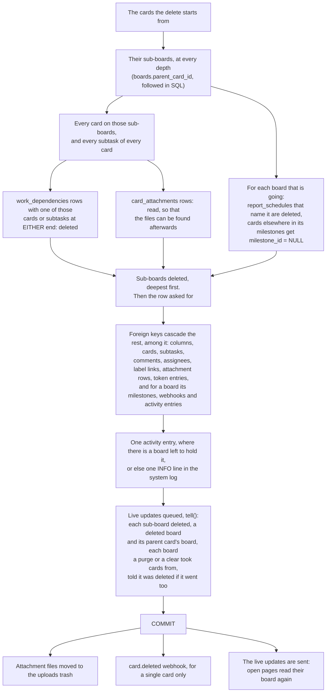

What is removed that no foreign key removes:

- **Dependency links at either end.** A `work_dependencies` row goes when a deleted card or
  subtask is its blocked end or its blocker end. Type and id are matched together, because
  card 7 and subtask 7 are different work. A card left behind that was waiting on a deleted
  card is no longer waiting on it.
- **Sub-boards at every depth.** A sub-board of a card on a sub-board of the deleted card
  goes too, with its cards and their subtasks, links and files. A loop from before card
  2141, a card moved onto its own sub-board, cannot make the query that follows sub-boards
  run round it, and `deepestFirst()` stops on a board it has seen. But a delete that reaches
  any board of a loop takes every board of it and every board below it, because each is
  beneath the others: deleting a board of the loop, the card it hangs from or that card's
  column, Purge Archived Cards while that card is archived, and Clear Cards on a board of
  the loop, which then deletes that board too. `tests/board-tree-loops.test.ts` holds each.
  Where the board a delete would write its activity entry on went with it, one `INFO` line
  in the system log, context `DELETE`, says what went instead: for a card or a column, and
  since card 2142's review for Clear Cards and the purge too, which wrote none. A board that
  Clear Cards or the purge took cards from and that went with them is told
  `{ type: 'board', action: 'deleted' }`, where it was told its cards were cleared or purged.
- **Report schedules for a deleted board.** A `report_schedules` row with `scope = 'board'`
  and that board's id is deleted. This applies to a deleted sub-board as well as to a board
  deleted directly.
- **Milestone membership of cards elsewhere.** A board's milestones are deleted with it by
  cascade. A card on another board that was in one of them is kept, with `milestone_id` set
  to NULL.
- **Card categories of a deleted board.** `categories.board_id` is `ON DELETE SET NULL`,
  which would keep them as categories of no board: shared, and listed to everyone. They are
  deleted with the board, and with every sub-board deleted, whatever was asked for. A card
  elsewhere that carried one has `category_id` set to NULL by its key. Until 2026-10-14
  they were kept.
- **Attachment files.** The rows cascade; the files are moved to the trash after the commit
  and kept for 30 days. See [Architecture](architecture.md#uploads-and-the-trash).

What is left:

- **Dependency links that were already orphaned** before this routine existed. They name
  cards that no longer exist, are hidden from every view, and are not looked for.
- **Earlier activity entries of a deleted card**, where its board remains. They stay on the
  board with `card_id` set to NULL by the key.
- **Everything outside the tree.** The other end of a deleted link is not touched.

What is recorded:

| Delete | Activity entry | Webhook |
|--------|----------------|---------|
| Archive | `card_archived`, with the card's id | None |
| Restore | `card_restored`, with the card's id, only when the card was archived | None |
| Card | `card_deleted`, stored with `card_id` NULL because the card is gone | `card.deleted`, whose `data.cardId` is the deleted card's id |
| Column | `column_deleted` on its board, naming the column and how many cards went | None, for the column or for its cards |
| Purge Archived Cards | `cards_purged` on each board that had any, with the count | None |
| Clear Cards | `cards_cleared` on the board, with the count, if it held any | None |
| Board | None: the entry would be deleted with the board. One `INFO` line in `system_logs`, context `DELETE`, names the board, who deleted it and what went | None |
| Subtask | `subtask_deleted` on its card's board, naming the subtask; through the API too since 2026-10-14 | None |

Entries made through the v1 API are stored with the `api:` prefix (`api:column_deleted`),
like every other action.

Who is told (card 2108). Each delete queues one live `update` for every board it removed or
emptied, through `tell()` in `deletes.ts`, beside its entry, and the event is sent once the
delete is committed, as every `emit` is. The payload says what kind of change it was and
nothing else, because the board of a sub-board's card can be viewed by people who could
never open the sub-board, and a page only reads its board again, under its own access
check:

| Delete | Told | Payload |
|--------|------|---------|
| A card or a column, for good | Each sub-board deleted with it. The route tells the card's or the column's board itself, as it did | `{ type: 'board', action: 'deleted' }` |
| A board | The board and each sub-board deleted with it | `{ type: 'board', action: 'deleted' }` |
| A sub-board, on its own | Also the board of the card it hung from, read before the delete, which is still there | `{ type: 'board', action: 'sub_board_deleted' }` |
| Purge Archived Cards | Each board that had an archived card and is still there, and each sub-board deleted | `{ type: 'card', action: 'purged' }` |
| Purge Archived Cards, a board that had an archived card and went with the purge, as a board in a loop does | That board | `{ type: 'board', action: 'deleted' }` |
| Clear Cards | The board and each sub-board deleted, when the board held any card | `{ type: 'card', action: 'cleared' }` |
| Clear Cards on a board in a loop, which goes with its cards | The board, and each other sub-board deleted is told `cleared` | `{ type: 'board', action: 'deleted' }` |

A board is told once however many reasons it has. `removeUnder()` hands back the ids of the
sub-boards it deleted for this. A page open on a deleted board reads it again and shows
"Board not found". A member's dashboard is not told: the global stream checks the caller
against the board each event is for, and a board that is gone can be viewed by nobody but
an administrator, so the dashboard catches up when it is next brought to the front. Until
2026-10-14 a board delete, a purge and a clear told nobody, and a card or column delete
told only its own board.

### Deleting a user

`deleteUser()` first clears the five columns that name a user through a foreign key with no
`ON DELETE` action, then deletes the user, in one transaction. While any of the five named
a user, the delete used to be refused by the key.

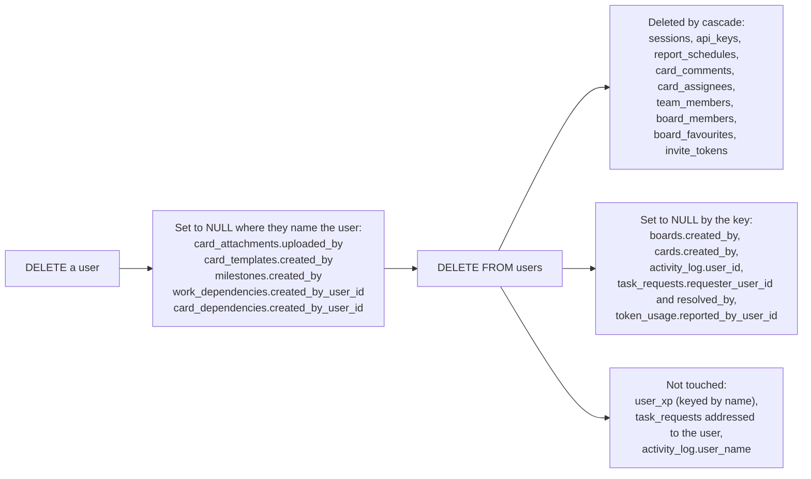

| What | After the user is deleted |
|------|---------------------------|
| Files they uploaded; templates, milestones and dependencies they created | Kept, with nobody named as having made them |
| A template they created, or a milestone of theirs that belongs to no board | Kept. Only an administrator can then delete the template or edit the milestone. A milestone that belongs to a board is still edited by whoever can edit that board |
| Their comments, "Unblocked" notices written in their name among them | Deleted |
| Their API keys and report schedules | Deleted |
| Their sessions, team and board memberships, favourites, invites and card assignments | Deleted |
| Boards and cards they created; activity entries they made | Kept. The link to the user is cleared; an activity entry keeps the name it was written with |
| Task requests addressed to them | Kept, with the same target. Only an administrator can then accept, reject or reply |
| Their XP | Kept. `user_xp` is keyed by username and has no key to `users` |

One `INFO` line in `system_logs`, written after the commit, says who deleted whom and how
many API keys, report schedules and comments went.

### Ids are never reused

Every table with a numeric id declares it `AUTOINCREMENT`, and SQLite keeps each table's
counter in `sqlite_sequence`. No delete, Vacuum or Reset touches those counters, and the
migration runner carries them across a table rebuild. So a new card is never given the id a
deleted card had, and a reference that has no foreign key (a dependency link, a report
schedule's scope, a card's milestone) can never come to point at a different row. An insert
that is rolled back gives its id back; no row was ever committed under it.

## Card Lifecycle

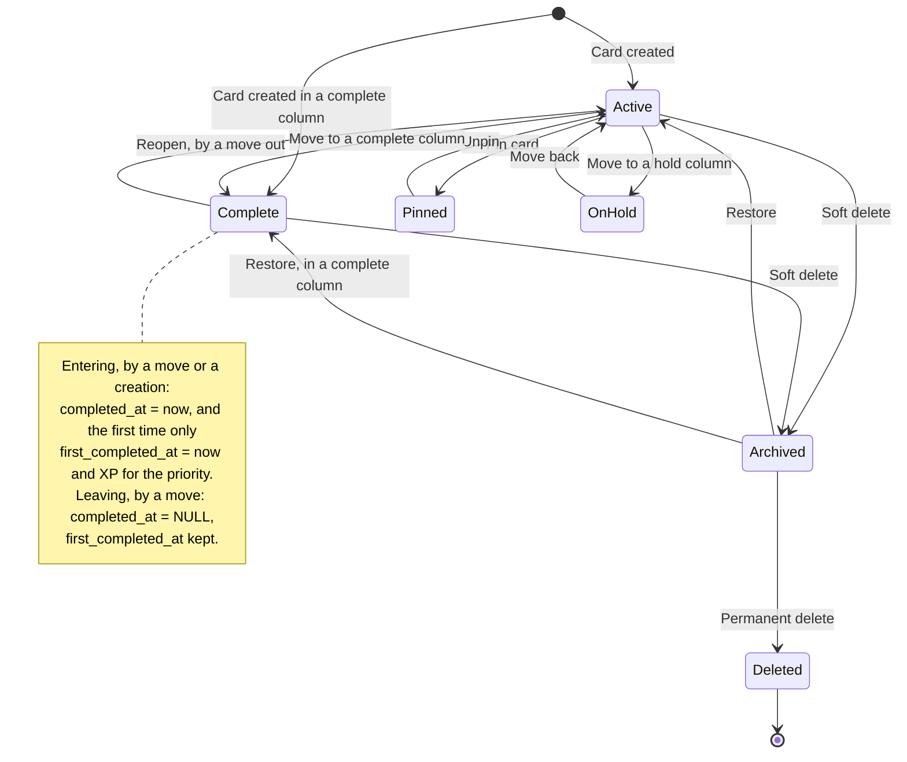

### What a column means

Whether a card is complete or on hold is decided by the title of the column it is
in, and by nothing else. The decision is made in one module, `src/lib/column-role.ts`,
which has no server imports so the browser and the server share it:

| Role | Column titles (case and surrounding space ignored) |
|------|------------------------------------------------------|
| `complete` | Complete, Done |
| `hold` | On Hold, Hold, Blocked, Parked, Waiting |
| none | anything else |

Until October 2026 this was worked out wherever it was needed — about twenty places
with three different word lists. The browser accepted only "complete" where the
server also accepted "done", and the dashboard counted "Waiting" as on hold where
the reports did not, so the same card could be complete on one screen and in
progress on another. Nothing may compare a column title to a word list now; ask
`columnRole()`, `isCompleteColumnTitle()`, `isHoldColumnTitle()`,
`completeColumnIds()` or `holdColumnIds()`.

The `hold` role also decides what a move does to the card's `on_hold_note`. A move
from a `hold` column to one that is not clears it to `''`, in the same `UPDATE` as the
change of column, inside `moveCard` in `src/lib/server/card-moves.ts`, so every route
that moves a card does it, and a move that is refused leaves the note as it was. A
move into a `hold` column, between two of them, or between two working columns keeps
the note. The move's own activity entry is the record; nothing else is written for it
(card 2208). Until 15 October 2026 only a drag on the board page cleared the note,
with a second request. A column renamed out of the `hold` role leaves its cards' notes
as they are, since nothing moves.

#### A rename that would change what its cards mean

Because the title decides, renaming a column can finish or reopen every card in it at once,
with no completion date, no XP and no entry: "Review" renamed "Done" made cards finished
that nobody finished, and "Done" renamed "Completed", which is not a Complete title, turned
finished work back into open work on every screen while each card kept its `completed_at`.
So a rename that changes whether the column is a Complete column is refused, `409`, while
the column holds any card, archived ones included, because a restore puts them back in it
(card 2134). An empty column is renamed freely, and so is one whose new title keeps its
role: Complete to Done, To Do to Backlog. Every completion and reopening still goes through
a move, with its check for open subtasks, its XP and its entries.

`completionRoleRefusal(column, storedTitle)` in `src/lib/server/card-completion.ts` decides,
and both routes that write a title call it, `PUT /api/columns/:id` and
`PUT /api/v1/columns/:columnId`. Each calls it after the `UPDATE ... RETURNING`, on the
title as stored, inside the transaction that wrote it, so a refusal rolls the write back,
and no card can be moved in or created between the count and the write.

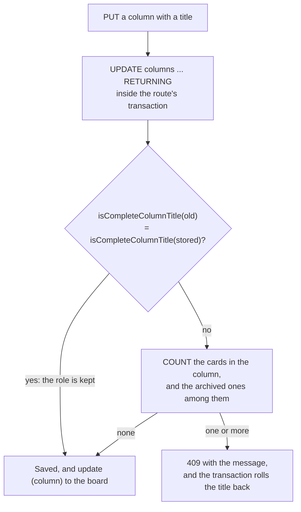

The message counts the cards: `1 card`, `1 card, which is archived`, `3 cards`,
`3 cards, all of them archived` or `3 cards, 1 of them archived`. Out of a Complete column
it reads `This column holds 3 cards, 1 of them archived. They count as finished because the
column is called Complete or Done, and renaming it to "Shipped" would turn them back into
open work. Keep it called Complete or Done.`; into one, `This column holds 1 card.
Renaming it to "Done" would mark it finished without anyone finishing it. Move each
finished card to a Complete column and the rest out of this one first, or choose another
name.` A Complete or Done column that holds any card, archived or not, can therefore be
renamed only to Complete or Done. The board page says the refusal in the server's words and
keeps the old title.

### One completion, however a card arrives

A card comes to be in a Complete column by a move or by being created in one; a rename can
no longer put it there (above). Both ways stamp, score and announce it by the same rule,
written once in `src/lib/server/card-moves.ts`:

| Function | What it does |
|----------|--------------|
| `completionOf(card, now)` | The stamp and the XP due, writing nothing: `completedAt` is `now`; a card never completed before also gets `firstCompletedAt` and the XP for its priority (low 50, medium 100, high 150, critical 200) |
| `awardXp(actor, xp)` | Adds the XP to the actor's `user_xp` row, inside the caller's transaction. Nothing for 0 |
| `celebrateCompletions(boardId, completions, actor)` | `xp-update` when any XP was given, then one `celebrate` naming the last card completed and the XP for all of them. Each `emit` waits for the commit |

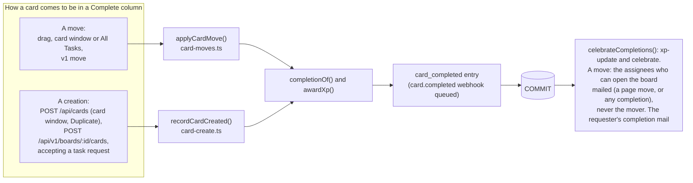

#### A move

A card changes column by one of three routes — a drag (`PUT /api/cards/reorder`),
the All Tasks page or the card modal (`PUT /api/cards/:id` with a `columnId`), and
the API (`PUT /api/v1/cards/:id/move`). All three call the same three functions in
`src/lib/server/card-moves.ts`, in the same order and inside one transaction, so a move
means the same thing however it is made.

| Function | What it does | When |
|----------|--------------|------|
| `applyCardMove()` | Changes the database and nothing else: the card, the XP, the activity entry | Once for each card moved |
| `recordUnblockedByMoves()` | Writes the "Unblocked" notice on every card that the completed cards were the last open blocker of. One notice for each piece of work unblocked, however many of its blockers the request completed, naming the last of them to be completed in it | Once, after the last move, as the last write of the transaction |
| `announceCardMoves()` | Queues what people are told: the live updates, the celebration, the emails to assignees and to whoever requested the work, and the "you are no longer blocked" mail for the notices. Assignees are mailed "Card moved" for every move made on a page and for a completion by any route, never the one who made the move; a plain move through the API mails nobody (card 2134). Only the assignees who can open the board the card is on after the move are mailed (card 2180; see [Notifications & Email](notifications-email.md#email-types)) | Called inside the transaction; nothing it queues is sent before the commit, or at all after a rollback |

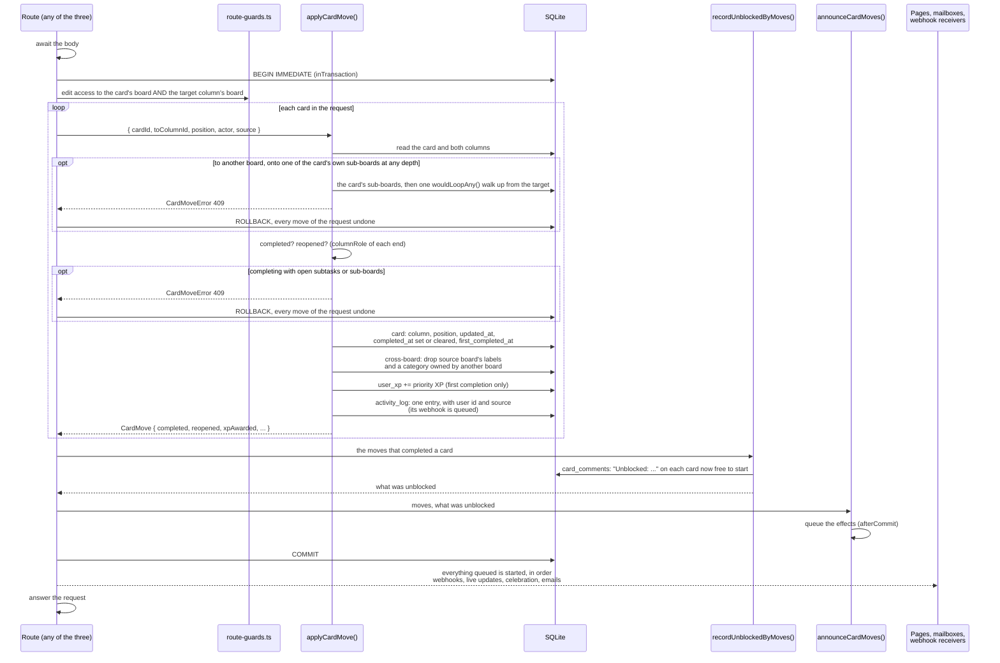

`applyCardMove()` opens its own `inTransaction`, which inside the route's transaction is a
savepoint. A drop of several cards is therefore one transaction: if the last card cannot be
completed, the earlier ones are rolled back with it and nothing is announced for any of them.
A failure to write an "Unblocked" notice fails the move it belongs to in the same way.

The check for open subtasks and sub-boards is `getCompletionBlocker()` in
`src/lib/server/card-completion.ts`. A sub-board holds its card back while it has a card that
is not archived and not in a Complete column; an archived card is not live work and holds
nothing back (card 2205). It reads each sub-board's figures from `subBoardProgress(boardIds)`
beside it, one query giving `{ done, total }` for every board asked: `total` the cards on
the board's own columns that are not archived, `done` those of them in a Complete column, and
0 of 0 for a board with no columns or no cards. The board page, the card context, the
dashboard's tiles and `hiddenOpenCountsFor()` (the open cards on the sub-boards a caller
cannot open) read the same helper, so every page shows the figures the server refuses a
completion on. A card already complete stays complete when an archived card under it is
restored, as it does when a card is added to its sub-board. `completionRoleRefusal()`, which
refuses a column rename that changes its role, still counts archived cards: a restore would
put them back in the column.

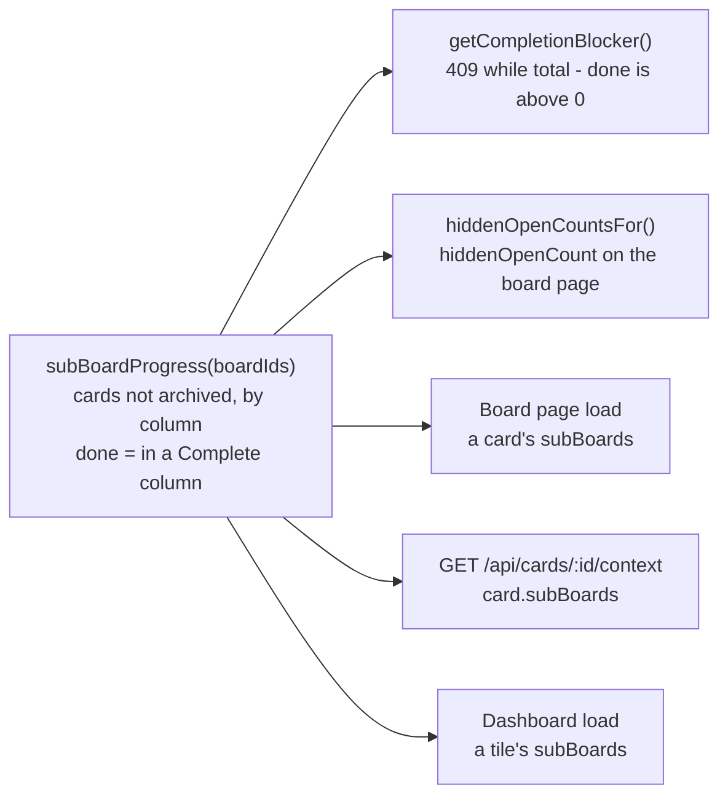

A card's sub-boards go with it, so a move to another board is refused, `409`
`Card "<title>" cannot go onto "<board>", which hangs beneath it`, when the target board is
one of them or beneath one, at any depth (card 2141). `refuseLoop()` reads the boards that
hang from the card and asks `wouldLoopAny()` of `src/lib/server/sub-boards.ts` about all of
them at once: one walk up from the target board, with the query that refuses linking a
board under a card on itself or beneath it (`wouldLoop()`, card 2139), however many
sub-boards the card has. Asking `wouldLoop()` of each sub-board in turn walked up from the
same board once for each, and a card with thousands of sub-boards moved onto a board
thousands deep held the server for seconds (card 2141's review). It comes before the
completion check, so a move that would make a loop is refused whatever else it would do. A
move within one board cannot change the tree and is not asked.

`PUT /api/cards/:id` can carry other fields beside the move. The move, the update of those
fields and the `card_updated` entry are one transaction.

| Field | Set when | Cleared when |
|-------|----------|--------------|
| `completed_at` | the card enters a complete column from a column that is not one, or is created in one | it leaves for a column that is not one |
| `first_completed_at` | the first time `completed_at` is ever set (backfilled from `completed_at` by migration 0050) | never |

`first_completed_at` exists because `completed_at` used to do two jobs. It was
never cleared, so as well as "when was this finished" it answered "has this card
been completed before", which is what stops XP being awarded again for dragging a
card out of Complete and back in. A reopened card is not complete, so
`completed_at` is now cleared, and the second job has a column of its own.

The activity entry is `card_completed`, `card_reopened` or `card_moved`; a move
to another board also writes `card_moved_away` on the board it left and
`card_moved_in` on the one it joined. Entries made through the API are stored with
an `api:` prefix, so a query must match both spellings — use `storedActions()`
from `logActivity.ts`. Board cycle time and `/api/v1/me/stats` compared against
the bare name and so ignored everything done through the API.

The browser does not write activity entries. It used to write a second one for
every create, move, completion and delete, with no user id; `POST /api/activity`
has been removed.

#### A creation

A card is created by `POST /api/cards` (the card window, the board page's Duplicate, and
the parent card the dashboard makes for a new sub-board), by `POST /api/v1/boards/:boardId/cards`, and by accepting a task request
(`PATCH /api/requests/:id`). Each inserts its row and then, inside the same transaction,
calls the two functions of `src/lib/server/card-create.ts` (card 2134):

| Function | What it does |
|----------|--------------|
| `recordCardCreated({ card, column, actor, source })` | A savepoint of the route's transaction. Writes `card_created`, with the title as its detail, by the actor and from the route's source. In a Complete column it also completes the card by the move's rule: the stamp from `completionOf()` in one `UPDATE`, `awardXp()`, and a `card_completed` entry, `"<title>": created in <column>`. Returns the card as written, its board, whether it was completed and the XP given |
| `announceCardCreated(creation, actor, baseUrl)` | Queues, for after the commit, the live `update` with `action: 'created'` to the board; for a completion, `celebrateCompletions()` and the requester's "Your request is complete" mail, which goes only when the card is the one an accepted request made |

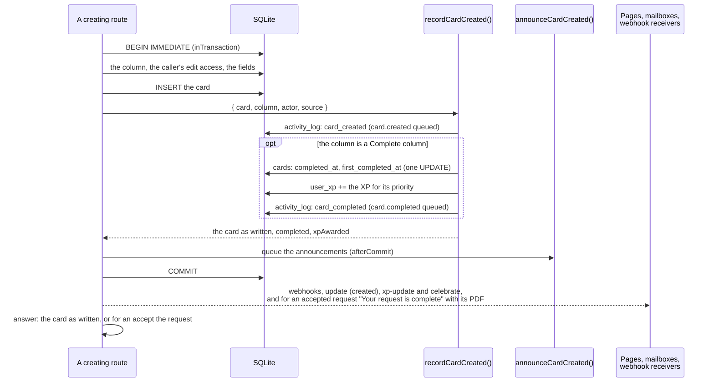

A creation is not a move:

- **No check for open subtasks or sub-boards**: a card that did not exist has neither.
- **No "Card moved" mail and no "Unblocked" notice**: nothing moved, and nothing can have
  been waiting on a card that did not exist (ids are never reused).
- **Subtasks typed in the card window are added after the card**, open. A card created in a
  Complete column with subtasks typed in the window is completed and then has open
  subtasks, which is the state a subtask added to any finished card leaves. It is allowed.
- **Accepting a request records what the other two record**: the `card_created` entry by
  the accepter, source `ui`, the live update, and the accepter as `created_by`. It recorded
  none of them. Accepted into a Complete column, the requester is mailed "Request accepted"
  and then, unless the requester is the accepter, "Your request is complete" with its PDF.
- **Duplicate on the board page makes a new piece of work.** `columnForCopy()` in
  `src/lib/board/card-actions.ts` makes the copy of a card in a Complete column at the end of
  the board's first column, by position, that is not one, where it is open. On a board with
  no such column the copy is made beside the original, where it is completed. A copy of a
  card in any other column is made beside it, as before.
- **The dashboard's new sub-board puts the card it makes for it in an open column.** With no
  parent card chosen, the dashboard's inline sub-board creates one named after the sub-board
  in the first column, by position, that is not a Complete column (`firstOpenColumn()` in
  `src/lib/column-role.ts`, which `columnForCopy()` uses too), and in the first column only
  when every column is one. It used to take the first column whatever it was, so on a board
  whose first column was Complete or Done the card was completed as it was made.

Until 2026-10-14 a card created in a Complete column had no `completed_at`, no XP and no
`card_completed` entry, so velocity, the dashboard's week and month figures, board metrics,
personal stats and the activity report missed it, while the burndown and the board report
counted it as done on its last update. Cards left that way before are not backfilled.
Velocity, the dashboard's figures, board metrics, personal stats and the management activity
report (`GET /api/v1/reports/activity`, which the reports for senior management are made
from; see [Management Activity Reporting](management-reporting.md)) now count a card created
in a Complete column as completed when it was created, and board metrics give it a lead time
of about zero.

## Key Schema Notes

- **Timestamps come in two shapes, and they do not sort against each other.**
  Columns defaulted by SQLite write `2026-04-09 13:53:46` (`datetime('now')`);
  columns set from application code write `2026-04-09T13:54:01.210Z`
  (`toISOString()`). Both are UTC. A space (`0x20`) sorts *before* `T` (`0x54`),
  so comparing the two forms as strings — which is how every date filter in this
  codebase works — gives the wrong answer: `'2026-09-14 09:00:00' <
  '2026-09-14T00:00:00.000Z'` is **true**.

  | Shape | Columns |
  |---|---|
  | `YYYY-MM-DD HH:MM:SS` | `cards.created_at`, `activity_log.created_at`, `card_comments.created_at` |
  | ISO 8601 with `Z` | `cards.completed_at`, `cards.first_completed_at`, `cards.updated_at` |

  Any query spanning both must normalise first. The reporting code does this with
  `replace(substr(col, 1, 19), 'T', ' ')` on both sides; see
  [Management Activity Reporting](management-reporting.md). Getting it wrong
  silently includes or excludes a whole day at a window boundary.
- **Task request status** is `unverified`, `pending`, `accepted` or `rejected`. A request
  from someone without an account starts `unverified` and is hidden from the inbox until
  the requester confirms it; see
  [Authentication & Security](authentication-security.md#the-public-request-form).
  `task_requests.access_token` is the secret in the requester's link (migration `0051`,
  unique index) and is never returned by an API response.
- **Positions** use `real` float type for fractional ordering — allows inserting between items without reordering all rows
- **Sub-boards** are regular boards with a `parent_card_id` linking them to a card. The
  column is a foreign key to `cards` with `ON DELETE CASCADE`, so a sub-board is deleted
  with its card. The boards form a tree: a card is on a board, and a board hangs beneath at
  most one card. Nothing in the schema keeps it one, so the writes do: a move of a card onto
  one of its own sub-boards (card 2141) and a link of a board under a card on itself or
  beneath it (card 2139) are refused, `409`, by `wouldLoopAny()` and `wouldLoop()` in
  `src/lib/server/sub-boards.ts`.
  A loop from before them, from the legacy JSON import or from a restored backup is a board
  beneath one of its own cards: it has no top, so it is on no dashboard, and the card it
  hangs from can never be completed. Every walk of the tree ends on one (card 2142): the
  board page's breadcrumbs visit each board once and show the loop once round, and the
  recursive queries are built with `UNION`, which keeps each row once. `boardsInLoops()`
  finds every such board, from one read of the boards and a walk in memory that looks at
  each board once, and at every start one `[WARN] [STARTUP]` line names at most 20 of them,
  then how many more; a restore of a backup that brings one writes the same line at once,
  as `[WARN] [IMPORT]`. See
  [Admin Operations Guide](admin-guide.md#a-board-beneath-one-of-its-own-cards)
- **Soft delete** uses the `archived_at` column — a non-null value means the card is archived
- **XP system** uses a separate `user_xp` table keyed by username for historical tracking
- **Settings** is a simple key-value store for SMTP config, app URL, etc.
- **Reporting fields** (`summary`, `theme`, `customer_impact`, `close_reason`,
  `release_state`) are nullable and never backfilled — a null is "not recorded",
  which is a different and more honest answer than a guess. Vocabularies are
  enforced in the application rather than by `CHECK` constraints, because they
  will change and SQLite cannot alter a `CHECK` without rebuilding the table.
- **`cards.recurrence_rule` and `cards.next_recurrence` are kept and not used** (card
  2010). Recurrence was never built: no page set a rule and nothing read one. Nothing
  writes either column now, and every card answer still carries both, null unless a rule
  was stored before. They stay so that no migration is needed and the answers keep their
  shape; a later card may drop them.
- **`cards.created_by`** records who raised a card; null for cards created before
  it existed. **`activity_log.source`** records `ui` or `api`; null on older rows,
  where the `api:` prefix on `action` carries the same fact and readers derive it.
- **What a write may put in a text column is decided in the application**, by the readers
  of `src/lib/server/request-body.ts` (card 2117), not by the schema, which takes any text:
  - `priority` on `cards`, `subtasks`, `card_templates` and `task_requests` is `low`,
    `medium`, `high` or `critical`, stored in lower case whatever case was sent;
  - `cards.due_date`, `subtasks.due_date` and `milestones.target_date` are a calendar day
    written `YYYY-MM-DD`, or null; never a timestamp, and never empty text, which a write
    stores as null;
  - `cards.cover_url` is a colour written `#rrggbb`, one of the eight preset gradients in
    `COVER_PRESETS` (`src/lib/colours.ts`), or null (card 2010). It holds a colour, not a
    URL, whatever its name says: it is drawn as a `background`, as a strip across the top
    of the card on the board and in the card window, and a page draws it only when
    `isCoverValue` takes it, so a value stored before the rule is kept and not drawn;
  - `cards.color_tag` and `subtasks.color_tag` are `#rrggbb` or empty text. A `color` is
    `#rrggbb` where a board grouping, a label or a category is created, and where a
    column or a label is changed (`PATCH /api/labels`, card 2010), by the web
    application; a board grouping made through the API too. A category or a grouping
    changed, and a column, label or category
    made or changed through the API, still take any text of 1 to 32 characters, until
    card 2162 holds them to `#rrggbb` as well;
  - `position` on `cards`, `subtasks` and `columns` is a number, never text;
  - `api_keys.expires_at` is null or a timestamp as `toISOString()` writes it, because
    `findApiKey()` compares it with the time as text.

  Rows written before these rules may hold other values. They are left as they are: a
  write that sends a row's stored value back unchanged is accepted, so a card with an old
  priority can still be saved, and the pages draw an unknown priority as none.

## Migrations and Schema Reconciliation

The model in `src/lib/server/db/schema.ts` says what every database should look like.
The SQL files in `drizzle/` are how a database gets there. The application's own runner,
`src/lib/server/db/migrate.ts`, does three things at every start: it applies the files a
database has not had, it rebuilds six named tables wherever they are not in the model's
shape, and it compares the whole database with the model and reports any difference.

What a deployer sees of this (the log, a failed start, going back to the previous image)
is in [Deployment](deployment.md#start-up-sequence). This section is how it works.

| Step, in order | Can it stop start-up? |
|----------------|-----------------------|
| 1. Create `system_logs` if it is missing, so the logger has somewhere to write | No |
| 2. Convert a `card_dependencies` table still in its original shape | Yes, if the conversion fails |
| 3. Apply each file not yet recorded, one transaction per file | Yes, on the first failure |
| 4. Rebuild any of the six reconciled tables that is not in the model's shape | Only if foreign keys cannot be switched back on |
| 5. Repeat the backfills of migrations `0050` and `0051` for rows that lack the values | Yes, if they fail |
| 6. Compare the whole database with the model and report differences | No |

`runMigrations()` returns a report of all of it (files applied, statements tolerated,
tables rebuilt or left alone, sub-boards detached, rows backfilled, differences found),
which is what the tests assert on.

### Two Lineages Share 0001 to 0005

Six of the files in `drizzle/` were generated by drizzle-kit: `0000_light_tenebrous.sql`
to `0005_shallow_excalibur.sql`. The rest were written by hand, in a series of their own
that also uses the numbers 0001 to 0005 and is the one that continues. Ten files
therefore share five numbers. Files are applied in file-name order, so the two series
interleave: `0001_add_categories.sql` runs before `0001_dear_pandemic.sql`, and
`0001_dear_pandemic.sql` runs well before the hand-written `0010_add_sub_boards.sql`,
which adds a column that the earlier file has by then already added.

On a new database, 25 statements in 19 of the older files try to create a table or add a
column that an earlier file has already created. Those statements are skipped, so the
table or column keeps whichever definition reached the database first. A database that
is older than some of those files received them in a different order and kept the other
definition. That is how one table came to exist in two shapes, differing in a `NOT NULL`
or a foreign key that the application depends on.

The overlap cannot be renamed away. A migration is recorded in `__drizzle_migrations` by
its file name. Rename a file, and every existing database sees a migration it has not
had and runs it again, and also sees a recorded migration with no file behind it. So the
ten names stay as they are, and a test forbids any two files from sharing a number from
0006 onward.

The two `0001` files have been corrected so that a new database is created in the
model's shape. That changes nothing on a database that has already recorded them, which
is what reconciliation is for.

### The Runner's Rules

| Rule | Detail |
|------|--------|
| **Where the files are** | `drizzle/` under the working directory (`/app/drizzle` in the image). It must exist and hold at least one `.sql` file, or start-up stops: an image without its migrations is a broken build, not an up-to-date database. |
| **Once each, by name** | Files are applied in file-name order. Each is recorded by its file name (`__drizzle_migrations.hash`), and a recorded name is never run again, so editing a released file changes new databases only. |
| **One transaction per file** | A file is split into blocks at its `--> statement-breakpoint` markers. All its blocks, and the row that records it, run in one `BEGIN IMMEDIATE` transaction: the file is applied in full and recorded, or not at all. |
| **The first failure stops the run** | The failing file is rolled back and no later file is attempted. The failure is logged at `CRITICAL` and thrown as a `MigrationError` that carries the file, the position of the failing block, what SQLite said and the files already committed. `hooks.server.ts` calls `runMigrations()` with no `try`/`catch`, so in the built server the throw ends the process before it listens. |
| **Refused before any of it runs** | A file that cannot be read; a file with no SQL statement, because once recorded it could never be given one; and a file with a statement that begins `PRAGMA`, `BEGIN`, `COMMIT`, `END`, `ROLLBACK`, `SAVEPOINT`, `RELEASE`, `VACUUM`, `ATTACH` or `DETACH`. Inside the file's transaction those fail, end the transaction early or, in the case of `PRAGMA foreign_keys`, do nothing without saying so. Statements are found by a scanner that skips comments, strings and quoted names and reads a `CREATE TRIGGER`, with the `BEGIN … END` of its body, as one statement. |
| **Tolerated errors** | "already exists" and "duplicate column" are skipped only in the 19 files named in `TOLERANT_FILES`, a frozen list with nothing later than `0037`, and only where the failing block is a single statement. SQLite stops a block at its first error, so skipping an error in a block of several would skip the statements after it as well. Every other error stops the run, in those files as in any other. |
| **Nothing is logged inside a transaction** | The logger writes to `system_logs` on the same connection. A line written inside a transaction would be rolled back with it, and the message that mattered would be the one that vanished. Messages are collected and logged after the commit or the rollback. |

The `time_entries` table no longer exists. Migration `0028` created it, nothing ever used
it, and `0052_drop_time_entries.sql` drops it. It is not in the model.

### The Expected Schema

The runner needs the model's structure in production, to compare the live database with
it. It cannot ask drizzle-kit, which is a development dependency and is not in the
production image. So the model's DDL is kept as a generated module that is checked in.

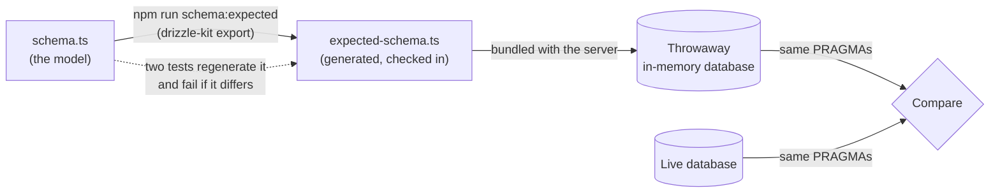

- `src/lib/server/db/expected-schema.ts` exports `EXPECTED_SCHEMA`: the DDL that
  `drizzle-kit export` prints for `schema.ts`, one statement per entry. It is bundled
  with the server, so nothing is read from disk at run time.
- `scripts/generate-expected-schema.mjs` writes it. Run `npm run schema:expected` after
  any change to `schema.ts`. With `-- --check` it writes nothing and exits 1 if the
  module is out of date. It opens no database file.
- Two tests in `tests/migrations.test.ts` guard it. One compares the module with a fresh
  `drizzle-kit export`, statement for statement; the other runs the generator with
  `--check`. Changing `schema.ts` without regenerating, or editing the module by hand,
  fails the suite.
- At start-up the runner executes that DDL in a throwaway in-memory database and reads
  it back with the same PRAGMAs it uses on the live one (`table_xinfo`,
  `foreign_key_list`, `index_list`, `index_xinfo`), so the two are compared like with
  like. Structure is never compared as text: the same table can be written many ways,
  and after a rename SQLite stores its name quoted. The one thing taken from the text is
  whether it says `AUTOINCREMENT`, which no PRAGMA reports.

### Reconciliation: The Six Tables

Six tables are known to have reached databases in two shapes, and they are the only
tables ever rebuilt. The list is fixed in code (`RECONCILED_TABLES`):

| Table | Column | Shape some databases have | The model's shape |
|-------|--------|---------------------------|-------------------|
| `boards` | `parent_card_id` | no foreign key | references `cards(id)`, `ON DELETE CASCADE` |
| `boards` | `created_by` | references `users(id)` with no `ON DELETE` action | `ON DELETE SET NULL` |
| `columns` | `wip_limit` | nullable | `NOT NULL DEFAULT 0` |
| `categories` | `board_id` | `NOT NULL`, `ON DELETE CASCADE` | nullable, `ON DELETE SET NULL` |
| `settings` | `key` | `TEXT PRIMARY KEY` that accepts NULL | `NOT NULL` |
| `user_xp` | `name` | `TEXT PRIMARY KEY` that accepts NULL | `NOT NULL` |
| `invite_tokens` | `token` | `TEXT PRIMARY KEY` that accepts NULL | `NOT NULL` |

SQLite cannot alter a `NOT NULL`, a primary key or a foreign key in place, so a table
that differs is rebuilt: a new one is created, the rows are copied, the old one is
dropped and the new one takes its name.

The list is not a catch-all. A difference in any other table is reported by the
[schema check](#the-start-up-schema-check) and is a fault to look into. Rebuilding
whatever differs would turn a forgotten migration into a schema change nobody wrote.

Reconciliation runs after the migration files, at every start, and does nothing unless
one of the six exists and differs from the model. It is not attempted at all when the
database records a migration this build has no file for. That database may be newer than
the build, a later build may have changed one of the six on purpose, and an older build
must not reshape it. Going back to the previous image has to keep working.

**Guards.** Each differing table is checked before anything is changed. A table that
fails a guard is left exactly as it is, and the others go ahead.

1. Its column names are exactly the model's. A column on one side only is a migration
   that has not run, or one this build does not have. It is not a difference of shape.
2. No trigger or view belongs to the table or mentions it, and the scratch name
   (`<table>_rebuild_2006`) is not in use.
3. Where the model's column is `NOT NULL` and the live one is not: if the model gives
   the column a default, NULLs are copied as that default (`columns.wip_limit` becomes
   0). If it gives none (the three text keys), any NULL fails the guard, and the message
   names the table, the column and the number of rows.
4. No transaction is open on the connection. This one applies to every table alike.

**The rebuild.** All the tables that pass their guards are rebuilt in one transaction,
so they end up all rebuilt or all as they were. There is one case in which the
transaction is run a second time with a table fewer; see
[when a table cannot be rebuilt](#when-a-table-cannot-be-rebuilt).

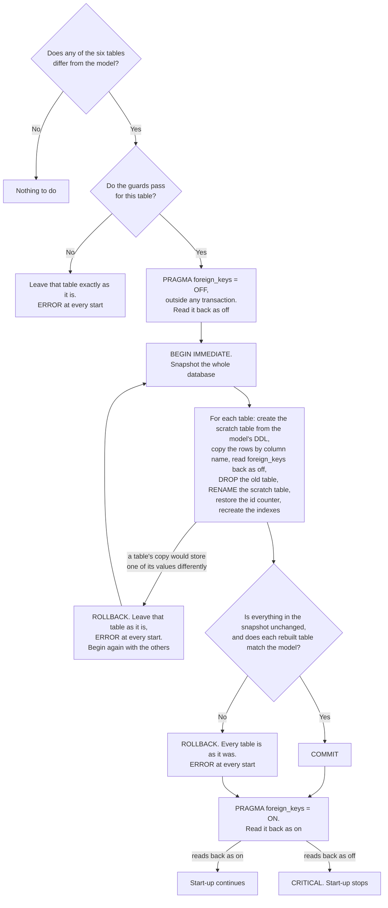

1. **Foreign keys off, outside the transaction, and read back.** SQLite ignores
   `PRAGMA foreign_keys` inside a transaction and reports no error. With foreign keys
   still on, `DROP TABLE columns` deletes the table's rows first and every card goes
   with them. So the pragma is set before the transaction opens and read back as off,
   and it is read back again immediately before each drop.
2. **`BEGIN IMMEDIATE`, then a snapshot of the whole database**: the row count of every
   table; for every foreign key column in every table, how many rows have a value and
   what the values add up to; the stored definition of every object that is not being
   rebuilt; every id counter in `sqlite_sequence`; and every row that
   `PRAGMA foreign_key_check` reports.
3. **Create, copy, drop, rename**, for each table. The scratch table is created from the
   model's own `CREATE TABLE` statement with only the name changed. Rows are copied with
   an explicit column list on both sides. Before anything is dropped the two row counts
   must agree, and every row of the copy must be a row of the table exactly, type as
   well as content and byte for byte: the text `'007'` copied into an `INTEGER` column
   is stored as the integer 7 without an error, and a rebuild must not change a value. Then the old table is dropped and the scratch table renamed to
   its name, in that order: renaming the old table out of the way first would rewrite
   every other table's foreign key to follow it, and the drop would then leave them
   pointing at a table that is gone. The id counter is put back as the larger of the old
   value and the new, because an id is never reused, and the indexes the model declares
   for the table are recreated.
4. **The whole-database comparison, before the commit.** Every row count, every foreign
   key column's count and total, and every other object's definition must be unchanged.
   The same rows must break a foreign key afterwards as did before, no more and no
   fewer. A row that already broke one is carried across still breaking it, including
   where the rebuild changes that key's `ON DELETE` rule; a rebuild neither repairs nor
   hides it. Where the model has no such key at all, the row is carried across unchanged
   and breaks nothing afterwards, because the key is gone; the table's log line names the
   key that went. No id counter may have fallen, and only a rebuilt table's may have moved. Each
   rebuilt table must now match the model. Anything else rolls the whole transaction
   back. The comparison covers the whole database because a rebuild that goes wrong does
   not show in the table being rebuilt, which comes out with the right rows. The damage
   is in the tables that refer to it.
5. **Commit, then foreign keys on, and read back**, whichever way the transaction ended.

One line is logged for each rebuilt table once the work is committed, giving the table,
the rows carried across, any NULLs that were replaced by a default, and what differed
from the model and no longer does. The last part is where a constraint the rebuild took
away can be seen: a foreign key the table had and the model has not is gone afterwards.

#### When a table cannot be rebuilt

A table that cannot be rebuilt has been running in
the shape it has. Leaving it there breaks nothing that was working, and stopping the
server over it would.

| What happens | Outcome |
|--------------|---------|
| A table fails a guard | That table is left exactly as it is; the others are rebuilt. Logged at `ERROR`, at this start and at every one after it until the cause is dealt with. The server starts. |
| Foreign keys cannot be switched off | The rebuild is not started. Logged at `ERROR` in the same way. The server starts. |
| A step of the rebuild fails, or the comparison finds a change | The whole transaction is rolled back, foreign keys are switched back on and every table in it is as it was. Logged at `ERROR` in the same way. The server starts. |
| A table holds a value that the model's column type would store differently | The transaction is rolled back, that table is left exactly as it is, and the rebuild is run again without it, so the others are rebuilt at the same start. Logged at `ERROR` for that table in the same way; it needs a migration that says what each value is to become. The server starts. This is the only failure after which the rebuild is tried again: it is a fact about one table's rows, where every other failed check is a fault in the rebuild and says nothing good about the rest of it. It is not taken on trust from the two type names. The table's values are stored once more in a column of the model's type, apart from the copy, and the difference counts as the table's own only if they come out exactly as the copy has them. |
| Foreign keys cannot be read back as on afterwards | **Start-up stops**, with a `CRITICAL` line. This is the application's only connection, and with foreign keys off every cascade and every constraint is silently off. It is the one case in which reconciliation stops the server. |

**Sub-boards whose card has gone.** A `boards` table with no foreign key on
`parent_card_id` let a card be deleted while its sub-board stayed behind, still pointing
at a card that is not there. Such a row would break the key the model adds. Where a
rebuild gives `boards` that key and the live table has no foreign key on the column,
those sub-boards are detached inside the rebuild's transaction, before the copy:
`parent_card_id` is cleared and each becomes an ordinary board. Nothing is deleted, and
each is logged by id and name with the id of the card it belonged to. The comparison is
told to expect exactly that many references cleared from that one column, and no other
change. A row that breaks any other foreign key a rebuild adds still fails the
comparison, and the rebuild is rolled back and reported.

### The Start-Up Schema Check

After the backfills, the whole live database is compared with the model
(`schemaDifferences()`): a table, column, view or trigger that only one side has; a
column whose type, nullability, default, position in the primary key or kind (ordinary
or generated) differs; a foreign key or an index that only one side has; and whether a
table is `AUTOINCREMENT`. The migration record and SQLite's own tables are left out.

Every difference goes into one `ERROR` line. Nothing is changed and start-up continues,
because an older build started against a newer database differs in exactly this way and
has to start. On a database that matches the model it says nothing at all.

A difference means one of four things: an older build is running against a newer
database; one of the six tables could not be rebuilt, which has a line of its own; the
model has a change that no migration makes; or the database was changed outside the
migrations, for example with `drizzle-kit push`.

### What the Comparison Ignores

What the comparison ignores is set by six rules, not by a list of exceptions. No table
and no column is excused from it.

| Ignored | Why |
|---------|-----|
| The case of a type name (`INTEGER`, `integer`) | SQLite treats the two as the same |
| `NOT NULL` on an `INTEGER PRIMARY KEY` | The column is the rowid, which is never NULL whether or not `NOT NULL` is written |
| `false` and `true` as defaults, against `0` and `1` | They are SQLite's names for 0 and 1 |
| `DEFAULT NULL`, against no default | They are the same thing |
| The order of a table's columns | Column order is not part of the schema |
| The case of a foreign key's parent table name, and a parent column left out | `REFERENCES Boards` and `REFERENCES boards(id)` are the same key: SQLite does not distinguish the case, and no column named means the parent's primary key |

The first four, and the sixth, are things SQLite itself treats as identical. The fifth is a
rule of this comparison. A column added by `ALTER TABLE` goes on the end, so a table that grew over
the years has its columns in a different order from one created whole from the model.
Nine tables on production do. That is no difference, because nothing reads a column by
its position: the application, the restore and the rebuild name the columns they write,
and rows are read as objects keyed by name. Columns are therefore matched by name.

Order inside a primary key or an index is another matter. It decides what the key or the
index does, and it is compared. An index made by `CREATE INDEX` is compared by its name
and the columns it covers; one SQLite made for a `PRIMARY KEY` or `UNIQUE` constraint
has a name nobody chose and is compared by what it covers.

Some things are not compared because no PRAGMA read here reports them, and a difference in
any of them goes unseen: `CHECK` constraints; the `WHERE` of a partial index (that it is
partial is compared); `COLLATE` on a column that no index covers; `DEFERRABLE` on a
foreign key; `STRICT`, and `WITHOUT ROWID`; `ON CONFLICT` clauses on a constraint; and the
expression of a generated column (that it is generated is compared). The model uses only
the first of these. The schema has one `CHECK`, on `token_usage`, and a test of
its own covers it.
