# DumpFire Data Model

DumpFire uses SQLite as its embedded database, managed by Drizzle ORM. The schema is defined in `src/lib/server/db/schema.ts` and migrations live in `drizzle/`. How the migrations are applied, and how a database is checked against the schema, is described under [Migrations and Schema Reconciliation](#migrations-and-schema-reconciliation).

## Entity-Relationship Diagram

```mermaid
erDiagram
    users {
        int id PK
        text username UK
        text email UK
        text password_hash
        text emoji
        text role
        text notification_prefs
        text created_at
        int mfa_known_wrong "0065, and ten more two-step sign-in columns: see below"
        int mfa_password_enrol "0066: NOT NULL DEFAULT 0; 1 may set up on the password"
        text security_signal_last_at "0069: the latest stolen-password signal (card 2772, CS1)"
        text disabled_at "0072: when it was disabled, NULL while enabled (card 2671)"
        int disabled_by FK "0072: who disabled it, SET NULL"
    }

    sessions {
        text id PK "declared TEXT; holds the 32-byte SHA-256 of the session's code, as a BLOB (card 2775)"
        int user_id FK
        text expires_at "the idle limit: now + 12 h (3 days for a user), never past the total limit"
        text created_at "starts the total limit: 24 h (7 days for a user)"
        int wrong_password_count "0062: NOT NULL DEFAULT 0; 3 ends the session"
        int two_step "0066: NOT NULL DEFAULT 0; 1 made after a second factor"
    }

    invite_tokens {
        text token PK "declared TEXT; holds the 32-byte SHA-256 of the token sent, as a BLOB (card 2849)"
        int user_id FK
        text expires_at
        int used
        text created_at
    }

    teams {
        int id PK
        text name
        text emoji
        text created_at
    }

    team_members {
        int team_id PK_FK
        int user_id PK_FK
        text role
    }

    api_keys {
        int id PK
        text key_hash UK
        text key_prefix
        text name
        int user_id FK
        text last_used_at
        text expires_at
        text created_at
        text deadline_at "0069: keep by, null once kept"
    }

    board_categories {
        int id PK
        text name
        text color
    }

    boards {
        int id PK
        text name
        text emoji
        int parent_card_id FK
        int category_id "no foreign key"
        bool is_public
        int created_by FK
        text kind "delivery (default) or ideas, 0060"
        int product_owner_user_id FK "SET NULL, 0061"
        text created_at
        text updated_at
    }

    board_members {
        int board_id PK_FK
        int user_id PK_FK
        text role
    }

    board_teams {
        int board_id PK_FK
        int team_id PK_FK
        text role
    }

    board_favourites {
        int user_id PK_FK
        int board_id PK_FK
        text created_at
    }

    columns {
        int id PK
        int board_id FK
        text title
        real position
        text color
        bool show_add_card
        int wip_limit
        text role "NULL or options, 0060"
    }

    categories {
        int id PK
        int board_id FK
        text name
        text color
    }

    cards {
        int id PK
        int column_id FK
        int category_id FK
        text title
        text description
        real position
        text priority
        text color_tag
        text due_date
        text on_hold_note
        text business_value
        bool pinned
        text completed_at
        text first_completed_at
        text archived_at
        text cover_url
        text recurrence_rule
        text next_recurrence
        int milestone_id FK
        int created_by FK
        text committed_at "when committed; NULL on an option, 0060"
        int committed_by FK
        text discarded_at "0060"
        int discarded_by FK
        text summary
        text theme
        text customer_impact
        text close_reason
        text release_state
        text created_at
        text updated_at
    }

    subtasks {
        int id PK
        int card_id FK
        text title
        text description
        text priority
        text color_tag
        text due_date
        bool completed
        real position
    }

    card_assignees {
        int card_id PK_FK
        int user_id PK_FK
    }

    labels {
        int id PK
        int board_id FK
        text name
        text color
    }

    card_labels {
        int card_id FK
        int label_id FK
    }

    card_comments {
        int id PK
        int card_id FK
        int user_id FK
        text content
        text created_at
        text updated_at
    }

    card_attachments {
        int id PK
        int card_id FK
        text filename
        text original_name
        text mime_type
        int size_bytes
        int uploaded_by FK
        text created_at
    }

    card_dependencies {
        int id PK
        int card_id FK
        int depends_on_card_id FK
        int created_by_user_id FK
        text created_at
    }

    work_dependencies {
        int id PK
        text blocked_type
        int blocked_id
        text blocker_type
        int blocker_id
        int created_by_user_id FK
        text created_at
    }

    milestones {
        int id PK
        int board_id FK
        text name
        text description
        text target_date
        text status
        int created_by FK
        text created_at
        text updated_at
    }

    card_templates {
        int id PK
        int board_id FK
        text name
        text title
        text description
        text priority
        text subtasks_json
        text labels_json
        int created_by FK
        text created_at
    }

    activity_log {
        int id PK
        int board_id FK
        int card_id FK
        int user_id FK
        text action
        text detail
        text user_name
        text user_emoji
        text source
        text created_at
    }

    daily_snapshots {
        int id PK
        int board_id FK
        int column_id FK
        text date
        int card_count
    }

    task_requests {
        int id PK
        text target_type
        int target_id
        text requester_name
        text requester_email
        int requester_user_id FK
        text title
        text description
        text priority
        text status
        text access_token "retired (0070): always NULL"
        text business_value
        int resolved_by FK
        int resolved_card_id FK
        text reject_reason
        text mail_held_because "0078, card 3020"
        text mail_released_at "0078"
        int mail_released_by FK "0078, SET NULL"
        text mail_released_by_name "0078"
        text created_at
        text resolved_at
    }

    request_messages {
        int id PK
        int request_id FK
        text sender_type
        text sender_name
        text message
        text created_at
    }

    request_links {
        int id PK
        text token_hash UK
        int request_id FK
        text source
        text created_at
    }

    webhooks {
        int id PK
        int board_id FK
        text url
        text secret
        text events
        bool active
        text created_at
        int set_by FK
        text held_because "0071: why switched off for good"
        text held_at "0071"
        int set_by_key FK "0071, card 2893"
        int set_with_key "0071, card 2893"
        text receiver "0073, card 2928: plain origin beside the sealed url"
    }

    report_schedules {
        int id PK
        int user_id FK
        text name
        text scope
        int scope_id
        text frequency
        int day_of_week
        int day_of_month
        text time_of_day
        text time_zone
        bool enabled
        text recipients
        int period_days
        text last_run_at
        text next_run_at
        text created_at
        text updated_at
    }

    backup_log {
        int id PK
        text destination_type
        text destination_name
        text filename
        int size_bytes
        text status
        text error
        int duration_ms
        text created_at
    }

    user_xp {
        text name PK
        int xp
        text emoji
    }

    settings {
        text key PK
        text value
    }

    setting_setters {
        text setting PK
        text place PK
        int user_id FK "NULL: nobody's"
    }

    users ||--o{ setting_setters : "put it there"
    users |o--o{ users : "disabled_by (0072)"
    users ||--o{ sessions : "has"
    users ||--o{ invite_tokens : "invited by (hash only)"
    users ||--o{ mfa_factors : "second factors (0065)"
    users ||--o{ mfa_recovery_codes : "recovery codes (0065)"
    users ||--o{ sign_in_challenges : "pending sign-ins (0065)"
    users ||--o{ enrolment_links : "may enrol with (0065)"
    users ||--o{ api_keys : "owns"
    users ||--o{ team_members : "belongs to"
    teams ||--o{ team_members : "has"
    users ||--o{ board_members : "member of"
    users ||--o{ board_favourites : "favourites"
    users ||--o{ card_assignees : "assigned to"
    users ||--o{ card_comments : "writes"
    users ||--o{ report_schedules : "configures"
    users |o--o{ webhooks : "set by"
    users |o--o{ cards : "created, committed, discarded (SET NULL)"

    boards ||--o{ columns : "contains"
    boards ||--o{ board_members : "shared with"
    boards ||--o{ board_teams : "shared with"
    boards ||--o{ board_favourites : "favourited by"
    boards |o--o{ categories : "may own"
    boards ||--o{ labels : "has"
    boards ||--o{ activity_log : "logs"
    boards ||--o{ daily_snapshots : "snapshot"
    boards ||--o{ webhooks : "fires"
    boards ||--o{ card_templates : "templates"
    board_categories |o..o{ boards : "groups (no foreign key)"
    teams ||--o{ board_teams : "access"

    columns ||--o{ cards : "contains"
    columns ||--o{ daily_snapshots : "tracked in"
    cards ||--o{ subtasks : "has"
    cards ||--o{ card_assignees : "assigned"
    cards ||--o{ card_labels : "tagged"
    cards ||--o{ card_comments : "discussed"
    cards ||--o{ card_attachments : "attached"
    cards ||--o{ card_dependencies : "depends on"
    cards |o--o{ boards : "parent of sub-boards"
    boards |o--o{ milestones : "may scope"
    milestones ||--o{ cards : "groups"
    categories ||--o{ cards : "categorises"
    labels ||--o{ card_labels : "applied to"

    task_requests ||--o{ request_messages : "thread"
    task_requests ||--o{ request_links : "links (0070)"
```

### Decision records (migration 0061)

The people directory, the decisions and their record, and a board's Product Owner (card 2673,
milestone 35). Every key to `users` is SET NULL, with a name kept beside it; every table under
a decision cascades from it; the six references from the record to participants and options
have no ON DELETE action (NO ACTION), so the database refuses to delete one the record
mentions. Columns are listed in full under [Key Schema Notes](#key-schema-notes).

```mermaid
erDiagram
    people {
        int id PK
        text full_name
        text email UK "lower-case"
        text job_title
        int user_id FK "UNIQUE, SET NULL"
        text status "active or left"
        text left_at
        int created_by FK
        text created_at
        text updated_at
    }
    people_groups {
        int id PK
        text name UK
        text description
        text created_at
    }
    people_group_members {
        int group_id PK_FK
        int person_id PK_FK
    }
    people_changes {
        int id PK
        text created_at
        int actor_user_id FK "SET NULL (0064)"
        text actor_name
        text source "ui or api"
        text subject "person or group"
        int subject_id "no key: outlives its subject"
        text kind "created, updated, deleted, members_set"
        text before "JSON, no address or account id"
        text after "JSON, no address or account id"
    }
    decisions {
        int id PK
        int board_id FK "SET NULL"
        text board_name
        text title
        text status "draft by default"
        text vote_mode "single or score"
        text working_content "JSON"
        int current_version
        int author_user_id FK
        text author_name
        int decider_user_id FK
        text decider_name
        int supersedes_id FK "self, SET NULL"
        int results_released_by FK
    }
    decision_options {
        int id PK
        int decision_id FK
        text label
        real position
        int added_in_version
        int retired_in_version
    }
    decision_versions {
        int id PK
        int decision_id FK "UNIQUE with number"
        int number
        text content "JSON snapshot"
        bool asks_again
        int published_by FK
        text published_by_name
        text published_at
    }
    decision_participants {
        int id PK
        int decision_id FK
        int person_id FK "SET NULL"
        text role "consulted or informed"
        text name "snapshot"
        text email "snapshot"
        int user_id FK "snapshot, SET NULL"
        text link_token_hash UK
    }
    decision_responses {
        int id PK
        int decision_id FK
        int participant_id FK "NO ACTION"
        int option_id FK "NO ACTION"
        int replaces_id FK "self, SET NULL"
        text kind
        text via
        text created_at
    }
    decision_questions {
        int id PK
        int decision_id FK
        int participant_id FK "NO ACTION"
        text question
        text answer
        int answered_by FK
        int answer_reviewed_by FK
    }
    decision_rulings {
        int decision_id PK_FK
        int option_id FK "NO ACTION; NULL: none of them"
        text reason
        bool against_responses
        bool early
        int ruled_by FK
        text ruled_by_name
        text ruled_at
    }
    decision_events {
        int id PK
        int decision_id FK
        int participant_id FK "NO ACTION; unique with version_number where kind = reminded (0063)"
        text kind
        int version_number "the round, on reminded"
        int actor_user_id FK
        text actor_name
        text source
        text created_at
    }
    decision_card_links {
        int decision_id PK_FK
        int card_id PK_FK
        text relation
        int created_by FK
        text created_at
    }

    users |o--o{ boards : "product_owner_user_id (SET NULL)"
    users |o--o| people : "user_id (SET NULL)"
    people ||--o{ people_group_members : "CASCADE"
    people_groups ||--o{ people_group_members : "CASCADE"
    users |o--o{ people_changes : "actor_user_id (SET NULL)"
    people |o..o{ people_changes : "subject_id, person (no key)"
    people_groups |o..o{ people_changes : "subject_id, group (no key)"
    boards |o--o{ decisions : "board_id (SET NULL)"
    decisions |o--o{ decisions : "supersedes_id (SET NULL)"
    decisions ||--o{ decision_options : "CASCADE"
    decisions ||--o{ decision_versions : "CASCADE"
    decisions ||--o{ decision_participants : "CASCADE"
    people |o--o{ decision_participants : "person_id (SET NULL)"
    users |o--o{ decision_participants : "user_id snapshot (SET NULL)"
    decisions ||--o{ decision_responses : "CASCADE"
    decision_participants ||--o{ decision_responses : "NO ACTION"
    decision_options |o--o{ decision_responses : "NO ACTION"
    decisions ||--o{ decision_questions : "CASCADE"
    decision_participants |o--o{ decision_questions : "NO ACTION"
    decisions ||--o| decision_rulings : "CASCADE"
    decision_options |o--o| decision_rulings : "NO ACTION"
    decisions ||--o{ decision_events : "CASCADE"
    decision_participants |o--o{ decision_events : "NO ACTION"
    decisions ||--o{ decision_card_links : "CASCADE"
    cards ||--o{ decision_card_links : "CASCADE"
```

#### How the decision tables are written (card 2675)

The decision services (`src/lib/server/decision-*-writes.ts`, seven since card 2713, their
shared helper `decision-write-shared.ts`, and the read modules; see
[Architecture](architecture.md#the-decision-service-and-its-record)) is the only writer. Card
2676's routes call its drafting writes ([below](#the-working-copy-and-its-revision-card-2676)),
and card 2677's a participant's responses and opening
([below](#responses-and-opening-card-2677)); no route calls the lifecycle writes yet (card
2697). It added no column: everything below lives
in 0061's columns or on the record.

**`decisions.status`** is stored as one of `draft`, `open`, `closed`, `ruled`, `superseded` or
`withdrawn` (`STORED_STATUSES` in `src/lib/server/decision-status.ts`). Readers show `closed`,
and `open` with `closes_at <= now`, as `awaiting_ruling` (`decisionStatus`, and
`awaitingRulingSql` for a query). Moments are `stamp()` text, so `closes_at <= ?` in SQL agrees
with `<=` on strings in code. The service stamps every NOT NULL moment with no default itself:
`decision_participants.included_at`, `decision_versions.published_at`, and (card 2679)
`decision_rulings.ruled_at`.

```mermaid
stateDiagram-v2
    [*] --> draft: createDecision
    draft --> open: openDecision (opened_at, current_version 1)
    draft --> withdrawn: withdrawDecision
    draft --> [*]: deleteDecision (cascade)
    open --> open: republishDecision (current_version + 1)
    open --> closed: closeDecision (closed_at)
    closed --> open: extendDecision (closes_at moved, closed_at NULL),<br/>or republish asking again
    open --> ruled: ruleDecision (ruled_at; decision_rulings row)
    closed --> ruled: ruleDecision (ruled_at)
    open --> withdrawn: withdrawDecision (withdrawn_at, withdrawn_reason)
    closed --> withdrawn: withdrawDecision
    ruled --> ruled: releaseResults (results_released_at, _by), a concern
    ruled --> superseded: ruleDecision of the superseding decision, by its old decider, PO or an admin
    withdrawn --> [*]: deleteDecision (cascade)
```

**Insert-only.** No code in `src` updates or deletes a row of `decision_versions`,
`decision_responses`, `decision_rulings` or `decision_events`: `appendEvent`, `appendVersion`,
(card 2677) `appendResponse` and (card 2679) `appendRuling` in
`src/lib/server/decision-record.ts` are their only inserts
outside the restore, and a scan in
`tests/decision-record.test.ts` holds it (no trigger, design 4.3). The rows change only in these
ways, none of them written by the service:
- deleting an account empties `decision_versions.published_by`, `decision_rulings.ruled_by`,
  `decision_events.actor_user_id` and `decision_participants.user_id` by SET NULL, each with a
  NOT NULL name beside it, and writes no event;
- a response's `replaces_id` is SET NULL only when the response it names goes in a decision's
  cascade;
- `deleteDecision` removes a draft or withdrawn decision with every row below it, by cascade.
  SQLite checks the NO ACTION keys after the cascade, so they do not stop it. Nothing else in
  `src` deletes a `decisions` row, and a ruled or superseded decision cannot be deleted;
- a restore and the superadmin reset replace the whole database.

`decisions`, `decision_participants` and `decision_options` are ordinary rows and do change.

**Versions and options.** Opening writes version 1 (`asks_again` true) holding the working
content with the live options' text, sets `current_version` to 1, and gives every live option
`added_in_version = 1`. Each re-publish writes version N+1: an option added since has
`added_in_version` NULL and is given N+1; a published, live option whose id is no longer listed
in the working content's `options` (each entry's `optionId`) is given `retired_in_version =
N+1`. A working content with no `options` list retires none. Telling of a change without
asking again is refused while either would happen. `liveOptionIds(decisionId, n)` reads the
options added by version n and not retired by it.

**Participant rows.** The snapshot columns (`name`, `email` lower-case, `job_title`, `groups` as
a JSON list of names in order, `user_id`) are copied from the person when they are added to a
draft and copied again for every draft row at opening, with `included_at` stamped then. After
opening a snapshot is never refreshed from the directory: only an administrator's
`changeParticipantAddress` changes `email`, and `setParticipantAccount` changes `user_id`. In a
draft, a row left out is deleted, since no event names it. After opening, a row left out is
marked `removed_at` and `removed_by` and kept with its responses, and a person added again comes
back on the same row. No key stops two live rows of a decision sharing a `user_id`, so the
service refuses one (409), and `decisionAccess` gives no participant role to an account that two
live rows hold.

**`hadAccount`**, whether a row held an account on its decision, has no column. It is read from
the record by `accountHistory`: the latest of the row's `included` and `re_included` (each
`{ role, hadAccount }`), `account_attached` (true) and `account_cleared` (false) events. A row
whose account was deleted, its `user_id` emptied by the key with no event, is still read as
having held one, so it is never mailed a personal link (`account_removed`). `deleteUser()` also
marks the account's person left (`people.status`, `left_at`) before the account goes (card 2675's
code review, S4), so such a row is skipped `left` until an administrator marks them active.

**Link columns.** `link_token_hash` holds the SHA-256, in hex, of a personal link's token (32
random bytes in base64url), unique, with `link_issued_at`. The token is never stored. A link is
issued only to a participant with no account, now or before, whose person is active, has no
account and holds the snapshot address. Each record-bearing mail to such a participant replaces
the hash. Ending a link empties both columns and writes `link_revoked { reason }`; the reasons
are `removed`, `left`, `linked`, `unlinked`, `address_changed`, `person_deleted`,
`account_attached`, `participant_address` and `restore`. A link expires when it is read, not by
a sweep: it is usable until 90 days after `ruled_at` (ruled, superseded), `withdrawn_at`
(withdrawn) or `closes_at` (open, closed); with no such moment only on an open decision; never
on a draft.

**`decision_events`.** Each row is one `kind`, with `participant_id` and `version_number` where
they apply, a JSON `detail`, and its actor (`actor_user_id` while the account lasts, `actor_name`,
and `source`, one of `ui`, `api`, `link`, `system`). An event naming a participant on a draft is
refused (comment 5599). A `detail` never holds a token, a hash or a mail server's words.

| `kind` | Names a participant | `detail` |
|---|---|---|
| `created` | no | `{ decider: 'product_owner' \| 'author' }`; on a superseding draft (card 2679) `{ decider: 'previous_decider' \| 'author', supersedes: <oldId> }` |
| `decider_changed` | no | `{ fromUserId, fromName, toUserId, toName }` |
| `published` | no | `{ asksAgain, changeNote }`, with `version_number` |
| `opened` | no | `{ closesAt }` |
| `included`, `re_included` | yes | `{ role, hadAccount }`; since card 2743, one as `consulted` on a decision not shown open (closed, or past its closing time) is followed by no mail event, as they are not asked until it is reopened; card 2744: the `extended`, or the `published` asking again, that reopens it is followed by an `invited` (or a `mail_skipped { mail: 'invitation', reason }` an Extend writes where a rest or a cap holds the ask) for each live consulted participant the round never reached |
| `role_changed` | yes | `{ from, to }` |
| `removed` | yes | none |
| `link_issued` | yes | `{ replaced }` |
| `link_revoked` | yes | `{ reason }` |
| `invited` | yes | `{ resend: true }` on a re-send, otherwise none |
| `asked_again`, `told_of_change` | yes | none, with `version_number` |
| `told_withdrawn`, `told_ruling` | yes | none |
| `mail_skipped` | yes | `{ mail, reason }`, reason `deleted`, `left`, `account_not_attached`, `account_removed` or `address_changed` (`reachOf`); or, since card 2740, `resting`, `daily_cap` or `caller_cap` for the invitation a participant made consulted on an open decision was not sent, as a rest or a cap held it back (`HoldReason`), the role change saved |
| `mail_outcome` | yes | `{ of, mail, delivered, problem? }`: `of` the mail event's id, `problem` a `MailProblem` code, `no_link_address`, or `superseded` for a mail not sent as it no longer stood when asked again before its send (card 2675's F2). `mail` is the record mail's name, or (card 2685) `reminder` for a closing-date reminder's outcome |
| `closed` | no | none |
| `extended` | no | `{ from, to }` |
| `withdrawn` | no | `{ reason }` |
| `account_attached`, `account_cleared` | yes | `{ userId }` |
| `address_changed` | yes | `{ from, to }` |
| `dry_run` | no | `{}`: a dry run mailed to its actor alone (card 2697); never names a participant, on a draft too |
| `seen` (card 2677) | yes | `{ stage }`, `stage` `question`, `ruling` or `withdrawal`, with `version_number`; `signedIn { userId, name }` beside it for a link holder in a signed-in browser |
| `responded` (card 2677) | yes | `{ responseId }`, with `version_number`; `signedIn` as for `seen`; since card 2679 `statement`, the who-sees statement's version the page showed (now 2), where the body sent it |
| `ruled` (card 2679) | no | `{ optionId, early, againstResponses, productOwnerUserId }`, `optionId` null for none of these, `productOwnerUserId` the board's Product Owner at the ruling or null, the one account that holds `productOwner` on the decision from then on (code review S1), and `supersededOld` (boolean) on a decision that supersedes another; with `version_number`. **Decider and administrator only** |
| `cut_off` (card 2679) | yes | `{ reached }` since card 2738, none before: `reached` whether the round's request ever reached them (a delivered `invited` or `asked_again` of the round, or the question seen in it, while consulted and while the decision was open for input in the round, after the round's `published` event by id, a `removed` resetting it: `reachedInRound`, card 2738's code review), written both ways; a `cut_off` with no detail says neither. A live consulted participant with no response in the round, on an early ruling, written after `ruled`. Early is shown open at the ruling, or, since card 2727, stored `closed` with `closed_at` before `closes_at` (read from those two columns: the `closed` event still carries no detail); rulings before card 2727 are not rewritten. **Decider and administrator only** |
| `superseded` (card 2679) | no | `{ byDecisionId }`, on the old decision, when the ruler of the decision superseding it may supersede it |
| `results_released` (card 2679) | no | `{ upToResponseId, omitted: { responseId, field }[] }`: the highest response id counted, which freezes the release, and each comment left out, `field` `comment` or `option:<id>` |
| `concern_raised` (card 2679) | yes | `{ responseId, notice }`, `notice` one of `asked`, `held`, `no_decider`, `no_link_address`, `prefs_off`, `no_mail_host` (code review F2); `signedIn` as for `seen`; with `version_number`. **Decider and administrator only** |
| `reminded` (card 2685) | yes | none: the closing-date reminder, by `DumpFire` (source `system`), with `version_number` the round (`currentRound`), written before the mail is sent; its `mail_outcome { of, mail: 'reminder', delivered, problem? }` follows. At most one per participant per round, held by migration 0063's partial unique index. Shown on a person's own record (`OWN_RECORD_EVENTS`) as "A reminder was due before closing", with no outcome |

**A restore** (`restoreFromBackup` in `src/lib/server/db/restore.ts`) copies the decision tables
as it copies every other, then, inside its transaction, writes `link_revoked { reason: 'restore' }`
by `DumpFire` (source `system`) for each participant holding a link on a decision that is not a
draft, and empties every `link_token_hash` and `link_issued_at`, drafts' included. The count is
`RestoreResult.decisionLinksCleared`. A row of `decisions` or of any `decision_*` table that
cannot be copied fails the restore, which rolls back: a lost event strands no row, so the
foreign-key check would not stop it, and a partial record would be a false one. A NULL in a NOT
NULL column of a decision table is never given the column's default, as `defaultsForNull` gives
it elsewhere: the row is left out, and the restore fails (card 2675's code review, F8).

#### The counts the lifecycle reads (card 2697)

Card 2697 (plan `docs/planning/card-2676-decision-authoring.md`, part B) added no column, no
table and no migration. Its limits are read from `decision_events` in `decision-record.ts`, the
one module that reads the record tables by name, through the existing index
`idx_decision_events_actor_user_id`:

| Read | From | Used by |
|---|---|---|
| `lastDryRunAt(userId)`, `dryRunsSince(userId, since)` | `dry_run` events by `actor_user_id`, across decisions | the dry run's 10-minute rest and its 20 a day |
| `publishesSince(userId, since)` | `published` events by `actor_user_id`, across decisions (Open writes one, each re-publish one) | the publish limit, 10 a day |
| `mailsSince(participantIds, since)` | the record-mail kinds (`invited`, `asked_again`, `told_of_change`, `told_withdrawn`, `told_ruling`) per participant; never `reminded` (card 2685) | the record-mail cap, 5 a day per participant |
| `lastMailAt(participantIds)` | the latest of the record-mail kinds and (card 2685) `reminded` per participant (`REST_KINDS`) | the 10-minute rest: a reminder starts it, and does not count toward the cap |
| `personOfAccount(userId)` | the `people` row whose `user_id` is the account | the dry run's address rule |
| `deliveryOf(decisionId)` | one read of the decision's events: per participant the latest record mail with its own `mail_outcome` (`detail.of`), the moment the rest runs from (`lastRestAt`, the latest record mail or `reminded`, card 2685), the latest `mail_skipped` and the latest `link_revoked` | the editor's delivery panel |

Each count read returns the moments themselves, so the refusal can say from when the next is
allowed (the earliest of the window's plus 24 hours). **A deletion takes the counts with it**: a
decision's events cascade with it (`decision_events.decision_id`, `onDelete: 'cascade'`), so the
per-caller limits are also held by an in-memory allowance (`takeAllowance`) that a deletion does
not give back. A deletion followed by a restart clears both, which is accepted (plan Q27). The
per-participant cap needs no allowance: a participant's rows go only with their decision, which
can then no longer be mailed.

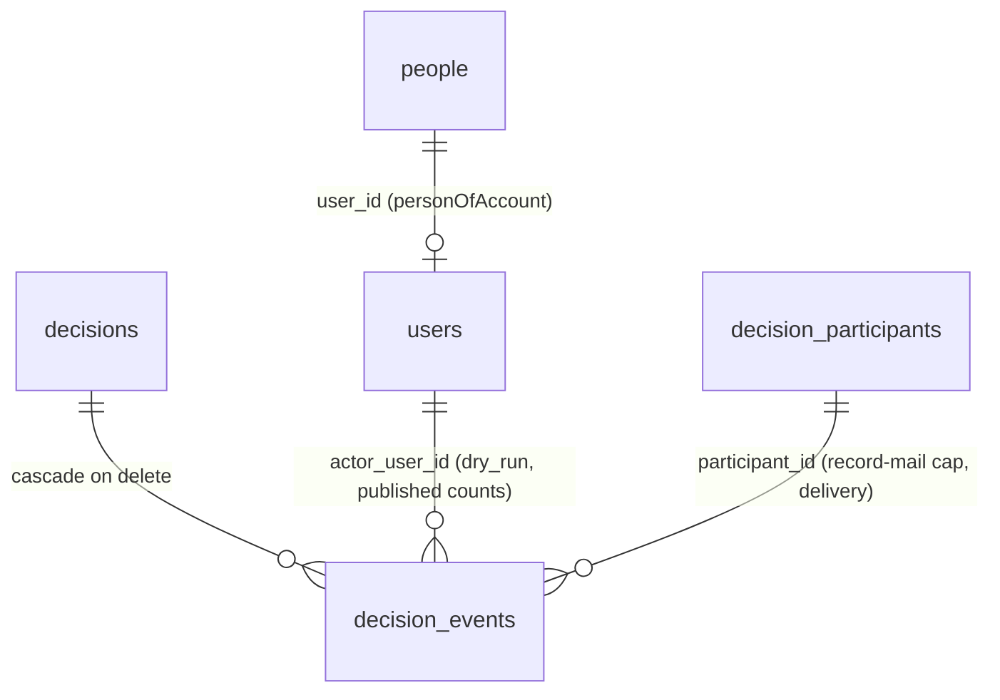

#### Responses and opening (card 2677)

Card 2677 (plan `docs/planning/card-2677-participant-page.md`) writes `decision_responses` and
two kinds of `decision_events`, through `respondToDecision`, `respondByLink`, `recordSeen` and
`recordSeenByLink`, now in `src/lib/server/decision-response-writes.ts`. It added no column and no migration: 0061
holds every column a response needs, and an event's `kind` is free text checked in code
(`EVENT_KINDS`, which gains `seen` and `responded`).

| Column | Written |
|---|---|
| `version_number` | `current_version`, which the body's `versionNumber` must equal (`409` otherwise) |
| `round` | `currentRound(decisionId)`: the number of the latest version that asked for views (`asks_again`), so a version that only tells keeps the round |
| `kind` | `vote`, `abstain` or `no_concerns` (`RESPONSE_KINDS`); `concern` is card 2679's ([below](#the-ruling-the-release-concerns-and-supersede-card-2679)) |
| `option_id` | a single-mode vote alone: an option live in the current version |
| `scores` | a score-mode vote alone: JSON `{ "<optionId>": 0..5 }` over every live option, built from the live ids, never from the body's keys; stored in ascending option id order (a JavaScript object keeps integer keys in that order, whatever order they were added in) |
| `comment` | trimmed, up to 4,000, the markdown field's character rule; NULL when empty |
| `option_comments` | JSON over live option ids, each trimmed, up to 2,000, the empty ones dropped, built from the live ids; NULL when none is left |
| `replaces_id` | the participant's latest response in the same round, NULL for the first of a round |
| `via` | `session` or `link`, fixed by the write, never by the caller |
| `created_at` | `stamp()` |

- **A change of answer is a new row**, `replaces_id` the one before it in the round; no row is
  updated. An answer identical to the latest in the round (kind, option, scores and both
  comments, as stored) **for the same version** writes nothing, and is answered with that row
  and `unchanged: true`. The same answer confirmed on a newer version, after a re-publish that
  only tells, is a new row bound to that version, with its `responded` and, where there is
  none for the version, `seen` (code review C1); the page labels a response given on an older
  version "Given on version N.".
- **At most 50 rows per participant per round** (`RESPONSES_PER_ROUND`, private to the service);
  the 51st is `409`.
- **Rounds.** A re-publish that asks again starts a round; the first response in it replaces
  nothing, and the earlier round's rows stay, shown as for an earlier version. The latest of a
  round is `latestResponse(participantId, round)`, which card 2679's results read. Card 2685's
  reminder asks whether a participant has responded in the round through `countedInRound`, which
  is `latestResponse(participantId, round) !== null` for many at once (`RESPONSE_KINDS` alone).
- **Only while open.** The stored status must be `open` (`TRANSITIONS.respond`) and the shown
  status `open`, as an open decision past `closes_at` is awaiting a ruling.
- **Each response** also writes `responded { responseId }` and, when no seen stands for that
  version (`seenStands`), `seen { stage: 'question' }`.
- **`seen`** is written once per participant, version and stage (`hasSeen`, read through
  `idx_decision_events_participant_id`): a second post for the same three writes nothing.
  Since card 2741 (`seenStands`) one exception at the question stage: where no question seen
  of the round (of any version of it) is one card 2738's reach counts (each was made while the
  decision was shut, before the latest re-inclusion, or while informed) and a new one would
  count, the new one is written. No new kind or detail key; no migration. Only
  the current version is accepted (`400` for any other, an earlier one included). The page
  sends it after the person's first action, never on load: the `ruling` stage on a ruled or
  superseded decision, which the page shows since card 2679, to a participant alone.
- **What a response is answered as** is `OwnResponse`, built by `ownResponseOf(row)`: `versionNumber`,
  `round`, `kind`, `optionId`, `scores`, `comment`, `optionComments` and `createdAt`, and no row
  id of its own, its decision, its participant or what it replaced. Stored JSON is read back
  tolerantly: a key that is not an option id, or a value of the wrong type, is left out.
- **The actor.** Signed in, `actorFor(user, 'ui')`. By link, no account, the participant's
  snapshot name and source `link`; a browser signed in at the same time is noted in the detail
  as `signedIn`, never as the actor.

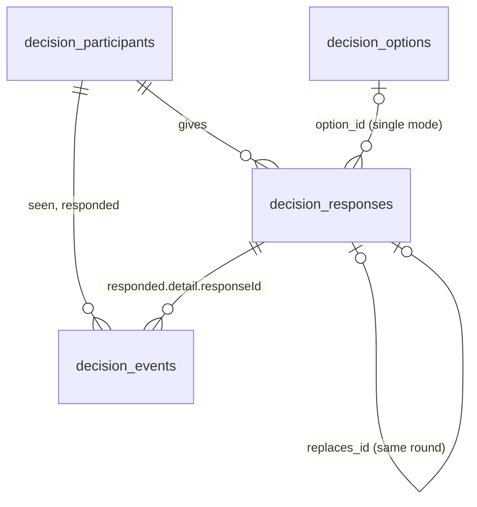

```mermaid
stateDiagram-v2
    [*] --> First: first response in round R (replaces_id NULL)
    First --> Changed: a different answer, or the same on a newer version (new row, replaces_id the last)
    Changed --> Changed: a different answer, or the same on a newer version (new row)
    First --> First: the same answer on the same version (no row, unchanged)
    Changed --> NextRound: a re-publish asking again, version V (round V)
    First --> NextRound
    NextRound --> [*]: round V's first replaces nothing; R's rows stay
```

#### The ruling, the release, concerns and supersede (card 2679)

Card 2679 (plan `docs/planning/card-2679-results-ruling.md`) writes the columns 0061 left for
the ruling, through `ruleDecision`, `releaseResults`, `raiseConcern`, `raiseConcernByLink` and
`supersedeDecision`, now in `src/lib/server/decision-ruling-writes.ts`. **It added no column, no table and no
migration**: every field is a 0061 column, and the new event details are JSON.

| Written | By | What |
|---|---|---|
| `decision_rulings` (one row, its key the decision) | `ruleDecision`, through `appendRuling`, the one insert | `option_id` (NULL: none of these), `reason` (1 to 4,000), `conditions` (NULL when empty), `against_responses`, `early`, `version_number`, `ruled_by`, `ruled_by_name`, `ruled_at` stamped. Never updated or deleted |
| `decisions.status` `ruled`, `ruled_at`, `updated_at` | `ruleDecision` | From stored `open` or `closed` |
| `decisions.status` `superseded`, `updated_at` | `ruleDecision` of the decision superseding it | Only when that ruler is the old decision's decider, its board's Product Owner or an administrator (each with board edit); otherwise the old one stays `ruled` and nothing is written on it |
| `decisions.results_released_at`, `results_released_by` | `releaseResults` | Once: a second release is `409`. Nothing else changes, and nothing reverses it |
| `decision_responses` with `kind 'concern'` | `raiseConcern`, `raiseConcernByLink`, through `appendResponse` | `round` the current, `version_number` the current, `comment` 1 to 4,000, `option_id`, `scores`, `option_comments` and `replaces_id` NULL, `via` `session` or `link`. At most 5 per participant per decision, 10 minutes apart |
| A new `decisions` row with `supersedes_id` | `supersedeDecision` | A draft on the same board, `closes_at` NULL, no participants, its options new rows labelled from A, its `working_content` the old decision's current version (`workingFromVersion`) |

- **Concerns are never votes.** `RESPONSE_KINDS` (`vote`, `abstain`, `no_concerns`), exported
  by `decision-record.ts`, is the allow-list every read of a vote, a tally and a results
  revision asks: `latestResponse`, `responsesInRound`, `ownResponses` and `responsesOf`. A kind a
  later card adds is left out of every tally until it is added there. `concernsOf` reads
  `kind = 'concern'` alone.
- **The results revision** (`resultsRevisionOf`, `decision-content.ts`): HMAC-SHA256 keyed with
  `purposeKey('decision-results-revision')` over what the editor revision covers (and each
  participant's `user_id` and `email`, which card 2706 took out of the editor revision and kept
  here), the decision's `results_released_at` (card 2734, in place of `updated_at`, which a Resend
  stamps alone; [below](#the-working-copy-and-its-revision-card-2676)), every response id `responsesOf` gives in id order (never a concern) and every question's
  `[id, answered_at]`, which card 2678 widened to `[id, answered_at, answer_reviewed_at,
  answer_agent_drafted]` ([below](#clarification-questions-settled-once-card-2678)). The
  ruling and the release send it; a different one is `409`.
- **A release is frozen** at `results_released.upToResponseId`: `releasedOf` reads only
  responses up to it, the ruling round's latest per live consulted participant. A comment left
  out is named on the event by response and field; the page names it by a keyed HMAC
  (`purposeKey('decision-comment-key')`) that cannot be turned back into a response id.
- **The statement version** is read per response from its `responded` event
  (`statementsOf`); a release is refused while any released response lacks the current one.
- **The supersede chain** is walked through `supersedes_id` both ways (`chainOf`), with a
  visited set; at most one superseding decision that is not withdrawn exists at a time, kept in
  code (`supersedingOf`), as `schema.ts` says.
- **The decider-only details.** `DECIDER_ONLY_EVENTS` in `decision-record.ts`, card 2679's
  `ruled`, `cut_off` and `concern_raised` and card 2678's four question events: their `early`,
  `againstResponses`, the cut-off names and the notice outcomes are shown to the decider and
  administrators alone (the results page) and, since card 2680, on the record view
  (`/decisions/[id]/record`), which only administrators and the decider (with board edit while
  the board exists) may read; card 2689 (webhooks) is bound to keep it so.
- **The timestamp column count stays 62**: no new column.

**The record as card 2680 reads it.** The record view lists every `decision_events` row of a
decision, oldest first, by `after` (500 a page; `readRecord`'s `limit` is required and at most
`RECORD_READ_MAX`, 5,000), optionally one participant's. Each row's stored `detail` is never
shown as stored: `recordEntryOf` builds a new object from `RECORD_DETAIL[kind]`
(`decision-record.ts`), an exhaustive per-kind allow-list. No key ending in `Id` is shown at any
depth (`fromUserId`, `toUserId`, `userId`, `of`, `questionId`, `responseId`, `upToResponseId`,
`optionId`, `productOwnerUserId`, `byDecisionId`, `supersedes`, and those nested in `notices[]`,
`omitted[]` and `signedIn`); a nested object or array at a key the spec does not name is dropped.
By kind: `created` shows `decider` and `supersedes` (as the other decision, through `namedFor`);
`decider_changed` `fromName` and `toName`; `published` `asksAgain` and `changeNote`; `opened`
`closesAt`; `included` and `re_included` `role` and `hadAccount`; `role_changed` and `extended`
`from` and `to`; `link_issued` `replaced`; `link_revoked` and `withdrawn` `reason`; the five mail
kinds `resend`; `mail_skipped` `mail` and `reason`; `mail_outcome` `mail`, `delivered` and
`problem`; `address_changed` `from` and `to` to an administrator alone; `seen` `stage`;
`responded` `statement`; `ruled` `option` (its label), `early`, `againstResponses` and
`supersededOld`; `cut_off` `reached` (card 2738); `superseded` `by` (through `namedFor`); `results_released` `omitted[]` with
`field` alone; `concern_raised` `notice`; `question_answered` `role` and `agentDrafted`;
`answer_replaced` `role` and `discarded` (`text`, `byName`, `at`); and `signedIn` (its `name`
alone) on `seen`, `responded`, `concern_raised` and `question_asked`, to an administrator alone.
`removed`, `closed`, `account_attached`, `account_cleared`, `dry_run` and
`answer_published` show nothing. The pages name each shown key in words (`DETAIL_WORDS` in
`decision-words.ts`), never the stored camelCase name. A person record shows at most 200 events a
participation, and reads one more to say there are more, bounded in SQL by `row_number() over
(partition by participant_id)`. The
person's own record shows only `OWN_RECORD_EVENTS`
(`included`, `re_included`, `role_changed`, `removed`, the five mail kinds, `seen`, `responded`),
each as kind, moment and version (and `seen`'s stage), with no actor; its questions come from the
`decision_questions` rows, never from the question events.

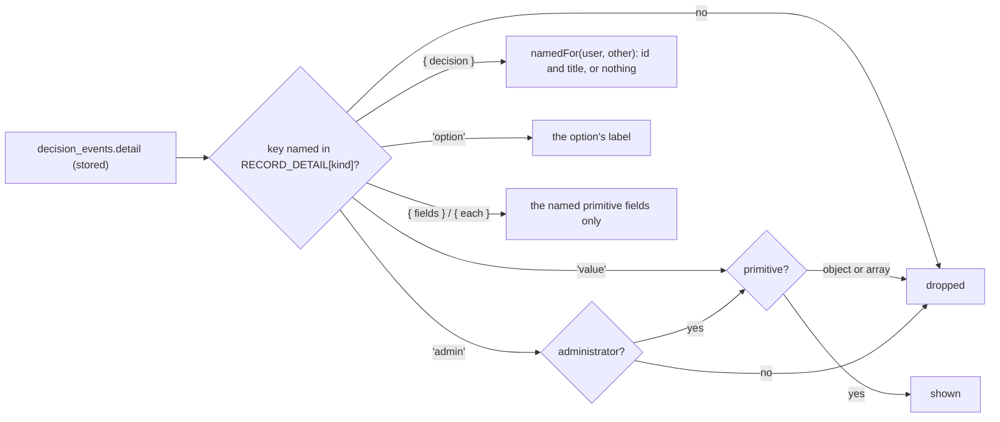

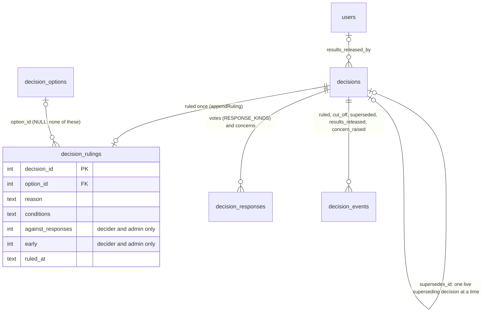

```mermaid
stateDiagram-v2
    [*] --> Ruled: ruleDecision
    Ruled --> Released: releaseResults (one way; frozen at upToResponseId)
    Ruled --> Ruled: concern (kind 'concern' row, concern_raised)
    Released --> Released: concern
    Ruled --> Superseded: the superseding decision ruled by the old decider, PO or an admin
    note right of Released
        results_released_at stays set;
        a superseded decision can no
        longer be released
    end note
```

#### Clarification questions, settled once (card 2678)

Card 2678 (plan `docs/planning/card-2678-clarification-questions.md`) is the first writer of
`decision_questions`, through `askQuestion`, `askQuestionByLink`, `answerQuestion` and
`publishAnswer`, now in `src/lib/server/decision-question-writes.ts`. **It added no column, no table and no
migration**: every field is a 0061 column, the event details are JSON, and the timestamp column
count stays 62.

**Not insert-only: settled once.** The answer, its author, its agent flag and its review are
columns of the question row, so answering is an `UPDATE`. The design's insert-only rule names
four tables (`decision_versions`, `decision_responses`, `decision_rulings`, `decision_events`),
and the schema and the record module say so. **Migration 0061's header comment is wrong** to
list `decision_questions` among the tables the application only inserts into; an applied
migration is not edited, so the correction lives here and in `decision-record.ts`'s header. The
rule instead: a question row is inserted once, and its answer settled once, through exactly one
insert and three guarded updates, all in `decision-record.ts`:

| Write | Sets | Guard (`WHERE id = ? AND …`) | Settles |
|---|---|---|---|
| `appendQuestion` (insert) | `decision_id`, `participant_id`, `asker_name` (the participant row's snapshot name), `question` (1 to 2,000), `asked_in_version` (current), `via`, `asked_at` (stamped) | n/a | a new open question |
| `recordAnswer` | `answer` (1 to 4,000), `answered_by`, `answered_by_name`, `answered_at`, `answer_agent_drafted` (true for any source but `'ui'`, an API key's among them, set by the server; false only for the page's) | `answer IS NULL` | a person's answer, or an agent's draft |
| `recordDraftPublished` | `answer_reviewed_by`, `answer_reviewed_at` (the publishing moment) | `answer IS NOT NULL AND answer_agent_drafted = 1 AND answer_reviewed_at IS NULL` | a draft, published unchanged |
| `recordDraftReplaced` | `answer`, `answered_by`, `answered_by_name`, `answered_at`, `answer_agent_drafted = false` | `answer_agent_drafted = 1 AND answer_reviewed_at IS NULL` | a draft, replaced by a person's answer |

Each answers whether it changed one row; on no change the service throws `409` and the
transaction rolls back. A published or replaced draft is outside both draft guards, and a
person's answer outside all three, so each step happens at most once. Before a replacement
overwrites the row, the draft's text, drafter's name and moment are copied into
`answer_replaced`'s detail, in the insert-only record. `tests/decision-record.test.ts` pins it:
`.insert(decisionQuestions)` only in `decision-record.ts` (one) and `db/restore.ts`; `.update`
only in `decision-record.ts` (three), each update's `.set` keys and `WHERE` guard as above;
`.delete`, `onConflict…`, and SQL `UPDATE`, `DELETE FROM`, `REPLACE` or `INSERT OR` naming the
table nowhere. Deleting a draft or withdrawn decision still cascades its questions.

- **`via`** is free text checked in code: `session`, `link` or, through an API key, `api`. A
  signed-in question from any source but the page's is recorded `api`, never `session` (card
  2678's code review, S3: fail closed).
- **Open** means no answer a person stands behind: `answer IS NULL OR (answer_agent_drafted = 1
  AND answer_reviewed_at IS NULL)` (`openQuestionWhere`, beside the one `pendingDraft` rule in
  `decision-questions.ts`, read by `openQuestionsOf` in `decision-results.ts`; a test holds the
  SQL and the rule to agree row for row), so an agent's pending draft counts as open for the
  ruling's warning.
- **The answerer's role** has no column: it is recorded on `question_answered.detail.role` and
  `answer_replaced.detail.role` at answer time, and read back from there (`questionsFor`), so it
  cannot drift when the decider changes. An account both author and decider answers as the
  decider. A published draft keeps its `question_answered` role; an answer whose event records
  no role is shown with the answerer's name alone.
- **The reviewer has no name column**, and no page ever names one: publishing shows only as the
  "reviewed by a person" label.
- **Four event kinds**, each in `DECIDER_ONLY_EVENTS`:

| Kind | Participant | Detail |
|---|---|---|
| `question_asked` | the asker | `{ questionId, notices: { userId, outcome }[], signedIn? }` |
| `question_answered` | none | `{ questionId, role, agentDrafted, notice }` |
| `answer_published` | none | `{ questionId, notice }` |
| `answer_replaced` | none | `{ questionId, role, discarded: { text, byName, at }, notice }` |

- **Caps read from the rows and the record**: `questionsBy(participantId)` (10 per participant),
  `questionsOf(decisionId)` (200 per decision) and `questionsAskedSince(userId, since)`, through
  `actedSince` and the `idx_decision_events_actor_user_id` index (30 per caller a day, with an
  in-memory allowance beside it).

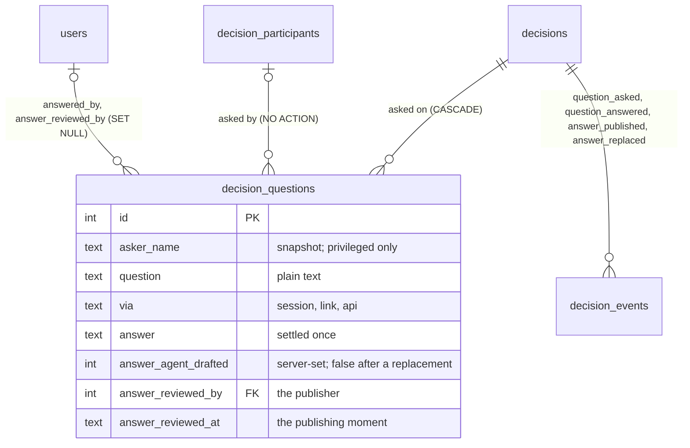

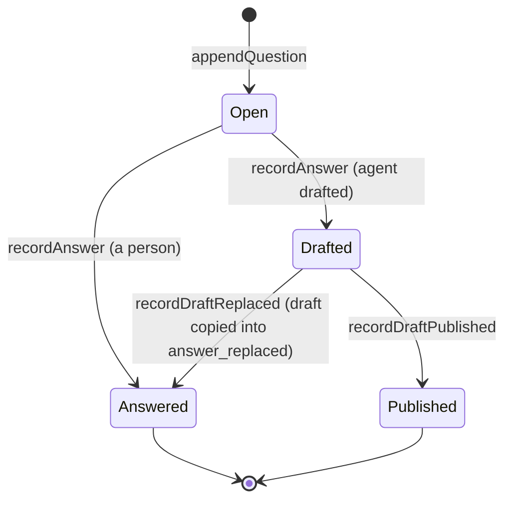

#### The working copy and its revision (card 2676)

Card 2676 (plan `docs/planning/card-2676-decision-authoring.md`) writes `decisions.title`,
`closes_at`, `vote_mode` and `working_content` on a draft, and `working_content` alone once a
decision is open or closed, through `updateDraft`, now in `src/lib/server/decision-authoring-writes.ts`. It added no
column and no migration. The shape, its limits and the label rule are in
`src/lib/server/decision-content.ts`; the type, `WorkingContent`, is in
`src/lib/decision-readiness.ts`, which the browser loads too.

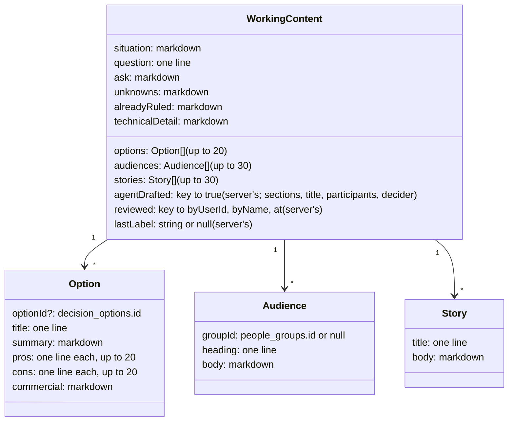

**Closed at every level.** A body's `content` holds design 4.4's keys and no others, at the top
and in every option, audience and story: an unknown key is 400 naming its path
(`content.options[1].colour is not a field of an option`). `agentDrafted`, `reviewed` and
`lastLabel` are the server's: each is 400 in a body. A field not sent is empty, and empty text is
allowed in a draft. The stored form is read tolerantly (`parseWorkingContent`): a field missing
or of the wrong type is its empty value.

**What `agentDrafted` names** (card 2728, no migration). Each content section an API key changed
(`situation`, `options.<optionId>`, `audiences`, …), and three keys for what a key chose outside
the content: `title` (a key's create, a key's changed title on a draft, a key's new title for a
superseding draft), `participants` (a key's participant save that added, removed or re-roled
anyone) and `decider` (a key's change of decider). Setting a flag removes that key's `reviewed`
stamp; only Mark reviewed, a person's act, clears it and stamps `reviewed[key]`. The three are
written into the stored JSON by `withChosenFlag`, which keeps every other key as stored. A
version copies all flags and stamps as the record; the participant page and the preview are
handed none of the three (`pageFlags`). A superseding draft carries a version's `title` flag
with the old title alone, and never its `participants` or `decider` flag.

| Field | Limit |
|---|---|
| `situation`, `unknowns`, `alreadyRuled`, `technicalDetail` | markdown, up to 20,000 characters each |
| `question` | one line, up to 500 |
| `ask` | markdown, up to 2,000 |
| `options` | up to 20; `title` one line up to 200; `summary` and `commercial` markdown up to 4,000; `pros` and `cons` up to 20 items each, each one line up to 500, empty items dropped |
| `audiences` | up to 30; `groupId` an id or null; `heading` one line up to 200; `body` markdown up to 10,000 |
| `stories` | up to 30; `title` one line up to 200; `body` markdown up to 10,000 |
| the whole | up to 256 KB serialised |

A one-line field (the title, `question`, an option's `title`, each `pros` and `cons` item, an
audience's `heading`, a story's `title`) refuses every character of `UNPRINTABLE`
(`src/lib/server/logger.ts`), the zero-width joiner U+200D included. A markdown field allows of
it only tab, newline, carriage return and U+200D, so emoji sequences survive; every direction
control stays refused. The 400 names the field: `options[2].title cannot hold control, direction
or invisible characters`. An audience's `groupId`, new or changed, must be a group (400); one
already stored whose group has since been deleted is kept, so re-saving does not fail.

**Option rows kept in step.** `updateDraft` keeps `decision_options` in step with
`content.options` in the same write. An entry with no `optionId` gets a new row; every entry's
`position` is its index; an `optionId` named twice is 400, and one that is not a live option of
this decision is 400. A row left out is deleted while `added_in_version` is NULL; a published one
left out stays live and is retired at the next publish. The stored content carries every entry's
`optionId`.

**Labels are never reused within a decision.** The next label is the letter after the highest
used, `A` when there is none, where used means any of: every `decision_options.label` of the
decision, retired rows included; every option label quoted in any of its `decision_versions`
(`labelsInVersions` in `decision-record.ts`); and the working content's `lastLabel`, moved on
each time a label is issued, the only trace of an option deleted before it was ever published.
Once `Z` has been used a new option is 409 `This decision has used every option label from A to
Z: no option can be added`.

**Agent flags and review stamps.** The keys are `situation`, `question`, `ask`, `unknowns`,
`alreadyRuled`, `technicalDetail`, `options.<optionId>`, `audiences` and `stories` (the last two
for each list as a whole). A save through an API key flags each section it changed and removes
that key's `reviewed` stamp; a save through the web application clears none. Only
`markReviewed`, a person's act through the web application, clears a flag, writing
`reviewed[key] = { byUserId, byName, at }`. A flag for an option left out of the content goes
with it. No event is written for either: the next version carries both as they are then, each
stamp as `{ byName, at }` (card 2676's C3). A version copies an allowlist of the content alone
(its text sections, audiences, stories, live options, `agentDrafted` and `reviewed`), never
`lastLabel`, and every answer gives the content the same way, `byUserId` to an administrator
alone.

**The revision** has no column. `revisionOf` is HMAC-SHA256 in hex, keyed with a key derived
for that purpose alone from the server's request form key (`purposeKey('decision-revision')`,
never stored; card 2676's C2), over the decision's `title`,
`status`, `closes_at`, `vote_mode`, `working_content`, `current_version` and `decider_user_id`,
every option row by `id`, `label`, `position`, `added_in_version` and `retired_in_version`, and
every participant row by `id`, `person_id`, `role` and `removed_at`, retired and removed rows
included, in id order. Every column the editor's writes change is in it, so `updateDraft` (the
editor and v1's `PATCH`), `setDecider`, `setParticipants`, `markReviewed`, `openDecision`,
`republishDecision` and `dryRunDecision`, which require it, cannot land over a change made since
the caller read the decision (409).

Card 2706 took the delivery columns out of it: `decision_participants.user_id` and `email`, which
a participant's insert sets and opening rewrites from the directory (`snapshotColumns`), and which,
after opening, only an administrator's account and address changes (and an account's deletion)
write, and
`decisions.updated_at`, which a Resend and those two changes stamp alone. None is read by a write
that asks the revision as its caller saw it, so none refuses an author mid-edit any more.
`updated_at` is still stamped by all three, for the board's decision list and every answer that
shows it; every other write that stamps it changes a covered column. The results revision still
covers `user_id` and `email`.

Card 2734 took `updated_at` out of the results revision too, so a Resend no longer refuses a
decider's ruling or release made from a results page opened before it. Of the 18 writes that
stamp it (all then in one module, the decision service card 2713 later split into
`decision-*-writes.ts`; the card's plan, section 2, lists each), every one changes a
column the results revision covers in the same write but two: a Resend, a delivery act that must
not move it, and the release, which changes `results_released_at` alone and so is covered by that
column in `updated_at`'s place. Link issuance, every event (`seen`, `invited`, `mail_outcome`,
`reminded`, `mail_skipped`), a reminder and a concern stamp nothing and move neither revision.

| Column | Editor revision | Results revision |
|---|---|---|
| `decisions.updated_at` | No (card 2706) | No (card 2734) |
| `decisions.results_released_at` | No | Yes (card 2734) |
| `decision_participants.user_id`, `email` | No (card 2706) | Yes |
| `decision_participants.link_token_hash`, `link_issued_at` | No | No |
| Every other column listed above | Yes | Yes |

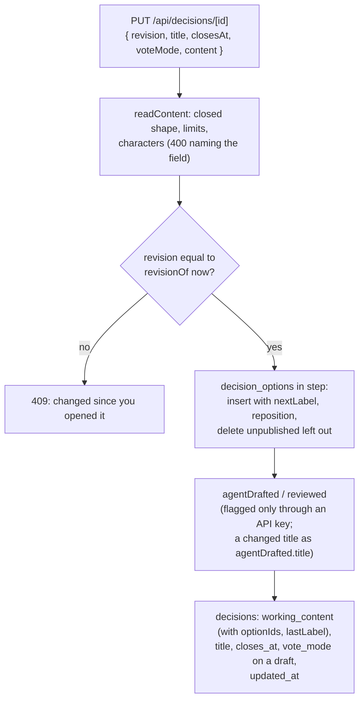

### Two-step sign-in storage (migration 0065)

Where two-step sign-in keeps an account's second factors (card 2768, migration
`0065_add_mfa_storage.sql`, 2026-11-05). Card 2768 built the storage alone; since card 2769
sign-in writes and reads every table here (see
[Two-step sign-in at sign-in](#two-step-sign-in-at-sign-in-migrations-0066-and-0067) for the
columns it added). The code that writes and reads them is `src/lib/server/mfa-store.ts` and
`src/lib/server/sign-in-challenges.ts`; how the secrets are protected is in
[Second-Factor Secrets at Rest](authentication-security.md#second-factor-secrets-at-rest-card-2768).

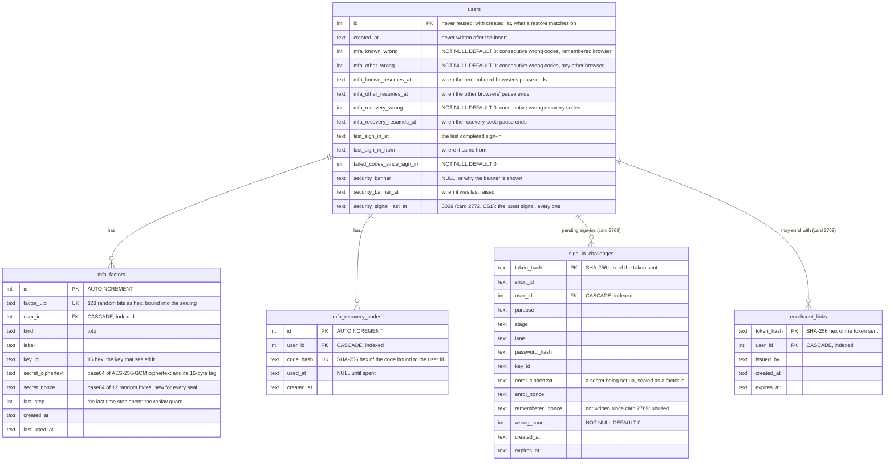

| Table or column | What is stored | How it is protected |
|-----------------|----------------|---------------------|
| `mfa_factors` | Each authenticator app an account has set up: its secret (20 bytes), the key that sealed it, and the last time step spent | The secret only as AES-256-GCM ciphertext (`secret_ciphertext`, the tag after the ciphertext) with its nonce (`secret_nonce`), under a key derived from a file outside the database and outside every backup (`MFA_KEY_FILE`). The sealing binds the user id and `factor_uid`, so a row copied to another factor or account does not open. Never the secret, never the key |
| `mfa_recovery_codes` | Each account's ten single-use recovery codes | Only `SHA-256("dumpfire-recovery-v1:<user id>:<code>")` as hex, the code in its 16-character canonical form, so a hash row moved to another account never matches. Never the code |
| `sign_in_challenges` | A sign-in that has passed the password and waits for its second factor (card 2769) | The token only as its SHA-256 hash; a secret being set up only sealed, as a factor's is, bound to the account and the token's hash |
| `enrolment_links` | A link that lets one account set up its authenticator (card 2769) | The token only as its SHA-256 hash |
| `settings.mfa_key_check` | A row, no schema change: HMAC-SHA256 of the key file's bytes with a fixed label, as hex | Says which key the factors were sealed with, so a server started with another key refuses to start while any factor exists (with none there is nothing to compare, and it starts). Not the key, and no key can be worked out from it. Written with the first factor |
| The eleven `users` columns | Each lane's consecutive wrong codes and when its pause ends (the remembered browser's, every other browser's, and recovery codes'), the last sign-in and where it came from, the wrong codes since, and the banner that tells the owner someone else holds the password, with when it was last raised. Since card 2771 a right password with a wrong code at a step-up also adds one to `failed_codes_since_sign_in` and raises the banner (`'wrong-code'`); a step-up writes none of the lane columns | Nothing secret. Every moment is a `*_at` column, so the start-up conversion and the after-each timestamp check find it (13 new moments in all: eight in the four tables, five on `users`) |

- **Indexes.** Two unique indexes, `mfa_factors_factor_uid_unique` and
  `mfa_recovery_codes_code_hash_unique`, and one on each table's `user_id`:
  `idx_enrolment_links_user_id`, `idx_mfa_factors_user_id`, `idx_mfa_recovery_codes_user_id`,
  `idx_sign_in_challenges_user_id`, as every foreign key column leads an index (card 2106).
- **Cascades.** Every key to `users` is `ON DELETE CASCADE`: deleting an account deletes its
  factors, codes, pending sign-ins and enrolment links. None of the four is a reconciled
  table and none has a `CHECK` (the model comparison cannot see one; which values are valid
  is the code's).
- **What ends them.** Setting a password (`endAccountAccess`), and a change of the account's
  email address or role, delete the account's pending sign-ins and enrolment links
  (`endPendingSignIns`), in the transaction that makes the change. Its factors and recovery
  codes stay.
- **Several factors per account** (card 2772). An account holds one to three `totp` rows
  (`MOST_AUTHENTICATORS = 3`, held by the code, not the schema, which always allowed many): the
  first from enrolment, the rest added on the Account page, each with its holder's `label` (1
  to 40 characters, white space collapsed, no control or format character). Sign-in and the
  step-up read them in id order and try each (`matchFactors`); a spend touches only the matched
  row's `last_step`. Removing one on the Account page deletes its row, never the last one, and
  ends the account's other sessions and its pending sign-ins and enrolment links in the same
  transaction. An authenticator being added is held in the server's memory until the new
  phone's code is right, so nothing is written for it before then; a new set of recovery codes
  replaces every `mfa_recovery_codes` row of the account.
- **The banner** (`users.security_banner`, `users.security_banner_at`, and since migration
  0069 `users.security_signal_last_at`, the latest signal's moment) is cleared, all three
  columns together, only by **That was me** on the Account page (`UPDATE … WHERE id = ? AND
  security_banner IS NOT NULL AND coalesce(security_signal_last_at, security_banner_at) = ?`,
  the latest moment the page showed: card 2772's code review, CS1) and by the holder's own
  password change (card 2772). A sign-in, an administrator's password reset and the rest leave
  it.
- **Spending.** A time step is spent by one `UPDATE mfa_factors SET last_step = ?,
  last_used_at = ? WHERE id = ? AND (last_step IS NULL OR last_step < ?)`, and a recovery code
  by one `UPDATE mfa_recovery_codes SET used_at = ? WHERE user_id = ? AND code_hash = ? AND
  used_at IS NULL`, each with nothing read before it, so two requests with the same code
  cannot both spend it.
- **Backups and restores.** A backup, and so the export, keeps `mfa_factors` (ciphertext),
  `mfa_recovery_codes` (hashes) and `mfa_key_check`, and holds no `sign_in_challenges` or
  `enrolment_links` row. A restore copies none of the four tables and not the key check: it
  puts the factors and codes back by their own rules (`restoreMfaRows`, in
  `src/lib/server/mfa-backup.ts`), matching an account on its `id` and `created_at` (compared
  as moments, and an unreadable one matching nothing), never its username. See
  [What a Backup Holds](authentication-security.md#what-a-backup-holds-and-what-a-restore-brings-in).

### Two-step sign-in at sign-in (migrations 0066 and 0067)

Card 2769 turns two-step sign-in on (2026-11-13). `0066_add_mfa_password_enrol.sql` adds four
columns and one setting, and gives a mark to the accounts that may set up on their password;
`0067_end_sessions_for_two_step.sql` ends every session and the remembered-browser secret. How
they are used is in [Two-Step Sign-In](authentication-security.md#two-step-sign-in-card-2769).

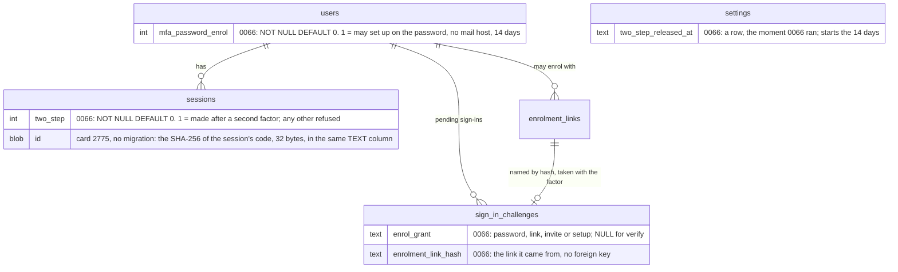

| Column or row | What it holds | Written by |
|---|---|---|
| `users.mfa_password_enrol` | 1 when the account may set up its authenticator on its password alone, honoured only where no mail host is configured, within 14 days of `two_step_released_at`, and while the account holds no enrolment link but release-mail ones (the accepted risk R1) | 0066: 1 for every account with no second factor and no enrolment link row, expired or not. Set to 0 by an enrolment's confirm, `resetTwoStep()`, `scripts/mfa-reset.mjs`, by a restore for every account not this server's, and by a working-copy restore for every account (`switchOffOutside()` in `src/lib/server/db/restore.ts`). 0 for every account made since, the superadmin at set-up included |
| `sessions.two_step` | 1 when the session was made after a second factor | `createSession()` writes 1. 0066 left every session there at 0, and an older image, which writes no value, leaves 0. Since card 2775 an older image's row is also in plain (see below), which this image never finds and `endPlainSessions()` deletes at start; `findSession()` still refuses a hashed row with any other value and `validateSession()` deletes it, as defence in depth |
| `sessions.id` | The SHA-256 of the session's code, 32 bytes, a BLOB, in the column that kept its name and declared `TEXT` (card 2775). Never the code itself | `createSession()` (`sessionTokenHash()`); looked up by `findSession()` through the model's `tokenHash` property |
| `sessions.created_at` | When the session was made; it starts the total limit (24 hours for an administrator, 7 days for a user). Already `NOT NULL DEFAULT (datetime('now'))`, so no column was added | `createSession()`; kept by a password change's replacement session |
| `sign_in_challenges.enrol_grant` | What lets an enrol challenge set up a factor: `password`, `link`, `invite` or `setup`. NULL on a verify challenge | `issueChallenge()` |
| `sign_in_challenges.enrolment_link_hash` | The SHA-256 of the enrolment link an enrol challenge came from, taken with the factor at confirm | `issueChallenge()`, for a link challenge |
| `settings.two_step_released_at` | The moment 0066 ran, in the stored form of a moment. A missing or unreadable value is read as the 14 days over | 0066 (`INSERT … ON CONFLICT DO NOTHING`). Restored as any setting, so a backup made before 0066 restores with none |

- **No foreign key and no `*_at` column** among the four columns, so no index and no
  timestamp conversion is added. `users` and `sessions` are not reconciled tables: 0066 alone
  changes them. `two_step_released_at` is a row of `settings`, not a column.
- **What a backup and a restore do.** `mfa_password_enrol` is zeroed for every account by a
  restore, and the same accounts then have this server's value back (`GUESSING` and `HISTORY` in
  `src/lib/server/mfa-backup.ts`); a working copy then sets it to 0 for every account. A backup
  holds no session, so `two_step` never travels.

### Session codes kept as hashes (card 2775, no migration)

Card 2775 changes what `sessions.id` holds and adds no migration and no DDL. The column keeps
its name and its declared type (`text PRIMARY KEY NOT NULL`); the model's property is
`tokenHash`, declared with the same custom type as `invite_tokens.token` (`bytesInText`, moved
above `users` in `schema.ts`). Every session is written as the 32-byte SHA-256 of its code, a
BLOB, which SQLite never takes to equal text, so an older image comparing the column with a
cookie never matches a stored hash. Migration 0067 ends every session at the release, so every
row from then on is in hash form; `endPlainSessions()` deletes any other row at every start,
before the clean-up, which runs at start and every five minutes (card 2883), whatever an older
image wrote. `sessions` is still not a reconciled table
(`expected-schema.ts` is unchanged), no table has a foreign key to `sessions.id`, and a backup
holds no session. How a session's two limits are judged is in
[Idle and Total Limits](authentication-security.md#idle-and-total-limits).
- **`enrolment_links.issued_by`** gains a value: `release-mail`, for the link a sign-in mails
  (card 2769), beside `admin-reset` and `host-reset` (card 2773). Issuing a link deletes the
  account's earlier ones, but the release mail's: it issues its link beside them
  (`issueEnrolmentLink(…, { replace: false })`) and deletes the older release-mail links only
  once its mail has gone, so a failed send leaves the link already mailed working. A link not
  issued by the release mail (an older image's reset, say) closes R1 for the account.
- **`sign_in_challenges.remembered_nonce`** (0065) is no longer written: the lane is all that is
  used of the remembered browser. The column stays.
- **`mfa_recovery_resumes_at`** stays unused: recovery codes have no account-wide pause.

### Invites (`invite_tokens`, migration 0068)

An invite is the link an administrator's 📧, or Create User with no password, mails to an
account so that its holder sets the password and then sets up two-step sign-in. The table was
made by `0001_dear_pandemic.sql` and `0015_add_invite_tokens.sql`; its shape has not changed
since. **Since card 2849 (2026-11-16) the `token` column holds only the SHA-256 of the token
sent, as the raw 32-byte digest, a BLOB value.** The column is still declared `TEXT`: SQLite
keeps whatever type of value is written, so the schema, `expected-schema.ts` and the model check
do not change. The token itself is only in the mail and, when the mail fails, in the link the
issuing administrator is shown once. The code is `src/lib/server/invites.ts`; why, and what
happens at the release and on going back, is in
[Invite Tokens Stored as Hashes](authentication-security.md#invite-tokens-stored-as-hashes-card-2849).

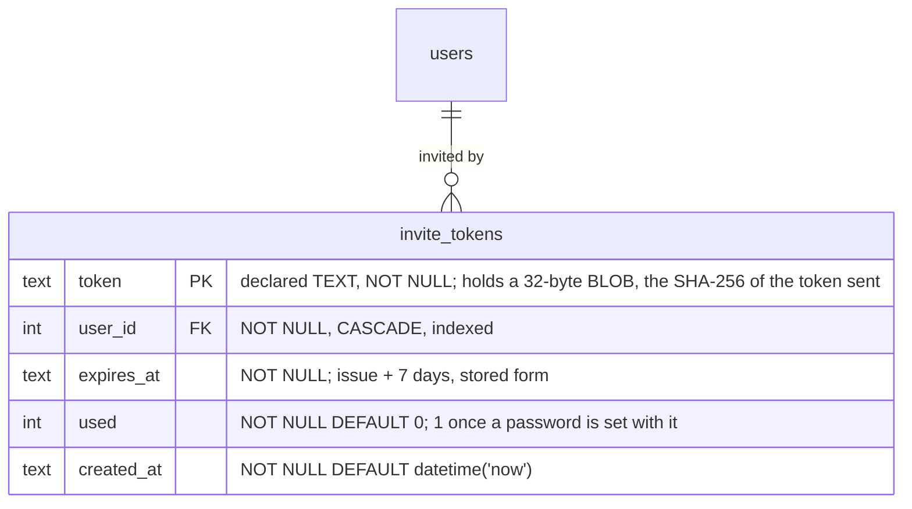

| Column | What is stored | How it is protected, and who writes it |
|---|---|---|
| `token` | The SHA-256 digest of the token, 32 bytes, as a BLOB. A used row that migration 0068, a restore of an older backup or the start-up sweep rewrote holds 32 random bytes instead (`randomblob(32)`), the shape of a hash and the hash of nothing | Never the token. `issueInvite()` writes the digest and returns the token for the mail; `usableInvite(token)` looks up the digest of the token as it is in the address, exactly, with nothing trimmed or case-folded, and compares BLOB with BLOB. In the Drizzle model the property is `tokenHash: bytesInText('token')`, a `customType` read and written as a `Buffer` and declared `text`; the column keeps its name and its declared type so that an older image still reads the table and the model's shape is unchanged |
| `user_id` | The account invited | `ON DELETE CASCADE`; `idx_invite_tokens_user_id` (0053) |
| `expires_at` | Seven days after issue (`INVITE_LIFETIME_MS`), in the stored form of a moment | Read as the moment it names (`toStamp`) |
| `used` | 1 once a password has been set with the invite | The invite page marks the row it read by its hash, inside the transaction that sets the password. Nothing sets it back. A used row is kept: `used` is how the page and the backup tell a spent invite from a waiting one |
| `created_at` | When the invite was issued | `datetime('now')` |

- **Why a BLOB and not hex text.** SQLite never treats a TEXT value as equal to a BLOB, and the
  address of a link can only ever be text. An image from before card 2849 compares the column
  with the address text, so it can never match a stored digest: whoever reads the database file
  and puts what they read in an address gets the page for a link that no longer works, on this
  image and on an older one. A hash stored as hex text would have been a working link on the
  older image.
- **"In hash form"** means `typeof(token) = 'blob' AND length(token) = 32`. Any other value (an
  older image's UUID text, a backup's plain token) is held in plain.
- **One invite that works per account.** `issueInvite()` deletes the account's unused invites
  (`endUnusedInvites()`) before it writes the new one; setting a password, and a change of the
  account's email address or role, end them too.
- **No DDL changed for the hash.** `invite_tokens` stays one of the six reconciled tables (below),
  and a rebuild copies the BLOB values as they are. A rename to `token_hash` was not made: the
  previous image skips reconciliation on a database that records a file it lacks, and would then
  find no `token` column, so its invite page, both invite routes and every backup would fail.
- **What 0068 did once** (`0068_end_plain_invite_tokens.sql`): every unused invite deleted, and
  every used invite's token replaced by `randomblob(32)`. Every invite waiting at the release
  stops working and is sent again; no row keeps a token as it was mailed. Hashing the rows in
  place was not possible (SQLite has no SHA-256) and would have left each live token in the
  file's free pages.
- **The start-up sweep** (`endPlainInvites()` in `src/lib/server/startup-checks.ts`, called from
  `hooks.server.ts` after the migrations). In one transaction it deletes every unused row not in
  hash form, and gives every used row not in hash form 32 random bytes, as 0068 does. Such a row
  is one an image from before card 2849 wrote after going back. It is outside the runner and the
  rehearsal, as `removeSettingsOfNonAdministrators()` is, because it deletes rows.
- **Backups and restores.** A backup holds no unused invite, so only used rows, in hash form. A
  restore of a backup made before card 2849, whose used rows hold their tokens as mailed, gives
  each such row 32 random bytes as it reads it (`rowsToRestore()`, asking `inHashForm()` from
  `invites.ts`), so a plain token never reaches the live file; 0068's `UPDATE` is run again after
  the copy, inside the restore's transaction, as a backstop.

### Report schedules announced once (card 2751, no migration)

From card 2751 a report schedule made, given an address, turned on or widened asks for the
password and a code. A schedule made before it asked for neither, so at the first start after
the release each owner of a schedule that is on is told of theirs, once
([Report Schedules and Report Mail](authentication-security.md#report-schedules-and-report-mail-card-2751)).

| Row | What it holds | Written by |
|---|---|---|
| `settings.report_schedules_announced` | The moment the announcement was made, as an ISO 8601 string (`new Date().toISOString()`, such as `2026-11-17T09:00:00.000Z`), not the stored form of a moment: only its presence is read | `announceReportSchedules()` in `src/lib/server/startup-checks.ts` (`REPORT_SCHEDULES_ANNOUNCED`), an `INSERT OR IGNORE` (two instances may both get there), after one `WARN` line for each schedule that is on and once every owner's notice has been answered and every one went (or mail is not set up); not written when a notice did not go, when it fails, or where the schedulers do not run (the dev server, `SCHEDULERS=off`), so a later start does it again |

- **Read**: `SELECT 1 FROM settings WHERE key = 'report_schedules_announced'` at every start,
  where the schedulers run or not; present, nothing is done. The schedules that are on are read with their owners
  (`report_schedules` joined to `users`, `enabled = 1`); nothing in `report_schedules` is changed.
- **No migration, no column, no index.** It is a row of `settings`, which holds text, so no
  timestamp conversion touches it, and no rehearsal declares it (it is written at start, outside
  the runner).
- **Backups and restores.** A backup holds `settings`, this row with it once it is written; a
  restore of a backup made before the release brings none, so the next start announces again.
  **Reset Everything** empties `settings` and `report_schedules` alike: the next start finds no
  flag and announces whatever schedules are on by then, and writes the row.

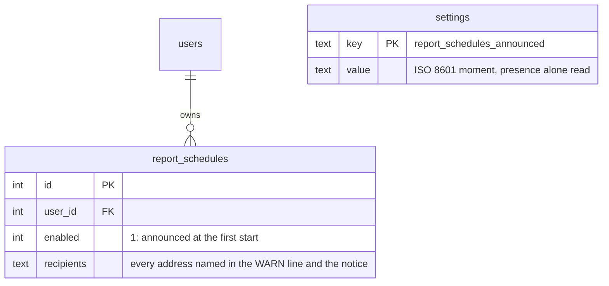

### A webhook switched off for good (migration 0071)

Migration `0071_add_webhook_holds.sql` (cards 2752 and 2893) adds four nullable columns to
`webhooks`, an index and one setting. No IF NOT EXISTS: a column, index or setting of these
names already there would be one this file did not make, and it fails rather than record
itself over it.

| Column | Type | Written by | Meaning |
|---|---|---|---|
| `held_because` | text, NULL | `switchOffHeld` (card 2752), `endAccountAccess` and `deleteUser` (the code review's CS4), `scripts/mfa-reset.mjs` in its own SQL (card 2915), and `holdUnheldOfGoneSetters` (card 2923: the first start of its release and a restore); carried by a restore (`carryHolds`, `fillSecretGaps`); cleared by `PUT /api/v1/webhooks/{id}` switching it on | Why the webhook was switched off for good: `'setter cannot open'`, `'no setter'`, `'setter access ended'` (a password reset, a two-step reset (card 2915), an invite used, the holder's own change that ends their keys, or the account disabled or deleted; since card 2923 also one already off when that happened, or found off with its setter disabled or not recorded), or card 2893's `'key ended'`, or, since card 3012, `'restored from a backup whose seal did not verify'` (`holdUnsealedWebhooks`: every webhook with an address restored from an unsealed backup, overriding the file's reason, with `secret` emptied; a switch-on gives a new secret). NULL for one that is on, and for one switched off without a hold (a `PUT`, a restore kept apart or a working copy) until its setter's access ends |
| `held_at` | text, NULL | with `held_because` | The moment, in the stored form (`YYYY-MM-DD HH:MM:SS`, UTC) |
| `set_by_key` | integer, NULL, `REFERENCES api_keys(id) ON DELETE SET NULL`, `idx_webhooks_set_by_key` | both v1 writers, with `set_by` (`keyOfWrite`, card 2893): the create, and a `PUT` that changes the address or secret or switches it on; a change of events alone keeps it | The API key that last set the address or secret, or switched the webhook on. Read by `holdOf`: gone, ended (`keyEnded`) or another account's holds it, `'key ended'`; counted for each key by `GET /api/account/api-keys` (`webhooks`) |
| `set_with_key` | integer, NULL (0/1) | with `set_by_key` | 1: written with a credential, a key's id in `set_by_key` or none (a session), which holds it; 0: written with no credential at all, only a test's call; NULL: set before keys were recorded, held once the setter has no working key made before `webhook_keys_recorded_at`. `set_with_key = 1 AND set_by_key IS NULL` reads "its key was deleted, or it was not set with a key" |
| `url` (card 2928) | text, NOT NULL | both v1 writers (sealed), the start's sweep (`sealPlainSecrets`), a restore (`sealedForRestore`, `fillAddressGaps`) | The delivery address, sealed under the MFA key, bound to `id`, `board_id` and `receiver` (`webhookUrlAad`); read only through `openedUrl`. `''` for one a backup left out and a restore could not fill, to be entered again with `PUT` |
| `receiver` | text, NOT NULL, DEFAULT `''` (migration 0073, card 2928) | with every address; recomputed from a plain one (the start's sweep, a restore), never taken from the row or the backup then; kept from a backup where its `url` is `''` or an envelope, whose seal binds it | The address's scheme, host and port (`receiverOf`); `''` for one that is no http or https URL. In no answer. Read by the held-off rule, the host a line, mail, two-step list or `scripts/mfa-reset.mjs` names, and a backup's copy |

The setting `webhook_addresses_left_out` (card 2928) lists, in a backup's copy and in a database a
restore left so, each webhook whose address was left out: `{"id": n, "active": true|false,
"address": "<64 hex>"}`, `address` the HMAC a restore matches this server's address with. The
setting `webhook_address_mac_key` is that HMAC's key, 32 random bytes, stored sealed, in no backup,
export or import safety copy, and kept by a restore. `webhook_addresses_scrub_marked` is the ISO
time the release's first start wrote once: that start marks the scrub and deletes the stale
`.backup-temp` copies.

The setting `webhook_keys_recorded_at` is the moment 0071 ran (card 2893's S9), read by
`keysBeforeRecorded` in `webhooks.ts`: only a key made before it counts for a webhook from before
the release, and with no such setting none does. A restore keeps the earlier of this server's
value and the backup's (`restoreFromBackup`; card 2893's code review, CS1), the backup's where
this server has none: a key made before the later moment may have been made after the release on
the other server. The setting `webhooks_before_keys_announced` (card 2893, D6) is the moment the
start told the boards' owners of the webhooks set up before keys were recorded, written by
`announceWebhooksBeforeKeys` only once every mail went; with it there, the start says nothing
more. The rehearsal notes the new settings row as one a migration put there; 0071 rewrites and
takes no row, so nothing is declared in `tests/rehearsal/one-offs.ts`. The setting
`webhooks_already_off_held` (card 2923, S3; its code review, S2, E3; no migration) is the moment,
as an ISO 8601 string, the start held every webhook already switched off without a hold, whoever
set it (`holdAlreadyOffWebhooksAtStart`, `WEBHOOKS_ALREADY_OFF_HELD` in `webhooks.ts`), written
with an `INSERT OR IGNORE` in the same transaction as the hold. With it there, a start holds only
those whose setter is disabled or not recorded. A restore of a backup without it (one from before
the release) holds every one itself, on the server's database and on a working copy, and does not
write it, so the next start does it again and writes it. A host going back to an image from before
the release deletes the row, so that the next start of this release holds again what the older
image left unheld.

The setting `webhooks_readable_by_disabled_held` (card 2935, P4; no migration) is the moment, in the
stored form, up to which the start pass has held the webhooks whose secret a disabled owner or
administrator could read (`holdReadableWebhooksAtStart`, `coverReadable` and
`WEBHOOKS_READABLE_COVERED` in `webhooks.ts`). Absent, or naming no moment, the pass runs in full:
every disabled owner's or administrator's readable webhooks made before its disable, and every
webhook with a secret made before migration 0056 was applied here (from `__drizzle_migrations`);
present, only accounts disabled after it. The pass writes it as now where anything lay after it
(none disabled since: nothing held, nothing written, the code review's C9); a disable on this image
moves it to its `disabled_at` (`advanceReadableCovered`), since that ending held what the account
could read, once this process's pass has committed and only where no other account was disabled
in between or at an unreadable moment (C2). Every restore runs the pass itself from the restored
settings' own moment, before any secret is filled (P12, C3). `held_because`
`'setter access ended'` is written since card 2935 also for a webhook of another account whose
secret the ended or lowered owner or administrator could read, whoever set it: the stored value is
the same, so an older image still gives it a new secret when switched on.

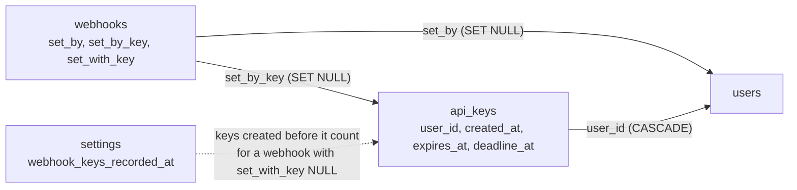

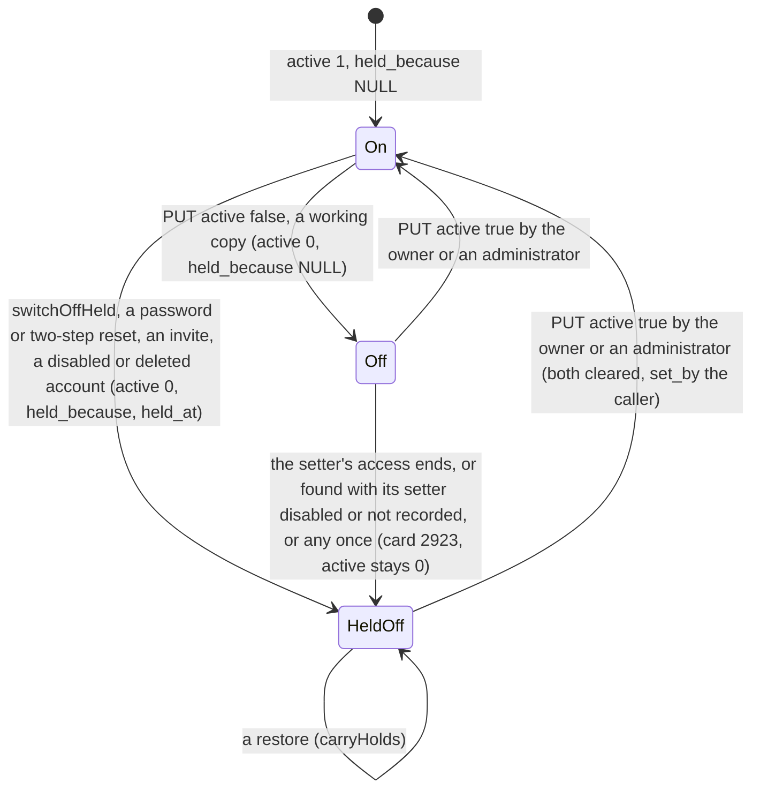

**The writers.** `switchOffHeld` runs `UPDATE webhooks SET active = 0, held_because = ?,
held_at = ? WHERE id = ? AND active = 1 AND set_by IS ?`: only while the webhook is on and its
setter is the one it was judged on. `switchOffLostWebhooks(scope, cause)` reads the webhooks that
are on within a scope (`{ boardIds }`, `{ setters }` or `'all'`), asks `holdOf` of each, and
calls it for each held, inside the transaction of the write that took the access away; a
delivery calls `switchOffHeld` for its one webhook. `endAccountAccess` and `deleteUser` write
`'setter access ended'` beside `active` off: `endAccountAccess` for an administrator's password
set, an invite used, a holder's own change that ends their keys, a disable (card 2671) and, since
card 2915, a reset of the two-step sign-in (`resetTwoStep`, which passes `apiKeys: true`). The
host's `scripts/mfa-reset.mjs` writes the same in its own SQL, `UPDATE webhooks SET active = 0,
held_because = 'setter access ended', held_at = ? WHERE set_by = ? AND (active = 1 OR
held_because IS NULL) RETURNING id, board_id, set_by`, unless run with `--keep-api-keys`, and
refuses a database whose `webhooks` lacks `held_because` or `held_at` (one from between
migrations 0065 and 0071). Since card 2923 all three take the same predicate, `active = 1 OR
held_because IS NULL`, after a read of the account's webhooks that are off with no hold: one
already switched off without a hold is held too, `active` staying 0 (a no-op for it), and one
already held keeps its reason and time. `deleteUser`'s statement is `UPDATE webhooks SET active =
0, held_because = 'setter access ended', held_at = ? WHERE set_by = ? AND (active = 1 OR
held_because IS NULL) RETURNING id, board_id AS boardId, url, set_by AS setBy, set_by_key AS
setByKey, set_with_key AS setWithKey`, `set_with_key` read back as a boolean. Since the code
review (E4) that statement is one function's, `holdWebhooksOfSetter(userId, cause)` in
`webhooks.ts`, which both `endAccountAccess` and `deleteUser` call. The server's callers mail the
boards' owners of both groups once committed; the host's command mails nobody and logs that.
`holdUnheldOfGoneSetters(database, { every })` in `webhooks.ts` runs `UPDATE webhooks SET active =
0, held_because = 'setter access ended', held_at = ? WHERE active = 0 AND held_because IS NULL AND
(? = 1 OR set_by IS NULL OR set_by IN (SELECT id FROM users WHERE disabled_at IS NOT NULL))
RETURNING …`: with `every`, every one, once (the first start without `webhooks_already_off_held`,
above, and a restore of a backup without it); else those of a disabled or missing setter, at every
start and in every restore, a working copy included. A
restore reads this server's holds before the
clear, whatever the secret, and carries each onto the restored row of the same webhook (same id,
board, address and setter: `carryHolds`); `fillSecretGaps` never switches on a restored webhook
that is held off here or in the backup's row, and carries this server's hold.
`tests/check-at-the-write.test.ts` lists each as a writer, the switch-off-only ones held to
`active` off with `held_because` and `held_at` and nothing else.

**An unsealed restore's hold** (card 3012, no migration). Where the backup's seal does not verify,
`holdUnsealedWebhooks` in `restore.ts`, after the address fill and before `carryHolds`, runs `UPDATE
webhooks SET active = 0, secret = '', held_because = 'restored from a backup whose seal did not
verify', held_at = ? WHERE url <> ''`, having deleted those rows' `webhook_reveals`, and `UPDATE
webhooks SET active = 0 WHERE url = '' AND active <> 0`. `carryHolds` replaces that reason with this
server's only where both addresses open and are equal. The value is a new `held_because` string, not a
new column: an older image reads it as any other hold.

A backup made before 0071 has none of the four columns: its webhooks come in with all four
NULL and `active` as the backup had it, and the restore's sweep then switches off each whose
setter cannot open its board in the restored data. Going back to an older image keeps the
columns unread: a webhook switched off here stays off there until an owner switches it on.

### Which API key was given which secret (`webhook_reveals`, migration 0075)

Card 2947. One row for each API key given a webhook's signing secret as it is now, so that the
key's revoke, expiry or deadline, or its account's ending, holds the webhook as `'setter access
ended'`.

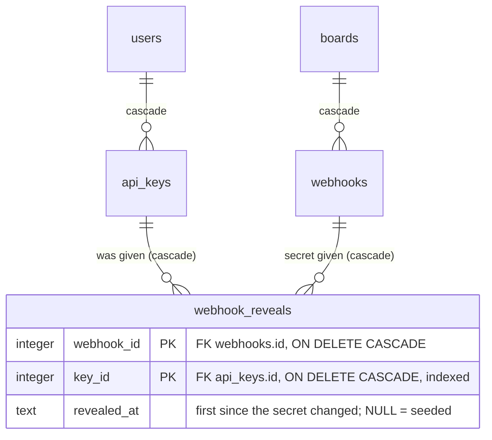

| Column | Type | Meaning |
|---|---|---|
| `webhook_id` | integer, part of the primary key | The webhook (`REFERENCES webhooks(id) ON DELETE CASCADE`) |
| `key_id` | integer, part of the primary key | The key given its secret (`REFERENCES api_keys(id) ON DELETE CASCADE`, `idx_webhook_reveals_key_id`) |
| `revealed_at` | text, nullable | The first time since the secret last changed, in the stored form; NULL for a row the once-only seed wrote |

**Writers.** `answerWebhooks` (every v1 answer that carries a non-empty secret, `ON CONFLICT DO
NOTHING`); `forgetReveals` (a `PUT` that writes a new secret deletes the webhook's rows);
`holdRevealsOfEndedKeys` (deletes the rows of each ended key once it has held what they name);
`seedRevealsOnce` (once, flag `settings.webhook_reveals_seeded`, run first by the sweep, a
revoke, every ending through `revealedToAccount`, the restore and the host's
`scripts/mfa-reset.mjs`); the restore's `carryRevealsHere` (puts back this server's rows for every
restored webhook on the same id and board that has a secret, where the same key came back by id
and hash) and `carryDisabled` (deletes the rows of the keys it deletes,
the foreign keys being off during a restore). The cascade takes a key's rows with the key (a
revoke, an ending, a user delete, the host's reset) and a webhook's with the webhook or its board.

**Readers.** The revoke, the ended-key sweep, `endAccountAccess` and `deleteUser`
(`revealedToAccount`, read before the keys go), `scripts/mfa-reset.mjs`, and the key list's
`webhooksRevealed` count (`webhooksRevealedTo`).

A backup carries the table like any other: it is not secret. A backup made before 0075 has none,
and the restore seeds where the restored settings lack the flag. Going back to an older image
leaves the table unread and unwritten. Since card 2995 the restore's `leaveOutRecordedKeys` reads
and deletes the rows of every key it leaves out, and holds what they name.

### Every API key ended on this server (`api_key_revocations`, migration 0076)

Card 2995. One row for each API key ended here, so that no restore brings it back and every check of
a key refuses it. No foreign key: a row outlives its key and its account.

```mermaid
erDiagram
    users ||--o{ api_keys : "cascade"
    api_keys |o..o{ api_key_revocations : "named by key_hash, or by key_id where key_hash is empty and key_id is at most W; no foreign key"
    api_keys ||--o{ webhook_reveals : "cascade"
    api_key_revocations {
        text key_hash PK "SHA-256 hex the gate checks; empty for a seed row; 'watermark' for W"
        integer key_id PK "the key's row id here; W on a watermark row"
        text revoked_at "when it was ended here, in the stored form"
        text revoked_because "revoked, access ended, account deleted, reset, before record, recorded in a backup"
    }
```

| Column | Type | Meaning |
|---|---|---|
| `key_id` | integer, part of the primary key | The key's row id here; on a watermark row, W |
| `key_hash` | text, the first column of the primary key | The SHA-256, in lower-case hex, that the gate checks the key by; `''` for a seed row, whose hash nobody knew; `'watermark'` for a watermark row |
| `revoked_at` | text, `*_at` | When it was ended, or the seed's moment |
| `revoked_because` | text | `revoked`, `access ended`, `account deleted`, `reset`, `before record` (the seed, and a hash recorded by the restore's belt), or `recorded in a backup` (a backup's row with a word this build does not know) |

The primary key `(key_hash, key_id)` is the table's only index: the gate looks a key up by hash, by
`('', id)` and the largest watermark, each a search on it.

**Writers.** Migration 0076 (the watermark W, the larger of the key counter and the largest id held,
and a seed row for every id from 1 to W that `api_keys` no longer held); `endApiKeys` (the revoke
through `revokeApiKeys`, `endAccountAccess`, `deleteUser`, the restore's `carryDisabled` and Reset
Everything), always `INSERT OR IGNORE` before the delete, in the same transaction;
`scripts/mfa-reset.mjs` (`RECORD_ACCOUNT_KEYS_ENDED_SQL`, pinned to the server's); the restore's
`carryKeyRevocations` (the backup's seed rows within its own key counter, its hashed rows whatever
their id, and its watermark up to the larger of that counter and the ids its rows name) and
`leaveOutRecordedKeys` (the hash of a key a seed row names by id, or whose id this server held with
another hash). Nothing deletes, updates or replaces a row; `tests/check-at-the-write.test.ts` holds
src and scripts to it.

**Readers.** `keyRecorded` (through `keyEnded`: the gate, `stillAuthenticated`, the live-key lists,
the webhooks' hold rule), the restore's leave-out (`DELETE FROM api_keys WHERE EXISTS` the same
rule), `endRecordedKeysPresent` at start and every five minutes, the Account page's key list and
its limit of ten (neither counts a recorded key), and `raiseKeyCounterOverRecord`, which keeps
`sqlite_sequence` for `api_keys` at or above every id the record names. 0076 writes one row per id,
never a range, and halts where that would be more than 1,000,000 rows.

`restorableTables` leaves the table out, as it leaves out the system log, and Reset Everything's
`KEPT` names it: neither clears it. A backup carries it like any other table: it holds ids and
hashes, never a key. A backup made before 0076 has none, and the restore applies this server's
record alone; so does a restore of a backup whose seal does not verify, which counts the file's rows and
takes none (card 3013). Going back to an older image leaves it unwritten there, and that image's restore
clears it and refills it from the backup.

### Every ending of an account on this server (`account_endings`, migration 0077)

Card 2996. One row for each ending of an account here (a delete, a disable, an enable, a role change,
the role it was made with), so that no restore brings back an account deleted, disabled or demoted
here. No foreign key: a row outlives its account. No unique index: every write here is one plain
`INSERT`, and the restore's union asks `NOT EXISTS`. Card 2997 adds the word `password`, with no
migration: a row of a password hash replaced here, so that no restore brings that password back.

```mermaid
erDiagram
    users ||--o{ account_endings : "named by user_id and account_created as a moment; by user_id alone where account_created is empty, ending is deleted and user_id is at most W; never a superadmin by a backup's row; no foreign key"
    users ||--o{ api_keys : "cascade; card 2995 records each key ended"
    account_endings {
        integer seq PK "order of writing here"
        integer user_id "the account's row id; W on the watermark row"
        text account_created "the account's created_at, stored form; empty for a seed row and the watermark"
        text ending "deleted, disabled, enabled, role, watermark, password (card 2997)"
        text role "for role: user or admin, the role after; empty otherwise"
        text credential "for deleted: the fingerprint of the password hash; for password: of the hash replaced, never empty; empty otherwise"
        text ended_at "when, stored form"
        text stated_ended "the moment as its writer stated it, before any clamp"
        text origin "here, backup, or belt"
    }
```

| Column | Type | Meaning |
|---|---|---|
| `seq` | integer, primary key (the rowid) | The order the rows were written in: two endings in one second keep it |
| `user_id` | integer | The account's row id here; on the watermark row, W |
| `account_created` | text, not an `*_at` column | The account's `created_at` in the stored form; `''` for a seed row, which names an id alone, and for the watermark. Not `*_at`, so the timestamp normaliser never reads `''` as unreadable, nor rewrites the record |
| `ending` | text | `deleted`, `disabled`, `enabled`, `role`, `watermark` (no ending of anyone), or `password` (card 2997: the account's password hash was replaced here; `account_created` always names a moment) |
| `role` | text, default `''` | On a `role` row, `user` or `admin`, the role after; `''` on a `password` row |
| `credential` | text, default `''` | On a `deleted` row, SHA-256 hex of the label `dumpfire account credential v1`, a NUL and the bcrypt hash; `''` where the hash is not a well-formed bcrypt string or is `DUMMY_HASH`. On a `password` row the same fingerprint of the hash replaced, never `''` (no row is written where it would be). The hash is fingerprinted with its prefix made `$2b$` (card 2997, R1: `$2a$` and `$2y$` name the same hash to bcryptjs). Never the hash |
| `ended_at` | text, `*_at` | When it was ended; a backup's row clamped to the backup's own latest moment no later than the restore. The seed's role rows are dated at the account's creation, its disables at their own moment, the earliest stamp (`0001-01-01 00:00:00`) where either names none or one after the migration (card 2996's code review, FP4) |
| `stated_ended` | text, default `''`, not an `*_at` column | The moment as the row's writer stated it: `ended_at` for a row written here, the backup's own (or a digest of its text where it names no moment) for one a restore brought. The union's key, so that importing the same backup again adds nothing whenever it runs (FP5) |
| `origin` | text, default `'here'` | `here`, written by this server; `backup`, brought by a restore of a backup this server sealed (since card 3013 never from one whose seal does not verify); `belt`, written by the record's own rule in a restore or the start's pass (FP2: this server's own for any account but a superadmin, never evidence against one) |

Three indexes: `account_endings_account (user_id, account_created, ending, stated_ended)` (the union's key, FP3), the partial
`account_endings_credential (credential) WHERE credential <> ''` and the partial
`account_endings_watermark (user_id) WHERE ending = 'watermark'`. Every statement of the rule, and
`deletedHere`'s, is a search on one of them (tests/account-endings.test.ts, case g).

**Writers.** Migration 0077 (the watermark, a seed row for every id up to W that `users` no longer
held, and every present account's role and disable but the superadmin's); `recordAccountEnding`
(`deleteUser`, `disableAccountSteps`, `enableAccount`, `changeAccountRole`, `POST /api/users`, Reset
Everything, and the belts of the restore's `applyAccountEndings` and the start's
`endRecordedAccountsPresent`), which reads the account's role on the connection it is given and
refuses the superadmin; `recordPasswordReplaced` (card 2997: the holder's own change, an
administrator's reset, an invite used, Reset Everything, and as `belt` `makeInert` and
`applyAccountEndings` before each `DUMMY_HASH`), which writes a superadmin's own `password` row `here`
and nothing for a belt on one; and the restore's `carryAccountEndings`, which, from a sealed backup only (card
3013), takes a backup's
`password` rows whoever they name and leaves them out of its 100 rows for one account. Nothing deletes,
updates or replaces a row; `tests/check-at-the-write.test.ts` holds src and scripts to it.

**Readers.** `accountRulings` (the restore and the start's pass; in a restore its held-here half counts only an account with
an exact row of this server's record, card 3013), `deletedHere` (`createSession`,
`keyHolder`, the enable), `passwordReplacedHere` (card 2997: the sign-in, `createSession`, the
step-up, the restore's `applyPasswordRulings` and the start's `endReplacedPasswordsPresent`; for a
superadmin only its own exact `here` row) and `raiseUserCounterOverSeed`. `EXACT_ROWS_SQL`, the
rule's load of an account's rows, leaves out `watermark` and `password` rows: the rule never reads a
`password` row, so it never loads one. `restorableTables` leaves the table out and
Reset's `KEPT` names it. A backup carries it like any other table: it holds ids, creation times and
fingerprints, never a hash. A backup made before 0077 has none, and the restore applies this server's
record alone.

### Every change of board, team and person access on this server (`access_changes`, migration 0079)

Card 3002. One row for each change of who may open a board, who is in a team, a board's Product Owner
and which account a person is linked to, grants and narrowings alike, so that no restore brings back
access removed, lowered or made private here. A row says that, after the change, the item of its
`kind` gives its `access`. What is opened, the *subject* (a board, a team or a person), and who gets it,
the *holder* (an account, or a team for a share, or 0 for none), are each named by row id and creation
time in the stored form. No foreign key: a row outlives its board, team, person and account. No unique
index: every write here is one plain `INSERT`, and the restore's union asks `NOT EXISTS`.

```mermaid
erDiagram
    boards ||--o{ access_changes : "subject (id, created) for board, board_public, product_owner, board_member, board_team; no foreign key"
    teams ||--o{ access_changes : "subject for team, team_member; holder for board_team"
    people ||--o{ access_changes : "subject for person_link"
    users ||--o{ access_changes : "holder (id, created) for board, product_owner, board_member, team_member, person_link"
    access_changes {
        integer seq PK "order of writing; this server's rows rank by it alone"
        text kind "board, board_public, product_owner, board_member, board_team, team, team_member, person_link"
        integer subject_id "board, team or person id"
        text subject_created "its created_at, stored form"
        integer holder_id "account or team id; 0 for none"
        text holder_created "its created_at, stored form; empty only with holder 0"
        text access "the access after the change"
        text changed_at "when, stored form; a backup's clamped"
        text stated_changed "the moment as stated, stored form, or a digest: the union's key with access"
        text origin "here or backup"
    }
```

| `kind` | Subject | Holder | `access` (low to high) |
|---|---|---|---|
| `board` | board | its creator (id > 0, stored time), or 0 with `''` for none | `tracked` |
| `board_public` | board | always 0, `''` | `private` < `public` |
| `product_owner` | board | `yes`: the account; `none`: 0, `''` | `none`, `yes` |
| `board_member` | board | account | `none` < `viewer` < `editor` < `owner` |
| `board_team` | board | team | `none` < `viewer` < `editor` |
| `team` | team | always 0, `''` | `tracked`, `deleted` |
| `team_member` | team | account | `none` < `member` < `owner` |
| `person_link` | person | `linked`: the account; `none`: 0, `''` | `none`, `linked` |

A subject is *tracked* while the record holds its marker: a `board` row, a `team` row, or any
`person_link` row. A role a member row holds that is not one of the kind's words ranks as the role it
reads as (a member's as `viewer`, a share's as `viewer`, a team member's as `member`).

| Column | Type | Meaning |
|---|---|---|
| `seq` | integer, primary key (the rowid) | The order of writing. This server's rows rank by it alone, never by `changed_at`, so a clock stepped back never reorders them |
| `kind` | text | One of the eight kinds above |
| `subject_id` | integer | The board, team or person id |
| `subject_created` | text, not an `*_at` column | Its `created_at` in the stored form. Not `*_at`, so the timestamp normaliser never rewrites a row of an append-only table |
| `holder_id` | integer, default 0 | The account or team id, or 0 for none |
| `holder_created` | text, default `''`, not an `*_at` column | Its `created_at` in the stored form; `''` only with holder 0 |
| `access` | text | The access after the change, one of the kind's words |
| `changed_at` | text, `*_at` | When, in the stored form; a backup's row clamped to the backup's latest readable moment no later than the restore. The seed's rows are dated `0001-01-01 00:00:00` |
| `stated_changed` | text, default `''`, not an `*_at` column | The moment as stated, in the stored form, or `digest:` and the SHA-256 of a text that names none: with `access`, the union's key |
| `origin` | text, default `'here'` | `here`, written by this server; `backup`, brought by a restore of a backup this server sealed (never from one whose seal does not verify) |

Three indexes: `access_changes_pair (subject_id, kind, subject_created, holder_id, holder_created,
origin)` and `access_changes_subject (subject_id, kind, subject_created, origin)`, each read for an
item's latest row by `seq` with no sort (the rowid ends every index entry), and `access_changes_union
(subject_id, kind, subject_created, holder_id, holder_created, stated_changed, access)`, the union's key
(tests/access-changes.test.ts, case (v)).

**Writers.** Migration 0079 (the seed: every board, team and person whose creation time reads as a
moment, with each board's creator, visibility, Product Owner, members and shares, each team's members
and each person's link; a creator or link whose account's creation time does not read is not written,
so that board or person is not tracked, R21); `recordAccessChange` in `src/lib/server/access-changes.ts`,
in the transaction of each change and after it, from `createBoard`, `updateBoard`, the share route's
POST, PATCH and DELETE, team create, team member add, change and remove, team delete,
`createPerson`, `updatePerson` and `addFromAccounts` (W1 to W13); and the restore's `carryAccessChanges`,
from a sealed backup only, bounded by `MOST_OTHER_ROWS` in all and 100 rows a pair. Nothing deletes,
updates or replaces a row; `tests/check-at-the-write.test.ts` holds src and scripts to it, and to the
inventory of every write of the access tables (`ACCESS_WRITES`).

**Readers.** `accessCeiling` (the rule), `accessTracked`, `accessTeamDeleted` and `accessAsRecorded`
(the writers' R12 comparison), read by the restore's `applyAccessRecord`, the start and five-minute
pass `capAccessAtStart`, and the share and team writers. `restorableTables` leaves the table out and
Reset's `KEPT` names it. A backup carries it like any other table: it holds ids, creation times and
access words, never a name. A backup made before 0079 has none, and the restore applies this server's
record alone.

### A request's requester mail held (migration 0078)

Migration `0078_hold_request_mail.sql` (card 3020, 2026-11-20, written by hand, shipped alone) adds four
nullable columns to `task_requests` and an index. Existing rows get NULL: nothing is held.

| Column | Meaning |
|---|---|
| `mail_held_because` | NULL for none; otherwise why, in words. A restore of a backup whose seal did not verify writes `restored from a backup whose seal did not verify` (`HELD_FROM_UNSEALED_BACKUP`, `settings-held.ts`) on each request with an address that this server did not hold as it is, and this server's own value on one it did; the file's text is never kept. While set, `requesterMailAddress` answers null and progress mail passes the request by. |
| `mail_released_at` | When an administrator last released a hold (`POST /api/requests/held`), normalised UTC |
| `mail_released_by` | Who released it: `REFERENCES users(id) ON DELETE SET NULL`, `idx_task_requests_mail_released_by`. An unsealed restore carries this server's value only where that account is the same here, and otherwise writes NULL, keeping `mail_released_at` and `mail_released_by_name`, as the foreign key's SET NULL would (card 3020's code review, FP1) |
| `mail_released_by_name` | Their name as it was, since the account may be deleted |

**Writers.** `holdUnsealedRequestMail` in the restore (as it is or as a working copy, never a sealed
restore, which brings the columns as the backup has them); the release, `UPDATE … SET
mail_held_because = NULL, mail_released_at, mail_released_by, mail_released_by_name … WHERE id = ? AND
mail_held_because IS NOT NULL`, with the password and a code. Reset deletes every request with them.
**Readers.** `requesterMailAddress` (the gate every requester mail and link asks first),
`notifyRequesterProgress`'s WHERE, `GET /api/requests/held`, and `mailHeld` on `GET /api/requests` and
the signed-in `GET /api/requests/[id]`; `publicRequest` drops all four from the token holder's answers.
`timestamps.test.ts` counts `mail_released_at` among the normalised columns (86). An older image
ignores the columns: see the rollback in [deployment.md](deployment.md).

```mermaid
erDiagram
    task_requests }o--o| cards : "resolved_card_id (the identity: created_at, title)"
    cards }o--|| columns : "column_id (the identity: board_id)"
    task_requests }o--o| users : "requester_user_id; mail_released_by (SET NULL)"
    people ||--o{ decision_participants : "person_id (reachOf: active and the same address)"
    people ||--o{ people_changes : "subject_id (source 'restore')"
```

### A disabled account (migration 0072)

Migration `0072_add_account_disabled.sql` (card 2671) adds two nullable columns to `users` and
an index. No IF NOT EXISTS, as 0063: a column or index of these names already there would be
one this file did not make. It disables no account.

| Column | Type | Written by | Meaning |
|---|---|---|---|
| `disabled_at` | text, NULL | `disableAccount` (`account-disable.ts`, from `POST /api/users/{id}/disable`), cleared by `enableAccount` (`POST /api/users/{id}/enable`) and by the host's superadmin command; carried by a restore (`carryDisabled`) | When the account was disabled, in the stored form (`YYYY-MM-DD HH:MM:SS`, UTC). NULL for an enabled account. Every gate refuses an account with a value: `createSession`, `findSession`, the API key holder, sign-in, the second step, invites and the host's two-step reset |
| `disabled_by` | integer, NULL, `REFERENCES users(id) ON DELETE SET NULL`, `idx_users_disabled_by` | with `disabled_at` | Who disabled it. An account the superadmin disabled is enabled or deleted by the superadmin alone (`requireMayUndoDisable`). NULL once that account is deleted. After a restore, kept only where that account is restored as itself, by id and `created_at`; where it was the superadmin and is not, the restored superadmin; else NULL (the code review's CS3) |

`disabled_at` is read with the rows callers already select (the session, the `Actor` of a board
check, `editorsOf`, the assignee, Product Owner and decider checks), so a disabled account has no
role on any board (`roleOnBoard`, `getBoardRole`), and it is read by id only when the caller does
not carry it (`isDisabledActor`). A disable writes, in
one transaction with the two columns: everything `endAccountAccess` ends (sessions, invites,
pending sign-ins, enrolment links, API keys, the webhooks it set switched off with
`'setter access ended'`, its report schedules paused), the `request_links` of the task requests it
raised, and for an administrator the settings it set (`removeSettingsSetBy`, why `'disabled'`) and
the backup failure address (`backup_config.notifyEmail`) where it is that account's address.

```mermaid
stateDiagram-v2
    [*] --> Enabled: disabled_at NULL
    Enabled --> Disabled: POST disable (disabled_at, disabled_by, access ended)
    Disabled --> Enabled: POST enable (both cleared, nothing given back)
    Disabled --> Disabled: a restore (carryDisabled)
    Disabled --> [*]: DELETE (deleteUser)
    Enabled --> Enabled: DELETE refused 409
```

**A restore.** `disabledHere` reads this server's disabled accounts (id, `created_at`,
`disabled_at`, `disabled_by`) before `users` is cleared; `carryDisabled` then disables again each
restored account with the same id and `created_at` that is not a superadmin, keeping
`disabled_by` only where that account is restored as itself (by id and `created_at`; else the
restored superadmin where the superadmin disabled it, else NULL), deletes its restored API keys and pauses
its restored report schedules. It runs before the superadmin check and the webhook sweep, which
then switches off its webhooks. A backup made before 0072 has neither column: its accounts come in
enabled, except those carried.

### Requester links (`request_links`, migration 0070)

A requester without an account reaches their request through a link mailed to them. **Since
card 2870 (2026-11-17) every such link has a row of its own in `request_links`, holding only the
SHA-256 of its token as lower-case hex.** The token itself is only in the mail. Each mail that
carries a link (the confirmation, a team reply, a progress mail) issues a new one, and so does a
new link the requester asks for; earlier links go on working within the caps below. A row stays
until its request is deleted (cascade), and **opens nothing once its request has been settled 90
days** (card 2902): declined, from `task_requests.resolved_at`; accepted, from its card's
`cards.completed_at` (null again when the card is reopened), or from `resolved_at` when
`resolved_card_id` is null (the card deleted). The rule is `linkEnded()` in
`src/lib/server/request-access.ts`, and it adds no column. The code is
`src/lib/server/request-tokens.ts`; why, and what happens at the release and on going back, is
in [Requester Links Stored as Hashes](authentication-security.md#requester-links-stored-as-hashes-card-2870).

```mermaid
erDiagram
    task_requests ||--o{ request_links : "newest 20 mail, newest 3 ask"
    task_requests {
        int id PK
        text status "unverified, pending, accepted or rejected"
        text access_token "retired by 0070: always NULL, unique index kept"
    }
    request_links {
        int id PK "AUTOINCREMENT: the trim keeps the highest ids"
        text token_hash UK "SHA-256 hex of the token mailed"
        int request_id FK "NOT NULL, CASCADE, indexed"
        text source "mail or ask"
        text created_at "NOT NULL DEFAULT datetime('now')"
    }
```

| Column | What is stored | How it is protected, and who writes it |
|---|---|---|
| `id` | `integer PRIMARY KEY AUTOINCREMENT` | Orders the links of a request: the trim keeps the highest ids |
| `token_hash` | `sha256Hex(token)`: 64 lower-case hex characters, of the token exactly as given (32 random bytes as 64 hex characters), nothing trimmed or folded | `NOT NULL`, unique (`request_links_token_hash_unique`). Never the token. Written only by `issueRequestLink()` |
| `request_id` | The request the link opens | `NOT NULL`, `ON DELETE CASCADE` to `task_requests`, `idx_request_links_request_id` (card 2106's rule): deleting a request, or the form's clean-up of an unconfirmed one, takes its links |
| `source` | `mail` (the confirmation, a team reply, a progress mail) or `ask` (a new link asked for from the page a dead link opens) | `NOT NULL`. Each kind is trimmed only among its own |
| `created_at` | When the link was issued | `datetime('now')`; one of the 79 `*_at` columns the timestamp normalisation knows (`tests/timestamps.test.ts`) |

- **Issue** (`issueRequestLink(requestId, source)`): only inside an open transaction (it throws,
  and writes nothing, outside one). One `INSERT` of the hash, then the trim, `DELETE FROM
  request_links WHERE request_id = ? AND source = ? AND id NOT IN (SELECT id … ORDER BY id DESC
  LIMIT ?)`, with `REQUEST_MAIL_LINKS_KEPT` (20) for `mail` and `REQUEST_ASK_LINKS_KEPT` (3) for
  `ask`. So the 21st mail ends the oldest mail link, and no number of asks ends a mail link.
  `issueRequestLinkNow()` is the same in `inTransaction`: a savepoint inside a transaction
  `inTransaction` already opened (a comment's or a subtask tick's), a transaction of its own
  otherwise (a move's or a card created complete's progress mail, sent from an effect after
  the commit). The new-link ask uses `issueRequestLinkFor()` in `request-access.ts`, which, in
  one transaction, reads the request again by its id and writes the link only if it is still
  there, has not lapsed and still has the address the ask matched (card 2870's code review,
  CS1); otherwise it writes nothing and nothing is mailed.
- **Lookup** (`requestIdOfLink(token)`): one statement, prepared once, `SELECT request_id FROM
  request_links WHERE token_hash = ?`, run before the request row is read and whatever the id
  in the path. A token that is not a non-empty string is hashed as `''` and looked up all the
  same, and opens nothing. The caller is let in only when the `request_id` found is the path's
  id and the request has not lapsed (`linkCheck()` in `request-access.ts`).
- **`task_requests.access_token` is retired.** The column and its unique index
  (`task_requests_access_token_idx`, which takes any number of NULLs) stay so that an older image
  still reads the table; the Drizzle property is `retiredAccessToken`, so no use of the old
  `accessToken` type-checks. This image never writes it, and the backfill no longer fills it.
- **The start-up sweep** (`endPlainRequestLinks()` in `src/lib/server/startup-checks.ts`, called
  from `hooks.server.ts` after `endPlainInvites()` and before `announceReportSchedules()`). In one
  transaction it sets every non-NULL `access_token` to NULL (`END_PLAIN_REQUEST_LINKS`) and, only
  when that changed a row, deletes every `request_links` row: a plain value means an older image
  has run, and while it ran `request_links` was outside its rules (fail closed). One `WARN` under
  `REQUESTS` when it changed anything. When the transaction fails it runs `DELETE FROM
  request_links` on its own, returns null and says so at `WARN`; when that fails too it throws,
  and the server does not start (card 2870's code review, CS3).
- **Backups and restores.** A backup's copy deletes every `request_links` row and keeps every
  `access_token` NULL. A restore brings in no `request_links` row from any backup and reads every
  `task_requests.access_token` as NULL (`rowsToRestore()`); the clear empties the live table, and
  after the copy it is emptied again, not caught, so a restore that cannot empty it is rolled
  back rather than committed with old links live (CS2). Every link is ended. **Reset
  Everything** deletes the table with every other.
- **Not a reconciled table**, and no published route reads it. `expected-schema.ts` holds the
  table and its two indexes.

## Cascade Behaviour

| Parent | Child | On Delete |
|--------|-------|-----------|
| `users` | `sessions` | CASCADE |
| `users` | `api_keys` | CASCADE |
| `users` | `team_members` | CASCADE |
| `users` | `board_members` | CASCADE |
| `users` | `card_assignees` | CASCADE |
| `users` | `card_comments` | CASCADE |
| `users` | `report_schedules` | CASCADE |
| `users` | `board_favourites` | CASCADE |
| `users` | `invite_tokens` | CASCADE |
| `users` | `mfa_factors`, `mfa_recovery_codes`, `sign_in_challenges`, `enrolment_links` (migration 0065, card 2768) | CASCADE |
| `users` | `card_attachments.uploaded_by`, `card_templates.created_by`, `milestones.created_by`, `work_dependencies.created_by_user_id`, `card_dependencies.created_by_user_id` | **none — set to NULL in code** |
| `boards` | `columns` | CASCADE |
| `boards` | `board_members` | CASCADE |
| `boards` | `labels` | CASCADE |
| `boards` | `activity_log` | CASCADE |
| `boards` | `webhooks` | CASCADE |
| `boards` | `categories.boardId` | SET NULL |
| `columns` | `cards` | CASCADE |
| `cards` | `boards.parentCardId` (sub-boards) | CASCADE |
| `cards` | `subtasks` | CASCADE |
| `cards` | `card_assignees` | CASCADE |
| `cards` | `card_labels` | CASCADE |
| `cards` | `card_comments` | CASCADE |
| `cards` | `card_attachments` | CASCADE |
| `cards` | `card_dependencies` | CASCADE (both ends) |
| `cards` / `subtasks` | `work_dependencies` | **none — cleared in code** |
| `boards` | `milestones` | CASCADE |
| `boards` | `report_schedules` (`scope = 'board'`, `scope_id`) | **none — deleted in code** |
| `milestones` | `cards.milestoneId` | SET NULL — **in code, not SQL** |
| `categories` | `cards.categoryId` | SET NULL |
| `users` | `boards.createdBy` | SET NULL |
| `users` | `users.disabled_by` (migration 0072, card 2671) | SET NULL: the account stays disabled, and who disabled it reads as not recorded |
| `users` | `webhooks.set_by` (migration 0056, card 2168) | SET NULL. `deleteUser()` switches the user's webhooks off first, while they still name the user, with the hold `'setter access ended'` (card 2752's code review, CS4) |
| `api_keys` | `webhooks.set_by_key` (migration 0071, card 2893) | SET NULL, with `set_with_key` left as it is: NULL with 1 reads "its key was deleted" |
| `users` | `setting_setters.user_id` (migration 0059, card 2397) | CASCADE. `deleteUser()` removes first the mail settings, App URL and destinations still at a place the rows record (`removeSettingsSetBy`), and a demotion to user does the same; the key then takes only the rows |
| `users` | `cards.createdBy`, `activity_log.userId`, `task_requests.requesterUserId`, `task_requests.resolvedBy`, `task_requests.mailReleasedBy` (0078), `token_usage.reportedByUserId` | SET NULL |
| `users` | `cards.committed_by` (migration 0060, milestone 22) | SET NULL: the card keeps `committed_at`, and who committed it reads as not recorded. `deleteUser()` clears nothing of it by hand |
| `users` | `cards.discarded_by` (migration 0060, milestone 22) | SET NULL, as `committed_by` |
| `users` | `boards.product_owner_user_id` (migration 0061, card 2673) | SET NULL: the board has no Product Owner until someone sets one |
| `users` | every user key of the decision records: `people.user_id`, `people.created_by`, `decisions.author_user_id`, `decider_user_id`, `results_released_by`, `decision_versions.published_by`, `decision_participants.included_by`, `removed_by`, `user_id`, `decision_questions.answered_by`, `answer_reviewed_by`, `decision_rulings.ruled_by`, `decision_events.actor_user_id`, `decision_card_links.created_by` (migration 0061) | SET NULL. The name kept beside each (`author_name`, `ruled_by_name` and so on) stays. `decision_participants.user_id` is a snapshot of `people.user_id` taken at inclusion and never made to follow the person; its key only empties it when that account is deleted. Before the key empties `people.user_id`, `deleteUser()` marks that person left and ends their personal links (card 2675's S4) |
| `boards` | `decisions.board_id` (migration 0061) | SET NULL: the decision outlives its board, and keeps its name in `board_name` |
| `decisions` | `decision_options`, `decision_versions`, `decision_participants`, `decision_responses`, `decision_questions`, `decision_rulings`, `decision_events`, `decision_card_links` (migration 0061) | CASCADE |
| `decisions` | `decisions.supersedes_id` (migration 0061) | SET NULL |
| `decision_participants` | `decision_responses.participant_id`, `decision_questions.participant_id`, `decision_events.participant_id` (migration 0061) | **NO ACTION**: deleting a participant the record mentions is refused. Deleting the whole decision still cascades, as SQLite checks NO ACTION at the end of the statement |
| `decision_options` | `decision_responses.option_id`, `decision_rulings.option_id` (migration 0061) | **NO ACTION**, as above |
| `decision_responses` | `decision_responses.replaces_id` (migration 0061) | SET NULL |
| `people` | `decision_participants.person_id` (migration 0061) | SET NULL: the participant keeps the name, email, job title and groups it was included with |
| `people`, `people_groups` | `people_group_members` (migration 0061) | CASCADE |
| `cards` | `decision_card_links` (migration 0061) | CASCADE: only the link goes |

What the rows marked "in code" mean for each kind of delete is set out under
[What a Delete Removes](#what-a-delete-removes).

**Every foreign key column leads an index** (card 2106, migration
`0053_index_foreign_keys_end_sessions.sql`). When a parent row goes, SQLite looks up its
children in every child table, for each row removed; with no index on the child's column
that lookup reads the whole table. A permanent delete of a board paid that cost once per
card, per child table, and held the write lock throughout. Measured in memory on 20,000
cards, 80,000 subtasks, 40,000 comments and 100,000 activity rows, deleting one board of
2,000 cards took 9.4 seconds before 0053 and 48 ms after it; applying 0053 to that database
took 30 ms. Migration 0053 added the 39 indexes the model lacked, among them
`idx_cards_column_id` and `idx_subtasks_card_id`, which the board and card views read by
too (card 2216). A composite primary key or a unique index whose first column is the
foreign key counts; one that covers it only further along does not. Migration
`0054_index_user_time_end_unused_invites.sql` replaced one of the 39, 0053's
`idx_activity_log_user_id`, with `idx_activity_log_user_id_created_at` on `user_id` and
`created_at`, which still leads with the foreign key: see
[Key Schema Notes](#key-schema-notes).

```mermaid
flowchart LR
    Delete["DELETE one board"] --> Cards["Its cards go<br/>(cascade through columns)"]
    Cards --> Lookup{"Index on the<br/>child's foreign key?"}
    Lookup -->|"no, before 0053"| Scan["Read every row of the child table,<br/>once for each card removed"]
    Lookup -->|"yes, from 0053"| Seek["Read only the card's own children"]
    Scan --> Slow["9.4 s for 2,000 cards, write lock held"]
    Seek --> Fast["48 ms"]
```

`work_dependencies` holds dependencies between any two pieces of work — card or subtask —
in one polymorphic table, so the planning engine walks a single graph. Polymorphic ids
cannot carry a foreign key, so nothing cascades and the edges are cleared in code. Deleting
a subtask clears its own (`removeWorkNodeEdges`, in the same transaction as the delete). A
permanent delete of a card, a column or a board clears the edges of every card and subtask
that goes with it (`src/lib/server/deletes.ts`). It supersedes `card_dependencies`, which migration 0043 copied
across and left in place. Nothing writes to the old table. One thing still reads it: the
restore, which refills `work_dependencies` from it when a backup predates migration 0043.
The graph view was the other, and now draws its `depends_on` edges from
`work_dependencies`: card-to-card links only, and only where the caller can view the
board of the card that is waited on.

`milestones → cards.milestoneId` is nulled by the delete handler rather than by a foreign
key. The column was added without one (migration 0042), SQLite cannot add a foreign key
to a column that already exists without rebuilding the table, and the behaviour matters — **deleting a goal must never delete the work**. The delete response
reports how many cards were released.

`cards → boards.parentCardId` is a foreign key with `ON DELETE CASCADE`. A sub-board
belongs to the card it was opened from, so permanently deleting a card deletes its
sub-boards, and with them their columns and cards. The delete does not lean on that key
alone: it finds every sub-board under the card, at every depth, and deletes each by its own
statement, because a database whose `boards` table the migration runner had to leave in an
older shape has no such key. Archiving a card is a soft delete and removes nothing.

`boards → categories.boardId` is nullable, with `ON DELETE SET NULL`. A category that
belongs to no board is a shared one, listed to everyone. So the key alone would keep a
deleted board's categories as shared ones, and the delete removes them itself; see
[What a Delete Removes](#what-a-delete-removes). Until 2026-10-14 they were kept.

Not every older database had these two keys in this form. `boards` and `categories` are
among the six tables the migration runner rebuilds in the model's shape at start-up; see
[Reconciliation: The Six Tables](#reconciliation-the-six-tables).

See [Critical-Path Planning](critical-path-planning.md) for how `work_dependencies` and
`milestones` are read to derive the critical path and what is startable.

## What a Delete Removes

Every delete below is one transaction: all of it is removed or none of it. The routine is
`src/lib/server/deletes.ts`, used by both API trees and by the admin panel. How it sits in
a request is in [Architecture](architecture.md#writes-one-transaction-then-the-effects).

### Archive

Archiving a card (`DELETE` on a card without `?permanent=true`, in either API tree) sets
`cards.archived_at` and `updated_at` and writes one `card_archived` activity entry. It
touches nothing else: no subtask, comment, attachment row or file, dependency link or
sub-board. Restoring clears `archived_at` and sets `updated_at`, so the card comes back
whole, and writes one `card_restored` entry on the card's board, with the title as its
detail, as the archive's entry has (card 2108). `restoreCard()` in
`src/lib/server/card-restore.ts` does it for all three routes that restore: the two of the
web application and `PUT /api/v1/cards/:cardId` with `archivedAt: null`, which writes
`api:card_restored`. A card that is not archived is handed back as it is, with nothing
written: the two routes of the web application then tell its board nothing, and the API's
names `archivedAt` in its `api:card_updated` entry, as it did. Until 2026-10-14 a restore
wrote no entry, and the API's was recorded as `api:card_updated`.

Since milestone 22 (card 2461) the archive's one entry says what was archived: an option, in
an upstream column, is **discarded** (`discarded_at` and `discarded_by` stamped with
`archived_at`, `card_discarded`, which sends `card.discarded`); committed work that is not in
a Complete column is **abandoned** (`card_abandoned`, "Archived unfinished card", no field, no
webhook); finished work is `card_archived` as before. A restore clears the discard mark too.
A permanent delete of a live option writes `card_discarded` before `card_deleted`. See
[An archive, a delete and a restore](#an-archive-a-delete-and-a-restore). None of the
wholesale deletes below discards anything (decision M22-9).

### Permanent deletes

A permanent delete starts from a set of cards and takes everything beneath them.

| Delete | Starts from |
|--------|-------------|
| A card, with `?permanent=true` | That card |
| A column | Every card in the column, archived or not, and then the column |
| A board | Every card on the board, and then the board |
| Purge Archived Cards (admin) | Every archived card on every board |
| Clear Cards (admin) | Every card on one board. The board and its columns stay, unless the board is in a loop (below) |

```mermaid
flowchart TD
    Start["The cards the delete starts from"] --> Sub["Their sub-boards, at every depth<br/>(boards.parent_card_id, followed in SQL)"]
    Sub --> Doomed["Every card on those sub-boards,<br/>and every subtask of every card"]

    Doomed --> Links["work_dependencies rows with one of those<br/>cards or subtasks at EITHER end: deleted"]
    Doomed --> Files["card_attachments rows: read, so that<br/>the files can be found afterwards"]
    Sub --> Named["For each board that is going:<br/>report_schedules that name it are deleted,<br/>cards elsewhere in its milestones get milestone_id = NULL"]

    Links --> Rows["Sub-boards deleted, deepest first.<br/>Then the row asked for"]
    Files --> Rows
    Named --> Rows
    Rows --> Cascade["Foreign keys cascade the rest, among it: columns, cards, subtasks,<br/>comments, assignees, label links, attachment rows, token entries,<br/>and for a board its milestones, webhooks and activity entries"]
    Cascade --> Entry["One activity entry, where there is a board left to hold it,<br/>or else one INFO line in the system log"]
    Entry --> Told["Live updates queued, tell():<br/>each sub-board deleted, a deleted board<br/>and its parent card's board, each board<br/>a purge or a clear took cards from,<br/>told it was deleted if it went too"]
    Told --> Commit["COMMIT"]
    Commit --> Trash["Attachment files moved to the uploads trash"]
    Commit --> Hook["card.deleted webhook, for a single card only"]
    Commit --> Pages["The live updates are sent:<br/>open pages read their board again"]
```

What is removed that no foreign key removes:

- **Dependency links at either end.** A `work_dependencies` row goes when a deleted card or
  subtask is its blocked end or its blocker end. Type and id are matched together, because
  card 7 and subtask 7 are different work. A card left behind that was waiting on a deleted
  card is no longer waiting on it.
- **Sub-boards at every depth.** A sub-board of a card on a sub-board of the deleted card
  goes too, with its cards and their subtasks, links and files. A loop from before card
  2141, a card moved onto its own sub-board, cannot make the query that follows sub-boards
  run round it, and `deepestFirst()` stops on a board it has seen. But a delete that reaches
  any board of a loop takes every board of it and every board below it, because each is
  beneath the others: deleting a board of the loop, the card it hangs from or that card's
  column, Purge Archived Cards while that card is archived, and Clear Cards on a board of
  the loop, which then deletes that board too. `tests/board-tree-loops.test.ts` holds each.
  Where the board a delete would write its activity entry on went with it, one `INFO` line
  in the system log, context `DELETE`, says what went instead: for a card or a column, and
  since card 2142's review for Clear Cards and the purge too, which wrote none. A board that
  Clear Cards or the purge took cards from and that went with them is told
  `{ type: 'board', action: 'deleted' }`, where it was told its cards were cleared or purged.
- **Report schedules for a deleted board.** A `report_schedules` row with `scope = 'board'`
  and that board's id is deleted. This applies to a deleted sub-board as well as to a board
  deleted directly.
- **Milestone membership of cards elsewhere.** A board's milestones are deleted with it by
  cascade. A card on another board that was in one of them is kept, with `milestone_id` set
  to NULL.
- **Card categories of a deleted board.** `categories.board_id` is `ON DELETE SET NULL`,
  which would keep them as categories of no board: shared, and listed to everyone. They are
  deleted with the board, and with every sub-board deleted, whatever was asked for. A card
  elsewhere that carried one has `category_id` set to NULL by its key. Until 2026-10-14
  they were kept.
- **Attachment files.** The rows cascade; the files are moved to the trash after the commit
  and kept for 30 days. See [Architecture](architecture.md#uploads-and-the-trash).

What is left:

- **Dependency links that were already orphaned** before this routine existed. They name
  cards that no longer exist, are hidden from every view, and are not looked for.
- **Earlier activity entries of a deleted card**, where its board remains. They stay on the
  board with `card_id` set to NULL by the key.
- **Everything outside the tree.** The other end of a deleted link is not touched.

What is recorded:

| Delete | Activity entry | Webhook |
|--------|----------------|---------|
| Archive | `card_archived`, with the card's id: from a Complete column. From an upstream column `card_discarded` instead, and from any other column `card_abandoned` (milestone 22, card 2461) | None; `card.discarded` for a discard |
| Restore | `card_restored`, with the card's id, only when the card was archived; `"<title>": back in <column>` for a discard | None |
| Card | `card_deleted`, stored with `card_id` NULL because the card is gone; for a live card in an upstream column, `card_discarded` (also with `card_id` NULL) first | `card.deleted`, whose `data.cardId` is the deleted card's id; `card.discarded` before it for an option |
| Column | `column_deleted` on its board, naming the column and how many cards went | None, for the column or for its cards |
| Purge Archived Cards | `cards_purged` on each board that had any, with the count | None |
| Clear Cards | `cards_cleared` on the board, with the count, if it held any | None |
| Board | None: the entry would be deleted with the board. One `INFO` line in `system_logs`, context `DELETE`, names the board, who deleted it and what went | None |
| Subtask | `subtask_deleted` on its card's board, naming the subtask; through the API too since 2026-10-14 | None |

Entries made through the v1 API are stored with the `api:` prefix (`api:column_deleted`),
like every other action.

Who is told (card 2108). Each delete queues one live `update` for every board it removed or
emptied, through `tell()` in `deletes.ts`, beside its entry, and the event is sent once the
delete is committed, as every `emit` is. The payload says what kind of change it was and
nothing else, because the board of a sub-board's card can be viewed by people who could
never open the sub-board, and a page only reads its board again, under its own access
check:

| Delete | Told | Payload |
|--------|------|---------|
| A card or a column, for good | Each sub-board deleted with it. The route tells the card's or the column's board itself, as it did | `{ type: 'board', action: 'deleted' }` |
| A board | The board and each sub-board deleted with it | `{ type: 'board', action: 'deleted' }` |
| A sub-board, on its own | Also the board of the card it hung from, read before the delete, which is still there | `{ type: 'board', action: 'sub_board_deleted' }` |
| Purge Archived Cards | Each board that had an archived card and is still there, and each sub-board deleted | `{ type: 'card', action: 'purged' }` |
| Purge Archived Cards, a board that had an archived card and went with the purge, as a board in a loop does | That board | `{ type: 'board', action: 'deleted' }` |
| Clear Cards | The board and each sub-board deleted, when the board held any card | `{ type: 'card', action: 'cleared' }` |
| Clear Cards on a board in a loop, which goes with its cards | The board, and each other sub-board deleted is told `cleared` | `{ type: 'board', action: 'deleted' }` |

A board is told once however many reasons it has. `removeUnder()` hands back the ids of the
sub-boards it deleted for this. A page open on a deleted board reads it again and shows
"Board not found". A member's dashboard is not told: the global stream checks the caller
against the board each event is for, and a board that is gone can be viewed by nobody but
an administrator, so the dashboard catches up when it is next brought to the front. Until
2026-10-14 a board delete, a purge and a clear told nobody, and a card or column delete
told only its own board.

### Deleting a user

Since card 2671 only an account that is disabled is deleted: `deleteUser()` reads `disabled_at`
first and refuses an enabled account, `409 Disable the account first`, and `DELETE
/api/users/{id}` says so before it asks the password. Disabling has already ended its sessions,
invites, API keys and request links, switched off its webhooks and paused its schedules; what the
delete still takes is below.

`deleteUser()` then clears the five columns that name a user through a foreign key with no
`ON DELETE` action, then writes the user's email onto every task request they made, then
deletes the user, in one transaction. While any of the five named a user, the delete used to
be refused by the key. The email is written (card 2171) because a request made signed in is
mailed at its account's email as it is when each mail is sent (`requesterAddress()`): once
the key has set `requester_user_id` to NULL, the request is mailed at `requester_email`, as a
request made without an account is, and without the write that would be the address the
account had when the request was made, perhaps long changed since. Then every webhook the
user set that is on is switched off (`UPDATE webhooks SET active = 0 WHERE set_by = ? AND
active = 1`, card 2168), while it still names them: deleting an account is the strongest way
of taking it back, and once the key has set `set_by` to NULL a webhook an intruder set would
go on sending with nobody named for a reset to reach. Then the mail settings, the App URL and
the backup destinations still where the user set them are removed (`removeSettingsSetBy`, card 2397),
while `setting_setters` still names them: the key would take only those rows, and the settings
would stay in force with nobody named. Those three are the only writes besides the five that
card 2007's rule ("nothing else is written") allows.

```mermaid
flowchart LR
    User["DELETE a user"] --> Clear["Set to NULL where they name the user:<br/>card_attachments.uploaded_by<br/>card_templates.created_by<br/>milestones.created_by<br/>work_dependencies.created_by_user_id<br/>card_dependencies.created_by_user_id"]
    Clear --> Address["UPDATE task_requests<br/>SET requester_email = the user's email now<br/>WHERE requester_user_id = the user"]
    Address --> Hooks["UPDATE webhooks SET active = 0<br/>WHERE set_by = the user AND active = 1"]
    Hooks --> Settings["removeSettingsSetBy: smtp_* rows,<br/>app_url, their destinations<br/>(card 2397)"]
    Settings --> Del["DELETE FROM users"]
    Del --> Cascade["Deleted by cascade:<br/>sessions, api_keys, report_schedules,<br/>card_comments, card_assignees,<br/>team_members, board_members,<br/>board_favourites, invite_tokens,<br/>setting_setters, mfa_factors,<br/>mfa_recovery_codes, sign_in_challenges,<br/>enrolment_links"]
    Del --> Null["Set to NULL by the key:<br/>boards.created_by, cards.created_by,<br/>activity_log.user_id,<br/>task_requests.requester_user_id and resolved_by,<br/>token_usage.reported_by_user_id,<br/>webhooks.set_by"]
    Del --> Stay["Not touched:<br/>user_xp (keyed by name),<br/>task_requests addressed to the user,<br/>activity_log.user_name"]
```

| What | After the user is deleted |
|------|---------------------------|
| Files they uploaded; templates, milestones and dependencies they created | Kept, with nobody named as having made them |
| A template they created, or a milestone of theirs that belongs to no board | Kept. Only an administrator can then delete the template or edit the milestone. A milestone that belongs to a board is still edited by whoever can edit that board |
| Their comments, "Unblocked" notices written in their name among them | Deleted |
| Their API keys and report schedules | Deleted |
| Their sessions, team and board memberships, favourites, invites and card assignments | Deleted |
| Their second factors, recovery codes, pending sign-ins and enrolment links (migration 0065) | Deleted, by the cascade |
| Boards and cards they created; activity entries they made | Kept. The link to the user is cleared; an activity entry keeps the name it was written with |
| Task requests addressed to them | Kept, with the same target. Only an administrator can then accept, reject or reply |
| Task requests they made | Kept, with `requester_user_id` NULL and `requester_email` the account's email at the delete, where mail about them goes from then on (card 2171) |
| Webhooks they set (their address or secret last set, or last switched on, by the user) | Kept, switched off, with `set_by` NULL (card 2168). The board's owner or an administrator switches one on again through the API |
| The mail settings, App URL and backup destinations still where they set them (card 2397) | Removed, with a `WARN` under `SMTP` or `BACKUP`; settings somebody else moved since, or moved back to where somebody else put them, or saved before 0059, stay |
| Their XP | Kept. `user_xp` is keyed by username and has no key to `users` |

One `INFO` line in `system_logs`, written after the commit, says who deleted whom, how
many API keys, report schedules and comments went, and how many webhooks were switched off,
naming them by id (`… 1 webhook(s) they set up were switched off (id 4); …`).

### Ids are never reused

Every table with a numeric id declares it `AUTOINCREMENT`, and SQLite keeps each table's
counter in `sqlite_sequence`. No delete, Vacuum or Reset touches those counters, and the
migration runner carries them across a table rebuild. So a new card is never given the id a
deleted card had, and a reference that has no foreign key (a dependency link, a report
schedule's scope, a card's milestone) can never come to point at a different row. An insert
that is rolled back gives its id back; no row was ever committed under it.

## Card Lifecycle

```mermaid
stateDiagram-v2
    [*] --> Active : Card created
    [*] --> Complete : Card created in a complete column
    Active --> Pinned : Pin card
    Pinned --> Active : Unpin
    Active --> OnHold : Move to a hold column
    OnHold --> Active : Move back
    Active --> Complete : Move to a complete column
    Complete --> Active : Reopen, by a move out
    Active --> Archived : Soft delete
    Complete --> Archived : Soft delete
    Archived --> Active : Restore
    Archived --> Complete : Restore, in a complete column
    Archived --> Deleted : Permanent delete
    Deleted --> [*]
    note right of Complete
        Entering, by a move or a creation:
        completed_at = now, and the first time only
        first_completed_at = now and XP for the priority.
        Leaving, by a move: completed_at = NULL,
        first_completed_at kept.
    end note
```

### What a column means

Whether a card is complete or on hold is decided by the title of the column it is
in, and by nothing else. The decision is made in one module, `src/lib/column-role.ts`,
which has no server imports so the browser and the server share it:

| Role | Column titles (case and surrounding space ignored) |
|------|------------------------------------------------------|
| `complete` | Complete, Done |
| `hold` | On Hold, Hold, Blocked, Parked, Waiting |
| `todo` | To Do, Todo (checked after the other two) |
| none | anything else |

The `todo` role (card 2240) changes nothing about a card: no move stamps, clears or
awards anything for it. It is a board's own To Do: where Add Task shows, which column the
board's list view opens on (the first of them, else the first column that is not the
Options column, else none: the Options column, which every delivery board has, is never
where it opens, card 2527), the column Send to To Do and a commit pick, and the titles an
ideas board refuses. "To-Do", "Backlog" and the like do not have the role.

Across boards more titles count as To Do (card 2474): reports, All Tasks' To Do bucket and
the All To Do page all ask `countsAsToDo`, which takes the two above and the wider list
(To-Do, Backlog, Inbox, Not started, New, Planned, Ideas, Idea, Later; `WIDER_TODO_TITLES`
in `src/lib/column-role.ts`). Upstream columns are left out by each caller.

#### The Options column (milestone 22)

One meaning is stored rather than read from the title: `columns.role = 'options'`, the
board's Options column, upstream of the commitment point; and every column of a board whose
`kind` is `'ideas'` is upstream too. Since card 2527 every delivery board has exactly one,
titled `Options` (`OPTIONS_TITLE`), colour `#8b5cf6` (`OPTIONS_COLOUR`), at its lowest
position: made with the board (`DEFAULT_COLUMNS.delivery` in `src/lib/server/boards.ts` is
Options, To Do, On Hold, In Progress, Complete, for creation in both trees, a sub-board and
the empty switch to delivery), and given to every board made before by the start-up step
(below). No read assumes one exists: a direct insert, or a board restored from an older
backup, has none until the next start. `column-role.ts` asks it first:

| Helper | What it answers |
|--------|-----------------|
| `isOptionsColumn(column)` | `role === 'options'` |
| `isUpstreamColumn(column, boardKind)` | the Options column, or any column of an ideas board; both arguments required |
| `columnRoleOf(column)` | `'options'` first, then `columnRole(title)`: an Options column is never also To Do, On Hold or Complete on any page |
| `firstOpenColumn(columns)` | the leftmost column whose `columnRoleOf` is not Complete and that is not the Options column; `undefined` when nothing else is open, never the Options column (card 2527, R5). Where a copy of a finished card and a sub-board's parent card go |
| `isOptionsTitle(title)` | the title is Options, trimmed and in any case: no other column of a delivery board may have it |
| `optionsSuffix(column)` | what a screen says after the title: " (Options)" for an Options column with another title, nothing otherwise, so no screen reads "Options (Options)" |
| `completeColumnIds`, `holdColumnIds`, `todoColumnIds` | never the Options column |
| `countsAsToDo(title)` | the title counts as To Do across boards (card 2474): "To Do", "Todo" and the wider list reports always counted (To-Do, Backlog, Inbox, Not Started, New, Planned, Ideas, Idea, Later), trimmed and in any case. Read by reports, All Tasks' To Do bucket and All To Do, each of which leaves upstream columns out itself; a board's own To Do role (`columnRole`) stays the two |

`src/lib/server/upstream.ts` reads what the rule needs from the database: `UPSTREAM` (the SQL
fragment, with `IS`), `boardKinds(boardIds)` in one query, `upstreamColumnIds(rows)`,
`isUpstreamColumnId(columnId)`, and `commitmentOnCreation`, which every creation route asks.

Every column write in both trees holds the Options column to its rules (`createColumn`,
`updateColumn`, `reorderColumns` and `deleteColumnFor` in `src/lib/server/columns.ts`;
`fixedOptionsRefusal`, `optionsRoleRefusal`, `optionsPlacement`), inside the write's
transaction, each refusal `409` with nothing written. The order (card 2527, R4) is: the `400`
field reads; the Options column's own rename and role (rule 2); the completion rule below; an
ideas board's titles; then the rest of the Options rules.

1. `role` is `'options'` or null, read with the column's own as `keep`, so an update that
   leaves it out keeps it; anything else is `400 role must be "options" or null, not
   "<what was sent>"`.
2. The Options column is fixed (ruling O4): renamed to anything but Options, `The Options
   column is always called Options.`; given `role: null`, `Every delivery board keeps its
   Options column.` Titles are compared trimmed, and a value sent back as the column holds it
   writes nothing and is not refused.
3. No second Options column and no other column called Options (ruling O5): the role on any
   other column is `This board already has its Options column.` (on a board that has none
   yet, `A delivery board's Options column is made with the board; it comes back at the next
   start.`); any other column of a delivery board created or renamed Options, trimmed and in
   any case, is `Only the board's Options column is called Options. Choose another name.` Any
   title write reaches this check. A column already called Options with no role, from before,
   is left as it is. Neither rule applies on an ideas board, which has no Options column.
4. No WIP limit above 0 on the Options column.
5. The Options column stays the leftmost: any other
   column placed at or left of it, by a create, an update or a reorder, is refused, and so is
   the Options column moved to or past another. A column made on the board page with no
   position goes straight after the Options column, half way to the next; when halving has
   left no number strictly between the two (about 53 such creates), the board's columns are
   numbered again 0, 1, 2… in their order, in the same transaction, first (`renumberColumns`).
   Through v1 it still goes after the last.
6. The Options column is not deleted, empty or not (card 2527, R3, in `deleteColumnFor`
   before the cards are counted): `Every delivery board keeps its Options column. Fold it away
   with the arrow on its strip instead.`

**The start-up step** (card 2527, rulings O3, R1 and R2). The first step of `runBackfills`, at
every start and after every restore, with no migration file. On every delivery board (`kind IS
NOT 'ideas'`), in this order: a second Options column (another at or left of it, by position
then id: `SECOND_OPTIONS_COLUMN`) loses the role and keeps its cards (`OPTIONS_DUPLICATES_DEMOTED`;
its cards' discard marks are cleared, and the commitment backfill after it commits them); an
Options column with another title is renamed Options (`OPTIONS_RENAMED`); one with another column
at or left of it moves to one less than the lowest other position (`OPTIONS_MOVED`); and a board
with none gets one, titled Options, `#8b5cf6`, at `MIN(position) - 1`, or 0 on a board with no
columns (`OPTIONS_ADDED`). No activity entry, webhook or mail. The counts `optionsDemoted`,
`optionsRenamed`, `optionsMoved` and `optionsAdded` join the `Backfill` result, and each has a
`WARN` line at a start and a clause in the restore's report when it is not 0.

**The column conversion** of milestone 22 (`POST /api/columns/:id/convert` and its v1 twin,
`convertColumnFor`) went before release with card 2527: every delivery board has its Options
column, so none is made of another column. Its entry, `column_converted_to_options`
(`"<title>": N cards became options (column <id>)`, the column's id at the end of the detail,
`conversionSuffix` in `upstream.ts`), stays in `ACTIONS` and the labels, and `optionsSince`
still reads it, so a database a milestone 22 build wrote still ages its options from the
conversion. Nothing writes it now.

```mermaid
stateDiagram-v2
    [*] --> Options: made with a delivery board (or by the start-up step), leftmost, no WIP limit
    [*] --> Ordinary: column made (role NULL, never titled Options on a delivery board)
    Options --> Options: colour, sort, fold, or a title or role sent back unchanged
    Options --> Ordinary: board converted to an ideas board while it holds cards (role cleared)
    Options --> [*]: board converted to an ideas board while it is empty, or the board deleted
    Ordinary --> [*]: DELETE, with its cards
```

Until October 2026 this was worked out wherever it was needed — about twenty places
with three different word lists. The browser accepted only "complete" where the
server also accepted "done", and the dashboard counted "Waiting" as on hold where
the reports did not, so the same card could be complete on one screen and in
progress on another. Nothing may compare a column title to a word list now; ask
`columnRole()`, `isCompleteColumnTitle()`, `isHoldColumnTitle()`,
`isTodoColumnTitle()`, `completeColumnIds()`, `holdColumnIds()` or `todoColumnIds()`, or,
for To Do across boards, `countsAsToDo()` (card 2474).

The `hold` role also decides what a move does to the card's `on_hold_note`. A move
from a `hold` column to one that is not clears it to `''`, in the same `UPDATE` as the
change of column, inside `moveCard` in `src/lib/server/card-moves.ts`, so every route
that moves a card does it, and a move that is refused leaves the note as it was. A
move into a `hold` column, between two of them, or between two working columns keeps
the note. The move's own activity entry is the record; nothing else is written for it
(card 2208). Until 15 October 2026 only a drag on the board page cleared the note,
with a second request. A column renamed out of the `hold` role leaves its cards' notes
as they are, since nothing moves.

#### A rename that would change what its cards mean

Because the title decides, renaming a column can finish or reopen every card in it at once,
with no completion date, no XP and no entry: "Review" renamed "Done" made cards finished
that nobody finished, and "Done" renamed "Completed", which is not a Complete title, turned
finished work back into open work on every screen while each card kept its `completed_at`.
So a rename that changes whether the column is a Complete column is refused, `409`, while
the column holds any card, archived ones included, because a restore puts them back in it
(card 2134). An empty column is renamed freely, and so is one whose new title keeps its
role: Complete to Done, To Do to Backlog. Every completion and reopening still goes through
a move, with its check for open subtasks, its XP and its entries.

`completionRoleRefusal(column, storedTitle)` in `src/lib/server/card-completion.ts` decides,
and both routes that write a title call it, `PUT /api/columns/:id` and
`PUT /api/v1/columns/:columnId`. Each calls it after the `UPDATE ... RETURNING`, on the
title as stored, inside the transaction that wrote it, so a refusal rolls the write back,
and no card can be moved in or created between the count and the write.

```mermaid
flowchart TD
    Put["PUT a column with a title"] --> Write["UPDATE columns ... RETURNING<br/>inside the route's transaction"]
    Write --> Role{"isCompleteColumnTitle(old)<br/>= isCompleteColumnTitle(stored)?"}
    Role -->|"yes: the role is kept"| Ok["Saved, and update (column) to the board"]
    Role -->|"no"| Count["COUNT the cards in the column,<br/>and the archived ones among them"]
    Count -->|"none"| Ok
    Count -->|"one or more"| Refuse["409 with the message,<br/>and the transaction rolls the title back"]
```

The message counts the cards: `1 card`, `1 card, which is archived`, `3 cards`,
`3 cards, all of them archived` or `3 cards, 1 of them archived`. Out of a Complete column
it reads `This column holds 3 cards, 1 of them archived. They count as finished because the
column is called Complete or Done, and renaming it to "Shipped" would turn them back into
open work. Keep it called Complete or Done.`; into one, `This column holds 1 card.
Renaming it to "Done" would mark it finished without anyone finishing it. Move each
finished card to a Complete column and the rest out of this one first, or choose another
name.` A Complete or Done column that holds any card, archived or not, can therefore be
renamed only to Complete or Done. The board page says the refusal in the server's words and
keeps the old title.

### One completion, however a card arrives

A card comes to be in a Complete column by a move or by being created in one; a rename can
no longer put it there (above). Both ways stamp, score and announce it by the same rule,
written once in `src/lib/server/card-moves.ts`:

| Function | What it does |
|----------|--------------|
| `completionOf(card, now)` | The stamp and the XP due, writing nothing: `completedAt` is `now`; a card never completed before also gets `firstCompletedAt` and the XP for its priority (low 50, medium 100, high 150, critical 200) |
| `awardXp(actor, xp)` | Adds the XP to the actor's `user_xp` row, inside the caller's transaction. Nothing for 0 |
| `celebrateCompletions(boardId, completions, actor)` | `xp-update` when any XP was given, then one `celebrate` naming the last card completed and the XP for all of them. Each `emit` waits for the commit |

```mermaid
flowchart LR
    subgraph Arrive["How a card comes to be in a Complete column"]
        Move["A move:<br/>drag, card window or All Tasks,<br/>v1 move"]
        Create["A creation:<br/>POST /api/cards (card window, Duplicate),<br/>POST /api/v1/boards/:id/cards,<br/>accepting a task request"]
    end
    Move --> Apply["applyCardMove()<br/>card-moves.ts"]
    Create --> Record["recordCardCreated()<br/>card-create.ts"]
    Apply --> Rule["completionOf() and awardXp()"]
    Record --> Rule
    Rule --> Entry["card_completed entry<br/>(card.completed webhook queued)"]
    Entry --> Commit[("COMMIT")]
    Commit --> Tell["celebrateCompletions(): xp-update and celebrate.<br/>A move: the assignees who can open the board<br/>mailed (a page move, or any completion),<br/>never the mover. The requester's completion mail"]
```

#### A move

A card changes column by one of three routes — a drag (`PUT /api/cards/reorder`),
the All Tasks page or the card modal (`PUT /api/cards/:id` with a `columnId`), and
the API (`PUT /api/v1/cards/:id/move`). All three call the same three functions in
`src/lib/server/card-moves.ts`, in the same order and inside one transaction, so a move
means the same thing however it is made.

The drag is the one that names many cards. The board page's drop sends every card that is
not archived of the column dropped into and of the column the card came from (an archived
card is not on the page, so it is never sent), with its column and position,
not only the card it moved, so that both columns are numbered from 0 with no gap (card
2213; it sent every card of the board, from both columns' drop events); a bulk move of
selected cards sends those cards. So the reorder is held to
two caps (card 2209), `MAX_REORDER_ENTRIES = 5000` and `MAX_CARDS_MOVED_AT_ONCE = 100` in
`card-moves.ts`:

- **At most 5,000 entries**, checked as soon as `updates` is read, before any card is read.
  It sits far above any real drop, which names the cards of two columns.
  `400` `A reorder can name at most 5,000 cards, and this names 5,001. Nothing was moved.`
- **Each card once**, checked next, from the entries' ids alone, before any card is read
  (the review of card 2209). `400` `updates names card 12 more than once`. A card named
  over and over, to and fro between two columns, was counted against the next cap only for
  the entries to a column other than the one it was in before the request, and each entry
  was a real move: 200 entries made 200 moves. The page never names a card twice.
- **At most 100 of them moving a card to another column**, counted from the column each
  card is in when the request reads it, and checked once every entry's card and column has
  been read and the caller found able to edit them, after "A reorder must stay within one
  board" and the positions, immediately before the first move. Each card moved is an
  activity entry, a delivery to each of the board's webhooks and mail, where a changed
  position is one write. `400` `At most 100 cards can be moved to another column at once,
  and this moves 101. Nothing was moved: move them in groups of 100 or fewer.`

Each refuses the whole request, with nothing written or sent. On the board page only a
bulk move of more than 100 selected cards meets the second, and the page says so in an
error toast and keeps the selection; a drop, Move to and the On Hold confirmation each move
one card.

| Function | What it does | When |
|----------|--------------|------|
| `applyCardMove()` | Changes the database and nothing else: the card, the XP, the activity entry | Once for each card moved |
| `recordUnblockedByMoves()` | Writes the "Unblocked" notice on every card that the completed cards were the last open blocker of. One notice for each piece of work unblocked, however many of its blockers the request completed, naming the last of them to be completed in it | Once, after the last move, as the last write of the transaction |
| `announceCardMoves()` | Queues what people are told: the live updates, the celebration, the emails to assignees and to whoever requested the work, and the "you are no longer blocked" mail for the notices. Assignees are mailed "Card moved" for every move made on a page and for a completion by any route, never the one who made the move; a plain move through the API mails nobody (card 2134). Only the assignees who can open the board the card is on after the move are mailed (card 2180; see [Notifications & Email](notifications-email.md#email-types)) | Called inside the transaction; nothing it queues is sent before the commit, or at all after a rollback |

```mermaid
sequenceDiagram
    participant R as Route (any of the three)
    participant G as route-guards.ts
    participant M as applyCardMove()
    participant DB as SQLite
    participant U as recordUnblockedByMoves()
    participant A as announceCardMoves()
    participant O as Pages, mailboxes,<br/>webhook receivers

    R->>R: await the body
    R->>DB: BEGIN IMMEDIATE (inTransaction)
    R->>G: edit access to the card's board AND the target column's board
    opt a drag, PUT /api/cards/reorder (card 2209)
        R->>R: at most 5,000 entries and each card once, checked before BEGIN,<br/>and at most 100 cards to another column, else 400
    end
    loop each card in the request
        R->>M: { cardId, toColumnId, position, actor, source }
        M->>DB: read the card and both columns
        opt to another board, onto one of the card's own sub-boards at any depth
            M->>DB: the card's sub-boards, then one wouldLoopAny() walk up from the target
            M-->>R: CardMoveError 409
            R->>DB: ROLLBACK, every move of the request undone
        end
        opt to another board, its sub-boards past 20 levels and deeper than now
            M->>DB: depthOf() both boards, then heightUnderCard() down to the room left
            M-->>R: CardMoveError 409
            R->>DB: ROLLBACK, every move of the request undone
        end
        M->>M: completed? reopened? (columnRole of each end)
        M->>DB: both boards' kinds (boardKinds): committing? returning? (isUpstreamColumn of each end)
        opt an archived card across the commitment point, or a card with a sub-board into upstream
            M-->>R: CardMoveError 409
            R->>DB: ROLLBACK, every move of the request undone
        end
        opt completing with open subtasks or sub-boards
            M-->>R: CardMoveError 409
            R->>DB: ROLLBACK, every move of the request undone
        end
        M->>DB: card: column, position, updated_at,<br/>completed_at set or cleared, first_completed_at,<br/>committed_at / committed_by set or cleared
        M->>DB: cross-board: drop source board's labels, a category owned by another board,<br/>and a milestone of a board other than the target (card 2155), in the same update
        M->>DB: user_xp += priority XP (first completion only)
        M->>DB: activity_log: one entry per fact, with user id and source<br/>(each webhook is queued, but a reopening's beside a return)
        M-->>R: CardMove { completed, reopened, committed, returnedToOptions, xpAwarded, ... }
    end
    R->>U: the moves that completed a card
    U->>DB: card_comments: "Unblocked: ..." on each card now free to start
    U-->>R: what was unblocked
    R->>A: moves, what was unblocked
    A->>A: queue the effects (afterCommit)
    R->>DB: COMMIT
    R-->>O: everything queued is started, in order<br/>webhooks, live updates, celebration, emails
    R->>R: answer the request
```

`applyCardMove()` opens its own `inTransaction`, which inside the route's transaction is a
savepoint. A drop of several cards is therefore one transaction: if the last card cannot be
completed, the earlier ones are rolled back with it and nothing is announced for any of them.
A failure to write an "Unblocked" notice fails the move it belongs to in the same way.

The check for open subtasks and sub-boards is `getCompletionBlocker(cardId, viewer)` in
`src/lib/server/card-completion.ts`, and `moveCard` passes the actor as the viewer (card
2151). Subtasks are the card's own and keep their message. Of the unfinished sub-boards, the
first the viewer can open is named, as before (`Sub-board "<name>" has 1 incomplete card that
must be completed first`); when the only unfinished ones are sub-boards the viewer cannot
open, the refusal is `409` `A sub-board you cannot open still has incomplete cards that must
be completed first. Ask this board's owner.`, with no name and no count. A sub-board holds its card back while it has a card that
is not archived and not in a Complete column; an archived card is not live work and holds
nothing back (card 2205). It reads each sub-board's figures from `subBoardProgress(boardIds)`
beside it, one query giving `{ done, total }` for every board asked: `total` the cards on
the board's own columns that are not archived, `done` those of them in a Complete column, and
0 of 0 for a board with no columns or no cards. The board page, the card context, the
dashboard's tiles and `hiddenOpenCountsFor()` (the open cards on the sub-boards a caller
cannot open) read the same helper, so every page shows the figures the server refuses a
completion on. A card already complete stays complete when an archived card under it is
restored, as it does when a card is added to its sub-board. `completionRoleRefusal()`, which
refuses a column rename that changes its role, still counts archived cards: a restore would
put them back in the column.

```mermaid
flowchart LR
    Help["subBoardProgress(boardIds)<br/>cards not archived, by column<br/>done = in a Complete column"]
    Help --> Check["getCompletionBlocker()<br/>409 while total - done is above 0"]
    Help --> Hidden["hiddenOpenCountsFor()<br/>hiddenOpenCount on the board page"]
    Help --> Board["Board page load<br/>a card's subBoards"]
    Help --> Context["GET /api/cards/:id/context<br/>card.subBoards"]
    Help --> Dash["Dashboard load<br/>a tile's subBoards"]
```

A card's sub-boards go with it, so a move to another board is refused, `409`
`Card "<title>" cannot go onto "<board>", which hangs beneath it`, when the target board is
one of them or beneath one, at any depth (card 2141). `refuseLoop()` reads the boards that
hang from the card and asks `wouldLoopAny()` of `src/lib/server/sub-boards.ts` about all of
them at once: one walk up from the target board, with the query that refuses linking a
board under a card on itself or beneath it (`wouldLoop()`, card 2139), however many
sub-boards the card has. Asking `wouldLoop()` of each sub-board in turn walked up from the
same board once for each, and a card with thousands of sub-boards moved onto a board
thousands deep held the server for seconds (card 2141's review). It comes before the
completion check, so a move that would make a loop is refused whatever else it would do. A
move within one board cannot change the tree and is not asked.

Then, for the same move to another board, `refuseTooDeep()` asks whether the card's
sub-boards would be nested deeper than the limit of 20, and deeper than they are now (card
2172): `409` `Card "<title>" cannot go onto "<board>": its sub-boards would then be nested
more than 20 levels deep.` It reuses the read of the card's sub-boards, so a card with none
costs nothing more and is never refused. Otherwise `moveTooDeep()` compares `depthOf()` of
the two boards, and only when the target is the deeper one counts the levels the card
carries, with `heightUnderCard()` stopped at the room the target leaves. A move that lifts a
tree, or leaves it no deeper, is allowed, which is how a tree already too deep is put right.

A move to another board also takes the card out of its milestone when the milestone belongs
to a board other than the one it arrives on (card 2155): beside the category rule, the
milestone is read and `milestoneId` set to null in the same `UPDATE` of the card, so the move
makes no extra write, and every move route has the rule. A goal across boards (no
`board_id`) keeps its cards, and a card already in a milestone of the board it arrives on
keeps it. `CardMove.leftMilestone` is `{ id, name, ofSourceBoard }` or null, and the source
board's `card_moved_away` entry ends `and out of milestone "M"` for a milestone of the board
it left, or `and out of a milestone of another board` for a third board's (one restored from
an older backup); `card_moved_in` does not mention it. Both API trees answer the moved card
with `milestoneId: null`, and `PUT /api/cards/:id` and `PUT /api/v1/cards/:id/move` add
`leftMilestone`, `leftMilestoneOf(move)`: `{ id, name }` for a milestone of the board it
left, which the mover can read as an editor of that board, and null otherwise, a third
board's included (the review's O3). All Tasks shows it as a toast. Migration `0057` took out, once, the cards that were already in a
milestone of another board, and since card 2179 the start-up backfill repeats the same
statement at every start and after every restore (step 5 below); see
[Deployment](deployment.md).

`PUT /api/cards/:id` can carry other fields beside the move. The move, the update of those
fields and the `card_updated` entry are one transaction.

| Field | Set when | Cleared when |
|-------|----------|--------------|
| `completed_at` | the card enters a complete column from a column that is not one, or is created in one | it leaves for a column that is not one |
| `first_completed_at` | the first time `completed_at` is ever set (backfilled from `completed_at` by migration 0050) | never |

`first_completed_at` exists because `completed_at` used to do two jobs. It was
never cleared, so as well as "when was this finished" it answered "has this card
been completed before", which is what stops XP being awarded again for dragging a
card out of Complete and back in. A reopened card is not complete, so
`completed_at` is now cleared, and the second job has a column of its own.

The activity entry is `card_completed`, `card_reopened` or `card_moved`; a move
to another board also writes `card_moved_away` on the board it left and
`card_moved_in` on the one it joined. Neither names the other board (card 2181):
`"T" moved to another board (To Do → Done)` and `"T" moved from another board
(To Do → Done)`. An entry is stored once and read by everyone who can open its board,
so a name in it cannot be kept from a reader who cannot open the other board. The pair
still records both boards, one entry on each, and the board history
(`getCardBoardHistory`) reads the boards from `board_id`, never from the text. Entries
written before card 2181 still name the other board, and are left as they are. Entries made through the API are stored with
an `api:` prefix, so a query must match both spellings — use `storedActions()`
from `logActivity.ts`. Board cycle time and `/api/v1/me/stats` compared against
the bare name and so ignored everything done through the API.

**Across the commitment point** (milestone 22, card 2460, slice S2), `moveCard` asks
`isUpstreamColumn` of both ends, with both boards' kinds read in one query:

| The move | `committed_at` / `committed_by` | Entries, on the board the card is on now | Webhooks |
|---|---|---|---|
| Upstream (the Options column, any column of an ideas board) to a committed column | the moment of the move / the mover | `card_committed`, `"<title>": <from> → <to> (column <to>, from column <from>)`, in place of `card_moved` | `card.committed` |
| … into a Complete column | as above, equal to `completed_at` | `card_committed`, then `card_completed` | `card.committed`, then `card.completed` |
| A committed column to an upstream one | both NULL | `card_returned_to_options`, in place of `card_moved` | `card.moved` |
| … from a Complete column | both NULL, and `completed_at` | `card_reopened`, then `card_returned_to_options` | one `card.moved`, from the return (ruling q: `webhook: false` on the reopening) |
| Within upstream, or between committed columns | left as they were | as before | as before |

A move to another board writes `card_moved_away` and `card_moved_in` first, as always, then
the commitment entry on the board it joined. The commitment entry names the column the card
went into twice: by its title in the route and by its id at the end of its detail, and the
column it left by its id after that: ` (column <to>, from column <from>)`, for example
`"An option": Ideas → To Do (column 12, from column 15)` (`commitmentSuffix` in `upstream.ts`,
read back by `commitmentColumns`). The cycle time reads the column it went into by its id, not
by its title (ruling a; the S2 review's C3), and the time in options the column it left (the
S4a review's H3). An entry written before card 2462 ends ` (column <to>)` alone, the suffix a
conversion's entry ends with (`conversionSuffix`), and still reads: it names no column left,
so its card's time in options runs from its creation or its latest return. A commitment
into a queue is not the start of work: the first `card_moved` after it is (see [Delivery
measures](#delivery-measures-and-the-commitment-point)). Two moves are refused, 409, with nothing written: an archived card across the
commitment point, either way (`Card "<title>" is archived: restore it before moving it out of
or back into Options`, ruling n), and a committed card with a sub-board into an upstream column
(`Card "<title>" has a sub-board, so it cannot go into the Options column: a card with
sub-boards is committed work. Keep it in a committed column, or archive it if it is no longer
wanted.`, or `onto an ideas board`, ruling o). A card already upstream with a sub-board, made
before S5 refuses one there, may still move within upstream and out of it (the S2 review's
C1). Both are asked after the loop and depth refusals, which read the card's sub-boards once
for all three, and before the check for open subtasks.

```mermaid
stateDiagram-v2
    Option: Option (committed_at NULL)
    Committed: Committed (committed_at, committed_by)
    [*] --> Option: created in an upstream column
    [*] --> Committed: created elsewhere (at created_at, by the creator)
    Option --> Committed: moved out of upstream (card_committed, card.committed)
    Committed --> Option: moved into upstream (card_returned_to_options, card.moved)
    Option --> Option: moved within upstream (no change)
    Committed --> Committed: moved between committed columns (no change)
    Committed --> Option: column converted to Options (milestone 22 builds only, before card 2527)
    Committed --> Option: board converted to an ideas board (one entry for the board)
    Option --> Option: sent to another board's Options (card_sent, card_moved_in)
    Option --> Committed: sent to another board's To Do (card_sent, card_moved_in, card_committed)
```

**Sent on** (milestone 22, card 2463, slices S5a and S5b). Every move of an option, a card in
an upstream column, to another board writes **`card_sent`** on the board it leaves in place
of `card_moved_away` (decision M22-19, the S5a review's L5), whatever the route: a Send
(`POST /api/cards/:id/send`, v1's twin), v1's move, the card window's board change or All
Tasks' Move (`PUT /api/cards/:id`). The board it joins records `card_moved_in`, as any move,
and `card_committed` after it when the card arrives in a committed column. Those three,
`card_sent`, `card_moved_in` and `card_committed`, are stored with the move's one moment
(`createdAt` given to `logActivity`); the goal's `milestone_card_removed` takes the database's
clock, as every other entry does. So the `card_sent` pairs with its `card_moved_in` by card and
moment: `upstreamFigures` drops a Send
whose target board is in scope (ruling b), and `getCardBoardHistory` reads `card_sent` as a
departure. Neither names the other board (card 2181). It sends `card.moved`. The detail says
where it went:

| Where it went | `card_sent` detail |
|---|---|
| The other board's Options column (a Send with `to: "options"`, or a move into its Options column) | `"<title>" sent to another board's Options (<from> → <to>)` |
| Its To Do (a Send with `to: "todo"`, or a move into a column titled To Do) | `"<title>" sent to another board's To Do (<from> → <to>)` |
| Any other column (a move) | `"<title>" sent to another board's "<column>" column (<from> → <to>)` |

Each ends ` and out of milestone "<name>"` when the move took the card out of a goal of the
board it left, or ` and out of a milestone of another board` for a goal of a third board, which
it does not name: `"Idea" sent to another board's Options (Shaping → Ideas) and out of a
milestone of another board`. The goal's own `milestone_card_removed` entry for it says `(sent
to another board)`. A Send sheds the board's labels, a board's category and the goal, as every move to
another board does, keeps the option's age (decision M22-20) and, to To Do, commits the card
on arrival. A committed card is moved, never sent (400).

**A board's kind** (`boards.kind`) is chosen when the board is made (`'delivery'`, the
default, or `'ideas'`), each made with its own columns: To Do, On Hold, In Progress,
Complete; or New Ideas, Shaping, Ready for Replenishment (decision M22-12). A sub-board is
always a delivery board. It changes three ways, each the board's owner's or an
administrator's:

| The change | What is written | Entry |
|---|---|---|
| An empty board (no card, live or archived) switched with `PUT kind` (ruling j, decision M22-18) | `kind`; its columns deleted, with their CFD snapshots, and the other kind's defaults made | `board_updated`, `Updated board "<name>" (fields: kind): now an ideas board; its columns A, B, C were replaced with New Ideas, Shaping, Ready for Replenishment`, or `… now a delivery board; … replaced with Options, To Do, On Hold, In Progress, Complete` (the Options column first, since card 2527); `it was given the columns …` for a board with none |
| A board holding cards converted (`POST /api/boards/:id/convert`, `{kind: 'ideas', cards}`, ruling i) | `committed_at` and `committed_by` NULL on every card of the board, archived ones included; its empty To Do, On Hold and Complete columns deleted, and its Options column with them when it holds no card, live or archived (card 2527, ruling O7); the Options role cleared on one that holds cards; `kind` | **`board_converted_to_ideas`**, `"<name>": N cards became ideas; its columns Options, To Do, On Hold, Complete were removed (board <id>)` (`its column Complete was removed`; no clause when nothing went; `1 card became an idea`) |
| A board holding no card at all converted | as the empty switch: its columns replaced with the ideas defaults | `board_converted_to_ideas`, `"<name>": 0 cards became ideas; its columns A, B were replaced with New Ideas, Shaping, Ready for Replenishment (board <id>)` |

The `board_converted_to_ideas` detail always ends ` (board <id>)` (`boardConversionSuffix`),
after any clause, where no name can put it: an option's age reads the board's latest
conversion beside its column's, and either counts only for a card that has not arrived on the
board since (no `card_moved_in` there after it), so a card sent onto a board converted earlier
keeps its own age (`optionsSince`). The conversion writes nothing for each card, no webhook
and no mail. An ideas board holding cards does not become a delivery board (409), nor does a
board holding cards switch with `PUT kind` (409, naming the conversion). An ideas board never
has a column whose title means To Do, On Hold or Complete (create and rename are 409, the
S5a review's L1), so a conversion refuses one that holds cards, live or archived, and a column
of an ideas board holding live ideas is not deleted (L2).

```mermaid
stateDiagram-v2
    Delivery: Delivery board
    Ideas: Ideas board (every column upstream)
    [*] --> Delivery: made (default), or as a sub-board
    [*] --> Ideas: made with kind ideas
    Delivery --> Ideas: PUT kind, empty (columns replaced, board_updated)
    Delivery --> Ideas: convert, count confirmed (commitments cleared, board_converted_to_ideas)
    Ideas --> Delivery: PUT kind, empty only (columns replaced, board_updated)
```

#### An archive, a delete and a restore

Every archive goes through `archiveCard` and every permanent delete of one card through
`deleteCard` (`src/lib/server/deletes.ts`); every restore through `restoreCard`
(`src/lib/server/card-restore.ts`). The routes: `DELETE /api/cards/:id` (the card window and
the card menu on a board, the card window in All Tasks and in All To Do, the board page's bulk
archive, which sends one card at a time) and `DELETE
/api/v1/cards/:cardId`, each with `?permanent=true` for a delete; `POST /api/cards/:id/restore`
(All Tasks, the Archived page), `POST /api/boards/:id/archive` (the board's Archived Cards) and
`PUT /api/v1/cards/:cardId` with `archivedAt: null`. Since milestone 22 (card 2461, slice S3)
what the card's column is decides the record, one entry per act:

| The act | Card fields | Entry, on the card's board | Webhook |
|---|---|---|---|
| Archive from an upstream column (the Options column, any column of an ideas board): a **discard** | `archived_at`, `discarded_at` = now, `discarded_by` = the archiver, in one `UPDATE` | `card_discarded`, `"<title>": discarded from <column>`, in place of `card_archived` | `card.discarded` |
| Archive from a committed column that is not Complete: **abandoned** work (ruling f) | `archived_at` alone: no marker column (decision M22-21) | `card_abandoned`, labelled "Archived unfinished card", `"<title>": archived unfinished, from <column>`, in place of `card_archived` (the S3 review's E5). A final column not titled Complete or Done (Released, Shipped) reads as unfinished | none |
| Archive from a Complete column | `archived_at` | `card_archived`, `"<title>"`, as before | none |
| Archive of a card already archived | nothing (card 2285) | none | none |
| Delete of a live card (not archived) in an upstream column | the row goes | `card_discarded`, `"<title>": deleted from <column>`, then `card_deleted`, both with `card_id` NULL | `card.discarded`, then `card.deleted`, each naming the card |
| Delete of anything else, any archived card included (a discarded one, or one archived as committed work before its column was converted to Options: it had left play, the S3 review's E2) | the row goes | `card_deleted` alone | `card.deleted` |
| Restore | `archived_at`, `discarded_at` and `discarded_by` NULL | `card_restored`, `"<title>"`, or `"<title>": back in <column>` for a discard | none |

A restored discard is back in its column, still upstream and uncommitted; its
`card_discarded` entry stays, since the discard happened, and `upstreamFigures` still counts
it in its window (decision M22-10, ruling c). Deleting a column or a board, Clear Board and
Purge Archived discard nothing (decision M22-9): housekeeping, with no entry for each card.

```mermaid
stateDiagram-v2
    Option: Option (archived_at NULL)
    Discarded: Discarded (archived_at = discarded_at, discarded_by)
    Work: Committed, not finished
    Abandoned: Archived (archived_at, no mark)
    Option --> Discarded: archive (card_discarded, card.discarded)
    Discarded --> Option: restore (card_restored, back in its column)
    Option --> [*]: delete (card_discarded, card_deleted)
    Discarded --> [*]: delete (card_deleted alone)
    Work --> Abandoned: archive (card_abandoned, archived unfinished, no webhook)
    Abandoned --> Work: restore (card_restored)
```

**The upstream figures** (`upstreamFigures(boardIds, from, to)` in
`src/lib/server/upstream.ts`, read by the board's metrics, the reports and the activity
report since card 2462, and by the API of a later slice) are counted from the activity log
over a window, the boards named and no others; `null` for the boards is every board, with no
list of ids bound (the S4a review's H9). **Both ends of
the window are included**, as in `reports.ts`: a bare date as the end is the whole of that
day, and a caller passing a moment passes the end of the day it means (the S3 review's E4).
The figures take four reads, however many boards and columns (E3):

| Figure | What it counts |
|---|---|
| `options` | Live cards in an upstream column of the boards, now |
| `committedFromOptions`, `returnedToOptions`, `discarded`, `sentOn` | Distinct cards whose **last** upstream act in the window was `card_committed`, `card_returned_to_options`, `card_discarded` or `card_sent`, both spellings (ruling c). Entries with no card id (a deleted card's) each count once. A `card_sent` whose `card_moved_in` (same card, same moment) is on a board in scope is dropped (ruling b) |
| `abandoned` | Distinct cards with a `card_abandoned` in the window, counted on their own: abandonment is downstream, so a card committed and then abandoned counts as committed and as abandoned (the S3 review's E1) |
| `discardRate` | `discarded / (discarded + committedFromOptions + sentOn)`, null when that is 0. Abandoned work is not in it |
| `oldestOptionDays`, `agingOptions` | The oldest option's age in whole days, and how many are older than 30 days. An option's age runs from the latest of its creation, its latest `card_returned_to_options` and the latest conversion of its column (the rule of `optionsSince`, the S1b review's B2, read here for every column at once: one read of the returns, one of the conversions), as the Options strip counts it |

The browser does not write activity entries. It used to write a second one for
every create, move, completion and delete, with no user id; `POST /api/activity`
has been removed.

#### Delivery measures and the commitment point

Since milestone 22 (card 2462, slices S4a and S4b) **a delivery measure counts committed
cards on delivery boards only**: a card is left out of every one when its column is upstream
(`columns.role IS 'options'` or `boards.kind IS 'ideas'`; `UPSTREAM` and `notUpstream()` in
`upstream.ts`, `isUpstreamColumn` in the browser). Nothing takes a NULL `committed_at` to mean
upstream: the column and the board decide it. What each measure reads:

| Measure | Fields and entries read |
|---|---|
| Lead time, "commitment to done" | `completed_at − COALESCE(committed_at, created_at)` of each card completed in the window (`flowTimes`) |
| Cycle time, "start of work to done" | The first `card_moved`, or `card_committed` into a column that is not a queue, at or after `committed_at` and not after `completed_at` (`cycleStarts`); clamped to [0, lead time]. A queue is the board's first committed column, a To Do or On Hold column, or a queue title. The target column is the `(column <to>, …)` of the entry's detail |
| Committed (all) | Distinct cards with a `card_committed` in the window, and cards created in it with `committed_at = created_at` (`committedAll`) |
| Time in options | For each card whose last upstream act in the window is `card_committed`: that entry's moment minus when it became an option, the latest of `created_at`, its last `card_returned_to_options` and the last conversion of the column named by `from column <from>` while the card was on its board (`timeInOptions`) |
| Delivery aging (dashboard, Stats panel) | `COALESCE(committed_at, created_at)` of live committed cards |
| Burndown scope | From `COALESCE(committed_at, created_at)`; upstream cards left out |
| Exports' Stage and Committed | The column's verdict (`stageOf`: Option or Committed, since the exports list live cards only; its Discarded, from `discarded_at`, is for a reader of archived ones), and `committed_at` |

For every card made before milestone 22, `committed_at = created_at` (0060's one-off), so each
figure is what it was; the one change on such a board is that a cycle time can no longer be
negative (the S4a review's H5).

What the stored fields mean for how the feature is used (ruling w; the feature whole is in
[Upstream Kanban](upstream-kanban.md)): a card parked in an On Hold column is committed
(`committed_at` set, its column not upstream), so every measure counts it and its age runs from
its commitment; ideas belong in the Options column. An option moved straight to Complete gets
`committed_at` equal to `completed_at` and counts as delivered; an idea not needed is archived,
which sets `discarded_at` instead. And because the burndown reads each card's `committed_at` and
column as they are now, with no history of either, a card returned to options (`committed_at`
cleared) leaves the scope of every past day, not only from the return.

```mermaid
erDiagram
    BOARDS ||--o{ COLUMNS : "kind: delivery or ideas"
    COLUMNS ||--o{ CARDS : "role: NULL or options"
    CARDS ||--o{ ACTIVITY_LOG : "card_committed, card_moved, card_returned_to_options, card_discarded, card_abandoned, card_sent"
    BOARDS ||--o{ ACTIVITY_LOG : "board_converted_to_ideas (board id)"
    CARDS {
        text created_at
        text committed_at "lead time and aging run from it"
        text completed_at "the delivery point"
        text discarded_at "the discard mark"
    }
    ACTIVITY_LOG {
        text action
        text detail "(column to, from column from)"
        text created_at "cycle start, time in options"
    }
```

#### A creation

A card is created by `POST /api/cards` (the card window, the board page's Duplicate, and
the parent card the dashboard makes for a new sub-board), by `POST /api/v1/boards/:boardId/cards`, and by accepting a task request
(`PATCH /api/requests/:id`). Each inserts its row and then, inside the same transaction,
calls the two functions of `src/lib/server/card-create.ts` (card 2134):

| Function | What it does |
|----------|--------------|
| `recordCardCreated({ card, column, actor, source })` | A savepoint of the route's transaction. Writes `card_created`, with the title as its detail, by the actor and from the route's source. In a Complete column it also completes the card by the move's rule: the stamp from `completionOf()` in one `UPDATE`, `awardXp()`, and a `card_completed` entry, `"<title>": created in <column>`. Returns the card as written, its board, whether it was completed and the XP given |
| `announceCardCreated(creation, actor, baseUrl)` | Queues, for after the commit, the live `update` with `action: 'created'` to the board; for a completion, `celebrateCompletions()` and the requester's "Your request is complete" mail, which goes only when the card is the one an accepted request made |

```mermaid
sequenceDiagram
    participant R as A creating route
    participant DB as SQLite
    participant C as recordCardCreated()
    participant A as announceCardCreated()
    participant O as Pages, mailboxes,<br/>webhook receivers

    R->>DB: BEGIN IMMEDIATE (inTransaction)
    R->>DB: the column, the caller's edit access, the fields
    R->>DB: INSERT the card
    R->>C: { card, column, actor, source }
    C->>DB: activity_log: card_created (card.created queued)
    opt the column is a Complete column
        C->>DB: cards: completed_at, first_completed_at (one UPDATE)
        C->>DB: user_xp += the XP for its priority
        C->>DB: activity_log: card_completed (card.completed queued)
    end
    C-->>R: the card as written, completed, xpAwarded
    R->>A: queue the announcements (afterCommit)
    R->>DB: COMMIT
    R-->>O: webhooks, update (created), xp-update and celebrate,<br/>and for an accepted request "Your request is complete" with its PDF
    R->>R: answer: the card as written, or for an accept the request
```

A creation is not a move:

- **No check for open subtasks or sub-boards**: a card that did not exist has neither.
- **No "Card moved" mail and no "Unblocked" notice**: nothing moved, and nothing can have
  been waiting on a card that did not exist (ids are never reused).
- **Subtasks typed in the card window are added after the card**, open. A card created in a
  Complete column with subtasks typed in the window is completed and then has open
  subtasks, which is the state a subtask added to any finished card leaves. It is allowed.
- **Accepting a request records what the other two record**: the `card_created` entry by
  the accepter, source `ui`, the live update, and the accepter as `created_by`. It recorded
  none of them. Accepted into a Complete column, the requester is mailed "Request accepted"
  and then, unless the requester is the accepter, "Your request is complete" with its PDF.
- **Duplicate on the board page makes a new piece of work.** `columnForCopy()` in
  `src/lib/board/card-actions.ts` makes the copy of a card in a Complete column at the end of
  the board's first column, by position, that is not one, where it is open. On a board with
  no such column the copy is made beside the original, where it is completed. A copy of a
  card in any other column is made beside it, as before.
- **The dashboard's new sub-board puts the card it makes for it in an open column.** With no
  parent card chosen, the dashboard's inline sub-board creates one named after the sub-board
  in the first column, by position, that is not a Complete column (`firstOpenColumn()` in
  `src/lib/column-role.ts`, which `columnForCopy()` uses too), and in the first column only
  when every column is one. It used to take the first column whatever it was, so on a board
  whose first column was Complete or Done the card was completed as it was made.

Until 2026-10-14 a card created in a Complete column had no `completed_at`, no XP and no
`card_completed` entry, so velocity, the dashboard's week and month figures, board metrics,
personal stats and the activity report missed it, while the burndown and the board report
counted it as done on its last update. Cards left that way before are not backfilled.
Velocity, the dashboard's figures, board metrics, personal stats and the management activity
report (`GET /api/v1/reports/activity`, which the reports for senior management are made
from; see [Management Activity Reporting](management-reporting.md)) now count a card created
in a Complete column as completed when it was created, and board metrics give it a lead time
of about zero.

## Key Schema Notes

- **Every timestamp is stored in one form: `YYYY-MM-DD HH:MM:SS`, in UTC, to the whole
  second** (card 2095). It is what SQLite's `datetime('now')` writes, which 22 columns take
  as their default. Text orders moments only when both sides are in one form: a space
  (`0x20`) sorts before `T` (`0x54`), so `'2026-09-14 09:00:00' < '2026-09-14T00:00:00.000Z'`
  was **true** while some columns held ISO 8601, and a date filter gained or lost a whole
  day at the end of a window. Now every comparison is between stored values, or between a
  stored value and a bound made in the same form.
  - **The naming rule.** A column whose name ends in `_at`, and `system_logs.timestamp`, is
    a moment in the stored form; one ending in `_date` (and `daily_snapshots.date`) is a day,
    `YYYY-MM-DD`, never compared with a moment. `schema.ts` says so in its header.
    `timestampColumns(database)` in `src/lib/server/db/timestamps.ts` finds every such
    TEXT column by the rule (76 on the model since migration 0065, whose 13 are among them;
    `tests/timestamps.test.ts` pins the count), leaving out SQLite's own tables,
    `__drizzle_migrations` and `__new_*` leftovers of a rebuild.
  - **A wall-clock time is not a moment** (card 2159). `report_schedules.time_of_day` is
    `HH:MM` on a clock, and `report_schedules.time_zone` the IANA zone it is read in
    (`Europe/London`; migration `0058`, `NOT NULL DEFAULT 'UTC'`, which every schedule made
    before it was given). Neither ends in `_at`, so the conversion leaves both alone; a
    schedule's `next_run_at` and `last_run_at` are moments in the stored form like any
    other. `nextRunAfter` in `src/lib/report-schedule-time.ts` turns the pair into the next
    moment, afresh from now each time, so a weekly run stays on its wall-clock time across a
    clock change. `schema.ts` says so in its header.
  - **One helper writes and reads them**, `src/lib/timestamps.ts`, used by the server and
    the pages alike: `stamp(date)` gives the stored form, and every write from JavaScript
    goes through it; `toStamp(input, edge)` reads what a caller sends (the stored form,
    ISO 8601 with or without a fraction, `Z` or an offset, or a date, which is 00:00:00 as
    a lower bound and 23:59:59 as an upper one) and gives `null` for anything else;
    `parseStamp(value)` gives the `Date` a stored value names, read as UTC, and every page
    and report parses through it; `toIso(value)` gives ISO 8601 with `Z`.
  - **What is answered.** The v1 API turns every stored moment into ISO 8601 with `Z` as it
    answers (`onTheWire`, `src/lib/server/v1-json.ts`), because the stored form names no
    zone and most readers take it as their own. The web application's routes, its pages'
    data and the CSV exports answer the stored form.
  - **Kept one form.** At every start, after the backfills, and after every restore,
    `normaliseTimestamps()` converts any value in a shape it reads (ISO 8601 with `T`, the
    stored form with a fraction or a zone, the stored form to the minute with no seconds,
    a bare date) with SQLite's
    `strftime('%Y-%m-%d %H:%M:%S', value)`, in one immediate transaction, and only where
    `toStamp` reads the value as that same moment; a value it cannot read is left as it is
    and reported at every start. SQLite and the helper read a value by one rule: the
    conversion gives its connection two functions from `src/lib/timestamps.ts`,
    `stamp_of(v)` (`toStamp`) and `is_stamp(v)` (`isStamp`: a real moment in the stored
    form). A GLOB sees only the shape and `strftime` reads `2026-02-30` as 2 March and keeps
    an hour of 24, so `2026-02-30`, `2026-10-14T24:00:00` and `9999-99-99 99:99:99` are
    reported, never converted to another moment or passed as stored. Calling the function
    costs about a microsecond a value at every start (600,000 values in 0.53 s, in memory,
    against 0.07 s for the GLOB alone). A restore copies a backup's values
    verbatim, so an older backup brings the other form back, and this is what puts it
    right. See [Migrations and Schema Reconciliation](#migrations-and-schema-reconciliation).
    The test suite checks after every test that every such column holds a real moment in the
    stored form, by the same `is_stamp`, or NULL (`tests/helpers/timestamps.ts`).
  - **Searches fold every letter's case.** The shared connection is given one more function
    where it is opened (`src/lib/server/db/fold-case.ts`, card 2843): `fold_case(v)`,
    deterministic, JavaScript's `toLowerCase()` for text, NULL for NULL, any other value
    unchanged. A title or name search compares `instr(fold_case(column), fold_case(text)) > 0`
    (`foldsTo`), since `lower()` and `LIKE` fold A to Z alone. It is a function on the
    connection, not schema: nothing is stored folded.
  - **An expiry is read as the moment it names.** A session's, an API key's and an invite's
    expiry is read with `toStamp` before it is compared with now, and one that names no
    moment counts as passed: compared as text, `zzz` sorted after every stamp and never
    expired (the review of cards 2095, 2106 and 2107, item S2).

  ```mermaid
  flowchart LR
      Code["A write from code"] -->|"stamp()"| Store[("Every *_at column,<br/>system_logs.timestamp")]
      Default["datetime('now') default"] --> Store
      Restore["A restore, copied verbatim"] --> Store
      Start["Every start, every restore"] -->|"normaliseTimestamps"| Store
      Caller["A bound a caller sends"] -->|"toStamp, or 400"| Bound["Stored form"]
      Bound -->|"compared as text"| Store
      Store -->|"parseStamp, as UTC"| Pages["Pages and reports"]
      Store -->|"onTheWire, ISO 8601 with Z"| V1["v1 answers"]
  ```
- **Indexes are named `idx_<table>_<column>`**, and an index on two columns
  `idx_<table>_<first>_<second>`. Migration 0053 added 39, one for every foreign key column
  that led no index (card 2106); 0056 created `idx_webhooks_set_by` with its column, 0059
  `idx_setting_setters_user_id` with its table (card 2397), 0060 `idx_cards_committed_by`
  and `idx_cards_discarded_by` with their columns (milestone 22), and 0061 the 35 indexes of
  the decision records with their tables and `boards.product_owner_user_id` (card 2673).
  `tests/migrations.test.ts` fails on a foreign key column
  that leads no index, in the model, on a new database and on the production fixture taken
  through the runner, and names it.
- **A person's log entries are indexed by person and time** (migration 0054, the review of
  the three cards). 0053 indexed `activity_log.user_id` alone, and SQLite then answered
  "this person's newest entries" by finding all of them and sorting them. 0054 dropped it
  for `idx_activity_log_user_id_created_at` on (`user_id`, `created_at`): the audit routes
  filtered by a person (`/api/audit`, `/api/v1/audit-log`) read the newest entries straight
  from it and stop at the page, and `/api/v1/me/stats` reads only the days it counts.
  `card_comments.user_id` keeps its index on that column alone: the one query by a person is
  the count when an account is deleted, and comments are listed by card.
  An index that leads with the person is the wrong one where each card's own entries are
  wanted, so those queries ask for the person as `+user_id`, which no index serves: the
  activity report filtered by a person (`activity-report.ts`, `+al2.user_id` and
  `+cc2.user_id`), which otherwise read every entry of the person's once for each card
  (4,215 ms against 9 ms on 2,000 cards and 60,000 entries), and a person's recent activity
  (`recentActivityFor`, `list-access.ts`), which walks the index of time. The audit routes
  ask `+user_id` too when a board or a card is filtered as well (`boardId` on both,
  `cardId` on `/api/v1/audit-log`), so that board's or card's own index serves the page and
  its total: asked plainly, SQLite took the composite for its order and read every entry of
  the person's to find the few on that board or card (the second review of the three).
  `tests/migrations.test.ts` asserts each of these plans.

  ```mermaid
  flowchart LR
      Audit["Audit routes, me/stats:<br/>one person, newest first"] -->|"user_id = ?"| Composite[("idx_activity_log_user_id_created_at")]
      Report["Activity report:<br/>an entry by this person on this card"] -->|"card_id = ? and +user_id = ?"| Card[("idx_activity_log_card")]
      AuditCard["Audit routes:<br/>one person on one card"] -->|"card_id = ? and +user_id = ?"| Card
      AuditBoard["Audit routes:<br/>one person on one board"] -->|"board_id = ? and +user_id = ?"| Board[("idx_activity_log_board_created")]
      Recent["recentActivityFor:<br/>newest on the boards they open"] -->|"+user_id = ? and +board_id"| Time[("idx_activity_log_created_at")]
  ```
- **Task request status** is `unverified`, `pending`, `accepted` or `rejected`. A request
  from someone without an account starts `unverified` and is hidden from the inbox until
  the requester confirms it; see
  [Authentication & Security](authentication-security.md#the-public-request-form).
  The requester's links are in `request_links` (card 2870, migration `0070`): one row per
  mail that carried a link and one per new link asked for, each only as the SHA-256 of its
  token in hex, and the newest 20 `mail` and newest 3 `ask` links of each request kept (see
  [Requester links](#requester-links-request_links-migration-0070)). The token is only in
  the mail, and no API response returns a hash. `task_requests.access_token`, which held the
  one token of each request in plain from migration `0051` (unique index), is retired and
  always `NULL`: 0070 emptied it, the start's backfill no longer fills it, a backup holds it
  as `NULL`, a restore reads it as `NULL`, and `endPlainRequestLinks()` empties whatever an
  older image writes into it at the next start, ending every link with it. The key the request
  form signs its tokens with, the `request_form_secret` row of `settings`, is in no backup
  and never restored: a new one is made at first use.
- **`task_requests.requester_email` is where a request made without an account is mailed.**
  It is written when any request is made: the address given on the form, or for a request
  made while signed in the account's email at that moment. For a request with
  `requester_user_id` set it is no longer read for mail (card 2171): every mail to the
  requester, and the address the inbox and `GET /api/requests/[id]` show, is
  `requesterAddress()` in `src/lib/server/request-access.ts`, the account's `users.email` as
  it is when the mail is sent, or no address (nothing sent) when the account named is not
  there. `deleteUser()` writes the account's email into it before the account's row goes, so
  the request is then mailed at the account's last address. A request whose account was
  deleted before card 2171 keeps the address stored when it was made.
- **`webhooks.set_by` is who last set a webhook's address or secret, or switched it on** (card 2168, migration
  `0056_add_webhook_set_by.sql`): a nullable integer, `REFERENCES users(id) ON DELETE SET
  NULL`, with `idx_webhooks_set_by` (card 2106's rule that every foreign key leads an index).
  The `POST` that makes a webhook sets it to its caller, and a `PUT` whose `url` or `secret`
  differs from what is stored, or that switches the webhook on, to its caller (only the
  board's owner or an administrator may do either). `endAccountAccess()` switches off the webhooks a taken-back account set
  (`active = 0`, `set_by` left as it is), and `deleteUser()` does before the key clears it.
  `presentWebhook()` leaves it out of every answer. Rows made before 0056, and those whose
  setter was deleted, hold NULL: nothing fills them, since no record says who made them.
  **It is checked at each delivery** (card 2325): `deliver` sends a webhook only while the
  account `set_by` names can open the board (`holdOf`, `canViewBoard`, with the role read
  then), and **a NULL holds the webhook**, as does an account that cannot open the board or no
  longer exists. Since card 2752 a hold is no longer worked out and left: the webhook is
  switched off for good, with `held_because` and `held_at` (migration 0071, see
  [A webhook switched off for good](#a-webhook-switched-off-for-good-migration-0071)). A sealed restore fills a webhook's secret only from the webhook here with the same id,
  board, address and setter (`fillSecretGaps()`), reading `set_by` as NULL on a database
  without the column. 0056 changes no row, so it declares nothing to the rehearsal.
- **`setting_setters` is who put each setting that sends mail or backups somewhere at each
  place it has been** (card 2397, migration `0059_add_setting_setters.sql`): `setting` text,
  `place` text, both `NOT NULL`, the key `PRIMARY KEY(setting, place)`, and `user_id` integer,
  nullable, `REFERENCES users(id) ON DELETE CASCADE`, with `idx_setting_setters_user_id`.
  `user_id` NULL is a place recorded as nobody's: the place a setting with no row (saved before
  0059) leaves when it is first moved, so that moved back it is nobody's again; such a row is
  never held, and no delete of an account takes it (the third code review). Each account has
  at most one row per setting, its latest place. Three
  kinds of `setting`: `mail` (every `smtp_*` row of `settings`, as one), `app_url`, and
  `backup_destination:<name>` (a destination of `backup_config`, by name). `place` is a SHA-256
  digest, in hex, of the JSON of what decides where the setting sends, so no host, user name
  or key ID is copied here: for `mail` the host, port, user and `allowInsecure` as a mail reads
  them; for `app_url` the App URL row as a link reads it; for a destination
  `destinationPlace()`, its type and every field `SAME_IN` compares but its name, each as it is
  used (`inUse`), and a service account's `client_email` and `private_key_id` (card 2270's
  `elsewhere` rule). A setting's setter is the account of the row for its setting and its place
  now; a setting at a place with no row is nobody's (the second code review, 2026-10-22, so a
  setting changed and changed back is its first setter's again). `PUT /api/admin/smtp` writes a
  `mail` row for a save that moves the mail to a place with no row, and an `app_url` row for one
  that sets the App URL to such an address; `PUT /api/admin/backup` a destination's for one it
  adds or moves to such a place (it deletes every row of one it removes); a move by the
  superadmin, or with the mail password or a destination's secret typed, takes over a row
  already at its place; a Google Drive Connect
  saved writes, or takes over, its destination's row at its place. A sender's name or address,
  a secret typed again for the same place, an App URL cleared or a host key confirmed writes
  none (the review of 2026-10-22; `src/lib/server/setting-setters.ts`). Demoting an account to
  user, or `deleteUser()`, removes each setting still at a place its rows record, then every row
  of each setting removed and every row of the account, in the same transaction
  (`removeSettingsSetBy`); `settingsSetBy()` (named `settingsHeldBy()` before card 2922) reads
  the same for the admin page and `GET /api/users/:id`. A table of
  its own rather than a column: the destinations are one JSON row, and `settings` is a
  reconciled table, rebuilt whenever it differs from the model. 0059 changes no row: every
  setting already stored has no row, names nobody and stays in force, so it declares nothing to
  the rehearsal. A backup from before 0059 restores with the table empty; one from after it
  brings its rows, with the accounts they name. A backup copy keeps the table (it holds no
  secret).
- **Settings held for review** (card 2922, migration `0074_add_setting_holds.sql`, 2026-11-19).
  `setting_holds`: `setting` and `place` text, as `setting_setters` names them, the key
  `PRIMARY KEY(setting, place)`; `held_because` text, `'setter access ended'`, or, since card
  3009, `'restored from a backup whose seal did not verify'` (written by the restore itself,
  `holdUnsealedSettings`, with `set_by` and `set_by_name` NULL, for the mail settings, App URL
  and destinations at new places that such a backup brought in, restored as it is; the review list,
  a held mail, a held destination and the start's WARN word each hold by it, and never name a setter
  for the restore's: its code review, FP4); `held_at`, a
  moment in the stored form; `set_by` integer and `set_by_name` text, the account whose ending
  made the hold and its username then, with **no foreign key**, so a hold outlives the account.
  Every ending of an account's access with its API keys copies each of its setter rows here
  (`holdSettingsSetBy`); a setting at a place this table holds sends nothing (mail refused, App
  URL not used, destination not tried, tested or connected). Only the superadmin's Keep
  (`POST /api/admin/settings/held`) deletes a row; a removal leaves it as a tombstone. A backup
  copy keeps the table; a restore carries this server's rows over the backup's as a union
  (`carrySettingHolds`), and a working copy then deletes the mail and destination rows. 0074
  changes no row and declares nothing to the rehearsal. The record that mail was ever set up,
  which keeps the password-alone set-up leave closed once it was, is a `settings` row,
  `mail_ever_configured_at`, kept by a restore.

```mermaid
erDiagram
    setting_setters ||..o| setting_holds : "same (setting, place)"
    setting_setters {
        text setting PK
        text place PK
        integer user_id FK "cascade"
    }
    setting_holds {
        text setting PK
        text place PK
        text held_because
        text held_at
        integer set_by "no FK"
        text set_by_name
    }
```

- **Upstream and the commitment point** (milestone 22, migration
  `0060_add_upstream_options.sql`, 2026-10-26). Four things are stored, each free text
  checked in code rather than a `CHECK`, since `columns` and `boards` are reconciled tables
  that the rebuild refuses with a `CHECK` naming them:
  - `columns.role`, text, nullable, no default: NULL for an ordinary column, whose title still
    decides To Do, On Hold or Complete, or `'options'` for the board's **Options column**,
    upstream of the commitment point. Every delivery board has exactly one, titled Options, at
    its far left, with `wip_limit` 0 (card 2527: made with the board and by the start-up step);
    an ideas board has none (see [What a column means](#what-a-column-means)).
  - `boards.kind`, text `NOT NULL DEFAULT 'delivery'`: `'delivery'` or `'ideas'`, a board every
    column of which is upstream. Any other value counts as delivery everywhere. Chosen when the
    board is made, switched by its owner only while it holds no card, or made `'ideas'` by the
    conversion (card 2463; see [A move](#a-move), "A board's kind").
  - `cards.committed_at` (a moment) and `cards.committed_by` (`REFERENCES users(id) ON DELETE
    SET NULL`): when the card crossed the commitment point and who moved it across. NULL while
    the card is an option. A card created outside an upstream column is committed as it is
    created, at its `created_at` and by its creator, on every creation route
    (`recordCardCreated`, `commitmentOnCreation` in `src/lib/server/upstream.ts`). A move out of
    an upstream column into a committed one sets them to the moment of the move and the mover,
    and a move back into an upstream column clears them, on every move route (`moveCard`, slice
    S2; see [A move](#a-move)). Converting a board to an ideas board clears both on every card
    on it, archived ones included, as the column conversion of milestone 22 builds did on
    every card in the column.
    Nothing reads a NULL `committed_at` as upstream: the column and the board decide that.
  - `cards.discarded_at` and `cards.discarded_by` (`ON DELETE SET NULL`): when an option was
    archived, which discards it, and by whom. `archiveCard` stamps them with `archived_at`, in
    one `UPDATE`, for a card in an upstream column, and `restoreCard` clears them with it (card
    2461, slice S3; see [An archive, a delete and a restore](#an-archive-a-delete-and-a-restore)).
    Set only while `archived_at` is set: the start-up repair clears them on a live card.
  - Indexes `idx_cards_committed_by` and `idx_cards_discarded_by`, card 2106's rule, `IF NOT
    EXISTS`.

  0060 also commits every existing card not upstream, archived ones included, at its
  `created_at` and by its `created_by` (NULL stays NULL: not recorded). No card was upstream
  before it, so that is every card, and it is the value a card created in a committed column is
  given; it is declared to the rehearsal as a `keepsRows` one-off on `cards`. The runner repeats
  it (step 5 below), with two clears beside it. Upstream as SQL is `UPSTREAM` in
  `upstream.ts`, `(col.role IS 'options' OR b.kind IS 'ideas')`: `IS`, never `=`, so that the
  negation keeps every ordinary column whose role is NULL. One Options column a board is
  checked in the write's immediate transaction, not by a partial unique index.
- **Decision records and a board's Product Owner** (card 2673, milestone 35, migration
  `0061_add_decision_records.sql`, 2026-11-03). Twelve tables and one column, the model of
  `docs/planning/card-2625-decision-records.md` section 4.3 as settled by
  `docs/planning/card-2673-decision-model.md`. Every id is `INTEGER PRIMARY KEY
  AUTOINCREMENT`; every moment is a TEXT `*_at` (23 of them); booleans are integers; status,
  kind, role, `via` and `source` are free text checked in code. No `CHECK`, no trigger and no
  `COLLATE`, which the start-up check cannot see. Every `created_at` and `updated_at` is
  `NOT NULL DEFAULT (datetime('now'))`.
  - `boards.product_owner_user_id`, integer, nullable, `REFERENCES users(id) ON DELETE SET
    NULL`, with `idx_boards_product_owner_user_id`. NULL on every board until someone sets it.
    `updateBoard` (`src/lib/server/boards.ts`) takes it as `productOwnerUserId`: null, or an
    account that `canEditBoard` accepts with the role read from its own row (a reader of a
    public board is refused, 400). A change is the board's owner's or an administrator's
    (403); both checks run only when the value changes, so a board read with GET can be sent
    back whole after its Product Owner has lost access. No `CHECK` and no self-reference, as
    `boards` is a reconciled table.
  - `people`: `full_name`, `email` (`NOT NULL`, `people_email_unique`, stored lower-case by
    the code), `job_title` (`DEFAULT ''`), `user_id` (SET NULL, unique index
    `idx_people_user_id`), `status` (`DEFAULT 'active'`, or `'left'`; a restore of a backup whose
    seal did not verify writes `'left'`, card 3020), `left_at`,
    `created_by` (SET NULL), `created_at`, `updated_at`.
  - `people_groups`: `name` (`people_groups_name_unique`), `description` (`DEFAULT ''`),
    `created_at`. `people_group_members`: `PRIMARY KEY(group_id, person_id)`, both CASCADE,
    `idx_people_group_members_person_id`.
  - `people_changes` (migration 0064, card 2681, below): `created_at`, `actor_user_id` (SET
    NULL, `idx_people_changes_actor_user_id`) and `actor_name`, `source` (`ui`, `api`, or
    `restore` since card 3020),
    `subject` (`person` or `group`) and `subject_id` (a plain integer, no key;
    `idx_people_changes_subject_subject_id`), `kind`, `before` and `after` (JSON or NULL).
  - `decisions`: `board_id` (SET NULL), `board_name`, `title`, `status` (`DEFAULT 'draft'`),
    `vote_mode` (`DEFAULT 'single'`), `working_content` (JSON, `DEFAULT '{}'`),
    `current_version` (`DEFAULT 0`), `author_user_id` and `author_name`, `decider_user_id` and
    `decider_name`, `closes_at`, `opened_at`, `closed_at`, `ruled_at`, `withdrawn_at`,
    `withdrawn_reason`, `supersedes_id` (self, SET NULL, no `UNIQUE`), `results_released_at`
    and `results_released_by`, `created_at`, `updated_at`.
  - `decision_options`: `decision_id` (CASCADE), `label`, `position` (REAL `NOT NULL`, no
    default), `added_in_version`, `retired_in_version`.
  - `decision_versions`: `decision_id` (CASCADE) and `number`, unique together
    (`idx_decision_versions_decision_id_number`), `content` (JSON snapshot), `change_note`,
    `asks_again` (`NOT NULL`, no default), `published_by` (SET NULL), `published_by_name`,
    `published_at` (`NOT NULL`).
  - `decision_participants`: `decision_id` (CASCADE), `person_id` (SET NULL), `role`, and the
    snapshots `name`, `email`, `job_title` and `groups` (JSON of names), all `NOT NULL`;
    `included_at` (`NOT NULL`), `included_by` and `included_by_name`, `removed_at`,
    `removed_by`, `user_id` (a snapshot of `people.user_id` at inclusion, never made to follow
    the person; SET NULL to `users`, `idx_decision_participants_user_id`), `link_token_hash`
    (unique index, NULLs not compared), `link_issued_at`. No `UNIQUE(decision_id, person_id)`:
    re-adding someone reuses the row.
  - `decision_responses`: `decision_id` (CASCADE), `participant_id` (`NOT NULL`, NO ACTION),
    `version_number`, `round`, `kind`, `option_id` (NO ACTION), `scores`, `comment`,
    `option_comments`, `replaces_id` (self, SET NULL), `via`, `created_at`.
  - `decision_questions`: `decision_id` (CASCADE), `participant_id` (NO ACTION), `asker_name`,
    `question`, `asked_in_version`, `via` and `asked_at` (all `NOT NULL`), `answer`,
    `answered_by` (SET NULL), `answered_by_name`, `answered_at`, `answer_agent_drafted`
    (`DEFAULT false`), `answer_reviewed_by` (SET NULL), `answer_reviewed_at`.
  - `decision_rulings`: `decision_id` the primary key (CASCADE), `option_id` (NO ACTION; NULL
    is "none of these"), `reason`, `conditions`, `against_responses` and `early` (`NOT NULL`,
    no default), `version_number`, `ruled_by` (SET NULL), `ruled_by_name`, `ruled_at`.
  - `decision_events`: `decision_id` (CASCADE) with `idx_decision_events_decision_id_created_at`
    on (`decision_id`, `created_at`), `participant_id` (NO ACTION), `kind`, `version_number`,
    `detail` (JSON), `actor_user_id` (SET NULL), `actor_name`, `source`, `created_at`. Since
    migration 0063 (card 2685, below) it also has the partial unique index
    `idx_decision_events_participant_id_version_number_reminded`.
  - `decision_card_links`: `PRIMARY KEY(decision_id, card_id)`, both CASCADE, `relation`
    (`DEFAULT 'relates'`), `created_by` (SET NULL), `created_at`, and
    `idx_decision_card_links_card_id`. Written since card 2680 by `linkCard` and `unlinkCard`
    in `decision-card-link-writes.ts` alone (`PUT` and `DELETE /api/decisions/[id]/cards/[cardId]`): an editor
    of the decision's board (an administrator where it has none) who can edit the card's. A
    link is made on an open, closed, ruled or superseded decision, never on a draft or a
    withdrawn one, nor for an archived card; it may be taken off on any status but a draft.
    At most 100 links a decision and 20 a card (`LINKS_PER_DECISION`, `LINKS_PER_CARD`), each
    counted in SQL with `count()` (`linkCountOf`, `cardLinkCountOf`), a 409 beyond; the card's
    409 states no count. Linking a card already linked with the same relation writes nothing;
    with another relation it updates `relation` on the row (no new row, the caps not asked),
    for card 2687's `waits`, and writes a `decision_card_linked` entry for now (card 2687
    gives the change its own action, `decision_card_relation_changed`). `CARD_LINK_RELATIONS` is `['relates']` alone today, and a stored
    relation outside it is read back as `relates`. Neither write touches the `decisions` row,
    so neither revision moves, and neither is on `decision_events`. Each writes one activity
    entry on the **card's** board with its `card_id`: `decision_card_linked` or
    `decision_card_unlinked`, detail "a decision", never the decision's id or title. A card
    deleted takes its links with it, with no entry beyond its own; a decision deleted (a
    withdrawn one: a draft is never linked) first writes one `decision_card_link_deleted`
    ("a linked decision was deleted") on each linked card's board, then the links cascade; a
    decision's board deleted leaves its links. A card archived or moved keeps its links; who
    sees one follows the card's board now.

```mermaid
stateDiagram-v2
    [*] --> Linked: linkCard (open, closed, ruled, superseded; card not archived; below the caps)
    Linked --> Linked: linkCard again (same relation: nothing; another: relation updated)
    Linked --> [*]: unlinkCard (any status but draft; archived card too)
    Linked --> [*]: card deleted (cascade, no extra entry)
    Linked --> [*]: decision deleted (decision_card_link_deleted on the card's board, then cascade)
```

  The six NO ACTION keys are decision 2 of the card's plan: a deleted option would otherwise
  turn a ruling for it into a ruling for none of them, and a deleted participant would orphan
  the record. After a decision opens, participants are only marked removed and options only
  retired. `decision_versions`, `decision_responses`, `decision_rulings` and `decision_events`
  are insert-only in code alone. The migration's header comment also lists
  `decision_questions` as insert-only, which is wrong: its answer is settled once by guarded
  updates (card 2678, [above](#clarification-questions-settled-once-card-2678)). 0061 changes no row and declares nothing to the rehearsal;
  a backup from before it restores with the twelve tables empty and every Product Owner NULL.
  Backup, restore, reset and the timestamp upkeep find the tables for themselves.
- **`sessions.wrong_password_count` is how many current-password attempts a session has had
  compared since its last right password with a right code** (card 2701, migration
  `0062_add_session_wrong_password_count.sql`, 2026-11-04; the code since card 2771,
  2026-11-17). `INTEGER NOT NULL DEFAULT 0`, one `ALTER TABLE … ADD`. `checkCurrentProof`
  (`src/lib/server/auth.ts`; `checkCurrentPassword` until card 2771) reads the row first: gone
  is a session signed out, and 3 or more ends the session with nothing compared. A check
  refused before any compare (one of the session's own already under way, `429
  STEP_UP_IN_FLIGHT`; the account's second factor at step 2b, `403 no-factor`, `503
  factor-unusable` or `400 code-spent`; or the account's five first-lane places all taken,
  `429 PASSWORDS_BUSY`) is not counted. Only then, with nothing awaited since the read, it
  adds one in one statement (`UPDATE sessions SET wrong_password_count = wrong_password_count
  + 1 WHERE id = ? AND user_id = ? RETURNING wrong_password_count`) and compares; a compare
  that fails on its worker stays counted. One attempt counts once, whichever part is wrong. It
  is set to 0 **only when both pass**: a right password opens one synchronous transaction that
  reads the row again, verifies the code, spends it (`mfa_factors.last_step` and
  `last_used_at` through `spendStep`, or `mfa_recovery_codes.used_at` through
  `spendRecoveryCode`) and sets the count to 0 together, so a fault rolls the spend and the
  clear back and leaves the attempt counted. A right password with a wrong code leaves it at
  +1, adds one to `users.failed_codes_since_sign_in` and raises `users.security_banner`
  (`'wrong-code'`, at most once an hour) in the same transaction; a code whose step was spent
  meanwhile, or a factor gone or not opening there, leaves it at +1 and spends nothing. A
  wrong answer that leaves it at 3 deletes the session (the code review's S1, ruled
  2026-11-04: only a compare counts). Since card 2772 an attempt with an authenticator code
  adds the number of the account's authenticators it was tried against (`+ w` in the same
  statement, taken before the compare), and a count of 3 or more ends the session. The
  forty step-up actions share it, the Account page's three forms among them since card
  2771, its two-step section and Keep this key since card 2772, and report schedules and
  report mail since card 2751 (card 2701's eighteen, card 2697's eight, card 2679's two, card
  2773's one, card 2771's three, card 2772's five and card 2751's three). It replaced a count in memory with a 15-minute window, so a
  restart no longer clears it. `sessions` is not a reconciled table, so the file alone adds the
  column; every existing session reads 0 and no row is changed, so nothing is declared to the
  rehearsal. No backup holds a session row and no restore brings one in, so neither carries a
  count. An older image keeps the column, reports it as a difference at each start and does
  not act on it.

```mermaid
stateDiagram-v2
    [*] --> None: session made (sign-in, set-up, invite, own password change), 0
    None --> One: a wrong password or a wrong code, 1
    One --> Two: a wrong password or a wrong code, 2
    Two --> Ended: a third wrong answer, 3
    One --> None: a right password with a right code, spent, 0
    Two --> None: a right password with a right code, spent, 0
    Ended --> [*]: the row deleted, "three wrong current passwords"
    note right of One
        Each compare adds one just before it is made;
        a check refused unchecked (in flight, busy,
        no-factor, factor-unusable, code-spent, or a
        code missing or malformed) adds none, and only
        a right password with a right code sets it to 0
    end note
```

- **`idx_decision_events_participant_id_version_number_reminded` holds one closing-date
  reminder per participant per round** (card 2685, migration
  `0063_add_decision_reminder_once.sql`, 2026-11-04). A partial unique index on
  `decision_events (participant_id, version_number) WHERE kind = 'reminded'`, declared in
  `schema.ts` with `uniqueIndex(…).on(…).where(sql\`kind = 'reminded'\`)` so `expected-schema.ts`
  holds the same statement. One statement, no breakpoint, and **no `IF NOT EXISTS`**, unlike
  0053 and 0061 (card 2685's code review, S5): an index of this name already in a database, made
  by hand or left by another build, may not hold the rule, so the file fails, is not recorded,
  and the start stops and names it, rather than keeping it and recording the file over it.
  Only `reminded` rows are covered: every other kind may repeat a participant and version as
  before (two `invited` for one person, several `asked_again`, events with no participant).
  It is the third guard on "once" beside the write lock and the job's in-flight flag
  (`src/lib/server/decision-reminders.ts`): a second `reminded` for one participant and round
  is refused `SQLITE_CONSTRAINT_UNIQUE` whatever the code does, and the job rolls back that
  participant's step alone. The insert stays `appendEvent`'s plain insert, with no `ON
  CONFLICT`: the insert-only scan refuses one on any record table. `decision_events` is not a
  reconciled table, so the file alone adds the index; `reminded` is new, so no row can break it,
  and nothing is declared to the rehearsal. A backup made before it holds no `reminded` and
  restores as any other. An older image keeps the index, reports it as a difference at each
  start (`index in the database but not in the model: unique index … partial`), does not act on
  it, and writes no `reminded`.

```mermaid
flowchart LR
    J["decision-reminders.ts<br/>recordOne, in BEGIN IMMEDIATE"] -->|"appendEvent reminded<br/>(participant, round)"| I{"unique (participant_id, version_number)<br/>WHERE kind = 'reminded'"}
    I -->|"first of the round"| W[("written; then the send,<br/>then mail_outcome")]
    I -->|"a second of the round"| R["SQLITE_CONSTRAINT_UNIQUE:<br/>that step rolled back, one WARN,<br/>nothing sent, the run goes on"]
    O["any other kind"] -->|"not covered"| W2[("written as before")]
```

- **`people_changes` keeps every change to the people directory for good** (card 2681's code
  review, S1, migration `0064_add_people_changes.sql`, 2026-11-04). Each write of
  `src/lib/server/people.ts`, by the People page or an administrator's API key, appends one row
  in its own transaction through `recordChange`, the table's one insert: `createPerson`,
  `updatePerson`, `deletePerson`, `createGroup`, `updateGroup`, `deleteGroup` and
  `setGroupMembers` one each, `addFromAccounts` one for each person it adds; a write that
  changes nothing, or is refused, appends none. `before` and `after` hold what the changed
  fields held and now hold: a person's `fullName`, `jobTitle`, `status` with `leftAt`, and
  `groupIds`; a group's `name`, `description` and `personIds`, sorted. **Never an email address
  or an account id**: a new address is `addressChanged: true`, a link or unlink
  `account: 'linked' | 'unlinked'`. A creation's `before` and a delete's `after` are NULL; a
  delete's `before` is the whole person or group, its groups or people read before the delete.
  `source` is `api` whenever the write is a key's, by the route's word or the credential
  (`writingWithKey()`). Since card 3020 (R13) a restore of a backup whose seal did not verify is a
  second writer: `switchOffUnsealedPeople` (`restore.ts`) appends one row for each person it marks
  left, `actor_user_id` NULL, `actor_name` `DumpFire`, `source` `restore`, `subject` `person`, `kind`
  `updated`, `before` and `after` `{"status", "leftAt"}` only, written with `JSON.stringify`, no address
  or account (the insert-only scan allows that second file its one insert). `subject_id` has no key, so a person's or a group's delete leaves its
  rows; `actor_user_id` is SET NULL with `actor_name` beside it, as the decision record's are.
  **Retention:** the application only inserts; nothing updates, deletes or prunes a row
  (`tests/decision-record.test.ts`'s insert-only scan covers the table: one insert, in
  `people.ts`, and no update, delete or upsert anywhere in `src`). The system log's PEOPLE line
  is still written beside it, but the log is pruned by age and count (`logger.ts`), which is
  why the record is a table. Only the superadmin's reset (with the directory it records, as
  the decision record goes with its decisions) and a restore (copied whole from the backup)
  empty it. No `IF NOT EXISTS`, as 0063: a table or index of these names already in a database
  fails the file. Not a reconciled table; nothing to backfill or declare to the rehearsal. An
  older image keeps the table, reports it at each start, and neither reads nor writes it.

```mermaid
flowchart LR
    P["People page (session)"] --> S["people.ts write<br/>inside writeAs"]
    K["API key (/api/v1/)"] --> S
    S -->|"same transaction"| C[("people_changes<br/>insert only, never pruned")]
    S -->|"after commit"| L[("system_logs PEOPLE line<br/>pruned by age and count")]
    C -.->|"before / after"| A["an administrator<br/>puts a change back"]
```

- **No secret is in a backup's copy** (card 2169): no `smtp_pass` row, every secret field of
  `backup_config`'s destinations `''`, and every `webhooks.secret` `''` with the webhook's
  `active` 0. The `webhook_secrets_left_out` row of `settings` lists, as a JSON array of
  `{"id": n, "active": true|false}`, each webhook the copy left without its secret and
  whether it was on. A restore reads it from the backup and never brings it in as it is;
  a restore "as it is" that leaves listed webhooks without a secret writes it again, trimmed
  to those, and the start-up line reads it. Two more rows of `settings` are about backups
  (the review's S1): `backup_seal_key`, this server's key for sealing its backups (32 random
  bytes as 64 hex characters, made by the start or the first backup, in no backup, and kept by a restore
  from the running database in place of anything a backup brings; since card 2943 stored as
  `v2:` and the 64 hex inside its seal, and made anew by a start that finds it in plain, of
  the older form or missing), with its record `backup_seal_key_made_at` (card 2943: an ISO
  time written with every key made, information only, in no copy, and kept by a restore only
  beside the key), and `backup_seal`, in a
  backup's copy only, the HMAC-SHA256 with that key of every other row of the copy. A restore
  never brings either in, and fills this server's secrets only into a backup whose seal it
  can make again. See
  [The Secrets a Backup Does Not Hold](authentication-security.md#the-secrets-a-backup-does-not-hold-card-2169).
- **The installation id** (card 3009, no migration): `settings.installation_id`, 16 random bytes
  as 32 lower-case hex, **not secret** and stored in plain. Made once by the start, inside the
  transaction of `replaceSigningKeysAtStart` (`ensureInstallationId`, `INSERT OR IGNORE`, so one
  stored of its form is never replaced; one not of its form, a host's edit, is deleted and made anew,
  the start saying so in one `[CRITICAL] [STARTUP]` line that names neither id: card 3009's code
  review, FP13), and by the first backup where the start has not yet made it
  (`withoutSecrets`' default argument). Every backup's copy carries it, written before the seal, so
  the seal covers it. **A restore never brings it in** (`rowsToRestore` leaves it out) and puts this
  server's back after the clear, beside `backup_seal_key`; where this server has none, none is kept
  and none made. Never written to a log or an answer: a restore reads the backup's against this
  server's and says only the verdict, `this`, `other` or `none`, which decides whether an account of
  a backup whose seal does not verify is the same account here (`sameAccountHere`; see
  [Nothing That Signs In From an Unsealed Backup](authentication-security.md#nothing-that-signs-in-from-an-unsealed-backup-card-3009)).
  A copy of the volume shares it with the seal key: delete both rows on any clone, with its server
  stopped, so that its next start makes new ones.
- **An unsealed restore's addresses and notification choices** (card 3012, no migration). Where the
  backup's seal does not verify, `keepAccountsHere` in `restore.ts` writes `users.email` and
  `users.notification_prefs` inside the restore's transaction. An account that is the same here
  (`sameAccountHere`) takes this server's two values. Each address is read as text
  (`CAST(email AS TEXT)`, so a BLOB aborts nothing). Placeholders under `@restore.invalid` (compared
  ignoring case) are first rewritten with the restore's nonce (16 random bytes as hex, once per
  restore): a same-here account's as `email-pending-<id>-<nonce>@restore.invalid`, any other's as
  `email-given-up-<id>-<nonce>@restore.invalid`, so that no planted value, and no value this server
  holds, can take one the step writes. Any other account holding a same-here account's address
  (ignoring case), and every other account but the lowest id of those sharing an address apart from
  case, ends with `email-given-up-<id>@restore.invalid`, which receives no mail. Every account not the
  same here has `notification_prefs` read with `JSON.parse`, as `getUserNotifPrefs` reads it (of a key
  written twice, or with its name escaped, the last counts), and written back as that object with
  `email_all` `false`, its other keys kept; a value that is not a JSON object becomes
  `{"email_all":false}`, and a stored `0` is not taken as off and becomes `false`. Restored as it is,
  every enabled `report_schedules` row is set `enabled = 0` (`pauseUnsealedSchedules`). As it is or
  as a working copy, `settings.backup_config`'s `notifyEmail` is set to this server's string, or `''`
  where it had none, unless the restored one is exactly that string (`keepNotifyEmailHere`).
- **The live database keeps its secrets sealed** (card 2898, no migration): `webhooks.secret`,
  `settings.smtp_pass`, the secret fields of `settings.backup_config`'s destinations (and a
  service account's `private_key` inside its JSON), `known_browser_secret`,
  `request_form_secret` and `backup_seal_key` (each of these three opening to `v2:` and 64 hex
  since card 2943) each hold `''` for none or an envelope,
  `dfsealed:1:<key id>:<nonce>:<ciphertext>`: AES-256-GCM under a key derived from the MFA key
  file, bound to the webhook's id, board and address, the mail connection, the destination's
  place, or the setting's name. A value held in plain (written by an older image) is used as it
  is and sealed at the next start. `settings.mfa_key_check` is recorded at every start before
  anything is sealed, and with every sealed write. `settings.secrets_scrub_pending` (an ISO time)
  is set by a start that sealed anything, by every restore (a working copy's included) and every
  Reset in their own transaction, and by a change of key or a forget of what does not open; it is
  never brought in by a restore, and cleared only once the old text is scrubbed from the file
  and its write-ahead log (checkpoint, `VACUUM`, checkpoint), by the start that set it, a try in
  the background after a start, or Admin › Vacuum (card 2898's code review, S1, S4, E4).
  `settings.stored_secrets_first_sealed` (an ISO time) is written once, by the first start that
  sealed anything: only that start deletes the stale `.backup-temp` copies (E8). See
  [Service Secrets at Rest](authentication-security.md#service-secrets-at-rest-card-2898).
- **Positions** use `real` float type for fractional ordering — allows inserting between items without reordering all rows
- **Sub-boards** are regular boards with a `parent_card_id` linking them to a card. The
  column is a foreign key to `cards` with `ON DELETE CASCADE`, so a sub-board is deleted
  with its card. The boards form a tree: a card is on a board, and a board hangs beneath at
  most one card. Nothing in the schema keeps it one, so the writes do: a move of a card onto
  one of its own sub-boards (card 2141) and a link of a board under a card on itself or
  beneath it (card 2139) are refused, `409`, by `wouldLoopAny()` and `wouldLoop()` in
  `src/lib/server/sub-boards.ts`.
  **At most 20 levels deep** (card 2172, `MAX_SUB_BOARD_DEPTH` in the same file). A board
  under no card is at depth 0, a sub-board of a card on it at 1, and so on; a board whose
  parent card, or that card's column, is gone is a top, as the breadcrumbs treat it.
  Archived cards count: the tree is the `parent_card_id` links, archived or not.
  `depthOf()` walks up and `heightOfBoard()` and `heightUnderCard()` walk down, each one
  recursive statement that stops one level past the limit (answering 21), so each ends on a
  loop and on a tree already deeper. A board in a loop, or below one, reads as past the
  limit. Each way a board gets deeper is held, `409`, with nothing written: a sub-board
  made under a card on a board already 20 deep (`POST /api/boards`, `POST /api/v1/boards`,
  after `requireParentCard`): `Sub-boards can be nested at most 20 levels deep, and a board
  under this card would be deeper.`; a board linked under a card
  (`PUT /api/boards/{id}` with `parentCardId`, after the loop check) where it or a board
  beneath it would be deeper than 20 and deeper than now: `Board "<name>" cannot go under
  this card: it and its sub-boards would then be nested more than 20 levels deep.`; and a
  card moved to another board, above. Nothing else changes the tree, and a restored backup
  is not checked. A tree already deeper keeps every board and works as before: nothing new
  goes below its deep boards, and a move or link that lifts it, or leaves it no deeper, is
  allowed. A board in or below a loop can have nothing made under it, nor anything linked or
  moved there with sub-boards, until it is taken out of the loop. The board page's
  breadcrumbs show at most the nearest 20 boards above, and above them one crumb "…", with
  no link and the title "More boards above", when there are more: the walk reads at most 61
  rows however deep the tree for an administrator. For anyone else `canViewBoard()` reads
  each crumb's board again, then the membership, team and team-access rows it needs, up to
  four more reads a crumb, so at most 141. Its Link existing board list is empty on a board 20 or more
  levels deep, where every link would be refused; a board offered that is too tall to fit
  is refused in the link's own toast. `boardAncestry()`, which All Tasks reads, is not
  capped: an older or restored deeper tree is walked whole, so its paths and board filter
  stay right.
  A loop from before them, from the legacy JSON import or from a restored backup is a board
  beneath one of its own cards: it has no top, so it is on no dashboard, and the card it
  hangs from can never be completed. Every walk of the tree ends on one (card 2142): the
  board page's breadcrumbs visit each board once and show the loop once round, and the
  recursive queries are built with `UNION`, which keeps each row once. `boardsInLoops()`
  finds every such board, from one read of the boards and a walk in memory that looks at
  each board once, and at every start one `[WARN] [STARTUP]` line names at most 20 of them,
  then how many more; a restore of a backup that brings one writes the same line at once,
  as `[WARN] [IMPORT]`. See
  [Admin Operations Guide](admin-guide.md#a-board-beneath-one-of-its-own-cards)
- **`boards.category_id` is a reference with no foreign key** (card 2293). It names the
  dashboard grouping (`board_categories`) the board is filed under, or is NULL for none, and
  nothing in the database holds it to a row that is there: the ER diagram above draws it
  without `FK`, where it was drawn as one. The application keeps it true in three places.
  Deleting a grouping (`deleteBoardGrouping`) sets it to NULL on every board filed under
  it, sub-boards included, in the same transaction, leaving `updated_at` as it is. The
  start-up backfill sets it to NULL on any board whose grouping is not there
  (`BOARDS_LEAVE_DELETED_GROUPINGS` in `migrate.ts`; see
  [Migrations and Schema Reconciliation](#migrations-and-schema-reconciliation)), so the
  boards that deletes before card 2293 left pointing at nothing were cleared at the first
  start after its deploy. And a restore treats it as a foreign key: a restore that could
  not copy a grouping some board points at is refused, as for a real one, and one whose
  backup itself holds such a board is committed with a note and cleared by the backfill.
  Every page already showed a board under a grouping that is gone as uncategorised;
  before card 2293 the API answered the dead id, and a grouping later given the same id
  (which a restore onto another server can do) would have had the board filed under it.
  A foreign key was not added: `boards` is one of the six reconciled tables, so it would
  need a migration and a rebuild of `boards` at every database's next start
- **Soft delete** uses the `archived_at` column — a non-null value means the card is archived
- **XP system** uses a separate `user_xp` table keyed by username for historical tracking
- **Settings** is a simple key-value store for SMTP config, app URL, etc.
- **Reporting fields** (`summary`, `theme`, `customer_impact`, `close_reason`,
  `release_state`) are nullable and never backfilled — a null is "not recorded",
  which is a different and more honest answer than a guess. Vocabularies are
  enforced in the application rather than by `CHECK` constraints, because they
  will change and SQLite cannot alter a `CHECK` without rebuilding the table.
- **`cards.recurrence_rule` and `cards.next_recurrence` are kept and not used** (card
  2010). Recurrence was never built: no page set a rule and nothing read one. Nothing
  writes either column now, and every card answer still carries both, null unless a rule
  was stored before. They stay so that no migration is needed and the answers keep their
  shape; a later card may drop them.
- **`cards.created_by`** records who raised a card; null for cards created before
  it existed. **`activity_log.source`** records `ui` or `api`; null on older rows,
  where the `api:` prefix on `action` carries the same fact and readers derive it.
- **What a write may put in a text column is decided in the application**, by the readers
  of `src/lib/server/request-body.ts` (card 2117), not by the schema, which takes any text:
  - `priority` on `cards`, `subtasks`, `card_templates` and `task_requests` is `low`,
    `medium`, `high` or `critical`, stored in lower case whatever case was sent;
  - `cards.due_date`, `subtasks.due_date` and `milestones.target_date` are a calendar day
    written `YYYY-MM-DD`, or null; never a timestamp, and never empty text, which a write
    stores as null;
  - `cards.cover_url` is a colour written `#rrggbb`, one of the eight preset gradients in
    `COVER_PRESETS` (`src/lib/colours.ts`), or null (card 2010). It holds a colour, not a
    URL, whatever its name says: it is drawn as a `background`, as a strip across the top
    of the card on the board and in the card window, and a page draws it only when
    `isCoverValue` takes it, so a value stored before the rule is kept and not drawn;
  - `cards.color_tag` and `subtasks.color_tag` are `#rrggbb` or empty text, and
    `labels.color`, `categories.color`, `board_categories.color` and `columns.color` are
    `#rrggbb`, on every route of both trees that writes one (`readColour`, card 2162).
    An older value in any of the six is kept and answered as stored, and a page draws it,
    trimmed of spaces, tabs and line breaks at either end, only if `isSafeColour`
    (`src/lib/colours.ts`) takes it so, a colour and nothing more (`red`, `#fff`,
    `var(--x)`, `#ef4444 `), and grey (`#94a3b8`) otherwise: see
    [Colours From a Request](authentication-security.md#colours-from-a-request);
  - `position` on `cards`, `subtasks` and `columns` is a number, never text;
  - `api_keys.expires_at` is null or a timestamp in the stored form, read from what the
    caller sent with `toStamp` (card 2095), because `findApiKey()` compares it with the
    time as text; `api_keys.deadline_at` (card 2772) is null or the stored form, written only
    by migration 0069 and the restore of an older backup, and read through `deadlinePassed()`,
    a set value naming no moment counting as passed; `cards.archived_at` sent through `PUT /api/v1/cards/{id}` is read the
    same way.

  Rows written before these rules may hold other values. They are left as they are: a
  write that sends a row's stored value back unchanged is accepted, so a card with an old
  priority can still be saved, and the pages draw an unknown priority as none.

## Migrations and Schema Reconciliation

The model in `src/lib/server/db/schema.ts` says what every database should look like.
The SQL files in `drizzle/` are how a database gets there. The application's own runner,
`src/lib/server/db/migrate.ts`, does three things at every start: it applies the files a
database has not had, it rebuilds six named tables wherever they are not in the model's
shape, and it compares the whole database with the model and reports any difference.

What a deployer sees of this (the log, a failed start, going back to the previous image)
is in [Deployment](deployment.md#start-up-sequence). This section is how it works.

| Step, in order | Can it stop start-up? |
|----------------|-----------------------|
| 1. Create `system_logs` if it is missing, so the logger has somewhere to write | No |
| 2. Convert a `card_dependencies` table still in its original shape | Yes, if the conversion fails |
| 3. Apply each file not yet recorded, one transaction per file | Yes, on the first failure |
| 4. Rebuild any of the six reconciled tables that is not in the model's shape | Only if foreign keys cannot be switched back on |
| 5. Repeat the backfills (`runBackfills`, one transaction): first every delivery board's one Options column (card 2527: the duplicates demoted, the title Options, the far-left place, one added where there is none; see [The Options column](#the-options-column-milestone-22)), then `first_completed_at` of migration `0050` for rows that lack it (the `access_token` fill of `0051` was removed by card 2870: a request's links are kept only as hashes, and the column stays `NULL`), `0057`'s statement, which takes a card out of a milestone that belongs to another board (card 2179), the statement that takes a board out of a grouping that no longer exists (card 2293), and the commitment point's three (milestone 22): `0060`'s commit of every card not upstream that has none (`COMMITTED_BEFORE_UPSTREAM`), the clear of the commitment of every upstream card (`UPSTREAM_NOT_COMMITTED`), and the clear of the discard mark of every card that is not archived (`LIVE_NOT_DISCARDED`) | Yes, if they fail: the halt's stage reads `backfilling each delivery board's Options column (columns.role), cards.first_completed_at, cards.milestone_id, boards.category_id, cards.committed_at and cards.discarded_at` |
| 6. Bring every timestamp to the stored form (`normaliseTimestamps`, card 2095), unless the database records a migration this build has no file for | No: a failure is rolled back, logged at `ERROR`, and tried again at the next start |
| 7. Compare the whole database with the model and report differences | No |

`runMigrations()` returns a report of all of it (files applied, statements tolerated,
tables rebuilt or left alone, sub-boards detached, rows backfilled, timestamps converted or
left unread, differences found), which is what the tests assert on. A restore runs steps 5
and 6 again on what it brought in.

Step 5 logs at `WARN` when it fills anything: `Backfilled first_completed_at on <n> card(s)`
for `first_completed_at` (card 2870 took `and access_token on <n> request(s)` out of it), and, on a line of its own, `Took <n>
card(s) out of a milestone that belongs to another board: card <id> left milestone <id>, …`
for 0057's statement, naming the first 50 cards by id (`; and <n> more` after them): the backfill
reads them, by the statement's own `WHERE`, just before it runs, because once a card is out
nothing records which goal held it. A restore names the same in its "Filled in". That statement repeats
0057 because a backup taken before that migration, restored, brings such cards back, and a
restore runs no migration. It is safe at every start because no write can make such a card
any more: putting a card in a milestone of another board is refused, a move to another
board takes the card out (card 2155), and a milestone is given to another board only when
all its cards are there (card 2179). So it finds cards only after a restore of an older
backup or a return from an older image, and a count at any other start means some write
still makes such a card. `migrate.ts` exports the statement as
`CARDS_LEAVE_OTHER_BOARDS_MILESTONES`, and a test holds it to 0057's text.

The grouping statement (card 2293) has no migration file of its own: it is the one-off as well as the
repair, since it runs at the first start of the image that brings it. It sets
`boards.category_id` to NULL on every board whose grouping is not there
(`BOARDS_LEAVE_DELETED_GROUPINGS`, which has no foreign key to lean on; see
[Key Schema Notes](#key-schema-notes)), leaving `updated_at` and every other column as they
are, and logs `Took <n> board(s) out of a grouping that no longer exists: board <id>
(grouping <id>), …` at `WARN`, naming the first 50 boards by id (`; and <n> more` after
them), read by the statement's own `WHERE` just before it runs (`BOARDS_LEAVING_DELETED_GROUPINGS`).
A restore names the same in its "Filled in". Deleting a grouping clears its boards, so a
count at a start that follows no restore and no return from an older image means some write
still leaves such a board. The restore asks the same `WHERE` (`BOARDS_UNDER_DELETED_GROUPINGS`)
before it commits, as for a foreign key, so the backfill never clears a board because a
restore could not copy its grouping. It keeps every row, moves no id counter and makes no
foreign-key violation, so the rehearsal has nothing to note for it and nothing is declared
for it in `tests/rehearsal/one-offs.ts`.

The commitment point's three (milestone 22) each run only where their columns exist
(`hasColumn`). The first is 0060's own `UPDATE`, exported as `COMMITTED_BEFORE_UPSTREAM`
and held to the file's text by a test: every card with no `committed_at` on a column whose
`role IS NOT 'options'` of a board whose `kind IS NOT 'ideas'` is given `committed_at =
created_at` and `committed_by = created_by`. The second is its exact complement, clearing both
on every card in an Options column or on an ideas board; the third clears `discarded_at` and
`discarded_by` on every card whose `archived_at` is NULL. Each logs at `WARN` when it changes
anything, and none of the lines begins "Took": `Committed <n> card(s) that are not upstream and
had no commitment recorded, at the moment each was created and by whoever created it`,
`Cleared the commitment on <n> card(s) in an Options column or on an ideas board: an option is
not committed`, and `Cleared the discard mark on <n> card(s) that are not archived`. A
restore reports the first in its "Filled in" and the two clears after it, in a separate
"Cleared:". The first start of the image with 0060 commits whatever the file did not see; a
backup made before 0060 brings cards with no commitment, and one made after it, restored into
an older build and brought forward, can bring the other two. Every write keeps all three, so a
count at any other start means some write does not.

A migration file may hold a one-off change to stored data as well as structure, as 0053
ends every session once, 0054 every invite not yet used, 0055 gives every task request
a new link, 0068 ends every invite not yet used again and replaces every used invite's
token, 0069 gives every API key made before it a deadline, and 0070 ends every task request's
link held in plain. Such a statement comes after the structural ones, under a header
comment that says what it changes, why, that it runs once on each database and what people
will see; it does nothing harmful on an empty table; and it is declared, by file and table,
in `tests/rehearsal/one-offs.ts`, so that the rehearsal reports the loss as expected. One
that rewrites values and keeps every row, as 0055 and 0070 do, is declared with `keepsRows`: the
rehearsal then excuses no loss from its table, and notes the change. A
unit test fails on any file from 0053 on that loses rows undeclared: a `DELETE`, a
`DROP TABLE`, a `REPLACE`, a statement that opens with `WITH`, an `INSERT OR REPLACE` or
`UPDATE OR REPLACE`, or a trigger whose body deletes or replaces (a `DROP INDEX` loses no
row, and is not one). A change that would need repeating after a restore is a backfill or a runner step, not a
one-off.

**Migration 0065 is additive only** (`0065_add_mfa_storage.sql`, card 2768, 2026-11-05). It
creates the four tables of two-step sign-in, their two unique indexes and four `user_id`
indexes, and adds eleven columns to `users` with `ALTER TABLE users ADD COLUMN`, one
statement per block. It changes no value a row held: the tables start empty, and each
counter column has the constant default 0 and every other new column is NULL, which is what
an account that has never used a second factor has. So nothing is declared for it in
`tests/rehearsal/one-offs.ts`. `users` is not one of the six reconciled tables, so this file
alone changes it, as 0062 alone changed `sessions`. Its header says, besides what each table
holds and who writes it:

- **No `IF NOT EXISTS`**, as 0063: a table or index of these names already in a database is
  one this file did not make, and the file fails rather than record itself over it.
- **What people see:** nothing. No account has a second factor until card 2769 lets one be
  set up.
- **Runs once.** The runner records it by name; it would not survive a second run, since
  "already exists" and "duplicate column" are tolerated only in a fixed list of older files.
- **A backup made before this file** holds no MFA table and restores as any other: an account
  that is still here keeps this server's second factors and recovery codes, and one that is
  not has none and is named by the restore once two-step sign-in is in use.
- **Going back to an older image** keeps the tables and the columns. The older build drops
  nothing, its model check reports them at every start and does not act on them, its backups
  carry the pending sign-in and enrolment link rows, and its restore copies the MFA tables as
  any other table, so a restore made on the older image ignores card 2768's rules. Going
  forward again, 0065 is already recorded and is not run.

The image that brings 0065 also refuses to start in production until `MFA_KEY_FILE` names the
key file: see
[The Key That Protects Authenticator Secrets](deployment.md#the-key-that-protects-authenticator-secrets).

**Migrations 0066 and 0067 turn two-step sign-in on** (card 2769, 2026-11-13). They are two
files because the rehearsal's guard refuses a `keepsRows` file that loses rows, and the release
both marks accounts and ends sessions.

- **`0066_add_mfa_password_enrol.sql`**, six statements, one per block, no `IF NOT EXISTS`:
  `users.mfa_password_enrol` and `sessions.two_step` (both `integer DEFAULT 0 NOT NULL`),
  `sign_in_challenges.enrol_grant` and `.enrolment_link_hash` (both `text`), the
  `two_step_released_at` setting (`datetime('now')`, `ON CONFLICT DO NOTHING`), and last one
  `UPDATE users SET mfa_password_enrol = 1` for every account with no row in `mfa_factors` and
  none in `enrolment_links`. Declared in `tests/rehearsal/one-offs.ts` as a one-off that keeps
  the rows of `users` (`keepsRows`). Its header says what each column means and who sets the
  flag to 0, that every session there is left at `two_step` 0, that the setting starts the 14
  days, what people see (nothing until they sign in), that it runs once, what a backup made
  before it restores to (no setting, so the window closed, and every flag 0 but this server's
  own accounts'), and what going back to an older image does (the columns and the setting kept
  and unread; that image's sessions and cookies refused when this one runs again).
- **`0067_end_sessions_for_two_step.sql`**, two statements: `DELETE FROM sessions` and `DELETE
  FROM settings WHERE key = 'known_browser_secret'`. Declared twice in
  `tests/rehearsal/one-offs.ts`, for `sessions` and for `settings`. Its header says every
  session there was made on a password alone, that API keys, invites, enrolment links and
  requesters' links are untouched, that everybody is signed out once, and that nothing repeats
  it at start-up or after a restore.

A rehearsal of a run that applies both notes three things: `settings` has one row more (the
setting), `users` had `mfa_password_enrol` set in its rows by 0066, and the declared losses of
`sessions` and of the secret's row. See
[Every Session and Remembered Browser Ended Once, by Migration 0067](authentication-security.md#every-session-and-remembered-browser-ended-once-by-migration-0067).

**Migration 0068 ends every invite held in plain** (card 2849, 2026-11-16), in the same release
as 0066 and 0067: two-step sign-in is not released without it. From this release an invite's
token is kept only as its SHA-256 digest, a 32-byte BLOB (see
[Invites](#invites-invite_tokens-migration-0068)).

- **`0068_end_plain_invite_tokens.sql`**, two statements and no structure: `DELETE FROM
  invite_tokens WHERE used = 0`, then `UPDATE invite_tokens SET token = randomblob(32) WHERE
  used <> 0`. Declared once in `tests/rehearsal/one-offs.ts`,
  for `invite_tokens`, without `keepsRows`, because it loses rows as well as rewriting them
  ("every unused invite deleted and every used invite's token replaced"). Its header says why
  (a working invite now also sets up the account's authenticator, and hashing in place would
  leave each live token in the file's free pages and WAL), what people see (an invite sent
  before the deploy and not yet used shows the page for a link that no longer works, and is sent
  again), that it is harmless on a new database, that it runs once and the start-up sweep
  (`endPlainInvites`) deals with what an older image writes afterwards, that a restore of a
  backup made before it gives the used rows the same replacement, and that an older image,
  which compares the column with the address text, never matches a stored BLOB, while a copy of
  the file made before 0068 ran holds the invites waiting then, which work again there (see
  [The Release That Turns On Two-Step Sign-In](deployment.md#the-release-that-turns-on-two-step-sign-in-card-2769)).

A rehearsal of a run that applies 0068 over a database with unused invites notes
`invite_tokens had N row(s) and has M: every unused invite deleted and every used invite's token
replaced by 0068_end_plain_invite_tokens.sql, a one-off declared in tests/rehearsal/one-offs.ts`.
Where a run applies 0054 as well, the note names 0054, the first of the two to run.

**Migration 0069 gives every API key made before two-step sign-in a deadline** (card 2772,
built 2026-11-17). Until two-step sign-in a key was made on a password alone; from this release
each key that exists then must be kept by its holder, with the password and a code, within 60
days, or it stops working.

- **`0069_add_api_key_deadline.sql`**, four statements: `ALTER TABLE api_keys ADD COLUMN
  deadline_at text`; `INSERT INTO settings (key, value) VALUES ('api_key_deadline',
  datetime('now', '+60 days')) ON CONFLICT (key) DO NOTHING`; and `UPDATE api_keys SET
  deadline_at = (the setting) WHERE expires_at IS NULL OR expires_at > (the setting)`, compared
  as text since every stored expiry is in the stored form (card 2095); and, last, `ALTER TABLE
  users ADD COLUMN security_signal_last_at text` (the code review's CS1, below). A key that ends before
  the deadline anyway keeps `deadline_at` null; `expires_at` is never written. No `IF NOT
  EXISTS`, as 0063: a column of that name already there would be one this file did not make.
  Not a foreign key, no index.
- **`api_keys.deadline_at`**: the moment by which the holder must keep the key; null for a key
  made since, or one kept (**Keep this key**, `POST /api/account/api-keys/[id]/keep`, which
  sets it to null and touches nothing else). A key past it is refused as an expired key is
  (`keyEnded()` in `auth.ts`), and never revived. One more `*_at` column for the timestamp
  normalisation.
- **`users.security_signal_last_at`** (card 2772's code review, CS1): the moment of the
  account's latest stolen-password signal, in the stored form, set by `raiseSignal()` on
  **every** signal, where `security_banner_at` moves at most once an hour. **That was me**
  compares and clears on it (`coalesce(security_signal_last_at, security_banner_at)`, so a
  banner raised before 0069, or restored from a backup made before it, is read by its own
  time), so a signal inside the hour the page did not show makes the dismiss `409`. Cleared,
  with the banner and its time, by That was me and the holder's own password change. NULL on
  every account when 0069 runs; kept with the banner for the same account across a restore
  (`HISTORY` in `mfa-backup.ts`). Not a foreign key, no index. The second new `*_at` column:
  78 in all (`tests/timestamps.test.ts`). An older image keeps it unread and compares on
  `security_banner_at` alone.
- **`settings.api_key_deadline`**: the release's moment plus 60 days, written once. Kept across
  a restore: this server's value is read before the restore clears `settings`, and a backup made
  before 0069 has 0069's `UPDATE` repeated with it inside the restore's transaction (expiries
  compared through `stamp_of`), the setting written back where the backup held none, and the
  restore's own moment used where this server holds no readable deadline. **Reset Everything**
  empties `api_keys` and `settings`: no key is left to need a deadline, and new keys get none.
- Declared in `tests/rehearsal/one-offs.ts` for `api_keys`, with `keepsRows` ("deadline_at set
  for every key with no expiry or one later than the deadline"). It runs once; an older image
  keeps the column and the setting unread, so keys past their deadline work again there: a
  rollback past card 2772 is a security event (see
  [The Release That Gives Older API Keys a Deadline](deployment.md#the-release-that-gives-older-api-keys-a-deadline-card-2772)).

```mermaid
erDiagram
    users ||--o{ api_keys : holds
    users ||--o{ mfa_factors : "1 to 3 authenticators (card 2772)"
    api_keys {
        int id PK
        text expires_at "the holder's choice, unchanged by 0069"
        text deadline_at "0069: keep by; null once kept, and for keys made since"
    }
    settings {
        text key PK "api_key_deadline"
        text value "release + 60 days, written once"
    }
    users {
        text security_banner_at "moved at most once an hour"
        text security_signal_last_at "0069 (CS1): every signal, compared and cleared by That was me"
    }
```

**Migration 0070 keeps a requester's links only as hashes, and ends every link held in plain**
(card 2870, built 2026-11-17). Until this release each task request had one token, kept in
plain in `task_requests.access_token`; whoever could read the database file could read every
request thread and post into it as the requester, and the links never expired.

- **`0070_add_request_links.sql`**, four statements: `CREATE TABLE request_links` (`id`
  autoincrement, `token_hash` text, `request_id` integer with its foreign key to `task_requests`
  `ON DELETE cascade`, `source` text, `created_at` text default `datetime('now')`, every column
  `NOT NULL`); `CREATE UNIQUE INDEX request_links_token_hash_unique`; `CREATE INDEX
  idx_request_links_request_id`; and, last, `UPDATE task_requests SET access_token = NULL`. No
  `IF NOT EXISTS`, as 0063. The table and indexes are exactly as `expected-schema.ts` prints them.
- **Every link mailed before the deploy is ended, once**: the column is emptied and the new table
  starts empty. Hashing in place would leave each token in the file's free pages and WAL, still
  working, and SQLite has no SHA-256. Requests and their messages are untouched.
- Declared in `tests/rehearsal/one-offs.ts` for `task_requests`, with `keepsRows` ("every
  access_token ended"), so the rehearsal notes `task_requests: every access_token ended in its N
  row(s) by 0070_add_request_links.sql, a one-off declared in tests/rehearsal/one-offs.ts` and
  excuses no loss. A run that applies
  0055 as well names 0055 in the note, the first declared file it applied.
- It runs once. Plain tokens an older image writes after going back are emptied at the next start
  by `endPlainRequestLinks()`, which then ends every link (see
  [Requester links](#requester-links-request_links-migration-0070)). Going back needs no step,
  but `request_links` must not be dropped: the older image's schema check reports it as a table
  it does not know, and leaves it (see
  [The Release That Keeps Requester Links as Hashes](deployment.md#the-release-that-keeps-requester-links-as-hashes-card-2870)).

```mermaid
erDiagram
    task_requests ||--o{ request_links : "0070: starts empty"
    task_requests {
        text access_token "0070: every value set to NULL, column and unique index kept"
    }
    request_links {
        text token_hash UK "SHA-256 hex"
        int request_id FK "CASCADE"
        text source "mail or ask"
    }
```

**Migration 0071 records why and when a webhook was switched off for good, and the key that set
it** (cards 2752 and 2893, built 2026-11-18). Until this release a webhook whose setter lost its
board was held at each delivery and sent again once the setter could open the board.

- **`0071_add_webhook_holds.sql`**, six statements: `ALTER TABLE webhooks ADD COLUMN` for
  `held_because` text, `held_at` text, `set_by_key` integer `REFERENCES api_keys(id) ON DELETE
  SET NULL` and `set_with_key` integer; `CREATE INDEX idx_webhooks_set_by_key`; and `INSERT INTO
  settings` the row `webhook_keys_recorded_at`, `datetime('now')`. No `IF NOT EXISTS`, as 0063.
- **Changes no webhook.** Every webhook already stored has the four columns NULL. One that is on
  and held is switched off at the first start after the file (`switchOffHeldWebhooksAtStart`), and
  its board's owners are mailed where the schedulers run. With `set_with_key` NULL, each is held
  once its setter has no working key made before the file ran (card 2893); the first start tells
  the owners of those still sent the earliest date each will stop (`webhooks_before_keys_announced`).
- Declares nothing to the rehearsal: it takes and rewrites no row, and the rehearsal notes the
  new settings row as `settings had N row(s) and has N+1: a migration put the others there`.
- It runs once. Going back to an older image needs no step: its schema check reports the
  columns, the key and the index as ones it does not know, and leaves them. See
  [A webhook switched off for good](#a-webhook-switched-off-for-good-migration-0071) and
  [Deployment](deployment.md#the-release-that-switches-off-a-webhook-whose-setter-loses-the-board-card-2752).

- **`0073_add_webhook_receiver.sql`** (card 2928), one statement: `ALTER TABLE webhooks ADD COLUMN
  receiver text DEFAULT '' NOT NULL`. No `IF NOT EXISTS`, as 0063. Changes no row's values but the
  new column's default: the first start of the release fills `receiver` as it seals each address,
  and a restore fills it as it seals a backup's plain address. Declares nothing to the rehearsal.
  Going back: the older image's schema check reports the column and leaves it; keep it.

**Migration 0072 records that an account is disabled, and by whom** (card 2671, built
2026-11-18). Until this release an account could only be deleted.

- **`0072_add_account_disabled.sql`**, three statements: `ALTER TABLE users ADD COLUMN` for
  `disabled_at` text and `disabled_by` integer `REFERENCES users(id) ON DELETE SET NULL`, and
  `CREATE INDEX idx_users_disabled_by`. No `IF NOT EXISTS`, as 0063.
- **Disables no account.** Every account already stored has both columns NULL. It takes and
  rewrites no row, so it declares nothing to the rehearsal.
- It runs once. Going back to an older image: its schema check reports the columns and the
  index as ones it does not know, and leaves them, and it does not read `disabled_at`, so every
  disabled account could sign in there; the step to take first is in
  [Deployment](deployment.md#the-release-that-disables-accounts-and-deletes-only-a-disabled-one-card-2671).
  See [A disabled account](#a-disabled-account-migration-0072).

### Two Lineages Share 0001 to 0005

Six of the files in `drizzle/` were generated by drizzle-kit: `0000_light_tenebrous.sql`
to `0005_shallow_excalibur.sql`. The rest were written by hand, in a series of their own
that also uses the numbers 0001 to 0005 and is the one that continues. Ten files
therefore share five numbers. Files are applied in file-name order, so the two series
interleave: `0001_add_categories.sql` runs before `0001_dear_pandemic.sql`, and
`0001_dear_pandemic.sql` runs well before the hand-written `0010_add_sub_boards.sql`,
which adds a column that the earlier file has by then already added.

On a new database, 25 statements in 19 of the older files try to create a table or add a
column that an earlier file has already created. Those statements are skipped, so the
table or column keeps whichever definition reached the database first. A database that
is older than some of those files received them in a different order and kept the other
definition. That is how one table came to exist in two shapes, differing in a `NOT NULL`
or a foreign key that the application depends on.

The overlap cannot be renamed away. A migration is recorded in `__drizzle_migrations` by
its file name. Rename a file, and every existing database sees a migration it has not
had and runs it again, and also sees a recorded migration with no file behind it. So the
ten names stay as they are, and a test forbids any two files from sharing a number from
0006 onward.

The two `0001` files have been corrected so that a new database is created in the
model's shape. That changes nothing on a database that has already recorded them, which
is what reconciliation is for.

### The Runner's Rules

| Rule | Detail |
|------|--------|
| **Where the files are** | `drizzle/` under the working directory (`/app/drizzle` in the image). It must exist and hold at least one `.sql` file, or start-up stops: an image without its migrations is a broken build, not an up-to-date database. |
| **Once each, by name** | Files are applied in file-name order. Each is recorded by its file name (`__drizzle_migrations.hash`), and a recorded name is never run again, so editing a released file changes new databases only. |
| **One transaction per file** | A file is split into blocks at its `--> statement-breakpoint` markers. All its blocks, and the row that records it, run in one `BEGIN IMMEDIATE` transaction: the file is applied in full and recorded, or not at all. |
| **The first failure stops the run** | The failing file is rolled back and no later file is attempted. The failure is logged at `CRITICAL` and thrown as a `MigrationError` that carries the file, the position of the failing block, what SQLite said and the files already committed. `hooks.server.ts` calls `runMigrations()` with no `try`/`catch`, so in the built server the throw ends the process before it listens. |
| **Refused before any of it runs** | A file that cannot be read; a file with no SQL statement, because once recorded it could never be given one; and a file with a statement that begins `PRAGMA`, `BEGIN`, `COMMIT`, `END`, `ROLLBACK`, `SAVEPOINT`, `RELEASE`, `VACUUM`, `ATTACH` or `DETACH`. Inside the file's transaction those fail, end the transaction early or, in the case of `PRAGMA foreign_keys`, do nothing without saying so. Statements are found by a scanner that skips comments, strings and quoted names and reads a `CREATE TRIGGER`, with the `BEGIN … END` of its body, as one statement. |
| **Tolerated errors** | "already exists" and "duplicate column" are skipped only in the 19 files named in `TOLERANT_FILES`, a frozen list with nothing later than `0037`, and only where the failing block is a single statement. SQLite stops a block at its first error, so skipping an error in a block of several would skip the statements after it as well. Every other error stops the run, in those files as in any other. |
| **Nothing is logged inside a transaction** | The logger writes to `system_logs` on the same connection. A line written inside a transaction would be rolled back with it, and the message that mattered would be the one that vanished. Messages are collected and logged after the commit or the rollback. |

The `time_entries` table no longer exists. Migration `0028` created it, nothing ever used
it, and `0052_drop_time_entries.sql` drops it. It is not in the model.

### The Expected Schema

The runner needs the model's structure in production, to compare the live database with
it. It cannot ask drizzle-kit, which is a development dependency and is not in the
production image. So the model's DDL is kept as a generated module that is checked in.

```mermaid
flowchart LR
    Model["schema.ts<br/>(the model)"] -->|"npm run schema:expected<br/>(drizzle-kit export)"| Module["expected-schema.ts<br/>(generated, checked in)"]
    Module -->|"bundled with the server"| Memory[("Throwaway<br/>in-memory database")]
    Memory -->|"same PRAGMAs"| Compare{"Compare"}
    Live[("Live database")] -->|"same PRAGMAs"| Compare
    Model -.->|"two tests regenerate it<br/>and fail if it differs"| Module
```

- `src/lib/server/db/expected-schema.ts` exports `EXPECTED_SCHEMA`: the DDL that
  `drizzle-kit export` prints for `schema.ts`, one statement per entry. It is bundled
  with the server, so nothing is read from disk at run time.
- `scripts/generate-expected-schema.mjs` writes it. Run `npm run schema:expected` after
  any change to `schema.ts`. With `-- --check` it writes nothing and exits 1 if the
  module is out of date. It opens no database file.
- Two tests in `tests/migrations.test.ts` guard it. One compares the module with a fresh
  `drizzle-kit export`, statement for statement; the other runs the generator with
  `--check`. Changing `schema.ts` without regenerating, or editing the module by hand,
  fails the suite.
- At start-up the runner executes that DDL in a throwaway in-memory database and reads
  it back with the same PRAGMAs it uses on the live one (`table_xinfo`,
  `foreign_key_list`, `index_list`, `index_xinfo`), so the two are compared like with
  like. Structure is never compared as text: the same table can be written many ways,
  and after a rename SQLite stores its name quoted. The one thing taken from the text is
  whether it says `AUTOINCREMENT`, which no PRAGMA reports.

### Reconciliation: The Six Tables

Six tables are known to have reached databases in two shapes, and they are the only
tables ever rebuilt. The list is fixed in code (`RECONCILED_TABLES`):

| Table | Column | Shape some databases have | The model's shape |
|-------|--------|---------------------------|-------------------|
| `boards` | `parent_card_id` | no foreign key | references `cards(id)`, `ON DELETE CASCADE` |
| `boards` | `created_by` | references `users(id)` with no `ON DELETE` action | `ON DELETE SET NULL` |
| `columns` | `wip_limit` | nullable | `NOT NULL DEFAULT 0` |
| `categories` | `board_id` | `NOT NULL`, `ON DELETE CASCADE` | nullable, `ON DELETE SET NULL` |
| `settings` | `key` | `TEXT PRIMARY KEY` that accepts NULL | `NOT NULL` |
| `user_xp` | `name` | `TEXT PRIMARY KEY` that accepts NULL | `NOT NULL` |
| `invite_tokens` | `token` (since card 2849 it holds the token's SHA-256 as a 32-byte BLOB, and keeps its name and its declared `TEXT` type for an older image; a rebuild copies the values as they are) | `TEXT PRIMARY KEY` that accepts NULL | `NOT NULL` |

SQLite cannot alter a `NOT NULL`, a primary key or a foreign key in place, so a table
that differs is rebuilt: a new one is created, the rows are copied, the old one is
dropped and the new one takes its name.

The list is not a catch-all. A difference in any other table is reported by the
[schema check](#the-start-up-schema-check) and is a fault to look into. Rebuilding
whatever differs would turn a forgotten migration into a schema change nobody wrote.

Reconciliation runs after the migration files, at every start, and does nothing unless
one of the six exists and differs from the model. It is not attempted at all when the
database records a migration this build has no file for. That database may be newer than
the build, a later build may have changed one of the six on purpose, and an older build
must not reshape it. Going back to the previous image has to keep working.

**Guards.** Each differing table is checked before anything is changed. A table that
fails a guard is left exactly as it is, and the others go ahead.

1. Its column names are exactly the model's. A column on one side only is a migration
   that has not run, or one this build does not have. It is not a difference of shape.
2. No trigger or view belongs to the table or mentions it, and the scratch name
   (`<table>_rebuild_2006`) is not in use.
3. Where the model's column is `NOT NULL` and the live one is not: if the model gives
   the column a default, NULLs are copied as that default (`columns.wip_limit` becomes
   0). If it gives none (the three text keys), any NULL fails the guard, and the message
   names the table, the column and the number of rows.
4. No transaction is open on the connection. This one applies to every table alike.

**The rebuild.** All the tables that pass their guards are rebuilt in one transaction,
so they end up all rebuilt or all as they were. There is one case in which the
transaction is run a second time with a table fewer; see
[when a table cannot be rebuilt](#when-a-table-cannot-be-rebuilt).

```mermaid
flowchart TD
    Differ{"Does any of the six tables<br/>differ from the model?"} -->|"No"| Nothing["Nothing to do"]
    Differ -->|"Yes"| Guard{"Do the guards pass<br/>for this table?"}
    Guard -->|"No"| Left["Leave that table exactly as it is.<br/>ERROR at every start"]
    Guard -->|"Yes"| Off["PRAGMA foreign_keys = OFF,<br/>outside any transaction.<br/>Read it back as off"]
    Off --> Begin["BEGIN IMMEDIATE.<br/>Snapshot the whole database"]
    Begin --> Each["For each table: create the scratch table from the model's DDL,<br/>copy the rows by column name, read foreign_keys back as off,<br/>DROP the old table, RENAME the scratch table,<br/>restore the id counter, recreate the indexes"]
    Each -->|"a table's copy would store<br/>one of its values differently"| Without["ROLLBACK. Leave that table as it is,<br/>ERROR at every start.<br/>Begin again with the others"]
    Without --> Begin
    Each --> Verify{"Is everything in the snapshot unchanged,<br/>and does each rebuilt table match the model?"}
    Verify -->|"No"| Rollback["ROLLBACK. Every table is as it was.<br/>ERROR at every start"]
    Verify -->|"Yes"| Commit["COMMIT"]
    Commit --> On["PRAGMA foreign_keys = ON.<br/>Read it back as on"]
    Rollback --> On
    On -->|"reads back as on"| Continue["Start-up continues"]
    On -->|"reads back as off"| Fatal["CRITICAL. Start-up stops"]
```

1. **Foreign keys off, outside the transaction, and read back.** SQLite ignores
   `PRAGMA foreign_keys` inside a transaction and reports no error. With foreign keys
   still on, `DROP TABLE columns` deletes the table's rows first and every card goes
   with them. So the pragma is set before the transaction opens and read back as off,
   and it is read back again immediately before each drop.
2. **`BEGIN IMMEDIATE`, then a snapshot of the whole database**: the row count of every
   table; for every foreign key column in every table, how many rows have a value and
   what the values add up to; the stored definition of every object that is not being
   rebuilt; every id counter in `sqlite_sequence`; and every row that
   `PRAGMA foreign_key_check` reports.
3. **Create, copy, drop, rename**, for each table. The scratch table is created from the
   model's own `CREATE TABLE` statement with only the name changed. Rows are copied with
   an explicit column list on both sides. Before anything is dropped the two row counts
   must agree, and every row of the copy must be a row of the table exactly, type as
   well as content and byte for byte: the text `'007'` copied into an `INTEGER` column
   is stored as the integer 7 without an error, and a rebuild must not change a value. Then the old table is dropped and the scratch table renamed to
   its name, in that order: renaming the old table out of the way first would rewrite
   every other table's foreign key to follow it, and the drop would then leave them
   pointing at a table that is gone. The id counter is put back as the larger of the old
   value and the new, because an id is never reused, and the indexes the model declares
   for the table are recreated.
4. **The whole-database comparison, before the commit.** Every row count, every foreign
   key column's count and total, and every other object's definition must be unchanged.
   The same rows must break a foreign key afterwards as did before, no more and no
   fewer. A row that already broke one is carried across still breaking it, including
   where the rebuild changes that key's `ON DELETE` rule; a rebuild neither repairs nor
   hides it. Where the model has no such key at all, the row is carried across unchanged
   and breaks nothing afterwards, because the key is gone; the table's log line names the
   key that went. No id counter may have fallen, and only a rebuilt table's may have moved. Each
   rebuilt table must now match the model. Anything else rolls the whole transaction
   back. The comparison covers the whole database because a rebuild that goes wrong does
   not show in the table being rebuilt, which comes out with the right rows. The damage
   is in the tables that refer to it.
5. **Commit, then foreign keys on, and read back**, whichever way the transaction ended.

One line is logged for each rebuilt table once the work is committed, giving the table,
the rows carried across, any NULLs that were replaced by a default, and what differed
from the model and no longer does. The last part is where a constraint the rebuild took
away can be seen: a foreign key the table had and the model has not is gone afterwards.

#### When a table cannot be rebuilt

A table that cannot be rebuilt has been running in
the shape it has. Leaving it there breaks nothing that was working, and stopping the
server over it would.

| What happens | Outcome |
|--------------|---------|
| A table fails a guard | That table is left exactly as it is; the others are rebuilt. Logged at `ERROR`, at this start and at every one after it until the cause is dealt with. The server starts. |
| Foreign keys cannot be switched off | The rebuild is not started. Logged at `ERROR` in the same way. The server starts. |
| A step of the rebuild fails, or the comparison finds a change | The whole transaction is rolled back, foreign keys are switched back on and every table in it is as it was. Logged at `ERROR` in the same way. The server starts. |
| A table holds a value that the model's column type would store differently | The transaction is rolled back, that table is left exactly as it is, and the rebuild is run again without it, so the others are rebuilt at the same start. Logged at `ERROR` for that table in the same way; it needs a migration that says what each value is to become. The server starts. This is the only failure after which the rebuild is tried again: it is a fact about one table's rows, where every other failed check is a fault in the rebuild and says nothing good about the rest of it. It is not taken on trust from the two type names. The table's values are stored once more in a column of the model's type, apart from the copy, and the difference counts as the table's own only if they come out exactly as the copy has them. |
| Foreign keys cannot be read back as on afterwards | **Start-up stops**, with a `CRITICAL` line. This is the application's only connection, and with foreign keys off every cascade and every constraint is silently off. It is the one case in which reconciliation stops the server. |

**Sub-boards whose card has gone.** A `boards` table with no foreign key on
`parent_card_id` let a card be deleted while its sub-board stayed behind, still pointing
at a card that is not there. Such a row would break the key the model adds. Where a
rebuild gives `boards` that key and the live table has no foreign key on the column,
those sub-boards are detached inside the rebuild's transaction, before the copy:
`parent_card_id` is cleared and each becomes an ordinary board. Nothing is deleted, and
each is logged by id and name with the id of the card it belonged to. The comparison is
told to expect exactly that many references cleared from that one column, and no other
change. A row that breaks any other foreign key a rebuild adds still fails the
comparison, and the rebuild is rolled back and reported.

### The Start-Up Schema Check

After the backfills and the timestamp conversion, the whole live database is compared with the model
(`schemaDifferences()`): a table, column, view or trigger that only one side has; a
column whose type, nullability, default, position in the primary key or kind (ordinary
or generated) differs; a foreign key or an index that only one side has; and whether a
table is `AUTOINCREMENT`. The migration record and SQLite's own tables are left out.

Every difference goes into one `ERROR` line. Nothing is changed and start-up continues,
because an older build started against a newer database differs in exactly this way and
has to start. On a database that matches the model it says nothing at all.

A difference means one of four things: an older build is running against a newer
database; one of the six tables could not be rebuilt, which has a line of its own; the
model has a change that no migration makes; or the database was changed outside the
migrations, for example with `drizzle-kit push`.

### What the Comparison Ignores

What the comparison ignores is set by six rules, not by a list of exceptions. No table
and no column is excused from it.

| Ignored | Why |
|---------|-----|
| The case of a type name (`INTEGER`, `integer`) | SQLite treats the two as the same |
| `NOT NULL` on an `INTEGER PRIMARY KEY` | The column is the rowid, which is never NULL whether or not `NOT NULL` is written |
| `false` and `true` as defaults, against `0` and `1` | They are SQLite's names for 0 and 1 |
| `DEFAULT NULL`, against no default | They are the same thing |
| The order of a table's columns | Column order is not part of the schema |
| The case of a foreign key's parent table name, and a parent column left out | `REFERENCES Boards` and `REFERENCES boards(id)` are the same key: SQLite does not distinguish the case, and no column named means the parent's primary key |

The first four, and the sixth, are things SQLite itself treats as identical. The fifth is a
rule of this comparison. A column added by `ALTER TABLE` goes on the end, so a table that grew over
the years has its columns in a different order from one created whole from the model.
Nine tables on production do. That is no difference, because nothing reads a column by
its position: the application, the restore and the rebuild name the columns they write,
and rows are read as objects keyed by name. Columns are therefore matched by name.

Order inside a primary key or an index is another matter. It decides what the key or the
index does, and it is compared. An index made by `CREATE INDEX` is compared by its name
and the columns it covers; one SQLite made for a `PRIMARY KEY` or `UNIQUE` constraint
has a name nobody chose and is compared by what it covers.

Some things are not compared because no PRAGMA read here reports them, and a difference in
any of them goes unseen: `CHECK` constraints; the `WHERE` of a partial index (that it is
partial is compared); `COLLATE` on a column that no index covers; `DEFERRABLE` on a
foreign key; `STRICT`, and `WITHOUT ROWID`; `ON CONFLICT` clauses on a constraint; and the
expression of a generated column (that it is generated is compared). The model uses only
the first of these. The schema has one `CHECK`, on `token_usage`, and a test of
its own covers it.
