# DumpFire Deployment Guide

DumpFire is deployed as a single Docker container running Node.js 22 with an embedded SQLite database. No external database server is required.

## Deployment Architecture

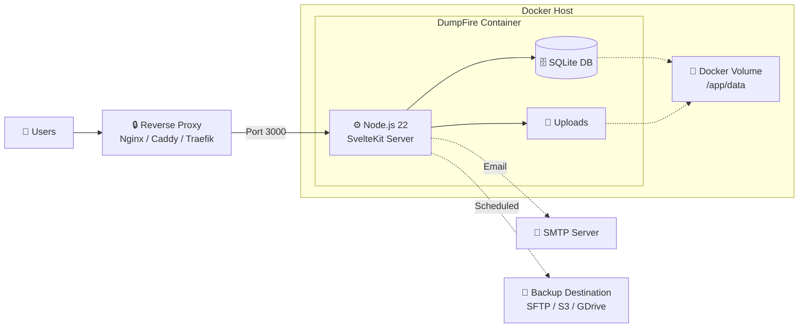

## Docker Build

The Dockerfile uses a two-stage build for minimal image size:

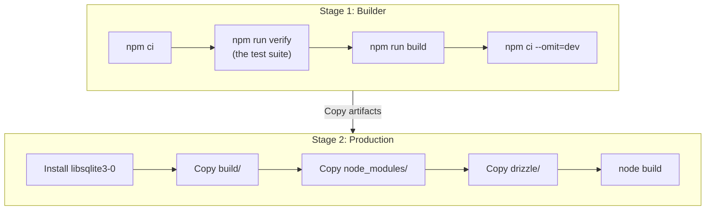

### Build Command

```bash
docker build -t dumpfire:latest .
```

The build asks for no particular builder. The `Dockerfile` has no `# syntax=` line and no flag on any step: its test step is a plain `RUN npm run verify`, which the classic builder and BuildKit both know. It has been built under BuildKit only (the default builder since Docker 23, and the one Docker Desktop 29.2.1 uses); under the classic builder it has not been tried.

### Run the Tests Before You Build

> ✅ **The image build runs the test suite, and stops if a test fails.** The builder stage of the `Dockerfile` runs `npm run verify` after the source is copied in and before `npm run build`. A failing test ends `docker build` at that step with exit status 1 and no image is made, so an image cannot be built from a tree whose tests fail. `npm run build` then makes its own check, of the expected schema (see [Changing the Schema](#changing-the-schema)).

Running the suite by hand first is still the quick way to find out. It takes under a minute (43 seconds on the workstation on 2026-10-15), where a build that fails has already cost a `git pull` and an `npm ci` on the Docker host. Run it where the repository is checked out with its dependencies installed (`npm ci`), on the commit that is going to be deployed and before that commit is pushed to where the image is built:

```bash
npm run verify
```

- **What it runs.** The whole suite, once: every test file listed in `tests/harness.test.ts`. It is `vitest run --allowOnly=false`: `npm test` with one flag more, so that a test left marked `.only`, which would run alone and skip every other test in its file, fails the run instead of passing it.
- **What it touches.** A database in memory and a folder under the operating system's temp directory. It refuses to run against any other database, starts no server and opens no port. It delivers no mail and no webhook, and attempts none: `tests/setup.ts` refuses every `fetch` and every DNS lookup, and fails the test that attempted one, by the address. Until 2026-10-13 that was not so. Five tests let the application try to mail `smtp.example.test` and to call `https://hooks.example.test/...`: seven DNS lookups and four `fetch` calls in a run, each for a name that resolves nowhere, so nothing was delivered, and each a question put to the machine's resolver. It is safe on a machine that holds a real `dumpfire.db`. See [Testing](testing.md).
- **A pass** ends with `Test Files  N passed (N)`, every test file having passed, and exit status 0. The line under it counts the tests that `passed`, and any marked `expected fail` or `skipped`. Those two are not failures: a test marked as expected to fail records a fault that is known and not yet fixed. When none is expected to fail and none is skipped, as on 2026-10-15, the line counts `passed` alone. See [Testing](testing.md#known-faults-the-suite-records).
- **A failure** ends with `Test Files  N failed`, names each failing test with its file, and exits with status 1. Do not push the commit: the image build would stop on the same test.
- **`[ERROR]` lines in a run that passes** are not failures. They are the application's own log of something that went wrong during a test, which the test caused on purpose. The two summary lines and the exit status are what say whether the run passed.

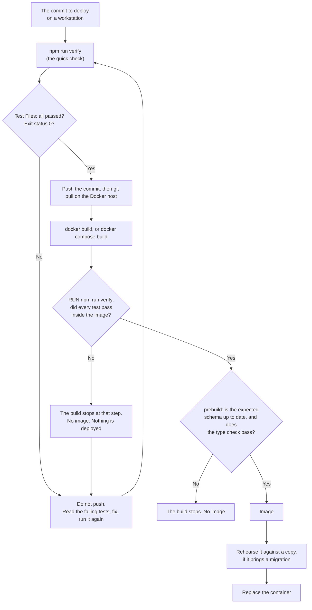

#### The Suite Inside the Image Build

`docker build` runs the same files with the same command, on the image's own Linux and Node (`node:22-slim`) instead of the workstation's. The step is a plain `RUN npm run verify`. It needs no network and no special builder, because the tests refuse the network themselves: `tests/setup.ts` refuses every `fetch` and every DNS lookup, and fails the test that attempted one. Docker does not cut the step off from the network as well. For part of 2026-10-13 the `Dockerfile` said `RUN --network=none`, under a `# syntax=docker/dockerfile:1` line; that was never built, and was taken out, because the flag works only under BuildKit and the Docker version of the production host is not known. A pass ends the step with the same two lines as on the workstation, every test file passed and every test counted. With the suite as it was on 2026-10-15, where none is expected to fail and none is skipped, they read:

```
Test Files  46 passed (46)
     Tests  4708 passed (4708)
```

- **What it adds to a build.** About as long as the suite takes outside Docker on the same machine. The first build with the step, on 2026-10-13, spent 18.5 seconds in it on a 28-core workstation, when the suite was 2220 tests and took 20 seconds on that workstation outside Docker. The second build, later that day on the same workstation, when the suite was 2624 tests and took 28 seconds there, spent 23.7 seconds in the step, of which vitest counted 22.5 as its own. The suite has grown since (43 seconds there on 2026-10-15) and has not been built in Docker at that size. A smaller Docker host will take longer.
- **What it adds to the image.** Nothing. The suite runs in the builder stage, which is thrown away. The production stage is copied from `build/`, `node_modules/` (reinstalled without dev dependencies after the build), `package.json` and `drizzle/` alone. An image built with the step and one built without it from the same tree held the same 27,933 files, apart from the content hashes in the names under `build/` that differ between any two builds, and no `tests/` folder and no vitest. The image of the second build, of the suite as it was then, was listed in the same way and came to the same 27,933: `/app` holds `build/`, `drizzle/`, `node_modules/`, `package.json` and an empty `data/`, with no `tests/`, no `src/`, no database file, and no package the lock file marks as a dev dependency (no vitest, vite, TypeScript, `svelte-check` or `drizzle-kit`). Two names from `devDependencies` in `package.json` are in it all the same, because a production dependency names each as a peer and `npm ci --omit=dev` therefore keeps it: `svelte`, for `svelte-dnd-action`, and `@types/better-sqlite3`, for `drizzle-orm`.
- **What it touches.** Inside the build, a database in memory and `/tmp` in the builder stage. There is no `dumpfire.db` in the build to touch (see below).
- **A test file left out of the commit fails the build.** The build runs the test files that were committed and reached the host, and vitest does not know what is missing: a build without `tests/access-every-route.test.ts` used to pass with `29 passed (29)`. The files are now listed in `tests/harness.test.ts`, and a test there fails, naming the file, when one in the list is not on disk or one on disk is not in the list. A new test file is added to that list in the commit that adds it. See [Testing](testing.md#the-list-of-test-files).
- **A test left marked `.only` fails the build.** `npm run verify` passes `--allowOnly=false`, and the file with the mark fails with `Unexpected .only modifier`.
- **A step shown as `CACHED`** was not run again, because Docker has already run it on exactly these files and it passed. Any change to a file in the build context runs it again.
- **A failure** ends the build with `ERROR: process "/bin/sh -c npm run verify" did not complete successfully: exit code: 1`. The failing tests are named above that line. A test that reached for the network is one of them, on a workstation and in the build alike: `This test reached for the network: ...`, with the address. `npm run build` is not reached and no image is tagged; the container that is running is not affected, because nothing has replaced it.

**What is kept out of the build.** `.dockerignore` keeps these out of the build context, so they never reach Docker, the builder stage or the build cache: any `*.db`, `*.db-shm` and `*.db-wal` file, at the top of the repository and in any folder beneath it (a development `dumpfire.db`, its dated backups, and a copy put in a sub-folder), any `*.backup-temp` and `*.backup-temp-*` file at any depth (the copies `GET /api/admin/export` and a backup make beside the database while they run, `<database>.backup-temp` and `<database>.backup-temp-cleared`), any `*.export-temp` file at any depth (the name an older export used for its copy), `.pre-restore-safety.json` (the copy of the data kept before a restore), the `uploads` folder of attachment files, `.env` and `.env.*`, and the local tooling in `.agent`, `.claude`, `.vscode` and `.git`, along with `.gitignore`, `README.md`, and `node_modules`, `.svelte-kit` and `build`, which the image makes for itself. The database patterns once matched at the top of the repository only, and a database copied into a sub-folder would have been sent; `**/*.db` and its two companions were added on 2026-10-13. The other names are still matched at the top only. The context was listed before each of the two builds of 2026-10-13. Before the first, which was before those patterns were added: 417 files, 5.9 MB. Before the second, with them in place: 418 files, 5,993,090 bytes. None of those names was anywhere in either.

**What has been proved.** The step has been built twice, both times on 2026-10-13 with Docker 29.2.1 on a Windows workstation (Docker Desktop, Linux containers, amd64, BuildKit). The first build was the first time the suite ran on Linux: it passed with the totals it then had (`2200 passed | 19 expected fail | 1 skipped`), `prebuild` and `npm run build` passed after it, and a build with one failing test added inside the builder stage stopped at the step as described.

The second build was of what is described here: the plain `RUN npm run verify`, `--allowOnly=false` in `npm run verify`, the `.dockerignore` patterns for any depth, and the suite at the totals it then had, with the network refused from inside. It ended with exit status 0. The step printed `Test Files  30 passed (30)` and `Tests  2578 passed | 45 expected fail | 1 skipped (2624)`, which are the workstation's totals, and each of the 30 files reported the same number of tests in the build as on the workstation; no test was changed to get there. `prebuild` and `npm run build` passed after it. Two more builds, each with one test added to `tests/docs-format.test.ts` inside the builder stage, stopped at the step with exit status 1 and never reached `npm run build`: one with a test that fails (`Test Files  1 failed | 29 passed (30)`), and one with a test marked `.only` (`Unexpected .only modifier`).

**What has not.** Every one of those builds was made from a Windows working copy, in which 27 source files have CRLF line endings; the Docker host builds from a Linux checkout of a commit, where every file has LF. The first build on the Docker host is therefore the first from such a checkout, and the first on that host's hardware and with its version of Docker, which is not known here. The step asks nothing of that version but a plain `RUN`; the classic builder has not been tried. If a build stops at the step with a failure that names an address, a test is reaching for the network and the guard in `tests/setup.ts` has caught it: fix the test.

When `npm run verify` fails, on a workstation or in the build:

| The output says | It means | Do |
|-----------------|----------|----|
| A test failed with an assertion, in a file under `tests/` | The change broke something the test holds, or changed it on purpose | Fix the code. If the behaviour was changed on purpose, change the test in the same commit and say why. Never skip or delete a test to get an image |
| `Expect test to fail` | A test marked `it.fails` passed: the known fault it records has been put right | Take the mark off that test, or the `fault` off its entry in `tests/access-every-route.test.ts`, in the commit that fixed the fault |
| `routes and methods with no entry in TABLE` | A route or a method was added under `src/routes/api` and nobody has said who may call it | Add its entry to the table in `tests/access-every-route.test.ts`. See [Testing](testing.md#access-for-every-route) |
| `test files in TEST_FILES that are not under tests/` | A test file in the list is not in this tree: it was left out of the commit, or deleted | Commit the file. If it was deleted on purpose, take its name out of `TEST_FILES` in `tests/harness.test.ts` |
| `test files under tests/ that are not in TEST_FILES` | A test file was added and not listed | Add its name to `TEST_FILES` in `tests/harness.test.ts`. See [Testing](testing.md#the-list-of-test-files) |
| `Unexpected .only modifier` | A test or a `describe` was left marked `.only` | Take the `.only` off |
| `This test reached for the network: ...` | A test let the application try a `fetch` or a DNS lookup, at the address named: a webhook or a mail it set up and did not stand in for | Install `effects()` in the test. See [Testing](testing.md#proving-a-request-is-all-or-nothing) |
| Every test of a file fails with `N migration(s) did not apply to a fresh database` | A file under `drizzle/` does not apply to an empty database. The built server would stop at start-up in the same way | Fix the migration file. See [Changing the Schema](#changing-the-schema) |
| A failure under "the checked-in copy of the model" in `tests/migrations.test.ts` | `expected-schema.ts` is out of date. `docker build` would stop on the same thing | `npm run schema:expected`, and commit the result |
| `Tests must run against an in-memory database` | The suite was started in some way that did not set `DB_PATH` | Run it with `npm run verify` or `npm test`, never with `DB_PATH` set by hand |

**When the build stops at `RUN npm run verify`.** Nothing has been deployed and the running container is untouched. Then:

1. Read which tests failed. Docker's default output can cut a failed step short, so build again with all of it: `docker build --progress=plain -t dumpfire:candidate . 2>&1 | tee build.log`, and look above the `Test Files` line for each `FAIL`.
2. Run `npm run verify` on a workstation, on the same commit (`git status` clean, `git log -1` the commit the host built).
3. **If it fails there too**, it is one of the rows above. Fix it, run it again, push, and build again.
4. **If it passes there and fails in the build**, the difference is between the two places and not in the change itself. The likely causes are a file the test needs that was never committed, or that `.dockerignore` keeps out of the build; a file name whose capitals differ from the name the code asks for, which Windows forgives and Linux does not; a path built with `\`; line endings, which are CRLF in some files of a Windows working copy and LF in every file of a Linux checkout; and a test that depends on how long something takes. Correct the test or the file so that it holds in both places.
5. **Do not take the line out of the `Dockerfile` to get an image**, and do not skip the failing test. The last image that built is still on the host: a failed build makes no image and moves no tag.

On the Docker host itself there is usually no Node to run the suite with outside the build, which is why the quick check is made before the commit gets there.

## Environment Variables

| Variable | Default | Required | Description |
|----------|---------|----------|-------------|
| `NODE_ENV` | `production` | No | Node.js environment mode |
| `PORT` | `3000` | No | HTTP port the server listens on |
| `ORIGIN` | `http://localhost:3000` | **Yes** | Public URL — must match your domain exactly. Incorrect value causes CSRF failures. It is also the address every link in a mail begins with, unless an App URL is set: see [Where a Mailed Link's Address Comes From](#where-a-mailed-links-address-comes-from) |
| `APP_URL` | not set | No | The address links in mail begin with, when it should not be `ORIGIN`. The App URL on the admin page, under Application Settings, does the same and is read first |
| `PROTOCOL_HEADER` | `X-Forwarded-Proto` | No | Header from reverse proxy indicating HTTPS. Read only when `ORIGIN` is not set |
| `HOST_HEADER` | `X-Forwarded-Host` | No | Header from reverse proxy with original hostname. Read only when `ORIGIN` is not set, and never for a link in a mail |
| `ADDRESS_HEADER` | not set | Behind a proxy, yes | The request header that names the caller's address, set by the proxy: `X-Forwarded-For` behind the nginx block below. Not set in the image, and not to be set without a proxy in front: see [The Caller's Address Behind a Proxy](#the-callers-address-behind-a-proxy) |
| `XFF_DEPTH` | `1` | No | With `ADDRESS_HEADER=X-Forwarded-For`, how many proxies there are in front of the server: the address is read that many places from the end of the header. `1` for the nginx block below |
| `BODY_SIZE_LIMIT` | `512M` in the image; `512K` for a server started any other way | No | The largest request body the server accepts on any route. Bytes, or a number followed by `K`, `M` or `G`: `512M`, not `512MB`, which is no number to the server and **stops it starting**. `Infinity` is no limit. The application narrows it again route by route: see [Upload Size Limits](#upload-size-limits) |
| `DB_PATH` | `/app/data/dumpfire.db` in the image; `dumpfire.db` in the working directory for a server started any other way | No | The database file. It must be on the volume: the uploads are in the folder `uploads` beside it. The image sets it since card 2083; an image built before that sets none, and a container from it started without `DB_PATH` keeps its database at `/app/dumpfire.db`, inside the container. At the image's path, a server that finds no database there, or an empty file, while it can see a database file at `/app/dumpfire.db` or elsewhere in `/app/data`, or a `dumpfire.db-wal` without its database, **refuses to start** rather than create an empty one: see [Start-Up Sequence](#start-up-sequence) |
| `LOG_LEVEL` | `INFO` | No | Lowest level logged: `DEBUG`, `INFO`, `WARN`, `ERROR` or `CRITICAL`. Leave it at `INFO` or `WARN` when updating: the migration runner reports what it applied and rebuilt at `WARN` |
| `LOG_RETENTION_DAYS` | `30` | No | How long rows are kept in `system_logs`. The table is also capped at 50,000 rows, whatever their age |
| `SCHEDULERS` | `on` in a built server, `off` under `npm run dev` | No | `on` or `off`: whether the backup, report and snapshot schedulers run. Set it to `off` for any instance that holds production's data and is not production. Such an instance holds production's backup destinations, report schedules and mail settings, and with its schedulers running it backs up to production's destinations, prunes the backups there and sends production's reports. When they are off, one `[WARN] [SCHEDULERS]` line at start says so. "Run Backup Now" in the admin panel works either way, and so do email and webhooks sent in answer to an action. To make such a copy harmless in itself, import the backup as a working copy: see [Admin Guide](admin-guide.md#restoring-from-backup) |

> ⚠️ **CRITICAL**: `ORIGIN` must be set to your actual public URL (e.g. `https://dumpfire.example.com`). Leaving it as localhost will cause CSRF token validation failures on all form submissions.

### Where a Mailed Link's Address Comes From

An invite, a request's confirmation and reply links, and the "View Task" link in a notification all begin with the server's own address. That address is configuration, and never anything a request says:

1. the **App URL** on the admin page, under Application Settings (the superadmin's);
2. failing that, the `APP_URL` variable;
3. failing that, `ORIGIN`.

No request header is read for it: not `Host`, and not `X-Forwarded-Host`. With no App URL set, a link used to take its host from `X-Forwarded-Host`, so whoever could send the server a request could have an invite mailed with a link to a host of their choosing, and an invite sets a password.

The image is built with `ORIGIN=http://localhost:3000`. A server that really is reached there is right as it is. One behind a proxy that was started without `ORIGIN` mails links that begin with `http://localhost:3000`, and says so once at every start: `[WARN] [STARTUP] ORIGIN is http://localhost:3000, the address the image is built with, and no App URL is set...`. Set `ORIGIN`, or the App URL.

A server started with no `ORIGIN` at all, which the image never is, and given no App URL has no address. Then two things are refused with `503` and "This server has no address configured to make the link from", before anything is saved: an invite, which is a link, and a public request made by somebody who is not signed in, when SMTP is configured, because that request waits on a mailed link to be confirmed. A user added with a password, a request made by somebody signed in, and any request made while no SMTP is configured have no link to mail, and are accepted. A notification is not sent: each one skipped is a `[WARN] [NOTIFY]` line.

## Running

### Minimal

```bash
docker run -d \
  --name dumpfire \
  -p 3000:3000 \
  -v dumpfire-data:/app/data \
  -e DB_PATH=/app/data/dumpfire.db \
  -e ORIGIN=http://localhost:3000 \
  dumpfire:latest
```

The image sets `DB_PATH=/app/data/dumpfire.db` since card 2083, and each of these gives it all the same, so that each is right for an image built before that as well. Such an image sets none, and without it the database and the uploads are in `/app`, inside the container and off the volume: see [Volume Mounts](#volume-mounts). With any image, the volume at `/app/data` is what keeps them.

### Production

```bash
docker run -d \
  --name dumpfire \
  --restart unless-stopped \
  -p 3000:3000 \
  -v dumpfire-data:/app/data \
  -e DB_PATH=/app/data/dumpfire.db \
  -e ORIGIN=https://dumpfire.example.com \
  -e NODE_ENV=production \
  dumpfire:latest
```

### Docker Compose

```yaml
version: '3.8'

services:
  dumpfire:
    build: .
    container_name: dumpfire
    restart: unless-stopped
    ports:
      - "3000:3000"
    volumes:
      - dumpfire-data:/app/data
    environment:
      - DB_PATH=/app/data/dumpfire.db
      - ORIGIN=https://dumpfire.example.com
      - NODE_ENV=production

volumes:
  dumpfire-data:
```

## Volume Mounts

| Container Path | Purpose | Persist? |
|---------------|---------|----------|
| `/app/data` | SQLite database + uploaded attachments | **Yes — required** |
| `/app/data/dumpfire.db` | Main database file: the image's `DB_PATH` | Auto-created at the first start, which says so in the log |
| `/app/data/uploads/` | Card attachments: the folder `uploads` beside the database file | Auto-created at the first upload |
| `/app/data/uploads/.trash/` | Attachment files of deleted cards, kept for 30 days | Auto-created at the first delete that has a file to move |

> 💡 Always mount `/app/data` as a Docker volume. Without it, all data is lost when the container is recreated.

The uploads folder follows `DB_PATH`: it is the folder named `uploads` in the directory that holds the database file. A variable `UPLOADS_DIR` exists for the tests and overrides that wherever it is set; do not set it in production, where it would move uploads away from the files already stored. The image sets `DB_PATH=/app/data/dumpfire.db`. An image built before card 2083 sets none, and a container from it started without `DB_PATH` has its database at `/app/dumpfire.db` and the uploads in `/app/uploads`, both inside the container and neither on the volume. Mounting nothing at `/app/data` does the same with any image: the folder is then the container's own, and every start says so in a `[WARN] [STARTUP]` line (see [Start-Up Sequence](#start-up-sequence)). To put either right, see [Moving the Database onto the Volume](#moving-the-database-onto-the-volume).

## Attachment Files

A file attached to a card is stored on disk, not in the database. The database holds a row for it, with the file's name; the file is at `uploads/<card id>/<file name>` beside the database.

> ⚠️ **Attachment files are in no backup.** A scheduled backup, "Run Backup Now" and the database export each hold the database and nothing else. Back the uploads folder up separately, or a restore brings back cards whose attachments cannot be opened.

> ⚠️ **Never point two instances at the same uploads folder.** A second instance that holds a copy of this one's data, such as a development copy or a rehearsal, has the same rows naming the same files. Deleting a card there moves this instance's files to the trash, a Reset there moves every one of them, and 30 days later they are removed for good. Two unrelated databases would mix their files in the same folders, because folders are named by card id and every database has a card 1. Give every instance its own data directory.

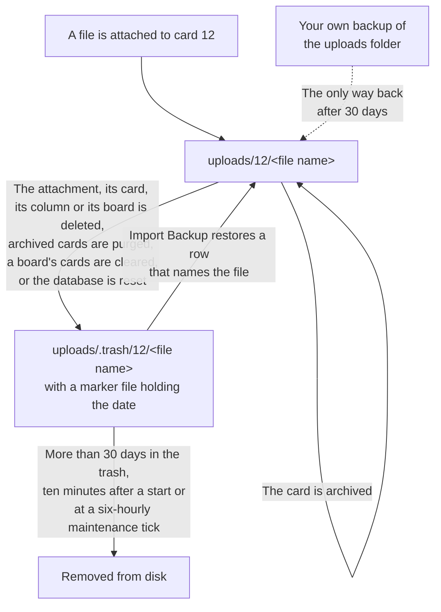

### The trash

- **A deleted card's files are moved, not removed.** They go to `uploads/.trash/<card id>/`, beside a marker file `.trashed-at` that holds the date. Archiving a card moves nothing.
- **They stay for 30 days.** A folder of the trash is removed once it was last added to more than 30 days ago. The period is fixed.
- **The trash is emptied by a timer, never at start-up.** The timer starts with the server, looks at the trash for the first time ten minutes after a start and then every six hours, so nothing is removed from disk as the server comes up. A server that is restarted more often than every six hours still empties its trash, at the ten-minute run after each start; one that is restarted more often than every ten minutes never does.
- **`SCHEDULERS=off` does not stop it.** The timer belongs to log maintenance, not to the backup, report and snapshot schedulers, and runs in every instance.
- **What it logs.** When a tick removes something, one `[INFO] [UPLOADS]` line says how many cards' files went. A folder that was due and could not be removed is reported in a `[WARN] [UPLOADS]` line and tried again at the next tick.
- **A file that cannot be moved to the trash stays where it was.** The delete has already been committed and is not undone. A `[WARN] [DELETE]` line names the files, the first ten where there are more, each by its card id and stored file name. The move is not tried again and nothing removes such a file later: it stays in `uploads/<card id>/` for good, and is yours to remove by hand.
- **Disk space.** Deleting cards does not free the space their attachments use until 30 days later. To free it sooner, delete folders under `uploads/.trash/` by hand: the application has no way to empty the trash early. A file removed that way can no longer be put back by Import Backup.

### Backing up and restoring the files

Copy the whole uploads folder, the trash included. With the volume and path used in the examples on this page:

```bash
mkdir -p -m 700 "$HOME/dumpfire-uploads"
docker run --rm --network none -v dumpfire-data:/app/data:ro -v "$HOME/dumpfire-uploads:/backup" \
  dumpfire:latest sh -c 'if [ ! -d /app/data/uploads ]; then echo "No /app/data/uploads on the volume: nothing was copied. Check DB_PATH." >&2; exit 1; fi; cp -a /app/data/uploads/. /backup/ && ls -A /backup'
```

It lists what it copied. If there is no `/app/data/uploads` it copies nothing, says so and exits with status 1. That is so in two cases. No file has ever been attached: the folder is made at the first upload. Or the database is not on the volume, and the uploads are inside the container, beside the database. To tell which, with the container running:

```bash
docker exec dumpfire printenv DB_PATH
docker inspect --format '{{range .Mounts}}{{.Destination}}{{println}}{{end}}' dumpfire
```

If the first prints nothing, the container is from an image built before card 2083 and was started without `DB_PATH`: the uploads are in `/app/uploads` inside the container, and are lost when the container is replaced. If it prints a path, the uploads are in `uploads` in the folder that holds it, and that folder (normally `/app/data`) must be listed by the second command, or be inside a folder it lists. If it is not, the uploads are inside the container all the same: a container started from this image with no volume at `/app/data` prints `/app/data/dumpfire.db` and still has nothing on a volume. Checking `DB_PATH` alone says nothing since the image sets it. Copy them out of the container itself, running or stopped (shown for `/app/uploads`; for the image's own path it is `/app/data/uploads`):

```bash
mkdir -p -m 700 "$HOME/dumpfire-uploads-rescued"
docker cp dumpfire:/app/uploads/. "$HOME/dumpfire-uploads-rescued/"
ls -A "$HOME/dumpfire-uploads-rescued"
```

`docker cp` fails with a message if the container has no `/app/uploads`. For a `DB_PATH` set to somewhere else, the folder is `uploads` in the directory that holds that file.

The files are the attachments people uploaded, and nobody else on the host should be able to read them: `-m 700`, in both commands, makes the folder readable by you alone. The copy taken out of a container is a rescue, not a backup: move the files onto the volume with the database ([Moving the Database onto the Volume](#moving-the-database-onto-the-volume)), and once the next backup after that has been taken and checked, delete it (`rm -r "$HOME/dumpfire-uploads-rescued"`).

The first command replaces the server in a short-lived container, which is not started. It can be run while the application's container is up: an attachment file is written once and never changed afterwards. A file uploaded while the copy runs may be missed, so take the copy at about the time of the database backup it goes with.

What each way of restoring does with the files:

| Restore | The files |
|---------|-----------|
| **Import Backup**, in the admin panel | Files on disk are left where they are. For every attachment the restored database names whose file is missing from its card's folder and is in the trash, the file is moved back. The result on screen says how many were put back, and lists any that could not be |
| **By hand**, replacing `dumpfire.db` with the server stopped | Nothing is moved. Files that a delete had put in the trash stay there. Move each back from `uploads/.trash/<card id>/` to `uploads/<card id>/`, or restore your own copy of the folder taken with that backup |
| Either, more than 30 days after the cards were deleted | The trash no longer has the files. Only your own backup of the folder does |

An attachment whose file is not on disk still shows on its card. Opening it answers 404, "File not found on disk".

A copy of the database restored somewhere else, such as a working copy on a development instance, has the attachment rows and none of the files. That is expected: deleting a card there passes over the files it does not have.

## Start-Up Sequence

Every start of the container does the same work before the server accepts a request. The work is done by the application's own migration runner (`src/lib/server/db/migrate.ts`), which `hooks.server.ts` calls once as the server loads. Nothing else changes the structure of the database.

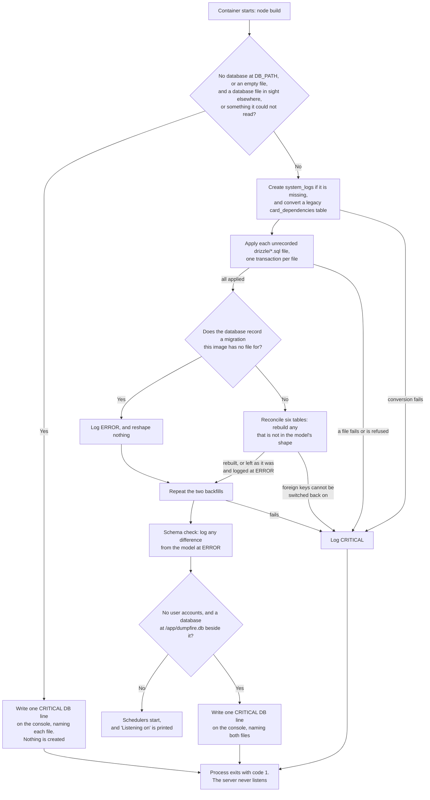

Before any of it, before the database is even opened (opening a path creates the file), the server looks at where the database is (`src/lib/server/db/location.ts`, card 2083). What it does depends on what is at the path it is about to open:

- **A database with data there** (a regular file that is not empty): it opens it, whatever else is around. If a non-empty `dumpfire.db` is also in the working directory (`/app/dumpfire.db`) beside the image's `/app/data/dumpfire.db`, it says so at every start, and opens the image's.
- **A folder there, or a file it cannot look at** (permission denied, say): it does not judge, and the open says what is wrong.
- **Nothing there, or an empty file**, so that opening it would make a new, empty database. At the image's path, `/app/data/dumpfire.db`, it looks for a database that would be hidden: a non-empty `dumpfire.db` in the working directory (`/app/dumpfire.db`, where a server started without `DB_PATH` kept it); a non-empty file whose name ends in `.db`, in lower case, at the top level of `/app/data` (not in a folder beneath it, and not `dumpfire.db-wal`, `dumpfire.db-shm` or `dumpfire.db.backup-temp`); and a non-empty `dumpfire.db-wal` beside the missing database. At any other path, on Linux, it looks at the image's `/app/data/dumpfire.db`: an empty `DB_PATH` (`-e DB_PATH=`, or `${DB_PATH}` in a compose file with the variable unset) falls back to `/app/dumpfire.db`, and a typo such as `/app/data/dumpfire.sqlite` names a file that is not there, and either would otherwise open a new database beside the real one. Only regular files count. If it finds any of them, or cannot look at one of them, or cannot list `/app/data`, it **refuses to start**. If it finds none, it opens the new database and says so.

The refusal is one `[CRITICAL] [DB]` line on the console, which begins `The server will not start.`, names each file with its size and when it was last written (so that you can tell which is live), says what to do with each, names anything it could not read, and never says to delete a file; the process exits with code 1 and nothing is created. The line cannot go to `system_logs`, which is in the database. On a workstation there is no `/app/data/dumpfire.db`, so a scratch file is never refused; on Windows the image's path is never looked at. See [A Failed Start](#a-failed-start).

One more refusal comes after the migrations, before the server listens. If the database in use is the image's, has no user accounts, and a non-empty `/app/dumpfire.db` is beside it, the server **refuses to start** with one `[CRITICAL] [DB]` line naming both files with their sizes and times. That is a database the check above let through because one earlier start, by an older image or with a `DB_PATH` it did not guard, made it and wrote to it: with no users, set-up would be open to whoever comes first while the real database sits unused. A healthy installation has users, so this never stops one that is running on its own database with an old file beside it.

1. **Preparation.** The `system_logs` table is created if it is missing, and a `card_dependencies` table still in its original shape is converted to the current one.
2. **Migration files.** Every `.sql` file in `/app/drizzle` whose name is not yet recorded in the `__drizzle_migrations` table is applied, in file-name order. Each file runs in its own transaction, together with the row that records it, so a file is either applied in full and recorded or not applied at all.
3. **The first failure stops the server.** The failing file is rolled back, no later file is attempted, and the process exits with code 1 before it listens. Files this start had already applied stay applied and recorded.
4. **Reconciliation.** Six tables (`boards`, `columns`, `categories`, `settings`, `user_xp`, `invite_tokens`) reached older databases in two different shapes. Any of them that is not in the shape the model declares is rebuilt in it, with every row carried across. A table that cannot be rebuilt safely is left exactly as it was and reported; that does not stop the server. The whole step is skipped when the database records a migration this image has no file for, because that database may be newer than the image, and an older image must not reshape it.
5. **Backfills.** Two values that migrations `0050` and `0051` filled in once (`cards.first_completed_at` and `task_requests.access_token`) are filled in again for any row that lacks them.
6. **Schema check.** The whole database is compared with the model. Every difference is logged in one `ERROR` line. Nothing is changed and the server starts.

Expired sessions are then cleared, the system log is pruned to its retention, the backup, report and snapshot schedulers start, and the server listens. On a database that is already up to date, steps 1 to 6 change nothing and log nothing.

Last, six things about the installation are said in the log if they are so. None stops the server, and none changes anything: there are user accounts and none of them is the superadmin (`[CRITICAL] [STARTUP]`, see [If Nobody Can Sign In as the Superadmin](#if-nobody-can-sign-in-as-the-superadmin)); `ORIGIN` is still the address the image is built with and no App URL is set (`[WARN] [STARTUP]`, see [Where a Mailed Link's Address Comes From](#where-a-mailed-links-address-comes-from)); and a board hangs beneath one of its own cards, a loop left by a move made before card 2141, the legacy JSON import or a restored backup (`[WARN] [STARTUP]`, naming up to 20 such boards with the card each hangs from, see [A board beneath one of its own cards](admin-guide.md#a-board-beneath-one-of-its-own-cards) in the admin guide). The third reads the boards once and finds the loops in memory, so it costs next to nothing however deep the boards nest, and an import of a backup that brings a loop writes the same line at once, as `[WARN] [IMPORT]`, without waiting for the next start. The other three are about the database (card 2083), each a `[WARN] [STARTUP]` line: there was no database file, or an empty one, before this start opened it (`No database was at <path>: a new, empty one was created at this start.`, said once by a new installation, and the alarm on one that had data: stop the container before anyone opens the site); the folder the database is in is the container's own file system and not a mounted volume, at every start; and a database file is at `/app/dumpfire.db` beside the image's `/app/data/dumpfire.db`, which has data and is the one in use, at every start, naming both with their sizes and when each was last written. The first two are written to the console whatever `LOG_LEVEL` is, even `ERROR`, because the checks after a deploy look for them in `docker logs`; with `LOG_LEVEL` at `ERROR` or `CRITICAL` they are printed but not kept in `system_logs`, as for any line. The second knows a container's own file system from `/proc/self/mountinfo`: the mount that holds the folder is the root and an overlay (`overlay`, as Docker has it, `fuse-overlayfs`, as rootless Podman has it, or `aufs`), or it is `tmpfs`. A container on another storage driver (`btrfs`, `zfs`, `vfs`) is not recognised and nothing is said, and where there is no `/proc/self/mountinfo` (Windows, macOS) nothing is said either. An in-memory database has no folder and is not looked at. A check that cannot be made is said on the console, one line for each such check, and the server starts all the same.

Nothing at start-up touches the uploads folder. The log is pruned again every six hours, and the same six-hourly tick empties the [uploads trash](#the-trash) of what has been in it for more than 30 days; the trash is also emptied once, ten minutes after the start.

What stops a start, and what is only reported:

| Found at start-up | Logged as | Does the server start? |
|-------------------|-----------|------------------------|
| At `/app/data/dumpfire.db`, no database or an empty file, while a database file is at `/app/dumpfire.db` or at the top of `/app/data`, or a `dumpfire.db-wal` is there without its database | `[CRITICAL] [DB]`, on the console only, naming each file, its size and time, and what to do with it | **No**. Nothing is created or changed. See [A Failed Start](#a-failed-start) |
| At any other path, on Linux, no database or an empty file, while `/app/data/dumpfire.db` has data (an empty `DB_PATH`, or a typo) | `[CRITICAL] [DB]`, on the console only, naming `/app/data/dumpfire.db` | **No**. Set `DB_PATH=/app/data/dumpfire.db`, or take the setting out |
| A new database would be made, and a file or folder the check needed could not be read | `[CRITICAL] [DB]`, on the console only, naming what could not be read | **No**. Let the server read it, or set `DB_PATH` to where the database is |
| After the migrations: the image's database has no user accounts, and a database file is at `/app/dumpfire.db` | `[CRITICAL] [DB]`, on the console only, naming both files | **No**. See [A Failed Start](#a-failed-start) |
| A migration file fails, cannot be read, holds no SQL statement, or holds a statement the runner refuses (see [Changing the Schema](#changing-the-schema)) | `[CRITICAL] [DB]` | **No** |
| `/app/drizzle` is missing or holds no `.sql` file (an image built without its migrations) | `[CRITICAL] [DB]` | **No** |
| The `card_dependencies` conversion or a backfill fails | `[CRITICAL] [DB]` | **No** |
| Foreign keys cannot be switched back on after a rebuild | `[CRITICAL] [DB]` | **No** |
| One of the six tables cannot be rebuilt, or its rebuild fails its checks and is rolled back | `[ERROR] [DB]`, at every start until the cause is dealt with | Yes, with the table as it was |
| One of the six tables holds a value that the model's column type would store differently | `[ERROR] [DB]` for that table, at every start until a migration converts it | Yes; that table is as it was and the others are rebuilt |
| The database records a migration this image has no file for | `[ERROR] [DB]`, at every start | Yes; no table is rebuilt |
| The database differs from the model anywhere | `[ERROR] [DB]`, at every start | Yes; nothing is changed |
| There are user accounts and none of them is the superadmin | `[CRITICAL] [STARTUP]`, at every start until one is | Yes. Nobody can export, import, reset or change the backup and mail settings until one is made from the host |
| `ORIGIN` is `http://localhost:3000` and no App URL is set | `[WARN] [STARTUP]`, at every start | Yes; links in mail begin with `http://localhost:3000` |
| A board hangs beneath one of its own cards | `[WARN] [STARTUP]`, at every start until it is repaired, and `[WARN] [IMPORT]` at once after an import that brings one | Yes. The board is on no dashboard and its card cannot be completed; opening it is safe. See [A board beneath one of its own cards](admin-guide.md#a-board-beneath-one-of-its-own-cards) |
| There was no database file, or an empty one, and this start made a new one | `[WARN] [STARTUP]`, at that start | Yes, on an empty database, with set-up open. On an installation that had data, stop the container before anyone opens the site: see [Moving the Database onto the Volume](#moving-the-database-onto-the-volume) |
| The database's folder is in the container's own file system, not on a mounted volume | `[WARN] [STARTUP]`, at every start | Yes. The database and the uploads are lost when the container is replaced: move them onto a volume before it is |
| A database file is at `/app/dumpfire.db` beside `/app/data/dumpfire.db`, which has data | `[WARN] [STARTUP]`, at every start until one of them is moved | Yes, on `/app/data/dumpfire.db`. If the other is this installation's database, start with `DB_PATH` set to it, or move it onto the volume |

How the runner, the rebuild and the comparison work is described in [Data Model](data-model.md#migrations-and-schema-reconciliation).

## First-Run Setup

On a new, empty database the [start-up sequence](#start-up-sequence) applies every migration file before the server listens. What follows depends on whether anyone has an account yet:

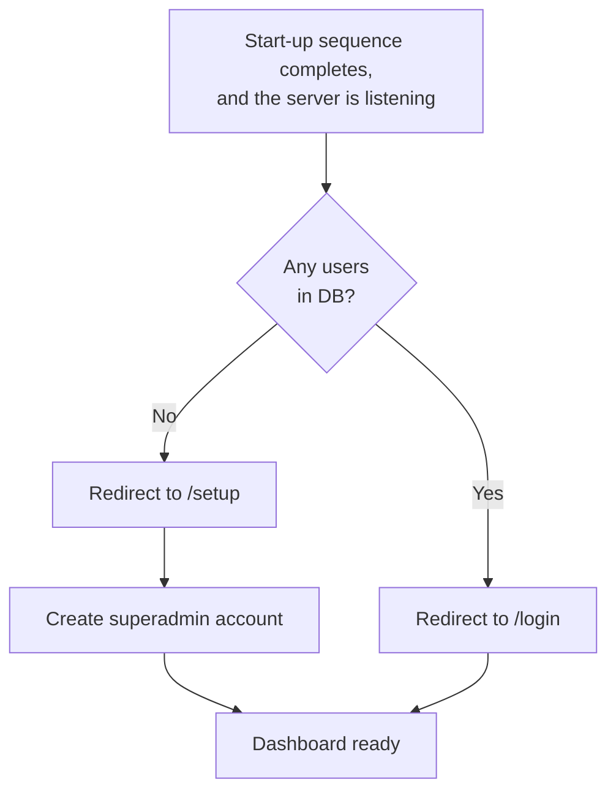

1. Start the container
2. Visit the application URL
3. You'll be redirected to `/setup` to create the first superadmin account
4. After setup, `/setup` is permanently blocked

The start that made the new database says so in the log: `[WARN] [STARTUP] No database was at /app/data/dumpfire.db: a new, empty one was created at this start.` On a new installation that is expected, once. On an installation that had data it means the server is not looking where the data is, and set-up is open to whoever opens the site first: stop the container at once and see [Moving the Database onto the Volume](#moving-the-database-onto-the-volume).

## The Superadmin

The account made at set-up is the **superadmin**, and there is one. Its role is written by set-up and by nothing else: no page and no route makes a second, and an administrator cannot be promoted to it.

What acts on the whole installation is the superadmin's alone. An administrator who tries any of it is answered `403`, "This belongs to the superadmin", and the admin page does not offer it to them:

| The superadmin only | Why it is not an administrator's |
|---------------------|----------------------------------|
| Export Backup | The file holds every user's password hash, the mail password and every backup destination's credentials |
| Import Backup | It replaces every account with the backup's |
| Reset Everything | Whoever sets up afterwards is the superadmin |
| Scheduled Backups: the schedule, the destinations, "Test" and "Run Now" | A destination is sent the whole database, and a test connects with a stored password to whatever host it is given |
| Email / SMTP and the App URL | They decide which server an invite is handed to, and where its link points |

Everything else on the admin page is any administrator's: users and teams, clearing a board, purging archived cards, vacuuming, resetting XP, the system log and the audit trail. See [Admin Guide](admin-guide.md#who-may-do-what).

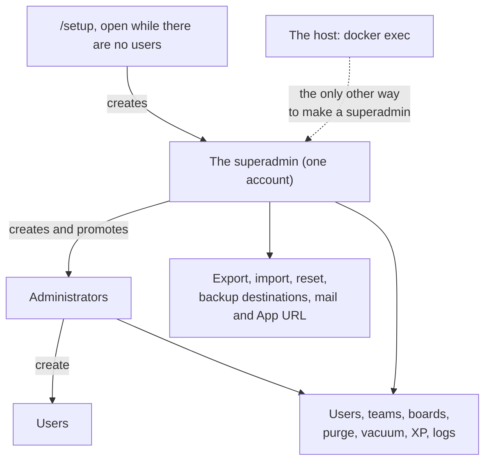

> ⚠️ **Before you deploy the version that brings this in**, sign in on production as the superadmin. The user list on the admin page shows each account's role, so it shows who that is. If you cannot, use the command below first: the account you use day to day, if it is an administrator, loses Export, Import, Reset, Scheduled Backups and the mail settings with that deploy.

### If Nobody Can Sign In as the Superadmin

The superadmin's password is lost, or its account was deleted from the database by hand, or the database came from somewhere that had none. No page puts that right: only the superadmin could, and set-up is closed while there is any user. The server says so in the log at every start:

```
[CRITICAL] [STARTUP] There are 4 user account(s) and none of them is the superadmin. ...
```

The way back is from the host, with the application's own database driver. The image has no `sqlite3` command. Give the username of an existing account in place of `<username>`, exactly as it is written on the admin page:

```bash
docker exec <container> node -e "const db = require('better-sqlite3')(process.env.DB_PATH || 'dumpfire.db', { fileMustExist: true }); const name = process.argv[1] || ''; const user = db.prepare('SELECT id, username, role FROM users WHERE username = ?').get(name); if (user === undefined) { console.log('No user is named [' + name + ']. Nothing was changed. The users are: ' + db.prepare('SELECT username, role FROM users ORDER BY id').all().map((u) => u.username + ' (' + u.role + ')').join(', ')); } else { db.prepare('UPDATE users SET role = ? WHERE id = ?').run('superadmin', user.id); console.log(user.username + ' was ' + user.role + ' and is now superadmin.'); } db.close();" <username>
```

It prints what it did:

| It prints | What happened |
|-----------|---------------|
| `greg was admin and is now superadmin.` | That one account's role was changed. Nothing else was |
| `No user is named [gerg]. Nothing was changed. The users are: greg (admin), ann (user)` | The name matched nobody, so nothing was written. It lists who there is |
| `SqliteError: unable to open database file` | `DB_PATH` in the container does not name a database. Nothing was written, and no file was created |

It runs while the server is running and takes effect at the next request: no restart. It changes no password, so name an account whose password is known. If none is, an administrator can set the password of an ordinary user on the admin page, and that user can then be named here; nobody but the superadmin can set an administrator's.

To check it:

```bash
docker exec <container> node -e "const db = require('better-sqlite3')(process.env.DB_PATH || 'dumpfire.db', { readonly: true, fileMustExist: true }); db.prepare('SELECT username, role FROM users ORDER BY id').all().forEach((u) => console.log(u.username + ': ' + u.role)); db.close();"
```

At least one line should end `superadmin`. Then sign in as that user: the admin page has Application Settings, Backup & Restore, Scheduled Backups and Email / SMTP on it again, and the `[CRITICAL] [STARTUP]` line is not written at the next start.

If the old superadmin's account is still there, there are now two, and neither can manage the other's account. Make the old one an administrator with the same command, with `'admin'` in place of `'superadmin'` in the `UPDATE`, or delete it as the new superadmin once its role is changed.

An import cannot bring this about: a backup that has users and no superadmin among them is refused before anything is written. See [Restoring from Backup](admin-guide.md#restoring-from-backup).

## Updating a Running Installation

An update replaces the container with one started from a newer image. The database stays where it is, and the new image brings it up to date in the [start-up sequence](#start-up-sequence).

> ⚠️ **The database stays where it is only if it is on the mounted volume.** Check before anything else, with the container running:
>
> ```bash
> docker exec dumpfire printenv DB_PATH
> docker inspect --format '{{range .Mounts}}{{.Destination}}{{println}}{{end}}' dumpfire
> ```
>
> If the first prints nothing, the container is from an image built before card 2083 and was started without `DB_PATH`: the server is using `/app/dumpfire.db`, which is inside the container and not on the volume. If it prints a path, the folder that holds it (normally `/app/data`) must be listed by the second command, or be inside a folder it lists; if it is not, the database is inside the container too. `DB_PATH` alone proves nothing since the image sets it. Either way, replacing the container discards the database and the uploads beside it: move them first, as [Moving the Database onto the Volume](#moving-the-database-onto-the-volume) says, before going any further. An image with card 2083 also says it at every start, `[WARN] [STARTUP] The database, <path>, is in the container's own file system`, in `docker logs dumpfire 2>&1` for as far back as the log goes.
>
> No check in a newer image can see a database inside the old container: a new container starts with a file system of its own. What a newer image can see, it judges by what is at the path it is about to open ([Start-Up Sequence](#start-up-sequence) has the whole rule):
>
> - It **refuses to start** when there is no database at that path, or an empty file, and it can see one elsewhere: a database file at `/app/dumpfire.db` (mounted there), a `*.db` file at the top of `/app/data`, a `dumpfire.db-wal` without its database, or, when `DB_PATH` is empty or names any other path, `/app/data/dumpfire.db` with data in it. It refuses as well when it would make a new database and cannot read something it needed to look at. And after the migrations, it refuses a database with no user accounts while a database file is at `/app/dumpfire.db` beside it. Each refusal is one `[CRITICAL] [DB]` line, and nothing is served (see [A Failed Start](#a-failed-start)).
> - It **opens and warns** when the database at its path has data and a database file is at `/app/dumpfire.db` beside it: one `[WARN] [STARTUP]` line at every start names both, with their sizes and times.
> - It **opens a new database and says so** when there is nothing at its path and nothing in sight: `[WARN] [STARTUP] No database was at <path>: a new, empty one was created at this start.` After an update, that line means the data is somewhere the new container is not looking: stop the container at once, before anyone opens the site and is offered set-up.

In outline:

1. **Run the tests** on the commit the new image will be built from: `npm run verify`, on a workstation, before the commit is pushed. If one fails, stop here. The image build runs them again, inside the image, and stops with no image if one fails there; running them first is the quick way to find out. See [Run the Tests Before You Build](#run-the-tests-before-you-build).
2. **Rehearse** the new image against a copy of the database whenever it brings a new file under `drizzle/`. See [Rehearsing an Update Against a Copy](#rehearsing-an-update-against-a-copy).
3. **Keep the old image** under a tag you can start again. The examples here call it `dumpfire:rollback`.
4. **Stop the old container and take a cold copy of the database**: the database file and the `-wal` and `-shm` files beside it, if they are there. SQLite runs in WAL mode, so the three files are one database and recent changes may be in the `-wal` file alone. They are only safe to copy together, with nothing holding them open. See [Taking and Returning the Cold Copy](#taking-and-returning-the-cold-copy).
5. **Start the new image** on the same data and read its log until a line beginning `Listening on` appears. It should take about as long as it did in the rehearsal.
6. If that line does not appear, or `docker ps` shows the container restarting, follow [A Failed Start](#a-failed-start).
7. **Have every open DumpFire tab reloaded.** A page left open keeps running the scripts of the release it was loaded from, against the new server. A request the new server reads differently can then fail with no word of why: an Account page loaded before the release that makes Generate Key ask for the password sends no password, and is refused with nothing shown. Administrators in particular reload the admin page before resetting anyone's password, so that the reset dialog is the new one and says what the reset ends.
   - **For the release that brings the update bar (card 2167), and any update to it from an older release**, reload every open tab by hand, and ask the people who use DumpFire to do the same. A page loaded from an older release never asks whether there is a new version.
   - **From the next update on**, each open page asks the server about once a minute and, within about a minute of the new image answering, shows a bar across the foot of the window: "DumpFire has been updated. Save anything you are editing, then reload to use the new version.", with a **Reload** button. It never reloads by itself, so nothing typed in a card's window or a form is lost, and the bar cannot be closed. A link or any other move to another page from it loads that page afresh, on the new version. Tell people to save what they are typing and press Reload when they see it.
   - **A restart of the same image shows no bar**: the version is the time the image was built. Going back to an older image is a new version, and shows it. Under `vite dev` the bar never shows. See [A page left open across a deploy](architecture.md#a-page-left-open-across-a-deploy).

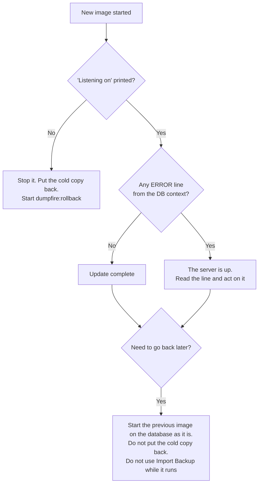

### Moving the Database onto the Volume

For a container whose database is inside it, not on a volume: one from an image built before card 2083 started without `DB_PATH` (the database is `/app/dumpfire.db`), or one started with no volume at the folder of its `DB_PATH`. The database is three files, `dumpfire.db` and the `-wal` and `-shm` files beside it when they are there, and the uploads are the folder `uploads` beside them. All of it moves, with the container stopped. Before anything is copied, the container's own file system is kept as an image with `docker commit`: under Docker Compose, the next `docker compose up -d` recreates the service's container and removes the old one, whatever it has been renamed to, and what is inside it goes with it. The snapshot, and the copy on the host, are kept until the new container has been checked and the next backup has been taken.

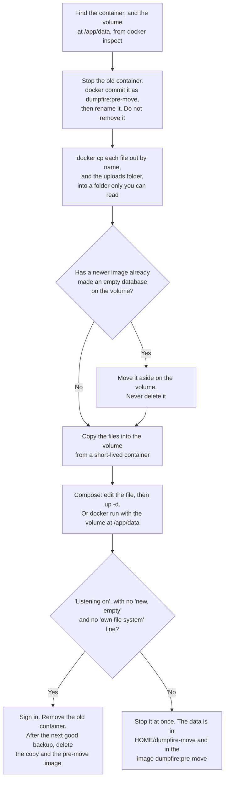

These are bash. Under Git Bash on Windows, run `export MSYS_NO_PATHCONV=1` first, so that the paths inside the container are not rewritten. That also leaves `$HOME` as `/c/Users/<you>`, which `docker.exe` does not understand, so on Windows set `move=$(cygpath -m "$HOME/dumpfire-move")` and write `"$move"` wherever the commands below say `"$HOME/dumpfire-move"`. `mkdir -m 700` protects nothing on NTFS: keep the folder in your own profile, which only you can read.

**First, find the names.** The container's name is in `docker ps` (under Compose it is often `<project>-dumpfire-1`). The volume is the one the container has at `/app/data`, if it has one: a volume made by Compose is named `<project>_dumpfire-data` (the README's example makes `dumpfire_dumpfire-data`), and one made by `docker run -v dumpfire-data:/app/data` is `dumpfire-data`. Read it from the container rather than guessing it:

```bash
c=dumpfire    # the container's name, from docker ps
docker inspect --format '{{range .Mounts}}{{.Type}}  {{if .Name}}{{.Name}}{{else}}{{.Source}}{{end}}  ->  {{.Destination}}{{println}}{{end}}' "$c"
docker volume ls
```

Set `vol` to the name shown against `/app/data`. If nothing is mounted at `/app/data`, choose the name the new container will use (under Compose, `<project>_dumpfire-data`, where `<project>` is shown by `docker inspect --format '{{index .Config.Labels "com.docker.compose.project"}}' "$c"`) and make it with `docker volume create "$vol"`; Compose then says the volume was not created by Compose, and uses it. Set `from` to the folder the database is in inside the old container: `/app` for one started without `DB_PATH`, or the folder of its `DB_PATH`. Set `img` to any DumpFire image you have, such as `dumpfire:latest`: the short-lived containers below run `sh`, never the server.

```bash
vol=dumpfire_dumpfire-data   # the volume found above
from=/app
img=dumpfire:latest          # any DumpFire image you have

# 1. Stop the old container, keep its own file system as an image, and keep the
#    container too, under another name.
docker stop "$c"
docker commit "$c" dumpfire:pre-move
docker rename "$c" dumpfire-old

# 2. Copy each file out by name, into a folder only you can read. docker cp takes no
#    wildcard. A missing -wal or -shm file is expected, and so is a missing uploads
#    folder when nothing was ever attached.
mkdir -m 700 "$HOME/dumpfire-move"
docker cp "dumpfire-old:$from/dumpfire.db" "$HOME/dumpfire-move/"
docker cp "dumpfire-old:$from/dumpfire.db-wal" "$HOME/dumpfire-move/" || echo "No -wal file: expected"
docker cp "dumpfire-old:$from/dumpfire.db-shm" "$HOME/dumpfire-move/" || echo "No -shm file: expected"
docker cp "dumpfire-old:$from/uploads" "$HOME/dumpfire-move/" || echo "No uploads folder: expected if nothing was attached"
ls -la "$HOME/dumpfire-move"
```

`mkdir -m 700` fails if `$HOME/dumpfire-move` is there already: that is a copy from an earlier attempt, so look at it before you move it aside, and never copy over it.

**A database bind-mounted as a single file** (`-v /srv/dumpfire.db:/app/dumpfire.db`) has its file on the host, but its `-wal` and `-shm` files are not: SQLite writes them beside the database, which is inside the container, next to the mount. `docker commit` keeps them (it keeps the container's own files, not what is mounted). Copy them out of the old container with the two lines above, and take the database file from the host if the first `docker cp` does not.

**If a newer image has already started on the volume and made a new, empty database there** (its log said `No database was at /app/data/dumpfire.db: a new, empty one was created at this start.`, and nobody has used the site since), that database is in the way. Move it aside on the volume, never delete it:

```bash
docker run --rm --network none -v "$vol:/app/data" "$img" sh -c \
  'd=/app/data/set-aside-$(date +%Y%m%d-%H%M%S) && mkdir "$d" && for f in dumpfire.db dumpfire.db-wal dumpfire.db-shm; do if [ -e "/app/data/$f" ]; then mv "/app/data/$f" "$d/"; fi; done; ls -la /app/data "$d"'
```

Then copy the files into the volume, with a short-lived container as the cold copy does. It copies nothing if a database is there already. It uses `cp -R`, not `cp -a`, so the files belong to the container's user and `/app/data` keeps its own owner and mode (`cp -a` would give the volume folder the copy folder's owner and its `700`, which a volume on NFS with root squashing, or a future image that does not run as root, could not open):

```bash
docker run --rm --network none -v "$vol:/app/data" -v "$HOME/dumpfire-move:/move" "$img" sh -c \
  'if [ -e /app/data/dumpfire.db ]; then echo "/app/data/dumpfire.db is there already: nothing was copied." >&2; exit 1; fi; cp -R /move/. /app/data/ && ls -la /app/data'
```

**Start the new image on the volume.** Under Docker Compose, edit the compose file: take out any line that mounts a file or a volume at `/app/dumpfire.db`, and give the service the volume at `/app/data` and `DB_PATH`:

```yaml
services:
  dumpfire:
    environment:
      - DB_PATH=/app/data/dumpfire.db
    volumes:
      - dumpfire-data:/app/data

volumes:
  dumpfire-data:
```

In a compose file whose `environment:` is a map rather than a list, the line is `DB_PATH: /app/data/dumpfire.db`.

Keep the rest of the service as it was. If `vol` is a volume you made with `docker volume create` under another name than Compose's, add `external: true` and `name: <that name>` under `dumpfire-data:` at the end. Then, in the folder of the compose file:

```bash
docker compose up -d
```

Compose recreates the service's container on the new settings, and removes `dumpfire-old`, which still carries the service's labels; the snapshot `dumpfire:pre-move` keeps what was inside it. Without Compose, start it as the [Production](#production) example does, with the volume and `DB_PATH`:

```bash
docker run -d --name dumpfire --restart unless-stopped -p 3000:3000 \
  -v "$vol:/app/data" -e DB_PATH=/app/data/dumpfire.db \
  -e ORIGIN=https://dumpfire.example.com dumpfire:latest
```

Then read what it said (under Compose, the container's name is in `docker compose ps`):

```bash
docker logs dumpfire 2>&1 | grep -E 'STARTUP|\] \[DB\] |Listening on'
```

`Listening on`, and neither `No database was at` nor `in the container's own file system`, is right: the site shows the sign-in page and the old accounts sign in. Then remove the old container if Compose has not (`docker rm dumpfire-old`). Keep `$HOME/dumpfire-move` and the image `dumpfire:pre-move` until the next backup has been taken and checked, then delete both: they hold the whole database and every attachment.

```bash
rm -r "$HOME/dumpfire-move"
docker image rm dumpfire:pre-move
```

If `Listening on` is missing, or either of the other lines is there, stop the new container at once, before anyone opens the site. The data is in `$HOME/dumpfire-move`, and inside the image `dumpfire:pre-move` at `$from`, whatever has become of the old container. To take a file out of that image again: `docker create --name pre-move dumpfire:pre-move`, then `docker cp "pre-move:$from/dumpfire.db" .` (and the same for the others), then `docker rm pre-move`.

### Taking and Returning the Cold Copy

These are for the volume and path the examples on this page use: the volume `dumpfire-data` mounted at `/app/data`, and `DB_PATH=/app/data/dumpfire.db`. Change both to match the installation. Each runs a short-lived container from the kept image with the volume attached and no network; the server is not started, because the command replaces it. Keep the copy outside the repository folder.

```bash
# Take it, with the application's container stopped, into a folder only you can read.
docker stop dumpfire
mkdir -p -m 700 "$HOME/dumpfire-cold"
docker run --rm --network none -v dumpfire-data:/app/data -v "$HOME/dumpfire-cold:/cold" \
  dumpfire:rollback sh -c 'cp -a /app/data/dumpfire.db* /cold/ && ls -l /cold'

# Return it. Only where the new image never printed "Listening on".
docker run --rm --network none -v dumpfire-data:/app/data -v "$HOME/dumpfire-cold:/cold" \
  dumpfire:rollback sh -c 'rm -f /app/data/dumpfire.db-wal /app/data/dumpfire.db-shm && cp -a /cold/dumpfire.db* /app/data/ && ls -l /app/data'
```

`dumpfire.db*` takes the database and whichever of its `-wal` and `-shm` files exist. Returning it removes those two first, so that none is left beside the database that the copy does not have.

The cold copy is the whole database, every account's password hash and session included, so `-m 700` keeps the folder readable by you alone (`mkdir -p` leaves the mode of a folder that is there already as it was: check it with `ls -ld "$HOME/dumpfire-cold"`). Once the update is complete and the next backup after it has been taken and checked, delete it: `rm -r "$HOME/dumpfire-cold"`.

### Reading the Log

Every line the application logs has the form `[time] [LEVEL] [CONTEXT] message`. The migration runner's context is `DB`.

- **Two streams.** The logger writes `WARN`, `ERROR` and `CRITICAL` lines to stderr. `Listening on` is printed by the web server on stdout. Read them together with `docker logs dumpfire 2>&1`.
- **What a successful update prints.** One line beginning `Applied migration:` for each file applied; one line for each table rebuilt, naming the table, the number of rows carried across and what differed in it; one line for each sub-board detached from a card that no longer exists; and one line if the backfills had anything to fill in. Then `Listening on`.
- **Those are `WARN` lines.** The default level, `INFO`, prints them. With `LOG_LEVEL=ERROR` they are not printed, and a successful update shows `Listening on` and nothing from the runner.
- **A new, empty database** is given every file. 25 statements in 19 of the oldest files repeat something an earlier file has already done and are skipped, each with a `WARN` line. That is expected.
- **Judge a run by two markers and nothing else**: `[ERROR] [DB]` and `[CRITICAL] [DB]`. A `CRITICAL` line means start-up stopped. An `ERROR` line means the server started and something needs attention; the line says what, and it is repeated at every start until the cause is dealt with. Errors from other contexts, such as `[BACKUP]` or `[REPORTS]`, come from the schedulers and say nothing about the update.

```bash
# Nothing printed means the runner found nothing wrong.
docker logs dumpfire 2>&1 | grep -E '\[(ERROR|CRITICAL)\] \[DB\]'

# Everything the runner said, and whether the server came up.
docker logs dumpfire 2>&1 | grep -E '\] \[DB\] |Listening on'
```

Through the second command, a successful update looks like this, with one line for each table rebuilt. `docker logs` unfiltered shows three more `WARN` lines before `Listening on`, one from each scheduler as it starts:

```
[2026-10-12T09:14:03.512Z] [WARN] [DB] Applied migration: 0050_add_first_completed_at.sql
[2026-10-12T09:14:03.530Z] [WARN] [DB] Applied migration: 0051_add_request_access_token.sql
[2026-10-12T09:14:03.541Z] [WARN] [DB] Applied migration: 0052_drop_time_entries.sql
[2026-10-12T09:14:03.556Z] [WARN] [DB] settings rebuilt in the model's shape — 2 row(s) carried across. What differed, and no longer does: settings.key: is nullable; the model has it NOT NULL
Listening on http://0.0.0.0:3000
```

To find the rebuilt tables, search for `rebuilt in the model's shape`. No `ERROR` line contains the word "rebuilt", so the search finds those lines and no others.

There are two other lines of the same kind as the one below: `… were left in the shapes they have`, where several tables were stopped by one cause, and `… was not compared with the model`, where the comparison itself could not be made.

A table that was not rebuilt has an `ERROR` line of this form, which says why, that nothing in it was changed, and what to do. Other tables may have been rebuilt at the same start; their own lines say so:

```
[2026-10-12T09:14:03.556Z] [ERROR] [DB] settings was left in the shape it has, which is not the model's: settings.key is NULL in 1 row(s), and the model's column is NOT NULL with no default to give them. Nothing in it was changed, and the application runs on that shape as it has until now. Give key a value in those rows or delete them, and restart: UPDATE "settings" SET "key" = <a value> WHERE "key" IS NULL; or DELETE FROM "settings" WHERE "key" IS NULL; key is the table's key, so no two rows can be given the same value: where there are several, update them one at a time, adding AND rowid = <n>. It is reported at every start until the cause is dealt with.
```

### A Failed Start

What it looks like:

- One `[CRITICAL] [DB]` line. For a migration file it names the file, the position of the failing statement and its first line, what SQLite said about it, and the files this start had already applied. It ends by saying that the database is as it was before the failing step. A halt during reconciliation ends differently: it says what is known of whether a rebuild had been committed, and to start again. An error the runner did not anticipate has no `CRITICAL` line at all, and Node's report of it is then the whole account.
- Node then prints the error and its stack, and the process exits with code 1.
- `Listening on` never appears.
- With `--restart unless-stopped`, Docker starts the container again and it fails in the same way. `docker ps` shows it as restarting.

The `CRITICAL` line is also written to the `system_logs` table, after the failing file has been rolled back, so it is still there once the server is running again.

**A `[CRITICAL] [DB]` line about where the database is** is different. It begins `The server will not start.` and comes in one of two forms. Before the open: there is no database at the path (or the file there is empty), and it names each database file the server can see, with its size and when it was last written, and what to do with it, and anything it could not read. After the migrations: the database in use has no user accounts, and it names both files. The line is printed twice in `docker logs`: once as written, and again in Node's report of the error that stops the process, with its stack. Nothing is in `system_logs`, nothing was served, there is no cold copy to put back and no reason to go back to the previous image. Stop the container, so that it stops restarting, then do what the line says for the file that is this installation's database, and start again. A file that is not this installation's database is moved out of that folder.

- **Start with `DB_PATH` set to the file.** A container keeps the environment it was created with, so `docker start` (and `docker restart`) starts it with the old `DB_PATH` again. It must be created anew. Under Docker Compose, set `DB_PATH` in the service's `environment:` and run `docker compose up -d`, which recreates it. With `docker run`, `docker rm dumpfire`, then the same `docker run` with `-e DB_PATH=<file>`. Only the container is removed: the volume and a file mounted from the host stay.
- **Rename a file on the volume to `dumpfire.db`**, with its `-wal` and `-shm` files, with the container stopped, in a short-lived container as the moving section does it (shown for `/app/data/kanban.db`; set `vol` and `img` as that section says). It renames nothing if a `dumpfire.db`, or a `-wal` or `-shm` file of that name, is there already (SQLite would otherwise replay another database's `-wal` onto the renamed one):

  ```bash
  docker run --rm --network none -v "$vol:/app/data" "$img" sh -c \
    'cd /app/data && if [ -e dumpfire.db ] || [ -e dumpfire.db-wal ] || [ -e dumpfire.db-shm ]; then echo "dumpfire.db, or its -wal or -shm file, is there already: nothing was renamed." >&2; exit 1; fi; for s in "" -wal -shm; do if [ -e "kanban.db$s" ]; then mv "kanban.db$s" "dumpfire.db$s"; fi; done; ls -la /app/data'
  ```

  If an empty `dumpfire.db` is there, made by an earlier start, move it aside first with the set-aside command in that section.
- **Move a file onto the volume**, or a database with no users aside: [Moving the Database onto the Volume](#moving-the-database-onto-the-volume) has the commands.

What to do:

1. Stop the container, so that it stops restarting.
2. Read the `CRITICAL` line. It says which file and why.
3. Either fix the cause and start again, or go back to the previous image. A failed file was rolled back and is not recorded, so the next start runs it again from its first statement. The files applied before it are recorded and are not run again.

### Going Back to the Previous Image

| Situation | What to do | What is lost |
|-----------|------------|--------------|
| The new image never printed `Listening on` | Stop it. Put the cold copy back: all three files, deleting any `-wal` or `-shm` file that is beside the database and is not in the copy ([the second command](#taking-and-returning-the-cold-copy)). Start `dumpfire:rollback`. | Nothing. Nobody was able to use the new image. |
| The new image has served requests | Start `dumpfire:rollback` against the database as it is. **Do not put the cold copy back.** | Nothing. Putting the cold copy back would discard everything done since it was taken. |

What the older image makes of a database the newer one has migrated depends on how old it is:

- An image that has this runner finds migrations recorded that it has no file for. It reports that in an `[ERROR] [DB]` line, rebuilds nothing, reports in a second line whatever differs from its own model, and starts. Both lines are expected for as long as the older image runs.
- An image from before this runner (one whose `drizzle/` directory has no `0050` file) makes none of these checks and starts without comment.

One request behaves differently under an image from before this runner once the database has been migrated. A `PUT` to `/api/v1/columns/{columnId}` or `/api/columns/{id}` carrying `"wipLimit": null` is answered 500, because that image passes the null to the database and `columns.wip_limit` no longer accepts one. Send 0, which means the same thing: no limit. The board page is not affected, because that image sends 0 when the box is emptied. Nothing is damaged by the failed request, and the newer image does not have the fault.

When the newer image is started again it finds its migrations already recorded, repeats the backfills for rows created in the meantime, and carries on.

> ⚠️ **While an older image is running, do not use Import Backup (Admin → Backup & Restore).** An image from before this runner replaces the migration record along with the data. Restoring a backup that was taken before the update leaves a database that has the new columns and a record that says migrations `0050` onward never ran. The newer image then tries to apply `0050` again, fails on a column that already exists, and stops at every start. That image also leaves out every column whose WIP limit is NULL in the backup, because `columns.wip_limit` no longer accepts one, and commits all the same, so the cards on those columns are left pointing at nothing.

If that has happened, repair the record before starting the newer image. Check that the columns `cards.first_completed_at` and `task_requests.access_token` exist, then record the three files again:

```sql
INSERT OR IGNORE INTO __drizzle_migrations (hash) VALUES
  ('0050_add_first_completed_at.sql'),
  ('0051_add_request_access_token.sql'),
  ('0052_drop_time_entries.sql');
```

The image has no `sqlite3` command, and the newer image must not be started until this is done, so run it in a short-lived container from the newer image with the volume attached. The command replaces the server, which is not started. Change the volume and `DB_PATH` to match the installation:

```bash
docker run --rm --network none -v dumpfire-data:/app/data -e DB_PATH=/app/data/dumpfire.db \
  dumpfire:candidate node -e "
const db = require('better-sqlite3')(process.env.DB_PATH);
const has = (table, column) => Boolean(db.prepare('SELECT 1 FROM pragma_table_info(?) WHERE name = ?').get(table, column));
if (has('cards', 'first_completed_at') === false || has('task_requests', 'access_token') === false) {
  throw new Error('The two columns are not both there. Do not record the files: this is another fault.');
}
const record = db.prepare('INSERT INTO __drizzle_migrations (hash) SELECT ? WHERE NOT EXISTS (SELECT 1 FROM __drizzle_migrations WHERE hash = ?)');
for (const name of ['0050_add_first_completed_at.sql', '0051_add_request_access_token.sql', '0052_drop_time_entries.sql']) record.run(name, name);
console.log(db.prepare('SELECT COUNT(*) AS n FROM __drizzle_migrations').get().n + ' migrations recorded');
"
```

**Recording the files is not the whole repair.** It lets the newer image start, on a database that is still missing the columns the older image left out. Once the newer image is running, restore the same backup again with Import Backup there: it keeps the migration record, stores those limits as 0 and brings every column back.

### Rehearsing an Update Against a Copy

A quicker check comes first and needs no Docker: `npm run rehearse -- path/to/backup.db`, on a workstation with the new code checked out, takes the migration runner over a copy of a downloaded backup and says what it applied and rebuilt and whether a row was lost. It starts no server, so it sends nothing. See [Testing](testing.md#rehearsing-the-runner-against-a-copy-of-a-real-database). It does not replace what follows, which rehearses the image itself.

A rehearsal starts the new image on a copy of the live database and checks four things: that it migrates the copy without an error, that a second start has nothing left to do, that the previous image still starts afterwards, and that a migration which fails really does stop the server.

> ⚠️ **Run every rehearsal container with `--network none`.** A copy of production carries production's schedules and credentials. Started with a network, it emails every scheduled report that has fallen due to its real recipients, and if a backup is due it uploads one to the real destinations and then deletes the oldest backups there to keep to the retention count. Both schedulers look for work once a minute from the moment the server starts. The helper below also sets `SCHEDULERS=off`, which stops the schedulers in an image that has that switch. An older image, such as the one kept for rolling back, ignores it, so the network stays off whichever image is started.

> ⚠️ **Treat the copy as secret.** It holds password hashes, live session tokens, API key hashes, the SMTP password, the backup destinations' credentials and the secret tokens in task requesters' links. Keep it off shared storage and delete it when the rehearsal is over.

The snippets are written for bash on the Docker host. Under Git Bash on Windows, set `MSYS_NO_PATHCONV=1` first, or paths such as `/tmp/rehearsal.db` and `/rehearsal` are rewritten into Windows paths before Docker sees them.

Build the new image first, in the repository, and keep the image that is running:

```bash
docker tag "$(docker inspect -f '{{.Image}}' dumpfire)" dumpfire:rollback
docker build -t dumpfire:candidate .
```

Then do everything else in a directory outside the repository. `.dockerignore` keeps `*.db`, `*.db-shm` and `*.db-wal` out of the build context at any depth, so a copy of production left in a folder of the repository under one of those names is not sent to Docker. A copy under any other name is sent by the next `docker build` and kept in its build cache after the folder is deleted, and a copy inside the repository is one `git add` from being committed: keep it outside.

Take the copy from the running container. `VACUUM INTO` writes a complete, consistent copy while the server carries on, and `process.env.DB_PATH || 'dumpfire.db'` is how the server itself finds its database, so the snippet opens the file the server has open:

```bash
docker exec dumpfire node -e "
const Database = require('better-sqlite3');
const live = new Database(process.env.DB_PATH || 'dumpfire.db', { readonly: true });
live.prepare('VACUUM INTO ?').run('/tmp/rehearsal.db');
console.log(new Database('/tmp/rehearsal.db', { readonly: true }).pragma('integrity_check', { simple: true }));
"                                              # prints: ok
mkdir -p "$HOME/dumpfire-rehearsal" && cd "$HOME/dumpfire-rehearsal"
mkdir r1 r2
docker cp dumpfire:/tmp/rehearsal.db r1/dumpfire.db
docker cp dumpfire:/tmp/rehearsal.db r2/dumpfire.db
docker exec dumpfire rm /tmp/rehearsal.db
```

Define three helpers, in that directory:

```bash
# Start an image on a copy: no network, no schedulers, and DB_PATH pointing at the copy.
rehearse() {      # rehearse <container name> <image> <directory> [more docker run options]
  local name=$1 image=$2 dir=$3; shift 3
  docker run -d --name "$name" --network none \
    -v "$PWD/$dir:/rehearsal" -e DB_PATH=/rehearsal/dumpfire.db -e SCHEDULERS=off "$@" "$image"
}

# Everything the runner said, and whether the server came up.
runner_log() { docker logs "$1" 2>&1 | grep -E '\] \[DB\] |Listening on'; }

# Look inside a copy without starting the server.
inspect() {       # inspect <directory>
  docker run --rm --network none -v "$PWD/$1:/rehearsal" dumpfire:candidate node -e "
const db = require('better-sqlite3')('/rehearsal/dumpfire.db');
for (const name of ['boards', 'columns', 'categories', 'cards', 'settings', 'user_xp', 'invite_tokens']) {
  console.log(name + ': ' + db.prepare('SELECT COUNT(*) AS n FROM ' + name).get().n + ' rows');
}
console.log('migrations recorded: ' + db.prepare('SELECT COUNT(*) AS n FROM __drizzle_migrations').get().n);
console.log('foreign key violations: ' + db.pragma('foreign_key_check').length);
console.log('time_entries: ' + (db.prepare('SELECT 1 FROM sqlite_master WHERE name = ?').get('time_entries') ? 'present' : 'gone'));
if (db.prepare('SELECT 1 FROM pragma_table_info(?) WHERE name = ?').get('cards', 'first_completed_at')) {
  console.log('completed cards with no first_completed_at: ' + db.prepare('SELECT COUNT(*) AS n FROM cards WHERE completed_at IS NOT NULL AND first_completed_at IS NULL').get().n);
}
"
}
```

Then, in order:

| # | Do | Expect | A fault if |
|---|----|--------|------------|
| 1 | `inspect r1` | The row counts of the copy as it stands. Keep them. | — |
| 2 | `rehearse df-new dumpfire:candidate r1`, wait a few seconds, `runner_log df-new` | An `Applied migration:` line for each file the new image brings, a line for each table it rebuilds, then `Listening on` | Any line marked `[ERROR] [DB]` or `[CRITICAL] [DB]`; no `Listening on`; `docker ps -a` shows the container has exited |
| 3 | `docker rm -f df-new`, then `inspect r1` | The row counts of step 1. `migrations recorded` higher by the number of files applied. `foreign key violations` as in step 1: a rebuild carries across a row that already broke a key, and adds none. | Any row count differs |
| 4 | `rehearse df-new dumpfire:candidate r1` again, then `runner_log df-new` | `Listening on` and nothing else: no file left to apply and no table left to rebuild | An `Applied migration:` line, or any line from `[DB]` at all |
| 5 | `docker rm -f df-new`, then `rehearse df-old dumpfire:rollback r1` and `docker logs df-old 2>&1` | `Listening on`: the previous image starts on a database the new one has migrated | It does not start |
| 6 | Start the candidate on `r2` with a migration that cannot succeed (commands below) | A `[CRITICAL] [DB]` line naming `9999_deliberate_failure.sql` and giving SQLite's message that the table does not exist; Node's report of the error; exit code 1; never `Listening on`. `runner_log df-fail` has the `Applied migration:` lines of the real files and no line for a rebuilt table, because tables are rebuilt only once every file has been applied. `inspect r2` counts the real files as recorded and not the extra one. | The container stays up, or the line lacks the file name or SQLite's message |
| 7 | `docker rm -f df-old df-fail`, then delete the rehearsal directory, with `r1`, `r2` and the extra `.sql` file in it | — | — |

```bash
# Step 6: a file that sorts after every real migration and refers to a table that does not exist.
echo 'SELECT * FROM deliberately_missing_table;' > 9999_deliberate_failure.sql
rehearse df-fail dumpfire:candidate r2 \
  -v "$PWD/9999_deliberate_failure.sql:/app/drizzle/9999_deliberate_failure.sql:ro"
docker wait df-fail                  # prints the exit code: 1. If it does not return, the server stayed up.
docker logs df-fail 2>&1 | tail -n 30
runner_log df-fail
inspect r2
```

With `SCHEDULERS=off` the candidate logs one `[WARN] [SCHEDULERS]` line saying its schedulers are off, and nothing from them after that. An image from before the switch starts its schedulers all the same, and under `--network none` they may log errors of their own after the first minute, because they cannot reach anything. Those are expected, which is one more reason to judge the run by the `[DB]` lines alone.

### The Update That Brings Migrations 0050 to 0052

The first update to an image that has this runner does more than a routine one, because it is the first time the six tables are brought to one shape. For that update only:

**Before the rehearsal**, count the NULLs the rebuild will meet:

```bash
docker exec dumpfire node -e "
const db = require('better-sqlite3')(process.env.DB_PATH || 'dumpfire.db', { readonly: true });
for (const [table, column] of [['settings', 'key'], ['user_xp', 'name'], ['invite_tokens', 'token'], ['columns', 'wip_limit']]) {
  console.log(table + '.' + column + ': ' + db.prepare('SELECT COUNT(*) AS n FROM ' + table + ' WHERE ' + column + ' IS NULL').get().n + ' NULL');
}
"
```

Expect 0 for `settings.key`, `user_xp.name` and `invite_tokens.token`. A table with a NULL key is left as it is and reported at every start until the row is dealt with; the server still starts and the other tables are still rebuilt. Any number is acceptable for `columns.wip_limit`: those become 0, which means no limit.

**In the rehearsal**, expect `Applied migration:` lines for `0050_add_first_completed_at.sql`, `0051_add_request_access_token.sql` and `0052_drop_time_entries.sql`, and a line for each table rebuilt. Which tables those are depends on the history of the database. The production database measured on 2026-10-12 needs five (`columns`, `categories`, `settings`, `user_xp`, `invite_tokens`), and a database that was created from the repository's migration files as they stood before this change needs two (`boards`, `categories`). Afterwards `inspect` should report `time_entries: gone` and no completed card without a `first_completed_at`.

**After the update**, two checks in the application confirm the foreign keys the rebuild sets. On the production database measured on 2026-10-12 only the first is a change. The second was already so there, and confirms that foreign keys are on:

| Do | Expect | A fault if |
|----|--------|------------|
| Create a category on a board, then delete that board | The category remains, belongs to no board, and can be changed by an administrator only | The category is deleted with the board |
| Permanently delete a card that has a sub-board | The sub-board is deleted with it | The sub-board remains |

### The Update That Brings Transactions and the Uploads Trash

The release that makes every write all or nothing, moves deleted cards' attachment files to a trash and changes how attachments are served (card 2007) brings no migration file and no change to the schema. On a database the previous update has already brought up to date, its start-up has nothing to apply.

> ⚠️ **Deploy it only after the update that brings migrations 0050 to 0052 has been deployed and has settled.** Do not go from an image older than that one straight to this release. Take the 0050 to 0052 update first, confirm it as described [above](#the-update-that-brings-migrations-0050-to-0052), with `Listening on` printed and no `[ERROR] [DB]` or `[CRITICAL] [DB]` line, and leave it running until going back to the previous image is no longer in question. Then deploy this one.

**Before the update**, set up a backup of the uploads folder if there is none: see [Attachment Files](#attachment-files). Until this release a deleted card's files were left on disk for ever. From it on they are removed 30 days after the delete. Files left behind by deletes made before this release stay in their card folders: nothing looks for them or removes them.

**After the update**, these confirm it:

| Do | Expect | A fault if |
|----|--------|------------|
| Archive a card that has an attachment and a dependency, then restore it | The attachment opens and the dependency is still shown | Either is gone |
| Permanently delete a card that has an attachment, then look in the uploads folder | The file is in `uploads/.trash/<card id>/`, with a `.trashed-at` file beside it, and the card's own folder is gone if nothing else was in it | The file is still in `uploads/<card id>/`, or is nowhere |
| Attach an HTML file and an SVG file to a card. For each, copy the link address of its name on the card and open that address in a new tab | Each is saved as a download | Either opens as a page |
| Create a card and note its number. Permanently delete it, run Vacuum from the admin panel, then create another card | The new card's number is one more than the deleted card's | The new card has the deleted card's number |

Clicking the attachment on the card is not a check: that link saves the file to disk in the previous release too.

**Going back to the previous image** after this release has run needs nothing done to the database. This release changes no table, so the previous image starts on the database as it is: see [Going Back to the Previous Image](#going-back-to-the-previous-image) for how. Three kinds of activity entry are new: `cards_purged`, `cards_cleared` and `column_deleted`. The previous image has no label for them, as it has none for `card_archived`, which it writes itself, and shows the name in the label's place.

For as long as the previous image runs, it behaves as it did before:

| | Under the previous image |
|---|---|
| The uploads trash | It never reads `uploads/.trash` and never empties it. Files this release moved there stay on disk. Deleting a card leaves its files in `uploads/<card id>/`, and deleting a single attachment removes its file at once |
| Import Backup | It puts no file back from the trash. Move each back by hand, from `uploads/.trash/<card id>/` to `uploads/<card id>/` |
| Attachments | Every attachment is answered inline again, as the type its uploader gave it and with no sandbox. An HTML or SVG attachment opened by its address is a page of the application |
| Vacuum and Reset | Each clears the id counters again. A card or board created afterwards can be given the number of one that was deleted |
| `DELETE /api/v1/cards/{id}?permanent=true` | It deletes the card and then answers `500`. The card is gone. Read before retrying |

What changes for the people who use the installation is in the [Admin Guide](admin-guide.md#danger-zone) and, for API callers, in the [API Reference](api-reference.md#writes-and-failures).

## Changing the Schema

The structure of the database is changed in one way only:

1. Add a new numbered file under `drizzle/`, named `NNNN_what_it_does.sql` with the next unused number, with `--> statement-breakpoint` between its statements.
2. Make the same change in the model, `src/lib/server/db/schema.ts`.
3. Run `npm run schema:expected`. It regenerates `src/lib/server/db/expected-schema.ts`, the copy of the model that the runner compares every database with.
4. Run `npm test`. The suite builds a database from the migration files and fails if it is not the model exactly, or if the expected schema is out of date. See [Testing](testing.md#the-expected-schema).

`npm run build` checks step 3 again before it builds, on a workstation and inside `docker build`, and stops if the expected schema is not what the model generates.

**The six reconciled tables are no exception to step 1.** Reconciliation rebuilds `boards`, `columns`, `categories`, `settings`, `user_xp` or `invite_tokens` whenever the table has the model's columns and differs from it in anything else, so a constraint changed in the model alone would reach every database at its next start with no migration recording it. A change to one of the six therefore ships a numbered file like any other, even where the file can only say what the rebuild will do and why (a comment and a statement that changes nothing, such as `SELECT 1;`). The file is what puts the change in the migration record, and it is what makes an older image recognise the database as newer than itself and leave those tables alone. The file that creates the table must be corrected as well, so that a new database is born in the new shape, as was done for the two `0001` files: the suite fails if a new database needs a rebuild.

What the runner requires of a migration file:

- **None of these statements**: `PRAGMA`, `BEGIN`, `COMMIT`, `END`, `ROLLBACK`, `SAVEPOINT`, `RELEASE`, `VACUUM`, `ATTACH` or `DETACH`. The file already runs inside the runner's transaction, where each of them fails, ends the transaction early or, worst, does nothing without saying so. A file that contains one is refused before any of it runs, and the server stops. The `BEGIN … END` of a trigger's body is part of the `CREATE TRIGGER` statement and is allowed.
- **At least one SQL statement.** An empty or comment-only file is refused: once recorded it could never be given its SQL, because a recorded file is never run again.
- **No "already exists" or "duplicate column" error.** Those are tolerated only in a fixed list of 19 old files, none later than `0037`, where two series of migrations overlap. In any other file they stop the server, and nothing is ever added to the list.
- **A released file is never run twice.** A file is recorded by its name, so editing one changes new databases only, and renaming one makes every existing database run it again.

Two drizzle-kit commands must not be used to change a database:

- **Never run `drizzle-kit push` against a real database.** `push` compares the model with the database and alters the database directly. It drops tables the model does not declare, which is how the development database lost `time_entries`, and it rebuilds tables on the spot, which is how the same database came to have a half-finished `__new_report_schedules` left in it. None of it is recorded as a migration, so no other database receives the same change and the databases drift apart.
- **Do not apply `drizzle-kit generate` output as it comes.** To change a column's `NOT NULL`, primary key or foreign key, `generate` writes a table rebuild wrapped in `PRAGMA foreign_keys=OFF` and `PRAGMA foreign_keys=ON`. The runner refuses such a file, and has to: SQLite ignores `PRAGMA foreign_keys` inside a transaction without reporting an error, so inside the runner's per-file transaction foreign keys would stay on, and the `DROP TABLE` in the rebuild would delete the table's rows and every row that cascades from them. drizzle-kit's own journal (`drizzle/meta/_journal.json`) also stops at `0005`, so what it generates is every difference between the model and the schema as it stood then, not only the change just made.

A rebuild of a table that other tables refer to therefore cannot be delivered as a migration file. Rebuilds of that kind are done in code, as they are for the six reconciled tables: with foreign keys switched off outside any transaction and the whole database checked before the commit. See [Data Model](data-model.md#reconciliation-the-six-tables).

Under `npm run dev` a failed migration does not end the process. The dev server stays up and every request fails until the cause is fixed and the server is restarted.

## Reverse Proxy — Nginx

```nginx
server {
    listen 443 ssl http2;
    server_name dumpfire.example.com;

    ssl_certificate     /etc/ssl/certs/dumpfire.pem;
    ssl_certificate_key /etc/ssl/private/dumpfire.key;

    # Shared by every location below.
    proxy_http_version 1.1;
    proxy_set_header Host $host;
    proxy_set_header X-Real-IP $remote_addr;
    proxy_set_header X-Forwarded-For $proxy_add_x_forwarded_for;
    proxy_set_header X-Forwarded-Proto $scheme;
    proxy_set_header X-Forwarded-Host $host;

    # SSE support — disable buffering of what DumpFire answers
    proxy_buffering off;
    proxy_cache off;
    proxy_read_timeout 86400s;

    # Everything else. No client_max_body_size here: nginx's own default, 1m,
    # is more than the 512 KB DumpFire accepts on these, so it is DumpFire
    # that answers a body that is too large, and says the limit.
    location / {
        proxy_pass http://localhost:3000;
    }

    # Import Backup: a whole database. As much as the server itself accepts
    # (BODY_SIZE_LIMIT, 512M in the image).
    location = /api/admin/import {
        client_max_body_size 512m;
        proxy_pass http://localhost:3000;
    }

    # An attachment: a file of up to 25 MB, and the form it is sent in.
    location ~ ^/api/cards/[0-9]+/attachments$ {
        client_max_body_size 26m;
        proxy_pass http://localhost:3000;
    }
}
```

> ⚠️ **SSE requires `proxy_buffering off`** — without this, real-time board updates will not work.

> ⚠️ **Without the two `client_max_body_size` lines, nginx refuses any upload over 1 MB itself**, with a page of its own that never reaches DumpFire. The import then says the backup "was refused before it reached DumpFire, probably a size limit at the proxy in front of it (HTTP 413)", and so does an attachment. Before the page could tell the difference it said "Invalid backup file".

Leave `proxy_request_buffering` as it is, which is on. nginx then reads the whole upload before it passes it on, with its length in `Content-Length`, and DumpFire refuses one that declares more than its route accepts before reading any of it. Switched off, nginx passes an upload on in chunks as it arrives, which DumpFire also accepts: it counts such a body as it reads it, and refuses it once it passes the limit (see [Upload Size Limits](#upload-size-limits)). nginx keeps an upload of that size in a temporary file while it reads it, so its temp directory (`client_body_temp_path`) needs room for one backup.

### The Caller's Address Behind a Proxy

Behind the proxy, every request reaches DumpFire from the proxy, so unless it is told otherwise the server takes the proxy's address for every caller's. Two things are counted by address, and each then has one count for the whole installation:

- **Sign-in.** After ten attempts to sign in from one address without one that succeeds, further attempts from it are refused for the rest of 15 minutes. Behind an untold proxy, ten failed attempts by anyone refuse everybody's.
- **The documented API without a key.** A request to `/api/v1/` with no key DumpFire accepts, a missing header included, is counted against its address, 60 a minute (see [API Rate Limiting](#api-rate-limiting)). Behind an untold proxy, a key that is mistyped may be answered `429` while somebody else is guessing. A valid key is never held up by it: its requests are counted against the key.

The system log's `ip` column is the proxy's as well. Tell the server where the proxy writes the caller's address, with the header the nginx block above sets:

```bash
docker run -d \
  --name dumpfire \
  --restart unless-stopped \
  -p 127.0.0.1:3000:3000 \
  -v dumpfire-data:/app/data \
  -e DB_PATH=/app/data/dumpfire.db \
  -e ORIGIN=https://dumpfire.example.com \
  -e ADDRESS_HEADER=X-Forwarded-For \
  -e XFF_DEPTH=1 \
  dumpfire:latest
```

- **`XFF_DEPTH` is the number of proxies in front of the server.** nginx appends the address it was reached from to `X-Forwarded-For`, so with one proxy the caller is the last entry. A caller can write anything they like at the start of the header, which is why the address is read from the end. With a second proxy in front of nginx (a CDN, a load balancer), it is `2`.
- **The image does not set either.** With `ADDRESS_HEADER` set and no proxy in front, the header is absent from every request, and the server cannot read any caller's address. A request that reaches the container's port past the proxy is the same, which is why the port above is published on `127.0.0.1` only.
- **What DumpFire does without an address.** It asks for it guarded, everywhere it asks: a request whose address cannot be read is answered and logged without one, and every count by address, the sign-in form's, the public request form's and the documented API's, counts it as `unknown`, with every other caller whose address cannot be read. So with `ADDRESS_HEADER` set and no proxy in front, everybody shares one count, as behind an untold proxy. The sign-in form and the public request form answered `500` to such a request until 2026-10-14.

### Security Headers From the Proxy

DumpFire sets five security headers on every answer it gives (see [Security Headers](#security-headers)). Some answers are made where DumpFire's gate never sees them, and carry none of the five unless the proxy adds them:

- every static file of the built server (`/_app/immutable/...`, `/_app/version.json`, which every open page asks for once a minute, `robots.txt`), which the server sends before the gate is called;
- the `403` for a form posted from another site, which SvelteKit sends before the gate is called;
- the `400` "Malformed URI" for an address that cannot be decoded;
- the redirect that adds or removes a trailing slash;
- the `404` for any other path that begins `/_app`, but a call to a remote function, `/_app/remote/...`, which DumpFire's gate answers `404` itself, whatever path the call's `x-sveltekit-pathname` header names (there are no remote functions);
- the `500` for a fault in the gate itself.

None of these is a page anybody uses, so the one that matters is `X-Content-Type-Options`. To add a header only where DumpFire has not, so that no answer carries it twice, map the upstream's header to an empty value, which nginx does not send:

```nginx
# In the http block, beside the server block above.
map $upstream_http_x_content_type_options $dumpfire_nosniff {
    ""      "nosniff";
    default "";
}

# In the server block.
add_header X-Content-Type-Options $dumpfire_nosniff always;
```

Do not add `X-Frame-Options` from the proxy for every answer: DumpFire leaves it off the public request form's three pages on purpose, so that the form can be embedded in another site's page. A location that sets an `add_header` of its own stops inheriting the server block's, so set it in each such location as well.

## Upload Size Limits

A request's body passes three limits on its way in, and each answers differently when it is too large:

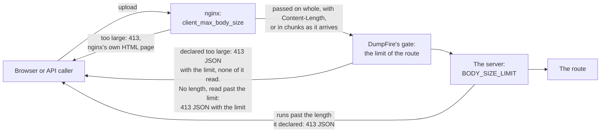

| The route | The most its body may be | Where that is set |
|-----------|--------------------------|-------------------|
| Every route, a page's form included | 512 KB | `src/lib/server/body-limits.ts` |
| `POST /api/cards/[id]/attachments`, for a caller who is signed in | 26 MB: the handler accepts a file of up to 25 MB | The same file |
| `POST /api/admin/import`, for the superadmin (anybody else signed in is held to 512 KB, and refused by the handler before it reads a byte) | All the server accepts: `BODY_SIZE_LIMIT` | The `Dockerfile` sets `512M`; override it with `-e BODY_SIZE_LIMIT=...` |

A request that declares its length in `Content-Length` is held to the limit on that, before its body is read, so an upload that says it is too large is refused without any of it being read. One that declares no length, sent in chunks by its client or by a proxy that passes a body on that way (`cloudflared` does unless it is told not to: see below), is counted as it is read and refused once it passes the limit: the server reads up to the limit, and no further, before it refuses it. Either way the server never reads more than the limit, but a refusal of a body sent in chunks is not free. The server on its own holds a body with no length to no limit at all, which is why the gate counts it.

**Behind Cloudflare Tunnel, for large uploads.** `cloudflared` passes a body on in chunks unless its `originRequest` settings say `disableChunkedEncoding: true`. Uploads work either way. With it, the length the browser declared reaches DumpFire, and a backup or an attachment that is too large is refused before any of it crosses from the tunnel to the server, rather than after the first 512 KB or 26 MB of it has. It is a saving, not a requirement. Cloudflare has a limit of its own on an upload: see [How Large an Import Can Be](#how-large-an-import-can-be).

No route is given more than `BODY_SIZE_LIMIT`. A server started without the image's setting, with `node build` and no variable, accepts 512 KB everywhere: an attachment over that is refused there, and so is an import.

`BODY_SIZE_LIMIT` takes a number of bytes, or a number followed by `K`, `M` or `G`. **`512MB` is not accepted**: the server does not start, and logs `Invalid BODY_SIZE_LIMIT: '512MB'. Please provide a numeric value.`

After a deploy, check that the container has the setting:

```bash
docker exec <container> printenv BODY_SIZE_LIMIT
```

It prints `512M`. Nothing printed means the image was built from a `Dockerfile` without the line, and every upload over 512 KB will be refused.

### How Large an Import Can Be

The limit is not the only ceiling. An import does this, in order:

1. Reads the whole upload into memory.
2. Writes it to `.restore-temp.db` in the server's working directory, and opens that.
3. Writes a safety copy of the running database, every table as one JSON text, to `.pre-restore-safety.json` in the same directory.
4. Replaces the rows.

So the server needs memory for the whole backup and, at the same moment, for the running database as JSON, which is larger than the database's own file because every row repeats its column names. That JSON is one piece of text, and Node 22 cannot make one longer than 536,870,888 characters, about 512 MB: a running database whose rows come to more than that as JSON cannot be imported over. The import then fails with "Restore failed: Invalid string length" and nothing is changed. That, and the memory the container is allowed, are the practical ceiling, and both are reached well before a backup of 512 MB is. Neither has been measured on a large database: try an import of production's size on an instance that is not production before it is needed.

Two limits outside DumpFire end an upload before it is read:

- **The server's own time limit for a request.** Node gives a request five minutes, its `server.requestTimeout` default of 300 seconds, to arrive in full, and the image does not change it. An upload that takes longer is cut off and the import never starts. Behind nginx, which reads the whole upload before it passes it on, the server is handed it in a moment, whatever the caller's connection. With no proxy, or behind one that passes the upload on as it arrives (Cloudflare Tunnel, Caddy, nginx with `proxy_request_buffering off`), the server receives it at the caller's speed, and an import that takes more than five minutes to upload cannot be done that way: upload it from somewhere closer to the server.
- **Cloudflare's own limit on a request's body.** Behind Cloudflare, a Cloudflare Tunnel included, Cloudflare refuses a request whose body is over its plan's limit before it reaches the server: 100 MB on the Free and Pro plans. A backup larger than that cannot be imported through it; import it through an address that does not pass through Cloudflare.

Both files are written to the working directory, which in the image is `/app`: **inside the container and off the volume**. They need that much free space in the container's own layer, and they go when the container is recreated. `.restore-temp.db` is deleted when the import ends. `.pre-restore-safety.json` is not: it stays until the next import replaces it, and it holds everything the database held, password hashes and live sessions included. Once the import is known to be good, remove it:

```bash
docker exec <container> rm -f /app/.pre-restore-safety.json
```

## Backup Destinations

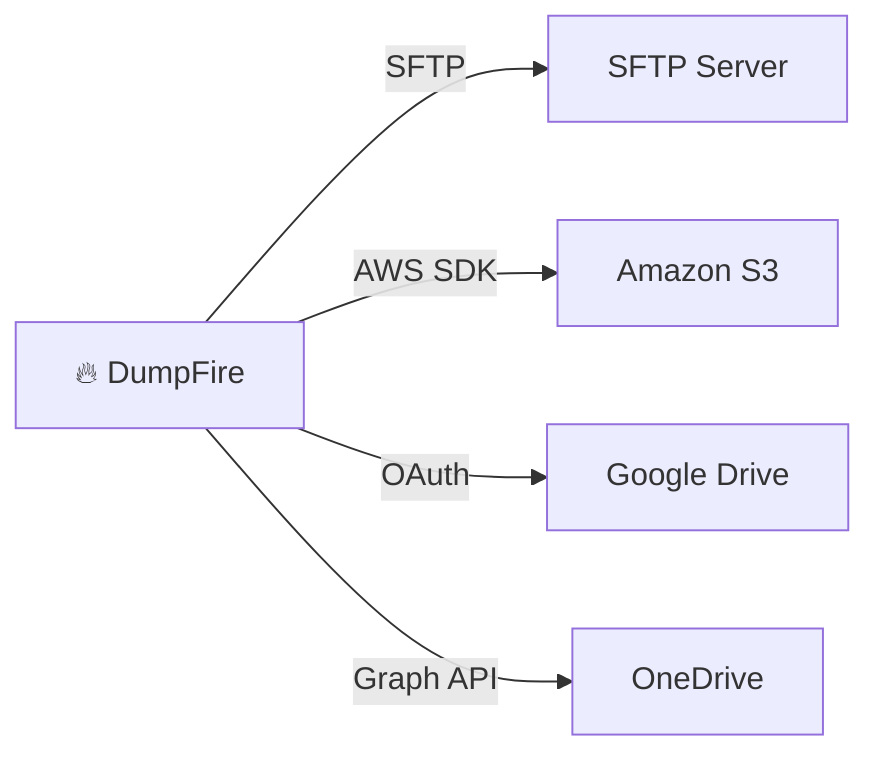

The scheduler checks once a minute whether a backup is due. Each backup:
1. Writes a complete copy of the database to a temporary file beside it with `VACUUM INTO`, which includes changes still in the write-ahead log. It then opens the copy with no journal, deletes every session and every unused invite from it, masks every invite's token and any request link's token in its system log, and writes it out again with a second `VACUUM INTO` to a second temporary file, so that nothing of what was deleted is left in the file. It reads that second file and deletes both. The running database is not touched: nobody is signed out by a backup, and its own log is as it was. Every step of this is synchronous, so **the server answers no request from the start of the first `VACUUM INTO` until the second file has been read**: both copies, the masking, the deletes and the read, and not only the first copy. "Export Backup" stops it the same way. See "How long the server stops answering", below. Both temporary files are beside the database, on the volume, so it needs room for two copies while a backup is made, and none for a journal.
2. Uploads the copy as it is, not compressed, to each configured destination as `dumpfire-backup-<UTC date and time>.db`
3. Records the result for each destination in the `backup_log` table, which keeps the last 10 entries
4. After a successful upload, deletes the oldest backups at that destination beyond the retention count (a retention of 0 keeps them all)

A failed upload is not retried. It is logged at `ERROR`, recorded in `backup_log` with the error, and emailed to the alert address if failure alerts are switched on and SMTP is configured. The destination is tried again at the next scheduled backup.

A backup file is a whole database: its data, its structure and its own record of applied migrations, with two things taken out. It holds no session, and no invite that has not been used: either would sign in whoever read the file. Its system log names no invite's token either: the server wrote an invite's address into the log with the token in it until 2026-10-14, and a backup masks those lines. The server masks the same lines in its own log once at every start, so `GET /api/logs` shows none of those tokens either from the first start on this version. Every user is in it with their password hash, and so are the mail password and the destinations' own credentials, so it is still a file to keep where few can read it. The file "Export Backup" downloads is made the same way and holds the same.

That a backup signs nobody in is true of **accounts**, and of nothing else. Two secrets are still in it: every public request's link (`task_requests.access_token`), which lets whoever holds it read and reply to that request's thread and confirm it, and the key the public request form signs its tokens with (`request_form_secret` in `settings`). Taking those out is another card's work.

**What clearing the copy costs.** The copy used to be vacuumed in place, which needs a rollback journal on the volume as large as the copy. Writing it out again with `VACUUM INTO` needs no journal, and is quicker. Measured once by the reviewer, on a 154 MB copy: 2.7 s for the vacuum in place, 1.3 s for `VACUUM INTO`, with no planted session id or token left and the integrity check passing. Measured again for this change, on a 196 MB database made up for the purpose (never a real one) on a Windows development machine, six runs of each: the vacuum in place took 1.7 to 3.1 s, `VACUUM INTO` 0.5 to 1.3 s, and the first copy 0.7 to 1.5 s. Neither has been measured on the production server; expect the figures to grow with the database.

**How long the server stops answering.** The server waits for the whole of a backup, not only for the first copy, and that whole has never been measured. Added together from the separate figures above, the two `VACUUM INTO`s alone came to about 1.2 to 2.8 s on the 196 MB made-up database on the development machine (0.7 to 1.5 s for the first copy, 0.5 to 1.3 s for the second); the masking of the log, the deletes and the reading of the file come on top of that, unmeasured. It is an estimate from parts, on a machine that is not the server. Expect it to be longer on a larger database or a slower disk, and schedule backups for an hour when few people use DumpFire.

Backups made before this version do hold the sessions of whoever was signed in when they were made, and a session goes on being good for as long as it is used. Restoring one no longer brings them back: a restore brings in no session whatever the backup holds. The copies themselves, at a destination or downloaded, are unchanged: treat them as you would a password file, and delete the ones that are not needed.

Backup destinations, the schedule and "Run Now" are the superadmin's: see [The Superadmin](#the-superadmin). See [Restoring from Backup](admin-guide.md#restoring-from-backup) for the two ways to put one back.

A backup file holds no attachment file. The uploads folder is backed up separately, by you: see [Attachment Files](#attachment-files).

## Security Headers

Set by the gate on every answer it gives, to anybody: pages, the internal and the
documented API, the gate's own refusals and its redirects. A header the answer already has
is left as it is.

| Header | Value |
|--------|-------|
| `X-Content-Type-Options` | `nosniff` |
| `X-Frame-Options` | `DENY`, except on `/request`, `/request/[id]/confirm` and `/request/[id]/reply` |
| `Referrer-Policy` | `strict-origin-when-cross-origin` |
| `Permissions-Policy` | `camera=(), microphone=(), geolocation=()` |
| `X-XSS-Protection` | `0`: switches off the filter old browsers ran over a page, which could itself be used to make a page leak |

The public request form and the two pages its mails link to carry no `X-Frame-Options`, so
that the form can be embedded in another site's page; every other page refuses to be
framed. What the gate never sees is the proxy's to head: see
[Security Headers From the Proxy](#security-headers-from-the-proxy). See
[Security Headers](authentication-security.md#security-headers).

## API Rate Limiting

The external API `/api/v1/*` is rate-limited, in memory, per process:
- **60 requests per minute per API key**, counted against the key once it is checked. A key
  over its limit is answered `429` and its `last_used_at` is not touched.
- **60 requests per minute per address** for requests with no key DumpFire accepts, a
  missing `Authorization` header included, in a count of their own: they never spend a real
  key's allowance. Behind a proxy, set `ADDRESS_HEADER` or every caller has the proxy's
  address: see [The Caller's Address Behind a Proxy](#the-callers-address-behind-a-proxy).
- Returns `429 Too Many Requests` with a `Retry-After` header when exceeded.
- `GET /api/v1/openapi.json` needs no key and is not counted.
