# DumpFire Deployment Guide

DumpFire is deployed as a single Docker container running Node.js 22 with an embedded SQLite database. No external database server is required.

## Deployment Architecture

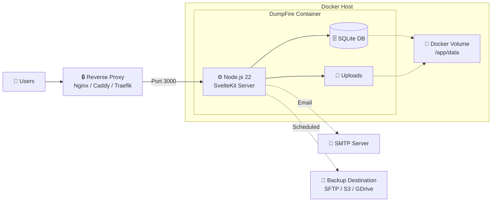

## Docker Build

The Dockerfile uses a two-stage build for minimal image size:

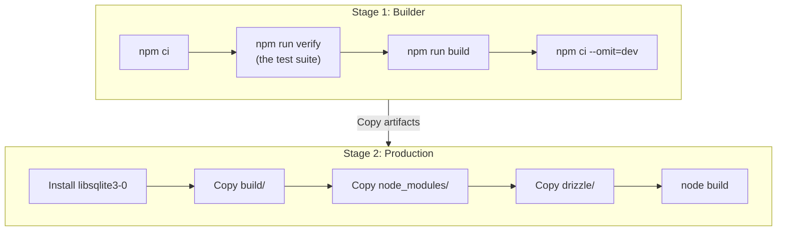

### Build Command

```bash
docker build -t dumpfire:latest .
```

The build asks for no particular builder. The `Dockerfile` has no `# syntax=` line and no flag on any step: its test step is a plain `RUN npm run verify`, which the classic builder and BuildKit both know. It has been built under BuildKit only (the default builder since Docker 23, and the one Docker Desktop 29.2.1 uses); under the classic builder it has not been tried.

### Run the Tests Before You Build

> ✅ **The image build runs the test suite, and stops if a test fails.** The builder stage of the `Dockerfile` runs `npm run verify` after the source is copied in and before `npm run build`. A failing test ends `docker build` at that step with exit status 1 and no image is made, so an image cannot be built from a tree whose tests fail. `npm run build` then makes its own check, of the expected schema (see [Changing the Schema](#changing-the-schema)).

Running the suite by hand first is still the quick way to find out. It takes under a minute (43 seconds on the workstation on 2026-10-15), where a build that fails has already cost a `git pull` and an `npm ci` on the Docker host. Run it where the repository is checked out with its dependencies installed (`npm ci`), on the commit that is going to be deployed and before that commit is pushed to where the image is built:

```bash
npm run verify
```

- **What it runs.** The whole suite, once: every test file listed in `tests/harness.test.ts`. It is `vitest run --allowOnly=false`: `npm test` with one flag more, so that a test left marked `.only`, which would run alone and skip every other test in its file, fails the run instead of passing it.
- **What it touches.** A database in memory and a folder under the operating system's temp directory. It refuses to run against any other database, starts no server and opens no port. It delivers no mail and no webhook, and attempts none: `tests/setup.ts` refuses every `fetch` and every DNS lookup, and fails the test that attempted one, by the address. Until 2026-10-13 that was not so. Five tests let the application try to mail `smtp.example.test` and to call `https://hooks.example.test/...`: seven DNS lookups and four `fetch` calls in a run, each for a name that resolves nowhere, so nothing was delivered, and each a question put to the machine's resolver. It is safe on a machine that holds a real `dumpfire.db`. See [Testing](testing.md).
- **A pass** ends with `Test Files  N passed (N)`, every test file having passed, and exit status 0. The line under it counts the tests that `passed`, and any marked `expected fail` or `skipped`. Those two are not failures: a test marked as expected to fail records a fault that is known and not yet fixed. When none is expected to fail and none is skipped, as on 2026-10-15, the line counts `passed` alone. See [Testing](testing.md#known-faults-the-suite-records).
- **A failure** ends with `Test Files  N failed`, names each failing test with its file, and exits with status 1. Do not push the commit: the image build would stop on the same test.
- **`[ERROR]` lines in a run that passes** are not failures. They are the application's own log of something that went wrong during a test, which the test caused on purpose. The two summary lines and the exit status are what say whether the run passed.

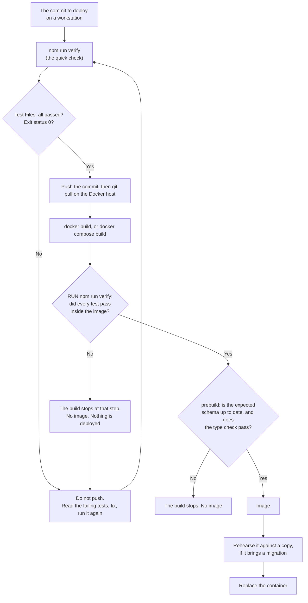

#### The Suite Inside the Image Build

`docker build` runs the same files with the same command, on the image's own Linux and Node (`node:22-slim`) instead of the workstation's. The step is a plain `RUN npm run verify`. It needs no network and no special builder, because the tests refuse the network themselves: `tests/setup.ts` refuses every `fetch` and every DNS lookup, and fails the test that attempted one. Docker does not cut the step off from the network as well. For part of 2026-10-13 the `Dockerfile` said `RUN --network=none`, under a `# syntax=docker/dockerfile:1` line; that was never built, and was taken out, because the flag works only under BuildKit and the Docker version of the production host is not known. A pass ends the step with the same two lines as on the workstation, every test file passed and every test counted. With the suite as it was on 2026-10-18, where none is expected to fail and none is skipped, they read:

```
Test Files  61 passed (61)
     Tests  5572 passed (5572)
```

- **On a builder with fewer than three CPUs, two tests are skipped**, and the second line reads `5570 passed | 2 skipped (5572)`, which is a pass. They are the two tests of `tests/password-checks.test.ts` that time the server's thread while real worker threads check passwords (card 2191): the thread stays free while six checks are made at once, and an unrelated request is answered meanwhile. Each runs two threads against bounds of 60 ms and 100 ms, and with fewer than three CPUs the two threads share them with the test's own, which could fail the build for a fault that is not there. Before a build, `docker info --format '{{.NCPU}}'` on the host that builds says how many it has. The other fourteen tests of the file run anywhere.

- **What it adds to a build.** About as long as the suite takes outside Docker on the same machine. The first build with the step, on 2026-10-13, spent 18.5 seconds in it on a 28-core workstation, when the suite was 2220 tests and took 20 seconds on that workstation outside Docker. The second build, later that day on the same workstation, when the suite was 2624 tests and took 28 seconds there, spent 23.7 seconds in the step, of which vitest counted 22.5 as its own. The suite has grown since (43 seconds there on 2026-10-15) and has not been built in Docker at that size. A smaller Docker host will take longer.
- **What it adds to the image.** Nothing. The suite runs in the builder stage, which is thrown away. The production stage is copied from `build/`, `node_modules/` (reinstalled without dev dependencies after the build), `package.json` and `drizzle/` alone. An image built with the step and one built without it from the same tree held the same 27,933 files, apart from the content hashes in the names under `build/` that differ between any two builds, and no `tests/` folder and no vitest. The image of the second build, of the suite as it was then, was listed in the same way and came to the same 27,933: `/app` holds `build/`, `drizzle/`, `node_modules/`, `package.json` and an empty `data/`, with no `tests/`, no `src/`, no database file, and no package the lock file marks as a dev dependency (no vitest, vite, TypeScript, `svelte-check` or `drizzle-kit`). Two names from `devDependencies` in `package.json` are in it all the same, because a production dependency names each as a peer and `npm ci --omit=dev` therefore keeps it: `svelte`, for `svelte-dnd-action`, and `@types/better-sqlite3`, for `drizzle-orm`.
- **What it touches.** Inside the build, a database in memory and `/tmp` in the builder stage. There is no `dumpfire.db` in the build to touch (see below).
- **A test file left out of the commit fails the build.** The build runs the test files that were committed and reached the host, and vitest does not know what is missing: a build without `tests/access-every-route.test.ts` used to pass with `29 passed (29)`. The files are now listed in `tests/harness.test.ts`, and a test there fails, naming the file, when one in the list is not on disk or one on disk is not in the list. A new test file is added to that list in the commit that adds it. See [Testing](testing.md#the-list-of-test-files).
- **A test left marked `.only` fails the build.** `npm run verify` passes `--allowOnly=false`, and the file with the mark fails with `Unexpected .only modifier`.
- **A step shown as `CACHED`** was not run again, because Docker has already run it on exactly these files and it passed. Any change to a file in the build context runs it again.
- **A failure** ends the build with `ERROR: process "/bin/sh -c npm run verify" did not complete successfully: exit code: 1`. The failing tests are named above that line. A test that reached for the network is one of them, on a workstation and in the build alike: `This test reached for the network: ...`, with the address. `npm run build` is not reached and no image is tagged; the container that is running is not affected, because nothing has replaced it.

**What is kept out of the build.** `.dockerignore` keeps these out of the build context, so they never reach Docker, the builder stage or the build cache: any `*.db`, `*.db-shm` and `*.db-wal` file, at the top of the repository and in any folder beneath it (a development `dumpfire.db`, its dated backups, and a copy put in a sub-folder), any `*.backup-temp` and `*.backup-temp-*` file at any depth (the copies `GET /api/admin/export` and a backup make beside the database while they run, `<database>.backup-temp` and `<database>.backup-temp-cleared`), any `*.export-temp` file at any depth (the name an older export used for its copy), `.pre-restore-safety.json` (the copy of the data kept before a restore), the `uploads` folder of attachment files, `.env` and `.env.*`, and the local tooling in `.agent`, `.claude`, `.vscode` and `.git`, along with `.gitignore`, `README.md`, and `node_modules`, `.svelte-kit` and `build`, which the image makes for itself. The database patterns once matched at the top of the repository only, and a database copied into a sub-folder would have been sent; `**/*.db` and its two companions were added on 2026-10-13. The other names are still matched at the top only. The context was listed before each of the two builds of 2026-10-13. Before the first, which was before those patterns were added: 417 files, 5.9 MB. Before the second, with them in place: 418 files, 5,993,090 bytes. None of those names was anywhere in either.

**What has been proved.** The step has been built twice, both times on 2026-10-13 with Docker 29.2.1 on a Windows workstation (Docker Desktop, Linux containers, amd64, BuildKit). The first build was the first time the suite ran on Linux: it passed with the totals it then had (`2200 passed | 19 expected fail | 1 skipped`), `prebuild` and `npm run build` passed after it, and a build with one failing test added inside the builder stage stopped at the step as described.

The second build was of what is described here: the plain `RUN npm run verify`, `--allowOnly=false` in `npm run verify`, the `.dockerignore` patterns for any depth, and the suite at the totals it then had, with the network refused from inside. It ended with exit status 0. The step printed `Test Files  30 passed (30)` and `Tests  2578 passed | 45 expected fail | 1 skipped (2624)`, which are the workstation's totals, and each of the 30 files reported the same number of tests in the build as on the workstation; no test was changed to get there. `prebuild` and `npm run build` passed after it. Two more builds, each with one test added to `tests/docs-format.test.ts` inside the builder stage, stopped at the step with exit status 1 and never reached `npm run build`: one with a test that fails (`Test Files  1 failed | 29 passed (30)`), and one with a test marked `.only` (`Unexpected .only modifier`).

**What has not.** Every one of those builds was made from a Windows working copy, in which 27 source files have CRLF line endings; the Docker host builds from a Linux checkout of a commit, where every file has LF. The first build on the Docker host is therefore the first from such a checkout, and the first on that host's hardware and with its version of Docker, which is not known here. The step asks nothing of that version but a plain `RUN`; the classic builder has not been tried. If a build stops at the step with a failure that names an address, a test is reaching for the network and the guard in `tests/setup.ts` has caught it: fix the test.

When `npm run verify` fails, on a workstation or in the build:

| The output says | It means | Do |
|-----------------|----------|----|
| A test failed with an assertion, in a file under `tests/` | The change broke something the test holds, or changed it on purpose | Fix the code. If the behaviour was changed on purpose, change the test in the same commit and say why. Never skip or delete a test to get an image |
| `Expect test to fail` | A test marked `it.fails` passed: the known fault it records has been put right | Take the mark off that test, or the `fault` off its entry in `tests/access-every-route.test.ts`, in the commit that fixed the fault |
| `routes and methods with no entry in TABLE` | A route or a method was added under `src/routes/api` and nobody has said who may call it | Add its entry to the table in `tests/access-every-route.test.ts`. See [Testing](testing.md#access-for-every-route) |
| `test files in TEST_FILES that are not under tests/` | A test file in the list is not in this tree: it was left out of the commit, or deleted | Commit the file. If it was deleted on purpose, take its name out of `TEST_FILES` in `tests/harness.test.ts` |
| `test files under tests/ that are not in TEST_FILES` | A test file was added and not listed | Add its name to `TEST_FILES` in `tests/harness.test.ts`. See [Testing](testing.md#the-list-of-test-files) |
| `Unexpected .only modifier` | A test or a `describe` was left marked `.only` | Take the `.only` off |
| `This test reached for the network: ...` | A test let the application try a `fetch`, a DNS lookup, or an `http`/`https` request to an IP address other than loopback, at the address named: a webhook or a mail it set up and did not stand in for | Install `effects()` in the test. See [Testing](testing.md#proving-a-request-is-all-or-nothing) |
| Every test of a file fails with `N migration(s) did not apply to a fresh database` | A file under `drizzle/` does not apply to an empty database. The built server would stop at start-up in the same way | Fix the migration file. See [Changing the Schema](#changing-the-schema) |
| A failure under "the checked-in copy of the model" in `tests/migrations.test.ts` | `expected-schema.ts` is out of date. `docker build` would stop on the same thing | `npm run schema:expected`, and commit the result |
| `Tests must run against an in-memory database` | The suite was started in some way that did not set `DB_PATH` | Run it with `npm run verify` or `npm test`, never with `DB_PATH` set by hand |

**When the build stops at `RUN npm run verify`.** Nothing has been deployed and the running container is untouched. Then:

1. Read which tests failed. Docker's default output can cut a failed step short, so build again with all of it: `docker build --progress=plain -t dumpfire:candidate . 2>&1 | tee build.log`, and look above the `Test Files` line for each `FAIL`.
2. Run `npm run verify` on a workstation, on the same commit (`git status` clean, `git log -1` the commit the host built).
3. **If it fails there too**, it is one of the rows above. Fix it, run it again, push, and build again.
4. **If it passes there and fails in the build**, the difference is between the two places and not in the change itself. The likely causes are a file the test needs that was never committed, or that `.dockerignore` keeps out of the build; a file name whose capitals differ from the name the code asks for, which Windows forgives and Linux does not; a path built with `\`; line endings, which are CRLF in some files of a Windows working copy and LF in every file of a Linux checkout; and a test that depends on how long something takes. Correct the test or the file so that it holds in both places.
5. **Do not take the line out of the `Dockerfile` to get an image**, and do not skip the failing test. The last image that built is still on the host: a failed build makes no image and moves no tag.

On the Docker host itself there is usually no Node to run the suite with outside the build, which is why the quick check is made before the commit gets there.

## Environment Variables

| Variable | Default | Required | Description |
|----------|---------|----------|-------------|
| `NODE_ENV` | `production` | No | Node.js environment mode |
| `PORT` | `3000` | No | HTTP port the server listens on |
| `ORIGIN` | `http://localhost:3000` | **Yes** | Public URL — must match your domain exactly. Incorrect value causes CSRF failures. It is also the address every link in a mail begins with, unless an App URL is set: see [Where a Mailed Link's Address Comes From](#where-a-mailed-links-address-comes-from) |
| `APP_URL` | not set | No | The address links in mail begin with, when it should not be `ORIGIN`. The App URL on the admin page, under Application Settings, does the same and is read first |
| `PROTOCOL_HEADER` | `X-Forwarded-Proto` | No | Header from reverse proxy indicating HTTPS. Read only when `ORIGIN` is not set |
| `HOST_HEADER` | `X-Forwarded-Host` | No | Header from reverse proxy with original hostname. Read only when `ORIGIN` is not set, and never for a link in a mail |
| `ADDRESS_HEADER` | not set | Behind a proxy, yes | The request header that names the caller's address, set by the proxy: `X-Forwarded-For` behind the nginx block below. Not set in the image, and not to be set without a proxy in front: see [The Caller's Address Behind a Proxy](#the-callers-address-behind-a-proxy) |
| `XFF_DEPTH` | `1` | No | With `ADDRESS_HEADER=X-Forwarded-For`, how many proxies there are in front of the server: the address is read that many places from the end of the header. `1` for the nginx block below |
| `BODY_SIZE_LIMIT` | `512M` in the image; `512K` for a server started any other way | No | The largest request body the server accepts on any route. Bytes, or a number followed by `K`, `M` or `G`: `512M`, not `512MB`, which is no number to the server and **stops it starting**. `Infinity` is no limit. The application narrows it again route by route: see [Upload Size Limits](#upload-size-limits) |
| `DB_PATH` | `/app/data/dumpfire.db` in the image; `dumpfire.db` in the working directory for a server started any other way | No | The database file. It must be on the volume: the uploads are in the folder `uploads` beside it. The image sets it since card 2083; an image built before that sets none, and a container from it started without `DB_PATH` keeps its database at `/app/dumpfire.db`, inside the container. At the image's path, a server that finds no database there, or an empty file, while it can see a database file at `/app/dumpfire.db` or elsewhere in `/app/data`, or a `dumpfire.db-wal` without its database, **refuses to start** rather than create an empty one: see [Start-Up Sequence](#start-up-sequence) |
| `LOG_LEVEL` | `INFO` | No | Lowest level logged: `DEBUG`, `INFO`, `WARN`, `ERROR` or `CRITICAL`. Leave it at `INFO` or `WARN` when updating: the migration runner reports what it applied and rebuilt at `WARN` |
| `LOG_RETENTION_DAYS` | `30` | No | How long rows are kept in `system_logs`. The table is also capped at 50,000 rows, whatever their age |
| `SCHEDULERS` | `on` in a built server, `off` under `npm run dev` | No | `on` or `off`: whether the backup, report and snapshot schedulers and the attachment file sweep run. Set it to `off` for any instance that holds production's data and is not production. Such an instance holds production's backup destinations, report schedules and mail settings, and with its schedulers running it backs up to production's destinations, prunes the backups there and sends production's reports. When they are off, one `[WARN] [SCHEDULERS]` line at start says so: `Schedulers are off (…). No scheduled backup, report, snapshot or attachment file sweep will run from this instance. Set SCHEDULERS=on to run them.` "Run Backup Now" in the admin panel works either way, and so do email and webhooks sent in answer to an action. To make such a copy harmless in itself, import the backup as a working copy: see [Admin Guide](admin-guide.md#restoring-from-backup) |
| `PASSWORD_THREADS` | not set: two, or one on a machine with one or two CPUs | No: **leave it unset** | How many worker threads hash and check passwords, so that the server's own thread is never held by one (card 2191). Unset, it is `min(2, max(1, CPUs - 1))`. A whole number from `0` to `8` is taken as it is; `0` checks every password on the server's own thread, as the tests do, which holds every other request for about a fifth of a second each time, and is not for a server. Anything else is one `[WARN] [AUTH]` line, `PASSWORD_THREADS="…" is not a whole number from 0 to 8: password checks run on N worker thread(s)`, and the default. Read once, at the first check. See [Password Hashing](authentication-security.md#password-hashing) |
| `SIGN_IN_ONE_AT_A_TIME` | not set, which is `on` | No: **set it only as** [If an Attack Keeps an Owner Out](#if-an-attack-keeps-an-owner-out) **says, and remove it after** | `on` or `off`, in any case, trimmed; empty is `on`. `off` turns off the rule that holds sign-ins from browsers not remembered for an account to one at a time while the account is being guessed at (card 2194): every browser is then let in after the account's wait. While it is `off`, one `[WARN] [STARTUP]` line at every start says so, to the console whatever `LOG_LEVEL` is. Anything else is one `[WARN] [AUTH]` line, `SIGN_IN_ONE_AT_A_TIME is "…", which is neither on nor off: sign-ins from browsers not remembered are held to one at a time`, and `on`. Read once, at start. See [Browsers That Have Signed In Before](authentication-security.md#browsers-that-have-signed-in-before) |
| `CSP_MODE` | not set, which is `enforce` | No: **set it only for the first deploy of the policy**, as [The Update That Brings the Content-Security-Policy](#the-update-that-brings-the-content-security-policy) says, **and remove it after** | `enforce` or `report-only`, written exactly so. `report-only` sends every page its Content-Security-Policy as `Content-Security-Policy-Report-Only`: the browser names in its console what the policy would refuse, and refuses nothing. While it is set, one `[WARN] [STARTUP]` line at every start says so, to the console whatever `LOG_LEVEL` is. Any other value, `REPORT-ONLY` and ` report-only` among them, is enforced, and one `[WARN] [STARTUP]` line at every start names it: `CSP_MODE is "…", which is neither enforce nor report-only: the Content-Security-Policy is enforced.` Read at every request. See [The Content-Security-Policy](authentication-security.md#the-content-security-policy) |
| `WEBHOOK_ALLOW_INSIDE` | not set: no webhook may send inside the network | Only for a webhook receiver inside the network, such as an automation tool beside DumpFire | A list, separated by commas, of the host names, addresses and ranges inside the network that webhooks may send to (card 2161): `n8n`, `host.docker.internal`, `10.0.5.20`, `10.0.5.0/24`, `fd00::/8`, `[fd00::1]`. A name is exact, case ignored, final dots removed, and allowed whatever it resolves to inside, but never `0.0.0.0` or `::` (a DNS filter's answer for a blocked name); an address or range must lie wholly inside one of the inside ranges, or it is ignored and named in one `[WARN] [STARTUP]` line at every start. Read when a webhook is registered and at every delivery, and parsed again when its value changes; set it when the container is created. An entry trusts every account that can register a webhook with every port and path on that host, so name a dedicated host or address, never `host.docker.internal` while anything else listens on the Docker host; an entry with a port (`n8n:5678`) is not taken. A board's owner, which any account can be, also reads back what each allowed port answers, in the webhook's `lastDelivery` (card 2178): a web server's status, a certificate a TLS server presents, or not reached. See [Where a Webhook May Send](#where-a-webhook-may-send) |
| `NODE_EXTRA_CA_CERTS` | not set | Only for a mail server whose certificate comes from a private authority, or is self-signed | The path, inside the container, of a PEM file of certificates Node trusts beside its own, for every TLS connection of the process: mail, webhook deliveries and backup destinations (card 2189). Read once, when the process starts: set it, with the file mounted read-only, when the container is created; a restart applies neither. See [Mail Server Certificates](#mail-server-certificates) |

> ⚠️ **CRITICAL**: `ORIGIN` must be set to your actual public URL (e.g. `https://dumpfire.example.com`). Leaving it as localhost will cause CSRF token validation failures on all form submissions.

### Where a Mailed Link's Address Comes From

An invite, a request's confirmation and reply links, and the "View Task" link in a notification all begin with the server's own address. That address is configuration, and never anything a request says:

1. the **App URL** on the admin page, under Application Settings (the superadmin's);
2. failing that, the `APP_URL` variable;
3. failing that, `ORIGIN`.

No request header is read for it: not `Host`, and not `X-Forwarded-Host`. With no App URL set, a link used to take its host from `X-Forwarded-Host`, so whoever could send the server a request could have an invite mailed with a link to a host of their choosing, and an invite sets a password.

The image is built with `ORIGIN=http://localhost:3000`. A server that really is reached there is right as it is. One behind a proxy that was started without `ORIGIN` mails links that begin with `http://localhost:3000`, and says so once at every start: `[WARN] [STARTUP] ORIGIN is http://localhost:3000, the address the image is built with, and no App URL is set...`. Set `ORIGIN`, or the App URL.

A server started with no `ORIGIN` at all, which the image never is, and given no App URL has no address. Then two things are refused with `503` and "This server has no address configured to make the link from", before anything is saved: an invite, which is a link, and a public request made by somebody who is not signed in, when SMTP is configured, because that request waits on a mailed link to be confirmed. A user added with a password, a request made by somebody signed in, and any request made while no SMTP is configured have no link to mail, and are accepted. A notification is not sent: each one skipped is a `[WARN] [NOTIFY]` line.

### Mail Server Certificates

Since card 2189 every mail is sent over a checked, encrypted connection. Port 465 is TLS from the first byte; any other port must offer STARTTLS, and a server that does not is refused (`ETLS`) before the password is sent; and on every port the mail server's certificate must be one Node trusts for the host's name as it is entered in **Admin → 📧 Email / SMTP**. Until then mail on any port but 465 went without requiring STARTTLS and without checking the certificate, so anyone on the network path to the mail server, or who could answer for its name, could read the mail password and every message, invites (whose link sets a password) included. How the connection is made: [Connection Handling](notifications-email.md#connection-handling).

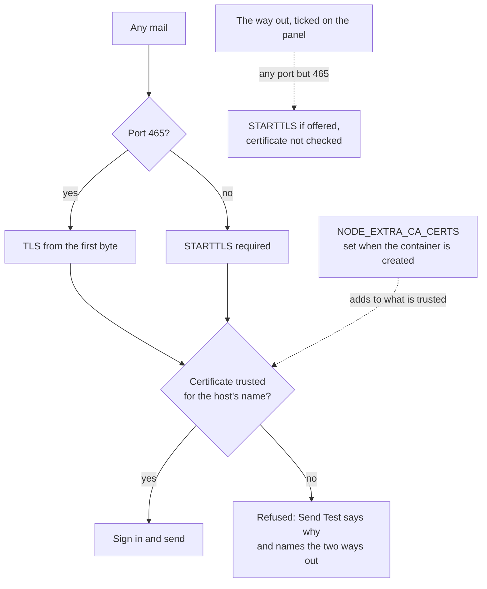

**A certificate from a private authority, or a self-signed one.** Mount the authority's certificate (or a self-signed server's own certificate), in PEM form, read-only into the container, and name it in `NODE_EXTRA_CA_CERTS`. Node reads it once, when the process starts, and adds it to what every TLS connection of the process trusts; the check stays on. There is no setting for it on the panel: one there would be kept in the database and in every backup, a second place that decides trust, set by a web session. **A restart does not apply it**: an environment variable and a mount are fixed when a container is created, and `docker restart` keeps both as they were. Create the container again with them:

```bash
docker run -d \
  --name dumpfire \
  --restart unless-stopped \
  -p 3000:3000 \
  -v dumpfire-data:/app/data \
  -v /srv/dumpfire/mail-ca.pem:/ca/mail-ca.pem:ro \
  -e NODE_EXTRA_CA_CERTS=/ca/mail-ca.pem \
  -e DB_PATH=/app/data/dumpfire.db \
  -e ORIGIN=https://dumpfire.example.com \
  -e NODE_ENV=production \
  dumpfire:latest
```

Under Docker Compose, beside the lines of [Docker Compose](#docker-compose), then `docker compose up -d`:

```yaml
    volumes:
      - dumpfire-data:/app/data
      - /srv/dumpfire/mail-ca.pem:/ca/mail-ca.pem:ro
    environment:
      - NODE_EXTRA_CA_CERTS=/ca/mail-ca.pem
```

`/srv/dumpfire/mail-ca.pem` stands for wherever the file is kept on the host. The process trusts that authority for every TLS connection it makes, not only mail: webhook deliveries and backup destinations trust it too. A file that cannot be read is said by Node on the console at start, and the server starts without it.

**The way out.** "Allow mail without a checked, encrypted connection", on the panel, off by default, gives back the behaviour from before card 2189 on any port but 465: STARTTLS when offered, the certificate not checked. It is for a relay on this server's own network that cannot use TLS. Turning it on or off from the panel needs the mail password typed again, and writes one `[WARN] [SMTP]` line naming who did it. Two other ways set it with neither: the one-row write of [check 0i](#before-the-deploy-checks-0i-to-0k), which the mailer reads at the next mail with no restart, before or after the deploy; and a restore, which brings in the backup's setting with the backup's other mail settings. A restore keeps this server's mail password only where the backup's setting is this server's, and where it differs its "To enter again" line names the box: "the mail password (Admin, 📧 Email / SMTP, where the backup brought in "Allow mail without a checked, encrypted connection" ticked and this server had it unticked)". Port 465 is checked either way. See [SMTP Configuration](admin-guide.md#smtp-configuration).

**Check the mail server from the container.** Read-only: it reads the mail settings, prints names and flags and never the password, and makes the connection `createTransporter` (in `src/lib/server/email.ts`) makes, signing in to nothing and sending nothing (`verify()` with no `auth` connects, upgrades, checks the certificate and quits). It honours `NODE_EXTRA_CA_CERTS` as the container has it. Its options are `createTransporter`'s, which names this check in a comment: the two are changed together. It connects to the host exactly as stored, as `createTransporter` does, untrimmed: since the review-fix pass a host is saved trimmed of ASCII spaces and tabs, and one saved before with spaces is checked with them, as mail is sent. It prints `way out set` when "Allow mail without a checked, encrypted connection" is on. It holds no `!`, `$` or backtick:

```bash
docker exec dumpfire node -e "
const db = require('better-sqlite3')(process.env.DB_PATH || 'dumpfire.db', { readonly: true, fileMustExist: true });
const get = (k) => (db.prepare('SELECT value FROM settings WHERE key = ?').get(k) || {}).value || '';
const host = get('smtp_host');
const port = Number(get('smtp_port') || '587');
console.log('mail host', JSON.stringify(host), '| port', port, '| way out ticked', get('smtp_allow_insecure') === 'true', '| user set', get('smtp_user').length > 0, '| password set', get('smtp_pass').length > 0, '| NODE_EXTRA_CA_CERTS', process.env.NODE_EXTRA_CA_CERTS || 'not set');
if (host.length > 0 && get('smtp_allow_insecure') === 'true') { console.log('way out set: mail goes on after the deploy as it goes today, whatever the check below prints.'); }
db.close();
if (host === '') { console.log('No mail host is set: nothing to check.'); } else {
  require('nodemailer').createTransport({ host: host, port: port, secure: port === 465, requireTLS: port === 465 ? false : true, tls: { rejectUnauthorized: true }, name: 'dumpfire.app', connectionTimeout: 10000, greetingTimeout: 10000, socketTimeout: 15000 }).verify()
    .then(() => console.log('PASS: the mail server gives an encrypted connection with a certificate this server trusts.'))
    .catch((e) => console.log('FAIL:', e.code || '', e.message));
}
"
```

It checks the connection without the way out, whatever the panel has, so it says whether the way out could be turned off. With the way out set, mail goes as it did before card 2189 whatever the check says, and `way out set` is printed above it. What it prints:

| It prints | It means | What to do |
|---|---|---|
| `PASS` | Mail goes over a checked, encrypted connection | Nothing |
| `way out set` | "Allow mail without a checked, encrypted connection" is on: mail goes without the check | Nothing for mail to go on. The line below it says whether the way out could be turned off |
| `FAIL: ETLS Error upgrading connection with STARTTLS…`, or `FAIL: ECONNECTION EHLO failed but HELO does not support required STARTTLS…` | The mail server offers no STARTTLS | Ask the provider for its TLS port (often 465) and enter it, or, for a relay on this server's own network that cannot use TLS, tick the way out, **with the mail password at hand**. Without the password, set it with the one-row write of [check 0i](#before-the-deploy-checks-0i-to-0k): it works after the deploy as well as before, and the mailer reads it at the next mail, with no restart |
| `FAIL:` … `self-signed certificate`, `unable to verify the first certificate`, `unable to get local issuer certificate` | Its certificate is from an authority this server does not trust | Try the authority first in the running container: `docker cp mail-ca.pem dumpfire:/tmp/mail-ca.pem`, then this check as `docker exec -e NODE_EXTRA_CA_CERTS=/tmp/mail-ca.pem dumpfire node -e …`. On `PASS`, mount the file read-only and set the variable when the container is created, as above. A restart applies neither. That `PASS`, with check 0k's run with `-e` and `-v`, is the go-ahead |
| `FAIL:` … `does not match certificate's altnames` | The host is entered as an address, or a name that is not on the certificate | Enter the certificate's name as the host, with the password typed again |
| `FAIL:` … `certificate has expired` | The mail server's certificate is out of date | The provider's to renew. Mail stops until it is; the way out meanwhile |
| `FAIL: ESOCKET connect…`, `EDNS`, or a timeout | The server cannot be reached from the container | Unrelated to certificates: mail is not working now either |

### Where a Webhook May Send

A webhook is not sent to an address inside the network (card 2161): loopback, the private
ranges Docker and an office use, carrier NAT and Tailscale, link-local with the cloud
metadata service at `169.254.169.254`, the reserved, documentation and multicast ranges, their
IPv6 counterparts, and the names `localhost`, `*.localhost`, a name with no dot (a service on
the same Docker network, `n8n`), `*.local`, `*.internal` (`host.docker.internal`) and
`*.home.arpa`. It is refused when the webhook is registered, as written, and at every delivery,
by every address its name resolves to. The full tables are in
[Where a Webhook May Send](notifications-email.md#where-a-webhook-may-send).

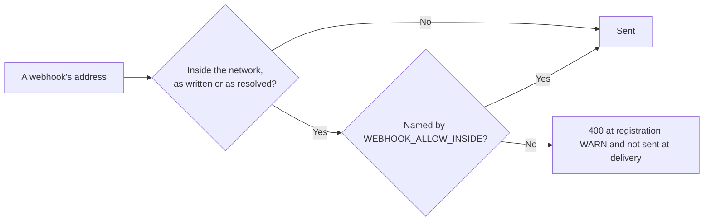

**A receiver that is inside on purpose** is let in by naming it in `WEBHOOK_ALLOW_INSIDE`, set
on the container:

| To let in | Set |
|-----------|-----|
| A container on the same Docker network, `http://n8n:5678/webhook/…` | `WEBHOOK_ALLOW_INSIDE=n8n` |
| A service on the Docker host, `http://host.docker.internal:8080/…`, only where nothing else listens on the host (see below) | `WEBHOOK_ALLOW_INSIDE=host.docker.internal` |
| A machine on the office network | `WEBHOOK_ALLOW_INSIDE=10.0.5.20`, or the narrowest range that holds the receivers, `10.0.5.0/24` |
| A receiver on a development machine, `http://localhost:9911/x` or `http://127.0.0.1:9911/x` | `WEBHOOK_ALLOW_INSIDE=localhost,127.0.0.1` |

- A name is allowed whatever it resolves to inside, and only that name: it passes the name
  rules. A listed name is never let reach `0.0.0.0` or `::`: a DNS filter answers `0.0.0.0` for
  a name it blocks, which would reach this server, so that answer is refused. An address or a
  range lets in any address inside it, written in the webhook's address or resolved from a
  name, but never one in `0.0.0.0/8` or `::`.
- An entry is kept only if it lies wholly inside one inside range. `0.0.0.0/0`, `::/0`,
  `::ffff:0:0/96`, a slip such as `10.0.0.0/2` for `10.0.0.0/24`, an address outside the
  network, `127.1` (an IPv4 address not written as four decimal numbers), a port, a path and a
  wildcard are each ignored, and named at every start: `[WARN] [STARTUP] WEBHOOK_ALLOW_INSIDE:
  "10.0.0.0/2" ignored: wider than one inside range`. The rest of the list applies. Read the
  start log after changing it.
- So is an entry that one inside range holds but that holds `0.0.0.0` or `::`, which reach
  this server whatever it listens on, or a range listed before the one that holds it:
  `0.0.0.0/8` and `0.0.0.0` (`it holds 0.0.0.0, …`), `::/8`, `::/96` and `::1/8` (`it holds ::,
  …`), anything else inside `::/8`, and an IPv4-mapped range written with a short prefix,
  `::ffff:10.0.5.0/24`, which is `::/24` and held `::1` (`an IPv4-mapped range needs /96 or
  more`: write `10.0.5.0/24`, or `::ffff:10.0.5.0/120`). These rules shut out `0.0.0.0`, `::`
  and the reserved forms only. They do not stop an entry that names this server on purpose (`127.0.0.1`, `::1`, `localhost`), as a development installation's
  does, nor one that names a host where other things listen (the next point).
- **An entry trusts every account with every port and path on that host.** Anyone who can
  register a webhook, an editor of any board, can send to any port and any path of a host or
  range the list names, and an entry with a port (`n8n:5678`) is not taken, so the port cannot
  be narrowed. Name a dedicated host or address for the receiver, and the narrowest range. Do
  not list `host.docker.internal`, or the Docker host's address, while anything else listens
  on the host (an admin interface, a database, another application): every webhook could
  reach it. Nor list a range that holds this container's own address: its Docker network
  (`172.16.0.0/12`, or the narrower network it is on, which `docker network inspect` shows)
  opens this server too. Name the receiver's single address or name instead. A board's owner
  also reads back, in the webhook's `lastDelivery` (card 2178), what each port of a listed
  host answers: a web server's status, a certificate a TLS server presents, or not reached.
- A receiver's address with a user name or password is refused whatever the list says.
- It is read where a webhook is registered and at every delivery, and parsed again whenever
  its value changes. On a container the value changes only when the container is made again,
  so set it with `-e WEBHOOK_ALLOW_INSIDE=…` (or under `environment:` in a compose file) when
  the container is created.

**No proxy.** Webhooks are delivered directly, never through `HTTP_PROXY`, `HTTPS_PROXY` or
`NODE_USE_ENV_PROXY`: through a proxy the check would judge the proxy's address, not the
receiver's. An installation whose only way out is a proxy could not deliver webhooks before
(Node's `fetch` went direct too) and cannot now.

**Nothing on the host should trust a request for coming from the host's own address.** A
webhook to this server's own public IPv4 or IPv6 address, or to a name that resolves to one,
is outside by the tables: it leaves the container, turns at the host, and reaches what listens
there from the host's own address, inside the cloud firewall. Every port is open to webhooks,
since closing them would not close this (443 on that address is the proxy). So no proxy rule,
admin interface or service on the host may let a request in because it comes from the host's
own public address. See [Webhook Destinations](authentication-security.md#webhook-destinations).

## Running

### Minimal

```bash
docker run -d \
  --name dumpfire \
  -p 3000:3000 \
  -v dumpfire-data:/app/data \
  -e DB_PATH=/app/data/dumpfire.db \
  -e ORIGIN=http://localhost:3000 \
  dumpfire:latest
```

The image sets `DB_PATH=/app/data/dumpfire.db` since card 2083, and each of these gives it all the same, so that each is right for an image built before that as well. Such an image sets none, and without it the database and the uploads are in `/app`, inside the container and off the volume: see [Volume Mounts](#volume-mounts). With any image, the volume at `/app/data` is what keeps them.

### Production

```bash
docker run -d \
  --name dumpfire \
  --restart unless-stopped \
  -p 3000:3000 \
  -v dumpfire-data:/app/data \
  -e DB_PATH=/app/data/dumpfire.db \
  -e ORIGIN=https://dumpfire.example.com \
  -e NODE_ENV=production \
  dumpfire:latest
```

### Docker Compose

```yaml
version: '3.8'

services:
  dumpfire:
    build: .
    container_name: dumpfire
    restart: unless-stopped
    ports:
      - "3000:3000"
    volumes:
      - dumpfire-data:/app/data
    environment:
      - DB_PATH=/app/data/dumpfire.db
      - ORIGIN=https://dumpfire.example.com
      - NODE_ENV=production

volumes:
  dumpfire-data:
```

## Volume Mounts

| Container Path | Purpose | Persist? |
|---------------|---------|----------|
| `/app/data` | SQLite database + uploaded attachments | **Yes — required** |
| `/app/data/dumpfire.db` | Main database file: the image's `DB_PATH` | Auto-created at the first start, which says so in the log |
| `/app/data/uploads/` | Card attachments: the folder `uploads` beside the database file | Auto-created at the first upload |
| `/app/data/uploads/.trash/` | Attachment files of deleted cards, and files no attachment names, kept for 30 days | Auto-created at the first delete or sweep that has a file to move |

> 💡 Always mount `/app/data` as a Docker volume. Without it, all data is lost when the container is recreated.

The uploads folder follows `DB_PATH`: it is the folder named `uploads` in the directory that holds the database file. A variable `UPLOADS_DIR` exists for the tests and overrides that wherever it is set; do not set it in production, where it would move uploads away from the files already stored. The image sets `DB_PATH=/app/data/dumpfire.db`. An image built before card 2083 sets none, and a container from it started without `DB_PATH` has its database at `/app/dumpfire.db` and the uploads in `/app/uploads`, both inside the container and neither on the volume. Mounting nothing at `/app/data` does the same with any image: the folder is then the container's own, and every start says so in a `[WARN] [STARTUP]` line (see [Start-Up Sequence](#start-up-sequence)). To put either right, see [Moving the Database onto the Volume](#moving-the-database-onto-the-volume).

## Attachment Files

A file attached to a card is stored on disk, not in the database. The database holds a row for it, with the file's name; the file is at `uploads/<card id>/<file name>` beside the database.

> ⚠️ **Attachment files are in no backup.** A scheduled backup, "Run Backup Now" and the database export each hold the database and nothing else. Back the uploads folder up separately, or a restore brings back cards whose attachments cannot be opened.

> ⚠️ **Never point two instances at the same uploads folder.** A second instance that holds a copy of this one's data, such as a development copy or a rehearsal, has the same rows naming the same files. Deleting a card there moves this instance's files to the trash, a Reset there moves every one of them, and 30 days later they are removed for good. Two unrelated databases would mix their files in the same folders, because folders are named by card id and every database has a card 1, and an instance whose schedulers run sweeps every file its own rows do not name, a day after it was written, into the trash. Give every instance its own data directory.

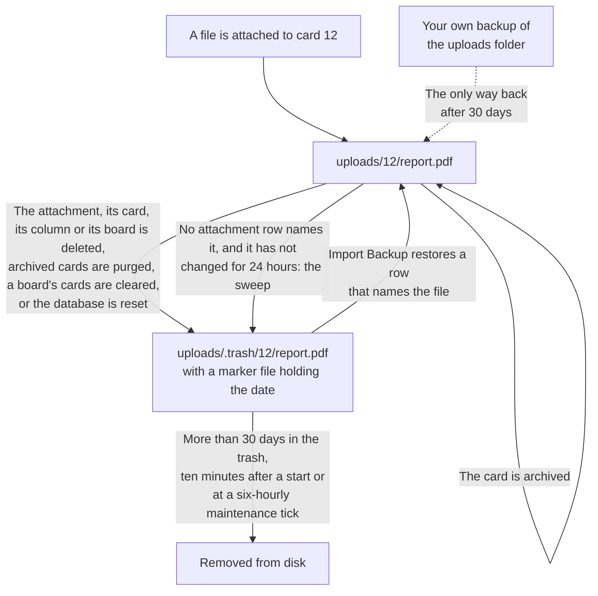

### The trash

- **A deleted card's files are moved, not removed.** They go to `uploads/.trash/<card id>/`, beside a marker file `.trashed-at` that holds the date. Archiving a card moves nothing.
- **They stay for 30 days.** A folder of the trash is removed once it was last added to more than 30 days ago. The period is fixed.
- **The trash is emptied by a timer, never at start-up.** The timer starts with the server, looks at the trash for the first time ten minutes after a start and then every six hours, so nothing is removed from disk as the server comes up. A server that is restarted more often than every six hours still empties its trash, at the ten-minute run after each start; one that is restarted more often than every ten minutes never does.
- **`SCHEDULERS=off` does not stop it.** The timer belongs to log maintenance, not to the backup, report and snapshot schedulers, and runs in every instance.
- **What it logs.** When a tick removes something, one `[INFO] [UPLOADS]` line says how many cards' files went. A folder that was due and could not be removed is reported in a `[WARN] [UPLOADS]` line and tried again at the next tick.
- **A file that cannot be moved to the trash stays where it was, for a day.** The delete has already been committed and is not undone. A `[WARN] [DELETE]` line names the files, the first ten where there are more, each by its card id and stored file name. The delete does not try again, but the sweep below does: once the file has not changed for 24 hours, no row names it, and the next sweep moves it.

### The sweep: files no attachment names

A file can be in a card's folder with no attachment row naming it: a move to the trash that failed, a server stopped between a delete's commit and its move, an upload stopped between writing its file and its row, an Import Backup whose rows leave some out, and every permanent delete made before card 2007, which left its files where they were. **The sweep (card 2107) moves such files to the trash**, where they stay 30 days like any other.

- **When.** It is one of the schedulers: the first run is 15 minutes after the start, then every six hours from that run. Nothing is moved at start-up itself. It runs only where the schedulers run, so it is off under `vite dev`, in a rehearsal and with `SCHEDULERS=off`; the trash is still emptied whatever `SCHEDULERS` says, by log maintenance.
- **What it reads.** Every attachment row, as `<card id>/<file name>`, and the highest card id this database has issued (the larger of the `cards` counter and the highest id in use), in one synchronous pass with the folder listing and the moves, so no request of this server can write a row in between. That protects against this process only: against a second process on the same volume the 24-hour margin is what protects.
- **What it never touches:**
  - a file a row names, in any case of its name: on Windows and macOS `Notes.TXT` and `notes.txt` are one file, which the row reads. On Linux, where they are two, no row reads a file named only in another case; it is left all the same, and the sweep counts such files in a `WARN` line;
  - a file changed in the last 24 hours (an upload writes its file before its row);
  - anything that is not a plain file in a folder named exactly by a card id, a whole number with no leading zero: `.trash` is skipped; any other name at the top of the uploads folder that is not a card's folder (`notes`, `07`, a link or a file) is left alone and named in a `WARN` line; links and folders inside a card's folder are skipped silently, with no line;
  - a folder numbered above the highest card id this database has issued: ids are never reused, so it was made by another database, and is left alone and named in a `WARN` line;
  - an empty card folder it did not empty itself (a folder it emptied goes, as a delete's does);
  - anything at all, when the rows or the counter cannot be read: one `WARN` line, and nothing is moved;
  - anything outside the uploads folder: every move goes through the trash's own move, which refuses a name that is not plain, and moves nothing into `.trash`, or a card's folder in it, that is a link (or a junction on Windows): such a file stays where it is and is named in the `WARN` for files that could not be moved.
- **Put back.** Import Backup within 30 days puts back any swept file that a restored row names, as it does for a deleted card's. A restore whose backup left `card_attachments` out says so in its answer; its files go to the trash at the next sweep, and an Import Backup that brings the rows within 30 days puts them back.
- **What it logs.** Nothing, when there was nothing to do. Otherwise:

  | Line | When |
  |---|---|
  | `[INFO] [UPLOADS] Attachment file sweep initialised: first run in 15 minutes, then every six hours` | At every start where the schedulers run |
  | `[INFO] [UPLOADS] Moved N attachment file(s) that no attachment names to the trash, from F card folder(s); E card folder(s) left empty were removed` | A run that moved anything |
  | `[WARN] [UPLOADS] N attachment file(s) that no attachment names could not be moved to the trash, and are where they were: …` | The first ten named; the next run tries again |
  | `[WARN] [UPLOADS] N attachment file(s) were left alone because an attachment names each only in another case: …` | A file in a card's folder whose name differs from an attachment's only in case. On Windows and macOS it is that attachment's file and the line can be accepted; on Linux no attachment reads it: find it (the row's name lowercased against the folder's) and rename or move it by hand |
  | `[WARN] [UPLOADS] N folder(s) in the uploads folder are numbered above the highest card id this database has issued (H), so were made by another database, and were left alone: …` | A fault to look into: another instance's files, or a folder copied in by hand |
  | `[WARN] [UPLOADS] N name(s) in the uploads folder are not a card's folder, and were left alone: …` | A name the sweep does not read as a card's folder, at every run until it is gone. Move it out of `uploads/`: a `.DS_Store` a Mac left, or a file or folder copied in by hand. A `lost+found` is at the root of a file system mounted at `uploads/` itself and cannot be moved: mount that file system at the data folder above instead, as the image's volume is, or accept the line |
  | `[WARN] [UPLOADS] Attachment files were not swept: the attachment rows or the card counter could not be read (…). Nothing was moved.` | The database could not be read |
  | `[WARN] [UPLOADS] Attachment files were not swept: …` | The uploads folder was refused, with why |
- **Two databases in one folder share one uploads folder.** The uploads folder is the folder `uploads` beside the database file, so a scratch database made beside `dumpfire.db`, for a test or a rehearsal on the host, has the live installation's files as its own. Started with the schedulers on, its sweep moves to the trash every file of the live installation that its own rows do not name, in every card folder numbered up to its own highest card id, a day after the file was written; 30 days later they are gone. Start a scratch database with `SCHEDULERS=off`, as [the rehearsal](#rehearsing-an-update-against-a-copy) does, or in a folder of its own, or with `UPLOADS_DIR` pointing at an empty folder of its own. (`UPLOADS_DIR` is for such a run and the tests; production never sets it.)
- **Disk space.** Deleting cards does not free the space their attachments use until 30 days later. To free it sooner, delete folders under `uploads/.trash/` by hand: the application has no way to empty the trash early. A file removed that way can no longer be put back by Import Backup.

### Backing up and restoring the files

Copy the whole uploads folder, the trash included. With the volume and path used in the examples on this page:

```bash
mkdir -p -m 700 "$HOME/dumpfire-uploads"
docker run --rm --network none -v dumpfire-data:/app/data:ro -v "$HOME/dumpfire-uploads:/backup" \
  dumpfire:latest sh -c 'if [ ! -d /app/data/uploads ]; then echo "No /app/data/uploads on the volume: nothing was copied. Check DB_PATH." >&2; exit 1; fi; cp -a /app/data/uploads/. /backup/ && ls -A /backup'
```

It lists what it copied. If there is no `/app/data/uploads` it copies nothing, says so and exits with status 1. That is so in two cases. No file has ever been attached: the folder is made at the first upload. Or the database is not on the volume, and the uploads are inside the container, beside the database. To tell which, with the container running:

```bash
docker exec dumpfire printenv DB_PATH
docker inspect --format '{{range .Mounts}}{{.Destination}}{{println}}{{end}}' dumpfire
```

If the first prints nothing, the container is from an image built before card 2083 and was started without `DB_PATH`: the uploads are in `/app/uploads` inside the container, and are lost when the container is replaced. If it prints a path, the uploads are in `uploads` in the folder that holds it, and that folder (normally `/app/data`) must be listed by the second command, or be inside a folder it lists. If it is not, the uploads are inside the container all the same: a container started from this image with no volume at `/app/data` prints `/app/data/dumpfire.db` and still has nothing on a volume. Checking `DB_PATH` alone says nothing since the image sets it. Copy them out of the container itself, running or stopped (shown for `/app/uploads`; for the image's own path it is `/app/data/uploads`):

```bash
mkdir -p -m 700 "$HOME/dumpfire-uploads-rescued"
docker cp dumpfire:/app/uploads/. "$HOME/dumpfire-uploads-rescued/"
ls -A "$HOME/dumpfire-uploads-rescued"
```

`docker cp` fails with a message if the container has no `/app/uploads`. For a `DB_PATH` set to somewhere else, the folder is `uploads` in the directory that holds that file.

The files are the attachments people uploaded, and nobody else on the host should be able to read them: `-m 700`, in both commands, makes the folder readable by you alone. The copy taken out of a container is a rescue, not a backup: move the files onto the volume with the database ([Moving the Database onto the Volume](#moving-the-database-onto-the-volume)), and once the next backup after that has been taken and checked, delete it (`rm -r "$HOME/dumpfire-uploads-rescued"`).

The first command replaces the server in a short-lived container, which is not started. It can be run while the application's container is up: an attachment file is written once and never changed afterwards. A file uploaded while the copy runs may be missed, so take the copy at about the time of the database backup it goes with.

What each way of restoring does with the files:

| Restore | The files |
|---------|-----------|
| **Import Backup**, in the admin panel | Files on disk are left where they are. For every attachment the restored database names whose file is missing from its card's folder and is in the trash, the file is moved back. The result on screen says how many were put back, and lists any that could not be |
| **By hand**, replacing `dumpfire.db` with the server stopped | Nothing is moved. Files that a delete had put in the trash stay there. Move each back from `uploads/.trash/<card id>/` to `uploads/<card id>/`, or restore your own copy of the folder taken with that backup |
| Either, more than 30 days after the cards were deleted | The trash no longer has the files. Only your own backup of the folder does |

An attachment whose file is not on disk still shows on its card. Opening it answers 404, "File not found on disk".

A copy of the database restored somewhere else, such as a working copy on a development instance, has the attachment rows and none of the files. That is expected: deleting a card there passes over the files it does not have.

## Start-Up Sequence

Every start of the container does the same work before the server accepts a request. The work is done by the application's own migration runner (`src/lib/server/db/migrate.ts`), which `hooks.server.ts` calls once as the server loads. Nothing else changes the structure of the database.

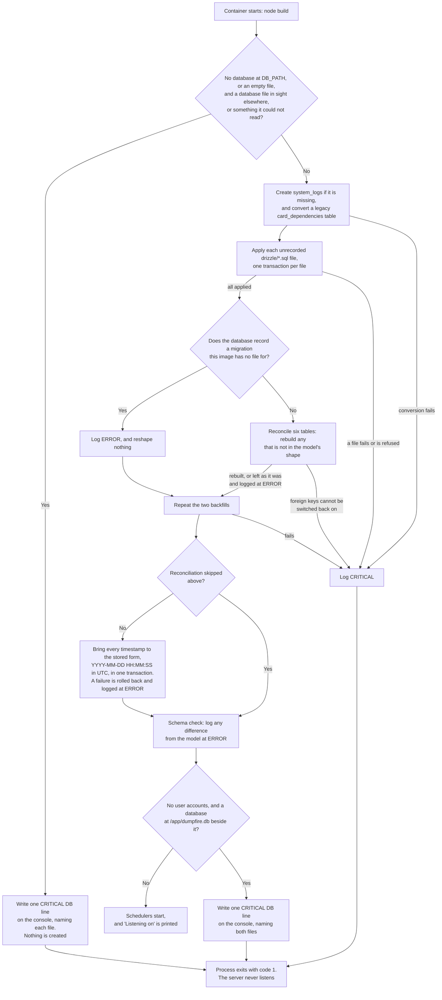

Before any of it, before the database is even opened (opening a path creates the file), the server looks at where the database is (`src/lib/server/db/location.ts`, card 2083). What it does depends on what is at the path it is about to open:

- **A database with data there** (a regular file that is not empty): it opens it, whatever else is around. If a non-empty `dumpfire.db` is also in the working directory (`/app/dumpfire.db`) beside the image's `/app/data/dumpfire.db`, it says so at every start, and opens the image's.
- **A folder there, or a file it cannot look at** (permission denied, say): it does not judge, and the open says what is wrong.
- **Nothing there, or an empty file**, so that opening it would make a new, empty database. At the image's path, `/app/data/dumpfire.db`, it looks for a database that would be hidden: a non-empty `dumpfire.db` in the working directory (`/app/dumpfire.db`, where a server started without `DB_PATH` kept it); a non-empty file whose name ends in `.db`, in lower case, at the top level of `/app/data` (not in a folder beneath it, and not `dumpfire.db-wal`, `dumpfire.db-shm` or `dumpfire.db.backup-temp`); and a non-empty `dumpfire.db-wal` beside the missing database. At any other path, on Linux, it looks at the image's `/app/data/dumpfire.db`: an empty `DB_PATH` (`-e DB_PATH=`, or `${DB_PATH}` in a compose file with the variable unset) falls back to `/app/dumpfire.db`, and a typo such as `/app/data/dumpfire.sqlite` names a file that is not there, and either would otherwise open a new database beside the real one. Only regular files count. If it finds any of them, or cannot look at one of them, or cannot list `/app/data`, it **refuses to start**. If it finds none, it opens the new database and says so.

The refusal is one `[CRITICAL] [DB]` line on the console, which begins `The server will not start.`, names each file with its size and when it was last written (so that you can tell which is live), says what to do with each, names anything it could not read, and never says to delete a file; the process exits with code 1 and nothing is created. The line cannot go to `system_logs`, which is in the database. On a workstation there is no `/app/data/dumpfire.db`, so a scratch file is never refused; on Windows the image's path is never looked at. See [A Failed Start](#a-failed-start).

One more refusal comes after the migrations, before the server listens. If the database in use is the image's, has no user accounts, and a non-empty `/app/dumpfire.db` is beside it, the server **refuses to start** with one `[CRITICAL] [DB]` line naming both files with their sizes and times. That is a database the check above let through because one earlier start, by an older image or with a `DB_PATH` it did not guard, made it and wrote to it: with no users, set-up would be open to whoever comes first while the real database sits unused. A healthy installation has users, so this never stops one that is running on its own database with an old file beside it.

1. **Preparation.** The `system_logs` table is created if it is missing, and a `card_dependencies` table still in its original shape is converted to the current one.
2. **Migration files.** Every `.sql` file in `/app/drizzle` whose name is not yet recorded in the `__drizzle_migrations` table is applied, in file-name order. Each file runs in its own transaction, together with the row that records it, so a file is either applied in full and recorded or not applied at all.
3. **The first failure stops the server.** The failing file is rolled back, no later file is attempted, and the process exits with code 1 before it listens. Files this start had already applied stay applied and recorded.
4. **Reconciliation.** Six tables (`boards`, `columns`, `categories`, `settings`, `user_xp`, `invite_tokens`) reached older databases in two different shapes. Any of them that is not in the shape the model declares is rebuilt in it, with every row carried across. A table that cannot be rebuilt safely is left exactly as it was and reported; that does not stop the server. The whole step is skipped when the database records a migration this image has no file for, because that database may be newer than the image, and an older image must not reshape it.
5. **Backfills.** Two values that migrations `0050` and `0051` filled in once (`cards.first_completed_at` and `task_requests.access_token`) are filled in again for any row that lacks them.
6. **Timestamps.** Every timestamp column (every TEXT column whose name ends in `_at`, and `system_logs.timestamp`) is brought to the one stored form, `YYYY-MM-DD HH:MM:SS` in UTC (card 2095). A value in ISO 8601, in the stored form with a fraction, or a bare date is rewritten to the same moment, to the second; a value in no form it can read is left as it is and reported at `ERROR`, at every start until it is dealt with. It runs in a transaction of its own: a failure is rolled back, logged at `ERROR`, and tried again at the next start, and the server starts. Like step 4, it is skipped when the database records a migration this image has no file for, and the `ERROR` line of step 4 says so. A start that converts anything says so in one `WARN` line, which is expected once after the update that brings card 2095 and after an Import Backup of an older backup, and at no other time.
7. **Schema check.** The whole database is compared with the model. Every difference is logged in one `ERROR` line. Nothing is changed and the server starts.

Expired sessions are then cleared, the system log is pruned to its retention, the backup, report and snapshot schedulers and the attachment file sweep start, and the server listens. On a database that is already up to date, steps 1 to 7 change nothing and log nothing.

Last, twelve things about the installation are said in the log if they are so. None stops the server, and none changes anything: there are user accounts and none of them is the superadmin (`[CRITICAL] [STARTUP]`, see [If Nobody Can Sign In as the Superadmin](#if-nobody-can-sign-in-as-the-superadmin)); `ORIGIN` is still the address the image is built with and no App URL is set (`[WARN] [STARTUP]`, see [Where a Mailed Link's Address Comes From](#where-a-mailed-links-address-comes-from)); and a board hangs beneath one of its own cards, a loop left by a move made before card 2141, the legacy JSON import or a restored backup (`[WARN] [STARTUP]`, naming up to 20 such boards with the card each hangs from, see [A board beneath one of its own cards](admin-guide.md#a-board-beneath-one-of-its-own-cards) in the admin guide). The third reads the boards once and finds the loops in memory, so it costs next to nothing however deep the boards nest, and an import of a backup that brings a loop writes the same line at once, as `[WARN] [IMPORT]`, without waiting for the next start. The other three are about the database (card 2083), each a `[WARN] [STARTUP]` line: there was no database file, or an empty one, before this start opened it (`No database was at <path>: a new, empty one was created at this start.`, said once by a new installation, and the alarm on one that had data: stop the container before anyone opens the site); the folder the database is in is the container's own file system and not a mounted volume, at every start; and a database file is at `/app/dumpfire.db` beside the image's `/app/data/dumpfire.db`, which has data and is the one in use, at every start, naming both with their sizes and when each was last written. The seventh is that `SIGN_IN_ONE_AT_A_TIME` is `off` (card 2194), a `[WARN] [STARTUP]` line at every start while it is, written to the console whatever `LOG_LEVEL` is, as are the first two about the database: it is meant to be set for one sign-in and removed (see [If an Attack Keeps an Owner Out](#if-an-attack-keeps-an-owner-out)). The eighth is that `CSP_MODE` is `report-only`, or holds a value that is neither mode (card 2162), a `[WARN] [STARTUP]` line at every start while it does, written to the console whatever `LOG_LEVEL` is: `report-only` is meant for the policy's first deploy and then removed (see [The Update That Brings the Content-Security-Policy](#the-update-that-brings-the-content-security-policy)). The ninth is the secrets a backup does not hold that this installation still lacks (card 2169), one `[WARN] [STARTUP]` line naming them. The tenth is each entry of `WEBHOOK_ALLOW_INSIDE` that is ignored (card 2161), one `[WARN] [STARTUP]` line each, naming the entry and why: it is said here, once, because the list is read at every registration and every delivery, where a line would be written once for each webhook judged (see [Where a Webhook May Send](#where-a-webhook-may-send)). The eleventh is each board with more webhooks than the 10 a board may have (card 2201), in one `[WARN] [STARTUP]` line naming the first 20 by id and count, never an address: such a board was filled before the cap, keeps every webhook, and none can be added to it until it has fewer than 10. The twelfth is each webhook that is on and is refused as its address is written (an address inside the network that `WEBHOOK_ALLOW_INSIDE` does not name, a user name or password, or an address that is not http or https), in one `[WARN] [STARTUP]` line naming the first 20 by webhook and board, with why, never the path: it is not sent at any event, and no name is looked up for it. The last three are written at `WARN` like any line, so `LOG_LEVEL` at `ERROR` or above drops them. The first two about the database (no database file before this start, and the folder not on a mounted volume) are written to the console whatever `LOG_LEVEL` is, even `ERROR`, because the checks after a deploy look for them in `docker logs`; with `LOG_LEVEL` at `ERROR` or `CRITICAL` they are printed but not kept in `system_logs`, as for any line. The second knows a container's own file system from `/proc/self/mountinfo`: the mount that holds the folder is the root and an overlay (`overlay`, as Docker has it, `fuse-overlayfs`, as rootless Podman has it, or `aufs`), or it is `tmpfs`. A container on another storage driver (`btrfs`, `zfs`, `vfs`) is not recognised and nothing is said, and where there is no `/proc/self/mountinfo` (Windows, macOS) nothing is said either. An in-memory database has no folder and is not looked at. A check that cannot be made is said on the console, one line for each such check, and the server starts all the same.

Nothing at start-up touches the uploads folder. The log is pruned again every six hours, and the same six-hourly tick empties the [uploads trash](#the-trash) of what has been in it for more than 30 days; the trash is also emptied once, ten minutes after the start. Where the schedulers run, [the sweep](#the-sweep-files-no-attachment-names) looks at the card folders 15 minutes after the start, and every six hours from then.

What stops a start, and what is only reported:

| Found at start-up | Logged as | Does the server start? |
|-------------------|-----------|------------------------|
| At `/app/data/dumpfire.db`, no database or an empty file, while a database file is at `/app/dumpfire.db` or at the top of `/app/data`, or a `dumpfire.db-wal` is there without its database | `[CRITICAL] [DB]`, on the console only, naming each file, its size and time, and what to do with it | **No**. Nothing is created or changed. See [A Failed Start](#a-failed-start) |
| At any other path, on Linux, no database or an empty file, while `/app/data/dumpfire.db` has data (an empty `DB_PATH`, or a typo) | `[CRITICAL] [DB]`, on the console only, naming `/app/data/dumpfire.db` | **No**. Set `DB_PATH=/app/data/dumpfire.db`, or take the setting out |
| A new database would be made, and a file or folder the check needed could not be read | `[CRITICAL] [DB]`, on the console only, naming what could not be read | **No**. Let the server read it, or set `DB_PATH` to where the database is |
| After the migrations: the image's database has no user accounts, and a database file is at `/app/dumpfire.db` | `[CRITICAL] [DB]`, on the console only, naming both files | **No**. See [A Failed Start](#a-failed-start) |
| A migration file fails, cannot be read, holds no SQL statement, or holds a statement the runner refuses (see [Changing the Schema](#changing-the-schema)) | `[CRITICAL] [DB]` | **No** |
| `/app/drizzle` is missing or holds no `.sql` file (an image built without its migrations) | `[CRITICAL] [DB]` | **No** |
| The `card_dependencies` conversion or a backfill fails | `[CRITICAL] [DB]` | **No** |
| Foreign keys cannot be switched back on after a rebuild | `[CRITICAL] [DB]` | **No** |
| One of the six tables cannot be rebuilt, or its rebuild fails its checks and is rolled back | `[ERROR] [DB]`, at every start until the cause is dealt with | Yes, with the table as it was |
| One of the six tables holds a value that the model's column type would store differently | `[ERROR] [DB]` for that table, at every start until a migration converts it | Yes; that table is as it was and the others are rebuilt |
| The database records a migration this image has no file for | `[ERROR] [DB]`, at every start | Yes; no table is rebuilt and no timestamp converted |
| Timestamps were found in another form and converted | `[WARN] [DB] N timestamp(s) converted to the stored form (YYYY-MM-DD HH:MM:SS, UTC), each still naming the same moment to the second: <table.column n, …>. Expected once after the update that brings card 2095, and after an import of an older backup; at any other start something still writes another form.` | Yes. Expected once after this update; at any other start, a fault to report |
| A timestamp column holds a value in no form the conversion can read | `[ERROR] [DB] Timestamp column(s) hold values in no form this build can read, and they were left as they are: <table.column n (such as "…")>. …`, at every start until it is dealt with | Yes, with those values as they are. Correct each to `YYYY-MM-DD HH:MM:SS` in UTC, or clear it where the column allows NULL |
| The conversion failed | `[ERROR] [DB] Timestamps could not be brought to the stored form (YYYY-MM-DD HH:MM:SS, UTC), and none was changed: <why>. Start-up continues on the values as they are, and the next start tries again.` | Yes; nothing was converted. Until a start converts them, a report schedule whose next run is held in ISO 8601 runs up to a day late, because that comparison with now is made as text; a session's, an API key's or an invite's expiry is read as the moment it names, so each ends on time |
| The database differs from the model anywhere | `[ERROR] [DB]`, at every start | Yes; nothing is changed |
| There are user accounts and none of them is the superadmin | `[CRITICAL] [STARTUP]`, at every start until one is | Yes. Nobody can export, import, reset or change the backup and mail settings until one is made from the host |
| `ORIGIN` is `http://localhost:3000` and no App URL is set | `[WARN] [STARTUP]`, at every start | Yes; links in mail begin with `http://localhost:3000` |
| A board hangs beneath one of its own cards | `[WARN] [STARTUP]`, at every start until it is repaired, and `[WARN] [IMPORT]` at once after an import that brings one | Yes. The board is on no dashboard and its card cannot be completed; opening it is safe. See [A board beneath one of its own cards](admin-guide.md#a-board-beneath-one-of-its-own-cards) |
| There was no database file, or an empty one, and this start made a new one | `[WARN] [STARTUP]`, at that start | Yes, on an empty database, with set-up open. On an installation that had data, stop the container before anyone opens the site: see [Moving the Database onto the Volume](#moving-the-database-onto-the-volume) |
| The database's folder is in the container's own file system, not on a mounted volume | `[WARN] [STARTUP]`, at every start | Yes. The database and the uploads are lost when the container is replaced: move them onto a volume before it is |
| A database file is at `/app/dumpfire.db` beside `/app/data/dumpfire.db`, which has data | `[WARN] [STARTUP]`, at every start until one of them is moved | Yes, on `/app/data/dumpfire.db`. If the other is this installation's database, start with `DB_PATH` set to it, or move it onto the volume |
| `SIGN_IN_ONE_AT_A_TIME=off` | `[WARN] [STARTUP]`, at every start while it is set, on the console whatever `LOG_LEVEL` is: `SIGN_IN_ONE_AT_A_TIME=off: sign-ins from browsers not remembered are not held to one at a time. Remove it and restart once the sign-in it was set for is made: see docs/deployment.md, under "If an Attack Keeps an Owner Out".` | Yes. A guesser who sends many attempts at once at one account is slowed by its waits alone. Remove it and restart: see [If an Attack Keeps an Owner Out](#if-an-attack-keeps-an-owner-out) |
| `CSP_MODE=report-only` | `[WARN] [STARTUP]`, at every start while it is set, on the console whatever `LOG_LEVEL` is: `CSP_MODE=report-only: pages are sent the Content-Security-Policy to report only, not to enforce; remove CSP_MODE once the trial is over. See docs/deployment.md.` | Yes. Pages are not protected by the policy: a browser reports what it would refuse and refuses nothing. Remove it and make the container again: see [The Update That Brings the Content-Security-Policy](#the-update-that-brings-the-content-security-policy) |
| `CSP_MODE` holds anything but `enforce` or `report-only` | `[WARN] [STARTUP]`, at every start while it does, on the console whatever `LOG_LEVEL` is: `CSP_MODE is "<value>", which is neither enforce nor report-only: the Content-Security-Policy is enforced.` | Yes, with the policy enforced. Correct the value or remove it |
| A secret a backup does not hold is still to be entered (card 2169): the mail settings name a host and a user and hold no password; an S3, Google Drive or OneDrive destination lacks its credentials; or a webhook the database's `webhook_secrets_left_out` lists is still off with no secret | `[WARN] [STARTUP]`, at every start while it is so: `To enter again, because a backup does not hold them: <the mail password (Admin, 📧 Email / SMTP); backup destination(s) "…" (…) (Admin, Scheduled Backups); the signing secret(s) of webhook(s) N (board "…"), which stay switched off until the board's owner or an administrator sets each one's secret and switches it on with PUT /api/v1/webhooks/{id}, or deletes it if it is no longer wanted>. A database put in place by hand from a backup has none of them: see docs/admin-guide.md, Restoring from Backup.` A list that cannot be read is said on the console alone | Yes. Mail is not sent, those destinations are not tried, and those webhooks send nothing, until each is entered: see [Restoring from Backup](admin-guide.md#restoring-from-backup) |
| An entry of `WEBHOOK_ALLOW_INSIDE` that is not read, or is wider than one inside range, holds `0.0.0.0` or `::`, or is outside the network (card 2161) | `[WARN] [STARTUP]`, one line for each such entry at every start while it is set: `WEBHOOK_ALLOW_INSIDE: "10.0.0.0/2" ignored: wider than one inside range` (or `not inside the network, so it allows nothing`, `an IPv4 address not written as four decimal numbers`, `its range is not a number of bits`, `not a host name, an address or a range (a port, a path or a wildcard is not taken)`) | Yes, with that entry ignored and the rest of the list applied. Correct it and make the container again: see [Where a Webhook May Send](#where-a-webhook-may-send) |
| A board has more than 10 webhooks, made before the cap (card 2201) | `[WARN] [STARTUP]`, at every start while one has: `2 board(s) have more webhooks than the 10 a board may have: board 12 has 14, board 40 has 11. All of them are still sent, and none can be added to such a board until it has fewer than 10.`, the first 20 named and then `, and N more` | Yes. Every active webhook of such a board is still sent; look at each with the board's owner and delete the ones not wanted |
| A webhook that is on is refused as its address is written (card 2161) | `[WARN] [STARTUP]`, at every start while one is: `2 webhook(s) that are on are not sent, whatever their names resolve to: webhook 4 on board 3 (127.0.0.1 is a loopback address); webhook 9 on board 3 (n8n is a name with no dot, which is looked up inside the network). Each is refused at every event until its address is changed or it is switched off; one inside the network can instead be named in WEBHOOK_ALLOW_INSIDE.`, the first 20 named and then `; and N more` | Yes. Such a webhook is sent nothing; change its address, switch it off, or name its host in `WEBHOOK_ALLOW_INSIDE` |

How the runner, the rebuild and the comparison work is described in [Data Model](data-model.md#migrations-and-schema-reconciliation).

## First-Run Setup

On a new, empty database the [start-up sequence](#start-up-sequence) applies every migration file before the server listens. What follows depends on whether anyone has an account yet:

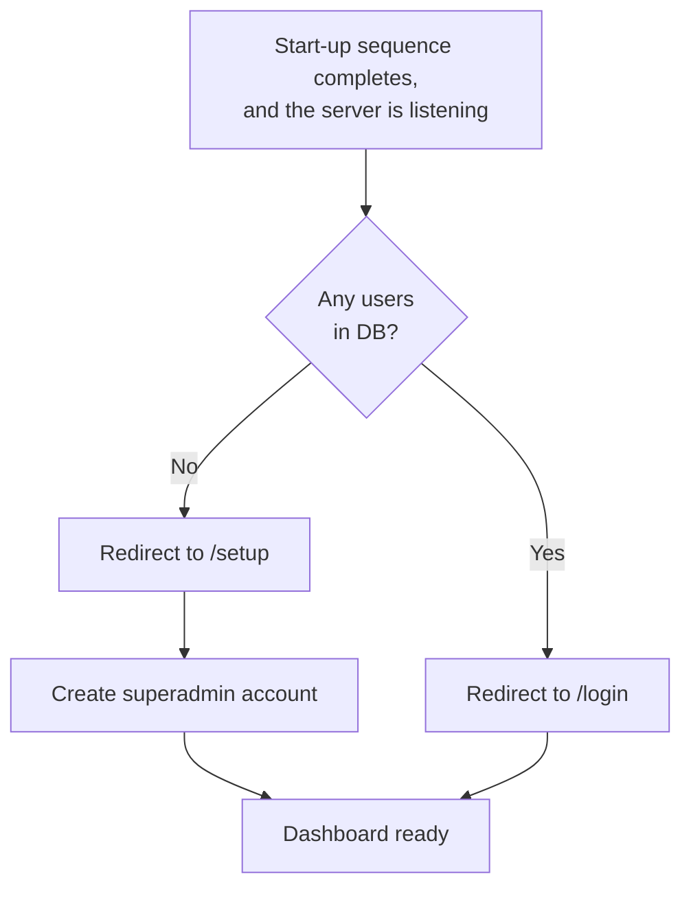

1. Start the container
2. Visit the application URL
3. You'll be redirected to `/setup` to create the first superadmin account
4. After setup, `/setup` is permanently blocked

The start that made the new database says so in the log: `[WARN] [STARTUP] No database was at /app/data/dumpfire.db: a new, empty one was created at this start.` On a new installation that is expected, once. On an installation that had data it means the server is not looking where the data is, and set-up is open to whoever opens the site first: stop the container at once and see [Moving the Database onto the Volume](#moving-the-database-onto-the-volume).

## The Superadmin

The account made at set-up is the **superadmin**, and there is one. Its role is written by set-up and by nothing else: no page and no route makes a second, and an administrator cannot be promoted to it.

What acts on the whole installation is the superadmin's alone. An administrator who tries any of it is answered `403`, "This belongs to the superadmin", and the admin page does not offer it to them:

| The superadmin only | Why it is not an administrator's |
|---------------------|----------------------------------|
| Export Backup | The file holds every user's password hash and email and every webhook's address. Since card 2169 it holds no mail password, destination credential or webhook secret, and carries a seal made with a key this server keeps, so that only this server fills its secrets back into it, and only unchanged; files exported before then hold the secrets and no seal |
| Import Backup | It replaces every account with the backup's |
| Reset Everything | Whoever sets up afterwards is the superadmin |
| Scheduled Backups: the schedule, the destinations, "Test" and "Run Now" | A destination is sent the whole database, and a test connects with a stored password to whatever host it is given |
| Email / SMTP and the App URL | They decide which server an invite is handed to, and where its link points |

Everything else on the admin page is any administrator's: users and teams, clearing a board, purging archived cards, vacuuming, resetting XP, the system log and the audit trail. See [Admin Guide](admin-guide.md#who-may-do-what).

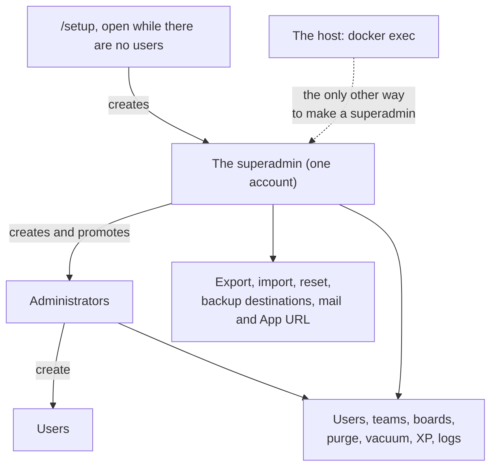

> ⚠️ **Before you deploy the version that brings this in**, sign in on production as the superadmin. The user list on the admin page shows each account's role, so it shows who that is. If you cannot, use the command below first: the account you use day to day, if it is an administrator, loses Export, Import, Reset, Scheduled Backups and the mail settings with that deploy.

### If Nobody Can Sign In as the Superadmin

The superadmin's password is lost, or its account was deleted from the database by hand, or the database came from somewhere that had none. No page puts that right: only the superadmin could, and set-up is closed while there is any user. The server says so in the log at every start:

```
[CRITICAL] [STARTUP] There are 4 user account(s) and none of them is the superadmin. ...
```

The way back is from the host, with the application's own database driver. The image has no `sqlite3` command. Give the username of an existing account in place of `<username>`, exactly as it is written on the admin page:

```bash
docker exec <container> node -e "const db = require('better-sqlite3')(process.env.DB_PATH || 'dumpfire.db', { fileMustExist: true }); const name = process.argv[1] || ''; const user = db.prepare('SELECT id, username, role FROM users WHERE username = ?').get(name); if (user === undefined) { console.log('No user is named [' + name + ']. Nothing was changed. The users are: ' + db.prepare('SELECT username, role FROM users ORDER BY id').all().map((u) => u.username + ' (' + u.role + ')').join(', ')); } else { db.prepare('UPDATE users SET role = ? WHERE id = ?').run('superadmin', user.id); console.log(user.username + ' was ' + user.role + ' and is now superadmin.'); } db.close();" <username>
```

It prints what it did:

| It prints | What happened |
|-----------|---------------|
| `greg was admin and is now superadmin.` | That one account's role was changed. Nothing else was |
| `No user is named [gerg]. Nothing was changed. The users are: greg (admin), ann (user)` | The name matched nobody, so nothing was written. It lists who there is |
| `SqliteError: unable to open database file` | `DB_PATH` in the container does not name a database. Nothing was written, and no file was created |

It runs while the server is running and takes effect at the next request: no restart. It changes no password, so name an account whose password is known. If none is, an administrator can set the password of an ordinary user on the admin page, and that user can then be named here; nobody but the superadmin can set an administrator's.

To check it:

```bash
docker exec <container> node -e "const db = require('better-sqlite3')(process.env.DB_PATH || 'dumpfire.db', { readonly: true, fileMustExist: true }); db.prepare('SELECT username, role FROM users ORDER BY id').all().forEach((u) => console.log(u.username + ': ' + u.role)); db.close();"
```

At least one line should end `superadmin`. Then sign in as that user: the admin page has Application Settings, Backup & Restore, Scheduled Backups and Email / SMTP on it again, and the `[CRITICAL] [STARTUP]` line is not written at the next start.

If the old superadmin's account is still there, there are now two, and neither can manage the other's account. Make the old one an administrator with the same command, with `'admin'` in place of `'superadmin'` in the `UPDATE`, or delete it as the new superadmin once its role is changed.

An import cannot bring this about: a backup that has users and no superadmin among them is refused before anything is written. See [Restoring from Backup](admin-guide.md#restoring-from-backup).

### If an Attack Keeps an Owner Out

While an account is being guessed at with many attempts at once, sign-ins at it from browsers not remembered for it are let in one at a time, and the rest are refused at once: "A sign-in with this name is already under way from another browser. Wait a few seconds and try again, or sign in from a browser you have used here before." (card 2194). The guesser almost always holds that one place, so the account's owner, on a browser not remembered for the account, is refused for as long as the attack lasts. A browser the owner has signed in with, or signed out of, since the deploy that brought this in is remembered for a year and is never made to wait or counted. It is refused only while five of the account's own checks are already in flight: its remembered browsers' sign-ins and its signed-in sessions' current passwords together. See [Browsers That Have Signed In Before](authentication-security.md#browsers-that-have-signed-in-before).

The ways in, in the order to try them:

1. **A browser remembered for the account**, or a session already open on any browser: neither is touched.
2. **An invite**, from the admin page's 📧, only where mail is set up, and only for an account an administrator may manage: never the superadmin's, and an administrator's only from the superadmin. The invite signs the browser in without the sign-in page and remembers it. After an administrator has *set* a password during an attack, no browser is remembered for the account: send an invite instead.
3. **Waiting** until 15 minutes after the last wrong guess at the account.
4. **From the host, for one sign-in**, when none of those will do: the superadmin above all, whom no invite and no reset reaches.

The host's way, `SIGN_IN_ONE_AT_A_TIME=off`:

1. Make the container again with the setting. `docker restart` and `docker start` cannot add a setting: they start the container with the ones it was made with. Stop it, remove it (the database and the uploads are on the volume and stay), and run it again with the command it was first run with and `-e SIGN_IN_ONE_AT_A_TIME=off` added. `docker inspect <container>` before the `rm` shows the settings it had. For the [Production](#production) command above:

   ```bash
   docker stop dumpfire
   docker rm dumpfire
   docker run -d \
     --name dumpfire \
     --restart unless-stopped \
     -p 3000:3000 \
     -v dumpfire-data:/app/data \
     -e DB_PATH=/app/data/dumpfire.db \
     -e ORIGIN=https://dumpfire.example.com \
     -e NODE_ENV=production \
     -e SIGN_IN_ONE_AT_A_TIME=off \
     dumpfire:latest
   ```

   In Compose, add `- SIGN_IN_ONE_AT_A_TIME=off` under `environment:` and run `docker compose up -d`, which makes the container again itself. A restart empties every count, and the guesser's next five wrong passwords fill the account's again, so the setting is what lets the owner in, not the restart.
2. Check that `docker logs <container> 2>&1` has `[WARN] [STARTUP] SIGN_IN_ONE_AT_A_TIME=off: sign-ins from browsers not remembered are not held to one at a time. …`.
3. Sign in on the browser that is needed. It waits up to 4 seconds (the account's wait still applies), signs in, and is then remembered for the account.
4. Make the container again without the setting, the same way: `docker stop`, `docker rm`, and the first command without `-e SIGN_IN_ONE_AT_A_TIME=off` (in Compose, take the line out and `docker compose up -d`). Check that the line is no longer written.

While it is off, a guesser who sends many attempts at once at an account is held only by its waits and by each address's ten attempts in 15 minutes, as before card 2194.

**An attack on the line, not on one account, is another matter.** An attacker with many addresses can keep the second lane of password checks full, 150 checks for each thread, at any accounts or at none: a whole IPv6 /48 is 65,536 networks of /64, each with sign-in's ten attempts of its own. Every sign-in from a browser not remembered, every invite and set-up is then answered "Sign-in is very busy right now…", whoever it is. `SIGN_IN_ONE_AT_A_TIME=off` does not help with that: only a remembered browser or a session already open gets in, since their checks go in the first lane, and beyond that only the proxy's own limits, if it has any (nginx's `limit_req`, say), can hold such an attacker back.

**To forget every remembered browser of every account at once** (a laptop that held many is lost, or the key is thought to be known), delete the key they are signed with and restart. It is the row `known_browser_secret` of `settings`; no backup holds it. The image has no `sqlite3` command:

```bash
docker exec <container> node -e "const db = require('better-sqlite3')(process.env.DB_PATH || 'dumpfire.db', { fileMustExist: true }); console.log(db.prepare('DELETE FROM settings WHERE key = ?').run('known_browser_secret').changes + ' key(s) deleted'); db.close();"
docker restart <container>
```

It holds no double quote inside its own, so it runs as written in bash and in PowerShell. The server holds the key in memory, so the restart is what ends the old cookies (a restart is enough here: nothing in the container's settings changes); a new key is made by the next browser to sign in. Everyone stays signed in, and each browser is remembered again at its next sign-in or sign-out. A remembered browser's cookie outlives its sessions: signing out, or a session ending, does not end it. To forget the browsers of one account only, set its password (the owner on the Account page, which keeps the browser that did it, or an administrator's reset, which keeps none). A restore of a backup and Reset Everything forget every browser too.

## Updating a Running Installation

An update replaces the container with one started from a newer image. The database stays where it is, and the new image brings it up to date in the [start-up sequence](#start-up-sequence).

> ⚠️ **The database stays where it is only if it is on the mounted volume.** Check before anything else, with the container running:
>
> ```bash
> docker exec dumpfire printenv DB_PATH
> docker inspect --format '{{range .Mounts}}{{.Destination}}{{println}}{{end}}' dumpfire
> ```
>
> If the first prints nothing, the container is from an image built before card 2083 and was started without `DB_PATH`: the server is using `/app/dumpfire.db`, which is inside the container and not on the volume. If it prints a path, the folder that holds it (normally `/app/data`) must be listed by the second command, or be inside a folder it lists; if it is not, the database is inside the container too. `DB_PATH` alone proves nothing since the image sets it. Either way, replacing the container discards the database and the uploads beside it: move them first, as [Moving the Database onto the Volume](#moving-the-database-onto-the-volume) says, before going any further. An image with card 2083 also says it at every start, `[WARN] [STARTUP] The database, <path>, is in the container's own file system`, in `docker logs dumpfire 2>&1` for as far back as the log goes.
>
> No check in a newer image can see a database inside the old container: a new container starts with a file system of its own. What a newer image can see, it judges by what is at the path it is about to open ([Start-Up Sequence](#start-up-sequence) has the whole rule):
>
> - It **refuses to start** when there is no database at that path, or an empty file, and it can see one elsewhere: a database file at `/app/dumpfire.db` (mounted there), a `*.db` file at the top of `/app/data`, a `dumpfire.db-wal` without its database, or, when `DB_PATH` is empty or names any other path, `/app/data/dumpfire.db` with data in it. It refuses as well when it would make a new database and cannot read something it needed to look at. And after the migrations, it refuses a database with no user accounts while a database file is at `/app/dumpfire.db` beside it. Each refusal is one `[CRITICAL] [DB]` line, and nothing is served (see [A Failed Start](#a-failed-start)).
> - It **opens and warns** when the database at its path has data and a database file is at `/app/dumpfire.db` beside it: one `[WARN] [STARTUP]` line at every start names both, with their sizes and times.
> - It **opens a new database and says so** when there is nothing at its path and nothing in sight: `[WARN] [STARTUP] No database was at <path>: a new, empty one was created at this start.` After an update, that line means the data is somewhere the new container is not looking: stop the container at once, before anyone opens the site and is offered set-up.

In outline:

1. **Run the tests** on the commit the new image will be built from: `npm run verify`, on a workstation, before the commit is pushed. If one fails, stop here. The image build runs them again, inside the image, and stops with no image if one fails there; running them first is the quick way to find out. See [Run the Tests Before You Build](#run-the-tests-before-you-build).
2. **Rehearse** the new image against a copy of the database whenever it brings a new file under `drizzle/`. See [Rehearsing an Update Against a Copy](#rehearsing-an-update-against-a-copy).
3. **Keep the old image** under a tag you can start again. The examples here call it `dumpfire:rollback`.
4. **Stop the old container and take a cold copy of the database**: the database file and the `-wal` and `-shm` files beside it, if they are there. SQLite runs in WAL mode, so the three files are one database and recent changes may be in the `-wal` file alone. They are only safe to copy together, with nothing holding them open. See [Taking and Returning the Cold Copy](#taking-and-returning-the-cold-copy).
5. **Start the new image** on the same data and read its log until a line beginning `Listening on` appears. It should take about as long as it did in the rehearsal.
6. If that line does not appear, or `docker ps` shows the container restarting, follow [A Failed Start](#a-failed-start).
7. **Have every open DumpFire tab reloaded.** A page left open keeps running the scripts of the release it was loaded from, against the new server. A request the new server reads differently can then fail with no word of why: an Account page loaded before the release that makes Generate Key ask for the password sends no password, and is refused with nothing shown. Administrators in particular reload the admin page before resetting anyone's password, so that the reset dialog is the new one and says what the reset ends.
   - **For the release that brings the update bar (card 2167), and any update to it from an older release**, reload every open tab by hand, and ask the people who use DumpFire to do the same. A page loaded from an older release never asks whether there is a new version.
   - **From the next update on**, each open page asks the server about once a minute and, within about a minute of the new image answering, shows a bar across the foot of the window: "DumpFire has been updated. Save anything you are editing, then reload to use the new version.", with a **Reload** button. It never reloads by itself, so nothing typed in a card's window or a form is lost, and the bar cannot be closed. A link or any other move to another page from it loads that page afresh, on the new version. Tell people to save what they are typing and press Reload when they see it.
   - **A restart of the same image shows no bar**: the version is the time the image was built. Going back to an older image is a new version, and shows it. Under `vite dev` the bar never shows. See [A page left open across a deploy](architecture.md#a-page-left-open-across-a-deploy).

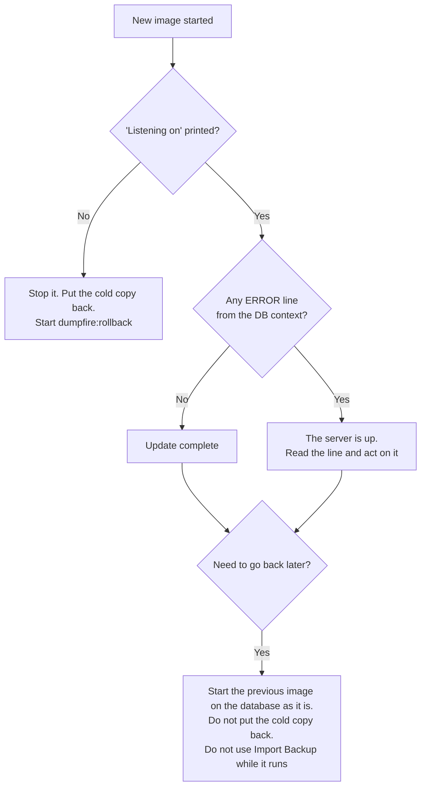

### Moving the Database onto the Volume

For a container whose database is inside it, not on a volume: one from an image built before card 2083 started without `DB_PATH` (the database is `/app/dumpfire.db`), or one started with no volume at the folder of its `DB_PATH`. The database is three files, `dumpfire.db` and the `-wal` and `-shm` files beside it when they are there, and the uploads are the folder `uploads` beside them. All of it moves, with the container stopped. Before anything is copied, the container's own file system is kept as an image with `docker commit`: under Docker Compose, the next `docker compose up -d` recreates the service's container and removes the old one, whatever it has been renamed to, and what is inside it goes with it. The snapshot, and the copy on the host, are kept until the new container has been checked and the next backup has been taken.

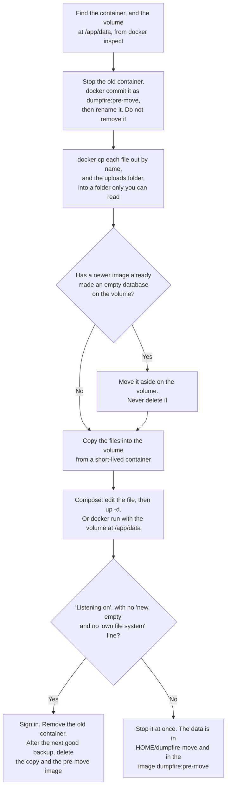

These are bash. Under Git Bash on Windows, run `export MSYS_NO_PATHCONV=1` first, so that the paths inside the container are not rewritten. That also leaves `$HOME` as `/c/Users/<you>`, which `docker.exe` does not understand, so on Windows set `move=$(cygpath -m "$HOME/dumpfire-move")` and write `"$move"` wherever the commands below say `"$HOME/dumpfire-move"`. `mkdir -m 700` protects nothing on NTFS: keep the folder in your own profile, which only you can read.

**First, find the names.** The container's name is in `docker ps` (under Compose it is often `<project>-dumpfire-1`). The volume is the one the container has at `/app/data`, if it has one: a volume made by Compose is named `<project>_dumpfire-data` (the README's example makes `dumpfire_dumpfire-data`), and one made by `docker run -v dumpfire-data:/app/data` is `dumpfire-data`. Read it from the container rather than guessing it:

```bash
c=dumpfire    # the container's name, from docker ps
docker inspect --format '{{range .Mounts}}{{.Type}}  {{if .Name}}{{.Name}}{{else}}{{.Source}}{{end}}  ->  {{.Destination}}{{println}}{{end}}' "$c"
docker volume ls
```

Set `vol` to the name shown against `/app/data`. If nothing is mounted at `/app/data`, choose the name the new container will use (under Compose, `<project>_dumpfire-data`, where `<project>` is shown by `docker inspect --format '{{index .Config.Labels "com.docker.compose.project"}}' "$c"`) and make it with `docker volume create "$vol"`; Compose then says the volume was not created by Compose, and uses it. Set `from` to the folder the database is in inside the old container: `/app` for one started without `DB_PATH`, or the folder of its `DB_PATH`. Set `img` to any DumpFire image you have, such as `dumpfire:latest`: the short-lived containers below run `sh`, never the server.

```bash
vol=dumpfire_dumpfire-data   # the volume found above
from=/app
img=dumpfire:latest          # any DumpFire image you have

# 1. Stop the old container, keep its own file system as an image, and keep the
#    container too, under another name.
docker stop "$c"
docker commit "$c" dumpfire:pre-move
docker rename "$c" dumpfire-old

# 2. Copy each file out by name, into a folder only you can read. docker cp takes no
#    wildcard. A missing -wal or -shm file is expected, and so is a missing uploads
#    folder when nothing was ever attached.
mkdir -m 700 "$HOME/dumpfire-move"
docker cp "dumpfire-old:$from/dumpfire.db" "$HOME/dumpfire-move/"
docker cp "dumpfire-old:$from/dumpfire.db-wal" "$HOME/dumpfire-move/" || echo "No -wal file: expected"
docker cp "dumpfire-old:$from/dumpfire.db-shm" "$HOME/dumpfire-move/" || echo "No -shm file: expected"
docker cp "dumpfire-old:$from/uploads" "$HOME/dumpfire-move/" || echo "No uploads folder: expected if nothing was attached"
ls -la "$HOME/dumpfire-move"
```

`mkdir -m 700` fails if `$HOME/dumpfire-move` is there already: that is a copy from an earlier attempt, so look at it before you move it aside, and never copy over it.

**A database bind-mounted as a single file** (`-v /srv/dumpfire.db:/app/dumpfire.db`) has its file on the host, but its `-wal` and `-shm` files are not: SQLite writes them beside the database, which is inside the container, next to the mount. `docker commit` keeps them (it keeps the container's own files, not what is mounted). Copy them out of the old container with the two lines above, and take the database file from the host if the first `docker cp` does not.

**If a newer image has already started on the volume and made a new, empty database there** (its log said `No database was at /app/data/dumpfire.db: a new, empty one was created at this start.`, and nobody has used the site since), that database is in the way. Move it aside on the volume, never delete it:

```bash
docker run --rm --network none -v "$vol:/app/data" "$img" sh -c \
  'd=/app/data/set-aside-$(date +%Y%m%d-%H%M%S) && mkdir "$d" && for f in dumpfire.db dumpfire.db-wal dumpfire.db-shm; do if [ -e "/app/data/$f" ]; then mv "/app/data/$f" "$d/"; fi; done; ls -la /app/data "$d"'
```

Then copy the files into the volume, with a short-lived container as the cold copy does. It copies nothing if a database is there already. It uses `cp -R`, not `cp -a`, so the files belong to the container's user and `/app/data` keeps its own owner and mode (`cp -a` would give the volume folder the copy folder's owner and its `700`, which a volume on NFS with root squashing, or a future image that does not run as root, could not open):

```bash
docker run --rm --network none -v "$vol:/app/data" -v "$HOME/dumpfire-move:/move" "$img" sh -c \
  'if [ -e /app/data/dumpfire.db ]; then echo "/app/data/dumpfire.db is there already: nothing was copied." >&2; exit 1; fi; cp -R /move/. /app/data/ && ls -la /app/data'
```

**Start the new image on the volume.** Under Docker Compose, edit the compose file: take out any line that mounts a file or a volume at `/app/dumpfire.db`, and give the service the volume at `/app/data` and `DB_PATH`:

```yaml
services:
  dumpfire:
    environment:
      - DB_PATH=/app/data/dumpfire.db
    volumes:
      - dumpfire-data:/app/data

volumes:
  dumpfire-data:
```

In a compose file whose `environment:` is a map rather than a list, the line is `DB_PATH: /app/data/dumpfire.db`.

Keep the rest of the service as it was. If `vol` is a volume you made with `docker volume create` under another name than Compose's, add `external: true` and `name: <that name>` under `dumpfire-data:` at the end. Then, in the folder of the compose file:

```bash
docker compose up -d
```

Compose recreates the service's container on the new settings, and removes `dumpfire-old`, which still carries the service's labels; the snapshot `dumpfire:pre-move` keeps what was inside it. Without Compose, start it as the [Production](#production) example does, with the volume and `DB_PATH`:

```bash
docker run -d --name dumpfire --restart unless-stopped -p 3000:3000 \
  -v "$vol:/app/data" -e DB_PATH=/app/data/dumpfire.db \
  -e ORIGIN=https://dumpfire.example.com dumpfire:latest
```

Then read what it said (under Compose, the container's name is in `docker compose ps`):

```bash
docker logs dumpfire 2>&1 | grep -E 'STARTUP|\] \[DB\] |Listening on'
```

`Listening on`, and neither `No database was at` nor `in the container's own file system`, is right: the site shows the sign-in page and the old accounts sign in. Then remove the old container if Compose has not (`docker rm dumpfire-old`). Keep `$HOME/dumpfire-move` and the image `dumpfire:pre-move` until the next backup has been taken and checked, then delete both: they hold the whole database and every attachment.

```bash
rm -r "$HOME/dumpfire-move"
docker image rm dumpfire:pre-move
```

If `Listening on` is missing, or either of the other lines is there, stop the new container at once, before anyone opens the site. The data is in `$HOME/dumpfire-move`, and inside the image `dumpfire:pre-move` at `$from`, whatever has become of the old container. To take a file out of that image again: `docker create --name pre-move dumpfire:pre-move`, then `docker cp "pre-move:$from/dumpfire.db" .` (and the same for the others), then `docker rm pre-move`.

### Taking and Returning the Cold Copy

These are for the volume and path the examples on this page use: the volume `dumpfire-data` mounted at `/app/data`, and `DB_PATH=/app/data/dumpfire.db`. Change both to match the installation. Each runs a short-lived container from the kept image with the volume attached and no network; the server is not started, because the command replaces it. Keep the copy outside the repository folder.

```bash
# Take it, with the application's container stopped, into a folder only you can read.
docker stop dumpfire
mkdir -p -m 700 "$HOME/dumpfire-cold"
docker run --rm --network none -v dumpfire-data:/app/data -v "$HOME/dumpfire-cold:/cold" \
  dumpfire:rollback sh -c 'cp -a /app/data/dumpfire.db* /cold/ && ls -l /cold'

# Return it. Only where the new image never printed "Listening on".
docker run --rm --network none -v dumpfire-data:/app/data -v "$HOME/dumpfire-cold:/cold" \
  dumpfire:rollback sh -c 'rm -f /app/data/dumpfire.db-wal /app/data/dumpfire.db-shm && cp -a /cold/dumpfire.db* /app/data/ && ls -l /app/data'
```

`dumpfire.db*` takes the database and whichever of its `-wal` and `-shm` files exist. Returning it removes those two first, so that none is left beside the database that the copy does not have.

The cold copy is the whole database, every account's password hash and session included, so `-m 700` keeps the folder readable by you alone (`mkdir -p` leaves the mode of a folder that is there already as it was: check it with `ls -ld "$HOME/dumpfire-cold"`). Once the update is complete and the next backup after it has been taken and checked, delete it: `rm -r "$HOME/dumpfire-cold"`.

### Reading the Log

Every line the application logs has the form `[time] [LEVEL] [CONTEXT] message`. The migration runner's context is `DB`.

- **Two streams.** The logger writes `WARN`, `ERROR` and `CRITICAL` lines to stderr. `Listening on` is printed by the web server on stdout. Read them together with `docker logs dumpfire 2>&1`.
- **What a successful update prints.** One line beginning `Applied migration:` for each file applied; one line for each table rebuilt, naming the table, the number of rows carried across and what differed in it; one line for each sub-board detached from a card that no longer exists; and one line if the backfills had anything to fill in. Then `Listening on`.
- **Those are `WARN` lines.** The default level, `INFO`, prints them. With `LOG_LEVEL=ERROR` they are not printed, and a successful update shows `Listening on` and nothing from the runner.
- **A timestamp line is expected once.** The first start of the release that brings card 2095 converts the timestamps production holds in ISO 8601 and says so in one `[WARN] [DB] N timestamp(s) converted to the stored form …` line, naming each column and its count. The next start says nothing. A line at any later start means something still writes the other form, and is a fault to report. After an Import Backup the same conversion is said as `[WARN] [IMPORT]`.
- **A new, empty database** is given every file. 25 statements in 19 of the oldest files repeat something an earlier file has already done and are skipped, each with a `WARN` line. That is expected.
- **Two `[STARTUP]` lines are about the Content-Security-Policy, not the update.** `CSP_MODE=report-only: pages are sent the Content-Security-Policy to report only, not to enforce; remove CSP_MODE once the trial is over. See docs/deployment.md.` is expected during the first deploy of the policy and nowhere else; `CSP_MODE is "…", which is neither enforce nor report-only: the Content-Security-Policy is enforced.` means the variable was mistyped. See [The Update That Brings the Content-Security-Policy](#the-update-that-brings-the-content-security-policy).
- **Judge a run by two markers and nothing else**: `[ERROR] [DB]` and `[CRITICAL] [DB]`. A `CRITICAL` line means start-up stopped. An `ERROR` line means the server started and something needs attention; the line says what, and it is repeated at every start until the cause is dealt with. Errors from other contexts, such as `[BACKUP]` or `[REPORTS]`, come from the schedulers and say nothing about the update.

```bash
# Nothing printed means the runner found nothing wrong.
docker logs dumpfire 2>&1 | grep -E '\[(ERROR|CRITICAL)\] \[DB\]'

# Everything the runner said, and whether the server came up.
docker logs dumpfire 2>&1 | grep -E '\] \[DB\] |Listening on'
```

Through the second command, a successful update looks like this, with one line for each table rebuilt. `docker logs` unfiltered shows three more `WARN` lines before `Listening on`, one from each scheduler as it starts:

```
[2026-10-12T09:14:03.512Z] [WARN] [DB] Applied migration: 0050_add_first_completed_at.sql
[2026-10-12T09:14:03.530Z] [WARN] [DB] Applied migration: 0051_add_request_access_token.sql
[2026-10-12T09:14:03.541Z] [WARN] [DB] Applied migration: 0052_drop_time_entries.sql
[2026-10-12T09:14:03.556Z] [WARN] [DB] settings rebuilt in the model's shape — 2 row(s) carried across. What differed, and no longer does: settings.key: is nullable; the model has it NOT NULL
Listening on http://0.0.0.0:3000
```

To find the rebuilt tables, search for `rebuilt in the model's shape`. No `ERROR` line contains the word "rebuilt", so the search finds those lines and no others.

There are two other lines of the same kind as the one below: `… were left in the shapes they have`, where several tables were stopped by one cause, and `… was not compared with the model`, where the comparison itself could not be made.

A table that was not rebuilt has an `ERROR` line of this form, which says why, that nothing in it was changed, and what to do. Other tables may have been rebuilt at the same start; their own lines say so:

```
[2026-10-12T09:14:03.556Z] [ERROR] [DB] settings was left in the shape it has, which is not the model's: settings.key is NULL in 1 row(s), and the model's column is NOT NULL with no default to give them. Nothing in it was changed, and the application runs on that shape as it has until now. Give key a value in those rows or delete them, and restart: UPDATE "settings" SET "key" = <a value> WHERE "key" IS NULL; or DELETE FROM "settings" WHERE "key" IS NULL; key is the table's key, so no two rows can be given the same value: where there are several, update them one at a time, adding AND rowid = <n>. It is reported at every start until the cause is dealt with.
```

### A Failed Start

What it looks like:

- One `[CRITICAL] [DB]` line. For a migration file it names the file, the position of the failing statement and its first line, what SQLite said about it, and the files this start had already applied. It ends by saying that the database is as it was before the failing step. A halt during reconciliation ends differently: it says what is known of whether a rebuild had been committed, and to start again. An error the runner did not anticipate has no `CRITICAL` line at all, and Node's report of it is then the whole account.
- Node then prints the error and its stack, and the process exits with code 1.
- `Listening on` never appears.
- With `--restart unless-stopped`, Docker starts the container again and it fails in the same way. `docker ps` shows it as restarting.

The `CRITICAL` line is also written to the `system_logs` table, after the failing file has been rolled back, so it is still there once the server is running again.

**A `[CRITICAL] [DB]` line about where the database is** is different. It begins `The server will not start.` and comes in one of two forms. Before the open: there is no database at the path (or the file there is empty), and it names each database file the server can see, with its size and when it was last written, and what to do with it, and anything it could not read. After the migrations: the database in use has no user accounts, and it names both files. The line is printed twice in `docker logs`: once as written, and again in Node's report of the error that stops the process, with its stack. Nothing is in `system_logs`, nothing was served, there is no cold copy to put back and no reason to go back to the previous image. Stop the container, so that it stops restarting, then do what the line says for the file that is this installation's database, and start again. A file that is not this installation's database is moved out of that folder.

- **Start with `DB_PATH` set to the file.** A container keeps the environment it was created with, so `docker start` (and `docker restart`) starts it with the old `DB_PATH` again. It must be created anew. Under Docker Compose, set `DB_PATH` in the service's `environment:` and run `docker compose up -d`, which recreates it. With `docker run`, `docker rm dumpfire`, then the same `docker run` with `-e DB_PATH=<file>`. Only the container is removed: the volume and a file mounted from the host stay.
- **Rename a file on the volume to `dumpfire.db`**, with its `-wal` and `-shm` files, with the container stopped, in a short-lived container as the moving section does it (shown for `/app/data/kanban.db`; set `vol` and `img` as that section says). It renames nothing if a `dumpfire.db`, or a `-wal` or `-shm` file of that name, is there already (SQLite would otherwise replay another database's `-wal` onto the renamed one):

  ```bash
  docker run --rm --network none -v "$vol:/app/data" "$img" sh -c \
    'cd /app/data && if [ -e dumpfire.db ] || [ -e dumpfire.db-wal ] || [ -e dumpfire.db-shm ]; then echo "dumpfire.db, or its -wal or -shm file, is there already: nothing was renamed." >&2; exit 1; fi; for s in "" -wal -shm; do if [ -e "kanban.db$s" ]; then mv "kanban.db$s" "dumpfire.db$s"; fi; done; ls -la /app/data'
  ```

  If an empty `dumpfire.db` is there, made by an earlier start, move it aside first with the set-aside command in that section.
- **Move a file onto the volume**, or a database with no users aside: [Moving the Database onto the Volume](#moving-the-database-onto-the-volume) has the commands.

What to do:

1. Stop the container, so that it stops restarting.
2. Read the `CRITICAL` line. It says which file and why.
3. Either fix the cause and start again, or go back to the previous image. A failed file was rolled back and is not recorded, so the next start runs it again from its first statement. The files applied before it are recorded and are not run again.

### Going Back to the Previous Image

| Situation | What to do | What is lost |
|-----------|------------|--------------|
| The new image never printed `Listening on` | Stop it. Put the cold copy back: all three files, deleting any `-wal` or `-shm` file that is beside the database and is not in the copy ([the second command](#taking-and-returning-the-cold-copy)). Start `dumpfire:rollback`. | Nothing. Nobody was able to use the new image. |
| The new image has served requests | Start `dumpfire:rollback` against the database as it is. **Do not put the cold copy back.** | Nothing. Putting the cold copy back would discard everything done since it was taken. |

What the older image makes of a database the newer one has migrated depends on how old it is:

- An image that has this runner finds migrations recorded that it has no file for. It reports that in an `[ERROR] [DB]` line, rebuilds nothing, reports in a second line whatever differs from its own model, and starts. Both lines are expected for as long as the older image runs.
- An image from before this runner (one whose `drizzle/` directory has no `0050` file) makes none of these checks and starts without comment.

One request behaves differently under an image from before this runner once the database has been migrated. A `PUT` to `/api/v1/columns/{columnId}` or `/api/columns/{id}` carrying `"wipLimit": null` is answered 500, because that image passes the null to the database and `columns.wip_limit` no longer accepts one. Send 0, which means the same thing: no limit. The board page is not affected, because that image sends 0 when the box is emptied. Nothing is damaged by the failed request, and the newer image does not have the fault.

When the newer image is started again it finds its migrations already recorded, repeats the backfills for rows created in the meantime, converts any timestamp the older image wrote in ISO 8601 (one `[WARN] [DB]` line), and carries on.

> ⚠️ **While an older image is running, do not use Import Backup (Admin → Backup & Restore).** An image from before this runner replaces the migration record along with the data. Restoring a backup that was taken before the update leaves a database that has the new columns and a record that says migrations `0050` onward never ran. The newer image then tries to apply `0050` again, fails on a column that already exists, and stops at every start. That image also leaves out every column whose WIP limit is NULL in the backup, because `columns.wip_limit` no longer accepts one, and commits all the same, so the cards on those columns are left pointing at nothing.

If that has happened, repair the record before starting the newer image. Check that the columns `cards.first_completed_at` and `task_requests.access_token` exist, then record the three files again:

```sql
INSERT OR IGNORE INTO __drizzle_migrations (hash) VALUES
  ('0050_add_first_completed_at.sql'),
  ('0051_add_request_access_token.sql'),
  ('0052_drop_time_entries.sql');
```

The image has no `sqlite3` command, and the newer image must not be started until this is done, so run it in a short-lived container from the newer image with the volume attached. The command replaces the server, which is not started. Change the volume and `DB_PATH` to match the installation:

```bash
docker run --rm --network none -v dumpfire-data:/app/data -e DB_PATH=/app/data/dumpfire.db \
  dumpfire:candidate node -e "
const db = require('better-sqlite3')(process.env.DB_PATH);
const has = (table, column) => Boolean(db.prepare('SELECT 1 FROM pragma_table_info(?) WHERE name = ?').get(table, column));
if (has('cards', 'first_completed_at') === false || has('task_requests', 'access_token') === false) {
  throw new Error('The two columns are not both there. Do not record the files: this is another fault.');
}
const record = db.prepare('INSERT INTO __drizzle_migrations (hash) SELECT ? WHERE NOT EXISTS (SELECT 1 FROM __drizzle_migrations WHERE hash = ?)');
for (const name of ['0050_add_first_completed_at.sql', '0051_add_request_access_token.sql', '0052_drop_time_entries.sql']) record.run(name, name);
console.log(db.prepare('SELECT COUNT(*) AS n FROM __drizzle_migrations').get().n + ' migrations recorded');
"
```

**Recording the files is not the whole repair.** It lets the newer image start, on a database that is still missing the columns the older image left out. Once the newer image is running, restore the same backup again with Import Backup there: it keeps the migration record, stores those limits as 0 and brings every column back.

### Rehearsing an Update Against a Copy

A quicker check comes first and needs no Docker: `npm run rehearse -- path/to/backup.db`, on a workstation with the new code checked out, takes the migration runner over a copy of a downloaded backup and says what it applied and rebuilt and whether a row was lost. It starts no server, so it sends nothing. See [Testing](testing.md#rehearsing-the-runner-against-a-copy-of-a-real-database). It does not replace what follows, which rehearses the image itself.

A rehearsal starts the new image on a copy of the live database and checks four things: that it migrates the copy without an error, that a second start has nothing left to do, that the previous image still starts afterwards, and that a migration which fails really does stop the server.

> ⚠️ **Run every rehearsal container with `--network none`.** A copy of production carries production's schedules and credentials. Started with a network, it emails every scheduled report that has fallen due to its real recipients, and if a backup is due it uploads one to the real destinations and then deletes the oldest backups there to keep to the retention count. Both schedulers look for work once a minute from the moment the server starts. The helper below also sets `SCHEDULERS=off`, which stops the schedulers in an image that has that switch. An older image, such as the one kept for rolling back, ignores it, so the network stays off whichever image is started.

> ⚠️ **Treat the copy as secret.** It holds password hashes, live session tokens, API key hashes, the SMTP password, the backup destinations' credentials and the secret tokens in task requesters' links. Keep it off shared storage and delete it when the rehearsal is over.

The snippets are written for bash on the Docker host. Under Git Bash on Windows, set `MSYS_NO_PATHCONV=1` first, or paths such as `/tmp/rehearsal.db` and `/rehearsal` are rewritten into Windows paths before Docker sees them.

Build the new image first, in the repository, and keep the image that is running:

```bash
docker tag "$(docker inspect -f '{{.Image}}' dumpfire)" dumpfire:rollback
docker build -t dumpfire:candidate .
```

Then do everything else in a directory outside the repository. `.dockerignore` keeps `*.db`, `*.db-shm` and `*.db-wal` out of the build context at any depth, so a copy of production left in a folder of the repository under one of those names is not sent to Docker. A copy under any other name is sent by the next `docker build` and kept in its build cache after the folder is deleted, and a copy inside the repository is one `git add` from being committed: keep it outside.

Take the copy from the running container. `VACUUM INTO` writes a complete, consistent copy while the server carries on, and `process.env.DB_PATH || 'dumpfire.db'` is how the server itself finds its database, so the snippet opens the file the server has open:

```bash
docker exec dumpfire node -e "
const Database = require('better-sqlite3');
const live = new Database(process.env.DB_PATH || 'dumpfire.db', { readonly: true });
live.prepare('VACUUM INTO ?').run('/tmp/rehearsal.db');
console.log(new Database('/tmp/rehearsal.db', { readonly: true }).pragma('integrity_check', { simple: true }));
"                                              # prints: ok
mkdir -p "$HOME/dumpfire-rehearsal" && cd "$HOME/dumpfire-rehearsal"
mkdir r1 r2
docker cp dumpfire:/tmp/rehearsal.db r1/dumpfire.db
docker cp dumpfire:/tmp/rehearsal.db r2/dumpfire.db
docker exec dumpfire rm /tmp/rehearsal.db
```

Define three helpers, in that directory:

```bash
# Start an image on a copy: no network, no schedulers, and DB_PATH pointing at the copy.
rehearse() {      # rehearse <container name> <image> <directory> [more docker run options]
  local name=$1 image=$2 dir=$3; shift 3
  docker run -d --name "$name" --network none \
    -v "$PWD/$dir:/rehearsal" -e DB_PATH=/rehearsal/dumpfire.db -e SCHEDULERS=off "$@" "$image"
}

# Everything the runner said, and whether the server came up.
runner_log() { docker logs "$1" 2>&1 | grep -E '\] \[DB\] |Listening on'; }

# Look inside a copy without starting the server.
inspect() {       # inspect <directory>
  docker run --rm --network none -v "$PWD/$1:/rehearsal" dumpfire:candidate node -e "
const db = require('better-sqlite3')('/rehearsal/dumpfire.db');
for (const name of ['boards', 'columns', 'categories', 'cards', 'settings', 'user_xp', 'invite_tokens', 'sessions']) {
  console.log(name + ': ' + db.prepare('SELECT COUNT(*) AS n FROM ' + name).get().n + ' rows');
}
console.log('migrations recorded: ' + db.prepare('SELECT COUNT(*) AS n FROM __drizzle_migrations').get().n);
console.log('foreign key violations: ' + db.pragma('foreign_key_check').length);
console.log('time_entries: ' + (db.prepare('SELECT 1 FROM sqlite_master WHERE name = ?').get('time_entries') ? 'present' : 'gone'));
if (db.prepare('SELECT 1 FROM pragma_table_info(?) WHERE name = ?').get('cards', 'first_completed_at')) {
  console.log('completed cards with no first_completed_at: ' + db.prepare('SELECT COUNT(*) AS n FROM cards WHERE completed_at IS NOT NULL AND first_completed_at IS NULL').get().n);
}
"
}
```

Then, in order:

| # | Do | Expect | A fault if |
|---|----|--------|------------|
| 1 | `inspect r1` | The row counts of the copy as it stands. Keep them. | — |
| 2 | `rehearse df-new dumpfire:candidate r1`, wait a few seconds, `runner_log df-new` | An `Applied migration:` line for each file the new image brings, a line for each table it rebuilds, then `Listening on` | Any line marked `[ERROR] [DB]` or `[CRITICAL] [DB]`; no `Listening on`; `docker ps -a` shows the container has exited |
| 3 | `docker rm -f df-new`, then `inspect r1` | The row counts of step 1, but `sessions: 0 rows` once migration 0053 has been applied (it ends every session, once). `migrations recorded` higher by the number of files applied. `foreign key violations` as in step 1: a rebuild carries across a row that already broke a key, and adds none. | Any other row count differs |
| 4 | `rehearse df-new dumpfire:candidate r1` again, then `runner_log df-new` | `Listening on` and nothing else: no file left to apply and no table left to rebuild | An `Applied migration:` line, or any line from `[DB]` at all |
| 5 | `docker rm -f df-new`, then `rehearse df-old dumpfire:rollback r1` and `docker logs df-old 2>&1` | `Listening on`: the previous image starts on a database the new one has migrated | It does not start |
| 6 | Start the candidate on `r2` with a migration that cannot succeed (commands below) | A `[CRITICAL] [DB]` line naming `9999_deliberate_failure.sql` and giving SQLite's message that the table does not exist; Node's report of the error; exit code 1; never `Listening on`. `runner_log df-fail` has the `Applied migration:` lines of the real files and no line for a rebuilt table, because tables are rebuilt only once every file has been applied. `inspect r2` counts the real files as recorded and not the extra one. | The container stays up, or the line lacks the file name or SQLite's message |
| 7 | `docker rm -f df-old df-fail`, then delete the rehearsal directory, with `r1`, `r2` and the extra `.sql` file in it | — | — |

```bash
# Step 6: a file that sorts after every real migration and refers to a table that does not exist.
echo 'SELECT * FROM deliberately_missing_table;' > 9999_deliberate_failure.sql
rehearse df-fail dumpfire:candidate r2 \
  -v "$PWD/9999_deliberate_failure.sql:/app/drizzle/9999_deliberate_failure.sql:ro"
docker wait df-fail                  # prints the exit code: 1. If it does not return, the server stayed up.
docker logs df-fail 2>&1 | tail -n 30
runner_log df-fail
inspect r2
```

With `SCHEDULERS=off` the candidate logs one `[WARN] [SCHEDULERS]` line saying its schedulers are off, and nothing from them after that. An image from before the switch starts its schedulers all the same, and under `--network none` they may log errors of their own after the first minute, because they cannot reach anything. Those are expected, which is one more reason to judge the run by the `[DB]` lines alone.

### The Update That Brings Migrations 0050 to 0052

The first update to an image that has this runner does more than a routine one, because it is the first time the six tables are brought to one shape. For that update only:

**Before the rehearsal**, count the NULLs the rebuild will meet:

```bash
docker exec dumpfire node -e "
const db = require('better-sqlite3')(process.env.DB_PATH || 'dumpfire.db', { readonly: true });
for (const [table, column] of [['settings', 'key'], ['user_xp', 'name'], ['invite_tokens', 'token'], ['columns', 'wip_limit']]) {
  console.log(table + '.' + column + ': ' + db.prepare('SELECT COUNT(*) AS n FROM ' + table + ' WHERE ' + column + ' IS NULL').get().n + ' NULL');
}
"
```

Expect 0 for `settings.key`, `user_xp.name` and `invite_tokens.token`. A table with a NULL key is left as it is and reported at every start until the row is dealt with; the server still starts and the other tables are still rebuilt. Any number is acceptable for `columns.wip_limit`: those become 0, which means no limit.

**In the rehearsal**, expect `Applied migration:` lines for `0050_add_first_completed_at.sql`, `0051_add_request_access_token.sql` and `0052_drop_time_entries.sql`, and a line for each table rebuilt. Which tables those are depends on the history of the database. The production database measured on 2026-10-12 needs five (`columns`, `categories`, `settings`, `user_xp`, `invite_tokens`), and a database that was created from the repository's migration files as they stood before this change needs two (`boards`, `categories`). Afterwards `inspect` should report `time_entries: gone` and no completed card without a `first_completed_at`.

**After the update**, two checks in the application confirm the foreign keys the rebuild sets. On the production database measured on 2026-10-12 only the first is a change. The second was already so there, and confirms that foreign keys are on:

| Do | Expect | A fault if |
|----|--------|------------|
| Create a category on a board, then delete that board | The category remains, belongs to no board, and can be changed by an administrator only | The category is deleted with the board |
| Permanently delete a card that has a sub-board | The sub-board is deleted with it | The sub-board remains |

### The Update That Brings Transactions and the Uploads Trash

The release that makes every write all or nothing, moves deleted cards' attachment files to a trash and changes how attachments are served (card 2007) brings no migration file and no change to the schema. On a database the previous update has already brought up to date, its start-up has nothing to apply.

> ⚠️ **Deploy it only after the update that brings migrations 0050 to 0052 has been deployed and has settled.** Do not go from an image older than that one straight to this release. Take the 0050 to 0052 update first, confirm it as described [above](#the-update-that-brings-migrations-0050-to-0052), with `Listening on` printed and no `[ERROR] [DB]` or `[CRITICAL] [DB]` line, and leave it running until going back to the previous image is no longer in question. Then deploy this one.

**Before the update**, set up a backup of the uploads folder if there is none: see [Attachment Files](#attachment-files). Until this release a deleted card's files were left on disk for ever. From it on they are removed 30 days after the delete. Files left behind by deletes made before this release stay in their card folders until the release that brings the attachment file sweep (card 2107): its first sweep moves them to the trash, as [below](#the-update-that-brings-migration-0053-one-timestamp-form-and-the-attachment-file-sweep) says.

**After the update**, these confirm it:

| Do | Expect | A fault if |
|----|--------|------------|
| Archive a card that has an attachment and a dependency, then restore it | The attachment opens and the dependency is still shown | Either is gone |
| Permanently delete a card that has an attachment, then look in the uploads folder | The file is in `uploads/.trash/<card id>/`, with a `.trashed-at` file beside it, and the card's own folder is gone if nothing else was in it | The file is still in `uploads/<card id>/`, or is nowhere |
| Attach an HTML file and an SVG file to a card. For each, copy the link address of its name on the card and open that address in a new tab | Each is saved as a download | Either opens as a page |
| Create a card and note its number. Permanently delete it, run Vacuum from the admin panel, then create another card | The new card's number is one more than the deleted card's | The new card has the deleted card's number |

Clicking the attachment on the card is not a check: that link saves the file to disk in the previous release too.

**Going back to the previous image** after this release has run needs nothing done to the database. This release changes no table, so the previous image starts on the database as it is: see [Going Back to the Previous Image](#going-back-to-the-previous-image) for how. Three kinds of activity entry are new: `cards_purged`, `cards_cleared` and `column_deleted`. The previous image has no label for them, as it has none for `card_archived`, which it writes itself, and shows the name in the label's place.

For as long as the previous image runs, it behaves as it did before:

| | Under the previous image |
|---|---|
| The uploads trash | It never reads `uploads/.trash` and never empties it. Files this release moved there stay on disk. Deleting a card leaves its files in `uploads/<card id>/`, and deleting a single attachment removes its file at once |
| Import Backup | It puts no file back from the trash. Move each back by hand, from `uploads/.trash/<card id>/` to `uploads/<card id>/` |
| Attachments | Every attachment is answered inline again, as the type its uploader gave it and with no sandbox. An HTML or SVG attachment opened by its address is a page of the application |
| Vacuum and Reset | Each clears the id counters again. A card or board created afterwards can be given the number of one that was deleted |
| `DELETE /api/v1/cards/{id}?permanent=true` | It deletes the card and then answers `500`. The card is gone. Read before retrying |

What changes for the people who use the installation is in the [Admin Guide](admin-guide.md#danger-zone) and, for API callers, in the [API Reference](api-reference.md#writes-and-failures).

### The Update That Brings the Limits on Report Mail

The release that limits who a mailed report reaches, slows sign-ins after wrong passwords and bounds how deep sub-boards nest and how many cards one drag and drop moves (cards 2182, 2177, 2172 and 2209) brings no migration file and no change to the schema. One thing in it acts on what is already stored: a report schedule that holds more than 10 addresses is switched off at its next due run, sends nothing, and writes one `ERROR` line under `REPORTS` naming it and its owner (see [Who a Report Can Be Mailed To](notifications-email.md#a-schedule-kept-from-before-with-more-than-10)). So, before the update, find any such schedule.

**Before the update**, list each schedule's addresses, read as the scheduler will read them. The image has no `sqlite3` command, so copy the database out into a folder only you can read and run the query read-only on the host. A missing `-wal` file is expected. Copied while the server runs, the copy can be a moment behind; that is enough for this list.

```bash
mkdir -m 700 "$HOME/dumpfire-schedules"
docker cp "<container>:/app/data/dumpfire.db" "$HOME/dumpfire-schedules/"
docker cp "<container>:/app/data/dumpfire.db-wal" "$HOME/dumpfire-schedules/" || echo "No -wal file: expected"
sqlite3 -readonly -header -column "$HOME/dumpfire-schedules/dumpfire.db" < schedules.sql
```

with `schedules.sql` holding:

```sql
WITH RECURSIVE parts(id, rest, part) AS (
  SELECT id, replace(replace(replace(replace(replace(replace(replace(replace(replace(replace(replace(replace(replace(replace(replace(replace(replace(replace(replace(replace(replace(replace(replace(replace(replace(replace(recipients, ';', ','), char(9), ','), char(10), ','), char(11), ','), char(12), ','), char(13), ','), char(32), ','), char(160), ','), char(5760), ','), char(8192), ','), char(8193), ','), char(8194), ','), char(8195), ','), char(8196), ','), char(8197), ','), char(8198), ','), char(8199), ','), char(8200), ','), char(8201), ','), char(8202), ','), char(8232), ','), char(8233), ','), char(8239), ','), char(8287), ','), char(12288), ','), char(65279), ',') || ',', NULL
    FROM report_schedules
  UNION ALL
  SELECT id, substr(rest, instr(rest, ',') + 1), lower(trim(trim(substr(rest, 1, instr(rest, ',') - 1)), '<>'))
    FROM parts WHERE rest <> ''
),
addresses(id, part) AS (
  SELECT id, part FROM parts
   WHERE part LIKE '_%@_%._%' AND part NOT LIKE '%@%@%'
     AND part NOT GLOB '*[<>()",:\[]*' AND part NOT GLOB '*]*'
)
SELECT s.id, s.user_id, s.name, s.enabled,
       COUNT(DISTINCT a.part) AS addresses,
       COUNT(DISTINCT CASE WHEN a.part NOT IN (SELECT lower(email) FROM users) THEN a.part END) AS not_an_account,
       s.recipients
  FROM report_schedules s LEFT JOIN addresses a ON a.id = s.id
 GROUP BY s.id ORDER BY addresses DESC;
```

The rows come largest first. `addresses` is how many the scheduler will send to, `not_an_account` how many of those are no account's email, and `recipients` the schedule's text as stored, so the addresses can be read off it. A word of a display name (`Alice Smith <alice@x.test>`) is not counted, as the scheduler does not send to it. Every character the scheduler reads as a separator is a separator here too (semicolons, commas and every kind of white space, the non-breaking space pasted from a mail program included). The query may count a part holding an invisible control or format character as an address where the scheduler does not, so it can list a schedule as larger than it is, never smaller.

What to do with each row whose `addresses` is above 10:

- **To keep it sending**, its owner deletes it and makes it again as schedules of 10 or fewer, **before the update**. Before it nothing counts what they cost.
- **After the update the same costs addresses.** One account may reach at most 100 addresses with report mail in a 24-hour window counted from its first, and making a schedule takes its addresses from that, so an owner who splits a schedule of 30 into three of 10 afterwards spends 30 of the day's 100 on it, and one of 150 cannot be split in a day.
- **Left as it is**, it is switched off at its next run and its owner finds its addresses on the Reports page, with "Copy the ones to keep into a new schedule of at most 10, then delete this one."
- **Turning a schedule on costs its addresses too**, from the day's 100, and one turned back on keeps the run time it had: if that time passed while it was off (as it has for a schedule this release switched off), it is sent at the scheduler's next tick, within the minute.

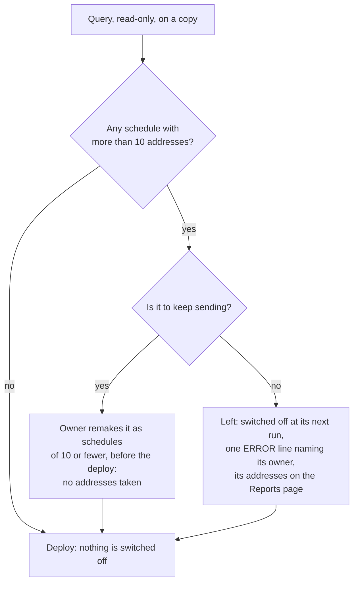

**Also before the update**, on the same copy, check that the two limits on a drag and drop are out of reach of real use. A drop on the board page sends the position of every open card on the board, and a request naming more than 5,000 is refused; a request that moves more than 100 cards to another column is refused (`MAX_REORDER_ENTRIES` and `MAX_CARDS_MOVED_AT_ONCE` in `src/lib/server/card-moves.ts`). Run each query as the one above:

```sql
-- The ten boards with the most open cards, and each one's largest column.
SELECT b.id, b.name, COUNT(c.id) AS open_cards, MAX(per_col.n) AS largest_column
  FROM boards b
  JOIN columns col ON col.board_id = b.id
  LEFT JOIN cards c ON c.column_id = col.id AND c.archived_at IS NULL
  LEFT JOIN (SELECT column_id, COUNT(*) AS n FROM cards WHERE archived_at IS NULL GROUP BY column_id) per_col
    ON per_col.column_id = col.id
 GROUP BY b.id ORDER BY open_cards DESC LIMIT 10;

-- The most cards one person moved to another column on one board within one second
-- (a bulk move writes its entries in the same second).
SELECT user_id, board_id, substr(created_at, 1, 19) AS second, COUNT(*) AS moved
  FROM activity_log WHERE action IN ('card_moved', 'card_completed', 'card_reopened')
 GROUP BY user_id, board_id, second ORDER BY moved DESC LIMIT 5;

-- The newest card's id and how many cards there are: no board can hold more.
SELECT MAX(id) AS newest_card_id, COUNT(*) AS cards, SUM(archived_at IS NULL) AS not_archived FROM cards;
```

If the first query's largest `open_cards` is above 2,500, raise `MAX_REORDER_ENTRIES` before building the image; if the second query's top `moved` is above 50, raise `MAX_CARDS_MOVED_AT_ONCE`. Otherwise both limits are far above what the installation does.

**After the update**, nothing needs doing to the database. Going back to the previous image needs nothing either: no table changed, and the previous image sends a schedule this release switched off only once someone turns it on.

### The Update That Brings Password Checks Off the Server's Thread and Remembered Browsers

The release that checks passwords on worker threads (card 2191), checks a name that is no account as slowly as a real one (2192), writes nothing typed into a failed sign-in line (2193), remembers browsers that have signed in and holds every other browser to one sign-in at a time at an account under attack (2194), counts an IPv6 caller by its /64 (2195) and gives back on a successful sign-in only its own account's attempts (2226) brings no migration file, no change to the schema and no change to the image: no new dependency, no native code. One thing in it acts on what is already stored: at its first start it rewrites the failed sign-in lines already in the system log for names that were no account, so that they no longer hold what was typed. Three of the queries below read those lines in their old form. After the first start, `q1.sql` finds 0; `q2.sql` still lists the old bad-password lines but no longer counts the failures at names that were no account; `q3.sql`'s address query still works, but its name query lumps every rewritten line under one name. So **all three are run before the deploy**. The lines as they were stay only in `docker logs` of the old container and in any log shipper's copy, which this release does not touch.

What changes for the people who use it:

- **During a burst of sign-in attempts**, a sign-in from a browser the server does not know waits its turn, about a tenth of a second for each check ahead of it with two threads, and up to a fifth on a host with one or two CPUs, where there is one. When 150 checks for each thread are already waiting it is answered at once "Sign-in is very busy right now. Wait a minute and try again, or sign in from a browser you have used here before." That is about thirty seconds of checks on a fast host, and can be 60 to 90 seconds on a small one: past the 60 seconds nginx waits for an answer by default (`proxy_read_timeout`), so a proxy left at its default answers `504` to whoever was last in the line. The configuration under [Reverse Proxy — Nginx](#reverse-proxy--nginx) sets 86400 seconds for live updates, and does not cut them off. The hands-on step below times one check on production. An invite's form and set-up are treated the same way. Signed-in people and remembered browsers go ahead of them, but never more than three checks in a row while one of theirs waits, and at most five at a time for any one account (plus the new hash of each password change it completes).
- **A browser that signs in, or signs out, is remembered for that account for a year**, by a cookie sent only to the sign-in page, until the account's password is set again. Signing out does not forget it. At the deploy no browser is remembered: **sign in again, or sign out and in, on each browser you will want during an attack, the superadmin's first.**
- **While an account has had five wrong passwords within 15 minutes of each other, browsers not remembered for it are let in one at a time**, and a second at the same moment is refused at once, "A sign-in with this name is already under way from another browser…". This reverses the previous release's "nobody is refused for it". An attack on one account can keep its owner out of every browser not remembered for it for as long as it lasts: see [If an Attack Keeps an Owner Out](#if-an-attack-keeps-an-owner-out). After an administrator sets a password during an attack, send an invite instead, where mail is set up.
- **The Audit page no longer shows the names people typed that are no account's**: a failed sign-in at one shows only its length, and one at an account names the account and is filed under it. Older lines are rewritten at the first start; backups made before keep them.
- **Everyone on one IPv6 network shares sign-in's ten attempts in 15 minutes**, the request form's limits and the API's count of requests with no key, as an office behind one IPv4 address already does.

**Before the build**, on the host that runs `docker build`, see how many CPUs it has: `docker info --format '{{.NCPU}}'`. The build runs the suite, and with fewer than three the two tests that time real worker threads are skipped (see [The Suite Inside the Image Build](#the-suite-inside-the-image-build)): the build still passes, and the threads are then proved only by the check after the deploy.

**Before the deploy**, on a copy of the database, run the three queries that read the failed sign-in line in its old form. **They must be run before the deploy**: the first start of the new release rewrites the lines they look for. After it `q1.sql` finds 0, `q2.sql` still lists the old bad-password lines but no longer counts the failures at names that were no account, and `q3.sql`'s address query still works but its name query lumps every rewritten line under one name. Copy the database out as for the report schedules above, into a folder only you can read; a missing `-wal` file is expected:

```bash
mkdir -m 700 "$HOME/dumpfire-sign-in"
docker cp "<container>:/app/data/dumpfire.db" "$HOME/dumpfire-sign-in/"
docker cp "<container>:/app/data/dumpfire.db-wal" "$HOME/dumpfire-sign-in/" || echo "No -wal file: expected"
```

The queries hold both kinds of quote, so none of them is run inside double quotes on a command line, where the shell would take the query's own `"` as the end of it. Save each to a file of its own, as `schedules.sql` is above, and run it with:

```bash
sqlite3 -readonly -header -column "$HOME/dumpfire-sign-in/dumpfire.db" < q1.sql
```

or paste it between a quoted heredoc's lines, which the shell leaves exactly as written:

```bash
sqlite3 -readonly -header -column "$HOME/dumpfire-sign-in/dumpfire.db" <<'SQL'
SELECT min(timestamp), max(timestamp) FROM system_logs;
SQL
```

That one says how far back the queries reach: the log keeps its newest 50,000 rows. Every query in this section, these three and the ones after them, is run the same way.

`q1.sql`, the lines the first start will rewrite (keep the count: after the deploy the same query on a new copy should give 0):

```sql
SELECT count(*) AS lines, max(length(message)) AS longest, min(timestamp) AS first
  FROM system_logs
 WHERE message LIKE 'Failed login attempt for "%" from IP %'
   AND message NOT LIKE '% (bad password)';
```

`q2.sql`, addresses with more than ten failed sign-ins in one clock quarter of an hour. Up to twenty can be the edge of a window (a window starts at an address's first attempt, not on the quarter); more than twenty was possible only with a sign-in from the address between them, which this release stops from giving back another account's attempts:

```sql
SELECT replace(substr(message, instr(message, '" from IP ') + 10), ' (bad password)', '') AS address,
       substr(timestamp, 1, 14) || printf('%02d', (CAST(substr(timestamp, 15, 2) AS INTEGER) / 15) * 15) AS quarter,
       count(*) AS failures
  FROM system_logs
 WHERE message LIKE 'Failed login attempt for "%" from IP %'
 GROUP BY address, quarter HAVING failures > 10
 ORDER BY failures DESC LIMIT 20;
```

`q3.sql`, how wrong passwords are spread over addresses and names, if it was not run before the previous release. One address taking nearly every failure means the server reads the proxy's address for everyone (`ADDRESS_HEADER` unset); the second shows how often a real person reaches five in a day:

```sql
SELECT replace(substr(message, instr(message, ' from IP ') + 9), ' (bad password)', '') AS address,
       count(*) AS failures, min(timestamp) AS first, max(timestamp) AS last
  FROM system_logs WHERE message LIKE 'Failed login attempt for %'
 GROUP BY address ORDER BY failures DESC LIMIT 10;

SELECT substr(message, 27, instr(message, '" from IP ') - 27) AS name,
       substr(timestamp, 1, 10) AS day, count(*) AS failures
  FROM system_logs WHERE message LIKE 'Failed login attempt for %'
 GROUP BY name, day ORDER BY failures DESC LIMIT 20;
```

**To know, at any time; nothing waits on them.** How many CPUs the container sees (two worker threads whatever it says, one on one or two CPUs), and how it is told where a caller is (`ADDRESS_HEADER` decides whether IPv6 reaches the counts at all):

```bash
docker exec <container> node -e "console.log(require('node:os').availableParallelism())"
docker inspect -f '{{.HostConfig.NanoCpus}} {{.HostConfig.CpusetCpus}}' <container>
docker exec <container> printenv ADDRESS_HEADER XFF_DEPTH HOST
```

If `NanoCpus` is above `0` and at most `2000000000` (a CPU limit of two or fewer, `--cpus=2` or less), set `PASSWORD_THREADS=1`: the count the server reads may be the host's CPUs and not the container's limit, and two threads then share the limit with the server's own thread. `0` is no limit. A setting is added by making the container again, as under [If an Attack Keeps an Owner Out](#if-an-attack-keeps-an-owner-out).

How long one check takes on production, on the server's CPUs (about half a second of work, with nothing kept). A full line of checks waits 150 times this; above 400 ms, a full line is past the 60 seconds nginx waits for an answer by default:

```bash
docker exec <container> node -e "const b = require('bcryptjs'); const h = b.hashSync('x', 12); const t = Date.now(); b.compareSync('y', h); console.log((Date.now() - t) + ' ms for one check')"
```

The kinds of stored hash. Expect one row, `$2b$12$`: a row with another cost would be accounts whose wrong password takes another time than a name that is no account's.

```sql
SELECT substr(password_hash, 1, 7) AS kind, count(*) AS accounts FROM users GROUP BY kind;
```

What form callers' addresses take. Any `IPv6` row means the /64 changes what production counts; `IPv4 with a port` means every connection has been an allowance of its own:

```sql
SELECT CASE
         WHEN ip IS NULL THEN 'none'
         WHEN ip LIKE '::ffff:%' THEN 'IPv4 written as IPv6'
         WHEN ip GLOB '[0-9]*.[0-9]*.[0-9]*.[0-9]*:[0-9]*' THEN 'IPv4 with a port'
         WHEN ip GLOB '[0-9]*.[0-9]*.[0-9]*.[0-9]*' THEN 'IPv4'
         WHEN instr(ip, ':') > 0 THEN 'IPv6'
         ELSE 'other'
       END AS kind,
       count(*) AS lines, count(DISTINCT ip) AS addresses, min(ip) AS example
  FROM system_logs GROUP BY kind ORDER BY lines DESC;
```

How bursty failed sign-ins have been, a minute at a time; a minute with more than a few dozen is a burst that held the server for seconds before this release:

```sql
SELECT substr(timestamp, 1, 16) AS minute, count(*) AS failures
  FROM system_logs WHERE message LIKE 'Failed login attempt%'
 GROUP BY minute ORDER BY failures DESC LIMIT 10;
```

**After the update**, these confirm it. Make a test account `qs-check` with a known password on the admin page first, and delete it at the end.

| Do | Expect | A fault if |
|----|--------|------------|
| Sign in; on the Audit page's logs, filter `AUTH` | No `Password checks cannot run on worker threads (…)` at `ERROR` after the sign-in: that is the proof the threads started. With `LOG_LEVEL` at `INFO` (the default), `Password checks run on 2 worker thread(s)` (or 1) at `INFO` too; it is written at the first check, before any thread starts, so it says what was asked for, not that a thread ran | The `ERROR` line: checks are then on the server's thread, as before, and nobody is kept out by it |
| Time one check with the `bcryptjs` command under "To know" above | Under 400 ms: a full line of 150 checks a thread waits less than nginx's default 60 seconds | Above 400 ms, behind a proxy whose read timeout is 60 seconds: a sign-in at the back of a full line is answered `504` by the proxy before it is checked. The configuration under [Reverse Proxy — Nginx](#reverse-proxy--nginx) waits 86400 seconds and is not affected |
| On the Account page, change your password and change it back | Both work, and you stay signed in | Any error |
| In a browser signed in since before the deploy, sign out; look at its cookies in the developer tools | `dumpfire_known_<your id>`, path `/login`, HttpOnly | None, or path `/` |
| Sign in as `qs-check` | The same cookie for its id | None |
| On the sign-in page, type `qs-check`'s password into the name box and anything as the password; read the newest `AUTH` warning | `Failed login attempt for a name that is no account (N characters) from IP …` | Any of the password in the line |
| A wrong password at `qs-check` | `Failed login attempt at "qs-check" (user <id>) from IP … (bad password)` | The name as typed, or no address |
| `q1.sql` above, on a new copy | `0` lines | Any line left |

Then sign in again, or sign out and in, on every browser you will want during an attack, the superadmin's first, so that each is remembered.

**Going back to the previous image** needs nothing done to the database: no table changed. The previous image ignores the `dumpfire_known_<id>` cookies and checks passwords on the server's thread again; the log lines this release rewrote stay rewritten. It leaves the `known_browser_secret` row in `settings`, and **its backups would hold that row**, since it does not know to take it out: after going back, delete it with the command under [If an Attack Keeps an Owner Out](#if-an-attack-keeps-an-owner-out). This release makes a new one when it is deployed again, and every browser is remembered again at its next sign-in.

### The Update That Brings the Content-Security-Policy

The release that checks every colour from a request and gives every page a
Content-Security-Policy (card 2162), cleans Markdown one way for descriptions and comments
(2202), serves the Inter font from DumpFire (2203) and draws mentions in text only (2210)
brings no migration file and no change to the schema. Nothing stored is changed. The image
gains seven font files and a licence text; `jsdom`, which only the tests use, is a
development dependency and is pruned from the image with the rest.

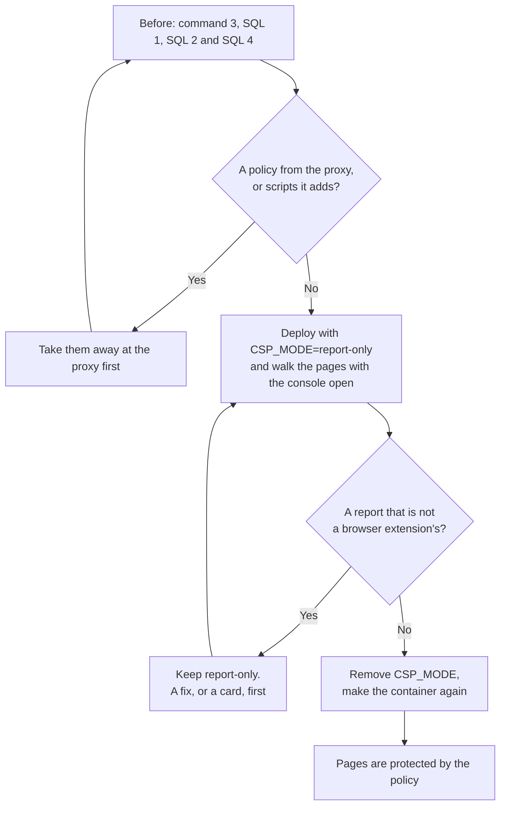

What changes for the people who use it, and for API callers:

- **Every page loads the font from DumpFire, and no page asks Google, or any other site, for
  anything.** Until now every page, the sign-in page included, loaded Inter from Google's
  font service, which told Google the address of whoever opened DumpFire, and when. The
  files are the ones Google served, byte for byte, so nothing looks different. They are
  fetched once from `/_app/immutable/assets/` and cached for a year; the licence is served
  at `/licences/inter-OFL.txt`.
- **A colour sent to the API is `#rrggbb` or it is refused.** Every operation that takes
  `color` or `colorTag`, in both trees, answers `400` `color must be a colour written #rrggbb`
  (for a colour tag `colorTag must be a colour written #rrggbb, or empty`) for anything
  else, `red` and `#fff` included, where any text was stored. The pages send only
  `#rrggbb`. Through the tracking wrapper, quote the colour, `-Color '#ef4444'`: an unquoted
  `#` begins a PowerShell comment, so `-Color #ef4444` sends nothing and the call stops with
  "Missing an argument for parameter 'Color'".
- **A stored colour that is more than a colour is drawn grey** (`#94a3b8`) until someone
  picks it a colour; every other stored colour looks as it did, one with spaces around it
  included. SQL 1 below lists them. How a grey one is fixed depends on what it colours: a
  label's, a category's, a column's or a board grouping's by picking a colour in its own
  colour picker; a card's or a subtask's colour tag has no control on the page, so only
  through the API, with the wrapper `update-card` or `update-subtask` with
  `-ColorTag '#rrggbb'` or `-ColorTag none` to clear it. Renaming any of them sends the old
  value back unchanged, and it is kept, grey or not.
- **A description or comment is drawn without style, a borrowed class, SVG or MathML, a
  form, a dialog or popover, an image map, a `<template>`, or the `srcset`, `background` and
  `poster` attributes**, and **an image from another site, or from any address on DumpFire
  but a card attachment's, shows as a link** reading 🖼 and its alt text, which opens the
  picture's address.
  Stored text is not changed. SQL 2 and SQL 4 below count what will look different.
- **An email address in a comment is a working link**, and a link's tooltip and an image's
  description no longer show chip markup. A mention inside code or link text is still drawn
  as a chip, because it is still mailed.
- **Pages are protected by the policy only once `CSP_MODE` is removed.** The colour rule and
  the Markdown rules protect them from the first deploy.

**Before the deploy.** The commands in this section are written for Git Bash or the Docker
host's shell, not PowerShell (where `curl` is another command: use `curl.exe`, and the
heredocs below do not work), and the database queries need `sqlite3` installed on that
host. Command 3 reads the public sign-in page and nothing else. Put your own address in
`SITE`:

```bash
SITE=https://dumpfire.example.com
curl -s -D - -o login.html "$SITE/login" | grep -i -E "^(server|cf-ray|content-security-policy)"
grep -c -i -E "cdn-cgi|rocket|cloudflareinsights|data-cf" login.html
grep -c "<script" login.html
grep -c -i -E "fonts\.(googleapis|gstatic)\.com" login.html
```

Expected before the deploy: no `content-security-policy` line, `0`, `2` (the theme script
and SvelteKit's) and `3` (the old font links).

- **A `content-security-policy` line means the proxy sends a policy of its own**, which
  browsers would enforce beside DumpFire's, and which, holding no page's nonce, would stop
  every page's scripts: take it away at the proxy before the deploy. See
  [Security Headers From the Proxy](#security-headers-from-the-proxy).
- **A count above `0` on the second line means the front may put scripts into pages**
  (Cloudflare's Rocket Loader, its automatic Web Analytics beacon). It counts words such as
  `data-cf`, not scripts, so it does not say the policy will refuse anything: read the
  console in the report-only trial below, and turn that feature off only if a report names
  it. **More than two scripts** means one was put in: the trial's console says whether the
  policy refuses it, and the same rule holds.

Then, on a copy of the database, three read-only queries say how much of production each
rule reaches. None changes anything, and nothing waits on their answers. Copy the database
out as for the sign-in queries above, into a folder only you can read; a missing `-wal` file
is expected:

```bash
mkdir -m 700 "$HOME/dumpfire-csp"
docker cp "<container>:/app/data/dumpfire.db" "$HOME/dumpfire-csp/"
docker cp "<container>:/app/data/dumpfire.db-wal" "$HOME/dumpfire-csp/" || echo "No -wal file: expected"
```

Run each by pasting it between a quoted heredoc's lines, which the shell leaves exactly as
written:

```bash
sqlite3 -readonly -header -column "$HOME/dumpfire-csp/dumpfire.db" <<'SQL'
<the query>
SQL
```

**SQL 1: stored colours that are not `#rrggbb`, by table and value, and how each will be
drawn.** Its `CASE` is `isSafeColour` in `src/lib/colours.ts`, written in SQL, on the value
with its leading and trailing spaces, tabs and line breaks trimmed, as `drawnColour` trims
it: the two change together.

```sql
SELECT t, value, n, CASE WHEN v = '' THEN 'no colour' WHEN (v GLOB '#*' AND length(v) IN (4, 5, 7, 9) AND substr(v, 2) NOT GLOB '*[^0-9A-Fa-f]*') OR (length(v) BETWEEN 1 AND 30 AND v NOT GLOB '*[^A-Za-z]*') OR (lower(v) GLOB 'var(--?*)' AND substr(v, 7, length(v) - 7) NOT GLOB '*[^A-Za-z0-9-]*') THEN 'drawn as stored' ELSE 'drawn grey' END AS drawn FROM (SELECT t, value, n, trim(value, char(32, 9, 10, 12, 13)) AS v FROM (SELECT 'labels' AS t, color AS value, COUNT(*) AS n FROM labels GROUP BY color UNION ALL SELECT 'categories', color, COUNT(*) FROM categories GROUP BY color UNION ALL SELECT 'board_categories', color, COUNT(*) FROM board_categories GROUP BY color UNION ALL SELECT 'columns', color, COUNT(*) FROM columns GROUP BY color UNION ALL SELECT 'cards.color_tag', color_tag, COUNT(*) FROM cards WHERE color_tag <> '' GROUP BY color_tag UNION ALL SELECT 'subtasks.color_tag', color_tag, COUNT(*) FROM subtasks WHERE color_tag <> '' GROUP BY color_tag)) WHERE value NOT GLOB '#[0-9A-Fa-f][0-9A-Fa-f][0-9A-Fa-f][0-9A-Fa-f][0-9A-Fa-f][0-9A-Fa-f]' ORDER BY t, n DESC
```

No rows: nothing changes on any page, and no stored value was ever more than a colour. A row
"drawn grey": that item shows grey after the deploy; one whose value holds `url(` is
evidence the fault was used. A row "drawn as stored" (`red`, `#fff`): it looks as it does
now, and an API caller that sent it will be refused the next time.

**SQL 2: descriptions and comments with an image, a `<style>` element or a style
attribute.**

```sql
SELECT 'cards' AS t, COUNT(*) AS rows_with_any, SUM(description LIKE '% are dropped and
drawn as their text alone; a Markdown task list, `- [ ]` and `- [x]`, keeps its boxes. An
image on DumpFire's own address that is not a card attachment (``, ``)
is drawn as a link too, and no column counts it: read the rows with `![` or ` 2>&1` has
   `[WARN] [STARTUP] CSP_MODE=report-only: pages are sent the Content-Security-Policy to report only, not to enforce; remove CSP_MODE once the trial is over. See docs/deployment.md.`
2. Command 3 again: the header line is now `content-security-policy-report-only`, the font
   count is `0`, and the script count is still `2`.
3. With the browser's console open, walk the pages: `/login`; `/`; a board; a card's window,
   its description, its comments and its attachment image; `/all`; `/plan` and a plan, with
   its PDF button; `/burndown`; `/graph`; `/reports`, previewing a PDF; `/admin`; `/audit`,
   whose live log runs; `/account`; `/teams`; `/inbox`; `/archived`; `/docs`; a path that is
   no page; and, signed out, `/request`, an invite link, and a request's confirm and reply
   pages. Choose the dark theme and reload: no flash of the light one. Move a card with the
   board open in a second browser: it moves there within a moment. In the network tab, Inter
   comes from `/_app/immutable/assets/inter-latin-wght-normal-<hash>.woff2` and no request
   goes to any Google host.
4. Preview a report's PDF in every browser family the team uses (Chrome or Edge, Firefox,
   Safari). How a browser's PDF viewer meets the policy differs by family. **If the preview
   fails in one of them, `CSP_MODE` stays `report-only`** and the preview gets its own card;
   the report's Download button is not affected.
5. Use DumpFire as usual for one working day with the console open. Nothing is collected
   from anyone else's browser: the trial is what an open console shows.

**Reading a report.** In report-only mode the console names what the policy would have
refused, beginning `[Report Only]`, and refuses nothing. A report whose source is
`chrome-extension:` or `moz-extension:` comes from a browser extension (a password manager,
a dark-mode extension), not from DumpFire, and does not hold up the next step. Any other
report is either a page the policy breaks, for a build that allows its source, or a script
the front puts into pages, for that feature to be turned off: deal with it before enforcing.

**Then enforce.** Remove `CSP_MODE` and make the container again: `docker restart` cannot
take a setting away, so stop it, remove it (the database and the uploads are on the volume
and stay) and run it with its first command, without the setting; in Compose, take the line
out and run `docker compose up -d`. The start log then has no `CSP_MODE` line, command 3's
header line is `content-security-policy`, and step 3's walk works as before. A policy line
in the console now means something was refused: a fault to report.

**If enforcing breaks a page**, it can be undone without changing the image: set
`CSP_MODE=report-only` again and make the container again the same way (stop, remove, run
with the setting, or put the line back and `docker compose up -d`). The start log has the
`CSP_MODE=report-only` line again and the policy refuses nothing. Once the fault is fixed,
walk step 3 again, then remove the setting as above.

**If an embedded request form is used**, open the page of the other site that frames it: the
form still shows, since the policy has no `frame-ancestors`.

**Going back to the previous image** needs nothing done to the database: no table changed.
The previous image takes any colour again, draws Markdown with DOMPurify's defaults, and
loads the font from Google; it does not read `CSP_MODE`.

### The Update That Brings Migration 0053, One Timestamp Form and the Attachment File Sweep

Three cards go out together: card 2106 brings migration `0053_index_foreign_keys_end_sessions.sql`, which indexes every foreign key column and **signs everybody out once**; card 2095 stores every timestamp in one form and **converts the timestamps production holds**, at the first start; card 2107 **sweeps attachment files that no row names** into the trash, and the first sweep moves a backlog. Each changes what the owner or users see. The review of the three brought migration `0054_index_user_time_end_unused_invites.sql` into the same release: it makes the log's index on `user_id` one on `user_id` and `created_at`, and **ends every invite not yet used, once**. Card 2158's migration 0055, which replaces every request link once, may go out in the same image: see [The Update That Brings Migration 0055](#the-update-that-brings-migration-0055-secrets-out-of-backups-and-request-mail-to-the-accounts-address) for its own checks.

> ⚠️ **0053 must not be deployed before card 2135**, which takes sessions out of backups. Both are in this tree: one image carrying both is fine. An image with 0053 and without card 2135 would let sessions made after the deploy leave in the next backup, and the one sign-out would be spent. The sweep needs card 2007's trash, which is in this tree too.

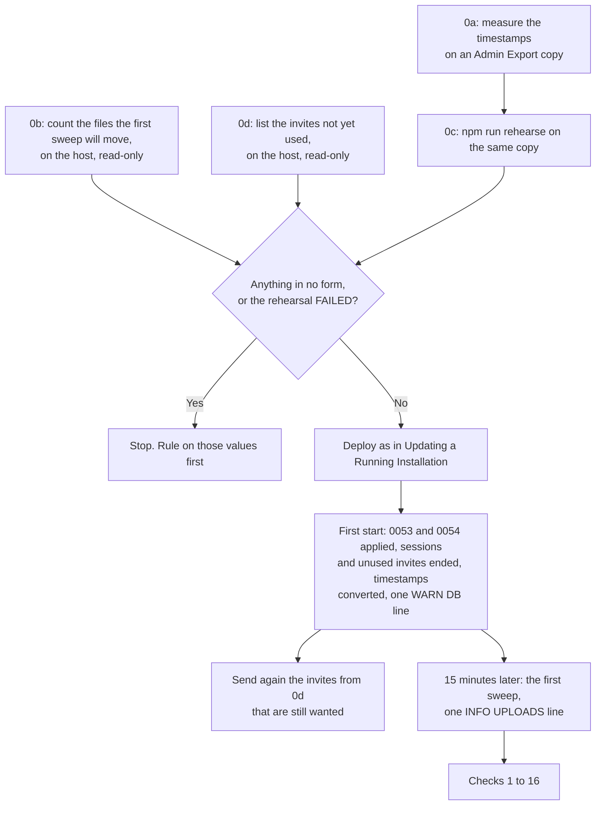

#### Before the deploy: checks 0a, 0b, 0c and 0d

Run all four before the deploy, on a workstation with the new code checked out and on the host. None of them writes anything.

**Check 0a: what form each timestamp column holds on production.** Download a backup with Admin → Export, onto a workstation with the repository checked out, and keep it as secret as the server: it holds every password hash. Save the SQL below as `measure-timestamps.sql` beside it, and run, from the repository folder (so that `better-sqlite3` is found), with the backup's path in place of `<copy.db>`:

```
node -e "const D=require('better-sqlite3');const fs=require('fs');const db=new D(process.argv[1],{readonly:true,fileMustExist:true});console.table(db.prepare(fs.readFileSync(process.argv[2],'utf8')).all())" <copy.db> measure-timestamps.sql
```

The file is opened read-only and must exist; the statement is one `SELECT`. It prints 41 rows, one per column, with zeros for an empty table. `cards.first_completed_at` is left out, because a production database at migration 0049 does not have it yet (0050 fills it from `completed_at`). An export made by the image now on production, from before card 2135, holds the sessions of its day, so the two `sessions` rows count them (one made by this release's image holds none, and they read 0); either way they do not matter, because 0053 ends them all.

```sql
-- Card 2095: which form each timestamp column holds. Read-only: one SELECT, nothing is written.
WITH cols(kind, tbl, col) AS (VALUES
  ('timestamp', 'activity_log', 'created_at'),
  ('timestamp', 'api_keys', 'last_used_at'),
  ('timestamp', 'api_keys', 'expires_at'),
  ('timestamp', 'api_keys', 'created_at'),
  ('timestamp', 'backup_log', 'created_at'),
  ('timestamp', 'board_favourites', 'created_at'),
  ('timestamp', 'boards', 'created_at'),
  ('timestamp', 'boards', 'updated_at'),
  ('timestamp', 'card_attachments', 'created_at'),
  ('timestamp', 'card_comments', 'created_at'),
  ('timestamp', 'card_comments', 'updated_at'),
  ('timestamp', 'card_dependencies', 'created_at'),
  ('timestamp', 'card_templates', 'created_at'),
  ('timestamp', 'cards', 'completed_at'),
  ('timestamp', 'cards', 'archived_at'),
  ('timestamp', 'cards', 'created_at'),
  ('timestamp', 'cards', 'updated_at'),
  ('timestamp', 'invite_tokens', 'expires_at'),
  ('timestamp', 'invite_tokens', 'created_at'),
  ('timestamp', 'milestones', 'created_at'),
  ('timestamp', 'milestones', 'updated_at'),
  ('timestamp', 'report_schedules', 'last_run_at'),
  ('timestamp', 'report_schedules', 'next_run_at'),
  ('timestamp', 'report_schedules', 'created_at'),
  ('timestamp', 'report_schedules', 'updated_at'),
  ('timestamp', 'request_messages', 'created_at'),
  ('timestamp', 'sessions', 'expires_at'),
  ('timestamp', 'sessions', 'created_at'),
  ('timestamp', 'system_logs', 'timestamp'),
  ('timestamp', 'task_requests', 'created_at'),
  ('timestamp', 'task_requests', 'resolved_at'),
  ('timestamp', 'teams', 'created_at'),
  ('timestamp', 'token_usage', 'created_at'),
  ('timestamp', 'users', 'created_at'),
  ('timestamp', 'webhooks', 'created_at'),
  ('timestamp', 'work_dependencies', 'created_at'),
  ('date', 'cards', 'due_date'),
  ('date', 'cards', 'next_recurrence'),
  ('date', 'daily_snapshots', 'date'),
  ('date', 'milestones', 'target_date'),
  ('date', 'subtasks', 'due_date')
),
v(kind, tbl, col, val) AS (
  SELECT 'timestamp', 'activity_log', 'created_at', "created_at" FROM "activity_log"
  UNION ALL SELECT 'timestamp', 'api_keys', 'last_used_at', "last_used_at" FROM "api_keys"
  UNION ALL SELECT 'timestamp', 'api_keys', 'expires_at', "expires_at" FROM "api_keys"
  UNION ALL SELECT 'timestamp', 'api_keys', 'created_at', "created_at" FROM "api_keys"
  UNION ALL SELECT 'timestamp', 'backup_log', 'created_at', "created_at" FROM "backup_log"
  UNION ALL SELECT 'timestamp', 'board_favourites', 'created_at', "created_at" FROM "board_favourites"
  UNION ALL SELECT 'timestamp', 'boards', 'created_at', "created_at" FROM "boards"
  UNION ALL SELECT 'timestamp', 'boards', 'updated_at', "updated_at" FROM "boards"
  UNION ALL SELECT 'timestamp', 'card_attachments', 'created_at', "created_at" FROM "card_attachments"
  UNION ALL SELECT 'timestamp', 'card_comments', 'created_at', "created_at" FROM "card_comments"
  UNION ALL SELECT 'timestamp', 'card_comments', 'updated_at', "updated_at" FROM "card_comments"
  UNION ALL SELECT 'timestamp', 'card_dependencies', 'created_at', "created_at" FROM "card_dependencies"
  UNION ALL SELECT 'timestamp', 'card_templates', 'created_at', "created_at" FROM "card_templates"
  UNION ALL SELECT 'timestamp', 'cards', 'completed_at', "completed_at" FROM "cards"
  UNION ALL SELECT 'timestamp', 'cards', 'archived_at', "archived_at" FROM "cards"
  UNION ALL SELECT 'timestamp', 'cards', 'created_at', "created_at" FROM "cards"
  UNION ALL SELECT 'timestamp', 'cards', 'updated_at', "updated_at" FROM "cards"
  UNION ALL SELECT 'timestamp', 'invite_tokens', 'expires_at', "expires_at" FROM "invite_tokens"
  UNION ALL SELECT 'timestamp', 'invite_tokens', 'created_at', "created_at" FROM "invite_tokens"
  UNION ALL SELECT 'timestamp', 'milestones', 'created_at', "created_at" FROM "milestones"
  UNION ALL SELECT 'timestamp', 'milestones', 'updated_at', "updated_at" FROM "milestones"
  UNION ALL SELECT 'timestamp', 'report_schedules', 'last_run_at', "last_run_at" FROM "report_schedules"
  UNION ALL SELECT 'timestamp', 'report_schedules', 'next_run_at', "next_run_at" FROM "report_schedules"
  UNION ALL SELECT 'timestamp', 'report_schedules', 'created_at', "created_at" FROM "report_schedules"
  UNION ALL SELECT 'timestamp', 'report_schedules', 'updated_at', "updated_at" FROM "report_schedules"
  UNION ALL SELECT 'timestamp', 'request_messages', 'created_at', "created_at" FROM "request_messages"
  UNION ALL SELECT 'timestamp', 'sessions', 'expires_at', "expires_at" FROM "sessions"
  UNION ALL SELECT 'timestamp', 'sessions', 'created_at', "created_at" FROM "sessions"
  UNION ALL SELECT 'timestamp', 'system_logs', 'timestamp', "timestamp" FROM "system_logs"
  UNION ALL SELECT 'timestamp', 'task_requests', 'created_at', "created_at" FROM "task_requests"
  UNION ALL SELECT 'timestamp', 'task_requests', 'resolved_at', "resolved_at" FROM "task_requests"
  UNION ALL SELECT 'timestamp', 'teams', 'created_at', "created_at" FROM "teams"
  UNION ALL SELECT 'timestamp', 'token_usage', 'created_at', "created_at" FROM "token_usage"
  UNION ALL SELECT 'timestamp', 'users', 'created_at', "created_at" FROM "users"
  UNION ALL SELECT 'timestamp', 'webhooks', 'created_at', "created_at" FROM "webhooks"
  UNION ALL SELECT 'timestamp', 'work_dependencies', 'created_at', "created_at" FROM "work_dependencies"
  UNION ALL SELECT 'date', 'cards', 'due_date', "due_date" FROM "cards"
  UNION ALL SELECT 'date', 'cards', 'next_recurrence', "next_recurrence" FROM "cards"
  UNION ALL SELECT 'date', 'daily_snapshots', 'date', "date" FROM "daily_snapshots"
  UNION ALL SELECT 'date', 'milestones', 'target_date', "target_date" FROM "milestones"
  UNION ALL SELECT 'date', 'subtasks', 'due_date', "due_date" FROM "subtasks"
),
f AS (
  SELECT kind, tbl, col, val,
    CASE
      WHEN val IS NULL THEN 'null'
      WHEN typeof(val) <> 'text' THEN 'not_text'
      WHEN val GLOB '[0-9][0-9][0-9][0-9]-[0-9][0-9]-[0-9][0-9] [0-9][0-9]:[0-9][0-9]:[0-9][0-9]' THEN 'space'
      WHEN val GLOB '[0-9][0-9][0-9][0-9]-[0-9][0-9]-[0-9][0-9] [0-9][0-9]:[0-9][0-9]:[0-9][0-9]?*' THEN 'space_more'
      WHEN val GLOB '[0-9][0-9][0-9][0-9]-[0-9][0-9]-[0-9][0-9]T[0-9][0-9]:[0-9][0-9]:[0-9][0-9].[0-9][0-9][0-9]Z' THEN 'iso_ms_z'
      WHEN val GLOB '[0-9][0-9][0-9][0-9]-[0-9][0-9]-[0-9][0-9]T[0-9][0-9]:[0-9][0-9]:[0-9][0-9]Z' THEN 'iso_z'
      WHEN val GLOB '[0-9][0-9][0-9][0-9]-[0-9][0-9]-[0-9][0-9]T*' THEN 'iso_other'
      WHEN val GLOB '[0-9][0-9][0-9][0-9]-[0-9][0-9]-[0-9][0-9]' THEN 'date_only'
      ELSE 'neither'
    END AS form
  FROM v
)
SELECT cols.kind, cols.tbl AS "table", cols.col AS "column",
  COUNT(f.form) AS total,
  COALESCE(SUM(f.form = 'null'), 0) AS null_values,
  COALESCE(SUM(f.form = 'space'), 0) AS space_form,
  COALESCE(SUM(f.form = 'iso_ms_z'), 0) AS iso_ms_z,
  COALESCE(SUM(f.form = 'iso_z'), 0) AS iso_z,
  COALESCE(SUM(f.form = 'iso_other'), 0) AS iso_other,
  COALESCE(SUM(f.form = 'space_more'), 0) AS space_more,
  COALESCE(SUM(f.form = 'date_only'), 0) AS date_only,
  COALESCE(SUM(f.form = 'not_text'), 0) AS not_text,
  COALESCE(SUM(f.form = 'neither'), 0) AS neither,
  MIN(CASE WHEN f.form IN ('iso_other', 'space_more', 'not_text', 'neither') THEN f.val END) AS example_unexpected,
  MIN(CASE WHEN f.form = 'space' THEN f.val END) AS first_space,
  MAX(CASE WHEN f.form = 'space' THEN f.val END) AS last_space,
  MIN(CASE WHEN f.form LIKE 'iso%' THEN f.val END) AS first_iso,
  MAX(CASE WHEN f.form LIKE 'iso%' THEN f.val END) AS last_iso
FROM cols LEFT JOIN f ON f.kind = cols.kind AND f.tbl = cols.tbl AND f.col = cols.col
GROUP BY cols.kind, cols.tbl, cols.col
ORDER BY cols.kind DESC, cols.tbl, cols.col;
```

What to read in the result:

| Column of the result | Expected | If not |
|---|---|---|
| `neither`, `not_text`, `space_more`, `iso_other` | 0 everywhere | Each such value is ruled on before the deploy. The new code leaves such a value as it is and reports it at every start; it does not stop the server |
| The 22 columns written by SQL defaults | `space_form` = `total` − `null_values` | ISO 8601 there came from a restore or an import. The first start converts it; nothing to rule |
| The 4 mixed columns (`updated_at` of `cards`, `boards`, `milestones`, `report_schedules`) and the 10 written as ISO 8601 | Any mix of `space_form` and `iso_ms_z` | Nothing to rule: this is what the first start converts |
| The five `date` rows | `date_only` or `null_values` only | A date column holding a timestamp is outside this release: note it and rule on it |

**Check 0b: what the first sweep will move.** On the host, against the live database, read-only: it opens the database read-only and only lists folders.

```bash
docker exec -i dumpfire node - <<'EOF'
const fs = require('fs'), path = require('path');
const dbPath = process.env.DB_PATH || 'dumpfire.db';
const db = require('better-sqlite3')(dbPath, { readonly: true, fileMustExist: true });
const named = new Set(db.prepare('SELECT card_id, filename FROM card_attachments').all().map((r) => (r.card_id + '/' + r.filename).toLowerCase()));
const highest = db.prepare('SELECT MAX(COALESCE((SELECT seq FROM sqlite_sequence WHERE name = ?), 0), COALESCE((SELECT MAX(id) FROM cards), 0)) AS n').get('cards').n;
const up = path.join(path.dirname(path.resolve(dbPath)), 'uploads');
let files = 0, unnamed = 0, bytes = 0;
const above = [], notCardFolders = [];
for (const d of fs.existsSync(up) ? fs.readdirSync(up) : []) {
  if (d === '.trash') continue;
  if (!/^[1-9][0-9]*$/.test(d) || !fs.lstatSync(path.join(up, d)).isDirectory()) { notCardFolders.push(d); continue; }
  if (Number(d) > highest) { above.push(d); continue; }
  for (const f of fs.readdirSync(path.join(up, d))) {
    const st = fs.lstatSync(path.join(up, d, f));
    if (!st.isFile()) continue;
    files++;
    if (!named.has((d + '/' + f).toLowerCase())) { unnamed++; bytes += st.size; }
  }
}
console.log(files + ' files in card folders; ' + unnamed + ' named by no attachment (' + (bytes / 1048576).toFixed(1) + ' MB)');
console.log('Highest card id this database has issued: ' + highest);
console.log(above.length + ' folder(s) numbered above it: ' + (above.join(', ') || 'none'));
console.log(notCardFolders.length + ' name(s) that are not a card folder: ' + (notCardFolders.join(', ') || 'none'));
EOF
```

The script is fed to `node -` on its standard input (hence `-i`), between `<<'EOF'` and `EOF`: the quotes round the first `EOF` stop the shell reading anything in it, so its `!` and `$` reach Node as written. Inside `node -e "…"`, an interactive bash would read each `!` as a history command and stop with `event not found`.

It prints a count and a size; the highest card id this database has issued, which is the larger of the `cards` counter and the highest id in use, as the sweep reads it; the folders numbered above that id; and the names in the uploads folder that are not a card's folder (`.trash` aside). It reads a card's folder and a named file as the sweep does: a whole number with no leading zero, and a name in any case. It does not leave out a file changed in the last day, which the sweep leaves alone, so the first sweep's count can be a little lower. Every file it counts as named by no attachment is moved to the trash by the first sweep and removed 30 days later, unless an Import Backup puts it back first. If the count is large, take a copy of the uploads folder first ([Backing up and restoring the files](#backing-up-and-restoring-the-files)).

Rule on the two lists before the deploy. The sweep leaves each of them alone and names it in a `WARN` line at every run:

- **A folder numbered above the highest card id** was made by another database, since ids are never used twice: most often a scratch database started beside this one (see [The sweep](#the-sweep-files-no-attachment-names)). Find whose it is, and move it out of `uploads/` if it is not this installation's.
- **A name that is not a card folder** (`notes`, `07`, `.DS_Store`, a stray file) is moved out of `uploads/`, or kept and its `WARN` line accepted. A `lost+found` at the root of a file system mounted at `uploads/` cannot be moved.

**Check 0c: the rehearsal.** `npm run rehearse -- <export.db>`, on the same export, with the new code (see [Testing](testing.md#rehearsing-the-runner-against-a-copy-of-a-real-database)). Expect:

- `Migration files applied` lists `0053_index_foreign_keys_end_sessions.sql` and `0054_index_user_time_end_unused_invites.sql` (and `0055_replace_request_links.sql`, in an image that carries it: see [its section](#the-update-that-brings-migration-0055-secrets-out-of-backups-and-request-mail-to-the-accounts-address)), and `PASSED`.
- `Timestamps converted to the stored form (YYYY-MM-DD HH:MM:SS, UTC): N`, with a line for each column and its count: the conversion the first start will make, measured by the code that will make it. The second run converts none.
- No `Timestamps in no form the conversion can read` lines. Any there is the same finding as a non-zero `neither` in check 0a, and is ruled on before the deploy.
- `The first run took …`: what the first start adds before it listens, index creation and conversion included. Measured in memory, the 39 indexes took 30 ms on 20,000 cards.
- If the export held sessions (one made before card 2135 does), a note under `Worth knowing`: `sessions had N row(s) and has 0: every row deleted by 0053_index_foreign_keys_end_sessions.sql, a one-off declared in tests/rehearsal/one-offs.ts`. That is expected, not a failure.
- If it held invites not yet used (one made before card 2135 does), a note the same way: `invite_tokens had N row(s) and has M: every unused invite deleted by 0054_index_user_time_end_unused_invites.sql, a one-off declared in tests/rehearsal/one-offs.ts`. Expected, not a failure.

It is a fault if it prints `FAILED`, if 0053 or 0054 is not among the files applied, or if a second run converts anything.

**Check 0d: the invites the deploy ends.** On the host, against the live database, read-only. 0054 deletes every invite not yet used, so this lists them, with the account each was for, for you to send again the ones still wanted once the deploy is done:

```bash
docker exec dumpfire node -e "
const db = require('better-sqlite3')(process.env.DB_PATH || 'dumpfire.db', { readonly: true, fileMustExist: true });
console.table(db.prepare('SELECT u.username, u.email, i.created_at, i.expires_at FROM invite_tokens i JOIN users u ON u.id = i.user_id WHERE i.used = 0 ORDER BY i.created_at').all());
"
```

It prints one row for each invite not yet used, expired or not: the account's name and address, and when the invite was made and when it expires, in UTC. Nothing to rule on: keep the list. An invite whose `expires_at` has passed was dead already. One still to come stops working at the deploy; send it again from User Management (📧) afterwards, which mails the account a new link.

#### What changes at the first start

- **Everybody is signed out, once, the owner included.** 0053's last statement deletes every session. Each browser goes to the sign-in page at its next request. API keys, invites and requesters' links are untouched by 0053 (0054 ends unused invites, and 0055 replaces requesters' links). Until a browser signs in again, each request it makes with its old cookie writes one `[WARN] [AUTH]` line, `Session validation failed — token not in DB (deleted or never issued)`: a few lines a browser, one for each open tab's next call and one for the sign-in page. A later start deletes nothing. Why: [Every Session Ended Once](authentication-security.md#every-session-ended-once-by-migration-0053).
- **Every invite not yet used is ended, once.** 0054's last statement deletes them. A backup made before card 2135 holds every unused invite of its day, and an unused invite sets its account's password until it expires, at most seven days after it was made; ending them all makes the tokens in those copies worthless. Each link then shows the page for a link that no longer works. Send again, from User Management, the invites check 0d listed that are still wanted. Used invites, accounts and API keys are untouched, and a later start deletes nothing. Why: [Every Unused Invite Ended Once](authentication-security.md#every-unused-invite-ended-once-by-migration-0054).
- **39 indexes are created**, one of them as 0054 makes it. It adds little to the first start (30 ms on 20,000 cards, in memory), and a permanent delete of a large board takes milliseconds instead of seconds (48 ms against 9.4 s, measured on a board of 2,000 cards).
- **A person's log entries are indexed by person and time.** 0054 drops 0053's index on `activity_log.user_id` and creates one on `user_id` and `created_at`. The audit routes filtered by a person (`/api/audit`, `/api/v1/audit-log`) read that person's newest entries straight from it and stop at the page, where they sorted every entry of the person's (with a board or a card filtered as well, they read that board's or card's entries by its own index instead); `/api/v1/me/stats` reads only the last 7 or 30 days of them. The activity report filtered by a person looks each card's entries and comments up by card: with an index on `user_id`, SQLite had read every entry of the person's once for each card (4,215 ms against 9 ms on 2,000 cards and 60,000 entries). No answer changes.
- **Timestamps are converted.** The values of up to 16 columns are rewritten to `YYYY-MM-DD HH:MM:SS` in UTC, each naming the same moment to the second, and one `[WARN] [DB] N timestamp(s) converted to the stored form …` line names each column and its count. API callers see every timestamp in ISO 8601 with `Z` from now on: see the [API Reference](api-reference.md#timestamps).
- **The first sweep**, 15 minutes after the first start where the schedulers run, moves every file left by permanent deletes made before card 2007, and any other file no row names that is more than a day old, to `uploads/.trash/`, and says so in one `[INFO] [UPLOADS]` line. They are removed 30 days later.

#### After the deploy

| # | Do | Account and data | Expect | A fault if |
|---|---|---|---|---|
| 1 | Open DumpFire in a browser that was signed in | Any account | The sign-in page; signing in works | Still signed in, or signing in fails |
| 2 | Call `GET /api/v1/me` with an existing API key | A key made before the deploy | `200` | `401` |
| 2b | Open the link of an invite sent before the deploy and not yet used | Any invite check 0d listed | The page for a link that no longer works; a new invite sent from User Management works | The old link sets a password |
| 3 | Read the start's log | Host | `Applied migration: 0053_index_foreign_keys_end_sessions.sql` and `Applied migration: 0054_index_user_time_end_unused_invites.sql`; no `[ERROR] [DB]` line | Any `[ERROR] [DB]` (the indexes differ from the model, or a timestamp could not be read) |
| 4 | On a copy, permanently delete the largest board | The superadmin on an instance that is not production | It is gone within about a second | Several seconds, the page waiting |
| 5 | Read the first start's log, then restart and read it again | Host | First: one `[WARN] [DB]` line naming the columns converted and their counts. Second: none | A line at the second start, or an `ERROR` naming values it cannot read |
| 6 | Open a board's archive panel | An editor; a board with an archived card | "Archived 14 Oct" | "Archived Invalid Date" |
| 7 | On the dashboard, sort boards by last activity, after editing a card on the board that was last | Any user | That board first, with "just now" | Another order, or a wrong time |
| 8 | `GET /api/v1/cards/{id}` for a completed card | API key | `completedAt`, `createdAt` and `updatedAt` in the form `YYYY-MM-DDTHH:MM:SS.000Z` | Any of them `YYYY-MM-DD HH:MM:SS` |
| 8b | Export a board as CSV and open it in a spreadsheet | An editor | "Created" and "Completed" as `YYYY-MM-DD HH:MM:SS` (UTC), opened as dates | A `T` or a `Z`, or text the spreadsheet does not read as a date |
| 9 | Reports page, a custom range with today as both start and end | Any user; a card created and one completed today | Both counted | Either missing |
| 10 | Audit page, from today to today | An administrator | Today's entries, the last minute's included | Missing entries |
| 11 | Account page, the API key list | Any user with a key | "Created" shows the right day; "Last used" a time just past | A day off, or Invalid Date |
| 12 | `GET /api/v1/audit-log?from=yesterday` (literally the word) | API key | `400` naming `from` | `200` |
| 13 | On an instance that is not production, Import Backup of a backup taken before the deploy, then restart | The superadmin | One `[WARN] [IMPORT] N timestamp(s) the backup held in another form were converted …` line after the import; no conversion line at the restart | A line at the restart |
| 14 | On a test instance with data of its own (not a copy of production), started with `SCHEDULERS=on`: put `stray.txt` in `uploads/<id of an existing card>/` and age it with `touch -d '2 days ago'`; put `fresh.txt` beside it; put another aged `stray.txt` in `uploads/0<id>/`; restart; wait 16 minutes | Host; a card with an attachment | The first `stray.txt` in `uploads/.trash/<id>/` with `.trashed-at`; `fresh.txt` still there; the one in `0<id>` still there, named in a `WARN` line; one `[INFO] [UPLOADS]` line; the card's real attachment still opens | A `stray.txt` moved that should not be, `fresh.txt` gone, or the attachment broken |
| 15 | The same with `SCHEDULERS=off` | Host | After 16 minutes `stray.txt` is still there and there is no sweep line | It moved |
| 16 | After the deploy, wait 16 minutes and read the log | Host | One `[INFO] [UPLOADS] Moved N attachment file(s) …` line whose count is near check 0b's | A count far above it, or a `WARN` about other databases' folders |

Every container started from a copy of production for these uses `--network none` and `SCHEDULERS=off`, as [the rehearsal](#rehearsing-an-update-against-a-copy) says, and the copy is treated as secret.

#### Going back to the previous image

Nothing is done to the database: start the previous image on it as it is ([Going Back to the Previous Image](#going-back-to-the-previous-image)).

- **0053 and 0054 stay applied.** An image with the runner logs one `[ERROR] [DB]` line for the two recorded files it has no file for, and one for the 39 indexes its model lacks, 0054's among them, and starts. Nobody is signed out a second time, and no invite is ended a second time: one sent after the deploy keeps working.
- **Timestamps.** The older image compares the stored form with its own ISO 8601 "now" as text, and a value in the stored form sorts before every ISO 8601 time of the same day, because a space sorts before `T`. So:
  - a session, an invite or an API key whose expiry falls on the current UTC day counts as expired from 00:00 that day;
  - each scheduled report is sent early on its due day, just after 00:00 UTC, once: its next run, in the stored form, is due from midnight, and the next run it then writes is ISO 8601 and falls due on time;
  - its log pruning deletes the rows of the cutoff day early, all of that day at once, since every stored row of that day sorts before its ISO cutoff;
  - its reports have the date faults this release fixed.

  It writes ISO 8601 again. The next start of the newer image converts what it wrote, with one `[WARN] [DB]` line.
- **The sweep** stops with the newer image. Files it moved stay in the trash, which an image from before card 2007 never reads or empties: see [The Update That Brings Transactions and the Uploads Trash](#the-update-that-brings-transactions-and-the-uploads-trash).

### The Update That Brings Migration 0055, Secrets Out of Backups and Request Mail to the Account's Address

Three cards go out in one image, and this is the one note for them.

- **Card 2158** brings migration `0055_replace_request_links.sql`, which **replaces every task request's link once**, and changes what a backup holds and what a restore does: a backup holds no request link and not the key the public request form signs with, and every restore gives every request a new link. A requester whose link no longer works asks for the current one from the page it opens. If it goes out in the same image as [migration 0053](#the-update-that-brings-migration-0053-one-timestamp-form-and-the-attachment-file-sweep), everybody is signed out and every request link is replaced on that one deploy.
- **Card 2169** takes the mail password, every backup destination's credentials and every webhook's signing secret out of every backup, and seals every backup with a key the server keeps. A restore keeps this server's own where they are for the same account, only into a backup this server made and nobody has changed since, and lists any to enter again; a scheduled backup does not try a destination that lacks its credentials; and the server says at every start what is still to enter. No migration. The one thing written to the running database is the key, a `backup_seal_key` setting the first backup after the deploy makes: mail, backups and webhooks go on as they are.
- **Card 2171** sends every mail to a requester who made the request while signed in to the account's email as it is when the mail is sent, not the address stored when the request was made, and the inbox shows that address. Deleting an account writes its email onto its requests first. No migration.

> ⚠️ **Never card 2158 without card 2171.** The new route that mails a requester the current link (`POST /api/requests/[id]/link`) would otherwise compare the address given with the one stored when the request was made. For a request made while signed in, whose account's email has changed since, whoever holds the old mailbox could have the thread's link mailed there whenever they liked. Card 2171 makes the route, and every other mail to a requester, use the account's address as it is now. An image carrying both is fine; one with card 2158 and without card 2171 is not to be deployed.

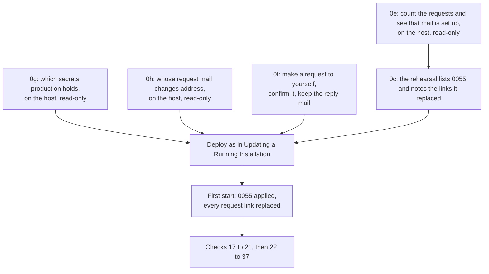

#### Before the deploy: checks 0e to 0h

**Check 0e: who will meet a dead link, and whether they can be sent a new one.** On the host, against the live database, read-only. It prints no token, no key and no credential, the backup destinations by type and name only, and it holds no `!` or `$`:

```bash
docker exec dumpfire node -e "
const db = require('better-sqlite3')(process.env.DB_PATH || 'dumpfire.db', { readonly: true, fileMustExist: true });
console.table(db.prepare('SELECT status, COUNT(*) AS requests, SUM(requester_email IS NOT NULL) AS with_email, MAX(created_at) AS newest FROM task_requests GROUP BY status ORDER BY status').all());
const row = db.prepare('SELECT value FROM settings WHERE key = ?').get('backup_config');
const c = row ? JSON.parse(row.value) : {};
console.log('backup schedule:', c.schedule || 'none', '| destinations:', (c.destinations || []).map((d) => d.type + ' ' + d.name).join(', ') || 'none');
console.table(db.prepare('SELECT destination_type, status, COUNT(*) AS runs, MIN(created_at) AS first, MAX(created_at) AS last FROM backup_log GROUP BY destination_type, status').all());
console.log('mail set up:', Boolean((db.prepare('SELECT value FROM settings WHERE key = ?').get('smtp_host') || {}).value));
db.close();
"
```

Each request counted has a link that stops working at the deploy. A requester who opens one is asked for the address the request was made with, and the current link is mailed there, so **mail must be set up** (`mail set up: true`) for anyone to be sent one; with none, set it up before the deploy. `backup_log` keeps the last ten runs, so an empty table does not prove that no copy ever left: the replacement does not depend on it.

**Check 0f: a link to try afterwards.** In a private window, make a request on `/request` to yourself, with a second `+` alias of a mailbox you can read as its address, and confirm it from the mail. Then, signed in as yourself, reply to it in the Inbox, and keep the reply mail: its "View & Reply" opens the thread now, and check 17 opens it after the deploy.

**Check 0g: which secrets production holds, and what a restore elsewhere would ask for** (card 2169). On the host, against the live database, read-only. It prints flags, counts, the mail port and "Use SSL/TLS" setting (neither is secret) and the destinations by type and name, never a secret, and it holds no `!` or `$`:

```bash
docker exec dumpfire node -e "
const db = require('better-sqlite3')(process.env.DB_PATH || 'dumpfire.db', { readonly: true, fileMustExist: true });
const get = (k) => (db.prepare('SELECT value FROM settings WHERE key = ?').get(k) || {}).value || '';
const has = (v) => Boolean(v && String(v).length > 0);
console.log('mail: host set', has(get('smtp_host')), '| port', get('smtp_port'), '| secure', get('smtp_secure'), '| user set', has(get('smtp_user')), '| password set', has(get('smtp_pass')));
let c = {};
try { c = JSON.parse(get('backup_config') || '{}'); } catch (e) { console.log('backup_config is not JSON'); }
for (const d of (c.destinations || [])) { let sa = {}; try { sa = JSON.parse(d.serviceAccountJson || '{}'); } catch (e) {} console.log('destination', d.type, JSON.stringify(d.name), '| password', has(d.password), '| private key', has(d.privateKey), '| S3 secret', has(d.secretAccessKey), '| client secret', has(d.clientSecret), '| refresh token', has(d.refreshToken), '| service account key', has(sa.private_key)); }
console.table(db.prepare('SELECT active, length(secret) > 0 AS signed, COUNT(*) AS webhooks FROM webhooks GROUP BY 1, 2 ORDER BY 1, 2').all());
console.table(db.prepare('SELECT destination_type, status, COUNT(*) AS runs, MIN(created_at) AS first, MAX(created_at) AS last FROM backup_log GROUP BY destination_type, status').all());
db.close();
"
```

Read it for three things. What is `true` there is what a restore of a backup onto another server, or a server rebuilt from one, would ask to be entered again: have each of those, and each webhook receiver's secret, somewhere outside DumpFire before the deploy (see [Backup Destinations](#backup-destinations)). An SFTP destination with `password false` and `private key false` whose recent runs succeed is one whose server accepts no password at all; it goes on being tried as it is (it is not stopped as "credentials are not entered"). And `port 587` (or 25) with `secure` empty or `false` is mail sent with the certificate not checked: that is a card of its own, and not changed by this release. `backup_log` keeps the last ten runs, so it cannot show that no copy ever left the server: every copy made before this deploy holds the secrets, as below.

**Check 0h: whose request mail changes address at the deploy** (card 2171). On the host, read-only; it prints counts, never an address:

```bash
docker exec dumpfire node -e "
const db = require('better-sqlite3')(process.env.DB_PATH || 'dumpfire.db', { readonly: true, fileMustExist: true });
console.table(db.prepare('SELECT tr.status, COUNT(*) AS made_signed_in, SUM(lower(trim(tr.requester_email)) <> lower(u.email)) AS address_since_changed FROM task_requests tr JOIN users u ON u.id = tr.requester_user_id GROUP BY tr.status ORDER BY tr.status').all());
console.table(db.prepare('SELECT status, COUNT(*) AS requests, SUM(requester_email IS NOT NULL) AS with_address FROM task_requests WHERE requester_user_id IS NULL GROUP BY status ORDER BY status').all());
db.close();
"
```

`address_since_changed` is how many requests made signed in are mailed at a different address from the deploy on: the account's address as it is now. The second table is the requests made without an account, or whose account was deleted before the deploy, which keep the address stored on them.

**In the rehearsal (check 0c)**, `Migration files applied` lists `0055_replace_request_links.sql` too, and, for an export that holds requests, a note under `Worth knowing`: `task_requests: every access_token replaced in its N row(s) by 0055_replace_request_links.sql, a one-off declared in tests/rehearsal/one-offs.ts`. Expected, not a failure. The rehearsal still fails if `task_requests` loses a row.

#### What changes at the first start

- **Every request link mailed before the deploy stops working, once.** 0055's one statement gives every request a new token, open, settled or unconfirmed. Copies of backups made before this, at a destination or downloaded, hold every link as it was mailed; replacing them all makes those copies open no thread. A later start replaces nothing. Why: [Every Request Link Replaced Once](authentication-security.md#every-request-link-replaced-once-by-migration-0055).
- **The page an old link opens** says "This link no longer works. Enter the email address you made the request with (if you made it while signed in to DumpFire, your account's email address as it is now), and a new link will be sent to it.", with an address field and "Send me a new link"; the confirm page shows the same under its refusal. Whatever is entered, the answer is the same sentence; only the request's address is sent the link (for a request made signed in, the account's email as it is now), at most three times an hour, and the reply page no longer asks the server every five seconds for a thread it cannot open.
- **Backups made from now on hold no request link** and not the request form's key, and **every Import Backup replaces every request's link**: its answer says how many, and the requesters of those links ask for new ones the same way.
- **Backups made from now on hold no mail password, no destination credential and no webhook secret**, and a webhook that has a secret is switched off in them (card 2169). The running server is not changed: its mail, its backups and its webhooks work as before, and Backup History shows the next run succeed at every destination. An Import Backup keeps this server's secrets for the same accounts, and its result lists any to enter again. **Every backup is sealed** from now on: a `backup_seal` setting in the file, the seal's form number `2:` and an HMAC of every row made with the `backup_seal_key` the first backup makes in the running database, which no backup holds. Import Backup fills this server's secrets only into a backup whose seal it makes again with its own key: one made by another server, or changed since in anything a restore brings in, has every gap listed, and its "To enter again" line ends "None was kept from this server, because this backup was not made by this server, or was changed since." The seal covers the file's whole structure, SQLite's own objects and the statistics ANALYZE writes included, and the import reads every table's rows as stored (`NOT INDEXED`), the rows the seal was made over. Before the seal is asked, a file that fails `PRAGMA integrity_check`, or holds an object named as SQLite's own that no backup of this server's holds, is treated as changed: the restore goes ahead, nothing is filled, and the import writes one `[WARN] [IMPORT]` line beginning "Nothing was kept from this server, because the backup failed a check made before its seal is checked" that names the check. **Copies made before this deploy carry no seal**: restoring one fills nothing from this server, which changes nothing, since they hold their own secrets; a line with anything to enter would end "None was kept from this server, because this backup carries no seal this server can check." Sealing adds about 0.2 s to a backup of a 59 MB database (0.56 s at 177 MB, measured on a development machine), and verifying as much to an import, with about 0.12 s more for the integrity check. Nothing new is written at start on production, where every secret is entered; a `[WARN] [STARTUP]` line beginning "To enter again, because a backup does not hold them" would mean something already lacks one.
- **Every mail to a requester who made the request signed in goes to the account's email as it is now** (card 2171): the team's reply, "Request accepted", "Request declined", the progress and completion mails, and a new link. The inbox shows that address. Check 0h counted the requests this changes. Deleting a user writes the account's email onto every request it made, so its requests go on being mailed at its last address.
- Requests, their messages and the inbox are otherwise untouched, and the team sees nothing new.

**Owner to know.** From this deploy on a backup is not enough to rebuild a lost server: restored anywhere but the server it came from, or put in place by hand, it needs the mail password, every destination's credentials and every webhook's secret entered again (see [Backup Destinations](#backup-destinations)). Restored on the server it came from it needs nothing entered, as long as it is the file that server made, unchanged: a restore keeps nothing from this server for a backup changed since, by anyone, in anything a restore brings in, its structure, SQLite's own objects and statistics included, nor for a file that fails SQLite's integrity check. The seal leaves out only what a restore never brings in (the hidden rowids of a table with no `INTEGER PRIMARY KEY`, though not their order; `sqlite_sequence`; the file's header and free space), so a change there restores nothing different. Copies made before this deploy still hold them, and carry no seal, and nothing can take them out: they go as each destination's retention removes them. If one of them may have been read by somebody who should not have, change the mail password and each destination's credentials at their services and enter them again, and set new webhook secrets with their receivers.

#### After the deploy

| # | Do | Account and data | Expect | A fault if |
|---|---|---|---|---|
| 17 | Open the reply mail kept in check 0f | A private window | "This link no longer works" and the address field | The thread |
| 18 | Enter a wrong address; then the right one | | The same sentence both times; one mail, for the right one, whose link opens the thread | A different answer for the wrong one, no mail, or two |
| 19 | Leave a page from check 17 open for a minute, then read Admin, Logs | The superadmin | At most a line or two for that request | A line every five seconds |
| 20 | Export a backup. Search the file for the token in check 18's link, and for `request_form_secret` | The superadmin | Neither found | Either found |
| 21 | On an instance that is not production, Import Backup of that export **as a working copy**; open check 18's link with its address changed to that instance's, and ask for a new link | That instance's superadmin | The import's answer, and the report on the page, say how many request links were replaced; the link no longer works; the ask is answered "New links cannot be sent just now. Please contact the team that sent you the link.", and that instance's log has a `[WARN] [REQUESTS]` line saying mail is not set up (unless that instance's own test mail was set up first) | The link opens the thread, or the import restored as it is |

Checks 22 to 24 and 31 to 37 run on production. **Checks 25 to 30 restore a backup, so they run on an instance that is not production, with a database of its own**: a fresh data volume, set up with a superadmin of its own and no mail settings or destinations, started with `--network none` and `SCHEDULERS=off` as in [Rehearsing an Update Against a Copy](#rehearsing-an-update-against-a-copy). Never on production, and never on a copy of production's live database: the restore would rightly keep that copy's secrets, and the checks would show nothing. Importing production's export there signs you out; sign in again as production's superadmin. The instance is never given a network afterwards: the restore "as it is" brings production's unsigned webhooks and report schedules back on there. Checks 31 to 37 use a throwaway ordinary account, `rq-check`, made for them, with a password you know and an email that is a `+` alias of a mailbox you can read; mail must be set up and an App URL set. Delete `rq-check`, its request and its card at the end.

| # | Card | Do | Account and data | Expect | A fault if |
|---|---|---|---|---|---|
| 22 | 2169 | Export Backup, save it in the repository folder on a workstation as `dumpfire-export.db`, and run check 0g's command on it from that folder, as below | The superadmin | The mail line's "password set" is `false`; on every destination line "password", "private key", "S3 secret", "client secret", "refresh token" and "service account key" are `false`; every webhook row is `signed 0`, and those that were signed in 0g are `active 0`; "left out:" lists them; and `sealed: true`, `seal key in it: false` | Any of them `true`, or `sealed: false` |
| 23 | 2169 | Admin, ☁️ Scheduled Backups, ▶ Run Now | The superadmin | Success at every destination: the running server keeps its credentials | "credentials are not entered", or any new failure |
| 24 | 2169 | Admin, 📧 Email / SMTP, 🧪 Send Test | The superadmin | It arrives | It fails |
| 25 | 2169 | On the instance, Import Backup of check 22's file, "Restore everything as it is" | That instance's superadmin | The result's "To enter again" line names the mail password, each destination by name with what it needs, and each signed webhook with its board, and ends "None was kept from this server, because this backup was not made by this server, or was changed since." (production's backup, another server's key), or, where the instance has never taken a backup and so has no key, "None was kept from this server, because this backup carries no seal this server can check." The mail panel's password is empty; each destination's Edit shows its secret fields empty; a Google Drive OAuth destination shows Connect | No such line, or a secret present |
| 26 | 2169 | Straight after, restart the instance and read its log | | One `[WARN] [STARTUP]` line naming the mail password, each destination with what it needs but an SFTP one, and each signed webhook with its board; and, from the import, one `WARN` line with the same list and an SFTP destination too, which the start-up line leaves out | The webhooks missing from either line |
| 27 | 2169 | On it, ▶ Run Now | | Backup History shows each destination failed with "This destination's credentials are not entered…", at once (an SFTP destination is tried, and fails to connect with no network) | A connection or authentication error at an S3, Drive or OneDrive destination |
| 28 | 2169 | On it, type a made-up mail password and save; export; Import Backup of that export as it is | | The result says "Kept from this server, because a backup does not hold them: the mail password"; the mail panel shows the password as set | The mail password listed to enter again |
| 28a | 2169 | On a workstation, in the repository folder, change one card's title in that export as below; on the instance, Import Backup of the changed file as it is | | The result's "To enter again" line names the mail password and ends "None was kept from this server, because this backup was not made by this server, or was changed since."; the mail panel's password is empty | "Kept from this server" |
| 29 | 2169 | On it, Import Backup of check 22's file as a working copy; then restart it | | The working-copy sentence counts as switched off every webhook production had on, signed or not, and one mail setting fewer removed than before this change (no password); a "To enter again" line names only the signed webhooks; after the restart, no start-up line names a webhook | The mail password or a destination listed, or "0 webhook(s) switched off" where production had webhooks on |
| 30 | 2169 | On it, by hand: stop it, put check 22's file in place as its database (deleting `-wal` and `-shm`), start it; read its log | | One `[WARN] [STARTUP]` line naming the mail password, each destination but an SFTP one (which is tried as before, and named by no start-up line), and each signed webhook | No line |
| 31 | 2171 | Sign in as `rq-check` in a private window; make a request on `/request` addressed to yourself | `rq-check` | Made, with no confirmation step | |
| 32 | 2171 | In that window, Account, change `rq-check`'s email to a second alias | `rq-check`'s password | Changed | |
| 33 | 2171 | As yourself, open Inbox | Yourself | The request shows the second alias | The first alias |
| 34 | 2171 | Reply in the Inbox; then accept the request into a board and comment on its card | Yourself | The reply, "Request accepted" and the comment's progress mail arrive at the second alias, and nothing at the first | Any at the first alias |
| 35 | 2171 | In another private window open `/request/<id>/reply?token=x`; enter the first alias; then the second | No account | The words "…(if you made it while signed in to DumpFire, your account's email address as it is now)…"; the same sentence both times; one mail, at the second alias, whose link opens the thread | A mail at the first alias, or a different answer |
| 36 | 2171 | Delete `rq-check`; comment on the card again | The superadmin | The progress mail arrives at the second alias | At the first alias, or none |
| 37 | 2171 | In a private window, make a request on `/request` with a third alias, confirm it from the mail, then reply to it from the Inbox | No account, then yourself | Both mails at the third alias, as before | Anything changed |

Check 22's command is check 0g's with `docker exec dumpfire` taken off, the file's path as its argument, and two lines more. Save the export in the repository folder as `dumpfire-export.db` and run it from that folder, so that `better-sqlite3` is found and the plain relative path `./dumpfire-export.db` names the file in PowerShell 5.1 as well as in a POSIX shell. Write it with a forward slash: PowerShell takes either, but a POSIX shell reads `.\dumpfire-export.db` as `.dumpfire-export.db`, another file, and a path that begins with `~` is not expanded for a program in PowerShell 5.1. It prints flags only:

```bash
node -e "
const db = require('better-sqlite3')(process.argv[1], { readonly: true, fileMustExist: true });
const get = (k) => (db.prepare('SELECT value FROM settings WHERE key = ?').get(k) || {}).value || '';
const has = (v) => Boolean(v && String(v).length > 0);
console.log('mail: host set', has(get('smtp_host')), '| port', get('smtp_port'), '| secure', get('smtp_secure'), '| user set', has(get('smtp_user')), '| password set', has(get('smtp_pass')));
let c = {};
try { c = JSON.parse(get('backup_config') || '{}'); } catch (e) { console.log('backup_config is not JSON'); }
for (const d of (c.destinations || [])) { let sa = {}; try { sa = JSON.parse(d.serviceAccountJson || '{}'); } catch (e) {} console.log('destination', d.type, JSON.stringify(d.name), '| password', has(d.password), '| private key', has(d.privateKey), '| S3 secret', has(d.secretAccessKey), '| client secret', has(d.clientSecret), '| refresh token', has(d.refreshToken), '| service account key', has(sa.private_key)); }
console.table(db.prepare('SELECT active, length(secret) > 0 AS signed, COUNT(*) AS webhooks FROM webhooks GROUP BY 1, 2 ORDER BY 1, 2').all());
console.log('left out:', get('webhook_secrets_left_out'));
console.log('sealed:', has(get('backup_seal')), '| seal key in it:', has(get('backup_seal_key')));
db.close();
" ./dumpfire-export.db
```

Check 28a's change, on the export check 28 made, saved in the repository folder as `dumpfire-export-28.db`; it copies the file and changes the copy, `dumpfire-export-28-changed.db`, which is the one to import:

```bash
node -e "
require('fs').copyFileSync(process.argv[1], process.argv[2]);
const db = require('better-sqlite3')(process.argv[2], { fileMustExist: true });
console.log('cards changed:', db.prepare('UPDATE cards SET title = title || ? WHERE id = (SELECT MIN(id) FROM cards)').run(' (changed)').changes);
db.close();
" ./dumpfire-export-28.db ./dumpfire-export-28-changed.db
```

#### Going back to the previous image

Nothing is done to the database but the one row below, deleted with the container stopped before the older image starts.

- **0055 stays applied.** An older image with the runner logs one `[ERROR] [DB]` line for the recorded files it has no file for, 0055 among them, and starts. No link is replaced a second time.
- **The new route goes with it.** An old link's page says "This link is no longer valid. Use the link in the most recent email about your request." again, and polls; a requester can then be sent a new link only by the team's next reply.
- **Backups made by the newer image** hold no links; restored by the older image, or put in place by hand, every request is given one by the start's backfill. The older image's own backups hold links again.
- **The seal's key stays in the running database, and the older image does not know to leave it out of a backup.** Delete it with the container stopped, after the newer image's last start and before the older image's first, so that no copy the older image makes holds it: a one-off container on the same volume, from the newer image (any image that has `better-sqlite3` will do), writes to the database file while nothing else has it open. Going forward again, the newer image makes a new key, and its backups made before then are restored with every gap listed:

  ```bash
  docker stop dumpfire
  docker run --rm --network none -v dumpfire-data:/app/data dumpfire:latest node -e "
  const db = require('better-sqlite3')('/app/data/dumpfire.db', { fileMustExist: true });
  console.log('keys removed:', db.prepare('DELETE FROM settings WHERE key = ?').run('backup_seal_key').changes);
  db.close();
  "
  ```

  It prints `keys removed: 1` (or `0` where no backup was taken since the deploy). Then start the older image as above. For a container, a volume or a `DB_PATH` other than the [Production](#production) command's, put those in place of `dumpfire` (after `docker stop`), `dumpfire-data` and `/app/data/dumpfire.db`: under Docker Compose the container is not called `dumpfire` unless the compose file sets `container_name`, so take its name from `docker compose ps` (such as `dumpfire-dumpfire-1`), and the volume is `<project>_dumpfire-data`.

- **Backups made by the newer image hold no secret.** Imported into the older image, they come up with no mail password, no destination credentials and their signed webhooks off, and the older image says nothing of it: enter them as in [Restoring from Backup](admin-guide.md#restoring-from-backup), step 5. The running database's own secrets are not touched by going back, and the older image's backups hold them again.
- **Request mail goes back to the address stored on each request.** The addresses `deleteUser` wrote for accounts deleted meanwhile stay, and are the accounts' last.

### The Update That Checks the Mail Server's Certificate

Four cards and one upgrade go out in one image, and this is the one note for them. No migration and no schema change.

- **Card 2189** sends every mail over a checked, encrypted connection: port 465 TLS from the first byte, any other port STARTTLS required, and on every port the certificate checked for the host's name. The "Use SSL/TLS" box is gone (its `smtp_secure` row is left and no longer read), and "Allow mail without a checked, encrypted connection" is the one way out, a new `smtp_allow_insecure` row written when the panel first saves it. See [Mail Server Certificates](#mail-server-certificates). **Mail stops at the deploy** if production's mail server cannot give such a connection: run checks 0i and 0k first.
- **Card 2190** keeps a saved secret only for the settings it was saved with: the mail password only while the host, port, user name and the way out are as saved; a backup destination's secret only for the one saved destination that is the same in type, name and every setting that is not secret. Otherwise a save or a test is refused, `400`, naming what to type again.
- **Card 2187** masks every backup destination secret in the admin page's answer, the Google Drive refresh token included, which it carried as stored; one list of secret fields serves the answer, the save and the test.
- **Card 2188** has Google Drive asked for `drive.file` (DumpFire's own files) in place of the whole of Drive. Connections made before keep working, with the whole of Drive, until narrowed by hand (below). Connect makes a folder of its own for a destination with no Folder ID, checks one that is set, and records the scope Google granted; the row shows `⚠️ Connected · all of Drive` for every connection made before.
- **Card 2227's nodemailer upgrade**: nodemailer 8.0.7 to 10.1.1, which needs Node 20 or newer (the image is `node:22-slim`). See [the SBOM analysis](sbom-analysis.md).

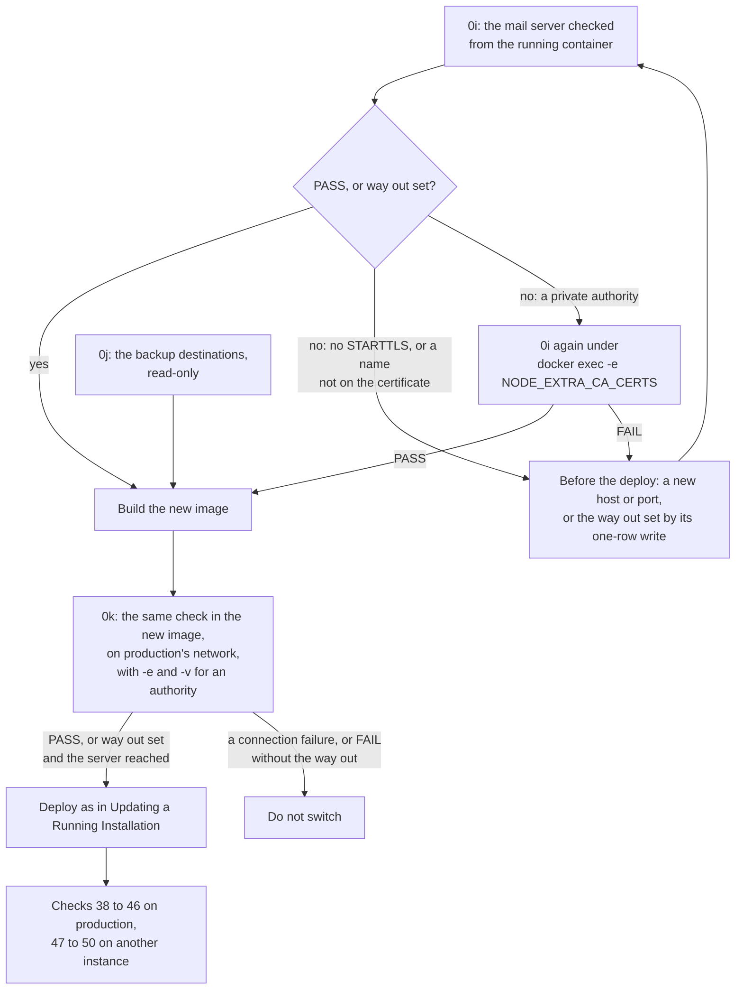

#### Before the deploy: checks 0i to 0k

**Check 0i: will mail go on after the deploy** (card 2189). On the host, against the running container, read-only: the command in [Mail Server Certificates](#mail-server-certificates), which reads the mail settings, prints names and flags, never the password, and makes the connection the new code makes, signing in to nothing and sending nothing. It runs in the image being replaced, whose nodemailer is 8.0.7: the connection it makes is what the new code asks for, and check 0k makes it again in the new image. Read it by the table under it, with these two ways to keep mail going through the deploy, for its `ETLS`, altnames and authority rows:

- **A change of host or port made before the deploy needs no password.** The code before this change keeps the stored password for any host and port, so the certificate's name as the host, or port 465, can be saved now with the password left masked. After the deploy it needs the password typed.
- **For a relay that cannot use TLS, the way out can be set before the deploy** with one write you choose to run. It changes one row: the code before this change does not read it, the new code reads it at the first mail, and the panel then shows the box ticked. No `WARN` line is written for it, since it is not set through the panel. With the container running:

  ```bash
  docker exec dumpfire node -e "
  const db = require('better-sqlite3')(process.env.DB_PATH || 'dumpfire.db', { fileMustExist: true });
  db.prepare('INSERT INTO settings (key, value) VALUES (?, ?) ON CONFLICT(key) DO UPDATE SET value = excluded.value').run('smtp_allow_insecure', 'true');
  console.log('smtp_allow_insecure:', db.prepare('SELECT value FROM settings WHERE key = ?').get('smtp_allow_insecure').value);
  db.close();
  "
  ```

  It prints `smtp_allow_insecure: true`. Mail and its password then go as they do today: unencrypted wherever the relay offers no STARTTLS. The same write works after the deploy, with no password and no restart: the mailer reads the setting at every mail. Check 0i, run again, then prints `way out set`.

The go-ahead for mail is any one of these:

- `PASS` in both 0i and 0k;
- `way out set` printed by 0i, and 0k, given `wayOut = true`, not a connection failure;
- for a certificate from a private authority, `PASS` in 0i run under `docker exec -e NODE_EXTRA_CA_CERTS=/tmp/mail-ca.pem` (its table's authority row) and `PASS` in 0k run with `-e` and `-v`. The plain 0i goes on failing until the container is created with the variable, which is the deploy itself.

**Check 0j: which backup destinations decisions on Google Drive apply to** (cards 2188 and 2190). On the host, read-only; it prints types, names, flags and counts, never a secret:

```bash
docker exec dumpfire node -e "
const db = require('better-sqlite3')(process.env.DB_PATH || 'dumpfire.db', { readonly: true, fileMustExist: true });
const row = db.prepare('SELECT value FROM settings WHERE key = ?').get('backup_config');
let c = {};
try { c = JSON.parse((row || {}).value || '{}'); } catch (e) { console.log('backup_config is not JSON'); }
const list = Array.isArray(c.destinations) ? c.destinations : [];
const names = list.map((d) => String(d.name));
list.forEach((d, i) => console.log(i, d.type, JSON.stringify(d.name), '| name used', names.filter((n) => n === String(d.name)).length, 'time(s) | sign-in', d.authMethod || '-', '| folder set', Boolean(d.folderId), '| connected', Boolean(d.refreshToken), '| scope recorded', d.grantedScope || 'none'));
console.table(db.prepare('SELECT destination_name, destination_type, status, COUNT(*) AS runs, MAX(created_at) AS last FROM backup_log GROUP BY 1, 2, 3 ORDER BY 1, 3').all());
db.close();
"
```

A `gdrive` line with `sign-in oauth` and `connected true` is a connection made with the whole of Drive: it keeps working after the deploy, shows `⚠️ Connected · all of Drive`, and is narrowed when you choose (check 46). Production's log of 2026-10-18 shows one, "GoogleDriveTest", backing up at every run. `name used 2 time(s)` is two destinations of one name: Connect takes the first of them, and after the deploy **no save of the backup settings goes through while they are there**, the schedule's included: a list naming two destinations alike is refused, "Two backup destinations are named "<name>"." The way out, which the refusal gives: remove the destinations named "<name>" (the page's Remove removes every one of that name) and add it once with its secret typed. Where the two are the same in every other setting, a save or a test of one with its secret left masked is refused with the same way out. `sign-in service_account` and `folder set false` on a `gdrive` line whose runs fail are each a card of their own. `backup_log` keeps the last ten runs.

**Check 0k: the same check in the new image.** Once the new image is built and before the switch, with the host and port 0i printed in place of `HOST` and `587`, and `wayOut` set to `true` where 0i printed `way out set`. No volume and no database: it opens one connection and signs in to nothing. It runs on production's own network (`--network container:dumpfire`, the running container's), so it reaches the mail server as the new container will; under Docker Compose, put the running container's name in place of `dumpfire` (`docker compose ps` shows it). When an authority's certificate is used, add `-e NODE_EXTRA_CA_CERTS=/ca/mail-ca.pem -v /srv/dumpfire/mail-ca.pem:/ca/mail-ca.pem:ro` before the image name. The image's Node carries its own root certificates, and the `node:22-slim` tag moves, so the new image may trust otherwise than the running one:

```bash
docker run --rm --network container:dumpfire dumpfire:candidate node -e "
const host = 'HOST';
const port = 587;
const wayOut = false;
if (wayOut) { console.log('way out set: the go-ahead for mail, unless the check below cannot reach the server.'); }
require('nodemailer').createTransport({ host: host, port: port, secure: port === 465, requireTLS: port === 465 ? false : true, tls: { rejectUnauthorized: true }, name: 'dumpfire.app', connectionTimeout: 10000, greetingTimeout: 10000, socketTimeout: 15000 }).verify()
  .then(() => console.log('PASS: the mail server gives an encrypted connection with a certificate this image trusts.'))
  .catch((e) => console.log('FAIL:', e.code || '', e.message));
"
```

`dumpfire:candidate` is the image as built for the switch, under whatever tag it was given. Read it on its own:

- `PASS`: the go-ahead.
- `FAIL` for the certificate or STARTTLS (`ETLS`, `ECONNECTION … STARTTLS`, a certificate message): the go-ahead only with `way out set` printed above it. Without the way out, where 0i said `PASS` the new image does not trust the certificate: do not switch until it does.
- A connection failure (`ESOCKET connect…`, `EDNS`, a timeout) where 0i reached the mail server: **do not switch**, whether or not the way out is set. It runs on production's network, so the new image cannot reach a mail server the running one can; find why first. Where 0i failed the same way, mail is not working today either: this update neither causes nor mends that, and it does not hold the deploy back.

#### What changes at the first start

- **Mail goes over a checked, encrypted connection**, unless the way out is set. Nothing is written at start. A mail that fails for the certificate or STARTTLS is an `[ERROR] [EMAIL] Failed to send email …` line, and one `[WARN] [EMAIL] Mail is not being sent: <the error>. <how to put it right>` at most once in ten minutes, on the Audit page's Live Console.
- **The mail panel** has no "Use SSL/TLS"; it has "Allow mail without a checked, encrypted connection", unticked unless set in check 0i, with a line under the host and port and one under the password. Changing the host, port, user name or the box needs the mail password typed again.
- **Scheduled Backups** shows every secret as `••••••••`, and the answer it loads holds none. Changing any setting of a destination, its name included, needs its secret typed again; a connected Google Drive destination is removed, added again and connected. A list naming two destinations alike is not saved (check 0j). Backups run as before: they read the stored settings, never the masked answer.
- **A Google Drive OAuth destination connected before the deploy** shows `⚠️ Connected · all of Drive` with a line saying how to narrow it, and no button to connect it again. It goes on backing up as it did. New connections ask only for DumpFire's own files.
- `smtp_secure` is left in the database and no longer read. A working copy removes it and `smtp_allow_insecure` with the other mail settings.

**Owner to know.** Mail stops at the deploy if production's mail server fails checks 0i and 0k and neither of their ways was taken. Changing the mail host, port, user name or the way out now needs the mail password; changing any backup destination's settings, its name included, needs its password, key or secret. Keep them outside DumpFire. A Google Drive connection made before the deploy still reaches the whole of that Google account's Drive until it is narrowed: [To narrow a connection made before this change](admin-guide.md#configuring-backups), removing DumpFire's access in the Google account first, with the client secret at hand from the Google Cloud console. A new connection's backups go to a folder DumpFire makes, "DumpFire backups (made <date>)"; the copies in the old folder are no longer cleared by retention and are deleted by hand when not needed (they are from before card 2169, with every secret in them).

#### After the deploy

Checks 38 to 46 run on production, as the superadmin, and change nothing unless said. **Checks 47 to 50 run on an instance that is not production, with a database of its own**: a fresh data volume, set up with a superadmin of its own, `SCHEDULERS=off`, and outbound mail allowed. Never on production.

| # | Card | Do | Account and data | Expect | A fault if |
|---|---|---|---|---|---|
| 38 | 2189 | Admin, 📧 Email / SMTP | The superadmin | No "Use SSL/TLS"; "Allow mail without a checked, encrypted connection" unticked (ticked only where check 0i set it); the port line and the password line. 🧪 Send Test arrives | It fails: run check 0i again and take its table's way. For a relay with no STARTTLS and the password not at hand, check 0i's one-row write sets the way out now, with no restart: the mailer reads it at the next mail |
| 39 | 2189 | Straight after the deploy, and again the next day: the Audit page's Live Console since the deploy. It reads what mail has been sent: check 38's Send Test is the first, so run 38 first; the next day's reading needs a mail sent meanwhile (a notification, an invite) | The superadmin | No `Mail is not being sent` `WARN` and no `Failed to send email` `ERROR` | Either: follow check 0i's table at once. The one-row write of check 0i sets the way out with no password and no restart, read at the next mail |
| 40 | 2190 | Change the SMTP host to `smtp.invalid` without typing the password, Save; reload | The superadmin | Refused, "Type the mail password again. … and this changes the host."; after the reload the host is as before | "SMTP settings saved!": set the host back at once |
| 41 | 2187 | Admin, ☁️ Scheduled Backups, with the browser's developer tools on Network: the answer of `/api/admin/backup` | The superadmin | Every secret field reads `••••••••`, a Google Drive OAuth destination's `refreshToken` included; its row still shows it connected | A long token value in the answer |
| 42 | 2190 | Edit a destination, change its host (or folder, or bucket) to `backup.invalid` without typing its secret, Save; then Cancel | The superadmin; any destination | Refused in a toast naming what changed and every secret still masked, "Backup destination "…": type its … again. …"; the list as before; the form still open until Cancel | Saved: set it back at once |
| 43 | 2190 | Edit a destination, change nothing, Save; then 🧪 Test | The superadmin | Saved; Test as before | Refused |
| 44 | 2187, 2188 | ▶ Run Now | The superadmin | Success at every destination, a Google Drive OAuth one connected before the deploy included | Any new failure |
| 45 | 2188 | A Google Drive OAuth destination connected before the deploy: its row | The superadmin | `⚠️ Connected · all of Drive`, the line under it beginning "Connected with access to all of this Google account's Drive. To narrow it: first remove DumpFire's access in the Google account", and no button to connect it again | `✅ Connected`, or a button to connect it again |
| 46 | 2188 | **When you choose to narrow it:** the three steps of [To narrow a connection made before this change](admin-guide.md#configuring-backups), removing access first; then ▶ Run Now and 🧪 Test | The superadmin; the Google account; the client secret | Google's consent screen asks only for "the specific Google Drive files you use with this app"; Connect says it made the folder "DumpFire backups (made <today>)"; `✅ Connected`; that folder in the account's My Drive holds the new copy; Test says "Connected to Google Drive folder (1 existing file)" | A consent screen asking for all of Drive; Connect refused for the new empty Folder ID; the backup fails |
| 47 | 2189 | On the other instance: mail host the IP address of `smtp.gmail.com` (`nslookup smtp.gmail.com`), port 587, user `x`, password `y`; Save; 🧪 Send Test | Its superadmin | Refused, "Hostname/IP does not match certificate's altnames", followed by "The mail server's certificate could not be checked, or the server does not offer STARTTLS. …" | A sign-in error: the certificate was not checked |
| 48 | 2189, 2190 | Tick the way out without typing the password; Save | | Refused, "… and this changes the "Allow mail without a checked, encrypted connection" setting." | Saved |
| 49 | 2189 | Tick it, type `y`, Save; 🧪 Send Test; read the Live Console | | The warning shows under the box; the test fails at sign-in (`535`), past the certificate; one `[WARN] [SMTP] Mail is now sent without a checked, encrypted connection (set by …)` | The certificate error again, or no `WARN` |
| 50 | 2189 | Untick it, host `smtp.gmail.com`, type `y`, Save; 🧪 Send Test | | Fails at sign-in (`535`), not at the certificate; one `[WARN] [SMTP] Mail is now sent with a checked, encrypted connection (set by …)` | A certificate error |

#### Going back to the previous image

Nothing is done to the database.

- **The mail settings.** The older image reads `smtp_secure` again, which this image left as it was, and never reads `smtp_allow_insecure`: mail on any port but 465 goes as before this change, STARTTLS only if offered and the certificate checked only where "Use SSL/TLS" was ticked. A mail host, port or user changed meanwhile stays. A password typed meanwhile stays.
- **The backup settings.** The older image masks the secrets it knew and shows the Google Drive refresh token again; it takes a masked secret by its place in the list again. A `grantedScope` recorded by a Connect meanwhile stays in the destination and is not read. A destination connected meanwhile keeps its `drive.file` token and the folder DumpFire made, and backs up there.
- **nodemailer** goes back to 8.0.7 with the older image.

### The Update That Brings Migration 0056 and the Webhook Rules

Five cards go out in one image, and this is the one note for them. One migration, no data changed.

- **Card 2145** sends each webhook of a board on its own: a webhook whose stored `events` is not a JSON list is skipped with a `WARN`, where one holding `null` stopped every later webhook of its board, a number or an object was sent every event, and a string was matched by substring.
- **Card 2161** refuses a webhook's address inside the network: at registration as written (`400`), and at every delivery as written and by every address its name resolves to (a `WARN`, nothing sent). Redirects are not followed, an address with a user name or password is refused, and a failed delivery's `ERROR` names the host, never the path. Webhooks are delivered with `node:http` and `node:https`, not `fetch`. A receiver inside the network on purpose is named in `WEBHOOK_ALLOW_INSIDE`: see [Where a Webhook May Send](#where-a-webhook-may-send).
- **Card 2154** keeps a webhook's address and secret, and switching it on, with the board's owner and administrators: an editor's key that sends `url` or `secret`, or `active: true` for a webhook that is off, is `403`.
- **Card 2168** brings migration `0056_add_webhook_set_by.sql`, a column `webhooks.set_by` (the account that last set the webhook's address or secret) and its index, and with it what taking an account back switches off: an administrator's reset and an invite used switch off every webhook the account set and pause every report schedule of it; the holder's own change with the box ticked switches off the webhooks; deleting an account switches off the webhooks it set.
- **Card 2201** holds a board to 10 webhooks, switched-off ones counted: the 11th create is `409`. A board that already has more keeps them all, and is named at every start.

0056 is two statements and changes no row:

```sql
ALTER TABLE `webhooks` ADD COLUMN `set_by` integer REFERENCES `users`(`id`) ON DELETE SET NULL;
--> statement-breakpoint
CREATE INDEX IF NOT EXISTS `idx_webhooks_set_by` ON `webhooks` (`set_by`);
```

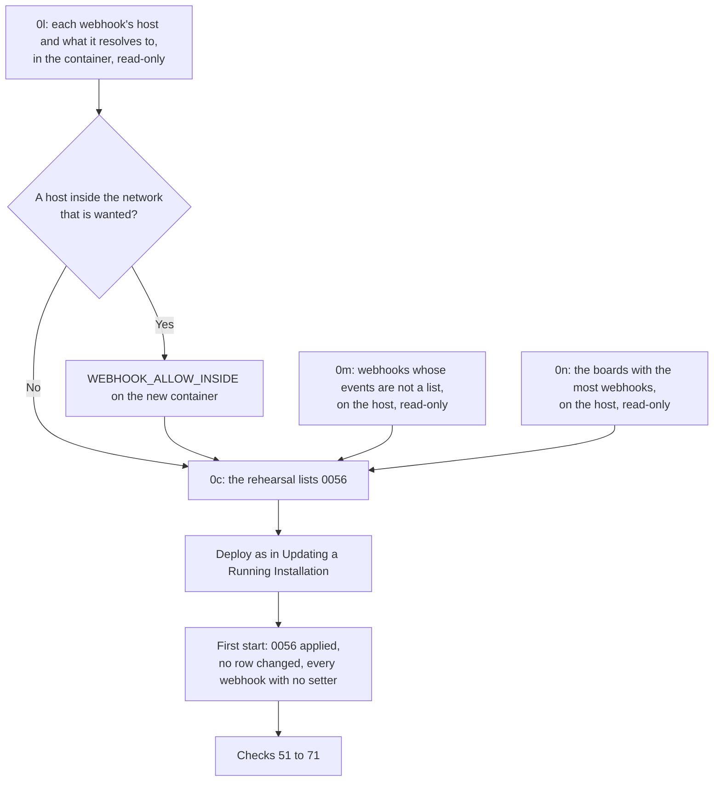

#### Before the deploy: checks 0l to 0n

Each runs on the host, against the live database, read-only. None prints a path, a query string, a secret or a password: a webhook's path can hold a token. Check 0l also asks the container's resolver for each host it lists, and connects to nothing.

**Check 0l: where each webhook sends.** Each webhook's board, whether it is on, when it was made, the host and port it sends to and the addresses that host resolves to now from inside the running container, with whether its address carries a user name or password and whether it is written in an odd form:

```bash
docker exec dumpfire node -e "
const dns = require('dns');
const db = require('better-sqlite3')(process.env.DB_PATH || 'dumpfire.db', { readonly: true, fileMustExist: true });
const rows = db.prepare('SELECT id, board_id, active, created_at, url FROM webhooks ORDER BY id').all();
db.close();
const backslash = String.fromCharCode(92);
const read = (url) => {
  const sep = url.indexOf('://');
  const rest = sep < 0 ? url : url.slice(sep + 3);
  const ends = ['/', '?', '#', backslash].map((c) => rest.indexOf(c)).filter((i) => i >= 0);
  const authority = ends.length > 0 ? rest.slice(0, Math.min(...ends)) : rest;
  const at = authority.lastIndexOf('@');
  const hostAndPort = authority.slice(at + 1);
  const host = hostAndPort.startsWith('[') ? hostAndPort.slice(1, hostAndPort.indexOf(']')) : hostAndPort.split(':')[0];
  const lower = url.toLowerCase();
  const usual = (lower.startsWith('http://') || lower.startsWith('https://')) && url.includes(backslash) === false;
  return { hostAndPort, host, credentials: at >= 0 ? 1 : 0, odd: usual ? 0 : 1 };
};
const hosts = [...new Set(rows.map((r) => read(r.url).host))];
const looked = hosts.map((h) => dns.promises.lookup(h, { all: true }).then((found) => found.map((a) => a.address).join(' '), (err) => 'not resolved: ' + err.code));
Promise.all(looked).then((answers) => {
  const resolved = new Map(hosts.map((h, i) => [h, answers[i]]));
  console.table(rows.map((r) => {
    const w = read(r.url);
    return { id: r.id, board_id: r.board_id, active: r.active, created_at: r.created_at, host_and_port: w.hostAndPort, resolves_to: resolved.get(w.host), has_credentials: w.credentials, odd_form: w.odd };
  }));
});
"
```

Read it for five things:

- **A host inside the network**, as written or in `resolves_to`: an address `10.x`, `172.16.x` to `172.31.x`, `192.168.x`, `127.x`, `100.64.x` to `100.127.x`, `169.254.x`, `::1`, `fd…` or `fe80…`; `localhost`; a name with no dot (`n8n:5678`); or a name ending `.local`, `.internal` or `.home.arpa`. That webhook stops being delivered when the new image starts, with a `WARN` at the first event and at most once an hour after. If it is wanted, put its host in `WEBHOOK_ALLOW_INSIDE` on the new container (see [Where a Webhook May Send](#where-a-webhook-may-send)). `resolves_to` is what the container's own resolver answers now, every address of the name; a public name that answers an inside address is refused at delivery too. `not resolved: ENOTFOUND` is a name the container cannot resolve, which is not delivered now either.
- **An `http://` host that is sent**: run `curl -sI http://<host_and_port>/` against each from a machine outside, or from the container. A `307` or `308` there may mean its receiver redirects every `POST`, which stops being followed at the deploy (see [What changes at the first start](#what-changes-at-the-first-start)).
- **`has_credentials` 1**: that webhook has never been delivered (`fetch` refused such an address) and still will not be. The board's owner or an administrator registers it again without them. The host is read after the last `@`, as the URL parser reads it, so a password holding `@` does not hide the host.
- **`odd_form` 1**: an address not beginning `http://` or `https://`, such as `http:/127.0.0.1/x`, or one holding a backslash, which the URL parser reads as `/` (`http://hooks.example.com\@10.0.0.5/`), whose host this check may misread. Look at that row's address by hand.
- **Any row at all**: after 0056 none has a recorded setter, so a password reset will not switch it off. Look each over once, with the board's owner.

**Check 0m: webhooks whose events are not a list** (card 2145):

```bash
docker exec dumpfire node -e "
const db = require('better-sqlite3')(process.env.DB_PATH || 'dumpfire.db', { readonly: true, fileMustExist: true });
console.table(db.prepare('SELECT id, board_id, active, events FROM webhooks WHERE CASE WHEN json_valid(events) THEN json_type(events) <> @array ELSE 1 END ORDER BY id').all({ array: 'array' }));
db.close();
"
```

An empty table is what is expected. Any row is skipped at every event from the deploy on, with a `WARN` naming it, where before it stopped the board's later webhooks (`null`), was sent every event (a number or an object) or was matched by substring (a string). Fix each with `PUT /api/v1/webhooks/{id}` and a list of events, before or after the deploy; check 69 looks at it afterwards.

**Check 0n: the boards with the most webhooks** (card 2201):

```bash
docker exec dumpfire node -e "
const db = require('better-sqlite3')(process.env.DB_PATH || 'dumpfire.db', { readonly: true, fileMustExist: true });
console.table(db.prepare('SELECT w.board_id, b.name AS board_name, COUNT(*) AS webhooks, SUM(w.active) AS active, MIN(w.created_at) AS first_made, MAX(w.created_at) AS last_made FROM webhooks w LEFT JOIN boards b ON b.id = w.board_id GROUP BY w.board_id ORDER BY webhooks DESC, w.board_id LIMIT 20').all());
db.close();
"
```

A board above 10 keeps every webhook and every delivery after the deploy, no webhook can be added to it until it has fewer than 10, and every start names it (check 67). Look at each with its owner and delete what is not wanted; one made in a burst (`first_made` close to `last_made`) is worth a closer look. Boards at 8 to 10 with genuine integrations are within reach of the cap.

**In the rehearsal (check 0c)**, `Migration files applied` lists `0056_add_webhook_set_by.sql` too, with no note under `Worth knowing`: it changes no row, and declares nothing.

#### What changes at the first start

- **0056 is applied**: one column and one index, no row changed. Every webhook there has no setter, so no reset switches one off until its address or secret is set again. A webhook registered from now on names the account that registered it.
- **Every webhook is judged by where it sends**, at each event. One that check 0l showed inside the network, and that `WEBHOOK_ALLOW_INSIDE` does not name, is not sent, and writes a `WARN` under `Webhooks` at the first event it would have been sent: `Webhook 4 on board 3 not sent: 127.0.0.1 is a loopback address`. A receiver that answers with a redirect is a `WARN`, not followed. Each such `WARN` is written one line per webhook and kind of refusal per hour, however its words change (another address resolved, another status), the next one saying how many were not written in between (`… (12 more like this since the last such line were not logged)`), so a busy board does not fill the system log, which keeps 50,000 rows. Only a receiver that answers `307` or `308` newly stops: a `301`, `302` or `303` was already followed by `fetch` as a `GET` with no body, which no webhook receiver takes, so such a receiver was not receiving before either. Check 0l's `curl -sI` finds them. A delivery that fails writes `ERROR` naming the host and port, never the path. The receiver sees the same body, event header, signature and `User-Agent` as before, with `Content-Length` (never chunked), `Accept: */*` and `Connection: close`, and none of the other headers `fetch` added (`accept-language`, `sec-fetch-mode`, `accept-encoding`).
- **The start log** has a `[WARN] [STARTUP]` line for each ignored entry of `WEBHOOK_ALLOW_INSIDE`, one naming the boards over 10 webhooks, and one naming each webhook that is on and refused as written (the hosts inside the network that check 0l found, unless the list names them), only where there are any.
- **At `LOG_LEVEL=ERROR`** none of that is written: the refusal and redirect `WARN`s and the two start-up lines about webhooks (the allow-list's and the refused webhooks') are below the level, so a receiver inside the network that stops at the deploy leaves no trace. Run with `INFO` or `WARN` for the first days, or run check 0l again after the deploy.
- **Through the API**: an address inside the network is `400` at registration; an editor's `url`, `secret` or switching on is `403`, ending "Ask the board's owner." (an editor whose own webhook their own reset switched off asks the owner too, or deletes it and creates it again); the 11th webhook of a board is `409`. Scripts that send back a webhook's whole answer with a changed `events` are refused when run with an editor's key: send only the fields that change.
- **On the pages**: the admin page's reset dialog counts the webhooks the account set and its report schedules, and the toast names what was switched off and paused; the Account page's password box offers to switch off the webhooks you set, and can appear with no API key; the invite page names what setting a password there ends; the delete confirmation says webhooks are switched off.

**Owner to know.** An address inside the network stops being sent at the deploy unless `WEBHOOK_ALLOW_INSIDE` names it, and an entry of that list wider than one inside range is ignored, named in the start log. An editor can no longer change a webhook's address or secret, or switch one on. A password reset, an invite used, and the holder's own change with the box ticked switch off the webhooks the account set (reset and invite pause its report schedules too), and so does deleting the account; the board's owner or an administrator switches a webhook on again through the API, and a schedule's owner on the Reports page. A board holds at most 10 webhooks. A webhook can still reach this server's own public address: nothing on the host is to trust a request for coming from it.

#### After the deploy

Checks 51 to 69 run on production; 70 and 71 on a development instance. Accounts: the superadmin; an ordinary user `qb-check` who owns a board "QB check" and a board "QB cap"; an ordinary user `qb-editor`, editor on "QB check"; an API key for each of the two. A public request catcher (such as `https://webhook.site`, which gives a unique address) receives the webhooks. In Windows PowerShell 5.1 send each request with `curl.exe` and its body from a file (`-d "@hook.json"`): 5.1 strips the quotes from JSON typed on the line.

| # | Card | Do | Account and data | Expect | A fault if |
|---|---|---|---|---|---|
| 51 | 2161 | `POST /api/v1/boards/{QB check}/webhooks` with `{"url":"<catcher>","secret":"s3"}`; move a card on the board | `qb-check`'s key | `201`; the catcher receives a `POST` with `X-DumpFire-Event: card.moved`, `X-DumpFire-Signature: sha256=…`, `Content-Length`, `Accept: */*`, and no `Transfer-Encoding` | Not received, or `Transfer-Encoding: chunked` |
| 52 | 2161 | `POST` the same with each of `http://127.0.0.1:3000/x`, `http://localhost/x`, `http://169.254.169.254/latest/meta-data/`, `http://n8n:5678/x`, `https://u:p@example.com/` | `qb-check`'s key | `400` each: `Webhook url points inside the network: 127.0.0.1 is a loopback address`, `…: localhost is this server`, `…: 169.254.169.254 is a link-local address, where the cloud metadata service is`, `…: n8n is a name with no dot, which is looked up inside the network`, and `Webhook url must not carry a user name or password` | Any `201` |
| 53 | 2161 | `POST` with `http://localtest.me:3000/x` (a public name that resolves to `127.0.0.1`); move a card; open the Audit page's Live Console | `qb-check`'s key; the superadmin | `201`, then `WARN` `Webhook N on board B not sent: localtest.me resolves to 127.0.0.1, a loopback address` | The `201` followed by no line |
| 54 | 2161 | `POST` with `http://169.254.169.254.nip.io/x`; move a card | `qb-check`'s key | `201`, then a `WARN` ending `resolves to 169.254.169.254, a link-local address, where the cloud metadata service is` | No line |
| 55 | 2154 | `PUT /api/v1/webhooks/{51's id}` with `{"url":"<another catcher>"}`; then `{"active":false}`; then `{"active":true}` | `qb-editor`'s key | `403` `Only the board's owner or an administrator can change a webhook's address or secret. Ask the board's owner.`; `200`; `403` `Only the board's owner or an administrator can switch a webhook on. Ask the board's owner.` | `200` to the first or the third |
| 56 | 2154 | `PUT` the same webhook `{"active":true}` | `qb-check`'s key | `200` | `403` |
| 57 | 2168 | Make a report schedule on the Reports page; then, as the superadmin, reload the admin page and open 🔑 on `qb-check`'s row | `qb-check`; the superadmin | After a moment: "They have 1 API key, which stops working.", "They set up 3 webhooks, which are switched off." (checks 51, 53, 54) and "They have 1 report schedule, which is paused." | No counts, or wrong ones |
| 58 | 2168 | Reset `qb-check`'s password; move a card on "QB check"; read the Live Console | The superadmin | The toast "Password reset: … and 1 API key ended, 3 webhooks switched off and 1 report schedule paused" (the sessions as they were); the catcher receives nothing; an `AUTH` line naming the three webhooks and the schedule by id | The catcher receives `card.moved` |
| 59 | 2168 | Sign in with the new password; Reports, Schedules | `qb-check` | The schedule shows ⏸️; switching it on works | ✅ before it is switched |
| 60 | 2168 | Make a key on the Account page; register a webhook to the catcher with it; change the password **without** ticking the box; move a card | `qb-check` | The catcher receives it | Not received |
| 61 | 2168 | Change the password again **with** the box ticked ("End my 1 API key too, and switch off the 1 webhook I set up."); move a card | `qb-check` | "Password changed. Your other sessions were signed out; your 1 API key was ended and the 1 webhook you set up was switched off."; the catcher receives nothing | Received |
| 62 | 2168 | Make a key, register a webhook to the catcher, delete the key on the Account page and reload it; tick the box, change the password, move a card | `qb-check` | The box reads "Switch off the 1 webhook I set up."; the catcher receives nothing | No box, or the event received |
| 63 | 2168 | Make `qb-gone`, give it a key, register a webhook on a board of its own; delete `qb-gone`; `GET /api/v1/webhooks/{id}` | The superadmin, and the superadmin's key | The confirmation says "Webhooks they set up are switched off; the board's owner or an administrator can switch one on again through the API."; the webhook answers `"active": false`; the delete's log line says "1 webhook(s) they set up were switched off (id N)", N the webhook's id | `"active": true` |
| 64 | 2201 | Put `{"url":"<catcher>"}` in `hook.json`; then `1..11 \| % { curl.exe -s -w " %{http_code}\n" -X POST -H "Authorization: Bearer <key>" -H "Content-Type: application/json" -d "@hook.json" https://<host>/api/v1/boards/<QB cap>/webhooks }` | `qb-check`'s key (a new one) | Ten answers ending `201`; the 11th `{"message":"This board has 10 webhooks, and a board may have at most 10: delete 1 before adding another."} 409` | A `201` for the 11th |
| 65 | 2201 | `PUT` one of them `{"active":false}`; create again | `qb-check`'s key | Still `409` | `201` |
| 66 | 2201 | `DELETE` one; create again | `qb-check`'s key | `201` | `409` |
| 67 | 2161, 2201 | Read the start log (`docker logs dumpfire 2>&1`, or the Live Console) | | A `[WARN] [STARTUP]` line naming each board check 0n listed above 10, and none if it listed none; a line naming each webhook that is on and refused as written (checks 52 and 53's are not: 52's were refused, 53's name looks outside as written), and none if there is none; no `WEBHOOK_ALLOW_INSIDE` line unless an entry is wrong | A line naming a board of 10 or fewer, or one holding an address |
| 68 | 2201 | Open `/docs`, Webhooks, Create a webhook | | A `409` listed with the text of check 64 | No `409` |
| 69 | 2145 | Only if check 0m listed rows: move a card on such a board | | Its other webhooks receive; one `WARN` names the row, "its events are not a list" | Nothing received |
| 70 | 2161 | On a development instance started with `WEBHOOK_ALLOW_INSIDE=127.0.0.1`, run the receiver below; register `http://127.0.0.1:9911/x`; move a card | That instance's user and key | `201`, and the receiver prints the `POST` | `400`, or nothing received |
| 71 | 2161 | Start that instance with `WEBHOOK_ALLOW_INSIDE=0.0.0.0/0,::/0,10.0.0.0/2,127.1,::/8,0.0.0.0/8,10.0.5.0/24`; `POST` `http://169.254.169.254/x`, `http://127.0.0.1:9911/x`, `http://[::1]:9911/x` and `http://10.0.5.20/x` | That instance's user and key | Six `[WARN] [STARTUP]` lines, one for each of the first six entries; `400`, `400`, `400` and `201` | Any of the first three `201` |

Check 70's receiver, on the development machine:

```bash
node -e "require('http').createServer((q, s) => { let b = ''; q.on('data', (d) => (b += d)); q.on('end', () => { console.log(q.method, q.url, b); s.end('ok'); }); }).listen(9911)"
```

Delete the check accounts, the two boards and the catcher's webhooks afterwards.

#### Going back to the previous image

Nothing is done to the database.

- **0056 stays applied.** The older image logs one `[ERROR] [DB]` line for the recorded file it has no file for, and its schema check one for the column and the index its model lacks, and starts. It neither reads nor writes `set_by`: a webhook it makes names nobody.
- **The webhook rules go with it.** It delivers to addresses inside the network again, follows redirects, lets an editor change an address or a secret or switch a webhook on, and has no cap. A webhook switched off by a reset meanwhile stays off; a schedule paused stays paused.
- **Its restore fills a webhook's secret** by id, board and address again, without the setter.

### The Update That Brings Migration 0057 and the Second Round of Read Leaks

Six cards go out in one image, and this is the one note for them. Each closes a way for someone to read something of a board they cannot open. One migration, which changes data once; run query 3 (check 0o) before the deploy.

- **Card 2150**: a report is its reader's. A board or grouping report takes in only the sub-boards its reader can open, and does not walk through one they cannot; a board whose parent the reader cannot open is drawn as a board of its own, the parent not named. The reader is the caller for a download, the sender for a mailed report, and the schedule's owner, as their account stands at each run, for a scheduled one. The Reports page lists, for an ordinary user, each board they can open whose parent board they cannot. See [Whose Report It Is](backup-reporting.md#whose-report-it-is).
- **Card 2151**: completing a card held back only by sub-boards the caller cannot open is refused with `A sub-board you cannot open still has incomplete cards that must be completed first. Ask this board's owner.`, with no name and no count.
- **Card 2152**: the "Unblocked" comment names finished work on another board by its number only, and each "Unblocked" and "Plan created" mail is drawn for its recipient; the plan mail goes only to those who can open the plan.
- **Card 2153**: the inbox gives a request's desired board only to a reader who can open it, and so does the answer to an accept or a reject.
- **Card 2155** brings migration `0057_cards_leave_other_boards_milestones.sql`: a move to another board takes the card out of a milestone of a board other than the one it arrives on, and 0057 takes out, once, the cards already in that state.
- **Card 2170**: an open board stream asks at each heartbeat whether its account can still open the board, and ends with one `update` of `{"type":"access"}` when not; it no longer opens on a board that is not there. `/api/events` decides each board again at its heartbeat.

0057 is one statement, which changes data and no structure:

```sql
UPDATE `cards` SET `milestone_id` = NULL
WHERE `milestone_id` IN (SELECT `id` FROM `milestones` WHERE `board_id` IS NOT NULL)
  AND (SELECT `board_id` FROM `milestones` WHERE `id` = `cards`.`milestone_id`)
      <> (SELECT `board_id` FROM `columns` WHERE `id` = `cards`.`column_id`);
```

It leaves `updated_at` as it is (nobody edited the cards) and writes no activity entry. A goal across boards (no board) keeps every card, and so does a goal whose card is on its own board. Archived cards and closed goals are included. A goal whose board row is gone (deleted while foreign keys were off, as a restore runs) loses its cards too, since no column is on a board that is not there; a card naming a goal that no longer exists is left alone. So is a card whose column row is gone (deleted while foreign keys were off): it is shown nowhere, its board is unknown, and a comparison with an unknown board is never true, so it keeps its milestone and query 3 does not list it. It runs once: nothing repeats it at start-up or after a restore. Why: [Critical-Path Planning](critical-path-planning.md#constraints-worth-knowing).

**Nothing repeats 0057.** It is recorded as applied, so a database that gets cards in a milestone of another board again afterwards keeps them: after going back to an older image, using it, and coming forward again, or after Import Backup of a backup made before this update. After either, run query 3 (check 0o) on the host and fix each card it lists by hand, as check 0o says: move it to its goal's board, make the goal one across boards, or take it out of the goal in its card window.

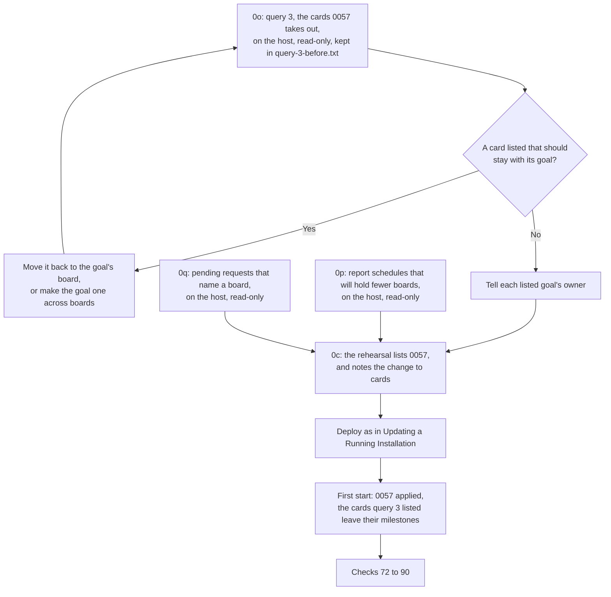

#### Before the deploy: checks 0o to 0q

Each runs on the host, against the live database, read-only, as near the deploy as you can: a card moved to another board after the check is taken out too, which is the rule anyway. Save each query below in a file of its own beside you on the host, and pipe it in; nothing in the commands needs escaping, and each prints a table.

**Check 0o: query 3, exactly the cards 0057 takes out of their milestones** (card 2155). It selects by 0057's own `WHERE`, with left joins for the names, so it lists what the statement changes and nothing else. `milestone_board` empty means the goal's board row is gone. Archived cards and closed goals are listed. A card whose column row is gone is not listed, and 0057 leaves it in its goal: no page shows such a card, and its board cannot be compared. Save it as `query-3.sql`:

```sql
SELECT c.id AS card_id, c.title, c.archived_at, m.id AS milestone_id, m.name AS milestone,
  m.status AS milestone_status, m.board_id AS milestone_board_id, mb.name AS milestone_board,
  col.board_id AS card_board_id, cb.name AS card_board
FROM cards c
JOIN milestones m ON m.id = c.milestone_id
LEFT JOIN columns col ON col.id = c.column_id
LEFT JOIN boards mb ON mb.id = m.board_id
LEFT JOIN boards cb ON cb.id = col.board_id
WHERE c.milestone_id IN (SELECT id FROM milestones WHERE board_id IS NOT NULL)
  AND (SELECT board_id FROM milestones WHERE id = c.milestone_id)
      <> (SELECT board_id FROM columns WHERE id = c.column_id)
ORDER BY m.id, c.id;
```

```bash
docker exec -i dumpfire node -e "
const sql = require('fs').readFileSync(0, 'utf8');
const db = require('better-sqlite3')(process.env.DB_PATH || 'dumpfire.db', { readonly: true, fileMustExist: true });
console.table(db.prepare(sql).all());
db.close();
" < query-3.sql > query-3-before.txt
```

The table is wider than a terminal, so it goes to `query-3-before.txt`; open that file to read it. **Keep the file after the deploy**: nothing else records what 0057 changed, since the cards' `updated_at` and the activity log are left as they were. Each run writes over it, so after the last run before the deploy it holds exactly what 0057 changes.

An empty table means 0057 changes nothing. Each row is a card that leaves its milestone at the deploy. Tell each listed goal's owner (whoever made it, `created_by` of its `milestones` row, or the owner of its board) which of their goal's cards leave it, as check 0p tells a schedule's owner. To keep one with its goal, do one of these on production before the deploy, then run the check again:

1. **Move the card back to the goal's board** (All Tasks, Move). The goal stays as it is.
2. **Make the goal one across boards** through the API, with an administrator's key; no screen changes a goal's board. Put `{"boardId":null}` in `goal.json`, then:

   ```bash
   curl.exe -s -X PATCH -H "Authorization: Bearer <administrator's API key>" -H "Content-Type: application/json" -d "@goal.json" https://<host>/api/v1/milestones/<milestone id>
   ```

   A goal across boards can then be opened only by people who can open every board its cards are on: a reader of the goal's board who cannot open the moved card's board loses the whole goal, not just that card.

**Check 0p: report schedules that will hold fewer boards** (card 2150). Enabled schedules of a board or grouping owned by an ordinary user, and the sub-boards under them (any depth) that the owner cannot open: the boards each such report leaves out from the deploy on. Shares by team and public boards count as access. A board further down that the owner can open, under one they cannot, leaves the report too and is not listed. Save it as `query-1.sql`:

```sql
WITH RECURSIVE
can_open(user_id, board_id) AS (
  SELECT created_by, id FROM boards WHERE created_by IS NOT NULL
  UNION SELECT user_id, board_id FROM board_members
  UNION SELECT tm.user_id, bt.board_id FROM board_teams bt JOIN team_members tm ON tm.team_id = bt.team_id
  UNION SELECT u.id, b.id FROM users u CROSS JOIN boards b WHERE b.is_public = 1
),
owners AS (
  SELECT s.id AS schedule_id, s.name AS schedule, s.user_id, s.scope, s.scope_id
  FROM report_schedules s JOIN users u ON u.id = s.user_id
  WHERE s.enabled = 1 AND u.role = 'user' AND s.scope IN ('board', 'category')
),
tops(schedule_id, user_id, board_id) AS (
  SELECT schedule_id, user_id, scope_id FROM owners WHERE scope = 'board'
  UNION
  SELECT o.schedule_id, o.user_id, b.id FROM owners o JOIN boards b ON b.category_id = o.scope_id
  WHERE o.scope = 'category' AND (o.user_id, b.id) IN (SELECT user_id, board_id FROM can_open)
),
walk(schedule_id, user_id, board_id) AS (
  SELECT schedule_id, user_id, board_id FROM tops
  UNION
  SELECT w.schedule_id, w.user_id, sb.id
  FROM walk w JOIN columns col ON col.board_id = w.board_id
  JOIN cards c ON c.column_id = col.id
  JOIN boards sb ON sb.parent_card_id = c.id
)
SELECT o.schedule_id, o.schedule, sb.id AS sub_board_id, sb.name AS sub_board
FROM walk w JOIN owners o ON o.schedule_id = w.schedule_id
JOIN boards sb ON sb.id = w.board_id
WHERE sb.parent_card_id IS NOT NULL
  AND (w.user_id, sb.id) NOT IN (SELECT user_id, board_id FROM can_open)
ORDER BY o.schedule_id, sb.id;
```

Run it as check 0o's command with `query-1.sql` in place of `query-3.sql` and `query-1.txt` in place of `query-3-before.txt`, so the record of check 0o is kept. Nothing to rule on: each row is a sub-board that schedule's recipients stop receiving, with no line in the report saying so. Tell its owner if it matters; giving the owner the sub-board puts it back.

**Check 0q: pending requests that name a board** (card 2153), the only ones whose inbox badge can change. Save it as `query-2.sql` and run it the same way, into `query-2.txt`:

```sql
SELECT tr.id, tr.target_type, tr.target_id, b.name AS desired_board
FROM task_requests tr JOIN boards b ON b.id = tr.desired_board_id
WHERE tr.status = 'pending'
ORDER BY tr.id;
```

A request addressed to someone who cannot open its board shows them no badge from the deploy on, and its accept dialog starts at "Select a board…".

**In the rehearsal (check 0c)**, `Migration files applied` lists `0057_cards_leave_other_boards_milestones.sql` too, and, for an export that holds cards, a note under `Worth knowing`: `cards: milestone_id cleared where it named a milestone of another board in its N row(s) by 0057_cards_leave_other_boards_milestones.sql, a one-off declared in tests/rehearsal/one-offs.ts`. Expected, not a failure. N is every row of `cards`, not the number changed: the rehearsal compares row counts and cannot see an `UPDATE`, so query 3 is the one view of what 0057 changes. The rehearsal still fails if `cards` loses a row.

#### What changes at the first start

- **0057 is applied**: the cards check 0o listed (`query-3-before.txt`) leave their milestones, once; their goals' counts and plan pages no longer hold them. No structure changes, so the schema check has nothing to say, and a later start changes nothing.
- **An affected goal's history changes with it.** Which goal a card is in is not historised: the burndown, the milestone PDF and a closed goal's final figures are drawn from the goal's cards as they are now, across the goal's whole window. So each goal check 0o listed shows, from the deploy on, a burndown, a PDF and (closed) final figures without the cards that left it, for every day back to its start, not only from the deploy. The same happens to a goal after every later move of one of its cards to another board. Keep a goal's PDF from before the deploy if its figures as they were matter.
- **Reports** downloaded, mailed or scheduled by someone who was not given every sub-board of their board leave those sub-boards out (check 0p). A report of a sub-board shared with someone who cannot open its parent no longer names the parent. A schedule's report follows its owner's access at each run, growing as well as shrinking.
- **"Unblocked" comments** written from now on about a card on another board read `Unblocked: #12, a card on another board, completed — nothing is blocking this card now.`; those written before stay as they are. The "Unblocked" mail gives an assignee who cannot open the finished card's board "A card on a board you cannot open" in place of its title, and the "Plan created" mail goes only to recipients who can open the plan.
- **A move to another board** takes the card out of a milestone of the board it left, and the board's activity says so: `"T" moved to board "B" (To Do → To Do) and out of milestone "M"`. Through the API the move answers `milestoneId: null` and names the milestone left as `leftMilestone`, and All Tasks says `Moved. It left milestone "M"; moving it back does not put it back in.` in a toast.
- **An open board** turns into "You do not have access to this board" within about 30 seconds of its reader losing access, where it went on receiving the board's events while the session lasted. `GET /api/boards/{id}/events` on a board that is not there is `404` for everyone, administrators included.
- **No new log line** is written for any of it.

**Owner to know.** A report leaves out the sub-boards its reader cannot open, with no line saying so, and its recipients get the sender's or the schedule owner's view whoever they are. Someone who cannot open a card's unfinished sub-board is told that a sub-board they cannot open is unfinished, not its name. An "Unblocked" comment about a card on another board gives its number, not its title. An assignee who cannot open a plan is no longer mailed when it is created. A request naming a board the reader cannot open shows no badge to them. Moving a card to another board takes it out of a milestone of the board it left, and All Tasks says so; a goal across boards keeps it. A goal that loses a card, at the deploy or by a later move, shows a burndown, PDF and final figures without it for its whole window. Someone taken off a board, or an administrator made an ordinary user who is not on it, sees the open board turn into a refusal within about 30 seconds.

#### After the deploy

Checks 72 to 90 run on production. Accounts: the superadmin (or an administrator), a second administrator `qa-admin2`, and an ordinary user `qa-reader`, each in a browser of their own, and an API key of the administrator's and of `qa-reader`'s. Data: board A with `qa-reader` as a member; under a card of A a sub-board S made by the administrator and not shared, with a card titled "S secret"; board B that `qa-reader` cannot open; a board P that `qa-reader` cannot open with a sub-board P1 shared with `qa-reader`; a board "QA spare" with `qa-reader` as a member. Mail set up; `qa-reader`'s address a mailbox you can read; `qa-reader` and `qa-admin2` with the "Card Moves" and "Planning" mail preferences on. In Windows PowerShell 5.1 send each request with `curl.exe` and its body from a file, as in checks 51 to 71.

| # | Card | Do | Account and data | Expect | A fault if |
|---|---|---|---|---|---|
| 72 | 2150 | Reports, board A, download the PDF | `qa-reader` | No S and no "S secret" | Either |
| 73 | 2150 | The same | The administrator | S nested under A, with "S secret" | S missing |
| 74 | 2150 | Email the report of board A to your own address | `qa-reader` | The attached PDF has no S | S in it |
| 75 | 2150 | Make a weekly schedule of board A to your own address, for today's weekday, a few minutes ahead in the server's time of day (UTC in the container unless `TZ` is set); wait for it | `qa-reader` | The mailed PDF has no S | S in it |
| 76 | 2150 | Reports: P1 is in the board list; download its report | `qa-reader` | P1 alone, with P's name nowhere in it | P1 not listed, or P's name in it |
| 77 | 2151 | Make `qa-reader` an editor of A. Put `{"columnId":<A's Complete column id>}` in `move.json`; `curl.exe -s -X PUT -H "Authorization: Bearer <key>" -H "Content-Type: application/json" -d "@move.json" https://<host>/api/v1/cards/<the card that holds S>/move` | `qa-reader`'s key | `409` `{"message":"A sub-board you cannot open still has incomplete cards that must be completed first. Ask this board's owner."}` (a drag on the board page is stopped before it is sent, in the page's own words) | S's name, or the card completes |
| 78 | 2151 | The same | The administrator's key | `409` naming S: `Sub-board "S" has 1 incomplete card that must be completed first` | The generic message |
| 79 | 2152 | Card W on A assigned to `qa-reader`, waiting on card X on B; complete X | The administrator | On W, `Unblocked: #X, a card on another board, completed — nothing is blocking this card now.`; `qa-reader`'s mail says "A card on a board you cannot open" | X's title in either |
| 80 | 2152 | The same with X on A | The administrator | The comment names X by title, as before | The number only |
| 81 | 2152 | Through the API or the wrapper, attach to an empty milestone of A two cards, one assigned to `qa-reader` and `qa-admin2` and waiting on X on B | The administrator's key | `qa-reader`'s "Plan created" mail shows `#X A card on a board you cannot open` in the chain; `qa-admin2`'s shows X's title (whoever attaches is not mailed) | X's title in `qa-reader`'s |
| 82 | 2153 | Send a request to `qa-reader` naming board B; as `qa-reader`, open Inbox, then Accept | The administrator, then `qa-reader` | No board badge; the dialog starts at "Select a board…" | B's name, or B preselected |
| 83 | 2153 | Send the same request to the administrator; open Inbox | `qa-admin2`, then the administrator | The badge shows B | No badge |
| 84 | 2155 | Open the milestones of the cards check 0o listed (`query-3-before.txt`) | The administrator | Those cards are no longer in them; the others unchanged | A listed card still in its milestone |
| 85 | 2155 | From All Tasks, move a card of a milestone of A to B | The administrator | A toast `Moved. It left milestone "…"; moving it back does not put it back in.`; the card has no milestone; A's activity reads `… moved to board "B" (…) and out of milestone "…"`; the plan no longer lists it | It keeps the milestone, or no toast |
| 86 | 2155 | The same with a card of a goal across boards | The administrator | It keeps the goal, and no toast about a milestone | It leaves it, or a toast says it did |
| 87 | 2170 | `qa-reader` opens board A and leaves it open. As the administrator, take `qa-reader` off A (Share Board), then change nothing on A for a minute | `qa-reader`; the administrator | Within about 30 seconds `qa-reader`'s page shows "You do not have access to this board"; in their browser's developer tools (Network, the `events` request, EventStream) the last message is `update` with `{"type":"access"}` | The board still on screen after a minute |
| 88 | 2170 | `qa-admin2`, not on A, opens board A. As the superadmin, make `qa-admin2` an ordinary user, then change nothing on A for a minute | `qa-admin2`; the superadmin | The same within about 30 seconds | The board still on screen |
| 89 | 2170 | `qa-reader` has "QA spare" open. As the administrator, delete "QA spare" | `qa-reader`; the administrator | The page shows "Board not found" at once | The board stays |
| 90 | 2170 | `qa-reader` back on A, with A open and left so, for several minutes while the administrator moves cards on A | `qa-reader`; the administrator | Each move appears; nothing else changes | The page goes to a refusal |

Make `qa-admin2` an administrator again if it is kept, and delete the check accounts, boards and schedule afterwards.

#### Going back to the previous image

Nothing is done to the database.

- **0057 stays applied.** The older image logs one `[ERROR] [DB]` line for the recorded file it has no file for, and starts. The cards it took out stay out of their milestones.
- **The rules go with it.** The older image's reports walk into every sub-board again, its refusal and inbox name hidden boards, its "Unblocked" notices carry another board's title, a move leaves a card in its milestone, and an open board stream keeps the access it was opened with.

## Changing the Schema

The structure of the database is changed in one way only:

1. Add a new numbered file under `drizzle/`, named `NNNN_what_it_does.sql` with the next unused number, with `--> statement-breakpoint` between its statements.
2. Make the same change in the model, `src/lib/server/db/schema.ts`.
3. Run `npm run schema:expected`. It regenerates `src/lib/server/db/expected-schema.ts`, the copy of the model that the runner compares every database with.
4. Run `npm test`. The suite builds a database from the migration files and fails if it is not the model exactly, or if the expected schema is out of date. See [Testing](testing.md#the-expected-schema).

`npm run build` checks step 3 again before it builds, on a workstation and inside `docker build`, and stops if the expected schema is not what the model generates.

**The six reconciled tables are no exception to step 1.** Reconciliation rebuilds `boards`, `columns`, `categories`, `settings`, `user_xp` or `invite_tokens` whenever the table has the model's columns and differs from it in anything else, so a constraint changed in the model alone would reach every database at its next start with no migration recording it. A change to one of the six therefore ships a numbered file like any other, even where the file can only say what the rebuild will do and why (a comment and a statement that changes nothing, such as `SELECT 1;`). The file is what puts the change in the migration record, and it is what makes an older image recognise the database as newer than itself and leave those tables alone. The file that creates the table must be corrected as well, so that a new database is born in the new shape, as was done for the two `0001` files: the suite fails if a new database needs a rebuild.

What the runner requires of a migration file:

- **None of these statements**: `PRAGMA`, `BEGIN`, `COMMIT`, `END`, `ROLLBACK`, `SAVEPOINT`, `RELEASE`, `VACUUM`, `ATTACH` or `DETACH`. The file already runs inside the runner's transaction, where each of them fails, ends the transaction early or, worst, does nothing without saying so. A file that contains one is refused before any of it runs, and the server stops. The `BEGIN … END` of a trigger's body is part of the `CREATE TRIGGER` statement and is allowed.
- **At least one SQL statement.** An empty or comment-only file is refused: once recorded it could never be given its SQL, because a recorded file is never run again.
- **No "already exists" or "duplicate column" error.** Those are tolerated only in a fixed list of 19 old files, none later than `0037`, where two series of migrations overlap. In any other file they stop the server, and nothing is ever added to the list.
- **A released file is never run twice.** A file is recorded by its name, so editing one changes new databases only, and renaming one makes every existing database run it again.

Two drizzle-kit commands must not be used to change a database:

- **Never run `drizzle-kit push` against a real database.** `push` compares the model with the database and alters the database directly. It drops tables the model does not declare, which is how the development database lost `time_entries`, and it rebuilds tables on the spot, which is how the same database came to have a half-finished `__new_report_schedules` left in it. None of it is recorded as a migration, so no other database receives the same change and the databases drift apart.
- **Do not apply `drizzle-kit generate` output as it comes.** To change a column's `NOT NULL`, primary key or foreign key, `generate` writes a table rebuild wrapped in `PRAGMA foreign_keys=OFF` and `PRAGMA foreign_keys=ON`. The runner refuses such a file, and has to: SQLite ignores `PRAGMA foreign_keys` inside a transaction without reporting an error, so inside the runner's per-file transaction foreign keys would stay on, and the `DROP TABLE` in the rebuild would delete the table's rows and every row that cascades from them. drizzle-kit's own journal (`drizzle/meta/_journal.json`) also stops at `0005`, so what it generates is every difference between the model and the schema as it stood then, not only the change just made.

A rebuild of a table that other tables refer to therefore cannot be delivered as a migration file. Rebuilds of that kind are done in code, as they are for the six reconciled tables: with foreign keys switched off outside any transaction and the whole database checked before the commit. See [Data Model](data-model.md#reconciliation-the-six-tables).

Under `npm run dev` a failed migration does not end the process. The dev server stays up and every request fails until the cause is fixed and the server is restarted.

## Reverse Proxy — Nginx

```nginx
server {
    listen 443 ssl http2;
    server_name dumpfire.example.com;

    ssl_certificate     /etc/ssl/certs/dumpfire.pem;
    ssl_certificate_key /etc/ssl/private/dumpfire.key;

    # Shared by every location below.
    proxy_http_version 1.1;
    proxy_set_header Host $host;
    proxy_set_header X-Real-IP $remote_addr;
    proxy_set_header X-Forwarded-For $proxy_add_x_forwarded_for;
    proxy_set_header X-Forwarded-Proto $scheme;
    proxy_set_header X-Forwarded-Host $host;

    # SSE support — disable buffering of what DumpFire answers
    proxy_buffering off;
    proxy_cache off;
    proxy_read_timeout 86400s;

    # Everything else. No client_max_body_size here: nginx's own default, 1m,
    # is more than the 512 KB DumpFire accepts on these, so it is DumpFire
    # that answers a body that is too large, and says the limit.
    location / {
        proxy_pass http://localhost:3000;
    }

    # Import Backup: a whole database. As much as the server itself accepts
    # (BODY_SIZE_LIMIT, 512M in the image).
    location = /api/admin/import {
        client_max_body_size 512m;
        proxy_pass http://localhost:3000;
    }

    # An attachment: a file of up to 25 MB, and the form it is sent in.
    location ~ ^/api/cards/[0-9]+/attachments$ {
        client_max_body_size 26m;
        proxy_pass http://localhost:3000;
    }
}
```

> ⚠️ **SSE requires `proxy_buffering off`** — without this, real-time board updates will not work.

> ⚠️ **Without the two `client_max_body_size` lines, nginx refuses any upload over 1 MB itself**, with a page of its own that never reaches DumpFire. The import then says the backup "was refused before it reached DumpFire, probably a size limit at the proxy in front of it (HTTP 413)", and so does an attachment. Before the page could tell the difference it said "Invalid backup file".

Leave `proxy_request_buffering` as it is, which is on. nginx then reads the whole upload before it passes it on, with its length in `Content-Length`, and DumpFire refuses one that declares more than its route accepts before reading any of it. Switched off, nginx passes an upload on in chunks as it arrives, which DumpFire also accepts: it counts such a body as it reads it, and refuses it once it passes the limit (see [Upload Size Limits](#upload-size-limits)). nginx keeps an upload of that size in a temporary file while it reads it, so its temp directory (`client_body_temp_path`) needs room for one backup.

### The Caller's Address Behind a Proxy

Behind the proxy, every request reaches DumpFire from the proxy, so unless it is told otherwise the server takes the proxy's address for every caller's. Two things are counted by address, and each then has one count for the whole installation:

- **Sign-in.** Ten attempts from one address in 15 minutes, less those at an account that then signed in from it (card 2226), and further attempts from it are refused for the rest of the 15 minutes. Behind an untold proxy, ten failed attempts by anyone refuse everybody's. A browser remembered for the account it signs in to (card 2194) is neither counted nor refused by this count, so behind an untold proxy one guesser no longer keeps everybody's usual browser out. The waits after five wrong passwords at one account (card 2177), and the rule that then lets browsers not remembered for it in one at a time (card 2194), are counted by account, not by address, so they work whatever address the server reads: behind an untold proxy they still slow a guesser at one account. That rule refuses a second sign-in at the same moment at an account under attack, from any address: see [If an Attack Keeps an Owner Out](#if-an-attack-keeps-an-owner-out). What the proxy changes is the per-address count, which is then one count for everyone. See [Guessing a Password at Sign-in](authentication-security.md#guessing-a-password-at-sign-in).
- **The documented API without a key.** A request to `/api/v1/` with no key DumpFire accepts, a missing header included, is counted against its address, 60 a minute (see [API Rate Limiting](#api-rate-limiting)). Behind an untold proxy, a key that is mistyped may be answered `429` while somebody else is guessing. A valid key is never held up by it: its requests are counted against the key.

The public request form is counted by address too, and so is each of these counted by the address's key rather than the address as received (card 2195): an IPv6 address by its /64 network, so that everyone on one IPv6 network shares one count, as an office behind one IPv4 address does; an IPv4 address written as IPv6 (`::ffff:198.51.100.7`) as the IPv4 address; and with no port, where a proxy writes one into its header (`198.51.100.7:51234`, `[2001:db8::1]:443`), since every connection has a port of its own. Behind an untold proxy every caller has the proxy's one address, and none of that changes anything. IPv6 reaches the counts only through `ADDRESS_HEADER`, as behind Cloudflare, which serves IPv6 by default. The log keeps the address as received; sign-in's refusal line adds the key where it differs, `Rate limit hit for IP 2001:db8:1:2::9, counted as 2001:db8:1:2::/64 (login attempts)`. See [How an Address Is Counted](authentication-security.md#how-an-address-is-counted).

The system log's `ip` column is the proxy's as well. Tell the server where the proxy writes the caller's address, with the header the nginx block above sets:

```bash
docker run -d \
  --name dumpfire \
  --restart unless-stopped \
  -p 127.0.0.1:3000:3000 \
  -v dumpfire-data:/app/data \
  -e DB_PATH=/app/data/dumpfire.db \
  -e ORIGIN=https://dumpfire.example.com \
  -e ADDRESS_HEADER=X-Forwarded-For \
  -e XFF_DEPTH=1 \
  dumpfire:latest
```

- **`XFF_DEPTH` is the number of proxies in front of the server.** nginx appends the address it was reached from to `X-Forwarded-For`, so with one proxy the caller is the last entry. A caller can write anything they like at the start of the header, which is why the address is read from the end. With a second proxy in front of nginx (a CDN, a load balancer), it is `2`.
- **The image does not set either.** With `ADDRESS_HEADER` set and no proxy in front, the header is absent from every request, and the server cannot read any caller's address. A request that reaches the container's port past the proxy is the same, which is why the port above is published on `127.0.0.1` only.
- **What DumpFire does without an address.** It asks for it guarded, everywhere it asks: a request whose address cannot be read is answered and logged without one, and every count by address, the sign-in form's, the public request form's and the documented API's, counts it as `unknown`, with every other caller whose address cannot be read. So with `ADDRESS_HEADER` set and no proxy in front, everybody shares one count, as behind an untold proxy. The sign-in form and the public request form answered `500` to such a request until 2026-10-14.

### Security Headers From the Proxy

DumpFire sets five security headers on every answer it gives (see [Security Headers](#security-headers)). Some answers are made where DumpFire's gate never sees them, and carry none of the five unless the proxy adds them:

- every static file of the built server (`/_app/immutable/...`, `/_app/version.json`, which every open page asks for once a minute, `robots.txt`), which the server sends before the gate is called;
- the `403` for a form posted from another site, which SvelteKit sends before the gate is called;
- the redirect that adds or removes a trailing slash;
- the `404` for any other path that begins `/_app`, but a call to a remote function, `/_app/remote/...`, which DumpFire's gate answers `404` itself, whatever path the call's `x-sveltekit-pathname` header names (there are no remote functions), but one that cannot be decoded, which is the gate's `400` `Malformed URI`, as SvelteKit 2.60 also answered it;
- the `500` for a fault in the gate itself.

None of these is a page anybody uses, so the one that matters is `X-Content-Type-Options`. To add a header only where DumpFire has not, so that no answer carries it twice, map the upstream's header to an empty value, which nginx does not send:

```nginx
# In the http block, beside the server block above.
map $upstream_http_x_content_type_options $dumpfire_nosniff {
    ""      "nosniff";
    default "";
}

# In the server block.
add_header X-Content-Type-Options $dumpfire_nosniff always;
```

Do not add `X-Frame-Options` from the proxy for every answer: DumpFire leaves it off the public request form's three pages on purpose, so that the form can be embedded in another site's page. A location that sets an `add_header` of its own stops inheriting the server block's, so set it in each such location as well.

**Do not add a `Content-Security-Policy` at the proxy.** Every page carries DumpFire's own, with a new nonce for its scripts each time (see [The Content-Security-Policy](authentication-security.md#the-content-security-policy)). A browser enforces a second policy beside it, and one written at the proxy holds no page's nonce, so it stops every page's scripts. For the same reason a script that a proxy or front **puts into pages** (Cloudflare's Rocket Loader, its automatic Web Analytics beacon, any "optimisation" that rewrites HTML) is refused by the policy. Command 3 under [The Update That Brings the Content-Security-Policy](#the-update-that-brings-the-content-security-policy) shows whether a policy is there, and a count above `0` on its second line whether such a feature may be: read the browser's console in the report-only trial, and turn the feature off only if a report names it.

## Upload Size Limits

A request's body passes three limits on its way in, and each answers differently when it is too large:

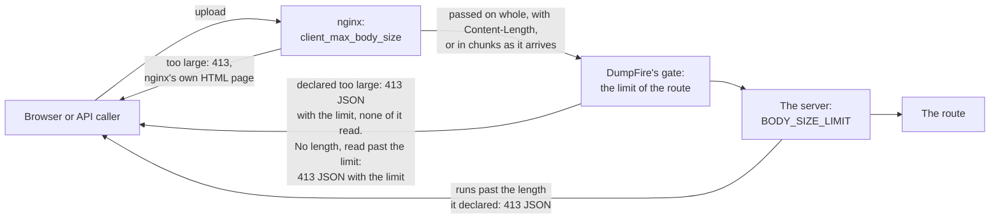

| The route | The most its body may be | Where that is set |
|-----------|--------------------------|-------------------|
| Every route, a page's form included | 512 KB | `src/lib/server/body-limits.ts` |
| `POST /api/cards/[id]/attachments`, for a caller who is signed in | 26 MB: the handler accepts a file of up to 25 MB | The same file |
| `POST /api/admin/import`, for the superadmin (anybody else signed in is held to 512 KB, and refused by the handler before it reads a byte) | All the server accepts: `BODY_SIZE_LIMIT` | The `Dockerfile` sets `512M`; override it with `-e BODY_SIZE_LIMIT=...` |

A request that declares its length in `Content-Length` is held to the limit on that, before its body is read, so an upload that says it is too large is refused without any of it being read. One that declares no length, sent in chunks by its client or by a proxy that passes a body on that way (`cloudflared` does unless it is told not to: see below), is counted as it is read and refused once it passes the limit: the server reads up to the limit, and no further, before it refuses it. Either way the server never reads more than the limit, but a refusal of a body sent in chunks is not free. The server on its own holds a body with no length to `BODY_SIZE_LIMIT` alone, the whole server's limit (it held one to no limit at all before adapter-node 5.5.5), which is why the gate counts it against its route's. A chunked body that passes `BODY_SIZE_LIMIT` itself is refused by the server first, before the gate's count sees the bytes that pass it, and is answered `413` `{"message":"Payload Too Large"}`, without `limitBytes`: that is the import, whose limit is `BODY_SIZE_LIMIT`. Every route with a smaller limit still gets the gate's `413` with `limitBytes`.

**Behind Cloudflare Tunnel, for large uploads.** `cloudflared` passes a body on in chunks unless its `originRequest` settings say `disableChunkedEncoding: true`. Uploads work either way. With it, the length the browser declared reaches DumpFire, and a backup or an attachment that is too large is refused before any of it crosses from the tunnel to the server, rather than after the first 512 KB or 26 MB of it has. It is a saving, not a requirement. Cloudflare has a limit of its own on an upload: see [How Large an Import Can Be](#how-large-an-import-can-be).

No route is given more than `BODY_SIZE_LIMIT`. A server started without the image's setting, with `node build` and no variable, accepts 512 KB everywhere: an attachment over that is refused there, and so is an import.

`BODY_SIZE_LIMIT` takes a number of bytes, or a number followed by `K`, `M` or `G`. **`512MB` is not accepted**: the server does not start, and logs `Invalid BODY_SIZE_LIMIT: '512MB'. Please provide a numeric value.`

After a deploy, check that the container has the setting:

```bash
docker exec <container> printenv BODY_SIZE_LIMIT
```

It prints `512M`. Nothing printed means the image was built from a `Dockerfile` without the line, and every upload over 512 KB will be refused.

### How Large an Import Can Be

The limit is not the only ceiling. An import does this, in order:

1. Reads the whole upload into memory.
2. Writes it to `.restore-temp.db` in the server's working directory, and opens that.
3. Writes a safety copy of the running database, every table as one JSON text, to `.pre-restore-safety.json` in the same directory. It leaves out the `known_browser_secret` row of `settings`, the key remembered browsers are signed with, which no backup holds either.
4. Replaces the rows.

So the server needs memory for the whole backup and, at the same moment, for the running database as JSON, which is larger than the database's own file because every row repeats its column names. That JSON is one piece of text, and Node 22 cannot make one longer than 536,870,888 characters, about 512 MB: a running database whose rows come to more than that as JSON cannot be imported over. The import then fails with "Restore failed: Invalid string length" and nothing is changed. That, and the memory the container is allowed, are the practical ceiling, and both are reached well before a backup of 512 MB is. Neither has been measured on a large database: try an import of production's size on an instance that is not production before it is needed.

Two limits outside DumpFire end an upload before it is read:

- **The server's own time limit for a request.** Node gives a request five minutes, its `server.requestTimeout` default of 300 seconds, to arrive in full, and the image does not change it. An upload that takes longer is cut off and the import never starts. Behind nginx, which reads the whole upload before it passes it on, the server is handed it in a moment, whatever the caller's connection. With no proxy, or behind one that passes the upload on as it arrives (Cloudflare Tunnel, Caddy, nginx with `proxy_request_buffering off`), the server receives it at the caller's speed, and an import that takes more than five minutes to upload cannot be done that way: upload it from somewhere closer to the server.
- **Cloudflare's own limit on a request's body.** Behind Cloudflare, a Cloudflare Tunnel included, Cloudflare refuses a request whose body is over its plan's limit before it reaches the server: 100 MB on the Free and Pro plans. A backup larger than that cannot be imported through it; import it through an address that does not pass through Cloudflare.

Both files are written to the working directory, which in the image is `/app`: **inside the container and off the volume**. They need that much free space in the container's own layer, and they go when the container is recreated. `.restore-temp.db` is deleted when the import ends. `.pre-restore-safety.json` is not: it stays until the next import replaces it, and it holds everything the database held, password hashes and live sessions included, but for the key remembered browsers are signed with. Once the import is known to be good, remove it:

```bash
docker exec <container> rm -f /app/.pre-restore-safety.json
```

## Backup Destinations

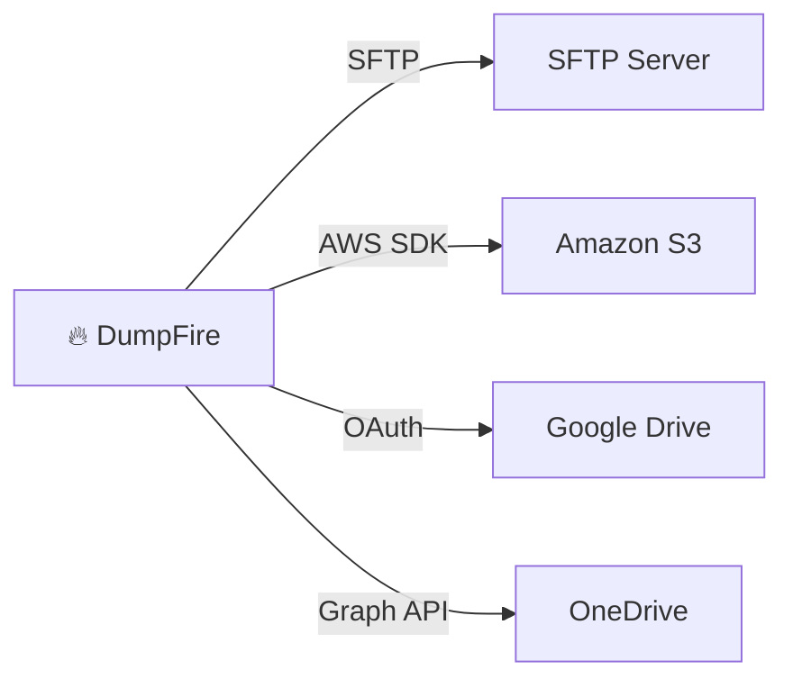

The scheduler checks once a minute whether a backup is due. Each backup:
1. Writes a complete copy of the database to a temporary file beside it with `VACUUM INTO`, which includes changes still in the write-ahead log. It then opens the copy with no journal, deletes every session, every unused invite, the key remembered browsers are signed with and the key the request form signs with from it, sets every request's link to `NULL`, masks every invite's token, any request link's token and the name typed at an old failed sign-in in its system log, deletes the mail password and the key backups are sealed with, empties every destination's secret fields and every webhook's secret, switching each such webhook off (card 2169), seals it (an HMAC of every row, written into it as `backup_seal`), and writes it out again with a second `VACUUM INTO` to a second temporary file, so that nothing of what was deleted is left in the file. It reads that second file and deletes both. The running database is not touched: nobody is signed out by a backup, and its own log is as it was; the first backup writes the seal's key into it (`backup_seal_key`), and none after. Every step of this is synchronous, so **the server answers no request from the start of the first `VACUUM INTO` until the second file has been read**: both copies, the masking, the deletes and the read, and not only the first copy. "Export Backup" stops it the same way. See "How long the server stops answering", below. Both temporary files are beside the database, on the volume, so it needs room for two copies while a backup is made, and none for a journal.
2. Uploads the copy as it is, not compressed, to each configured destination as `dumpfire-backup-<UTC date and time>.db`
3. Records the result for each destination in the `backup_log` table, which keeps the last 10 entries
4. After a successful upload, deletes the oldest backups at that destination beyond the retention count (a retention of 0 keeps them all). On Google Drive only the files the connected account may delete or trash are counted, and one it may not is left with one `WARN` line a run: see [Configuring Backups](admin-guide.md#configuring-backups)

A failed upload is not retried. It is logged at `ERROR`, recorded in `backup_log` with the error, and emailed to the alert address if failure alerts are switched on and SMTP is configured. The destination is tried again at the next scheduled backup.

**A destination whose credentials are not entered is not tried** (card 2169): an S3 destination with no secret access key, a Google Drive one with no client secret or refresh token (OAuth) or whose service account JSON holds no private key, a OneDrive one with no client secret. It is asked before the copy is made, and such a destination fails at once, recorded, logged and mailed as any failure is, with "This destination's credentials are not entered: a backup does not hold them, so they are entered again after a restore. Enter them in Admin, Scheduled Backups." (a Google Drive OAuth one: "… enter its client secret and connect it again."). A run in which no destination can be tried makes no copy at all, so the server does not stop answering for a copy nobody takes. An SFTP destination with neither a password nor a key is tried as before: a server that allows `none` authentication accepts it. So after a restore onto another server, such a destination is tried against the real host at every scheduled run, and its failed logins may trip a lockout there: enter its credentials, or remove it.

A backup file is a whole database: its data, its structure and its own record of applied migrations, with what would open something taken out. It holds no session, and no invite that has not been used: either would sign in whoever read the file. Its system log names no invite's token either: the server wrote an invite's address into the log with the token in it until 2026-10-14, and a backup masks those lines. The server masks the same lines in its own log once at every start, so `GET /api/logs` shows none of those tokens either from the first start on this version. Every user is in it with their password hash and email, and every webhook with its address, so it is still a file to keep where few can read it: a Slack or Teams incoming webhook's address is all anyone needs to post to that channel, so if a copy may have been read, make a new one at its service. The file "Export Backup" downloads is made the same way and holds the same.

**No secret is in a backup** (card 2169): not the mail password, not a destination's credentials (an SFTP password or private key, an S3 secret access key, a Google Drive client secret and refresh token or a service account's private key, a OneDrive client secret), not a webhook's signing secret. Each destination's other fields stay, and a webhook that had a secret is switched off in the copy and listed in `webhook_secrets_left_out`, so that a file put in place by hand sends nothing unsigned. An Import Backup fills each gap from this server where it is for the same account, in every field that is not secret, and only into a backup this server made and nobody has changed since (its seal, made again with this server's key), and its result lists any to enter again; a file put in place by hand comes up with none of them, and every start writes one `[WARN] [STARTUP]` line naming what is still to enter. See [What a Backup Holds, and What a Restore Brings In](authentication-security.md#what-a-backup-holds-and-what-a-restore-brings-in).

**So a backup alone no longer rebuilds a lost server.** On a server that still runs, restore with Import Backup, which keeps this server's secrets; put a file in place by hand only when it cannot start. A server rebuilt from nothing needs every secret entered again, so keep the mail password and each destination's credentials outside DumpFire (a password manager), and know who holds each webhook's secret. An S3 secret key cannot be read again from AWS (a new one is made); a Google Drive OAuth destination needs its client secret from the Google Cloud console, then Connect; a webhook's secret is known only at its receiver.

A backup opens no request's thread either (card 2158): every request is in it with its link (`task_requests.access_token`) empty, and the key the public request form signs its tokens with (`request_form_secret` in `settings`) is not in it. A restore gives every request a new link, whatever the backup holds, and its answer says how many it replaced; it never brings the form's key in, and the restored server makes a new one. The key remembered browsers are signed with (`known_browser_secret` in `settings`, card 2194) is taken out of every copy and never restored, so a restore forgets every remembered browser and the restored server makes a new key. A backup's system log holds no name typed at a failed sign-in at a name that was no account either: those lines are rewritten in the copy, and in the running log at every start (card 2193).

**What clearing the copy costs.** The copy used to be vacuumed in place, which needs a rollback journal on the volume as large as the copy. Writing it out again with `VACUUM INTO` needs no journal, and is quicker. Measured once by the reviewer, on a 154 MB copy: 2.7 s for the vacuum in place, 1.3 s for `VACUUM INTO`, with no planted session id or token left and the integrity check passing. Measured again for this change, on a 196 MB database made up for the purpose (never a real one) on a Windows development machine, six runs of each: the vacuum in place took 1.7 to 3.1 s, `VACUUM INTO` 0.5 to 1.3 s, and the first copy 0.7 to 1.5 s. Neither has been measured on the production server; expect the figures to grow with the database.

**How long the server stops answering.** The server waits for the whole of a backup, not only for the first copy, and that whole has never been measured. Added together from the separate figures above, the two `VACUUM INTO`s alone came to about 1.2 to 2.8 s on the 196 MB made-up database on the development machine (0.7 to 1.5 s for the first copy, 0.5 to 1.3 s for the second); the masking of the log, the deletes and the reading of the file come on top of that, unmeasured. The seal (card 2169) reads every row of the copy once more: measured on made-up copies on a development machine, 0.2 s for 59 MB and 115,000 rows, 0.56 s for 177 MB and 345,000; an Import Backup spends as long again making it afresh from the file it is given. It is an estimate from parts, on a machine that is not the server. Expect it to be longer on a larger database or a slower disk, and schedule backups for an hour when few people use DumpFire.

Backups made before this version do hold the sessions of whoever was signed in when they were made, and a session goes on being good for as long as it is used. Restoring one no longer brings them back: a restore brings in no session whatever the backup holds. Those made before card 2158 hold every request's link as it was mailed, which migration 0055 replaces once and every restore replaces again. Those made before card 2169 hold the mail password, every destination's credentials and every webhook's secret, and carry no seal, so Import Backup of one keeps nothing from this server (it needs nothing kept); nothing can take the secrets out of a copy already made, and they go as each destination's retention removes them. If one of them may have been read by somebody who should not have, change the mail password and each destination's credentials at their services and enter them again, and set new webhook secrets with their receivers. The copies themselves, at a destination or downloaded, are unchanged: treat them as you would a password file, and delete the ones that are not needed.

**What the admin page is told of the secrets, and when a saved one is used** (cards 2187 and 2190). `GET /api/admin/backup` answers every secret field masked, `••••••••`, whatever the destination's type: an SFTP password and private key, an S3 secret access key, a client secret, a Google Drive refresh token and a service account's private key (a service account JSON that cannot be read as an object is masked whole). A save or a test that sends a secret masked uses the saved one only from the one saved destination that is the same in type, name and every setting that is not secret; otherwise it is refused `400`, naming what to type again, with nothing written. See [Configuring Backups](admin-guide.md#configuring-backups).

**Google Drive with OAuth** (card 2188). Connect asks Google for `https://www.googleapis.com/auth/drive.file`, the files DumpFire makes, and records the scope Google granted as `grantedScope` in the destination. With the Folder ID empty it makes a folder, "DumpFire backups (made YYYY-MM-DD)", in the account's My Drive and saves its id; with one set it fetches it and refuses the Connect, saving nothing, when Google does not let it reach it. Connections made before this change asked for the whole of Drive and keep it until they are narrowed by hand, removing DumpFire's access in the Google account first: see [Configuring Backups](admin-guide.md#configuring-backups). A token refreshes with the scopes it was granted, so the deploy stops no Drive backup.

Backup destinations, the schedule and "Run Now" are the superadmin's: see [The Superadmin](#the-superadmin). See [Restoring from Backup](admin-guide.md#restoring-from-backup) for the two ways to put one back.

A backup file holds no attachment file. The uploads folder is backed up separately, by you: see [Attachment Files](#attachment-files).

## Security Headers

Set by the gate on every answer it gives, to anybody: pages, the internal and the
documented API, the gate's own refusals and its redirects. A header the answer already has
is left as it is.

| Header | Value |
|--------|-------|
| `X-Content-Type-Options` | `nosniff` |
| `X-Frame-Options` | `DENY`, except on `/request`, `/request/[id]/confirm` and `/request/[id]/reply` |
| `Referrer-Policy` | `strict-origin-when-cross-origin` |
| `Permissions-Policy` | `camera=(), microphone=(), geolocation=()` |
| `X-XSS-Protection` | `0`: switches off the filter old browsers ran over a page, which could itself be used to make a page leak |
| `Content-Security-Policy` | On pages only, set by SvelteKit with a new nonce on every page; `Content-Security-Policy-Report-Only` instead while `CSP_MODE=report-only`. No API answer, redirect or gate refusal carries one, and an attachment keeps its own `sandbox` |

The public request form and the two pages its mails link to carry no `X-Frame-Options`, so
that the form can be embedded in another site's page; every other page refuses to be
framed. What the gate never sees is the proxy's to head: see
[Security Headers From the Proxy](#security-headers-from-the-proxy). See
[Security Headers](authentication-security.md#security-headers).

## API Rate Limiting

The external API `/api/v1/*` is rate-limited, in memory, per process:
- **60 requests per minute per API key**, counted against the key once it is checked. A key
  over its limit is answered `429` and its `last_used_at` is not touched.
- **60 requests per minute per address** for requests with no key DumpFire accepts, a
  missing `Authorization` header included, in a count of their own: they never spend a real
  key's allowance. An IPv6 address is counted by its /64 network, an IPv4 address written as
  IPv6 as the IPv4 address, and a port is taken off (card 2195). Behind a proxy, set `ADDRESS_HEADER` or every caller has the proxy's
  address: see [The Caller's Address Behind a Proxy](#the-callers-address-behind-a-proxy).
- Returns `429 Too Many Requests` with a `Retry-After` header when exceeded.
- `GET /api/v1/openapi.json` needs no key and is not counted.
