# DumpFire Deployment Guide

DumpFire is deployed as a single Docker container running Node.js 22 with an embedded SQLite database. No external database server is required.

## Deployment Architecture

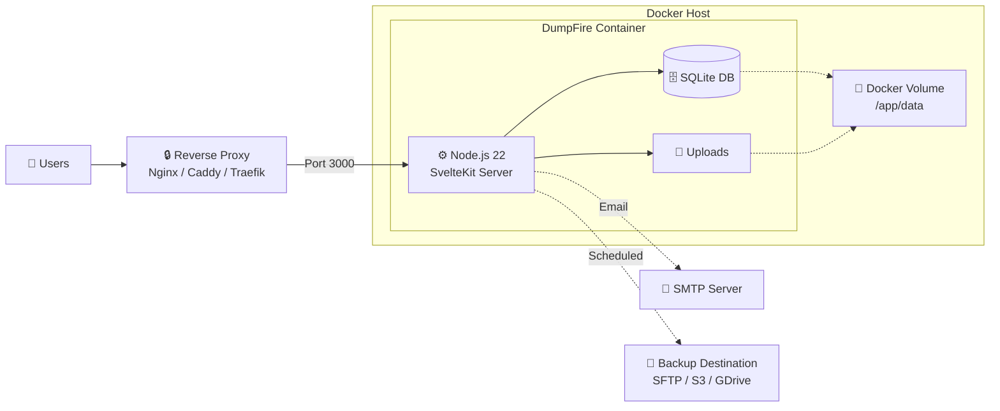

## Docker Build

The Dockerfile uses a two-stage build for minimal image size:

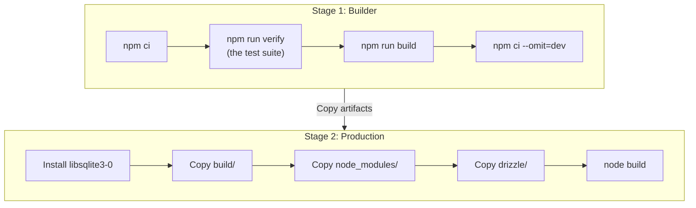

### Build Command

```bash
docker build -t dumpfire:latest .
```

The build asks for no particular builder. The `Dockerfile` has no `# syntax=` line and no flag on any step: its test step is a plain `RUN npm run verify`, which the classic builder and BuildKit both know. It has been built under BuildKit only (the default builder since Docker 23, and the one Docker Desktop 29.2.1 uses); under the classic builder it has not been tried.

### Run the Tests Before You Build

> ✅ **The image build runs the test suite, and stops if a test fails.** The builder stage of the `Dockerfile` runs `npm run verify` after the source is copied in and before `npm run build`. A failing test ends `docker build` at that step with exit status 1 and no image is made, so an image cannot be built from a tree whose tests fail. `npm run build` then makes its own check, of the expected schema (see [Changing the Schema](#changing-the-schema)).

Running the suite by hand first is still the quick way to find out. It takes under a minute (43 seconds on the workstation on 2026-10-15), where a build that fails has already cost a `git pull` and an `npm ci` on the Docker host. Run it where the repository is checked out with its dependencies installed (`npm ci`), on the commit that is going to be deployed and before that commit is pushed to where the image is built:

```bash
npm run verify
```

- **What it runs.** The whole suite, once: every test file listed in `tests/harness.test.ts`. It is `vitest run --allowOnly=false`: `npm test` with one flag more, so that a test left marked `.only`, which would run alone and skip every other test in its file, fails the run instead of passing it.
- **What it touches.** A database in memory and a folder under the operating system's temp directory. It refuses to run against any other database, starts no server and opens no port. It delivers no mail and no webhook, and attempts none: `tests/setup.ts` refuses every `fetch` and every DNS lookup, and fails the test that attempted one, by the address. Until 2026-10-13 that was not so. Five tests let the application try to mail `smtp.example.test` and to call `https://hooks.example.test/...`: seven DNS lookups and four `fetch` calls in a run, each for a name that resolves nowhere, so nothing was delivered, and each a question put to the machine's resolver. It is safe on a machine that holds a real `dumpfire.db`. See [Testing](testing.md).
- **A pass** ends with `Test Files  N passed (N)`, every test file having passed, and exit status 0. The line under it counts the tests that `passed`, and any marked `expected fail` or `skipped`. Those two are not failures: a test marked as expected to fail records a fault that is known and not yet fixed. When none is expected to fail and none is skipped, as on 2026-10-15, the line counts `passed` alone. See [Testing](testing.md#known-faults-the-suite-records).
- **A failure** ends with `Test Files  N failed`, names each failing test with its file, and exits with status 1. Do not push the commit: the image build would stop on the same test.
- **`[ERROR]` lines in a run that passes** are not failures. They are the application's own log of something that went wrong during a test, which the test caused on purpose. The two summary lines and the exit status are what say whether the run passed.

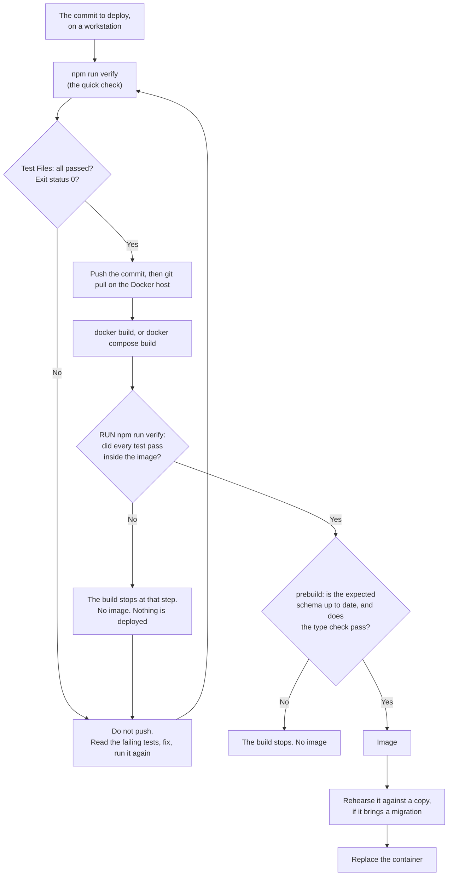

#### The Suite Inside the Image Build

`docker build` runs the same files with the same command, on the image's own Linux and Node (`node:22-slim`) instead of the workstation's. The step is a plain `RUN npm run verify`. It needs no network and no special builder, because the tests refuse the network themselves: `tests/setup.ts` refuses every `fetch` and every DNS lookup, and fails the test that attempted one. Docker does not cut the step off from the network as well. For part of 2026-10-13 the `Dockerfile` said `RUN --network=none`, under a `# syntax=docker/dockerfile:1` line; that was never built, and was taken out, because the flag works only under BuildKit and the Docker version of the production host is not known. A pass ends the step with the same two lines as on the workstation, every test file passed and every test counted. With the suite as it was on 2026-10-18, where none is expected to fail and none is skipped, they read:

```
Test Files  61 passed (61)
     Tests  5572 passed (5572)
```

- **On a builder with fewer than three CPUs, two tests are skipped**, and the second line reads `5570 passed | 2 skipped (5572)`, which is a pass. They are the two tests of `tests/password-checks.test.ts` that time the server's thread while real worker threads check passwords (card 2191): the thread stays free while six checks are made at once, and an unrelated request is answered meanwhile. Each runs two threads, the first against a bound of half of one check timed in the same run (card 2274) and the second by waiting until both threads hold a check, then requiring the request's answer before either finishes (card 2717), and with fewer than three CPUs the two threads share them with the test's own, which could fail the build for a fault that is not there. Before a build, `docker info --format '{{.NCPU}}'` on the host that builds says how many it has. The other fourteen tests of the file run anywhere.

- **What it adds to a build.** About as long as the suite takes outside Docker on the same machine. The first build with the step, on 2026-10-13, spent 18.5 seconds in it on a 28-core workstation, when the suite was 2220 tests and took 20 seconds on that workstation outside Docker. The second build, later that day on the same workstation, when the suite was 2624 tests and took 28 seconds there, spent 23.7 seconds in the step, of which vitest counted 22.5 as its own. The suite has grown since (43 seconds there on 2026-10-15) and has not been built in Docker at that size. A smaller Docker host will take longer.
- **What it adds to the image.** Nothing. The suite runs in the builder stage, which is thrown away. The production stage is copied from `build/`, `node_modules/` (reinstalled without dev dependencies after the build), `package.json` and `drizzle/` alone. An image built with the step and one built without it from the same tree held the same 27,933 files, apart from the content hashes in the names under `build/` that differ between any two builds, and no `tests/` folder and no vitest. The image of the second build, of the suite as it was then, was listed in the same way and came to the same 27,933: `/app` holds `build/`, `drizzle/`, `node_modules/`, `package.json` and an empty `data/`, with no `tests/`, no `src/`, no database file, and no package the lock file marks as a dev dependency (no vitest, vite, TypeScript, `svelte-check` or `drizzle-kit`). Two names from `devDependencies` in `package.json` are in it all the same, because a production dependency names each as a peer and `npm ci --omit=dev` therefore keeps it: `svelte`, for `svelte-dnd-action`, and `@types/better-sqlite3`, for `drizzle-orm`.
- **What it touches.** Inside the build, a database in memory and `/tmp` in the builder stage. There is no `dumpfire.db` in the build to touch (see below).
- **A test file left out of the commit fails the build.** The build runs the test files that were committed and reached the host, and vitest does not know what is missing: a build without `tests/access-every-route.test.ts` used to pass with `29 passed (29)`. The files are now listed in `tests/harness.test.ts`, and a test there fails, naming the file, when one in the list is not on disk or one on disk is not in the list. A new test file is added to that list in the commit that adds it. See [Testing](testing.md#the-list-of-test-files).
- **A test left marked `.only` fails the build.** `npm run verify` passes `--allowOnly=false`, and the file with the mark fails with `Unexpected .only modifier`.
- **A step shown as `CACHED`** was not run again, because Docker has already run it on exactly these files and it passed. Any change to a file in the build context runs it again.
- **A failure** ends the build with `ERROR: process "/bin/sh -c npm run verify" did not complete successfully: exit code: 1`. The failing tests are named above that line. A test that reached for the network is one of them, on a workstation and in the build alike: `This test reached for the network: ...`, with the address. `npm run build` is not reached and no image is tagged; the container that is running is not affected, because nothing has replaced it.

**What is kept out of the build.** `.dockerignore` keeps these out of the build context, so they never reach Docker, the builder stage or the build cache: any `*.db`, `*.db-shm` and `*.db-wal` file, at the top of the repository and in any folder beneath it (a development `dumpfire.db`, its dated backups, and a copy put in a sub-folder), any `*.backup-temp` and `*.backup-temp-*` file at any depth (the copies `GET /api/admin/export` and a backup make beside the database while they run, `<database>.backup-temp` and `<database>.backup-temp-cleared`), any `*.restore-temp` file at any depth (the copy of an uploaded backup an import makes beside the database while it runs, `<database>.restore-temp`: card 2776), any `*.export-temp` file at any depth (the name an older export used for its copy), `.pre-restore-safety.json` (the copy of the data kept before a restore), any `mfa.key` and `mfa.key.*.tmp` file at any depth (the key a development server makes beside its database, and the temporary file it is made through: card 2768), the `uploads` folder of attachment files, `.env` and `.env.*`, and the local tooling in `.agent`, `.claude`, `.vscode` and `.git`, along with `.gitignore`, `README.md`, and `node_modules`, `.svelte-kit` and `build`, which the image makes for itself. The database patterns once matched at the top of the repository only, and a database copied into a sub-folder would have been sent; `**/*.db` and its two companions were added on 2026-10-13. The other names are still matched at the top only. The context was listed before each of the two builds of 2026-10-13. Before the first, which was before those patterns were added: 417 files, 5.9 MB. Before the second, with them in place: 418 files, 5,993,090 bytes. None of those names was anywhere in either.

**What has been proved.** The step has been built twice, both times on 2026-10-13 with Docker 29.2.1 on a Windows workstation (Docker Desktop, Linux containers, amd64, BuildKit). The first build was the first time the suite ran on Linux: it passed with the totals it then had (`2200 passed | 19 expected fail | 1 skipped`), `prebuild` and `npm run build` passed after it, and a build with one failing test added inside the builder stage stopped at the step as described.

The second build was of what is described here: the plain `RUN npm run verify`, `--allowOnly=false` in `npm run verify`, the `.dockerignore` patterns for any depth, and the suite at the totals it then had, with the network refused from inside. It ended with exit status 0. The step printed `Test Files  30 passed (30)` and `Tests  2578 passed | 45 expected fail | 1 skipped (2624)`, which are the workstation's totals, and each of the 30 files reported the same number of tests in the build as on the workstation; no test was changed to get there. `prebuild` and `npm run build` passed after it. Two more builds, each with one test added to `tests/docs-format.test.ts` inside the builder stage, stopped at the step with exit status 1 and never reached `npm run build`: one with a test that fails (`Test Files  1 failed | 29 passed (30)`), and one with a test marked `.only` (`Unexpected .only modifier`).

**What has not.** Every one of those builds was made from a Windows working copy, in which 27 source files have CRLF line endings; the Docker host builds from a Linux checkout of a commit, where every file has LF. The first build on the Docker host is therefore the first from such a checkout, and the first on that host's hardware and with its version of Docker, which is not known here. The step asks nothing of that version but a plain `RUN`; the classic builder has not been tried. If a build stops at the step with a failure that names an address, a test is reaching for the network and the guard in `tests/setup.ts` has caught it: fix the test.

When `npm run verify` fails, on a workstation or in the build:

| The output says | It means | Do |
|-----------------|----------|----|
| A test failed with an assertion, in a file under `tests/` | The change broke something the test holds, or changed it on purpose | Fix the code. If the behaviour was changed on purpose, change the test in the same commit and say why. Never skip or delete a test to get an image |
| `Expect test to fail` | A test marked `it.fails` passed: the known fault it records has been put right | Take the mark off that test, or the `fault` off its entry in `tests/access-every-route.test.ts`, in the commit that fixed the fault |
| `routes and methods with no entry in TABLE` | A route or a method was added under `src/routes/api` and nobody has said who may call it | Add its entry to the table in `tests/access-every-route.test.ts`. See [Testing](testing.md#access-for-every-route) |
| `test files in TEST_FILES that are not under tests/` | A test file in the list is not in this tree: it was left out of the commit, or deleted | Commit the file. If it was deleted on purpose, take its name out of `TEST_FILES` in `tests/harness.test.ts` |
| `test files under tests/ that are not in TEST_FILES` | A test file was added and not listed | Add its name to `TEST_FILES` in `tests/harness.test.ts`. See [Testing](testing.md#the-list-of-test-files) |
| `Unexpected .only modifier` | A test or a `describe` was left marked `.only` | Take the `.only` off |
| `This test reached for the network: ...` | A test let the application try a `fetch`, a DNS lookup, or an `http`/`https` request to an IP address other than loopback, at the address named: a webhook or a mail it set up and did not stand in for | Install `effects()` in the test. See [Testing](testing.md#proving-a-request-is-all-or-nothing) |
| Every test of a file fails with `N migration(s) did not apply to a fresh database` | A file under `drizzle/` does not apply to an empty database. The built server would stop at start-up in the same way | Fix the migration file. See [Changing the Schema](#changing-the-schema) |
| A failure under "the checked-in copy of the model" in `tests/migrations.test.ts` | `expected-schema.ts` is out of date. `docker build` would stop on the same thing | `npm run schema:expected`, and commit the result |
| `Tests must run against an in-memory database` | The suite was started in some way that did not set `DB_PATH` | Run it with `npm run verify` or `npm test`, never with `DB_PATH` set by hand |

**When the build stops at `RUN npm run verify`.** Nothing has been deployed and the running container is untouched. Then:

1. Read which tests failed. Docker's default output can cut a failed step short, so build again with all of it: `docker build --progress=plain -t dumpfire:candidate . 2>&1 | tee build.log`, and look above the `Test Files` line for each `FAIL`.
2. Run `npm run verify` on a workstation, on the same commit (`git status` clean, `git log -1` the commit the host built).
3. **If it fails there too**, it is one of the rows above. Fix it, run it again, push, and build again.
4. **If it passes there and fails in the build**, the difference is between the two places and not in the change itself. The likely causes are a file the test needs that was never committed, or that `.dockerignore` keeps out of the build; a file name whose capitals differ from the name the code asks for, which Windows forgives and Linux does not; a path built with `\`; line endings, which are CRLF in some files of a Windows working copy and LF in every file of a Linux checkout; and a test that depends on how long something takes. Correct the test or the file so that it holds in both places.
5. **Do not take the line out of the `Dockerfile` to get an image**, and do not skip the failing test. The last image that built is still on the host: a failed build makes no image and moves no tag.

On the Docker host itself there is usually no Node to run the suite with outside the build, which is why the quick check is made before the commit gets there.

## Environment Variables

| Variable | Default | Required | Description |
|----------|---------|----------|-------------|
| `NODE_ENV` | `production` in the image; unset for a server started any other way | No | Node.js environment mode. It also decides whether the production rules for the MFA key apply (card 2768): they do unless it is exactly `development` or `test`, or the database is in memory. Unset, `production`, `staging` and a misspelling are all production, so a local `node build` needs `MFA_KEY_FILE` as the image does. See [The Key That Protects Authenticator Secrets](#the-key-that-protects-authenticator-secrets) |
| `MFA_KEY_FILE` | not set | **Yes, wherever the production rules apply**: in the image always | The path, inside the container, of the file holding the key that protects authenticator secrets (card 2768): 64 hexadecimal characters, made with `openssl rand -hex 32`, in a regular file of at most 4096 bytes. Mount it read-only from outside the volume (`/run/secrets/dumpfire_mfa_key`), never under `/app/data`. Under the production rules the server **refuses to start** when it is unset, names no file, or names a file that is not a key, and never makes one; under `development` or `test` a missing key is made, beside the database as `mfa.key` when this is unset. Read once, at start. Empty is unset. See [The Key That Protects Authenticator Secrets](#the-key-that-protects-authenticator-secrets) |
| `MFA_KEY_FILE_PREVIOUS` | not set | No: **set it only to change the key**, as [Changing the Key](#changing-the-key) says, **and remove it after** | The path, inside the container, of the **old** key file while the key is being changed (card 2773); `MFA_KEY_FILE` then names the new one. At that start, before the server listens, every second factor that opens with the old key is sealed again under the new one and the new key's check is recorded, in one transaction. The file is read by `MFA_KEY_FILE`'s rules (a regular file of at most 4096 bytes holding 64 hexadecimal characters, refused if its group or everyone can write it), must exist (a previous key is never made, under any `NODE_ENV`), and must not be the same key as `MFA_KEY_FILE`: each of those **refuses the start**. Read afresh at every start, used once and not kept. Empty is unset. While it is set and opens nothing, every start says so in a `[WARN] [STARTUP]` line |
| `FORGET_UNOPENABLE_SECRETS` | not set | No: **set it only as** [If the Key Is Lost](#if-the-key-is-lost) **says, for one start, and remove it after** | `1` alone sets it; anything else is unset. With no second factor and no key check stored and not one stored secret opening with the key (card 2898's code review, S6), the start forgets them as a backup forgets them instead of refusing. It forgets nothing where any stored secret opens, or where a key check is stored. While it is `1`, every start says so in a `[WARN] [AUTH]` line, on the console whatever `LOG_LEVEL` is. Read at every start |
| `PORT` | `3000` | No | HTTP port the server listens on |
| `ORIGIN` | `http://localhost:3000` | **Yes** | Public URL — must match your domain exactly. Incorrect value causes CSRF failures. It must be the public origin: where a browser sends no `Sec-Fetch-Site` (over plain HTTP at any address but `localhost`, or an old browser), every write from the web application, sign-in included, is refused `403` unless its `Origin` is exactly `ORIGIN` (card 2700; see [Writes From DumpFire's Own Pages Alone](authentication-security.md#writes-from-dumpfires-own-pages-alone-card-2700)). It is also the address every link in a mail begins with, unless an App URL is set: see [Where a Mailed Link's Address Comes From](#where-a-mailed-links-address-comes-from) |
| `APP_URL` | not set | No | The address links in mail begin with, when it should not be `ORIGIN`. The App URL on the admin page, under Application Settings, does the same and is read first, but only where it is on `APP_URL`'s origin or a real `ORIGIN`'s (card 2847): set, `APP_URL` holds the App URL to this server's own address |
| `COOKIE_SECURE` | not set | Only for a plain-HTTP install (`false`) | Whether cookies set over **plain HTTP** are marked `Secure` (card 2850). A request that came over HTTPS always gets `Secure` cookies, whatever this says. Not set: plain-HTTP cookies are `Secure` when `NODE_ENV` is exactly `production` (the image sets it). `true`: they are `Secure` on plain HTTP too. `false`: they are not, which is for a plain-HTTP install of the image only (a browser drops a `Secure` cookie from an `http:` address other than `localhost`, so nobody could sign in); anything but exactly `true` reads as `false`. See [Every Cookie DumpFire Sets](authentication-security.md#every-cookie-dumpfire-sets-card-2850) |
| `PROTOCOL_HEADER` | `X-Forwarded-Proto` | No | Header from reverse proxy indicating HTTPS. Read only when `ORIGIN` is not set |
| `HOST_HEADER` | `X-Forwarded-Host` | No | Header from reverse proxy with original hostname. Read only when `ORIGIN` is not set, and never for a link in a mail |
| `ADDRESS_HEADER` | not set | Behind a proxy, yes | The request header that names the caller's address, set by the proxy: `X-Forwarded-For` behind the nginx block below. Not set in the image, and not to be set without a proxy in front: see [The Caller's Address Behind a Proxy](#the-callers-address-behind-a-proxy) |
| `XFF_DEPTH` | `1` | No | With `ADDRESS_HEADER=X-Forwarded-For`, how many proxies there are in front of the server: the address is read that many places from the end of the header. `1` for the nginx block below |
| `BODY_SIZE_LIMIT` | `512M` in the image; `512K` for a server started any other way | No | The largest request body the server accepts on any route. Bytes, or a number followed by `K`, `M` or `G`: `512M`, not `512MB`, which is no number to the server and **stops it starting**. `Infinity` is no limit. The application narrows it again route by route: see [Upload Size Limits](#upload-size-limits) |
| `DB_PATH` | `/app/data/dumpfire.db` in the image; `dumpfire.db` in the working directory for a server started any other way | No | The database file. It must be on the volume: the uploads are in the folder `uploads` beside it. The image sets it since card 2083; an image built before that sets none, and a container from it started without `DB_PATH` keeps its database at `/app/dumpfire.db`, inside the container. At the image's path, a server that finds no database there, or an empty file, while it can see a database file at `/app/dumpfire.db` or elsewhere in `/app/data`, or a `dumpfire.db-wal` without its database, **refuses to start** rather than create an empty one: see [Start-Up Sequence](#start-up-sequence) |
| `LOG_LEVEL` | `INFO` | No | Lowest level logged: `DEBUG`, `INFO`, `WARN`, `ERROR` or `CRITICAL`. Leave it at `INFO` or `WARN` when updating: the migration runner reports what it applied and rebuilt at `WARN` |
| `LOG_RETENTION_DAYS` | `30` | No | How long rows are kept in `system_logs`. The table is also capped at its newest 50,000 rows, whatever their age, except that the cap never takes a `CRITICAL` row, which goes only with the days (card 2899) |
| `IMAGE_RETENTION_DAYS` | not set, which is `180` | No | How many days a closed card keeps its images (card 2754): an image (PNG, JPEG, GIF or WebP, by its stored type) on a card archived, or completed and still in its Complete column, longer ago than this is moved to the attachment trash by the sweep, at most 200 a run. A whole number of days from `30` to `3650`, digits only, or `off` (lowercase) for no retention. **Anything else** (`abc`, `10`, ` 180`, `+180`, an empty value) **moves nothing** and logs an `[ERROR] [UPLOADS]` line at every sweep until it is put right. Runs only where the schedulers run. See [Image retention](#image-retention) |
| `SCHEDULERS` | `on` in a built server, `off` under `npm run dev` | No | `on` or `off`: whether the backup, report and snapshot schedulers, the decision reminder (card 2685) and the attachment file sweep run. Set it to `off` for any instance that holds production's data and is not production. Such an instance holds production's backup destinations, report schedules, open decisions and mail settings, and with its schedulers running it backs up to production's destinations, prunes the backups there, sends production's reports and mails the participants of production's open decisions a reminder before each closes. When they are off, one `[WARN] [SCHEDULERS]` line at start says so: `Schedulers are off (…). No scheduled backup, report, snapshot, decision reminder or attachment file sweep will run from this instance. Set SCHEDULERS=on to run them.` "Run Backup Now" in the admin panel works either way, and so do email and webhooks sent in answer to an action. To make such a copy harmless in itself, import the backup as a working copy: see [Admin Guide](admin-guide.md#restoring-from-backup) |
| `PASSWORD_THREADS` | not set: two, or one on a machine with one or two CPUs | No: **leave it unset** | How many worker threads hash and check passwords, so that the server's own thread is never held by one (card 2191). Unset, it is `min(2, max(1, CPUs - 1))`. A whole number from `0` to `8` is taken as it is; `0` checks every password on the server's own thread, as the tests do, which holds every other request for about a fifth of a second each time, and is not for a server. Anything else is one `[WARN] [AUTH]` line, `PASSWORD_THREADS="…" is not a whole number from 0 to 8: password checks run on N worker thread(s)`, and the default. Read once, at the first check. See [Password Hashing](authentication-security.md#password-hashing) |
| `SIGN_IN_ONE_AT_A_TIME` | not set, which is `on` | No: **set it only as** [If an Attack Keeps an Owner Out](#if-an-attack-keeps-an-owner-out) **says, and remove it after** | `on` or `off`, in any case, trimmed; empty is `on`. `off` turns off the rule that holds sign-ins from browsers not remembered for an account to one at a time while the account is being guessed at (card 2194): every browser is then let in after the account's wait. While it is `off`, one `[WARN] [STARTUP]` line at every start says so, to the console whatever `LOG_LEVEL` is. Anything else is one `[WARN] [AUTH]` line, `SIGN_IN_ONE_AT_A_TIME is "…", which is neither on nor off: sign-ins from browsers not remembered are held to one at a time`, and `on`. Read once, at start. See [Browsers That Have Signed In Before](authentication-security.md#browsers-that-have-signed-in-before) |
| `CSP_MODE` | not set, which is `enforce` | No: **set it only for the first deploy of the policy**, as [The Update That Brings the Content-Security-Policy](#the-update-that-brings-the-content-security-policy) says, **and remove it after** | `enforce` or `report-only`, written exactly so. `report-only` sends every page its Content-Security-Policy as `Content-Security-Policy-Report-Only`: the browser names in its console what the policy would refuse, and refuses nothing. While it is set, one `[WARN] [STARTUP]` line at every start says so, to the console whatever `LOG_LEVEL` is. Any other value, `REPORT-ONLY` and ` report-only` among them, is enforced, and one `[WARN] [STARTUP]` line at every start names it: `CSP_MODE is "…", which is neither enforce nor report-only: the Content-Security-Policy is enforced.` Read at every request. See [The Content-Security-Policy](authentication-security.md#the-content-security-policy) |
| `WEBHOOK_ALLOW_INSIDE` | not set: no webhook may send inside the network | Only for a webhook receiver inside the network, such as an automation tool beside DumpFire | A list, separated by commas, of the host names, addresses and ranges inside the network that webhooks may send to (card 2161): `n8n`, `host.docker.internal`, `10.0.5.20`, `10.0.5.0/24`, `fd00::/8`, `[fd00::1]`. A name is exact, case ignored, final dots removed, and allowed whatever it resolves to inside, but never `0.0.0.0` or `::` (a DNS filter's answer for a blocked name); an address or range must lie wholly inside one of the inside ranges, or it is ignored and named in one `[WARN] [STARTUP]` line at every start. Read when a webhook is registered and at every delivery, and parsed again when its value changes; set it when the container is created. An entry trusts every account that can register a webhook with every port and path on that host, so name a dedicated host or address, never `host.docker.internal` while anything else listens on the Docker host; an entry with a port (`n8n:5678`) is not taken. A board's owner, which any account can be, also reads back what each allowed port answers, in the webhook's `lastDelivery` (card 2178): a web server's status, a certificate a TLS server presents, or not reached. See [Where a Webhook May Send](#where-a-webhook-may-send) |
| `NODE_EXTRA_CA_CERTS` | not set | Only for a mail server whose certificate comes from a private authority, or is self-signed | The path, inside the container, of a PEM file of certificates Node trusts beside its own, for every TLS connection of the process: mail, webhook deliveries and backup destinations (card 2189). Read once, when the process starts: set it, with the file mounted read-only, when the container is created; a restart applies neither. See [Mail Server Certificates](#mail-server-certificates) |

> ⚠️ **CRITICAL**: `ORIGIN` must be set to your actual public URL (e.g. `https://dumpfire.example.com`). Leaving it as localhost will cause CSRF token validation failures on all form submissions.

### What a Copy With Its Schedulers On Would Mail

Since card 2685 the schedulers include the decision reminder. Started with `SCHEDULERS=on`, or
built and started with it unset, a copy holding production's data and mail settings would, from 5
minutes after it starts and every 5 minutes after, mail each consulted participant of every open
decision closing within the next day a reminder, link holders outside the organisation included,
and write it on that copy's record, where production's record would not show it. The mail carries
no personal link, so it opens nothing new, but it reaches real people. A restore of a backup into
the copy removes the mail settings and ends every link, so a restored working copy sends none;
a database put in place by hand does not. Keep `SCHEDULERS=off` on any such copy. How the
reminder works: [The Closing-Date Reminder](notifications-email.md#the-closing-date-reminder-card-2685).

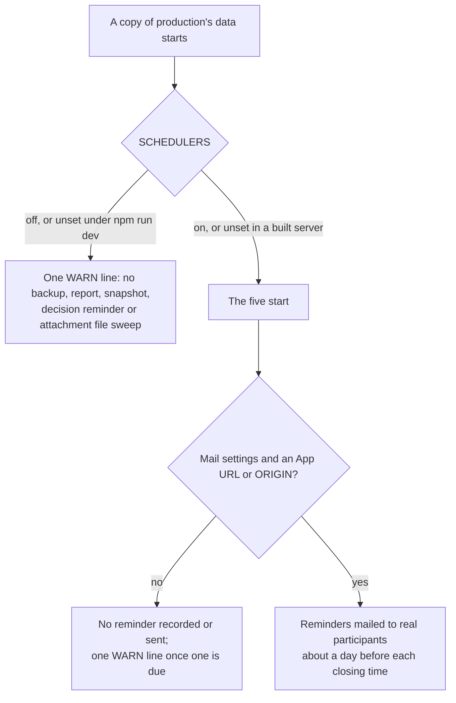

### Where a Mailed Link's Address Comes From

An invite, a request's confirmation and reply links, and the "View Task" link in a notification all begin with the server's own address. That address is configuration, and never anything a request says:

1. the **App URL** on the admin page, under Application Settings: the superadmin's alone since card 2847 (any administrator's from card 2395 until then), and used only where it is on an address the server's configuration names, if it names one (below);
2. failing that, the `APP_URL` variable;
3. failing that, `ORIGIN`.

**The host's configuration wins** (card 2847). Where `APP_URL` is set, or `ORIGIN` is set to anything but the image's `http://localhost:3000`, the App URL must be on one of their origins (scheme, host and port): a save of one on another is refused, the superadmin's too, and one saved before (or brought by an import) is not used, so links begin with `APP_URL`, or else `ORIGIN`, and the log says so once at every start (the fifteenth line below). After upgrading, an installation whose App URL named another address than its `APP_URL` or `ORIGIN` mails links with the configured address: set `APP_URL` or `ORIGIN` on the host to the real address, or have the superadmin clear the App URL. Where neither is configured, the App URL is the only word on the address, as before; if an administrator rather than the superadmin saved it, the log says so at every start (the sixteenth line below). Either way an App URL is stored and used as the plain address it parses to (scheme, host, port and path), and one with a user name, password, query, fragment, backslash or control character, or a path beginning `//`, is refused, and not used if stored before.

No request header is read for it: not `Host`, and not `X-Forwarded-Host`. With no App URL set, a link used to take its host from `X-Forwarded-Host`, so whoever could send the server a request could have an invite mailed with a link to a host of their choosing, and an invite sets a password.

The image is built with `ORIGIN=http://localhost:3000`. A server that really is reached there is right as it is. One behind a proxy that was started without `ORIGIN` mails links that begin with `http://localhost:3000`, and says so once at every start: `[WARN] [STARTUP] ORIGIN is http://localhost:3000, the address the image is built with, and no App URL is set...`. Set `ORIGIN`, or the App URL.

A server started with no `ORIGIN` at all, which the image never is, and given no App URL has no address. Then two things are refused with `503` and "This server has no address configured to make the link from", before anything is saved: an invite, which is a link, and a public request made by somebody who is not signed in, when SMTP is configured, because that request waits on a mailed link to be confirmed. A user added with a password, a request made by somebody signed in, and any request made while no SMTP is configured have no link to mail, and are accepted. A notification is not sent: each one skipped is a `[WARN] [NOTIFY]` line.

### Mail Server Certificates

Since card 2189 every mail is sent over a checked, encrypted connection. Port 465 is TLS from the first byte; any other port must offer STARTTLS, and a server that does not is refused (`ETLS`) before the password is sent; and on every port the mail server's certificate must be one Node trusts for the host's name as it is entered in **Admin → 📧 Email / SMTP**. Until then mail on any port but 465 went without requiring STARTTLS and without checking the certificate, so anyone on the network path to the mail server, or who could answer for its name, could read the mail password and every message, invites (whose link sets a password) included. How the connection is made: [Connection Handling](notifications-email.md#connection-handling).

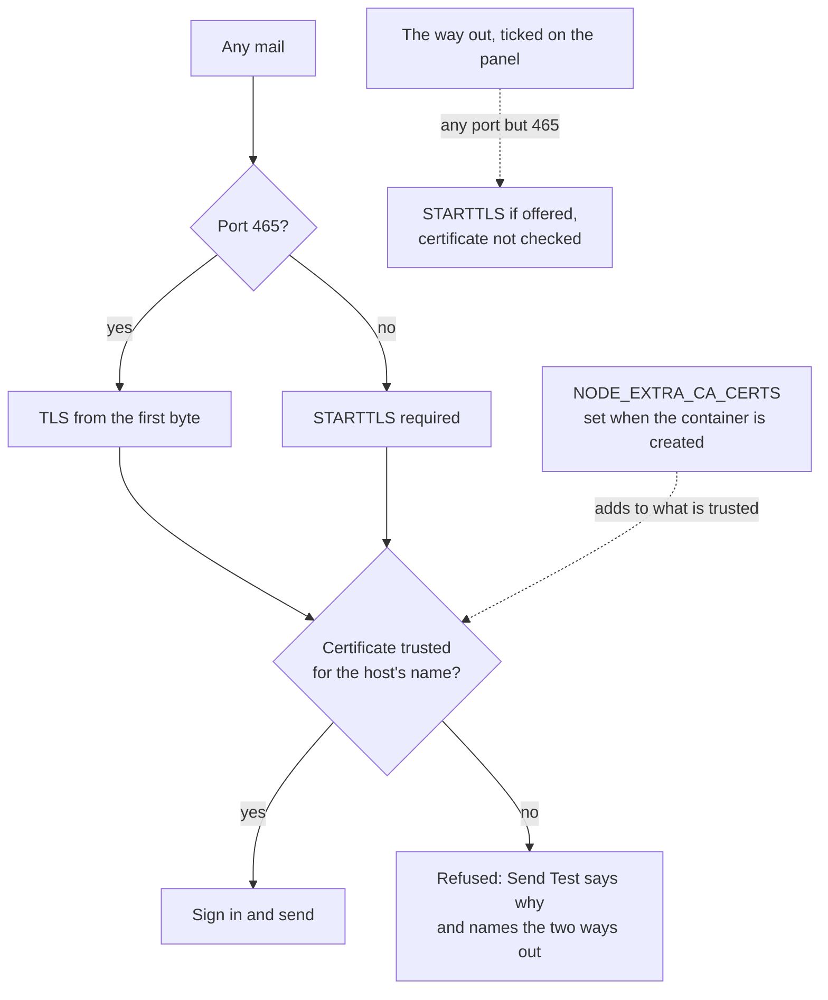

**A certificate from a private authority, or a self-signed one.** Mount the authority's certificate (or a self-signed server's own certificate), in PEM form, read-only into the container, and name it in `NODE_EXTRA_CA_CERTS`. Node reads it once, when the process starts, and adds it to what every TLS connection of the process trusts; the check stays on. There is no setting for it on the panel: one there would be kept in the database and in every backup, a second place that decides trust, set by a web session. **A restart does not apply it**: an environment variable and a mount are fixed when a container is created, and `docker restart` keeps both as they were. Create the container again with them:

```bash
docker run -d \
  --name dumpfire \
  --restart unless-stopped \
  -p 3000:3000 \
  -v dumpfire-data:/app/data \
  -v /srv/dumpfire/mail-ca.pem:/ca/mail-ca.pem:ro \
  -e NODE_EXTRA_CA_CERTS=/ca/mail-ca.pem \
  -e DB_PATH=/app/data/dumpfire.db \
  -e ORIGIN=https://dumpfire.example.com \
  -e NODE_ENV=production \
  dumpfire:latest
```

Under Docker Compose, beside the lines of [Docker Compose](#docker-compose), then `docker compose up -d`:

```yaml
    volumes:
      - dumpfire-data:/app/data
      - /srv/dumpfire/mail-ca.pem:/ca/mail-ca.pem:ro
    environment:
      - NODE_EXTRA_CA_CERTS=/ca/mail-ca.pem
```

`/srv/dumpfire/mail-ca.pem` stands for wherever the file is kept on the host. The process trusts that authority for every TLS connection it makes, not only mail: webhook deliveries and backup destinations trust it too. A file that cannot be read is said by Node on the console at start, and the server starts without it.

**The way out.** "Allow mail without a checked, encrypted connection", on the panel, off by default, gives back the behaviour from before card 2189 on any port but 465: STARTTLS when offered, the certificate not checked. It is for a relay on this server's own network that cannot use TLS. Turning it on or off from the panel needs the mail password typed again, and writes one `[WARN] [SMTP]` line naming who did it. Two other ways set it with neither: the one-row write of [check 0i](#before-the-deploy-checks-0i-to-0k), which the mailer reads at the next mail with no restart, before or after the deploy; and a restore, which brings in the backup's setting with the backup's other mail settings. A restore keeps this server's mail password only where the backup's setting is this server's, and where it differs its "To enter again" line names the box: "the mail password (Admin, 📧 Email / SMTP, where the backup brought in "Allow mail without a checked, encrypted connection" ticked and this server had it unticked)". Port 465 is checked either way. See [SMTP Configuration](admin-guide.md#smtp-configuration).

**Check the mail server from the container.** Read-only: it reads the mail settings, prints names and flags and never the password, and makes the connection `createTransporter` (in `src/lib/server/email.ts`) makes, signing in to nothing and sending nothing (`verify()` with no `auth` connects, upgrades, checks the certificate and quits). It honours `NODE_EXTRA_CA_CERTS` as the container has it. Its options are `createTransporter`'s, which names this check in a comment: the two are changed together. It connects to the host exactly as stored, as `createTransporter` does, untrimmed: since the review-fix pass a host is saved trimmed of ASCII spaces and tabs, and one saved before with spaces is checked with them, as mail is sent. It prints `way out set` when "Allow mail without a checked, encrypted connection" is on. It holds no `!`, `$` or backtick:

```bash
docker exec dumpfire node -e "
const db = require('better-sqlite3')(process.env.DB_PATH || 'dumpfire.db', { readonly: true, fileMustExist: true });
const get = (k) => (db.prepare('SELECT value FROM settings WHERE key = ?').get(k) || {}).value || '';
const host = get('smtp_host');
const port = Number(get('smtp_port') || '587');
console.log('mail host', JSON.stringify(host), '| port', port, '| way out ticked', get('smtp_allow_insecure') === 'true', '| user set', get('smtp_user').length > 0, '| password set', get('smtp_pass').length > 0, '| NODE_EXTRA_CA_CERTS', process.env.NODE_EXTRA_CA_CERTS || 'not set');
if (host.length > 0 && get('smtp_allow_insecure') === 'true') { console.log('way out set: mail goes on after the deploy as it goes today, whatever the check below prints.'); }
db.close();
if (host === '') { console.log('No mail host is set: nothing to check.'); } else {
  require('nodemailer').createTransport({ host: host, port: port, secure: port === 465, requireTLS: port === 465 ? false : true, tls: { rejectUnauthorized: true }, name: 'dumpfire.app', connectionTimeout: 10000, greetingTimeout: 10000, socketTimeout: 15000 }).verify()
    .then(() => console.log('PASS: the mail server gives an encrypted connection with a certificate this server trusts.'))
    .catch((e) => console.log('FAIL:', e.code || '', e.message));
}
"
```

It checks the connection without the way out, whatever the panel has, so it says whether the way out could be turned off. With the way out set, mail goes as it did before card 2189 whatever the check says, and `way out set` is printed above it. What it prints:

| It prints | It means | What to do |
|---|---|---|
| `PASS` | Mail goes over a checked, encrypted connection | Nothing |
| `way out set` | "Allow mail without a checked, encrypted connection" is on: mail goes without the check | Nothing for mail to go on. The line below it says whether the way out could be turned off |
| `FAIL: ETLS Error upgrading connection with STARTTLS…`, or `FAIL: ECONNECTION EHLO failed but HELO does not support required STARTTLS…` | The mail server offers no STARTTLS | Ask the provider for its TLS port (often 465) and enter it, or, for a relay on this server's own network that cannot use TLS, tick the way out, **with the mail password at hand**. Without the password, set it with the one-row write of [check 0i](#before-the-deploy-checks-0i-to-0k): it works after the deploy as well as before, and the mailer reads it at the next mail, with no restart |
| `FAIL:` … `self-signed certificate`, `unable to verify the first certificate`, `unable to get local issuer certificate` | Its certificate is from an authority this server does not trust | Try the authority first in the running container: `docker cp mail-ca.pem dumpfire:/tmp/mail-ca.pem`, then this check as `docker exec -e NODE_EXTRA_CA_CERTS=/tmp/mail-ca.pem dumpfire node -e …`. On `PASS`, mount the file read-only and set the variable when the container is created, as above. A restart applies neither. That `PASS`, with check 0k's run with `-e` and `-v`, is the go-ahead |
| `FAIL:` … `does not match certificate's altnames` | The host is entered as an address, or a name that is not on the certificate | Enter the certificate's name as the host, with the password typed again |
| `FAIL:` … `certificate has expired` | The mail server's certificate is out of date | The provider's to renew. Mail stops until it is; the way out meanwhile |
| `FAIL: ESOCKET connect…`, `EDNS`, or a timeout | The server cannot be reached from the container | Unrelated to certificates: mail is not working now either |

### Where a Webhook May Send

A webhook is not sent to an address inside the network (card 2161): loopback, the private
ranges Docker and an office use, carrier NAT and Tailscale, link-local with the cloud
metadata service at `169.254.169.254`, the reserved, documentation and multicast ranges, their
IPv6 counterparts, and the names `localhost`, `*.localhost`, a name with no dot (a service on
the same Docker network, `n8n`), `*.local`, `*.internal` (`host.docker.internal`) and
`*.home.arpa`. It is refused when the webhook is registered, as written, and at every delivery,
by every address its name resolves to. The full tables are in
[Where a Webhook May Send](notifications-email.md#where-a-webhook-may-send).

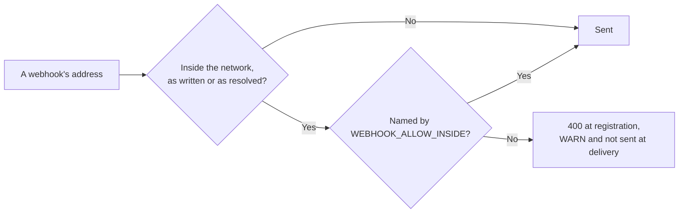

**A receiver that is inside on purpose** is let in by naming it in `WEBHOOK_ALLOW_INSIDE`, set
on the container:

| To let in | Set |
|-----------|-----|
| A container on the same Docker network, `http://n8n:5678/webhook/…` | `WEBHOOK_ALLOW_INSIDE=n8n` |
| A service on the Docker host, `http://host.docker.internal:8080/…`, only where nothing else listens on the host (see below) | `WEBHOOK_ALLOW_INSIDE=host.docker.internal` |
| A machine on the office network | `WEBHOOK_ALLOW_INSIDE=10.0.5.20`, or the narrowest range that holds the receivers, `10.0.5.0/24` |
| A receiver on a development machine, `http://localhost:9911/x` or `http://127.0.0.1:9911/x` | `WEBHOOK_ALLOW_INSIDE=localhost,127.0.0.1` |

- A name is allowed whatever it resolves to inside, and only that name: it passes the name
  rules. A listed name is never let reach `0.0.0.0` or `::`: a DNS filter answers `0.0.0.0` for
  a name it blocks, which would reach this server, so that answer is refused. An address or a
  range lets in any address inside it, written in the webhook's address or resolved from a
  name, but never one in `0.0.0.0/8` or `::`.
- An entry is kept only if it lies wholly inside one inside range. `0.0.0.0/0`, `::/0`,
  `::ffff:0:0/96`, a slip such as `10.0.0.0/2` for `10.0.0.0/24`, an address outside the
  network, `127.1` (an IPv4 address not written as four decimal numbers), a port, a path and a
  wildcard are each ignored, and named at every start: `[WARN] [STARTUP] WEBHOOK_ALLOW_INSIDE:
  "10.0.0.0/2" ignored: wider than one inside range`. The rest of the list applies. Read the
  start log after changing it.
- So is an entry that one inside range holds but that holds `0.0.0.0` or `::`, which reach
  this server whatever it listens on, or a range listed before the one that holds it:
  `0.0.0.0/8` and `0.0.0.0` (`it holds 0.0.0.0, …`), `::/8`, `::/96` and `::1/8` (`it holds ::,
  …`), anything else inside `::/8`, and an IPv4-mapped range written with a short prefix,
  `::ffff:10.0.5.0/24`, which is `::/24` and held `::1` (`an IPv4-mapped range needs /96 or
  more`: write `10.0.5.0/24`, or `::ffff:10.0.5.0/120`). These rules shut out `0.0.0.0`, `::`
  and the reserved forms only. They do not stop an entry that names this server on purpose (`127.0.0.1`, `::1`, `localhost`), as a development installation's
  does, nor one that names a host where other things listen (the next point).
- **An entry trusts every account with every port and path on that host.** Anyone who can
  register a webhook, an editor of any board, can send to any port and any path of a host or
  range the list names, and an entry with a port (`n8n:5678`) is not taken, so the port cannot
  be narrowed. Name a dedicated host or address for the receiver, and the narrowest range. Do
  not list `host.docker.internal`, or the Docker host's address, while anything else listens
  on the host (an admin interface, a database, another application): every webhook could
  reach it. Nor list a range that holds this container's own address: its Docker network
  (`172.16.0.0/12`, or the narrower network it is on, which `docker network inspect` shows)
  opens this server too. Name the receiver's single address or name instead. A board's owner
  also reads back, in the webhook's `lastDelivery` (card 2178), what each port of a listed
  host answers: a web server's status, a certificate a TLS server presents, or not reached.
- A receiver's address with a user name or password is refused whatever the list says.
- It is read where a webhook is registered and at every delivery, and parsed again whenever
  its value changes. On a container the value changes only when the container is made again,
  so set it with `-e WEBHOOK_ALLOW_INSIDE=…` (or under `environment:` in a compose file) when
  the container is created.

**No proxy.** Webhooks are delivered directly, never through `HTTP_PROXY`, `HTTPS_PROXY` or
`NODE_USE_ENV_PROXY`: through a proxy the check would judge the proxy's address, not the
receiver's. An installation whose only way out is a proxy could not deliver webhooks before
(Node's `fetch` went direct too) and cannot now.

**Nothing on the host should trust a request for coming from the host's own address.** A
webhook to this server's own public IPv4 or IPv6 address, or to a name that resolves to one,
is outside by the tables: it leaves the container, turns at the host, and reaches what listens
there from the host's own address, inside the cloud firewall. Every port is open to webhooks,
since closing them would not close this (443 on that address is the proxy). So no proxy rule,
admin interface or service on the host may let a request in because it comes from the host's
own public address. See [Webhook Destinations](authentication-security.md#webhook-destinations).

## Running

### Minimal

```bash
docker run -d \
  --name dumpfire \
  -p 3000:3000 \
  -v dumpfire-data:/app/data \
  -v /srv/dumpfire-secrets/dumpfire_mfa_key:/run/secrets/dumpfire_mfa_key:ro \
  -e DB_PATH=/app/data/dumpfire.db \
  -e MFA_KEY_FILE=/run/secrets/dumpfire_mfa_key \
  -e ORIGIN=http://localhost:3000 \
  dumpfire:latest
```

The key file must be made first, on the host: see [The Key That Protects Authenticator Secrets](#the-key-that-protects-authenticator-secrets). The image sets `NODE_ENV=production`, so without `MFA_KEY_FILE` the server refuses to start (card 2768).

The image sets `DB_PATH=/app/data/dumpfire.db` since card 2083, and each of these gives it all the same, so that each is right for an image built before that as well. Such an image sets none, and without it the database and the uploads are in `/app`, inside the container and off the volume: see [Volume Mounts](#volume-mounts). With any image, the volume at `/app/data` is what keeps them.

### Production

```bash
docker run -d \
  --name dumpfire \
  --restart unless-stopped \
  -p 3000:3000 \
  -v dumpfire-data:/app/data \
  -v /srv/dumpfire-secrets/dumpfire_mfa_key:/run/secrets/dumpfire_mfa_key:ro \
  -e DB_PATH=/app/data/dumpfire.db \
  -e MFA_KEY_FILE=/run/secrets/dumpfire_mfa_key \
  -e ORIGIN=https://dumpfire.example.com \
  -e NODE_ENV=production \
  dumpfire:latest
```

### Docker Compose

```yaml
version: '3.8'

services:
  dumpfire:
    build: .
    container_name: dumpfire
    restart: unless-stopped
    ports:
      - "3000:3000"
    volumes:
      - dumpfire-data:/app/data
    secrets:
      - dumpfire_mfa_key
    environment:
      - DB_PATH=/app/data/dumpfire.db
      - MFA_KEY_FILE=/run/secrets/dumpfire_mfa_key
      - ORIGIN=https://dumpfire.example.com
      - NODE_ENV=production

secrets:
  dumpfire_mfa_key:
    file: /srv/dumpfire-secrets/dumpfire_mfa_key

volumes:
  dumpfire-data:
```

## Volume Mounts

| Container Path | Purpose | Persist? |
|---------------|---------|----------|
| `/app/data` | SQLite database + uploaded attachments. Owned by uid 1000, the `node` user the server runs as (card 2776) | **Yes — required** |
| `/app/data/dumpfire.db` | Main database file: the image's `DB_PATH` | Auto-created at the first start, which says so in the log |
| `/app/data/uploads/` | Card attachments: the folder `uploads` beside the database file | Auto-created at the first upload |
| `/app/data/uploads/.trash/` | Attachment files of deleted cards, and files no attachment names, kept for 30 days | Auto-created at the first delete or sweep that has a file to move |
| `/run/secrets/dumpfire_mfa_key` | The key that protects authenticator secrets, named by `MFA_KEY_FILE` (card 2768): a file on the host, mounted read-only, **not on the volume** | Never made by the server in production: made on the host first, and kept and backed up apart from the database. See [The Key That Protects Authenticator Secrets](#the-key-that-protects-authenticator-secrets) |

> 💡 Always mount `/app/data` as a Docker volume. Without it, all data is lost when the container is recreated.

The uploads folder follows `DB_PATH`: it is the folder named `uploads` in the directory that holds the database file. A variable `UPLOADS_DIR` exists for the tests and overrides that wherever it is set; do not set it in production, where it would move uploads away from the files already stored. The image sets `DB_PATH=/app/data/dumpfire.db`. An image built before card 2083 sets none, and a container from it started without `DB_PATH` has its database at `/app/dumpfire.db` and the uploads in `/app/uploads`, both inside the container and neither on the volume. Mounting nothing at `/app/data` does the same with any image: the folder is then the container's own, and every start says so in a `[WARN] [STARTUP]` line (see [Start-Up Sequence](#start-up-sequence)). To put either right, see [Moving the Database onto the Volume](#moving-the-database-onto-the-volume).

## The Key That Protects Authenticator Secrets

Two-step sign-in keeps each account's authenticator-app secret encrypted (card 2768). The key
that encrypts it is kept in a file of its own, outside the database and outside every backup,
and `MFA_KEY_FILE` names that file. **Sign-in does not ask for a second factor yet**: card 2769
adds that, and until it does no account has a factor. The server reads and checks the key at
every start all the same, from the update that brings migration 0065, so **the key file must
be in place before that image starts in production**. How the key is used is in
[Second-Factor Secrets at Rest](authentication-security.md#second-factor-secrets-at-rest-card-2768).

**It protects the stored service secrets too** (card 2898): the mail password, every backup
destination's credentials, every webhook's signing secret and the three signing keys
(remembered browsers, the request form, the backup seal) are kept in the database sealed under a
key derived from the same file, and the key check is recorded with the first of them. So a
server with no factor yet still refuses to start with another key once anything is sealed, and
losing the key file loses these secrets too (see [If the Key Is Lost](#if-the-key-is-lost)). How
they are sealed is in
[Service Secrets at Rest](authentication-security.md#service-secrets-at-rest-card-2898).

### When It Is Required

The production rules apply unless `NODE_ENV` is exactly `development` or `test`, or the
database is in memory (`DB_PATH=:memory:`, or empty). An unset `NODE_ENV` counts as production,
so that a missing or misspelt setting fails closed. The image sets `NODE_ENV=production`, so
every container needs the key file; so does a local `node build`, and `vite preview`, which
runs under `production` too. `npm run dev` runs under `development` unless `NODE_ENV` says
otherwise. The key is never read when a module is imported, only at the first start-up call
(`vite build` imports the server's modules under `NODE_ENV=production`, and builds without a
key).

| Where | `MFA_KEY_FILE` not set | `MFA_KEY_FILE` names a file that is not there |
|-------|------------------------|------------------------------------------------|
| Production rules (the image, `node build`, `NODE_ENV` unset or anything but `development` or `test`), database on disk | **Refuses to start** | **Refuses to start**. A key is never made under the production rules |
| `NODE_ENV=development` or `test`, database on disk | Makes `mfa.key` in the database's folder, owner-only, and uses it from then on | Makes the key at the named path |
| Database in memory, whatever `NODE_ENV` | A key of the process's own, written nowhere (what the tests use) | Makes the key at the named path |

Where a key is made, it is written to a temporary file of its own in the same folder
(`mfa.key.<16 hex>.tmp`, created only if absent, mode `600`) and then hard-linked into place,
which fails if another instance got there first; the temporary file is removed either way, and
the other instance's key is read. No reader ever sees half a key. `mfa.key` and its temporary
files are in `.gitignore` and `.dockerignore`, so a development key is never committed and never
reaches an image.

### Making the Key

On the Docker host, in a folder that is not the database's volume:

```bash
umask 077
mkdir -p /srv/dumpfire-secrets
openssl rand -hex 32 > /srv/dumpfire-secrets/dumpfire_mfa_key
chmod 600 /srv/dumpfire-secrets/dumpfire_mfa_key
sudo chown 1000:1000 /srv/dumpfire-secrets/dumpfire_mfa_key   # the server runs as uid 1000 (card 2776)
wc -c /srv/dumpfire-secrets/dumpfire_mfa_key     # 65: 64 hex characters and a newline
```

What the server takes as a key: a regular file of at most 4096 bytes holding 64 hexadecimal
characters, in either case, with nothing but whitespace around them (so the newline `openssl`
and `echo` leave is fine). Anything else is refused, and the refusal never quotes what the file
holds. The 32 bytes it names are the whole key: never put them anywhere else, never in an
environment variable, and never in a ticket or a chat.

### Mounting It

Mount the file read-only and point `MFA_KEY_FILE` at the path inside the container. The server
runs as the image's `node` user, uid 1000 (card 2776), so the file is owned by uid 1000 on the
host and is `600`. Under rootless Docker or user-namespace remapping, give it to the host uid that
the container's uid 1000 maps to instead, still `600`.

- **A bind mount**, as in [Running](#running):
  `-v /srv/dumpfire-secrets/dumpfire_mfa_key:/run/secrets/dumpfire_mfa_key:ro` and
  `-e MFA_KEY_FILE=/run/secrets/dumpfire_mfa_key`. The file keeps its mode `600` and the server
  starts with no warning about it.
- **A Docker Compose file secret** (`secrets:` with `file:`, as in
  [Docker Compose](#docker-compose)) appears at `/run/secrets/dumpfire_mfa_key`. Compose's file
  secrets are a mount of the host file, so the mode is the host file's: `600` gives no warning.
- **A Docker Swarm secret** is mounted `0444` by default. The server starts, with one
  `[WARN] [STARTUP]` line at every start, on the console whatever `LOG_LEVEL` is: `The MFA key
  file <path> can be read by its group or by everyone. Make it readable by its owner alone
  (chmod 600) unless it is mounted as a read-only secret.` That is expected for such a mount.

On Linux, a key file its group or everyone can **write** (any of mode `022`) is refused, since
it could be swapped for another key. A file its group or everyone can **read** (any of mode
`044`) starts with the warning above. Neither check is made on Windows.

**Never inside the database's directory.** A copy of that volume would carry both the secrets
and their key. A named key file inside the folder the database is in, or in a folder beneath
it (both paths followed through their links), starts with one `[WARN] [STARTUP]` line at every
start, on the console whatever `LOG_LEVEL` is: `The MFA key file <path> is inside the
database's directory: a copy of that volume carries both the secrets and their key. Move it,
see docs/deployment.md`. In the image that folder is `/app/data`. The `mfa.key` a development
server makes beside its own database is not warned about as inside the database's directory;
the start that makes it says so (see [Backing It Up](#backing-it-up)).

### Backing It Up

**Back the key up apart from the database**: in a password manager or a secrets store, never
with the database's backups and never at a backup destination. A backup holds every second
factor only as ciphertext, and the key check (`mfa_key_check`), and never the key; whoever has
both a backup and the key can open every authenticator secret in it. Whoever loses the key
loses every second factor: see [If the Key Is Lost](#if-the-key-is-lost).

**Second factors, passwords and API keys survive a restore only onto the installation that made
the backup.** Import Backup takes a backup's second factors only when the backup's seal verifies,
and the key that seals backups (`backup_seal_key`) is made by each installation for itself and is
in no backup; nor is the installation's own id (`installation_id`, card 3009). Restoring onto a
rebuilt server, a new volume or another installation, **even with the right MFA key mounted**,
therefore leaves every account in the backup with no second factor and, since card 3009, with no
password and no API key from it (the backup's superadmin is given the importer's password and
authenticators): each needs its two-step sign-in reset (card 2773, see
[Resetting Two-Step Sign-In](admin-guide.md#resetting-two-step-sign-in)) and its password set
(🔑) or an invite (📧) before it can sign in, and makes new keys. The restore counts them, and
says why their factors were left out ("the backup was not made by this server, or was changed
after it was made"). Keep the database volume, not only the backups, if you want them to survive
a rebuild, and keep the MFA key file with it: see [Moving to a New Host](#moving-to-a-new-host).

**Keep every old key for as long as the backups made with it.** After a
[change of key](#changing-the-key), backups and cold copies made before it hold factors sealed
under the old key: keep the old key file offline, apart from them, until the last of them is
deleted. It is what puts their factors back when such a file is restored by hand (see
[Restoring After a Change of Key](#restoring-after-a-change-of-key)).

A development or test server that makes its own key (above) says so at that start, on the
console whatever `LOG_LEVEL` is: `[WARN] [STARTUP] The server made a new MFA key at <path>. Back
it up apart from the database: no backup holds it, and without it every second factor is lost.`

### What the Start-Up Check Does

Straight after the migrations and the check for a userless database beside another
(`refuseUserlessBesideAnother`), `hooks.server.ts` calls `checkMfaKeyAtStart()`
(`src/lib/server/startup-checks.ts`), which loads the key for the first time and judges it
(`mfaStartVerdict`, `src/lib/server/mfa-key.ts`). A refusal is one line on the console,
`[<time>] [CRITICAL] [AUTH] The server will not start. <reason>`, and the process exits with
code 1 before it listens. The line names paths and reasons only, with every control character
printed as a space, and never anything the key file holds. It cannot go to `system_logs`.

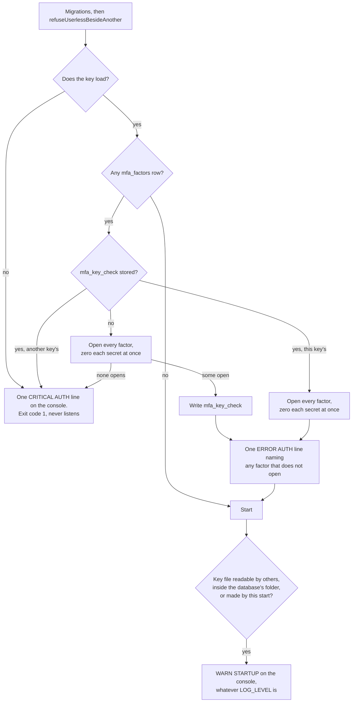

| Reason in the CRITICAL line | Why it stops the server | Do |
|-----------------------------|-------------------------|----|
| `MFA_KEY_FILE must be set in production: it names the file holding the key that protects authenticator secrets, 64 hexadecimal characters.` | A key made at start would live in the container's own layer and be lost when the container is replaced, taking every second factor with it | Make the key and mount it, as above |
| `MFA_KEY_FILE names no file (<path>); the server never makes a key in production.` | The same: a typo in the path must not make a new key | Correct the path or the mount |
| `The MFA key file <path> is not a regular file.`, `… is larger than 4096 bytes, so it is not a key file.`, `… could not be read (<code>).` | It is not a key | Point it at the key file; for `EACCES`, let the container read it |
| `The MFA key file <path> can be written by its group or by everyone, so it could be swapped for another key. Make it readable and writable by its owner alone (chmod 600).` | A key anyone on the host can replace protects nothing | `chmod 600` the file on the host |
| `The MFA key file <path> does not hold a key: it must hold 64 hexadecimal characters and nothing else (openssl rand -hex 32).` | It is not a key | Put the key back as it was made; never a new one if factors exist (below) |
| `The MFA key does not match the one the second factors were made with or the stored secrets were sealed with (a volume swap, a moved DB_PATH, a restore by hand, or the wrong key file).` | Second factors or stored secrets (card 2898) are stored and `mfa_key_check` is another key's: the server would run with secrets it cannot read. A check of another key with nothing sealed is not refused: the start replaces it with this key's before it seals anything (card 2898's code review, E1) | Mount the key they were sealed with. If it is gone, follow [If the Key Is Lost](#if-the-key-is-lost) |
| `None of the N second factor(s) opens with this MFA key, and no key check is stored: the key does not match the one they were made with (…).` | No key check is stored (deleted by hand, say) and no factor opens, so the key is the wrong one | As the row above |
| `None of the N stored secret(s) opens with this MFA key, and no key check is stored: … Mount that key. If it is lost, start once with FORGET_UNOPENABLE_SECRETS=1 to forget them as a backup forgets them … then remove it.` | No factor and no key check are stored, and not one stored secret opens (card 2898's code review, S6): the wrong key mounted is likelier than a lost one, and forgetting cannot be undone by mounting the right key afterwards, so nothing is forgotten without the operator saying so | Mount the key they were sealed with. If it is truly lost, follow step 5 of [If the Key Is Lost](#if-the-key-is-lost) |
| `MFA_KEY_FILE_PREVIOUS names no file (<path>); a previous key is never made.` | The key is being changed and the old key is not where it is said to be (card 2773) | Correct the path or the mount, or take `MFA_KEY_FILE_PREVIOUS` out: see [Changing the Key](#changing-the-key) |
| `MFA_KEY_FILE_PREVIOUS cannot be used. The MFA key file <path> …`, followed by any of the key file's own reasons above | The old key file is not a key, or could be swapped for another | As for `MFA_KEY_FILE`'s own row |
| `MFA_KEY_FILE_PREVIOUS holds the same key as MFA_KEY_FILE. To change the key, MFA_KEY_FILE names the new key and MFA_KEY_FILE_PREVIOUS the old one.` | Both name one key, so nothing would change: a mistake in how the server was started, refused whether or not factors are stored | Point `MFA_KEY_FILE` at the new key |
| `The second factors could not be sealed again under the new MFA key (<why>). Nothing was changed, and starting again is safe; if another instance is running on this database, stop it first.` | The change of key failed partway, most often because another instance holds the database (`database is locked`): its transaction is rolled back whole | Stop every instance on the database, then start again |
| `The stored secrets could not be sealed under the MFA key (<why>). Nothing was changed, and starting again is safe; if another instance is running on this database, stop it first.` | The start's sealing of secrets held in plain (card 2898, `sealStoredSecretsAtStart`) failed: its transaction is rolled back whole | As the row above |

Every reason ends `See docs/deployment.md, The Key That Protects Authenticator Secrets.`
**Until card 2769 lets an account set up a factor there is no factor to compare**, so only the
key file's own faults can stop a start; the two mismatch refusals begin once accounts have
enrolled.

When it starts, five more things can be said:

- **The key was changed** (card 2773), with `MFA_KEY_FILE_PREVIOUS` set: one `[WARN] [AUTH]` line
  saying how many factors were sealed again under the new key, or one `[WARN] [STARTUP]` line
  saying the previous key opens nothing. See [Changing the Key](#changing-the-key).
- **Factors are stored and no key check is**: the key's check is recorded in `settings`, once
  any factor opens.
- **Some factors do not open** with this key (sealed by another key, or copied to another
  row or account): one line, `[ERROR] [AUTH] N second factor(s) could not be opened with this
  server's MFA key: factor <id> of user <id>, …. None is counted as a wrong code; each account
  can sign in with a recovery code, or have its two-step sign-in reset.`, naming the first 20
  and then `, and N more`, at every start until they are dealt with.
- **The two warnings** above: a key file readable by others, and a named key file inside the
  database's folder.
- **This start made the key** (under `development` or `test` only, never under the production
  rules): one `[WARN] [STARTUP]` line on the console, whatever `LOG_LEVEL` is, `The server made
  a new MFA key at <path>. Back it up apart from the database: no backup holds it, and without it
  every second factor is lost. See docs/deployment.md, The Key That Protects Authenticator
  Secrets.` It is said at the start that made the key, and not at later starts that read it.

| Start-up warning (`[WARN] [STARTUP]`, console, whatever `LOG_LEVEL`) | When | Do |
|-----------------------------------------------------------------------|------|----|
| `The MFA key file <path> can be read by its group or by everyone. …` | POSIX, mode has any of `044` | `chmod 600`, unless it is a read-only secret mount |
| `The MFA key file <path> is inside the database's directory: …` | A named key file in or beneath the database's folder | Move it off the database's volume |
| `The server made a new MFA key at <path>. Back it up apart from the database: …` | This start made the key (development or test only) | Copy the key file somewhere safe, apart from the database and its backups |
| `The previous MFA key, named by MFA_KEY_FILE_PREVIOUS, opens nothing: no second factor is sealed under it. Remove MFA_KEY_FILE_PREVIOUS, and keep the old key file offline for as long as you keep backups made with it.` | `MFA_KEY_FILE_PREVIOUS` is set and no stored factor opens with it: the change was made at an earlier start, or no account has a factor yet (card 2773) | Make the container again without `MFA_KEY_FILE_PREVIOUS` and its mount |

### Changing the Key

Change the key when the key file may have been read by someone who should not have it (a host
that was broken into, a copy left in a ticket), when someone who held it leaves, or on a
schedule of your own. Changing it needs the old key: a key that is **lost** cannot be changed,
only replaced, which costs every second factor (see [If the Key Is Lost](#if-the-key-is-lost)).

The key is changed **at a start** (card 2773), never while the server runs: the server loads its
key once and keeps it, so factors sealed again by anything else would be unreadable to it until
it restarted. `MFA_KEY_FILE` names the new key and `MFA_KEY_FILE_PREVIOUS` the old one. Before
the server listens, wherever there is a factor to seal again, a key check to record, or an
authenticator being set up under the old key, the start-up check (`checkMfaKeyAtStart`) does all
of this in one `BEGIN IMMEDIATE` transaction:

- reads the factors and the stored key check again under the write lock, and decides again;
- seals every factor that opens with the old key again under the new one, with a new nonce and
  the same additional data, keeping its `factor_uid` and the step it last spent, so nobody has
  to set up their authenticator again and no code already used works a second time;
- deletes every authenticator being set up under the old key (a pending enrolment, which can no
  longer be opened: that person starts setting up again), at every start while
  `MFA_KEY_FILE_PREVIOUS` is set, even one with nothing to seal again and no check to record;
- records the new key's check;
- seals again under the new key every stored secret (card 2898: the mail password, the
  destinations' credentials, the webhooks' secrets, the signing keys) that opens with the old
  one, factors or none, and counts them in the `Rotated …` line ("Rotated N second factor(s) and
  M stored secret(s) to the new MFA key").

Each old secret, and the AES keys derived from the old file, are zeroed once used; the old key is
not kept by the running server. If any of it fails, the transaction is rolled back whole,
nothing is changed, the start is refused (the last row of the table in
[What the Start-Up Check Does](#what-the-start-up-check-does)), and starting again is safe.

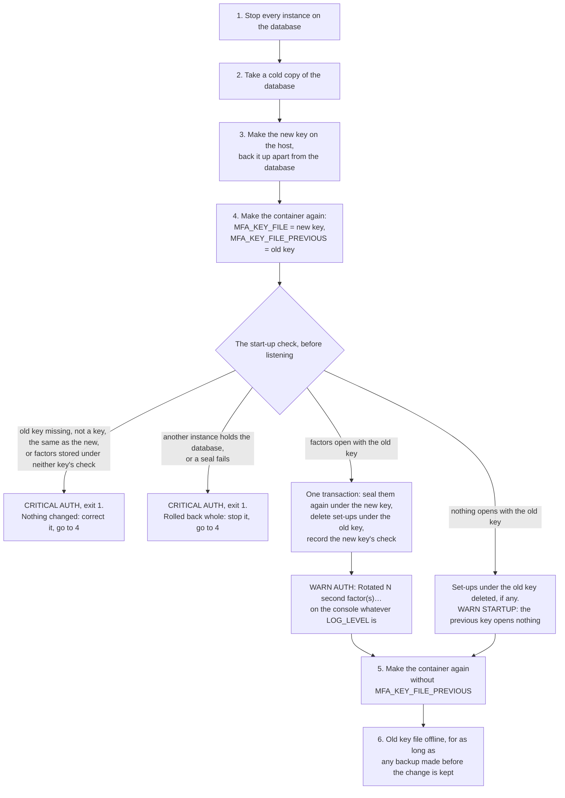

1. **Stop every instance first**: production, and any other container that opens the same
   database file or volume (a second replica, a staging copy pointed at it). The change reads and
   writes under the database's write lock, so an instance still running cannot write between
   its read and its commit; but one that is writing when the new key starts can make that start
   fail, and one left running on the old key afterwards seals every factor it writes
   under a key the new server does not hold, and those factors are named at `ERROR` at every
   start and need their accounts' two-step sign-in reset. `docker stop dumpfire`.
2. **Take a cold copy of the database**, with the container stopped: see
   [Taking and Returning the Cold Copy](#taking-and-returning-the-cold-copy).
3. **Make the new key** beside the old, and back it up apart from the database now:

   ```bash
   umask 077
   cd /srv/dumpfire-secrets
   mv dumpfire_mfa_key dumpfire_mfa_key.previous
   openssl rand -hex 32 > dumpfire_mfa_key
   chmod 600 dumpfire_mfa_key dumpfire_mfa_key.previous
   sudo chown 1000:1000 dumpfire_mfa_key dumpfire_mfa_key.previous   # the server's user (card 2776)
   wc -c dumpfire_mfa_key                                             # 65
   ```

4. **Make the container again with both keys.** `docker start` and `docker restart` cannot add
   a setting, so remove the container (the database and the uploads are on the volume and stay)
   and run it with its usual command and the old key mounted and named:

   ```bash
   docker rm dumpfire
   docker run -d \
     --name dumpfire \
     --restart unless-stopped \
     -p 3000:3000 \
     -v dumpfire-data:/app/data \
     -v /srv/dumpfire-secrets/dumpfire_mfa_key:/run/secrets/dumpfire_mfa_key:ro \
     -v /srv/dumpfire-secrets/dumpfire_mfa_key.previous:/run/secrets/dumpfire_mfa_key_previous:ro \
     -e DB_PATH=/app/data/dumpfire.db \
     -e MFA_KEY_FILE=/run/secrets/dumpfire_mfa_key \
     -e MFA_KEY_FILE_PREVIOUS=/run/secrets/dumpfire_mfa_key_previous \
     -e ORIGIN=https://dumpfire.example.com \
     -e NODE_ENV=production \
     dumpfire:latest
   ```

   In Compose, add a second secret (`dumpfire_mfa_key_previous`, `file:` the old key) to the
   service and to `secrets:`, and `- MFA_KEY_FILE_PREVIOUS=/run/secrets/dumpfire_mfa_key_previous`
   under `environment:`, then `docker compose up -d`.

   `docker logs dumpfire 2>&1` then has, once factors exist, `[WARN] [AUTH] Rotated N second
   factor(s) to the new MFA key. Back up the new key now, then remove MFA_KEY_FILE_PREVIOUS;
   keep the old key file offline for as long as you keep backups made before today.`, printed
   on the console whatever `LOG_LEVEL` is, and `Listening on`. Before card 2769 lets anyone set
   up a factor, or if every factor was already changed, it has the `[WARN] [STARTUP]` line
   "The previous MFA key, named by MFA_KEY_FILE_PREVIOUS, opens nothing…" in its place, and a
   stored check of the old key is replaced by the new key's all the same. A factor that opens
   with neither key is named in the usual `[ERROR] [AUTH]` line.
5. **Make the container again without `MFA_KEY_FILE_PREVIOUS`** and without the old key's mount,
   the same way. A start that still has it re-seals nothing (it deletes only a set-up still under
   the old key, which an instance left running on it could have made) and says the previous key
   opens nothing, at every start until it is removed.
6. **Take the old key file off the host and keep it offline** (a password manager's or a
   secrets store's entry, apart from the database's backups) for as long as you keep any backup,
   cold copy or exported file made before the change: those hold factors sealed under the old
   key, and it is the only key that opens them. Then delete it.

#### Restoring After a Change of Key

**A database file put back by hand** (a cold copy, or a backup file copied over the database)
made before the change holds factors sealed under the old key and the old key's check. Started
with the new key alone, the server refuses: "The MFA key does not match the one the second
factors were made with…". Start it once as in step 4, with `MFA_KEY_FILE` naming the current key
and `MFA_KEY_FILE_PREVIOUS` the old key the file was made under, fetched from where it is kept
offline: that start seals the file's factors again under the current key and records its check.
Then remove `MFA_KEY_FILE_PREVIOUS` as in step 5. For a file made before two changes, the old key
is the one in use when the file was made; one previous key is named at a time.

**Import Backup of a backup made before the change** (online, on the admin page) needs no key
named and is not refused. It never copies a backup's key check, and the server keeps running on
its current key. An account that is the same here and in the backup (the same id and creation
time) keeps this server's factors, which are already under the new key, so nothing changes for
it. Any other account (deleted here since the backup, say) gets the backup's factors only when
the backup's key check is this server's key, which a backup made before the change is not: its
factors are left out, and the restore names those accounts as having no second factor, "because
the backup was made under a different MFA key". Reset each one's two-step sign-in (see
[Resetting Two-Step Sign-In](admin-guide.md#resetting-two-step-sign-in)).
`MFA_KEY_FILE_PREVIOUS` plays no part in Import Backup: it is read only at a start.

### If the Key Is Lost

With factors stored and no key, or another key, the server does not start, and recovery codes
cannot bring it back. Every second factor sealed with the lost key is gone; the accounts are
not:

1. **Stop the server**: `docker stop dumpfire`.
2. **Back up the database** as it is, with the container stopped: see
   [Taking and Returning the Cold Copy](#taking-and-returning-the-cold-copy).
3. **Delete every second factor and the key check**, with the container still stopped, from a
   container of the same image on the same volume:

   ```bash
   docker run --rm --network none -v dumpfire-data:/app/data dumpfire:latest node -e "
   const db = require('better-sqlite3')('/app/data/dumpfire.db', { fileMustExist: true });
   db.transaction(() => {
     console.log(db.prepare('DELETE FROM mfa_factors').run().changes + ' second factor(s) deleted');
     db.prepare('DELETE FROM settings WHERE key = ?').run('mfa_key_check');
   })();
   db.close();
   "
   ```

4. **Install a new key**: make it as in [Making the Key](#making-the-key), at the path
   `MFA_KEY_FILE` names, and back it up apart from the database.
5. **Start the server once with `FORGET_UNOPENABLE_SECRETS=1`**, then remove it. With no factor
   stored there is nothing to compare. The stored secrets sealed under the lost key (card 2898)
   open with nothing, and without the variable the start is refused with "None of the N stored
   secret(s) opens with this MFA key …", nothing changed (card 2898's code review, S6): a start
   never forgets them on its own. With it, and no key check stored and none of them opening, the
   start forgets them as a backup forgets them (the mail password and the destinations'
   credentials emptied, each signed webhook switched off and listed, the signing keys made
   again), names them in one `[ERROR] [AUTH]` line, records the new key's check and marks the
   scrub pending. While the variable is set every start says at `[WARN] [AUTH]` to remove it:
   take it out of the container's environment and recreate the container. Enter the mail
   password and the destinations' credentials again in Admin, and set each webhook a new secret
   with its receiver. Where some stored secrets do open, none is forgotten, with the variable or
   without: the key is then not the lost one, and those that do not open are only named.
6. **Every account that had a second factor now has none**, and needs its two-step sign-in
   reset before it can sign in with one: 🛡️ on the admin page (see
   [Resetting Two-Step Sign-In](admin-guide.md#resetting-two-step-sign-in)), and for the
   superadmin the host's command (see
   [If the Superadmin Loses Their Authenticator](#if-the-superadmin-loses-their-authenticator)). Its recovery-code rows are hashes,
   not sealed with the key, and are left as they are.

Backups made before the loss hold factors sealed with the old key and the old key's check. Import
Backup of one gives every account it matches to this server's (by id and creation time) this
server's factors, which are now none, and leaves out the backup's factors for every other
account, as `key differs` ("the backup was made under a different MFA key"); when it leaves any
out, its answer names every account left with no factor, and why. Put back by hand as the
database file, one holding factors stops the next start with the mismatch refusal until steps 3
to 5 are done again.

**A rebuilt server is the same as a lost key, for second factors, even with the key.** If the
server itself is rebuilt (a new volume, a new installation) and a backup is imported, every
account's factors in it are left out as unsealed, because the key that seals backups is the old
installation's and in no backup (see [Backing It Up](#backing-it-up)). Since card 3009 the same
goes for every account's password and API keys in it, the backup's superadmin given the
importer's password and authenticators. Mounting the right MFA key does not change that: every
account needs its two-step sign-in reset (card 2773) and its password set (🔑) or an invite (📧),
and the restore counts them, with the reason.

## Attachment Files

A file attached to a card is stored on disk, not in the database. The database holds a row for it, with the file's name; the file is at `uploads/<card id>/<file name>` beside the database. Both ways of attaching a file write there: the card window's upload, and since card 2754 an image uploaded through an API key (`POST /api/v1/cards/{cardId}/attachments`), whose file is named `<uuid>.<png|jpg|gif|webp>` by the server and whose row adds about a hundred bytes to the database. No file is ever kept in the database itself, so images do not grow it or its backups.

> ⚠️ **Attachment files are in no backup.** A scheduled backup, "Run Backup Now" and the database export each hold the database and nothing else. Back the uploads folder up separately, or a restore brings back cards whose attachments cannot be opened.

> ⚠️ **Never point two instances at the same uploads folder.** A second instance that holds a copy of this one's data, such as a development copy or a rehearsal, has the same rows naming the same files. Deleting a card there moves this instance's files to the trash, a Reset there moves every one of them, and 30 days later they are removed for good. Two unrelated databases would mix their files in the same folders, because folders are named by card id and every database has a card 1, and an instance whose schedulers run sweeps every file its own rows do not name, a day after it was written, into the trash. Give every instance its own data directory.

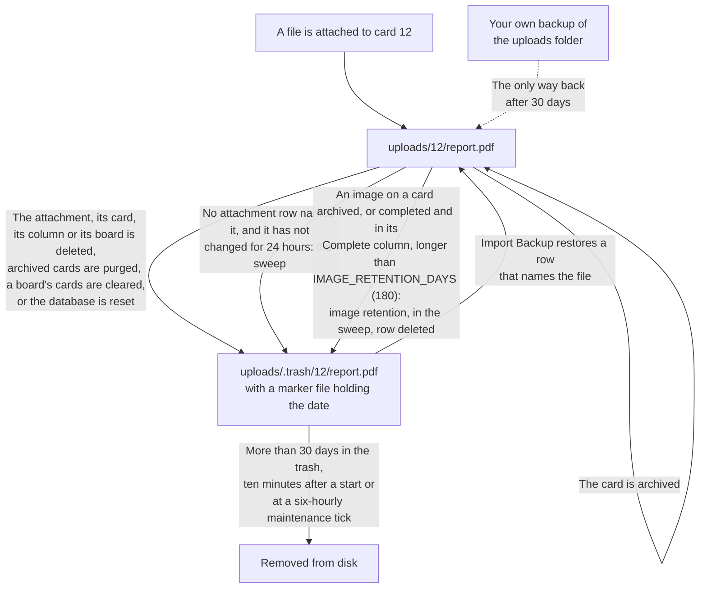

### Free space on the uploads volume

Since card 2920 every upload, through the card window or an API key, first asks how much room is
left on the disk the uploads folder is on, and is refused when what is free, less room for a
25 MB upload, would fall below **1 GB plus twice the database's size**. The uploads folder is
beside the database, on the same volume, and a backup writes two copies of the database beside it
while it runs: the floor keeps that room, and room for the database's own writes, free of uploads.
The figure is fixed in the code, not a setting (`src/lib/server/upload-space.ts`).

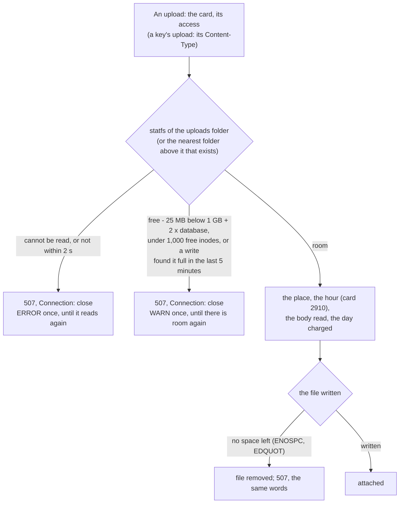

- **What is read.** `fs.promises.statfs` (Node 18.15 and later; the image runs Node 22): free is the
  space the server's own user may use (`bavail`, without the blocks Linux reserves for root), total
  the volume's size. The folder is made at the first upload, so before then the folder above it is
  read: the same volume. The read is given **2 seconds**; one that takes longer (a stalled network
  volume) counts as unreadable, and only one read runs at a time, so a volume that does not answer
  holds one of Node's threads, not one for every upload.
- **Inodes.** Where the volume counts them (Linux; Windows does not), uploads are refused too when
  fewer than **1,000** inodes are free: a disk with bytes free and no inode left fails every new
  file. An upload takes at most two (its file and its card's folder), a backup at most eight.
- **A write that finds the disk full** holds uploads refused for **5 minutes**, unless the free space
  grows past what was read before that write; so the uploads after it are refused before their
  bodies are read, and the log does not swing between refused and accepted at every upload.
- **The refusal.** `507 Insufficient Storage`, `{ "message": "Uploads are paused: the server has too
  little free disk space, or cannot read how much it has. Nothing was written. An administrator can
  see which on the admin page." }`, the same words on both routes. Asked before the body is read,
  after the card and its access, and before card 2910's place and hour: nothing is read, taken or
  counted, and the connection is closed. A write that still finds no space (something else filled
  the disk while the body arrived) is removed and answered the same, without `Connection: close`;
  that upload has been counted, as any refusal after the read is.
- **When the free space cannot be read**, uploads are refused all the same (fail closed): a guard
  that let uploads through when it could not look would allow the full disk it is there to prevent.
- **The log.** One line under `UPLOADS` each time the state changes, none while it stays:
  `[WARN] Uploads are refused: <free> free on the uploads volume, below <line> (…). Free some space or grow the volume.`
  (or `… an upload could not be written, as the uploads volume is full (ENOSPC) …`, or
  `… <n> free inodes on the uploads volume, below 1000. Delete files or grow the volume.`),
  `[ERROR] Uploads are refused: the free space on the uploads volume could not be read (<reason>).`,
  and `[INFO] Uploads are accepted again: <free> free on the uploads volume.` The state is kept in
  memory and judged at every upload and every opening of the admin page; a restart begins with
  room, so the first look after it says again if the disk is short.
- **The admin page.** The Database Overview shows **Uploads Disk Free** and a line: how much is free
  of the whole, and below what uploads are refused; or, in red, that uploads are refused and why:
  too little space (a full disk shows `0 B`), too few inodes, a write that found the disk full in
  the last 5 minutes, or a free space that could not be read.
- **To make room**: delete what is not needed on the volume (old copies, logs, images), or grow it.
  The trash (below) is on the same volume and is emptied 30 days after each delete; files in it are
  what Import Backup puts back, so empty it by hand only knowing that.

### The trash

- **A deleted card's files are moved, not removed.** They go to `uploads/.trash/<card id>/`, beside a marker file `.trashed-at` that holds the date. Archiving or completing a card moves nothing at the time; only [image retention](#image-retention), long after, moves its images.
- **They stay for 30 days.** A folder of the trash is removed once it was last added to more than 30 days ago. The period is fixed.
- **The trash is emptied by a timer, never at start-up.** The timer starts with the server, looks at the trash for the first time ten minutes after a start and then every six hours, so nothing is removed from disk as the server comes up. A server that is restarted more often than every six hours still empties its trash, at the ten-minute run after each start; one that is restarted more often than every ten minutes never does.
- **`SCHEDULERS=off` does not stop it.** The timer belongs to log maintenance, not to the schedulers `SCHEDULERS` decides (the backup, report and snapshot schedulers, the decision reminder and the attachment file sweep), and runs in every instance.
- **What it logs.** When a tick removes something, one `[INFO] [UPLOADS]` line says how many cards' files went. A folder that was due and could not be removed is reported in a `[WARN] [UPLOADS]` line and tried again at the next tick.
- **A file that cannot be moved to the trash stays where it was, for a day.** The delete has already been committed and is not undone. A `[WARN] [DELETE]` line names the files, the first ten where there are more, each by its card id and stored file name. The delete does not try again, but the sweep below does: once the file has not changed for 24 hours, no row names it, and the next sweep moves it.

### The sweep: files no attachment names

A file can be in a card's folder with no attachment row naming it: a move to the trash that failed, a server stopped between a delete's commit and its move, an upload stopped between writing its file and its row, an Import Backup whose rows leave some out, and every permanent delete made before card 2007, which left its files where they were. **The sweep (card 2107) moves such files to the trash**, where they stay 30 days like any other.

- **When.** It is one of the schedulers: the first run is 15 minutes after the start, then every six hours from that run. Nothing is moved at start-up itself. It runs only where the schedulers run, so it is off under `vite dev`, in a rehearsal and with `SCHEDULERS=off`; the trash is still emptied whatever `SCHEDULERS` says, by log maintenance.
- **What it reads.** Every attachment row, as `<card id>/<file name>`, and the highest card id this database has issued (the larger of the `cards` counter and the highest id in use), in one synchronous pass with the folder listing and the moves, so no request of this server can write a row in between. That protects against this process only: against a second process on the same volume the 24-hour margin is what protects.
- **What it never touches:**
  - a file a row names, in any case of its name: on Windows and macOS `Notes.TXT` and `notes.txt` are one file, which the row reads. On Linux, where they are two, no row reads a file named only in another case; it is left all the same, and the sweep counts such files in a `WARN` line;
  - a file changed in the last 24 hours (an upload writes its file before its row);
  - anything that is not a plain file in a folder named exactly by a card id, a whole number with no leading zero: `.trash` is skipped; any other name at the top of the uploads folder that is not a card's folder (`notes`, `07`, a link or a file) is left alone and named in a `WARN` line; links and folders inside a card's folder are skipped silently, with no line;
  - a folder numbered above the highest card id this database has issued: ids are never reused, so it was made by another database, and is left alone and named in a `WARN` line;
  - an empty card folder it did not empty itself (a folder it emptied goes, as a delete's does);
  - anything at all, when the rows or the counter cannot be read: one `WARN` line, and nothing is moved;
  - anything outside the uploads folder: every move goes through the trash's own move, which refuses a name that is not plain, and moves nothing into `.trash`, or a card's folder in it, that is a link (or a junction on Windows): such a file stays where it is and is named in the `WARN` for files that could not be moved.
- **Put back.** Import Backup within 30 days puts back any swept file that a restored row names, as it does for a deleted card's. A restore whose backup left `card_attachments` out says so in its answer; its files go to the trash at the next sweep, and an Import Backup that brings the rows within 30 days puts them back.
- **What it logs.** Nothing, when there was nothing to do. Otherwise:

  | Line | When |
  |---|---|
  | `[INFO] [UPLOADS] Attachment file sweep initialised: first run in 15 minutes, then every six hours` | At every start where the schedulers run |
  | `[INFO] [UPLOADS] Moved N attachment file(s) that no attachment names to the trash, from F card folder(s); E card folder(s) left empty were removed` | A run that moved anything |
  | `[WARN] [UPLOADS] N attachment file(s) that no attachment names could not be moved to the trash, and are where they were: …` | The first ten named; the next run tries again |
  | `[WARN] [UPLOADS] N attachment file(s) were left alone because an attachment names each only in another case: …` | A file in a card's folder whose name differs from an attachment's only in case. On Windows and macOS it is that attachment's file and the line can be accepted; on Linux no attachment reads it: find it (the row's name lowercased against the folder's) and rename or move it by hand |
  | `[WARN] [UPLOADS] N folder(s) in the uploads folder are numbered above the highest card id this database has issued (H), so were made by another database, and were left alone: …` | A fault to look into: another instance's files, or a folder copied in by hand |
  | `[WARN] [UPLOADS] N name(s) in the uploads folder are not a card's folder, and were left alone: …` | A name the sweep does not read as a card's folder, at every run until it is gone. Move it out of `uploads/`: a `.DS_Store` a Mac left, or a file or folder copied in by hand. A `lost+found` is at the root of a file system mounted at `uploads/` itself and cannot be moved: mount that file system at the data folder above instead, as the image's volume is, or accept the line |
  | `[WARN] [UPLOADS] Attachment files were not swept: the attachment rows or the card counter could not be read (…). Nothing was moved.` | The database could not be read |
  | `[WARN] [UPLOADS] Attachment files were not swept: …` | The uploads folder was refused, with why |
- **Two databases in one folder share one uploads folder.** The uploads folder is the folder `uploads` beside the database file, so a scratch database made beside `dumpfire.db`, for a test or a rehearsal on the host, has the live installation's files as its own. Started with the schedulers on, its sweep moves to the trash every file of the live installation that its own rows do not name, in every card folder numbered up to its own highest card id, a day after the file was written; 30 days later they are gone. Start a scratch database with `SCHEDULERS=off`, as [the rehearsal](#rehearsing-an-update-against-a-copy) does, or in a folder of its own, or with `UPLOADS_DIR` pointing at an empty folder of its own. (`UPLOADS_DIR` is for such a run and the tests; production never sets it.)
- **Disk space.** Deleting cards does not free the space their attachments use until 30 days later. To free it sooner, delete folders under `uploads/.trash/` by hand: the application has no way to empty the trash early. A file removed that way can no longer be put back by Import Backup.

### Image retention

Images are not deleted when a card is completed: cards are reopened, and a card's screenshots are the record of what was asked. **Each sweep run first moves to the trash the images of cards closed longer than `IMAGE_RETENTION_DAYS`** (card 2754; 180 days unless set). The rule, the entry it writes and how to get an image back are in [Image Retention](backup-reporting.md#image-retention); for the host:

- **What it takes.** Rows whose stored type is `image/png`, `image/jpeg`, `image/gif` or `image/webp` (parameters and case ignored), whichever way they were attached, on a card that is archived with `archived_at` older than the cutoff, or that sits now in a column titled Complete or Done (any case, trimmed) with `completed_at` older than the cutoff. A PDF, a text file or any other file stays. A card with a stale `completed_at` in another column keeps its images.
- **How.** In one transaction, at most 200 rows a run, oldest closed first: the rows are deleted, each with an `attachment_expired` entry (source `system`, no user, named DumpFire) and the card's live update, and the files are moved to `uploads/.trash/<card id>/` once that commits. They stay there 30 days like any other, where Import Backup can still put back a file that a restored row names. A file whose move fails stays in its card's folder with no row naming it, and the orphan sweep moves it a day later.
- **When.** At the start of each sweep run, so only where the schedulers run: 15 minutes after the start, then every six hours. It is skipped while a transaction is open. It has a try/catch of its own: whatever it meets, the orphan sweep after it still runs.
- **What it logs** (context `UPLOADS`):

  | Line | When |
  |---|---|
  | `[INFO] [UPLOADS] Moved N image(s) of cards closed more than D days ago to the trash` | A run that moved any; with `; more are due, and the next run takes up to 200 of them` when there were more than 200. Nothing is logged when there was nothing to move |
  | `[ERROR] [UPLOADS] IMAGE_RETENTION_DAYS is set to "…", which is neither off nor a whole number of days from 30 to 3650. No image was moved to the trash: …` | At every run while the setting is refused. Nothing is moved; the orphan sweep still runs |
  | `[ERROR] [UPLOADS] Images of closed cards were not moved to the trash: …. Nothing of this run was moved; the next run tries again.` | Retention failed (the database could not be read or written) |

- **Before the first deploy**, count what the first runs will move with [the read-only query](#before-the-deploy-count-what-retention-will-first-move). With `off` nothing is ever moved, and an image a key uploads to a long-closed card is accepted.

### Backing up and restoring the files

Copy the whole uploads folder, the trash included. With the volume and path used in the examples on this page:

```bash
mkdir -p -m 700 "$HOME/dumpfire-uploads"
# As your own user, who owns the folder the copy goes to (the image runs as uid 1000 since card 2776).
# Under rootless Docker, use --user root in its place: that is you there.
docker run --rm --network none --user "$(id -u):$(id -g)" -v dumpfire-data:/app/data:ro -v "$HOME/dumpfire-uploads:/backup" \
  dumpfire:latest sh -c 'if [ ! -d /app/data/uploads ]; then echo "No /app/data/uploads on the volume: nothing was copied. Check DB_PATH." >&2; exit 1; fi; cp -a /app/data/uploads/. /backup/ && ls -A /backup'
```

It lists what it copied. If there is no `/app/data/uploads` it copies nothing, says so and exits with status 1. That is so in two cases. No file has ever been attached: the folder is made at the first upload. Or the database is not on the volume, and the uploads are inside the container, beside the database. To tell which, with the container running:

```bash
docker exec dumpfire printenv DB_PATH
docker inspect --format '{{range .Mounts}}{{.Destination}}{{println}}{{end}}' dumpfire
```

If the first prints nothing, the container is from an image built before card 2083 and was started without `DB_PATH`: the uploads are in `/app/uploads` inside the container, and are lost when the container is replaced. If it prints a path, the uploads are in `uploads` in the folder that holds it, and that folder (normally `/app/data`) must be listed by the second command, or be inside a folder it lists. If it is not, the uploads are inside the container all the same: a container started from this image with no volume at `/app/data` prints `/app/data/dumpfire.db` and still has nothing on a volume. Checking `DB_PATH` alone says nothing since the image sets it. Copy them out of the container itself, running or stopped (shown for `/app/uploads`; for the image's own path it is `/app/data/uploads`):

```bash
mkdir -p -m 700 "$HOME/dumpfire-uploads-rescued"
docker cp dumpfire:/app/uploads/. "$HOME/dumpfire-uploads-rescued/"
ls -A "$HOME/dumpfire-uploads-rescued"
```

`docker cp` fails with a message if the container has no `/app/uploads`. For a `DB_PATH` set to somewhere else, the folder is `uploads` in the directory that holds that file.

The files are the attachments people uploaded, and nobody else on the host should be able to read them: `-m 700`, in both commands, makes the folder readable by you alone. The copy taken out of a container is a rescue, not a backup: move the files onto the volume with the database ([Moving the Database onto the Volume](#moving-the-database-onto-the-volume)), and once the next backup after that has been taken and checked, delete it (`rm -r "$HOME/dumpfire-uploads-rescued"`).

The first command replaces the server in a short-lived container, which is not started. It can be run while the application's container is up: an attachment file is written once and never changed afterwards. A file uploaded while the copy runs may be missed, so take the copy at about the time of the database backup it goes with.

What each way of restoring does with the files:

| Restore | The files |
|---------|-----------|
| **Import Backup**, in the admin panel | Files on disk are left where they are. For every attachment the restored database names whose file is missing from its card's folder and is in the trash, the file is moved back. The result on screen says how many were put back, and lists any that could not be |
| **By hand**, replacing `dumpfire.db` with the server stopped | Nothing is moved. Files that a delete had put in the trash stay there. Move each back from `uploads/.trash/<card id>/` to `uploads/<card id>/`, or restore your own copy of the folder taken with that backup |
| Either, more than 30 days after the cards were deleted | The trash no longer has the files. Only your own backup of the folder does |

**Before copying a folder back onto the volume** (card 2920), compare its size with the volume's
free space: the server cannot see a copy made on the host, and once it lands, uploads are refused
if less than 1 GB plus twice the database's size, and 25 MB more, is left
([Free space on the uploads volume](#free-space-on-the-uploads-volume)).

```bash
du -sh "$HOME/dumpfire-uploads"
docker run --rm --network none -v dumpfire-data:/app/data:ro dumpfire:latest df -h /app/data
```

If the copy would leave less than that, make room or grow the volume first. After the copy, the
admin page's Database Overview shows what is left.

An attachment whose file is not on disk still shows on its card. Opening it answers 404, "File not found on disk".

A copy of the database restored somewhere else, such as a working copy on a development instance, has the attachment rows and none of the files. That is expected: deleting a card there passes over the files it does not have.

## Start-Up Sequence

Every start of the container does the same work before the server accepts a request. The work is done by the application's own migration runner (`src/lib/server/db/migrate.ts`), which `hooks.server.ts` calls once as the server loads. Nothing else changes the structure of the database.

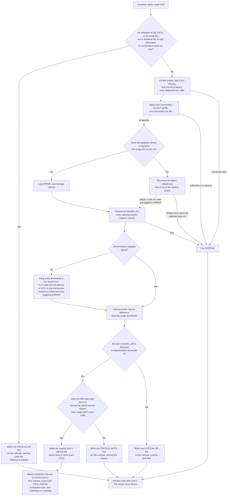

Before any of it, before the database is even opened (opening a path creates the file), the server looks at where the database is (`src/lib/server/db/location.ts`, card 2083). What it does depends on what is at the path it is about to open:

- **A database with data there** (a regular file that is not empty): it opens it, whatever else is around. If a non-empty `dumpfire.db` is also in the working directory (`/app/dumpfire.db`) beside the image's `/app/data/dumpfire.db`, it says so at every start, and opens the image's.
- **A folder there, or a file it cannot look at** (permission denied, say): it does not judge, and the open says what is wrong.
- **Nothing there, or an empty file**, so that opening it would make a new, empty database. At the image's path, `/app/data/dumpfire.db`, it looks for a database that would be hidden: a non-empty `dumpfire.db` in the working directory (`/app/dumpfire.db`, where a server started without `DB_PATH` kept it); a non-empty file whose name ends in `.db`, in lower case, at the top level of `/app/data` (not in a folder beneath it, and not `dumpfire.db-wal`, `dumpfire.db-shm` or `dumpfire.db.backup-temp`); and a non-empty `dumpfire.db-wal` beside the missing database. At any other path, on Linux, it looks at the image's `/app/data/dumpfire.db`: an empty `DB_PATH` (`-e DB_PATH=`, or `${DB_PATH}` in a compose file with the variable unset) falls back to `/app/dumpfire.db`, and a typo such as `/app/data/dumpfire.sqlite` names a file that is not there, and either would otherwise open a new database beside the real one. Only regular files count. If it finds any of them, or cannot look at one of them, or cannot list `/app/data`, it **refuses to start**. If it finds none, it opens the new database and says so.

The refusal is one `[CRITICAL] [DB]` line on the console, which begins `The server will not start.`, names each file with its size and when it was last written (so that you can tell which is live), says what to do with each, names anything it could not read, and never says to delete a file; the process exits with code 1 and nothing is created. The line cannot go to `system_logs`, which is in the database. On a workstation there is no `/app/data/dumpfire.db`, so a scratch file is never refused; on Windows the image's path is never looked at. See [A Failed Start](#a-failed-start).

One more refusal comes after the migrations, before the server listens. If the database in use is the image's, has no user accounts, and a non-empty `/app/dumpfire.db` is beside it, the server **refuses to start** with one `[CRITICAL] [DB]` line naming both files with their sizes and times. That is a database the check above let through because one earlier start, by an older image or with a `DB_PATH` it did not guard, made it and wrote to it: with no users, set-up would be open to whoever comes first while the real database sits unused. A healthy installation has users, so this never stops one that is running on its own database with an old file beside it.

And one more straight after it (card 2768): the key that protects authenticator secrets is read for the first time and checked (`checkMfaKeyAtStart`). Where the production rules apply, the server **refuses to start** when `MFA_KEY_FILE` is not set, names no file, or names a file that is not a key; and, once accounts have second factors, when the key is not the one they were made with. The refusal is one `[CRITICAL] [AUTH]` line on the console beginning `The server will not start.`, and the process exits with code 1. When it starts it may write one `[ERROR] [AUTH]` line naming factors that do not open, and a `[WARN] [STARTUP]` line for a key file others can read or one inside the database's folder. With `MFA_KEY_FILE_PREVIOUS` set (card 2773) the same check changes the key: it refuses an old key file that is missing, is not a key or is the same key, and otherwise seals every factor of the old key again under the new one in one transaction, saying so in one `[WARN] [AUTH]` line on the console whatever `LOG_LEVEL` is; see [Changing the Key](#changing-the-key). See [The Key That Protects Authenticator Secrets](#the-key-that-protects-authenticator-secrets).

1. **Preparation.** The `system_logs` table is created if it is missing, and a `card_dependencies` table still in its original shape is converted to the current one.
2. **Migration files.** Every `.sql` file in `/app/drizzle` whose name is not yet recorded in the `__drizzle_migrations` table is applied, in file-name order. Each file runs in its own transaction, together with the row that records it, so a file is either applied in full and recorded or not applied at all.
3. **The first failure stops the server.** The failing file is rolled back, no later file is attempted, and the process exits with code 1 before it listens. Files this start had already applied stay applied and recorded.
4. **Reconciliation.** Six tables (`boards`, `columns`, `categories`, `settings`, `user_xp`, `invite_tokens`) reached older databases in two different shapes. Any of them that is not in the shape the model declares is rebuilt in it, with every row carried across. A table that cannot be rebuilt safely is left exactly as it was and reported; that does not stop the server. The whole step is skipped when the database records a migration this image has no file for, because that database may be newer than the image, and an older image must not reshape it.
5. **Backfills.** First, every delivery board's one Options column (card 2527), a step with no migration file, in the same transaction as the rest: a second Options column on a board becomes an ordinary column, the leftmost keeping the role; an Options column with another title is renamed Options; one that is not leftmost is moved to the far left; and a delivery board with none is given one, empty, titled Options. Each logs a `WARN` line of its own when it changes anything (none begins "Took"): `Added an Options column at the far left of <n> delivery board(s) that had none`, `Renamed <n> Options column(s) to Options, the title every one has`, `Moved <n> Options column(s) to the far left of their board, where every one is` and `Made <n> second Options column(s) ordinary columns, each board keeping its leftmost: …`. The first start of the image that brings it adds one to every delivery board (see [Upstream Kanban, Part Seven](#upstream-kanban-part-seven-every-delivery-board-has-its-options-column)). Then two repairs that migrations made once are made again, in one transaction: the value that `0050` filled in (`cards.first_completed_at`) for any row that lacks it (the `task_requests.access_token` that `0051` filled in is no longer filled since card 2870: a request's links are kept only as hashes in `request_links`), and `0057`'s statement, which takes a card out of a milestone that belongs to a board other than the card's (card 2179). A third, in the same transaction, takes out of its grouping any board filed under a dashboard grouping that no longer exists (card 2293), logged in a line of its own, `Took <n> board(s) out of a grouping that no longer exists: board <id> (grouping <id>), …`, the first 50 by id; it has no migration file, so its first run, at the first start after its deploy, is the one-off (see [Deleted Groupings, the Card Search, Unchanged Board Saves and a Goal's Archived Cards](#deleted-groupings-the-card-search-unchanged-board-saves-and-a-goals-archived-cards)). The first two are logged in one `WARN` line when they fill anything, the third in a line of its own: `Took <n> card(s) out of a milestone that belongs to another board: card <id> left milestone <id>, …`, naming the first 50 cards by id with the milestone each left (`; and <n> more` after them), since nothing else then records which goal held them. At a start the third finds cards only after a database file taken before 0057 was swapped in by hand, or a return from an older image (after Import Backup the restore runs it and reports it itself); a count at any other start means some write still makes such a card (see [The Update That Brings the Third Round of Read Leaks](#the-update-that-brings-the-third-round-of-read-leaks)). Three more, in the same transaction, keep the commitment point (milestone 22, migration 0060): every card not upstream that has no `committed_at` is committed at its `created_at` by its `created_by`, as 0060 committed every card once; every card in an Options column or on an ideas board is cleared of a commitment; and every card that is not archived is cleared of a discard mark. Each logs a `WARN` line of its own when it changes anything (none begins "Took"): `Committed <n> card(s) that are not upstream and had no commitment recorded, at the moment each was created and by whoever created it`, `Cleared the commitment on <n> card(s) in an Options column or on an ideas board: an option is not committed`, and `Cleared the discard mark on <n> card(s) that are not archived`. Every write keeps all three, so each finds nothing at an ordinary start (see [Upstream Kanban, Part One](#upstream-kanban-part-one-the-options-column-and-its-conversion)). A failure of any of them stops the start, with the stage `backfilling each delivery board's Options column (columns.role), cards.first_completed_at, cards.milestone_id, boards.category_id, cards.committed_at and cards.discarded_at`.
6. **Timestamps.** Every timestamp column (every TEXT column whose name ends in `_at`, and `system_logs.timestamp`) is brought to the one stored form, `YYYY-MM-DD HH:MM:SS` in UTC (card 2095). A value in ISO 8601, in the stored form with a fraction, or a bare date is rewritten to the same moment, to the second; a value in no form it can read is left as it is and reported at `ERROR`, at every start until it is dealt with. It runs in a transaction of its own: a failure is rolled back, logged at `ERROR`, and tried again at the next start, and the server starts. Like step 4, it is skipped when the database records a migration this image has no file for, and the `ERROR` line of step 4 says so. A start that converts anything says so in one `WARN` line, which is expected once after the update that brings card 2095 and after an Import Backup of an older backup, and at no other time.
7. **Schema check.** The whole database is compared with the model. Every difference is logged in one `ERROR` line. Nothing is changed and the server starts.

Expired sessions are then cleared, the system log is pruned to its retention, the running log is masked (`maskLiveLog`), the settings of anyone no longer an administrator are removed, every invite an older image stored in plain is ended (`endPlainInvites`, card 2849: one `[WARN] [AUTH]` line when there were any), every requester link is ended when an older image has written one in plain (`endPlainRequestLinks`, card 2870: every `task_requests.access_token` set to NULL and every `request_links` row deleted, one `[WARN] [REQUESTS]` line when there were any; when it cannot look it deletes every link on its own, and when it cannot do that either the server does not start; see [The Release That Keeps Requester Links as Hashes](#the-release-that-keeps-requester-links-as-hashes-card-2870)), at the first start after card 2751 each owner of a report schedule that is on is told of theirs, once (`announceReportSchedules`, not awaited, and only where `SCHEDULERS` lets the schedulers run: one `[WARN] [REPORTS]` line for each such schedule naming its addresses, one mail to each owner, then, once every mail went, the `report_schedules_announced` row of `settings`; see [The Release That Asks for the Password Before Report Mail](#the-release-that-asks-for-the-password-before-report-mail-card-2751)), every webhook that is on and whose setter cannot open its board, or that nobody is recorded as having set up, is switched off for good (`switchOffHeldWebhooksAtStart`, card 2752: one `[WARN] [Webhooks]` line each, and the boards' owners mailed only where `SCHEDULERS` lets the schedulers run; see [The Release That Switches Off a Webhook Whose Setter Loses the Board](#the-release-that-switches-off-a-webhook-whose-setter-loses-the-board-card-2752)), the webhooks already switched off without a hold are held (`holdAlreadyOffWebhooksAtStart`, card 2923: at the first start after the release every one, whoever set it, and the `webhooks_already_off_held` row of `settings` written; at every start after, those whose setter is disabled or not recorded; one `[WARN] [Webhooks]` line naming them when any was held, nobody mailed; see [The Release That Holds Already-Off Webhooks When Access Ends](#the-release-that-holds-already-off-webhooks-when-access-ends-card-2923)), the webhooks whose secret a disabled owner or administrator could read are held (`holdReadableWebhooksAtStart`, card 2935: the first time every such one made before the disable, and every webhook with a secret made before setters were recorded, and the moment written to `webhooks_readable_by_disabled_held`; after that, those of accounts disabled since that moment; told as the sweep above is; see [The Release That Holds the Webhooks an Owner or Administrator Could Read](#the-release-that-holds-the-webhooks-an-owner-or-administrator-could-read-card-2935)), the backup, report and snapshot schedulers, the decision reminder and the attachment file sweep start (where `SCHEDULERS` lets them), and the server listens. On a database that is already up to date, steps 1 to 7 change nothing and log nothing.

Last, sixteen things about the installation are said in the log if they are so. None stops the server, and none changes anything: there are user accounts and none of them is the superadmin (`[CRITICAL] [STARTUP]`, see [If Nobody Can Sign In as the Superadmin](#if-nobody-can-sign-in-as-the-superadmin)); `ORIGIN` is still the address the image is built with and no App URL is set (`[WARN] [STARTUP]`, see [Where a Mailed Link's Address Comes From](#where-a-mailed-links-address-comes-from)); and a board hangs beneath one of its own cards, a loop left by a move made before card 2141, the legacy JSON import or a restored backup (`[WARN] [STARTUP]`, naming up to 20 such boards with the card each hangs from, see [A board beneath one of its own cards](admin-guide.md#a-board-beneath-one-of-its-own-cards) in the admin guide). The third reads the boards once and finds the loops in memory, so it costs next to nothing however deep the boards nest, and an import of a backup that brings a loop writes the same line at once, as `[WARN] [IMPORT]`, without waiting for the next start. The other three are about the database (card 2083), each a `[WARN] [STARTUP]` line: there was no database file, or an empty one, before this start opened it (`No database was at <path>: a new, empty one was created at this start.`, said once by a new installation, and the alarm on one that had data: stop the container before anyone opens the site); the folder the database is in is the container's own file system and not a mounted volume, at every start; and a database file is at `/app/dumpfire.db` beside the image's `/app/data/dumpfire.db`, which has data and is the one in use, at every start, naming both with their sizes and when each was last written. The seventh is that `SIGN_IN_ONE_AT_A_TIME` is `off` (card 2194), a `[WARN] [STARTUP]` line at every start while it is, written to the console whatever `LOG_LEVEL` is, as are the first two about the database: it is meant to be set for one sign-in and removed (see [If an Attack Keeps an Owner Out](#if-an-attack-keeps-an-owner-out)). The eighth is that `CSP_MODE` is `report-only`, or holds a value that is neither mode (card 2162), a `[WARN] [STARTUP]` line at every start while it does, written to the console whatever `LOG_LEVEL` is: `report-only` is meant for the policy's first deploy and then removed (see [The Update That Brings the Content-Security-Policy](#the-update-that-brings-the-content-security-policy)). The ninth is the secrets a backup does not hold that this installation still lacks (card 2169), one `[WARN] [STARTUP]` line naming them. The tenth is each entry of `WEBHOOK_ALLOW_INSIDE` that is ignored (card 2161), one `[WARN] [STARTUP]` line each, naming the entry and why: it is said here, once, because the list is read at every registration and every delivery, where a line would be written once for each webhook judged (see [Where a Webhook May Send](#where-a-webhook-may-send)). The eleventh is each board with more webhooks than the 10 a board may have (card 2201), in one `[WARN] [STARTUP]` line naming the first 20 by id and count, never an address: such a board was filled before the cap, keeps every webhook, and none can be added to it until it has fewer than 10. The twelfth is each webhook that is on and is refused as its address is written (an address inside the network that `WEBHOOK_ALLOW_INSIDE` does not name, a user name or password, or an address that is not http or https), in one `[WARN] [STARTUP]` line naming the first 20 by webhook and board, with why, never the path: it is not sent at any event, and no name is looked up for it. The thirteenth is each SFTP backup destination with no confirmed host key (card 2250), in one `[WARN] [STARTUP]` line naming the first 20 and then `; and N more`: no backup is sent to it until its key is confirmed with Test and Confirm, and where failure mail is off nothing else says so (see [An SFTP Destination's Host Key, Confirmed and Checked at Every Connect](#an-sftp-destinations-host-key-confirmed-and-checked-at-every-connect)). The fourteenth, in a built server only, is an `ORIGIN` that is set and `http:` while the App URL (the setting, else `APP_URL`) is `https:`, where `COOKIE_SECURE` and `NODE_ENV` leave plain-HTTP cookies without `Secure` (card 2850), one `[WARN] [STARTUP]` line: `ORIGIN is <origin> but the App URL is <app url>: every request is taken as plain HTTP, so cookies are not marked Secure and sign-in forms from the https address are refused. Start the server with ORIGIN set to the https address.` The adapter takes every request's address from `ORIGIN` when it is set, so behind an HTTPS proxy every request then counts as plain HTTP (see [Every Cookie DumpFire Sets](authentication-security.md#every-cookie-dumpfire-sets-card-2850)). The fifteenth is an App URL saved on the admin page that is not used because it is not on the address the server's configuration names (`APP_URL`, or an `ORIGIN` other than the image's `http://localhost:3000`; card 2847), one `[WARN] [STARTUP]` line: `The App URL saved on the admin page, <url>, is not used: it is not on this server's own address (<origins>), which its configuration sets. Links in mail begin with <base>. The superadmin can clear it under Application Settings.` It is not said where the fourteenth was said this start about the same row, an `https:` App URL on the host of an `http:` `ORIGIN` (see [Where a Mailed Link's Address Comes From](#where-a-mailed-links-address-comes-from)); where `COOKIE_SECURE` keeps the fourteenth back, this one is said. A saved App URL that is no plain web address (a user name, password, query, fragment, backslash, control character, or a path beginning `//`; its code review) is not used either, and the line quotes it as JSON and says `it is not a plain web address`. The sixteenth is an App URL saved on the admin page that is in use while the account recorded as having set it is not the superadmin, or none is recorded (card 2847's code review): an administrator could save it before that card, and with no `APP_URL` or real `ORIGIN` it still steers every link. One `[WARN] [STARTUP]` line: `The App URL <url> was saved by "<name>" (or no recorded account), not the superadmin; check it, or clear it and save it again as the superadmin.` Saving the same address again records nothing, so it is cleared and saved again. The last seven are written at `WARN` like any line, so `LOG_LEVEL` at `ERROR` or above drops them. The first two about the database (no database file before this start, and the folder not on a mounted volume) are written to the console whatever `LOG_LEVEL` is, even `ERROR`, because the checks after a deploy look for them in `docker logs`; with `LOG_LEVEL` at `ERROR` or `CRITICAL` they are printed but not kept in `system_logs`, as for any line. The second knows a container's own file system from `/proc/self/mountinfo`: the mount that holds the folder is the root and an overlay (`overlay`, as Docker has it, `fuse-overlayfs`, as rootless Podman has it, or `aufs`), or it is `tmpfs`. A container on another storage driver (`btrfs`, `zfs`, `vfs`) is not recognised and nothing is said, and where there is no `/proc/self/mountinfo` (Windows, macOS) nothing is said either. An in-memory database has no folder and is not looked at. A check that cannot be made is said on the console, one line for each such check, and the server starts all the same.

Nothing at start-up touches the uploads folder. The log is pruned again every six hours, and the same six-hourly tick empties the [uploads trash](#the-trash) of what has been in it for more than 30 days; the trash is also emptied once, ten minutes after the start. Where the schedulers run, [the sweep](#the-sweep-files-no-attachment-names) looks at the card folders 15 minutes after the start, and every six hours from then.

What stops a start, and what is only reported:

| Found at start-up | Logged as | Does the server start? |
|-------------------|-----------|------------------------|
| At `/app/data/dumpfire.db`, no database or an empty file, while a database file is at `/app/dumpfire.db` or at the top of `/app/data`, or a `dumpfire.db-wal` is there without its database | `[CRITICAL] [DB]`, on the console only, naming each file, its size and time, and what to do with it | **No**. Nothing is created or changed. See [A Failed Start](#a-failed-start) |
| At any other path, on Linux, no database or an empty file, while `/app/data/dumpfire.db` has data (an empty `DB_PATH`, or a typo) | `[CRITICAL] [DB]`, on the console only, naming `/app/data/dumpfire.db` | **No**. Set `DB_PATH=/app/data/dumpfire.db`, or take the setting out |
| A new database would be made, and a file or folder the check needed could not be read | `[CRITICAL] [DB]`, on the console only, naming what could not be read | **No**. Let the server read it, or set `DB_PATH` to where the database is |
| After the migrations: the image's database has no user accounts, and a database file is at `/app/dumpfire.db` | `[CRITICAL] [DB]`, on the console only, naming both files | **No**. See [A Failed Start](#a-failed-start) |
| Under the production rules, `MFA_KEY_FILE` is not set or names no file; or the file it names is not a regular file, is over 4096 bytes, cannot be read, can be written by its group or everyone, or does not hold 64 hexadecimal characters (card 2768) | `[CRITICAL] [AUTH] The server will not start. …`, on the console only, naming the path and the reason, never the file's contents | **No**. See [The Key That Protects Authenticator Secrets](#the-key-that-protects-authenticator-secrets) |
| Second factors are stored and the key is not the one they were made with: `mfa_key_check` is another key's, or none is stored and no factor opens (card 2768) | `[CRITICAL] [AUTH] The server will not start. The MFA key does not match …` (or `None of the N second factor(s) opens …`), on the console only | **No**. Mount the right key, or follow [If the Key Is Lost](#if-the-key-is-lost) |
| Some second factors do not open with this key (card 2768) | `[ERROR] [AUTH] N second factor(s) could not be opened with this server's MFA key: factor <id> of user <id>, …`, the first 20 named, at every start while it is so | Yes. None is counted as a wrong code; each such account needs its two-step sign-in reset |
| `MFA_KEY_FILE_PREVIOUS` is set and names no file, a file that is not a key, or the same key as `MFA_KEY_FILE`; or the change of key failed partway (another instance holds the database, say) (card 2773) | `[CRITICAL] [AUTH] The server will not start. MFA_KEY_FILE_PREVIOUS …` (or `The second factors could not be sealed again under the new MFA key …`), on the console only | **No**. Nothing was changed. See [Changing the Key](#changing-the-key) |
| `MFA_KEY_FILE_PREVIOUS` is set and factors open with it (card 2773) | `[WARN] [AUTH] Rotated N second factor(s) to the new MFA key. Back up the new key now, then remove MFA_KEY_FILE_PREVIOUS; …`, at that start, on the console whatever `LOG_LEVEL` is | Yes, with every such factor sealed again under the new key. Back up the new key, then remove `MFA_KEY_FILE_PREVIOUS` |
| `MFA_KEY_FILE_PREVIOUS` is set and no factor opens with it (card 2773) | `[WARN] [STARTUP] The previous MFA key, named by MFA_KEY_FILE_PREVIOUS, opens nothing: …`, at every start while it is set, on the console whatever `LOG_LEVEL` is | Yes. Remove `MFA_KEY_FILE_PREVIOUS` |
| No second factor and no key check are stored, and not one stored secret opens with the key (card 2898's code review, S6) | `[CRITICAL] [AUTH] The server will not start. None of the N stored secret(s) opens with this MFA key, and no key check is stored: …` | **No**, nothing changed. Mount the right key; if it is lost, see [If the Key Is Lost](#if-the-key-is-lost), step 5 |
| `FORGET_UNOPENABLE_SECRETS=1` | `[WARN] [AUTH] FORGET_UNOPENABLE_SECRETS=1 is set: a start with no key check stored and no stored secret opening forgets them. Remove it …`, at every start while it is set | Yes. Remove it once the start it was set for has run |
| A scrub of the stored secrets' old text is pending from an earlier start, a restore, a Reset or a key change, or this start's scrub found the write-ahead log held | `[ERROR] [STARTUP] … could not be scrubbed …` for each try that fails, naming Admin › Vacuum | Yes: tried after the server listens, a minute after the start and then every 30 minutes, until it succeeds (card 2898's code review, E4) |
| A backup destination's service account JSON was not in the one rule's form (a Drive service account saved before card 2939, JSON that is not a key file, or JSON on an OAuth or non-Drive destination) | `[WARN] [STARTUP] Rewrote the service account JSON of N backup destination(s) …`, naming each and how it changed, never a value, at that start only | Yes; a destination whose key was removed is listed to enter. See [The Release That Brings Service Account JSON to One Rule](#the-release-that-brings-service-account-json-to-one-rule-card-2939) |
| The MFA key file can be read by its group or by everyone (Linux only), or a named key file is inside the database's folder (card 2768) | `[WARN] [STARTUP]`, at every start while it is so, on the console whatever `LOG_LEVEL` is | Yes. Expected for a Docker Swarm secret (`0444`); otherwise `chmod 600` the file, or move it off the volume |
| A migration file fails, cannot be read, holds no SQL statement, or holds a statement the runner refuses (see [Changing the Schema](#changing-the-schema)) | `[CRITICAL] [DB]` | **No** |
| `/app/drizzle` is missing or holds no `.sql` file (an image built without its migrations) | `[CRITICAL] [DB]` | **No** |
| The `card_dependencies` conversion or a backfill fails | `[CRITICAL] [DB]` | **No** |
| The 0057 backfill took cards out of a milestone of another board (card 2179) | `[WARN] [DB] Took <n> card(s) out of a milestone that belongs to another board: card <id> left milestone <id>, …`, at that start, naming the first 50 (`; and <n> more`) | Yes. Expected at the first start after a database file swapped in by hand (a backup taken before 0057 copied over the database) and after a return from an older image, and at no other time: at any other start it is a fault to report. After Import Backup the restore makes the repair itself and reports it in its "Filled in" line, so no start line follows |
| The commitment backfill committed cards that are not upstream and had no commitment (milestone 22) | `[WARN] [DB] Committed <n> card(s) that are not upstream and had no commitment recorded, at the moment each was created and by whoever created it`, at that start | Yes. Expected after a database file taken before 0060 was swapped in by hand, or a return from an older image that made cards meanwhile (they are committed from their creation, which lengthens the lead time of any moved out of an Options column meanwhile). Not at the first start of the image with 0060: the file commits every card itself. At any other start some write does not record the commitment |
| The commitment of cards in an Options column or on an ideas board was cleared (milestone 22) | `[WARN] [DB] Cleared the commitment on <n> card(s) in an Options column or on an ideas board: an option is not committed`, at that start | Yes. Expected only after a return from an older image that moved cards into an Options column; at any other start some write does not clear it |
| The discard mark of cards that are not archived was cleared (milestone 22) | `[WARN] [DB] Cleared the discard mark on <n> card(s) that are not archived`, at that start | Yes. Expected only after a return from an older image that restored discarded cards; at any other start some write does not clear it |
| Delivery boards were given their Options column (card 2527) | `[WARN] [DB] Added an Options column at the far left of <n> delivery board(s) that had none`, at that start | Yes. Expected once, at the first start of the image that brings card 2527, with one for each delivery board then on the server, after a database file taken before it was swapped in by hand, or a return from an older image that made boards or deleted an Options column. At any other start some write makes a delivery board without one |
| Options columns were renamed, moved or made ordinary (card 2527) | `[WARN] [DB] Renamed <n> Options column(s) to Options, …`, `Moved <n> Options column(s) to the far left of their board, …` or `Made <n> second Options column(s) ordinary columns, …`, at that start | Yes. Expected only on a database a milestone 22 build was tried on, at the first start of the image that brings card 2527, or after a return from an older image that changed an Options column meanwhile; at any other start some write renames, moves or duplicates it |
| Foreign keys cannot be switched back on after a rebuild | `[CRITICAL] [DB]` | **No** |
| One of the six tables cannot be rebuilt, or its rebuild fails its checks and is rolled back | `[ERROR] [DB]`, at every start until the cause is dealt with | Yes, with the table as it was |
| One of the six tables holds a value that the model's column type would store differently | `[ERROR] [DB]` for that table, at every start until a migration converts it | Yes; that table is as it was and the others are rebuilt |
| The database records a migration this image has no file for | `[ERROR] [DB]`, at every start | Yes; no table is rebuilt and no timestamp converted |
| Timestamps were found in another form and converted | `[WARN] [DB] N timestamp(s) converted to the stored form (YYYY-MM-DD HH:MM:SS, UTC), each still naming the same moment to the second: <table.column n, …>. Expected once after the update that brings card 2095, and after an import of an older backup; at any other start something still writes another form.` | Yes. Expected once after this update; at any other start, a fault to report |
| A timestamp column holds a value in no form the conversion can read | `[ERROR] [DB] Timestamp column(s) hold values in no form this build can read, and they were left as they are: <table.column n (such as "…")>. …`, at every start until it is dealt with | Yes, with those values as they are. Correct each to `YYYY-MM-DD HH:MM:SS` in UTC, or clear it where the column allows NULL |
| The conversion failed | `[ERROR] [DB] Timestamps could not be brought to the stored form (YYYY-MM-DD HH:MM:SS, UTC), and none was changed: <why>. Start-up continues on the values as they are, and the next start tries again.` | Yes; nothing was converted. Until a start converts them, a report schedule whose next run is held in ISO 8601 runs up to a day late, because that comparison with now is made as text; a session's, an API key's or an invite's expiry is read as the moment it names, so each ends on time |
| The database differs from the model anywhere | `[ERROR] [DB]`, at every start | Yes; nothing is changed |
| A start after an older image wrote requester links in plain (card 2870) | `[WARN] [REQUESTS] Ended the links of <n> request(s) held in plain by an older image, and <m> link(s) kept as hashes: no request link mailed before this start works. Each requester can have a new one sent from the page a link opens.`, at that start only; `[WARN] [REQUESTS] Request links held in plain by an older image could not be ended: …` when it fails | Yes. Expected only after a return from an older image; each requester asks for a new link |
| The first start after card 2751, with report schedules that are on | `[WARN] [REPORTS] Report schedule <id> "<name>" of "<owner>" (user <id>) is on at this release, a report of <what it covers>, sent to: <addresses>`, one for each, at that start only; with no mail set up, also `[WARN] [REPORTS] <n> owner(s) of report schedules that are on were not told of them, as mail is not set up: "<owner>", …`; with a mail that did not go, `[WARN] [REPORTS] <n> owner(s) of report schedules that are on were not told of them, as the mail did not go: "<owner>", … The next start tells every owner again.`, and the next start says it all again. Where the schedulers do not run (the dev server, `SCHEDULERS=off`), only `[INFO] [REPORTS] The owners of report schedules that are on were not told of them, as the schedulers are off (…)`, at every such start | Yes. Each owner is mailed "Your DumpFire report schedules" once. A failure is `[WARN] [REPORTS] The owners of report schedules that are on could not be told of them: … The next start tries again.` See [The Release That Asks for the Password Before Report Mail](#the-release-that-asks-for-the-password-before-report-mail-card-2751) |
| There are user accounts and none of them is the superadmin | `[CRITICAL] [STARTUP]`, at every start until one is | Yes. Nobody can export, import or reset the database until one is made from the host (the backup and mail settings are every administrator's since card 2395) |
| `ORIGIN` is `http://localhost:3000` and no App URL is set | `[WARN] [STARTUP]`, at every start | Yes; links in mail begin with `http://localhost:3000` |
| A board hangs beneath one of its own cards | `[WARN] [STARTUP]`, at every start until it is repaired, and `[WARN] [IMPORT]` at once after an import that brings one | Yes. The board is on no dashboard and its card cannot be completed; opening it is safe. See [A board beneath one of its own cards](admin-guide.md#a-board-beneath-one-of-its-own-cards) |
| There was no database file, or an empty one, and this start made a new one | `[WARN] [STARTUP]`, at that start | Yes, on an empty database, with set-up open. On an installation that had data, stop the container before anyone opens the site: see [Moving the Database onto the Volume](#moving-the-database-onto-the-volume) |
| The database's folder is in the container's own file system, not on a mounted volume | `[WARN] [STARTUP]`, at every start | Yes. The database and the uploads are lost when the container is replaced: move them onto a volume before it is |
| A database file is at `/app/dumpfire.db` beside `/app/data/dumpfire.db`, which has data | `[WARN] [STARTUP]`, at every start until one of them is moved | Yes, on `/app/data/dumpfire.db`. If the other is this installation's database, start with `DB_PATH` set to it, or move it onto the volume |
| `SIGN_IN_ONE_AT_A_TIME=off` | `[WARN] [STARTUP]`, at every start while it is set, on the console whatever `LOG_LEVEL` is: `SIGN_IN_ONE_AT_A_TIME=off: sign-ins from browsers not remembered are not held to one at a time. Remove it and restart once the sign-in it was set for is made: see docs/deployment.md, under "If an Attack Keeps an Owner Out".` | Yes. A guesser who sends many attempts at once at one account is slowed by its waits alone. Remove it and restart: see [If an Attack Keeps an Owner Out](#if-an-attack-keeps-an-owner-out) |
| `CSP_MODE=report-only` | `[WARN] [STARTUP]`, at every start while it is set, on the console whatever `LOG_LEVEL` is: `CSP_MODE=report-only: pages are sent the Content-Security-Policy to report only, not to enforce; remove CSP_MODE once the trial is over. See docs/deployment.md.` | Yes. Pages are not protected by the policy: a browser reports what it would refuse and refuses nothing. Remove it and make the container again: see [The Update That Brings the Content-Security-Policy](#the-update-that-brings-the-content-security-policy) |
| `CSP_MODE` holds anything but `enforce` or `report-only` | `[WARN] [STARTUP]`, at every start while it does, on the console whatever `LOG_LEVEL` is: `CSP_MODE is "<value>", which is neither enforce nor report-only: the Content-Security-Policy is enforced.` | Yes, with the policy enforced. Correct the value or remove it |
| A secret a backup does not hold is still to be entered (card 2169): the mail settings name a host and a user and hold no password; an S3, Google Drive or OneDrive destination lacks its credentials; or a webhook the database's `webhook_secrets_left_out` lists is still off with no secret | `[WARN] [STARTUP]`, at every start while it is so: `To enter again, because a backup does not hold them: <the mail password (Admin, 📧 Email / SMTP); backup destination(s) "…" (…) (Admin, Scheduled Backups); the signing secret(s) of webhook(s) N (board "…"), which stay switched off until the board's owner or an administrator sets each one's secret and switches it on with PUT /api/v1/webhooks/{id}, or deletes it if it is no longer wanted>. A database put in place by hand from a backup has none of them: see docs/admin-guide.md, Restoring from Backup.` A list that cannot be read is said on the console alone | Yes. Mail is not sent, those destinations are not tried, and those webhooks send nothing, until each is entered: see [Restoring from Backup](admin-guide.md#restoring-from-backup) |
| An entry of `WEBHOOK_ALLOW_INSIDE` that is not read, or is wider than one inside range, holds `0.0.0.0` or `::`, or is outside the network (card 2161) | `[WARN] [STARTUP]`, one line for each such entry at every start while it is set: `WEBHOOK_ALLOW_INSIDE: "10.0.0.0/2" ignored: wider than one inside range` (or `not inside the network, so it allows nothing`, `an IPv4 address not written as four decimal numbers`, `its range is not a number of bits`, `not a host name, an address or a range (a port, a path or a wildcard is not taken)`) | Yes, with that entry ignored and the rest of the list applied. Correct it and make the container again: see [Where a Webhook May Send](#where-a-webhook-may-send) |
| A board has more than 10 webhooks, made before the cap (card 2201) | `[WARN] [STARTUP]`, at every start while one has: `2 board(s) have more webhooks than the 10 a board may have: board 12 has 14, board 40 has 11. All of them are still sent, and none can be added to such a board until it has fewer than 10.`, the first 20 named and then `, and N more` | Yes. Every active webhook of such a board is still sent; look at each with the board's owner and delete the ones not wanted |
| A webhook that is on is refused as its address is written (card 2161) | `[WARN] [STARTUP]`, at every start while one is: `2 webhook(s) that are on are not sent, whatever their names resolve to: webhook 4 on board 3 (127.0.0.1 is a loopback address); webhook 9 on board 3 (n8n is a name with no dot, which is looked up inside the network). Each is refused at every event until its address is changed or it is switched off; one inside the network can instead be named in WEBHOOK_ALLOW_INSIDE.`, the first 20 named and then `; and N more` | Yes. Such a webhook is sent nothing; change its address, switch it off, or name its host in `WEBHOOK_ALLOW_INSIDE` |
| An SFTP backup destination has no confirmed host key (card 2250): none saved, as every SFTP destination saved before this card | `[WARN] [STARTUP]`, at every start while one has: `1 SFTP backup destination(s) have no confirmed host key, and nothing is sent to them until one is confirmed: "NAS". In Admin, Scheduled Backups, press Test on each and confirm the key it shows.`, the first 20 named and then `; and N more` | Yes. No backup is sent to such a destination: each scheduled run fails it, with its Backup History row and failure mail. Test and Confirm it: see [An SFTP Destination's Host Key, Confirmed and Checked at Every Connect](#an-sftp-destinations-host-key-confirmed-and-checked-at-every-connect) |

How the runner, the rebuild and the comparison work is described in [Data Model](data-model.md#migrations-and-schema-reconciliation).

## First-Run Setup

On a new, empty database the [start-up sequence](#start-up-sequence) applies every migration file before the server listens. What follows depends on whether anyone has an account yet:

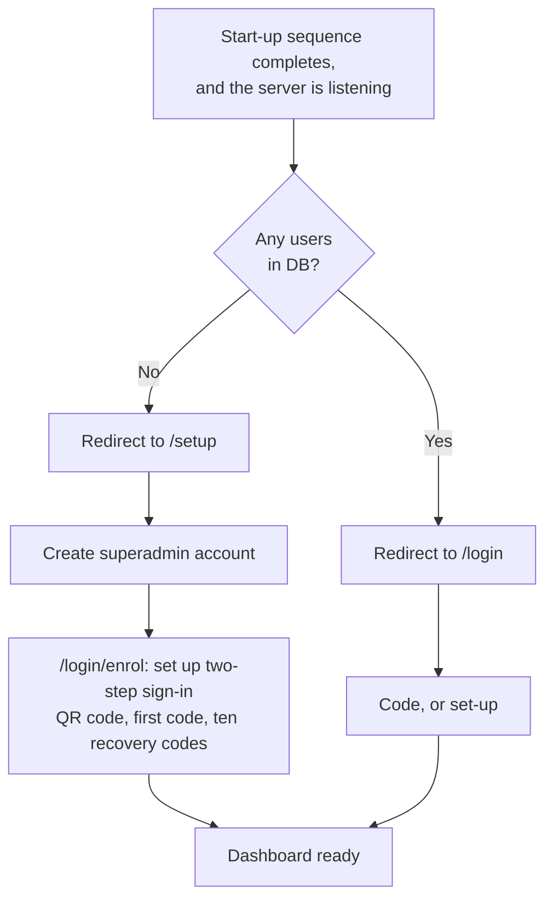

1. Start the container, with `MFA_KEY_FILE` in place: without the key, set-up answers `503`
   and makes nothing
2. Visit the application URL
3. You'll be redirected to `/setup` to create the first superadmin account
4. You are then taken to set up two-step sign-in (card 2769), with an authenticator app on your
   phone. Finish it straight away: only its last step signs you in
5. After setup, `/setup` is permanently blocked

**A set-up left unfinished** leaves the superadmin with a password and no authenticator, and no
leave to set one up on the password: signing in answers that the account needs a set-up link.
The way back is the host's command, which prints one:
`docker exec <container> node scripts/mfa-reset.mjs <username>` (see
[If the Superadmin Loses Their Authenticator](#if-the-superadmin-loses-their-authenticator)).

The start that made the new database says so in the log: `[WARN] [STARTUP] No database was at /app/data/dumpfire.db: a new, empty one was created at this start.` On a new installation that is expected, once. On an installation that had data it means the server is not looking where the data is, and set-up is open to whoever opens the site first: stop the container at once and see [Moving the Database onto the Volume](#moving-the-database-onto-the-volume).

## The Superadmin

The account made at set-up is the **superadmin**, and there is one. Its role is written by set-up and by nothing else: no page and no route makes a second, and an administrator cannot be promoted to it.

What acts on the whole installation is the superadmin's alone. An administrator who tries any of it is answered `403`, "This belongs to the superadmin", and the admin page does not offer it to them:

| The superadmin only | Why it is not an administrator's |
|---------------------|----------------------------------|
| Export Backup | The file holds every user's password hash and email and every webhook's address. Since card 2169 it holds no mail password, destination credential or webhook secret, and carries a seal made with a key this server keeps, so that only this server fills its secrets back into it, and only unchanged; files exported before then hold the secrets and no seal |
| Import Backup | It replaces every account with the backup's |
| Reset Everything | Whoever sets up afterwards is the superadmin |

Everything else on the admin page is any administrator's: users and teams, clearing a board, purging archived cards, vacuuming, resetting XP, the system log and the audit trail, and, since card 2395 at the owner's request, Scheduled Backups (the schedule, the destinations, "Test", "Run Now" and "Connect") and Email / SMTP with the App URL, which were the superadmin's. An administrator who sets a backup destination can be sent the whole database, password hashes included, and one who sets the mail server reads every mail DumpFire sends, invite and password-reset links included, the superadmin's among them. Since cards 2397 and 2398 (migration 0059) what an administrator set goes when they are made a user or deleted, and lowering Keep Last, removing a destination or switching the schedule off is the superadmin's. See [Administrators Can Use the Email and Backup Settings](#administrators-can-use-the-email-and-backup-settings), [Settings Go With Their Setter; Fewer Backups Are the Superadmin's](#settings-go-with-their-setter-fewer-backups-are-the-superadmins) and [Admin Guide](admin-guide.md#who-may-do-what).

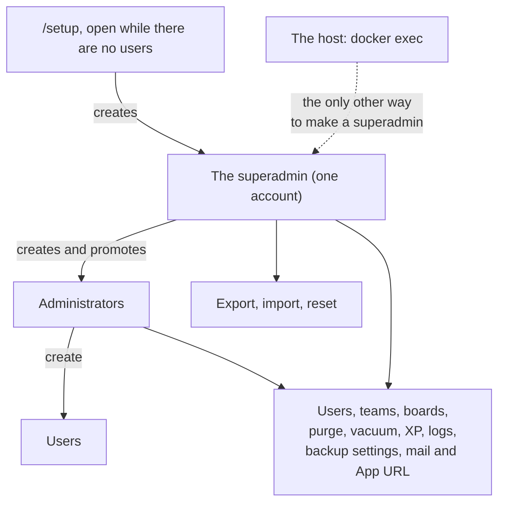

> ⚠️ **Before you deploy the version that brings this in**, sign in on production as the superadmin. The user list on the admin page shows each account's role, so it shows who that is. If you cannot, use the command below first: the account you use day to day, if it is an administrator, loses Export, Import, Reset, Scheduled Backups and the mail settings with that deploy.

### If Nobody Can Sign In as the Superadmin

The superadmin's password is lost, or its account was deleted or disabled from the database by hand, or the database came from somewhere that had none. No page puts that right: only the superadmin could, and set-up is closed while there is any user. A disabled superadmin cannot sign in, so it counts as none (card 2671). The server says so in the log at every start:

```
[CRITICAL] [STARTUP] There are 4 user account(s) and none of them is an enabled superadmin. ...
```

The way back is from the host, with the application's own database driver. The image has no `sqlite3` command. Give the username of an existing account in place of `<username>`, exactly as it is written on the admin page. The command makes it the superadmin and, since card 2671, enables it if it was disabled (`disabled_at` and `disabled_by` cleared):

```bash
docker exec <container> node -e "const db = require('better-sqlite3')(process.env.DB_PATH || 'dumpfire.db', { fileMustExist: true }); const name = process.argv[1] || ''; const user = db.prepare('SELECT id, username, role, disabled_at FROM users WHERE username = ?').get(name); if (user === undefined) { console.log('No user is named [' + name + ']. Nothing was changed. The users are: ' + db.prepare('SELECT username, role, disabled_at FROM users ORDER BY id').all().map((u) => u.username + ' (' + u.role + (u.disabled_at === null ? '' : ', disabled') + ')').join(', ')); } else { db.prepare('UPDATE users SET role = ?, disabled_at = NULL, disabled_by = NULL WHERE id = ?').run('superadmin', user.id); console.log(user.username + ' was ' + user.role + (user.disabled_at === null ? '' : ', disabled,') + ' and is now superadmin' + (user.disabled_at === null ? '' : ' and enabled') + '.'); } db.close();" <username>
```

It prints what it did:

| It prints | What happened |
|-----------|---------------|
| `greg was admin and is now superadmin.` | That one account's role was changed. Nothing else was |
| `greg was superadmin, disabled, and is now superadmin and enabled.` | That one account was enabled again, its role kept or changed. Its sessions, keys and webhooks ended at the disable, and stay ended |
| `No user is named [gerg]. Nothing was changed. The users are: greg (admin), ann (user, disabled)` | The name matched nobody, so nothing was written. It lists who there is, and which are disabled |
| `SqliteError: unable to open database file` | `DB_PATH` in the container does not name a database. Nothing was written, and no file was created |

It runs while the server is running and takes effect at the next request: no restart. It changes no password, so name an account whose password is known. If none is, an administrator can set the password of an ordinary user on the admin page, and that user can then be named here; nobody but the superadmin can set an administrator's.

To check it:

```bash
docker exec <container> node -e "const db = require('better-sqlite3')(process.env.DB_PATH || 'dumpfire.db', { readonly: true, fileMustExist: true }); db.prepare('SELECT username, role, disabled_at FROM users ORDER BY id').all().forEach((u) => console.log(u.username + ': ' + u.role + (u.disabled_at === null ? '' : ' (disabled)'))); db.close();"
```

At least one line should end `superadmin`, not `superadmin (disabled)`. Then sign in as that user: the admin page has Backup & Restore and Reset Everything on it again (Application Settings, Scheduled Backups and Email / SMTP are every administrator's since card 2395), and the `[CRITICAL] [STARTUP]` line is not written at the next start.

If the old superadmin's account is still there, there are now two, and neither can manage the other's account. Make the old one an administrator with the same command, with `'admin'` in place of `'superadmin'` in the `UPDATE`, or disable it as the new superadmin once its role is changed (card 2671: an account is disabled before it can be deleted).

**This is safe with the record of account endings** (card 2996's code review, FP1). The account promoted may have rows in the record from before (the role it was made with, a role change, a disable): for a superadmin none of them counts, since the application never writes one for a superadmin, so no later import lowers or disables it, the start says nothing of it, and an import of this server's own backup is not refused. Only a `deleted` row this server wrote counts for a superadmin: never promote an account a restore brought back inert (disabled with no password that works, its enable refused as deleted), or every import after would be refused for want of a superadmin; make a new account instead, through set-up on an empty database if need be, or promote another.

**And with passwords replaced here** (card 2997). Promote an account whose password works now, never an inert one: an account the start or an import has given a password nothing matches cannot sign in, and promoting it changes no password. Once it is the superadmin, only its own exact `here` rows of replaced passwords count against it, and it is never refused at sign-in, never signed out by the start and never left unable to sign in by an import. If the start then writes `[WARN] [AUTH] The superadmin holds a password the record of account endings says was replaced on this server: …` (it does at every start and every five minutes until the password is changed), sign in and change it on the Account page at once. This command writes no password. Any host script that ever does must call `recordPasswordReplaced` first, in the same transaction, or a later import can bring the password it replaced back; `tests/check-at-the-write.test.ts` holds `scripts/` to writing none.

An import cannot bring this about: a backup that has users and no enabled superadmin among them is refused before anything is written. See [Restoring from Backup](admin-guide.md#restoring-from-backup).

### If the Superadmin Loses Their Authenticator

Nobody manages the superadmin's account through the application, so the admin page's 🛡️ **Reset two-step sign-in** never reaches it: the route answers `403` "Only the server's host can reset the superadmin's two-step sign-in, with scripts/mfa-reset.mjs". The image carries that command (card 2773), and the host runs it:

```bash
docker exec <container> node scripts/mfa-reset.mjs <username>
docker exec <container> node scripts/mfa-reset.mjs --keep-api-keys <username>   # keeps the account's API keys and webhooks
docker exec <container> node scripts/mfa-reset.mjs -- <username>                 # a username that starts with "-"
```

It works for any account, by its username, trimmed and matched exactly as sign-in matches it, so it is also the way back when no administrator can reach the admin page. It does what 🛡️ does, in one `BEGIN IMMEDIATE` transaction: the account's authenticators and recovery codes are deleted, its counts of wrong codes set to nought and their pauses cleared, its sessions, unused invites, sign-ins waiting for a second factor and enrolment links ended, **its API keys deleted and the webhooks it set switched off for good** (`setter access ended`, card 2915, 2026-11-18), and since card 2923 those it set that were already switched off without a hold held the same way, its report schedules that are on paused (card 2894), and one new enrolment link issued (`issued_by` `host-reset`), good for seven days. **It sends no mail** (card 2923): it writes the server's `Webhooks` lines for the webhooks switched off and held, and one saying the boards' owners were not mailed, before its `CRITICAL` line; stdout lists the held ones apart and ends "Their boards' owners were not mailed: tell them." Its password and security banner are kept: it sets no password (for a lost password, see [If Nobody Can Sign In as the Superadmin](#if-nobody-can-sign-in-as-the-superadmin)).

**The settings the account set are held for review** (card 2922, 2026-11-19). Unless `--keep-api-keys`, every setting the account is recorded as having set (`setting_setters`) is held, as the admin page's resets hold them: the mail settings send no mail, the App URL begins no link, a backup destination is not backed up to, until the superadmin keeps or removes each under **Settings held for review** on the admin page. The links of the requests the account made are ended too. Stdout names each held setting, a destination by its name, and after the superadmin's own reset says that mail is held until they sign in with the new authenticator and keep it; signing in needs no mail. The link's address never begins with a held App URL: with no `APP_URL` or `ORIGIN` it is the path alone. A database from before migration 0074 is refused: start the server once to migrate it.

**`--keep-api-keys` keeps the keys and webhooks** (card 2915, decision 4), and since card 2922 the settings the account set and its request links. The superadmin is the account likeliest to hold the keys an integration uses, and whoever runs this on the host often knows whether the phone was lost or stolen: lost, keep them; stolen, or not sure, let them end, as 🛡️ always does. A keep is never silent: stdout says so and the log line names what was kept. The options are read strictly: each argument trimmed; `--keep-api-keys` once only; any other argument starting with "-" refused as an unknown option, unless after a lone `--`, which ends the options. A refused argument changes nothing and opens nothing.

The same transaction writes one `CRITICAL` line under `AUTH` to the system log, which the Audit page's Live Console shows: `Two-step sign-in reset for user 1 ("greg") on the server's host, with scripts/mfa-reset.mjs: removed 1 factor(s) and 10 recovery code(s), ended 2 session(s), 0 pending sign-in(s), 0 invite(s) and 2 API key(s), switched off 1 webhook(s) they set up (id 7), and paused 1 report schedule(s) (id 3); an enrolment link was issued`, or with `--keep-api-keys` `…, ended 2 session(s), 0 pending sign-in(s) and 0 invite(s), kept 1 live API key(s) and 1 webhook(s) they set up (id 7), as --keep-api-keys asked, and paused 1 report schedule(s) (id 3); …`, its details the same fields as 🛡️'s line. Neither the line nor anything else holds the link or a key's name.

It runs while the server runs, with no restart, waiting up to five seconds for a write of the server's to finish. `docker exec` runs it as the image's own user, `node`, which the server runs as (card 2776). It refuses to run as root (`docker exec -u root`), because a write as root would leave the database's `-wal` and `-shm` files root's and the server could not open its database again. It opens `DB_PATH` (the image sets `/app/data/dumpfire.db`) and never makes a database.

It prints the counts, the API keys and webhooks it ended (card 2915: every key ended counted, those still working named; each key by its name and the day it was made, each webhook by its board, its host alone and the day it was made; never in the log), the settings the account is recorded as having set, where the link's address came from, and the link, on the terminal only:

```
Two-step sign-in was reset for "greg" (user 1): removed 1 factor(s) and 10 recovery code(s), ended 2 session(s), 0 pending sign-in(s) and 0 invite(s), and paused 1 report schedule(s). The account's owner turns back on the ones they recognise on the Reports page.
Ended 2 API key(s); the 1 still working: Deploy (made 2026-11-01).
Switched off 1 webhook(s) they set up: Sales, to hooks.example.com (made 2026-11-12).
Give them the names: they make new keys once signed in, and the board's owner or an administrator switches back on any webhook they recognise, which gives it a new secret.
Held for the superadmin's review: the App URL, backup destination "Offsite" and the mail settings, as they set them. Nothing is sent to them until the superadmin keeps or removes each under Settings held for review on the admin page.
Mail is held: no mail is sent until you sign in with the new authenticator and keep the mail settings under Settings held for review. Run with --keep-api-keys only where the authenticator was lost, not taken.

Give greg this link yourself, by a way only they read. It is shown once and works for seven days, and the account still needs its password.
The link's address is from ORIGIN.

https://dumpfire.example.com/enrol/<token>
```

Where it ended no key that still worked: "Ended 1 API key(s); none was still working." or "They had no API key."; no webhook: "They had no webhook they set up."; neither: "They had no API key and no webhook they set up." alone. With `--keep-api-keys` the lines read as before card 2915, "They keep 1 API key(s): Deploy (made 2026-11-01)." and "They keep 1 webhook(s) they set up: …" (or "They keep no API key." / "They keep no webhook they set up."), then "Kept, as --keep-api-keys asked: a password reset ends them."; or "They have no API key and no webhook they set up." The settings line is there only where `setting_setters` records the account, and says "recorded": the command does not judge whether each setting is still where that account put it, as the admin page does.

The link's address is the host's own configuration first, and the App URL setting only where the host sets none: `APP_URL`; then `ORIGIN`, unless it is the image's `http://localhost:3000`, which is nobody's address; then the App URL setting, with a warning that an administrator set it (the superadmin alone since card 2847, any administrator before), so check it is this server's address before passing the link on (read as the server reads it: one with a user name, password, query, fragment, backslash or control character, or a path beginning `//`, is not used); and with none of them, the path alone (`/enrol/<token>`) and "put your server's address in front of this path". The admin page's 🛡️ takes its address as mailed links do, the App URL setting first where it is on the configured address (see [Where a Mailed Link's Address Comes From](#where-a-mailed-links-address-comes-from)).

| It prints, on stderr where it refused | Exit code | What happened |
|---------------------------------------|-----------|---------------|
| The counts and the link, as above | `0` | The account was reset |
| `Usage: node scripts/mfa-reset.mjs [--keep-api-keys] [--] <username>` … | `2` | No username, an empty one, or more than one. A padded `" --keep-api-keys"` is the flag, trimmed, and leaves no username. Nothing was opened |
| `Unknown option "-k".` and the usage | `2` | An argument starting with "-" that is not `--keep-api-keys`, before any `--` (card 2915). Nothing was opened: put `--` before a username that starts with "-" |
| `--keep-api-keys was given twice.` and the usage | `2` | The flag more than once (card 2915). Nothing was opened |
| `Refused: there is no account with the username "gerg". Nothing was changed.` | `1` | The name matched nobody, exactly. Names are case-sensitive, as at sign-in |
| `Refused: the account "bob" is disabled. An administrator enables it on the admin page first. Nothing was changed.` | `1` | The account is disabled (card 2671). Nothing was written. Enable it on the admin page (✅) first, then run the reset |
| `Refused: this is running as root. Run it as the user the server runs as, …: docker exec -u node <container> node scripts/mfa-reset.mjs <username>` | `1` | Run as root. Nothing was opened |
| `Refused: there is no database at <path> (…). Set DB_PATH to the server's database file.` | `1` | `DB_PATH` names no file. No file was made |
| `Refused: this database has no two-step sign-in tables; start the server once to migrate it (<path>).` | `1` | A database from before migration 0065 |
| `Refused: this database has no report schedules table; start the server once to migrate it (<path>).` | `1` | A database with the two-step sign-in tables and no `report_schedules` (card 2894), which the reset pauses: it is refused rather than reset in part |
| `Refused: this database has no webhook holds; start the server once to migrate it (<path>).` | `1` | A database whose `webhooks` has no `held_because` or `held_at`, one from between migrations 0065 and 0071 (card 2915): the switch-off records its hold there, so it is refused rather than reset in part, with or without `--keep-api-keys` |
| `Refused: the reset could not be written, and nothing was changed: database is locked` | `1` | The server, or something else, held the database for more than five seconds. Run it again |

The page the link opens is card 2769's, which is never released without this command: it names the account and sends its holder to sign in with the account's password, which then leads to setting up a new authenticator. The same command is the way back for a first-run set-up left unfinished. A newer reset, from here or from 🛡️, ends the link, and so does setting the account's password or changing its email address or role. Reset the password first, if that is needed too, and two-step sign-in after.

### If an Attack Keeps an Owner Out

While an account is being guessed at with many attempts at once, sign-ins at it from browsers not remembered for it are let in one at a time, and the rest are refused at once: "A sign-in with this name is already under way from another browser. Wait a few seconds and try again, or sign in from a browser you have used here before." (card 2194). The guesser almost always holds that one place, so the account's owner, on a browser not remembered for the account, is refused for as long as the attack lasts. A browser the owner has signed in with, or signed out of, since the deploy that brought this in is remembered for a year and is never made to wait or counted. It is refused only while five of the account's own checks are already in flight: its remembered browsers' sign-ins and its signed-in sessions' current passwords together. See [Browsers That Have Signed In Before](authentication-security.md#browsers-that-have-signed-in-before).

The ways in, in the order to try them:

1. **A browser remembered for the account**, or a session already open on any browser: neither is touched.
2. **An invite**, from the admin page's 📧, only where mail is set up, and only for an account an administrator may manage: never the superadmin's, and an administrator's only from the superadmin. The invite signs the browser in without the sign-in page and remembers it. After an administrator has *set* a password during an attack, no browser is remembered for the account: send an invite instead.
3. **Waiting** until 15 minutes after the last wrong guess at the account.
4. **From the host, for one sign-in**, when none of those will do: the superadmin above all, whom no invite and no reset reaches.

The host's way, `SIGN_IN_ONE_AT_A_TIME=off`:

1. Make the container again with the setting. `docker restart` and `docker start` cannot add a setting: they start the container with the ones it was made with. Stop it, remove it (the database and the uploads are on the volume and stay), and run it again with the command it was first run with and `-e SIGN_IN_ONE_AT_A_TIME=off` added. `docker inspect <container>` before the `rm` shows the settings it had. For the [Production](#production) command above:

   ```bash
   docker stop dumpfire
   docker rm dumpfire
   docker run -d \
     --name dumpfire \
     --restart unless-stopped \
     -p 3000:3000 \
     -v dumpfire-data:/app/data \
     -e DB_PATH=/app/data/dumpfire.db \
     -e ORIGIN=https://dumpfire.example.com \
     -e NODE_ENV=production \
     -e SIGN_IN_ONE_AT_A_TIME=off \
     dumpfire:latest
   ```

   In Compose, add `- SIGN_IN_ONE_AT_A_TIME=off` under `environment:` and run `docker compose up -d`, which makes the container again itself. A restart empties every count, and the guesser's next five wrong passwords fill the account's again, so the setting is what lets the owner in, not the restart.
2. Check that `docker logs <container> 2>&1` has `[WARN] [STARTUP] SIGN_IN_ONE_AT_A_TIME=off: sign-ins from browsers not remembered are not held to one at a time. …`.
3. Sign in on the browser that is needed. It waits up to 4 seconds (the account's wait still applies), signs in, and is then remembered for the account.
4. Make the container again without the setting, the same way: `docker stop`, `docker rm`, and the first command without `-e SIGN_IN_ONE_AT_A_TIME=off` (in Compose, take the line out and `docker compose up -d`). Check that the line is no longer written.

While it is off, a guesser who sends many attempts at once at an account is held only by its waits and by each address's ten attempts in 15 minutes, as before card 2194.

**An attack on the line, not on one account, is another matter.** An attacker with many addresses can keep the second lane of password checks full, 150 checks for each thread, at any accounts or at none: a whole IPv6 /48 is 65,536 networks of /64, each with sign-in's ten attempts of its own. Every sign-in from a browser not remembered, every invite and set-up is then answered "Sign-in is very busy right now…", whoever it is. `SIGN_IN_ONE_AT_A_TIME=off` does not help with that: only a remembered browser or a session already open gets in, since their checks go in the first lane, and beyond that only the proxy's own limits, if it has any (nginx's `limit_req`, say), can hold such an attacker back.

**To forget every remembered browser of every account at once** (a laptop that held many is lost, or the key is thought to be known), delete the key they are signed with and restart. It is the row `known_browser_secret` of `settings`; no backup holds it. The image has no `sqlite3` command:

```bash
docker exec <container> node -e "const db = require('better-sqlite3')(process.env.DB_PATH || 'dumpfire.db', { fileMustExist: true }); console.log(db.prepare('DELETE FROM settings WHERE key = ?').run('known_browser_secret').changes + ' key(s) deleted'); db.close();"
docker restart <container>
```

It holds no double quote inside its own, so it runs as written in bash and in PowerShell. The server holds the key in memory, so the restart is what ends the old cookies (a restart is enough here: nothing in the container's settings changes); a new key is made by the next browser to sign in. Everyone stays signed in, and each browser is remembered again at its next sign-in or sign-out. A remembered browser's cookie outlives its sessions: signing out, or a session ending, does not end it. To forget the browsers of one account only, set its password (the owner on the Account page, which keeps the browser that did it, or an administrator's reset, which keeps none). A restore of a backup and Reset Everything forget every browser too.

## Updating a Running Installation

An update replaces the container with one started from a newer image. The database stays where it is, and the new image brings it up to date in the [start-up sequence](#start-up-sequence).

> ⚠️ **The database stays where it is only if it is on the mounted volume.** Check before anything else, with the container running:
>
> ```bash
> docker exec dumpfire printenv DB_PATH
> docker inspect --format '{{range .Mounts}}{{.Destination}}{{println}}{{end}}' dumpfire
> ```
>
> If the first prints nothing, the container is from an image built before card 2083 and was started without `DB_PATH`: the server is using `/app/dumpfire.db`, which is inside the container and not on the volume. If it prints a path, the folder that holds it (normally `/app/data`) must be listed by the second command, or be inside a folder it lists; if it is not, the database is inside the container too. `DB_PATH` alone proves nothing since the image sets it. Either way, replacing the container discards the database and the uploads beside it: move them first, as [Moving the Database onto the Volume](#moving-the-database-onto-the-volume) says, before going any further. An image with card 2083 also says it at every start, `[WARN] [STARTUP] The database, <path>, is in the container's own file system`, in `docker logs dumpfire 2>&1` for as far back as the log goes.
>
> No check in a newer image can see a database inside the old container: a new container starts with a file system of its own. What a newer image can see, it judges by what is at the path it is about to open ([Start-Up Sequence](#start-up-sequence) has the whole rule):
>
> - It **refuses to start** when there is no database at that path, or an empty file, and it can see one elsewhere: a database file at `/app/dumpfire.db` (mounted there), a `*.db` file at the top of `/app/data`, a `dumpfire.db-wal` without its database, or, when `DB_PATH` is empty or names any other path, `/app/data/dumpfire.db` with data in it. It refuses as well when it would make a new database and cannot read something it needed to look at. And after the migrations, it refuses a database with no user accounts while a database file is at `/app/dumpfire.db` beside it. Each refusal is one `[CRITICAL] [DB]` line, and nothing is served (see [A Failed Start](#a-failed-start)).
> - It **opens and warns** when the database at its path has data and a database file is at `/app/dumpfire.db` beside it: one `[WARN] [STARTUP]` line at every start names both, with their sizes and times.
> - It **opens a new database and says so** when there is nothing at its path and nothing in sight: `[WARN] [STARTUP] No database was at <path>: a new, empty one was created at this start.` After an update, that line means the data is somewhere the new container is not looking: stop the container at once, before anyone opens the site and is offered set-up.

In outline:

1. **Run the tests** on the commit the new image will be built from: `npm run verify`, on a workstation, before the commit is pushed. If one fails, stop here. The image build runs them again, inside the image, and stops with no image if one fails there; running them first is the quick way to find out. See [Run the Tests Before You Build](#run-the-tests-before-you-build).
2. **Rehearse** the new image against a copy of the database whenever it brings a new file under `drizzle/`. See [Rehearsing an Update Against a Copy](#rehearsing-an-update-against-a-copy).
3. **Keep the old image** under a tag you can start again. The examples here call it `dumpfire:rollback`.
4. **Stop the old container and take a cold copy of the database**: the database file and the `-wal` and `-shm` files beside it, if they are there. SQLite runs in WAL mode, so the three files are one database and recent changes may be in the `-wal` file alone. They are only safe to copy together, with nothing holding them open. See [Taking and Returning the Cold Copy](#taking-and-returning-the-cold-copy).
5. **Start the new image** on the same data and read its log until a line beginning `Listening on` appears. It should take about as long as it did in the rehearsal.
6. If that line does not appear, or `docker ps` shows the container restarting, follow [A Failed Start](#a-failed-start).
7. **Have every open DumpFire tab reloaded.** A page left open keeps running the scripts of the release it was loaded from, against the new server. A request the new server reads differently can then fail with no word of why: an Account page loaded before the release that makes Generate Key ask for the password sends no password, and is refused with nothing shown. Administrators in particular reload the admin page before resetting anyone's password, so that the reset dialog is the new one and says what the reset ends.
   - **For the release that brings the update bar (card 2167), and any update to it from an older release**, reload every open tab by hand, and ask the people who use DumpFire to do the same. A page loaded from an older release never asks whether there is a new version.
   - **From the next update on**, each open page asks the server about once a minute and, within about a minute of the new image answering, shows a bar across the foot of the window: "DumpFire has been updated. Save anything you are editing, then reload to use the new version.", with a **Reload** button. It never reloads by itself, so nothing typed in a card's window or a form is lost, and the bar cannot be closed. A link or any other move to another page from it loads that page afresh, on the new version. Tell people to save what they are typing and press Reload when they see it.
   - **A restart of the same image shows no bar**: the version is the time the image was built. Going back to an older image is a new version, and shows it. Under `vite dev` the bar never shows. See [A page left open across a deploy](architecture.md#a-page-left-open-across-a-deploy).

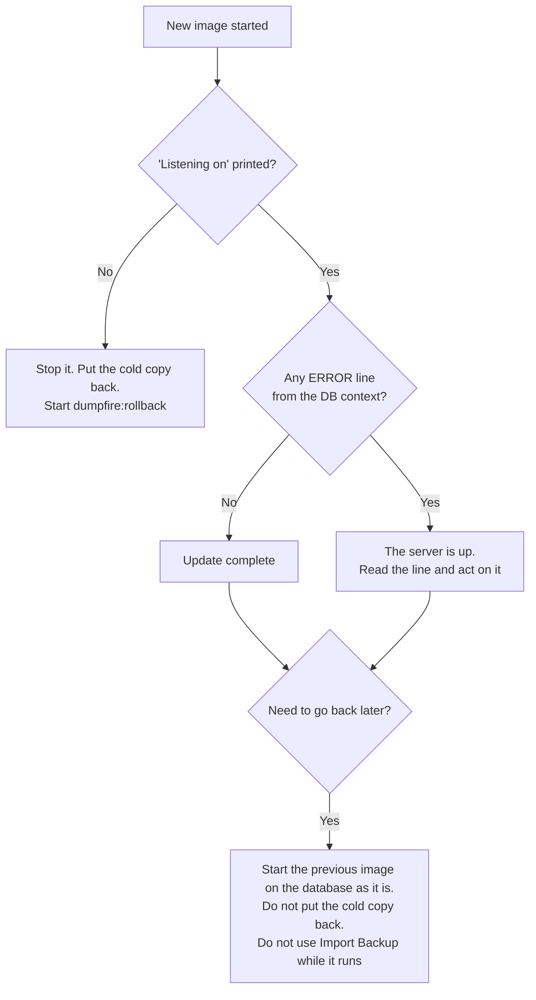

### Moving the Database onto the Volume

For a container whose database is inside it, not on a volume: one from an image built before card 2083 started without `DB_PATH` (the database is `/app/dumpfire.db`), or one started with no volume at the folder of its `DB_PATH`. The database is three files, `dumpfire.db` and the `-wal` and `-shm` files beside it when they are there, and the uploads are the folder `uploads` beside them. All of it moves, with the container stopped. Before anything is copied, the container's own file system is kept as an image with `docker commit`: under Docker Compose, the next `docker compose up -d` recreates the service's container and removes the old one, whatever it has been renamed to, and what is inside it goes with it. The snapshot, and the copy on the host, are kept until the new container has been checked and the next backup has been taken.

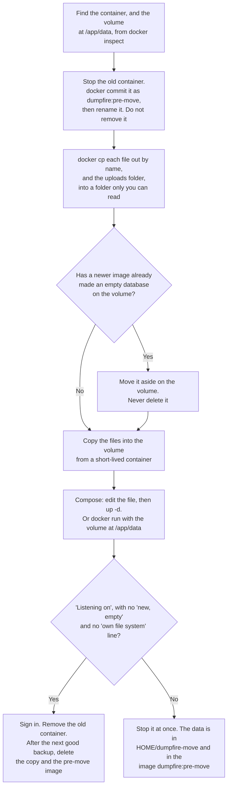

These are bash. Under Git Bash on Windows, run `export MSYS_NO_PATHCONV=1` first, so that the paths inside the container are not rewritten. That also leaves `$HOME` as `/c/Users/<you>`, which `docker.exe` does not understand, so on Windows set `move=$(cygpath -m "$HOME/dumpfire-move")` and write `"$move"` wherever the commands below say `"$HOME/dumpfire-move"`. `mkdir -m 700` protects nothing on NTFS: keep the folder in your own profile, which only you can read.

**First, find the names.** The container's name is in `docker ps` (under Compose it is often `<project>-dumpfire-1`). The volume is the one the container has at `/app/data`, if it has one: a volume made by Compose is named `<project>_dumpfire-data` (the README's example makes `dumpfire_dumpfire-data`), and one made by `docker run -v dumpfire-data:/app/data` is `dumpfire-data`. Read it from the container rather than guessing it:

```bash
c=dumpfire    # the container's name, from docker ps
docker inspect --format '{{range .Mounts}}{{.Type}}  {{if .Name}}{{.Name}}{{else}}{{.Source}}{{end}}  ->  {{.Destination}}{{println}}{{end}}' "$c"
docker volume ls
```

Set `vol` to the name shown against `/app/data`. If nothing is mounted at `/app/data`, choose the name the new container will use (under Compose, `<project>_dumpfire-data`, where `<project>` is shown by `docker inspect --format '{{index .Config.Labels "com.docker.compose.project"}}' "$c"`) and make it with `docker volume create "$vol"`; Compose then says the volume was not created by Compose, and uses it. Set `from` to the folder the database is in inside the old container: `/app` for one started without `DB_PATH`, or the folder of its `DB_PATH`. Set `img` to any DumpFire image you have, such as `dumpfire:latest`: the short-lived containers below run `sh`, never the server.

```bash
vol=dumpfire_dumpfire-data   # the volume found above
from=/app
img=dumpfire:latest          # any DumpFire image you have

# 1. Stop the old container, keep its own file system as an image, and keep the
#    container too, under another name.
docker stop "$c"
docker commit "$c" dumpfire:pre-move
docker rename "$c" dumpfire-old

# 2. Copy each file out by name, into a folder only you can read. docker cp takes no
#    wildcard. A missing -wal or -shm file is expected, and so is a missing uploads
#    folder when nothing was ever attached.
mkdir -m 700 "$HOME/dumpfire-move"
docker cp "dumpfire-old:$from/dumpfire.db" "$HOME/dumpfire-move/"
docker cp "dumpfire-old:$from/dumpfire.db-wal" "$HOME/dumpfire-move/" || echo "No -wal file: expected"
docker cp "dumpfire-old:$from/dumpfire.db-shm" "$HOME/dumpfire-move/" || echo "No -shm file: expected"
docker cp "dumpfire-old:$from/uploads" "$HOME/dumpfire-move/" || echo "No uploads folder: expected if nothing was attached"
ls -la "$HOME/dumpfire-move"
```

`mkdir -m 700` fails if `$HOME/dumpfire-move` is there already: that is a copy from an earlier attempt, so look at it before you move it aside, and never copy over it.

**A database bind-mounted as a single file** (`-v /srv/dumpfire.db:/app/dumpfire.db`) has its file on the host, but its `-wal` and `-shm` files are not: SQLite writes them beside the database, which is inside the container, next to the mount. `docker commit` keeps them (it keeps the container's own files, not what is mounted). Copy them out of the old container with the two lines above, and take the database file from the host if the first `docker cp` does not.

**If a newer image has already started on the volume and made a new, empty database there** (its log said `No database was at /app/data/dumpfire.db: a new, empty one was created at this start.`, and nobody has used the site since), that database is in the way. Move it aside on the volume, never delete it:

```bash
docker run --rm --network none --user root -v "$vol:/app/data" "$img" sh -c \
  'd=/app/data/set-aside-$(date +%Y%m%d-%H%M%S) && mkdir "$d" && for f in dumpfire.db dumpfire.db-wal dumpfire.db-shm; do if [ -e "/app/data/$f" ]; then mv "/app/data/$f" "$d/"; fi; done; ls -la /app/data "$d"'
```

Then copy the files into the volume, with a short-lived container as the cold copy does. It copies nothing if a database is there already. It runs as root, to read your `700` folder, and gives what it copied to uid 1000, the user the server runs as since card 2776. It uses `cp -R`, not `cp -a`, so `/app/data` keeps its own mode (`cp -a` would give the volume folder the copy folder's `700` and owner):

```bash
docker run --rm --network none --user root -v "$vol:/app/data" -v "$HOME/dumpfire-move:/move" "$img" sh -c \
  'if [ -e /app/data/dumpfire.db ]; then echo "/app/data/dumpfire.db is there already: nothing was copied." >&2; exit 1; fi; cp -R /move/. /app/data/ && chown -R 1000:1000 /app/data && ls -la /app/data'
```

**Start the new image on the volume.** Under Docker Compose, edit the compose file: take out any line that mounts a file or a volume at `/app/dumpfire.db`, and give the service the volume at `/app/data` and `DB_PATH`:

```yaml
services:
  dumpfire:
    environment:
      - DB_PATH=/app/data/dumpfire.db
    volumes:
      - dumpfire-data:/app/data

volumes:
  dumpfire-data:
```

In a compose file whose `environment:` is a map rather than a list, the line is `DB_PATH: /app/data/dumpfire.db`.

Keep the rest of the service as it was. If `vol` is a volume you made with `docker volume create` under another name than Compose's, add `external: true` and `name: <that name>` under `dumpfire-data:` at the end. Then, in the folder of the compose file:

```bash
docker compose up -d
```

Compose recreates the service's container on the new settings, and removes `dumpfire-old`, which still carries the service's labels; the snapshot `dumpfire:pre-move` keeps what was inside it. Without Compose, start it as the [Production](#production) example does, with the volume and `DB_PATH`:

```bash
docker run -d --name dumpfire --restart unless-stopped -p 3000:3000 \
  -v "$vol:/app/data" -e DB_PATH=/app/data/dumpfire.db \
  -e ORIGIN=https://dumpfire.example.com dumpfire:latest
```

Then read what it said (under Compose, the container's name is in `docker compose ps`):

```bash
docker logs dumpfire 2>&1 | grep -E 'STARTUP|\] \[DB\] |Listening on'
```

`Listening on`, and neither `No database was at` nor `in the container's own file system`, is right: the site shows the sign-in page and the old accounts sign in. Then remove the old container if Compose has not (`docker rm dumpfire-old`). Keep `$HOME/dumpfire-move` and the image `dumpfire:pre-move` until the next backup has been taken and checked, then delete both: they hold the whole database and every attachment.

```bash
rm -r "$HOME/dumpfire-move"
docker image rm dumpfire:pre-move
```

If `Listening on` is missing, or either of the other lines is there, stop the new container at once, before anyone opens the site. The data is in `$HOME/dumpfire-move`, and inside the image `dumpfire:pre-move` at `$from`, whatever has become of the old container. To take a file out of that image again: `docker create --name pre-move dumpfire:pre-move`, then `docker cp "pre-move:$from/dumpfire.db" .` (and the same for the others), then `docker rm pre-move`.

### Moving to a New Host

**The move that keeps everything is the host's, not an import** (card 3009). Stop the old instance first, and keep it stopped. Then move the database volume, or a cold copy taken with the container stopped (see [Taking and Returning the Cold Copy](#taking-and-returning-the-cold-copy)), **and the MFA key file** that `MFA_KEY_FILE` names, mounted as before. The new host is then this installation: its backup seal key and installation id come with the database, so every password, second factor and API key comes with it, and its backups restore there as its own. Without the MFA key file, every second factor is lost (see [If the Key Is Lost](#if-the-key-is-lost)) and every backup of the old host reads as unsealed.

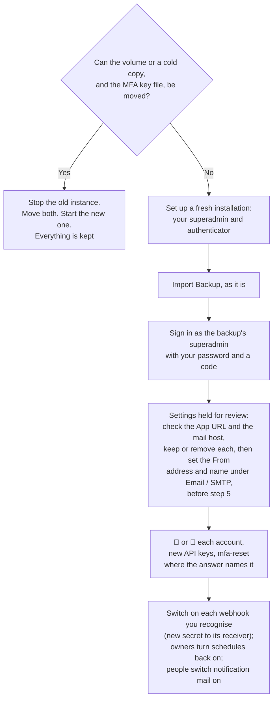

**Import Backup onto a fresh installation is the fallback**, where the volume or the key file cannot be moved. Its seal does not verify there and it carries another installation's id, so no account in it is the same account there: none takes a password, a second factor or an API key from it. In this order:

1. **Set up the fresh installation** with a superadmin of your own, and set up your authenticator on it.
2. **Import the backup**, as it is, confirming with your password and a code. Your set-up account is replaced by the backup's accounts.
3. **Sign in as the backup's superadmin**, the one the answer names, with your own password and a code from your authenticator: the backup's lowest-numbered enabled superadmin was given both (and your email address, where no other account in the backup holds it). Where the answer says none of your authenticators could be moved (no MFA key loaded), it cannot sign in until the host runs `docker exec <container> node scripts/mfa-reset.mjs <username>` for it; see [If the Superadmin Loses Their Authenticator](#if-the-superadmin-loses-their-authenticator).
4. **Check the App URL and the mail host** under Settings held for review, with each backup destination held there, and keep or remove each: they came from a file whose seal did not verify, and nothing is sent through them until then. Then set the From address and name under Email / SMTP, before step 5: the import keeps this server's, which a fresh installation does not have (card 3029), and a mail with no From is refused by most mail servers.
5. **Then each account**: check its email address and role, then set its password (🔑) or send an invite (📧), and reset its two-step sign-in (🛡️).
6. **New API keys**, made by their holders on the Account page: none of the backup's works.
7. **The host's `scripts/mfa-reset.mjs`** for any account the answer says needs it.
8. **Each webhook you recognise**: every one with an address came in switched off for good, its secret discarded (card 3012). Its board's owner or an administrator switches it on with `PUT /api/v1/webhooks/{id}` and `{"active": true}` alone, which gives it a new secret in that answer; put that secret in at its receiver. Delete any whose address you do not recognise.
9. **Report schedules**: every one was paused; each owner turns theirs back on on the **Reports** page.
10. **Notification mail**: every account not the same here has it switched off; each person switches it back on from the Account page once signed in. The backup failure mail goes to this server's address (Scheduled Backups) until changed there.
11. **Requests and people** (card 3020): every request with an address came in with its requester mail held, and every person in the people directory marked left. An administrator reviews each under **Mail held** in the Requests inbox and releases the ones whose address and card they recognise, with a password and a code (unconfirmed ones cannot be released and lapse in 7 days); then checks each person's address on the People page and marks them active, with a password and a code.

**Neither record of endings comes with an import** (card 3013). The record of account endings and the record of ended API keys are this server's: an import of a backup whose seal does not verify adds none of its rows, so a fresh installation's records start empty. So do they after a restore of this server's own backup onto a database rebuilt after a loss, since the backup seal key went with the old database and the file no longer verifies; by card 3009 no password, second factor or API key comes back either. The host's move above keeps both records, which is one more reason to keep cold copies of the volume and the MFA key file.

**A clone of the volume shares this server's identity.** A copy of the volume or of the database file started as a second server (a rehearsal kept running, a test instance) has this server's backup seal key and installation id: its backups verify here as this server's own, and an account in them is the same account here. On any clone, change both, on the clone, with its container stopped: delete the `backup_seal_key` row, as [The Release That Makes the Signing Keys Anew](#the-release-that-makes-the-signing-keys-anew-card-2943) documents, and the `installation_id` row, so that its next start makes a new one of each:

```bash
docker stop <clone>
docker run --rm --network none -v <clone-volume>:/app/data dumpfire:latest node -e "
const db = require('better-sqlite3')('/app/data/dumpfire.db', { fileMustExist: true });
console.log('rows removed:', db.prepare(\"DELETE FROM settings WHERE key IN ('backup_seal_key', 'installation_id')\").run().changes);
db.close();
"
docker start <clone>
```

Never run it against this server's own volume: its backups would then read as another installation's, and every account in them would lose its password, keys and factors on an import.

**What it cannot tell apart** (card 3009). A backup made before card 3009 carries no installation id, so an account in it is the same account here by its number, creation time and username: two servers built by one script, with the same usernames made in the same seconds, are taken for each other. A superadmin renamed since such a backup was made is not the same account in an unsealed restore of it, and needs the host's `scripts/mfa-reset.mjs`. A password of the same account that differs from this server's is counted under card 2997's figures (`here`, `reset`), and an account not the same here under card 3009's (`unsealed`), apart. And a backup of a clone of this server that was not changed as above verifies as this server's own.

### Taking and Returning the Cold Copy

These are for the volume and path the examples on this page use: the volume `dumpfire-data` mounted at `/app/data`, and `DB_PATH=/app/data/dumpfire.db`. Change both to match the installation. Each runs a short-lived container from the kept image with the volume attached and no network; the server is not started, because the command replaces it. Keep the copy outside the repository folder.

```bash
# Take it, with the application's container stopped, into a folder only you can read.
docker stop dumpfire
mkdir -p -m 700 "$HOME/dumpfire-cold"
# As root, to write your 700 folder whichever user the image runs as (uid 1000 since card 2776).
docker run --rm --network none --user root -v dumpfire-data:/app/data -v "$HOME/dumpfire-cold:/cold" \
  dumpfire:rollback sh -c 'cp -a /app/data/dumpfire.db* /cold/ && ls -l /cold'

# Return it. Only where the new image never printed "Listening on".
# The returned files are given to uid 1000, the server's user, which an image from before card 2776 (root) can read too.
docker run --rm --network none --user root -v dumpfire-data:/app/data -v "$HOME/dumpfire-cold:/cold" \
  dumpfire:rollback sh -c 'rm -f /app/data/dumpfire.db-wal /app/data/dumpfire.db-shm && cp -a /cold/dumpfire.db* /app/data/ && chown 1000:1000 /app/data/dumpfire.db* && ls -l /app/data'
```

`dumpfire.db*` takes the database and whichever of its `-wal` and `-shm` files exist. Returning it removes those two first, so that none is left beside the database that the copy does not have.

**Accounts deleted, disabled or demoted since the copy was taken** (card 2996) come back as they were in it, unless `account_endings` is dumped and put back: see [The Release That Keeps Ended Accounts Ended Across a Restore](#the-release-that-keeps-ended-accounts-ended-across-a-restore-card-2996). **Passwords changed since the copy was taken** (card 2997) come back in it too; with the same dump put back, the next start gives every account but the superadmin whose password changed since the copy a password nothing matches and signs it out (it needs 🔑 or 📧), and the superadmin signs in with the password the copy holds and is asked, at every start, to change it.

**API keys ended since the copy was taken** (card 2995) work again once it is returned: the copy holds them, and its record of ended keys, where it has one, is as old as the copy. Before returning it, dump `api_key_revocations` and put it back afterwards, or revoke those keys again: see [The Release That Keeps Ended API Keys Ended Across a Restore](#the-release-that-keeps-ended-api-keys-ended-across-a-restore-card-2995).

The cold copy is the whole database, every account's password hash and session included, so `-m 700` keeps the folder readable by you alone (`mkdir -p` leaves the mode of a folder that is there already as it was: check it with `ls -ld "$HOME/dumpfire-cold"`). Once the update is complete and the next backup after it has been taken and checked, delete it: `rm -rf "$HOME/dumpfire-cold"`.

### Reading the Log

Every line the application logs has the form `[time] [LEVEL] [CONTEXT] message`. The migration runner's context is `DB`.

- **Two streams.** The logger writes `WARN`, `ERROR` and `CRITICAL` lines to stderr. `Listening on` is printed by the web server on stdout. Read them together with `docker logs dumpfire 2>&1`.
- **What a successful update prints.** One line beginning `Applied migration:` for each file applied; one line for each table rebuilt, naming the table, the number of rows carried across and what differed in it; one line for each sub-board detached from a card that no longer exists; and one line if the backfills had anything to fill in. Then `Listening on`.
- **Those are `WARN` lines.** The default level, `INFO`, prints them. With `LOG_LEVEL=ERROR` they are not printed, and a successful update shows `Listening on` and nothing from the runner.
- **A timestamp line is expected once.** The first start of the release that brings card 2095 converts the timestamps production holds in ISO 8601 and says so in one `[WARN] [DB] N timestamp(s) converted to the stored form …` line, naming each column and its count. The next start says nothing. A line at any later start means something still writes the other form, and is a fault to report. After an Import Backup the same conversion is said as `[WARN] [IMPORT]`.
- **A new, empty database** is given every file. 25 statements in 19 of the oldest files repeat something an earlier file has already done and are skipped, each with a `WARN` line. That is expected.
- **Two `[STARTUP]` lines are about the Content-Security-Policy, not the update.** `CSP_MODE=report-only: pages are sent the Content-Security-Policy to report only, not to enforce; remove CSP_MODE once the trial is over. See docs/deployment.md.` is expected during the first deploy of the policy and nowhere else; `CSP_MODE is "…", which is neither enforce nor report-only: the Content-Security-Policy is enforced.` means the variable was mistyped. See [The Update That Brings the Content-Security-Policy](#the-update-that-brings-the-content-security-policy).
- **Judge a run by two markers and nothing else**: `[ERROR] [DB]` and `[CRITICAL] [DB]`. A `CRITICAL` line means start-up stopped. An `ERROR` line means the server started and something needs attention; the line says what, and it is repeated at every start until the cause is dealt with. Errors from other contexts, such as `[BACKUP]` or `[REPORTS]`, come from the schedulers and say nothing about the update.

```bash
# Nothing printed means the runner found nothing wrong.
docker logs dumpfire 2>&1 | grep -E '\[(ERROR|CRITICAL)\] \[DB\]'

# Everything the runner said, and whether the server came up.
docker logs dumpfire 2>&1 | grep -E '\] \[DB\] |Listening on'
```

Through the second command, a successful update looks like this, with one line for each table rebuilt. `docker logs` unfiltered shows three more `WARN` lines before `Listening on`, one from each scheduler as it starts:

```
[2026-10-12T09:14:03.512Z] [WARN] [DB] Applied migration: 0050_add_first_completed_at.sql
[2026-10-12T09:14:03.530Z] [WARN] [DB] Applied migration: 0051_add_request_access_token.sql
[2026-10-12T09:14:03.541Z] [WARN] [DB] Applied migration: 0052_drop_time_entries.sql
[2026-10-12T09:14:03.556Z] [WARN] [DB] settings rebuilt in the model's shape — 2 row(s) carried across. What differed, and no longer does: settings.key: is nullable; the model has it NOT NULL
Listening on http://0.0.0.0:3000
```

To find the rebuilt tables, search for `rebuilt in the model's shape`. No `ERROR` line contains the word "rebuilt", so the search finds those lines and no others.

There are two other lines of the same kind as the one below: `… were left in the shapes they have`, where several tables were stopped by one cause, and `… was not compared with the model`, where the comparison itself could not be made.

A table that was not rebuilt has an `ERROR` line of this form, which says why, that nothing in it was changed, and what to do. Other tables may have been rebuilt at the same start; their own lines say so:

```
[2026-10-12T09:14:03.556Z] [ERROR] [DB] settings was left in the shape it has, which is not the model's: settings.key is NULL in 1 row(s), and the model's column is NOT NULL with no default to give them. Nothing in it was changed, and the application runs on that shape as it has until now. Give key a value in those rows or delete them, and restart: UPDATE "settings" SET "key" = <a value> WHERE "key" IS NULL; or DELETE FROM "settings" WHERE "key" IS NULL; key is the table's key, so no two rows can be given the same value: where there are several, update them one at a time, adding AND rowid = <n>. It is reported at every start until the cause is dealt with.
```

### A Failed Start

What it looks like:

- One `[CRITICAL] [DB]` line. For a migration file it names the file, the position of the failing statement and its first line, what SQLite said about it, and the files this start had already applied. It ends by saying that the database is as it was before the failing step. A halt during reconciliation ends differently: it says what is known of whether a rebuild had been committed, and to start again. An error the runner did not anticipate has no `CRITICAL` line at all, and Node's report of it is then the whole account.
- Node then prints the error and its stack, and the process exits with code 1.
- `Listening on` never appears.
- With `--restart unless-stopped`, Docker starts the container again and it fails in the same way. `docker ps` shows it as restarting.

The `CRITICAL` line is also written to the `system_logs` table, after the failing file has been rolled back, so it is still there once the server is running again.

**A `[CRITICAL] [DB]` line about where the database is** is different. It begins `The server will not start.` and comes in one of two forms. Before the open: there is no database at the path (or the file there is empty), and it names each database file the server can see, with its size and when it was last written, and what to do with it, and anything it could not read. After the migrations: the database in use has no user accounts, and it names both files. The line is printed twice in `docker logs`: once as written, and again in Node's report of the error that stops the process, with its stack. Nothing is in `system_logs`, nothing was served, there is no cold copy to put back and no reason to go back to the previous image. Stop the container, so that it stops restarting, then do what the line says for the file that is this installation's database, and start again. A file that is not this installation's database is moved out of that folder.

- **Start with `DB_PATH` set to the file.** A container keeps the environment it was created with, so `docker start` (and `docker restart`) starts it with the old `DB_PATH` again. It must be created anew. Under Docker Compose, set `DB_PATH` in the service's `environment:` and run `docker compose up -d`, which recreates it. With `docker run`, `docker rm dumpfire`, then the same `docker run` with `-e DB_PATH=<file>`. Only the container is removed: the volume and a file mounted from the host stay.
- **Rename a file on the volume to `dumpfire.db`**, with its `-wal` and `-shm` files, with the container stopped, in a short-lived container as the moving section does it (shown for `/app/data/kanban.db`; set `vol` and `img` as that section says). It renames nothing if a `dumpfire.db`, or a `-wal` or `-shm` file of that name, is there already (SQLite would otherwise replay another database's `-wal` onto the renamed one):

  ```bash
  docker run --rm --network none --user root -v "$vol:/app/data" "$img" sh -c \
    'cd /app/data && if [ -e dumpfire.db ] || [ -e dumpfire.db-wal ] || [ -e dumpfire.db-shm ]; then echo "dumpfire.db, or its -wal or -shm file, is there already: nothing was renamed." >&2; exit 1; fi; for s in "" -wal -shm; do if [ -e "kanban.db$s" ]; then mv "kanban.db$s" "dumpfire.db$s"; fi; done; ls -la /app/data'
  ```

  If an empty `dumpfire.db` is there, made by an earlier start, move it aside first with the set-aside command in that section.
- **Move a file onto the volume**, or a database with no users aside: [Moving the Database onto the Volume](#moving-the-database-onto-the-volume) has the commands.

What to do:

1. Stop the container, so that it stops restarting.
2. Read the `CRITICAL` line. It says which file and why.
3. Either fix the cause and start again, or go back to the previous image. A failed file was rolled back and is not recorded, so the next start runs it again from its first statement. The files applied before it are recorded and are not run again.

### Going Back to the Previous Image

> **An image from before card 2776 runs as root.** Back on one, it writes root's files to the volume. Before coming forward again to an image that runs as `node`, give the volume to uid 1000 once more: check U1 of [The Update That Runs the Server as a User Who Is Not Root](#the-update-that-runs-the-server-as-a-user-who-is-not-root).

> **Past the release of two-step sign-in (cards 2769 and 2849)** going back is a security event, and a cold copy taken before migration 0068 brings back the invites that were waiting when it was taken. Read "Going back to the previous image" under [The Release That Turns On Two-Step Sign-In](#the-release-that-turns-on-two-step-sign-in-card-2769) first.

> **Past card 2870 (migration 0070)** keep the `request_links` table: never drop it. The older image reports it as a table it does not know, which is expected, and requesters' links mailed by the newer image do not work there. See "Going back to the previous image" under [The Release That Keeps Requester Links as Hashes](#the-release-that-keeps-requester-links-as-hashes-card-2870).

| Situation | What to do | What is lost |
|-----------|------------|--------------|
| The new image never printed `Listening on` | Stop it. Put the cold copy back: all three files, deleting any `-wal` or `-shm` file that is beside the database and is not in the copy ([the second command](#taking-and-returning-the-cold-copy)). Start `dumpfire:rollback`. | Nothing. Nobody was able to use the new image. |
| The new image has served requests | Start `dumpfire:rollback` against the database as it is. **Do not put the cold copy back.** | Nothing. Putting the cold copy back would discard everything done since it was taken. |

What the older image makes of a database the newer one has migrated depends on how old it is:

- An image that has this runner finds migrations recorded that it has no file for. It reports that in an `[ERROR] [DB]` line, rebuilds nothing, reports in a second line whatever differs from its own model, and starts. Both lines are expected for as long as the older image runs.
- An image from before this runner (one whose `drizzle/` directory has no `0050` file) makes none of these checks and starts without comment.

One request behaves differently under an image from before this runner once the database has been migrated. A `PUT` to `/api/v1/columns/{columnId}` or `/api/columns/{id}` carrying `"wipLimit": null` is answered 500, because that image passes the null to the database and `columns.wip_limit` no longer accepts one. Send 0, which means the same thing: no limit. The board page is not affected, because that image sends 0 when the box is emptied. Nothing is damaged by the failed request, and the newer image does not have the fault.

When the newer image is started again it finds its migrations already recorded, repeats the backfills for rows created in the meantime (taking out of their milestones, since card 2179, the cards the older image left in a milestone of another board, in one `WARN` line), converts any timestamp the older image wrote in ISO 8601 (one `[WARN] [DB]` line), and carries on.

> ⚠️ **While an older image is running, do not use Import Backup (Admin → Backup & Restore).** An image from before this runner replaces the migration record along with the data. Restoring a backup that was taken before the update leaves a database that has the new columns and a record that says migrations `0050` onward never ran. The newer image then tries to apply `0050` again, fails on a column that already exists, and stops at every start. That image also leaves out every column whose WIP limit is NULL in the backup, because `columns.wip_limit` no longer accepts one, and commits all the same, so the cards on those columns are left pointing at nothing.

If that has happened, repair the record before starting the newer image. Check that the columns `cards.first_completed_at` and `task_requests.access_token` exist, then record the three files again:

```sql
INSERT OR IGNORE INTO __drizzle_migrations (hash) VALUES
  ('0050_add_first_completed_at.sql'),
  ('0051_add_request_access_token.sql'),
  ('0052_drop_time_entries.sql');
```

The image has no `sqlite3` command, and the newer image must not be started until this is done, so run it in a short-lived container from the newer image with the volume attached. The command replaces the server, which is not started. Change the volume and `DB_PATH` to match the installation:

```bash
docker run --rm --network none -v dumpfire-data:/app/data -e DB_PATH=/app/data/dumpfire.db \
  dumpfire:candidate node -e "
const db = require('better-sqlite3')(process.env.DB_PATH);
const has = (table, column) => Boolean(db.prepare('SELECT 1 FROM pragma_table_info(?) WHERE name = ?').get(table, column));
if (has('cards', 'first_completed_at') === false || has('task_requests', 'access_token') === false) {
  throw new Error('The two columns are not both there. Do not record the files: this is another fault.');
}
const record = db.prepare('INSERT INTO __drizzle_migrations (hash) SELECT ? WHERE NOT EXISTS (SELECT 1 FROM __drizzle_migrations WHERE hash = ?)');
for (const name of ['0050_add_first_completed_at.sql', '0051_add_request_access_token.sql', '0052_drop_time_entries.sql']) record.run(name, name);
console.log(db.prepare('SELECT COUNT(*) AS n FROM __drizzle_migrations').get().n + ' migrations recorded');
"
```

**Recording the files is not the whole repair.** It lets the newer image start, on a database that is still missing the columns the older image left out. Once the newer image is running, restore the same backup again with Import Backup there: it keeps the migration record, stores those limits as 0 and brings every column back.

### Rehearsing an Update Against a Copy

A quicker check comes first and needs no Docker: `npm run rehearse -- path/to/backup.db`, on a workstation with the new code checked out, takes the migration runner over a copy of a downloaded backup and says what it applied and rebuilt and whether a row was lost. It starts no server, so it sends nothing. See [Testing](testing.md#rehearsing-the-runner-against-a-copy-of-a-real-database). It does not replace what follows, which rehearses the image itself.

A rehearsal starts the new image on a copy of the live database and checks four things: that it migrates the copy without an error, that a second start has nothing left to do, that the previous image still starts afterwards, and that a migration which fails really does stop the server.

> ⚠️ **Run every rehearsal container with `--network none`.** A copy of production carries production's schedules and credentials. Started with a network, it emails every scheduled report that has fallen due to its real recipients, and if a backup is due it uploads one to the real destinations and then deletes the oldest backups there to keep to the retention count. Both schedulers look for work once a minute from the moment the server starts. The helper below also sets `SCHEDULERS=off`, which stops the schedulers in an image that has that switch. An older image, such as the one kept for rolling back, ignores it, so the network stays off whichever image is started.

> ⚠️ **Treat the copy as secret.** It holds password hashes, live session tokens, API key hashes, the SMTP password, the backup destinations' credentials and the secret tokens in task requesters' links. Keep it off shared storage and delete it when the rehearsal is over.

The snippets are written for bash on the Docker host. Under Git Bash on Windows, set `MSYS_NO_PATHCONV=1` first, or paths such as `/tmp/rehearsal.db` and `/rehearsal` are rewritten into Windows paths before Docker sees them.

Build the new image first, in the repository, and keep the image that is running:

```bash
docker tag "$(docker inspect -f '{{.Image}}' dumpfire)" dumpfire:rollback
docker build -t dumpfire:candidate .
```

Then do everything else in a directory outside the repository. `.dockerignore` keeps `*.db`, `*.db-shm` and `*.db-wal` out of the build context at any depth, so a copy of production left in a folder of the repository under one of those names is not sent to Docker. A copy under any other name is sent by the next `docker build` and kept in its build cache after the folder is deleted, and a copy inside the repository is one `git add` from being committed: keep it outside.

Take the copy from the running container. `VACUUM INTO` writes a complete, consistent copy while the server carries on, and `process.env.DB_PATH || 'dumpfire.db'` is how the server itself finds its database, so the snippet opens the file the server has open:

```bash
docker exec dumpfire node -e "
const Database = require('better-sqlite3');
const live = new Database(process.env.DB_PATH || 'dumpfire.db', { readonly: true });
live.prepare('VACUUM INTO ?').run('/tmp/rehearsal.db');
console.log(new Database('/tmp/rehearsal.db', { readonly: true }).pragma('integrity_check', { simple: true }));
"                                              # prints: ok
mkdir -p "$HOME/dumpfire-rehearsal" && cd "$HOME/dumpfire-rehearsal"
mkdir r1 r2
docker cp dumpfire:/tmp/rehearsal.db r1/dumpfire.db
docker cp dumpfire:/tmp/rehearsal.db r2/dumpfire.db
# The image runs as uid 1000 since card 2776: give it the copies. Under rootless Docker, skip
# this and add --user root to rehearse and inspect below, which is you there.
sudo chown -R 1000:1000 r1 r2
docker exec dumpfire rm /tmp/rehearsal.db
```

Define three helpers, in that directory:

```bash
# Start an image on a copy: no network, no schedulers, and DB_PATH pointing at the copy.
rehearse() {      # rehearse <container name> <image> <directory> [more docker run options]
  local name=$1 image=$2 dir=$3; shift 3
  docker run -d --name "$name" --network none \
    -v "$PWD/$dir:/rehearsal" -e DB_PATH=/rehearsal/dumpfire.db -e SCHEDULERS=off "$@" "$image"
}

# Everything the runner said, and whether the server came up.
runner_log() { docker logs "$1" 2>&1 | grep -E '\] \[DB\] |Listening on'; }

# Look inside a copy without starting the server.
inspect() {       # inspect <directory>
  docker run --rm --network none -v "$PWD/$1:/rehearsal" dumpfire:candidate node -e "
const db = require('better-sqlite3')('/rehearsal/dumpfire.db');
for (const name of ['boards', 'columns', 'categories', 'cards', 'settings', 'user_xp', 'invite_tokens', 'sessions']) {
  console.log(name + ': ' + db.prepare('SELECT COUNT(*) AS n FROM ' + name).get().n + ' rows');
}
console.log('migrations recorded: ' + db.prepare('SELECT COUNT(*) AS n FROM __drizzle_migrations').get().n);
console.log('foreign key violations: ' + db.pragma('foreign_key_check').length);
console.log('time_entries: ' + (db.prepare('SELECT 1 FROM sqlite_master WHERE name = ?').get('time_entries') ? 'present' : 'gone'));
if (db.prepare('SELECT 1 FROM pragma_table_info(?) WHERE name = ?').get('cards', 'first_completed_at')) {
  console.log('completed cards with no first_completed_at: ' + db.prepare('SELECT COUNT(*) AS n FROM cards WHERE completed_at IS NOT NULL AND first_completed_at IS NULL').get().n);
}
"
}
```

An image that brings migration 0065 or later (card 2768) does not start without `MFA_KEY_FILE`.
Give `rehearse` the key as its extra options, `-v <key file>:/run/secrets/dumpfire_mfa_key:ro -e
MFA_KEY_FILE=/run/secrets/dumpfire_mfa_key`. Once accounts have second factors, the copy holds
production's key check, so only production's key starts it; a new key is refused, as it would
be in production. See [The Key That Protects Authenticator Secrets](#the-key-that-protects-authenticator-secrets).

Then, in order:

| # | Do | Expect | A fault if |
|---|----|--------|------------|
| 1 | `inspect r1` | The row counts of the copy as it stands. Keep them. | — |
| 2 | `rehearse df-new dumpfire:candidate r1`, wait a few seconds, `runner_log df-new` | An `Applied migration:` line for each file the new image brings, a line for each table it rebuilds, then `Listening on` | Any line marked `[ERROR] [DB]` or `[CRITICAL] [DB]`; no `Listening on`; `docker ps -a` shows the container has exited |
| 3 | `docker rm -f df-new`, then `inspect r1` | The row counts of step 1, but `sessions: 0 rows` once migration 0053 has been applied (it ends every session, once). `migrations recorded` higher by the number of files applied. `foreign key violations` as in step 1: a rebuild carries across a row that already broke a key, and adds none. | Any other row count differs |
| 4 | `rehearse df-new dumpfire:candidate r1` again, then `runner_log df-new` | `Listening on` and nothing else: no file left to apply and no table left to rebuild | An `Applied migration:` line, or any line from `[DB]` at all |
| 5 | `docker rm -f df-new`, then `rehearse df-old dumpfire:rollback r1` and `docker logs df-old 2>&1` | `Listening on`: the previous image starts on a database the new one has migrated | It does not start |
| 6 | Start the candidate on `r2` with a migration that cannot succeed (commands below) | A `[CRITICAL] [DB]` line naming `9999_deliberate_failure.sql` and giving SQLite's message that the table does not exist; Node's report of the error; exit code 1; never `Listening on`. `runner_log df-fail` has the `Applied migration:` lines of the real files and no line for a rebuilt table, because tables are rebuilt only once every file has been applied. `inspect r2` counts the real files as recorded and not the extra one. | The container stays up, or the line lacks the file name or SQLite's message |
| 7 | `docker rm -f df-old df-fail`, then delete the rehearsal directory, with `r1`, `r2` and the extra `.sql` file in it | — | — |

```bash
# Step 6: a file that sorts after every real migration and refers to a table that does not exist.
echo 'SELECT * FROM deliberately_missing_table;' > 9999_deliberate_failure.sql
rehearse df-fail dumpfire:candidate r2 \
  -v "$PWD/9999_deliberate_failure.sql:/app/drizzle/9999_deliberate_failure.sql:ro"
docker wait df-fail                  # prints the exit code: 1. If it does not return, the server stayed up.
docker logs df-fail 2>&1 | tail -n 30
runner_log df-fail
inspect r2
```

With `SCHEDULERS=off` the candidate logs one `[WARN] [SCHEDULERS]` line saying its schedulers are off, and nothing from them after that. An image from before the switch starts its schedulers all the same, and under `--network none` they may log errors of their own after the first minute, because they cannot reach anything. Those are expected, which is one more reason to judge the run by the `[DB]` lines alone.

### The Update That Brings Migrations 0050 to 0052

The first update to an image that has this runner does more than a routine one, because it is the first time the six tables are brought to one shape. For that update only:

**Before the rehearsal**, count the NULLs the rebuild will meet:

```bash
docker exec dumpfire node -e "
const db = require('better-sqlite3')(process.env.DB_PATH || 'dumpfire.db', { readonly: true });
for (const [table, column] of [['settings', 'key'], ['user_xp', 'name'], ['invite_tokens', 'token'], ['columns', 'wip_limit']]) {
  console.log(table + '.' + column + ': ' + db.prepare('SELECT COUNT(*) AS n FROM ' + table + ' WHERE ' + column + ' IS NULL').get().n + ' NULL');
}
"
```

Expect 0 for `settings.key`, `user_xp.name` and `invite_tokens.token`. A table with a NULL key is left as it is and reported at every start until the row is dealt with; the server still starts and the other tables are still rebuilt. Any number is acceptable for `columns.wip_limit`: those become 0, which means no limit.

**In the rehearsal**, expect `Applied migration:` lines for `0050_add_first_completed_at.sql`, `0051_add_request_access_token.sql` and `0052_drop_time_entries.sql`, and a line for each table rebuilt. Which tables those are depends on the history of the database. The production database measured on 2026-10-12 needs five (`columns`, `categories`, `settings`, `user_xp`, `invite_tokens`), and a database that was created from the repository's migration files as they stood before this change needs two (`boards`, `categories`). Afterwards `inspect` should report `time_entries: gone` and no completed card without a `first_completed_at`.

**After the update**, two checks in the application confirm the foreign keys the rebuild sets. On the production database measured on 2026-10-12 only the first is a change. The second was already so there, and confirms that foreign keys are on:

| Do | Expect | A fault if |
|----|--------|------------|
| Create a category on a board, then delete that board | The category remains, belongs to no board, and can be changed by an administrator only | The category is deleted with the board |
| Permanently delete a card that has a sub-board | The sub-board is deleted with it | The sub-board remains |

### The Update That Brings Transactions and the Uploads Trash

The release that makes every write all or nothing, moves deleted cards' attachment files to a trash and changes how attachments are served (card 2007) brings no migration file and no change to the schema. On a database the previous update has already brought up to date, its start-up has nothing to apply.

> ⚠️ **Deploy it only after the update that brings migrations 0050 to 0052 has been deployed and has settled.** Do not go from an image older than that one straight to this release. Take the 0050 to 0052 update first, confirm it as described [above](#the-update-that-brings-migrations-0050-to-0052), with `Listening on` printed and no `[ERROR] [DB]` or `[CRITICAL] [DB]` line, and leave it running until going back to the previous image is no longer in question. Then deploy this one.

**Before the update**, set up a backup of the uploads folder if there is none: see [Attachment Files](#attachment-files). Until this release a deleted card's files were left on disk for ever. From it on they are removed 30 days after the delete. Files left behind by deletes made before this release stay in their card folders until the release that brings the attachment file sweep (card 2107): its first sweep moves them to the trash, as [below](#the-update-that-brings-migration-0053-one-timestamp-form-and-the-attachment-file-sweep) says.

**After the update**, these confirm it:

| Do | Expect | A fault if |
|----|--------|------------|
| Archive a card that has an attachment and a dependency, then restore it | The attachment opens and the dependency is still shown | Either is gone |
| Permanently delete a card that has an attachment, then look in the uploads folder | The file is in `uploads/.trash/<card id>/`, with a `.trashed-at` file beside it, and the card's own folder is gone if nothing else was in it | The file is still in `uploads/<card id>/`, or is nowhere |
| Attach an HTML file and an SVG file to a card. For each, copy the link address of its name on the card and open that address in a new tab | Each is saved as a download | Either opens as a page |
| Create a card and note its number. Permanently delete it, run Vacuum from the admin panel, then create another card | The new card's number is one more than the deleted card's | The new card has the deleted card's number |

Clicking the attachment on the card is not a check: that link saves the file to disk in the previous release too.

**Going back to the previous image** after this release has run needs nothing done to the database. This release changes no table, so the previous image starts on the database as it is: see [Going Back to the Previous Image](#going-back-to-the-previous-image) for how. Three kinds of activity entry are new: `cards_purged`, `cards_cleared` and `column_deleted`. The previous image has no label for them, as it has none for `card_archived`, which it writes itself, and shows the name in the label's place.

For as long as the previous image runs, it behaves as it did before:

| | Under the previous image |
|---|---|
| The uploads trash | It never reads `uploads/.trash` and never empties it. Files this release moved there stay on disk. Deleting a card leaves its files in `uploads/<card id>/`, and deleting a single attachment removes its file at once |
| Import Backup | It puts no file back from the trash. Move each back by hand, from `uploads/.trash/<card id>/` to `uploads/<card id>/` |
| Attachments | Every attachment is answered inline again, as the type its uploader gave it and with no sandbox. An HTML or SVG attachment opened by its address is a page of the application |
| Vacuum and Reset | Each clears the id counters again. A card or board created afterwards can be given the number of one that was deleted |
| `DELETE /api/v1/cards/{id}?permanent=true` | It deletes the card and then answers `500`. The card is gone. Read before retrying |

What changes for the people who use the installation is in the [Admin Guide](admin-guide.md#danger-zone) and, for API callers, in the [API Reference](api-reference.md#writes-and-failures).

### The Update That Brings the Limits on Report Mail

The release that limits who a mailed report reaches, slows sign-ins after wrong passwords and bounds how deep sub-boards nest and how many cards one drag and drop moves (cards 2182, 2177, 2172 and 2209) brings no migration file and no change to the schema. One thing in it acts on what is already stored: a report schedule that holds more than 10 addresses is switched off at its next due run, sends nothing, and writes one `ERROR` line under `REPORTS` naming it and its owner (see [Who a Report Can Be Mailed To](notifications-email.md#a-schedule-kept-from-before-with-more-than-10)). So, before the update, find any such schedule.

**Before the update**, list each schedule's addresses, read as the scheduler will read them. The image has no `sqlite3` command, so copy the database out into a folder only you can read and run the query read-only on the host. A missing `-wal` file is expected. Copied while the server runs, the copy can be a moment behind; that is enough for this list.

```bash
mkdir -m 700 "$HOME/dumpfire-schedules"
docker cp "<container>:/app/data/dumpfire.db" "$HOME/dumpfire-schedules/"
docker cp "<container>:/app/data/dumpfire.db-wal" "$HOME/dumpfire-schedules/" || echo "No -wal file: expected"
sqlite3 -readonly -header -column "$HOME/dumpfire-schedules/dumpfire.db" < schedules.sql
```

with `schedules.sql` holding:

```sql
WITH RECURSIVE parts(id, rest, part) AS (
  SELECT id, replace(replace(replace(replace(replace(replace(replace(replace(replace(replace(replace(replace(replace(replace(replace(replace(replace(replace(replace(replace(replace(replace(replace(replace(replace(replace(recipients, ';', ','), char(9), ','), char(10), ','), char(11), ','), char(12), ','), char(13), ','), char(32), ','), char(160), ','), char(5760), ','), char(8192), ','), char(8193), ','), char(8194), ','), char(8195), ','), char(8196), ','), char(8197), ','), char(8198), ','), char(8199), ','), char(8200), ','), char(8201), ','), char(8202), ','), char(8232), ','), char(8233), ','), char(8239), ','), char(8287), ','), char(12288), ','), char(65279), ',') || ',', NULL
    FROM report_schedules
  UNION ALL
  SELECT id, substr(rest, instr(rest, ',') + 1), lower(trim(trim(substr(rest, 1, instr(rest, ',') - 1)), '<>'))
    FROM parts WHERE rest <> ''
),
addresses(id, part) AS (
  SELECT id, part FROM parts
   WHERE part LIKE '_%@_%._%' AND part NOT LIKE '%@%@%'
     AND part NOT GLOB '*[<>()",:\[]*' AND part NOT GLOB '*]*'
)
SELECT s.id, s.user_id, s.name, s.enabled,
       COUNT(DISTINCT a.part) AS addresses,
       COUNT(DISTINCT CASE WHEN a.part NOT IN (SELECT lower(email) FROM users) THEN a.part END) AS not_an_account,
       s.recipients
  FROM report_schedules s LEFT JOIN addresses a ON a.id = s.id
 GROUP BY s.id ORDER BY addresses DESC;
```

The rows come largest first. `addresses` is how many the scheduler will send to, `not_an_account` how many of those are no account's email, and `recipients` the schedule's text as stored, so the addresses can be read off it. A word of a display name (`Alice Smith <alice@x.test>`) is not counted, as the scheduler does not send to it. Every character the scheduler reads as a separator is a separator here too (semicolons, commas and every kind of white space, the non-breaking space pasted from a mail program included). The query may count a part holding an invisible control or format character as an address where the scheduler does not, so it can list a schedule as larger than it is, never smaller.

What to do with each row whose `addresses` is above 10:

- **To keep it sending**, its owner deletes it and makes it again as schedules of 10 or fewer, **before the update**. Before it nothing counts what they cost.
- **After the update the same costs addresses.** One account may reach at most 100 addresses with report mail in a 24-hour window counted from its first, and making a schedule takes its addresses from that, so an owner who splits a schedule of 30 into three of 10 afterwards spends 30 of the day's 100 on it, and one of 150 cannot be split in a day.
- **Left as it is**, it is switched off at its next run and its owner finds its addresses on the Reports page, with "Copy the ones to keep into a new schedule of at most 10, then delete this one."
- **Turning a schedule on costs its addresses too**, from the day's 100, and one turned back on keeps the run time it had: if that time passed while it was off (as it has for a schedule this release switched off), it is sent at the scheduler's next tick, within the minute.

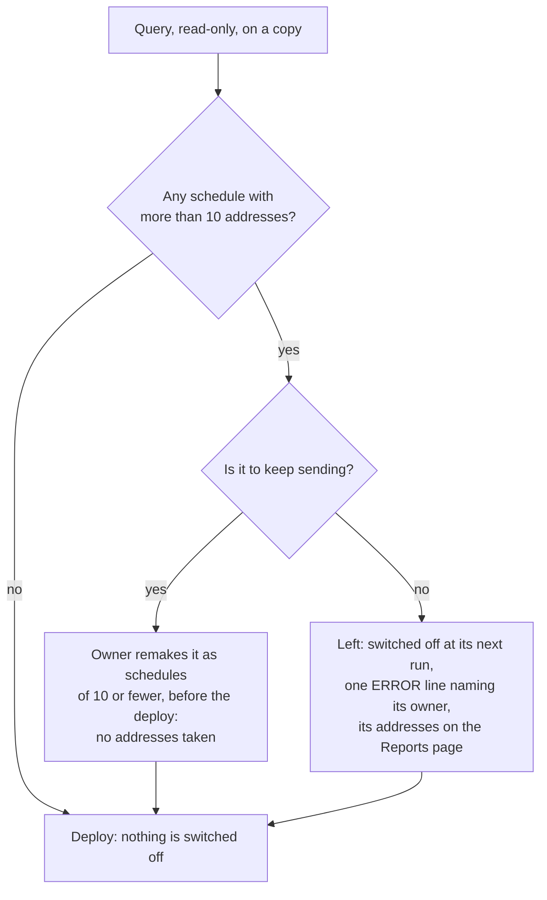

**Also before the update**, on the same copy, check that the two limits on a drag and drop are out of reach of real use. A drop on the board page sends the position of every open card on the board, and a request naming more than 5,000 is refused; a request that moves more than 100 cards to another column is refused (`MAX_REORDER_ENTRIES` and `MAX_CARDS_MOVED_AT_ONCE` in `src/lib/server/card-moves.ts`). Run each query as the one above:

```sql
-- The ten boards with the most open cards, and each one's largest column.
SELECT b.id, b.name, COUNT(c.id) AS open_cards, MAX(per_col.n) AS largest_column
  FROM boards b
  JOIN columns col ON col.board_id = b.id
  LEFT JOIN cards c ON c.column_id = col.id AND c.archived_at IS NULL
  LEFT JOIN (SELECT column_id, COUNT(*) AS n FROM cards WHERE archived_at IS NULL GROUP BY column_id) per_col
    ON per_col.column_id = col.id
 GROUP BY b.id ORDER BY open_cards DESC LIMIT 10;

-- The most cards one person moved to another column on one board within one second
-- (a bulk move writes its entries in the same second).
SELECT user_id, board_id, substr(created_at, 1, 19) AS second, COUNT(*) AS moved
  FROM activity_log WHERE action IN ('card_moved', 'card_completed', 'card_reopened')
 GROUP BY user_id, board_id, second ORDER BY moved DESC LIMIT 5;

-- The newest card's id and how many cards there are: no board can hold more.
SELECT MAX(id) AS newest_card_id, COUNT(*) AS cards, SUM(archived_at IS NULL) AS not_archived FROM cards;
```

If the first query's largest `open_cards` is above 2,500, raise `MAX_REORDER_ENTRIES` before building the image; if the second query's top `moved` is above 50, raise `MAX_CARDS_MOVED_AT_ONCE`. Otherwise both limits are far above what the installation does.

**After the update**, nothing needs doing to the database. Going back to the previous image needs nothing either: no table changed, and the previous image sends a schedule this release switched off only once someone turns it on.

### The Update That Brings Password Checks Off the Server's Thread and Remembered Browsers

The release that checks passwords on worker threads (card 2191), checks a name that is no account as slowly as a real one (2192), writes nothing typed into a failed sign-in line (2193), remembers browsers that have signed in and holds every other browser to one sign-in at a time at an account under attack (2194), counts an IPv6 caller by its /64 (2195) and gives back on a successful sign-in only its own account's attempts (2226) brings no migration file, no change to the schema and no change to the image: no new dependency, no native code. One thing in it acts on what is already stored: at its first start it rewrites the failed sign-in lines already in the system log for names that were no account, so that they no longer hold what was typed. Three of the queries below read those lines in their old form. After the first start, `q1.sql` finds 0; `q2.sql` still lists the old bad-password lines but no longer counts the failures at names that were no account; `q3.sql`'s address query still works, but its name query lumps every rewritten line under one name. So **all three are run before the deploy**. The lines as they were stay only in `docker logs` of the old container and in any log shipper's copy, which this release does not touch.

What changes for the people who use it:

- **During a burst of sign-in attempts**, a sign-in from a browser the server does not know waits its turn, about a tenth of a second for each check ahead of it with two threads, and up to a fifth on a host with one or two CPUs, where there is one. When 150 checks for each thread are already waiting it is answered at once "Sign-in is very busy right now. Wait a minute and try again, or sign in from a browser you have used here before." That is about thirty seconds of checks on a fast host, and can be 60 to 90 seconds on a small one: past the 60 seconds nginx waits for an answer by default (`proxy_read_timeout`), so a proxy left at its default answers `504` to whoever was last in the line. The configuration under [Reverse Proxy — Nginx](#reverse-proxy--nginx) sets 86400 seconds for live updates, and does not cut them off. The hands-on step below times one check on production. An invite's form and set-up are treated the same way. Signed-in people and remembered browsers go ahead of them, but never more than three checks in a row while one of theirs waits, and at most five at a time for any one account (plus the new hash of each password change it completes).
- **A browser that signs in, or signs out, is remembered for that account for a year**, by a cookie sent only to the sign-in page, until the account's password is set again. Signing out does not forget it. At the deploy no browser is remembered: **sign in again, or sign out and in, on each browser you will want during an attack, the superadmin's first.**
- **While an account has had five wrong passwords within 15 minutes of each other, browsers not remembered for it are let in one at a time**, and a second at the same moment is refused at once, "A sign-in with this name is already under way from another browser…". This reverses the previous release's "nobody is refused for it". An attack on one account can keep its owner out of every browser not remembered for it for as long as it lasts: see [If an Attack Keeps an Owner Out](#if-an-attack-keeps-an-owner-out). After an administrator sets a password during an attack, send an invite instead, where mail is set up.
- **The Audit page no longer shows the names people typed that are no account's**: a failed sign-in at one shows only its length, and one at an account names the account and is filed under it. Older lines are rewritten at the first start; backups made before keep them.
- **Everyone on one IPv6 network shares sign-in's ten attempts in 15 minutes**, the request form's limits and the API's count of requests with no key, as an office behind one IPv4 address already does.

**Before the build**, on the host that runs `docker build`, see how many CPUs it has: `docker info --format '{{.NCPU}}'`. The build runs the suite, and with fewer than three the two tests that time real worker threads are skipped (see [The Suite Inside the Image Build](#the-suite-inside-the-image-build)): the build still passes, and the threads are then proved only by the check after the deploy.

**Before the deploy**, on a copy of the database, run the three queries that read the failed sign-in line in its old form. **They must be run before the deploy**: the first start of the new release rewrites the lines they look for. After it `q1.sql` finds 0, `q2.sql` still lists the old bad-password lines but no longer counts the failures at names that were no account, and `q3.sql`'s address query still works but its name query lumps every rewritten line under one name. Copy the database out as for the report schedules above, into a folder only you can read; a missing `-wal` file is expected:

```bash
mkdir -m 700 "$HOME/dumpfire-sign-in"
docker cp "<container>:/app/data/dumpfire.db" "$HOME/dumpfire-sign-in/"
docker cp "<container>:/app/data/dumpfire.db-wal" "$HOME/dumpfire-sign-in/" || echo "No -wal file: expected"
```

The queries hold both kinds of quote, so none of them is run inside double quotes on a command line, where the shell would take the query's own `"` as the end of it. Save each to a file of its own, as `schedules.sql` is above, and run it with:

```bash
sqlite3 -readonly -header -column "$HOME/dumpfire-sign-in/dumpfire.db" < q1.sql
```

or paste it between a quoted heredoc's lines, which the shell leaves exactly as written:

```bash
sqlite3 -readonly -header -column "$HOME/dumpfire-sign-in/dumpfire.db" <<'SQL'
SELECT min(timestamp), max(timestamp) FROM system_logs;
SQL
```

That one says how far back the queries reach: the log keeps its newest 50,000 rows. Every query in this section, these three and the ones after them, is run the same way.

`q1.sql`, the lines the first start will rewrite (keep the count: after the deploy the same query on a new copy should give 0):

```sql
SELECT count(*) AS lines, max(length(message)) AS longest, min(timestamp) AS first
  FROM system_logs
 WHERE message LIKE 'Failed login attempt for "%" from IP %'
   AND message NOT LIKE '% (bad password)';
```

`q2.sql`, addresses with more than ten failed sign-ins in one clock quarter of an hour. Up to twenty can be the edge of a window (a window starts at an address's first attempt, not on the quarter); more than twenty was possible only with a sign-in from the address between them, which this release stops from giving back another account's attempts:

```sql
SELECT replace(substr(message, instr(message, '" from IP ') + 10), ' (bad password)', '') AS address,
       substr(timestamp, 1, 14) || printf('%02d', (CAST(substr(timestamp, 15, 2) AS INTEGER) / 15) * 15) AS quarter,
       count(*) AS failures
  FROM system_logs
 WHERE message LIKE 'Failed login attempt for "%" from IP %'
 GROUP BY address, quarter HAVING failures > 10
 ORDER BY failures DESC LIMIT 20;
```

`q3.sql`, how wrong passwords are spread over addresses and names, if it was not run before the previous release. One address taking nearly every failure means the server reads the proxy's address for everyone (`ADDRESS_HEADER` unset); the second shows how often a real person reaches five in a day:

```sql
SELECT replace(substr(message, instr(message, ' from IP ') + 9), ' (bad password)', '') AS address,
       count(*) AS failures, min(timestamp) AS first, max(timestamp) AS last
  FROM system_logs WHERE message LIKE 'Failed login attempt for %'
 GROUP BY address ORDER BY failures DESC LIMIT 10;

SELECT substr(message, 27, instr(message, '" from IP ') - 27) AS name,
       substr(timestamp, 1, 10) AS day, count(*) AS failures
  FROM system_logs WHERE message LIKE 'Failed login attempt for %'
 GROUP BY name, day ORDER BY failures DESC LIMIT 20;
```

**To know, at any time; nothing waits on them.** How many CPUs the container sees (two worker threads whatever it says, one on one or two CPUs), and how it is told where a caller is (`ADDRESS_HEADER` decides whether IPv6 reaches the counts at all):

```bash
docker exec <container> node -e "console.log(require('node:os').availableParallelism())"
docker inspect -f '{{.HostConfig.NanoCpus}} {{.HostConfig.CpusetCpus}}' <container>
docker exec <container> printenv ADDRESS_HEADER XFF_DEPTH HOST
```

If `NanoCpus` is above `0` and at most `2000000000` (a CPU limit of two or fewer, `--cpus=2` or less), set `PASSWORD_THREADS=1`: the count the server reads may be the host's CPUs and not the container's limit, and two threads then share the limit with the server's own thread. `0` is no limit. A setting is added by making the container again, as under [If an Attack Keeps an Owner Out](#if-an-attack-keeps-an-owner-out).

How long one check takes on production, on the server's CPUs (about half a second of work, with nothing kept). A full line of checks waits 150 times this; above 400 ms, a full line is past the 60 seconds nginx waits for an answer by default:

```bash
docker exec <container> node -e "const b = require('bcryptjs'); const h = b.hashSync('x', 12); const t = Date.now(); b.compareSync('y', h); console.log((Date.now() - t) + ' ms for one check')"
```

The kinds of stored hash. Expect one row, `$2b$12$`: a row with another cost would be accounts whose wrong password takes another time than a name that is no account's.

```sql
SELECT substr(password_hash, 1, 7) AS kind, count(*) AS accounts FROM users GROUP BY kind;
```

What form callers' addresses take. Any `IPv6` row means the /64 changes what production counts; `IPv4 with a port` means every connection has been an allowance of its own:

```sql
SELECT CASE
         WHEN ip IS NULL THEN 'none'
         WHEN ip LIKE '::ffff:%' THEN 'IPv4 written as IPv6'
         WHEN ip GLOB '[0-9]*.[0-9]*.[0-9]*.[0-9]*:[0-9]*' THEN 'IPv4 with a port'
         WHEN ip GLOB '[0-9]*.[0-9]*.[0-9]*.[0-9]*' THEN 'IPv4'
         WHEN instr(ip, ':') > 0 THEN 'IPv6'
         ELSE 'other'
       END AS kind,
       count(*) AS lines, count(DISTINCT ip) AS addresses, min(ip) AS example
  FROM system_logs GROUP BY kind ORDER BY lines DESC;
```

How bursty failed sign-ins have been, a minute at a time; a minute with more than a few dozen is a burst that held the server for seconds before this release:

```sql
SELECT substr(timestamp, 1, 16) AS minute, count(*) AS failures
  FROM system_logs WHERE message LIKE 'Failed login attempt%'
 GROUP BY minute ORDER BY failures DESC LIMIT 10;
```

**After the update**, these confirm it. Make a test account `qs-check` with a known password on the admin page first, and delete it at the end.

| Do | Expect | A fault if |
|----|--------|------------|
| Sign in; on the Audit page's logs, filter `AUTH` | No `Password checks cannot run on worker threads (…)` at `ERROR` after the sign-in: that is the proof the threads started. With `LOG_LEVEL` at `INFO` (the default), `Password checks run on 2 worker thread(s)` (or 1) at `INFO` too; it is written at the first check, before any thread starts, so it says what was asked for, not that a thread ran | The `ERROR` line: checks are then on the server's thread, as before, and nobody is kept out by it |
| Time one check with the `bcryptjs` command under "To know" above | Under 400 ms: a full line of 150 checks a thread waits less than nginx's default 60 seconds | Above 400 ms, behind a proxy whose read timeout is 60 seconds: a sign-in at the back of a full line is answered `504` by the proxy before it is checked. The configuration under [Reverse Proxy — Nginx](#reverse-proxy--nginx) waits 86400 seconds and is not affected |
| On the Account page, change your password and change it back | Both work, and you stay signed in | Any error |
| In a browser signed in since before the deploy, sign out; look at its cookies in the developer tools | `dumpfire_known_<your id>`, path `/login`, HttpOnly | None, or path `/` |
| Sign in as `qs-check` | The same cookie for its id | None |
| On the sign-in page, type `qs-check`'s password into the name box and anything as the password; read the newest `AUTH` warning | `Failed login attempt for a name that is no account (N characters) from IP …` | Any of the password in the line |
| A wrong password at `qs-check` | `Failed login attempt at "qs-check" (user <id>) from IP … (bad password)` | The name as typed, or no address |
| `q1.sql` above, on a new copy | `0` lines | Any line left |

Then sign in again, or sign out and in, on every browser you will want during an attack, the superadmin's first, so that each is remembered.

**Going back to the previous image** needs nothing done to the database: no table changed. The previous image ignores the `dumpfire_known_<id>` cookies and checks passwords on the server's thread again; the log lines this release rewrote stay rewritten. It leaves the `known_browser_secret` row in `settings`, and **its backups would hold that row**, since it does not know to take it out: after going back, delete it with the command under [If an Attack Keeps an Owner Out](#if-an-attack-keeps-an-owner-out). This release makes a new one when it is deployed again, and every browser is remembered again at its next sign-in.

### The Update That Brings the Content-Security-Policy

The release that checks every colour from a request and gives every page a
Content-Security-Policy (card 2162), cleans Markdown one way for descriptions and comments
(2202), serves the Inter font from DumpFire (2203) and draws mentions in text only (2210)
brings no migration file and no change to the schema. Nothing stored is changed. The image
gains seven font files and a licence text; `jsdom`, which only the tests use, is a
development dependency and is pruned from the image with the rest.

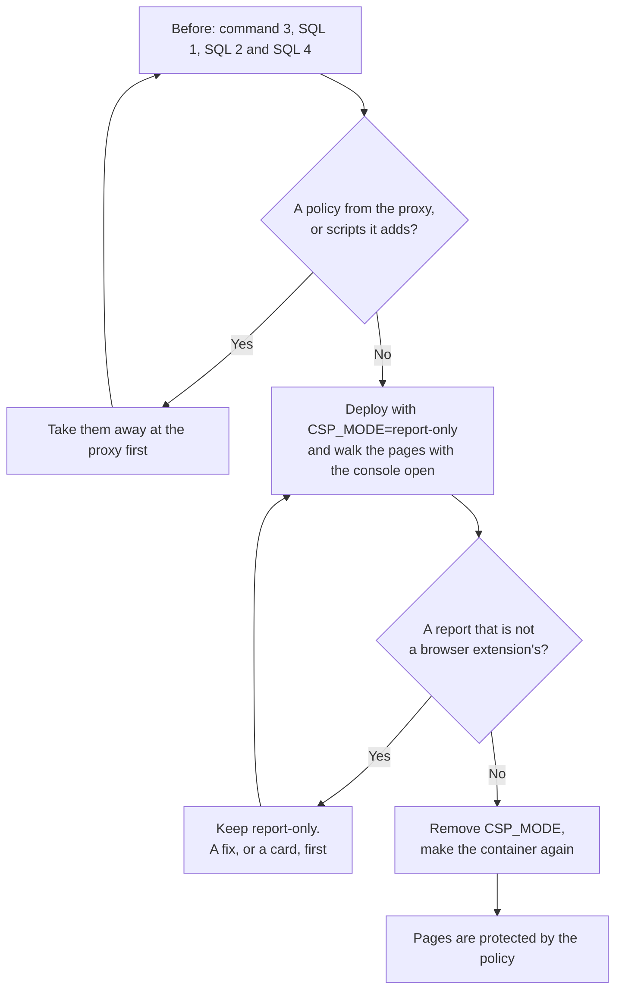

What changes for the people who use it, and for API callers:

- **Every page loads the font from DumpFire, and no page asks Google, or any other site, for
  anything.** Until now every page, the sign-in page included, loaded Inter from Google's
  font service, which told Google the address of whoever opened DumpFire, and when. The
  files are the ones Google served, byte for byte, so nothing looks different. They are
  fetched once from `/_app/immutable/assets/` and cached for a year; the licence is served
  at `/licences/inter-OFL.txt`.
- **A colour sent to the API is `#rrggbb` or it is refused.** Every operation that takes
  `color` or `colorTag`, in both trees, answers `400` `color must be a colour written #rrggbb`
  (for a colour tag `colorTag must be a colour written #rrggbb, or empty`) for anything
  else, `red` and `#fff` included, where any text was stored. The pages send only
  `#rrggbb`. Through the tracking wrapper, quote the colour, `-Color '#ef4444'`: an unquoted
  `#` begins a PowerShell comment, so `-Color #ef4444` sends nothing and the call stops with
  "Missing an argument for parameter 'Color'".
- **A stored colour that is more than a colour is drawn grey** (`#94a3b8`) until someone
  picks it a colour; every other stored colour looks as it did, one with spaces around it
  included. SQL 1 below lists them. How a grey one is fixed depends on what it colours: a
  label's, a category's, a column's or a board grouping's by picking a colour in its own
  colour picker; a card's or a subtask's colour tag has no control on the page, so only
  through the API, with the wrapper `update-card` or `update-subtask` with
  `-ColorTag '#rrggbb'` or `-ColorTag none` to clear it. Renaming any of them sends the old
  value back unchanged, and it is kept, grey or not.
- **A description or comment is drawn without style, a borrowed class, SVG or MathML, a
  form, a dialog or popover, an image map, a `<template>`, or the `srcset`, `background` and
  `poster` attributes**, and **an image from another site, or from any address on DumpFire
  but a card attachment's, shows as a link** reading 🖼 and its alt text, which opens the
  picture's address.
  Stored text is not changed. SQL 2 and SQL 4 below count what will look different.
- **An email address in a comment is a working link**, and a link's tooltip and an image's
  description no longer show chip markup. A mention inside code or link text is still drawn
  as a chip, because it is still mailed.
- **Pages are protected by the policy only once `CSP_MODE` is removed.** The colour rule and
  the Markdown rules protect them from the first deploy.

**Before the deploy.** The commands in this section are written for Git Bash or the Docker
host's shell, not PowerShell (where `curl` is another command: use `curl.exe`, and the
heredocs below do not work), and the database queries need `sqlite3` installed on that
host. Command 3 reads the public sign-in page and nothing else. Put your own address in
`SITE`:

```bash
SITE=https://dumpfire.example.com
curl -s -D - -o login.html "$SITE/login" | grep -i -E "^(server|cf-ray|content-security-policy)"
grep -c -i -E "cdn-cgi|rocket|cloudflareinsights|data-cf" login.html
grep -c "<script" login.html
grep -c -i -E "fonts\.(googleapis|gstatic)\.com" login.html
```

Expected before the deploy: no `content-security-policy` line, `0`, `2` (the theme script
and SvelteKit's) and `3` (the old font links).

- **A `content-security-policy` line means the proxy sends a policy of its own**, which
  browsers would enforce beside DumpFire's, and which, holding no page's nonce, would stop
  every page's scripts: take it away at the proxy before the deploy. See
  [Security Headers From the Proxy](#security-headers-from-the-proxy).
- **A count above `0` on the second line means the front may put scripts into pages**
  (Cloudflare's Rocket Loader, its automatic Web Analytics beacon). It counts words such as
  `data-cf`, not scripts, so it does not say the policy will refuse anything: read the
  console in the report-only trial below, and turn that feature off only if a report names
  it. **More than two scripts** means one was put in: the trial's console says whether the
  policy refuses it, and the same rule holds.

Then, on a copy of the database, three read-only queries say how much of production each
rule reaches. None changes anything, and nothing waits on their answers. Copy the database
out as for the sign-in queries above, into a folder only you can read; a missing `-wal` file
is expected:

```bash
mkdir -m 700 "$HOME/dumpfire-csp"
docker cp "<container>:/app/data/dumpfire.db" "$HOME/dumpfire-csp/"
docker cp "<container>:/app/data/dumpfire.db-wal" "$HOME/dumpfire-csp/" || echo "No -wal file: expected"
```

Run each by pasting it between a quoted heredoc's lines, which the shell leaves exactly as
written:

```bash
sqlite3 -readonly -header -column "$HOME/dumpfire-csp/dumpfire.db" <<'SQL'
<the query>
SQL
```

**SQL 1: stored colours that are not `#rrggbb`, by table and value, and how each will be
drawn.** Its `CASE` is `isSafeColour` in `src/lib/colours.ts`, written in SQL, on the value
with its leading and trailing spaces, tabs and line breaks trimmed, as `drawnColour` trims
it: the two change together.

```sql
SELECT t, value, n, CASE WHEN v = '' THEN 'no colour' WHEN (v GLOB '#*' AND length(v) IN (4, 5, 7, 9) AND substr(v, 2) NOT GLOB '*[^0-9A-Fa-f]*') OR (length(v) BETWEEN 1 AND 30 AND v NOT GLOB '*[^A-Za-z]*') OR (lower(v) GLOB 'var(--?*)' AND substr(v, 7, length(v) - 7) NOT GLOB '*[^A-Za-z0-9-]*') THEN 'drawn as stored' ELSE 'drawn grey' END AS drawn FROM (SELECT t, value, n, trim(value, char(32, 9, 10, 12, 13)) AS v FROM (SELECT 'labels' AS t, color AS value, COUNT(*) AS n FROM labels GROUP BY color UNION ALL SELECT 'categories', color, COUNT(*) FROM categories GROUP BY color UNION ALL SELECT 'board_categories', color, COUNT(*) FROM board_categories GROUP BY color UNION ALL SELECT 'columns', color, COUNT(*) FROM columns GROUP BY color UNION ALL SELECT 'cards.color_tag', color_tag, COUNT(*) FROM cards WHERE color_tag <> '' GROUP BY color_tag UNION ALL SELECT 'subtasks.color_tag', color_tag, COUNT(*) FROM subtasks WHERE color_tag <> '' GROUP BY color_tag)) WHERE value NOT GLOB '#[0-9A-Fa-f][0-9A-Fa-f][0-9A-Fa-f][0-9A-Fa-f][0-9A-Fa-f][0-9A-Fa-f]' ORDER BY t, n DESC
```

No rows: nothing changes on any page, and no stored value was ever more than a colour. A row
"drawn grey": that item shows grey after the deploy; one whose value holds `url(` is
evidence the fault was used. A row "drawn as stored" (`red`, `#fff`): it looks as it does
now, and an API caller that sent it will be refused the next time.

**SQL 2: descriptions and comments with an image, a `<style>` element or a style
attribute.**

```sql
SELECT 'cards' AS t, COUNT(*) AS rows_with_any, SUM(description LIKE '% are dropped and
drawn as their text alone; a Markdown task list, `- [ ]` and `- [x]`, keeps its boxes. An
image on DumpFire's own address that is not a card attachment (``, ``)
is drawn as a link too, and no column counts it: read the rows with `![` or ` 2>&1` has
   `[WARN] [STARTUP] CSP_MODE=report-only: pages are sent the Content-Security-Policy to report only, not to enforce; remove CSP_MODE once the trial is over. See docs/deployment.md.`
2. Command 3 again: the header line is now `content-security-policy-report-only`, the font
   count is `0`, and the script count is still `2`.
3. With the browser's console open, walk the pages: `/login`; `/`; a board; a card's window,
   its description, its comments and its attachment image; `/all`; `/plan` and a plan, with
   its PDF button; `/burndown`; `/graph`; `/reports`, previewing a PDF; `/admin`; `/audit`,
   whose live log runs; `/account`; `/teams`; `/inbox`; `/archived`; `/docs`; a path that is
   no page; and, signed out, `/request`, an invite link, and a request's confirm and reply
   pages. Choose the dark theme and reload: no flash of the light one. Move a card with the
   board open in a second browser: it moves there within a moment. In the network tab, Inter
   comes from `/_app/immutable/assets/inter-latin-wght-normal-<hash>.woff2` and no request
   goes to any Google host.
4. Preview a report's PDF in every browser family the team uses (Chrome or Edge, Firefox,
   Safari). How a browser's PDF viewer meets the policy differs by family. **If the preview
   fails in one of them, `CSP_MODE` stays `report-only`** and the preview gets its own card;
   the report's Download button is not affected.
5. Use DumpFire as usual for one working day with the console open. Nothing is collected
   from anyone else's browser: the trial is what an open console shows.

**Reading a report.** In report-only mode the console names what the policy would have
refused, beginning `[Report Only]`, and refuses nothing. A report whose source is
`chrome-extension:` or `moz-extension:` comes from a browser extension (a password manager,
a dark-mode extension), not from DumpFire, and does not hold up the next step. Any other
report is either a page the policy breaks, for a build that allows its source, or a script
the front puts into pages, for that feature to be turned off: deal with it before enforcing.

**Then enforce.** Remove `CSP_MODE` and make the container again: `docker restart` cannot
take a setting away, so stop it, remove it (the database and the uploads are on the volume
and stay) and run it with its first command, without the setting; in Compose, take the line
out and run `docker compose up -d`. The start log then has no `CSP_MODE` line, command 3's
header line is `content-security-policy`, and step 3's walk works as before. A policy line
in the console now means something was refused: a fault to report.

**If enforcing breaks a page**, it can be undone without changing the image: set
`CSP_MODE=report-only` again and make the container again the same way (stop, remove, run
with the setting, or put the line back and `docker compose up -d`). The start log has the
`CSP_MODE=report-only` line again and the policy refuses nothing. Once the fault is fixed,
walk step 3 again, then remove the setting as above.

**If an embedded request form is used**, open the page of the other site that frames it: the
form still shows, since the policy has no `frame-ancestors`.

**Going back to the previous image** needs nothing done to the database: no table changed.
The previous image takes any colour again, draws Markdown with DOMPurify's defaults, and
loads the font from Google; it does not read `CSP_MODE`.

### The Update That Brings Migration 0053, One Timestamp Form and the Attachment File Sweep

Three cards go out together: card 2106 brings migration `0053_index_foreign_keys_end_sessions.sql`, which indexes every foreign key column and **signs everybody out once**; card 2095 stores every timestamp in one form and **converts the timestamps production holds**, at the first start; card 2107 **sweeps attachment files that no row names** into the trash, and the first sweep moves a backlog. Each changes what the owner or users see. The review of the three brought migration `0054_index_user_time_end_unused_invites.sql` into the same release: it makes the log's index on `user_id` one on `user_id` and `created_at`, and **ends every invite not yet used, once**. Card 2158's migration 0055, which replaces every request link once, may go out in the same image: see [The Update That Brings Migration 0055](#the-update-that-brings-migration-0055-secrets-out-of-backups-and-request-mail-to-the-accounts-address) for its own checks.

> ⚠️ **0053 must not be deployed before card 2135**, which takes sessions out of backups. Both are in this tree: one image carrying both is fine. An image with 0053 and without card 2135 would let sessions made after the deploy leave in the next backup, and the one sign-out would be spent. The sweep needs card 2007's trash, which is in this tree too.

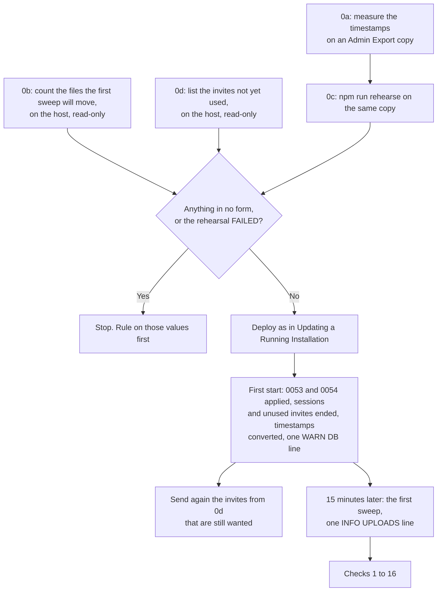

#### Before the deploy: checks 0a, 0b, 0c and 0d

Run all four before the deploy, on a workstation with the new code checked out and on the host. None of them writes anything.

**Check 0a: what form each timestamp column holds on production.** Download a backup with Admin → Export, onto a workstation with the repository checked out, and keep it as secret as the server: it holds every password hash. Save the SQL below as `measure-timestamps.sql` beside it, and run, from the repository folder (so that `better-sqlite3` is found), with the backup's path in place of `<copy.db>`:

```
node -e "const D=require('better-sqlite3');const fs=require('fs');const db=new D(process.argv[1],{readonly:true,fileMustExist:true});console.table(db.prepare(fs.readFileSync(process.argv[2],'utf8')).all())" <copy.db> measure-timestamps.sql
```

The file is opened read-only and must exist; the statement is one `SELECT`. It prints 41 rows, one per column, with zeros for an empty table. `cards.first_completed_at` is left out, because a production database at migration 0049 does not have it yet (0050 fills it from `completed_at`). An export made by the image now on production, from before card 2135, holds the sessions of its day, so the two `sessions` rows count them (one made by this release's image holds none, and they read 0); either way they do not matter, because 0053 ends them all.

```sql
-- Card 2095: which form each timestamp column holds. Read-only: one SELECT, nothing is written.
WITH cols(kind, tbl, col) AS (VALUES
  ('timestamp', 'activity_log', 'created_at'),
  ('timestamp', 'api_keys', 'last_used_at'),
  ('timestamp', 'api_keys', 'expires_at'),
  ('timestamp', 'api_keys', 'created_at'),
  ('timestamp', 'backup_log', 'created_at'),
  ('timestamp', 'board_favourites', 'created_at'),
  ('timestamp', 'boards', 'created_at'),
  ('timestamp', 'boards', 'updated_at'),
  ('timestamp', 'card_attachments', 'created_at'),
  ('timestamp', 'card_comments', 'created_at'),
  ('timestamp', 'card_comments', 'updated_at'),
  ('timestamp', 'card_dependencies', 'created_at'),
  ('timestamp', 'card_templates', 'created_at'),
  ('timestamp', 'cards', 'completed_at'),
  ('timestamp', 'cards', 'archived_at'),
  ('timestamp', 'cards', 'created_at'),
  ('timestamp', 'cards', 'updated_at'),
  ('timestamp', 'invite_tokens', 'expires_at'),
  ('timestamp', 'invite_tokens', 'created_at'),
  ('timestamp', 'milestones', 'created_at'),
  ('timestamp', 'milestones', 'updated_at'),
  ('timestamp', 'report_schedules', 'last_run_at'),
  ('timestamp', 'report_schedules', 'next_run_at'),
  ('timestamp', 'report_schedules', 'created_at'),
  ('timestamp', 'report_schedules', 'updated_at'),
  ('timestamp', 'request_messages', 'created_at'),
  ('timestamp', 'sessions', 'expires_at'),
  ('timestamp', 'sessions', 'created_at'),
  ('timestamp', 'system_logs', 'timestamp'),
  ('timestamp', 'task_requests', 'created_at'),
  ('timestamp', 'task_requests', 'resolved_at'),
  ('timestamp', 'teams', 'created_at'),
  ('timestamp', 'token_usage', 'created_at'),
  ('timestamp', 'users', 'created_at'),
  ('timestamp', 'webhooks', 'created_at'),
  ('timestamp', 'work_dependencies', 'created_at'),
  ('date', 'cards', 'due_date'),
  ('date', 'cards', 'next_recurrence'),
  ('date', 'daily_snapshots', 'date'),
  ('date', 'milestones', 'target_date'),
  ('date', 'subtasks', 'due_date')
),
v(kind, tbl, col, val) AS (
  SELECT 'timestamp', 'activity_log', 'created_at', "created_at" FROM "activity_log"
  UNION ALL SELECT 'timestamp', 'api_keys', 'last_used_at', "last_used_at" FROM "api_keys"
  UNION ALL SELECT 'timestamp', 'api_keys', 'expires_at', "expires_at" FROM "api_keys"
  UNION ALL SELECT 'timestamp', 'api_keys', 'created_at', "created_at" FROM "api_keys"
  UNION ALL SELECT 'timestamp', 'backup_log', 'created_at', "created_at" FROM "backup_log"
  UNION ALL SELECT 'timestamp', 'board_favourites', 'created_at', "created_at" FROM "board_favourites"
  UNION ALL SELECT 'timestamp', 'boards', 'created_at', "created_at" FROM "boards"
  UNION ALL SELECT 'timestamp', 'boards', 'updated_at', "updated_at" FROM "boards"
  UNION ALL SELECT 'timestamp', 'card_attachments', 'created_at', "created_at" FROM "card_attachments"
  UNION ALL SELECT 'timestamp', 'card_comments', 'created_at', "created_at" FROM "card_comments"
  UNION ALL SELECT 'timestamp', 'card_comments', 'updated_at', "updated_at" FROM "card_comments"
  UNION ALL SELECT 'timestamp', 'card_dependencies', 'created_at', "created_at" FROM "card_dependencies"
  UNION ALL SELECT 'timestamp', 'card_templates', 'created_at', "created_at" FROM "card_templates"
  UNION ALL SELECT 'timestamp', 'cards', 'completed_at', "completed_at" FROM "cards"
  UNION ALL SELECT 'timestamp', 'cards', 'archived_at', "archived_at" FROM "cards"
  UNION ALL SELECT 'timestamp', 'cards', 'created_at', "created_at" FROM "cards"
  UNION ALL SELECT 'timestamp', 'cards', 'updated_at', "updated_at" FROM "cards"
  UNION ALL SELECT 'timestamp', 'invite_tokens', 'expires_at', "expires_at" FROM "invite_tokens"
  UNION ALL SELECT 'timestamp', 'invite_tokens', 'created_at', "created_at" FROM "invite_tokens"
  UNION ALL SELECT 'timestamp', 'milestones', 'created_at', "created_at" FROM "milestones"
  UNION ALL SELECT 'timestamp', 'milestones', 'updated_at', "updated_at" FROM "milestones"
  UNION ALL SELECT 'timestamp', 'report_schedules', 'last_run_at', "last_run_at" FROM "report_schedules"
  UNION ALL SELECT 'timestamp', 'report_schedules', 'next_run_at', "next_run_at" FROM "report_schedules"
  UNION ALL SELECT 'timestamp', 'report_schedules', 'created_at', "created_at" FROM "report_schedules"
  UNION ALL SELECT 'timestamp', 'report_schedules', 'updated_at', "updated_at" FROM "report_schedules"
  UNION ALL SELECT 'timestamp', 'request_messages', 'created_at', "created_at" FROM "request_messages"
  UNION ALL SELECT 'timestamp', 'sessions', 'expires_at', "expires_at" FROM "sessions"
  UNION ALL SELECT 'timestamp', 'sessions', 'created_at', "created_at" FROM "sessions"
  UNION ALL SELECT 'timestamp', 'system_logs', 'timestamp', "timestamp" FROM "system_logs"
  UNION ALL SELECT 'timestamp', 'task_requests', 'created_at', "created_at" FROM "task_requests"
  UNION ALL SELECT 'timestamp', 'task_requests', 'resolved_at', "resolved_at" FROM "task_requests"
  UNION ALL SELECT 'timestamp', 'teams', 'created_at', "created_at" FROM "teams"
  UNION ALL SELECT 'timestamp', 'token_usage', 'created_at', "created_at" FROM "token_usage"
  UNION ALL SELECT 'timestamp', 'users', 'created_at', "created_at" FROM "users"
  UNION ALL SELECT 'timestamp', 'webhooks', 'created_at', "created_at" FROM "webhooks"
  UNION ALL SELECT 'timestamp', 'work_dependencies', 'created_at', "created_at" FROM "work_dependencies"
  UNION ALL SELECT 'date', 'cards', 'due_date', "due_date" FROM "cards"
  UNION ALL SELECT 'date', 'cards', 'next_recurrence', "next_recurrence" FROM "cards"
  UNION ALL SELECT 'date', 'daily_snapshots', 'date', "date" FROM "daily_snapshots"
  UNION ALL SELECT 'date', 'milestones', 'target_date', "target_date" FROM "milestones"
  UNION ALL SELECT 'date', 'subtasks', 'due_date', "due_date" FROM "subtasks"
),
f AS (
  SELECT kind, tbl, col, val,
    CASE
      WHEN val IS NULL THEN 'null'
      WHEN typeof(val) <> 'text' THEN 'not_text'
      WHEN val GLOB '[0-9][0-9][0-9][0-9]-[0-9][0-9]-[0-9][0-9] [0-9][0-9]:[0-9][0-9]:[0-9][0-9]' THEN 'space'
      WHEN val GLOB '[0-9][0-9][0-9][0-9]-[0-9][0-9]-[0-9][0-9] [0-9][0-9]:[0-9][0-9]:[0-9][0-9]?*' THEN 'space_more'
      WHEN val GLOB '[0-9][0-9][0-9][0-9]-[0-9][0-9]-[0-9][0-9]T[0-9][0-9]:[0-9][0-9]:[0-9][0-9].[0-9][0-9][0-9]Z' THEN 'iso_ms_z'
      WHEN val GLOB '[0-9][0-9][0-9][0-9]-[0-9][0-9]-[0-9][0-9]T[0-9][0-9]:[0-9][0-9]:[0-9][0-9]Z' THEN 'iso_z'
      WHEN val GLOB '[0-9][0-9][0-9][0-9]-[0-9][0-9]-[0-9][0-9]T*' THEN 'iso_other'
      WHEN val GLOB '[0-9][0-9][0-9][0-9]-[0-9][0-9]-[0-9][0-9]' THEN 'date_only'
      ELSE 'neither'
    END AS form
  FROM v
)
SELECT cols.kind, cols.tbl AS "table", cols.col AS "column",
  COUNT(f.form) AS total,
  COALESCE(SUM(f.form = 'null'), 0) AS null_values,
  COALESCE(SUM(f.form = 'space'), 0) AS space_form,
  COALESCE(SUM(f.form = 'iso_ms_z'), 0) AS iso_ms_z,
  COALESCE(SUM(f.form = 'iso_z'), 0) AS iso_z,
  COALESCE(SUM(f.form = 'iso_other'), 0) AS iso_other,
  COALESCE(SUM(f.form = 'space_more'), 0) AS space_more,
  COALESCE(SUM(f.form = 'date_only'), 0) AS date_only,
  COALESCE(SUM(f.form = 'not_text'), 0) AS not_text,
  COALESCE(SUM(f.form = 'neither'), 0) AS neither,
  MIN(CASE WHEN f.form IN ('iso_other', 'space_more', 'not_text', 'neither') THEN f.val END) AS example_unexpected,
  MIN(CASE WHEN f.form = 'space' THEN f.val END) AS first_space,
  MAX(CASE WHEN f.form = 'space' THEN f.val END) AS last_space,
  MIN(CASE WHEN f.form LIKE 'iso%' THEN f.val END) AS first_iso,
  MAX(CASE WHEN f.form LIKE 'iso%' THEN f.val END) AS last_iso
FROM cols LEFT JOIN f ON f.kind = cols.kind AND f.tbl = cols.tbl AND f.col = cols.col
GROUP BY cols.kind, cols.tbl, cols.col
ORDER BY cols.kind DESC, cols.tbl, cols.col;
```

What to read in the result:

| Column of the result | Expected | If not |
|---|---|---|
| `neither`, `not_text`, `space_more`, `iso_other` | 0 everywhere | Each such value is ruled on before the deploy. The new code leaves such a value as it is and reports it at every start; it does not stop the server |
| The 22 columns written by SQL defaults | `space_form` = `total` − `null_values` | ISO 8601 there came from a restore or an import. The first start converts it; nothing to rule |
| The 4 mixed columns (`updated_at` of `cards`, `boards`, `milestones`, `report_schedules`) and the 10 written as ISO 8601 | Any mix of `space_form` and `iso_ms_z` | Nothing to rule: this is what the first start converts |
| The five `date` rows | `date_only` or `null_values` only | A date column holding a timestamp is outside this release: note it and rule on it |

**Check 0b: what the first sweep will move.** On the host, against the live database, read-only: it opens the database read-only and only lists folders.

```bash
docker exec -i dumpfire node - <<'EOF'
const fs = require('fs'), path = require('path');
const dbPath = process.env.DB_PATH || 'dumpfire.db';
const db = require('better-sqlite3')(dbPath, { readonly: true, fileMustExist: true });
const named = new Set(db.prepare('SELECT card_id, filename FROM card_attachments').all().map((r) => (r.card_id + '/' + r.filename).toLowerCase()));
const highest = db.prepare('SELECT MAX(COALESCE((SELECT seq FROM sqlite_sequence WHERE name = ?), 0), COALESCE((SELECT MAX(id) FROM cards), 0)) AS n').get('cards').n;
const up = path.join(path.dirname(path.resolve(dbPath)), 'uploads');
let files = 0, unnamed = 0, bytes = 0;
const above = [], notCardFolders = [];
for (const d of fs.existsSync(up) ? fs.readdirSync(up) : []) {
  if (d === '.trash') continue;
  if (!/^[1-9][0-9]*$/.test(d) || !fs.lstatSync(path.join(up, d)).isDirectory()) { notCardFolders.push(d); continue; }
  if (Number(d) > highest) { above.push(d); continue; }
  for (const f of fs.readdirSync(path.join(up, d))) {
    const st = fs.lstatSync(path.join(up, d, f));
    if (!st.isFile()) continue;
    files++;
    if (!named.has((d + '/' + f).toLowerCase())) { unnamed++; bytes += st.size; }
  }
}
console.log(files + ' files in card folders; ' + unnamed + ' named by no attachment (' + (bytes / 1048576).toFixed(1) + ' MB)');
console.log('Highest card id this database has issued: ' + highest);
console.log(above.length + ' folder(s) numbered above it: ' + (above.join(', ') || 'none'));
console.log(notCardFolders.length + ' name(s) that are not a card folder: ' + (notCardFolders.join(', ') || 'none'));
EOF
```

The script is fed to `node -` on its standard input (hence `-i`), between `<<'EOF'` and `EOF`: the quotes round the first `EOF` stop the shell reading anything in it, so its `!` and `$` reach Node as written. Inside `node -e "…"`, an interactive bash would read each `!` as a history command and stop with `event not found`.

It prints a count and a size; the highest card id this database has issued, which is the larger of the `cards` counter and the highest id in use, as the sweep reads it; the folders numbered above that id; and the names in the uploads folder that are not a card's folder (`.trash` aside). It reads a card's folder and a named file as the sweep does: a whole number with no leading zero, and a name in any case. It does not leave out a file changed in the last day, which the sweep leaves alone, so the first sweep's count can be a little lower. Every file it counts as named by no attachment is moved to the trash by the first sweep and removed 30 days later, unless an Import Backup puts it back first. If the count is large, take a copy of the uploads folder first ([Backing up and restoring the files](#backing-up-and-restoring-the-files)).

Rule on the two lists before the deploy. The sweep leaves each of them alone and names it in a `WARN` line at every run:

- **A folder numbered above the highest card id** was made by another database, since ids are never used twice: most often a scratch database started beside this one (see [The sweep](#the-sweep-files-no-attachment-names)). Find whose it is, and move it out of `uploads/` if it is not this installation's.
- **A name that is not a card folder** (`notes`, `07`, `.DS_Store`, a stray file) is moved out of `uploads/`, or kept and its `WARN` line accepted. A `lost+found` at the root of a file system mounted at `uploads/` cannot be moved.

**Check 0c: the rehearsal.** `npm run rehearse -- <export.db>`, on the same export, with the new code (see [Testing](testing.md#rehearsing-the-runner-against-a-copy-of-a-real-database)). Expect:

- `Migration files applied` lists `0053_index_foreign_keys_end_sessions.sql` and `0054_index_user_time_end_unused_invites.sql` (and `0055_replace_request_links.sql`, in an image that carries it: see [its section](#the-update-that-brings-migration-0055-secrets-out-of-backups-and-request-mail-to-the-accounts-address)), and `PASSED`.
- `Timestamps converted to the stored form (YYYY-MM-DD HH:MM:SS, UTC): N`, with a line for each column and its count: the conversion the first start will make, measured by the code that will make it. The second run converts none.
- No `Timestamps in no form the conversion can read` lines. Any there is the same finding as a non-zero `neither` in check 0a, and is ruled on before the deploy.
- `The first run took …`: what the first start adds before it listens, index creation and conversion included. Measured in memory, the 39 indexes took 30 ms on 20,000 cards.
- If the export held sessions (one made before card 2135 does), a note under `Worth knowing`: `sessions had N row(s) and has 0: every row deleted by 0053_index_foreign_keys_end_sessions.sql, a one-off declared in tests/rehearsal/one-offs.ts`. That is expected, not a failure.
- If it held invites not yet used (one made before card 2135 does), a note the same way: `invite_tokens had N row(s) and has M: every unused invite deleted by 0054_index_user_time_end_unused_invites.sql, a one-off declared in tests/rehearsal/one-offs.ts`. Expected, not a failure.

It is a fault if it prints `FAILED`, if 0053 or 0054 is not among the files applied, or if a second run converts anything.

**Check 0d: the invites the deploy ends.** On the host, against the live database, read-only. 0054 deletes every invite not yet used, so this lists them, with the account each was for, for you to send again the ones still wanted once the deploy is done:

```bash
docker exec dumpfire node -e "
const db = require('better-sqlite3')(process.env.DB_PATH || 'dumpfire.db', { readonly: true, fileMustExist: true });
console.table(db.prepare('SELECT u.username, u.email, i.created_at, i.expires_at FROM invite_tokens i JOIN users u ON u.id = i.user_id WHERE i.used = 0 ORDER BY i.created_at').all());
"
```

It prints one row for each invite not yet used, expired or not: the account's name and address, and when the invite was made and when it expires, in UTC. Nothing to rule on: keep the list. An invite whose `expires_at` has passed was dead already. One still to come stops working at the deploy; send it again from User Management (📧) afterwards, which mails the account a new link.

#### What changes at the first start

- **Everybody is signed out, once, the owner included.** 0053's last statement deletes every session. Each browser goes to the sign-in page at its next request. API keys, invites and requesters' links are untouched by 0053 (0054 ends unused invites, and 0055 replaces requesters' links). Until a browser signs in again, each request it makes with its old cookie writes one `[WARN] [AUTH]` line, `Session validation failed — token not in DB (deleted or never issued)`: a few lines a browser, one for each open tab's next call and one for the sign-in page. A later start deletes nothing. Why: [Every Session Ended Once](authentication-security.md#every-session-ended-once-by-migration-0053).
- **Every invite not yet used is ended, once.** 0054's last statement deletes them. A backup made before card 2135 holds every unused invite of its day, and an unused invite sets its account's password until it expires, at most seven days after it was made; ending them all makes the tokens in those copies worthless. Each link then shows the page for a link that no longer works. Send again, from User Management, the invites check 0d listed that are still wanted. Used invites, accounts and API keys are untouched, and a later start deletes nothing. Why: [Every Unused Invite Ended Once](authentication-security.md#every-unused-invite-ended-once-by-migration-0054).
- **39 indexes are created**, one of them as 0054 makes it. It adds little to the first start (30 ms on 20,000 cards, in memory), and a permanent delete of a large board takes milliseconds instead of seconds (48 ms against 9.4 s, measured on a board of 2,000 cards).
- **A person's log entries are indexed by person and time.** 0054 drops 0053's index on `activity_log.user_id` and creates one on `user_id` and `created_at`. The audit routes filtered by a person (`/api/audit`, `/api/v1/audit-log`) read that person's newest entries straight from it and stop at the page, where they sorted every entry of the person's (with a board or a card filtered as well, they read that board's or card's entries by its own index instead); `/api/v1/me/stats` reads only the last 7 or 30 days of them. The activity report filtered by a person looks each card's entries and comments up by card: with an index on `user_id`, SQLite had read every entry of the person's once for each card (4,215 ms against 9 ms on 2,000 cards and 60,000 entries). No answer changes.
- **Timestamps are converted.** The values of up to 16 columns are rewritten to `YYYY-MM-DD HH:MM:SS` in UTC, each naming the same moment to the second, and one `[WARN] [DB] N timestamp(s) converted to the stored form …` line names each column and its count. API callers see every timestamp in ISO 8601 with `Z` from now on: see the [API Reference](api-reference.md#timestamps).
- **The first sweep**, 15 minutes after the first start where the schedulers run, moves every file left by permanent deletes made before card 2007, and any other file no row names that is more than a day old, to `uploads/.trash/`, and says so in one `[INFO] [UPLOADS]` line. They are removed 30 days later.

#### After the deploy

| # | Do | Account and data | Expect | A fault if |
|---|---|---|---|---|
| 1 | Open DumpFire in a browser that was signed in | Any account | The sign-in page; signing in works | Still signed in, or signing in fails |
| 2 | Call `GET /api/v1/me` with an existing API key | A key made before the deploy | `200` | `401` |
| 2b | Open the link of an invite sent before the deploy and not yet used | Any invite check 0d listed | The page for a link that no longer works; a new invite sent from User Management works | The old link sets a password |
| 3 | Read the start's log | Host | `Applied migration: 0053_index_foreign_keys_end_sessions.sql` and `Applied migration: 0054_index_user_time_end_unused_invites.sql`; no `[ERROR] [DB]` line | Any `[ERROR] [DB]` (the indexes differ from the model, or a timestamp could not be read) |
| 4 | On a copy, permanently delete the largest board | The superadmin on an instance that is not production | It is gone within about a second | Several seconds, the page waiting |
| 5 | Read the first start's log, then restart and read it again | Host | First: one `[WARN] [DB]` line naming the columns converted and their counts. Second: none | A line at the second start, or an `ERROR` naming values it cannot read |
| 6 | Open a board's archive panel | An editor; a board with an archived card | "Archived 14 Oct" | "Archived Invalid Date" |
| 7 | On the dashboard, sort boards by last activity, after editing a card on the board that was last | Any user | That board first, with "just now" | Another order, or a wrong time |
| 8 | `GET /api/v1/cards/{id}` for a completed card | API key | `completedAt`, `createdAt` and `updatedAt` in the form `YYYY-MM-DDTHH:MM:SS.000Z` | Any of them `YYYY-MM-DD HH:MM:SS` |
| 8b | Export a board as CSV and open it in a spreadsheet | An editor | "Created" and "Completed" as `YYYY-MM-DD HH:MM:SS` (UTC), opened as dates | A `T` or a `Z`, or text the spreadsheet does not read as a date |
| 9 | Reports page, a custom range with today as both start and end | Any user; a card created and one completed today | Both counted | Either missing |
| 10 | Audit page, from today to today | An administrator | Today's entries, the last minute's included | Missing entries |
| 11 | Account page, the API key list | Any user with a key | "Created" shows the right day; "Last used" a time just past | A day off, or Invalid Date |
| 12 | `GET /api/v1/audit-log?from=yesterday` (literally the word) | API key | `400` naming `from` | `200` |
| 13 | On an instance that is not production, Import Backup of a backup taken before the deploy, then restart | The superadmin | One `[WARN] [IMPORT] N timestamp(s) the backup held in another form were converted …` line after the import; no conversion line at the restart | A line at the restart |
| 14 | On a test instance with data of its own (not a copy of production), started with `SCHEDULERS=on`: put `stray.txt` in `uploads/<id of an existing card>/` and age it with `touch -d '2 days ago'`; put `fresh.txt` beside it; put another aged `stray.txt` in `uploads/0<id>/`; restart; wait 16 minutes | Host; a card with an attachment | The first `stray.txt` in `uploads/.trash/<id>/` with `.trashed-at`; `fresh.txt` still there; the one in `0<id>` still there, named in a `WARN` line; one `[INFO] [UPLOADS]` line; the card's real attachment still opens | A `stray.txt` moved that should not be, `fresh.txt` gone, or the attachment broken |
| 15 | The same with `SCHEDULERS=off` | Host | After 16 minutes `stray.txt` is still there and there is no sweep line | It moved |
| 16 | After the deploy, wait 16 minutes and read the log | Host | One `[INFO] [UPLOADS] Moved N attachment file(s) …` line whose count is near check 0b's | A count far above it, or a `WARN` about other databases' folders |

Every container started from a copy of production for these uses `--network none` and `SCHEDULERS=off`, as [the rehearsal](#rehearsing-an-update-against-a-copy) says, and the copy is treated as secret.

#### Going back to the previous image

Nothing is done to the database: start the previous image on it as it is ([Going Back to the Previous Image](#going-back-to-the-previous-image)).

- **0053 and 0054 stay applied.** An image with the runner logs one `[ERROR] [DB]` line for the two recorded files it has no file for, and one for the 39 indexes its model lacks, 0054's among them, and starts. Nobody is signed out a second time, and no invite is ended a second time: one sent after the deploy keeps working.
- **Timestamps.** The older image compares the stored form with its own ISO 8601 "now" as text, and a value in the stored form sorts before every ISO 8601 time of the same day, because a space sorts before `T`. So:
  - a session, an invite or an API key whose expiry falls on the current UTC day counts as expired from 00:00 that day;
  - each scheduled report is sent early on its due day, just after 00:00 UTC, once: its next run, in the stored form, is due from midnight, and the next run it then writes is ISO 8601 and falls due on time;
  - its log pruning deletes the rows of the cutoff day early, all of that day at once, since every stored row of that day sorts before its ISO cutoff;
  - its reports have the date faults this release fixed.

  It writes ISO 8601 again. The next start of the newer image converts what it wrote, with one `[WARN] [DB]` line.
- **The sweep** stops with the newer image. Files it moved stay in the trash, which an image from before card 2007 never reads or empties: see [The Update That Brings Transactions and the Uploads Trash](#the-update-that-brings-transactions-and-the-uploads-trash).

### The Update That Brings Migration 0055, Secrets Out of Backups and Request Mail to the Account's Address

Three cards go out in one image, and this is the one note for them.

- **Card 2158** brings migration `0055_replace_request_links.sql`, which **replaces every task request's link once**, and changes what a backup holds and what a restore does: a backup holds no request link and not the key the public request form signs with, and every restore gives every request a new link. A requester whose link no longer works asks for the current one from the page it opens. If it goes out in the same image as [migration 0053](#the-update-that-brings-migration-0053-one-timestamp-form-and-the-attachment-file-sweep), everybody is signed out and every request link is replaced on that one deploy.
- **Card 2169** takes the mail password, every backup destination's credentials and every webhook's signing secret out of every backup, and seals every backup with a key the server keeps. A restore keeps this server's own where they are for the same account, only into a backup this server made and nobody has changed since, and lists any to enter again; a scheduled backup does not try a destination that lacks its credentials; and the server says at every start what is still to enter. No migration. The one thing written to the running database is the key, a `backup_seal_key` setting the first backup after the deploy makes: mail, backups and webhooks go on as they are.
- **Card 2171** sends every mail to a requester who made the request while signed in to the account's email as it is when the mail is sent, not the address stored when the request was made, and the inbox shows that address. Deleting an account writes its email onto its requests first. No migration.

> ⚠️ **Never card 2158 without card 2171.** The new route that mails a requester the current link (`POST /api/requests/[id]/link`) would otherwise compare the address given with the one stored when the request was made. For a request made while signed in, whose account's email has changed since, whoever holds the old mailbox could have the thread's link mailed there whenever they liked. Card 2171 makes the route, and every other mail to a requester, use the account's address as it is now. An image carrying both is fine; one with card 2158 and without card 2171 is not to be deployed.

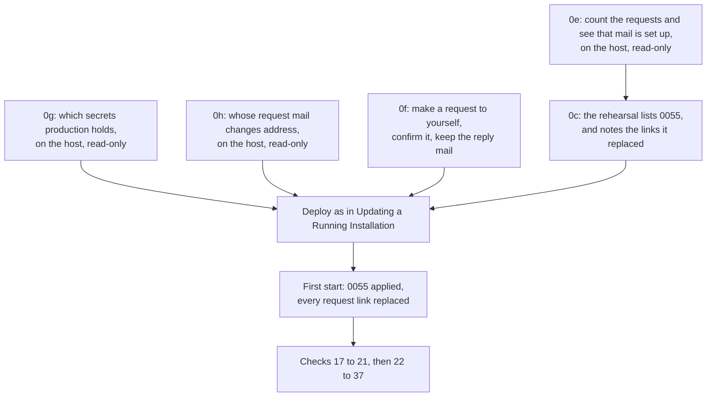

#### Before the deploy: checks 0e to 0h

**Check 0e: who will meet a dead link, and whether they can be sent a new one.** On the host, against the live database, read-only. It prints no token, no key and no credential, the backup destinations by type and name only, and it holds no `!` or `$`:

```bash
docker exec dumpfire node -e "
const db = require('better-sqlite3')(process.env.DB_PATH || 'dumpfire.db', { readonly: true, fileMustExist: true });
console.table(db.prepare('SELECT status, COUNT(*) AS requests, SUM(requester_email IS NOT NULL) AS with_email, MAX(created_at) AS newest FROM task_requests GROUP BY status ORDER BY status').all());
const row = db.prepare('SELECT value FROM settings WHERE key = ?').get('backup_config');
const c = row ? JSON.parse(row.value) : {};
console.log('backup schedule:', c.schedule || 'none', '| destinations:', (c.destinations || []).map((d) => d.type + ' ' + d.name).join(', ') || 'none');
console.table(db.prepare('SELECT destination_type, status, COUNT(*) AS runs, MIN(created_at) AS first, MAX(created_at) AS last FROM backup_log GROUP BY destination_type, status').all());
console.log('mail set up:', Boolean((db.prepare('SELECT value FROM settings WHERE key = ?').get('smtp_host') || {}).value));
db.close();
"
```

Each request counted has a link that stops working at the deploy. A requester who opens one is asked for the address the request was made with, and the current link is mailed there, so **mail must be set up** (`mail set up: true`) for anyone to be sent one; with none, set it up before the deploy. `backup_log` keeps the last ten runs, so an empty table does not prove that no copy ever left: the replacement does not depend on it.

**Check 0f: a link to try afterwards.** In a private window, make a request on `/request` to yourself, with a second `+` alias of a mailbox you can read as its address, and confirm it from the mail. Then, signed in as yourself, reply to it in the Inbox, and keep the reply mail: its "View & Reply" opens the thread now, and check 17 opens it after the deploy.

**Check 0g: which secrets production holds, and what a restore elsewhere would ask for** (card 2169). On the host, against the live database, read-only. It prints flags, counts, the mail port and "Use SSL/TLS" setting (neither is secret) and the destinations by type and name, never a secret, and it holds no `!` or `$`:

```bash
docker exec dumpfire node -e "
const db = require('better-sqlite3')(process.env.DB_PATH || 'dumpfire.db', { readonly: true, fileMustExist: true });
const get = (k) => (db.prepare('SELECT value FROM settings WHERE key = ?').get(k) || {}).value || '';
const has = (v) => Boolean(v && String(v).length > 0);
console.log('mail: host set', has(get('smtp_host')), '| port', get('smtp_port'), '| secure', get('smtp_secure'), '| user set', has(get('smtp_user')), '| password set', has(get('smtp_pass')));
let c = {};
try { c = JSON.parse(get('backup_config') || '{}'); } catch (e) { console.log('backup_config is not JSON'); }
for (const d of (c.destinations || [])) { let sa = {}; try { sa = JSON.parse(d.serviceAccountJson || '{}'); } catch (e) {} console.log('destination', d.type, JSON.stringify(d.name), '| password', has(d.password), '| private key', has(d.privateKey), '| S3 secret', has(d.secretAccessKey), '| client secret', has(d.clientSecret), '| refresh token', has(d.refreshToken), '| service account key', has(sa.private_key), '| service account type', JSON.stringify(sa.type || '')); }
console.table(db.prepare('SELECT active, length(secret) > 0 AS signed, COUNT(*) AS webhooks FROM webhooks GROUP BY 1, 2 ORDER BY 1, 2').all());
console.table(db.prepare('SELECT destination_type, status, COUNT(*) AS runs, MIN(created_at) AS first, MAX(created_at) AS last FROM backup_log GROUP BY destination_type, status').all());
db.close();
"
```

Read it for three things. What is `true` there is what a restore of a backup onto another server, or a server rebuilt from one, would ask to be entered again: have each of those, and each webhook receiver's secret, somewhere outside DumpFire before the deploy (see [Backup Destinations](#backup-destinations)). An SFTP destination with `password false` and `private key false` whose recent runs succeed is one whose server accepts no password at all; it goes on being tried as it is (it is not stopped as "credentials are not entered"). And `port 587` (or 25) with `secure` empty or `false` is mail sent with the certificate not checked: that is a card of its own, and not changed by this release. `backup_log` keeps the last ten runs, so it cannot show that no copy ever left the server: every copy made before this deploy holds the secrets, as below.

**Check 0h: whose request mail changes address at the deploy** (card 2171). On the host, read-only; it prints counts, never an address:

```bash
docker exec dumpfire node -e "
const db = require('better-sqlite3')(process.env.DB_PATH || 'dumpfire.db', { readonly: true, fileMustExist: true });
console.table(db.prepare('SELECT tr.status, COUNT(*) AS made_signed_in, SUM(lower(trim(tr.requester_email)) <> lower(u.email)) AS address_since_changed FROM task_requests tr JOIN users u ON u.id = tr.requester_user_id GROUP BY tr.status ORDER BY tr.status').all());
console.table(db.prepare('SELECT status, COUNT(*) AS requests, SUM(requester_email IS NOT NULL) AS with_address FROM task_requests WHERE requester_user_id IS NULL GROUP BY status ORDER BY status').all());
db.close();
"
```

`address_since_changed` is how many requests made signed in are mailed at a different address from the deploy on: the account's address as it is now. The second table is the requests made without an account, or whose account was deleted before the deploy, which keep the address stored on them.

**In the rehearsal (check 0c)**, `Migration files applied` lists `0055_replace_request_links.sql` too, and, for an export that holds requests, a note under `Worth knowing`: `task_requests: every access_token replaced in its N row(s) by 0055_replace_request_links.sql, a one-off declared in tests/rehearsal/one-offs.ts`. Expected, not a failure. The rehearsal still fails if `task_requests` loses a row.

#### What changes at the first start

- **Every request link mailed before the deploy stops working, once.** 0055's one statement gives every request a new token, open, settled or unconfirmed. Copies of backups made before this, at a destination or downloaded, hold every link as it was mailed; replacing them all makes those copies open no thread. A later start replaces nothing. Why: [Every Request Link Replaced Once](authentication-security.md#every-request-link-replaced-once-by-migration-0055).
- **The page an old link opens** says "This link no longer works. Enter the email address you made the request with (if you made it while signed in to DumpFire, your account's email address as it is now), and a new link will be sent to it.", with an address field and "Send me a new link"; the confirm page shows the same under its refusal. Whatever is entered, the answer is the same sentence; only the request's address is sent the link (for a request made signed in, the account's email as it is now), at most three times an hour, and the reply page no longer asks the server every five seconds for a thread it cannot open.
- **Backups made from now on hold no request link** and not the request form's key, and **every Import Backup replaces every request's link**: its answer says how many, and the requesters of those links ask for new ones the same way.
- **Backups made from now on hold no mail password, no destination credential and no webhook secret**, and a webhook that has a secret is switched off in them (card 2169). The running server is not changed: its mail, its backups and its webhooks work as before, and Backup History shows the next run succeed at every destination. An Import Backup keeps this server's secrets for the same accounts, and its result lists any to enter again. **Every backup is sealed** from now on: a `backup_seal` setting in the file, the seal's form number `2:` and an HMAC of every row made with the `backup_seal_key` the first backup makes in the running database, which no backup holds. Import Backup fills this server's secrets only into a backup whose seal it makes again with its own key: one made by another server, or changed since in anything a restore brings in, has every gap listed, and its "To enter again" line ends "None was kept from this server, because this backup was not made by this server, or was changed since." The seal covers the file's whole structure, SQLite's own objects and the statistics ANALYZE writes included, and the import reads every table's rows as stored (`NOT INDEXED`), the rows the seal was made over. Before the seal is asked, a file that fails `PRAGMA integrity_check`, or holds an object named as SQLite's own that no backup of this server's holds, is treated as changed: the restore goes ahead, nothing is filled, and the import writes one `[WARN] [IMPORT]` line beginning "Nothing was kept from this server, because the backup failed a check made before its seal is checked" that names the check. **Copies made before this deploy carry no seal**: restoring one fills nothing from this server, which changes nothing, since they hold their own secrets; a line with anything to enter would end "None was kept from this server, because this backup carries no seal this server can check." Sealing adds about 0.2 s to a backup of a 59 MB database (0.56 s at 177 MB, measured on a development machine), and verifying as much to an import, with about 0.12 s more for the integrity check. Nothing new is written at start on production, where every secret is entered; a `[WARN] [STARTUP]` line beginning "To enter again, because a backup does not hold them" would mean something already lacks one.
- **Every mail to a requester who made the request signed in goes to the account's email as it is now** (card 2171): the team's reply, "Request accepted", "Request declined", the progress and completion mails, and a new link. The inbox shows that address. Check 0h counted the requests this changes. Deleting a user writes the account's email onto every request it made, so its requests go on being mailed at its last address.
- Requests, their messages and the inbox are otherwise untouched, and the team sees nothing new.

**Owner to know.** From this deploy on a backup is not enough to rebuild a lost server: restored anywhere but the server it came from, or put in place by hand, it needs the mail password, every destination's credentials and every webhook's secret entered again (see [Backup Destinations](#backup-destinations)). Restored on the server it came from it needs nothing entered, as long as it is the file that server made, unchanged: a restore keeps nothing from this server for a backup changed since, by anyone, in anything a restore brings in, its structure, SQLite's own objects and statistics included, nor for a file that fails SQLite's integrity check. The seal leaves out only what a restore never brings in (the hidden rowids of a table with no `INTEGER PRIMARY KEY`, though not their order; `sqlite_sequence`; the file's header and free space), so a change there restores nothing different. Copies made before this deploy still hold them, and carry no seal, and nothing can take them out: they go as each destination's retention removes them. If one of them may have been read by somebody who should not have, change the mail password and each destination's credentials at their services and enter them again, and set new webhook secrets with their receivers.

#### After the deploy

| # | Do | Account and data | Expect | A fault if |
|---|---|---|---|---|
| 17 | Open the reply mail kept in check 0f | A private window | "This link no longer works" and the address field | The thread |
| 18 | Enter a wrong address; then the right one | | The same sentence both times; one mail, for the right one, whose link opens the thread | A different answer for the wrong one, no mail, or two |
| 19 | Leave a page from check 17 open for a minute, then read Admin, Logs | The superadmin | At most a line or two for that request | A line every five seconds |
| 20 | Export a backup. Search the file for the token in check 18's link, and for `request_form_secret` | The superadmin | Neither found | Either found |
| 21 | On an instance that is not production, Import Backup of that export **as a working copy**; open check 18's link with its address changed to that instance's, and ask for a new link | That instance's superadmin | The import's answer, and the report on the page, say how many request links were replaced; the link no longer works; the ask is answered "New links cannot be sent just now. Please contact the team that sent you the link.", and that instance's log has a `[WARN] [REQUESTS]` line saying mail is not set up (unless that instance's own test mail was set up first) | The link opens the thread, or the import restored as it is |

Checks 22 to 24 and 31 to 37 run on production. **Checks 25 to 30 restore a backup, so they run on an instance that is not production, with a database of its own**: a fresh data volume, set up with a superadmin of its own and no mail settings or destinations, started with `--network none` and `SCHEDULERS=off` as in [Rehearsing an Update Against a Copy](#rehearsing-an-update-against-a-copy). Never on production, and never on a copy of production's live database: the restore would rightly keep that copy's secrets, and the checks would show nothing. Importing production's export there signs you out; sign in again as production's superadmin. The instance is never given a network afterwards: the restore "as it is" brings production's unsigned webhooks and report schedules back on there. Checks 31 to 37 use a throwaway ordinary account, `rq-check`, made for them, with a password you know and an email that is a `+` alias of a mailbox you can read; mail must be set up and an App URL set. Delete `rq-check`, its request and its card at the end.

| # | Card | Do | Account and data | Expect | A fault if |
|---|---|---|---|---|---|
| 22 | 2169 | Export Backup, save it in the repository folder on a workstation as `dumpfire-export.db`, and run check 0g's command on it from that folder, as below | The superadmin | The mail line's "password set" is `false`; on every destination line "password", "private key", "S3 secret", "client secret", "refresh token" and "service account key" are `false`; every webhook row is `signed 0`, and those that were signed in 0g are `active 0`; "left out:" lists them; and `sealed: true`, `seal key in it: false` | Any of them `true`, or `sealed: false` |
| 23 | 2169 | Admin, ☁️ Scheduled Backups, ▶ Run Now | The superadmin | Success at every destination: the running server keeps its credentials | "credentials are not entered", or any new failure |
| 24 | 2169 | Admin, 📧 Email / SMTP, 🧪 Send Test | The superadmin | It arrives | It fails |
| 25 | 2169 | On the instance, Import Backup of check 22's file, "Restore everything as it is" | That instance's superadmin | The result's "To enter again" line names the mail password, each destination by name with what it needs, and each signed webhook with its board, and ends "None was kept from this server, because this backup was not made by this server, or was changed since." (production's backup, another server's key), or, where the instance has never taken a backup and so has no key, "None was kept from this server, because this backup carries no seal this server can check." The mail panel's password is empty; each destination's Edit shows its secret fields empty; a Google Drive OAuth destination shows Connect | No such line, or a secret present |
| 26 | 2169 | Straight after, restart the instance and read its log | | One `[WARN] [STARTUP]` line naming the mail password, each destination with what it needs but an SFTP one, and each signed webhook with its board; and, from the import, one `WARN` line with the same list and an SFTP destination too, which the start-up line leaves out | The webhooks missing from either line |
| 27 | 2169 | On it, ▶ Run Now | | Backup History shows each destination failed with "This destination's credentials are not entered…", at once (an SFTP destination is tried, and fails to connect with no network) | A connection or authentication error at an S3, Drive or OneDrive destination |
| 28 | 2169 | On it, type a made-up mail password and save; export; Import Backup of that export as it is | | The result says "Kept from this server, because a backup does not hold them: the mail password"; the mail panel shows the password as set | The mail password listed to enter again |
| 28a | 2169 | On a workstation, in the repository folder, change one card's title in that export as below; on the instance, Import Backup of the changed file as it is | | The result's "To enter again" line names the mail password and ends "None was kept from this server, because this backup was not made by this server, or was changed since."; the mail panel's password is empty | "Kept from this server" |
| 29 | 2169 | On it, Import Backup of check 22's file as a working copy; then restart it | | The working-copy sentence counts as switched off every webhook production had on, signed or not, and one mail setting fewer removed than before this change (no password); a "To enter again" line names only the signed webhooks; after the restart, no start-up line names a webhook | The mail password or a destination listed, or "0 webhook(s) switched off" where production had webhooks on |
| 30 | 2169 | On it, by hand: stop it, put check 22's file in place as its database (deleting `-wal` and `-shm`), start it; read its log | | One `[WARN] [STARTUP]` line naming the mail password, each destination but an SFTP one (which is tried as before, and named by no start-up line), and each signed webhook | No line |
| 31 | 2171 | Sign in as `rq-check` in a private window; make a request on `/request` addressed to yourself | `rq-check` | Made, with no confirmation step | |
| 32 | 2171 | In that window, Account, change `rq-check`'s email to a second alias | `rq-check`'s password | Changed | |
| 33 | 2171 | As yourself, open Inbox | Yourself | The request shows the second alias | The first alias |
| 34 | 2171 | Reply in the Inbox; then accept the request into a board and comment on its card | Yourself | The reply, "Request accepted" and the comment's progress mail arrive at the second alias, and nothing at the first | Any at the first alias |
| 35 | 2171 | In another private window open `/request/<id>/reply?token=x`; enter the first alias; then the second | No account | The words "…(if you made it while signed in to DumpFire, your account's email address as it is now)…"; the same sentence both times; one mail, at the second alias, whose link opens the thread | A mail at the first alias, or a different answer |
| 36 | 2171 | Delete `rq-check`; comment on the card again | The superadmin | The progress mail arrives at the second alias | At the first alias, or none |
| 37 | 2171 | In a private window, make a request on `/request` with a third alias, confirm it from the mail, then reply to it from the Inbox | No account, then yourself | Both mails at the third alias, as before | Anything changed |

Check 22's command is check 0g's with `docker exec dumpfire` taken off, the file's path as its argument, and two lines more. Save the export in the repository folder as `dumpfire-export.db` and run it from that folder, so that `better-sqlite3` is found and the plain relative path `./dumpfire-export.db` names the file in PowerShell 5.1 as well as in a POSIX shell. Write it with a forward slash: PowerShell takes either, but a POSIX shell reads `.\dumpfire-export.db` as `.dumpfire-export.db`, another file, and a path that begins with `~` is not expanded for a program in PowerShell 5.1. It prints flags only:

```bash
node -e "
const db = require('better-sqlite3')(process.argv[1], { readonly: true, fileMustExist: true });
const get = (k) => (db.prepare('SELECT value FROM settings WHERE key = ?').get(k) || {}).value || '';
const has = (v) => Boolean(v && String(v).length > 0);
console.log('mail: host set', has(get('smtp_host')), '| port', get('smtp_port'), '| secure', get('smtp_secure'), '| user set', has(get('smtp_user')), '| password set', has(get('smtp_pass')));
let c = {};
try { c = JSON.parse(get('backup_config') || '{}'); } catch (e) { console.log('backup_config is not JSON'); }
for (const d of (c.destinations || [])) { let sa = {}; try { sa = JSON.parse(d.serviceAccountJson || '{}'); } catch (e) {} console.log('destination', d.type, JSON.stringify(d.name), '| password', has(d.password), '| private key', has(d.privateKey), '| S3 secret', has(d.secretAccessKey), '| client secret', has(d.clientSecret), '| refresh token', has(d.refreshToken), '| service account key', has(sa.private_key), '| service account type', JSON.stringify(sa.type || '')); }
console.table(db.prepare('SELECT active, length(secret) > 0 AS signed, COUNT(*) AS webhooks FROM webhooks GROUP BY 1, 2 ORDER BY 1, 2').all());
console.log('left out:', get('webhook_secrets_left_out'));
console.log('sealed:', has(get('backup_seal')), '| seal key in it:', has(get('backup_seal_key')));
db.close();
" ./dumpfire-export.db
```

Check 28a's change, on the export check 28 made, saved in the repository folder as `dumpfire-export-28.db`; it copies the file and changes the copy, `dumpfire-export-28-changed.db`, which is the one to import:

```bash
node -e "
require('fs').copyFileSync(process.argv[1], process.argv[2]);
const db = require('better-sqlite3')(process.argv[2], { fileMustExist: true });
console.log('cards changed:', db.prepare('UPDATE cards SET title = title || ? WHERE id = (SELECT MIN(id) FROM cards)').run(' (changed)').changes);
db.close();
" ./dumpfire-export-28.db ./dumpfire-export-28-changed.db
```

#### Going back to the previous image

Nothing is done to the database but the one row below, deleted with the container stopped before the older image starts.

- **0055 stays applied.** An older image with the runner logs one `[ERROR] [DB]` line for the recorded files it has no file for, 0055 among them, and starts. No link is replaced a second time.
- **The new route goes with it.** An old link's page says "This link is no longer valid. Use the link in the most recent email about your request." again, and polls; a requester can then be sent a new link only by the team's next reply.
- **Backups made by the newer image** hold no links; restored by the older image, or put in place by hand, every request is given one by the start's backfill. The older image's own backups hold links again.
- **The seal's key stays in the running database, and the older image does not know to leave it out of a backup.** Delete it with the container stopped, after the newer image's last start and before the older image's first, so that no copy the older image makes holds it: a one-off container on the same volume, from the newer image (any image that has `better-sqlite3` will do), writes to the database file while nothing else has it open. Going forward again, the newer image makes a new key, and its backups made before then are restored with every gap listed:

  ```bash
  docker stop dumpfire
  docker run --rm --network none -v dumpfire-data:/app/data dumpfire:latest node -e "
  const db = require('better-sqlite3')('/app/data/dumpfire.db', { fileMustExist: true });
  console.log('keys removed:', db.prepare('DELETE FROM settings WHERE key = ?').run('backup_seal_key').changes);
  db.close();
  "
  ```

  It prints `keys removed: 1` (or `0` where no backup was taken since the deploy). Then start the older image as above. For a container, a volume or a `DB_PATH` other than the [Production](#production) command's, put those in place of `dumpfire` (after `docker stop`), `dumpfire-data` and `/app/data/dumpfire.db`: under Docker Compose the container is not called `dumpfire` unless the compose file sets `container_name`, so take its name from `docker compose ps` (such as `dumpfire-dumpfire-1`), and the volume is `<project>_dumpfire-data`.

- **Backups made by the newer image hold no secret.** Imported into the older image, they come up with no mail password, no destination credentials and their signed webhooks off, and the older image says nothing of it: enter them as in [Restoring from Backup](admin-guide.md#restoring-from-backup), step 5. The running database's own secrets are not touched by going back, and the older image's backups hold them again.
- **Request mail goes back to the address stored on each request.** The addresses `deleteUser` wrote for accounts deleted meanwhile stay, and are the accounts' last.

### The Update That Checks the Mail Server's Certificate

Four cards and one upgrade go out in one image, and this is the one note for them. No migration and no schema change.

- **Card 2189** sends every mail over a checked, encrypted connection: port 465 TLS from the first byte, any other port STARTTLS required, and on every port the certificate checked for the host's name. The "Use SSL/TLS" box is gone (its `smtp_secure` row is left and no longer read), and "Allow mail without a checked, encrypted connection" is the one way out, a new `smtp_allow_insecure` row written when the panel first saves it. See [Mail Server Certificates](#mail-server-certificates). **Mail stops at the deploy** if production's mail server cannot give such a connection: run checks 0i and 0k first.
- **Card 2190** keeps a saved secret only for the settings it was saved with: the mail password only while the host, port, user name and the way out are as saved; a backup destination's secret only for the one saved destination that is the same in type, name and every setting that is not secret. Otherwise a save or a test is refused, `400`, naming what to type again.
- **Card 2187** masks every backup destination secret in the admin page's answer, the Google Drive refresh token included, which it carried as stored; one list of secret fields serves the answer, the save and the test.
- **Card 2188** has Google Drive asked for `drive.file` (DumpFire's own files) in place of the whole of Drive. Connections made before keep working, with the whole of Drive, until narrowed by hand (below). Connect makes a folder of its own for a destination with no Folder ID, checks one that is set, and records the scope Google granted; the row shows `⚠️ Connected · all of Drive` for every connection made before.
- **Card 2227's nodemailer upgrade**: nodemailer 8.0.7 to 10.1.1, which needs Node 20 or newer (the image is `node:22-slim`). See [the SBOM analysis](sbom-analysis.md). Raised to 10.4.0 on 2026-11-17 (card 2852), for three address-parsing advisories; no option changed.

```mermaid
flowchart TD
    I["0i: the mail server checked<br/>from the running container"] --> Pass{"PASS, or way out set?"}
    Pass -->|"yes"| Build["Build the new image"]
    Pass -->|"no: no STARTTLS, or a name<br/>not on the certificate"| Fix["Before the deploy: a new host or port,<br/>or the way out set by its one-row write"]
    Fix --> I
    Pass -->|"no: a private authority"| CA["0i again under<br/>docker exec -e NODE_EXTRA_CA_CERTS"]
    CA -->|"PASS"| Build
    CA -->|"FAIL"| Fix
    J["0j: the backup destinations,<br/>read-only"] --> Build
    Build --> K["0k: the same check in the new image,<br/>on production's network,<br/>with -e and -v for an authority"]
    K -->|"PASS, or way out set<br/>and the server reached"| Deploy["Deploy as in Updating a Running Installation"]
    K -->|"a connection failure, or FAIL<br/>without the way out"| Stop["Do not switch"]
    Deploy --> After["Checks 38 to 46 on production,<br/>47 to 50 on another instance"]
```

#### Before the deploy: checks 0i to 0k

**Check 0i: will mail go on after the deploy** (card 2189). On the host, against the running container, read-only: the command in [Mail Server Certificates](#mail-server-certificates), which reads the mail settings, prints names and flags, never the password, and makes the connection the new code makes, signing in to nothing and sending nothing. It runs in the image being replaced, whose nodemailer is 8.0.7: the connection it makes is what the new code asks for, and check 0k makes it again in the new image. Read it by the table under it, with these two ways to keep mail going through the deploy, for its `ETLS`, altnames and authority rows:

- **A change of host or port made before the deploy needs no password.** The code before this change keeps the stored password for any host and port, so the certificate's name as the host, or port 465, can be saved now with the password left masked. After the deploy it needs the password typed.
- **For a relay that cannot use TLS, the way out can be set before the deploy** with one write you choose to run. It changes one row: the code before this change does not read it, the new code reads it at the first mail, and the panel then shows the box ticked. No `WARN` line is written for it, since it is not set through the panel. With the container running:

  ```bash
  docker exec dumpfire node -e "
  const db = require('better-sqlite3')(process.env.DB_PATH || 'dumpfire.db', { fileMustExist: true });
  db.prepare('INSERT INTO settings (key, value) VALUES (?, ?) ON CONFLICT(key) DO UPDATE SET value = excluded.value').run('smtp_allow_insecure', 'true');
  console.log('smtp_allow_insecure:', db.prepare('SELECT value FROM settings WHERE key = ?').get('smtp_allow_insecure').value);
  db.close();
  "
  ```

  It prints `smtp_allow_insecure: true`. Mail and its password then go as they do today: unencrypted wherever the relay offers no STARTTLS. The same write works after the deploy, with no password and no restart: the mailer reads the setting at every mail. Check 0i, run again, then prints `way out set`.

The go-ahead for mail is any one of these:

- `PASS` in both 0i and 0k;
- `way out set` printed by 0i, and 0k, given `wayOut = true`, not a connection failure;
- for a certificate from a private authority, `PASS` in 0i run under `docker exec -e NODE_EXTRA_CA_CERTS=/tmp/mail-ca.pem` (its table's authority row) and `PASS` in 0k run with `-e` and `-v`. The plain 0i goes on failing until the container is created with the variable, which is the deploy itself.

**Check 0j: which backup destinations decisions on Google Drive apply to** (cards 2188 and 2190). On the host, read-only; it prints types, names, flags and counts, never a secret:

```bash
docker exec dumpfire node -e "
const db = require('better-sqlite3')(process.env.DB_PATH || 'dumpfire.db', { readonly: true, fileMustExist: true });
const row = db.prepare('SELECT value FROM settings WHERE key = ?').get('backup_config');
let c = {};
try { c = JSON.parse((row || {}).value || '{}'); } catch (e) { console.log('backup_config is not JSON'); }
const list = Array.isArray(c.destinations) ? c.destinations : [];
const names = list.map((d) => String(d.name));
list.forEach((d, i) => console.log(i, d.type, JSON.stringify(d.name), '| name used', names.filter((n) => n === String(d.name)).length, 'time(s) | sign-in', d.authMethod || '-', '| folder set', Boolean(d.folderId), '| connected', Boolean(d.refreshToken), '| scope recorded', d.grantedScope || 'none'));
console.table(db.prepare('SELECT destination_name, destination_type, status, COUNT(*) AS runs, MAX(created_at) AS last FROM backup_log GROUP BY 1, 2, 3 ORDER BY 1, 3').all());
db.close();
"
```

A `gdrive` line with `sign-in oauth` and `connected true` is a connection made with the whole of Drive: it keeps working after the deploy, shows `⚠️ Connected · all of Drive`, and is narrowed when you choose (check 46). Production's log of 2026-10-18 shows one, "GoogleDriveTest", backing up at every run. `name used 2 time(s)` is two destinations of one name: Connect takes the first of them, and after the deploy **no save of the backup settings goes through while they are there**, the schedule's included: a list naming two destinations alike is refused, "Two backup destinations are named "<name>"." The way out, which the refusal gives: remove the destinations named "<name>" (the page's Remove removes every one of that name, and since card 2398 removing a destination is the superadmin's) and add it once with its secret typed. Where the two are the same in every other setting, a save or a test of one with its secret left masked is refused with the same way out. `sign-in service_account` and `folder set false` on a `gdrive` line whose runs fail are each a card of their own. `backup_log` keeps the last ten runs.

**Check 0k: the same check in the new image.** Once the new image is built and before the switch, with the host and port 0i printed in place of `HOST` and `587`, and `wayOut` set to `true` where 0i printed `way out set`. No volume and no database: it opens one connection and signs in to nothing. It runs on production's own network (`--network container:dumpfire`, the running container's), so it reaches the mail server as the new container will; under Docker Compose, put the running container's name in place of `dumpfire` (`docker compose ps` shows it). When an authority's certificate is used, add `-e NODE_EXTRA_CA_CERTS=/ca/mail-ca.pem -v /srv/dumpfire/mail-ca.pem:/ca/mail-ca.pem:ro` before the image name. The image's Node carries its own root certificates, and the `node:22-slim` tag moves, so the new image may trust otherwise than the running one:

```bash
docker run --rm --network container:dumpfire dumpfire:candidate node -e "
const host = 'HOST';
const port = 587;
const wayOut = false;
if (wayOut) { console.log('way out set: the go-ahead for mail, unless the check below cannot reach the server.'); }
require('nodemailer').createTransport({ host: host, port: port, secure: port === 465, requireTLS: port === 465 ? false : true, tls: { rejectUnauthorized: true }, name: 'dumpfire.app', connectionTimeout: 10000, greetingTimeout: 10000, socketTimeout: 15000 }).verify()
  .then(() => console.log('PASS: the mail server gives an encrypted connection with a certificate this image trusts.'))
  .catch((e) => console.log('FAIL:', e.code || '', e.message));
"
```

`dumpfire:candidate` is the image as built for the switch, under whatever tag it was given. Read it on its own:

- `PASS`: the go-ahead.
- `FAIL` for the certificate or STARTTLS (`ETLS`, `ECONNECTION … STARTTLS`, a certificate message): the go-ahead only with `way out set` printed above it. Without the way out, where 0i said `PASS` the new image does not trust the certificate: do not switch until it does.
- A connection failure (`ESOCKET connect…`, `EDNS`, a timeout) where 0i reached the mail server: **do not switch**, whether or not the way out is set. It runs on production's network, so the new image cannot reach a mail server the running one can; find why first. Where 0i failed the same way, mail is not working today either: this update neither causes nor mends that, and it does not hold the deploy back.

#### What changes at the first start

- **Mail goes over a checked, encrypted connection**, unless the way out is set. Nothing is written at start. A mail that fails for the certificate or STARTTLS is an `[ERROR] [EMAIL] Failed to send email …` line, and one `[WARN] [EMAIL] Mail is not being sent: <the error>. <how to put it right>` at most once in ten minutes, on the Audit page's Live Console.
- **The mail panel** has no "Use SSL/TLS"; it has "Allow mail without a checked, encrypted connection", unticked unless set in check 0i, with a line under the host and port and one under the password. Changing the host, port, user name or the box needs the mail password typed again.
- **Scheduled Backups** shows every secret as `••••••••`, and the answer it loads holds none. Changing any setting of a destination, its name included, needs its secret typed again; a connected Google Drive destination is removed, added again and connected. A list naming two destinations alike is not saved (check 0j). Backups run as before: they read the stored settings, never the masked answer.
- **A Google Drive OAuth destination connected before the deploy** shows `⚠️ Connected · all of Drive` with a line saying how to narrow it, and no button to connect it again. It goes on backing up as it did. New connections ask only for DumpFire's own files.
- `smtp_secure` is left in the database and no longer read. A working copy removes it and `smtp_allow_insecure` with the other mail settings.

**Owner to know.** Mail stops at the deploy if production's mail server fails checks 0i and 0k and neither of their ways was taken. Changing the mail host, port, user name or the way out now needs the mail password; changing any backup destination's settings, its name included, needs its password, key or secret. Keep them outside DumpFire. A Google Drive connection made before the deploy still reaches the whole of that Google account's Drive until it is narrowed: [To narrow a connection made before this change](admin-guide.md#configuring-backups), removing DumpFire's access in the Google account first, with the client secret at hand from the Google Cloud console. A new connection's backups go to a folder DumpFire makes, "DumpFire backups (made <date>)"; the copies in the old folder are no longer cleared by retention and are deleted by hand when not needed (they are from before card 2169, with every secret in them).

#### After the deploy

Checks 38 to 46 run on production, as the superadmin, and change nothing unless said. **Checks 47 to 50 run on an instance that is not production, with a database of its own**: a fresh data volume, set up with a superadmin of its own, `SCHEDULERS=off`, and outbound mail allowed. Never on production.

| # | Card | Do | Account and data | Expect | A fault if |
|---|---|---|---|---|---|
| 38 | 2189 | Admin, 📧 Email / SMTP | The superadmin | No "Use SSL/TLS"; "Allow mail without a checked, encrypted connection" unticked (ticked only where check 0i set it); the port line and the password line. 🧪 Send Test arrives | It fails: run check 0i again and take its table's way. For a relay with no STARTTLS and the password not at hand, check 0i's one-row write sets the way out now, with no restart: the mailer reads it at the next mail |
| 39 | 2189 | Straight after the deploy, and again the next day: the Audit page's Live Console since the deploy. It reads what mail has been sent: check 38's Send Test is the first, so run 38 first; the next day's reading needs a mail sent meanwhile (a notification, an invite) | The superadmin | No `Mail is not being sent` `WARN` and no `Failed to send email` `ERROR` | Either: follow check 0i's table at once. The one-row write of check 0i sets the way out with no password and no restart, read at the next mail |
| 40 | 2190 | Change the SMTP host to `smtp.invalid` without typing the password, Save; reload | The superadmin | Refused, "Type the mail password again. … and this changes the host."; after the reload the host is as before | "SMTP settings saved!": set the host back at once |
| 41 | 2187 | Admin, ☁️ Scheduled Backups, with the browser's developer tools on Network: the answer of `/api/admin/backup` | The superadmin | Every secret field reads `••••••••`, a Google Drive OAuth destination's `refreshToken` included; its row still shows it connected | A long token value in the answer |
| 42 | 2190 | Edit a destination, change its host (or folder, or bucket) to `backup.invalid` without typing its secret, Save; then Cancel | The superadmin; any destination | Refused in a toast naming what changed and every secret still masked, "Backup destination "…": type its … again. …"; the list as before; the form still open until Cancel | Saved: set it back at once |
| 43 | 2190 | Edit a destination, change nothing, Save; then 🧪 Test | The superadmin | Saved; Test as before | Refused |
| 44 | 2187, 2188 | ▶ Run Now | The superadmin | Success at every destination, a Google Drive OAuth one connected before the deploy included | Any new failure |
| 45 | 2188 | A Google Drive OAuth destination connected before the deploy: its row | The superadmin | `⚠️ Connected · all of Drive`, the line under it beginning "Connected with access to all of this Google account's Drive. To narrow it: first remove DumpFire's access in the Google account", and no button to connect it again | `✅ Connected`, or a button to connect it again |
| 46 | 2188 | **When you choose to narrow it:** the three steps of [To narrow a connection made before this change](admin-guide.md#configuring-backups), removing access first; then ▶ Run Now and 🧪 Test | The superadmin; the Google account; the client secret | Google's consent screen asks only for "the specific Google Drive files you use with this app"; Connect says it made the folder "DumpFire backups (made <today>)"; `✅ Connected`; that folder in the account's My Drive holds the new copy; Test says "Connected to Google Drive folder (1 existing file)" | A consent screen asking for all of Drive; Connect refused for the new empty Folder ID; the backup fails |
| 47 | 2189 | On the other instance: mail host the IP address of `smtp.gmail.com` (`nslookup smtp.gmail.com`), port 587, user `x`, password `y`; Save; 🧪 Send Test | Its superadmin | Refused, "Hostname/IP does not match certificate's altnames", followed by "The mail server's certificate could not be checked, or the server does not offer STARTTLS. …" | A sign-in error: the certificate was not checked |
| 48 | 2189, 2190 | Tick the way out without typing the password; Save | | Refused, "… and this changes the "Allow mail without a checked, encrypted connection" setting." | Saved |
| 49 | 2189 | Tick it, type `y`, Save; 🧪 Send Test; read the Live Console | | The warning shows under the box; the test fails at sign-in (`535`), past the certificate; one `[WARN] [SMTP] Mail is now sent without a checked, encrypted connection (set by …)` | The certificate error again, or no `WARN` |
| 50 | 2189 | Untick it, host `smtp.gmail.com`, type `y`, Save; 🧪 Send Test | | Fails at sign-in (`535`), not at the certificate; one `[WARN] [SMTP] Mail is now sent with a checked, encrypted connection (set by …)` | A certificate error |

#### Going back to the previous image

Nothing is done to the database.

- **The mail settings.** The older image reads `smtp_secure` again, which this image left as it was, and never reads `smtp_allow_insecure`: mail on any port but 465 goes as before this change, STARTTLS only if offered and the certificate checked only where "Use SSL/TLS" was ticked. A mail host, port or user changed meanwhile stays. A password typed meanwhile stays.
- **The backup settings.** The older image masks the secrets it knew and shows the Google Drive refresh token again; it takes a masked secret by its place in the list again. A `grantedScope` recorded by a Connect meanwhile stays in the destination and is not read. A destination connected meanwhile keeps its `drive.file` token and the folder DumpFire made, and backs up there.
- **nodemailer** goes back to 8.0.7 with the older image.

### The Update That Brings Migration 0056 and the Webhook Rules

Five cards go out in one image, and this is the one note for them. One migration, no data changed.

- **Card 2145** sends each webhook of a board on its own: a webhook whose stored `events` is not a JSON list is skipped with a `WARN`, where one holding `null` stopped every later webhook of its board, a number or an object was sent every event, and a string was matched by substring.
- **Card 2161** refuses a webhook's address inside the network: at registration as written (`400`), and at every delivery as written and by every address its name resolves to (a `WARN`, nothing sent). Redirects are not followed, an address with a user name or password is refused, and a failed delivery's `ERROR` names the host, never the path. Webhooks are delivered with `node:http` and `node:https`, not `fetch`. A receiver inside the network on purpose is named in `WEBHOOK_ALLOW_INSIDE`: see [Where a Webhook May Send](#where-a-webhook-may-send).
- **Card 2154** keeps a webhook's address and secret, and switching it on, with the board's owner and administrators: an editor's key that sends `url` or `secret`, or `active: true` for a webhook that is off, is `403`.
- **Card 2168** brings migration `0056_add_webhook_set_by.sql`, a column `webhooks.set_by` (the account that last set the webhook's address or secret) and its index, and with it what taking an account back switches off: an administrator's reset and an invite used switch off every webhook the account set and pause every report schedule of it; the holder's own change with the box ticked switches off the webhooks; deleting an account switches off the webhooks it set.
- **Card 2201** holds a board to 10 webhooks, switched-off ones counted: the 11th create is `409`. A board that already has more keeps them all, and is named at every start.

0056 is two statements and changes no row:

```sql
ALTER TABLE `webhooks` ADD COLUMN `set_by` integer REFERENCES `users`(`id`) ON DELETE SET NULL;
--> statement-breakpoint
CREATE INDEX IF NOT EXISTS `idx_webhooks_set_by` ON `webhooks` (`set_by`);
```

```mermaid
flowchart TD
    L["0l: each webhook's host and what it resolves to,<br/>in the container, read-only"] --> Inside{"A host inside the network<br/>that is wanted?"}
    Inside -->|"Yes"| Allow["WEBHOOK_ALLOW_INSIDE on the new container"]
    Inside -->|"No"| R
    Allow --> R["0c: the rehearsal lists 0056"]
    M["0m: webhooks whose events are not a list,<br/>on the host, read-only"] --> R
    N["0n: the boards with the most webhooks,<br/>on the host, read-only"] --> R
    R --> Deploy["Deploy as in Updating a Running Installation"]
    Deploy --> First["First start: 0056 applied,<br/>no row changed, every webhook with no setter"]
    First --> After["Checks 51 to 71"]
```

#### Before the deploy: checks 0l to 0n

Each runs on the host, against the live database, read-only. None prints a path, a query string, a secret or a password: a webhook's path can hold a token. Check 0l also asks the container's resolver for each host it lists, and connects to nothing.

**Check 0l: where each webhook sends.** Each webhook's board, whether it is on, when it was made, the host and port it sends to and the addresses that host resolves to now from inside the running container. It runs on either side of migration 0073 (card 2928), and looks for the `receiver` column to know which. Before 0073 it reads the address, and also says whether it carries a user name or password and whether it is written in an odd form. From 0073 on the address is stored sealed, so it reads the plain `receiver` (scheme, host and port), which holds neither: those two columns are not shown, and a user name or password is refused when an address is saved. A row whose `receiver` is empty (no address, or one with no http or https host) shows `(none)`:

```bash
docker exec dumpfire node -e "
const dns = require('dns');
const db = require('better-sqlite3')(process.env.DB_PATH || 'dumpfire.db', { readonly: true, fileMustExist: true });
const sealed = db.pragma('table_info(webhooks)').some((c) => c.name === 'receiver');
const rows = db.prepare('SELECT id, board_id, active, created_at, ' + (sealed ? 'receiver' : 'url') + ' AS url FROM webhooks ORDER BY id').all();
db.close();
const backslash = String.fromCharCode(92);
const read = (url) => {
  const sep = url.indexOf('://');
  const rest = sep < 0 ? url : url.slice(sep + 3);
  const ends = ['/', '?', '#', backslash].map((c) => rest.indexOf(c)).filter((i) => i >= 0);
  const authority = ends.length > 0 ? rest.slice(0, Math.min(...ends)) : rest;
  const at = authority.lastIndexOf('@');
  const hostAndPort = authority.slice(at + 1);
  const host = hostAndPort.startsWith('[') ? hostAndPort.slice(1, hostAndPort.indexOf(']')) : hostAndPort.split(':')[0];
  const lower = url.toLowerCase();
  const usual = (lower.startsWith('http://') || lower.startsWith('https://')) && url.includes(backslash) === false;
  return { hostAndPort, host, credentials: at >= 0 ? 1 : 0, odd: usual ? 0 : 1 };
};
const hosts = [...new Set(rows.filter((r) => r.url !== '').map((r) => read(r.url).host))];
const looked = hosts.map((h) => dns.promises.lookup(h, { all: true }).then((found) => found.map((a) => a.address).join(' '), (err) => 'not resolved: ' + err.code));
Promise.all(looked).then((answers) => {
  const resolved = new Map(hosts.map((h, i) => [h, answers[i]]));
  console.table(rows.map((r) => {
    const base = { id: r.id, board_id: r.board_id, active: r.active, created_at: r.created_at };
    if (r.url === '') return { ...base, host_and_port: '(none)', resolves_to: '' };
    const w = read(r.url);
    const where = { ...base, host_and_port: w.hostAndPort, resolves_to: resolved.get(w.host) };
    return sealed ? where : { ...where, has_credentials: w.credentials, odd_form: w.odd };
  }));
});
"
```

Read it for five things:

- **A host inside the network**, as written or in `resolves_to`: an address `10.x`, `172.16.x` to `172.31.x`, `192.168.x`, `127.x`, `100.64.x` to `100.127.x`, `169.254.x`, `::1`, `fd…` or `fe80…`; `localhost`; a name with no dot (`n8n:5678`); or a name ending `.local`, `.internal` or `.home.arpa`. That webhook stops being delivered when the new image starts, with a `WARN` at the first event and at most once an hour after. If it is wanted, put its host in `WEBHOOK_ALLOW_INSIDE` on the new container (see [Where a Webhook May Send](#where-a-webhook-may-send)). `resolves_to` is what the container's own resolver answers now, every address of the name; a public name that answers an inside address is refused at delivery too. `not resolved: ENOTFOUND` is a name the container cannot resolve, which is not delivered now either.
- **An `http://` host that is sent**: run `curl -sI http://<host_and_port>/` against each from a machine outside, or from the container. A `307` or `308` there may mean its receiver redirects every `POST`, which stops being followed at the deploy (see [What changes at the first start](#what-changes-at-the-first-start)).
- **`has_credentials` 1** (before 0073 only): that webhook has never been delivered (`fetch` refused such an address) and still will not be. The board's owner or an administrator registers it again without them. The host is read after the last `@`, as the URL parser reads it, so a password holding `@` does not hide the host.
- **`odd_form` 1** (before 0073 only): an address not beginning `http://` or `https://`, such as `http:/127.0.0.1/x`, or one holding a backslash, which the URL parser reads as `/` (`http://hooks.example.com\@10.0.0.5/`), whose host this check may misread. Look at that row's address by hand. From 0073 on, `receiver` is the URL parser's own reading of the address, so there is nothing odd left to see; a row showing `(none)` is not sent, and its address is looked at with `GET /api/v1/webhooks/{id}` by the board's owner or an administrator.
- **Any row at all**: after 0056 none has a recorded setter, so a password reset will not switch it off. Look each over once, with the board's owner.

**Check 0m: webhooks whose events are not a list** (card 2145):

```bash
docker exec dumpfire node -e "
const db = require('better-sqlite3')(process.env.DB_PATH || 'dumpfire.db', { readonly: true, fileMustExist: true });
console.table(db.prepare('SELECT id, board_id, active, events FROM webhooks WHERE CASE WHEN json_valid(events) THEN json_type(events) <> @array ELSE 1 END ORDER BY id').all({ array: 'array' }));
db.close();
"
```

An empty table is what is expected. Any row is skipped at every event from the deploy on, with a `WARN` naming it, where before it stopped the board's later webhooks (`null`), was sent every event (a number or an object) or was matched by substring (a string). Fix each with `PUT /api/v1/webhooks/{id}` and a list of events, before or after the deploy; check 69 looks at it afterwards.

**Check 0n: the boards with the most webhooks** (card 2201):

```bash
docker exec dumpfire node -e "
const db = require('better-sqlite3')(process.env.DB_PATH || 'dumpfire.db', { readonly: true, fileMustExist: true });
console.table(db.prepare('SELECT w.board_id, b.name AS board_name, COUNT(*) AS webhooks, SUM(w.active) AS active, MIN(w.created_at) AS first_made, MAX(w.created_at) AS last_made FROM webhooks w LEFT JOIN boards b ON b.id = w.board_id GROUP BY w.board_id ORDER BY webhooks DESC, w.board_id LIMIT 20').all());
db.close();
"
```

A board above 10 keeps every webhook and every delivery after the deploy, no webhook can be added to it until it has fewer than 10, and every start names it (check 67). Look at each with its owner and delete what is not wanted; one made in a burst (`first_made` close to `last_made`) is worth a closer look. Boards at 8 to 10 with genuine integrations are within reach of the cap.

**In the rehearsal (check 0c)**, `Migration files applied` lists `0056_add_webhook_set_by.sql` too, with no note under `Worth knowing`: it changes no row, and declares nothing.

#### What changes at the first start

- **0056 is applied**: one column and one index, no row changed. Every webhook there has no setter, so no reset switches one off until its address or secret is set again. A webhook registered from now on names the account that registered it.
- **Every webhook is judged by where it sends**, at each event. One that check 0l showed inside the network, and that `WEBHOOK_ALLOW_INSIDE` does not name, is not sent, and writes a `WARN` under `Webhooks` at the first event it would have been sent: `Webhook 4 on board 3 not sent: 127.0.0.1 is a loopback address`. A receiver that answers with a redirect is a `WARN`, not followed. Each such `WARN` is written one line per webhook and kind of refusal per hour, however its words change (another address resolved, another status), the next one saying how many were not written in between (`… (12 more like this since the last such line were not logged)`), so a busy board does not fill the system log, which keeps 50,000 rows. Only a receiver that answers `307` or `308` newly stops: a `301`, `302` or `303` was already followed by `fetch` as a `GET` with no body, which no webhook receiver takes, so such a receiver was not receiving before either. Check 0l's `curl -sI` finds them. A delivery that fails writes `ERROR` naming the host and port, never the path. The receiver sees the same body, event header, signature and `User-Agent` as before, with `Content-Length` (never chunked), `Accept: */*` and `Connection: close`, and none of the other headers `fetch` added (`accept-language`, `sec-fetch-mode`, `accept-encoding`).
- **The start log** has a `[WARN] [STARTUP]` line for each ignored entry of `WEBHOOK_ALLOW_INSIDE`, one naming the boards over 10 webhooks, and one naming each webhook that is on and refused as written (the hosts inside the network that check 0l found, unless the list names them), only where there are any.
- **At `LOG_LEVEL=ERROR`** none of that is written: the refusal and redirect `WARN`s and the two start-up lines about webhooks (the allow-list's and the refused webhooks') are below the level, so a receiver inside the network that stops at the deploy leaves no trace. Run with `INFO` or `WARN` for the first days, or run check 0l again after the deploy.
- **Through the API**: an address inside the network is `400` at registration; an editor's `url`, `secret` or switching on is `403`, ending "Ask the board's owner." (an editor whose own webhook their own reset switched off asks the owner too, or deletes it and creates it again); the 11th webhook of a board is `409`. Scripts that send back a webhook's whole answer with a changed `events` are refused when run with an editor's key: send only the fields that change.
- **On the pages**: the admin page's reset dialog counts the webhooks the account set and its report schedules, and the toast names what was switched off and paused; the Account page's password box offers to switch off the webhooks you set, and can appear with no API key; the invite page names what setting a password there ends; the delete confirmation says webhooks are switched off.

**Owner to know.** An address inside the network stops being sent at the deploy unless `WEBHOOK_ALLOW_INSIDE` names it, and an entry of that list wider than one inside range is ignored, named in the start log. An editor can no longer change a webhook's address or secret, or switch one on. A password reset, an invite used, and the holder's own change with the box ticked switch off the webhooks the account set (reset and invite pause its report schedules too), and so does deleting the account; the board's owner or an administrator switches a webhook on again through the API, and a schedule's owner on the Reports page. A board holds at most 10 webhooks. A webhook can still reach this server's own public address: nothing on the host is to trust a request for coming from it.

#### After the deploy

Checks 51 to 69 run on production; 70 and 71 on a development instance. Accounts: the superadmin; an ordinary user `qb-check` who owns a board "QB check" and a board "QB cap"; an ordinary user `qb-editor`, editor on "QB check"; an API key for each of the two. A public request catcher (such as `https://webhook.site`, which gives a unique address) receives the webhooks. In Windows PowerShell 5.1 send each request with `curl.exe` and its body from a file (`-d "@hook.json"`): 5.1 strips the quotes from JSON typed on the line.

| # | Card | Do | Account and data | Expect | A fault if |
|---|---|---|---|---|---|
| 51 | 2161 | `POST /api/v1/boards/{QB check}/webhooks` with `{"url":"<catcher>","secret":"s3"}`; move a card on the board | `qb-check`'s key | `201`; the catcher receives a `POST` with `X-DumpFire-Event: card.moved`, `X-DumpFire-Signature: sha256=…`, `Content-Length`, `Accept: */*`, and no `Transfer-Encoding` | Not received, or `Transfer-Encoding: chunked` |
| 52 | 2161 | `POST` the same with each of `http://127.0.0.1:3000/x`, `http://localhost/x`, `http://169.254.169.254/latest/meta-data/`, `http://n8n:5678/x`, `https://u:p@example.com/` | `qb-check`'s key | `400` each: `Webhook url points inside the network: 127.0.0.1 is a loopback address`, `…: localhost is this server`, `…: 169.254.169.254 is a link-local address, where the cloud metadata service is`, `…: n8n is a name with no dot, which is looked up inside the network`, and `Webhook url must not carry a user name or password` | Any `201` |
| 53 | 2161 | `POST` with `http://localtest.me:3000/x` (a public name that resolves to `127.0.0.1`); move a card; open the Audit page's Live Console | `qb-check`'s key; the superadmin | `201`, then `WARN` `Webhook N on board B not sent: localtest.me resolves to 127.0.0.1, a loopback address` | The `201` followed by no line |
| 54 | 2161 | `POST` with `http://169.254.169.254.nip.io/x`; move a card | `qb-check`'s key | `201`, then a `WARN` ending `resolves to 169.254.169.254, a link-local address, where the cloud metadata service is` | No line |
| 55 | 2154 | `PUT /api/v1/webhooks/{51's id}` with `{"url":"<another catcher>"}`; then `{"active":false}`; then `{"active":true}` | `qb-editor`'s key | `403` `Only the board's owner or an administrator can change a webhook's address or secret. Ask the board's owner.`; `200`; `403` `Only the board's owner or an administrator can switch a webhook on. Ask the board's owner.` | `200` to the first or the third |
| 56 | 2154 | `PUT` the same webhook `{"active":true}` | `qb-check`'s key | `200` | `403` |
| 57 | 2168 | Make a report schedule on the Reports page; then, as the superadmin, reload the admin page and open 🔑 on `qb-check`'s row | `qb-check`; the superadmin | After a moment: "They have 1 API key, which stops working.", "They set up 3 webhooks, which are switched off." (checks 51, 53, 54) and "They have 1 report schedule, which is paused." | No counts, or wrong ones |
| 58 | 2168 | Reset `qb-check`'s password; move a card on "QB check"; read the Live Console | The superadmin | The toast "Password reset: … and 1 API key ended, 3 webhooks switched off and 1 report schedule paused" (the sessions as they were); the catcher receives nothing; an `AUTH` line naming the three webhooks and the schedule by id | The catcher receives `card.moved` |
| 59 | 2168 | Sign in with the new password; Reports, Schedules | `qb-check` | The schedule shows ⏸️; switching it on works | ✅ before it is switched |
| 60 | 2168 | Make a key on the Account page; register a webhook to the catcher with it; change the password **without** ticking the box; move a card | `qb-check` | The catcher receives it | Not received |
| 61 | 2168 | Change the password again **with** the box ticked ("End my 1 API key too, and switch off the 1 webhook I set up."); move a card | `qb-check` | "Password changed. Your other sessions were signed out; your 1 API key was ended and the 1 webhook you set up was switched off."; the catcher receives nothing | Received |
| 62 | 2168 | Make a key, register a webhook to the catcher, delete the key on the Account page and reload it; tick the box, change the password, move a card | `qb-check` | The box reads "Switch off the 1 webhook I set up."; the catcher receives nothing | No box, or the event received |
| 63 | 2168 | Make `qb-gone`, give it a key, register a webhook on a board of its own; delete `qb-gone`; `GET /api/v1/webhooks/{id}` | The superadmin, and the superadmin's key | The confirmation says "Webhooks they set up are switched off; the board's owner or an administrator can switch one on again through the API."; the webhook answers `"active": false`; the delete's log line says "1 webhook(s) they set up were switched off (id N)", N the webhook's id | `"active": true` |
| 64 | 2201 | Put `{"url":"<catcher>"}` in `hook.json`; then `1..11 \| % { curl.exe -s -w " %{http_code}\n" -X POST -H "Authorization: Bearer <key>" -H "Content-Type: application/json" -d "@hook.json" https://<host>/api/v1/boards/<QB cap>/webhooks }` | `qb-check`'s key (a new one) | Ten answers ending `201`; the 11th `{"message":"This board has 10 webhooks, and a board may have at most 10: delete 1 before adding another."} 409` | A `201` for the 11th |
| 65 | 2201 | `PUT` one of them `{"active":false}`; create again | `qb-check`'s key | Still `409` | `201` |
| 66 | 2201 | `DELETE` one; create again | `qb-check`'s key | `201` | `409` |
| 67 | 2161, 2201 | Read the start log (`docker logs dumpfire 2>&1`, or the Live Console) | | A `[WARN] [STARTUP]` line naming each board check 0n listed above 10, and none if it listed none; a line naming each webhook that is on and refused as written (checks 52 and 53's are not: 52's were refused, 53's name looks outside as written), and none if there is none; no `WEBHOOK_ALLOW_INSIDE` line unless an entry is wrong | A line naming a board of 10 or fewer, or one holding an address |
| 68 | 2201 | Open `/docs`, Webhooks, Create a webhook | | A `409` listed with the text of check 64 | No `409` |
| 69 | 2145 | Only if check 0m listed rows: move a card on such a board | | Its other webhooks receive; one `WARN` names the row, "its events are not a list" | Nothing received |
| 70 | 2161 | On a development instance started with `WEBHOOK_ALLOW_INSIDE=127.0.0.1`, run the receiver below; register `http://127.0.0.1:9911/x`; move a card | That instance's user and key | `201`, and the receiver prints the `POST` | `400`, or nothing received |
| 71 | 2161 | Start that instance with `WEBHOOK_ALLOW_INSIDE=0.0.0.0/0,::/0,10.0.0.0/2,127.1,::/8,0.0.0.0/8,10.0.5.0/24`; `POST` `http://169.254.169.254/x`, `http://127.0.0.1:9911/x`, `http://[::1]:9911/x` and `http://10.0.5.20/x` | That instance's user and key | Six `[WARN] [STARTUP]` lines, one for each of the first six entries; `400`, `400`, `400` and `201` | Any of the first three `201` |

Check 70's receiver, on the development machine:

```bash
node -e "require('http').createServer((q, s) => { let b = ''; q.on('data', (d) => (b += d)); q.on('end', () => { console.log(q.method, q.url, b); s.end('ok'); }); }).listen(9911)"
```

Delete the check accounts, the two boards and the catcher's webhooks afterwards.

#### Going back to the previous image

Nothing is done to the database.

- **0056 stays applied.** The older image logs one `[ERROR] [DB]` line for the recorded file it has no file for, and its schema check one for the column and the index its model lacks, and starts. It neither reads nor writes `set_by`: a webhook it makes names nobody.
- **The webhook rules go with it.** It delivers to addresses inside the network again, follows redirects, lets an editor change an address or a secret or switch a webhook on, and has no cap. A webhook switched off by a reset meanwhile stays off; a schedule paused stays paused.
- **Its restore fills a webhook's secret** by id, board and address again, without the setter.

### The Update That Brings Migration 0057 and the Second Round of Read Leaks

Six cards go out in one image, and this is the one note for them. Each closes a way for someone to read something of a board they cannot open. One migration, which changes data once; run query 3 (check 0o) before the deploy.

- **Card 2150**: a report is its reader's. A board or grouping report takes in only the sub-boards its reader can open, and does not walk through one they cannot; a board whose parent the reader cannot open is drawn as a board of its own, the parent not named. The reader is the caller for a download, the sender for a mailed report, and the schedule's owner, as their account stands at each run, for a scheduled one. The Reports page lists, for an ordinary user, each board they can open whose parent board they cannot. See [Whose Report It Is](backup-reporting.md#whose-report-it-is).
- **Card 2151**: completing a card held back only by sub-boards the caller cannot open is refused with `A sub-board you cannot open still has incomplete cards that must be completed first. Ask this board's owner.`, with no name and no count.
- **Card 2152**: the "Unblocked" comment names finished work on another board by its number only, and each "Unblocked" and "Plan created" mail is drawn for its recipient; the plan mail goes only to those who can open the plan.
- **Card 2153**: the inbox gives a request's desired board only to a reader who can open it, and so does the answer to an accept or a reject.
- **Card 2155** brings migration `0057_cards_leave_other_boards_milestones.sql`: a move to another board takes the card out of a milestone of a board other than the one it arrives on, and 0057 takes out, once, the cards already in that state.
- **Card 2170**: an open board stream asks at each heartbeat whether its account can still open the board, and ends with one `update` of `{"type":"access"}` when not; it no longer opens on a board that is not there. `/api/events` decides each board again at its heartbeat.

0057 is one statement, which changes data and no structure:

```sql
UPDATE `cards` SET `milestone_id` = NULL
WHERE `milestone_id` IN (SELECT `id` FROM `milestones` WHERE `board_id` IS NOT NULL)
  AND (SELECT `board_id` FROM `milestones` WHERE `id` = `cards`.`milestone_id`)
      <> (SELECT `board_id` FROM `columns` WHERE `id` = `cards`.`column_id`);
```

It leaves `updated_at` as it is (nobody edited the cards) and writes no activity entry. A goal across boards (no board) keeps every card, and so does a goal whose card is on its own board. Archived cards and closed goals are included. A goal whose board row is gone (deleted while foreign keys were off, as a restore runs) loses its cards too, since no column is on a board that is not there; a card naming a goal that no longer exists is left alone. So is a card whose column row is gone (deleted while foreign keys were off): it is shown nowhere, its board is unknown, and a comparison with an unknown board is never true, so it keeps its milestone and query 3 does not list it. The file runs once; the start-up backfill of card 2179 repeats the same statement at every start and after every restore (below). Why: [Critical-Path Planning](critical-path-planning.md#constraints-worth-knowing).

**The start-up backfill repeats 0057** (card 2179, the update after this one). The file is recorded as applied and never runs again, but the same statement runs as a backfill at every start and after every restore, so a database that gets cards in a milestone of another board again (after going back to an older image, using it, and coming forward again, or after Import Backup of a backup made before this update) has them taken out at the next start or at the restore itself, with a `WARN` line or a count in the restore's report. Until that update is on production, nothing repeats 0057: after either, run query 3 (check 0o) on the host and fix each card it lists by hand, as check 0o says: move it to its goal's board, make the goal one across boards, or take it out of the goal in its card window.

```mermaid
flowchart TD
    Q3["0o: query 3, the cards 0057 takes out,<br/>on the host, read-only, kept in query-3-before.txt"] --> Keep{"A card listed that should<br/>stay with its goal?"}
    Keep -->|"Yes"| Back["Move it back to the goal's board,<br/>or make the goal one across boards"]
    Keep -->|"No"| Tell["Tell each listed goal's owner"]
    Tell --> R
    Back --> Q3
    P["0p: report schedules that will hold fewer boards,<br/>on the host, read-only"] --> R
    T["0q: pending requests that name a board,<br/>on the host, read-only"] --> R
    R["0c: the rehearsal lists 0057,<br/>and notes the change to cards"] --> Deploy["Deploy as in Updating a Running Installation"]
    Deploy --> First["First start: 0057 applied,<br/>the cards query 3 listed leave their milestones"]
    First --> After["Checks 72 to 90"]
```

#### Before the deploy: checks 0o to 0q

Each runs on the host, against the live database, read-only, as near the deploy as you can: a card moved to another board after the check is taken out too, which is the rule anyway. Save each query below in a file of its own beside you on the host, and pipe it in; nothing in the commands needs escaping, and each prints a table.

**Check 0o: query 3, exactly the cards 0057 takes out of their milestones** (card 2155). It selects by 0057's own `WHERE`, with left joins for the names, so it lists what the statement changes and nothing else. `milestone_board` empty means the goal's board row is gone. Archived cards and closed goals are listed. A card whose column row is gone is not listed, and 0057 leaves it in its goal: no page shows such a card, and its board cannot be compared. Save it as `query-3.sql`:

```sql
SELECT c.id AS card_id, c.title, c.archived_at, m.id AS milestone_id, m.name AS milestone,
  m.status AS milestone_status, m.board_id AS milestone_board_id, mb.name AS milestone_board,
  col.board_id AS card_board_id, cb.name AS card_board
FROM cards c
JOIN milestones m ON m.id = c.milestone_id
LEFT JOIN columns col ON col.id = c.column_id
LEFT JOIN boards mb ON mb.id = m.board_id
LEFT JOIN boards cb ON cb.id = col.board_id
WHERE c.milestone_id IN (SELECT id FROM milestones WHERE board_id IS NOT NULL)
  AND (SELECT board_id FROM milestones WHERE id = c.milestone_id)
      <> (SELECT board_id FROM columns WHERE id = c.column_id)
ORDER BY m.id, c.id;
```

```bash
docker exec -i dumpfire node -e "
const sql = require('fs').readFileSync(0, 'utf8');
const db = require('better-sqlite3')(process.env.DB_PATH || 'dumpfire.db', { readonly: true, fileMustExist: true });
console.table(db.prepare(sql).all());
db.close();
" < query-3.sql > query-3-before.txt
```

The table is wider than a terminal, so it goes to `query-3-before.txt`; open that file to read it. **Keep the file after the deploy**: nothing else records what 0057 changed, since the cards' `updated_at` and the activity log are left as they were. Each run writes over it, so after the last run before the deploy it holds exactly what 0057 changes.

An empty table means 0057 changes nothing. Each row is a card that leaves its milestone at the deploy. Tell each listed goal's owner (whoever made it, `created_by` of its `milestones` row, or the owner of its board) which of their goal's cards leave it, as check 0p tells a schedule's owner. To keep one with its goal, do one of these on production before the deploy, then run the check again:

1. **Move the card back to the goal's board** (All Tasks, Move). The goal stays as it is.
2. **Make the goal one across boards** through the API, with an administrator's key; no screen changes a goal's board. Put `{"boardId":null}` in `goal.json`, then:

   ```bash
   curl.exe -s -X PATCH -H "Authorization: Bearer <administrator's API key>" -H "Content-Type: application/json" -d "@goal.json" https://<host>/api/v1/milestones/<milestone id>
   ```

   A goal across boards can then be opened only by people who can open every board its cards are on: a reader of the goal's board who cannot open the moved card's board loses the whole goal, not just that card.

**Check 0p: report schedules that will hold fewer boards** (card 2150). Enabled schedules of a board or grouping owned by an ordinary user, and the sub-boards under them (any depth) that the owner cannot open: the boards each such report leaves out from the deploy on. Shares by team and public boards count as access. A board further down that the owner can open, under one they cannot, leaves the report too and is not listed. Save it as `query-1.sql`:

```sql
WITH RECURSIVE
can_open(user_id, board_id) AS (
  SELECT created_by, id FROM boards WHERE created_by IS NOT NULL
  UNION SELECT user_id, board_id FROM board_members
  UNION SELECT tm.user_id, bt.board_id FROM board_teams bt JOIN team_members tm ON tm.team_id = bt.team_id
  UNION SELECT u.id, b.id FROM users u CROSS JOIN boards b WHERE b.is_public = 1
),
owners AS (
  SELECT s.id AS schedule_id, s.name AS schedule, s.user_id, s.scope, s.scope_id
  FROM report_schedules s JOIN users u ON u.id = s.user_id
  WHERE s.enabled = 1 AND u.role = 'user' AND s.scope IN ('board', 'category')
),
tops(schedule_id, user_id, board_id) AS (
  SELECT schedule_id, user_id, scope_id FROM owners WHERE scope = 'board'
  UNION
  SELECT o.schedule_id, o.user_id, b.id FROM owners o JOIN boards b ON b.category_id = o.scope_id
  WHERE o.scope = 'category' AND (o.user_id, b.id) IN (SELECT user_id, board_id FROM can_open)
),
walk(schedule_id, user_id, board_id) AS (
  SELECT schedule_id, user_id, board_id FROM tops
  UNION
  SELECT w.schedule_id, w.user_id, sb.id
  FROM walk w JOIN columns col ON col.board_id = w.board_id
  JOIN cards c ON c.column_id = col.id
  JOIN boards sb ON sb.parent_card_id = c.id
)
SELECT o.schedule_id, o.schedule, sb.id AS sub_board_id, sb.name AS sub_board
FROM walk w JOIN owners o ON o.schedule_id = w.schedule_id
JOIN boards sb ON sb.id = w.board_id
WHERE sb.parent_card_id IS NOT NULL
  AND (w.user_id, sb.id) NOT IN (SELECT user_id, board_id FROM can_open)
ORDER BY o.schedule_id, sb.id;
```

Run it as check 0o's command with `query-1.sql` in place of `query-3.sql` and `query-1.txt` in place of `query-3-before.txt`, so the record of check 0o is kept. Nothing to rule on: each row is a sub-board that schedule's recipients stop receiving, with no line in the report saying so. Tell its owner if it matters; giving the owner the sub-board puts it back.

**Check 0q: pending requests that name a board** (card 2153), the only ones whose inbox badge can change. Save it as `query-2.sql` and run it the same way, into `query-2.txt`:

```sql
SELECT tr.id, tr.target_type, tr.target_id, b.name AS desired_board
FROM task_requests tr JOIN boards b ON b.id = tr.desired_board_id
WHERE tr.status = 'pending'
ORDER BY tr.id;
```

A request addressed to someone who cannot open its board shows them no badge from the deploy on, and its accept dialog starts at "Select a board…".

**In the rehearsal (check 0c)**, `Migration files applied` lists `0057_cards_leave_other_boards_milestones.sql` too, and, for an export that holds cards, a note under `Worth knowing`: `cards: milestone_id cleared where it named a milestone of another board in its N row(s) by 0057_cards_leave_other_boards_milestones.sql, a one-off declared in tests/rehearsal/one-offs.ts`. Expected, not a failure. N is every row of `cards`, not the number changed: the rehearsal compares row counts and cannot see an `UPDATE`, so query 3 is the one view of what 0057 changes. The rehearsal still fails if `cards` loses a row.

#### What changes at the first start

- **0057 is applied**: the cards check 0o listed (`query-3-before.txt`) leave their milestones, once; their goals' counts and plan pages no longer hold them. No structure changes, so the schema check has nothing to say, and a later start changes nothing.
- **An affected goal's history changes with it.** Which goal a card is in is not historised: the burndown, the milestone PDF and a closed goal's final figures are drawn from the goal's cards as they are now, across the goal's whole window. So each goal check 0o listed shows, from the deploy on, a burndown, a PDF and (closed) final figures without the cards that left it, for every day back to its start, not only from the deploy. The same happens to a goal after every later move of one of its cards to another board. Keep a goal's PDF from before the deploy if its figures as they were matter.
- **Reports** downloaded, mailed or scheduled by someone who was not given every sub-board of their board leave those sub-boards out (check 0p). A report of a sub-board shared with someone who cannot open its parent no longer names the parent. A schedule's report follows its owner's access at each run, growing as well as shrinking.
- **"Unblocked" comments** written from now on about a card on another board read `Unblocked: #12, a card on another board, completed — nothing is blocking this card now.`; those written before stay as they are. The "Unblocked" mail gives an assignee who cannot open the finished card's board "A card on a board you cannot open" in place of its title, and the "Plan created" mail goes only to recipients who can open the plan.
- **A move to another board** takes the card out of a milestone of the board it left, and the board's activity says so: `"T" moved to board "B" (To Do → To Do) and out of milestone "M"`, or, when the next update (card 2181) is in the same image, `"T" moved to another board (To Do → To Do) and out of milestone "M"`. Through the API the move answers `milestoneId: null` and names the milestone left as `leftMilestone`, and All Tasks says `Moved. It left milestone "M"; moving it back does not put it back in.` in a toast.
- **An open board** turns into "You do not have access to this board" within about 30 seconds of its reader losing access, where it went on receiving the board's events while the session lasted. `GET /api/boards/{id}/events` on a board that is not there is `404` for everyone, administrators included.
- **No new log line** is written for any of it.

**Owner to know.** A report leaves out the sub-boards its reader cannot open, with no line saying so, and its recipients get the sender's or the schedule owner's view whoever they are. Someone who cannot open a card's unfinished sub-board is told that a sub-board they cannot open is unfinished, not its name. An "Unblocked" comment about a card on another board gives its number, not its title. An assignee who cannot open a plan is no longer mailed when it is created. A request naming a board the reader cannot open shows no badge to them. Moving a card to another board takes it out of a milestone of the board it left, and All Tasks says so; a goal across boards keeps it. A goal that loses a card, at the deploy or by a later move, shows a burndown, PDF and final figures without it for its whole window. Someone taken off a board, or an administrator made an ordinary user who is not on it, sees the open board turn into a refusal within about 30 seconds.

#### After the deploy

Checks 72 to 90 run on production. Accounts: the superadmin (or an administrator), a second administrator `qa-admin2`, and an ordinary user `qa-reader`, each in a browser of their own, and an API key of the administrator's and of `qa-reader`'s. Data: board A with `qa-reader` as a member; under a card of A a sub-board S made by the administrator and not shared, with a card titled "S secret"; board B that `qa-reader` cannot open; a board P that `qa-reader` cannot open with a sub-board P1 shared with `qa-reader`; a board "QA spare" with `qa-reader` as a member. Mail set up; `qa-reader`'s address a mailbox you can read; `qa-reader` and `qa-admin2` with the "Card Moves" and "Planning" mail preferences on. In Windows PowerShell 5.1 send each request with `curl.exe` and its body from a file, as in checks 51 to 71.

| # | Card | Do | Account and data | Expect | A fault if |
|---|---|---|---|---|---|
| 72 | 2150 | Reports, board A, download the PDF | `qa-reader` | No S and no "S secret" | Either |
| 73 | 2150 | The same | The administrator | S nested under A, with "S secret" | S missing |
| 74 | 2150 | Email the report of board A to your own address | `qa-reader` | The attached PDF has no S | S in it |
| 75 | 2150 | Make a weekly schedule of board A to your own address, for today's weekday, a few minutes ahead in the server's time of day (UTC in the container unless `TZ` is set); wait for it | `qa-reader` | The mailed PDF has no S | S in it |
| 76 | 2150 | Reports: P1 is in the board list; download its report | `qa-reader` | P1 alone, with P's name nowhere in it | P1 not listed, or P's name in it |
| 77 | 2151 | Make `qa-reader` an editor of A. Put `{"columnId":<A's Complete column id>}` in `move.json`; `curl.exe -s -X PUT -H "Authorization: Bearer <key>" -H "Content-Type: application/json" -d "@move.json" https://<host>/api/v1/cards/<the card that holds S>/move` | `qa-reader`'s key | `409` `{"message":"A sub-board you cannot open still has incomplete cards that must be completed first. Ask this board's owner."}` (a drag on the board page is stopped before it is sent, in the page's own words) | S's name, or the card completes |
| 78 | 2151 | The same | The administrator's key | `409` naming S: `Sub-board "S" has 1 incomplete card that must be completed first` | The generic message |
| 79 | 2152 | Card W on A assigned to `qa-reader`, waiting on card X on B; complete X | The administrator | On W, `Unblocked: #X, a card on another board, completed — nothing is blocking this card now.`; `qa-reader`'s mail says "A card on a board you cannot open" | X's title in either |
| 80 | 2152 | The same with X on A | The administrator | The comment names X by title, as before | The number only |
| 81 | 2152 | Through the API or the wrapper, attach to an empty milestone of A two cards, one assigned to `qa-reader` and `qa-admin2` and waiting on X on B | The administrator's key | `qa-reader`'s "Plan created" mail shows `#X A card on a board you cannot open` in the chain; `qa-admin2`'s shows X's title (whoever attaches is not mailed) | X's title in `qa-reader`'s |
| 82 | 2153 | Send a request to `qa-reader` naming board B; as `qa-reader`, open Inbox, then Accept | The administrator, then `qa-reader` | No board badge; the dialog starts at "Select a board…" | B's name, or B preselected |
| 83 | 2153 | Send the same request to the administrator; open Inbox | `qa-admin2`, then the administrator | The badge shows B | No badge |
| 84 | 2155 | Open the milestones of the cards check 0o listed (`query-3-before.txt`) | The administrator | Those cards are no longer in them; the others unchanged | A listed card still in its milestone |
| 85 | 2155 | From All Tasks, move a card of a milestone of A to B | The administrator | A toast `Moved. It left milestone "…"; moving it back does not put it back in.`; the card has no milestone; A's activity reads `… moved to board "B" (…) and out of milestone "…"` (`… moved to another board (…) and out of milestone "…"` with card 2181 in the same image); the plan no longer lists it | It keeps the milestone, or no toast |
| 86 | 2155 | The same with a card of a goal across boards | The administrator | It keeps the goal, and no toast about a milestone | It leaves it, or a toast says it did |
| 87 | 2170 | `qa-reader` opens board A and leaves it open. As the administrator, take `qa-reader` off A (Share Board), then change nothing on A for a minute | `qa-reader`; the administrator | Within about 30 seconds `qa-reader`'s page shows "You do not have access to this board"; in their browser's developer tools (Network, the `events` request, EventStream) the last message is `update` with `{"type":"access"}` | The board still on screen after a minute |
| 88 | 2170 | `qa-admin2`, not on A, opens board A. As the superadmin, make `qa-admin2` an ordinary user, then change nothing on A for a minute | `qa-admin2`; the superadmin | The same within about 30 seconds | The board still on screen |
| 89 | 2170 | `qa-reader` has "QA spare" open. As the administrator, delete "QA spare" | `qa-reader`; the administrator | The page shows "Board not found" at once | The board stays |
| 90 | 2170 | `qa-reader` back on A, with A open and left so, for several minutes while the administrator moves cards on A | `qa-reader`; the administrator | Each move appears; nothing else changes | The page goes to a refusal |

Make `qa-admin2` an administrator again if it is kept, and delete the check accounts, boards and schedule afterwards.

#### Going back to the previous image

Nothing is done to the database.

- **0057 stays applied.** The older image logs one `[ERROR] [DB]` line for the recorded file it has no file for, and starts. The cards it took out stay out of their milestones.
- **The rules go with it.** The older image's reports walk into every sub-board again, its refusal and inbox name hidden boards, its "Unblocked" notices carry another board's title, a move leaves a card in its milestone, and an open board stream keeps the access it was opened with.

### The Update That Brings the Third Round of Read Leaks

Six cards go out in one image, and this is the one note for them. Each closes a way for someone to read, or be mailed, something of a board they cannot open, or reaches people a mention could not. No migration and no change of structure; one repair of data at every start, which finds nothing when this goes out with the update before (0057).

- **Card 2179**: `PATCH /api/v1/milestones/{id}` (and the web application's `PATCH /api/milestones/{id}`) gives a milestone to a board only when every card in it, archived ones included, is on that board; otherwise `400` `Some cards in this milestone are not on that board (archived cards count too). Take those cards out of it first, or make the milestone cross-board instead; only its creator or an administrator can change a cross-board milestone afterwards.` A `boardId` that names no board is `404` `Board not found`. And 0057's statement becomes a third backfill, repeated at every start and after every restore (below).
- **Card 2181**: a move to another board names neither board in its two activity entries (`"T" moved to another board (To Do → Done)` on the board it left, `"T" moved from another board (To Do → Done)` on the one it joined) or in its live events. Entries written before are left as they are.
- **Card 2198**: a comment mails an account it names as `@username` only when that account can open the card's board. The author is told nothing either way.
- **Card 2199**: `GET /api/v1/cards/{id}/board-history` begins with the board a card started on when the card has no recorded creation.
- **Card 2206**: `boardIds` on `GET /api/v1/milestones`, `GET /api/milestones` and the plan page's list holds only boards the caller can open.
- **Card 2207**: a mention is the longest username the text after `@` begins with, in any case, so usernames with capitals, dots, hyphens, spaces or letters outside English can be mentioned; `@jane.doe` no longer mails `jane`, and an email address in a comment no longer mails an account named after its domain.

**The third backfill.** Every start, after the migrations, and every restore or Import Backup, runs 0057's statement again (`CARDS_LEAVE_OTHER_BOARDS_MILESTONES` in `src/lib/server/db/migrate.ts`, held to 0057's text by a test), in the same transaction as the other two backfills: a failure of it stops the start, as theirs does. It is safe to repeat because no write can now put a card in a milestone of another board: putting one in is refused, a move to another board takes it out (card 2155), and a milestone is given to another board only when all its cards are there (card 2179). So it finds cards only after a restore of a backup taken before 0057, or after coming forward again from an older image that was used meanwhile. When it finds any it writes `[WARN] [DB] Took <n> card(s) out of a milestone that belongs to another board: card 12 left milestone 3, …`, and a restore's log line adds `<n> card(s) taken out of a milestone of another board (card 12 left milestone 3, …)` to its "Filled in". Each names the first 50 cards by id, with the milestone each left, and then `; and <n> more`: once a card is out, nothing else records which goal held it. To see every card and goal by name before an Import Backup, copy the backup file into the container (`docker cp <backup file> dumpfire:/tmp/backup.db`, then `docker exec -u root dumpfire chown node /tmp/backup.db`, since `docker cp` writes it as root) and run check 0o's command with `'/tmp/backup.db'` in place of `process.env.DB_PATH || 'dumpfire.db'`: it opens the file read-only and lists exactly the cards the restore will take out. **A count at any other start means some write still makes such a card**: report it as a fault.

```mermaid
flowchart TD
    Same{"Does this image also bring 0057,<br/>the update before?"}
    Same -->|"Yes"| None["First start: 0057 takes the cards out,<br/>then the backfill finds none"]
    Same -->|"No, 0057 is already on production"| Q3["Run check 0o's query 3 again,<br/>read-only, into query-3-again.txt"]
    Q3 --> Takes["First start: the backfill takes out<br/>exactly the cards it lists, with one WARN line"]
    R["0r to 0u: read-only counts,<br/>on the host"] --> Deploy["Deploy as in Updating a Running Installation"]
    None --> After["Checks 91 to 109"]
    Takes --> After
    Deploy --> Same
```

#### Before the deploy: checks 0r to 0u

None of these changes a ruling; each says how many people a visible change reaches. Run each on the host, against the live database, read-only, as check 0o's command runs: save the query as `query-0r.sql` (and so on), and run that command with `query-0r.sql` in place of `query-3.sql` and `query-0r.txt` in place of `query-3-before.txt`. Shares by team and public boards count as access; administrators can open every board and are left out.

**If the update that brings 0057 is already on production**, run check 0o's query 3 again first, into `query-3-again.txt`, and keep the file: the first start of this image takes exactly the cards it lists out of their milestones (between the two updates a milestone could still be given to another board with its cards, and a backup restored meanwhile could bring such cards back). Settle each card as check 0o says before the deploy. If this image also brings 0057, check 0o is the whole of it.

**Check 0r: moves between boards whose entries name a board that some reader of the other cannot open** (card 2181). The entries already stored stay as they are, so each row is a move whose old entries still show one board's name to readers of the other. A move's two entries are written one after the other, so the arrival is the row after the departure. `readers_of_left_not_joined` counts ordinary users who read the departure and cannot open the board it went to, and the last column the reverse.

```sql
WITH can_open(user_id, board_id) AS (
  SELECT created_by, id FROM boards WHERE created_by IS NOT NULL
  UNION SELECT user_id, board_id FROM board_members
  UNION SELECT tm.user_id, bt.board_id FROM board_teams bt JOIN team_members tm ON tm.team_id = bt.team_id
  UNION SELECT u.id, b.id FROM users u CROSS JOIN boards b WHERE b.is_public = 1
),
moves AS (
  SELECT away.id AS entry_id, away.created_at, away.board_id AS left_id, arrived.board_id AS joined_id
  FROM activity_log away
  JOIN activity_log arrived ON arrived.id = away.id + 1 AND arrived.card_id = away.card_id
   AND arrived.action IN ('card_moved_in', 'api:card_moved_in')
  WHERE away.action IN ('card_moved_away', 'api:card_moved_away')
)
SELECT m.entry_id, m.created_at, bl.name AS left_board, bj.name AS joined_board,
  (SELECT COUNT(*) FROM users u WHERE u.role = 'user'
     AND (u.id, m.left_id) IN (SELECT user_id, board_id FROM can_open)
     AND (u.id, m.joined_id) NOT IN (SELECT user_id, board_id FROM can_open)) AS readers_of_left_not_joined,
  (SELECT COUNT(*) FROM users u WHERE u.role = 'user'
     AND (u.id, m.joined_id) IN (SELECT user_id, board_id FROM can_open)
     AND (u.id, m.left_id) NOT IN (SELECT user_id, board_id FROM can_open)) AS readers_of_joined_not_left
FROM moves m
JOIN boards bl ON bl.id = m.left_id
JOIN boards bj ON bj.id = m.joined_id
WHERE readers_of_left_not_joined > 0 OR readers_of_joined_not_left > 0
ORDER BY m.entry_id;
```

And, into `query-0r-count.txt`, how many departures there are and how many the query above could pair with their arrival; a difference is a move recorded some other way, which it does not list:

```sql
SELECT
  (SELECT COUNT(*) FROM activity_log WHERE action IN ('card_moved_away', 'api:card_moved_away')) AS departures,
  (SELECT COUNT(*) FROM activity_log away
     JOIN activity_log arrived ON arrived.id = away.id + 1 AND arrived.card_id = away.card_id
      AND arrived.action IN ('card_moved_in', 'api:card_moved_in')
   WHERE away.action IN ('card_moved_away', 'api:card_moved_away')) AS paired;
```

**Check 0s: accounts named in comments on boards they cannot open** (card 2198): who was mailed for those comments and would not be from the deploy on. An upper bound: a name is found as `@` and the username anywhere in the text, in any case, so `@jane` also counts in `@janet`.

```sql
WITH can_open(user_id, board_id) AS (
  SELECT created_by, id FROM boards WHERE created_by IS NOT NULL
  UNION SELECT user_id, board_id FROM board_members
  UNION SELECT tm.user_id, bt.board_id FROM board_teams bt JOIN team_members tm ON tm.team_id = bt.team_id
  UNION SELECT u.id, b.id FROM users u CROSS JOIN boards b WHERE b.is_public = 1
)
SELECT u.username, COUNT(*) AS comments, MAX(cc.created_at) AS latest
FROM card_comments cc
JOIN cards c ON c.id = cc.card_id
JOIN columns col ON col.id = c.column_id
JOIN users u ON u.id <> cc.user_id AND instr(lower(cc.content), '@' || lower(u.username)) > 0
WHERE u.role = 'user'
  AND (u.id, col.board_id) NOT IN (SELECT user_id, board_id FROM can_open)
GROUP BY u.username
ORDER BY comments DESC, u.username;
```

**Check 0t: cards whose board history begins on their second board** (card 2199): a recorded move and no recorded creation. From the deploy on, each begins on `started_on`. Keep `query-0t.txt` for check 103.

```sql
SELECT away.card_id,
  (SELECT b.name FROM activity_log f JOIN boards b ON b.id = f.board_id
    WHERE f.card_id = away.card_id AND f.action LIKE '%card_moved_away'
    ORDER BY f.created_at, f.id LIMIT 1) AS started_on,
  COUNT(*) AS departures
FROM activity_log away
WHERE away.action LIKE '%card_moved_away' AND away.card_id IS NOT NULL
  AND NOT EXISTS (SELECT 1 FROM activity_log cr WHERE cr.card_id = away.card_id AND cr.action LIKE '%card_created')
GROUP BY away.card_id
ORDER BY away.card_id;
```

**Check 0u: who a mention could not reach, and who was mailed in another's place** (card 2207), four queries, into `query-0u-1.txt` to `query-0u-4.txt`. The first lists usernames holding anything but lower-case letters, digits and `_`, which a mention could not reach as typed and can from the deploy on:

```sql
SELECT id, username FROM users WHERE username GLOB '*[^a-z0-9_]*' ORDER BY id;
```

The second lists usernames that differ only in case. For such a pair, say `Greg` and `greg`, `@greg` mails `greg` and `@GREG` mails neither from the deploy on; if it lists any, tell both accounts:

```sql
SELECT lower(username) AS name, COUNT(*) AS accounts, group_concat(username, ', ') AS spellings
FROM users GROUP BY lower(username) HAVING COUNT(*) > 1 ORDER BY name;
```

The third lists, for each username that holds a character the old matcher stopped at, the account named by the part before it, if there is one: `mailed_today` was mailed in place of `named`, and from the deploy on `named` is mailed instead:

```sql
SELECT b.username AS named, a.username AS mailed_today
FROM users a JOIN users b
  ON b.id <> a.id
 AND lower(substr(b.username, 1, length(a.username))) = a.username
 AND substr(b.username, length(a.username) + 1, 1) GLOB '[^A-Za-z0-9_]'
WHERE a.username NOT GLOB '*[^a-z0-9_]*'
ORDER BY b.username;
```

The fourth lists the accounts a longer name may now take a mention from: `swallowed` is a username, and `longer` another account's username that begins with it, in any case, followed by a character that ends a name (a space, or a mark such as `'` or `!`, but not `.` or `-` before a letter or digit). The longest name wins, so `@jane Doe` written for `jane`, before the word "Doe", mails `Jane Doe`, and `@o'brien` mails `o'brien`, not `o`. Tell the `swallowed` account of each row, if it matters. It compares case for the letters A to Z only, as SQLite's `lower()` does, and takes any character outside ASCII as a letter:

```sql
SELECT a.username AS swallowed, b.username AS longer
FROM users a JOIN users b
  ON b.id <> a.id
 AND length(b.username) > length(a.username)
 AND lower(substr(b.username, 1, length(a.username))) = lower(a.username)
WHERE unicode(substr(b.username, length(a.username) + 1, 1)) < 128
  AND substr(b.username, length(a.username) + 1, 1) GLOB '[^A-Za-z0-9_]'
  AND NOT (substr(b.username, length(a.username) + 1, 1) IN ('.', '-')
       AND (substr(b.username, length(a.username) + 2, 1) GLOB '[A-Za-z0-9_]'
            OR coalesce(unicode(substr(b.username, length(a.username) + 2, 1)), 0) >= 128))
ORDER BY a.username, b.username;
```

**In the rehearsal (check 0c)**, if one is run, `Filled in:` names a third count, `<n> card(s) taken out of a milestone of another board`, with the first 50 of them on the next line when there are any; it is 0 unless check 0o's query 3 lists cards on the copy and 0057 is already applied there: when 0057 ships in the same image, the migration takes them out first and the backfill finds none. No migration file is added, so no other line changes.

#### What changes at the first start

- **The third backfill runs.** With 0057 in the same image it finds nothing, and nothing is logged for it. With 0057 already on production it takes out of their milestones exactly the cards `query-3-again.txt` lists, leaves `updated_at` as it is, writes no activity entry, and logs `[WARN] [DB] Took <n> card(s) out of a milestone that belongs to another board: card <id> left milestone <id>, …` (the first 50; `query-3-again.txt` has them all). A later start finds nothing.
- **Through the API**: a milestone with cards of another board is refused a new `boardId` (`400`); a `boardId` that names no board is `404` for everyone. `boardIds` lists only boards the key's user can open. A card's board history may begin one board earlier. The activity entries of a move between boards, in the audit log, name neither board.
- **On the pages**: a board's Activity and All Tasks show `"T" moved to another board (…)` and `"T" moved from another board (…)` for moves from now on, each under its own board in All Tasks. A mention chip and the mention mail follow the new rule: a name with capitals, dots or hyphens is chipped and mailed whole.
- **By mail**: someone named in a comment on a board they cannot open is not mailed.
- **No structure changes**, so the schema check has nothing new to say.

**Owner to know.** Through the API a goal can no longer be given to another board while any card in it, archived ones included, is on a board other than that one; making it cross-board still works, and no page sends `boardId`. Anyone who sends a board id that does not exist is answered `404` `Board not found`, where an administrator was answered `500` and anyone else `403`. A backup taken before 0057, restored after this update, comes back with its cards that sit in a milestone of another board taken out of it, and the restore's report says how many. If this update goes out after the one that brings 0057, its first start takes out of their milestones every card then sitting in a milestone of another board, and logs how many (`query-3-again.txt` lists them). A move between boards no longer names the other board in either board's activity, for anyone: to see where a card went, All Tasks shows both entries under their boards. Entries written before the deploy still name the other board (check 0r lists them). Someone named in a comment on a board they cannot open is no longer mailed (check 0s). The board history of a card with no recorded creation begins with the board it started on (check 0t). `boardIds` no longer gives the id of a board the caller cannot open; an administrator's answer is unchanged. A mention reaches usernames with capitals, dots, hyphens, spaces and letters outside English; `@jane.doe` no longer mails `jane`, an email address in a comment no longer mails an account named after its domain, and of two usernames that differ only in case only the one typed exactly is mailed (check 0u's second query). A mention written for a name that begins another account's longer name, before the rest of it, now mails the longer one (its fourth).

#### After the deploy

Checks 91 to 109 run on production. Accounts: an administrator with an API key, an ordinary user `qa-reader` and an ordinary user `qa-both`, each in a browser of their own. Data: two test boards made by the administrator, "QA Alpha" and "QA Bravo"; `qa-reader` a member of QA Alpha only, `qa-both` a member of both; for check 107 an ordinary user `QA.Dot-Case`, a viewer of QA Alpha. Mail set up; the test users' mailboxes readable, with the "Card Moves" and "Mentions" mail preferences on. In Windows PowerShell 5.1 send each request with `curl.exe`, its body from a file as in checks 51 to 71, and `-w " %{http_code}\n"` so that the status follows the answer, as check 64 does. The method changes from check to check (`POST` in 91, 101 and 105, `PATCH` in 91 to 94, `DELETE` in 93 and 106, `GET` in 103 and 104), so each command is given here: `<key>` is the administrator's API key, and where there is a body, put it in `body.json` first.

- **Check 91**: `curl.exe -s -w " %{http_code}\n" -X POST -H "Authorization: Bearer <key>" -H "Content-Type: application/json" -d "@body.json" https://<host>/api/v1/milestones` with `{"name":"QA goal","boardId":<QA Bravo id>}`; then `curl.exe -s -w " %{http_code}\n" -X POST -H "Authorization: Bearer <key>" -H "Content-Type: application/json" -d "@body.json" https://<host>/api/v1/milestones/<milestone id>/cards` with `{"cardId":<card id>}`; then `curl.exe -s -w " %{http_code}\n" -X PATCH -H "Authorization: Bearer <key>" -H "Content-Type: application/json" -d "@body.json" https://<host>/api/v1/milestones/<milestone id>` with `{"boardId":<QA Alpha id>}`, and `curl.exe -s -w " %{http_code}\n" -H "Authorization: Bearer <key>" https://<host>/api/v1/milestones/<milestone id>` to read it back.
- **Checks 92 and 94**: `curl.exe -s -w " %{http_code}\n" -X PATCH -H "Authorization: Bearer <key>" -H "Content-Type: application/json" -d "@body.json" https://<host>/api/v1/milestones/<milestone id>` with each body in turn.
- **Check 93**: `curl.exe -s -w " %{http_code}\n" -X DELETE -H "Authorization: Bearer <key>" -H "Content-Type: application/json" -d "@body.json" https://<host>/api/v1/milestones/<milestone id>/cards` with `{"cardId":<card id>}`; then check 92's command with `{"boardId":<QA Alpha id>}`; then `curl.exe -s -w " %{http_code}\n" -X DELETE -H "Authorization: Bearer <key>" https://<host>/api/v1/milestones/<milestone id>`, with no body, to delete it.
- **Check 101**: `curl.exe -s -w " %{http_code}\n" -X POST -H "Authorization: Bearer <key>" -H "Content-Type: application/json" -d "@body.json" https://<host>/api/v1/cards/<QA Bravo card id>/comments` with `{"content":"@qa-reader check 101"}`.
- **Checks 103 and 104**: `curl.exe -s -w " %{http_code}\n" -H "Authorization: Bearer <key>" https://<host>/api/v1/cards/<card id>/board-history`, a `GET`, with no `-X` and no body.
- **Check 105**: `curl.exe -s -w " %{http_code}\n" -X POST -H "Authorization: Bearer <key>" -H "Content-Type: application/json" -d "@body.json" https://<host>/api/v1/milestones` with `{"name":"QA across"}`; then `curl.exe -s -w " %{http_code}\n" -X POST -H "Authorization: Bearer <key>" -H "Content-Type: application/json" -d "@body.json" https://<host>/api/v1/milestones/<milestone id>/cards` twice, with `{"cardId":<QA Alpha card id>}` and then `{"cardId":<QA Bravo card id>}`.
- **Check 106**: the milestone is deleted with check 93's last command.

`/api/milestones` opened in a signed-in browser shows the answer as JSON.

| # | Card | Do | Account and data | Expect | A fault if |
|---|---|---|---|---|---|
| 91 | 2179 | Make a milestone of QA Bravo with one card of QA Bravo in it (`POST /api/v1/milestones` with `{"name":"QA goal","boardId":<QA Bravo id>}`, then `POST /api/v1/milestones/<id>/cards` with `{"cardId":<card id>}`). `PATCH` it with `{"boardId":<QA Alpha id>}` | The administrator's key | `400` `{"message":"Some cards in this milestone are not on that board (archived cards count too). Take those cards out of it first, or make the milestone cross-board instead; only its creator or an administrator can change a cross-board milestone afterwards."}`; `GET /api/v1/milestones/<id>` still has QA Bravo's id | `200` |
| 92 | 2179 | The same milestone: `{"boardId":null}`, then `{"boardId":<QA Bravo id>}` | The administrator's key | Both `200`: across boards, then back to QA Bravo | Either refused |
| 93 | 2179 | Take the card out (`DELETE /api/v1/milestones/<id>/cards` with `{"cardId":<card id>}`), then `{"boardId":<QA Alpha id>}`. Then delete the milestone | The administrator's key | `200`, and its `boardId` is QA Alpha's | Refused |
| 94 | 2179 | `{"boardId":999999}` on any milestone | The administrator's key | `404` `{"message":"Board not found"}` | `500` |
| 95 | 2180 | Assign `qa-reader` and `qa-both` to a card of QA Alpha. Move it to QA Bravo from All Tasks (Move) | The administrator | `qa-both` is mailed "Card moved", naming QA Bravo; `qa-reader` is not | A mail to `qa-reader` |
| 96 | 2181 | After check 95, open QA Alpha's Activity | `qa-reader` | `… moved to another board (… → …)`, with no "QA Bravo" | "QA Bravo" in it |
| 97 | 2181 | Open All Tasks' activity | `qa-both` | Both entries, one under QA Alpha and one under QA Bravo | Either missing |
| 98 | 2181 | With QA Alpha open, developer tools, Network, the `events` request, EventStream, while the administrator moves another card from QA Alpha to QA Bravo | `qa-reader`; the administrator | The `update` with `"action":"moved_away"` has no `toBoard` and no board name | A board name in it |
| 99 | 2181 | Look at a move between boards made before the deploy, in a board's Activity | The administrator | It still names the other board: entries already stored are left as they are | — |
| 100 | 2198 | Comment on a card of QA Bravo: `@qa-reader and @qa-both, check 100` | The administrator | `qa-both` is mailed "… mentioned you: …"; `qa-reader` gets nothing | A mail to `qa-reader` |
| 101 | 2198 | `POST /api/v1/cards/<QA Bravo card id>/comments` with `{"content":"@qa-reader check 101"}` | The administrator's key | `201`; no mail to `qa-reader` | A mail |
| 102 | 2198 | Comment `@qa-reader check 102` on a card of QA Alpha | The administrator | `qa-reader` is mailed: the positive control | No mail |
| 103 | 2199 | Pick a card from `query-0t.txt` that is still on a board; `GET /api/v1/cards/<id>/board-history` | The administrator's key | The first span is on its `started_on`, with `current: false`; the last is the card's board, with `current: true` | It begins on the card's second board |
| 104 | 2199 | The board history of check 95's card, made after the deploy and moved to QA Bravo | The administrator's key | QA Alpha, then QA Bravo, each once | QA Alpha twice, or missing |
| 105 | 2206 | Make a milestone across boards (`POST /api/v1/milestones` with a name only) and put a card of QA Alpha and one of QA Bravo in it. Open `/api/milestones` | The administrator's key; then `qa-both` | Its `boardIds` holds both boards' ids | Either is missing |
| 106 | 2206 | Open `/api/milestones`. Then delete check 105's milestone | `qa-reader`; the administrator | That milestone is not listed (a goal across boards needs every board, as before); QA Alpha's milestones list QA Alpha's id alone | QA Bravo's id anywhere in the answer |
| 107 | 2207 | Comment on a card of QA Alpha: `@qa.dot-case check 107` | The administrator | `QA.Dot-Case` is mailed "… mentioned you"; the card shows one chip covering `@qa.dot-case` | No mail, or a chip on `@qa` alone |
| 108 | 2207 | Comment `@qa-reader. check 108, and @qa-readers` | The administrator | `qa-reader` is mailed once; the chip covers `@qa-reader`, and `@qa-readers` has no chip | No mail, or a chip on `@qa` |
| 109 | 2207 | Comment `write to someone@qa-reader.test` | The administrator | Nobody is mailed "mentioned you", and there is no chip | A mention mail, or a chip |

Check 95 is card 2180's, built with the completion update: it is listed here because no earlier list moves a card to another board. Card 2179's repair after a restore is not checked by hand: production is not restored for a check, the tests cover it, and the rehearsal prints its count. Delete `QA.Dot-Case`, the check comments' cards and the test boards afterwards.

#### Going back to the previous image

Nothing is done to the database: no migration was applied.

- **The rules go with it.** The older image gives a milestone to another board with its cards, writes the other board's name into a move's entries and events, mails anyone a comment names by the old matcher, begins a board history on the second board, and lists every board in `boardIds`. Entries written by this image say "another board" and stay so.
- **Coming forward again**, the third backfill takes out of their milestones the cards the older image left in a milestone of another board, and logs how many.

### The Update That Brings Migration 0058 and Report Schedules Sent Once and On Time

Two cards go out in one image, and this is the one note for them, with the after-deploy checks of the two that shipped before them in the same plan (cards 2149 and 2156, names escaped in report mail and the limit on a requester's replies). One migration, no value changed. **Run check 0v before 25 October 2026**: its cross-check only works while British summer time lasts.

- **Card 2144**: the scheduler works a schedule's next run out before it sends, and claims the run with one conditional write before the report is built, so a run is sent at most once: never again by the next tick when a slow mail server holds a run past the minute, nor by a second process. A schedule whose next run cannot be worked out (a time such as `9`, a weekly day of `-2` or `7`, a frequency other than weekly or monthly) is switched off at its next due minute with one `ERROR` line, and nothing is sent; it was sent at every minute's tick. A schedule with no next run is given one and sent nothing. The start never throws for a schedule: one with no next run and an unreadable time used to stop the server starting.
- **Card 2159** brings migration `0058_add_report_schedule_time_zone.sql`, a column `report_schedules.time_zone`: each schedule's time is read in its own zone, an IANA name such as `Europe/London`, all year. The Reports page sends its creator's browser zone with a new schedule, shows the zone in the badge ("at 09:00 Europe/London"), writes Last and Next in the schedule's zone, and offers **Use my time zone (Europe/London)** on a schedule whose zone is not the viewer's. A `PUT` that turns a schedule on, or changes its frequency, day, time or zone, works its next run out again from now: turning one back on no longer sends it at once for a run missed while it was off, and a changed time no longer sends the old one once more.

0058 is one statement. It keeps every row and gives each the literal, `UTC`, the zone the image runs in (it sets no `TZ`), so every schedule that exists is sent at exactly the moments it was:

```sql
ALTER TABLE `report_schedules` ADD COLUMN `time_zone` text DEFAULT 'UTC' NOT NULL;
```

The same literal is the model's default (`schema.ts`) and the zone of a schedule made through the route with none (`DEFAULT_SCHEDULE_TIME_ZONE`). If production runs in another zone, the image is not deployed as it is: the literal is changed in all three places and the image rebuilt, or every schedule moves by the difference. Check 0v says which.

```mermaid
flowchart TD
    V["0v: the zone the server runs in, and query 1,<br/>before 25 October 2026"] --> Same{"UTC?"}
    Same -->|"No"| Stop["Do not deploy. Change the literal in 0058,<br/>schema.ts and report-schedule-time.ts, rebuild"]
    Same -->|"Yes"| W["0w: query 2, schedules the scheduler cannot date"]
    W --> X["0x: query 3, a requester's busiest hour"]
    X --> Y["0y: the rehearsal lists 0058"]
    Y --> Deploy["Deploy as in Updating a Running Installation"]
    Deploy --> First["First start: 0058 applied, every schedule UTC,<br/>query 2's rows switched off at their next due minute,<br/>or at once with no next run or a NaN one"]
    First --> After["Checks 110 to 123, the last on 29 March 2027"]
    After --> Owners["Each owner presses Use my time zone<br/>on each schedule that should follow UK time"]
```

#### Before the deploy: checks 0v to 0y

Each runs on the host, against the live database, read-only. Save a query as `query-0v.sql` (and so on) and run it with this command, which opens the database read-only and writes the table to a file, since it is wider than a terminal:

```bash
docker exec -i dumpfire node -e "
const sql = require('fs').readFileSync(0, 'utf8');
const db = require('better-sqlite3')(process.env.DB_PATH || 'dumpfire.db', { readonly: true, fileMustExist: true });
console.table(db.prepare(sql).all());
db.close();
" < query-0v.sql > query-0v.txt
```

**Check 0v: the zone production's schedules run in** (card 2159). First the zone the server process runs in; it decides:

```bash
docker exec dumpfire node -e "console.log(process.env.TZ || '(TZ not set)', Intl.DateTimeFormat().resolvedOptions().timeZone)"
```

Expect `(TZ not set) UTC` (or `Etc/UTC` in place of `UTC`, which is the same zone). Anything else, `Europe/London` above all (a `TZ` set on the container, or the host's `/etc/localtime` mounted into it), means the literal in 0058 is wrong for production: stop, and do not deploy this image.

Then query 1, the cross-check, which reads what the schedules have actually done. It only works on a date in British summer time, so run it **before 25 October 2026**:

```sql
SELECT id, name, enabled, frequency, day_of_week, day_of_month, time_of_day,
       next_run_at, strftime('%H:%M', next_run_at) AS next_run_utc,
       last_run_at, strftime('%H:%M', last_run_at) AS last_run_utc
FROM report_schedules
ORDER BY id;
```

For each row with a `last_run_at` (or `next_run_at`) on a date before 25 October 2026: where `last_run_utc` is `time_of_day`, or a minute after it at most, the server runs on UTC; where it is an hour earlier, it runs on UK time. A `next_run_at` on 25 October or later says nothing either way. It is a fault if the rows say UK time, or if the two lines disagree; either way, do not deploy as it is. An empty table means there is nothing to move, and the zone line decides alone.

**Check 0w: query 2, schedules the scheduler cannot date** (card 2144). Each row is a schedule whose next run cannot be worked out. Each one that is enabled is switched off at its next due minute after the deploy (or at the first start, if it has no next run or one that cannot be read), with one `ERROR` line naming it and its owner, and sends nothing; turning it on is then refused, unless the same `PUT` sends a time, day and zone that can be read. Today some of these are sent at every minute's tick; others (`9:5`, `09:00:00`, a weekly day of `7`) are sent at a time today's code guesses.

```sql
SELECT id, user_id, name, enabled, frequency, day_of_week, day_of_month, time_of_day, next_run_at
FROM report_schedules
WHERE frequency NOT IN ('weekly', 'monthly')
   OR NOT (time_of_day = '' OR time_of_day GLOB '[01][0-9]:[0-5][0-9]' OR time_of_day GLOB '2[0-3]:[0-5][0-9]')
   OR (frequency = 'weekly' AND (typeof(day_of_week) <> 'integer' OR day_of_week NOT BETWEEN 0 AND 6))
   OR (frequency = 'monthly' AND (typeof(day_of_month) <> 'integer' OR day_of_month < 1));
```

Expect an empty table: no page writes such a timing. A row whose `next_run_at` reads `NaN-NaN-NaN NaN:NaN:NaN` was written by the image before this one for a time it could not read (one more mail, then that); under that image it is never due, so it is neither sent nor switched off, and the start-up conversion names it at every start. This image reads a next run that cannot be read as none: at the first start such a row is switched off (its `ERROR` line written if it was on) and its `next_run_at` cleared, so the conversion names it at that start and at none after. For each row, tell its owner (`user_id`) before the deploy: they put it right through `PUT /api/report-schedules/{id}` (a `timeOfDay` of `HH:MM`, a `dayOfWeek` from 0 to 6) or delete it and make it again, or it is accepted that the deploy switches it off. Switched off, it can still be turned on by its owner with a `PUT` that sends `enabled: true` and a timing that can be read, such as `{"enabled": true, "timeOfDay": "10:00"}`.

**Check 0x: query 3, a requester's busiest hour** (card 2156, already on production). The most replies a requester has sent to one request within any hour, from each of their replies. The limit is 20 an hour, cleared by a reply from the team; it is a fault if any count is above 10, because a genuine thread then comes near it: raise `REPLIES_PER_HOUR` in `src/routes/api/requests/[id]/messages/+server.ts` to twice the highest.

```sql
SELECT a.request_id, a.created_at AS from_reply, COUNT(b.id) AS replies_in_the_hour
FROM request_messages a
JOIN request_messages b
  ON b.request_id = a.request_id
 AND b.sender_type = 'requester'
 AND b.created_at >= a.created_at
 AND b.created_at < datetime(a.created_at, '+1 hour')
WHERE a.sender_type = 'requester'
GROUP BY a.id
ORDER BY replies_in_the_hour DESC
LIMIT 10;
```

**Check 0y: the rehearsal.** `npm run rehearse -- <export.db>` on an Admin Export copy, with the new code, as check 0c runs it (see [Testing](testing.md#rehearsing-the-runner-against-a-copy-of-a-real-database)). Expect `0058_add_report_schedule_time_zone.sql` among the files applied, `PASSED`, no schema difference, and the row count of `report_schedules` unchanged; nothing under `Worth knowing` for it, since it is no one-off. It is a fault if it prints `FAILED`, or a difference naming `report_schedules`.

#### What changes at the first start

- **0058 is applied**: `[WARN] [DB] Applied migration: 0058_add_report_schedule_time_zone.sql`. Every schedule reads `UTC`, and its `next_run_at` and `last_run_at` are as they were.
- **The scheduler starts and never throws.** Each schedule with no next run, or with one that cannot be read (`NaN-NaN-NaN NaN:NaN:NaN`), is given one; one of query 2's rows among them is switched off then, with its `ERROR` line if it was on, and a next run that could not be read is cleared. Each other row of query 2 that is enabled is switched off at its next due minute.
- **On the Reports page**: every existing schedule reads "at 09:00 UTC", Last and Next in UTC, unchanged in moment, and offers **Use my time zone (Europe/London)** to a viewer in the UK, with a line under it saying what it does; while UK summer time lasts, Next is followed by the time in the viewer's zone ("Next: 26 Oct 2026, 09:00 UTC" in winter, "(10:00 your time)" after it in summer). A schedule the scheduler cannot date shows "Cannot be sent: …" in place of Next, and no zone button.
- **No answer of the v1 API changes; the Reports page and the web application's schedule routes do.** `GET /api/report-schedules` and the two schedule routes answer `timeZone` with each schedule, and `POST` and `PUT` take it. They have two new `400`s: `timeZone must be a time zone name, such as Europe/London`, and a timing the scheduler cannot date (`The schedule was not saved: …`, `The schedule was not changed: …`, `This schedule cannot be turned on: …`). A `PUT` that turns a schedule on, or re-times it, answers with its next run worked out again from now.

**Owner to know.**

- **Existing schedules keep arriving an hour late in British summer time until each is moved.** Only a schedule's owner can see it or change it, so each user with a schedule presses **Use my time zone** on each one that should follow UK time; an administrator cannot do it for them. British summer time ends on 25 October 2026, so a schedule left in UTC arrives on time in the UK through the winter: **press it before 28 March 2027, when UK summer time starts again** (a Monday schedule left in UTC is first an hour late on Monday 29 March). Check 123 is on that date.
- **A schedule made on the page is sent at the time shown, in its creator's zone, all year.**
- **Turning a schedule back on sends it at its next time**, never at once for a run missed while it was off. That includes every schedule turned back on after a working-copy restore, which turns them all off, and after a password reset, which pauses them.
- **At most once.** A run is claimed before its report is built, so a restart during its sends (a deploy at the minute a schedule is due) loses the rest of that run; it is not sent again. Before, the whole run was sent again to everyone at the next start.
- **A new zone takes the schedule's addresses from the account's 100 a day**, as a new time does: like a new time, it can bring a send forward to any time, the next minute included. A schedule that is off after the change takes nothing; turning it on pays then.

#### After the deploy

Checks 110 to 123 run on production unless marked **local**. A local check runs against a local instance started with `DB_PATH` set to a scratch file and its own mail settings, never production's database or mail; check 121 needs `SCHEDULERS=on` as well, because the schedulers are off under the dev server without it. Accounts: the owner of each existing schedule; an administrator; a second account that follows a board. Mail set up, to your own address; a scratch board.

| # | Card | Do | Account and data | Expect | A fault if |
|---|---|---|---|---|---|
| 110 | 2144, 2159 | The **Audit** page's system log, right after the start | An administrator | `Applied migration: 0058_add_report_schedule_time_zone.sql` and `Report scheduler initialized`; no `ERROR` from `REPORTS`, except one per row of query 2 that had no next run | A `RangeError`, or the server does not start |
| 111 | 2159 | **Reports**, **Schedules**, as the owner of an existing schedule | Each owner | "at 09:00 UTC"; Next in UTC and the same moment as before; **Use my time zone (Europe/London)** under it | No zone shown, or Next moved |
| 112 | 2159 | Press **Use my time zone** on each schedule that should follow UK time | The same | The badge says Europe/London; Next is written in UK time and, before 25 October 2026, is an hour earlier than before | An error, or Next unchanged before 25 October |
| 113 | 2144, 2159 | Make a scratch schedule, weekly for today, three minutes from now by your clock, to your own address, on the scratch board; wait | Mail set up; the scratch board | One mail, at that time by your clock | An hour late, two mails, or none |
| 114 | 2159 | Turn that schedule off and on again | The same | No mail at once; Next is the same time next week | A mail at once |
| 115 | 2149 | Rename the scratch board to `R&D <b>bold</b> <a href="#x">link</a>` and email its report to yourself from **Generate** | The same | The mail shows the name as typed, angle brackets and all, with no bold and no link; the subject shows it as typed | Bold text or a link in the mail |
| 116 | 2149 | Make a second scratch schedule named `R&D <b>bold</b> <a href="#x">link</a>`, three minutes ahead, to your own address | The same | The scheduled mail shows the name as text | Markup drawn |
| 117 | 2149 | Comment on a card of a board the second account follows | The second account | Their mail looks as before, and its "View Task" link opens the card | A broken link, or `&amp;` shown |
| 118 | 2159 | On 26 October 2026, after the clocks go back | Check 112's schedules | A weekly Monday 09:00 Europe/London schedule arrives at 09:00 GMT | 08:00 or 10:00 |
| 119 | 2159 | Open the Reports page in a browser whose zone is UTC (or any other), on a schedule in Europe/London | Any owner | The badge still says Europe/London, Next is in UK time with `GMT` or `BST`, and the button reads **Use my time zone (UTC)** | Next in the browser's zone |
| 120 | 2156 | **Local.** As a requester with a request's link, send 21 replies within an hour | A local request and its link | Twenty saved and mailed; the 21st says "Too many replies to this request in the last hour. Try again in N minute(s).", and the text stays in the box | The 21st saved or mailed, or the text cleared |
| 121 | 2144 | **Local**, with `SCHEDULERS=on`. In the scratch database, set one schedule's `time_of_day` to `9` and its `next_run_at` to the past, and a second's `time_of_day` to `9` and its `next_run_at` to `NaN-NaN-NaN NaN:NaN:NaN`; wait a minute | Two local schedules | One `ERROR` line naming each; on the Reports page both are off, with "Cannot be sent: its time of day "9" …" and no **Use my time zone**; the second's `next_run_at` is empty; no mail; turning one on is refused with the reason | A mail, an `ERROR` line each minute, or the second still on |
| 122 | 2149 | **Local.** A backup destination named `<b>x</b>` with a host that does not exist, "notify on failure" on, **Run Backup Now** | The local superadmin | The failure mail shows the name and the error as text | Markup drawn |
| 123 | 2159 | On Monday 29 March 2027, after the UK's clocks went forward the day before | Check 112's schedules, and any schedule left in UTC | A weekly Monday 09:00 Europe/London schedule arrives at 09:00 BST; one left in UTC arrives at 10:00 BST, and its owner presses **Use my time zone** on it | The moved schedule at 08:00 or 10:00 |

Delete the two scratch schedules and the scratch board after check 116.

#### Going back to the previous image

Nothing is done to the database.

- **0058 stays applied.** The older image logs one `[ERROR] [DB]` line for the recorded file it has no file for, and its schema check one for the column its model lacks, and starts. It neither reads nor writes `time_zone`: it reads every schedule's time on the server's clock again (UTC), and a schedule it makes is given `UTC` by the column's default.
- **The old order comes back**: a run is sent again by a tick that meets it while it is still sending, a schedule it cannot date is sent at every tick, and turning one on sends it at once.
- **Coming forward again**, a schedule moved to Europe/London is read in Europe/London again; one made by the older image reads in UTC.

### Notices on Cards Moved Before Card 2256

Card 2256 rewrites a card's "Unblocked" notices when the card moves to another board, so that they name no work of the board it left (see [Authentication & Security](authentication-security.md), "Unblocked"). It leaves alone the notices of cards moved before it is deployed: such a notice may still name, by its title, a card or a subtask of the board the card left, to readers of the board it is on now. These two queries find them. Run each once, on the host, against the live database, read-only, before the deploy of the image that brings card 2256. Nothing in the deploy depends on the answer.

Save the first as `query-2256-card.sql` and the second as `query-2256-subtask.sql`, and run each with this command, which opens the database read-only and writes the table to a file:

```bash
docker exec -i dumpfire node -e "
const sql = require('fs').readFileSync(0, 'utf8');
const db = require('better-sqlite3')(process.env.DB_PATH || 'dumpfire.db', { readonly: true, fileMustExist: true });
console.table(db.prepare(sql).all());
db.close();
" < query-2256-card.sql > query-2256-card.txt
```

and again with `query-2256-subtask.sql` and `query-2256-subtask.txt`. Each query is one `SELECT`, and the database is opened read-only, so neither can change anything.

The card form, `query-2256-card.sql`: notices naming, by title, a card on a board other than the one their own card is on now.

```sql
-- Card 2256: Unblocked notices naming, by title, a card on another board than their own card's.
-- Read-only: one SELECT. 'Unblocked: #' is 12 characters, so the id starts at character 13.
SELECT cc.id AS comment_id, cc.card_id, co.board_id AS card_board,
       bc.board_id AS named_card_board, substr(cc.content, 1, 120) AS content
  FROM card_comments cc
  JOIN cards c    ON c.id = cc.card_id
  JOIN columns co ON co.id = c.column_id
  JOIN cards b    ON b.id = CAST(substr(cc.content, 13, instr(substr(cc.content, 13), ' ') - 1) AS INTEGER)
  JOIN columns bc ON bc.id = b.column_id
 WHERE cc.content LIKE 'Unblocked: #% "%" completed — nothing is blocking %'
   AND bc.board_id <> co.board_id
 ORDER BY cc.id;
```

The subtask form, `query-2256-subtask.sql`: a subtask's notice names no id, so it finds notices naming a subtask by title on a card that arrived from another board after the notice was written.

```sql
-- Card 2256, the subtask form: notices naming a subtask by title on a card that
-- arrived from another board after the notice was written. Read-only: one SELECT.
SELECT cc.id AS comment_id, cc.card_id, substr(cc.content, 1, 120) AS content
  FROM card_comments cc
 WHERE cc.content LIKE 'Unblocked: subtask "%" completed — nothing is blocking %'
   AND EXISTS (SELECT 1 FROM activity_log al
                WHERE al.card_id = cc.card_id
                  AND al.action IN ('card_moved_in', 'api:card_moved_in')
                  AND al.created_at >= cc.created_at)
 ORDER BY cc.id;
```

**What a row means.** Each row is one comment (`comment_id`, on card `card_id`) that names work by its title where some readers of its card's board may not be able to open that work. In the card form, `card_board` is the board the card is on and `named_card_board` the board of the card it names; it also lists a notice whose own card stayed where it was while the card it names moved away later, which card 2261 rewrites for a move made once it is deployed but not for one made before, so a row is one case or the other. A notice naming a card since deleted is not listed. In the subtask form, a row may name one of the card's own subtasks, which moved with it and can be read on it: that one is harmless. The subtask form finds a card by the move logged when it arrived; before 14 September 2026 only a move through the API logged that, so a card moved before then by the board page is not found by it. Expect no rows, or a few. Keep both files where only an administrator can read them: they hold the text of notices from every board.

**A row can be left.** The update rewrites none of these notices and changes nothing for them: each reads as it did before the deploy. A one-off rewrite of the rows found would change stored comments, and would be its own card, not part of this deploy.

### A Google Drive Connect Finished Only by the Session That Started It

**Card 2251.** No migration, no setting and no value changes. Connect on a Google Drive destination with OAuth now puts a random `state` and a PKCE challenge (`code_challenge`, `code_challenge_method=S256`) in Google's consent address, and takes the address pasted back only from the same browser session, signed in as the same superadmin, for the same destination, within ten minutes and once; the code goes to Google with the PKCE verifier. Until now it took any code, so a code from somebody else's consent, pasted by a superadmin led to, connected that person's Google account. See [Authentication & Security](authentication-security.md) (the superadmin's routes) and [Backups & Reporting](backup-reporting.md) (Google Drive's scope and folder).

**Owner to know.**

- **Paste the whole address.** The page refuses a bare code, which it used to take: "Paste the whole address from the browser's address bar: it holds the code and the check that this connection was started here." An address holding `error=access_denied` (consent refused in Google's window) is said and not sent.
- **A refused address** answers "This connection was not started from this session, or has expired or been used. Press Connect again, and paste the whole address Google's page leads to.", with one `[WARN] [GDRIVE] Google Drive Connect refused for destination "…"` line on the Audit page. Press Connect and start again.
- **A deploy or restart ends a Connect under way**: the Connects are held in memory. Press Connect again.
- **Reload any admin page left open from before the deploy before connecting.** A tab loaded before it sends no state, and every paste from it is refused.
- **Connections already made keep working** and are not checked again. No destination needs to be connected again because of this deploy.
- **Google must accept PKCE for this OAuth client** (check 125). The client's secret is still sent with the code, as before; whether Google accepts the verifier with it for this client's type cannot be tried from the development machine, where Google is stood in for. If Google refuses the verifier, no new Connect can be made until that is resolved; existing connections are unaffected.

#### After the deploy

Checks 124 to 129 run on production as the superadmin, on a Google Drive destination with OAuth that is **not yet connected**: add a scratch destination for them (any name, the same client ID and secret as the real one, the Folder ID empty), and remove it afterwards, with the folder Connect makes in the account's My Drive. Do not use the real destination: once connected, it shows no Connect button. Have the client ID and secret from the Google Cloud console to hand: check 126 adds the destination again, and the page masks the secret. Run the checks away from the scheduled backup time: while the scratch destination is unconnected a scheduled run fails for it (and sends its failure email if notify-on-failure is on), and between checks 125 and 126 it is connected, so a scheduled run would upload a full copy of the database into its folder.

| # | Card | Do | Expect | A fault if |
|---|---|---|---|---|
| 124 | 2251 | **🔗 Connect** on the scratch destination; in the consent window, before approving, look at the address | `state=` a long random value, `code_challenge=` and `code_challenge_method=S256` | `state=` the destination's name, or no challenge |
| 125 | 2251 | **Does Google accept PKCE for this OAuth client type?** Approve, copy the whole address of the page Google leads to (`http://localhost/?state=…&code=…`) and keep a copy of it (for example in a text editor) for check 127, paste it, ✅ Connect | "Google Drive connected. DumpFire made the folder …": Google accepted the verifier for this client | `invalid_grant`, or any message naming a code verifier or `code_challenge`: Google refuses PKCE for this OAuth client type. Stop and report it with the client's type (Google Cloud console, Credentials: "Desktop app" or "Web application"); the design's PKCE half is then revisited |
| 126 | 2251 | Remove the scratch destination and add it again (still not connected); Connect, approve, and paste only the value after `code=` | The page refuses: "Paste the whole address from the browser's address bar: …"; nothing is sent | Sent, or connected |
| 127 | 2251 | Paste the address from check 125 again (Connect pressed first, the box open) | "This connection was not started from this session, or has expired or been used. …"; one `[WARN] [GDRIVE] Google Drive Connect refused …` line on the Audit page, filed under your account with `{"stateSent":true}` | Connected |
| 128 | 2251 | Connect, wait eleven minutes, then approve and paste the address | The same refusal | Connected |
| 129 | 2251 | Connect and approve in one browser; in a second browser signed in as the same superadmin, press Connect, close its consent window, and paste the first browser's address there | The same refusal | Connected |

Then remove the scratch destination, and in Google Drive delete the scratch folder check 125 made.

#### Going back to the previous image

Nothing is done to the database. The older image builds a consent address with the destination's name as its `state` and no challenge, and takes any code again; a connection made under either image works under both.

### An SFTP Destination's Host Key, Confirmed and Checked at Every Connect

**Card 2250.** No migration and no setting. An SFTP backup destination now holds its server's host key, `hostKey`, as one more field of the destination in the `backup_config` setting's JSON (`ssh-ed25519 SHA256:<43 characters>`). Every connect (Test, a backup, retention's listing and deleting) asks the server for a key of that type only and refuses any other key inside the key exchange, before a password or private key is used; a destination with no key confirmed is sent nothing. Until now an SFTP destination connected to whatever answered for its host, and sent it the password and then the backup. See [Configuring Backups](admin-guide.md#configuring-backups) in the admin guide, [Backups & Reporting](backup-reporting.md) (the host key) and [Authentication & Security](authentication-security.md) (the superadmin's routes).

```mermaid
flowchart LR
    Deploy["Deploy"] --> Line["Start-up line names<br/>each SFTP destination"]
    Line --> Test["🧪 Test: the key presented,<br/>nothing sent"]
    Test --> Check["ssh-keygen -lf on the server:<br/>the same SHA256:…"]
    Check --> Confirm["✅ Confirm this key:<br/>saved, Test runs again"]
    Confirm --> Backups["Backups go to it again"]
```

**Owner to know.**

- **Every SFTP destination stops receiving backups at the deploy, until its key is confirmed.** None has a key yet, so each scheduled run fails each SFTP destination at once, with its Backup History row, one `[ERROR] [BACKUP]` line and the failure mail: "SFTP host key not confirmed: nothing was sent to this destination. In Admin, Scheduled Backups, press Test on it and confirm the key it shows." On an hourly schedule that is a failure mail and an `ERROR` line every hour. Confirming is an after-deploy step: checks 130 to 133, **at once, before anything else after the deploy**, for every SFTP destination.
- **Always check the key on the server before confirming (check 132).** Until a destination's key is confirmed, someone who holds the superadmin's session and is also on the network path between the container and the SFTP server could press Test, be shown their own key, and press Confirm: a key added where none was keeps the masked password, and Confirm saves the key and tests again at once, so the password goes to them there and then. A Test alone cannot send it: with the password masked, a Test that names a key other than the one saved, or any key where none is saved, is refused, so only a save adds a key. Each save that adds, changes or clears a key writes one `[WARN] [BACKUP]` line on the Audit page, filed under the account that saved it (card 2267), so a key confirmed that way and the real key saved back afterwards both stay on record; but the password has gone by then. That is no worse than before the deploy, when the password went to whoever answered with neither step, and it closes for each destination as soon as its key is confirmed. So confirm promptly, and compare the fingerprint shown with the server's own (`ssh-keygen -lf` on the server) **before** pressing Confirm, never after.
- **The first Test of each destination is a connection ended before authentication**, which the SFTP server logs (OpenSSH: `Connection closed by <address> port <n> [preauth]`). A fail2ban jail on sshd with `mode = aggressive` may count it: Test once, check, and Confirm, rather than pressing Test repeatedly.
- **Changing or clearing a confirmed key needs the password or private key typed again**; saved with it masked, it is refused, naming "host key".
- **Every save of a host key is one line on the Audit page** (card 2267): `[WARN] [BACKUP] SFTP host key of destination "NAS" at host:22 added: ssh-ed25519 SHA256:…` (or `changed from … to …`, `cleared: was …`, `removed with the destination: was …`), with the chip of the account that saved it; the line is a `WARN`, so it is not written with `LOG_LEVEL` at `ERROR` (the default is `INFO`). So the first confirmation of each SFTP destination after the deploy writes one such line each; a save that changes no key, or is refused, writes none. The edit form now has the private key box (**Advanced: Private Key auth**) as the add form has, so a destination that logs in with a key can be given it again.
- **Until its key is confirmed, an SFTP destination's card shows ⚠️ Host key not confirmed — press Test.** Every host key failure now says what happened in its first 40 characters, which is what Backup History shows: "SFTP host key not confirmed: …" or "SFTP host key refused: …". A server that shows the confirmed key but cannot prove it holds it (a replay of the real server's public key) is refused by name, with one `[ERROR] [BACKUP] SFTP host key signature failed for destination "…" at host:22: confirmed SHA256:…. Nothing was sent.` line.
- **A restore never takes a host key from a backup.** After an Import Backup, an SFTP destination filled from this server keeps the key confirmed here; any other comes in with none and needs Test and Confirm, and the restore's "To enter again" line says so. A database put in place by hand keeps the keys the file holds: compare each with its server before typing the password.
- **Reload any admin page left open from before the deploy.** A tab loaded before it sends no host key with a save, which would remove a key confirmed meanwhile; with the passwords masked such a save is refused, naming "host key".

#### Before the deploy

Read-only, in the container, to know what the deploy will change (no secret is printed):

```bash
docker exec <container> node -e "const db = require('better-sqlite3')(process.env.DB_PATH || 'dumpfire.db', { readonly: true, fileMustExist: true }); console.table(db.prepare(process.argv[1]).all()); db.close();" "SELECT d.value ->> 'name' AS name, d.value ->> 'host' AS host, d.value ->> 'port' AS port, (COALESCE(d.value ->> 'password', '') <> '' OR COALESCE(d.value ->> 'privateKey', '') <> '') AS has_secret FROM settings s, json_each(s.value -> 'destinations') d WHERE s.key = 'backup_config' AND d.value ->> 'type' = 'sftp'"
```

Every row is an SFTP destination that needs checks 130 to 133 straight after the deploy, or its scheduled backups stop. No row: this card changes nothing the owner sees, and checks 130 to 137 are skipped (130 then expects no line). Have shell access to each SFTP server to hand, for check 132.

```bash
docker exec <container> node -e "const db = require('better-sqlite3')(process.env.DB_PATH || 'dumpfire.db', { readonly: true, fileMustExist: true }); console.table(db.prepare(process.argv[1]).all()); db.close();" "SELECT value ->> 'schedule' AS schedule, value ->> 'notifyOnFailure' AS notify_on_failure, value ->> 'notifyEmail' AS notify_email FROM settings WHERE key = 'backup_config'"
```

Whether a schedule runs and whether a failure is mailed: a failure is mailed only with `notify_on_failure` true, a `notify_email` and mail set up with its password in **Admin → Email / SMTP**. With a schedule and no mail, the start-up line and Backup History are where an unconfirmed key shows.

#### After the deploy

Checks 130 to 137 run on production as the superadmin, on an SFTP destination you can log in to on its server. Run 130 to 133 for every SFTP destination the query above listed, at once; 134 to 137 on one of them. Do 135 to 137 together, one straight after another: between 135 and 137 the destination holds a key that does not match, and a scheduled run in that time fails it and mails the failure.

| # | Card | Do | Expect | A fault if |
|---|---|---|---|---|
| 130 | 2250 | **At once, before anything else after the deploy**: `docker logs <container> 2>&1` for the start | One `[WARN] [STARTUP] N SFTP backup destination(s) have no confirmed host key, and nothing is sent to them until one is confirmed: "…"` line naming each destination the query listed; no such line if it listed none | No line while the query listed one, or a destination missing from it. With `LOG_LEVEL` at `ERROR` or above the line is dropped: there, look for the destinations in Backup History or on the page instead |
| 131 | 2250 | Admin, Scheduled Backups, **🧪 Test** on the SFTP destination, once (a jail in `mode = aggressive` may count each such Test) | Before it, the card shows ⚠️ Host key not confirmed — press Test. A box under the destination: "SFTP host key not confirmed: the server at host:22 presented the host key ssh-ed25519 SHA256:…. … Nothing was sent to the server.", the key presented and ✅ Confirm this key; no toast | "Connected", or a password failure, before any key was confirmed |
| 132 | 2250 | On the SFTP server, `ssh-keygen -lf /etc/ssh/ssh_host_ed25519_key.pub` (the file the box names: `ssh_host_rsa_key.pub` or `ssh_host_ecdsa_key.pub` for those types) | The same `SHA256:…` as the box | Different: **stop**, do not confirm; something else answers for the host |
| 133 | 2250, 2267 | **✅ Confirm this key**, then the Audit page, System Logs | The destination saves without asking for the password, the box and the ⚠️ Host key not confirmed mark go, and the Test runs again: "Connected to host:22". One `[WARN] [BACKUP] SFTP host key of destination "…" at host:22 added: ssh-ed25519 SHA256:…` line, the same key as check 132, with your account's chip (a `WARN`: with `LOG_LEVEL` at `ERROR` it is not written; the default is `INFO`) | Asked to type the password again, or the Test fails; no line, two, or one not filed under you |
| 134 | 2250 | **▶ Run Now**, then look at Backup History | Success to the SFTP destination | Failed with "SFTP host key not confirmed: …" |
| 135 | 2250, 2267 | **✏️ Edit** the destination: change one character in the middle of the Host key's `SHA256:` part, type the password, Save, then Test | At the Save, one `[WARN] [BACKUP] SFTP host key of destination "…" at host:22 changed from ssh-ed25519 SHA256:… to ssh-ed25519 SHA256:…` line, the confirmed key first (a `WARN`, so not written with `LOG_LEVEL` at `ERROR`). At the Test, the box: "SFTP host key refused: the server at host:22 presented the host key ssh-ed25519 SHA256:…, not the confirmed SHA256:…, so nothing was sent to it. …", both keys shown, no Confirm; one `[ERROR] [BACKUP] SFTP host key mismatch for destination "…" at host:22: presented …, confirmed …. Nothing was sent.` line on the Audit page | Connected, a Confirm button, or no `ERROR` line, or two; no `changed from` line |
| 136 | 2250, 2267 | Edit it back to the key confirmed at 133, leaving the password masked, and Save | Refused, the form left open: "Backup destination "…": type its password again. A saved secret is used only with the settings it was saved with, and this changes its host key." No new `SFTP host key of destination` line | Saved with the masked password, or a line for the refused save |
| 137 | 2250, 2267 | Type the password, Save with the right key, then Test | "Connected to host:22"; one more `… changed from … to …` line, the two keys of check 135's the other way round (a `WARN`, so not written with `LOG_LEVEL` at `ERROR`) | Anything else |

No check covers a server that no longer offers a key of the confirmed type, or one that shows the confirmed key but cannot sign with it: the first would mean removing a key type from the server, the second something answering for it with a copy of its public key. Their words are in the admin guide.

#### Going back to the previous image

Nothing is done to the database. The older image connects to whatever answers again, without asking for a key, and backs up to every SFTP destination as before; it keeps `hostKey` in the setting until the backup settings are next saved, and any save made under it drops the field, since it keeps only the fields it knows. Coming forward again, a destination whose key was dropped is unconfirmed again, named by the start-up line, and needs Test and Confirm.

### Drive Connect's Refusals and Blocked Window, a Line for Each Host Key Saved, and Each Test Button Waiting for Its Own Test

**Cards 2265, 2266, 2267 and 2268.** No migration, no setting and no answer changes. On the admin page, Scheduled Backups: a Google Drive Connect that the server refuses says the server's reason (2265); the Connect box says "Opening Google's sign-in page…" until Google's address is known, says when the browser blocked the sign-in window, and always gives a link to Google's page (2266); each SFTP host key a save adds, changes, clears or removes is one `[WARN] [BACKUP]` line filed under the account that saved it (2267, which changes checks 133, 135, 136 and 137 above); and each destination's 🧪 Test button stays ⏳ until its own Test answers (2268). See [Configuring Backups](admin-guide.md#configuring-backups) and [Backups & Reporting](backup-reporting.md).

**Owner to know.**

- **The Connect box always offers a link to Google's sign-in page**, and says "Your browser blocked Google's sign-in window." when it was blocked (Safari, a strict blocker, or a server slower than about five seconds to answer). Cancel closes the box, and a window still to open for that Connect does not open.
- **Confirming an SFTP host key, and every later change of one, writes one `[WARN] [BACKUP]` line** on the Audit page under the account that saved it, not written with `LOG_LEVEL` at `ERROR` (the default is `INFO`); see the card 2250 section above.

#### After the deploy

Checks 138 to 147 run on production as the superadmin. Checks 139 to 145 need a Google Drive destination with OAuth that is **not yet connected**: add a scratch one as for checks 124 to 129, and remove it afterwards. Checks 146 and 147 need two scratch SFTP destinations whose host does not answer, such as `10.255.255.1` (any username and password), so that each Test waits for the connect timeout; remove both afterwards.

| # | Card | Do | Expect | A fault if |
|---|---|---|---|---|
| 138 | 2267 | Change only the schedule (or the retention) and **💾 Save**; then the Audit page, System Logs | No new `SFTP host key of destination` line | A line |
| 139 | 2265 | Edit the scratch Drive destination, clear the client secret, Save, then **🔗 Connect** | The toast "Client ID and Secret required"; the box closes | "Failed to generate auth URL" |
| 140 | 2265 | Type the client secret again and Save. Open Admin in a second tab; remove the scratch destination there; press Connect on it in the first tab. Then reload the first tab and add the scratch destination again, not connected | The toast "Google Drive destination not found" | "Failed to generate auth URL" |
| 141 | 2266 | Chrome devtools, Network, a custom throttling profile with 6,000 ms latency; press 🔗 Connect | "Opening Google's sign-in page…", then "Your browser blocked Google's sign-in window." with the link **Open Google's sign-in page** (the click's activation has expired by the answer) | "A Google sign-in window has opened" with no window |
| 142 | 2266 | Throttling off. Press the link; approve; paste the whole address; ✅ Connect | Connected | Refused as not started from this session |
| 143 | 2266 | Remove the scratch destination and add it again (not connected). No throttling; Connect | The window opens; the box says "A Google sign-in window has opened. If you cannot see it, open Google's sign-in page." with the link | No link |
| 144 | 2266 | Close Google's window. Throttled again: press Connect, then Cancel at once | No window opens when the answer comes, and no box | A window opens, or the box comes back |
| 145 | 2266 | Where Safari is to hand: Connect there | The blocked sentence and the link, or the window and the link; never "has opened" without a window | — |
| 146 | 2268 | Press 🧪 Test on the first unanswering SFTP destination, then at once on the second | Both buttons show ⏳ until each one's own Test answers | The first shows 🧪 as soon as the second is pressed, or when the second answers |
| 147 | 2268 | Press Test on one, then ✏️ Edit and Save it while the Test runs | The button stays ⏳ until that Test answers, then comes back; no box appears from the old Test | The button stays ⏳ for good, or comes back at once |

#### Going back to the previous image

Nothing is done to the database. The older image's Connect says "Failed to generate auth URL" for every refusal and "A Google sign-in window has opened" whether or not one did, a save of a host key writes no line, and a second Test brings back the first destination's button early. The lines already written stay in the system log.

### A Line for Every Change to the Backup Settings

**Card 2270.** No migration, no setting and no answer changes. Every save of the backup settings (Admin, Scheduled Backups) that changes anything writes one line under `BACKUP` on the Audit page, with the chip of the account that saved it: `Backup settings changed: …`, naming each setting changed with its old and new values (the failure mail address by name alone), each destination added or removed by name and type, and each destination changed by the names of its fields, never a value, a password typed again among them. A save that changes nothing, is refused or fails writes none. Card 2267's host key lines follow it, and hold the keys; this line names `hostKey` alone. See [A Save of the Backup Settings, on Record](backup-reporting.md#a-save-of-the-backup-settings-on-record).

**Owner to know.**

- **The level says what matters.** `WARN` where the save leaves fewer copies, or sends them elsewhere: a destination removed; a destination kept but pointed at another account or place (its host, port, user name or remote path; its bucket, region, prefix, endpoint or access key; its folder, client, tenant or service account); less time covered by the copies kept, the retention times the schedule's interval, which is the schedule switched to Disabled or to one more frequent (Weekly to Hourly with the retention kept covers 7 hours, not 7 weeks); or the retention lowered (the next run, a Run Now too, deletes the older copies at every destination). `INFO` for any other change, a schedule less frequent or a password typed again alone among them, so with `LOG_LEVEL` at `WARN` those are not kept, and at `ERROR` none is (the default is `INFO`).
- **A quotation mark in a destination's name is escaped** in this line and in card 2267's host key lines (`"Off\"site"`), so a name cannot make the rest of the line read as something else.

#### After the deploy

Checks 148 to 152 run on production as the superadmin, with the Audit page's System Logs filtered to `BACKUP` in a second tab. Note the schedule and retention before starting, and put them back as the checks say. Checks 150 and 151 need a scratch SFTP destination whose host does not answer, such as `10.255.255.1` (any username and password); 151 removes it.

| # | Card | Do | Expect | A fault if |
|---|---|---|---|---|
| 148 | 2270 | Raise the retention by one and **💾 Save**; then put it back and Save | One `[INFO] [BACKUP] Backup settings changed: retention from 7 to 8` line (your numbers) with your account's chip; then one `[WARN] [BACKUP] Backup settings changed: retention from 8 to 7` | No line, the first at `WARN`, the second at `INFO`, or either not filed under you |
| 149 | 2270 | Save again without changing anything | No new `Backup settings changed` line | A line |
| 150 | 2270 | Add the scratch SFTP destination and Save; then ✏️ Edit it, type a password other than the one saved, and Save; then Edit it again, change its port, type the same password again (a port changed needs it), and Save | One `[INFO]` line `destination "…" added (sftp)`; then one `[INFO]` line `destination "…" changed: password`; then one `[WARN]` line `destination "…" changed: port` (the copies would now go to another place), its details holding `"elsewhere":true`. Neither the host, the port nor either password appears in a line or its details | No line, a value in one, the second at `WARN` or the third at `INFO` |
| 151 | 2270 | 🗑️ Remove the scratch destination | One `[WARN] [BACKUP] Backup settings changed: destination "…" removed (sftp)` | `INFO`, or no line |
| 152 | 2270 | Switch the schedule to Disabled and Save; then put it back and Save | One `[WARN]` line `schedule from <yours> to disabled`; then one `[INFO]` line `schedule from disabled to <yours>` | No line, or the first at `INFO` |

#### Going back to the previous image

Nothing is done to the database. The older image writes no line for a change to the backup settings; the lines already written stay in the system log.

### A Line for Every Google Drive Connect

**Card 2273.** No migration, no setting and no answer changes. A Google Drive Connect that is saved (Admin, Scheduled Backups, 🔗 Connect) now writes one line under `BACKUP` on the Audit page, with the chip of the account that connected: `Google Drive destination "…" connected: scope narrow (drive.file); a folder made` (or `its folder reached` for a Folder ID given). It names the scope by its kind and never the token, the code, the folder's id or name. A Connect refused or not saved writes none. With cards 2267 and 2270, every change made through the backup settings or a Connect is now on record under `BACKUP` (a restore, which also rewrites them, writes its own lines, not these). The Connect's other lines under `GDRIVE` (a folder not reached, a made folder not deleted, a failure) are now filed under the account too, with the name quoted the same way. See [Backups & Reporting](backup-reporting.md#destination-types).

**Owner to know.**

- **Connecting a destination again is a `WARN`**: `… connected again, replacing the connection it had: …`. It may connect another Google account, which DumpFire cannot see, so the backups may now go elsewhere. The page offers no 🔗 Connect for a destination already connected, so this line means a Connect from a page left open since before it was connected, or one made without the page. A destination's first connection is an `INFO`, not kept with `LOG_LEVEL=WARN`.

#### After the deploy

Checks 153 and 154 run on production as the superadmin, with the Audit page's System Logs filtered to `BACKUP` in a second tab, on a scratch Google Drive destination with OAuth that is **not yet connected**, its Folder ID empty, as for checks 124 to 129. Before check 153, open Admin, Scheduled Backups in a second tab as well, and leave it unreloaded until check 154. Check 155 removes the destination; then delete the folder check 153 made in Google Drive.

| # | Card | Do | Expect | A fault if |
|---|---|---|---|---|
| 153 | 2273 | **🔗 Connect** the scratch destination | One `[INFO] [BACKUP] Google Drive destination "…" connected: scope narrow (drive.file); a folder made` line with your account's chip, its details `{"destination":"…","scope":"narrow","folder":"made","replaced":false}` | No line, `WARN`, not filed under you, or a token, code or folder id in the line or its details |
| 154 | 2273 | In the second tab, which still shows 🔗 Connect for it, Connect it again: approve and paste as before | One `[WARN] [BACKUP] Google Drive destination "…" connected again, replacing the connection it had: scope narrow (drive.file); its folder reached` | `INFO`, or no line |
| 155 | 2273 | 🗑️ Remove the scratch destination | Card 2270's `[WARN]` line `destination "…" removed (gdrive)`, and no Connect line | No line |

#### Going back to the previous image

Nothing is done to the database. The older image writes no line for a Connect saved; the lines already written stay in the system log.

### Calendar Days Read Where You Are: Goal Targets, the Dashboard and Reports

**Cards 2259, 2258, 2271 and 2275.** No migration and no setting. Production runs in UTC, so every "today" the server worked out was the UTC day.

- **Card 2259.** A goal's target date is a calendar day, read as a due date is (card 2241): the plan list, the goal's plan page and the plan PDF show the date it was set wherever the viewer is, it reads "today" on that day, and it turns late ("1d over", the "overdue" tag) only from the day after it, while work remains. West of UTC both pages read it a day early and turned it late on the target day itself. The plan list works its rows out again every 15 seconds, as the board pages do their badges, so a list left open across midnight moves on, and the goal page its "overdue" tag on the same tick.
- **Card 2258.** The dashboard counts its overdue and due-soon figures and chooses Upcoming Deadlines itself, in the viewer's own day, from the due cards its load sends, and again every 15 seconds. A report's Overdue figure counts from the day where it is made: `POST /api/reports` and `POST /api/reports/email` take an optional `timeZone`, which the Reports page sends as the browser's zone (none is UTC, as before), and a scheduled report counts from its schedule's zone. A scheduled report's PDF prints its period, generated date and completion dates in its schedule's zone, as its mail writes its period; one made by hand prints them in UTC. The PDF's Due Date column prints the day set. The dashboard's Active Tasks window moves its due words on with the same 15-second tick. See [Backups & Reporting](backup-reporting.md#pdf-generation).
- **Card 2271.** The Reports page sends "This month", "This quarter" and "Year to date" as dates, from the first day of the month, quarter or year to today, both read in the zone it sends for the Overdue figure, so each is the custom range the viewer would type and the PDF prints the days chosen. The first day was sent as the browser's midnight, a moment, which the PDF printed in UTC: east of UTC the period began the day before ("30 Sept 2026" for October from London in summer).
- **Card 2275.** "Last 7 days" to "Last 90 days" and "Last 12 months" are calendar days too: from that many days (or a year) before today to today, sent as dates in the same zone. They were moments, printed as their UTC days: from London at 00:30 BST both ends read the day before. Where the server does not know the browser's zone, the Reports page asks once more without it and says the Overdue figure is counted from the UTC day; a scheduled run counts its Overdue figure from its own moment, so one made late counts from where its period ends.

**Owner to know.**

- **Near midnight, away from UTC, the dashboard now agrees with the badges.** For an instant as the dashboard first appears it shows the UTC day's figures, then changes to the viewer's.
- **A scheduled report whose zone's day is not UTC's at its run now prints the same period as its mail**, and counts Overdue from that day: an 08:00 `Asia/Tokyo` schedule's PDF read a day before its mail. On production nothing else in a report changes, since the server's zone is UTC.
- **A script that calls `POST /api/reports` without `timeZone` gets exactly the report it got before.** One that sends a name this server does not know is refused `400` `timeZone must be a time zone name, such as Europe/London`.
- **A month, quarter or year-to-date report now covers whole UTC days**, as a custom range does, where it covered the viewer's own days from their midnight. East of UTC the first hours of the 1st by the viewer's clock (00:00 to 01:00 in UK summer time) fall in the month before; west of UTC work finished in the evening after UTC's midnight (after 20:00 in New York in summer) is in the report from the next day, not the same evening. The rolling periods ("Last 7 days" to "Last 12 months") cover whole UTC days in the same way (card 2275), where they covered N × 24 hours back from the moment.
- **A dashboard left open across the deploy can fail on its next live refresh.** The page already in the browser reads figures the new load no longer sends (`upcomingDeadlines`), and can stop drawing when the refresh brings the new data. Reload it.

#### After the deploy

Each check uses Chrome's own zone override (DevTools, More tools, Sensors, Location, a timezone), which Chrome applies to an open page without a reload; set it back to none after the checks. Checks 156 to 158 need an account that can open a goal, and a scratch goal with work left; checks 159 to 161 and 163 a scratch card assigned to yourself. Check 162 sends a scheduled report to your own address only; delete its schedule after it. Checks 165 to 167 and 170 need any board you can report on; check 168 check 156's goal; check 169 the scratch card.

| # | Card | Do | Expect | A fault if |
|---|---|---|---|---|
| 156 | 2259 | Override to `America/New_York`; give the scratch goal today's date there as its target; open `/plan`, then the goal | The target shows today's date and "today"; no "overdue" tag | Yesterday's date, "1d over", or the "overdue" tag |
| 157 | 2259 | Override to `Asia/Tokyo` after its midnight (from 15:00 UTC) with a target of the day before there | "1d over" on `/plan`, and the "overdue" tag on the goal | Not late |
| 158 | 2259 | Download the goal's plan PDF | "Target" reads the date set | Another day |
| 159 | 2258 | Between 10:00 and 24:00 UTC, give the scratch card today's UTC date as its due date. Override to `Pacific/Kiritimati` (UTC+14, already the next day) and reload the dashboard | Attention counts it overdue; Upcoming Deadlines does not list it; its board badge reads "1d overdue" | Not counted, or listed as "Today" |
| 160 | 2258 | Override to `America/Los_Angeles` in its evening (after 17:00 there), with the scratch card due on its date, and reload | Counted due soon and listed "Today", not overdue | Counted overdue |
| 161 | 2258 | On `/reports`, in check 159's zone, generate a report of the scratch card's board | The Overdue tile counts it; its Due Date reads the date set | Not counted, or another date |
| 162 | 2258 | Between 15:00 and 24:00 UTC (before 09:00 in Tokyo), make a weekly schedule of a board, zone `Asia/Tokyo`, today's weekday there, a few minutes ahead by Tokyo's clock, sent to your own address; wait for its mail | The mail's Period and the PDF's period line read the same days | The PDF a day earlier |
| 163 | 2258 | Between 10:00 UTC and 07:00 UTC the next morning (08:00 once Los Angeles is on winter time, from 1 November), when `Pacific/Kiritimati` is a day ahead of Los Angeles (outside that window the two are on one date and nothing changes): with the scratch card due today in `America/Los_Angeles` and the dashboard open under that override, switch the override to `Pacific/Kiritimati` without reloading, and wait 20 seconds | The overdue count goes up by one and the card leaves Upcoming Deadlines | Nothing changes |
| 164 | 2259 | Between 15:00 UTC and 04:00 UTC the next morning (05:00 from the night into 2 November), when `Asia/Tokyo` is a day ahead of New York (outside that window the two are on one date and nothing changes): with `/plan` open under `America/New_York` and check 156's goal reading "today", switch the override to `Asia/Tokyo` after its midnight without reloading, and wait 20 seconds | The goal reads "1d over" | It still reads "today" |
| 165 | 2271 | Override to `Asia/Tokyo`; on `/reports` choose "This month" and generate a report | The PDF's period line runs from the 1st of this month to today's date in Tokyo | It starts on the last day of the month before |
| 166 | 2271 | In the same zone, choose "This quarter", then "Year to date" | The period starts on the quarter's first day (1 January, 1 April, 1 July or 1 October), then on 1 January | It starts the day before |
| 167 | 2271 | Override to `America/Los_Angeles`, choose "This month" and use Email Report to send it to your own address | The mail's Period and the PDF's period line both run from the 1st of this month to today's date in Los Angeles | Another first or last day |
| 168 | 2259 | Between 15:00 UTC and 04:00 UTC the next morning (05:00 from the night into 2 November), when `Asia/Tokyo` is a day ahead of New York (outside that window the two are on one date and nothing changes): with check 156's goal open under `America/New_York` and no "overdue" tag, switch the override to `Asia/Tokyo` after its midnight without reloading, and wait 20 seconds | The "overdue" tag appears | No tag |
| 169 | 2258 | Between 10:00 UTC and 07:00 UTC the next morning (08:00 once Los Angeles is on winter time, from 1 November), when `Pacific/Kiritimati` is a day ahead of Los Angeles (outside that window the two are on one date and nothing changes): with the scratch card due today in `America/Los_Angeles` and reading "Today" in the dashboard's Active Tasks window (open it from the Active Tasks figure), switch the override to `Pacific/Kiritimati` without reloading, and wait 20 seconds | It reads "1d overdue" | It still reads "Today" |
| 170 | 2275 | Between 15:00 and 24:00 UTC, when `Asia/Tokyo` is a day ahead of UTC, override to `Asia/Tokyo`; on `/reports` choose "Last 7 days" and generate a report | The PDF's period line runs from seven days before today's date in Tokyo to today's date there | Both ends a day earlier |

#### Going back to the previous image

Nothing is done to the database. The older image counts the dashboard's figures and a report's Overdue from the UTC day again, prints a scheduled report's PDF in the server's zone, and ignores a `timeZone` sent to the report routes; a target date reads a day early west of UTC again; and the Reports page's periods are sent as the browser's moments again, a day out away from UTC.

### Unconfirmed Requests, and a Moved Card's Name in Other Cards' Notices

**Cards 2260 and 2261.** No migration, no setting.

- **Card 2260.** A request made on the public form without an account waits for its requester to confirm it, and until then it is not the team's. The inbox never listed one, but the person or team it was addressed to, and every administrator, could read it by its id, with the requester's address. Now `GET /api/requests/{id}`, its thread, an accept, a reject and a reply from the team answer every signed-in caller without its link `404 Request not found`, administrators included. Its own link opens it as before. See [Authentication & Security](authentication-security.md), "A thread is opened by its own token".
- **Card 2261.** Card 2256 took the names of finished work out of a card's own "Unblocked" notices when it moves to another board. Now the same move takes the card's own name out of other cards' notices too, on every card not on the board it arrives on: a notice naming it gives its number alone, and one naming one of its subtasks reads "a subtask on another board". See [Critical Path Planning](critical-path-planning.md).

**Owner to know.**

- **A signed-in account holding the link of a lapsed unconfirmed request** is now answered `404` where it was `403`.
- **An administrator cannot open an unconfirmed request either.** One can still be deleted by its id (`DELETE /api/requests/{id}`).
- **Moving a card to another board now changes comments on other cards**, not marked "(edited)". Notices naming cards moved before the deploy keep their names; `query-2256-card.sql` above lists them.

#### After the deploy

Checks 171 and 172 need the public form in a private window and mail set up; reject the request from the inbox afterwards. Checks 173 and 174 need two scratch boards you own, A and B, and a second account that is a viewer of A alone; delete both boards afterwards.

| # | Card | Do | Expect | A fault if |
|---|---|---|---|---|
| 171 | 2260 | Signed out, submit a request to yourself on the public form, and do not confirm it. Signed in as yourself (an administrator), open `/api/requests/<id>`, the id being the number in the confirmation mail's link (`/request/<id>/confirm`) | `404` `Request not found` | The request, with the address |
| 172 | 2260 | Open the confirmation link from the mail and confirm; open `/api/requests/<id>` again | `200`, the request with the address, and it is in the inbox | Still `404` |
| 173 | 2261 | On A, make card W wait on card Y; complete Y; read W's comments | `Unblocked: #<Y> "<Y's title>" completed — nothing is blocking this card now.` | No notice |
| 174 | 2261 | Move Y to B; as the viewer of A alone, open W | `Unblocked: #<Y>, a card on another board, completed — nothing is blocking this card now.`, with no "(edited)" | Y's title, or "(edited)" |

#### Going back to the previous image

Nothing is done to the database. The older image lets the team and administrators read an unconfirmed request by its id again, and leaves other cards' notices alone when a card moves; notices it finds already rewritten stay rewritten.

### The Burndown Without "All Cards Ever"

**Card 2269.** No migration, no setting and no answer changes. The burndown's daily table had an "All cards ever" column and the chart's hover an "All cards ever" row, and both only repeated Work in play: the two differ by the same number on every day, the cards finished before the period, and were identical when there were none. The column and the row are gone; the chart's explanation ("Reading the chart") now says "Finished before this period: N" once instead. The CSV keeps `all_cards` and `GET /api/v1/burndown` keeps `series[].scope`. See [Burndown Charts](burndown-charts.md#the-chart).

**Owner to know.**

- **Every burndown hover loses the row**, not only the full page's: the chart is shared, so the board's stats panel and the milestone page lose it too.

#### After the deploy

Checks 175 to 177 need any account and a board with cards finished before the last 30 days.

| # | Card | Do | Expect | A fault if |
|---|---|---|---|---|
| 175 | 2269 | `/burndown`, **Show table** | No "All cards ever" column | The column |
| 176 | 2269 | Hover the chart on `/burndown`, on a board's stats panel and on a milestone page | No "All cards ever" row in any of them | The row |
| 177 | 2269 | On `/burndown`, hover the chart's heading ("Remaining work") to open its explanation, "Reading the chart" | "Finished before this period: N", N the number of cards finished before the period's first day | "Every card that has ever existed …" |

#### Going back to the previous image

Nothing is done to the database. The older image shows the column and the hover row again.

### The Audit Range, and the Inbox and the Reply Page Saying What Failed

**Cards 2262, 2263 and 2272.** No migration and no setting. `GET /api/audit` and `GET /api/logs` answer a `from` after its `to` `400` `` `from` is after `to` ``, as `GET /api/v1/audit-log` does, where each answered `200` with an empty page; the Audit page's Audit Log tab says that, and any other failure, in a line under its filters, with no rows under it. In the inbox, a message that was not sent, an Accept or a Reject that was refused, and a list or a conversation that could not be read each say why, in the server's words, where it happened, and nothing typed is lost; a request that gets no answer no longer leaves a button on "..." or the page on "Loading...". The conversation's box, in the inbox and on the requester's reply page, stops at 5,000 characters, the server's limit. See [The Audit Page](admin-guide.md#the-audit-page) and [Task Requests](feature-overview.md#task-requests).

**Owner to know.**

- **A reversed From and To on the Audit page says "`from` is after `to`" and shows no rows**, where it showed "No audit entries match these filters.", or the rows of the search before. A script that asks `/api/audit` or `/api/logs` for a reversed range is answered `400`.
- **A message sent from the inbox after the session has ended says "Not authenticated"** under the box, and keeps the text; the page is not sent to the login page, as it is elsewhere.

#### After the deploy

Checks 178 and 179 need an administrator; 180 to 184 any account a pending request is addressed to, with a second tab open on the inbox; 185 a request's reply link from its mail.

| # | Card | Do | Expect | A fault if |
|---|---|---|---|---|
| 178 | 2262 | Audit page, **Audit Log** tab: Apply once with no dates, then From tomorrow, To yesterday, **Apply** | "`from` is after `to`" under the filters, above an empty list | "No audit entries match these filters.", or the earlier rows |
| 179 | 2262 | Put the dates right, **Apply** | The entries, and no message | The message stays |
| 180 | 2263 | Inbox: open a pending request's **Discuss**; in the other tab, **Reject** it; type a message and **Send** | "Request is already resolved" under the box; the text still in it; Send enabled | Nothing shown, or the text gone |
| 181 | 2263 | Open another request's **Discuss**; in the browser's developer tools, Network, set **Offline**; **Send** a message | "No answer from the server. The message may not have been sent."; Send enabled again, the text kept | "..." for ever |
| 182 | 2263 | Online again: paste 6,000 characters into the box | The box stops at 5,000 | It takes more |
| 183 | 2272 | Open **Accept** on a pending request and choose a board and column; in the other tab, **Reject** it; **Create Card & Accept** | "Request already resolved" above the buttons; the window open, board and column as chosen; behind it, the request has left Pending | The window open with no word, or the request still under Pending |
| 184 | 2272 | Set **Offline**; open a request's **Discuss** | "No answer from the server. The conversation was not read." where the messages would be; online again, the messages within five seconds and the line gone | "No messages yet. Start the conversation!" |
| 185 | 2272 | From the request's mail, open its reply link; set **Offline**; type a reply and **Send Reply**; online again, paste 6,000 characters | "No answer from the server. The reply may not have been sent." above the box, the text kept, **Send Reply** enabled; the box stops at 5,000 | "Sending..." for ever, or the box takes more |

#### Going back to the previous image

Nothing is done to the database. The older image answers a reversed range on `/api/audit` and `/api/logs` with an empty page again, and the inbox and the reply page say nothing when a request fails.

### Every Write Asked Again at the Write

**Card 2253.** No migration, no setting and no value changes: nothing to configure. The gate decides who is calling before a request's body is read, and a body can take up to 300 seconds to arrive. A password reset, a key deleted, a sign-out or a role lowered while a body was still arriving was met by nothing: the write went through as the caller the gate had read. Now every write route of both trees (133 handlers) asks again, inside the transaction that writes, whether its key or session is still open and who its account is now, and decides with that. See [Asked Again at the Write](authentication-security.md#asked-again-at-the-write-card-2253).

```mermaid
flowchart LR
    Gate["The gate lets the request in"] --> Body["The body arrives"]
    Body --> Ask{"At the write: key or session<br/>still open? the account now?"}
    Ask -->|"ended"| R401["401, nothing written"]
    Ask -->|"role or access lowered"| R403["403 or 404, nothing written"]
    Ask -->|"as it was"| Write["Written, as before"]
```

**Owner to know.**

- **Nothing changes for anyone whose key or session holds** and whose role is as it was. Every change on the board, the Account page and the admin page saves as before (checks 188 and 189).
- **A write whose key or session ended, or whose account's role or access changed, while its body was arriving is refused** `401` (`Invalid or expired API key` for a key, `Not authenticated` for a session) or `403`/`404` as the account now is, with nothing written, no webhook fired and no mail sent. Deleting a report schedule now asks too: a session a reset had ended could still delete one.
- **A Google Drive Connect whose session ends, or whose superadmin is made an administrator, while Google answers** is refused `401` or `403` at its save, with the folder it made removed and nothing saved, where it answered `200` with `success: false`.
- **A brief write lock where none was taken** (N7 of the plan): the report download, the report mail, the backup run, the destination Test, the Drive Connect and the test mail each take SQLite's write lock for the moment they ask, with nothing written, and so does a requester's request for a new link (`POST /api/requests/{id}/link`), which only reads. The other public request routes already took the lock when they wrote. On the one connection DumpFire has, in WAL mode, this is not noticed.
- **One `ERROR` line to report if it is ever seen**: `[ERROR] [AUTH] A write reached its handler with no credential recorded by the gate: <METHOD> <path>; refused 401; this is a fault in DumpFire, not in the request: report this line`. The gate records a credential, or none, on every request it hands on, so the line means a fault in DumpFire.
- **Whether production's proxy passes a body on as it arrives is measured, not assumed** (check 186, before the deploy). A proxy that holds a body until it is complete already closes the window before the request reaches DumpFire; the change holds either way.

#### Before the deploy

Check 186 runs on production, before the deploy. Use a throwaway account made for these checks (an ordinary user an administrator creates, kept for checks 186 to 190), never the superadmin's everyday key: sign in as it, make a scratch board (its owner can create cards on it), and make an API key for it on the Account page (Generate Key). The board's id is in its address (`/board/<id>`); its first column's id is the first `id` of `curl.exe -s -H "Authorization: Bearer <key>" https://<host>/api/v1/boards/<board id>/columns`. Save this script as `late-write.mjs` and run it with Node 18 or later, `node late-write.mjs <host> <key> <board id> <column id>`. `<host>` is the host name alone (`dumpfire.example.com`); an address with `https://` in front is accepted too. It holds the rest of the body back for 30 seconds:

```js
const [host, key, board, column] = process.argv.slice(2);
const base = /^https?:\/\//.test(host) ? host.replace(/\/+$/, '') : 'https://' + host;
const enc = new TextEncoder();
let release;
const body = new ReadableStream({
  start(c) {
    c.enqueue(enc.encode('{"columnId":' + column + ','));
    release = () => { c.enqueue(enc.encode('"title":"late write check"}')); c.close(); };
  }
});
console.log('Delete the key in Account now. The rest of the body goes in 30 seconds.');
setTimeout(() => release(), 30000);
const res = await fetch(base + '/api/v1/boards/' + board + '/cards', {
  method: 'POST',
  headers: { authorization: 'Bearer ' + key, 'content-type': 'application/json' },
  body,
  duplex: 'half'
});
console.log(res.status, await res.text());
```

| # | Card | Do | Expect | A fault if |
|---|---|---|---|---|
| 186 | 2253 | **Before the deploy**, signed in as the throwaway account: run the script with its key; within the 30 seconds it waits, delete that key on the Account page. If the key is still listed afterwards, delete it | `201` and one card "late write check" on the scratch board, if production's proxy passes a body on as it arrives (the window reaches DumpFire, and the old image writes); `401` if the proxy holds a body until it is complete (the window does not reach DumpFire on production). A `201` writes that one card on production; check 190 removes it with the board | Not a fault, but note it: `411 Length Required` or a `400` from the proxy, before or as the key is deleted, means the proxy refuses a body sent in chunks without a length, so this check cannot measure the window; it still exists for a body with a length on a slow link. Run 187 expecting the same refusal: the source rule and the walks in the tests are what prove the card |

#### After the deploy

Checks 187 to 190 run on production, all with the throwaway account of check 186 and its scratch board: 187 with a new key of that account; 188 with that account in one browser and an administrator in another (the scratch board is the throwaway account's own, so it can edit it; the administrator can edit any board); 189 with the same throwaway account signed in in two browsers. Never use the superadmin's real password for 189.

| # | Card | Do | Expect | A fault if |
|---|---|---|---|---|
| 187 | 2253 | As the throwaway account, make a new key; run the script again with it and delete that key within the 30 seconds. If the key is still listed afterwards, delete it | `401 {"message":"Invalid or expired API key"}`, and no new card "late write check" (or the same `411` or `400` from the proxy as check 186). On the old image, or if the change did not take, it writes one card, which check 190 removes | `201`, or the card |
| 188 | 2253 | Signed in as the throwaway account in one browser and as an administrator in another, each use the scratch board (add, move, edit and delete a card, a comment, a label) and their own Account page (emoji, notifications) | Every change saves as before | Any `401` while signed in |
| 189 | 2253 | Sign the throwaway account in in a second browser too; in the first, change its password on the Account page | Saved; still signed in in the first browser, signed out in the second at its next change | A `401` in the first browser |
| 190 | 2253 | Delete the scratch board made for check 186, and then the throwaway account | Gone, with any card check 186 or 187 wrote | — |

#### Going back to the previous image

Nothing is done to the database. The older image writes as the caller the gate read again: a write whose key or session ended, or whose role was lowered, while its body was arriving goes through, and a report schedule can be deleted by a session that has ended.

### A Reopening and a Move to Another Board Sent to Webhooks

**Card 2278.** No migration, no setting, no new event name. A card moved out of a Complete column, and a card moved to another board, wrote their activity entries and sent no webhook, so a receiver of `card.moved` missed them. Now a reopening sends its board's webhooks `card.moved` with `data.action` `card_reopened`, and a move to another board sends `card.moved` to both boards, `card_moved_away` to the one it left and `card_moved_in` to the one it joined, each with its own board's entry, which names neither board (card 2181). A move into a Complete column still sends `card.completed` instead of `card.moved`. See [Events and Payload](notifications-email.md#events-and-payload).

**Owner to know.**

- **Receivers of `card.moved` are sent more**: every reopening, and two deliveries for each move between boards (one to each board's webhooks). A receiver that took every `card.moved` for a move within one board reads `data.action`. A webhook whose `events` is an empty list is sent them too.
- **A move into another board's Complete column sends the joined board two deliveries**, `card.moved` (the arrival) and `card.completed`, where it sent `card.completed` alone.
- **A board's webhook receiver now also hears of a move to another board**, a channel wider than the board's members among them, with the route's two column titles, one of them the other board's, as the board's Activity already shows (card 2181). No board's name goes with it.

#### After the deploy

Checks 191 and 192 need two scratch boards you own, A and B, and a public request catcher (such as `https://webhook.site`) registered as a webhook on each with `POST /api/v1/boards/{boardId}/webhooks` and `{"url":"<catcher>"}` (one catcher address for both is enough: each body's `boardId` says which board it was sent for). Delete both boards afterwards; their webhooks go with them.

| # | Card | Do | Expect | A fault if |
|---|---|---|---|---|
| 191 | 2278 | On A, drag a card into Complete, then back to In Progress | Two `POST`s: `X-DumpFire-Event: card.completed`, then `card.moved` with `"action":"card_reopened"` and `"detail":"\"<title>\": Complete → In Progress"`, both with A's `boardId` | No second `POST`, or a `card.moved` for the drag into Complete |
| 192 | 2278 | From All Tasks, Move the card to B's To Do | Two `card.moved`: A's `boardId` with `"action":"card_moved_away"` and `"<title>" moved to another board (In Progress → To Do)`; B's `boardId` with `"action":"card_moved_in"` and `… moved from another board (…)`; neither body contains either board's name | No `POST`, one only, or a board's name in either |

#### Going back to the previous image

Nothing is done to the database. The older image sends nothing for a reopening or a move to another board again, but for a move into another board's Complete column, for which it still sends the joined board `card.completed`.

### The Board Page and the Card Window Apply Each Change

**Card 2280** (part B of card 2012's plan). No migration, no setting, no environment variable: nothing to configure. The board page used to re-run its whole load after every change it made and on every live event, so each change was read twice and a burst of 20 changes 20 times, and twenty of its changes said nothing when refused. Now a change shows at once and its answer is taken, or, refused, that change alone goes back and the server's words are said; other people's changes are followed by one read of the board's contents for a burst, never during a drag; and the card window saves only the fields changed in it. One read route is new, `GET /api/boards/[id]/contents`, the web application's own and not under `/api/v1/`. See [The Board Page and the Card Window](architecture.md#the-board-page-and-the-card-window) and, for what users see, [Real-Time Updates](feature-overview.md#real-time-updates) and [Cards](feature-overview.md#cards).

```mermaid
flowchart LR
    Event["A live event on the board"] --> Wait["Gathered for 250 ms,<br/>at most 1 s; held during a drag<br/>or a write of the page's own"]
    Wait --> Read["GET /api/boards/id/contents"]
    Read -->|"200"| Draw["Drawn"]
    Read -->|"401, 403, 404"| Refusal["The board's refusal page"]
    Read -->|"5xx or no answer"| Keep["Screen kept; read again on reconnect"]
```

**Owner to know.**

- **Nothing to configure.** The new route answers the board page's own session, with what the load answered, under the load's own access check (`404` `Board not found`, then `403` `You do not have access to this board`), and a `200` carries `cache-control: private, no-store`. The proxy caches nothing already ([Reverse Proxy](#reverse-proxy--nginx)), and a session's requests are not rate limited, so nothing changes there.
- **The proxy's access log changes shape.** An open board page now asks `GET /api/boards/<id>/contents` about once for each change made on the board, by anyone, where it asked `GET /board/<id>/__data.json?x-sveltekit-invalidated=…` twice for each of its own changes and once for each event.
- **A page left open across the deploy should be reloaded**, a board page or the dashboard above all. It keeps the old scripts until it is: it still works, re-reading its whole load after every change, but nothing of this card applies in it. The bar "DumpFire has been updated…" asks for the reload within about a minute ([A page left open across a deploy](architecture.md#a-page-left-open-across-a-deploy)).
- **Users will see changes take effect at once and refusals said** (a card renamed on the board, pin, priority, Move to, completion prompt, adding and deleting categories, which show once the server has taken them (a refused one keeps its name in the box), drags, board name and emoji, a column's colour, WIP limit and Add Task switch), bulk priority and archive reporting per card, an On Hold note written only once the card has moved, the card window keeping someone else's change to another field, Ctrl+Enter saving the window, Escape closing the innermost thing in it, "Todo" columns getting Add Task, and the cover's custom colour opening on the cover's colour.
- **All Tasks, All To Do and the plan page are unchanged** but for the card window's keys and cover colour: their card windows still send every field on save until card 2281 moves them onto the board's controller.

#### After the deploy

Checks 193 to 213 run on production, in two browsers, on a scratch board made for them. **A** is a throwaway ordinary account an administrator creates for these checks, with an email address the person running them owns and a password set on the admin page, so that no invite mail is sent; **B** is an administrator. In B, make a board "Check 2280" (it has To Do, On Hold, In Progress and Complete), and in its Share window share it with A as Editor: that sends a "Board shared" mail to A's address. Open it in both, with A's developer tools open on **Network**. For check 194, give the board 40 cards with an API key of A's, not B's: Editor is enough to make cards through `/api/v1/`, a wrong board id is then refused `403` rather than writing on a real board, and the key goes with A's account after check 213. Signed in as A, make the key on the Account page (Generate Key), and run in PowerShell, with the host name alone, the key and the board's id from its address (`/board/<id>`):

```powershell
$hostName = 'dumpfire.example.com'; $key = '<A key>'; $board = <board id>
$headers = @{ Authorization = "Bearer $key" }
$column = (Invoke-RestMethod -Uri "https://$hostName/api/v1/boards/$board/columns" -Headers $headers)[0].id
1..40 | ForEach-Object {
  Invoke-RestMethod -Method Post -Uri "https://$hostName/api/v1/boards/$board/cards" `
    -Headers $headers -ContentType 'application/json' `
    -Body (@{ columnId = $column; title = "Check card $_" } | ConvertTo-Json) | Out-Null
}
```

The first column is To Do. A key is allowed 60 requests a minute, so running the script twice within a minute is refused `429` partway; wait a minute and run the rest. Check 213 deletes the board; delete A's account after it, which takes its key.

| # | Card | Do | Expect | A fault if |
|---|---|---|---|---|
| 193 | 2280 | In A: rename a card on the board itself, drag it to In Progress, change its priority from its menu (right-click) | Each shows at once and stays; B shows each within about a second; A's Network shows one or two `GET /api/boards/<id>/contents` per change and no `__data.json` | A `__data.json` per change, or a card flickers back |
| 194 | 2280 | In A: select 20 cards and change their priority from the bulk bar; then select 20 and archive them | Each change shows at once; A's Network shows one or two contents reads for each bulk change, not 20; B follows | 20 reads, or a changed card flips back |
| 195 | 2280 | In A, press on a card and start dragging it, and keep holding; in B, move another card | A's drag is not interrupted; on the drop both moves show in A | A's card jumps back during the drag |
| 196 | 2280 | In B, rename the board and change its emoji in the header | A's header follows within about a second | A keeps the old name until reloaded |
| 197 | 2280 | In A, set Network to **Offline** and change a card's priority with its dot; in B, change another card's title; in A, back **Online**, then switch to another browser tab and back (a return to the tab reads the board; or keep A offline under 5 s) | A says "No answer from the server. The priority may not have been changed." and the old priority is back; once back on the tab, A shows B's new title within about a second | A keeps the new priority, or stays stale |
| 198 | 2280 | In A, set Network to **3G** (Chrome's slow preset) and make two quick changes to one card: its priority with its dot, then its title on the board | Both stay; nothing jumps back while the answers arrive. Network back to **No throttling** | The first change's read briefly undoes the second |
| 199 | 2280 | In A, drag a card into On Hold and press **Cancel**; drag it again, type a note and **Confirm** | Cancel puts the card back at once; the confirmed move keeps the note, shown on the card | A note on a card that did not move, or the card left in On Hold after Cancel |
| 200 | 2280 | In A, open card X's window, add a subtask and leave it unticked; close it and drag X into Complete; while the blocked window ("…incomplete subtask…") is open, in B move another card; then close the window | The blocked window; X back in its column at once; B's move shows in A only after the window closes | X in Complete, or the board changing under the open window |
| 201 | 2280 | In A, keyboard: edit a card's title on the board and press Enter; edit it again, type, and press Escape; rename a column and press Enter; open a column's WIP limit, and in a card's window the category chip's new category form and Save as Template | Enter saves each; Escape leaves the card's title as it was and sends nothing; the WIP limit, new category and template name boxes take the focus as they open | Escape saves, or a box without the focus |
| 202 | 2280 | In A, hover a card, and a column's header; pin a card that is new; set a column's WIP limit below its count | The drag handle shows on the card, the column's actions on its header; the New badge sits left of the pin; the column's colour bar pulses | Either not shown on hover (a scoped rule lost) |
| 203 | 2280 | In A, scroll the To Do column down and the board sideways; in B, change a card | A's scroll is kept across the refresh | A jumps to the top or the left |
| 204 | 2280 | In A, switch to the list view and pick a column; in B, change a card in it; in A, switch back to the board | The list follows B's change; the board view is as it was | The list stays stale |
| 205 | 2280 | In A, on the board, open a card in To Do and set its goal first (make a goal on the Planning page if there is none); then open its window from the board, from All Tasks, from All To Do and from that goal's plan page; on the board's, use every section: add and tick a subtask, comment, attach a small file, add a dependency, the sub-board section, a cover, Save as Template, the reporting fields | Each window opens with every section; each change saves as before | A section missing or not saving |
| 206 | 2280 | Open one card's window in A and in B; in B, change its due date and **Save**; in A, change only its title and **Save** | The card has B's due date and A's title | B's due date overwritten |
| 207 | 2280 | Open a card's window in A; in B, change that card's priority and description; then in A type in the title box, and in B rename the card; in A, **Cancel**. Open the window again in A and, typing nothing, **Save** | B's priority and description show in A's window within about a second; then the typed title stays as typed through B's rename, the caret where it was; opened again with nothing typed, **Save** closes it with nothing said | The window keeps the old values, the typed title replaced, or "Card updated" with nothing typed |
| 208 | 2280 | In A's card window: type in the description, then Ctrl+Enter; open it again, type a comment and Ctrl+Enter; open the dependency search and Escape, then Escape again; open it again, open the priority chip's dropdown and Escape | Ctrl+Enter saves once ("Card updated" once) and closes; in the comment box it posts the comment and the window stays open; the first Escape closes only the search and the second the window; Escape closes only the dropdown | Two saves, the comment box saving the window, or Escape closing the window first |
| 209 | 2280 | In B, rename the To Do column "Todo" | In A, after the refresh, the column shows Add Task, a double-click in its empty space opens New Task, and its menu shows Show Add Task ticked. Rename it back to "To Do" | No Add Task on "Todo" |
| 210 | 2280 | In A, on a saved card, More options, **Cover**: pick the first gradient, then open the custom colour box | It opens on the gradient's first colour, a blue-violet (`#667eea`), not black | Black |
| 211 | 2280 | In B's Share window, make A a Viewer; in A, rename a card on the board, add a category, rename the board, and drag a card into On Hold with a note and Confirm. Then make A an Editor again | Each is refused in the server's words (such as "No edit access to this board") and the screen goes back; the On Hold card is back in its column with no note | A change left on screen, nothing said, or a note on a card that did not move |
| 212 | 2280 | In B's Share window, remove A from the board; wait up to 30 s (the stream's heartbeat). Then share it with A again as Editor and open it again in A | A shows "You do not have access to this board"; opened again, the board | A keeps drawing the board |
| 213 | 2280 | In B, delete the board "Check 2280" | Within a few seconds A shows "Board not found". Then delete A's account | A keeps drawing the board |

#### Going back to the previous image

Nothing is done to the database. The older image re-reads the whole board after every change again, says nothing for the twenty refusals, and its card window sends every field. A page loaded from this image and left open across the change finds the contents route gone and asks for its whole load after each event, showing an empty board for a moment each time; reload it (the update bar asks within a minute).

### The Other Large Pages in Parts, and the Card Window off the Board

**Card 2281** (part C of card 2012's plan). No migration, no setting, no new route: nothing to configure. The admin page, the dashboard, All Tasks and the plan page are each split into components, drawn where their markup was, and do what they did. The card window of All Tasks, All To Do and the plan page now saves through the board page's card-window controller: **Save** sends only the fields changed in it, so a colleague's change to another field of the same card is kept; a save with nothing changed sends nothing and closes quietly; a refused or unanswered save is said and the window stays open with what was typed (the plan page said "Card updated" whatever came back). All Tasks re-reads once for a burst of live changes, not once per change. See [The Other Large Pages, in Components](architecture.md#the-other-large-pages-in-components) and, for what users see, [Cards](feature-overview.md#cards) and [Real-Time Updates](feature-overview.md#real-time-updates).

**Owner to know.**

- **Nothing to configure, and no request is new.** The card window's save is the same `PUT /api/cards/{id}`, now carrying only the fields changed and `boardId`, and a save with nothing changed sends none.
- **The proxy's access log changes shape for All Tasks.** An open All Tasks page asks `GET /all/__data.json?x-sveltekit-invalidated=…` a few times for a burst of changes on any board, about once a second while the burst lasts, where it asked once for each change: a bulk change of 20 cards was 20 full reads.
- **A page left open across the deploy should be reloaded**, All Tasks, All To Do and a plan page above all: until it is, its card window sends every field on save and All Tasks re-reads once per change. The bar "DumpFire has been updated…" asks for the reload within about a minute.
- **A plan page still re-reads its goal whenever a card window on it closes**, saved or not: the window's own writes (a subtask ticked, a dependency, an assignee) tell the plan page nothing, so it cannot tell a close after one from a close after nothing. Re-reading only after a save is a card of its own.
- **Known, and as before this card: the ✕ that takes a card out of a goal on the plan page is invisible** (card 2320). It is still there and still works, at the far right end of the card's row in the table under **The work**, where the pointer turns to a hand.
- **Nothing else a user sees changes** but what the card window saves, what it says, and All Tasks' refreshes. A section missing from the admin page, the dashboard, All Tasks or the plan page, or one that looks different from the previous image, is a fault of this card.

#### Before the deploy

Check 230 compares the plan page's burndown with production while production still runs the previous image. It runs on a local instance of this build started with `DB_PATH` set to a scratch file, beside production in a second browser, each with a goal that has a target date and some finished work.

| # | Card | Do | Expect | A fault if |
|---|---|---|---|---|
| 230 | 2281 | On the local instance and on production, open a goal's plan page; hover the burndown's **Against the target** and **Time to deliver** tips and compare their grey lines | The grey lines are the same size and colour in both | Lines larger, smaller or another colour (the burndown's copy of the rule lost) |

#### After the deploy

Checks 214 to 229 and 231 to 238 run on production, in two browsers, unless marked **local**. A local check runs against a local instance started with `DB_PATH` set to a scratch file, never production's database: an import, Vacuum, the danger zone and a password reset are not safe on live. **S** is the superadmin. **A** is a throwaway ordinary account S makes in check 214, with an email address the person running the checks owns and a password typed on the admin page, so that no invite mail is sent. After check 214, sign in as A and make A's API key on **My Account** (Generate Key). Then, as S, make a board "Check 2281" and share it with A as Editor, and give it 40 cards with the PowerShell of checks 193 to 213, run with A's key and Check 2281's id. Make a goal "Check 2281" **on that board alone**: open **Planning** from the board's header, or on the Planning page choose Check 2281 in the **New milestone** form's board select, which starts at Cross-board. A cross-board goal can be changed only by an administrator and whoever made it, so check 228 would be refused to A. Give it a target date and five of the board's cards, two of them waiting on a third. Open A's developer tools on **Network**. The last check deletes the board; delete A's account after it, which takes its key.

| # | Card | Do | Expect | A fault if |
|---|---|---|---|---|
| 214 | 2281 | As S, on the admin page, hover each section; in **User Management**, **+ Add User**: A, with an owned address and a password; change A's role to Administrator in its row, then back to User. Add a second user C with another owned address and no password, press 📧 on C's row to resend the invite, then delete C (it asks first) | Each section lifts on hover as before; A is made, saying so, and no mail goes to A's address; each role change is said and the row shows it, as does a reload; C's invite mail (the link to set a password) arrives at C's address twice, once for the add and once for 📧, or, if mail is not sent, the invite link's dialog opens with the focus on 📋 Copy and **Done** closes it; C is deleted after the confirm | A section missing or not lifting, a change not said, or the row wrong after a reload |
| 215 | 2281 | As S, **Team Management**: **+ Add Team** "Check 2281", add A to it, remove A, delete the team (it asks first) | Each is made and said, and the list follows | A step not saved or not said |
| 216 | 2281 | As S, **Application Settings**: note the App URL and save it unchanged; **Email / SMTP**: save it unchanged, then **Send Test** | The App URL shows the same after a reload; one test mail, and no other, arrives at S's own address (the signed-in account's), and the panel's line "Since the server started (…): N sent, …" counts it | A setting changed, or no test mail |
| 217 | 2281 | As S, **Scheduled Backups**: **Test** a destination; for an SFTP destination waiting on its host key (only if there is one), **Confirm this key** only after checking its fingerprint with the host's owner, and otherwise skip it; **Run Now**; if the history has more than five entries, open its **Show all** (it is offered only then), then **Run Now** again | Each test says its result; the backup is in the history, and **Show all**, where opened, stays open through the second run | A result not said, or the history shut by the run |
| 218 | 2281 | As S, **Backup & Restore**: **Export Backup**; then **Import Backup**, and **Cancel** in its dialog. The export is production's whole database, downloaded to this machine: keep it as safely as a backup, or delete it once the check is done | A `.db` file downloads; the dialog opens with its two choices ("Restore everything as it is", "Restore as a working copy") and closes on Cancel, with no file asked for and nothing imported | No file, no dialog, or anything imported |
| 219 | 2281 | **Local**, as the local instance's superadmin: import a database exported from it, in each of the dialog's two ways; **Vacuum Database**; **Purge Archived Cards**; **Reset All XP**; 🔑 on an account's row and a new password; last, **Reset Everything** | Each asks first and does what it did on the previous image; the import shows its report; the reset goes to the set-up page (a notice with **Continue to set-up** appears only if some attachment files could not be moved to the trash) | A step missing, not asked first, or not done |
| 220 | 2281 | As S, **Database Overview** and **Board Management**: make a board "Check 2281 spare" on the dashboard, then on the admin page **Clear Cats** and **Delete** on its row (each asks first) | The counts as before; the board's categories cleared, then the board deleted, and the counts follow | A step not asked first or not done |
| 221 | 2281 | Make A an Administrator; in A's browser open the admin page. Then make A a User again | A sees Database Overview, Board Management, User Management, Team Management and the Danger Zone with Purge Archived Cards, Vacuum and Reset All XP; in place of the rest, "🔒 The superadmin's", naming S; no Application Settings, Backup & Restore, Scheduled Backups, Email / SMTP or Reset Everything, and A's Network shows no read of the mail, backup or App URL settings | Any of the superadmin's sections or reads in A's browser, or no notice |
| 222 | 2281 | As S, on the dashboard: **New Board** "Check 2281 spare", **Create Board** (it opens the board), and back; star it; right-click it, **Set Category**, and file it under an existing grouping (groupings belong to everyone and outlive the board, so make no new one here); right-click it, **New Sub-board**, make one; then right-click it, **Delete Board** and Confirm | The board is made and opened; the star shows at once and stays; the board moves under the grouping; its row opens out with the sub-board in it, other groupings folded or opened as they were; the delete asks in its own words and the board goes. New Board's name box and the menu's sub-board name box take the focus as they open, and Enter in each makes it | A step not done, said wrongly, a folded grouping opening by itself, or a box without the focus |
| 223 | 2281 | As S, on the dashboard: open **Active Tasks**, **Velocity**, **Spend** and **Manage Categories** and close each; type a name in **New Board**, **Cancel**, open it again; hover a board row and look at the progress bars in the table and the sidebar | Each window opens and closes as before; the typed name is still there; the hover and the bars, colour and fill, are as on the previous image | A window not opening, the name lost, or a bar drawn wrongly |
| 224 | 2281 | In A's browser, submit a request to S from `/request`; watch S's dashboard for up to 30 s. Then, as S, reject it in the Inbox | A toast for the request, and the header's Inbox count up by one; the request is mailed to S; after the reject the count goes down at the next read (within 30 s), and the rejection is mailed to A's address | No toast, or the count unchanged |
| 225 | 2281 | In A, open All Tasks with **Network** showing; in S, on Check 2281, select 20 cards and change their priority from the bulk bar | A shows the 20 new priorities; the bulk bar sends its 20 requests one after another, and A's Network shows a few `GET /all/__data.json` for them, about one a second while the change lasts, not one per card | About one re-read per card changed, or the priorities not shown |
| 226 | 2281 | First, in S, archive two Check 2281 cards from the board. Then in A, on All Tasks: a card's **Move**, to another column of its board; **More**, **Activity Log** (it shows the move), close it, open it again; **More**, **Archived Cards**, restore one of the two Check 2281 cards, and delete the other Check 2281 card for good (it asks first); never delete a card of another board here; **More**, **Statistics**; search `#<a card's id>`, choose Check 2281 in the board filter, tick **Hide blocked**; if Complete shows **Show More** (it does only once Complete has more cards than its limit), press it; scroll the To Do bucket down and, in S, change a card | Each as on the previous image: the move made, the log kept while shut, the restore and the delete said, the filters narrowing the cards, Show More adding cards, and the scroll kept across the refresh | A panel or filter not working, or the scroll jumping |
| 227 | 2281 | In A, on All To Do: filter by board, priority and assignee, search, sort by a column; open a card from a row and close it | Each as before; the filters, sort and place kept after the window closes | A filter lost, or the window not opening |
| 228 | 2281 | In A, on the plan page of goal Check 2281: rename it by double-clicking its name (the name box takes the focus; Enter saves; a second rename left with Escape changes nothing); **Close**, then **Reopen**; change the target date (its box takes the focus); **Add cards** and add a sixth card; remove it again by clicking the far right end of its row in the table under **The work**, where the ✕ is invisible (card 2320) but the pointer turns to a hand | Each is saved and the page follows: the name, the state, the date, the card added and then gone | A change not saved, or the page not following |
| 229 | 2281 | In A, on the same plan page: look at the progress block, the burndown, the critical path and the graph; open a card from the work table, from the critical path and from the graph | Each drawn as on the previous image (the critical path's edges red in the graph); each opens the card's window | A block missing or drawn differently, or a card that does not open |
| 231 | 2281 | Open card X's window in A from All Tasks; in S, change X's due date on the board and **Save**; in A, change only its title and **Save**. Do the same from All To Do and from the plan page, each with another card | Each card ends with S's due date and A's title; A's Network shows each `PUT` carrying only `title` and `boardId` | S's due date overwritten |
| 232 | 2281 | In A, open a card's window from All Tasks, from All To Do and from the plan page, and press **Save** in each without typing | Each window closes with nothing said and no `PUT` | A `PUT`, or "Card updated" |
| 233 | 2281 | In S's Share window, make A a Viewer of Check 2281. In A, open a card from All Tasks, change its title and **Save**; then the same from All To Do and the plan page. Then make A an Editor again | Each says the server's words (such as "No edit access to this board") and stays open with the typed title; on All Tasks and All To Do the card's own title is back on the page | The window closing, "Card updated", or the typed title lost |
| 234 | 2281 | In A, set Network to **Offline**; on All Tasks open a card, change its priority and **Save**; then back **Online** | "No answer from the server. The card may not have been saved."; the window stays open with the new priority, and the card shows its old one | "Card updated", or the window closing |
| 235 | 2281 | In A, open a card's window on All Tasks and **Archive**; then the same on All To Do. Restore both from All Tasks' **Archived Cards** | Each asks first in the board page's words ("…It can be restored from Archived Cards, in the More menu."), then "Card archived. Restore it from Archived Cards." and the card leaves the page; both restored | No confirm, the card left on the page, or not archived |
| 236 | 2281 | On the plan page, open a card's window, add a subtask in the window and tick it, then close it with ✕ without saving | The plan re-reads as the window closes: the work table shows the subtask ticked | The table stale until reloaded |
| 237 | 2281 | In S, on the board page, with A's All Tasks open: archive one card, then add one | A shows each within about a second, a "created" notice for the new card | A stale until reloaded |
| 238 | 2281 | As S, delete the board "Check 2281" (and the goal, if it is left). Then delete A's account | Both gone; no grouping was made by these checks | — |

#### Going back to the previous image

Nothing is done to the database. The older image's card window on All Tasks, All To Do and the plan page sends every field on save again, the plan page says "Card updated" whatever comes back, and All Tasks re-reads once for every live change. A page loaded from this image and left open across the change keeps working; reload it (the update bar asks within a minute).

### My Stats and the Velocity Window Count Only Boards You Can Open

**Card 2292.** No migration, no setting, no new route or field. `GET /api/v1/me/stats` counted `activeCards` and averaged `avgCycleTimeDays` over the cards the key's user is assigned to on every board, and the dashboard's Velocity window (`GET /api/velocity`) counted completions the same way, so someone taken off a board saw those figures move as work went on there. Now they count only the boards the caller can open, as the dashboard's tiles and My Tasks have since card 2130. `cardsCompleted` and `streak`, the caller's own completions, are unchanged. See [What a List Gives](authentication-security.md#what-a-list-gives).

**Owner to know.**

- **A former member's figures fall once, on the deploy**: anyone still assigned to cards on a board they were taken off sees `activeCards`, the average and Velocity drop to what the boards they can open hold. An administrator opens every board, so an administrator's figures do not change.
- **`cardsCompleted` and `streak` can still drop when a board is deleted**: the activity entries go with their board, the caller's own completions among them. That is how it was before this card, not a fault of it.

#### Before the deploy

| # | Card | Do | Expect | A fault if |
|---|---|---|---|---|
| 239 | 2292 | Immediately before the deploy, with your own (administrator's) API key, `GET /api/v1/me/stats`; write down `activeCards` and `avgCycleTimeDays` | Two figures, kept for check 243 | — |

Checks 245 to 247, in the next section, are also before the deploy: 245 makes the throwaway account T both sections use and saves the activity report's answers, and 246 and 247 read the webhooks on the host and then, as the owner decides, `PUT` (take over) or `DELETE` real webhooks on production. **Check 247 is a gate**: do not deploy until it returns no row.

#### After the deploy

Check 243 is the first step after the deploy. Then come checks 248 to 252 of the [next section](#webhooks-stop-when-their-setter-cannot-open-the-board-and-the-activity-report-reads-only-boards-you-can-open), which need T on no board and change nothing, then 240 to 242, then 244, then the next section's 253 to 258, all on production in one sitting. **O** is your own account. **T** is the release's one throwaway ordinary account, made before the deploy for check 245 of the next section, and described there; its email address is in a mailbox O controls, so sharing and assigning mail T. T is torn down once, at the end of the next section's checks. As O, make a scratch board "Check 2292" with three open cards in To Do.

| # | Card | Do | Expect | A fault if |
|---|---|---|---|---|
| 240 | 2292 | Share Check 2292 with T as Editor. As O, assign T to all three cards, then move one into Complete. Signed in as T, comment on one of its cards. With T's key, `GET /api/v1/me/stats`; signed in as T, open the dashboard and its **Velocity** window | `activeCards` **2**; `avgCycleTimeDays` a number, about 0; Velocity's total **1**; the dashboard's Active tile 2 and Completed this week 1; `cardsCompleted.total` 0 and `streak` 0 (the completion was O's); `recentActivity` holds T's comment | `activeCards` not 2, or Velocity not 1 |
| 241 | 2292 | As O, take T off Check 2292 (Share Board, remove). With T's key, `GET /api/v1/me/stats` again; signed in as T, reload the dashboard, its Velocity window and My Tasks (**Active Tasks**) | `activeCards` **0**; `avgCycleTimeDays` **null**; Velocity's total **0**; the Active tile 0 and My Tasks empty; `recentActivity` has nothing of Check 2292; `cardsCompleted` and `streak` as in check 240 | Any of the three figures still counting Check 2292 |
| 242 | 2292 | Signed in as T, compare the dashboard with `me/stats` | Active tile = `activeCards` = My Tasks' count (all 0); Velocity's total = Completed this week (both 0) | Two screens disagreeing |
| 243 | 2292 | First, right after the deploy and before check 240: with O's key, `GET /api/v1/me/stats` | The two figures of check 239 (as an administrator O opens every board), unless one of your own assigned cards was completed, archived, assigned or unassigned in between | A figure changed with none of your own assigned cards changed |
| 244 | 2292 | As O, delete the board Check 2292. T is kept, for the next section's checks 253 to 257, and torn down in its check 258 | The board gone, and T on no board again | The board left |

#### Going back to the previous image

Nothing is done to the database. The older image counts `activeCards`, `avgCycleTimeDays` and the Velocity window over every board again.

### Webhooks Stop When Their Setter Cannot Open the Board, and the Activity Report Reads Only Boards You Can Open

**Card 2326.** No migration, no setting, no new route or field. `GET /api/v1/reports/activity` read every board, or every board named in `boardIds`, and dropped afterwards the cards of boards the caller could not open, counting those boards in `meta.boardsExcludedForAccess`. The count went up whenever something happened on such a board, and the window takes times to the second, so polling it told anyone with a key when boards they could not open were worked on; naming one in `boardIds` told them whether that board had activity. Now the report reads only the boards the caller can open, the count is always `0` (still in the answer, marked deprecated), and a board named in `boardIds` is checked first, as the burndown checks one. A milestone in the report is counted over its cards on boards the caller can open, as its burndown is: a card moved onto a board they could not open was counted, and moving `from` across its completion told them when it was completed. Every other figure is as it was for the boards the caller can open. See [What a List Gives](authentication-security.md#what-a-list-gives).

**Card 2325.** No migration, no setting, no new route; one field added. Anyone who can edit a board can set up a webhook, which sends every event of the board it asks for (card titles, comment text, who did what) to an address they choose, and it kept doing so after they were taken off the board, taken out of the team the board is shared with, or the board was made private, and after an administrator who set one up was made an ordinary user. Only a password reset, an invite being used or deleting the account switched it off. Now, at each event, a webhook is sent only while the account that set it up (`webhooks.set_by`: who created it, or last set its address or secret, or switched it on) can open the board, as mail is sent only to assignees who can (card 2180). One whose setter cannot, **or that nobody is recorded as having set up**, is held: nothing is sent, nothing is written but one `WARN` an hour in the system log, and `active` stays as it was. The owner's and an administrator's answer for it carries `pausedBecause`, saying why and what to do, and `lastDelivery` says "Not sent: …". It sends again by itself when the setter can open the board again. See [Webhooks](notifications-email.md#webhooks) and [What a List Gives](authentication-security.md#what-a-list-gives). **Since card 2752 it no longer sends again**: it is switched off for good and stays off until the board's owner or an administrator switches it on (see [The Release That Switches Off a Webhook Whose Setter Loses the Board](#the-release-that-switches-off-a-webhook-whose-setter-loses-the-board-card-2752)).

**Owner to know.**

- **`boardIds` on `GET /api/v1/reports/activity` naming a board the caller cannot open goes from `200` to `403` `No access to board N`, and naming a board that does not exist goes to `404` `Board N not found`, administrators included**, so a saved list that holds a deleted board now fails. Each id is checked in the order given, and the first at fault is the answer.
- **`meta.boardsExcludedForAccess` is always `0`** (deprecated, still in the answer). Nothing in this repository reads it; a client outside it that does reads "no board left out", which is true.
- **A milestone's counts in the report can fall for anyone but an administrator**: its cards on boards they cannot open are left out, as the milestone's burndown already leaves them out.

- **A webhook whose setter can no longer open its board is held from the deploy on**: nothing is sent to it, `active` stays as it was, and the owner's or an administrator's answer says why in `pausedBecause`. It sends again by itself if that account is given the board back. To keep it without that, take it over: switch it off, then on with a new secret (which makes you its setter), and update the receiver with the new secret. The address was chosen by the account that lost the board, so delete the webhook unless you recognise it.
- **A webhook nobody is recorded as having set up is held from the deploy on.** Setters have only been recorded since 2026-10-18/19 (migration 0056), so that is almost every webhook made before then. Query B (check 247) is the gate: every such webhook is taken over or deleted before the deploy, so that no integration anyone knows about stops. A restore of an older backup brings them back, held: run Query B again after any such restore.
- **No screen shows a held webhook.** `pausedBecause` is in the API alone, and the `WARN` in the system log, which administrators read. A board's owner learns of a held webhook by reading the board's webhooks with their key. An on-screen view is card 2329.

#### Before the deploy

**O** is your own administrator account and API key. **T** is the release's one throwaway ordinary account, used by card 2292's checks too: O makes it on the admin page **before the deploy** (check 245 needs its key then), with a password typed there, so that no invite mail is sent, and an email address in a mailbox O controls. T signs in from a separate browser profile or a private window, so that O's own session is kept, and makes its own API key on **My Account** (Generate Key). T is on no board. While T exists it is listed to everyone signed in (the user pickers, `GET /api/users`) and on the public request form, so it is torn down once, at the very end of the release's checks.

Checks 245 and 248 ask for a fixed, closed window in the past, `?from=2026-09-01&to=2026-09-30`, so that work done in between cannot move a figure.

Card 2325's checks after the deploy also use **S2**, a fresh private board O makes for them, holding only cards titled `2325-check-…`, and **the receiver, `<CATCHER>`**: an HTTPS address O chooses and controls, such as a request-catcher service O picks or a path on a server of O's, reachable from production and not inside the network (production refuses inside addresses). Never a third-party address chosen for you. Two paths are used, `<CATCHER>/o2325` and `<CATCHER>/t2325`. Every write is to S2, T or the two test webhooks; no real board's cards, members or webhooks are touched.

| # | Card | Do | Expect | A fault if |
|---|---|---|---|---|
| 245 | 2326 | Make T and T's key. **Immediately before the deploy**, with T's key `GET /api/v1/reports/activity?from=2026-09-01&to=2026-09-30`; with O's key the same. Save each whole answer to a file (`t-245.json`, `o-245.json`) | T's `meta.boardsExcludedForAccess` probably above 0 (the fault being fixed); O's `0` | — (a record, kept for check 248) |
| 246 | 2325 | Query A, below. Take over each row you recognise now (off, then on with a new secret, the receiver updated); then run Query A again and write down the ids it still lists | The second table holds only the rows not taken over; they are held from the deploy on | A row taken over still listed (the takeover did not make you its setter) |
| 247 | 2325 | Query B, below, **the gate**: every row taken over or deleted, then Query B run again | No row | Any row left: **do not deploy** |

**Query A: active webhooks whose setter cannot open the board today** (check 246). These are held from the deploy on, which is the fix. The output gives the board's name, its owner, the setter's username and the address's host only, never its path, which can carry a token. A `set_by` that names no account (possible after a restore) shows `setter` empty, and is listed too.

```bash
docker exec dumpfire node -e "
const db = require('better-sqlite3')(process.env.DB_PATH || 'dumpfire.db', { readonly: true, fileMustExist: true });
const sealed = db.pragma('table_info(webhooks)').some((c) => c.name === 'receiver');
const rows = db.prepare('SELECT w.id, b.name AS board, o.username AS board_owner, w.set_by, u.username AS setter, ' + (sealed ? 'w.receiver' : 'w.url') + ' AS url FROM webhooks w JOIN boards b ON b.id = w.board_id LEFT JOIN users o ON o.id = b.created_by LEFT JOIN users u ON u.id = w.set_by WHERE w.active = 1 AND w.set_by IS NOT NULL AND (u.id IS NULL OR (u.role NOT IN (@admin, @superadmin) AND (b.created_by IS NULL OR b.created_by <> u.id) AND b.is_public = 0 AND NOT EXISTS (SELECT 1 FROM board_members m WHERE m.board_id = w.board_id AND m.user_id = u.id) AND NOT EXISTS (SELECT 1 FROM board_teams bt JOIN team_members tm ON tm.team_id = bt.team_id WHERE bt.board_id = w.board_id AND tm.user_id = u.id))) ORDER BY w.id').all({ admin: 'admin', superadmin: 'superadmin' });
console.table(rows.map(({ url, ...r }) => { let host; try { host = new URL(url).host || '(none)'; } catch { host = url === '' ? '(none)' : '(not a URL)'; } return { ...r, host }; }));
db.close();
"
```

It runs on either side of migration 0073 (card 2928): it looks for the `receiver` column, and from 0073 on, when the address is stored sealed, takes the host from `receiver` instead; a row with no address, or one that cannot be read here, shows `(none)`, never an empty host.

An empty table is the hope. Each row stops sending at the deploy. **One you recognise can be taken over before the deploy, so that its integration never stops**: the board's owner or an administrator sends `PUT /api/v1/webhooks/{id}` `{"active": false}`, then `{"active": true, "secret": "<new>"}`, and updates the receiver with the new secret. That makes them its setter, so it is not held. One nobody recognises is left to be held, or deleted. Whoever takes it over answers for it: a reset of their account, or deleting it, switches it off. Prefer the board's owner where they have a key. A single `PUT {"secret": "<new>"}` also takes it over, with no gap while it is off. Off then on, with no secret change, takes over a receiver that does not check signatures.

**Query B: active webhooks with no setter. A GATE** (check 247). Do not deploy until it returns no row. It runs on either side of migration 0073 (card 2928), and looks for the `receiver` column to know which. Before 0073 it gives the address in full, which you need in order to recognise it, so do not paste that output anywhere: a path can carry a token. From 0073 on the address is stored sealed, and it gives the `receiver` alone (scheme, host and port; empty for a webhook with no address); the board's owner or an administrator reads the full address with `GET /api/v1/webhooks/{id}`.

```bash
docker exec dumpfire node -e "
const db = require('better-sqlite3')(process.env.DB_PATH || 'dumpfire.db', { readonly: true, fileMustExist: true });
const sealed = db.pragma('table_info(webhooks)').some((c) => c.name === 'receiver');
console.table(db.prepare('SELECT w.id, ' + (sealed ? 'w.receiver' : 'w.url') + ', b.name AS board, o.username AS board_owner FROM webhooks w JOIN boards b ON b.id = w.board_id LEFT JOIN users o ON o.id = b.created_by WHERE w.active = 1 AND w.set_by IS NULL ORDER BY w.id').all());
db.close();
"
```

For every row, the board's owner or an administrator either takes it over (the same off, then on with a new secret, and the receiver updated) or deletes it (`DELETE /api/v1/webhooks/{id}`). Whoever takes it over answers for it: a reset of their account, or deleting it, switches it off. Prefer the board's owner where they have a key. A single `PUT {"secret": "<new>"}` also takes it over, with no gap while it is off. Off then on, with no secret change, takes over a receiver that does not check signatures. Then run Query B again: it must return no row. It is run once more after the deploy (check 251) and must still return no active row. Restoring a backup older than 2026-10-18/19 brings setter-less webhooks back, so after any such restore run Query B again and deal with each row the same way.

#### After the deploy

Checks 248 to 252 run straight after check 243 of card 2292's section, before its check 240. They are GETs and a read-only query, and change nothing; 251 and 252 come this early so that a real webhook held at the deploy is seen at once. Then card 2292's checks 240 to 242 and 244 run, which leave T on no board again, and then checks 253 to 257 below, with T. Check 258 tears down everything the release's checks made, T included, once, at the very end.

| # | Card | Do | Expect | A fault if |
|---|---|---|---|---|
| 248 | 2326 | The two GETs of check 245 again, the same window, each whole answer saved (`t-248.json`, `o-248.json`). Compare each with its file from check 245, with `meta.generatedAt` taken out of both | O's two identical. T's identical but for `meta.boardsExcludedForAccess`, now `0`, and the counts of a milestone with a card on a board T cannot open, which are now left out (the second fix), so a milestone may also drop from T's list. Either may differ if a card of that window was edited, completed or deleted in between, or a card joined or left a listed milestone | T's count is not 0, or anything else differs with no such change |
| 249 | 2326 | With T's key, `GET /api/v1/reports/activity?boardIds=<any private board T is not on>`; then `?boardIds=999999` | `403` `{"message":"No access to board <id>"}`; then `404` `{"message":"Board 999999 not found"}` | `200` to either |
| 250 | 2326 | With O's key, `GET /api/v1/reports/activity?boardIds=999999` | `404` `{"message":"Board 999999 not found"}` (the change for administrators) | `200` |
| 251 | 2325 | Query B again (before the deploy, above) | No active row | Any row (a webhook made or restored since check 247) |
| 252 | 2325 | Run Query A again; with O's key (an administrator's), `GET /api/v1/webhooks/<id>` for each row it lists | Each `active: true`, `pausedBecause` "The account that set this up can no longer open this board, so nothing is sent. …" | Any row with `pausedBecause` `null` (it is still sending) |

Card 2292's checks 240 to 242 and 244 come here. Then, with T on no board:

| # | Card | Do | Expect | A fault if |
|---|---|---|---|---|
| 253 | 2325 | As O, make S2 and share it with T as Editor. With T's key `POST /api/v1/boards/<S2>/webhooks` `{"url": "<CATCHER>/t2325"}`; with O's key the same with `<CATCHER>/o2325`. As O, raise a card `2325-check-1` on S2 | The receiver gets two `POST`s with `X-DumpFire-Event: card.created`, one on each path, each body's `data.detail` naming the card. The create's answers carry `pausedBecause: null` | Either missing (the check holds a setter who can open the board) |
| 254 | 2325 | As O, take T off S2 (Share Board, remove). Raise `2325-check-2`. With O's key `GET /api/v1/boards/<S2>/webhooks`. With T's key, the same | The receiver gets only `/o2325`. O's answer: T's webhook `active: true`, `pausedBecause` "The account that set this up can no longer open this board, so nothing is sent. …", `lastDelivery.outcome` `not-sent`; O's own `pausedBecause: null`. T's GET `403` | Anything arrives on `/t2325`, or `pausedBecause` is missing or `null` on T's |
| 255 | 2325 | As an administrator, open the system log (Admin) and look under `Webhooks` | One `WARN` `Webhook <id> on board <S2> not sent: the account that set it up (user <T>) can no longer open the board`, with no address in it; raising `2325-check-3` adds no second line | No line, a line per event, or an address in it |
| 256 | 2325 | As O, share S2 with T again as **Viewer**. Raise `2325-check-4` | Both paths receive it; T's webhook's `pausedBecause` `null` in O's answer | `/t2325` still silent |
| 257 | 2325 | As O, take T off S2 again. With O's key `PUT /api/v1/webhooks/<T's>` `{"active": false}`: the answer has `pausedBecause: null` (it is off). Then `{"active": true, "secret": "check-2325"}`. Raise `2325-check-5`. Save `/t2325`'s raw body, byte for byte as the receiver got it, to `body.json`, and run `node -e "console.log('sha256='+require('crypto').createHmac('sha256','check-2325').update(require('fs').readFileSync('body.json')).digest('hex'))"` | Both paths receive it (O is now the setter); the line printed equals `/t2325`'s `X-DumpFire-Signature` (in checks 253 to 256 that header was empty: neither webhook had a secret); `pausedBecause` `null` | `/t2325` silent, the second `PUT` refused, or the signature not the one printed |
| 258 | both | **Tear down**, once, at the very end of the release's checks: with O's key `DELETE /api/v1/webhooks/<each of the two>`; as O delete S2; signed in as T, revoke T's key (My Account); as O, delete T (Admin, User Management). Clear or delete the receiver's two paths. Delete the saved answers of checks 245 and 248: they hold card titles | No webhook on S2 (gone with it); T no longer in the user pickers or on the request form | Anything left |

#### Going back to the previous image

Nothing is done to the database. The older image reads every board for the activity report again, counts the boards left out in `meta.boardsExcludedForAccess`, counts a milestone's cards on every board, and answers a named board the caller cannot open, or one that does not exist, `200`.

The older image also sends to every active webhook, held ones included (a setter who lost the board, or none recorded), and answers no `pausedBecause`. So **before going back, switch off or delete any held webhook that must not send**: check 252's ids, and any webhook Query B or Query A lists then.

### The Work Table's Remove Button, the Picker's Late Search and the Request Toasts' Poll

**Cards 2320, 2328 and 2312.** No migration, no setting, no route; the page code only. The plan page's ✕ that takes a card out of a goal was always invisible (its reveal rule was left on the lists it moved out of in September); it now shows on the row under the pointer or holding the keyboard's focus, and always on a touch screen. The plan page's card picker no longer sends a search started just before the page was left. The dashboard's request toasts no longer leave a 30-second poll running when the dashboard is left before the inbox's first answer, start the poll even when that first read fails, and clear their toasts' timers when the page goes.

**Owner to know.** On a phone or tablet the ✕ is now always shown in the work table's last column. After a failed first read, the first poll takes the count without raising a toast for each request already waiting.

#### After the deploy

On production, as any account that can change a goal, on a goal with at least one card; a browser with its developer tools' network panel.

| # | Card | Do | Expect | A fault if |
|---|---|---|---|---|
| 259 | 2320 | Open the goal's plan page. Move the pointer over a card row of **The work** | A ✕ appears at the right end of that row only, and goes when the pointer leaves | No ✕ on hover |
| 260 | 2320 | On the same page, press Tab until the focus reaches a row's ✕ | The ✕ shown with its focus ring; Tab on to the next row, and that row's ✕ shows | A focus ring around nothing |
| 261 | 2320 | Open the plan page on a phone or tablet | The ✕ shown on every card row, without a tap | No ✕ until tapped |
| 262 | 2328 | In the network panel tick **Preserve log** and filter on `cards/search`. On the plan page, open **+ Add cards**, type one letter and press **Alt+←** straight away | No `cards/search` request at all | Any `cards/search` request |
| 263 | 2312 | Throttle the network panel to **Slow 3G**, open the dashboard and leave it by a sidebar link before `/api/requests` answers, to any page but **Inbox** (which reads `/api/requests` itself). Stop throttling and wait 70 s on that page | No further `GET /api/requests` | A `requests` call every 30 s |
| 264 | 2312 | With a request waiting in the inbox, block the address `/api/requests` in the network panel, open the dashboard, unblock it, and wait 35 s | One `GET /api/requests` at about 30 s; the header shows the count; **no** "New Request" toast for the request already waiting | No poll, or a toast for the old request |

#### Going back to the previous image

Nothing is done to the database. The older image hides the work table's ✕ again (still clickable), sends a picker search started just before the page is left, and on the dashboard can leave a poll running for the life of the tab, never starts it after a failed first read, and after a refused one (an error answer) toasts every waiting request on the first poll.

### Comments: Same-Second Order, One Emoji Shape, Unchanged Edits, Live Updates and Recorded Deletes

**Cards 2301 and 2302.** No migration, no setting, no new route or field. A comment's `created_at` is kept to the second, and a card's comment list (the card window, `GET /api/cards/:id/comments` and `GET /api/v1/cards/:cardId/comments`) was ordered by it alone, so comments made in the same second came back in no set order, in practice the earliest first inside a list that is newest first. Accepting a task request copies its whole discussion onto the new card in one loop, so those copies always read upside down. Now a tie is broken by id, the later first, as the activity report already breaks it, and the discussion is copied in the order it was sent (by id within one second). The same list answered `userEmoji` `null` for an author with no emoji, where every other comment answer, and the `Comment` schema, have `"👤"`; it now answers `"👤"` too. Only an account restored from an old backup, or changed directly in the database, has no emoji; no stored data changes.

**Card 2284.** No migration, no setting, no new route or field. Save pressed on a comment whose text was not changed (in the card window, or `PUT` through either API with the text it holds) wrote the comment again with a new `updatedAt`, so the window showed "(edited)" on it, recorded "Edited comment" in the board's Activity Log and the audit log, and marked the card as worked on by whoever pressed Save in the activity report. Now text that is the comment's own once both are trimmed writes nothing, records nothing and tells no open page, and is answered with the comment as it is; the card window sends nothing for it and closes the box, and after a real edit takes the comment's time from the server's answer rather than its own clock. A caller who may not edit the comment is refused as before, whatever text it sends.

**Card 2282.** No migration, no setting, no new route or field. A comment added, on a page or through the API, told no open page, so anyone with the card window open saw it only after closing and reopening the card. Now a comment added or edited, and an "Unblocked" notice (which is a comment), sends the card's board the live update `{type: 'comment', cardId}` (an edit sent `{type: 'card'}`). Every open page re-reads on it as on any update, and a card window open on that card, on the board page, All Tasks or All To Do, reads its comments again about a quarter of a second later: the new comment appears at the top and the tab's count rises. The re-read is quiet: "Loading comments..." never replaces the thread, and a comment being edited keeps its box, text, focus and caret; if someone else deleted that comment it stays, marked "(deleted)", until Save (which says "This comment no longer exists." and keeps the text) or Cancel. The window reads them again after a reconnect and on a return to the tab too, which may have missed one. The plan page's window, which has no live stream, does not.

**Card 2283.** No migration, no setting, no new field; **one new API operation**, `DELETE /api/v1/comments/{commentId}`, which answered `405`. Deleting a comment, in the card window or through the API, recorded nothing and told no open page: the Audit page, a board's Activity Log, `GET /api/v1/audit-log` and the activity report had no trace of it, an administrator removing someone else's words included, and another open window went on showing it. Now a delete writes a `comment_deleted` entry, "Deleted comment", `Deleted a comment on "<card>"`, or `Deleted a comment by <author> on "<card>"` when the deleter is not the author, never with the comment's text, and sends the same live update as an add or an edit, so a card window open on the card loses it. Who may delete is unchanged: the author while they can edit the board, or an administrator; a board's owner may not delete someone else's. The new API operation lets the same people delete through a key, in the card window's words (`403 You can only delete your own comments`, `403 No edit access to this board`, `404 Comment not found`). No webhook is sent for a delete; `comment.added` is still the only comment event. The OpenAPI document stays `1.2.0`, with item 85 in its 2026-10-14 note.

**Owner to know.** Nothing a person sees changes but the order of comments made in the same second, chiefly a request's discussion on the card it was accepted into, which now reads newest first like the rest, and an unchanged Save no longer marks a comment "(edited)" or adds an "Edited comment" entry; **an open card window now shows other people's comments as they are posted, edited or deleted**, on the board page, All Tasks and All To Do; and **a comment deleted now shows in the Activity Log and the Audit page as "Deleted comment"**, naming the author when an administrator deleted someone else's. Each comment, edit or delete costs every open page one re-read, as an edit already did. API keys can now delete comments, the same ones their account could delete on screen. Deleting a comment does not call back the mail already sent with its preview when it was posted (to the board's members, anyone it mentioned and the card's requester). The card window already drew `"👤"` for an author with no emoji.

#### After the deploy

On production, with your own API key, on a **scratch board** of your own with no other members and **no webhooks**, and a scratch card made on it by hand, not from a request: a comment mails the board's members and the card's requester and fires `comment.added`. Every comment is posted to the scratch card. The board and card are kept for the later checks of this group; delete them at the end of the release's checks. For checks 268 and 275, an administrator's API key (`GET /api/v1/audit-log` is administrators' only), or read the board's Activity Log instead. For check 276, a second account that is **not** an administrator: only just before 276, share the scratch board with it as an **editor** and make it an API key; straight after 276, take it off the board and revoke that key. That account is sent the "board shared" mail when it is added, and the comment mail for any comment posted while it is a member. Every comment deleted is one made for the check. For checks 269 to 274, two browser windows, **A** and **B**, signed in (the same account will do), and the scratch card in the board's **To Do** column, so that All To Do lists it.

| # | Card | Do | Expect | A fault if |
|---|---|---|---|---|
| 265 | 2301 | With your key, `POST /api/v1/cards/<card>/comments` five times in one PowerShell loop (`{"content": "c1"}` to `"c5"`), then `GET /api/v1/cards/<card>/comments`. If no two share a `createdAt`, run the loop again | At least two share a `createdAt`; among those, the higher `id` is listed first, and the whole list is newest first | Two with one `createdAt` listed lower `id` first |
| 266 | 2302 | `GET /api/v1/cards/<card>/comments` | Every `userEmoji` is text | Any `null` |
| 267 | 2284 | Open the scratch card in the board page, its **Comments** tab. **Edit** one of your comments that shows no "(edited)", and press **Save** without changing it. Then open the board's **Activity Log** | The box closes; no "(edited)" on the comment; no new "Edited comment" entry | "(edited)" appears, or a new entry |
| 268 | 2284 | With your key, `GET /api/v1/comments/<id>` for one of your comments on the card and note `updatedAt`; then `PUT /api/v1/comments/<id>` with `{"content": "<its exact text>"}`. Then, with an administrator's key, `GET /api/v1/audit-log?cardId=<card>&action=comment_edited` (or open the board's Activity Log) | `200`, the same `content` and the same `updatedAt` as before; no new entry | A new `updatedAt`, or a new entry |
| 269 | 2282 | On the **board page**, open the scratch card in both windows on the **Comments** tab. Post a comment in A | B shows it within about two seconds, at the top, and the tab's count rises, without reopening | B unchanged until reopened |
| 270 | 2282 | Edit that comment in A and save it with new text | B shows the new text and "(edited)" | B shows the old text |
| 271 | 2283 | **Delete** that comment in A. Then open the board's **Activity Log** | B's list loses it within about two seconds and the tab's count falls; the log has "Deleted comment", `Deleted a comment on "<card>"`, without the comment's text | B still shows it, or no entry, or the entry holds the text |
| 272 | 2282, 2283 | Repeat 269 to 271 with both windows on **All Tasks**, then on **All To Do**, opening the card from each | The same as 269 to 271 on each page | Any page where B does not follow |
| 273 | 2282 | On the board page, in B open **Edit** on one of your comments, type a few words, scroll the thread a little, and leave the caret mid-text. Post a comment in A | B's new comment appears; B's edit box keeps its text, focus, caret and scroll; "Loading comments..." never shows | The edit box closes, loses text or focus, or the thread jumps |
| 274 | 2282 | In B switch to another browser tab. Post a comment in A. Return to B's tab | B shows the comment within about two seconds of returning | B shows it only after reopening |
| 275 | 2283 | With your key, `POST /api/v1/cards/<card>/comments` `{"content": "To delete"}` and note its `id`; `DELETE /api/v1/comments/<id>`; then `GET /api/v1/comments/<id>`. Then, with an administrator's key, `GET /api/v1/audit-log?cardId=<card>&action=comment_deleted` (or open the board's Activity Log) | `200` `{"success": true}`; the `GET` is `404` `Comment not found`; the log has an entry with `action` `comment_deleted` and `source` `api` (`rawAction` `api:comment_deleted`), `Deleted a comment on "<card>"` | `405`, or the comment still there, or no entry |
| 276 | 2283 | Share the scratch board with the second account as an editor and make it a key (see above). With your key, post another comment and note its `id`. With the second editor's key, `DELETE /api/v1/comments/<id>`; then, with yours, `GET /api/v1/comments/<id>`, and delete it with your key to tidy up. Then take the second account off the board and revoke its key | The editor's `DELETE` is `403` `You can only delete your own comments`; the comment is still there until you delete it | `200`, or the comment gone |
| 277 | 2283 | `GET /api/v1/openapi.json` | `info.version` is `1.2.0`; `paths["/api/v1/comments/{commentId}"].delete` is present; the description holds items 82 to 85 | A version change, or no `delete` |

Check 274 proves that the window follows a comment posted while its tab was hidden. It does not prove the return-to-the-tab re-read by itself: a hidden tab's stream usually stays open, so B is most often told by the comment's own event, and the re-read on return only shows when the browser closed the stream while the tab was hidden (some do after a few minutes, or a laptop asleep). The return-to-the-tab and reconnect paths are held by the suite (`tests/card-window-comments.svelte.test.ts`, `tests/all-tasks-page.test.ts`, `tests/page-failures.test.ts`).

#### Going back to the previous image

Nothing is done to the database. The older image lists comments of one second in no set order (in practice the earliest first), copies a request's discussion in no set order within one second, answers `userEmoji` `null` in the list for an author with no emoji, writes, records and announces a comment saved unchanged, which the window shows as "(edited)", sends no live update for a new comment and `{type: 'card'}` for an edit, and leaves an open card window showing the comments it read as it opened. It records nothing for a deleted comment and tells no open page, and answers `405` to `DELETE /api/v1/comments/{commentId}`: an agent or script that deletes comments through the API stops working, and should be told before going back. `comment_deleted` entries already written stay, and the older image's Activity Log and Audit page read them as "Comment deleted" (the words made from the name, as for any action it has no label for).

### The Activity Log: Re-Archiving, Position Changes, Goal Changes, Bulk Dependencies and Subtask Edits

**Card 2285.** No migration, no setting, no new route or field. Archiving a card that was already archived (a `DELETE` sent again through the API after a timeout, a script run twice, or a stale tab in the web application) stamped it again: `archivedAt` and `updatedAt` were set to the time of the second request, so the time the card was really archived was lost and the Archived page sorted it by the later one; a second "Archived card" entry was written in the board's Activity Log, the Audit page and `GET /api/v1/audit-log`; the activity report counted the card as touched again; and every open page of the board was told. Now an archive of a card already archived is answered as before, `200` `{"success": true}`, so a retry does not fail, but writes nothing, records nothing and tells no open page, in both trees. It is the other half of the rule the restore already has for a card that is not archived. No webhook was or is sent for an archive. The OpenAPI document stays `1.2.0`, with item 86 in its 2026-10-14 note.

**Card 2299.** No migration, no setting, no new route or field. Unticking a subtask, and changing its title, description, priority, colour or due date, recorded nothing, on a page or through the API: only a tick was in the board's Activity Log, the Audit page and `GET /api/v1/audit-log`. And every save wrote the subtask and told the board's open pages, even one that changed nothing, which the subtask window sends on every Save. Now an untick writes "Updated subtask", `Reopened <subtask> (on <card>)`, and mails nobody; any other change but the subtask's place in the list writes "Updated subtask", `Updated <subtask> (on <card>): title, dueDate`, naming only the fields changed; a request that ticks or unticks and edits writes one entry for each. A save that changes nothing writes nothing, records nothing and tells no open page. A change of position alone is written and told, and not recorded, as before. No webhook was or is sent for any subtask entry. The OpenAPI document stays `1.2.0`, with item 87 in its 2026-10-14 note.

**Card 2291.** No migration, no setting, no new route or field. `POST /api/v1/dependencies/bulk`, which the tracking workflow's `add-dependencies` and `add-chain` use, wrote one "Added dependencies" entry for a whole batch, `Recorded N dependencies across M board(s)`, with no card, on the first board it touched alone: a card's history in All Tasks never showed the links a batch made, and the other boards' Activity Logs said nothing. Now each link it creates writes one "Added dependency" entry, as adding one link in the card window or through `POST /api/v1/cards/{id}/dependencies` does: on the board of the card that waits (a subtask's card), naming that card, `#12 now waits on subtask #45`. A link skipped as already recorded writes none, and a batch that writes nothing tells no open page, as before. No webhook was or is sent for either. The OpenAPI document stays `1.2.0`, with item 88 in its 2026-10-14 note.

**Card 2288.** No migration, no setting, no new route or field. A change of a card's position within its column is not an edit to the card, and a drag and `PUT /api/v1/cards/{id}/move` have never recorded one. The web application's card update, `PUT /api/cards/{id}` with a `position` and no change of column, did: it moved the card's `updatedAt`, wrote "Updated card" `Updated fields: position on "<card>"` and sent the board's webhooks `card.updated`. Now it goes through the drag's path: the position alone is written, nothing is recorded, no webhook is sent, and the open pages get the drag's update. Sent with other fields, the entry and the `card.updated` name those alone. A position the card already holds, sent back, changes nothing. No page sends a position on that route, and it takes no API key, so only a request made by hand from a signed-in browser reached it. The OpenAPI document stays `1.2.0`, with item 89 in its 2026-10-14 note.

**Card 2289.** No migration, no setting, no new route or field. Only creating a goal on a board was recorded. Renaming a goal, changing its description, target date or board, closing, reopening and deleting it recorded nothing, on the plan page or through the API, and a delete, which releases every card in the goal, told no open board, so the 🎯 chip of a goal that was gone stayed on every open board until a reload. Putting a card in a goal or taking it out recorded nothing either, from the card window's picker, the plan page's Add cards, the API's single routes or its bulk routes, except through `PUT /api/v1/cards/{id}` with `milestoneId`, which wrote "Updated card" `Updated fields: milestoneId` and sent `card.updated`. Now six new entries are written: "Updated milestone" (`Updated milestone "Launch": name, targetDate`, the fields named, not their values), "Closed milestone", "Reopened milestone" and "Deleted milestone" (`Deleted milestone "Launch"; 2 cards on this board released`), with no card, on the goal's board, or for a goal across boards on each board holding its cards (on a change of board, the boards before and after); and "Added card to milestone" (`Added "T1" to milestone "Launch"`, with `(from milestone "Pilot")` when the card left another goal) and "Removed card from milestone" on the card's board, from every route that puts a card in or takes it out, the bulk ones one entry per card. On each board a goal is named as that board's readers knew it before the change, by its new name only on a board it joins, and a goal across boards as `milestone #<id>`, since a reader of one of its boards may not be able to open it. The card update's `milestoneId` writes the goal entry in place of naming `milestoneId`. A change that changes nothing, a goal saved with every field as it is or a card put in the goal it is already in, writes, records and tells nothing, and a request that would be refused still is. A goal changed or deleted tells its boards' open pages, and a delete every board a released card is on, so the chip goes at once. No webhook is sent for any goal entry, and there is no goal event (card 2343 raises a `milestone.*` webhook event). The plan-created mail is still sent by the API's bulk attach alone. The OpenAPI document stays `1.2.0`, with item 90 in its 2026-10-14 note, and the webhook `events` descriptions say that goal membership sends no `card.updated` on any route.

**Owner to know.** Nothing a person sees changes but the second "Archived card" entry, which is no longer written, and a card's archive time, which now stays the first one (2285). **Subtask edits now show in the Activity Log and the Audit page as "Updated subtask"**, and **they count as work on the card in the activity report**, as a tick already did: a card whose only activity in the report's window is an edit to one of its subtasks is now in the window, put down to whoever made the edit, so the count of cards worked on can rise from the deploy on (2299). **"Added dependencies" is no longer written**: an Audit page or `GET /api/v1/audit-log` filter on `dependencies_bulk_added` finds older entries only from the deploy on, and one on `dependency_added` now finds the links of a batch too. A plan laid down in bulk now writes one entry per link, and a board's Activity Log shows its last 50 entries only, so a large batch can push older entries off it; the Audit page keeps them all (2291). **`card.updated` is no longer sent for a position-only change on the web application's card update** (`PUT /api/cards/{id}`), which a drag and the API's move never sent; with other fields it is still sent, its `detail` no longer naming `position`. A webhook receiver could in principle have relied on it, though no page sends that request (2288). **`card.updated` is no longer sent when `milestoneId` is the only change on `PUT /api/v1/cards/{id}`**: goal membership sends no `card.updated` on any route, and a receiver reads `GET /api/v1/milestones/{id}` or the audit log; the tracking workflow puts cards in goals through the goal routes, not this field (2289). **The plan-created mail stays with the API's bulk attach**: putting cards in a goal one at a time, on the plan page or in the card window, mails nobody, so a goal filled a card at a time sends no "Plan created" (2289). **Whoever puts a card in a goal is no longer credited with work on it in the activity report**: the goal entries are planning, as a link is. The card's `updatedAt` still moves when it goes in or out, so the card can still enter the report's window; only the credit to the person changes (2289). **A plan laid down in bulk writes one entry per card** (and one per link), and a board's Activity Log shows its last 50 entries only, so a large batch can push other entries off it; the Audit page and `GET /api/v1/audit-log` keep them all. **A card moved from one goal to another writes one "Added card to milestone" naming the goal it left, and no "Removed card from milestone" for that goal.** **A card deleted for good, a board deleted (which takes cards elsewhere out of its goals), a card moved to another board (whose move entry already ends "and out of milestone …") and an import write no goal entries** (2289).

#### After the deploy

On production, with your own API key. **The scratch board:** one of your own, no other members, **no webhooks**, with three scratch cards T1, T2 and T3 made by hand in To Do (not from a request, and with no assignee: an assignment and a requester mean mail). Every write is to the scratch board; keep the board and its cards for the later checks of this group and delete them at the end of the release's checks. For the audit log, an administrator's API key, or read the board's Activity Log instead.

**The scratch goal** (checks 286 to 293): made on the plan page (`/plan`, **New milestone**, belonging to the scratch board), so its entries name it; call it `<goal>` below, and note its id. **Mail:** a bulk attach to an **empty** goal mails every administrator, and the cards' assignees, a real "Plan created": check 291 runs only when check 290 has confirmed T2 is in the goal. No webhook check: the scratch board has none, and the two `card.updated` changes are covered by the tests.

| # | Card | Do | Expect | A fault if |
|---|---|---|---|---|
| 278 | 2285 | `DELETE /api/v1/cards/<T3>`; `GET /api/v1/cards/<T3>` and note `archivedAt`; `DELETE` again; `GET` again. Open the board's **Activity Log**. Then restore T3 from the **Archived** page | Both `DELETE`s `200` `{"success": true}`; `archivedAt` the same both times; one "Archived card" entry for T3; T3 back in To Do | A second entry, or a later `archivedAt` |
| 279 | 2299 | In T1's card window add a subtask "Probe step", tick it, then untick it. Open the board's **Activity Log** | "Completed subtask" `Probe step (on T1)`, then "Updated subtask" `Reopened Probe step (on T1)` | No entry for the untick |
| 280 | 2299 | Open "Probe step", change the title to "Probe step 2" and set a due date, **Save** | "Updated subtask" `Updated Probe step 2 (on T1): title, dueDate` | No entry, or other fields named (`completed` or `position` among them) |
| 281 | 2299 | Open "Probe step 2" and **Save** without changing anything | No new entry | A new "Updated subtask" |
| 282 | 2299 | Note the subtask's `id` (`GET /api/v1/cards/<T1>/subtasks`); `PUT /api/v1/subtasks/<id>` `{"position": 5}` | `200`; no new entry | An entry |
| 283 | 2291 | `POST /api/v1/dependencies/bulk` `{"chain": [<T1>, <T2>, <T3>]}`. Open the board's **Activity Log** | `201` `created: 2`; two "Added dependency" entries, `#<T2> now waits on #<T1>` on T2 and `#<T3> now waits on #<T2>` on T3; no "Added dependencies" | One entry with no card, or "Added dependencies" |
| 284 | 2291 | Send the same request again | `201` `created: 0`, `skippedAsDuplicate: 2`; no new entry. Then remove both links in the card windows of T2 and T3 | A new entry |
| 285 | 2288 | On the scratch board page, in the browser's console: `await fetch('/api/cards/<T1>', {method: 'PUT', headers: {'Content-Type': 'application/json'}, body: JSON.stringify({position: 99})}).then(r => r.status)`. Open the board's **Activity Log**. Then drag T1 within its column | `200`; no "Updated card" entry for either | "Updated card" naming `position` |
| 286 | 2289 | On the scratch goal's plan page, **Close**, then **Reopen** | "Closed milestone" `Closed milestone "<goal>"`, then "Reopened milestone", on the scratch board | No entries |
| 287 | 2289 | `PATCH /api/v1/milestones/<goal>` `{"name": "<goal> 2", "targetDate": "2026-12-31"}`; then send it again | First: "Updated milestone" `Updated milestone "<goal>": name, targetDate` (the name before the change). Second: `200`, no new entry | No entry, the new name in the entry, or a second entry |
| 288 | 2289 | In T1's card window pick the goal in the milestone picker; then pick none | "Added card to milestone" `Added "T1" to milestone "<goal> 2"`, then "Removed card from milestone" `Removed "T1" from milestone "<goal> 2"` | No entries |
| 289 | 2289 | `PUT /api/v1/cards/<T2>` `{"milestoneId": <goal>}` | One "Added card to milestone" for T2 (with the API badge on All Tasks); no "Updated card" | "Updated card" naming `milestoneId` |
| 290 | 2289 | **A gate.** `GET /api/v1/milestones/<goal>` | Its `cards` include T2. **If they do not, skip check 291**: a bulk attach to an empty goal would mail every administrator a real "Plan created" | — |
| 291 | 2289 | Only if 290 found T2 in the goal: `POST /api/v1/milestones/<goal>/cards/bulk` `{"cardIds": [<T1>, <T2>, <T3>]}`; then `DELETE` the same route with `{"cardIds": [<T1>, <T3>]}` | `attached: 2`, `skippedAlreadyIn: 1`; two "Added card to milestone" (T1, T3), none for T2; no "Plan created" mail; then `detached: 2` and two "Removed card from milestone" | Entries missing, one for T2, or a mail |
| 292 | 2289 | Open the scratch board in a second window (B). In the first, `DELETE /api/v1/milestones/<goal>` (it holds T2) | B's T2 loses its 🎯 chip within about two seconds without a reload; the Activity Log has "Deleted milestone" `Deleted milestone "<goal> 2"; 1 card on this board released` | B keeps the chip until reloaded, or no entry |
| 293 | all | With an administrator's key, `GET /api/v1/audit-log?boardId=<scratch>&action=milestone_*` | `milestone_created` from the set-up, then the entries of 286 to 292, each with the right `source` (`ui` from a page, `api` from the key) | A missing entry, or a wrong source |
| 294 | all | `GET /api/v1/openapi.json` | `info.version` `1.2.0`; the description holds items 86 to 90, and item 90 names card 2343 | A version change, or an item missing |

**Afterwards.** If check 292 failed or was not reached, delete the scratch goal (`DELETE /api/v1/milestones/<goal>`); then delete the scratch cards and the scratch board. The board's Activity Log shows its last 50 entries only; read the audit log (check 293) if earlier entries have scrolled off.

#### Going back to the previous image

Nothing is done to the database. The older image stamps a card archived again when it is archived a second time, losing the first archive time, records a second "Archived card" and tells the board's open pages. It records no untick and no subtask edit, and writes and announces a subtask save that changes nothing. `subtask_updated` entries already written stay, and the older image's pages read them as "Updated subtask", the label it already has. It writes one `api:dependencies_bulk_added` per bulk batch again, with no card; the per-link "Added dependency" entries already written stay and read as before. It records a position-only change on the web application's card update as "Updated card" and sends `card.updated` for it again. It records no goal change and no card put in a goal or taken out, writes a goal saved unchanged and a card put in the goal it is already in again, tells no board of a goal changed or deleted, and records a `milestoneId` on the API's card update as "Updated card" naming `milestoneId`, sending `card.updated` for it again (and counting it as work in the activity report). The goal entries already written stay; the older image has no label for them and reads them in words from their names, "Milestone updated", "Milestone card added" and so on.

### The Public API: Fields It Ignored, the Bulk Detach and the Board-Cards Listing

**Card 2287.** No migration, no setting, no new route or field. Three requests to the API ignored a field without a word, and answered as if they had done what was asked. `PUT /api/v1/cards/{id}` with a `columnId` saved the other fields sent and left the card in its column; `POST /api/v1/boards` with a `categoryId` made the board unfiled; and `PUT /api/v1/boards/{id}` with a `parentCardId` saved the other fields and left the board where it hung. Now a `columnId` other than the card's own is refused with `400` `columnId 14 is not this card's column (12): the card has moved since it was read, or a move was meant. Move a card with PUT /cards/{cardId}/move`, and nothing in the request is saved; the card's own column, sent back, is accepted, so a card read from the API can still be sent back whole. A move has its own route, with its own answer and effects (completion, XP, mail, leaving a goal), and taking the field here would let a client holding a stale copy undo somebody's move. `position` on the same request is still ignored, whatever is sent, and is now documented so: a drag renumbers every card in the columns it touches, so a card read a minute ago is often sent back with an old position. `POST /api/v1/boards` now files the new board under its `categoryId`, as the dashboard's own create does, with the same checks: a category that does not exist is `404`, one that holds only boards the key's user cannot open `403`, and a value that is not an id `400`, where each made the board unfiled with `201`. A board update's `parentCardId` other than the board's own, `null` on a sub-board included, is refused with `400` `parentCardId 12 is not this board's parent card (none): …`, and nothing is saved: a board is put under a card, or taken out from under one, on the board page (card 2114 kept that off the API). The tracking wrapper's `create-board` now sends `-CategoryId`. The OpenAPI document stays `1.2.0`, with item 91 in its 2026-10-14 note.

**Owner to know (2287).** A request to `PUT /api/v1/cards/{id}` that sends a `columnId` other than the card's own, or to `PUT /api/v1/boards/{id}` that sends a `parentCardId` other than the board's own, is now refused with a `400` that names the value, the stored one and the right route, where the other fields in it were saved and these ignored. `position` on the card update is still ignored, now said so: reorder with `PUT /cards/{cardId}/move`. `POST /api/v1/boards` files the new board under `categoryId`, and a category that does not exist, that the key's user may not use, or that is not an id is now `404`, `403` or `400` where the board was made unfiled. The tracking workflow sends none of these today. No page uses these routes.

**Card 2290.** No migration, no setting, no new route or field. Archiving a card keeps its goal, and an archived card still holds the goal to its board: a change of the goal's board is refused with "Some cards in this milestone are not on that board (archived cards count too). Take those cards out of it first". The API's bulk detach, `DELETE /api/v1/milestones/{id}/cards/bulk`, which the tracking workflow's `remove-milestone-cards` uses, read live cards alone, so an archived card in the list was reported as `Card does not exist or is archived` and the whole batch was refused, where the single detach and the card window take it out. Now the bulk detach takes an archived card out too, with its "Removed card from milestone" entry and a live update to its board, as the single detach does, and skips and counts one that is not in the goal. A card that does not exist is reported as `Card not found`; an archived card on a board the key's user cannot edit is reported as one they cannot edit, by its id and with no title. The bulk attach still refuses an archived card. The OpenAPI document stays `1.2.0`, with item 92 in its 2026-10-14 note, and the detach's `200` description, which said no card of the batch was in the milestone, now says every card listed that was in it is in none.

**Owner to know (2290).** A bulk detach takes archived cards out of a goal. A goal whose only cards were archived can now be emptied, and the next bulk attach to it then sends the "Plan created" mail: that mail counts archived cards when it decides a goal was empty, so before this release such a goal could never be emptied through the bulk route and never mailed again.

**Card 2295.** No migration, no setting, no new route or field. The API's card listing, `GET /api/v1/boards/{id}/cards`, which the tracking wrapper's `cards` command and the hand-built stakeholder reports read, listed a board's columns in no set order, in practice the order they were made in, so a column moved on the board, or one added later between two others (a "Review" between In Progress and Complete), came in the wrong place, after Complete; and it read each column's cards in a query of its own. Now it lists the cards in the board's order, by column position (ties by column id) and then card position (ties by card id), in one query, and reads the subtask counts for the cards listed alone. An answer's fields are unchanged. The web application's card picker (choosing a card to hang a new sub-board under) breaks a tie of position by id too. The OpenAPI document stays `1.2.0`, with item 93 in its 2026-10-14 note.

**Owner to know (2295).** On a board whose columns were reordered, or had one added between two others, the API's card listing now comes in the board's order, so a report or script built on it sees the columns in a new order from the deploy on. A board never reordered lists as before.

**Owner to know (after the deploy).** The local `.agent` tracking wrapper (`create-board -CategoryId`) and its reference are newer than the copies in Workflow_Central by a large backlog. Export them there once this release is live, comparing each file first: the wrapper's `-CategoryId` help line says it files the board from this release on, and an older server ignores it.

#### After the deploy

On production, with your own API key. **The scratch board:** the one from checks 278 to 294 if it is still there, otherwise one of your own with no other members, **no webhooks**, and three scratch cards T1, T2 and T3 made by hand in To Do, with no assignee. Nothing here completes a card or sends mail. Keep the board and its cards for the later checks of this group and delete them at the end of the release's checks.

**The scratch goal** (checks 300 and 301): made with `POST /api/v1/milestones` `{"name": "Probe goal", "boardId": <scratch>}`; call it `<goal>` below. Cards go in through the single route only: a bulk attach to an empty goal mails "Plan created", and since card 2290 so does one to a goal emptied of its archived cards. No check here bulk-attaches.

| # | Card | Do | Expect | A fault if |
|---|---|---|---|---|
| 295 | 2287 | `PUT /api/v1/cards/<T1>` `{"title": "T1 probe", "columnId": <In Progress id>}`; then `GET /api/v1/cards/<T1>` | `400` `columnId <In Progress> is not this card's column (<To Do>): the card has moved since it was read, or a move was meant. Move a card with PUT /cards/{cardId}/move`; T1 still "T1", in To Do; no new Activity Log entry | `200`, or the title saved (if `200`, rename T1 back to "T1") |
| 296 | 2287 | `GET /api/v1/cards/<T1>` and keep the answer. On the scratch board page, drag T2 above T1 (this renumbers To Do, so T1's stored position changes). Change `title` to "T1 again" in the kept answer and `PUT` the whole object back | `200`; one "Updated card" naming `title` alone; T1 in To Do at the position the drag gave it. Then rename it back to "T1" | `400`, or other fields named, or T1's position put back |
| 297 | 2287 | `PUT /api/v1/cards/<T1>` `{"position": 99}` | `400` `No valid fields to update`; T1's position unchanged (`position` is ignored here) | `200` with the position changed |
| 298 | 2287 | `POST /api/v1/board-categories` `{"name": "TEST 2287 - delete me"}` (note id G); `POST /api/v1/boards` `{"name": "TEST 2287 board - delete me", "categoryId": G}` (note its id); look at the dashboard once. **Straight away:** `DELETE /api/v1/boards/<that board>`, then `DELETE /api/v1/board-categories/G`. An empty grouping is listed to everyone, so the test grouping shows briefly on every user's dashboard until it is deleted | `201` with `categoryId` G; the test board shown under the test grouping; both deletes `200`, and neither is on the dashboard after | `categoryId` null, or either left behind |
| 299 | 2287 | `PUT /api/v1/boards/<scratch>` `{"name": "<its name>", "parentCardId": <T1>}`; `GET /api/v1/boards/<scratch>` | `400` `parentCardId <T1> is not this board's parent card (none): …`; `parentCardId` still null | `200` |
| 300 | 2290 | `POST /api/v1/milestones/<goal>/cards` `{"cardId": <T2>}`, then the same for T3; `DELETE /api/v1/cards/<T3>` (archive); `DELETE /api/v1/milestones/<goal>/cards/bulk` `{"cardIds": [<T2>, <T3>]}`; open the board's **Activity Log** | `200` `detached: 2`; two "Removed card from milestone" (T2, T3). Then restore T3 from the **Archived** page | `409` |
| 301 | 2290 | `DELETE /api/v1/milestones/<goal>/cards/bulk` `{"cardIds": [<T2>, 999999999]}` | `409`, `problems` `[{"cardId": 999999999, "reason": "Card not found"}]` | The old reason, or `200` |
| 302 | 2295 | `PUT /api/v1/cards/<T1>/move` `{"columnId": <In Progress id>}`; `PUT /api/v1/columns/<To Do id>` `{"position": 9}`; `GET /api/v1/boards/<scratch>/cards` | T1 (In Progress) listed before T2 and T3 (To Do, now last on the board). Then put To Do back with `{"position": 0}`, move T1 back to To Do and `DELETE /api/v1/milestones/<goal>` | T2 and T3 first |
| 303 | all | `GET /api/v1/openapi.json` | `info.version` `1.2.0`; the description holds items 91 to 93; `PUT /api/v1/cards/{cardId}`'s request schema lists `columnId` (only as held) and `position` (ignored), `POST /api/v1/boards`'s lists `categoryId`, `PUT /api/v1/boards/{boardId}`'s lists `parentCardId`, and `GET /api/v1/boards/{boardId}/cards`'s description gives the order | A version change, or an item or a field missing |

**Afterwards.** Delete the scratch goal if check 302 did not, then the scratch cards and the scratch board, unless a later release's checks still need them.

#### Going back to the previous image

Nothing is done to the database. The older image ignores a `columnId` on `PUT /api/v1/cards/{id}` and a `parentCardId` on `PUT /api/v1/boards/{id}` again, saving the other fields sent with them and answering `200`, and makes a board sent to `POST /api/v1/boards` with a `categoryId` unfiled. A board already filed through the API stays filed. The wrapper's `create-board -CategoryId` is then ignored by the server. The older image's bulk detach refuses a whole batch that lists an archived card again, reporting it as `Card does not exist or is archived`; archived cards already taken out of goals stay out. Its card listing lists the columns in the order they were made in again, reading each column on its own.

### The Plan Page: Failures Said, the Picker's Search, the Unordered Cards' Box and a Confirmed Remove

**Cards 2314, 2319, 2321, 2322, 2323 and 2335.** No migration, no setting, no route; the plan page's code only. A change to the goal (rename, Close, target date, a card added or taken out) or a card opened that got no answer said nothing; each now says "No answer from the server…", and a refusal is said in the server's words (an opened card's refusal said "Could not open that card" whatever the server said). A change that failed is said in a toast as well as above the blocks, so it is seen from a ✕ far down the page. An answer that is not what was asked for (a proxy's page) says the server's answer could not be read. The card picker no longer stays on "Searching…" when its box is emptied quickly, no longer shows an older search's answer under a newer one, and says a search that failed instead of leaving the older results. The cards nobody sequenced, under the graph, have their box back (background, border, padding), lost since September to the button reset. The burndown no longer stays on "Loading the burndown…" when its read gets no answer, and a chart left from an earlier read is marked as no longer current. Unused code and styles left by the split are gone. The plan is `docs/planning/cards-2314-2319-2321-2322-2323-2335-plan-page.md`.

**Owner to know.** Taking a card out of a goal with the work table's ✕ now asks first, in the app's confirm dialog: **Remove From Goal**, naming the card and the goal, with **Cancel** and **Remove**. The ✕'s tooltip reads "Remove from this goal".

#### After the deploy

On production, as your own account, with a browser's developer tools' network panel. Nothing here completes a card or touches a real goal.

**The scratch board and goal.** On the dashboard make a board "TEST plan page - delete me", with no other members and **no webhooks**, and in its To Do three cards S1, S2 and S3, with no assignee. Open S2 and record that it is blocked by S1; leave S3 with no dependencies. On **Plan**, **New milestone** "Probe plan goal" on the scratch board, with no target date. On its plan page add S1, S2 and S3 one at a time with **+ Add cards** (the picker's single adds; no check here bulk-attaches, which mails "Plan created" for an empty goal). Every check below is on this goal's plan page.

| # | Card | Do | Expect | A fault if |
|---|---|---|---|---|
| 304 | 2314 | Set the network panel to **Offline** and click **Close** in the header. Set it back to **No throttling** | "No answer from the server. It is not known whether that change was saved." above the blocks and in a red toast; Close clickable again; the goal still open after a reload | Nothing said |
| 305 | 2314 | **Offline** again, click S1's title in **The work**, then back to **No throttling** | A red toast "No answer from the server. The card could not be opened."; no window opens | Nothing said |
| 306 | 2319 | Open **+ Add cards**, type a letter and clear the box straight away | Nothing under the box | "Searching…" stays |
| 307 | 2319 | Type `TEST plan` and wait for the results; set **Offline** and type one more letter; then back to **No throttling** | "No answer from the server. The search could not be run."; the earlier results gone | The earlier results still listed, or nothing said |
| 308 | 2321 | Look under **Parallel / unordered**, below the graph | S3 in its own box: a background, a border, rounded corners, padding; the border turns indigo under the pointer | Bare lines of text |
| 309 | 2322 | In the network panel block the address `/api/burndown` (right-click it, **Block request URL**) and reload the page | "No answer from the server. The burndown could not be loaded." in the Burndown panel | "Loading the burndown…" stays |
| 310 | 2322 | Unblock it and reload: the chart is drawn. Block `/api/burndown` again and set a target date in the header (the burndown is read again when the target date changes; a column change does not) | The chart stays, with "No answer from the server. The burndown could not be loaded. What is shown is from an earlier read and may no longer be current." under the verdict, above the time to deliver and the chart. Unblock it and clear the target date again: the note goes | No note over the old chart |
| 311 | 2335 | Click S3's ✕ in **The work**; **Cancel**; click it again and **Remove**; then add S3 back with **+ Add cards** | A dialog "Remove From Goal" naming S3 and "Probe plan goal"; Cancel leaves S3 in the goal; Remove takes it out; it comes back with + Add cards | S3 taken out on the first click |

**Afterwards.** With your API key, `DELETE /api/v1/milestones/<Probe plan goal's id>` (its id is in the plan page's address); then delete the scratch board from the dashboard, unless a later release's checks still need them.

#### Going back to the previous image

Nothing is done to the database. The older image says nothing again for a change or an opened card that gets no answer, and "Could not open that card" for any refusal; its picker can stay on "Searching…" and show an older search's answer; its unordered cards are bare text; its burndown can stay on "Loading…"; and its ✕ takes a card out of a goal on the first click.

### The Admin Page, the Dashboard and All Tasks: Fixes Left by the Split

**Cards 2305, 2306, 2308, 2309, 2313, 2316, 2317 and 2336.** No migration, no setting, no route; the three pages' code only. On the admin page's Scheduled Backups, **+ Add Destination** and **✏️ Edit** each close the other's form: the two share one set of fields, and with both open a name typed in the add form let the edit form's Save replace the destination being edited with the new one. Both buttons are off while a destination is being saved, and the save's answer closes and empties only the form that sent it. The edit form's hint for a Google Drive destination not yet connected names the button as it is labelled, "🔗 Connect" (it said "Connect Google Account"). The mail panel's green line after Save or Send Test is no longer cleared early by an earlier one's timer, and its timer ends with the page. All Tasks' Archived Cards and Activity Log say when their read failed, "No answer from the server. The archived cards could not be loaded." (or the server's own words, or that its answer could not be read), where each said there were none. The dashboard's "New Request" toast knows each request by its id: a request handled and a new one arriving between two of its 30-second reads raised no toast, and a request confirmed by its requester after it was made could be announced under another's title. Code and styles the split left unused on the three pages are gone. The plan is `docs/planning/cards-2305-2306-2308-2309-2313-2316-2317-2336-page-fixes.md`.

**Owner to know (2309).** **Admin → Team Management** now has a role picker, **Member** or **Owner**, beside **Add** once a person is chosen; it starts at Member. A team's owner can delete the team, rename it (through the API alone: no page offers it) and add and remove its members without being an administrator (the server always allowed it; no page could make anyone but the team's creator an owner). An owner can add any account, and each person added at once has the team's editor or viewer role on every board shared with the team, and the team's requests in their inbox; the board's owner has no say. Make someone an owner only where that is meant. The Teams page still adds members as Member. See [Admin Operations Guide](admin-guide.md#team-owners-and-members).

#### After the deploy

On production, as the superadmin, with the browser's developer tools. Nothing here completes a card, changes a backup destination or a real team, or mails anyone but a second account of your own.

**Scratch things.** A team "TEST team - delete me" made with **+ Add Team** on the admin page; a second account of your own (a scratch user made for this and deleted after, if you have none), not in the team.

| # | Card | Do | Expect | A fault if |
|---|---|---|---|---|
| 312 | 2305 | Admin, Scheduled Backups (with a destination listed): **✏️ Edit** on it, then **+ Add Destination**; **Cancel** | Only "Add Backup Destination" open, its boxes empty; the destination's row as before | Two forms open |
| 313 | 2305 | **+ Add Destination**, then **✏️ Edit** on a destination; **Cancel** | Only the edit form under the destination, with its settings | Two forms open |
| 314 | 2306 | Only if there is a Google Drive destination with OAuth not yet connected (its row shows **🔗 Connect**): **✏️ Edit** on it; **Cancel** | The hint reads `Save first, then use "🔗 Connect" on the destination.` | "Connect Google Account" |
| 315 | 2308 | Email / SMTP: **🧪 Send Test** to your own address; within five seconds of its green line, **Send Test** again | The second green line stays about 8 seconds | It goes within a few seconds |
| 316 | 2309 | Team Management, the scratch team: **Add member…**, choose the second account | A picker reading **Member** beside **Add** | No picker |
| 317 | 2309 | Choose **Owner**, **Add** | "Member added"; the second account listed as `OWNER`. Then ✕ it | Listed as `MEMBER` |
| 318 | 2336 | Dashboard open. Signed in as the second account in a private window, send yourself (the superadmin) a request "TEST 2336 A - delete me" from the request form; wait for its toast. Then, within a few seconds of each other and straight after a toast or a change of the header's count (so that both fall between two of the dashboard's 30-second reads): **❌ Reject** A in the Inbox (another tab), and send "TEST 2336 B - delete me". This confirms the new image toasts B; it cannot tell the two images apart, since the older one also toasts B whenever the two steps land in different reads | A "New Request" toast for B within 30 seconds; the header's count as before | No toast for B |
| 319 | 2317 | All Tasks, network panel **Offline**, **More → 🗄️ Archived Cards**; then **No throttling** and its Refresh | "No answer from the server. The archived cards could not be loaded."; Refresh lists the archived cards and the line goes | "No archived cards" |
| 320 | 2317 | With the Activity Log open, **Offline**, press its Refresh; then **No throttling** and Refresh again | "No answer from the server. The activity could not be loaded." above the list; it goes on the second Refresh | Nothing said |

**Afterwards.** Delete the scratch team (🗑️ in Team Management) and reject B in the Inbox. Delete the second account if it was made for these checks.

#### Going back to the previous image

Nothing is done to the database. The older image can open the add and the edit form of a backup destination together again, sharing their fields; names "Connect Google Account" in the Drive hint; can clear the mail panel's green line early; adds every team member as Member from the admin page (owners added since stay owners); says "No archived cards" or "No activity yet" for a read that failed; and toasts new requests by the count again.

### Deleted Groupings, the Card Search, Unchanged Board Saves and a Goal's Archived Cards

**Card 2293.** No migration file and no schema change; **it changes production rows at the first start of the new image**. Deleting a dashboard grouping (Manage Categories, or `DELETE /api/v1/board-categories/{id}`) deleted the grouping and nothing else. `boards.category_id` has no foreign key, so every board filed under it kept the deleted grouping's id: every page showed it as uncategorised, but both API trees answered the dead id in every board read, and a grouping later given the same id (which a restore onto another server can do) would have had those boards filed under it, hidden from its maker. Now the delete takes every board filed under the grouping out of it, sub-boards included, in the same transaction, leaving their `updated_at` as it is and recording and telling nothing. A start-up backfill clears any board whose grouping is not there, at every start and after every restore; at the first start after the deploy that is the one-off for the boards earlier deletes left behind. A restore treats `boards.category_id` as a foreign key: one that could not copy a grouping some board points at is refused, as for a real foreign key. The plan is `docs/planning/cards-2293-2327-2345-2346-data.md`. See [Data Model](data-model.md#key-schema-notes).

**Card 2345.** No migration, no setting, no route. A board save that changed nothing (the emoji picker choosing the emoji the board has, the dashboard's context menu choosing the grouping it is in, an API client sending a board back whole) wrote the board again with a new `updated_at`, put a false "Updated board" naming every field sent in the board's log and the activity report, moved the dashboard's last activity and made every open page of the board re-read. Now only the fields whose value changes are written, recorded and told, as for cards, comments, subtasks and goals (card 2183's rule): a save that changes nothing answers the board as it is, and one that changes some names only those. The page's `{}` no longer writes the row; v1's `{}` is still `400`; an editor who sends `isPublic` is still `403`.

**Card 2327.** No migration, no setting, no route or field; the internal `GET /api/cards/search` only, which the card window's dependency picker and the plan page's **+ Add cards** use. It read the first 60 title matches of every board, then dropped those on boards the caller cannot open, and cut the rest to 25: on a server with many private boards, a short or common search found few or none of an ordinary user's own cards. Now the boards the caller can open, "not archived", the card left out and the card's column being there are all asked in the query, before the limit; subtasks the same, in one read where it was three queries each. Results come in id order, as before. Administrators open every board and see no change. See [What a List Gives](authentication-security.md#what-a-list-gives).

**Card 2346.** No migration, no setting, no route; one field added to one answer. Giving a goal to a board (`PATCH /api/v1/milestones/{id}` with `boardId`) counts its archived cards, and the refusal names no card, but `GET /api/v1/milestones/{id}` listed only the cards that are not archived, so a caller had to look through every board's archived cards to find the one in the way. Now that read lists them in `archivedCards`, by card id, each as a `cards` item with `archivedAt`, withheld exactly as `cards` are (an archived card on a board the caller cannot open is its id alone, with `archivedAt` null). `cards`, the refusal's words and the web application's `GET /api/milestones/{id}` are unchanged. No page changes a goal's board, so no page changes. See [Critical-Path Planning](critical-path-planning.md).

**Owner to know.**

- **`DELETE /api/v1/board-categories/{id}` now takes its boards out of the grouping**, where the document said they kept its id (item 94 of the OpenAPI note). The page's confirm already promised it ("Boards using it will become uncategorised").
- **`PUT /api/v1/boards/{id}` sending values the board holds no longer logs `api:board_updated`** (item 95), and an entry names only the fields that changed. A client that read the audit log for a board update it made will find none when nothing changed.
- **An ordinary user's pickers find their own matches** that matches on boards they cannot open used to push out, and an answer's length no longer says anything about other boards.
- **`GET /api/v1/milestones/{id}` gains `archivedCards`** (item 96): additive, so a client that counts or walks `cards` sees no change. The wrapper's `get-milestone` prints the answer whole, so the new field shows there.
- **The boards check 321 lists are cleared at the first start**: each loses an id that names nothing. Each is already shown under Uncategorised, so no page changes; the API answers `categoryId: null` for them afterwards. One `WARN` line names them by id.

#### Before the deploy

**Check 321: boards filed under a grouping that no longer exists** (card 2293), read-only, on the host:

```bash
docker exec dumpfire node -e "
const db = require('better-sqlite3')(process.env.DB_PATH || 'dumpfire.db', { readonly: true, fileMustExist: true });
const where = 'b.category_id IS NOT NULL AND NOT EXISTS (SELECT 1 FROM board_categories g WHERE g.id = b.category_id)';
console.log(db.prepare('SELECT COUNT(*) AS dangling FROM boards b WHERE ' + where).get());
console.table(db.prepare('SELECT b.id, b.name, b.category_id, b.parent_card_id FROM boards b WHERE ' + where + ' ORDER BY b.id').all());
db.close();
"
```

| # | Card | Do | Expect | A fault if |
|---|---|---|---|---|
| 321 | 2293 | Run the query above immediately before the deploy; write down `dangling` and the board ids | A count, possibly 0, and a table of those boards. Each is already shown under Uncategorised on the dashboard; the deploy clears its dead id and changes nothing on screen | — (a record) |

Card 2327's checks need **T**, a scratch ordinary account of your own (made on the admin page for these checks and deleted after, if you have none), on no board of anyone else's. T signs in from a private window, so that O's session is kept.

| # | Card | Do | Expect | A fault if |
|---|---|---|---|---|
| 322 | 2327 | Signed in as T, make a board "TEST 2327 - delete me" with three cards titled `zq2327 e1`, `zq2327 e2`, `zq2327 e3`. Open the first, and in its Dependencies picker type `e` | A record only: write down how many of the other two are listed. Fewer than two (the fault) is likely if the server holds more than 60 cards with an `e` in the title on boards T cannot open | — (a record) |

A rehearsal (check 0c) on a copy of production, if one is run, gives the same count as the fourth figure of its `Filled in:` line, `<n> board(s) taken out of a grouping that no longer exists`, and names the first 50 on the line below it, `board <id> (grouping <id>), …`.

#### After the deploy

**O** is your own (administrator) account and API key. Nothing here touches a real board's grouping or a real board. Card 2345's checks use a scratch board of O's, "TEST 2345 - delete me", made on the dashboard for them and deleted after check 329. Card 2346's use two more of O's, "TEST 2346 X - delete me" and "TEST 2346 Y - delete me", made on the dashboard with one card each, T1 on X and T2 on Y, and a scratch goal; check 331 deletes all three. Nothing of these checks touches a real goal.

| # | Card | Do | Expect | A fault if |
|---|---|---|---|---|
| 323 | 2293 | First after the deploy: `docker logs dumpfire 2>&1 \| grep "grouping that no longer exists"` | If check 321 counted N > 0: one `WARN` "Took N board(s) out of a grouping that no longer exists", naming the first 50 by id. If 0: no such line | A count other than check 321's |
| 324 | 2293 | Run check 321's query again | `dangling` 0 and an empty table | Any row |
| 325 | 2293 | As O, dashboard **Manage Categories**: add "TEST 2293 - delete me"; make a board "TEST 2293 board - delete me" and file it under the grouping (its context menu). With your key, `GET /api/v1/boards/<id>`; then delete the grouping in Manage Categories (confirm); reload; with your key, `GET /api/v1/boards/<id>` again | Before the delete `categoryId` the grouping's id; after it, the board under Uncategorised and `categoryId` `null`. Delete the board afterwards | `categoryId` still the old id |
| 326 | 2327 | As T, open `zq2327 e1` on TEST 2327 and in its Dependencies picker type `zq2327` | `zq2327 e2` and `zq2327 e3` both listed (the first is the card itself, left out). Optionally repeat check 322's `e` search and compare with its record | Either missing |
| 327 | 2327 | As O, plan page **+ Add cards** on any goal, type `TEST` | Results as before (an administrator opens every board) | Fewer than before |
| 328 | 2345 | As O with your key, `GET /api/v1/boards/<TEST 2345 board>`, then `PUT` the same `name`, `emoji`, `categoryId` and `isPublic` back; open the board's **Activity Log** | `200`; `updatedAt` as in the `GET`; no new "Updated board" entry | A new entry, or `updatedAt` moved |
| 329 | 2345 | `PUT` `{"name": "TEST 2345 - delete me 2", "emoji": <its own>}`; open the **Activity Log** again. Then delete the board | One entry "Updated board … (fields: name)" | `emoji` named too |
| 330 | 2346 | As O with your key, `POST /api/v1/milestones` `{"name": "TEST 2346 goal - delete me"}` (no board); `POST /api/v1/milestones/<goal>/cards` `{"cardId": <T1>}`, then `{"cardId": <T2>}`; archive T2 (`DELETE /api/v1/cards/<T2>`); `GET /api/v1/milestones/<goal>` | `cards` holds T1 only; `archivedCards` holds T2 with its title, board Y, `withheld: false` and an ISO `archivedAt` | No `archivedCards`, or T2 in `cards` |
| 331 | 2346 | `PATCH /api/v1/milestones/<goal>` `{"boardId": <X>}`; then `DELETE /api/v1/milestones/<goal>/cards` `{"cardId": <T2>}`; then the `PATCH` again; then `GET /api/v1/milestones/<goal>` | `400` "Some cards in this milestone are not on that board (archived cards count too). …", the usual words; `200`; `200`; `boardId` X and `archivedCards` `[]`. Then `DELETE /api/v1/milestones/<goal>`, and delete boards X and Y on the dashboard (T2 goes with Y) | The second `PATCH` refused, or the refusal's words changed |
| 332 | all | `GET /api/v1/openapi.json` | `info.version` `1.2.0`; the 2026-10-14 note holds items 94 to 96; `MilestoneDetail` lists and requires `archivedCards`; `deleteBoardCategory`'s description says the boards are taken out | A version change, or an item missing |

**Afterwards.** Signed in as T, delete TEST 2327; as O, delete T if T was made for these checks. Check that nothing named "TEST 2293", "TEST 2327", "TEST 2345" or "TEST 2346" is left on the dashboard, and that no goal "TEST 2346 goal - delete me" is left on the plan page.

#### Going back to the previous image

The boards cleared stay cleared; the older image reads `null` as unfiled, as it always has. The older image leaves boards pointing at a deleted grouping again, and a restore on it commits boards filed under a grouping it could not copy. It also writes and records a board save that changes nothing again, naming every field sent, hides the caller's own search matches behind other boards' again, and answers a goal's read without `archivedCards`; a client that reads that field gets none, and finds a goal's archived cards by `GET /api/v1/boards/{boardId}/cards?archived=true` as before. Nothing stored changes either way.

### The Card Window and the Confirm Dialog

**Card 2353.** No migration, no setting, no route; one shared component, `ConfirmModal.svelte`, the confirm dialog of the plan page's Remove From Goal, the dashboard's Delete Board, All Tasks' and To Do's Archive Card, the board page's confirms (Archive Card, Delete Column, Link Board, Delete Sub-board, Delete Permanently, and **Cannot Complete**) and the Teams page's Delete Team. It moved no keyboard focus: the focus stayed on the button that opened it, behind the overlay, Tab walked the page behind, and nothing gave the focus back when it closed. Now **Cancel** takes the focus as the dialog opens; Tab and Shift+Tab go between its two buttons and no further, and Tab from anywhere outside it (after a click on the overlay, say) comes back to Cancel; and as it closes the focus goes back to the button that opened it, one turn of the browser's event loop later, if that button is still on the page and nothing else has taken the focus. A card window the dialog opens (Cannot Complete's **Open Card**) keeps the focus its title takes, and an opener the action removed (a deleted board's or team's button, an archived card's window) is passed over. The dialog's message is tied to it (`aria-describedby`), so a screen reader that lands on Cancel reads what is being confirmed. The admin page's, the Archived page's and three admin panels' own confirms are not this component and are unchanged. The plan is `docs/planning/cards-2337-2338-2341-2342-2353-card-window.md`.

**Card 2338.** No migration, no setting, no route; the card window's Comments tab and its key handling. A comment's **Delete** sent the delete on one click, and a deleted comment cannot be got back. Now it opens the confirm dialog above, drawn inside the card window: "Delete Comment", "This comment will be deleted for everyone on the card. This cannot be undone.", and **Delete**; for an administrator deleting someone else's comment, "<author>'s comment will be deleted for everyone on the card, and the Activity Log will record that you deleted it. This cannot be undone." Cancel or Escape closes it and sends nothing. The card window left Escape and Ctrl+Enter to a confirm only when it was outside the window, so Escape on this one would have closed the whole window; it now stands aside for any confirm open. A comment someone else deletes while the dialog is open is answered "Comment not found" in the window's message box, as a stale delete is today.

**Card 2342.** No migration, no setting, no route; the card window's Comments tab. A post read the box as it went and emptied it when the answer came, so anything typed while it was out was lost; and nothing marked a post as out, so a second click on **Post Comment**, or a second Ctrl+Enter, posted the comment twice. Now the box is emptied as the post goes, and Post Comment is greyed out and Ctrl+Enter sends nothing until it is answered. A post refused or not answered says so as before and puts its text back in the box, in front of anything typed since with a blank line between.

**Owner to know (2353).** **Enter pressed straight after a confirm opens now cancels it**, where it pressed the page's button behind the dialog again. Confirming by keyboard is now Tab, then Enter.

**Card 2337.** No migration, no setting, no route or field; the card window's Files tab, its two routes and three pages' live wiring. Attaching a file to a card, or deleting one, wrote the row and nothing else: no entry in the board's log, and no live update, so another person's card window kept a deleted file, or missed a new one, until it was opened again. Now an upload logs `attachment_added`, `Attached "<file name>" to "<card>"`, and a delete logs `attachment_deleted`, `Deleted the file "<file name>" from "<card>"`, each by whoever did it (labels "Attached file" and "Deleted file"), and each sends the board `{type: 'attachment', cardId}` once committed. A card window on the board page, All Tasks or All To Do that has read its files (its Files tab opened once) reads them again quietly when told, or after a reconnect or a return to the tab. The two writes are now a service, `src/lib/server/card-attachments.ts`, called inside each route's transaction; the files on disk are handled as before. The activity report counts both entries as work on the card. See [Notifications](notifications-email.md) and [Admin Operations Guide](admin-guide.md).

**Owner to know (2338).** **Deleting a comment now takes a second click**, on the dialog's Delete.

**Owner to know (2337).**

- **A second person's Files tab now shows a new file, or loses a deleted one, within about a second**, and its count follows.
- **A file's name now stays in the board's Activity Log and the administrator's Audit Log after the file is deleted**: both entries quote it (without any invisible formatting characters, which are left out of the entry so a name cannot reorder its line). Delete a file uploaded by mistake promptly, knowing its name remains in the log.
- **No webhook is sent for either entry.** An empty `events` list on a webhook means every event, so a new `attachment.*` event would start reaching existing receivers unannounced; and a receiver could not fetch the file, since attachments are not in the API. `GET /api/v1/audit-log` can now return the two action names (item 97 of the OpenAPI note).

#### After the deploy

On production, as **O**, your administrator account. Nothing here touches a real board or team. Everything is done on a scratch board of O's, "TEST 2337 - delete me", made on the dashboard with a card "TEST card", and a scratch team made in check 333; both are deleted afterwards.

| # | Card | Do | Expect | A fault if |
|---|---|---|---|---|
| 333 | 2353 | On **Teams**, create a team "TEST 2353 - delete me" and press its delete button. Press Tab, Tab, then Shift+Tab; then Escape. Then delete the team for real | The dialog opens with a focus ring on **Cancel**; Tab goes to **Delete**, Tab again back to **Cancel**, Shift+Tab to **Delete**; Escape closes it and the focus ring is back on the team's delete button | The focus stays behind the dialog, Tab reaches the page behind, or nothing has the focus after Escape |
| 334 | 2353 | On the scratch board, give TEST card an open subtask and drag it into the Complete column; in **Cannot Complete** press **Open Card** | The card window opens with the cursor in its title | The focus lands on the board behind the window |
| 335 | 2353 | Open TEST card, press **Archive** in its window, then **Cancel** in the dialog | Back in the window with the focus on Archive | The window closed, or the focus lost |
| 336 | 2338 | Post a comment on TEST card; press its **Delete**. Look at the dialog, press **Cancel**; Delete again and press Escape; Delete again and press **Delete** | A dialog "Delete Comment" covering the whole screen (not clipped to the card window), focus on Cancel; Cancel and Escape each close it with the comment and the window still there; Delete removes the comment | One click deletes; Escape closes the window; the dialog is cut off by the window |
| 337 | 2338 | Signed in as **T** (a scratch ordinary account of yours, added to the scratch board as an editor, signed in from a private window), post a comment on TEST card; as O, open the card and press Delete on T's comment; **Cancel** | The message names T and the Activity Log | O's own wording, or no dialog |
| 338 | 2342 | As O, in the browser's network panel choose **Slow 3G**. On TEST card type a comment, press **Post Comment** twice quickly, then type "more" while it is out. Set **No throttling** | The box empties at the first press and the button greys out; one comment posted; "more" still in the box afterwards | Two comments, or "more" gone |
| 339 | 2342 | Set **Offline**; empty the box, type "offline test" and press Post Comment; set **Online** | "No answer from the server…" in the window and "offline test" back in the box | The text gone |
| 340 | 2337 | O in one browser, T in the private window, both with TEST card open on the **Files** tab with one file already attached by O. As O attach a second file; then delete it. Open the board's **Activity Log** | T's tab shows the new file within about two seconds and its count rises; then loses it and the count falls. The log has "Attached "<name>" to "TEST card"" and "Deleted the file "<name>" from "TEST card"", both by O | T's tab unchanged until reopened, or no entries |
| 341 | 2337 | With O's key, `GET /api/v1/audit-log?action=attachment_*&boardId=<scratch board>` | The two entries, `source` `ui`, `rawAction` without `api:`; no webhook was sent for either (if the board has a scratch webhook, its receiver saw none) | No entries, or a webhook for either |
| 342 | all | `GET /api/v1/openapi.json` | `info.version` `1.2.0`; the 2026-10-14 note holds item 97 after 96, and the Attachments paragraph names the two actions | Item missing or version changed |

**Afterwards.** After check 341, delete the scratch board "TEST 2337 - delete me" on the dashboard (T's comment and the file attached before check 340, its starting state, go with it; the second file was deleted during the check), and check that no team "TEST 2353 - delete me" is left on Teams. Delete T if it was made for these checks.

#### Going back to the previous image

Nothing is done to the database. The older image's confirm dialog leaves the focus on the button behind it again, lets Tab walk the page behind, gives nothing back when it closes, and does not tie its message to it. Its card window deletes a comment on one click again, can post a comment twice, and loses what is typed while a post is out. It records no attachment entries and sends no attachment event, and leaves those written in place, readable, the label falling back to the raw action name; a second person's Files tab no longer follows.

### Small UI Fixes: the Plan Page's Reads and Typing, All Tasks' Pulse, Manage Categories, a File's Delete and the Admin Confirms

**Cards 2350, 2351, 2352, 2356, 2358, 2360 and 2362.** No migration, no setting, no route; pages' code only, and one new client module, `src/lib/dialog-focus.ts`. The plan is `docs/planning/cards-2350-2351-2352-2356-2358-2360-2362-ui.md`.

- **2350.** On a plan page, two cards opened quickly opened whichever card's read answered last, the first if it was slower; and two burndown reads close together showed whichever answered last, the first to answer ending "Loading the burndown…" while the other was out. Now only the latest read is used: one overtaken opens nothing and says nothing.
- **2351.** A card added from **+ Add cards**, or a rename of the goal, that was refused or got no answer emptied the box anyway. Now what was typed stays (the search and its results; the name box open with the new name) until the change is saved; the failure is said as before.
- **2352.** Two hover rules written twice in the plan page's work table and critical path are written once. Nothing changes on screen.
- **2356.** All Tasks' Activity Log: when its first read failed, the next read marked every item as new and the whole list pulsed for 30 seconds. Now a failed read changes nothing that was seen. The 30-second pulse timers end with the page.
- **2358.** The dashboard's **Manage Categories** said nothing when making, renaming or deleting a grouping was refused, and a change that got no answer left every button of the window dead until it was closed. Now the window says the server's words, or "No answer from the server. The category may not have been created." (saved, deleted), under its header, and what was typed stays.
- **2360.** A file's delete in the card window's Files tab sent the delete on one click.
- **2362.** The admin page's confirm (Clear Cards, Clear Categories, Delete Board, Delete User, Delete Team, Remove Destination, Purge Archived Cards, Vacuum Database, Reset All XP, Reset Everything) and the Archived page's (Delete Permanently, Purge All) were dialogs of their own: the focus stayed on the button behind, Tab walked the page, Enter pressed the button behind again, and Escape did nothing. Both are now the app's confirm dialog (card 2353's rules). The Import Database dialog and Google Drive's Connect box keep their own look and get the same behaviour: Cancel takes the focus, Tab stays in the dialog, Escape is Cancel, and the focus goes back to the button that opened it. The invite link's dialog and the reset's notice, which have one button and no way out but it, are unchanged.

**Owner to know.**

- **Deleting a grouping in Manage Categories, and a file in the card window, asks in the app's dialog**: "Delete Category" (where the browser's own confirm asked) and "Delete File", each naming what goes. Deleting a file now takes a second click.
- **The admin page's and the Archived page's confirms look like the rest of the app's** (centred, with the warning icon). **Enter straight after one opens cancels it**, as everywhere since card 2353: confirm by keyboard with Tab, then Enter. A click on the Archived page's dark overlay no longer cancels (no other confirm does); Cancel or Escape does. See [Admin Operations Guide](admin-guide.md#the-admin-pages-dialogs-and-the-keyboard).

#### After the deploy

On production, as **O**, your administrator account (also the superadmin for check 352), with the browser's developer tools' network panel, except check 351, which is **Local**: a local instance of this build started with `DB_PATH` set to a scratch file, never production's database, as check 219. Nothing here completes a card, touches a real goal, grouping, file or board, or imports anything, and no confirm dialog's **Confirm** is pressed: Enter is never pressed on Confirm. **Scratch things:** on the dashboard a board "TEST 2350 - delete me" with no other members and no webhooks, and in its To Do three cards S1, S2 and S3; on **Plan**, **New milestone** "TEST 2350 goal - delete me" on that board, S1 and S2 added with **+ Add cards** one at a time (S3 left out); a small text file attached to S1 (Files tab).

| # | Card | Do | Expect | A fault if |
|---|---|---|---|---|
| 343 | 2350 | A smoke check only: under even throttling the two reads answer in the order sent, so it cannot tell the new image from the old (the jsdom cases hold the out-of-order answer). On the scratch goal's plan page, network panel **Slow 3G**: click S1's title in **The work**, then at once S2's; **No throttling** | The card window opens on S2 and stays on S2; no toast | It ends on S1 |
| 344 | 2351 | **+ Add cards**, type `S3` and wait for the results; set **Offline** and click S3's result; **No throttling** | "No answer from the server. It is not known whether that change was saved." above the blocks and in a toast; `S3` still in the box and the results still listed. Then press **Done**, and reload: S3 not in the goal | The box emptied |
| 345 | 2351 | **Offline**; double-click the goal's name, type "TEST 2350 goal 2" and press Enter; set **No throttling** in the network panel; click back into the name box, then press Escape | The no-answer words, and the name box still open with "TEST 2350 goal 2". Moving the focus to the developer tools blurs the box; since card 2363 (below) that blur sends nothing more, so there is one no-answer toast (the older image sent the name again on the blur, with a second toast). Escape closes the box; after a reload the goal's name is unchanged | The box closed at once, or the goal's name changed |
| 346 | 2356 | **All Tasks**: first reload it with the Activity Log shut (so the log's first read is the one made below); **Offline**, **More → 📋 Activity Log**; **No throttling**, then its Refresh | "No answer from the server. The activity could not be loaded."; after Refresh the list, no row pulsing (an indigo bar at its left) | Every row pulsing |
| 347 | 2358 | Dashboard, **🏷️ Manage Categories**: **Offline**, type "TEST 2358 - delete me" under Create New and press **Add**; **No throttling**, press **Add** again | "No answer from the server. The category may not have been created." under the window's header, the name still typed; the second Add makes the grouping and the line goes | Nothing said, or Add dead |
| 348 | 2358 | Its 🗑️ (on the row's hover): **Cancel**; again and **Delete** | The app's dialog "Delete Category", `"TEST 2358 - delete me" will be deleted. Boards using it will become uncategorised.` (not the browser's); Cancel keeps it; Delete removes it | The browser's confirm, or one click deletes |
| 349 | 2360 | Open S1, **Files**, the file's delete; press Escape; again and **Delete** | "Delete File" naming the file, focus on Cancel; Escape closes the dialog only (the card window stays open); Delete removes the file | One click deletes, or Escape closes the window |
| 350 | 2362 | Admin, **Board Management**, the row of "TEST 2350 - delete me": its **Delete** button; press Tab, Tab, then Escape. Never press Enter while **Confirm** has the focus: nothing here is confirmed | The centred dialog "Delete Board", a focus ring on **Cancel**; Tab to **Confirm**, Tab again back to Cancel; Escape closes it, the board still listed, the focus back on its Delete | No focus, Tab reaches the page, or Escape ignored |
| 351 | 2362 | **Local**, as the local instance's superadmin (never on production): Admin, **Import Database**; Tab three times, then Escape. Never press Enter while **Confirm** has the focus | Focus on **Cancel**; Tab goes to **Confirm**, then to the chosen way to restore, then back to Cancel; Escape closes it and no file picker opens; the focus back on Import | No focus, or Escape ignored |
| 352 | 2362 | Only if a Google Drive destination is listed under Scheduled Backups: its **🔗 Connect**; close Google's window without signing in; in DumpFire press Escape | The Connect box with the focus on Cancel; Escape closes it; nothing saved | Escape ignored |
| 353 | 2362 | Only if any card is archived: the **Archived** page, a card's **🗑️ Delete**; press Escape | "Delete Permanently" in the app's dialog, focus on Cancel; Escape closes it, the card still listed | Escape ignored |

**Afterwards.** With your API key, `DELETE /api/v1/milestones/<TEST 2350 goal id>` (its id is in the plan page's address); delete the board "TEST 2350 - delete me" on the dashboard (S1, S2, S3 and the file go with it); check that no grouping "TEST 2358" is left in Manage Categories.

#### Going back to the previous image

Nothing is done to the database. The older image can open an overtaken card or show an older burndown again, empties the picker and the name box whatever came back, lets the Activity Log pulse every row after a failed first read, says nothing in Manage Categories for a refused change and asks its delete with the browser's confirm, deletes a file on one click, and draws the admin page's and the Archived page's own confirms, and the import and Connect dialogs, without focus or Escape again.

### Small Server Fixes: Load More, Copied Comment Times, One Card Order, Unchanged Saves and Attachment Addresses

**Cards 2300, 2340, 2347, 2359 and 2361.** No migration, no setting, no route added; one new server module, `src/lib/server/card-order.ts`. Existing rows are not changed. The plan is `docs/planning/cards-2300-2340-2347-2359-2361-server.md`.

- **2300.** All Tasks' **Load more** under Complete wrote the address with the browser's own history call and re-read the page at the address SvelteKit still held, so the load got the old limit and the list never grew. It is now a navigation in place of the history entry, which loads 50 more and keeps SvelteKit's state.
- **2340.** Accepting a request copies its discussion onto the new card as comments; each copy was stamped with the time of the accept. Each now keeps the time its message was sent, and shows no "(edited)". Cards accepted before keep their times.
- **2347.** Cards at the same position came in no set order where a list runs across columns: All Tasks' and All To Do's buckets and both CSV exports. Every card list now orders by position, then by the order the cards were made. The board page, the sub-board picker and the API's card list already did.
- **2359.** Saving a column, a label, a card category or a dashboard grouping with the values it holds (the board page's column menu, the label picker, the category manager, Manage Categories, or the API sending a row back whole) still wrote it and told every open page of the board to re-read. Now it writes and tells nothing; a real change writes only what changed, as boards do since card 2345.
- **2361.** A file's address names its card, `/api/cards/<card>/attachments/<file>`, but the card was never read: the file was served, or deleted, under the address of any card the caller could reach. A file not on the card named is now `404 Attachment not found`. The card window builds the right address, so nothing changes on screen.

**Owner to know.** **Load more on All Tasks now loads more**: the Complete bucket grows by 50 each press, to 500 at most (the cap was already there; past it the button stayed and did nothing, which card 2366, in the next section, puts right: the bucket says how many it shows in place of the button). Because each press is now a page navigation, it also clears an error message that is showing, and when a new version has been deployed since the page was opened it reloads the page in full (losing the search, filters and sorts), as To Do's and the burndown's controls already do.

#### After the deploy

On production, as **O**, your administrator account, with the browser's developer tools' network panel and an API key of O's. Nothing here completes a real card or touches a real board, label or file. **Scratch things:** on the dashboard a board "TEST 2359 - delete me", then a board "TEST 2347 - delete me" (in that order), each with no other members; on TEST 2359, cards S1 and S2 in To Do, a small text file attached to S1 (Files tab), and a label "TEST label".

| # | Card | Do | Expect | A fault if |
|---|---|---|---|---|
| 354 | 2300 | Only if All Tasks shows **Load more** under Complete: count the completed cards shown, press it | 50 more (or the rest) appear; the address ends `?completedLimit=100`; reload the page: the address keeps `?completedLimit=100` and the longer list stays | The count unchanged |
| 355 | 2340 | As check 318, signed in as a second account in a private window, send O a request "TEST 2340 - delete me" from the request form. As O, in the Inbox, open its **Discuss** and send "first note". Wait two minutes, then accept it into TEST 2359's To Do and open the new card's **Comments** | The copied comment ("first note") shows the time it was sent, two minutes or more ago, with no "(edited)" | "just now" on it |
| 356 | 2347 | With O's key, `POST /api/v1/boards/<TEST 2347 id>/cards` with `{"title":"TEST 2347 B","columnId":<its To Do id>}`, then the same again with "TEST 2347 A" (no position: both at 0). Download the all-boards export, `/api/cards/export/csv` | "TEST 2347 B" (made first) is on a row above "TEST 2347 A". This confirms the order but cannot catch the old fault, since cards tied in one column already came back in the order they were made; check 365 tests the exports' order. (Once card 2368, below, is deployed, both rows also sit among TEST 2347's rows, after every row of TEST 2359.) | A above B |
| 357 | 2359 | Open TEST 2359 in one tab, its network panel open, and keep that tab in front throughout (bringing a board tab to the front makes it re-read, so switching tabs would show a false read). From a terminal with curl and O's key, read its columns (`GET /api/v1/boards/<id>`); clear the network panel just before each send. Send `PUT /api/v1/columns/<its On Hold id>` with that column's own `title`, `color` and `position`; wait five seconds; send it again with `"color":"#0a0b0c"` | The first answers 200 with the column, and the tab reads nothing; after the second, one `contents` read in the tab and the column's colour changes | A `contents` read after the first |
| 358 | 2359 | The same, from the terminal with the tab in front, with `PUT /api/v1/labels/<TEST label id>` (its id from `GET /api/v1/boards/<id>/labels`) and `{"name":"TEST label"}` | 200 and no read in the tab | A read |
| 359 | 2361 | In S1's Files tab, copy the file's link (its id is the last number). In the address bar open `/api/cards/<S2 id>/attachments/<file id>`, then `/api/cards/<S1 id>/attachments/<file id>` | The first: a 404 error page saying "Attachment not found"; the second: the file | The file under S2 |
| 360 | 2361 | In the console on TEST 2359's page: `fetch('/api/cards/<S2 id>/attachments/<file id>', { method: 'DELETE' }).then((r) => r.status)` | `404`; the file still listed in S1's Files tab | `200`, or the file gone |

**Afterwards.** Delete both scratch boards on the dashboard (S1, S2, the file, the label, the two TEST 2347 cards and the accepted TEST 2340 card go with them). Deleting the board leaves the request itself, so "TEST 2340 - delete me" stays in the Inbox: as O, in the console, `fetch('/api/requests/<its id>', { method: 'DELETE' }).then((r) => r.status)` (`200`; administrators only). Delete the second account if it was made for these checks.

#### Going back to the previous image

Nothing is done to the database. The older image's Load more does nothing again; a request accepted under it stamps its copied comments with the accept (those copied under the new one keep their times); ties across columns come by column again in All Tasks, All To Do and the exports; an unchanged column, label, category or grouping save is written and told again; and a file is served or deleted under any card's address again.

### Small Server Fixes: Self-Assignment Mail, the 500 Cap, Request Thread Order, Export Row Order and Unmoved Columns

**Cards 2286, 2366, 2367, 2368 and 2369.** No migration, no setting, no route added or removed. Existing rows are not changed. The plan is `docs/planning/cards-2286-2366-2367-2368-2369-server.md`.

- **2286.** Assigning yourself to a card (the card window, picking yourself on a new card, accepting a task request onto yourself, or the API assigning its own key's user) mailed you "Assigned: <card>" about what you had just done. It no longer does; the assignment, its Activity Log entry and the board's refresh are as before, and anyone else assigned is still mailed.
- **2366.** All Tasks' Complete bucket stops at the latest 500 completed cards, but past that **Load more** stayed and loaded nothing. At the cap the button is gone and the bucket says "Showing the latest 500 of N completed cards".
- **2367.** A task request's discussion (the Inbox's Discuss and the requester's reply page) listed messages sent within one second in no set order. They are listed in the order they were sent, as the copy onto an accepted card already was.
- **2368.** Both CSV exports (the board export, `/api/boards/<id>/export/csv`, which no page links to, and the all-boards export behind All Tasks' **Export**, with or without its board filter) ordered rows by each card's position across every column, so a board's columns came mixed together, and the all-boards export mixed boards too. Rows now run board by board (in the order the boards were made), column by column in the board's order, then as each column shows its cards.
- **2369.** Saving the order of a board's columns (a column drag) wrote every column and told every open page of the board to re-read, even when nothing moved. Now only columns whose place changes are written, and a board is told only when one of its columns moved.

**Owner to know.** The all-boards export's rows are now grouped by board, oldest board first, where they were interleaved: a spreadsheet that relied on the old order (unlikely, since it was mixed) reads them in a new order. Check 356 above was reworded for this.

#### After the deploy

On production, as **O**, your administrator account, with the browser's developer tools (network panel and console) and an API key of O's. Nothing here completes a real card or touches a real board. Checks 361 and 362 need mail working and O's "Assigned" email setting on (My Account). **Scratch things:** a board "TEST 2368 - delete me" on the dashboard with no other members and its standard columns; on it, in this order, a card "TEST 2368 Prog" made in To Do and dragged into the empty In Progress column (never into Complete: completing a card gives real points that deleting the board does not take back), then "TEST 2368 Todo" in To Do, then cards S1 and S2 in To Do.

| # | Card | Do | Expect | A fault if |
|---|---|---|---|---|
| 361 | 2286 | Open S1's card window and assign O (yourself) | O shows on S1; the board's Activity Log shows "Assigned <O's name> to "S1""; no "Assigned: S1" mail reaches O's inbox within five minutes | The mail arrives |
| 362 | 2286 | With O's key, `POST /api/v1/cards/<S2 id>/assignees` with `{"userId": <O's id>}` (O's id from `GET /api/v1/me`) | `200` `{"success":true,"message":"User assigned"}`; no "Assigned: S2" mail within five minutes | The mail arrives |
| 363 | 2366 | Only if All Tasks' Complete header shows more than 500 in all ("x of N", N over 500): open `/all?completedLimit=500` | Under Complete, "Showing the latest 500 of N completed cards" and no **Load more**; the header reads "500 of N" (fewer with a search or filter on) | A Load more button |
| 364 | 2367 | As check 355, from a second account in a private window, send O a request "TEST 2367 - delete me". As O, on the Inbox, in the console: `for (const m of ['one', 'two', 'three']) await fetch('/api/requests/<its id>/messages', { method: 'POST', headers: { 'content-type': 'application/json' }, body: JSON.stringify({ message: m }) })`; then `fetch('/api/requests/<its id>/messages').then((r) => r.json()).then((l) => l.map((x) => x.id + ' ' + x.message))` | The three in the order sent, `one`, `two`, `three`, their ids rising (this confirms the order; the database already returned same-second messages in this order, so the older image passes too) | The three out of order |
| 365 | 2368 | In the address bar open `/api/boards/<TEST 2368 id>/export/csv` (the board export has no button); then press **Export** in All Tasks' header with no board filter | In the board's file, "TEST 2368 Todo", S1 and S2 (To Do) come before "TEST 2368 Prog" (In Progress), as the board shows them; in the all-boards file, TEST 2368's rows are together, with no row of another board between them | "TEST 2368 Prog" above "TEST 2368 Todo" (each is first in its column, at 0, and Prog was made first) |
| 366 | 2369 | Open TEST 2368 in one browser window with its network panel open, and the dashboard in a second window beside it, both visible (a board tab brought to the front re-reads, which would show a false read). In the dashboard's console: `const b = await (await fetch('/api/boards/<TEST 2368 id>/contents')).json(); const put = (u) => fetch('/api/columns/reorder', { method: 'PUT', headers: { 'content-type': 'application/json' }, body: JSON.stringify({ updates: u }) }).then((r) => r.status); await put(b.columns.map((c) => ({ id: c.id, position: c.position })))`; wait five seconds; then `await put([{ id: b.columns[0].id, position: b.columns[1].position }, { id: b.columns[1].id, position: b.columns[0].position }])` | The first: `200`, and no `contents` read in the board window; the second: `200`, one `contents` read, and the first two columns swap places on screen | A `contents` read after the first |

**Afterwards.** Delete the board TEST 2368 on the dashboard (its cards go with it). Delete the request "TEST 2367 - delete me" as O, in the console: `fetch('/api/requests/<its id>', { method: 'DELETE' }).then((r) => r.status)` (`200`; administrators only), and the second account if it was made for these checks.

#### Going back to the previous image

Nothing is done to the database. The older image mails whoever assigns themselves again, shows Load more past 500 again, lists a thread's messages of one second in no set order again, mixes the exports' rows across columns and boards again, and writes every column of a reorder and refreshes the board again.

### Small UI Fixes: Team Roles, the Goal's Rename, the Activity Log's Reads, Three Dialogs and Show More

**Cards 2355, 2363, 2364, 2365 and 2370.** No migration, no setting, no route added or changed; pages' code only. Card 2355 uses what `POST /api/teams/{id}/members/{userId}` already did for someone already in the team: set their role. The plan is `docs/planning/cards-2355-2363-2364-2365-2370-ui.md`.

- **2355.** The Teams page added every member as Member, and no page could change the role of someone already in a team (it took ✕ and an add on the admin page). Now the Teams page has the admin page's role picker beside **Add**, starting at Member, and on both pages each member's role is a picker on their row: choosing **Member** or **Owner** saves it, "Role changed" says so, and a change refused or not answered is said and the picker shows the role they have again. A member taken out of the team meanwhile is put back in by the change, and that is what it says ("… was no longer in the team and has been added again as Owner"). On the Teams page the picker is where ✕ is: for an owner of the team or an administrator, not on your own row; on the admin page on every row.
- **2363.** On a plan page, renaming the goal with Enter and then clicking away before the answer sent the rename twice, and the click away after a refused rename sent the refused name again. Now a rename is not sent while one is out, a blur sends nothing for the name just sent (Enter sends it again), and nothing is sent once Escape has closed the box (a browser that blurs the box as it goes would have saved what Escape threw away).
- **2364.** All Tasks' Activity Log: two reads close together (the panel's Refresh, live events) showed whichever answered last, and the first to answer ended "Loading activity..." while the other was out. Now only the latest read is used; an overtaken one, even a failed one, changes and says nothing.
- **2365.** The dashboard's **Manage Categories** took no focus, had no name for a screen reader, let Tab walk the page behind it and ignored Escape. Now its name box under Create New has the focus as it opens, Tab stays in it, Escape closes it (except while a change is on its way; while a category's edit is open, when it cancels the edit; or while the delete's confirm is up, whose Escape closes the confirm alone), and the focus goes back to **🏷️ Manage Categories**. On the admin page, the invite link's dialog (an invite whose mail was not sent) and the reset's notice keep Tab in themselves, and the notice now takes the focus; the invite link still closes on **Done** alone, and the notice closes on Escape only when its button is **Close**.
- **2370.** All Tasks' **Show More (N remaining)** under Complete counted the loaded cards a search, the board filter or Hide blocked hid as still to come. With any of them on, the button now reads **Show More** with no number (how many older completed cards match is not known to the page); with none on, the number is as before.

**Owner to know.** **A team's owner can now change members' roles on the Teams page**, making someone else an owner, or another owner a member (the server always allowed both; card 2309's note on what an owner can do applies). See [Admin Operations Guide](admin-guide.md#team-owners-and-members).

#### After the deploy

On production, as **O**, your administrator account, with the browser's developer tools' network panel, except checks 373 and 374, which are **Local** (373 makes a live invite link, a credential, and 374 presses Reset Everything): a local instance of this build started with `DB_PATH` set to a scratch file, never production's database, as check 219. Nothing here completes a card, touches a real goal, team, grouping or board, or resets anything on production. **Scratch things:** on the **Teams** page, **New Team** "TEST 2355 - delete me"; a second account to add to it (one made for these checks, as check 355's, or any account: the scratch team has no boards and no requests, so being in it gives nothing); on the dashboard a board "TEST 2363 - delete me" with no other members and no webhooks, and on **Plan**, **New milestone** "TEST 2363 goal - delete me" on that board.

| # | Card | Do | Expect | A fault if |
|---|---|---|---|---|
| 367 | 2355 | Teams page, the scratch team: **Add member...**, choose the second account; set the picker beside **Add** to **Owner**; **Add** | A picker reading **Member** appears beside **Add** as the person is chosen; after Add, "Member added", and their row shows a picker reading **Owner** | No picker beside Add, or their row reading Member |
| 368 | 2355 | On their row choose **Member**; reload the page | "Role changed"; after the reload their row's picker reads **Member**. Your own row shows "owner" as a label, with no picker and no ✕ | Nothing said, or Owner after the reload |
| 369 | 2355 | Network panel **Offline**; on their row choose **Owner**; then **No throttling** | "No answer from the server. The role may not have been changed."; the picker reads **Member** again | The picker left on Owner |
| 370 | 2355 | **Admin → Team Management**, the scratch team: on the second account's row choose **Owner**; reload | "Role changed"; after the reload the row's picker reads **Owner** | No picker on the row, or Member after the reload |
| 371 | 2363 | On the scratch goal's plan page, network panel **Slow 3G**: double-click the goal's name, type "TEST 2363 goal 2", press Enter and at once click an empty part of the page; wait for the answer; **No throttling** | One `PATCH` to `/api/milestones/<id>` in the network panel; the name reads "TEST 2363 goal 2" | Two `PATCH` requests |
| 372 | 2363 | **Offline**; double-click the name, type "TEST 2363 goal 3", press Enter; when the toast shows, click an empty part of the page; click back into the name box and press Escape; **No throttling** | One "No answer from the server. It is not known whether that change was saved." toast and one failed `PATCH`; the click away sends nothing more; Escape closes the box, and the name still reads "TEST 2363 goal 2" | A second toast or `PATCH` on the click away |
| 373 | 2365 | **Local**, as the local instance's superadmin. First give it a mail server that does not answer (with none set up, an account with no password is refused and the dialog never appears): **Email / SMTP**, SMTP Host `127.0.0.1`, Port `2`, Username and Password empty, **Save SMTP**. Then under **User Management**, **+ Add User**, a username and an email and no password, **Create**. In the dialog "The invite mail was not sent": press Tab four times, then Escape, then **Done** | As it opens the focus is on **📋 Copy**; Tab goes from Copy to Done and back to Copy, never to the page behind; Escape leaves the dialog open; Done closes it, and the focus is then on **+ Add User** (Enter opens its form) | "Password must be at least 8 characters" (the mail server not saved), Tab reaching the page behind, Escape closing it, or the focus on nothing after Done |
| 374 | 2365 | **Local** (never on production): network panel **Offline**; **Reset Everything**, Tab, Enter on **Confirm**. In the notice "Reset not confirmed": press Tab twice, then Escape; **No throttling**; reload | The focus on **Close**; Tab stays on it; Escape closes the notice; after the reload everything is still there (the request never left the browser) | No focus, Tab reaching the page, or Escape ignored |
| 375 | 2365 | Dashboard, **🏷️ Manage Categories**: type "TEST 2365 - delete me" at once, without clicking; press Tab until the focus comes round to **×**; press Escape; press Enter, then Escape again | The name appears in the Create New box (it had the focus); Tab never leaves the window; Escape closes it, and the focus is back on 🏷️ Manage Categories: Enter then opens the window again | The typing lost, Tab reaching the page behind, Escape ignored, or Enter not opening it again |
| 376 | 2365 | Open it again, type "TEST 2365 - delete me" (the box starts empty) and press **Add**; its 🗑️ (on the row's hover); press Escape; then its 🗑️ again and **Delete** | Escape closes the "Delete Category" dialog alone, Manage Categories still open with the grouping listed; Delete removes it | Escape closing the window too |
| 377 | 2370 | Only if All Tasks shows **Show More (N remaining)** under Complete: type in the header's search the title of one completed card shown; clear it; choose a board in the board filter; choose all boards again | With the search on, the button reads **Show More** with no number; cleared, the number is back as it was; with a board chosen, no number again | A number while the search or the board filter is on |

**Afterwards.** On the Teams page delete the team "TEST 2355 - delete me" (its 🗑️, then **Delete** in the dialog). With your API key, `DELETE /api/v1/milestones/<TEST 2363 goal id>` (its id is in the plan page's address); delete the board "TEST 2363 - delete me" on the dashboard. Check that no grouping "TEST 2365" is left in Manage Categories. Delete the second account if it was made for these checks. Stop the local instance and delete its scratch database file.

#### Going back to the previous image

Nothing is done to the database: a role changed under the new image stays as it was set. The older image adds every member as Member on the Teams page and has no role picker on members' rows, can send a goal's rename twice, can show an older Activity Log read over a newer one, draws Manage Categories, the invite link's dialog and the reset's notice without their hold on the keyboard, and counts filtered-out cards in Show More again.

### Small Fixes: an Empty Board's Export, Column Order, a Team's Last Owner, Add Sent Once, Manage Categories' × and Role Pickers That Wait for Change

**Cards 2371, 2372, 2373, 2374, 2375 and 2376.** No migration, no setting, no route added. Two web-application routes answer differently (cards 2371 and 2373), and three `/api/v1` answers give tied columns in a set order (card 2372, OpenAPI change item 101, still version 1.2.0). The plan is `docs/planning/cards-2371-2376-small-fixes.md`.

- **2371.** The board CSV export (`/api/boards/<id>/export/csv`, which no page links to) of a board with no columns put the board's name in the file-name header as it was: a name with an emoji or another character outside Latin-1 was a `500`, and a double quote cut the name short. Now its file is named as any board's is, `<name>-<date>.csv` with every character but letters, digits, `-` and `_` made `_`.
- **2372.** A board's columns were read by position alone, so two at one position (a column made through v1 with a chosen `position`, or a reorder that sent one twice) came in no set order. Every reader now orders them by position, then the older first: the board page, All Tasks, All To Do, the inbox, the internal picker, the CFD, both CSV exports, the daily snapshots, the reports' To Do fallback, a board's columns in the graph view (`/api/graph?boardId=`, which gave them in the order they were made), and `GET /api/v1/boards/{boardId}`, `GET /api/v1/boards/{boardId}/columns` and `POST /api/v1/boards`.
- **2373.** A team's owner, or an administrator, could make the team's last owner a member or remove them, leaving a team only an administrator could run. Both are now refused for everyone: "A team needs at least one owner. Make someone else an owner first, or delete the team." (`409`, nothing changed).
- **2374.** **Add** under a team (the Teams page and **Admin → Team Management**) sent the add again on a second click while the first was out: two requests and two "Member added". Now a second press while it is out sends nothing, and Add keeps the keyboard's focus. An Add for someone already in the team (added meanwhile elsewhere) sets their role, and now says "*name* was already in the team; role set to *Role*" rather than "Member added".
- **2375.** Manage Categories' **×** closed the window while a change was on its way, so the server's answer was said to nobody (Escape already waited). Now × waits as Escape does.
- **2376.** The member role pickers (Teams page, admin Team Management) and the admin **User Management** role picker saved as soon as a value was chosen. On Windows, Up and Down on a closed picker choose at once, so a keyboard user arrowing through it saved each role passed (on User Management, Admin included). Now choosing saves nothing: each row has a **Change** button beside the picker, dimmed and doing nothing until a role other than the stored one is chosen, and pressing it saves. While it is on its way a second press sends nothing and a screen reader is told "Saving *name*'s role…". A role chosen and not saved is forgotten once the member or account is removed, or the page reads them back gone or already holding it. On User Management the picker and Change are drawn for the superadmin alone, as only the superadmin has a second role to give.

**Owner to know.** **Changing a role now takes a second step**: choose the role, then press **Change** on the row (on all three pickers). **A team can no longer be left with no owner**: to step down as a team's only owner, make another member an owner first, or delete the team. A team left with no owner from before (or by deleting its only owner's account, which this does not stop) is still run by administrators. See [Admin Operations Guide](admin-guide.md#team-owners-and-members).

#### After the deploy

On production, as **O**, your administrator account, on Windows in Chrome or Firefox (check 383's arrows choose at once there; on a Mac they open the list), with the browser's developer tools' network panel and an API key of O's. Nothing here completes a card or changes a real account, team, grouping or board. **Scratch things:** two boards on the dashboard, "TEST 2371 🚀 - delete me" and "TEST 2372 - delete me", each with its standard columns, no cards and no other members; on the **Teams** page, **New Team** "TEST 2373 - delete me" (O is its only owner); a second account to add to it (one made for these checks, or any account: the scratch team has no boards and no requests, so being in it gives nothing). **Check 383 runs only on an account made for these checks**, never a real one: on a faulty build its arrows send `PUT /api/users/<id>`, which makes the account an administrator for a moment and ends any invite sent to it and not yet used. With no such account, skip 383.

| # | Card | Do | Expect | A fault if |
|---|---|---|---|---|
| 378 | 2371 | On TEST 2371 🚀, delete every column: each column's **Column options** (on its header), **Delete column**, **Delete Column** in the dialog. Then in the address bar open `/api/boards/<its id>/export/csv` (the id is in the board's address) | A file downloads named `TEST_2371____-_delete_me-<today's date, YYYY-MM-DD>.csv`, holding the one line `Title,Description,Priority,Column,Assignees,Due Date,Created,Completed,Labels,Category,Subtasks,Stage,Committed` (13 columns: Stage and Committed came at the end with milestone 22, [Part Four](#upstream-kanban-part-four-options-left-out-of-the-measures)) | An error page, or an "Internal Error" answer, in place of the file |
| 379 | 2372 | With O's key, `POST /api/v1/boards/<TEST 2372 id>/columns` with `{"title": "TEST 2372 B", "position": 0}`; then `GET /api/v1/boards/<TEST 2372 id>/columns`; then open the board | `201`; the list gives To Do and then "TEST 2372 B", both at `position` 0, then the rest in their order; the board page shows To Do left of TEST 2372 B (this confirms the order; the database already gave the older column first in practice, so the older image passes too) | TEST 2372 B before To Do |
| 380 | 2373 | **Admin → Team Management**, the scratch team: on O's own row choose **Member** and press **Change**; then press ✕ on O's row | Both times the toast "A team needs at least one owner. Make someone else an owner first, or delete the team."; the picker reads **Owner** again and O's row stays | "Role changed", or O's row gone |
| 381 | 2374 | **Teams** page, the scratch team: **Add member...**, choose the second account; network panel **Slow 3G**; double-click **Add**; wait for the answer; **No throttling** | One `POST` to `/api/teams/<id>/members/<their id>` in the network panel; one "Member added"; their row shows a picker reading **Member** | Two `POST` requests or two "Member added" |
| 382 | 2376 | On their row, click the picker and press Escape to close its list (the picker keeps the focus); press the Down arrow once; look at the network panel; then press **Change** beside it; reload the page | The picker reads **Owner** and no request appears as the arrow is pressed; **Change** turns from dimmed to bright; after Change, "Role changed", and after the reload the picker reads **Owner** | A request to `/api/teams/…/members/…` as the arrow is pressed |
| 383 | 2376 | Only if O is the superadmin (the role picker and its **Change** are drawn for the superadmin alone; another administrator sees the role as its badge, with neither) and the second account was made for these checks; otherwise skip it. **Admin → User Management**, the second account's row (a user, not an administrator): click the role picker and press Escape; press the Down arrow, then the Up arrow; do not press Change | No request to `/api/users/…` in the network panel; the picker reads **User** again and its **Change** is dimmed | A `PUT` to `/api/users/<id>` as the arrows are pressed |
| 384 | 2375 | Dashboard, **🏷️ Manage Categories**; network panel **Slow 3G**; type "TEST 2375 - delete me", press **Add** and at once click **×**; wait for the answer; **No throttling**; click **×** | The window stays open after the first ×; once answered, "TEST 2375 - delete me" is listed; the second × closes the window | The window closing on the first × |

**Afterwards.** Delete the boards "TEST 2371 🚀 - delete me" and "TEST 2372 - delete me" on the dashboard. On the Teams page delete the team "TEST 2373 - delete me" (its 🗑️, then **Delete** in the dialog). In Manage Categories delete "TEST 2375 - delete me" (its 🗑️ on the row's hover, then **Delete**). Delete the second account if it was made for these checks.

#### Going back to the previous image

Nothing is done to the database: a role saved under the new image stays as it was set. The older image answers `500` for the export of an empty board whose name has an emoji, lists columns tied at one position in no set order, lets a team's last owner be made a member or removed, sends a second add on a double click, closes Manage Categories on × while a change is out, and saves a role as soon as it is chosen in a picker.

### The Plan Re-Read Only After a Change, Unused CSS Reported, a Team's Only Owner Kept on Account Delete, and a Missing Role Kept

**Cards 2324, 2357, 2377 and 2378.** No migration, no setting, no route added. Two web-application routes answer differently (cards 2377 and 2378); no `/api/v1` operation changes, and the OpenAPI document is as it was (version 1.2.0). The plan is `docs/planning/cards-2324-2357-2377-2378.md`.

- **2324.** Closing a card window on a plan page read the whole plan again every time, for a window only looked at too. Now it reads it again only when the window changed something the plan draws: a save that changed the card, a subtask ticked, added, edited or deleted, a dependency added or removed, or the card's milestone. An assignee, the cover, labels, a comment or a file changed in the window do not re-read it (the plan draws none of them).
- **2357.** The build's check for style rules that match nothing was switched off for the whole app; it is on again, and the one dead rule it found (on the request form page) is gone. Nothing on any page looks different.
- **2377.** Deleting an account that was the only owner of a team left that team with no owner, run by administrators alone. Now it is refused, nothing changed: "This account is the only owner of: *the teams*. Make someone else an owner or delete those teams first." ("… that team first" for one).
- **2378.** `POST /api/teams/{id}/members/{userId}` with no `role` set someone already in the team to Member, quietly demoting an owner (the pages always send a role, so only a script could). Now a role left out keeps theirs; someone new is still added as Member.

**Owner to know.** **An account that alone owns a team cannot be deleted** until another member is made an owner of each such team (**Admin → Team Management**, their row's picker, **Change**) or the team is deleted; the toast after **Confirm** names the teams. See [Admin Operations Guide](admin-guide.md#disabling-enabling-and-deleting-an-account). **On a plan page**, closing a card window you only looked at no longer reloads the plan.

#### After the deploy

On production, as **O**, your administrator account, with the browser's developer tools' network panel open (filter it to `__data.json` for checks 385 to 388; that is the plan's re-read). Nothing here completes a card or changes a real account, team or board. **Scratch things:** a board on the dashboard, "TEST 2324 - delete me", with its standard columns; in its To Do a card "TEST 2324 card - delete me" (in its window: Subtasks **Add**, title "TEST 2324 step", **Add Subtask**); on **/plan**, **New milestone**, name "TEST 2324 - delete me", board TEST 2324, **Create**; back in the card's window, **More options**, the **Milestone** picker, choose "TEST 2324 - delete me"; then open the goal's plan page (**/plan**, its row). For 389 to 391: in **Admin → User Management**, **+ Add User**, username "TEST 2377 - delete me", email `test2377@example.invalid`, a password (so no invite is mailed), role User, **Create**; in **Admin → Team Management**, **+ Add Team**, "TEST 2377 - delete me", **Create** (O is its owner); under it **Add member...**, choose TEST 2377 - delete me, the role picker beside it **Owner**, **Add**; then on O's own row choose **Member** and press **Change** (TEST 2377 - delete me is now its only owner).

| # | Card | Do | Expect | A fault if |
|---|---|---|---|---|
| 385 | 2324 | On the plan page, in the work table, click "TEST 2324 card - delete me"; when its window is open press ✕ at its top right | The window closes and no `__data.json` request appears | A `__data.json` request as the window closes |
| 386 | 2324 | Open the card the same way and press **Save Changes** without changing anything | The window closes, no toast, and neither a `PUT` to `/api/cards/…` (with the filter cleared) nor a `__data.json` request appears | A `__data.json` request |
| 387 | 2324 | Open the card again; click the tick box beside "TEST 2324 step"; then press ✕ | No `__data.json` request as it is ticked (the tick's own `PUT` to `/api/subtasks/…` shows with the filter cleared); one `__data.json` request as the window closes; the Progress panel's "open subtasks / all" then reads 0/1 | No `__data.json` request after the close, or the tile still 1/1 |
| 388 | 2324 | Open the card again; add " renamed" to the end of its title; press **Save Changes** | The toast "Card updated"; one `__data.json` request; the work table shows "TEST 2324 card - delete me renamed" | No `__data.json` request, or the old title in the table |
| 389 | 2377 | **Admin → User Management**, on TEST 2377 - delete me's row press 🗑️, then **Confirm** in the dialog | The toast "This account is the only owner of: TEST 2377 - delete me. Make someone else an owner or delete that team first."; the account's row stays | "User deleted", or the row gone |
| 390 | 2377 | **Admin → Team Management**, the scratch team: on O's row choose **Owner** and press **Change** (note the request's address in the network panel, `/api/teams/<team id>/members/<O's id>`, for 391); then in User Management press 🗑️ on TEST 2377 - delete me's row and **Confirm** | "Role changed"; then "User deleted" and the row goes; the scratch team lists O alone, as Owner | A refusal naming the team |
| 391 | 2378 | On the admin page, in the developer tools' console, run `fetch('/api/teams/<team id>/members/<O's id>', { method: 'POST', headers: { 'Content-Type': 'application/json' }, body: '{}' }).then((r) => r.json()).then(console.log)` with the two ids from 390; then reload the page | The console shows `{success: true, action: 'updated'}`; after the reload O's picker in the scratch team reads **Owner** | `A team needs at least one owner…` in the console (the older image read no role as Member) |

**Afterwards.** Delete the board "TEST 2324 - delete me" on the dashboard; its goal "TEST 2324 - delete me" belongs to the board and goes with it. In **Admin → Team Management** delete the team "TEST 2377 - delete me" (its 🗑️, then **Confirm**). If check 390 failed and TEST 2377 - delete me is still there, make O an owner of the scratch team, delete the team, then delete the account.

#### Going back to the previous image

Nothing is done to the database. The older image reads a plan again on every close of a card window, suppresses the unused-style check, deletes an account that alone owns a team (leaving the team with no owner), and reads a member sent with no role as Member.

### Goal Membership Webhooks, the Plan Re-Read After a Refused, Unanswered or Late Window Write, and the Sole Team Owner Named Before an Account Delete

**Cards 2343, 2379 and 2380.** No migration, no setting, no route added. One `/api/v1` change: two new webhook event types, OpenAPI change item 102 under version 1.2.0 (the version is unchanged). Cards 2379 and 2380 change page code only. The plan is `docs/planning/cards-2343-2379-2380.md`.

- **2343.** A card put in a goal or taken out recorded it on the card's board but told no webhook. It now sends `milestone.card_added` or `milestone.card_removed` to the webhooks of the card's board, by every way of doing it: the card window's **Milestone** picker, the plan page, and the API's single, bulk and card-update routes (one delivery per card for the bulk ones). The body is every event's: `data.cardId`, `data.action`, `data.source`, `data.user` and `data.detail` (`Added "<card>" to milestone "<goal>"`). A card moved from one goal to another is one `milestone.card_added` naming the goal it left. A change to a goal itself still sends nothing.
- **2379.** On a plan page, a card-window change that was refused because someone else had already made it (a dependency already removed), that got no answer, or that was answered after the window was closed, did not read the plan again, so the plan could show a link or a tick that was no longer true. Each now reads it again: the first two as the window closes, the last as soon as the answer comes.
- **2380.** Deleting an account that alone owns a team is refused (card 2377), but the confirmation did not say so. It now names those teams before **Confirm** is pressed.

**Owner to know.** **Every webhook whose events list is empty (sent every event) starts receiving `milestone.card_added` and `milestone.card_removed` from this deploy**, one delivery per card for a bulk change of up to 500 cards. A receiver that cannot take them should be given the list of events it wants (`PUT /api/v1/webhooks/{id}` with `events`) before or straight after the deploy. **In Admin → User Management**, the delete confirmation of an account that is the only owner of a team now says so in its second sentence; **Confirm** still sends the delete, and the server still refuses it unless someone else has been made an owner since the page was loaded.

#### After the deploy

On production, as **O**, your administrator account, with O's API key (My Account) and the browser's developer tools' network panel open (filter it to `__data.json` for checks 394 to 396; that is the plan's re-read). Nothing here completes a card or changes a real account, team, board or webhook receiver. **The receiver, `<CATCHER>`**: an HTTPS address you control that shows each request it gets with its headers and body, such as a request-catcher service you pick or a path on a server of yours, reachable from production and not inside the network (production refuses inside addresses); the one of card 2325's checks will do. Never a third-party address chosen for you. **Scratch things:** a board on the dashboard, "TEST 2343 - delete me" (note its id, the number in its address `/board/<id>`), with a card in its To Do, "TEST 2343 card - delete me"; on **/plan**, **New milestone**, name "TEST 2343 - delete me", board TEST 2343, **Create**. With O's key, `POST /api/v1/boards/<id>/webhooks` with `{"url": "<CATCHER>/2343"}` (no events: every event) and again with `{"url": "<CATCHER>/2343-joins", "events": ["milestone.card_added"]}`; note the two `id`s answered. For 394 to 396: a board "TEST 2379 - delete me" with two cards in its To Do, "TEST 2379 A - delete me" and "TEST 2379 B - delete me"; in A's window, Subtasks **Add**, title "TEST 2379 step", **Add Subtask**, then **More options**, **+ Add a blocker**, type "TEST 2379 B", choose it; on **/plan**, **New milestone**, "TEST 2379 - delete me", board TEST 2379, **Create**; in each card's window, **More options**, the **Milestone** picker, choose "TEST 2379 - delete me"; then open the goal's plan page (**/plan**, its row). For 397 and 398: in **Admin → User Management**, **+ Add User**, username "TEST 2380 - delete me", email `test2380@example.invalid`, a password (so no invite is mailed), role User, **Create**; in **Admin → Team Management**, **+ Add Team**, "TEST 2380 - delete me", **Create**; under it **Add member...**, choose TEST 2380 - delete me, the role picker beside it **Owner**, **Add**; then on O's own row choose **Member** and press **Change**.

| # | Card | Do | Expect | A fault if |
|---|---|---|---|---|
| 392 | 2343 | On the board TEST 2343 - delete me, open "TEST 2343 card - delete me", **More options**, the **Milestone** picker, choose "TEST 2343 - delete me" | `<CATCHER>/2343` and `<CATCHER>/2343-joins` each get one `POST` with the header `X-DumpFire-Event: milestone.card_added`, whose body has `"event": "milestone.card_added"`, `"boardId"` the board's id, and `data` with `"action": "milestone_card_added"`, `"source": "ui"`, `"user"` O's username and `"detail": "Added \"TEST 2343 card - delete me\" to milestone \"TEST 2343 - delete me\""`; note `data.cardId` | Nothing arrives, or a `card.updated` arrives instead |
| 393 | 2343 | With O's key, `PUT /api/v1/cards/<cardId from 392>` with `{"milestoneId": null}` | `200`; `<CATCHER>/2343` gets one `POST` with `X-DumpFire-Event: milestone.card_removed`, `data.action` `milestone_card_removed`, `data.source` `api`, `data.detail` `Removed "TEST 2343 card - delete me" from milestone "TEST 2343 - delete me"`; `<CATCHER>/2343-joins` gets nothing more | Nothing on `/2343`, a `card.updated`, or anything on `/2343-joins` |
| 394 | 2379 | On the TEST 2379 plan page click "TEST 2379 A - delete me" in the work table; in its window **More options** (Blocked by lists TEST 2379 B). In a second tab, open the board TEST 2379 - delete me, open card A, **More options**, ✕ on B's row there. Back in the first tab, ✕ on B's row in the window (its title reads "Remove this dependency"); then ✕ at the window's top right | "Dependency not found" above the lists and B's row gone from them; one `__data.json` request as the window closes; the plan then shows A no longer waiting on B (B's arrow gone from the graph) | No `__data.json` request at the close, or the arrow still drawn |
| 395 | 2379 | Open A's window again; in the network panel's throttling list choose **Offline**; click the tick box beside "TEST 2379 step"; choose **No throttling** again; press ✕ at the window's top right | "No answer from the server. It is not known whether that was saved." at the top of the window; one `__data.json` request as the window closes | No `__data.json` request at the close |
| 396 | 2379 | Open A's window again; in the throttling list choose **3G** (older Chrome: Slow 3G) (or a custom profile of 3,000 ms latency); click the tick box beside "TEST 2379 step" and at once, before the `PUT` to `/api/subtasks/…` has a status (filter cleared), press ✕ at the window's top right; wait; choose **No throttling** | No `__data.json` request as the window closes; one `__data.json` request that starts after the `PUT` has its `200` (the Waterfall shows it after) | No `__data.json` request after the `PUT`'s answer |
| 397 | 2380 | **Admin → User Management**, on TEST 2380 - delete me's row press 🗑️; read the dialog; press **Cancel** | The dialog reads "Delete user "TEST 2380 - delete me"? They are the only owner of: TEST 2380 - delete me, so the delete will be refused: make someone else an owner or delete that team first. Their comments, …"; after **Cancel** nothing is sent and the row stays | The dialog starts "Delete user "TEST 2380 - delete me"? Their comments" |
| 398 | 2380 | **Admin → Team Management**, the scratch team: on O's row choose **Owner** and press **Change**; then in User Management press 🗑️ on TEST 2380 - delete me's row; read the dialog; press **Cancel** | "Role changed"; the dialog reads "Delete user "TEST 2380 - delete me"? Their comments, …", with no "only owner" sentence | The sentence naming the team is still there (the page reads its teams again after **Change**) |

**Afterwards.** With O's key `DELETE /api/v1/webhooks/<each of the two ids>`, then delete the board "TEST 2343 - delete me" on the dashboard (its goal belongs to it and goes with it) and the board "TEST 2379 - delete me" likewise. Clear or delete the receiver's two paths: they hold card titles. In **Admin → Team Management** delete the team "TEST 2380 - delete me" (its 🗑️, then **Confirm**); then in User Management delete TEST 2380 - delete me (🗑️, **Confirm**: the dialog now names no team).

#### Going back to the previous image

Nothing is done to the database. The older image sends no webhook for a card put in a goal or taken out, and refuses a webhook created or changed with `milestone.card_added` or `milestone.card_removed` in its events (`400`); a webhook already saved with either keeps it and is sent neither. On a plan page it does not read the plan again after a refused, unanswered or late window change, and its delete confirmation does not name the teams an account alone owns (the delete is still refused).

### One Reader for Both Audit Logs, a Webhook for Every Card That Leaves a Goal, and the Card Window's Dependency Read When the Network Drops

**Cards 2294, 2381 and 2382.** No migration, no setting, no route added. One `/api/v1` change: `milestone.card_removed` is sent in more cases, OpenAPI change item 103 under version 1.2.0 (the version is unchanged); `GET /api/v1/audit-log` answers exactly as before. The plan is `docs/planning/cards-2294-2381-2382.md`.

- **2294.** The Audit page's log (`GET /api/audit`) and the API's (`GET /api/v1/audit-log`) were two copies of one query that had drifted apart. Both now read the log through one function. The page's route reads a page's board names in one query, where it asked once per board; takes `cardId`; refuses a bad id in the API's words (`Invalid board ID`, where it said `Invalid boardId`); and answers `rawAction`, `source`, `total` and `hasMore` as the API does. The page shows what it showed.
- **2381.** A card that left a goal because of something else (moved to another board, its goal deleted, or deleted itself, alone, with its column, by an administrator's **Clear Cards** or by **Purge All**) recorded nothing for the goal and told no webhook. Each now writes `milestone_card_removed` on the card's board, with why in brackets, and sends `milestone.card_removed`. A card deleted together with its own board still sends nothing: the board's webhooks go with it.
- **2382.** When the card window could not read a card's dependencies (no network, a proxy's page, a refusal), it said nothing and the browser logged an error. It now says so above the lists and keeps the links it was showing.

**Owner to know.** **Every webhook whose events list is empty (sent every event) starts receiving `milestone.card_removed` for these cases from this deploy**: one delivery per card, so an administrator's **Clear Cards** on a board of 400 cards in goals sends 400, and **Purge All** one per purged card that was in a goal. A receiver that cannot take them should be given the list of events it wants (`PUT /api/v1/webhooks/{id}` with `events`). A script that reads `/api/audit` with a bad id reads `Invalid board ID` (or `Invalid user ID`) where it read `Invalid boardId` (or `Invalid userId`).

#### After the deploy

On production, as **O**, your administrator account, signed in, with O's API key (My Account). Nothing here completes a card, purges archived cards, or changes a real board, card, goal or webhook receiver. **The receiver, `<CATCHER>`**: an HTTPS address you control that shows each request it gets with its headers and body, the one of card 2343's checks will do; never a third-party address chosen for you. **Scratch things:** on the dashboard two boards, "TEST 2381 - delete me" and "TEST 2381 other - delete me"; note each id (the number in its address, `/board/<id>`), called `<A>` and `<B>`. With O's key: `GET /api/v1/boards/<A>/columns` and `GET /api/v1/boards/<B>/columns`, and note each board's To Do column id (`<A-todo>`, `<B-todo>`); `POST /api/v1/boards/<A>/columns` with `{"title": "TEST 2381 col - delete me"}`, note its `id` (`<col>`); `POST /api/v1/boards/<A>/cards` four times, with `{"columnId": <A-todo>, "title": "TEST 2381 one - delete me"}`, then `two` and `three` likewise, and `{"columnId": <col>, "title": "TEST 2381 four - delete me"}`, noting each card's `id`; `POST /api/v1/milestones` with `{"name": "TEST 2381 - delete me", "boardId": <A>}`, note its `id` (`<goal>`), and `POST /api/v1/milestones/<goal>/cards` four times, with `{"cardId": <one>}`, then `<two>`, `<three>` and `<four>` (one at a time: the bulk attach to an empty goal mails every other administrator "Plan created"); then `POST /api/v1/boards/<A>/webhooks` with `{"url": "<CATCHER>/2381"}` (no events: every event), and note its `id`. Before each of checks 402 to 405, clear what the receiver shows, so that what each check sends is all it shows.

| # | Card | Do | Expect | A fault if |
|---|---|---|---|---|
| 399 | 2294 | With O's key, `GET /api/v1/audit-log?boardId=<A>&limit=2`; in the browser, signed in as O, open `/api/audit?boardId=<A>&limit=2` | Both answer the same two `id`s in `data`, newest first, and the same `pagination` (`"limit": 2`, `"count": 2`, the same `"total"`, `"hasMore": true`, `"defaultLimit": 100`, `"maxLimit": 500`); each row of both has `rawAction`, `source` and `"boardName": "TEST 2381 - delete me"`; the `/api/audit` rows' `action` begins `api:` (`api:milestone_card_added`), the v1 rows' does not | `/api/audit`'s `pagination` has no `total` or `hasMore`, or its rows have no `rawAction` |
| 400 | 2294 | In the browser, signed in as O, open `/api/audit?boardId=2.5`, then `/api/audit?cardId=<one>` | The first: an error page showing 400 and "Invalid board ID" (a page, not JSON: only `/api/v1/` answers a browser in JSON); the second lists only entries whose `cardId` is `<one>` | The first says "Invalid boardId", or the second lists entries of other cards |
| 401 | 2294 | The dashboard's **More** menu, **Audit & Logs**; the **Audit Log** tab; **Board** "TEST 2381 - delete me", **Action** `api:*`; **Apply** | Rows of that board only, each action shown with `api:` in front, among them `api:card_created` and `api:milestone_card_added` | A row whose action has no `api:`, such as `board_created` (the board was made on the dashboard) |
| 402 | 2381 | With O's key, `PUT /api/v1/cards/<one>/move` with `{"columnId": <B-todo>}` | `200` with `"milestoneId": null`; `<CATCHER>/2381` gets a `card.moved` and one `POST` with `X-DumpFire-Event: milestone.card_removed`, `"boardId"` `<A>`, `data.cardId` `<one>`, `data.source` `api` and `data.detail` `Removed "TEST 2381 one - delete me" from milestone "TEST 2381 - delete me" (moved to another board)` | No `milestone.card_removed` |
| 403 | 2381 | With O's key, `DELETE /api/v1/cards/<two>?permanent=true` | `200`; `<CATCHER>/2381` gets a `card.deleted` and a `milestone.card_removed`, each with `data.cardId` `<two>`, the second's `data.detail` `Removed "TEST 2381 two - delete me" from milestone "TEST 2381 - delete me" (card deleted)` | Only the `card.deleted` |
| 404 | 2381 | With O's key, `DELETE /api/v1/columns/<col>` | `200`; `<CATCHER>/2381` gets one `milestone.card_removed`, `data.cardId` `<four>`, `data.detail` `Removed "TEST 2381 four - delete me" from milestone "TEST 2381 - delete me" (card deleted)`, and no `card.deleted` | Nothing arrives |
| 405 | 2381 | With O's key, `DELETE /api/v1/milestones/<goal>` | `200` `{"success":true,"cardsReleased":1}`; `<CATCHER>/2381` gets one `milestone.card_removed`, `data.cardId` `<three>`, `data.detail` `Removed "TEST 2381 three - delete me" from milestone "TEST 2381 - delete me" (milestone deleted)` | Nothing arrives |
| 406 | 2382 | Open the board TEST 2381 - delete me; in the browser's developer tools, the network panel's throttling list, choose **Offline**; click "TEST 2381 three - delete me" to open its window; press **More options**; then choose **No throttling** again and press ✕ at the window's top right | Above **Blocked by**, "No answer from the server. The dependencies could not be loaded."; "Loading…" is not shown under **Blocked by** | Nothing is said, or "Loading…" stays |

**Afterwards.** With O's key `DELETE /api/v1/webhooks/<the id>`. On the dashboard delete the boards "TEST 2381 - delete me" and "TEST 2381 other - delete me" (card one is on the second). Clear or delete the receiver's path `/2381`: it holds card titles.

#### Going back to the previous image

Nothing is done to the database. The older image sends no `milestone.card_removed` for a card that leaves a goal because of a move to another board, a goal deleted or a delete, and writes no entry for it (entries written meanwhile stay, and read as a card taken out). Its `/api/audit` reads board names one by one, ignores `cardId`, refuses a bad id as `Invalid boardId`, and answers no `rawAction`, `total` or `hasMore`. Its card window says nothing when the dependencies cannot be read.

### The Share Window Says Which Webhooks a Removal Stops, the Audit Page's Load More, and the Card Window's Dependency Search

**Cards 2329, 2383 and 2384.** No migration, no setting, no route added, and no `/api/v1` change (the OpenAPI document is unchanged). One internal answer gains keys: `GET /api/boards/{id}/share` gives the board's owner and an administrator `stopsWebhooks` on each person and team and `heldWebhooks` on the answer. The plan is `docs/planning/cards-2329-2383-2384.md`.

- **2329.** A webhook is sent only while the account that set it up can open the board (card 2325), but nothing on screen said when one stopped. The board's **Share Board** window now asks before removing a person or a team whose removal would stop webhooks, saying how many (**Remove** or **Cancel**), and says above its list how many of the board's webhooks send nothing now, whatever stopped them, ones with no recorded setter included. Only the board's owner and administrators see either.
- **2383.** The Audit page offered **Load more** after a page of exactly 100 entries even when nothing followed. It now offers it only while the answer says more follows.
- **2384.** The card window's dependency search said nothing when it failed (no network, a proxy's page, a refusal) and showed "No cards match"; it now says so under the box. Only the latest search's answer is shown, and the window's reads of a card's links keep only the newest answer, so an older one arriving late no longer puts back links that were changed.

**Owner to know.** In the Share window, ✕ on someone who set up a webhook that would stop now opens a **Remove Access** confirmation first; ✕ on anyone else removes them at once, as before. A board with held webhooks shows a line about them in the Share window from this deploy, the first time its owner opens it.

#### After the deploy

On production, as **O**, your administrator account, signed in, with O's API key (My Account) and the browser's developer tools open. Nothing here completes a card, removes a real board member, or changes a real board or webhook receiver. **The receiver, `<CATCHER>`**: an HTTPS address you control that shows each request it gets, the one of card 2343's checks will do; never a third-party address chosen for you. **Scratch things:** on the dashboard a board "TEST 2329 - delete me"; note its id (the number in its address, `/board/<id>`), `<S>`. In **Admin → User Management**, **+ Add User**, username "TEST 2329 - delete me", email `test2329@example.invalid`, a password (so no invite is mailed), role User, **Create**. In a private window sign in as that account, open **My Account**, **Generate Key**, and note the key, `<K>`; close the private window. As O, on board TEST 2329, **More**, **Share Board**: in the user list choose TEST 2329 - delete me, the role ✏️ Editor, **Share**; **Close**. With `<K>`: `POST /api/v1/boards/<S>/webhooks` with `{"url": "<CATCHER>/2329"}`, `201`; note its `id`. With O's key: `GET /api/v1/boards/<S>/columns`, note the To Do column's id `<todo>`, and `POST /api/v1/boards/<S>/cards` with `{"columnId": <todo>, "title": "TEST 2329 card - delete me"}`.

| # | Card | Do | Expect | A fault if |
|---|---|---|---|---|
| 407 | 2329 | On the board TEST 2329 - delete me, **More**, **Share Board** | TEST 2329 - delete me listed under People as Editor; no line saying webhooks on this board send nothing | Such a line is shown (no webhook of this board is held yet) |
| 408 | 2329 | Press ✕ on TEST 2329 - delete me's row (its title reads "Remove access"); read the dialog; press **Cancel** | A dialog **Remove Access** reading "Removing TEST 2329 - delete me stops 1 webhook they set up on this board: nothing is sent to it until they can open the board again, or someone takes it over.", with **Cancel** and **Remove**; after **Cancel** the dialog closes and the person is still listed | The person is removed at once, with no dialog |
| 409 | 2329 | Press ✕ on the same row again, then **Remove**. Then, with O's key, `GET /api/v1/boards/<S>/webhooks` | The person is gone from People; above the Private Board switch: "⚠️ 1 webhook on this board sends nothing: the account that set each up can no longer open the board, or nobody is recorded as setting it up. Read the board's webhooks with your API key (GET /api/v1/boards/<S>/webhooks) to see why each is held, and delete it or take it over." The GET's webhook has `"active": true` and `pausedBecause` "The account that set this up can no longer open this board, so nothing is sent. …" | No line, or `pausedBecause` `null` |
| 410 | 2329 | In the same window, choose TEST 2329 - delete me in the user list, the role 👁️ Viewer, **Share** | The person is listed again as Viewer and the line about webhooks is gone | The line stays |
| 411 | 2383 | The dashboard's **More** menu, **Audit & Logs**; the **Audit Log** tab; **Board** "TEST 2329 - delete me"; **Apply**; in the network panel, the last request to `/api/audit` | A few rows of that board and no **Load more** button under them; that request's answer has `"pagination"` with `"hasMore": false` | A **Load more** button is shown |
| 412 | 2384 | On the board TEST 2329 - delete me open "TEST 2329 card - delete me"; **More options**; **+ Add a blocker**; in the network panel's throttling list choose **Offline**; type `TEST` in the box ("Search the card this one waits on…"); wait two seconds | Under the box, "No answer from the server. The search could not be run."; not "No cards match" and not "Searching…" | Nothing is said, "No cards match “TEST”." is shown, or "Searching…" stays |
| 413 | 2384 | Choose **No throttling**; type a space and `2` after `TEST` in the same box; wait two seconds; then press ✕ beside the box (its title reads "Cancel") and ✕ at the window's top right | The line from 412 is replaced by the cards found, or by "No cards match “TEST 2”."; the picker and the window close | The line from 412 stays, or "Searching…" stays |

Exactly 100 entries on one filter, the case card 2383 is about, is not arranged on production; the suite covers it (`tests/audit-page.test.ts`).

**Afterwards.** With O's key `DELETE /api/v1/webhooks/<the id>`. On the dashboard delete the board "TEST 2329 - delete me". In **Admin → User Management** delete TEST 2329 - delete me (🗑️, **Confirm**); its API key goes with it. Clear or delete the receiver's path `/2329`: it holds card titles.

#### Going back to the previous image

Nothing is done to the database. The older image's Share window removes anyone at once and shows no line about held webhooks, and `GET /api/boards/{id}/share` answers no `stopsWebhooks` or `heldWebhooks`. Its Audit page offers **Load more** after a page of exactly 100. Its card window's dependency search says nothing when it fails, and its reads of a card's links can put back older links.

### Making a Board Private Warns Before It Stops Webhooks, the Card Window's Search Timer, and the Audit Log's Cursor

**Cards 2385, 2386 and 2387.** No migration, no setting, no index and no route added. One `/api/v1` change, additive: `GET /api/v1/audit-log` takes an optional `before` (OpenAPI change item 104; `info.version` stays 1.2.0). One internal answer gains a key: `GET /api/boards/{id}/share` gives the board's owner and an administrator `privateStopsWebhooks`. The plan is `docs/planning/cards-2385-2386-2387.md`.

- **2385.** Making a public board private holds every webhook whose setter could open it only because it was public, and the Share window said nothing. The switch now asks first when it would stop any, saying how many (**Make Private** or **Cancel**), and the window reads its list again after the switch, so the line about held webhooks follows at once. The window also reads its list once on opening, where it read it twice.
- **2386.** A dependency search typed in the card window within a quarter of a second of closing it was still sent. It is no longer sent once the window closes or its card changes.
- **2387.** The Audit page's **Load more** asked for the next page by counting the rows shown, so an entry written meanwhile made the next page begin with a row already shown. It now asks for the entries older than the last row shown. Integrations can page `GET /api/v1/audit-log` the same way with `before`; `offset` works as it did.

**Owner to know.** In the Share window, the switch from public to private now opens a **Make Private** confirmation when it would stop a webhook; otherwise it switches at once, as before.

#### After the deploy

On production, as **O**, your administrator account, signed in, with O's API key (My Account) and the browser's developer tools open. Nothing here makes a real board private, removes a real board member, or touches a real webhook or receiver. **The receiver, `<CATCHER>`**: an HTTPS address you control that shows each request it gets, as for card 2329's checks; never a third-party address chosen for you. **Scratch things:** on the dashboard a board "TEST 2385 - delete me"; note its id (the number in its address, `/board/<id>`), `<S>`. In **Admin → User Management**, **+ Add User**, username "TEST 2385 - delete me", email `test2385@example.invalid`, a password (so no invite is mailed), role User, **Create**. In a private window sign in as that account, open **My Account**, **Generate Key**, and note the key, `<K>`; close the private window. As O, on board TEST 2385, **More**, **Share Board**: in the user list choose TEST 2385 - delete me, the role ✏️ Editor, **Share**; **Close**. With `<K>`: `POST /api/v1/boards/<S>/webhooks` with `{"url": "<CATCHER>/2385"}`, `201`; note its `id`. With O's key: `GET /api/v1/boards/<S>/columns`, note the To Do column's id `<todo>`, and three times `POST /api/v1/boards/<S>/cards` with `{"columnId": <todo>, "title": "TEST 2385 card - delete me"}`.

| # | Card | Do | Expect | A fault if |
|---|---|---|---|---|
| 414 | 2385 | On the board TEST 2385 - delete me, **More**, **Share Board**; press the switch beside "Private Board" (its title reads "Make public") | It reads "Public Board" at once, with no dialog; no line saying webhooks on this board send nothing | A dialog, or such a line |
| 415 | 2385 | In the same window press ✕ on TEST 2385 - delete me's row (its title reads "Remove access") | The person is removed at once, with no dialog (they can still open the public board); still no line about webhooks | A **Remove Access** dialog, or a line about webhooks |
| 416 | 2385 | Press the switch (its title reads "Make private"); read the dialog; press **Cancel** | A dialog **Make Private** reading "Making this board private stops 1 webhook set up by an account that can open it only because it is public: nothing is sent to it until that account can open the board again, or someone takes it over.", with **Cancel** and **Make Private**; after **Cancel** the dialog closes and the window still reads "Public Board" | The board is made private at once, with no dialog |
| 417 | 2385 | Press the switch again, then **Make Private**; do not close the window | The window reads "Private Board" and, without being opened again, shows above the switch: "⚠️ 1 webhook on this board sends nothing: the account that set each up can no longer open the board, or nobody is recorded as setting it up. Read the board's webhooks with your API key (GET /api/v1/boards/<S>/webhooks) to see why each is held, and delete it or take it over." | No line until the window is opened again |
| 418 | 2385 | Press the switch once more (its title reads "Make public"); in the network panel, count the requests to `/api/boards/<S>/share` since the press | "Public Board" at once, with no dialog, and the line about webhooks gone; one `PATCH` and one `GET` to `/api/boards/<S>/share` | A dialog, the line stays, or no `GET` after the `PATCH` |
| 419 | 2387 | With O's key, `GET /api/v1/audit-log?boardId=<S>&limit=2`; note the second entry's `createdAt` and `id`, and `pagination.total`, `<T>`. Then `GET /api/v1/audit-log?boardId=<S>&limit=2&before=<that createdAt>%2C<that id>` | Every entry of the second answer has a lower `id` than the noted one, and none has an `id` from the first answer; its `pagination.total` is `<T>` minus 2 | An entry of the first answer comes again, or `400` |
| 420 | 2387 | With O's key, `GET /api/v1/audit-log?before=2026-10-21` | `400` `{"message":"before must be an entry's createdAt and id, as 2026-10-21T09:00:00Z,1234"}` | `200` |
| 421 | 2387 | The dashboard's **More** menu, **Audit & Logs**; the **Audit Log** tab; with no filter chosen, **Apply**. If **Load more** is shown under the rows, press it, and in the network panel read the last request to `/api/audit` | That request's address has `before=` (the last row's time and id) and no `offset=`; the row that was last before the press is not shown a second time | `offset=` in the address. With no **Load more** shown (fewer than 100 entries in all), this check is passed over |

Card 2386 is not checked by hand: closing the window within a quarter of a second of typing cannot be done reliably. The suite covers it (`tests/card-window-follow.svelte.test.ts`).

**Afterwards.** With O's key `DELETE /api/v1/webhooks/<the id>`. On the dashboard delete the board "TEST 2385 - delete me". In **Admin → User Management** delete TEST 2385 - delete me (🗑️, **Confirm**); its API key goes with it. Clear or delete the receiver's path `/2385`.

#### Going back to the previous image

Nothing is done to the database. The older image's Share window makes a board private at once with no word of webhooks and does not read its list again afterwards, and `GET /api/boards/{id}/share` answers no `privateStopsWebhooks`. Its card window sends a search typed just before it closed. Its `/api/audit` and `/api/v1/audit-log` ignore `before` and answer the first page (an integration that came to rely on `before` would loop on the first page: check none has before going back), and its Audit page's **Load more** asks by `offset` again.

### A New Card Is Made With Its Subtasks, Labels, Assignees and Sub-Boards in One Request, and the Dependency Picker's Close

**Cards 2296 and 2388.** No migration, no setting, no route added, and no `/api/v1` change (the OpenAPI document is unchanged). One internal route takes more: `POST /api/cards` takes `subtasks`, `labelIds`, `assigneeIds` and `subBoards`, written with the card or not at all. The plan is `docs/planning/cards-2296-2388.md`.

- **2296.** The board's New Task window made the card, then sent each subtask, each label of its template, each person chosen and each sub-board in a request of its own, so a refusal or a lost answer part way left half a card. It now sends one request, and the server makes the card with all of it or makes nothing; the entries, live updates, webhooks and mail are the same as before. A template label deleted while the window is open is left out rather than refusing the card. With no answer the board is read again, so a card that was made after all shows behind the window, and the toast ends "Check the board before creating it again."
- **2388.** A dependency search typed in the card window's picker within a quarter of a second of closing the picker (Escape, ✕, or opening the other list's picker) was still sent. It no longer is.

**Owner to know.** A New Task whose subtask, label, person or sub-board is refused (a sub-board too deep, say, or someone taken off the board meanwhile) is no longer made without that part: nothing is made, the window stays open with everything typed, and the toast names the part as the window shows it, as `Sub-board "Phase two" could not be made: Sub-boards can be nested at most 20 levels deep, …` or `"bob" could not be assigned: User does not have access to this board`.

#### After the deploy

On production, as **O**, your administrator account, signed in, with O's API key (My Account) and the browser's developer tools open (Network and Console). Nothing here completes a card or touches a real board. **Scratch things:** on the dashboard a board "TEST 2296 - delete me"; note its id (the number in its address, `/board/<id>`), `<S>`. With O's key: `GET /api/v1/boards/<S>/columns`, note the To Do column's id `<todo>`, and `POST /api/v1/boards/<S>/cards` with `{"columnId": <todo>, "title": "TEST 2296 other - delete me"}`; note the answer's `id`, `<other>`. In any text box outside the browser (Notepad will do) type `#<other>` and copy it, so Ctrl+V pastes it.

| # | Card | Do | Expect | A fault if |
|---|---|---|---|---|
| 422 | 2296 | On the board TEST 2296 - delete me, press **Add Task** on To Do; in "What needs to be done?" type `TEST 2296 card - delete me`; under Subtasks press **Add**, type `TEST 2296 step` in the subtask's "What needs to be done?" and press **Add Subtask**; press **More options**, type `TEST 2296 sub - delete me` in "Link to a sub-board..." and press **+ Add**; clear the network panel; press **Create task** | In the network panel, one `POST` to `/api/cards`, answered `201`, whose request payload holds `subtasks` with the title `TEST 2296 step` and `subBoards` with the name `TEST 2296 sub - delete me`; no `POST` to `/api/subtasks` or `/api/boards` (the board's own reads and its events stream are `GET`s, and are not one); the toasts `Created "TEST 2296 card - delete me"` and `Sub-board "TEST 2296 sub - delete me" created` | A `POST` to `/api/subtasks` or `/api/boards`, or the payload without `subtasks` or `subBoards` |
| 423 | 2296 | Open the card TEST 2296 card - delete me; press **More options** | Under Subtasks, `TEST 2296 step`; under More options, the sub-board `TEST 2296 sub - delete me` | Either is missing |
| 424 | 2296 | Close the card window. In the Console, on the board's page, run `fetch('/api/cards', { method: 'POST', headers: { 'Content-Type': 'application/json' }, body: JSON.stringify({ columnId: <todo>, title: 'TEST 2296 refused - delete me', subtasks: [{ title: 'TEST 2296 step' }], labelIds: [999999999] }) }).then(async (r) => console.log(r.status, await r.text()))`; then reload the board | The Console prints `404` and a body whose `message` is `labelIds[0]: Label not found`; after the reload no card "TEST 2296 refused - delete me" is on the board | `201`, or the card is on the board |
| 425 | 2388 | Open the card TEST 2296 card - delete me; **More options**; **+ Add a blocker**; clear the network panel; in "Search the card this one waits on…" press **Ctrl+V** to paste `#<other>` and press **Escape** at once, together as near as you can; wait two seconds | The picker closes and the card window stays open; in the network panel no `GET /api/cards/search` at all, during the wait or after it | A `GET /api/cards/search?q=%23<other>…` in the panel, or the card window closes. A search sent when Escape came more than a quarter of a second after the paste is not a fault (the picker had waited its quarter second and searched, as it should): clear the panel and repeat faster. The older image sends the search however fast Escape is pressed |

The window keeping everything typed when a part is refused is not arranged by hand on production; the suite covers it, and the picker's ✕ and its other list's button as well as Escape (`tests/card-window-keys.svelte.test.ts`).

**Afterwards.** On the dashboard delete the board "TEST 2296 - delete me"; its cards go with it, and so does the sub-board TEST 2296 sub - delete me, which hangs under one of them.

#### Going back to the previous image

Nothing is done to the database. The older image's `POST /api/cards` ignores the four lists, and its New Task window sends each part in a request of its own after the card again, so a refusal part way leaves the card without that part, as before. Its card window sends a dependency search typed just before the picker was closed.

### The Admin Page and Dashboard Loads Read a Fixed Number of Queries, and Duplicate Copies a Card With Its Subtasks in One Request

**Cards 2297, 2298 and 2389.** No migration, no setting, no index, no route added, and no API change (the OpenAPI document is unchanged). The plan is `docs/planning/cards-2297-2298-2389.md`.

- **2297.** The admin page's load read three queries for every board and one for every team, and every change made on the page reads it again. It now reads seven queries whatever the installation holds. What the page shows is the same.
- **2298.** The dashboard's load read two queries for every top-level board, two for every level of sub-boards, two for every assignee row of the Team Leaderboard, and the whole subtasks, requests, assignees and users tables. It now reads the same number of queries however many boards, levels and assignees there are, and reads only the boards the person can open. What it shows is the same. It is still read again a quarter of a second after a burst of changes on any board.
- **2389.** Duplicate made the copy and then sent its subtasks one at a time, so a subtask refused part way left a copy with some of them. The copy's subtasks now go in the copy's one request, and the copy is made with all of them or not at all.

**Owner to know.** A Duplicate whose subtask is refused, or of a card with more than 100 subtasks, now makes no copy at all; the toast says why (`"<card>" was not duplicated: subtask "<title>" could not be copied: …`, or `"<card>" was not duplicated: subtasks must have at most 100 entries`; any other refusal is the server's words after the same `"<card>" was not duplicated: `). It made a copy with part of its subtasks, or with all of them.

#### Before the deploy

On production, on the older image, as **O**, your administrator account, signed in. Nothing here writes anything. Note, as near to the deploy as you can:

- In **Admin**, under 📊 Database Overview, the figures over **Boards**, **Columns**, **Cards**, **Categories**, **Users** and **Teams** (not **DB Size**, which moves on its own); under 📋 Board Management, the line `ID: <id> · <n> cols · <n> cards · <n> cats` of any three boards; under 🏢 Team Management, the members of any one team with more than one, in the order shown.
- On the dashboard, the All Tasks row's `<n> cards · <n> tasks`, and its tokens and cost; the `<n> inbox pending` line; and the Team Leaderboard's names, in order, with each one's `✓` and `⚡` figures.

#### After the deploy

On production, as **O**, signed in, with the browser's developer tools open (Network). Checks 426 to 428 read what the page shows and write nothing: a figure that has moved because someone made, moved or deleted something in between is not a fault (the **Audit** page lists what was written since the note). **Scratch things**, for 429 and 430: on the dashboard a board "TEST 2389 - delete me"; on it, press **Add Task** on To Do, type `TEST 2389 card - delete me` in "What needs to be done?", **Create task**; open the card, under Subtasks add `TEST 2389 one` and then `TEST 2389 two` (**Add**, the title, **Add Subtask** for each), tick the box of `TEST 2389 one`, and close the card window.

| # | Card | Do | Expect | A fault if |
|---|---|---|---|---|
| 426 | 2297 | Open **Admin**; read 📊 Database Overview | The figures over **Boards**, **Columns**, **Cards**, **Categories**, **Users** and **Teams** are the ones noted before the deploy | A figure differs and nothing was written in between |
| 427 | 2297 | On the same page, under 📋 Board Management, find the three boards noted; under 🏢 Team Management, the team noted | Each board's `ID: <id> · <n> cols · <n> cards · <n> cats` line is the one noted; the team's members are the ones noted, in the same order | A line or a member differs, or the order of the members has changed, with nothing written in between |
| 428 | 2298 | Open the dashboard | The All Tasks row's `<n> cards · <n> tasks`, its tokens and its cost, the `<n> inbox pending` line, and the Team Leaderboard's names in order with their `✓` and `⚡` figures, are the ones noted before the deploy | Any differs with nothing written in between. In an image that has card 2391 as well, a Team Leaderboard figure lower than noted, or a name gone, is not a fault here: read the leaderboard by check 431 instead |
| 429 | 2389 | On the board TEST 2389 - delete me, clear the network panel; right-click the card TEST 2389 card - delete me and choose **📋 Duplicate** | In the network panel, one `POST` to `/api/cards`, answered `201`, whose request payload holds `subtasks` with the titles `TEST 2389 one` and `TEST 2389 two`, in that order; no `POST` to `/api/subtasks`; the toast `Duplicated "TEST 2389 card - delete me"` | A `POST` to `/api/subtasks`, or the payload without `subtasks` |
| 430 | 2389 | Open the card TEST 2389 card - delete me (Copy) | Under Subtasks, `TEST 2389 one` and then `TEST 2389 two`, neither ticked | Either is missing, or one is ticked |

A Duplicate refused part way cannot be arranged by hand on production: every subtask stored is one the server takes. The suite covers it (`tests/card-window.test.ts`, `tests/page-failures.test.ts`), and the loads' counts and answers (`tests/load-query-counts.test.ts`).

**Afterwards.** On the dashboard delete the board "TEST 2389 - delete me"; its cards and their subtasks go with it.

#### Going back to the previous image

Nothing is done to the database. The older image's admin page and dashboard read as many queries as before, and show the same figures. Its Duplicate sends each subtask in a request of its own after the copy again, so a subtask refused part way leaves a copy with the ones before it.

### The Dashboard's Team Leaderboard Leaves Out Archived Cards

**Card 2391.** No migration, no setting, no index, no route added, and no API change (the OpenAPI document is unchanged). The plan is `docs/planning/card-2391.md`.

- **2391.** The dashboard's Team Leaderboard counted every card assigned on the top-level boards shown, archived ones included, as done (`✓`) or active (`⚡`), where every other figure on the dashboard leaves archived cards out. It now counts only the cards that are not archived. The dashboard reads the same number of queries as before.

**Owner to know.** The Team Leaderboard's figures fall on production. A person's `<n>✓` is lower by the archived cards they are assigned in a Complete or Done column, and their `<n>⚡` by those in any other column, on the top-level boards the viewer can open. Someone whose every assigned card there is archived is no longer listed, so the top five and their order can change, and the panel is not shown at all when no open assigned card is left. A card restored from Archived Cards counts again.

#### Before the deploy

On production, on the older image, as **O**, your administrator account, signed in. Nothing here writes anything. Note, as near to the deploy as you can, the dashboard's Team Leaderboard: its names, in order, with each one's `✓` and `⚡` figures (the same note as card 2298's, when the two ship in one image).

#### After the deploy

On production, as **O**, signed in, with O's API key (My Account). Check 431 reads the page and writes nothing: a figure that has moved because a card was assigned, moved, archived or restored in between is not a fault (the **Audit** page lists what was written since the note). **Scratch things**, for 432 and 433, and only if O's name is among the Team Leaderboard's names in 431 (if it is not, skip 432 and 433; the suite covers them, `tests/load-query-counts.test.ts`): on the dashboard a board "TEST 2391 - delete me"; note its id (the number in its address, `/board/<id>`), `<S>`. With O's key: `GET /api/v1/me`, note the answer's `id`, `<O>`; `GET /api/v1/boards/<S>/columns`, note the To Do column's id `<todo>`; `POST /api/v1/boards/<S>/cards` with `{"columnId": <todo>, "title": "TEST 2391 card - delete me"}`, note the answer's `id`, `<C>`; and `POST /api/v1/cards/<C>/assignees` with `{"userId": <O>}`, answered `{"success":true,"message":"User assigned"}`.

| # | Card | Do | Expect | A fault if |
|---|---|---|---|---|
| 431 | 2391 | Open the dashboard; read the Team Leaderboard | Each name noted before the deploy that is still listed has a `✓` figure and a `⚡` figure each equal to the one noted or lower; a name noted may be gone or in another place, and a name not noted may be listed where one has gone or fallen | A `✓` or `⚡` figure higher than the one noted, with nothing written in between |
| 432 | 2391 | Reload the dashboard; read O's row on the Team Leaderboard | O's `⚡` figure is one more than in 431; O's `✓` figure is the same | O's `⚡` is not one more than in 431, with nothing else assigned to O in between |
| 433 | 2391 | With O's key, `DELETE /api/v1/cards/<C>` (this archives the card); reload the dashboard | The answer is `200` `{"success":true}`; O's `⚡` figure is the one read in 431 again, one less than in 432; O's `✓` figure is the same | O's `⚡` is still the figure read in 432. The older image keeps it there |

An archived card in a Complete column, and a person whose every card is archived, are not arranged on production: the first would complete a card and the second would need a person with nothing else assigned. The suite covers both (`tests/load-query-counts.test.ts`).

**Afterwards.** On the dashboard delete the board "TEST 2391 - delete me"; the archived card TEST 2391 card - delete me goes with it.

#### Going back to the previous image

Nothing is done to the database. The older image's Team Leaderboard counts archived cards again, as done or active by their column, and lists people whose every assigned card is archived.

### Administrators Can Use the Email and Backup Settings

**Card 2395.** No migration, no setting, no index, no route added, and nothing in `/api/v1` changes (the OpenAPI document is unchanged). The plan is `docs/planning/card-2395.md`.

- **2395.** The mail settings (📧 Email / SMTP, with Send Test), the App URL (🌐 Application Settings, saved by the same route) and the scheduled backups (☁️ Scheduled Backups: the schedule, the destinations, 🧪 Test, ▶ Run Now and Google Drive's 🔗 Connect) were the superadmin's alone. Every administrator can now see and use them, on the admin page and by their routes. Export Backup, Import Backup and Reset Everything stay the superadmin's, and the 🔒 section an administrator sees names only those three. An administrator made a user is refused at once, a save or a send already on its way included.

**Owner to know.** This was the superadmin's because each of these settings is the user list by another way, and it still is:

- **An administrator who sets a backup destination can receive a full copy of the database**: every account's password hash and email address, every board, card and comment. They can add a destination of their own and press Run Now.
- **An administrator who sets the mail server sees every mail DumpFire sends**, invite links and password-reset links included, the superadmin's among them; whoever reads such a link can set that account's password. The App URL decides where every link in a mail points.
- So any administrator can make themselves any account, the superadmin included.
- **The stored secrets stay where they were saved.** The mail password and each destination's secrets are masked for everybody, and cannot be pointed at another server without being typed again, with two exceptions: an administrator may confirm the host key of an SFTP destination that has a stored password but no confirmed key yet, and the password then goes to whichever server shows that key; and **🔗 Connect** on a Google Drive destination already set up with a client ID and secret ties it to the Google account of whoever connects, using the stored ID and secret (a `WARN` line under `BACKUP` where it replaces a connection the destination had).
- **An administrator can leave nothing to restore from.** Lowering **Keep Last** (its least is 1) and pressing **▶ Run Now** deletes every older copy at every destination; removing the destinations or switching the schedule off stops the copies. So damage an administrator does can be left with no backup to restore from. Each such change is a `WARN` line under `BACKUP` with the chip of who made it: logged, not prevented.
- **An administrator can probe the inside of the network.** The SMTP host, an SFTP host and an S3 endpoint may be any address, inside the network included (loopback, the Docker host, internal ranges, `169.254.169.254`), and what **🧪 Send Test** and **🧪 Test** answer tells whether a port answered: a simple internal port scan. Webhooks refuse addresses inside the network (card 2161); these settings do not, since real setups use a NAS or a mail relay on the LAN.
- **The settings outlive whoever saved them.** A destination or mail server an administrator set stays in force when that administrator is demoted or deleted. After demoting an administrator, look at Scheduled Backups and Email / SMTP. Each backup settings change is a line under `BACKUP` on the Audit page with the chip of who made it; a mail settings change writes no line, except the "Allow mail without a checked, encrypted connection" box.

#### Before the deploy

On production, on the older image, as **S**, the superadmin, signed in. Nothing here writes anything, but for one line: a destination Test that fails, or refuses an SFTP host key, writes one `ERROR` line under `BACKUP` in the system log. Note:

- In **Admin**, under 📧 Email / SMTP, the SMTP Host, Port, Username, From Email and From Name, and whether "Allow mail without a checked, encrypted connection" is ticked; under 🌐 Application Settings, the Application URL.
- Under ☁️ Scheduled Backups, the schedule, its time, the number in **Keep Last**, and each destination's name; then press **🧪 Test** on one destination and note what it shows (a toast such as `Connection successful`, or the host key box under it). Pick one whose Test leaves nothing behind on the destination you would mind.

#### After the deploy

On production. **Scratch things**: as S, in **Admin → 👥 User Management**, press **+ Add User**; Username `test2395`, an Email of yours that no account has (a plus address works), a Password of at least 8 characters you note, the role **Admin**; **Create**. Then sign in as `test2395` in a private window: that window is **A**. Checks 434 to 438 read and Test, and change nothing but the one setting 437 changes and puts back.

| # | Card | Do | Expect | A fault if |
|---|---|---|---|---|
| 434 | 2395 | In A, open **Admin** | The headings `🌐 Application Settings`, `☁️ Scheduled Backups` and `📧 Email / SMTP` are on the page, each showing the values S noted before the deploy; `🔒 The superadmin's` reads `Exporting, importing and resetting the database belong to the superadmin, <S's username>, and are on this page for that account only.`; there is no `💾 Backup & Restore` and, under `⚠️ Danger Zone`, no `Reset Everything` | One of the three panels missing, a value differing from the note, or Backup & Restore or Reset Everything shown. The older image shows A none of the three panels |
| 435 | 2395 | In A, open `/api/admin/smtp` in the address bar; then `/api/admin/backup` | The first answer holds the host, port, user, from address and name noted, `"appUrl"` as noted, and `"pass":"••••••••"` (or `"pass":""` where no mail password is stored); in the second, every destination's password, SFTP private key, secret key, client secret and refresh token that is stored reads `"••••••••"`, and a service account's `serviceAccountJson` shows its `private_key` as `••••••••` inside it, every field but `type`, `project_id`, `client_email`, `private_key_id` and `client_id` masked the same way (card 2938); since card 2939 a saved JSON holds only those fields and `private_key`, so no `privateKey` or other field appears | Any password, key, secret or token in readable form; or either answer a 403 error page saying `Forbidden` (opened in the browser, `/api/admin/*` answers a refusal with SvelteKit's error page, not JSON) |
| 436 | 2395 | In A, under 📧 Email / SMTP, leave the test recipient empty and press **🧪 Send Test** | The panel says `Test email sent to <A's email>`, and the mail arrives at that address | `Forbidden`, or no mail with nothing else said |
| 437 | 2395 | In A, under ☁️ Scheduled Backups, press **🧪 Test** on the destination tested before the deploy; then raise or lower **Keep Last** by one (raise it, or lower it where it is 100, its most) and press Tab; then put it back to the number noted and press Tab | The Test shows what it showed S before the deploy. Each change shows the toast `Backup settings saved`; the Audit page's System Logs, filtered to `BACKUP`, show `[INFO] [BACKUP] Backup settings changed: retention from <n> to <n+1>` and then `[WARN] [BACKUP] Backup settings changed: retention from <n+1> to <n>` (lowered from 100: `[WARN] … retention from 100 to 99`, then `[INFO] … retention from 99 to 100`), each with `test2395`'s chip | `Forbidden`, a line filed under anyone else, or Keep Last not back at the number noted |
| 438 | 2395 | In A, open `/api/admin/export` in the address bar | A 403 error page saying `This belongs to the superadmin. Exporting, importing and resetting the database can be used by the superadmin account only`, and nothing downloads | A file downloads |
| 439 | 2395 | As S, in User Management, set `test2395`'s role to **User** and press **Change**; then in A, reload **Admin**; then open `/api/admin/smtp` in the address bar | A is taken to the dashboard; the second answer is a 403 error page saying `Forbidden` | The admin page opens, or the mail settings are answered |

An administrator made a user while a save, Run Now, Test, Connect or Send Test is on its way cannot be timed by hand; the suite covers it (`tests/write-as.test.ts`, `tests/access-every-route.test.ts`), as it does a masked secret pointed at another server and Google Drive's Connect.

**Afterwards.** As S, delete `test2395` (🗑️ on its row, **Confirm**). In 📧 Email / SMTP and ☁️ Scheduled Backups, check the values are the ones noted before the deploy; nothing in these checks changes them but Keep Last, which 437 puts back.

#### Going back to the previous image

Nothing is done to the database. The older image refuses an administrator the mail, App URL and backup settings again (`403` `This belongs to the superadmin. …`) and shows them the 🔒 section in their place. Whatever an administrator saved stays saved, and is used as it is.

### Mail Setting Changes Are Logged; the Inbox and the Goal Lists Read Less

**Cards 2396 and 2399.** No migration, no setting, no index, no route added, and nothing in `/api/v1` changes (the OpenAPI document is unchanged). The plan is `docs/planning/cards-2396-2399.md`.

- **2396.** A save of 📧 Email / SMTP or of the App URL recorded nothing about who made it, except a change of "Allow mail without a checked, encrypted connection". Every save that changes a mail setting or the App URL now writes one line under `SMTP` in the system log, filed under the account that saved it and naming it, with each setting's old and new value; the mail user name and password are only ever named, `user changed` and `password changed`, never written. A save that changes nothing, or is refused, writes none.
- **2399.** The inbox read each board's columns with a query of its own; the goal lists (the Planning page, a board's goals, a card's goal picker and the burndown page's) checked each goal's boards one goal at a time; All Tasks and All To Do read every board and kept the person's. Each now reads the same number of queries however many boards and goals there are, and All Tasks reads only the person's boards. What every page shows is the same.

**Owner to know.** Each mail settings or App URL change is now a line on the Audit page under `SMTP` with the chip of who made it, always a `WARN`, so it is kept whether `LOG_LEVEL` is `INFO` or `WARN`. In an image that has card 2395 as well, its owner-to-know line "a mail settings change writes no line" no longer holds. Changes made before this image are not in the log.

#### Before the deploy

On production, on the older image, as **O**, your administrator account, signed in. Nothing here writes anything. Note:

- In **Admin**, under 📧 Email / SMTP, the From Name exactly as shown.
- Open `/plan` (**Planning**), press **All**, and note the figure beside it and each row's `#<id>` with its progress, `<done>/<total>` or `no cards`.

#### After the deploy

On production, as **O**, signed in. Open the **Audit** page in a second tab on its **Live Console**, Context **All**, and leave it open: checks 440 to 442 read it there. Checks 440 and 441 change the From Name and put it back; mail sent in between carries the changed name. Check 442 saves the mail settings again as they are, which writes back the values mail already uses. Nothing else here writes anything; the App URL is not saved, as saving it unchanged can store the `APP_URL` environment variable as the setting (card 2401). Where 📧 Email / SMTP has no SMTP Host, **Save SMTP** cannot be pressed: skip 440 to 442.

| # | Card | Do | Expect | A fault if |
|---|---|---|---|---|
| 440 | 2396 | In **Admin**, under 📧 Email / SMTP, add ` 2396` to the end of the From Name and press **Save SMTP** | The panel says `SMTP settings saved!`; the Live Console shows a row `WARN` `[SMTP]` `Mail settings changed: fromName from "<the From Name noted>" to "<the From Name noted> 2396" (set by "<O's username>")`, with O's chip and `changes=[{"field":"fromName","from":"<the From Name noted>","to":"<the From Name noted> 2396"}]` (a `"` or `\` in the name, or in O's username, shows as `\"` or `\\` in the message). The row is a `WARN`, so it is shown whether `LOG_LEVEL` is `INFO` or `WARN` | No such row; the row an `INFO`, or naming or chipped with another account; another setting named in it. The older image writes no row |
| 441 | 2396 | Take ` 2396` off the end of the From Name, so that it is the one noted, and press **Save SMTP** | `SMTP settings saved!`; a row `WARN` `[SMTP]` `Mail settings changed: fromName from "<the From Name noted> 2396" to "<the From Name noted>" (set by "<O's username>")`, with O's chip; the From Name reads as noted after a reload of **Admin** | No row, or the row an `INFO`, or the From Name not back as noted |
| 442 | 2396 | Press **Save SMTP** again, changing nothing | `SMTP settings saved!`; no new `Mail settings changed` row on the Live Console | A `Mail settings changed` row for the save |
| 443 | 2399 | Open `/plan` (**Planning**) and press **All** | The figure beside **All**, and each row's `#<id>` and progress, are the ones noted before the deploy | A row missing or added, or a progress differing, with no goal or card changed in between (the **Audit** page lists what was written since the note) |
| 444 | 2399 | Open `/inbox` (**📥 Inbox**). If a request shows **✅ Accept**, press it, choose any board under **Board**, open **Column**, then press **Cancel** (otherwise skip this check) | **Board** lists every board, by name; **Column** lists that board's columns in the order its board page shows them left to right, after `Select a column...`; Cancel closes the window and the request still shows **✅ Accept** | A board missing, a column missing or out of order, or the request accepted |

A saved mail password, a host, a port or a user name changed, and a refused save, are not arranged on production: each would change where mail goes, or need the password typed. The suite covers them (`tests/mail-settings.test.ts`). The goal lists, the inbox and All Tasks for a person who is not an administrator, and their counts for one board against many, are covered by `tests/load-access-reads.test.ts`; an administrator's goal lists and All Tasks read as before.

**Afterwards.** In 📧 Email / SMTP, check the From Name is the one noted; 441 put it back.

#### Going back to the previous image

Nothing is done to the database. The older image writes no line for a mail settings or App URL save, but for the "Allow mail without a checked, encrypted connection" box, and the lines this image wrote stay in the log until its retention removes them. Its inbox, goal lists and All Tasks read as many queries as before, and show the same.

### Goal Names and the Plan Page Read Less; Saving the App URL Unchanged Stores Nothing

**Cards 2400 and 2401.** No migration, no setting, no index, no route added, and nothing in `/api/v1` changes (the OpenAPI document is unchanged; `GET /api/admin/smtp` gains two fields, `appUrlFrom` and `appUrlEnvSet`). The plan is `docs/planning/cards-2400-2401.md`.

- **2400.** The goal names on All Tasks, All To Do and the activity report (`GET /api/v1/reports/activity`) were checked one goal at a time, and the Planning page read every board and kept the person's. Each now reads the same number of queries however many goals there are, and the Planning page reads only the person's boards. What every page shows is the same.
- **2401.** 🌐 Application Settings showed the App URL in effect, which is the server's `APP_URL` environment variable where none is saved, and **Save** stored it: from then a change of `APP_URL` was ignored. Where no SMTP Host was set the panel showed no App URL at all, and **Save** cleared a saved one. The panel now says under the field where the App URL comes from, and **Save** stores it only when it differs from the one in effect. Clearing the field and saving goes back to `APP_URL`, or to `ORIGIN` where `APP_URL` is not set, and the line says which. **Save** waits until the App URL has been read, and a page that could not read it says so.

**Owner to know.** It is now safe to press **Save** under 🌐 Application Settings without changing anything: nothing is stored. Card 2396's check 442 left the App URL out for this reason; this section's check 448 saves it. An App URL that an earlier unchanged save copied from `APP_URL` is still saved, and the panel now says `Saved here, …` for it: to let `APP_URL` apply again, clear the field and press **Save**.

#### Before the deploy

On production, on the older image, as **O**, your administrator account, signed in. Nothing here writes anything. Note:

- In **Admin**, under 🌐 Application Settings, the Application URL exactly as shown (or that it is empty).
- Open `/todo` (All To Do), open the milestone picker (it shows `Any milestone`; in a narrow window press **Filters** first), and note each `🎯` goal it lists after `Any milestone` and `No milestone`, in order.
- Open `/plan` (**Planning**), press **New milestone**, open the board picker beside the name box (it shows `Cross-board`), and note each board it lists after `Cross-board`, in order; then press **Cancel**.

#### After the deploy

On production, as **O**, signed in. Open the **Audit** page in a second tab on its **Live Console**, Context **All**, and leave it open for 448. Nothing here writes anything but 448's save, which stores nothing.

Checks 445 and 446 are smoke checks only. O is an administrator, whose goal names and Planning page read as before, so they show the two pages still answer as they did; they do not exercise 2400's narrowing, which only a person who is not an administrator reaches (the suite covers it: see below the table).

| # | Card | Do | Expect | A fault if |
|---|---|---|---|---|
| 445 | 2400 | Open `/todo` (All To Do) and open the milestone picker (`Any milestone`; in a narrow window press **Filters** first) | After `Any milestone` and `No milestone`, the `🎯` goals noted before the deploy, in the same order | A goal missing or added, with no card's goal changed and no card entering or leaving To Do in between (the **Audit** page lists what was written since the note) |
| 446 | 2400 | Open `/plan` (**Planning**), press **New milestone** and open the board picker beside the name box; then press **Cancel** | `Cross-board`, then the boards noted before the deploy, in the same order; **Cancel** closes the form and no goal is added | A board missing or added, with no board made, deleted or shared with O in between |
| 447 | 2401 | In **Admin**, look under 🌐 Application Settings; then open `/api/admin/smtp` in the address bar | The Application URL is the one noted. With the field not empty, one line under it: `From the server's configuration (APP_URL). Saving it unchanged leaves it there, so a later change of APP_URL still applies.` or, for one saved, `Saved here, ahead of the server's configuration (APP_URL). Clear it and save to use the server's configuration (APP_URL) again.` (or, where the server sets no `APP_URL`, `Saved here; the server's configuration sets no APP_URL. Clear it and save to use ORIGIN, the server's own address.`); with it empty, no such line and the amber `⚠️ No App URL set. …`. **Save** is not greyed out. The answer holds `"appUrl"` as noted, `"appUrlFrom"`: `"environment"` for the first line, `"setting"` for either saved line, `"none"` for an empty field, and `"appUrlEnvSet"`: `true` for the first line and the `(APP_URL) again` one, `false` for the `ORIGIN` one. Note which | The Application URL differing from the note; no line under a field that is not empty; `"appUrlFrom"` or `"appUrlEnvSet"` missing or not matching the line; `The page could not read the App URL settings` shown |
| 448 | 2401 | Back in **Admin**, under 🌐 Application Settings, press **Save** without changing anything; then reload **Admin**, and open `/api/admin/smtp` again | The toast `App URL saved`; after the reload the Application URL and the line under it are as in 447; the answer's `"appUrl"`, `"appUrlFrom"` and `"appUrlEnvSet"` are as in 447; no new `Mail settings changed` row on the Live Console | `"appUrlFrom"` now `"setting"` where 447 said `"environment"` (the fault this card fixes: see Afterwards to undo it); the Application URL changed; a `Mail settings changed` row |

A person who is not an administrator is where 2400 reads less; an administrator's goal names and Planning page read as before. Their answers, and the counts for one goal against many, are covered by `tests/load-access-reads.test.ts`, which pins the activity report too. An App URL saved with no SMTP Host set, and one cleared back to `APP_URL`, are not arranged on production: each changes where mailed links point. The suite covers them (`tests/mail-settings.test.ts`, `tests/admin-panels.test.ts`).

**Afterwards.** Nothing to put back. Should 448 have turned `"environment"` into `"setting"`, clear the Application URL, press **Save**, and check `/api/admin/smtp` answers `"appUrlFrom":"environment"` again.

#### Going back to the previous image

Nothing is done to the database. The older image answers no `appUrlFrom`, shows no line under the App URL (the field still shows the App URL in effect), and its **Save** stores whatever the field holds, `APP_URL`'s included: do not press it unchanged on the older image. Its All Tasks, All To Do, activity report and Planning page read as many queries as before, and show the same.

### Settings Go With Their Setter; Fewer Backups Are the Superadmin's

**Cards 2397 and 2398.** **One migration**, `0059_add_setting_setters.sql`: a new table, `setting_setters`, with its index (its key is the setting and a digest of where it sends, its `place`). No setting is added, and nothing in `/api/v1` changes (the OpenAPI document is unchanged; `PUT` and `DELETE /api/users/:id` answer `settingsRemoved` where they removed something). One method is added, an administrator's `GET /api/users/:id`, which the admin page reads just before it asks to make an account a user or delete it. The plan is `docs/planning/cards-2397-2398.md`.

- **2398.** Any administrator could lower **Keep Last** and press **▶ Run Now**, deleting every older copy at every destination, or remove the destinations, or switch the schedule off. Now each of the three is the superadmin's: an administrator's save that does one is refused, `Lowering Keep Last, removing a destination or switching the schedule off needs the superadmin. This save would …`, and nothing is saved. A destination renamed is the old one removed. On ☁️ Scheduled Backups an administrator sees one line saying so under the schedule, 🗑️ dimmed (pressed, it says the rule), **Disabled (superadmin only)** in the schedule (chosen, it puts the schedule back), and Keep Last putting a lower number back. Raising Keep Last, changing between schedules that run, adding and editing destinations, Test, Connect and Run Now stay every administrator's. The superadmin's panel is as before.
- **2397.** DumpFire now records who last changed where mail goes (the mail host, port, user name or the box that allows mail without a checked, encrypted connection), who last set the App URL to an address, and who last added each backup destination, pointed it at another place or account, or connected its Google Drive. A sender's name or address, a password or secret typed again for the same place, an App URL cleared or an SFTP host key confirmed makes nobody the setter. When the setter is made a user, or deleted, what it set is removed in the same step, with a `WARN` line under `SMTP` or `BACKUP`; the admin page names what would go before the change is confirmed (a role change to User asks first where anything would), says what went in a ⚠️ message that stays, and reads again the panels that showed it.

**The migration.** 0059 creates one table and changes no row. Every setting already saved has nobody recorded as its setter, and **stays in force whoever is demoted** until somebody next changes it. A backup taken before the deploy restores with every setting unattributed in the same way; one taken after brings its setter rows with the accounts they name. Nothing is declared to the rehearsal: it is no one-off.

```mermaid
flowchart LR
    Old["Older image:<br/>settings record nobody"] --> Deploy["First start:<br/>0059 applied, table empty"]
    Deploy --> Legacy["Every saved setting:<br/>unattributed, in force"]
    Deploy --> Next["Next change of a setting:<br/>its saver recorded"]
    Next --> Demote["Saver made a user or deleted:<br/>that setting removed, WARN line"]
    Deploy -.->|"going back"| Back["Older image: ERROR line for 0059,<br/>table left alone, nothing removed"]
```

**Owner to know.**

- **Demoting or deleting the administrator who pointed the mail where it is stops all mail**: invites (their links are shown in the dialog instead), password-reset invites, notifications, request mail, reports and the backup failure mail, until an administrator sets the mail up again under 📧 Email / SMTP. The App URL they saved goes too, and links then use `APP_URL`, or else `ORIGIN`, the server's own address.
- **Their destinations go with their stored secrets**, and backups to them stop. The copies already at a destination are not touched.
- **The last to move a setting is its setter.** Only a change of where mail or backups go moves it: an administrator who corrects the sender's name, or types your password or secret again, does not take your settings over, and their demotion leaves them. A superadmin who moves the mail (another port, say) takes it over, and demoting whoever first set it then removes nothing. To take over the settings saved before this deploy, change one that moves them and change it back.
- **A backup already running finishes.** A run reads the destinations as it starts, so one under way at the demotion or delete still uploads to a destination removed with it; the next run does not.
- **The superadmin is under the same rule**, once lowered to user on the admin page (from the host they are made `admin`, which keeps them an administrator).
- **The host's command line runs none of this.** A role written to `user`, or an account deleted, with `docker exec … node -e` leaves their settings in force.
- **Run Now can still push the older copies out.** Each press adds a copy and Keep Last keeps the newest, so an administrator who presses it Keep Last times still leaves only new copies; a schedule made more frequent does the same over time. Each Run Now is in the backup history.
- This replaces card 2395's "The settings outlive whoever saved them" and "An administrator can leave nothing to restore from" (above, left as written for that release).

#### Before the deploy

On production, on the older image, as **S**, the superadmin, signed in. Nothing here writes anything. Note:

- In **Admin**, under ☁️ Scheduled Backups, the schedule, the number in **Keep Last**, and each destination's name; under 📧 Email / SMTP, the SMTP Host and From Email; under 🌐 Application Settings, the Application URL.
- The times the schedule runs, so that checks 453 to 456 can be done between two runs (the scratch destinations of 453 and 456 are removed again within minutes, and a run between would try them).

**Check 0y: the rehearsal.** `npm run rehearse -- <export.db>` on an Admin Export copy, with the new code, as check 0c runs it (see [Testing](testing.md#rehearsing-the-runner-against-a-copy-of-a-real-database)). Expect `0059_add_setting_setters.sql` among the files applied, `PASSED` and no schema difference; nothing under `Worth knowing` for it, since it is no one-off. It is a fault if it prints `FAILED`, or a difference naming `setting_setters`.

#### What changes at the first start

- **0059 is applied**: `[WARN] [DB] Applied migration: 0059_add_setting_setters.sql`, and nothing else from `DB`. Every setting reads as before; mail and backups go where they went.

#### After the deploy

On production. **Scratch things only**: never demote or delete a real administrator for these checks, and never let `test2397` save the mail settings or the App URL (made a user, it would take them away). As S, in **Admin → 👥 User Management**, press **+ Add User**; Username `test2397`, an Email of yours that no account has (a plus address works), a Password of at least 8 characters you note, the role **Admin**; **Create**. Sign in as `test2397` in a private window: that window is **A**. Open the **Audit** page as S in a second tab on its **Live Console**, Context **All**. A demotion signs nobody out, so A stays signed in through 455.

| # | Card | Do | Expect | A fault if |
|---|---|---|---|---|
| 449 | 2397 | On the host, run the read-only command below the table | `[]`, or only rows for settings an administrator has changed since the start (a `user_id` of `null` is a place recorded as nobody's, the one a setting saved before the deploy left) | `no such table: setting_setters`; a row for a setting nobody changed since the deploy |
| 450 | 2398 | In A, open **Admin**, look under ☁️ Scheduled Backups; press 🗑️ on any destination (skip the press where there is none, and do it after 453, on `test2397 scratch`) | Under the schedule: `🔒 Lowering Keep Last, removing a destination or switching the schedule off needs the superadmin.`; 🗑️ dimmed, its tooltip `Removing a destination needs the superadmin`; pressed, a toast with the same sentence, no Remove Destination dialog, and the destination still listed; where the schedule is on, its list reads `Disabled (superadmin only)`. No new `BACKUP` row on the Live Console | The confirm opens, a destination goes, or a `BACKUP` row appears. The older image shows none of it |
| 451 | 2398 | In A, set **Keep Last** to one less than noted and press Tab (skip where it is 1); then set it to one more than noted and press Tab (skip where it is 100) | The lower number goes back to the one noted with the toast of 450, and no `BACKUP` row. The higher one shows `Backup settings saved`, and an `INFO` row `[BACKUP] Backup settings changed: retention from <n> to <n+1>` with `test2397`'s chip (shown where `LOG_LEVEL` is `INFO`) | The lower number saved |
| 452 | 2398 | As S, reload S's Admin page (it still shows <n>, read before 451 raised it); set **Keep Last** back to the number noted and press Tab (skip where 451 raised nothing); reload A's Admin | S: `Backup settings saved`, a `WARN` row `… retention from <n+1> to <n>` with S's chip. A: Keep Last reads the number noted | S refused |
| 453 | 2398, 2397 | In A, **+ Add Destination**: the type **☁️ Amazon S3**, **Destination name (e.g. Production NAS)** `test2397 scratch`, **Bucket name** `test2397-scratch`, **Access Key ID** `test2397`, **Secret Access Key** `test2397-not-a-secret`, **Custom endpoint (MinIO, Backblaze, etc.)** `https://test2397.invalid`; **Add Destination**. Do not press Test or Run Now | `Backup settings saved`; the destination listed; an `INFO` row `… destination "test2397 scratch" added (s3)` with `test2397`'s chip (shown where `LOG_LEVEL` is `INFO`) | Refused |
| 454 | 2398 | In A, ✏️ Edit `test2397 scratch`: under **Destination name** a line reads `Renaming needs the superadmin: a destination renamed is the old one removed.` Change **Destination name** to `test2397 renamed`, type the **Secret Access Key** `test2397-not-a-secret` again, **Save** | A toast `Lowering Keep Last, removing a destination or switching the schedule off needs the superadmin. This save would remove the destination "test2397 scratch" (a destination renamed, or saved as another type, is the old one removed). The settings shown are the ones the server holds.`; the form stays open; the list still shows `test2397 scratch`, and after **Cancel** so does the row; no `BACKUP` row | The rename saved; no line under the name |
| 455 | 2397 | As S, reload S's Admin page (it was read before 453 added the destination, and would not know what `test2397` set); in User Management, choose **User** for `test2397` and press **Change**; read the confirmation, then **Confirm** | Before anything is sent, the confirmation: `Make test2397 a user? This removes what they set: the backup destination "test2397 scratch".` Then a ⚠️ message that stays: `Role updated. What test2397 had set was removed: the backup destination "test2397 scratch".`; ☁️ Scheduled Backups, drawn again, no longer lists it; a `WARN` row `[BACKUP] Backup destination "test2397 scratch" (s3) removed: saved by "test2397", who was made a user by "<S's username>". Its stored secrets went with it; the copies already there are kept.` with S's chip; no `SMTP` row; 📧 Email / SMTP and 🌐 Application Settings as noted. Run 449's command again: no row for `test2397 scratch` | The destination still listed; a mail setting or the App URL changed; no row, or the row under another chip |
| 456 | 2397 | As S, set `test2397` back to **Admin** (**Change**: nothing to confirm, an administrator loses nothing). In A, reload Admin, and add a destination as in 453 named `test2397 delete`. As S, reload Admin, and delete `test2397` (🗑️ on its row, **Confirm**) | The confirmation ends `What they set goes too: the backup destination "test2397 delete".`; then a ⚠️ message that stays: `User deleted. What test2397 had set was removed: the backup destination "test2397 delete".`; the destination gone from ☁️ Scheduled Backups; a `WARN` row `… removed: saved by "test2397", whose account was deleted by "<S's username>". …` with S's chip; mail and App URL as noted | The destination still listed after the delete |

The command of 449, read-only, as the one in [If Nobody Can Sign In as the Superadmin](#if-nobody-can-sign-in-as-the-superadmin):

```bash
docker exec <container> node -e "const db = require('better-sqlite3')(process.env.DB_PATH || 'dumpfire.db', { readonly: true, fileMustExist: true }); console.log(JSON.stringify(db.prepare('SELECT setting, user_id FROM setting_setters ORDER BY setting').all())); db.close();"
```

An administrator made a user while a save is on its way, the superadmin made an administrator while a lowering is on its way, a demotion that fails part of the way, and the mail settings and App URL removed with their setter are not arranged on production: each would stop real mail or need the host. The suite covers them (`tests/setting-setters.test.ts`, `tests/migrations.test.ts`, `tests/admin-panels.test.ts`).

**Afterwards.** `test2397` is deleted by 456. Check ☁️ Scheduled Backups against the note (Keep Last, the schedule, the destinations: no `test2397` destination), and 📧 Email / SMTP and 🌐 Application Settings against theirs. Should a scheduled run have fallen between 453 and 456, its history shows a failed entry for the scratch destination, and where **Email on failure** is ticked a backup failure mail was sent for it (`https://test2397.invalid` cannot be reached): nothing to undo, it was removed.

#### Going back to the previous image

- **0059 stays applied.** The older image logs one `[ERROR] [DB]` line for the recorded file it has no file for, and its schema check one for the table its model lacks, and starts. It neither reads nor writes `setting_setters`: settings saved under it record nobody new, and a demotion or delete under it removes nothing.
- **Administrators can lower Keep Last, remove destinations and switch the schedule off again** under the older image.
- **Coming forward again**, the rows recorded before are still there: a setting moved under the older image is at a place nobody is recorded for, and nobody's until it is next moved, while one moved back to a recorded place is that account's again, so after going back and forth, check `setting_setters` (449) before relying on a demotion to remove anything.

### Run Now Copies Counted Apart From Scheduled Ones; a Setter Made a User From the Host Loses Their Settings at the Next Start

**Cards 2405, 2406 and 2409.** No migration, no setting, no index, no route added, and nothing in `/api/v1` changes (the OpenAPI document is unchanged). The plan is `docs/planning/cards-2405-2406-2409.md`.

- **2405.** Each **▶ Run Now** added a copy and Keep Last kept the newest, so an administrator who pressed it Keep Last times pushed every older copy out, the way round card 2398's rule. Now a Run Now names its copy `dumpfire-backup-<UTC date and time>-manual.db`, and Keep Last counts those apart from the scheduled copies: a Run Now removes only the oldest `…-manual.db` copies beyond Keep Last, a scheduled run only the oldest scheduled ones, so a destination holds at most twice Keep Last. Its `Backup succeeded` line ends `. Made by Run Now: Keep Last counts Run Now copies apart from scheduled ones, so only an older Run Now copy can be removed`, and the panel says the same under Keep Last and in the Run Now toast.
- **2406.** A role written to `user`, or an account deleted with foreign keys off, from the host ran no application code, so that person's mail settings, App URL and destinations stayed in force. Now every start, after the migrations and before the schedulers, removes them by card 2397's rule, with the same `WARN` lines under `SMTP` and `BACKUP`, ending `(found at start-up: the role was changed outside the admin page)` or `(found at start-up: it was deleted outside the admin page)`, filed under nobody. A working copy (Import Backup with the outside switched off) now also clears the setter rows of the mail settings and destinations it removes.
- **2409.** Three tests could fail when a run crossed midnight; they no longer read the date twice. Nothing changes in the application.

**Owner to know.**

- **A destination can hold up to twice Keep Last copies**: Keep Last scheduled copies and Keep Last Run Now copies. A Run Now copy made before this deploy has no `-manual` and is counted with the scheduled ones, as before.
- **A schedule made more frequent** still keeps Keep Last copies over a shorter time: changing between schedules that run stays every administrator's (card 2398's ruling).
- **A role lowered to `user` from the host takes effect for the settings at the next start**: restart the container after such a change. An account deleted from the host with the documented `node -e` (better-sqlite3 keeps foreign keys on) takes its setter rows with it, and its settings stay in force, unattributed: delete accounts on the admin page.

```mermaid
flowchart LR
    RN["▶ Run Now"] --> M["…-manual.db uploaded;<br/>Keep Last over Run Now copies only"]
    Sch["scheduled run"] --> K["Keep Last over scheduled copies only"]
    Start["each start: migrations"] --> Rm["setters no longer administrators:<br/>their settings removed, WARN"]
    Rm --> Go["schedulers start"]
```

#### Before the deploy

On production, on the older image, as **O**, your administrator account, signed in. Nothing here writes anything. First:

- **On the host, run check 461's read-only command (below the table)**: the first start removes, without asking, the mail settings, App URL and destinations of every setter it finds that is no longer an administrator. Note any row whose `role` is `user`, or whose `role` is `null` with a `user_id`: what that account set will go at the first start. If any is listed and its settings should stay, make the account an administrator again on the admin page first, or take an **Export Backup** to have them on record. `no such table: setting_setters` means the older image has no migration 0059 yet: the table starts empty, and the first start removes nothing.

Then note:

- In **Admin**, under ☁️ Scheduled Backups, the number in **Keep Last**, the destinations, and when the schedule next runs.
- Where you can list one destination's files (the SFTP folder, the bucket, the Drive folder), the `dumpfire-backup-*` files there. Checks 458 and 459 compare against it; skip them where no destination can be listed.

#### What changes at the first start

- Nothing from `DB`. On an installation where every setter is still an administrator, no `found at start-up` line: the start-up removal finds nobody, and says nothing.

#### After the deploy

On production, as **O**, signed in. Open the **Audit** page in a second tab on its **Live Console**, Context **All**, and leave it open. 457 makes one real backup to every destination, as any Run Now does; nothing else here writes anything.

| # | Card | Do | Expect | A fault if |
|---|---|---|---|---|
| 457 | 2405 | In **Admin**, under ☁️ Scheduled Backups, read the line under Keep Last; press **▶ Run Now** | Under Keep Last: `Keep Last counts scheduled copies and Run Now copies separately: a Run Now removes only older Run Now copies.` The toast `Backup completed to <n> destination(s). Keep Last counts …` with the same sentence. On the Live Console, one `[WARN] [BACKUP] Backup succeeded: <destination> → dumpfire-backup-<date>T<time>-manual.db (…). Made by Run Now: Keep Last counts Run Now copies apart from scheduled ones, so only an older Run Now copy can be removed` row a destination, which names the `-manual.db` file (Backup History shows the destination, size and status, not the file's name), and no `Retention cleanup` row: no Run Now copy was there yet to remove | A `Retention cleanup` row after the press; the file named without `-manual` |
| 458 | 2405 | List the destination noted before the deploy | Every file noted is still there, except a file a `Retention cleanup` row names (a scheduled run in between), and one `…-manual.db` more | A file noted is gone that no `Retention cleanup` row names |
| 459 | 2405 | After the next scheduled run, look at the Live Console and list the destination again | The scheduled run's `Backup succeeded` row has no `Made by Run Now`. Any `Retention cleanup: deleted …` (or `moved to the trash …`) rows name only files without `-manual`; the `-manual.db` file of 457 is still at the destination | A `Retention cleanup` row naming a `-manual.db` file; the file of 457 gone |
| 460 | 2406 | On the **Audit** page's system log, read the rows written since the deploy's start under `SMTP`, `BACKUP` and `STARTUP` (or search `docker logs <container>` for `found at start-up` and for `could not be checked`) | No `found at start-up` row, unless an administrator was made a user from the host before this deploy: then their `found at start-up` lines, and their settings are gone from the admin page | `The settings of setters who are no longer administrators could not be checked` |
| 461 | 2406 | On the host, run the read-only command below the table | Every row's `role` is `admin` or `superadmin`, or its `user_id` is `null` (a place recorded as nobody's) | A row whose `role` is `user`, or `null` with a `user_id` (its account gone) |

The command of 461, read-only, as the one of 449:

```bash
docker exec <container> node -e "const db = require('better-sqlite3')(process.env.DB_PATH || 'dumpfire.db', { readonly: true, fileMustExist: true }); console.log(JSON.stringify(db.prepare('SELECT s.setting, s.user_id, u.role FROM setting_setters s LEFT JOIN users u ON u.id = s.user_id ORDER BY s.setting').all())); db.close();"
```

An administrator made a user from the host, an account deleted there with foreign keys off or on, a start-up removal that fails part of the way, and a working copy's setter rows are not arranged on production: each would need the host to change a real account, or a restore. The suite covers them (`tests/setting-setters.test.ts`, `tests/import-working-copy.test.ts`), and Run Now pressed more than Keep Last times, and followed by a scheduled run (`tests/gdrive-retention.test.ts`). Card 2409 changes tests only.

**Afterwards.** The `-manual.db` copy of 457 stays at each destination until Keep Last more Run Now presses push it out; remove it there by hand if it is not wanted.

#### Going back to the previous image

Nothing is done to the database. The older image prunes on Run Now again, and **counts the `-manual.db` copies as ordinary ones**: they match `dumpfire-backup-*.db`, so its first run, scheduled or Run Now, keeps the newest Keep Last copies of all of them and removes the rest, the scheduled copies the `-manual.db` ones outnumber included. Before going back, remove the `-manual.db` copies you do not need at each destination, or raise Keep Last above their number. It removes nothing at start-up: a setter made a user from the host keeps their settings until demoted again on the admin page. **Settings the first start removed stay removed**: going back brings none of them back; set them up again on the admin page, or take them from the backup noted before the deploy.

### A Restore Removes a Former Administrator's Settings at Once; Backup History Is Read Without Writing; Run Now Does Not Hold the Schedule Back After a Restart

**Cards 2410, 2411 and 2412.** No migration, no setting, no index, no route added, and nothing in `/api/v1` changes (the OpenAPI document is unchanged). The plan is `docs/planning/cards-2410-2411-2412.md`.

- **2410.** A test of the Google Drive Connect could fail when a run crossed midnight; it no longer reads the date twice. Nothing changes in the application.
- **2411.** Import Backup now removes, once the restore is committed, the mail settings, App URL and destinations of a setter who is not an administrator in the restored data, or whose account it does not have, as every start does since card 2406, for either choice of how to restore. The `WARN` lines under `SMTP` and `BACKUP` end `(found after a restore)`, and the import's result and its `INFO` line add `Removed after the restore, because whoever set them is not an administrator in the restored data, or has no account in it: …`, naming what went (mail settings gone means no invites or password resets until mail is set again); a mail password or destination removed is not listed as kept or to enter again. One that fails leaves the restore as it is, removes nothing, and is one `[WARN] [IMPORT] The settings of setters who are not administrators in the restored data could not be checked: …` line.
- **2412.** Opening the admin page no longer deletes Backup History rows: the history is trimmed to its newest 10 when a backup adds a row, as it already was. After a restart, an hourly, 6-hourly or 12-hourly schedule counts from the last successful scheduled backup, a **▶ Run Now** (its copy named `…-manual.db`) left out.

**Owner to know.**

- **A restore can remove settings now**, where a start would have removed them anyway: a backup whose setter rows name an account that is `user` in it, or that it does not have, loses that person's mail settings, App URL and destinations on import, and the import's result says so. To list them before importing, run check 461's query against the backup file: copy the file into the container, and give its path where 461's command has `process.env.DB_PATH || 'dumpfire.db'`. Rows whose `role` is `user`, or `null` with a `user_id`, are the ones the import will remove. Read-only; remove the copy afterwards:

  ```bash
  docker cp dumpfire-backup-<date>.db <container>:/tmp/check-2411.db
  docker exec -u root <container> chown node /tmp/check-2411.db   # docker cp writes it as root (card 2776)
  docker exec <container> node -e "const db = require('better-sqlite3')('/tmp/check-2411.db', { readonly: true, fileMustExist: true }); console.log(JSON.stringify(db.prepare('SELECT s.setting, s.user_id, u.role FROM setting_setters s LEFT JOIN users u ON u.id = s.user_id ORDER BY s.setting').all())); db.close();"
  docker exec -u root <container> rm /tmp/check-2411.db
  ```
- **After a restart, a schedule with no successful scheduled backup among the newest 10 history rows** (ten Run Now presses since, or failures) runs one at the first check, a minute after the start: sooner, never later. A Run Now made before card 2405 has no `-manual` and still counts as a scheduled run.

```mermaid
flowchart LR
    Imp["Import Backup:<br/>restore committed"] --> Rm["setters not administrators in it:<br/>their settings removed, WARN<br/>(found after a restore)"]
    Get["GET /api/admin/backup"] --> Read["history read, nothing written"]
    Run["a backup's row added"] --> Trim["history trimmed to 10"]
    Start["start: first check"] --> Last["last successful row<br/>not …-manual.db"]
```

#### Before the deploy

Nothing to note beyond what you would for any deploy. Where the schedule is hourly, every 6 hours or every 12 hours, note the time of the last scheduled backup: in **Admin**, ☁️ Scheduled Backups, Backup History, or on the Audit page's Live Console, the last `Backup succeeded` row that does not end `Made by Run Now`. Check 463 compares against it. Do not press Run Now from here until 463 is done.

#### What changes at the first start

- Nothing from `DB`, and no new line.

#### After the deploy

On production, as **O**, signed in, with the Audit page's **Live Console** open in a second tab. Nothing here writes anything.

| # | Card | Do | Expect | A fault if |
|---|---|---|---|---|
| 462 | 2412 | A guard against a regression only: production never holds more than 10 history rows (each run trims to 10), so the read had nothing to delete there before this deploy either, and this check cannot show the fix. On the host, run the read-only command below the table; open **Admin** and look at ☁️ Scheduled Backups' Backup History; run the command again | The same ids both times, unless a `Backup succeeded` or `Backup failed` row appeared on the Live Console in between (a run adds its rows and trims to 10) | An id gone with no backup run in between |
| 463 | 2412 | Hourly, every-6-hours or every-12-hours schedules only (skip for daily, weekly or off). Watch the Live Console for the first `Scheduled backup triggered` row after the deploy's start | It comes one interval after the last scheduled backup noted before the deploy, or a minute after the start where that is already past | It comes one interval after a Run Now pressed before the deploy, later than the noted scheduled backup's |

The command of 462, read-only, as the one of 461:

```bash
docker exec <container> node -e "const db = require('better-sqlite3')(process.env.DB_PATH || 'dumpfire.db', { readonly: true, fileMustExist: true }); console.log(JSON.stringify(db.prepare('SELECT id FROM backup_log ORDER BY id').all().map((r) => r.id))); db.close();"
```

A restore that finds a setter who is not an administrator, one whose removal fails, and a Run Now just before a restart are not arranged on production: each would need an import over the live data, a host-side change to a real account, or a restart. The suite covers them (`tests/setting-setters.test.ts`, `tests/gdrive-retention.test.ts`). Card 2410 changes a test only.

#### Going back to the previous image

Nothing is done to the database. The older image deletes Backup History rows past the newest 10 whenever the admin page is opened (there are none past 10 unless a backup's trim failed), counts a Run Now made just before a restart as the last backup for an interval schedule again, and removes nothing after a restore: a restored setter who is not an administrator keeps their settings until the next start. **Settings a restore removed stay removed**: set them up again on the admin page, or import the backup again under the older image.

### Backup History Kept by Runs; the Failure Mail Says Run Now; a Daily or Weekly Backup Made Once in Its Minute

**Cards 2413 and 2414.** No migration, no setting, no index, no route added, and nothing in `/api/v1` changes (the OpenAPI document is unchanged). The plan is `docs/planning/cards-2413-2414.md`.

- **2413.** `backup_log` keeps every row of the newest 30 runs (a run is the rows of one copy's name, one a destination), and the last successful scheduled run's row whatever came after it; it kept the newest 10 rows, under three runs with four destinations. Backup History (`GET /api/admin/backup`) shows every row of the newest 30 runs. After a restart an interval schedule always finds the last scheduled run, however many **▶ Run Now** presses or failures came after it. A Run Now's failure mail is headed **Run Now Backup Failed**, "A backup made by ▶ Run Now to …"; a scheduled run's still says **Scheduled Backup Failed**.
- **2414.** In a daily or weekly backup's minute the scheduler also asks `backup_log` whether a scheduled run has already finished in that minute, and makes none if so, with one `[WARN] [BACKUP] Scheduled daily backup at 02:00 not made: …` line: the clock put back across a restart into that minute, or a second instance checking in it after the first one's run has finished, no longer makes a second copy. A second instance checking while the first is still uploading does: that run has no row yet. A plain restart never could repeat it (its first check is a minute after the start). Only a run recorded within the hour from the minute's start counts, so one stamped ahead by a clock that ran fast and was put back does not stop the next days' backups; while it is the newest, each daily or weekly check writes `[WARN] [BACKUP] The last scheduled backup is recorded at …, later than the server's clock …`.

**Owner to know.**

- **Backup History grows** over the next runs to every row of the last 30 runs (with four destinations, 120 rows); the panel still shows five and **▼ Show all N entries**. Nothing is removed by the deploy itself: the first run after it keeps all that is there, which is under 30 runs.
- **Nothing to do for 2414.**

```mermaid
flowchart LR
    Run["a backup's row added"] --> Trim["keep the newest 30 runs' rows<br/>+ the last scheduled success"]
    Get["GET /api/admin/backup"] --> Hist["the newest 30 runs' rows"]
    Fail["a destination fails"] --> Mail["Run Now Backup Failed<br/>or Scheduled Backup Failed"]
    Tick["daily/weekly minute"] --> Ask{"a scheduled run stamped<br/>in this minute?"}
    Ask -->|"yes"| None["nothing"]
    Ask -->|"no"| Back["back up"]
```

#### Before the deploy

Run check 464's command and note the two numbers: the rows and the runs in `backup_log` (under the older image, at most 10 rows).

#### What changes at the first start

- Nothing from `DB`, and no new line.

#### After the deploy

On production, as **O**, signed in, with the Audit page's **Live Console** open in a second tab. The commands and the panel write nothing. Check 464 needs a backup run: wait for the next scheduled one, which writes nothing a deploy would not have, or press **▶ Run Now**, which **writes a copy** (`…-manual.db`) to every destination and a row to `backup_log` for each, and counts against Keep Last's Run Now copies.

| # | Card | Do | Expect | A fault if |
|---|---|---|---|---|
| 464 | 2413 | After the first backup run since the deploy (the next scheduled one, or a Run Now pressed for the purpose, which writes a copy: see above; its `Backup succeeded` or `Backup failed` rows appear on the Live Console), run the read-only command below the table. **This tells the new image from the old only where the rows noted before the deploy were 10**, the older image's limit: with fewer, both images keep every row, and the check only guards against rows lost | `rows` is the number noted before the deploy plus one for each destination of that run, and `runs` one more: nothing removed, the history being under 30 runs | `rows` back at 10 or fewer with rows noted before gone |
| 465 | 2413 | Open **Admin**, ☁️ Scheduled Backups, Backup History, and press **▼ Show all N entries** | N is 464's `rows` (or 464's `rows` less one, where the last scheduled run is older than the newest 30 runs: kept for the scheduler, not shown); the newest run's rows first, one a destination | N stops at 10 while 464's `rows` is over 10 |

The command of 464, read-only, as the one of 462:

```bash
docker exec <container> node -e "const db = require('better-sqlite3')(process.env.DB_PATH || 'dumpfire.db', { readonly: true, fileMustExist: true }); console.log(JSON.stringify(db.prepare('SELECT COUNT(*) AS rows, COUNT(DISTINCT filename) AS runs FROM backup_log').get())); db.close();"
```

A Run Now that fails with failure alerts on, more than 30 runs, a daily or weekly backup's minute with the clock put back across a restart, and two instances on one database are not arranged on production: each would need a failing destination and a mail, weeks of runs, or a change to the host's clock or a second container. The suite covers them (`tests/mail-escaping.test.ts`, `tests/gdrive-retention.test.ts`).

#### Going back to the previous image

Nothing is done to the database. The older image trims the history to its newest 10 rows at its first backup run, removing the rest, the last scheduled run's row too where it is not among them; its failure mail says "scheduled" for a Run Now again; and a daily or weekly backup's minute is remembered in memory alone again.

### A Missed Daily or Weekly Backup Made Up Once; a Failed Backup Tried Again; One Failure Mail a Run; Copies Named to the Millisecond

**Card 2415.** No migration, no setting, no index, no route added, and nothing in `/api/v1` changes (the OpenAPI document is unchanged). The plan is `docs/planning/card-2415.md`.

- **A daily or weekly schedule is decided by its latest time.** At each check the scheduler finds the latest time the schedule was due (today's 02:00, or yesterday's before 02:00; the weekday's for weekly) and backs up where no successful scheduled backup is recorded since it. A server down or busy through the time makes that backup once at the first check after (a minute after the start), with `[WARN] [BACKUP] Scheduled daily backup at 02:00 was not made at its time, <ISO> (the server was down, or busy past the check): made now.`; it made none until the next day. A server started with such a schedule and no scheduled backup since its latest time makes one then. A schedule, time or day changed while the server runs waits for its next time. Where the server's zone has daylight saving (not the image's UTC), a time in the hour skipped runs an hour on, and one in the hour that comes twice runs once.
- **A scheduled run that failed at every destination is tried again 15 minutes later, up to three times**, for every schedule (it waited an interval, up to a week). The tries come back after a run that succeeds somewhere. **A restart** makes the backup due once a minute after the start; where that backup had already failed before the restart, that is its one try until a run succeeds (no tries again), so a server restarted again and again sends one failure mail and makes one SFTP login a start. A run where every destination failed before anything was sent (credentials not entered, a host key not confirmed) is not tried again, and a failure of a run older than one that has since succeeded arms none.
- **One failure mail a run**, naming every destination that failed with its error; it sent one for each.
- **Copy names to the millisecond**: `dumpfire-backup-YYYY-MM-DDTHH-MM-SS-mmm.db` (`…-mmm-manual.db` for a Run Now), so two Run Now presses in one second no longer share a name.
- **An hourly, 6-hourly or 12-hourly schedule after a start** leaves out a scheduled row recorded later than the server's clock, and says so with `[WARN] [BACKUP] The last scheduled backup is recorded at …, later than the server's clock …`; such a row held every run off until the real time passed it and one interval more.

**Owner to know.**

- **The first start may make a backup a minute in** (check 466): only where a daily or weekly schedule's latest time has passed with no successful scheduled backup since, a failed one included.
- **An outage of every destination can send four failure mails in 45 minutes**, then one a scheduled run as before.

```mermaid
flowchart LR
    Start["start"] --> T{"daily/weekly: a scheduled success<br/>since the latest time?"}
    T -->|"no"| Up["made up once, a minute in<br/>(WARN: not made at its time)"]
    T -->|"yes"| Wait["next time"]
    Fail["a run fails everywhere"] --> R["tried again at +15 min, ≤ 3"]
    Mail["destinations failing"] --> One["one mail for the run"]
```

#### Before the deploy

Run the read-only command below check 466's table and note what it prints: the schedule, its time and day, the last successful scheduled backup (UTC), the newest one recorded at or before now (`last_scheduled_before_now_utc`, the one the scheduler counts), how many scheduled rows are recorded later than now (`ahead`), and the server's UTC time.

#### What changes at the first start

- Nothing from `DB`. For a daily or weekly schedule whose latest time has passed since `last_scheduled_before_now_utc`, a minute after the start: the `was not made at its time` `WARN`, `Scheduled backup triggered`, and the run's `Backup succeeded` or `Backup failed` rows. Where `ahead` is above 0, one `later than the server's clock` `WARN` at the first check (hourly, 6-hourly, 12-hourly) or the first daily or weekly check.

#### After the deploy

On production, as **O**, signed in, with the Audit page's **Live Console** open in a second tab. The command and the panel write nothing; the backups 466 and 467 look for are the schedule's own, or a **▶ Run Now** pressed for the purpose, which **writes a copy** (`…-manual.db`) to every destination and a row each, and counts against Keep Last's Run Now copies.

| # | Card | Do | Expect | A fault if |
|---|---|---|---|---|
| 466 | 2415 | Daily or weekly schedules only (skip otherwise). From the numbers noted before the deploy, work out the schedule's latest time before the start, in UTC (the container's zone, where `TZ` is not set: see 0058's check), and watch the Live Console for the first minute after the start | Where `last_scheduled_before_now_utc` is before that latest time (or empty): one `Scheduled <daily\|weekly> backup at HH:MM was not made at its time, …: made now.` and one `Scheduled backup triggered` a minute after the start, then nothing more until the next time. Where it is at or after it: no backup at the start | A backup at the start though `last_scheduled_before_now_utc` is at or after the latest time; or none though it is before; or a second one within the hour, unless the first one failed (a try again at +15 min; none where that backup had already failed before the deploy, or failed before anything was sent) |
| 467 | 2415 | At the next backup run (the schedule's, or a Run Now), read its `Backup succeeded: <destination> → <name>` row on the Live Console | `<name>` is `dumpfire-backup-YYYY-MM-DDTHH-MM-SS-mmm.db`, three digits of milliseconds after the seconds (and `-manual` before `.db` for a Run Now) | The name ends at the seconds (`…T02-00-30.db`): the old image |
| 468 | 2415 | Where `ahead` noted before the deploy is above 0 only (skip otherwise) | One `The last scheduled backup is recorded at …, later than the server's clock …` `WARN` at the first scheduler check that reads `backup_log` after the start; an hourly, 6-hourly or 12-hourly schedule runs one interval after the newest scheduled backup recorded before now (`last_scheduled_utc` is the row ahead here), not one interval after the row ahead | No such line; or no interval run until the row ahead has passed |

The command, read-only, prints the schedule, the last successful scheduled backup in UTC (not a Run Now's), the newest of them recorded at or before now, the scheduled rows recorded later than now, and the server's UTC time:

```bash
docker exec <container> node -e "const db = require('better-sqlite3')(process.env.DB_PATH || 'dumpfire.db', { readonly: true, fileMustExist: true }); console.table(db.prepare(process.argv[1]).all()); db.close();" "SELECT (SELECT value ->> 'schedule' FROM settings WHERE key = 'backup_config') AS schedule, (SELECT value ->> 'scheduleTime' FROM settings WHERE key = 'backup_config') AS schedule_time, (SELECT value ->> 'scheduleDay' FROM settings WHERE key = 'backup_config') AS schedule_day, MAX(created_at) AS last_scheduled_utc, MAX(CASE WHEN created_at <= datetime('now') THEN created_at END) AS last_scheduled_before_now_utc, COALESCE(SUM(created_at > datetime('now')), 0) AS ahead, datetime('now') AS now_utc FROM backup_log WHERE status = 'success' AND filename NOT GLOB '*-manual.db'"
```

A destination failing (the tries again and the one mail), two Run Now presses in one second, and a clock change in a zone with daylight saving are not arranged on production: each would need a failing destination and a mail, a double press timed to the second, or a `TZ` set on the container. The suite covers them (`tests/gdrive-retention.test.ts`, `tests/mail-escaping.test.ts`).

#### Going back to the previous image

Nothing is done to the database. The older image runs a daily or weekly backup only in its minute again (no making up), waits an interval (up to a week) after a run that failed everywhere, sends one failure mail a failed destination, names copies to the second, and counts from a scheduled row stamped ahead. Copies named to the millisecond stay where they are and sort among the older names by their time; retention counts and removes them as before.

### The Backup Failure Mail Is the Superadmin's to Switch Off or Send Elsewhere

**Card 2408.** No migration, no setting, no index, no route added, and nothing in `/api/v1` changes (the OpenAPI document is unchanged). The plan is `docs/planning/card-2408.md`.

- **Any administrator could switch the backup failure mail off, or send it to an address of their own**, so that backups made to fail were heard of by nobody else. Now an administrator's save that unticks **Email on failure** where it is ticked, or changes its addresses in any way (an address added beside the others, one removed or replaced, all cleared, or a change made while it is unticked), is refused like card 2398's: `Lowering Keep Last, removing a destination, switching the schedule or the failure mail off, or changing who receives the failure mail needs the superadmin. This save would …`, and nothing is saved. The same addresses in another order, in capitals or separated by semicolons are no change. Ticking it on stays every administrator's.
- **On ☁️ Scheduled Backups** an administrator sees the line under the schedule in those words, **Email on failure** dimmed while it is ticked (unticked, it ticks itself again with the rule in a toast), and its address box dimmed and read-only. The superadmin's panel is as before.

**Owner to know.**

- **The failure mail's switch and its addresses are now yours alone.** A backup an administrator makes fail (a destination edited with a wrong secret) sends the failure mail to the addresses you chose, so you hear of it.
- **Two quiet ways remain, logged and not prevented.** An administrator can point a destination, in place, at a store of their own (another host, bucket, folder or account, its secret typed again): every run succeeds, so no failure mail goes, and from then on the copies go to their store and not yours; the save is a `WARN` row under `BACKUP` naming them. And the mail settings under 📧 Email / SMTP are every administrator's (card 2395): pointed at a server that does not deliver, or cleared, they silence every mail, the failure mail included; the save is a `WARN` row under `SMTP` naming them (card 2396).
- **An administrator who ticks Email on failure on where it has no address** sends nothing until you add one: the address box is yours.

```mermaid
flowchart LR
    Save["An administrator's save"] --> Q{"Email on failure unticked,<br/>or its addresses changed?"}
    Q -->|"yes"| R["403, nothing saved, no row"]
    Q -->|"no (ticked on, or the same addresses)"| S["saved as before"]
```

#### Before the deploy

On production, on the older image, as **S**, the superadmin, signed in. Nothing here writes anything. In **Admin**, under ☁️ Scheduled Backups, note whether **Email on failure** is ticked and, where it is, the address box exactly as shown.

#### What changes at the first start

- Nothing. No row from `DB`; the failure mail goes where it went.

#### After the deploy

On production. **A scratch administrator only**: as S, in **Admin → 👥 User Management**, press **+ Add User**; Username `test2408`, an Email of yours that no account has (a plus address works), a Password of at least 8 characters you note, the role **Admin**; **Create**. Sign in as `test2408` in a private window: that window is **A**. Open the **Audit** page as S in a second tab on its **Live Console**, Context **All**. Checks 469 and 470 are refused and write nothing; 471 writes and is undone in the same check.

| # | Card | Do | Expect | A fault if |
|---|---|---|---|---|
| 469 | 2408 | In A, open **Admin**, look under ☁️ Scheduled Backups. Where **Email on failure** is ticked (as noted), click in the address box and type a letter; then untick the box | Under the schedule: `🔒 Lowering Keep Last, removing a destination, switching the schedule or the failure mail off, or changing who receives the failure mail needs the superadmin.` Where ticked: the box dimmed, its tooltip `Switching the failure mail off needs the superadmin`; the address box dimmed, its tooltip `Changing who receives the failure mail needs the superadmin`; the letter is not typed and a toast says the sentence above. Unticked, the box ticks itself again and a toast says the sentence above; no new `BACKUP` row on the Live Console | The box stays unticked, `Backup settings saved`, or a `BACKUP` row. The older image shows none of it |
| 470 | 2408 | Where **Email on failure** is ticked only (skip otherwise). In A, open the browser's console on the Admin page and run `fetch('/api/admin/backup', { method: 'PUT', headers: { 'Content-Type': 'application/json' }, body: JSON.stringify({ notifyEmail: 'test2408@example.invalid' }) }).then((r) => r.json().then((b) => console.log(r.status, b.message)))`; then reload S's Admin | `403 Lowering Keep Last, … needs the superadmin. This save would change who receives the failure mail.`; no `BACKUP` row; S's address box is as noted | `200`, or S's address box reads `test2408@example.invalid`: as S, put the address noted back at once and press Tab |
| 471 | 2408 | Where **Email on failure** is unticked only (skip otherwise). In A, tick it. Then as S, reload Admin and untick it | A: `Backup settings saved`, an `INFO` row `[BACKUP] Backup settings changed: notifyOnFailure from false to true` with `test2408`'s chip (shown where `LOG_LEVEL` is `INFO`), and the box now dimmed. S: `Backup settings saved`, the box unticked, an `INFO` row `… notifyOnFailure from true to false` with S's chip (shown where `LOG_LEVEL` is `INFO`) | A refused; or S refused |
| 472 | 2408 | As S, reload Admin and look under ☁️ Scheduled Backups | No `🔒` line under the schedule; **Email on failure** and, where ticked, the address box are not dimmed, have no tooltip, and the address box takes typing (type nothing, or put it back as noted before leaving it) | A mark on S's panel |

A superadmin made an administrator while a save is on its way, and a failure mail actually sent, are not arranged on production: the first needs the host, the second a failing destination. The suite covers them (`tests/setting-setters.test.ts`, `tests/admin-panels.test.ts`).

**Afterwards.** As S, delete `test2408` (🗑️ on its row, **Confirm**: it set nothing, so nothing goes with it). Check ☁️ Scheduled Backups against the note: **Email on failure** and its address as they were.

#### Going back to the previous image

Nothing is done to the database. Under the older image any administrator can switch the failure mail off and change its addresses again.

### The Dashboard and Board Header Bars Tidied into Menus; XP on the Dashboard, Not the Board

**Card 2466.** No migration, no setting, no route, nothing in `/api/v1`; pages only. The plan is `docs/planning/card-header-tidy.md`, with every control's old place and new home in a table.

- **The dashboard's bar** keeps **All Tasks**, **Inbox** (with its count), **Planning** and **+ New Board** in view. **All To Do**, **Reports**, **Burndown** and **Graph** are under a new **Views** menu; the theme is a "Theme" section at the foot of **More**. Under 640 px wide All Tasks, Inbox and Planning fold into Views too, and the inbox count rides on the Views button.
- **Above Your Boards** the three buttons (**Manage Categories**, **Showing done boards**, **Show done subs**) are one **Display** menu, whose button carries a small dot while done boards are hidden or done sub-boards shown.
- **A board's bar** keeps the way back, the emoji, the name, the cost and the search; on the right **Board | List**, a **Filter** menu (the assignee filter and **Hide blocked**; its button reads "Filter · 1" or "Filter · 2" with filters on) and **More**, which now also holds **Planning**, **All To Do**, **Add Column** and the theme.
- **The XP bars are gone from the board's header and are on the dashboard** (the owner, 2026-10-26: "We can show XP on the dashboard otherwise naaah"): an **XP Leaderboard** panel in the dashboard's sidebar, after the Team Leaderboard, gives each person's level, XP and progress, highest first. The dashboard reads `GET /api/xp` as it opens and again on each live refresh (a card completed anywhere); the board page no longer reads it. XP is still earned and shown in the completion fireworks.
- **Every menu works from the keyboard**: Enter, Space or ↓ opens it on its first item (↑ on its last), the arrows move, Escape closes it and puts the focus back on its button, Tab leaves it; a click outside closes it.

**Owner to know.** Nothing is removed: the XP bars moved from every board's header to the dashboard's sidebar, where the XP total is now shown beside each level; nobody's XP changes. The theme picker's preview on hover is not in the menus: a theme is chosen by a click, from a list of the themes by name, which makes **More** 17 rows longer (it scrolls within the window).

```mermaid
flowchart LR
    Bar["A header bar"] --> Shown["What is used every minute, in view"]
    Bar --> Menu["Views / Display / Filter / More"]
    Menu -->|"click, Enter, Space, ↓"| Open["Open, the focus on its first item"]
    Open -->|"Escape"| Back["Closed, the focus on its button"]
    Open -->|"an item"| Act["Closed, then the item's own action"]
```

#### Before the deploy

Nothing to note.

#### What changes at the first start

- Nothing. No row from `DB`.

#### After the deploy

On production, as **O**, your administrator account, signed in, in a browser where no card window is open. Every check only clicks and reads: the filters, Display switches and theme are this browser's alone and are put back in the same check. Open the dashboard's network panel before check 476.

| # | Card | Do | Expect | A fault if |
|---|---|---|---|---|
| 473 | 2466 | Open the dashboard and read its header bar | In order: **All Tasks**, **Inbox** (its count where requests wait), **Planning**, **Views**, **More**, **+ New Board**; no theme button and no All To Do, Reports, Burndown or Graph pill; the inbox count on Inbox only, not on Views | A pill moved into Views is still in the bar, All Tasks, Inbox, Planning or New Board is missing, or the count shows twice |
| 474 | 2466 | Click **Views**; read it; press Escape; click **Views** again and click **Reports**; press Back | Views lists **All To Do**, **Reports**, **Burndown**, **Graph**. Escape closes it with the focus ring on Views. Reports opens `/reports` | An item missing, or Escape leaves it open |
| 475 | 2466 | Click in the page's empty space, press Tab until **Views** has the focus; press Enter, then ↓ twice, ↑ once, then Tab | Enter opens Views on **All To Do**; ↓↓ reaches **Burndown**, ↑ **Reports**; Tab closes Views and moves the focus to **More** | The focus stays on Views after Enter, the arrows do nothing, or Tab leaves the menu open |
| 476 | 2466 | Click **More**; read it; click a theme other than yours in its Theme list; open **More** again and click your own theme | **Teams**, **Archived**, **Admin**, **Audit & Logs**, **Request**, **API Docs**, then a Theme list of 17, each icon with its name, yours ticked. The page changes theme, then changes back; no request in the network panel | An item missing, or a request sent |
| 477 | 2466 | Above Your Boards, click **Display**; click **✅ Showing done boards**; read the button; click it again; then click **🏷️ Manage Categories** and press Escape | One **Display** button where three were. The menu stays open after the switch; boards with every card done leave the list and a dot shows on Display; the second click brings them back and the dot goes. Manage Categories opens its window; Escape closes it and the focus ring is on **Display**. Add nothing | The dot does not follow the switch, or the focus is lost after Escape |
| 478 | 2466 | Open one of your boards and read its header bar | Left: back (or the path), emoji, name `#id`, the cost where recorded. Centre: the search. Right: **Board \| List**, **Filter** (drawn as a field, like the search), **More**. No XP bars; no Planning, All To Do, Add Column or theme button in the bar | XP bars shown, or a moved control still in the bar |
| 479 | 2466 | Click **Filter**, click **👤 My Cards**; read the button; open **Filter** again and click **Hide blocked**; read the button; then click **All assignees**, open **Filter** and click **Hide blocked** again | My Cards closes the menu and shows only your cards; the button reads **Filter · 1**. Hide blocked leaves the menu open, hides cards still waiting on another, and the button reads **Filter · 2**. Afterwards the button reads **Filter** and every card is back | A wrong count, a filter that does not apply, or a card missing at the end |
| 480 | 2466 | Click **More** on the board; read it; click **Add Column**, then **Cancel**; open **More** and click **Planning**; press Back | Go to: **Planning**, **All To Do**; Panels: **Activity Log**, **Statistics**, **Archived Cards**; Board: **Add Column**, **Burndown**, **Manage Categories**, **Bulk Select**, **Share Board** (where you manage it), **Delete Sub-board** (on a sub-board); the Theme list. Add Column opens its window and Cancel closes it. Planning opens `/plan?board=<id>` | An item missing, or Add Column does nothing |
| 481 | 2466 | In the browser's device toolbar set a width of 375 px; reload the dashboard; click **Views**, then **More**; then open a board and click **Filter**, then **More** | The dashboard's bar is **Views** (with the inbox count where requests wait), **More** and **+ New Board**, and no All Tasks, Inbox or Planning pill; Views starts with **All Tasks**, **Inbox**, **Planning**. Every menu opens whole on the screen, none cut off at either side. Neither page scrolls sideways | A pill still in the bar, a menu cut off, or a sideways scroll |

| 482 | 2466 | Set the device toolbar back to the desktop; on the dashboard, read the sidebar after the Team Leaderboard, with the network panel open, and reload | An **XP Leaderboard** panel: each person with XP, highest first, as `<emoji> <name> <n> XP Lv.<level>` over a progress bar, pointing at a row giving `<name>: <n> XP (Level <level>)`; one `GET /api/xp` answered `200` on the reload. Then open a board: no XP on it, and no request to `/api/xp` | No panel while someone has XP, figures differing from the panel's tooltip, or a request to `/api/xp` from the board |

**Afterwards.** Nothing: no check wrote anything.

#### Going back to the previous image

Nothing is done to the database. The older image draws every control in the bars again, the theme picker in each bar, and the XP bars on every board and not on the dashboard.

### Upstream Kanban, Part One: the Options Column and Its Conversion

**As card 2527 left it.** This part was written for card 2459, when an Options column was added or converted by hand; card 2527 made it a fixed part of every delivery board before release, and its own checks are [Part Seven](#upstream-kanban-part-seven-every-delivery-board-has-its-options-column). The text and checks below describe the image as it is deployed, with both.

**Card 2459, milestone 22, slices S1a and S1b.** **One migration**, `0060_add_upstream_options.sql`, which is the data model of the whole milestone: `columns.role` (NULL, or `'options'` for the board's Options column), `boards.kind` (`'delivery'`, the default, or `'ideas'`), and on cards `committed_at`/`committed_by` and `discarded_at`/`discarded_by` (both `_by` columns `REFERENCES users(id) ON DELETE SET NULL`, each with its index). Its one-off commits every existing card at its `created_at` and by its `created_by`: before 0060 nothing was upstream, so every card was committed as it was made. Three repairs join the start-up backfills (step 5 of [Start-Up Sequence](#start-up-sequence)). The plan is `docs/planning/milestone-22-upstream-kanban.md`.

- **Every card created from now on records its commitment** as it is made (`committed_at = created_at`, by its creator), on every creation route, unless it is created in an Options column, where it is an option.
- **Every delivery board has one Options column** (card 2527), titled **Options**, at its far left, with no WIP limit: made with the board, and given to every board made before at the first start ([Part Seven](#upstream-kanban-part-seven-every-delivery-board-has-its-options-column)). It is drawn folded to a narrow strip with its count and its options aging (the oldest option's age, and how many are older than 30 days); a press opens it, the arrow in its header folds it, and each viewer's choice is kept in their browser, per board (`dumpfire-options-open:<user>:<board>`).
- **No column is made into the Options column.** Milestone 22's More → Add Options Column, Add Column's Options tick, the column menu's Make this the Options column… and Stop being the Options column, and the column conversion with its `column_converted_to_options` entry went before release with card 2527. The entry's label stays, for a database a milestone 22 build wrote.
- **Refused, 409**: the Options column renamed to anything but Options, its role taken away, deleted (empty or not), given a WIP limit or passed by any other column; the role or the title Options on any other column of a delivery board; an Options column on an ideas board. Its menu offers no Rename and no Delete column.
- **In `/api/v1`**: `role` on `POST /api/v1/boards/{boardId}/columns` and `PUT /api/v1/columns/{columnId}`, which answer the refusals above; a 409 on the column delete. There is no convert route for a column. The OpenAPI version and its change note follow with slice S6 of the milestone.
- **Later slices of the milestone**: moving a card out of Options records its commitment from slice S2, [Part Two](#upstream-kanban-part-two-the-commitment-on-a-move) below; archiving an option is a discard from slice S3, [Part Three](#upstream-kanban-part-three-discards-and-abandoned-work); and the delivery figures leave options out from slice S4, [Part Four](#upstream-kanban-part-four-options-left-out-of-the-measures).

**Owner to know.** After the deploy every delivery board shows an empty, folded **Options** strip at its far left (card 2527); nothing else on a board moves, and no figure changes. The Options column is always called Options and cannot be deleted: fold it away instead.

```mermaid
flowchart LR
    Deploy["First start of the image"] --> File["0060 applied once:<br/>role, kind, committed_*, discarded_*<br/>every card committed at its creation"]
    File --> Step["runBackfills, first step (card 2527):<br/>an Options column for every delivery board"]
    Step --> Repairs["runBackfills: commit, clear upstream,<br/>clear discard marks (nothing found)"]
    Repairs --> Boards["Boards as before, each with a<br/>folded Options strip at its far left"]
    Boards -->|"press the strip"| Open["Options column open:<br/>count, aging, Add idea"]
```

#### Before the deploy

**Check 0y: the rehearsal.** `npm run rehearse -- <export.db>` on an Admin Export copy, with the new code, as check 0c runs it (see [Testing](testing.md#rehearsing-the-runner-against-a-copy-of-a-real-database)). Expect `0060_add_upstream_options.sql` among the files applied, `PASSED` and no schema difference, and under `Worth knowing` the one-off on `cards`, which keeps every row ("committed_at and committed_by filled from created_at and created_by for every card not upstream"). It is a fault if it prints `FAILED`, a difference naming `cards`, `columns` or `boards`, or a row count of `cards` that moved.

#### What changes at the first start

- **0060 is applied**: `[WARN] [DB] Applied migration: 0060_add_upstream_options.sql`. No `Committed`, `Cleared the commitment` or `Cleared the discard mark` line: the file committed every card itself, so the repairs find nothing.
- Every board is a delivery board, and each is given its Options column by the start-up step of card 2527 (its `WARN` line, [Part Seven](#upstream-kanban-part-seven-every-delivery-board-has-its-options-column)); no other column has a role. Every card's `committed_at` equals its `created_at`.

#### After the deploy

On production, as **O**, your administrator account, signed in. Checks 483 to 494 write, on a board made for them and deleted at the end; nothing else is touched. Open the board's network panel before check 483.

| # | Card | Do | Expect | A fault if |
|---|---|---|---|---|
| 483 | 2459, 2527 | On the dashboard click **+ New Board**, name it `Options check`, and open it. Add three cards to **To Do**, called `A`, `B` and `C`; open **More** | At the board's far left a narrow folded strip reading **Options** with a count of `0`, then To Do, On Hold, In Progress and Complete. **More** lists Add Column under Board and no **Add Options Column** | No strip, the strip open, a header reading "Options (Options)", or Add Options Column offered |
| 484 | 2459, 2527 | **More → Add Column**; read the window and its Position list; add a column `Review` at the first position offered | The window is titled **Add Column**, the focus in the name box (placeholder `e.g. Review, Testing...`), with no "Options column" tick. The Position list has no **At the start**; its first entry is **After "Options"**, with no "(Options)" after it. `Review` lands straight after Options | An Options tick, At the start offered, or Review left of Options |
| 485 | 2459 | Press the strip; read the column's header; press its **‹** button; reload the page | The strip opens into a column headed **Options**, `0`, with **Add idea** and no WIP figure, the focus ring on its **‹**. **‹** folds it to the strip again, the focus ring on the strip, and after the reload it is still a strip. Open it again and reload: it is drawn open as the page starts | The choice is not kept over a reload |
| 486 | 2459, 2527 | Open the Options column's **⋮** menu with the mouse, then press Escape; press Tab until **⋮** has the focus and press Enter | The menu has the sorts only (Oldest first, Newest first, Priority, Category, Assignee): no **Rename**, **WIP Limit**, **Show Add Task** or **Delete column**. Escape closes it with the focus ring on **⋮**. Enter opens it with the focus on **↑ Oldest first**; Tab moves within it | Rename or Delete column offered, or the focus lost after Escape |
| 487 | 2459 | Double-click the empty Options column, add a card `Idea 1`; then drag card `A` from To Do onto the folded strip (fold it first) | `Idea 1` is created in Options. `A` lands in Options (the strip's count reads `2`), and nothing refuses the drop | The drop is refused, or the count does not follow |
| 488 | 2527 | Open the strip; click the Options column's title. Then rename **In Progress** to `options` (click its title, type, Enter); the refused request shows in the network panel, still open from check 483 | A click on Options' title opens no box: it is not renamed. The rename of In Progress is refused with a toast `Only the board's Options column is called Options. Choose another name.`, and its title goes back to **In Progress** | A rename box on Options, or In Progress saved as options |
| 489 | 2459 | Drag the **Review** column left of Options and drop it | The board puts Review back straight after Options; no error toast | Review stays left of Options, or a refusal is shown |
| 490 | 2527 | Open the **⋮** menu of To Do and of Review; right-click card `B` and point at **Move to** | Neither column menu offers **Make this the Options column…** or **Stop being the Options column**. The Move to list names **Options**, with no "(Options)" after it | Either item offered, or "Options (Options)" |
| 491 | 2459 | No check: deleting the Options column is no longer offered (check 486); the server's refusal is check 559 | | |
| 492 | 2459 | No check: **Stop being the Options column** went before release with card 2527 | | |
| 493 | 2459 | No check: converting a column into the Options column went before release with card 2527 | | |
| 494 | 2459 | On the dashboard right-click `Options check`, click **Delete Board** and confirm | The board is gone | It cannot be deleted |

**Afterwards.** Nothing: check 494 deleted everything the checks made.

#### Going back to the previous image

Nothing is done to the database: the older image keeps the new columns and their values (it runs no migration that drops them, and a restore copies every column both sides have). It does not keep them up to date: it draws an Options column as an ordinary column at the far left (see [Part Seven](#upstream-kanban-part-seven-every-delivery-board-has-its-options-column) for what that means once every delivery board has one), cards it creates record no commitment, and cards it moves out of an Options column are not stamped, so going forward again the start-up repair commits them from their creation (its `Committed N card(s)` line), which lengthens their lead time.

### Upstream Kanban, Part Two: the Commitment on a Move

**Card 2460, milestone 22, slice S2.** No migration. Every route that moves a card (the drag, the board page's menu move and bulk move, All Tasks' move and `PUT /api/v1/cards/{cardId}/move`) goes through `moveCard`, which now records the commitment point:

- **Out of an upstream column into a committed one** (out of the Options column, or off an ideas board), the card is committed: `committed_at` is the moment of the move and `committed_by` the mover. Its activity entry is **Committed card** (`card_committed`, `"<title>": Options → To Do (column <to>, from column <from>)`, the ids naming the column it went into, for the cycle time, and the column it left, for its time in options; an entry written before slice S4 names only ` (column <to>)`, and still reads) in place of Moved card, and its webhook is the new event **`card.committed`**, in place of `card.moved` within a board. Straight into Complete it is Committed card then Completed card.
- **Back into an upstream column**, the commitment is cleared: **Returned card to Options** (`card_returned_to_options`), sent as `card.moved`. From Complete it is Reopened card then Returned card to Options, and one `card.moved`, from the return.
- **Refused, 409, nothing written**: an archived card across the commitment point, either way (`Card "<title>" is archived: restore it before moving it out of or back into Options`), and a committed card with a sub-board into an upstream column (`… has a sub-board, so it cannot go into the Options column: a card with sub-boards is committed work. Keep it in a committed column, or archive it if it is no longer wanted.`). A card already upstream with a sub-board may still move within upstream.
- **Every move on a page says so**: a toast `Committed "<title>"` or `Returned "<title>" to Options` after a drag, an On Hold confirmation, the card menu's **Move to**, a bulk **Move** and All Tasks' **Move** window (the last three in place of "Moved to …"), read from the answer: `PUT /api/cards/reorder` now also lists the ids it committed and returned, and `PUT /api/cards/{id}` adds `committed: [id]` or `returnedToOptions: [id]` for a move that crossed. Each **Move to** list names the Options column (one still carrying another name is marked "(Options)" after it).
- **`card.committed` is a new webhook event.** A webhook whose `events` list is empty receives it from this deploy; one that lists `card.moved` alone does not receive commitments, as it does not receive completions.

**Owner to know.** Moving an idea out of the Options column now commits it, and moving it back makes it an idea again. Receivers of webhooks that mirror columns should add `card.committed`.

**Deploy this slice with slice S4** (the S2 review's C9), which is now built: [Part Four](#upstream-kanban-part-four-options-left-out-of-the-measures). A commitment writes `card_committed`, not `card_moved`, and before S4 a board's cycle time (`src/routes/api/boards/[id]/metrics/+server.ts`) started only at a `card_moved` entry: deployed alone, S2 would leave a card committed straight into a working column (In Progress, say) with no cycle time, and give one committed into To Do its cycle time from its next move. S4 reads the start of work from `card_committed` as well (ruling a), so S2 and S4 go out together, in one image, and the measures follow the commitment point as the plan intends.

```mermaid
flowchart LR
    Opt["Options<br/>committed_at NULL"] -->|"any move route:<br/>Committed card, card.committed"| Todo["To Do<br/>committed_at = now, committed_by = mover"]
    Todo -->|"moved back:<br/>Returned card to Options, card.moved"| Opt
    Arch["archived card across,<br/>or a committed card with sub-boards into Options"] -->|"409"| Refused["nothing written"]
```

#### After the deploy

On production, as **O**, signed in, with an API key of O's for check 501 (`$KEY`). Checks 495 to 502 write, on a board made for them and deleted at the end. Open the board's network panel before check 496.

| # | Card | Do | Expect | A fault if |
|---|---|---|---|---|
| 495 | 2460 | On the dashboard click **+ New Board**, name it `Commit check`, and open it (its Options column is made with it (card 2527)); open the strip and add a card `Idea 1` in Options; add a card `Work` in **To Do** | Options at the far left holding `Idea 1`; `Work` in To Do | No Options column, or a card lands elsewhere |
| 496 | 2460 | Drag `Idea 1` from Options to **To Do**; read the request and the answer of `PUT /api/cards/reorder` in the network panel, and note To Do's id: the `columnId` of `Idea 1`'s entry in the request's `updates`; open **More → Activity Log** | The answer is `{"success":true,"committed":[<Idea 1's id>],"returnedToOptions":[]}`; a toast `Committed "Idea 1"`; one new entry, **Committed card**, `"Idea 1": Options → To Do (column <To Do's id>, from column <Options' id>)`, and no **Moved card** for it | No toast, a Moved card entry, or the id missing from `committed` |
| 497 | 2460 | Drag `Work` from To Do into the open Options column | The answer's `returnedToOptions` holds Work's id; a toast `Returned "Work" to Options`; one entry, **Returned card to Options**, `"Work": To Do → Options` | A Moved card entry, or no toast |
| 498 | 2460 | Drag `Idea 1` from To Do to **In Progress** | The answer's two lists are empty; no Committed or Returned toast; the entry is **Moved card**, `"Idea 1": To Do → In Progress` | A Committed card entry for this move |
| 499 | 2460 | Drag `Work` from Options straight to **Complete** | The completion's sound and prompt, and a toast `Committed "Work"`; two entries, **Completed card**, `"Work": Options → Complete`, and **Committed card**, `"Work": Options → Complete (column <Complete's id>, from column <Options' id>)`, written in the same second, so they may list in either order (card 2512) | One entry only, or Moved card |
| 500 | 2460 | Drag `Work` from Complete back into Options | A toast `Returned "Work" to Options`; two entries, **Returned card to Options** and **Reopened card**, each `"Work": Complete → Options`, written in the same second, so they may list in either order (card 2512) | One entry only, or Work still shown as complete |
| 501 | 2460 | Archive `Work` from its card menu. Then `curl -s -X PUT -H "Authorization: Bearer $KEY" -H "Content-Type: application/json" -d '{"columnId": <To Do's id>}' https://<host>/api/v1/cards/<Work's id>/move`, with To Do's id as noted in check 496 | `409` `{"message":"Card \"Work\" is archived: restore it before moving it out of or back into Options"}`; Work stays archived in Options, and the Activity Log has no entry after **Discarded card** (`"Work": discarded from Options`: archived from Options, it is a discard, slice S3) | The move is saved, or the answer is 200 |
| 502 | 2460 | On the dashboard right-click `Commit check`, click **Delete Board** and confirm | The board is gone | It cannot be deleted |

**Afterwards.** Nothing: check 502 deleted everything the checks made, and the API key is O's own.

#### Going back to the previous image

Nothing is done to the database. The older image moves cards out of and into an Options column as plain moves: it writes **Moved card**, sends `card.moved`, and neither stamps nor clears the commitment. Going forward again, the start-up repair commits a card it moved out of Options from the card's creation (`Committed N card(s)`), and clears the commitment of one it moved into Options (`Cleared the commitment on N card(s) in an Options column or on an ideas board`). The older image has no `card.committed`: a webhook that lists it receives nothing for those moves meanwhile.

### Upstream Kanban, Part Three: Discards and Abandoned Work

**Card 2461, milestone 22, slice S3.** No migration: the discard mark, `discarded_at`/`discarded_by`, came with 0060 in [Part One](#upstream-kanban-part-one-the-options-column-and-its-conversion). Every archive, delete and restore of a card goes through `archiveCard`, `deleteCard` and `restoreCard` (the card window and the card menu on a board, the card window in All Tasks and in All To Do, the board page's bulk archive, the Archived page, All Tasks' and the board's Archived Cards, and `DELETE`/`PUT` on `/api/v1/cards/{cardId}`), which now record what was archived:

- **An option archived is discarded.** A card archived from the Options column, or from any column of an ideas board, gets `discarded_at` (the archive's moment) and `discarded_by` (who archived it); its activity entry is **Discarded card** (`card_discarded`, `"<title>": discarded from <column>`) in place of Archived card, and its webhook the new event **`card.discarded`**. The Archived page, All Tasks' Archived Cards and the board's Archived Cards mark it **Discarded**, with the tooltip "Discarded from the Options column. Restoring it makes it an idea again."
- **The page says so as it happens**: archiving an idea on the board (card window or card menu) or from All Tasks' card window asks with "This idea will be recorded as discarded." at the end of the question, and the toast reads `Discarded "<title>". Restore it from Archived Cards.`; the board's bulk archive counts the ideas among what it archived. All Tasks tells an idea by its column and its board's kind, so a card on an ideas board is named a discard there too since [Part Five](#upstream-kanban-part-five-ideas-boards-and-send-to-board); All To Do lists no upstream column.
- **An option deleted for good** writes **Discarded card** (`"<title>": deleted from <column>`) and then **Deleted card**, and sends `card.discarded` then `card.deleted`. A card already archived writes only Deleted card, wherever it is: one discarded already, or one archived as committed work before its column was converted to Options (which only a milestone 22 build before card 2527 could do).
- **A restore** clears the mark with the archive: the card is back in its column, still an option, and its entry is **Restored card**, `"<title>": back in <column>`. No webhook, as before.
- **Committed work archived before it was finished is abandoned**: a card archived from a committed column that is not Complete writes **Archived unfinished card** (`card_abandoned`, `"<title>": archived unfinished, from <column>`) in place of Archived card, with no webhook and nothing on the card. A card archived from Complete (or Done) is still **Archived card**.
- **Not discards**: deleting a column or a board, Clear Cards and Purge Archived Cards (decision M22-9).
- **The Options column's delete refusal** said that archiving discards: `This Options column still holds 2 options: move them out, or archive them to discard them, first.` Card 2527 then made the Options column never deleted, empty or not, and its menu offers no Delete column ([Part Seven](#upstream-kanban-part-seven-every-delivery-board-has-its-options-column)).
- **`card.discarded` is a new webhook event.** A webhook whose `events` list is empty receives it from this deploy.
- **The upstream figures** (`upstreamFigures` in `src/lib/server/upstream.ts`: options now, committed from options, returned to options, discarded, sent on, abandoned, the discard rate and the options' aging, over a window that includes both its ends, as reports do) are shown from slice S4 on: on the board's Stats panel, in reports and in the activity report ([Part Four](#upstream-kanban-part-four-options-left-out-of-the-measures)).

**What changes at the first start.** Nothing new. The start-up repair `Cleared the discard mark on <n> card(s) that are not archived` should not appear: every restore now clears the mark itself.

**Owner to know.** Archiving or deleting an idea in the Options column now discards it, and the page and the archive lists say so; restoring it brings it back as an idea. Archiving unfinished committed work is recorded as **Archived unfinished card**, not Archived card. A board whose last column is not titled Complete or Done (Released, Shipped) has its finished work read as unfinished when archived. Searching the Audit page's Action filter, or a script calling `GET /api/v1/audit-log?action=card_archived`, no longer finds unfinished work archived (now `card_abandoned`) or options archived (now `card_discarded`); ask for those too. Receivers of webhooks that mirror the Options column should add `card.discarded`.

```mermaid
flowchart LR
    Opt["Options"] -->|"archive:<br/>Discarded card, card.discarded"| Disc["Archived, marked Discarded<br/>discarded_at, discarded_by"]
    Disc -->|"restore:<br/>Restored card: back in Options"| Opt
    Opt -->|"delete for good:<br/>Discarded card, Deleted card"| Gone(("gone"))
    Work["To Do / In Progress"] -->|"archive:<br/>Archived unfinished card (no webhook)"| Arch["Archived"]
```

#### After the deploy

On production, as **O**, signed in, with an API key of O's for checks 505, 506 and 511 (`$KEY`). Checks 503 to 513 write, on a board made for them and deleted at the end. Entries are read on the board in **More → Activity Log**, newest first; entries written in the same second may list in either order (card 2512). Open the board's network panel before check 504.

| # | Card | Do | Expect | A fault if |
|---|---|---|---|---|
| 503 | 2461 | On the dashboard click **+ New Board**, name it `Discard check`, and open it (its Options column is made with it (card 2527)); open the strip and add cards `Idea 1`, `Idea 2` and `Idea 3` in Options; add `Work` and `Shipped` in **To Do**, and drag `Shipped` to **Complete** | Options holding three ideas; `Work` in To Do; `Shipped` in Complete | No Options column, or a card lands elsewhere |
| 504 | 2461 | Right-click `Idea 1`, click **🗄️ Archive**, read the question and confirm. Open **More → Archived Cards** | The question ends `This idea will be recorded as discarded.`; the toast says `Discarded "Idea 1". Restore it from Archived Cards.`; one new entry, **Discarded card**, `"Idea 1": discarded from Options`, and no **Archived card**; the panel lists `Idea 1` marked **Discarded**, whose tooltip reads `Discarded from the Options column. Restoring it makes it an idea again.` | No discard sentence or toast, an Archived card entry, or no mark |
| 505 | 2461 | `curl -s -H "Authorization: Bearer $KEY" https://<host>/api/v1/cards/<Idea 1's id>`, with Idea 1's id read from the answer of `GET /api/boards/<board id>/archive` in the network panel, which Archived Cards sent as it opened | `archivedAt` and `discardedAt` are the same moment, `discardedBy` is O's user id, `committedAt` is null | `discardedAt` null, or a different moment from `archivedAt` |
| 506 | 2461 | In **Archived Cards** click **↩️ Restore** on `Idea 1`; then the curl of check 505 again | `Idea 1` is back in the Options strip (its count goes up by one); one new entry, **Restored card**, `"Idea 1": back in Options`; the curl answers `archivedAt`, `discardedAt` and `discardedBy` null and `committedAt` still null | The card comes back anywhere but Options, the mark stays, or it is committed |
| 507 | 2461 | Archive `Work` from its card menu as in check 504, and open **Archived Cards** | The question has no discard sentence, and the toast says `Card archived. Restore it from Archived Cards.`; one new entry, **Archived unfinished card**, `"Work": archived unfinished, from To Do`; `Work` is listed with no Discarded mark | An Archived card or Discarded card entry, or a mark |
| 508 | 2461 | Archive `Shipped` from its card menu as in check 504 | One new entry, **Archived card**, `"Shipped"` | Archived unfinished card or Discarded card |
| 509 | 2461 | **More → Bulk Select**; open the strip and click `Idea 2` and `Idea 3`; click **🗄️ Archive** in the bulk bar. Then open the dashboard's **More → Archived**, and All Tasks' **More → Archived Cards** with the browser's network panel open, and note Idea 3's id from the answer of `GET /api/cards/archived` | The toast says `Discarded 2 ideas. Restore from Archived Cards.`; two new entries, **Discarded card**, one for each; both are marked **Discarded** on the Archived page and in All Tasks' panel, and `Work` and `Shipped` are not | Archived card entries, or a mark missing or misplaced |
| 510 | 2461 | On the Archived page click **🗑️ Delete** on `Idea 2` and **Delete Forever**. Back on `Discard check`, open **More → Activity Log** | One new entry, **Deleted card**, `"Idea 2"`, and no second Discarded card for it | A Discarded card entry for the delete |
| 511 | 2461 | On the Archived page click **↩️ Restore** on `Idea 3`. Then `curl -s -X DELETE -H "Authorization: Bearer $KEY" "https://<host>/api/v1/cards/<Idea 3's id>?permanent=true"`, with the id noted in check 509. Back on `Discard check`, open **More → Activity Log** | `{"success":true}`; after **Restored card** `"Idea 3": back in Options`, two new entries in the same second, **Discarded card** `"Idea 3": deleted from Options` and **Deleted card** `"Idea 3"`, which may list in either order (card 2512) | Only Deleted card, or the card still on the board |
| 512 | 2461, 2527 | On the board, open the Options column's **⋮** menu (Idea 1 is still in it) | There is no **Delete column**: the Options column is never deleted (card 2527); the column and Idea 1 stay | Delete column offered |
| 513 | 2461 | On the dashboard right-click `Discard check`, click **Delete Board** and confirm | The board is gone | It cannot be deleted |

**Afterwards.** Nothing: check 513 deleted everything the checks made (the archived `Work` and `Shipped` with the board), and the API key is O's own.

#### Going back to the previous image

Nothing is done to the database. The older image archives an option as a plain archive (**Archived card**, no mark, no webhook), deletes one with Deleted card alone, and records unfinished work archived as Archived card. A card discarded on this image and restored on the older one keeps its mark while live; going forward again, the start-up repair clears it (`Cleared the discard mark on N card(s) that are not archived`). The older image has no `card.discarded`: a webhook that lists it receives nothing meanwhile.

### Upstream Kanban, Part Four: Options Left Out of the Measures

**Card 2462, milestone 22, slices S4a and S4b.** No migration. One rule: **a delivery measure counts committed cards on delivery boards only**. A card in a board's Options column, or on an ideas board, is an option, and is in none of them; where a figure describes upstream it comes from `upstreamFigures`, and time in options from `timeInOptions`. Deploy it with slice S2 ([Part Two](#upstream-kanban-part-two-the-commitment-on-a-move)), in one image.

- **Lead time** runs from the commitment, `committed_at`, to completion, labelled **Lead time (commitment to done)**: Complete is the delivery point, so customer lead time and system lead time are the same. For every card made before milestone 22 the commitment is its creation, so its lead time is as it was.
- **Cycle time**, "time from start of work to done", starts at the first **Moved card** entry, or at a **Committed card** entry into a column that is not a queue, at or after the card's current commitment and not after its completion, and is clamped to between 0 and the lead time. A queue is the board's first committed column, a To Do or On Hold column, or a column titled as one (the titles reports take for To Do, and Ready, Selected, Next, Up Next, Queue, Queued). A card created straight into a working column has no cycle time, as before.
- **New figures on `GET /api/boards/:id/metrics`**: `committed` (**Committed (all)**, the cards that arrived as committed work in the window), `timeInOptions` (how long the cards committed from options waited there) and `upstream` (options now, committed from options, returned to options, discarded, sent to other boards, abandoned, discard rate, the oldest option's age and how many are over 30 days).
- **The board's Stats panel** (More → Statistics): its totals, average age and bars leave the Options column out; the board's options are one line, `Options N · discard rate X%`. Under Delivery Metrics: **Lead time (commitment to done)** and **Cycle time: time from start of work to done**, each with its help; **Throughput** and **Committed (all)** side by side; `Abandoned: N` on any board with some (help: "committed work archived before Complete"); and, where the Options column holds a card now or an upstream figure of the period is not zero (card 2527: every delivery board has an Options column, mostly empty), an **Upstream** block: Committed from options, Options now, Returned to options, Discarded, Sent to other boards, Discard rate, Oldest option (days), Options over 30 days, Time in options. An ideas board's panel shows `N ideas`, the Upstream block and the flow diagram, and no delivery tiles, bars, metrics or burndown. A failed read of the metrics says `Metrics could not be loaded` with **Retry**; All Tasks' panel with no board chosen says `Choose a board to see its delivery metrics`, and with one chosen counts that board's cards only, its Options stand-in only where it has an upstream column (every delivery board, since card 2527).
- **The flow diagram** leaves the Options band out. On a delivery board whose Options column has something to show, as the Upstream block, it offers **Show upstream**, off by default, which asks `GET /api/boards/:id/cfd?days=30&upstream=true` and draws the band at the bottom with its top edge dashed and labelled **commitment point**; each viewer's choice is kept in their browser (`df-cfd-show-upstream`). A column converted to Options during the window, which only a milestone 22 build before card 2527 could do, is left out with its band in the default view, its committed history before the conversion too. An ideas board draws all its columns, with no toggle.
- **The dashboard**: a board's count and bar are its committed cards; on a board with options the count's tooltip says `Committed cards only: N options in its Options column are not counted`. An ideas board's row reads `N ideas`, with no completion bar, and is left out of board health and the category distribution; sorting by Cards orders it by its ideas. Display's done boards switched off does not hide a board that still holds options. The All Tasks row's tooltip says its cards are committed ones, options not counted. Aging runs from the commitment.
- **All Tasks**: every board's options are one **Options** bucket, drawn first and marked **not committed**, in none of the header's figures, and drawn only while it holds cards (card 2527). An ordinary column called Options keeps its own bucket.
- **Goals and the plan**: the goals list writes `3/5 and 2 options`; the plan's progress notes `and 2 options` under its cards complete; the work table marks an option **Option** (with an **Options** filter where there are any), the graph draws it dashed with the legend **Option (not committed)**, and the critical path tags it **option**. An option is never startable nor listed as waiting, and stays in the graph as an open blocker.
- **Reports**: the PDF gives one line `Upstream: N options now … discard rate X%` when an upstream figure is not zero, and `Abandoned (committed work archived before Complete): N` on its own when that is not zero. A report about one person has neither and, where its boards have an Options column, an ideas board or abandoned work in the period, says `The upstream line (options, commitments from options, discards and abandoned work) is left out of a report about one person: those figures describe the boards, not one person's work.`; the Reports page's Person hint says the same. `GET /api/v1/reports/activity` gives `upstream`, null for one person.
- **Burndown**: a card's scope starts at its commitment, and options are left out. **Sub-boards**: an option on a sub-board does not hold back completing its parent card. **My Tasks** and `GET /api/v1/me/stats`: an option is not active work.
- **Both CSV exports** gain **Stage** (Option or Committed: they list live cards, options included) and **Committed** (`committed_at`) at the end; every other column keeps its place.
- **The Committed card entry's detail** now ends ` (column <to>, from column <from>)`; one written before ends ` (column <to>)` and still reads.

```mermaid
flowchart LR
    Opt["Options<br/>options: in no delivery figure"] -->|"commitment point:<br/>committed_at"| Todo["To Do (a queue)"]
    Opt -->|"straight into work:<br/>cycle time starts here"| Prog["In Progress"]
    Todo -->|"first move:<br/>cycle time starts"| Prog
    Prog --> Done["Complete<br/>lead time = completed_at − committed_at"]
    Opt -.->|"archive"| Disc["Discarded<br/>(discard rate)"]
    Prog -.->|"archive"| Ab["Abandoned"]
```

**What changes at the first start.** Nothing: no migration, and no repair.

**Owner to know.** Ordinary boards' figures are unchanged, with one exception: a card moved between two Complete columns after it was completed had a negative cycle time, and it now reads 0. The **Abandoned** line can appear on ordinary boards' report PDFs, and `Abandoned: N` on their Stats panel, since abandonment is recorded on every board from slice S3. A report about one person carries the sentence saying the upstream line is left out where its boards have an Options column, an ideas board or abandoned work in the period, so an ordinary board with abandoned work can show it too. The Stats panel names lead time "Lead time (commitment to done)" and shows Throughput and Committed (all) on every board. A script that reads a CSV export by its number of columns sees two more.

#### After the deploy

On production, as **O**, signed in. Checks 514 to 526 write, on a board made for them and deleted at the end. The Stats panel (**More → Statistics**) reads its figures as it opens: "open Stats again" below is to close it and open it again. Open the browser's network panel before check 518.

| # | Card | Do | Expect | A fault if |
|---|---|---|---|---|
| 514 | 2462 | On the dashboard click **+ New Board**, name it `Measures check`, and open it (its Options column is made with it (card 2527)); open the strip and add `Idea 1` and `Idea 2` in Options; add `Work` in **To Do** | Options holding two ideas; `Work` in To Do | No Options column, or a card lands elsewhere |
| 515 | 2462 | **More → Statistics** | **Total Cards** `1`; under the four tiles the line `Options 2 · discard rate —`; **Cards per Column** lists To Do, On Hold, In Progress and Complete, not Options. Under Delivery Metrics the headings **Lead time (commitment to done)** and **Cycle time: time from start of work to done**, then **Throughput** `0` and **Committed (all)** `1`, and an **Upstream** block with **Options now** `2` and **Committed from options** `0`. Hovering a heading shows its help, the lead time's ending `Complete is the delivery point, so customer lead time and system lead time are the same here.` | Options counted in Total Cards or the bars, no options line, or no Upstream block |
| 516 | 2462 | Open the dashboard; hover the count of `Measures check`'s row. Then open **All Tasks** | The row reads `1 card`, its tooltip `Committed cards only: 2 options in its Options column are not counted`, and a bar. All Tasks' first column is **Options**, tagged **not committed**, holding `Idea 1` and `Idea 2`; the header's total does not count them | The ideas counted on the row or in All Tasks' total, or no Options column first |
| 517 | 2462 | Back on the board, drag `Idea 1` from Options to **In Progress**; open Stats again | **Committed (all)** `2`; Upstream: **Committed from options** `1`, **Options now** `1`, **Discard rate** `0%`, **Time in options** a figure such as `0h avg · 0h median`; the line reads `Options 1 · discard rate 0%` | Committed from options still 0, or Time in options `—` |
| 518 | 2462 | Read the **Flow Diagram (30 days)** heading; tick **Show upstream**; read the request in the network panel; reload the page and open Stats again | An unticked **Show upstream** beside the heading, whose hover reads `Draws the Options band at the bottom of the chart. Its top edge is the commitment point …`; ticking it sends `GET /api/boards/<id>/cfd?days=30&upstream=true`; after the reload it is still ticked and the request still asks `upstream=true`. (Until the hourly snapshot has run since the board was made, the chart reads `No snapshot data yet. Data accumulates daily.`; after that it draws today's point, and with Show upstream the band, with its **commitment point** line from the second day of snapshots: with one day there is no line to draw.) | No toggle, a request without `upstream=true`, or the choice lost over the reload |
| 519 | 2462 | Untick **Show upstream**. Archive `Idea 2` from its card menu; open Stats again | **Discarded** `1`, **Discard rate** `50%`, **Options now** `0`; the options line is gone; the Upstream block is still shown | The block gone, or the rate anything but 50% |
| 520 | 2462 | Drag `Idea 1` from In Progress to **Complete**; open Stats again | **Throughput** `1`; **Avg Lead Time** and **Avg Cycle Time** both figures, not `—` (Idea 1's work started as it was committed into In Progress) | Cycle time `—` |
| 521 | 2462 | Archive `Work` from its card menu; open Stats again | A line `Abandoned: 1` under Throughput and Committed (all), whose hover reads `committed work archived before Complete` | No Abandoned line |
| 522 | 2462 | Open **Reports**; Report Target `Measures check`, Period **Last 7 days**, Person **Everyone**; **Generate PDF** | The PDF has, under the explanation of the figures, `Upstream: 0 options now · 1 committed from options · 0 returned to options · 1 discarded · 0 sent to other boards · discard rate 50%.` and `Abandoned (committed work archived before Complete): 1` | Either line missing |
| 523 | 2462 | Change Person to O; read the hint under it; **Generate PDF** | The hint ends `The upstream line (options, commitments from options, discards and abandoned work) is left out: those figures describe the boards, not one person’s work.`; the PDF has no Upstream or Abandoned line, and has the sentence `The upstream line (options, commitments from options, discards and abandoned work) is left out of a report about one person: those figures describe the boards, not one person's work.` | The Upstream line in a personal report, or no sentence saying why |
| 524 | 2462 | Open `/api/boards/<board id>/export/csv` in the address bar | The first line is `Title,Description,Priority,Column,Assignees,Due Date,Created,Completed,Labels,Category,Subtasks,Stage,Committed`; `Idea 1`'s row ends `Committed,<the moment of check 517>` | Fewer than 13 columns, or Idea 1's Committed blank |
| 525 | 2462, 2527 | On another board of yours whose Options column has never held a card (every delivery board has one since card 2527, empty after the deploy), open **More → Statistics** | The tiles and bars as before, no options line, no Upstream block and no **Show upstream**; the headings and Committed (all) as in check 515 | An options line, an Upstream block of zeros or a toggle on that board |
| 526 | 2462 | On the dashboard right-click `Measures check`, click **Delete Board** and confirm | The board is gone | It cannot be deleted |

**Afterwards.** Nothing: check 526 deleted everything the checks made, the archived cards with the board.

#### Going back to the previous image

Nothing is done to the database. The older image counts options in every figure, measures lead time from creation and cycle time from the first move, draws no Options bucket, Stats line or toggle, and exports eleven columns from a board and twelve from All Tasks (fourteen on this image). Each viewer's Show upstream choice stays in their browser, unread, until it is back.

### Upstream Kanban, Part Five: Ideas Boards and Send to Board

**Card 2463, milestone 22, slices S5a and S5b.** No migration: `boards.kind` came with 0060 in [Part One](#upstream-kanban-part-one-the-options-column-and-its-conversion). Every board on production is a delivery board, and stays one until its owner changes it.

- **An ideas board.** **+ New Board** asks for the kind: **Delivery board** (the default, as before: To Do, On Hold, In Progress, Complete, with the Options column at its far left since card 2527) or **Ideas board** (New Ideas, Shaping, Ready for Replenishment). Every column of an ideas board is upstream: each offers **Add idea**, shows its oldest idea's age and how many are older than 30 days, keeps a WIP limit if one is set, and has no Show Add Task. The header says **Ideas board**; **More** has no Burndown; Statistics show `N ideas`, the Upstream block and the flow diagram. No column of an ideas board may be called To Do, On Hold or Complete, or a name that means one (Todo, Blocked, Parked, Waiting, Done); a column holding ideas is not deleted. A sub-board is always a delivery board, and none is made under an idea or an option.
- **Converting a delivery board** (the owner or an administrator): **More → Make this an ideas board…** counts the board's live and archived cards and asks; every card becomes an idea, its commitment cleared, the empty To Do, On Hold and Complete columns go, and so does the Options column when it holds no card (card 2527), and one entry, **Converted board to an ideas board**, is written, with no mail or webhook. A board with no cards has its columns replaced with the ideas board's. It is refused, said before the question, while a live card has a sub-board (one the page cannot see, archived or on a board you cannot open, is refused by the server in its own words), a To Do or On Hold column holds cards (rename it), or a Complete column holds cards (move or delete them). `POST /api/boards/:id/convert` and `POST /api/v1/boards/{boardId}/convert`.
- **Going back**: **More → Make this a delivery board…** only while the ideas board holds no cards, live or archived; its columns are replaced with the delivery board's five, Options first (card 2527), recorded as **Updated board**.
- **Send to board…**, in the card menu and the card window, for an idea only (any card of an ideas board, or a card in a delivery board's Options column), to someone who can edit the board. The Send window lists the delivery boards the user can edit (`GET /api/cards/:id/send`, new, page only) and sends **To its Options**, still an idea, or **Commit to its To Do** (the first To Do column, else the first working column, never On Hold), which commits it. `POST /api/cards/:id/send` and `POST /api/v1/cards/{cardId}/send`. The board it left records **Sent card to another board** (`card_sent`), sending `card.moved`; the board it joined records the arrival, and **Committed card** for To Do.
- **Every move of an idea to another board is a Send in the record**: the card window's board picker, All Tasks' Move and the v1 move write **Sent card to another board** in place of Moved card to another board on the board it left, so "Sent to other boards" and the discard rate count every way an idea leaves. A card with a sub-board does not go into another board's Options column or onto an ideas board.
- **All Tasks** gives its Stats panel the chosen board's real kind, and names an idea archived from an ideas board a discard.
- **No sub-board is offered under an idea or an option**: the card menu's Add Sub-board and the card window's create, link and add are hidden for one (its existing sub-boards still open and delete), and the dashboard's New Sub-board is not offered on an ideas board. A Send from a card window with changes not saved asks first (**Send without saving**); after a Send the focus goes to the column the card left.

**What changes at the first start.** Nothing: no migration, and no repair.

**Owner to know.**

- Converting a delivery board needs its **To Do and On Hold columns renamed, or emptied, first**, and its **Complete column emptied** (move those cards to a delivery board, or delete them): an ideas board has no such columns. The board says which column before it asks.
- An idea moved to another board **by any route** (Send, the card window's board picker, All Tasks' Move, the API) is recorded and counted as **sent**, not moved: a script reading the audit log for `card_moved_away` no longer sees those, and should ask for `card_sent` too. Its webhook is still `card.moved`, with `data.action` `card_sent`.
- Only the board's owner or an administrator sees **Make this an ideas board…** or **Make this a delivery board…**; an editor does not. A sub-board offers neither.
- Going back to a delivery board is only possible once the ideas board is empty, archived cards included: move its ideas to delivery boards, or delete them.
- An empty board switched either way, and a board with no cards converted, has its columns replaced, and their flow-diagram history goes with them.
- Send keeps an idea's age; the labels, category and goal of the board it left stay behind, as for any move to another board.

```mermaid
flowchart LR
    New["+ New Board<br/>Kind: Ideas board"] --> IB["Ideas board<br/>New Ideas · Shaping ·<br/>Ready for Replenishment"]
    DB0["Delivery board"] -->|"More → Make this an ideas board…<br/>(owner; count confirmed)"| IB
    IB -->|"More → Make this a delivery board…<br/>(empty only)"| DB0
    IB -->|"Send to board… → To its Options"| Opt["Another delivery board's<br/>Options (still an idea)"]
    IB -->|"Send to board… → Commit to its To Do"| Todo["Its To Do<br/>(Committed card)"]
```

#### After the deploy

On production, as **O**, signed in. Checks 527 to 541 write, on three boards made for them and deleted at the end. Entries are read on a board in **More → Activity Log**, newest first; entries written in the same second may list in either order (card 2512).

| # | Card | Do | Expect | A fault if |
|---|---|---|---|---|
| 527 | 2463 | On the dashboard click **+ New Board**, read the **Kind** choice, choose **Ideas board**, name it `Ideas check` and create it | **Delivery board** is chosen at first, with the line `A delivery board holds committed work, in To Do, On Hold, In Progress and Complete, with an Options column at the far left for ideas not yet committed to, folded away until it is opened.`; choosing Ideas board reads `An ideas board holds ideas not yet committed to, in New Ideas, Shaping and Ready for Replenishment. Each is sent on to a delivery board when it is chosen.` The board opens with **New Ideas**, **Shaping** and **Ready for Replenishment**, no Options strip, and **Ideas board** beside its name | Delivery columns, an Options strip, or no badge |
| 528 | 2463 | Open **More** | Statistics, Add Column and Share Board are there, and **Make this a delivery board…**; there is no **Burndown** and no **Make this an ideas board…** | Burndown or Make this an ideas board… offered |
| 529 | 2463 | Click **Add idea** on New Ideas and add `Idea A`; add `Idea B` the same way. Hover each column and open its **⋮** menu | Every column's header has **Add idea**; New Ideas' header shows `oldest 0d`; each menu has **📊 WIP Limit** and no **Show Add Task** | A column with Add Task, Show Add Task, or no aging |
| 530 | 2463 | Rename Shaping (click its title) to `Done` and press Enter | A toast: `An ideas board has no Complete column: "Done" would make one. Choose another name.`; it stays Shaping | Renamed to Done |
| 531 | 2463 | Open New Ideas' **⋮** menu and click **Delete column** | No question: a toast at once, `This column of an ideas board still holds 2 ideas: move them out, or archive them to discard them, first.`; the column stays | A delete question, or the column deleted |
| 532 | 2463 | Make a second board with **+ New Board**, kind **Delivery board**, named `Send target` (its Options column is made with it (card 2527)); add `Work` in its To Do | Options (a folded strip), To Do (holding Work), On Hold, In Progress, Complete; no badge | An ideas board, or Work elsewhere |
| 533 | 2463 | On `Send target`, right-click `Work`, then open its card window | Neither the menu nor the window offers **Send to board…**: Work is committed | Send offered for committed work |
| 534 | 2463 | Back on `Ideas check`, right-click `Idea A` and click **📤 Send to board…**. Choose `Send target` in **Board** and pick **To its Options** | The window `Send "Idea A" to another board` lists `Send target` and your other delivery boards by name, never `Ideas check` or another ideas board; **To its Options** is noted `Still an idea, not yet committed to`. Every delivery board has its Options column, so To its Options is offered for each (it is greyed, with `"<board>" has no Options column`, only for a board restored from a backup made before card 2527, until the next start) | An ideas board listed, or To its Options greyed for a delivery board |
| 535 | 2463 | With `Send target` and **To its Options** chosen as in check 534, click **Send**. Open **More → Activity Log** | A toast `Sent "Idea A" to Send target's Options`; Idea A leaves the board; one new entry, **Sent card to another board**, `"Idea A" sent to another board's Options (New Ideas → Options)`, and no Moved card to another board. On `Send target` the Options strip counts 1 and its log has **Moved card from another board** | A Moved card to another board entry, or the card still shown |
| 536 | 2463 | On `Ideas check` open `Idea B`'s card window, click **Send to board…**, choose `Send target`, **Commit to its To Do**, and **Send** | Toasts `Sent "Idea B" to Send target's To Do` and `Committed "Idea B"`; both windows close; on `Send target`, Idea B is in To Do and its log has **Moved card from another board** then **Committed card** | No Committed toast, or Idea B in On Hold or Options |
| 537 | 2463 | Make a third board, `Convert check`, a **Delivery board**; add `Plan` in To Do. **More → Make this an ideas board…** | No question: a toast at once, `"To Do" holds 1 card, and an ideas board has no To Do column: rename it first.`; nothing changes | A question, or the board converted |
| 538 | 2463 | Rename To Do to `Backlog`; **More → Make this an ideas board…** again, read the question and click **Make it an ideas board** | The question: `Make "Convert check" an ideas board? The 1 live card on it becomes an idea: an option not yet committed to, sent on to a delivery board when chosen, and the commitment recorded on it is cleared. Its empty columns Options, On Hold and Complete are removed: …`; after it, the toast `"Convert check" is now an ideas board`, the badge **Ideas board**, the columns Backlog and In Progress with Plan in Backlog, and one entry, **Converted board to an ideas board**, `"Convert check": 1 card became an idea; its columns Options, On Hold, Complete were removed (board <id>)` | Columns left, no badge, or an entry for the card |
| 539 | 2463 | **More → Make this a delivery board…** | No question: a toast at once, `This ideas board holds 1 card. Making it a delivery board would commit it without anyone committing it: move it to a delivery board, or delete it, first.` | A question, or the board switched |
| 540 | 2463 | Send `Plan` to `Send target`'s Options (as in check 535); then **More → Make this a delivery board…**, read the question and confirm; then **More → Make this an ideas board…** on the now empty board, read the question and confirm | The first question: `Make "Convert check" a delivery board? Its columns Backlog and In Progress are replaced with Options, To Do, On Hold, In Progress and Complete.`; after it the delivery columns, the Options strip at the far left, no badge, and **Updated board** `Updated board "Convert check" (fields: kind): now a delivery board; its columns Backlog, In Progress were replaced with Options, To Do, On Hold, In Progress, Complete`. The second: `… It holds no cards, so its columns Options, To Do, On Hold, In Progress and Complete are replaced with New Ideas, Shaping and Ready for Replenishment. …`; after it the three ideas columns and the badge | Columns not replaced, or a refusal on an empty board |
| 541 | 2463 | On `Convert check`, an ideas board again, add `Idea C` in New Ideas. Open **All Tasks**, choose `Convert check` in the board filter and open **More → Statistics**; then open `Idea C`'s card window there, click **Archive**, read the question and cancel. Then on the dashboard right-click each of `Ideas check`, `Send target` and `Convert check`, **Delete Board** and confirm | The panel shows `1 idea` and no delivery tiles; the archive question ends `This idea will be recorded as discarded.`; the three boards are gone | Delivery tiles for an ideas board, no discard sentence, or a board left |

**Afterwards.** Nothing: check 541 deleted the three boards and every card the checks made.

#### Going back to the previous image

Nothing is done to the database. The older image still reads `boards.kind`, so an ideas board's cards stay upstream and out of every figure, but it offers no kind on New Board, no **Make this an ideas board…**, no **Send to board…** and no `/send` or `/convert` route for boards; an ideas board's columns there offer Add Task as an ordinary board's, and it lets a column of an ideas board be called Complete. An idea moved to another board on the older image is recorded as Moved card to another board. The entries written on this image (Sent card to another board, Converted board to an ideas board) keep their labels there.

### Upstream Kanban, Part Six: the Public API, Version 1.3.0

**Card 2464, milestone 22, slice S6.** No migration. The OpenAPI document (`/api/v1/openapi.json`, drawn at `/docs`) is version **1.3.0**, with a change note of its own dated 2026-10-26 listing every change milestone 22 made to v1; `DUMPFIRE_API.md` and [External API Reference](api-reference.md#changes-on-2026-10-26) each have a "Changes on 2026-10-26" section with the same list. The writes of Parts One to Five reached v1 as they were built; this slice adds:

- **`GET /api/v1/boards/{boardId}/upstream`** (new), view access: over the last `days` days (1 to 365, 30 by default) the board's options now and their aging, committed from options, returned to options, discarded, sent on and abandoned, the discard rate, and `committedAll`, **Committed (all)**, the figures the board's Stats panel shows.
- **`GET /api/v1/boards?kind=delivery|ideas`** and **`GET /api/v1/boards/{boardId}/cards?stage=option|committed`** (new filters); anything else is `400` quoting what was sent.
- **`avgLeadTimeDays` on `GET /api/v1/me/stats`**, the average days from commitment to done, beside `avgCycleTimeDays` at the same value, which is a lead time named cycle time for history.

**What changes at the first start.** Nothing: no migration, and no repair.

**Owner to know.**

- An integration that reads `info.version` sees `1.3.0`. Every addition is a field, a filter or an operation, with one exception: a `kind` on `GET /api/v1/boards` or a `stage` on `GET /api/v1/boards/{boardId}/cards` that the older image ignored, `?kind=all` for example, is now `400`.
- **Scripts that read the audit log or the activity report**: `card_archived` is now written only for a card archived from a Complete column. Unfinished committed work archived is `card_abandoned`, and an option `card_discarded`, so a count of `card_archived` alone undercounts; a commitment is `card_committed`, not `card_moved`, and an idea leaving its board `card_sent`, not `card_moved_away`.
- **Webhooks**: a webhook with an empty events list receives `card.committed` and `card.discarded`; one that lists `card.moved` but not `card.committed` does not hear a card leave an Options column within one board. A move to another board still sends each board its own `card.moved` (`card_sent` to the board it left, `card_moved_in` to the board it joins), and the board it joins `card.committed` after it.
- `avgCycleTimeDays` on `me/stats` is unchanged in value; its description now says what it is, a lead time, commitment to done. Read `avgLeadTimeDays` in new code.

```mermaid
flowchart LR
    Key["API key"] --> U["GET /boards/:id/upstream<br/>?days=N"]
    Key --> K["GET /boards?kind="]
    Key --> S["GET /boards/:id/cards?stage="]
    Key --> M["GET /me/stats<br/>avgLeadTimeDays"]
    U --> F["upstreamFigures +<br/>committedAll"]
    F --> P["the same figures as<br/>the Stats panel"]
```

#### After the deploy

On production, with an API key of **O**, your administrator account (My Account → API Keys; check 549's audit log is an administrator's), from a PowerShell prompt. Each check is a `curl.exe` call: `GET` with `curl.exe -s -w " %{http_code}\n" -H "Authorization: Bearer <key>" "https://<host><path>"`, the address in double quotes so that PowerShell takes a `&` in it (check 549) as part of the address, and a write with `-X <method> -H "Content-Type: application/json" -d "@body.json"` added, the body written to `body.json` first. Checks 542 to 553 make two boards and delete them at the end. Note each id an answer gives.

| # | Card | Do | Expect | A fault if |
|---|---|---|---|---|
| 542 | 2464 | `GET /api/v1/openapi.json`, no key needed, and read `info` | `"version":"1.3.0"`, and `info.description` holds `**Changed on 2026-10-26 (version 1.3.0).**` before `**Changed on 2026-10-14 (version 1.2.0).**` | `1.2.0`, or no 2026-10-26 note |
| 543 | 2464, 2527 | `POST /api/v1/boards` with `{"name":"API check"}`; note its id (B), its Options column's id and its To Do column's id. Then `POST /api/v1/boards/<B>/columns` with `{"title":"Ideas","role":"options"}` | The board answers `"kind":"delivery"` and five columns: first **Options**, `"role":"options"`, `"wipLimit":0`, with a `position` below To Do's, then To Do, On Hold, In Progress and Complete, each `"role":null`. The column is refused: `{"message":"This board already has its Options column."} 409` | `kind` missing, no Options column, or a second one made |
| 544 | 2464 | `POST /api/v1/boards` with `{"name":"API ideas","kind":"ideas"}`; note its id (I). Then `GET /api/v1/boards?kind=ideas`, `GET /api/v1/boards?kind=delivery` and `GET /api/v1/boards?kind=backlog` | I answers New Ideas, Shaping and Ready for Replenishment. `kind=ideas` lists `API ideas` and not `API check`; `kind=delivery` lists `API check` and not `API ideas`; `kind=backlog` is `{"message":"kind must be \"delivery\" or \"ideas\", not \"backlog\""} 400` | A board of the other kind listed, or `200` for `backlog` |
| 545 | 2464 | `POST /api/v1/boards/<B>/cards` with `{"columnId":<Options id>,"title":"Option A"}`, then with `{"columnId":<To Do id>,"title":"Work A"}`; note both ids | Option A `201` with `"committedAt":null` and `"committedBy":null`; Work A with `committedAt` equal to its `createdAt` and `committedBy` your id | Option A committed, or Work A not |
| 546 | 2464 | `GET /api/v1/boards/<B>/cards?stage=option`, then `?stage=committed`, then `?stage=nonsense` | `option`: Option A alone; `committed`: Work A alone; `nonsense`: `{"message":"stage must be \"option\" or \"committed\", not \"nonsense\""} 400` | A card in the wrong list, or `200` for `nonsense` |
| 547 | 2464 | `GET /api/v1/boards/<B>/upstream` | `200` with `"boardId":<B>`, `"kind":"delivery"`, `"days":30`, a `period` whose `to` is now and `from` 30 days before, both ISO with `Z`, `"options":1`, `"committedFromOptions":0`, `"discardRate":null`, `"oldestOptionDays":0` and `"committedAll":1` (Work A, created committed) | Another figure, or a `404` |
| 548 | 2464 | `PUT /api/v1/cards/<Option A>/move` with `{"columnId":<To Do id>}`; then `GET /api/v1/boards/<B>/upstream` again | The move answers `committedAt` now and `committedBy` your id; the figures now `"options":0`, `"committedFromOptions":1` and `"committedAll":2` | `committedFromOptions` still 0, or `committedAll` 3 |
| 549 | 2464 | `GET /api/v1/audit-log?boardId=<B>&action=card_committed` | One entry, `"action":"card_committed"`, `"rawAction":"api:card_committed"`, its detail `"Option A": Options → To Do (column <To Do id>, from column <Options id>)` | A `card_moved` for the move, or none |
| 550 | 2464 | `GET /api/v1/boards/<B>/upstream?days=7`, then `?days=0`, then `?days=366` | `?days=7`: `"days":7`; the other two `{"message":"days must be a whole number from 1 to 365"} 400` | `200` for `0` or `366` |
| 551 | 2464 | `GET /api/v1/boards/<I>/upstream`, and `GET /api/v1/boards/<I>/cards?stage=committed` | `"kind":"ideas"`, `"options":0`, `"committedAll":0`; the card list `[] 200` | Delivery figures for an ideas board |
| 552 | 2464 | `GET /api/v1/me/stats` | `avgLeadTimeDays` beside `avgCycleTimeDays`, the two equal (both `null` if you have no completed card assigned to you) | `avgLeadTimeDays` missing, or the two differ |
| 553 | 2464 | `DELETE /api/v1/cards/<Work A>`; `GET /api/v1/boards/<B>/upstream`; then `DELETE /api/v1/boards/<B>` and `DELETE /api/v1/boards/<I>` | The upstream figures now `"abandoned":1` (Work A, archived unfinished); both deletes `{"success":true} 200` | `abandoned` 0, or a board left |

**Afterwards.** Nothing: check 553 deleted both boards and every card the checks made. Delete the API key if it was made for these checks.

#### Going back to the previous image

Nothing is done to the database. The older image answers `info.version` `1.2.0`. It has no `GET /api/v1/boards/{boardId}/upstream` (`404` `Not found`), ignores `?kind=` and `?stage=` and lists every board and card, and answers `me/stats` without `avgLeadTimeDays`. A script written against 1.3.0 checks `info.version` first.

### Upstream Kanban, Part Seven: Every Delivery Board Has Its Options Column

**Card 2527, milestone 22, slices S1 and S2.** No migration and no schema change: `columns.role` came with 0060 in [Part One](#upstream-kanban-part-one-the-options-column-and-its-conversion). It ships in the same image as Parts One to Six: milestone 22 is not on production yet, so no live board has had an Options column, and the opt-in routes and menu items it replaces were never released. The plan is `docs/planning/2527-options-on-every-board.md`.

- **Every delivery board, sub-boards included, has exactly one Options column**, titled **Options**, at its far left, with no WIP limit; an ideas board has none. A new board, a sub-board, and an empty ideas board switched to delivery are made with Options, To Do, On Hold, In Progress and Complete, in both trees.
- **A start-up step gives it to every board made before**: the first step of `runBackfills`, at every start and after every restore. A delivery board with none gets one, empty, at one less than its lowest position, so every other column keeps its place; one with another title is renamed Options; one that is not leftmost is moved there; a second one on a board becomes an ordinary column, its cards committed work. No activity entry, webhook or mail. Each count has its `WARN` line (see [Start-Up Sequence](#start-up-sequence)) and its clause in Import Backup's answer: the added, renamed and moved ones in its "Filled in" line, a demoted one in its "Cleared:" sentence (`the Options role of <n> second Options column(s), each board keeping its leftmost`).
- **It is a fixed part of the board.** Renamed to anything but Options: `409 The Options column is always called Options.` Its role taken away: `409 Every delivery board keeps its Options column.` Deleted, empty or not: `409 Every delivery board keeps its Options column. Fold it away with the arrow on its strip instead.` The role on another column: `409 This board already has its Options column.` Another column of a delivery board created or renamed Options, in any case: `409 Only the board's Options column is called Options. Choose another name.` A value sent back unchanged writes nothing and is not refused. A plain column already called Options before the deploy is left as it is.
- **On the board**: folded by default to its strip; the strip opens it and the arrow in its header folds it, and each viewer's choice is remembered per board in their browser, so another browser opens it folded. Its menu has no Rename and no Delete column, and a click on its title renames nothing. No screen reads "Options (Options)". Add Column makes ordinary columns only; More has no **Add Options Column**, and no column menu offers **Make this the Options column…** or **Stop being the Options column**. On a phone or a narrow window (768 pixels or less, where the columns scroll sideways) the board opens scrolled to To Do, the strip a swipe to its left. Create Board's line for a delivery board names the Options column.
- **Where there is nothing upstream to show, nothing is shown**: the Stats panel's Upstream block and the flow diagram's **Show upstream** appear only where the Options column holds a card now or a figure of the period is not zero, and All Tasks' **Options** column only while it holds cards.
- **Making a delivery board an ideas board** removes an empty Options column with the empty To Do, On Hold and Complete columns, named in the question and the entry; one holding cards stays, an ordinary column.
- **API 1.3.0** (unreleased; its 2026-10-26 note amended in place): `POST /api/v1/columns/{columnId}/convert` and the page's twin are gone (`404`); `POST` and `PUT` on columns, and `DELETE`, answer the refusals above. The tracking wrapper has no `convert-column` and no `-Role`.

**Owner to know.**

- After the deploy every delivery board shows an empty, folded **Options** strip at its far left, its count `0`. Nothing else on a board moves, and no figure changes.
- The Options column cannot be renamed or deleted. Fold it away instead; the choice is kept per board, in each browser.
- A board that already had an ordinary column called Options keeps it: two columns read Options, and only the leftmost is the strip. Rename the plain one if that confuses.
- The start-up log has one line about it, at the first start, counting the boards.

```mermaid
flowchart LR
    Start["First start of the image"] --> Step["runBackfills, first step"]
    Step -->|"a delivery board with none"| Add["an empty Options column at<br/>MIN(position) - 1, titled Options"]
    Step -->|"a role column with another title"| Rename["renamed Options"]
    Step -->|"an ideas board"| None["no Options column"]
    Add --> Log["WARN: Added an Options column at the far left<br/>of N delivery board(s) that had none"]
    Log --> Board["every delivery board:<br/>a folded Options strip, nothing else moved"]
    Board -->|"rename, role off, delete"| Refused["409, nothing written"]
```

#### Before the deploy

**Check 0z: the rehearsal and the boards.** Run check 0y's rehearsal (`npm run rehearse -- <export.db>`) on an Admin Export copy with the new code; then, on the same export, read-only, `SELECT COUNT(*) FROM boards;` (every board on production is a delivery board: 0060 is not there yet) and `SELECT b.id, b.name, c.id, c.title FROM columns c JOIN boards b ON b.id = c.board_id WHERE lower(trim(c.title)) = 'options';`. Expect `PASSED`; among the notes `columns had N row(s) and has M: each delivery board that had none was given its Options column at the start (card 2527)`, where M − N is the count of boards; and no `a second run's Options step found work`. Note the boards the second query lists, if any: each already has a plain column called Options (check 556). It is a fault if it prints `FAILED`, if M − N is not the count of boards, or if a second run's Options step found work.

#### What changes at the first start

- **One line**: `[WARN] [DB] Added an Options column at the far left of <n> delivery board(s) that had none`, `<n>` the count of check 0z. No `Renamed`, `Moved` or `Made … second Options column(s)` line: production has had no Options column.
- At the next start, none of the four lines. After **Import Backup** of a backup made before this image, the restore's "Filled in" line ends with `an Options column at the far left of <n> delivery board(s)`.

#### After the deploy

On production, as **O**, your administrator account, signed in, with an API key of O's for check 559 (`$KEY`, as in [Part Six](#upstream-kanban-part-six-the-public-api-version-130)). Checks 554 to 556 only read and fold; checks 557 to 560 make three boards and delete them.

| # | Card | Do | Expect | A fault if |
|---|---|---|---|---|
| 554 | 2527 | **Admin → Logs**, the first start of the image (or `docker logs` from it) | One `WARN` line `Added an Options column at the far left of <n> delivery board(s) that had none`, `<n>` the count of check 0z; no `Renamed`, `Moved` or `second Options column(s)` line | No such line, or `<n>` not the count of boards |
| 555 | 2527 | Open three existing boards, one of them a sub-board | Each has a narrow folded strip reading **Options** with `0` at its far left; every other column is where it was, in the same order, holding the same cards | No strip, an open strip, or a column moved |
| 556 | 2527 | Press the strip on the first board; reload; open the second board. Then open the first board in another browser, or a private window, signed in as O. If check 0z listed a board, open it too | The first board's Options column is still open after the reload; the second's is folded; in the other browser the first board's is folded. A board check 0z listed shows two columns reading Options, only the leftmost a strip, the plain one unchanged | The choice lost, shared between boards, or the plain column changed |
| 557 | 2527 | On the dashboard click **+ New Board** and make `Options sub check`; right-click it, choose **New Sub-board**, type `Options child` and press Enter; open `Options sub check`, then the sub-board from its new card | `Options sub check`'s new card for the sub-board is in **To Do**, not in Options. `Options child` has **Options** (folded), To Do, On Hold, In Progress and Complete | The card in Options, or a board with no Options column |
| 558 | 2527 | With the browser's device toolbar at a narrow width (try 375 and 520 pixels; anything up to 768), or on a phone, open `Options child`; then swipe, or scroll, right | To Do is fully in view as the board opens, the strip out of sight to its left; scrolling right brings the strip into view, and pressing it opens the column | To Do clipped at the right, or the strip unreachable |
| 559 | 2527 | `POST /api/v1/boards` with `{"name":"Options API check"}` (the `curl.exe` form of Part Six); note its Options and In Progress columns' ids. Then: `PUT /api/v1/columns/<Options id>` with `{"title":"Ideas"}`, then `{"role":null}`, then `{"title":"Options"}`; `PUT /api/v1/columns/<In Progress id>` with `{"title":" OPTIONS "}`; `DELETE /api/v1/columns/<Options id>`; `POST /api/v1/columns/<In Progress id>/convert` with `{"role":"options","cards":0}` | In order: `{"message":"The Options column is always called Options."} 409`; `{"message":"Every delivery board keeps its Options column."} 409`; `200` with the column as it was; `{"message":"Only the board's Options column is called Options. Choose another name."} 409`; `{"message":"Every delivery board keeps its Options column. Fold it away with the arrow on its strip instead."} 409`; `{"message":"Not found"} 404` | Any of them saved, or the convert answered |
| 560 | 2527 | On the dashboard right-click `Options sub check` and `Options API check`, **Delete Board** and confirm each | Both gone, `Options child` with its parent | Any of the three left |

**Afterwards.** Nothing: check 560 deleted the three boards. Delete the API key if it was made for these checks.

#### Going back to the previous image

Nothing is done to the database: no migration came with this card, and the Options columns the start-up step added stay. What an older image makes of them:

- **The live image, from before 0060**, knows no column role. It shows the Options column as an ordinary column called Options at the far left of every board, unfolded, and anything it puts "in the first column" lands there: its first open column, which takes a copy of a finished card or a new sub-board's parent card, and its list view's first column. Its people can rename or delete it there. **Coming forward again**, the start-up step renames it Options and puts it back at the far left (or gives a board a new one, where it was deleted), and the cards in it are options again, their commitment cleared (`Cleared the commitment on <n> card(s) in an Options column …`), out of sight in the folded strip: open the strip on each board that was used meanwhile, and move out what was committed work.
- **A milestone 22 build from before card 2527** let the role be taken off an empty Options column, and a column be made the Options column. Going back to one, doing either there, and **coming forward again** leaves a second, plain column called Options beside the new Options column, for a column whose role was taken away; and renames, moves or makes ordinary a column given the role there, each with its `WARN` line. A plain column called Options can be renamed or deleted as any column.

The going-back note in `0060_add_upstream_options.sql`'s header ("No board has an Options column … until somebody makes one") was written before this card; the applied file is not edited, and this section is the one to read.

### API 1.3.1 (2026-10-27)

**Cards 2480, 2520, 2512 and 2541.** No migration, no schema change and nothing new at the first start. The OpenAPI document is version **1.3.1**, its "Changed on 2026-10-27" note listing the three v1 corrections; `DUMPFIRE_API.md` and [External API Reference](api-reference.md#changes-on-2026-10-27) each have a "Changes on 2026-10-27" section with the same list. Four answers change:

- **The activity report's `created` bucket** (card 2480): a card raised in the window, not edited since and never moved, by the activity log, is `created` wherever it was raised. It had to be in the board's first column, so a card raised straight into In Progress and left alone was `progressed`.
- **A new column keeps the WIP limit sent with it** (card 2520), on `POST /api/v1/boards/{boardId}/columns` and the board page's route, read as an update reads it. It was dropped, and the column made with no limit.
- **Activity entries written in the same second list the later first** (card 2512), on the board's Activity Log and All Tasks' activity panel (`GET /api/activity`). A move that commits and completes a card writes both in one second, and "Committed card" could be listed above "Completed card".
- **`GET /api/v1/me/stats` averages live cards only** (card 2541): `avgLeadTimeDays` and `avgCycleTimeDays` leave out an archived card, as the board metrics do. `cardsCompleted` and `streak` still count its completion, a record of what the person did.

On production, as **O** with an API key of O's, in the `curl.exe` form of [Part Six](#upstream-kanban-part-six-the-public-api-version-130). Check 561 makes a board; check 564 deletes it. Check 565 makes and deletes its own.

| # | Card | Do | Expect | A fault if |
|---|---|---|---|---|
| 561 | 2480 | `GET /api/v1/openapi.json` and read `info`. Then `POST /api/v1/boards` with `{"name":"API 1.3.1 check"}`; note its id (B) and its Options, In Progress and Complete columns' ids. `POST /api/v1/boards/<B>/cards` with `{"columnId":<In Progress id>,"title":"Raised in progress"}`; then `GET /api/v1/reports/activity?boardIds=<B>` | `"version":"1.3.1"`, and `info.description` holds `**Changed on 2026-10-27 (version 1.3.1).**` before `**Changed on 2026-10-26 (version 1.3.0).**`. In the report, `Raised in progress` has `"bucket":"created"` | `1.3.0`, or the card `progressed` |
| 562 | 2520 | `POST /api/v1/boards/<B>/columns` with `{"title":"Review","wipLimit":3}`; then with `{"title":"Review two"}` | `201` with `"wipLimit":3`; then `201` with `"wipLimit":0` | `"wipLimit":0` on the first |
| 563 | 2512 | `POST /api/v1/boards/<B>/cards` with `{"columnId":<Options id>,"title":"Option done"}`; `PUT /api/v1/cards/<its id>/move` with `{"columnId":<Complete id>}`. Open board B, **More → Activity Log** | `Option done`'s **Completed card** is listed above its **Committed card**, both the same minute | **Committed card** above **Completed card** |
| 564 | | `DELETE /api/v1/boards/<B>` | `{"success":true} 200` | The board left |
| 565 | 2541 | `GET /api/v1/me` for O's id, and `GET /api/v1/me/stats`: note `avgLeadTimeDays` (S1). `POST /api/v1/boards` with `{"name":"API 1.3.1 stats check"}` (C); `POST /api/v1/boards/<C>/cards` with `{"columnId":<C's To Do id>,"title":"Done then archived"}`; `POST /api/v1/cards/<its id>/assignees` with `{"userId":<O's id>}`; `PUT /api/v1/cards/<its id>/move` with `{"columnId":<C's Complete id>}`. `GET /api/v1/me/stats`: note `cardsCompleted.total` (T2). `DELETE /api/v1/cards/<its id>` (an archive); `GET /api/v1/me/stats` again. Then `DELETE /api/v1/boards/<C>` | After the archive, `avgLeadTimeDays` is S1 again, `avgCycleTimeDays` equal to it, and `cardsCompleted.total` is still T2; the board deleted, `{"success":true} 200` | `avgLeadTimeDays` not S1, or `cardsCompleted.total` below T2 |

**Going back to the previous image.** Nothing is done to the database. A column's limit made by the newer image stays. The older image answers `info.version` `1.3.0`, drops a limit sent with a new column, puts a card raised outside the first column in `progressed`, lists a second's entries in no set order, and averages an archived card in `me/stats`.

### Card Images Through the API and Image Retention (API 1.7.0)

**Card 2754.** No migration and no schema change: `card_attachments` already holds what is needed, and `activity_log.source` is free text. The OpenAPI document is version **1.7.0**, with a "Changed on 2026-11-05" note; [External API Reference](api-reference.md#changes-on-2026-11-05) has the same list. What changes:

- **Three `/api/v1` operations** list a card's files, download one, and attach an image (PNG, JPEG, GIF or WebP, up to 5 MB, its metadata taken out), into the same uploads folder as the card window's: see [Attachment Files](#attachment-files). The upload's 5 MB is set in the application ([Upload Size Limits](#upload-size-limits)). `BODY_SIZE_LIMIT` already allows more, but **behind nginx add the `location ~ ^/api/v1/cards/[0-9]+/attachments$` block** of [Reverse Proxy — Nginx](#reverse-proxy--nginx) before the deploy: without it nginx's own 1 MB default refuses every image over 1 MB with its own HTML `413`, which never reaches DumpFire. Cloudflare Tunnel needs nothing.
- **Image retention** starts with the first sweep, 15 minutes after the first start where the schedulers run, and moves at most 200 images a run, every six hours: see [Image retention](#image-retention).
- **The card window shows an image only when its bytes are the image type it was stored as**; any other is a download. An image that was uploaded with the wrong type stops opening in the browser and downloads instead.
- **A new activity source**, `system`, on the Audit page's Source filter as DumpFire.

#### Before the deploy: count what retention will first move

Decide `IMAGE_RETENTION_DAYS` first: leave it unset for 180, set a number from 30 to 3650, or `off`. Then, on the production database, read-only, count what the first runs will move at 180 days (change both `-180 days` for another setting):

```sql
SELECT COUNT(*) AS images, COALESCE(SUM(a.size_bytes), 0) AS bytes
  FROM card_attachments a
  JOIN cards c     ON c.id = a.card_id
  JOIN columns col ON col.id = c.column_id
 WHERE lower(trim(CASE WHEN instr(a.mime_type, ';') > 0
                       THEN substr(a.mime_type, 1, instr(a.mime_type, ';') - 1)
                       ELSE a.mime_type END))
       IN ('image/png', 'image/jpeg', 'image/gif', 'image/webp')
   AND (   (c.archived_at IS NOT NULL AND c.archived_at < datetime('now', '-180 days'))
        OR (c.completed_at IS NOT NULL AND c.completed_at < datetime('now', '-180 days')
            AND lower(trim(col.title)) IN ('complete', 'done')));
```

Run it with `sqlite3 -readonly <database>`. At most 200 move a sweep, so a count of 450 is moved over three runs, the last about twelve hours after the first. Every one stays in the trash 30 days. If the count is more than you expect, take a copy of the uploads folder first ([Backing up and restoring the files](#backing-up-and-restoring-the-files)), or deploy with `IMAGE_RETENTION_DAYS=off` and set it later.

#### After the deploy

- `GET /api/v1/openapi.json` answers `"version":"1.7.0"`.
- With a key, `POST /api/v1/cards/<a test card>/attachments` with a screenshot, `Content-Type: image/png`: `201` with an `id`; the card window shows the image, and its activity "Attached …" from the API. A file renamed from `.svg` to `.png` and sent the same way: `415`.
- 16 minutes after the start, where the count was above 0: one `[INFO] [UPLOADS] Moved N image(s) of cards closed more than 180 days ago to the trash` line, and the Audit page with Source DumpFire lists the `attachment_expired` entries. No `[ERROR] [UPLOADS]` line.

**Going back to the previous image.** Nothing is done to the database. Images uploaded through a key stay attached and open in the card window, which then shows an image by its name and stored type alone. The rows retention deleted stay deleted; their files are in the trash for 30 days, where an Import Backup of an earlier backup puts back what its rows name. The older image answers the three attachment paths `404`, runs no retention, reads a `system` entry as the web application's, and answers `info.version` `1.6.0`.

### The Update That Brings Migration 0065 and the MFA Key File

**Card 2768 (build card B1 of card 2669).** Migration `0065_add_mfa_storage.sql`, additive only:
four empty tables (`mfa_factors`, `mfa_recovery_codes`, `sign_in_challenges`,
`enrolment_links`) and eleven `users` columns at their defaults (see
[Data Model](data-model.md#two-step-sign-in-storage-migration-0065)). API v1 does not change.
What changes:

- **The server will not start without `MFA_KEY_FILE`.** The image runs under the production
  rules, so the key file must be made, mounted and named before this image's first start: see
  [The Key That Protects Authenticator Secrets](#the-key-that-protects-authenticator-secrets).
  A deploy without it fails loudly, with exit code 1 and one `[CRITICAL] [AUTH]` line, never
  silently.
- **Nobody notices anything else.** Sign-in does not ask for a second factor yet (card 2769),
  so no account has one, and nothing on any page changes.
- **Backups and Export** leave out pending sign-ins and enrolment links, and hold second
  factors only as ciphertext and recovery codes only as hashes, never the key. All are empty
  until card 2769.
- **Import Backup** restores second factors by their own rules, and names any account left with
  none, once two-step sign-in is in use: see
  [Restoring from Backup](admin-guide.md#restoring-from-backup).
- **Setting a password, and a change of an account's email address or role**, end its pending
  sign-ins and enrolment links, in the same transaction. Their answers and log lines are
  unchanged.

#### Before the deploy

**Check H1: make the key and mount it.** On the Docker host:
`openssl rand -hex 32 > /srv/dumpfire-secrets/dumpfire_mfa_key`, `chmod 600` it, copy it
somewhere apart from the database backups (a password manager), mount it read-only into the
container (`-v /srv/dumpfire-secrets/dumpfire_mfa_key:/run/secrets/dumpfire_mfa_key:ro`, or the
Compose `secrets:` of [Docker Compose](#docker-compose)), and set
`MFA_KEY_FILE=/run/secrets/dumpfire_mfa_key`. Expect `wc -c` to say 65 (64 hex characters and a
newline) and `ls -l` mode `-rw-------`. It is a fault if it is any other size.

**Check H2, on a staging copy only: the refusal.** Start the new image without `MFA_KEY_FILE`
(the [rehearsal](#rehearsing-an-update-against-a-copy) helper `rehearse` does, unless given
`-e MFA_KEY_FILE=…`). Expect exit code 1, `docker logs` ending with `[CRITICAL] [AUTH] The
server will not start. MFA_KEY_FILE must be set in production…`, and no `Listening on`. It is a
fault if it starts, or if the line names no variable. A rehearsal of the migration itself then
needs the key: give `rehearse` `-v <key file>:/run/secrets/dumpfire_mfa_key:ro -e
MFA_KEY_FILE=/run/secrets/dumpfire_mfa_key` as its extra options.

#### What changes at the first start

- **One line from the runner**: `Applied migration: 0065_add_mfa_storage.sql`. Nothing is
  declared to the rehearsal and nothing is backfilled.
- **No `[AUTH]` line** about the key: with no factor stored there is nothing to compare. A key
  mounted as a Docker Swarm secret (`0444`) gives one `[WARN] [STARTUP]` line saying the file can
  be read by others, at every start, which is expected for that mount.

#### After the deploy

`<c>` is the container name. `q` is a read-only query of the database:

```bash
q() { docker exec <c> node -e "const D=require('better-sqlite3');const d=new D('/app/data/dumpfire.db',{readonly:true});console.log(JSON.stringify(d.prepare(process.argv[1]).all()))" "$1"; }
```

| # | Do | Expect | A fault if |
|---|----|--------|------------|
| H3 | Start the new image with H1 in place; `docker logs <c>` | It starts (`Listening on`); no `[AUTH]` CRITICAL or ERROR line; no "inside the database's directory" WARN. A Swarm secret's one readable-by-others WARN is expected | A CRITICAL or ERROR line, or the inside-directory WARN |
| H4 | `q "SELECT hash FROM __drizzle_migrations WHERE hash LIKE '0065%'"`, then `q "SELECT (SELECT COUNT(*) FROM mfa_factors) f, (SELECT COUNT(*) FROM mfa_recovery_codes) r, (SELECT COUNT(*) FROM sign_in_challenges) c, (SELECT COUNT(*) FROM enrolment_links) l, (SELECT COUNT(*) FROM settings WHERE key='mfa_key_check') k"` | One row, `0065_add_mfa_storage.sql`; all five counts 0 | 0065 missing, or any count above 0 before card 2769 |
| H5 | `q "SELECT COUNT(*) n FROM users WHERE mfa_known_wrong<>0 OR mfa_other_wrong<>0 OR failed_codes_since_sign_in<>0 OR last_sign_in_at IS NOT NULL"` | `n` 0 | Above 0 |
| H6 | On staging only: mount the key file into the database's folder, set `MFA_KEY_FILE=/app/data/mfa.key`, and restart | It starts, with one `[WARN] [STARTUP]` line on the console naming the key file as inside the database's directory | No WARN |
| H7 | Sign in; change your own password and your own email address; as an administrator reset another account's password and change its role | Each works as before; their `[AUTH]` lines on the Logs page read as before | Any change in what is answered or logged |
| H8 | Admin → Scheduled Backups → **Run Now**; and **Export Backup** | Both succeed. Their second-factor contents mean something only once card 2769 lets accounts enrol: then both hold `mfa_factors` rows as ciphertext, and neither holds the key | Either fails |
| H9 | On staging: Admin → Backup & Restore → **Import Backup** of the export from H8 | The report has no line about second factors (nobody has enrolled) and says everybody was signed out | A second-factor line, or a failed restore |

#### Going back to the previous image

Nothing is done to the database. The older image keeps 0065's tables and columns: it drops
nothing, its schema check reports them at every start (`[ERROR] [DB]`, expected) and does not act
on them, and it ignores `MFA_KEY_FILE`. Its backups carry any pending sign-in and enrolment link
rows, and its Import Backup copies the four tables as any other table, ignoring card 2768's
restore rules. Before card 2769 every one of them is empty, so none of that holds anything.
**Coming forward again**, 0065 is already recorded and is not run, and the key must still be the
one mounted before. Keep the key file and its mount in place while going back and forth. An
image from before card 2773 does not read `MFA_KEY_FILE_PREVIOUS` and cannot change the key: after
a [change of key](#changing-the-key), going back to one needs `MFA_KEY_FILE` to name the **new**
key, whose check the database now holds.

### The Update That Runs the Server as a User Who Is Not Root

**Card 2776 (build card B7 of card 2669).** No migration, no setting, no route. The server runs as
the image's own `node` user, uid and gid 1000, and no longer as root, so a fault that let
someone run code in it would not run as root, and a file's mode (the MFA key file's `600`) means
something inside the container. What changes:

- **The data folder must belong to uid 1000.** `/app/data`, on the volume, is the one folder the
  server writes: the database and its `-wal` and `-shm` files, `uploads/` and its `.trash/`,
  the backup's temporary copies, and now the import's two files (below). A new named volume takes
  the image's owner for it, so a new installation needs nothing. **A volume made by an older image
  is root's**, and the server cannot write it: give it to uid 1000 (check U1) before anything from
  this image touches the volume, the commands of this guide run from it included, and **again
  whenever an image from before card 2776 has run on it**: a rollback to one, or step 5 of a
  rehearsal, writes root's files (a card's uploads folder, `.trash/`, a `-wal` file) that the
  server then cannot write.
- **The MFA key file must be readable by uid 1000** (check U2). It was read as root.
- **An import writes its two files beside the database**, `/app/data/dumpfire.db.restore-temp`
  (named after the database, with no `.db` at its end, so one left by a stopped import is never
  taken for a hidden database at start) and `/app/data/.pre-restore-safety.json`, both readable by
  their owner alone, and no longer in `/app`, the code's folder, which the
  server cannot write. The safety copy is now on the volume: it survives the container being
  recreated. Remove it once an import is known to be
  good, as before, at its new path (see [How Large an Import Can Be](#how-large-an-import-can-be)).
- **`docker exec` and `docker run` run as `node` too**, by default. Three kinds of command in this
  guide change with it, and say so where they are: one that copies out of the volume to a folder
  of yours runs as your own user (`--user "$(id -u):$(id -g)"`); one that copies into the volume,
  or renames or moves files on it, runs as root and gives what it wrote to uid 1000; and a file put
  into the container with `docker cp` belongs to root, so it is made readable with `docker exec -u
  root <container> chown node <file>` and removed with `docker exec -u root <container> rm <file>`.
  **Under rootless Docker**, a container's uid 1000 is not you on the host: run a command that
  copies to or from a folder of yours with `--user root` there, which is you.
- **Nobody notices anything on the site.**

#### Before the deploy

**Check U1: give the volume to uid 1000.** With the old container stopped, and the volume's name
from `docker inspect --format '{{range .Mounts}}{{.Name}}{{println}}{{end}}' dumpfire`:

```bash
docker run --rm --user root -v dumpfire-data:/app/data --entrypoint chown dumpfire:latest -R 1000:1000 /app/data
docker run --rm -v dumpfire-data:/app/data --entrypoint sh dumpfire:latest -c 'id && touch /app/data/.write-test && rm /app/data/.write-test && echo writable'
```

Expect the second to print `uid=1000(node) gid=1000(node)` and `writable`. It is a fault if it
says `Permission denied`. A bind mount in place of a named volume is given the same way on the
host: `sudo chown -R 1000:1000 <the folder>`. Under rootless Docker or user-namespace remapping,
uid 1000 in the container is another uid on the host: run the first command as written, which
asks Docker to map it.

**Check U2: the MFA key file.** On the host: `sudo chown 1000:1000
/srv/dumpfire-secrets/dumpfire_mfa_key`, keeping mode `600`. A Docker Swarm secret is given
`uid: "1000"` and `mode: 0400` in its `secrets:` entry, or is read at its default `0444`, root's,
which `node` can read, with the warning
[Mounting It](#mounting-it) describes. It is a fault if the new container stops at start with
`[CRITICAL] [AUTH]` naming the key file as unreadable.

#### After the deploy

| # | Do | Expect | Fault if |
|---|---|---|---|
| U3 | `docker exec dumpfire id` | `uid=1000(node) gid=1000(node)` | `uid=0(root)` |
| U4 | Sign in, and attach a file to a card | Both work | `attempt to write a readonly database` or `EACCES` in `docker logs` |
| U5 | On a staging copy, Import Backup | It succeeds, and `docker exec dumpfire ls -l /app/data/.pre-restore-safety.json` shows `-rw-------` owned by `node` | `EACCES`, or the file in `/app` |

**If the server does not start** after the update and `docker logs` says `attempt to write a
readonly database`, `unable to open database file` or `EACCES`, U1 was not made, or an image from
before card 2776 has run on the volume since: make it, and start the container again. Nothing in the data was changed by the failed start.

### The Release That Turns On Two-Step Sign-In (Card 2769)

**Card 2769 (build card B2 of card 2669), with card 2849.** Migrations
`0066_add_mfa_password_enrol.sql`, `0067_end_sessions_for_two_step.sql` and (card 2849)
`0068_end_plain_invite_tokens.sql`, three new pages (`/login/verify`, `/login/enrol`,
`/enrol/[token]`) and one new runtime dependency (`uqr` 0.1.3, see
[SBOM Analysis](sbom-analysis.md)). API v1 does not change. From this release **a right password
no longer signs anyone in**: every account proves an authenticator code or a recovery code, or
sets an authenticator up, before a session exists. How it works is in
[Two-Step Sign-In](authentication-security.md#two-step-sign-in-card-2769).

**Release rules.**

- **Never released without card 2773** (the reset and the host's command, built) **and card
  2849** (invite tokens stored as hashes, built: migration 0068 and the start-up sweep below):
  an invite is now a grant to set up the second factor. See
  [Invite Tokens Stored as Hashes](authentication-security.md#invite-tokens-stored-as-hashes-card-2849).
- **Card 2775** (session codes stored as hashes, limits by role, the `__Host-` cookie) **ships in
  this release.** It has no migration of its own and relies on 0067's sign-out of everybody. See
  [Session Codes Stored as Hashes, and Limits by Role](authentication-security.md#session-codes-stored-as-hashes-and-limits-by-role-card-2775).
- **`MFA_KEY_FILE` in place** (card 2768): see
  [The Key That Protects Authenticator Secrets](#the-key-that-protects-authenticator-secrets).
- **Stop every instance before the release starts**, and never run two images side by side
  across it. An older image still running would sign people in on a password alone.
- **Where mail is set up, the App URL or `ORIGIN` must be the real address** before the release,
  not the image's placeholder `http://localhost:3000`: the release mails links built from it.
- **Rolling back past this card is a security event** (below).

**What people notice.**

- **Everybody is signed out once, and every remembered browser is forgotten** (0067). The first
  sign-in from any browser is a new browser's.
- **Shorter sessions** (card 2775). The once-only sign-out is 0067's, already listed above. From
  the release an administrator is signed out after 12 hours unused and after 24 hours in any
  case, and every other account after 3 days unused and after 7 days in any case, each time
  asked for the password and the authenticator code again. Only a save or a full page load
  counts as use. A tab left open does not keep a session alive, and neither does a click on a
  link inside the app, which fetches data without loading a page. Changing someone's role signs them out. Over HTTPS the cookie is
  `__Host-dumpfire_session`; a browser's old `dumpfire_session` cookie is ignored and deleted at
  its first request.
- **Every invite not yet used is ended** (0068, card 2849). Its link shows the page for a link
  that no longer works. Send again, from User Management (📧), the ones check W15 listed that are
  still wanted. Used invites keep their row with the token replaced. From this release an
  invite's token is kept only as its SHA-256, so the database holds no working link.
- **At their next sign-in nobody has an authenticator yet**, so each account sets one up, by one
  of these, decided at the right password:

| The account | No mail host configured | A mail host configured |
|---|---|---|
| Existed at the release, with no authenticator and no set-up link | Sets up on its password alone, for **14 days** from the release (the accepted risk R1). After that it needs a link | The first right password emails it a set-up link, good for 7 days, and the sign-in page says so. A second sign-in within 24 hours is told when it went; after 24 hours a new link is mailed, and the older one ends once that mail has gone (a failed send keeps it). While a set-up from a mailed link is under way, a sign-in elsewhere is told so and nothing is mailed. The mail names the time and address of the sign-in |
| Reset (🛡️ or the host's command, by this image or an older one) before or after the release | Needs the link the reset gave | The same |
| Made after the release | Needs an invite or a 🛡️ link | The same |
| The superadmin made at a first-run set-up after the release, who left the set-up unfinished | Needs the host's command, which prints a link | The same |

- **A configured mail host that cannot send** (its password not entered on this server, no
  address to make the link from, or the placeholder) answers `503` "could not email" and gives
  no link. It never falls back to setting up on the password. Fix the mail, or give the person
  a 🛡️ link.
- **API keys, webhooks and scripts keep working** through the release. Keys were made on a
  password alone, which is accepted as a non-interactive credential (R2): review them first.
- **Clearing the mail settings within the 14 days reopens setting up on the password** for every
  account still marked: an administrator's decision. A working copy (Import Backup) takes the
  leave from every account.
- **Without the MFA key** an account with an authenticator still reaches the code page, where an
  authenticator code is `503` and a recovery code signs in; an account that would set up is
  `503` at the password. Production refuses to start without the key in any case.
- **The admin page** shows, under each account that may still set up on its password, "may set
  up on password until `<date>` UTC", and nothing while a mail host is set up. See
  [The Release That Turns On Two-Step Sign-In](admin-guide.md#the-release-that-turns-on-two-step-sign-in).
- **A pending sign-in left unfinished** is swept at start-up and every five minutes, and its
  owner mailed (at most once an hour).

#### Before the deploy

`<c>` is the container name. `q` is a read-only query of the database:

```bash
q() { docker exec <c> node -e "const D=require('better-sqlite3');const d=new D('/app/data/dumpfire.db',{readonly:true});console.log(JSON.stringify(d.prepare(process.argv[1]).all()))" "$1"; }
```

**Check W1: a cold copy.** Take it as in [Taking and Returning the Cold Copy](#taking-and-returning-the-cold-copy).
It is the only way back to sessions and remembered browsers, and going back is a security event.

**Check W2: the address links are made from.** Where mail is set up:
`docker exec <c> printenv APP_URL ORIGIN` and `q "SELECT value FROM settings WHERE key='app_url'"`.
Expect the App URL setting, or else `APP_URL`, or else `ORIGIN`, to be this server's real
address. It is a fault if the first one set is empty or `http://localhost:3000`: every release
sign-in would answer "could not email".

**Check W3: review the API keys.** `q "SELECT u.username, k.name, k.created_at, k.last_used_at, k.expires_at FROM api_keys k JOIN users u ON u.id = k.user_id ORDER BY u.username, k.created_at"`.
Ask each holder about a key they do not recognise: they revoke it on their Account page. An
administrator ends every key of an account by setting its password (🔑). A key nobody recognises
is how someone who had a password stays in after this release.

**Check W4: who may set up on a password.** `q "SELECT username, role FROM users WHERE NOT EXISTS (SELECT 1 FROM mfa_factors f WHERE f.user_id = users.id) AND NOT EXISTS (SELECT 1 FROM enrolment_links l WHERE l.user_id = users.id)"`.
These get `mfa_password_enrol = 1` from 0066. Where no mail host is configured, whoever holds one
of their passwords can set up first, for 14 days. **Consider resetting every administrator's
two-step sign-in first**, and any account whose password may be known: 🛡️ for an administrator
(by the superadmin), and `docker exec <c> node scripts/mfa-reset.mjs <username>` for the
superadmin. A reset account needs its link, which you hand over yourself, and is never set up on
its password.

**Check W15: the invites the deploy ends** (card 2849; numbered after the others, and taken
here, before W5 stops the server). 0068 deletes every invite not yet used, so this lists them,
with the account each was for. **Take it before the deploy**: after it, nothing on the server
can list them, and only the cold copy still holds them.

```bash
q "SELECT u.username, u.email, i.created_at, i.expires_at FROM invite_tokens i JOIN users u ON u.id = i.user_id WHERE i.used = 0 ORDER BY i.created_at"
```

One row for each invite not yet used, expired or not, times in UTC. Nothing to rule on: keep the
list. One whose `expires_at` has passed was dead already. Send each one still to come again from
User Management (📧) once the deploy is done.

**Check W5: stop every instance.** `docker ps --filter ancestor=dumpfire` (or your image's name)
lists nothing running before the new image starts. Include staging copies that share the
database.

#### What changes at the first start

- **Three lines from the runner**: `Applied migration: 0066_add_mfa_password_enrol.sql`,
  `Applied migration: 0067_end_sessions_for_two_step.sql` and
  `Applied migration: 0068_end_plain_invite_tokens.sql`. All three are declared to the rehearsal
  (0066 keeps the rows of `users`; 0067 deletes the rows of `sessions` and one of `settings`;
  0068 deletes the unused rows of `invite_tokens` and replaces the used rows' tokens).
- **Every session ends**, and the remembered-browser secret is deleted.
- **No `Ended … session(s) held in plain` line** (card 2775): 0067 has emptied `sessions`, so the
  start-up sweep `endPlainSessions()` that runs before the clean-up finds nothing.
- **Every invite not yet used is deleted**, and every used invite's token is replaced by 32
  random bytes. The start-up sweep that follows the migrations (`endPlainInvites`) finds
  nothing at this start, so it writes no line (neither `Ended … invite(s) held in plain` nor
  `Replaced the token of … used invite(s)`).
- **`two_step_released_at`** is written to `settings`: the 14 days start.

#### After the deploy

| # | Do | Expect | A fault if |
|---|----|--------|------------|
| W6 | `q "SELECT hash FROM __drizzle_migrations WHERE hash LIKE '006%'"`, `q "SELECT COUNT(*) n FROM sessions"`, `q "SELECT value FROM settings WHERE key='two_step_released_at'"` | 0066 and 0067 recorded; `n` 0 straight after the start; the setting is the start's time | Either file missing, a session left from before, or no setting |
| W7 | `q "SELECT username, mfa_password_enrol FROM users"` | 1 for each account W4 listed, 0 for every other | Any other |
| W8 | Sign in yourself | The set-up page (or, with mail set up, the notice that a link was emailed). Finish it: the QR code, the first code, ten recovery codes, "I have saved these codes" | Signed in at once |
| W9 | Audit page, Live Console | `Two-step sign-in set up for "<you>" (user <id>) (<password, link, invite or setup>)` and `User "<you>" logged in`. No code, secret, token or link anywhere | Any secret in a line |
| W10 | `q "SELECT COUNT(*) n FROM sessions WHERE two_step <> 1"` | 0 | Above 0 |
| W11 | Sign out, sign in again | The code page; the current code signs in | No code asked |
| W12 | `curl -H "Authorization: Bearer <a key>" https://<host>/api/v1/boards` | `200` | `401` |
| W13 | Browser tools on `/login/verify` | `Cache-Control: no-store`, `Referrer-Policy: strict-origin`; the challenge cookie `HttpOnly; SameSite=Strict; Path=/`, named `__Host-dumpfire_challenge` over HTTPS | Cacheable, or the cookie readable from script |
| W14 | Admin → Users, where no mail host is set up | "may set up on password until `<date>` UTC" under each account W7 shows 1 that has not set up yet, 14 days after W6's time, your own row included. With a mail host set up, no such line | No date, one on an account that has set up, or one while a mail host is set up |
| W16 | `q "SELECT hash FROM __drizzle_migrations WHERE hash LIKE '0068%'"`, `q "SELECT COUNT(*) n FROM invite_tokens WHERE used = 0"` and `q "SELECT COUNT(*) n FROM invite_tokens WHERE typeof(token) <> 'blob' OR length(token) <> 32"`; and the start's log | 0068 recorded; both counts 0 straight after the start; no line from the sweep (`Ended …` or `Replaced the token of …`) | 0068 missing, an unused invite left from before, any token not a 32-byte BLOB, or the sweep's line at the release |
| W17 | Where you hold the link of an invite W15 listed, open it. Then send that account its new invite (📧), as W15 says, and `q "SELECT typeof(token) t, length(token) n FROM invite_tokens WHERE used = 0"` | The old link shows "This invite link no longer works…". The new invite's row is `blob` and 32 | The old link shows the password form, or the new row is not a 32-byte BLOB |
| W19 | After W8, `q "SELECT typeof(id) t, length(id) n, created_at, expires_at FROM sessions"`; and the start's log | Each row `blob`, 32; an administrator's `expires_at` about 12 h after `created_at`, a user's about 3 days; no `[WARN] [AUTH] Ended … session(s) held in plain` line at the release | A text id, an expiry 30 days out, or that line at the release |
| W20 | Browser tools, after signing in over HTTPS | One cookie `__Host-dumpfire_session`: `Secure`, `HttpOnly`, `SameSite=Lax`, `Path=/`, no `Domain`, expiring 24 h after sign-in for an administrator; no `dumpfire_session` left | No prefix, a `Domain`, or a 30-day expiry |
| W22 | Audit page, Live Console: `Session created for user …` | Its meta has `sessionRef` (8 hex characters) and no `tokenPrefix` | A `tokenPrefix`, or anything longer |

(W21 was folded into W19; the number is not used. W18 is the optional check under
[Going back to the previous image](#going-back-to-the-previous-image).)

**A session an older image made is stored in plain and is never found by this image** (card
2775). At every start `endPlainSessions()` deletes it, before the clean-up of ended sessions,
with one `[WARN] [AUTH] Ended N session(s) held in plain, written by an older image: those
browsers sign in again.` line, and its browser is sent to sign in. At the release itself the
line is not written, since 0067 has emptied the table. The `A hashed session row with
two_step 0 — refused and deleted` `WARN` can still appear, for a hashed row with `two_step` 0,
which no image writes.

#### Going back to the previous image

**Going back past this card is a security event.** The older image signs people in on a password
alone for as long as it runs. Nothing has to be done to the database (for the invites, see below):
the columns and the setting stay,
unread, and its model check reports them at every start (`[ERROR] [DB]`, expected). Authenticators
set up meanwhile stay stored, and the older image ignores them. A reset made on the older image
(🛡️ or the host's command, from card 2773 on) leaves the account's mark at 1 but issues a link,
which this image reads as closing setting up on the password for that account.

**Invites, going back** (card 2849). Nothing has to be done. Every invite this image issued is
stored as its SHA-256 digest, a 32-byte BLOB, and the older image compares the column with the
address text: SQLite never treats a TEXT value as equal to a BLOB, so none of them works there,
and nothing read from the database file makes a working link. Those invites are simply dead on
the older image; send again (📧, on the older image) the ones still wanted. Ending the waiting
invites before the older image starts is still tidy, and optional (check W18 below).

**Check W18 (optional): end the waiting invites before going back.** With every container
stopped, against the file the older image will open:

```bash
docker stop dumpfire
docker run --rm --network none -v dumpfire-data:/app/data -e DB_PATH=/app/data/dumpfire.db \
  dumpfire:rollback node -e "
const db = require('better-sqlite3')(process.env.DB_PATH, { fileMustExist: true });
console.log(db.prepare('DELETE FROM invite_tokens WHERE used = 0').run().changes + ' unused invite(s) deleted');
db.close();
"
```

Change the volume and `DB_PATH` to match the installation, as in
[Taking and Returning the Cold Copy](#taking-and-returning-the-cold-copy).

**A cold copy taken before 0068 is not the same** (where the new image never printed
`Listening on` and the copy is put back). It holds the invites that were waiting when it was
taken, as they were mailed, and the older image started on it makes every one of them work
again. Those are the invites W15 listed. Either send them again as usual, or, if any of their
mails may have gone astray, run W18's command against the returned copy before
`dumpfire:rollback` starts, and send again the ones still wanted.

**Invites, coming forward again.** 0068 is already recorded and is not run again. An invite the
older image issued is stored in plain, as it was mailed. At every start this image runs
`endPlainInvites()` after the migrations: in one transaction it deletes every unused invite not
in hash form (anything but a 32-byte BLOB) and gives every used one not in hash form 32 random
bytes, then writes one `[WARN] [AUTH]` line, built from what changed, when it changed anything:
`Ended N invite(s) held in plain, written by an older image: their links no longer work. Send again, from User Management, the invites still wanted.`
when it ended any, then
`Replaced the token of M used invite(s) held in plain, written by an older image, with 32 random bytes.`
when it replaced any; either part alone when only one applies. Send again (📧) the ones still
wanted. A second start writes nothing. If instead it writes `Invites held in plain by an older image
could not be ended: …`, the server still starts; those invites do not work on this image, and
the same two statements can be run by hand with the server stopped, as W18's command runs its
one:

```sql
DELETE FROM invite_tokens WHERE used = 0 AND NOT (typeof(token) = 'blob' AND length(token) = 32);
UPDATE invite_tokens SET token = randomblob(32) WHERE used <> 0 AND NOT (typeof(token) = 'blob' AND length(token) = 32);
```

**Sessions, going back** (card 2775). Nothing has to be done. Every session this image made is a
32-byte BLOB, which the older image's lookup by the cookie's text never matches, so everyone
signs in again on the older image. That is already part of the security event of going back.
The sessions this image made survive the rollback untouched: the older image cannot read them,
so its sign-outs and role changes do not end them. Rolling forward again inside the idle window
lets a browser that kept its cookie back in, even if the person signed out on the older image.

**Sessions, coming forward.** The older image writes its sessions in plain, and this image never
finds one by hash. `endPlainSessions()` deletes them at the next start, before the clean-up,
with the `Ended N session(s) held in plain` line described above, and those browsers sign in
again. If instead it writes `Sessions held in plain by an older image could not be ended: …`, the
server still starts, those sessions do not sign anyone in on this image (they would on the older
one), and the same statement can be run by hand with the server stopped, with the same
predicate as `SESSION_NOT_IN_HASH_FORM` in `src/lib/server/auth.ts`:

```sql
DELETE FROM sessions WHERE (typeof(id) <> 'blob' OR length(id) <> 32);
```

**Check W23 (going back and coming forward): end every session on the way forward.** If you went
back and are coming forward again, run `DELETE FROM sessions;` with the server stopped, before
this image starts. It ends the sessions this image made before the rollback, which would
otherwise work again inside their idle window, including for a person who signed out on the
older image. Expect everyone to sign in again; a fault if anyone is still signed in.

**Coming forward again**, 0066 and 0067 are already recorded and are not run, so nothing ends
the older image's sessions by migration. This image refuses them instead: each is in plain and
never found, so it is deleted at the next start, and each remembered-browser cookie the older
image signed is under the old MAC domain and not remembered. So everybody it signed in signs in
again with the second step. The 14 days still count from the first release. Treat everything
done while the older image ran as done by whoever held a password: review the Audit page and the
API keys (W3) again.

### The Release That Asks for the Code at Every Step-Up (Cards 2770 and 2771)

**Cards 2770 and 2771 (build cards B3a and B3b of card 2669).** From this release every action
that asks for the current password again (the thirty-two step-up actions of that release,
thirty-seven since card 2772, forty since card 2751, the Account page's email, password and Generate Key forms among
them) asks for a code from the authenticator app,
or a recovery code, beside it, and the server checks both: the action runs only when both are
right. How it works is in
[The Code Beside the Password](authentication-security.md#the-code-beside-the-password-card-2771);
the plan is `docs/planning/card-2771-step-up-requires-code.md`.

**Release rules.**

- **2770 and 2771 ship in the same release.** 2770 alone asks for a code nobody checks; 2771
  alone would refuse every dialog of the old pages.
- **2769 ships with 2773, 2849 and 2775** (above); card 2772 (a second authenticator) goes with
  2770 and 2771 or soon after (see
  [The Release That Gives Older API Keys a Deadline](#the-release-that-gives-older-api-keys-a-deadline-card-2772)).
- **No migration and no setting.** Every column the check uses exists already
  (`sessions.wrong_password_count`, `mfa_factors.last_step` and `last_used_at`,
  `mfa_recovery_codes.used_at`, `users.failed_codes_since_sign_in` and the security banner).
- **`MFA_KEY_FILE` must be set**, as since card 2768. Without it, an authenticator code at a
  step-up is answered `503` "Your authenticator cannot be checked on this server right now. Use
  one of your recovery codes, or ask an administrator. Nothing was changed.", and only recovery
  codes confirm.
- **`/api/v1` and API keys are unchanged.** No v1 route asks for a password, and a key needs no
  code.

**What people notice.**

- **Reload every open DumpFire tab** after the deploy. A page loaded before the release sends no
  `currentCode` (and the old Account page sends `password` to the email and key routes): it is
  answered `400` "Enter your password and a code from your authenticator app to confirm this.
  Nothing was changed.", with nothing changed and nothing counted. Say so in the release notice.
- **A wrong password or a wrong code** is answered "Your password or code was not right. Nothing
  was changed.", never saying which, and either counts toward the three that sign a browser out.
- **A code is spent once it confirms an action**, so two actions in one 30-second step need two
  codes: wait for the next code. A recovery code used at a step-up is spent for good, and its
  owner is mailed with the number left.
- **A right password with a wrong code** raises the account's security banner and mails the
  owner (with mail set up), as a wrong code at sign-in does.

**Scripts.** A script that calls DumpFire's internal routes as a signed-in session (not through
an API key) sends `currentCode` beside `currentPassword`; `PUT /api/account/email` and
`POST /api/account/api-keys` take `currentPassword` in place of `password`. See
[Changes on 2026-11-17](api-reference.md#changes-on-2026-11-17).

```mermaid
flowchart TD
    Deploy["Deploy the image (no migration)"] --> Tab{"A tab opened<br/>before the deploy?"}
    Tab -->|"yes"| Old["Its confirm sends no currentCode:<br/>400 'Enter your password and a code…',<br/>nothing changed, nothing counted"]
    Old --> Reload["Reload the tab"]
    Reload --> New
    Tab -->|"no"| New["The dialog asks for the password and a code"]
    New --> Key{"MFA_KEY_FILE loaded?"}
    Key -->|"no"| Recovery["An authenticator code: 503 factor-unusable;<br/>a recovery code confirms"]
    Key -->|"yes"| Both["Both checked: the action runs<br/>only when both are right"]
```

**Hands-on checks** (on the dev server or a staging copy, signed in as an administrator with an
authenticator set up; the plan's section 6 has the full list, H1 to H16):

| # | Do | Expect | Fault if |
|---|---|---|---|
| R1 | Danger Zone, **Reset All XP**: right password, right code | Done; system log `INFO` "Password and code confirmed by…" | Refused; the old `INFO` line |
| R2 | The same at once, with the same code and a wrong password | "That code has just been used…"; the password kept, the code empty and focused; no strike | 403 "not right", or a strike |
| R3 | Right password, a wrong code | "Your password or code was not right…"; both fields empty; `WARN` "Wrong code… the password was right"; the security banner; a mail with SMTP set | The words say which was wrong |
| R4 | **Use a recovery code instead** with a real recovery code | Done; `WARN` "A recovery code confirmed…: 9 left"; a mail "A recovery code was used to confirm a change…" | The mail says "to sign in"; the code works twice |
| R5 | Account page: change email, then password, then **Generate Key**, each with a new code | Each succeeds; both fields cleared after each send | A form sends `password` |
| R6 | A tab opened before the deploy: send a confirm | `400` "Enter your password and a code from your authenticator app…" in the dialog | `500`, or the action done |

**Going back.** An older image ignores `currentCode` and checks the password alone, which is the
state before this release: no data to put right, as nothing was migrated. Codes spent on this
image stay spent in `mfa_factors.last_step` and `mfa_recovery_codes.used_at`, which the older
image honours at sign-in.

### The Release That Gives Older API Keys a Deadline (Card 2772)

**Card 2772 (build card B3c of card 2669), built 2026-11-17.** The Account page gains a
**🛡️ Two-step sign-in** section (up to three authenticators, add and remove, new recovery codes),
the stolen-password warning moves to the top of the Account page where **That was me** clears
it, sign-in and every step-up accept a code from any of the account's authenticators, and
**migration 0069 gives every API key that exists at this release a deadline 60 days later**. A
key not kept by its holder by then, on the Account page with the password and a code, is
answered `401` `Invalid or expired API key` from that moment. This is a breaking change of the
published API by behaviour: no route, field or status changes, but a key that worked stops
working. How it works is in
[Managing Two-Step Sign-In on the Account Page](authentication-security.md#managing-two-step-sign-in-on-the-account-page-card-2772)
and
[Keys Made Before Two-Step Sign-In: the Deadline](authentication-security.md#keys-made-before-two-step-sign-in-the-deadline-card-2772);
the plan is `docs/planning/card-2772-account-two-step.md`.

**Release rules.**

- **Order.** 2769 ships with 2773, 2849 and 2775; 2770 and 2771 ship together; **2772 ships
  with 2770 and 2771 or after them, never before 2771**. In the same deploy as 2769 is fine:
  0069 runs after 0066 to 0068.
- **Before the deploy, tell the key holders (owner).** Run this read-only query on Production
  as close to the deploy as you can, and tell each holder the date (the deploy's day plus 60
  days) and that **My Account → API Keys → Keep this key**, with their password and a code,
  keeps the key unchanged. Without the notice, their integrations stop on that date. A key made
  after the query and before the deploy is not listed: run it again just before.

  ```sql
  SELECT u.username, u.email, k.name, k.key_prefix, k.created_at, k.last_used_at, k.expires_at
  FROM api_keys k JOIN users u ON u.id = k.user_id
  WHERE k.expires_at IS NULL OR k.expires_at > datetime('now', '+60 days')
  ORDER BY u.username, k.created_at;
  ```

  With the container's own reader, as in the 2769 release above: `q "<the query on one line>"`,
  where `q` opens the database read-only. Or `sqlite3 -readonly -header -column <database>` on a
  copy. Every key the query lists has no expiry, or one later than the deadline: those are the
  keys 0069 marks (a key listed whose expiry falls between the query's day and the deploy's,
  plus 60 days, gets no deadline; telling its holder does no harm).
- **The date is fixed when 0069 runs**: `settings.api_key_deadline` = the moment the migration
  runs plus 60 days, written once and never moved. To read it after the deploy:
  `q "SELECT value FROM settings WHERE key = 'api_key_deadline'"`.
- **Deploy.** 0069 runs once at start. No setting, no new environment variable; `MFA_KEY_FILE`
  as since card 2768 (without it, adding an authenticator is refused `503` "Two-step sign-in
  cannot be set up on this server right now. Ask an administrator."). **Reload every open DumpFire tab**: the Account page is
  new, and a confirm dialog of an old page knows nothing of several authenticators.
- **After.** A fortnight before the date, list the keys still not kept and remind their holders:

  ```sql
  SELECT u.username, u.email, k.name, k.key_prefix, k.deadline_at, k.last_used_at
  FROM api_keys k JOIN users u ON u.id = k.user_id
  WHERE k.deadline_at IS NOT NULL
  ORDER BY k.deadline_at, u.username;
  ```

  A key past its deadline is never revived, by Keep or anything else: its holder generates a new
  key and puts it where the old one was used.
- **Reset Everything** (`POST /api/admin/reset`) empties `api_keys` and `settings`: no key is
  left to need a deadline, the setting is gone with the rest, and keys made afterwards get none
  (the plan review's S11). A restore of a backup made before 0069 gives that backup's keys this
  server's deadline, and the import's answer says how many (see
  [What a Backup Holds](authentication-security.md#what-a-backup-holds-and-what-a-restore-brings-in)).
- **Rollback is a security event.** An older image keeps the column and the setting, unread:
  it ignores `deadline_at`, so every key past its deadline works again while it runs, and it
  reads one authenticator of an account only, so codes from the others are refused there. Rolling forward
  again refuses those keys once more. Do not go back past this card unless the keys' holders
  are told, or the keys revoked.

```mermaid
flowchart TD
    Q["Owner: run the read-only query on Production,<br/>tell every holder the date and Keep this key"] --> D["Deploy: 0069 runs once"]
    D --> S["settings.api_key_deadline = now + 60 days,<br/>deadline_at set on every key with no expiry<br/>or one later than it"]
    S --> R["Reload every open tab"]
    R --> W["Holders press Keep this key<br/>(password and a code): deadline_at NULL"]
    W --> F["A fortnight before the date:<br/>query deadline_at IS NOT NULL, remind"]
    F --> E{"The date"}
    E -->|"kept"| OK["The key works as before"]
    E -->|"not kept"| End["401 Invalid or expired API key;<br/>never revived: generate a new key"]
    D -.->|"rollback"| Old["Older image: deadlines ignored,<br/>passed keys work again: a security event"]
```

**What people notice.**

- **My Account → API Keys** shows each key's expiry ("Expires *date time* UTC" or "No expiry")
  and, for a key made before this release, "⚠️ Made before two-step sign-in: stops working on
  *date time* UTC unless you keep it" with **Keep this key**; past the date, "Stopped working on
  … Generate a new key."
- **My Account → 🛡️ Two-step sign-in**: the last sign-in, the authenticators (added, last
  used), **Add an authenticator** (a name, the password and a code, then scan the QR code and
  type the new phone's code), **Remove** (never the last; other browsers are signed out), the
  recovery codes left and **Make new recovery codes**. Each sends a mail to the owner.
- **The warning** "⚠️ Was this you?" stays at the top of My Account after a wrong code at
  sign-in until **That was me** (password and a code) or a password change.
- **With two or three authenticators** a wrong code counts once for each: three wrong codes in a
  row (two with three authenticators) pause sign-in, and at a confirmation two wrong answers
  (one with three) sign the browser out. The confirm dialog says so before sending.
- **A lost phone with a recovery code left** needs no administrator: sign in with the recovery
  code, add the new phone, remove the lost one, make new recovery codes, change the password.

**Hands-on checks** (on the dev server or a staging copy, signed in with an authenticator, a
second phone or app at hand, mail set up or the mail log read; the plan's section 6 has the full
list, H1 to H14):

| # | Do | Expect | Fault if |
|---|---|---|---|
| K1 | A database with a key made before 0069, after the deploy | The row says "Made before two-step sign-in: stops working on …"; **Keep this key** with password and code clears it; the key still works with curl | The key's value changed; the flag stays |
| K2 | `UPDATE api_keys SET deadline_at = '2020-01-01 00:00:00' WHERE id = <id>` on the copy, then curl `/api/v1/me` with it | `401` `Invalid or expired API key`; the row reads "Stopped working on … Generate a new key." with no Keep | The key works; Keep offered |
| K3 | Add "Spare phone" (password and code, scan, its code) | Two listed; a mail naming "Spare phone" and its date | A factor written before the code; the secret shown again on reload |
| K4 | Sign out, sign in with the second app's code; then confirm Reset All XP with it | Both accepted; the dialog says "You have 2 authenticators, so each wrong answer here counts twice…" | Refused; no line |
| K5 | Remove the first authenticator from browser A, with browser B signed in | The dialog lists keys and webhooks; B signed out at its next request; A stays; a mail "…was removed…" | B still signed in |
| K6 | **Make new recovery codes** | Ten shown once; closes only on "I have saved these codes"; an old code refused at sign-in | Codes in the page source after reload |
| K7 | A wrong code at sign-in, then My Account | The warning at the top; **That was me** clears it; a new wrong code shows it again | Not shown again within the hour |
| K8 | Import a backup made before 0069 | The answer says "*n* API key(s) from before two-step sign-in were given this server's deadline, …" | No sentence; keys without a deadline |

### The Release That Asks for the Password Before Report Mail (Card 2751)

**Card 2751 (card 2702's F1), built 2026-11-17.** Making a report schedule, a change to one that
adds an address, turns it on or widens its status filter, and a report emailed by hand from the
Reports page now ask for the password and a code (three more step-up actions, forty in all). At
the first start after the release, each owner of a schedule that is on is mailed once, listing
theirs. How it works is in
[Report Schedules and Report Mail](authentication-security.md#report-schedules-and-report-mail-card-2751);
the plan is `docs/planning/card-2751-report-mail-step-up.md`.

**Release rules.**

- **Order.** After card 2772 (it builds on its thirty-seven); in the same deploy is fine.
- **No migration and no setting.** The one-off's flag is a `settings` row written at start,
  `report_schedules_announced`.
- **Set up mail before the deploy** (Admin, 📧 Email / SMTP, with its password entered on this
  server). At the first start, `announceReportSchedules()` writes one `[WARN] [REPORTS]` line for
  each report schedule that is on, naming its owner, what it covers and every address (at `WARN`,
  so that `LOG_LEVEL=WARN` keeps them), then mails each owner "Your DumpFire report schedules":
  each of theirs that is on, what it covers and its addresses, that from this release a change
  that sends to a new address asks for the password and a code, and to delete any they do not
  recognise. The start does not wait for the mail. **With no mail set up nobody is mailed**: one
  `[WARN] [REPORTS]` line names the owners not told, and the flag is written all the same, so
  the `WARN` lines are the only record. Read them on the Audit page and tell each owner
  yourself.
- **Once, and only once every mail went.** The flag is written once the mail server has taken
  every owner's mail; a mail that did not go leaves it unwritten, with one `[WARN] [REPORTS]`
  line naming the owners not told, and the next start says it all again, to every owner. The
  flag makes every later start say nothing. A restore of a backup made before the release
  carries no flag, so the next start announces again. A failure is one `[WARN] [REPORTS]` line,
  and the next start tries again. The server starts whatever happens.
- **Not from a rehearsal or a dev copy.** Where the schedulers do not run (`SCHEDULERS=off`, or
  the dev server without `SCHEDULERS=on`), nobody is mailed and no flag is written: one `[INFO]
  [REPORTS]` line says so, and the first start that runs the schedulers announces.
- **Reload every open Reports tab** after the deploy. An old page sends no password: its
  **Email**, **+ New Schedule** and the switch turning a schedule on are answered `400` "Enter
  your password and a code from your authenticator app to confirm this. Nothing was changed.",
  with nothing saved or sent. Say so in the release notice.
- **Schedules keep running.** The scheduler is unchanged, and a scheduled run asks nothing.
- **`/api/v1`, API keys and the OpenAPI document are unchanged** (still `1.8.0`): no v1 route
  makes or changes a schedule or mails a report. A script that calls the internal routes as a
  signed-in session sends `currentPassword` and `currentCode` (see
  [Changes on 2026-11-17](api-reference.md#changes-on-2026-11-17)).

To list the schedules that are on before the deploy (read-only, with the container's own reader
as in the 2769 release above):

```sql
SELECT u.username, u.email, s.id, s.name, s.scope, s.scope_id, s.recipients
FROM report_schedules s JOIN users u ON u.id = s.user_id
WHERE s.enabled = 1
ORDER BY u.username, s.id;
```

```mermaid
flowchart TD
    Mail{"Mail set up, with its<br/>password entered?"} -->|"yes"| D["Deploy, no migration"]
    Mail -->|"no"| Fix["Set it up first, or tell<br/>the owners by hand afterwards"]
    Fix --> D
    D --> Flag{"settings has<br/>report_schedules_announced?"}
    Flag -->|"yes"| Quiet["Nothing said"]
    Flag -->|"no"| Run{"Schedulers run here?"}
    Run -->|"no: SCHEDULERS=off, dev"| Skip["One INFO line, no mail,<br/>no flag"]
    Run -->|"yes"| Info["One WARN line under REPORTS<br/>for each schedule that is on,<br/>its addresses named"]
    Info --> Notice{"Mail set up?"}
    Notice -->|"yes"| Sent["Each owner mailed:<br/>Your DumpFire report schedules"]
    Notice -->|"no"| Warn["One WARN line naming<br/>the owners not told"]
    Sent --> Went{"Every mail went?"}
    Went -->|"yes"| Write["Write the flag"]
    Went -->|"no"| Again["One WARN line naming the owners<br/>not told; no flag, next start again"]
    Warn --> Write
    Skip --> Off["Schedulers stay off"]
    Again --> Sched
    Write --> Sched["Schedulers start: every schedule<br/>runs as before"]
    Quiet --> Sched
```

**What people notice.**

- **Reports → Email** and **+ New Schedule** have a **Your password** box and a code box, with
  "You will be asked for your password and a code from your authenticator app."; both are
  emptied when the dialog or form closes.
- **Switching a schedule on** opens **Turn on this schedule?**, naming every address it will
  email, with a **Turn on** button; switching one off asks nothing. A schedule the server would
  refuse (a time it cannot read, more than 10 addresses) says why and opens nothing.
- **A mail to the owner** each time a schedule of theirs is made, given an address, switched on
  or widened. A report emailed by hand sends none; the system log names the addresses it reached.
- **A report that reached some addresses** keeps the rest in the box and says "Enter your
  password and a new code to send again."

**Hands-on checks** (on the dev server or a staging copy, mail set up or the mail log read,
signed in with an authenticator; the plan's section 6 has the full list, H1 to H15):

| # | Do | Expect | Fault if |
|---|---|---|---|
| M1 | Before deploying, make two schedules (one on, one off) on the old image; deploy and start | One `WARN` line for the one that is on; one mail "Your DumpFire report schedules" listing it alone. Restart: nothing more | No mail; the off one listed; a second mail |
| M2 | Reports, **Email** to an outside address, then to your own address alone | Send stays off until a password and a code are typed; each asks; sent with the right ones; `INFO` "Report … was mailed by … to: …" | Sent without asking |
| M3 | The same with a wrong code | "Your password or code was not right. Nothing was changed." in the dialog; nothing sent | A mail leaves |
| M4 | **+ New Schedule**, no addresses, password and code | Created; a mail "A report schedule was made…" | No mail |
| M5 | Switch a schedule **off**, then **on** | Off at once; on opens "Turn on this schedule?" naming its addresses; a right answer turns it on, with a mail | On without asking |
| M6 | With the session in a REST client: `PUT /api/report-schedules/<id>` adding an address; then `{ "statusFilter": "all" }` on one stored `completed`; then the stored list less one | `400` "Enter your password and a code…" twice; then `200` | `200` for either of the first two |
| M7 | A Reports tab opened before the deploy: **Email** | `400` "Enter your password…" in the dialog; nothing sent | Sent |
| M8 | A schedule made before the deploy, due now | Sent at its time | Not sent |

**Going back.** An older image asks nothing for these routes, which is the state before this
release; nothing was migrated. It keeps the flag unread, and rolling forward again does not
announce again: schedules made or changed on the older image meanwhile are not announced, so
check them with the query above.

### The Release That Keeps Requester Links as Hashes (Card 2870)

**Card 2870 (card 2849's F2), built 2026-11-17.** A requester without an account reaches their
request through a link mailed to them. Until this release the server kept each request's token
in plain (`task_requests.access_token`), so whoever could read the database file could read
every request thread and post into it as the requester. From this release **every mail that
carries a link gets a new link of its own, and only the SHA-256 of its token is kept**, in the new
table `request_links`; a request keeps its newest 20 links from mails and its newest 3 asked-for
links. **Migration `0070_add_request_links.sql` ends every link mailed before the deploy,
once.** How it works is in
[Requester Links Stored as Hashes](authentication-security.md#requester-links-stored-as-hashes-card-2870);
the plan is `docs/planning/card-2870-requester-link-hashes.md`.

**Release rules.**

- **Order.** After card 2751, whose `announceReportSchedules()` it starts after; in the same
  deploy is fine. Not tied to the release of two-step sign-in.
- **Set up mail before the deploy**, with its password entered on this server (Admin, 📧 Email /
  SMTP). A requester whose link stopped working is mailed a new one only when mail works; with
  the mail settings naming a user and holding no password (as a restore leaves them), the
  new-link page and, new in this release, the public form for a request that must be confirmed
  answer `503` "New links cannot be sent just now. Please contact the team that sent you the
  link.", with why in a `[WARN] [REQUESTS]` line.
- **No setting, no new environment variable**, and `/api/v1`, API keys and the OpenAPI document
  are unchanged: no published route reads a request.
- **Nobody needs telling in advance.** Each requester gets a new link by asking for one on the
  page their old link opens, or with the next team reply or progress mail.

To count, before the deploy, the requests whose links will stop working (read-only, with the
container's own reader as in the 2769 release above):

```sql
SELECT status, COUNT(*) AS n FROM task_requests WHERE access_token IS NOT NULL GROUP BY status;
```

```mermaid
flowchart TD
    Mail{"Mail set up, with its<br/>password entered?"} -->|"yes"| D["Deploy"]
    Mail -->|"no"| Fix["Set it up first: nobody can<br/>be mailed a new link without it"]
    Fix --> D
    D --> M["First start: 0070 applied,<br/>request_links made, every access_token NULL"]
    M --> Sweep{"endPlainRequestLinks:<br/>any access_token not NULL?"}
    Sweep -->|"no, as at the release"| Quiet["Nothing said"]
    Sweep -->|"yes: an older image has run"| Warn["Every access_token NULL,<br/>every request_links row deleted,<br/>one WARN under REQUESTS"]
    Quiet --> Use["Each mail to a requester<br/>carries a new link"]
    Warn --> Use
    Use -.->|"going back, no step"| Old["Older image: reports request_links<br/>as unknown, leaves it, fills access_token"]
    Old -.->|"coming forward"| Sweep
    Sweep -->|"the sweep fails"| Fallback{"Every request_links<br/>row deleted on its own?"}
    Fallback -->|"yes"| Warned["One WARN under REQUESTS,<br/>the server starts"]
    Fallback -->|"no"| Stop["The server does not start"]
    Warned --> Use
```

#### What changes at the first start

- `[WARN] [DB] Applied migration: 0070_add_request_links.sql`. It makes `request_links` and its
  two indexes, and sets every `task_requests.access_token` to NULL. Requests and their messages
  are untouched.
- No "Ended the links of" line: `endPlainRequestLinks()`, which runs after `endPlainInvites()`
  and before `announceReportSchedules()` at every start, finds nothing at the release.
- The start's backfill no longer fills `access_token`: its `WARN` reads `Backfilled
  first_completed_at on <n> card(s)` alone, and a restore's "Filled in" no longer names
  `access_token`.
- **In the rehearsal**, `Migration files applied` lists `0070_add_request_links.sql`, and, for an
  export that holds requests, a note under `Worth knowing`: `task_requests: every access_token
  ended in its N row(s) by 0070_add_request_links.sql, a one-off declared in
  tests/rehearsal/one-offs.ts`. A rehearsal that applies 0055 too names 0055 in the note.

#### After the deploy

Both read-only, with the container's own reader:

```sql
SELECT COUNT(*) AS n FROM task_requests WHERE access_token IS NOT NULL;
SELECT COUNT(*) AS n FROM request_links;
```

Each gives 0 right after the deploy. The second grows by one with each mail that carries a link,
and each new link asked for. `npm run schema:expected -- --check` passes in the source tree.

**What people notice.**

- **Every requester link mailed before the deploy stops working, once**: the confirmation, the
  team's replies and the progress mails, open, settled or unconfirmed. The page it opens says
  "This link no longer works…" and asks for the address the request was made with; a new link is
  mailed there. The next team reply or progress mail brings a new link by itself.
- **On a busy server some requesters wait**: at most 30 new-link mails go out in an hour across
  the server (and three an hour to one address), so after the release, as after a restore, some
  are answered the usual sentence with no mail until the hour turns. The next reply or progress
  mail brings a link anyway.
- **Each mail to a requester carries a link of its own**, and the earlier ones keep working: a
  requester with the conversation open is not cut off when the team answers. The 21st mail ends
  the oldest mail link; an asked-for link is one of at most three, and asking never ends a link a
  mail carried.
- **The new-link mail** reads "Use the button below to open it." where it said "from now on".
- **A team reply with the mail password missing** is saved and mails nothing, as every mail would
  fail; enter the password in Admin, 📧 Email / SMTP.
- **Every Import Backup ends every request's links**, as before: a backup holds no link, and
  the import's answer says how many requests' links were ended ("N request link(s) replaced…").

**Hands-on checks** (on a scratch copy of a database made by the image before this one, never a
live file; mail set up with a local mail catcher and an App URL; the plan's section 6 has the
full list, H1 to H13):

| # | Do | Expect | Fault if |
|---|---|---|---|
| L1 | Start this image | `Applied migration: 0070_add_request_links.sql`, and no "Ended the links of" line | No such line, or a start failure |
| L2 | The two queries above | 0 and 0 | Any value |
| L3 | Open a link the old image mailed, give the request's address | "This link no longer works…", then the `202` sentence and a mail whose button opens the thread; one `request_links` row, `ask`, holding a 64-hex value that is not the token | No mail, a dead link, or the token in the table |
| L4 | With the thread open in one tab, reply as the team | The tab shows the reply at the next poll and stays open; a second mail with a different link; both links open the thread | The open tab drops to the dead-link form |
| L5 | Accept the request onto a board and comment on its card | A progress mail whose link opens the thread | No mail, or a dead link |
| L6 | Admin, Backup, Export; search the file for a mailed token | Not found, and no `request_links` rows | Found, or rows |

#### Going back to the previous image

**No step is needed, but do not drop `request_links`.** Start the previous image on the database
as it is ([Going Back to the Previous Image](#going-back-to-the-previous-image)).

- The older image's start-up schema check reports `request_links` as a table it does not know.
  That is expected; it leaves the table.
- Links this image mailed do not work there: the older image looks for the token in
  `task_requests.access_token`, and its backfill gives every request a new plain token nobody
  holds. Requesters ask for a new one from the page the link opens, and the older image mails
  one that works on it.
- The plain tokens the older image writes stay in the file until the next start of this image,
  and open nothing on this image.
- 0070 stays recorded: the older image logs one `[ERROR] [DB]` line for the recorded files it has
  no file for, and starts.

**Coming forward again**, `endPlainRequestLinks()` finds the plain tokens, sets them to NULL and
deletes every `request_links` row, in one transaction, with one line:
`[WARN] [REQUESTS] Ended the links of N request(s) held in plain by an older image, and M link(s)
kept as hashes: no request link mailed before this start works. Each requester can have a new one
sent from the page a link opens.` Every link mailed before, by either image, is ended once, and
requesters ask again (the 30-an-hour limit above applies). While the older image ran,
`request_links` was outside its rules, and its restore or reset may have replaced the requests
and left the table as it was, so a kept link could have opened somebody else's thread: that is
why every link is ended. A restart after that writes no such line.

If that sweep fails, for any reason, every `request_links` row is deleted on its own and one line
says so, `[WARN] [REQUESTS] Request links held in plain by an older image could not be looked
for: … Every link kept as a hash was ended instead (N): …`, and the server starts; requesters ask
for new links. If that delete fails too, the server **does not start**: it stops before it
listens, as it does when the form's signing key cannot be made, rather than run with links that
may open other people's threads (card 2870's code review, CS3). Fix the database (it is the
same cause that stops every other write) and start again.

### The Release That Checks the Card Window's Images (Card 2761)

**Card 2761 (card 2754's D20 and code review C3), built 2026-11-17.** Until this release an
image dropped onto a card was stored as the browser sent it: its type as claimed, its hidden
data kept, and no limit a card or a person. From this release **an image uploaded through the
card window goes through the same checks as one sent through an API key**, and **the images
already stored are checked once, at the first start**. How it works is in
[The Card Window's Images](authentication-security.md#the-card-windows-images-card-2761); the
plan is `docs/planning/card-2761-web-upload-checks.md`.

**What people notice.**

- A file named and typed as an image that is not one (a page renamed `.png`) is refused, with
  the reason under the upload area. So are an animated GIF, PNG or WebP, a PNG, GIF or WebP
  with anything stuck on after the end of the picture, and one over 8000 pixels on a side or
  40 megapixels.
- A phone photo loses its location, camera make and model and other hidden data, and keeps its
  "which way up" tag, so it still shows upright. What a phone stores after the end of a JPEG
  photo (a motion photo's video, an HDR gain map, a trailer) is cut off, and the photo is
  attached. Its shown name takes the extension of what the file really is (`photo.PNG` is
  `photo.png`).
- The 21st image on a card is refused ("This card already has 20 images"); an image for a card
  closed longer than `IMAGE_RETENTION_DAYS` is refused, as through a key.
- Each person has 30 image uploads an hour and 100 MB of images a day, **shared with their API
  keys**: a script uploading through the wrapper's `add-attachment` and the same person's card
  window count together, and a key can meet the `429` sooner than before.
- **Images already attached that are animated or too large become downloads**, kept as they
  were, metadata included: the one-off check below refuses them, as it refuses one that is not
  the image its type names or is malformed, and changes each to a plain download, never shown
  in the browser again. Nothing of such a file is rewritten.
- PDFs, documents, spreadsheets and every other file are attached as before (until card 2910,
  which counts every file: see [its release](#the-release-that-counts-every-upload-card-2910)).

**Release rules.**

- **Nothing to migrate**, no setting, no new environment variable. The OpenAPI document goes to
  `1.9.1`, a patch: no `/api/v1` operation, status or field changes (its dated note lists what a
  key sees differently).
- **The one-off check runs at every start until it has finished once**, whatever `SCHEDULERS`
  says, a rehearsal or a dev copy included, and again straight after every Import Backup (the
  restore replaces the setting that says it was done): it rewrites stored image files in place.
  Back up the uploads folder with the database before the first start of this image if a copy
  of the originals is wanted; the check keeps no copy. Each file is written to a temp file
  (`.recheck-<uuid>`) in its card's folder, flushed to the disk, and renamed over the original.
- **Order.** After card 2751 and card 2870 (it starts after `announceReportSchedules()`), in the
  same deploy or later. Cards 2719 and 2762 build after it.

```mermaid
flowchart TD
    D["Deploy, first start, or an Import Backup"] --> F{"settings.stored_images_rechecked?"}
    F -->|"present"| Q["Nothing done, nothing said"]
    F -->|"absent"| R["Every image row, oldest first: checkImage on its file"]
    R --> S["clean: untouched, its size set if wrong; stripped: rewritten in place, size set;<br/>retyped: application/octet-stream, file untouched; missing: untouched"]
    S --> W["One WARN line under UPLOADS with the counts and ids"]
    W --> N{"Any row failed, and not yet<br/>three starts the same way?"}
    N -->|"no"| Flag["Flag written: later starts do nothing"]
    N -->|"yes"| Again["No flag: the next start checks again"]
```

#### What the first start says (card 2761)

One line on the Audit page's Live Console, when there is an image attachment at all:
`[WARN] [UPLOADS] Checked the n images stored before card 2761: s had hidden data taken out,
z had only their recorded size corrected, r were refused by the check (not the image its type
names, animated, too large, or malformed) and are now downloads only (attachment ids …), m had
no file, f could not be checked (attachment ids …), g were given up after failing the same way
at 3 starts (attachment ids …).` The ids are the attachments' (their card and name are not
logged). A row refused by the check is kept as it was, metadata included, is never shown in the
browser again, and no longer counts toward a card's 20. "had no file" counts rows whose file is
not in the uploads folder (a restore without the files): nothing is done to them. With `f`
above 0 the line ends "The next start checks them again.", and so it does; anything already
cleaned checks to itself and is left. A restart after a clean run writes no line. An import of
a backup made before this release carries no flag, so its images are checked straight after the
import.

**When `f` stays above 0.** Each failed row is named by id, and its failure (its error code) is
kept in `settings.stored_images_recheck_failures` between starts. A row that fails the same way
at three starts in a row is given up: counted under `g`, named, and no longer keeping the check
from finishing, so the flag is then written and later starts say nothing. For a row named under
`f` or `g`:

1. Find its file, read-only, with the container's own reader as in the 2769 release above:
   `SELECT card_id, filename FROM card_attachments WHERE id = <id>;` names
   `uploads/<card_id>/<filename>`.
2. Fix what the code names: `EACCES` or `EPERM`, the server cannot write the card's folder
   (the volume's ownership); `ENOSPC`, the disk is full; `EIO`, the disk or the volume is
   failing. A `.recheck-<uuid>` file left in the folder is a temp file and may be deleted.
3. Restart. A row given up is not tried again once the flag is written: delete the attachment
   from its card, or download it and attach it again through the card window, which checks it
   as an upload.

**Hands-on checks** (on a copy of production's database and uploads folder, never the live
files; the plan's section 6 has the full list, H1 to H9):

| # | Do | Expect | Fault if |
|---|---|---|---|
| U1 | Start this image | One `Checked the … images stored before card 2761` line; restart: no line | No line, or a second one |
| U2 | Drop a PNG screenshot on a card | Attached, thumbnail shown | Refused |
| U3 | Rename a `.html` file to `.png` and drop it | Refused: "The body is not a PNG, JPEG, GIF or WebP image" | Attached |
| U4 | Drop an upright phone photo with location on, then download it | Shown upright; the download has Orientation alone in any EXIF viewer | Sideways, or location kept |
| U5 | Drop a motion photo or an Ultra HDR photo from a phone | Attached; the download is the still photo alone, smaller than the original | Refused, or the video kept |
| U6 | Admin → ISO 27001 checklist, A.8.7 | Met, no gap card | 2761 still listed |

#### Going back to the previous image

No step is needed. The previous image reads the rows and files as this one left them: a cleaned
image is still an image, and a row retyped `application/octet-stream` is a download there too.
The flag stays; coming forward again does not re-check.

### The Release That Answers What a Caller Cannot Open as Not There (Card 2719)

**Card 2719, built 2026-11-18.** Until this release a board or card that existed on a board the
caller could not open was answered `403`, and one that did not exist `404`, so anyone with an
account or an API key could learn which boards and cards exist on boards they will never see.
From this release **a board, a card, a dashboard grouping holding only boards the caller cannot
open, or anything on a board they cannot open is answered `404`, in the very words one that is
not there gets**, by every route and page; `403` is kept for a caller who can open the board and
whose role does not allow the act. How it works is in
[Not Found, Not Forbidden](authentication-security.md#not-found-not-forbidden-card-2719); the
plan is `docs/planning/card-2719-not-found-not-forbidden.md`.

**This is a breaking change for API keys** (OpenAPI document `1.10.0`, a dated note marked
breaking at the top of its description): a script that read `403` as "no access" is answered
`404` instead. The changelog entry is in [the API reference](api-reference.md#changes-on-2026-11-18).

**Nothing to migrate.** No schema, setting or file changes. Going back to the previous image
needs no step; it answers `403` again.

**Before the release, tell the key holders (owner).** No Production access is used here: the
owner finds the holders of API keys with a read-only query of Production's database, as card
2772's release does (see [The Release That Gives Older API Keys a Deadline](#the-release-that-gives-older-api-keys-a-deadline-card-2772),
or check W3's), every key that still works, with its holder's address:

```sql
SELECT u.username, u.email, k.name, k.key_prefix, k.last_used_at, k.expires_at
FROM api_keys k JOIN users u ON u.id = k.user_id
WHERE k.expires_at IS NULL OR k.expires_at > datetime('now')
ORDER BY u.username, k.created_at;
```

and sends each holder a notice. Cards 2719, 2762 and 2911 go out in one release, so the notice
is card 2911's, which covers all three and replaces the one written here: see
[The Release That Answers a Milestone the Caller Cannot See as Not There](#the-release-that-answers-a-milestone-the-caller-cannot-see-as-not-there-card-2911).

**What people notice.** Someone who loses access to a board and follows an old link sees
"Board not found" where they saw "You do not have access to this board". The board page's
refresh and its live stream treat the two alike, as before.

**Accepted risk.** A missing id is answered a little faster than one on a board the caller
cannot open (R5 in [Accepted Risks](authentication-security.md#accepted-risks)), bounded by
the gate's 60 requests a minute.

**Hands-on checks** (the plan's section 6, H1 to H9; on the dev server, two accounts: A owns
board X, B has no access to X, and a key for B):

| # | Do | Expect | Fault if |
|---|---|---|---|
| H1 | As B, open `/board/<X>` | "Board not found" error page | "You do not have access" |
| H2 | As B, open `/board/<X + 99999>` | The same page, the same words | Any difference |
| H3 | With B's key: `GET /api/v1/cards/<a card of X>` and `/999999` | Both `404 {"message":"Card not found"}` | A 403, or different words |
| H4 | With B's key: `GET /api/v1/webhooks/<a webhook of X>` and `/999999` | Both `404 Webhook not found` | `Board not found` for the first |
| H5 | Share X with B as viewer; `PUT /api/v1/cards/<card of X>` `{ "title": "x" }` | `403 No edit access to this card's board` | 404 |
| H6 | Unshare; with B's key `POST /api/v1/dependencies/bulk` with a link from B's card to a card of X, and the same with `999999` | Both 409 with `does not exist or is archived` for that end | "No edit access", or a duplicate or cycle |
| H7 | As B, the burndown page with `?boardIds=<X>` | "Not found" | "No access" |
| H8 | `GET /api/v1/openapi.json` | `info.version` `1.10.0`; the note first, "breaking" | 1.9.x |
| H9 | Admin → ISO 27001 checklist, A.8.3 | Gap cards 2730 and 2917 (card 2762 ships in the same release); accepted risk R5 | 2719 or 2762 still listed |

### The Release That Switches Off a Webhook Whose Setter Loses the Board (Card 2752)

**Card 2752, built 2026-11-18.** Since card 2325 a webhook sent nothing while the account that
set it up could not open its board, but it stayed on, and the next event after that account
could open the board again was sent: sharing the board back, putting the account back in a team,
making the board public or giving an administrator their role back restarted it, with no
password asked and nobody told. From this release **such a webhook is switched off for good**
(`active` false, with why and when in `held_because` and `held_at`) at the change that takes the
access away, at every start, after every restore and at its next event, and **stays off** until
the board's owner or an administrator switches it on with an API key, which gives it a new
secret. How it works is in
[A Webhook Switched Off When Its Setter Loses the Board](authentication-security.md#a-webhook-switched-off-when-its-setter-loses-the-board-card-2752);
the plan is `docs/planning/card-2752-held-webhook-stays-off.md`.

**This is a breaking change for API keys** (OpenAPI document `1.11.0`, a dated note marked
breaking at the top of its description): an integration whose setter leaves a board and rejoins
it stops until it is switched on again, and switching it on answers a new `secret` that the
receiver must be given. The changelog entry is in
[the API reference](api-reference.md#changes-on-2026-11-18).

**Migration 0071** adds `webhooks.held_because`, `held_at`, `set_by_key` and `set_with_key`, the
index `idx_webhooks_set_by_key`, and the setting `webhook_keys_recorded_at`, the moment it ran
(see [Data Model](data-model.md#a-webhook-switched-off-for-good-migration-0071)). It changes no
webhook. The last two columns and the setting are card 2893's, which ships in the same release:
see [The Release That Switches Off a Webhook Whose API Key Ends](#the-release-that-switches-off-a-webhook-whose-api-key-ends-card-2893).

**At the first start after the deploy** every webhook that is on and whose setter cannot open its
board, and every one nobody is recorded as having set up (made before 2026-10-18/19, or whose
setter was deleted), is switched off, after the settings of non-administrators are removed and
before the schedulers start (`switchOffHeldWebhooksAtStart`). Each writes one
`[WARN] [Webhooks]` line, `Webhook <id> on board <board> switched off: … (found when the server
started). It stays off until an owner of the board or an administrator switches it on.`, never
the address. Where the schedulers run (`SCHEDULERS`, the same decision as `startSchedulers`),
each board's owners are mailed once, naming the board, each webhook's id and host, and why;
elsewhere one more `WARN` says the owners were not mailed, so a dev server or a rehearsal mails
nobody. A second start changes nothing.

**Before the release, see what the first start will switch off (owner).** A read-only query of
Production's database; neither changes anything:

```sql
-- On, with no recorded setter, or a setter that names no account (the code review's CR6):
-- each is switched off at the first start.
SELECT w.id, w.board_id, b.name AS board
FROM webhooks w JOIN boards b ON b.id = w.board_id
WHERE w.active = 1
  AND (w.set_by IS NULL OR NOT EXISTS (SELECT 1 FROM users u WHERE u.id = w.set_by))
ORDER BY w.board_id, w.id;

-- On, with a setter who is no administrator, did not make the board, is not on its member
-- list, is in no team it is shared with, on a board that is not public: each is switched off too.
SELECT w.id, w.board_id, b.name AS board, u.username AS setter
FROM webhooks w JOIN boards b ON b.id = w.board_id JOIN users u ON u.id = w.set_by
WHERE w.active = 1
  AND u.role NOT IN ('admin', 'superadmin')
  AND (b.created_by IS NULL OR b.created_by <> u.id)
  AND b.is_public = 0
  AND NOT EXISTS (SELECT 1 FROM board_members m WHERE m.board_id = b.id AND m.user_id = u.id)
  AND NOT EXISTS (SELECT 1 FROM board_teams bt JOIN team_members tm ON tm.team_id = bt.team_id
                  WHERE bt.board_id = b.id AND tm.user_id = u.id)
ORDER BY w.board_id, w.id;
```

Tell each board's owner what will stop and why, so the mail at the first start is expected:
each such webhook was already sending nothing since card 2325.

**Card 2893's keys, in the same release.** A webhook whose API key ended is switched off for
good too, and a webhook set before this release, which records no key, is judged by whether its
setter still has a working key made before `webhook_keys_recorded_at`. The query for them, the
one-time mail with the earliest date each will stop, and how to keep one are in the next section.

**A restore sweeps too.** An import first reads this server's webhooks switched off for good,
whatever their secret, and carries each hold onto the restored row of the same webhook (same id,
board, address and setter), even where the backup had it on and its setter can open the board
there (the code review's CS5). Then, restored as it is (`outside=keep`), it switches off, inside
its transaction, every restored webhook that is on and whose setter cannot open its board in the
restored data; a backup made before 0071 holds no hold columns, so its webhooks come in on and
are swept. A webhook held off here is not switched back on by the backup's secret being filled
in. Each is a `WARN` line naming who restored, and the owners are mailed where the schedulers
run. A working copy (`outside=off`) switches every webhook off as before, and mails nobody. Of
`webhook_keys_recorded_at` the earlier of this server's and the backup's is kept (card 2893's
code review, CS1).

**What people notice.** Board owners are mailed when a webhook on their board is switched off,
naming what caused it ("Sam was taken off the board by Ann"), and whenever someone who is not an
owner or an administrator makes a webhook on their board. The Share Board window says "switched
off … It stays off, even if they are given the board back" in place of "held until they can
open the board again". Someone who is not the board's owner or an administrator cannot make a
webhook to a receiver (scheme, host and port) switched off on that board (`409`), nor delete one
switched off (`403`). A password reset, an invite used or an account deleted now records why it
switched a webhook off (`setter access ended`), so switching such a webhook on gives it a new
secret too (the code review's CS1, CS2, CS4); since card 2671 a disabled account, and since card
2915 a reset of the two-step sign-in, record the same. A team manager who takes a member out
of a team switches off that member's webhooks on the boards they lose.

**Going back** to the previous image needs no step. It does not read the four columns, and its
schema check reports them, the key and the index as ones it does not know and leaves them. A
webhook switched off here stays off there until an owner switches it on; one switched on there
is not held off again until it is judged here. Coming forward again, 0071 is already recorded.

**Hands-on checks** (the plan's section 6; on the dev server with `SCHEDULERS=on` and mail
configured: an owner with a key, an editor E with a key, a team T holding E, a member-row owner
O2, and a receiver allowed by `WEBHOOK_ALLOW_INSIDE` or a public one):

| # | Do | Expect | Fault if |
|---|---|---|---|
| D1 | E makes a webhook with E's key, to a receiver that no webhook switched off on the board holds | Made; the owner and O2 each get "A webhook was made on <board>" | No mail, or refused |
| D2 | The owner takes E off in Share Board | The confirm says "switches off … It stays off"; one mail each to the owner and O2 naming "E was taken off the board by <owner>"; one `WARN` | No mail, or the old words |
| D3 | Share the board with E again; move a card | Nothing delivered; `GET` with the owner's key: `active: false`, "This was switched off because …" | Anything delivered |
| D4 | E tries `POST /api/v1/boards/{id}/webhooks` with the same address, then with another path on the same host, and the host in capitals; then `DELETE` of the switched-off webhook | Each `409` "A webhook to this receiver (the same scheme, host and port) on this board was switched off. …"; the delete `403` | Created, or deleted |
| D5 | The owner `PUT {"active": true}` | On; the answer's `secret` is new; deliveries signed with it | The old secret, or still off |
| D6 | Repeat D2-D3 with T's share removed, E taken out of T by T's manager, T deleted, and the board made private then public | Each: off at the change, the cause named, off after access returns | Any resumes |
| D7 | Back up (E still on the board), take E off (switched off), restore the older backup with `keep`, move a card | Off after the restore with its hold kept, though E can open the board in the backup; nothing delivered | On again, or delivered |
| D10 | Reset E's password as an administrator; then the owner `PUT {"active": true}` on one of E's webhooks | Off with "This was switched off because the account that set it up had its password or its two-step sign-in reset …" (the words since card 2915); the switch-on answers a new `secret` | The old secret |
| D8 | `GET /api/v1/openapi.json` | `info.version` `1.11.0`; its note first, "breaking" | 1.10.x |
| D9 | Admin → ISO 27001 checklist, A.5.14 and A.5.18 | 2752 and 2893 no longer listed (they ship together); A.5.14 met; A.5.18 gap card 2671 on an image without card 2671 (and 2894 on one without card 2894), met with none from card 2671's release | 2752 or 2893 still listed |

### The Release That Switches Off a Webhook Whose API Key Ends (Card 2893)

**Card 2893, built 2026-11-18, shipped with card 2752.** Webhooks are made and changed only with
an API key, and until this release a webhook went on sending after that key had expired, passed
its deadline (card 2772's, for keys made before two-step sign-in), been deleted or been revoked.
From this release each webhook records the key that created it, last set its address or secret,
or switched it on (`set_by_key`, `set_with_key`, migration 0071), and **is switched off for
good, `'key ended'`, when that key ends**: at the revoke on the Account page (in the same
change), or at the next start, restore or event after it expires or passes its deadline. It is
card 2752's switched-off state: the board's owners are mailed, the log says so, and only the
board's owner or an administrator switches it on again, with a key of their own, which gives it a
new secret. The account that set it up is mailed too, while it can still open the board. How it
works is in
[A Webhook Switched Off When Its API Key Ends](authentication-security.md#a-webhook-switched-off-when-its-api-key-ends-card-2893);
the plan is `docs/planning/card-2893-webhook-key-ended.md`. No migration of its own; it adds
items (9) and (10) to the OpenAPI `1.11.0` note.

```mermaid
sequenceDiagram
    participant Start as First start after the deploy
    participant Ann as announceWebhooksBeforeKeys
    participant Sweep as switchOffHeldWebhooksAtStart
    participant Owners as Boards' owners
    Start->>Ann: after announceReportSchedules (schedulers on)
    Ann->>Ann: one WARN per webhook from before the release still sent
    Ann->>Owners: one mail each, every webhook with the earliest date it stops
    Ann->>Ann: webhooks_before_keys_announced, once every mail went
    Start->>Sweep: before the schedulers
    Sweep->>Owners: those already held (no working key from before): switched off, mailed
```

**Webhooks made before this release.** They record no key (`set_with_key` NULL). Each keeps
sending while the account that set it up holds a working API key made before the release
(before `webhook_keys_recorded_at`, the moment 0071 ran), and is switched off once it has none:
for most, at card 2772's 60-day deadline for keys made before two-step sign-in, unless the key was
kept. A key made after the release does not count: it cannot have set the webhook. One whose
setter has no such key at the deploy is switched off at the first start, with card 2752's mail.

**The one-time announcement at the first start.** Where the schedulers run, the first start
writes one `[WARN] [Webhooks]` line for each such webhook still sent, `Webhook <id> on board
<board> was set up before API keys were recorded (user <id>): it stops at the earliest <date>
UTC; later if that account keeps or replaces a key from before the release. …` (or "on no set
date", where one of that account's keys has neither an expiry nor a deadline), never the
address, and mails each board's owners once ("A webhook on your board will stop when its key
ends"), listing board, id, host and the earliest date, with how to keep it. The date is the
latest end among that account's working keys from before the release, each key's end the earlier
of its expiry and its deadline; it is "at the earliest" because keeping a key (Keep this key)
moves it later (the code review's CS2). Then it writes the setting `webhooks_before_keys_announced`, but only
once every mail went: a mail that did not go leaves it unwritten, and the next start says it all
again. With no mail set up the lines are written, one more `WARN` says the owners were not told,
and the setting is written. Where the schedulers are off (`SCHEDULERS=off`, or the dev server)
the lines are written, one `WARN` says nobody was mailed, and no setting: the first start that
runs the schedulers mails them. A restore brings in the backup's settings: a backup that does
not hold `webhooks_before_keys_announced` (one made before the release, or before that start's
mail went) is announced again at the next start. Of `webhook_keys_recorded_at` a restore keeps
the earlier of this server's and the backup's (the code review's CS1), the backup's where this
server has none, so no key made after the release on either server counts as one from before
it.

**To keep one, re-save it with a key.** The board's owner or an administrator sends `PUT
/api/v1/webhooks/{id}` with `{"active": false}`, then with `{"active": true}`, using their own
key: that makes them its setter and binds it to that key, and the secret is kept. From then it
stops when that key ends.

**Before the upgrade, see which webhooks and keys this concerns (owner).** Read-only queries of
Production's database:

```sql
SELECT w.id, w.board_id, b.name AS board, w.set_by, u.username
FROM webhooks w JOIN boards b ON b.id = w.board_id LEFT JOIN users u ON u.id = w.set_by
WHERE w.active = 1 ORDER BY w.board_id, w.id;
SELECT k.user_id, k.name, k.created_at, k.expires_at, k.deadline_at
FROM api_keys k WHERE k.user_id IN (SELECT set_by FROM webhooks WHERE active = 1);
```

A setter with no key in the second list, or only keys whose expiry or deadline has passed, loses
those webhooks at the first start; otherwise the latest end of their keys is the date the mail
will give.

**Rotating a key now switches its webhooks off** (decision 12). Revoking a key on the Account page
switches off, in the same change, every webhook it set up, and, where it is the account's last
working key from before the release, the account's webhooks from then too: the key's row shows
how many first ("Revoking it switches off 2 webhooks"), the confirm says "Revoke? It switches off
2 webhooks.", and afterwards "Key revoked. 2 webhooks were switched off." (the code review's
CS4). The answer of `DELETE /api/account/api-keys/{id}` carries `webhooksSwitchedOff`; the log
line names the key by its id, never its name ("API key #12 was revoked by Sam"). So to rotate the
key an integration's webhooks were set with (the code review's CR6):

1. **Preferred, nothing stops and the secret is kept.** Make the new key. Then the board's owner
   or an administrator re-saves each webhook with their new key, `PUT {"active": false}` then
   `PUT {"active": true}`, which binds it to that key; only then revoke the old key, whose row
   now counts 0.
2. **Otherwise.** Revoke the old key first: its webhooks are switched off. The board's owner or an
   administrator then switches each on with their key (`PUT {"active": true}`), which gives it a
   **new secret** in that answer, to give the receiver.

A key that simply expires, or passes its deadline, switches its webhooks off the same way at the
next start, restore or event. A webhook written with a session, never with a key, is switched
off at its next event.

**This is a breaking change for API keys** (OpenAPI `1.11.0`, items (9) and (10) of its dated
note; [the API reference](api-reference.md#changes-on-2026-11-18)).

**Going back** to an image before cards 2752 and 2893 needs no step: it does not read
`set_by_key`, `set_with_key` or the setting `webhooks_before_keys_announced`, and leaves them. On
that image a webhook whose key ended goes on sending; one already switched off here stays off
(`active` 0) until an owner switches it on. Coming forward again, a webhook switched on there
records no key from that switch-on, and is judged by the key it last recorded; a webhook created
on the older image records `set_with_key` NULL, so it is judged by the before-the-release rule (it
stops once its setter has no working key made before `webhook_keys_recorded_at`), and re-saving
it with a key (`{"active": false}`, then `{"active": true}`) binds it to that key (the code
review's CR8).

**Hands-on checks** (the plan's section 6; on the dev server with `SCHEDULERS=on` and mail
configured, an owner and an editor E, each with a key):

| # | Do | Expect | Fault if |
|---|---|---|---|
| K1 | Make key K as E; `create-webhook` with it; move a card | Delivered | Not delivered |
| K2 | On the Account page, ✕ beside K | K's row says "Revoking it switches off 1 webhook"; the confirm: "Revoke? It switches off 1 webhook." | No count |
| K3 | Confirm | "Key revoked. 1 webhook was switched off."; the owner's mail and E's own ("A webhook you set was switched off"), the cause "API key #<id> was revoked by E", never the key's name; `GET` with the owner's key: off, the key sentence | Still on, or the name in the log |
| K4 | Make key L expiring in a few minutes; `create-webhook`; wait; move a card | Nothing delivered; off | Delivered |
| K5 | The owner, key M: `PUT {"active": true}` | On; a new secret in the answer | Refused, or the old secret |
| K6 | Upgrade a dev copy holding webhooks from before the release, schedulers on | One mail per owner listing them with dates; a second start sends nothing | No mail, or a second one |

### The Release That Answers a Milestone the Caller Cannot See as Not There (Card 2911)

**Card 2911, built 2026-11-18.** Card 2719 left milestones at `403 No access to this milestone`
for one the caller cannot see, beside `404 Milestone not found` for one that is not there, so
anyone with an account or an API key could still try milestone ids and learn which goals exist
among those they cannot see. From this release **a milestone the caller cannot see, named by its
id anywhere (the API, the plan page, the burndown chart, a card's milestone), is answered `404
Milestone not found`, the words one that is not there gets**. That includes a goal across boards
a user made, once it holds a card on a board they cannot open. `403 No edit access to this
milestone` is kept for a goal the caller can see and may not change; putting a card in another
milestone, or taking it out, when the caller cannot see the milestone it is in, is answered `403
No access to the milestone this card is in`. How it works is in
[Not Found, Not Forbidden](authentication-security.md#not-found-not-forbidden-card-2719); the
plan is `docs/planning/card-2911-hidden-milestone-not-found.md`.

**This is a breaking change for API keys** (OpenAPI document `1.12.0`, a dated note marked
breaking at the top of its description): a script that read `403 No access to this milestone`
is answered `404 Milestone not found` instead. The changelog entry is in
[the API reference](api-reference.md#changes-on-2026-11-18).

**Nothing to migrate.** No schema, setting or file changes. Going back to the previous image
needs no step; it answers `403 No access to this milestone` again.

**Before the release, tell the key holders (owner).** Cards 2719, 2762 and 2911 go out in one
release, so one notice covers all three and replaces card 2719's (above). Find the holders with
the read-only query in card 2719's section, and send each this notice, as written:

> From the next DumpFire release, a request naming a board, card, milestone, or anything on a
> board that your account cannot open or see is answered `404` with the same message as one
> that does not exist, where it was `403`. `403` now means you can see it but your role does not
> allow the action. In a dependency batch, an end you cannot open is reported as not existing,
> and a loop through work you cannot open names it as withheld. `404 Milestone not found` is
> also the answer for a milestone you cannot see, where it was `403 No access to this
> milestone`. One case keeps a `403`: putting a card in another milestone, or taking it out,
> when you cannot see the milestone the card is in is answered `403 No access to the milestone
> this card is in`. If a script treats `403` as 'no access', treat `404` the same way.

**What people notice.** Someone who follows an old plan link to a goal they can no longer see
gets the "Milestone not found" error page where they got "No access to this milestone"; the
burndown page labels the problem "Not found".

**Accepted risks.** A missing id is answered a little faster than one the caller cannot open, a
milestone now among them (R5), and ids are counted up one at a time, so anyone who can make a
board, a card or a milestone learns how many were made since their last (R6). Both are in
[Accepted Risks](authentication-security.md#accepted-risks), bounded by the gate's rate limits.

**Hands-on checks** (the plan's section 6, H1 to H8; on the dev server: account A owns board X
with a goal Gx; account B owns board Y and has no access to X; a goal Gxy across boards, made by
A, holds a card of X and B's card on Y; a key for B):

| # | Do | Expect | Fault if |
|---|---|---|---|
| H1 | As B, open `/plan/<Gx>`, then `/plan/<Gx + 99999>` | The same "Milestone not found" error page | "No access to this milestone" for the first |
| H2 | With B's key: `GET /api/v1/milestones/<Gx>` and `/999999` | Both `404 {"message":"Milestone not found"}` | A 403, or different words |
| H3 | With B's key: `GET /api/v1/milestones/<Gxy>` | `404 Milestone not found` | 403, or the goal |
| H4 | As B, the burndown page with `?milestoneId=<Gx>`, then `?milestoneId=999999` | "Not found", the same both times | "No access" |
| H5 | Share X with B as viewer; with B's key `PATCH /api/v1/milestones/<Gx>` `{ "name": "x" }` | `403 No edit access to this milestone`, name unchanged | 404 |
| H6 | Unshare; B makes a goal of no board; with B's key `PUT /api/v1/cards/<B's card in Gxy>` `{ "milestoneId": <B's goal> }`, then `{ "milestoneId": null }` | Both `403 No access to the milestone this card is in`, the card still in Gxy | 404, the old words, or the card moved |
| H7 | `GET /api/v1/openapi.json` | `info.version` `1.12.0`; its note first, "breaking" | 1.11.0 |
| H8 | `/docs`, Error Format | The 403 row no longer says a milestone is still 403, and names the milestone a card is in; the 404 row names a milestone the user cannot see | The old rows |

Released together with cards 2719, 2752 and 2893, the earlier sections' checks of the
document's version (card 2719's H8, card 2752's D8) read `1.12.0`, with its note first and the
1.11.0 and 1.10.0 notes after it; and card 2719's H9 finds A.8.3 listing the accepted risks R5
and R6.

### The Release That Answers a Task Request the Caller Cannot Read as Not There (Card 2914)

**Card 2914, built 2026-11-18.** Until this release a signed-in account was told "Access denied"
or "This request is not addressed to you" for a task request that exists and is not theirs, and
"Request not found" for one that does not exist, so any account could try request ids and learn
which exist among requests it cannot see. From this release **a signed-in caller who cannot read
a task request is answered `404 Request not found`**, the words a missing one gets, on its read,
its thread, a reply and an accept or reject, as a caller with no account has been answered since
card 2132. `403` is kept for someone who can read the request and asks for what they may not
do: the person who raised it accepting or rejecting it, or replying as the team. The accept and
reject now ask the one rule the other request routes ask (`requireRequest`). How it works is in
[The Public Request Form](authentication-security.md#the-public-request-form); the plan is
`docs/planning/card-2914-hidden-task-request-not-found.md`.

**No key holder is affected.** No task request route is under `/api/v1/`, so the OpenAPI
document does not change; the change is recorded in
[the API reference](api-reference.md#changes-on-2026-11-18) as one to DumpFire's own routes,
and needs no notice beyond card 2911's (above), which a key holder is sent. The pages read a `404` as they
read a `403`: the requester's thread page shows the link as gone, and the inbox shows the
refusal's words.

**Nothing to migrate.** No schema, setting or file changes. Going back to the previous image
needs no step; it answers `403` again.

**Accepted risks.** R5 and R6 name task requests: a request the caller is not let into is
answered after up to two team-membership reads (the route's own rule, then `canReadRequest`),
and a request's id tells its maker
how many were made since their last
([Accepted Risks](authentication-security.md#accepted-risks)).

**Hands-on checks** (the plan's section 6, H1 to H7; on the dev server: account A; account B,
signed in, in no team A is in; account C; a confirmed request R addressed to A, made on the
public form and confirmed from its mail; a request S that C raises signed in, addressed to A):

| # | Do | Expect | Fault if |
|---|---|---|---|
| H1 | As B, `GET /api/requests/<R>` and `/api/requests/999999` in the browser | Both `404 {"message":"Request not found"}` | `403 Access denied` for R |
| H2 | As B, `GET /api/requests/<R>/messages` | `404 Request not found` | 403 |
| H3 | As B, from the browser console, `fetch('/api/requests/<R>', { method: 'PATCH', headers: { 'content-type': 'application/json' }, body: '{"action":"reject"}' })` | `404 Request not found`; A's inbox still shows R pending | 403, or R rejected |
| H4 | As B, the same `fetch` as a `POST` to `/api/requests/<R>/messages` with `{"message":"x"}`, then with `{"message":"x","senderType":"requester"}` | Both `404 Request not found`; no message saved | 403 |
| H5 | As C, the PATCH of H3 on S | `403 This request is not addressed to you`; S still pending | 404, or S rejected |
| H6 | As A, open the inbox, R's thread, and accept R onto a board A edits | As before: the thread opens, the card is made | Any refusal |
| H7 | Signed out, R's emailed link | The thread opens, as before | Any change |

### The Release That Keeps the System Log Through an Import (Card 2899)

**Card 2899, built 2026-11-18.** Until this release Import Backup cleared the system log and
copied the backup's log in its place, so every import deleted every line written since the
backup was made, and a backup edited before it was imported put its own lines there. From
this release **an import keeps this server's system log as it was, line for line, and brings
none of the backup's lines in**; they stay in the backup file. Once the import is committed it
writes one `[CRITICAL] [IMPORT]` line naming who imported (by name and id as they were before
the import), the file's size and SHA-256, whether it is a backup this server made that nobody
has changed, as it is or as a working copy, and how many log lines the file held. The result
ends with "The system log was kept as it was: the backup's N log line(s) were not brought in,
and remain in the backup file." An import that changed nothing names who tried on the line it
writes, a file that is not a SQLite database and a backup with no superadmin each at `WARN`.
Reset Everything is unchanged: it keeps the log, as before.

**Two more changes to the log, from the code review.** The count cap of 50,000 lines never takes
a `CRITICAL` line: those go only after `LOG_RETENTION_DAYS`, however many lesser lines follow.
And a change that switches off more than one webhook writes one `WARN` naming the first 20 and
counting the rest, where it wrote a line for each; the owners' mail is unchanged, one to each.
A log reader that counted `Webhook <id> on board <board> switched off` lines counts the webhooks
named in the one line instead. How it works is in
[Restoring from Backup](admin-guide.md#restoring-from-backup); the plan is
`docs/planning/card-2899-import-keeps-system-log.md`.

**Nothing to migrate, and no key holder is affected.** No schema, setting or file changes, and
no route under `/api/v1/` changes. `/api/admin/import`'s answer gains `systemLog`, and its
`restored` counts no longer list `system_logs`. Going back to the previous image needs no
step; its imports replace the log again.

**Hands-on checks** (the plan's section 6; on the development server with `DB_PATH` pointing at
a scratch copy of a database, never the repository's `dumpfire.db`, as the superadmin):

| # | Do | Expect | Fault if |
|---|---|---|---|
| H1 | Save `GET /api/logs?limit=50`. Export a backup. Make a wrong-password attempt from a private window. Import the backup, "Restore everything as it is", sign in again, and read `GET /api/logs?limit=80` | Every saved line, with the same id and text, and the wrong-password line; one `[CRITICAL] [IMPORT] The database was replaced from an uploaded backup by <you> ...` whose SHA-256 is the file's (`Get-FileHash -Algorithm SHA256 <file>`), saying "a backup this server made that nobody has changed"; the result's last line says the log was kept | A saved line missing or changed, the wrong-password line gone, or another hash |
| H2 | Copy the backup; in the copy, `sqlite3 <copy> "UPDATE system_logs SET message = 'nothing happened' WHERE id = (SELECT MAX(id) FROM system_logs);"`; import it "as a working copy" | The log as it was plus the new lines; `GET /api/logs?q=nothing%20happened` finds nothing; the CRITICAL line says "a backup whose seal does not check out" and "restored as a working copy" | The edited text in the log, or the line calling it this server's own |
| H3 | Reset Everything on the scratch copy | The log kept, the import's CRITICAL line and the reset's both there | Either line gone |

### The Release That Disables Accounts, and Deletes Only a Disabled One (Card 2671)

**Card 2671, built 2026-11-18.** Until this release the only way to take an account away was to
delete it, and a delete also took every comment the person wrote. From this release an
administrator **disables** an account first (⛔ on the Users list, with their password and code):
from that moment it cannot sign in, every session, invite, pending sign-in and API key it had
ends, the webhooks it set are switched off for good (`setter access ended`), its report
schedules are paused and the links mailed for its task requests stop working. An administrator's
mail settings, App URL and backup destinations go with it, and any account's address in the
backup failure address. Nobody can
assign it, share a board or a team with it, include it in a decision, link a person to it or
choose it for anything new, and nothing is mailed to it as an account holder except the notice
that it was disabled. Its name stays wherever it already appears. **Enable** (✅) gives back its
sign-in alone, with its own password and authenticator: nothing that disabling ended comes back
by itself. **Delete** (🗑️) stays, for an account already disabled only. An account the
superadmin disabled is enabled or deleted by the superadmin alone. How it works is in
[Disabled Accounts](authentication-security.md#disabled-accounts-card-2671); the plan is
`docs/planning/card-2671-disable-accounts.md`.

**This is a breaking change for API keys** (OpenAPI document `1.13.0`, a dated note marked
breaking at the top of its description): a key of a disabled account is answered `401`; a
disabled account named as an assignee, a Product Owner or a decider is refused `400` in the words
an account without the board gets; a person whose account is disabled cannot be included in a
decision (`409`). **And for scripts calling the internal API:** `DELETE /api/users/{id}` answers
`409 {"message": "Disable the account first"}` for an account that is not disabled, where it
deleted it. The changelog entry is in
[the API reference](api-reference.md#changes-on-2026-11-18).

**Migration 0072** adds `users.disabled_at` (when, or NULL for an enabled account),
`users.disabled_by` (who, set NULL if that account is deleted) and the index
`idx_users_disabled_by` (see
[Data Model](data-model.md#a-disabled-account-migration-0072)). It disables no account, and runs
once. A backup made before it restores with every account enabled, except those disabled here
(below).

**At the first start, and after every restore,** the settings an administrator set are removed
where that account is disabled, as they are for one made a user or deleted (card 2397):
`whose account is disabled (found at start-up)`. The start-up line for a missing superadmin now
counts only an enabled one: `There are N user account(s) and none of them is an enabled
superadmin.` See [If Nobody Can Sign In as the Superadmin](#if-nobody-can-sign-in-as-the-superadmin),
whose host command now enables the account it makes the superadmin.

**A restore keeps this server's disabled accounts disabled.** Before an import clears `users` it
reads the accounts disabled here, and afterwards disables again each restored account with the
same id and creation time, whatever the backup held, deleting its restored API keys and pausing
its restored report schedules; the restore's webhook sweep then switches off the webhooks it set.
`disabled_by` is kept only where that account is restored as itself, by id and creation time;
where the superadmin disabled it and is not, it names the restored superadmin, so that only the
superadmin may undo it there too; else it is emptied. It is never carried onto a
restored superadmin. A backup with user accounts and no enabled superadmin among them is refused
before anything is written.

**What people notice.** The Users list shows `Disabled <date> by <name>` on a disabled row,
offers ✅ and 🗑️ there, and no 🔑, 📧 or 🛡️; an enabled row offers ⛔ and no 🗑️. The disable
confirm names the teams the account is the only owner of, and, for an administrator, the mail
settings, App URL, destinations and failure address to be removed. The toast counts what ended,
and says when the notice could not be mailed because the disable removed the mail settings. The
assignee, Share, Teams and inbox pickers leave a disabled account out; its chip, comments and
team membership still name it.

**Before going back to an older image.** The older image does not read `disabled_at`: every
disabled account can sign in there with its own password and authenticator (its sessions and keys
are already gone). List them, read only:

```bash
docker exec <container> node -e "const db = require('better-sqlite3')(process.env.DB_PATH || 'dumpfire.db', { readonly: true, fileMustExist: true }); db.prepare('SELECT id, username, role, disabled_at FROM users WHERE disabled_at IS NOT NULL ORDER BY id').all().forEach((u) => console.log(u.id + ' ' + u.username + ' (' + u.role + ') disabled ' + u.disabled_at)); db.close();"
```

Then make their passwords unusable, since bcrypt never matches a value that is not a hash:

```bash
docker exec <container> node -e "const db = require('better-sqlite3')(process.env.DB_PATH || 'dumpfire.db', { fileMustExist: true }); const r = db.prepare(\"UPDATE users SET password_hash = 'disabled-before-going-back' WHERE disabled_at IS NOT NULL\").run(); console.log(r.changes + ' disabled account(s) can no longer sign in with a password'); db.close();"
```

It prints `2 disabled account(s) can no longer sign in with a password`. Its schema check
reports the two columns and the index as ones it does not know and leaves them. Coming forward
again, 0072 is already recorded, and each such account, once enabled, needs a password reset
before it can sign in: by an administrator, with 🔑 on its row (`PUT /api/users/{id}/password`). An
invite (📧) sets a password only for an account with no authenticator; one that has one is
refused it (card 2773).

**Hands-on checks** (the plan's section 6; on the development server with `DB_PATH` pointing at a
scratch copy of a database, never the repository's `dumpfire.db`, with mail configured: the
superadmin `chief`, an administrator `ann` who saved the mail settings and is the backup failure
address, a user `bob` with an API key, a webhook on a board he edits, a report schedule on, a
request he raised, assigned to a card, sole owner of team `Ops`, linked to a person in People who
is a participant of an open decision):

| # | Do | Expect | Fault if |
|---|---|---|---|
| D1 | As `chief`, Users, ⛔ on `bob` | The confirm names `Ops`; the toast gives 1 key, 1 webhook, 1 schedule, 1 request link; `Disabled <today> by chief` | A count is 0, or 🔑 offered |
| D2 | In `bob`'s browser, reload | The sign-in page | Any page of the board |
| D3 | Sign in as `bob` with the right password, then a wrong one | The same words both times | Different words, or signed in |
| D4 | `curl -H "Authorization: Bearer <bob's key>" …/api/v1/boards` | `401` | Any board |
| D5 | Open `bob`'s card | His chip still says `bob`; the assignee, Share, Teams and inbox pickers do not list him | His name gone, or listed |
| D6 | Resend on the decision for `bob`'s person | The disabled words | Mailed |
| D7 | 🗑️ on `bob`; then look at another enabled user | Offered only now; confirm; gone. No 🗑️ on the enabled user | 🗑️ on an enabled account |
| D8 | ⛔ on `ann` as `chief` | The confirm names the mail settings and the failure address; the toast says the notice could not be sent | Either not named |
| D9 | Export a backup, disable a user, import the backup | Still disabled | Enabled |
| D10 | As `ann` (re-enabled by `chief`), look at an account `chief` disabled | No 🗑️ and no ✅ | Either offered |
| D11 | Run the two commands above, then sign in on the older image as one of the accounts listed with their old password | The wrong-password answer | Signed in |
| D12 | `GET /api/v1/openapi.json`; Admin → ISO 27001 checklist, A.5.16 and A.5.18 | `info.version` `1.13.0`, its note first, "breaking"; A.5.16 and A.5.18 met, 2671 no longer listed | 1.12.x, or 2671 still listed |

### The Release That Counts Every Upload (Card 2910)

**Card 2910 (card 2761's F1, with that plan review's S13 and S15), built 2026-11-18.** Until
this release only an image counted against a person's uploads: a PDF, a document or a zip
dropped onto a card took nothing from any allowance and met no limit on its card, so one
editor, or one stolen session, could fill the server's disk 25 MB at a time. From this release
**every file counts**, whichever way it is sent. How it works is in
[Upload Limits For Every File](authentication-security.md#upload-limits-for-every-file-card-2910);
the plan is `docs/planning/card-2910-upload-limits.md`.

**What people notice.**

- Each person has **30 uploads an hour and 100 MB a day, every file together**, shared with
  their API keys. The 31st file in an hour, or one that would pass 100 MB in a day, is refused
  with the wait, in the same words for an image and any other file ("An account can upload at
  most 30 files an hour. Nothing was read or written. Try again in …").
- A person can have **3 uploads going at once**, and the server 6 among everyone ("Too many
  uploads are in progress. … Try again when the others have finished."). The card window sends
  a drop's files one at a time, so an ordinary drop never meets it.
- A card holds **20 files that are not images**, beside its 20 images: the 21st PDF is refused
  ("This card already has 20 files other than images"). A card already holding more keeps them.
- A file's shown name is cleaned (odd and invisible characters and `<>:"|?*` out) and cut to
  100 characters, its extension kept; a file named `.env` is shown as `file-<date>-<time>.env`.
  Its type is kept only when it is a plain one. On disk a file that is not an image is named
  `<uuid>` alone. Files attached before keep their names and their names on disk.
- An over-limit upload is refused before the server reads it, so the refusal comes at once
  rather than after the file has been sent.
- Nothing changes for an ordinary day's use.

**Release rules.**

- **Nothing to migrate**, no setting, no new environment variable: the counts are in memory, as
  the image allowances were, and a restart empties them; the per-card limit is counted from the
  stored rows. The OpenAPI document goes to `1.13.1`, a patch: no `/api/v1` operation, status,
  field or schema changes (its dated note lists what a key sees differently).
- **Memory, not connections.** A 25 MB upload costs the server roughly 75 to 100 MB of memory
  while it is handled, so the 3 places an account and 6 the server hold uploads to about 300 MB
  for one person and 600 MB for the server. A refusal before the body bounds what the server
  reads, not the connection: the unread body still arrives on the socket. So every refusal
  before the body (no session, no such card, no access, a key's wrong type, a declared length
  over the limit, the places and the hour) is sent with `Connection: close`, and Node ends the
  connection after its answer rather than reading the rest into it. Behind a proxy, whether the
  browser stops sending at once depends on the proxy passing that on: check it by hand on the
  production path (H8).
- **A deadline on the body.** An upload's body is given 120 seconds to arrive once its read
  begins; past it the read is stopped, the upload answered `408` ("The upload did not arrive
  within 120 seconds. Nothing was written.") with `Connection: close`, its place given back and
  what was read charged to the day. Without it a few accounts sending their bodies a byte at a
  time could hold the server's six places for Node's whole `server.requestTimeout` of 300 seconds
  (see [How Large an Import Can Be](#how-large-an-import-can-be)), again and again. Every place
  also lapses after 10 minutes whatever happens to its upload. A person on a very slow
  connection uploading a large file may meet the `408`: a 25 MB file needs about 1.7 Mbit/s.
- **A failed read is charged.** A read that fails part way, is cut off past the size limit or
  runs out of time is charged what was read to the person's day, as a finished one is.
- **The log.** The first refusal of a person's hour or day, and the first refusal for want of a
  place in 15 minutes, writes one `[WARN] [UPLOADS]` line naming the account (or the server); no
  mail. A run of such lines for one account is someone pushing the limits.
- **Not covered.** Nothing refuses an upload when the disk is nearly full: card 2920. Images held
  inline in text as `data:` addresses are outside every upload limit: card 2921.

**Hands-on checks** (the plan's section 6; on the development server, signed in as an editor of a
test board and, for H6, a second editor account, a card open on its Files tab; the order
matters: the restart comes before the hour is spent, and the card's limit is checked on an
account whose hour is not):

| # | Do | Expect | Fault if |
|---|---|---|---|
| H1 | Drop a PDF and a `.docx` | Both attached, saved to disk when clicked | Refused |
| H2 | Drop a file named with 150 characters and `.pdf` | Attached; its name shown cut to 100 characters, still ending `.pdf` | Refused, or the extension lost |
| H3 | Restart the dev server | The counts start empty (in memory) | |
| H4 | Upload 30 files in an hour (mix PDFs and images, and the wrapper's `add-attachment`), then one more PDF | The 31st refused: "An account can upload at most 30 files an hour. Nothing was read or written. Try again in …" | Attached |
| H5 | Admin → Audit → Live Console after H4 | One `[WARN] [UPLOADS]` line naming the account; a further refused upload adds none | No line, or one a refusal |
| H6 | As the second editor, on a card with 20 PDFs, drop another PDF, then an image | PDF refused "This card already has 20 files other than images"; image attached | PDF attached |
| H7 | Admin → ISO 27001 checklist, A.8.6 and A.8.7 | Both describe every upload's limits; A.8.7 still met, and says other files' names are cleaned and types normalised | Images only |
| H8 | On the production path (behind its proxy or tunnel), with the account's hour spent, drop a 20 MB file | The card shows the hour's words promptly, well before a 20 MB upload would finish; the Network tab shows `429` with `Connection: close` | The upload runs to the end before the refusal, or a proxy page in place of the words |

### The Release That Ends API Keys at a Two-Step Reset (Card 2915)

**Card 2915 (card 2894's S14 and F1), built 2026-11-18.** Until this release a reset of an
account's two-step sign-in, by an administrator's 🛡️ or on the host with
`scripts/mfa-reset.mjs`, kept the account's API keys and the webhooks it set, and listed them.
A key skips the second factor, so a key made by whoever had the lost phone and the password went
on reading every board after the reset. From this release **a reset ends the account's API keys
and switches off the webhooks it set**, as an administrator's password reset does: always from
the admin page, and on the host unless it is told `--keep-api-keys`. How it works is in
[The Administrator's Reset](authentication-security.md#the-administrators-reset) and
[The Host's Command](authentication-security.md#the-hosts-command); the plan is
`docs/planning/card-2915-reset-ends-keys.md`.

```mermaid
flowchart TD
    Lost["An authenticator is lost"] --> Where{"Reset where?"}
    Where -->|"🛡️ on the admin page"| Always["Keys end, webhooks switched off,<br/>always: no box"]
    Where -->|"the host's command"| Flag{"--keep-api-keys?"}
    Flag -->|"no (the default)"| Always
    Flag -->|"yes"| Keep["Keys and webhooks kept,<br/>said on stdout and in the log line"]
    Always --> Tell["The message, stdout and the mail<br/>say what ended"]
```

**What people notice.**

- 🛡️'s confirm says "…, their API keys end, the webhooks they set up are switched off, …", and
  the dialog after says how many ended, with the day each was made ("Their 1 API key (made …) was
  ended and the 1 webhook they set up (made …) switched off; …"). The superadmin resetting an
  administrator who set the mail settings, the App URL or a backup destination is told to review
  them; the reset removes none of them (card 2922).
- The holder's mail names each key and webhook that ended, says to make new keys for the scripts
  they recognise, and that one they did not make means someone else had their password.
- A script using the account's key is answered `401` until the holder makes a new key, once their
  new authenticator is set up. A webhook the account set stops; the board's owner or an
  administrator switches it on again, which gives it a new secret. Its `pausedBecause` reads "…had
  its password or its two-step sign-in reset, …". The board's owners were not mailed when a
  reset switched a webhook off; since card 2923 they are (see the next release).

**Release rules.**

- **Nothing to migrate**, no setting, no new environment variable. The OpenAPI document goes to
  `1.14.0`, **breaking**: a two-step reset ends the account's keys (`401`) and switches off its
  webhooks; no operation, field or schema changes.
- **A host reset of the superadmin now ends that account's integration keys** unless
  `--keep-api-keys` is given. The superadmin is the account likeliest to hold the keys an
  integration uses. Before running the command, decide: phone lost, and the password safe, keep
  them (`node scripts/mfa-reset.mjs --keep-api-keys <username>`); phone stolen, or not sure, let
  them end and make new keys afterwards. Every refused argument (an unknown option, the flag twice,
  no username) changes nothing.
- **See what will end, without changing anything.** The command has no dry run; this reads the
  account's keys and the webhooks it set that are on, on the live database, read-only:

  ```bash
  docker exec <container> node -e "
    const db = require('better-sqlite3')(process.env.DB_PATH || 'dumpfire.db', { readonly: true, fileMustExist: true });
    const user = db.prepare('SELECT id FROM users WHERE username = ?').get(process.argv[1]);
    if (user === undefined) { console.log('No such account'); process.exit(1); }
    console.table(db.prepare('SELECT id, name, created_at, expires_at, deadline_at, last_used_at FROM api_keys WHERE user_id = ? ORDER BY id').all(user.id));
    console.table(db.prepare('SELECT w.id, b.name AS board, w.created_at FROM webhooks w JOIN boards b ON b.id = w.board_id WHERE w.set_by = ? AND w.active = 1 ORDER BY w.id').all(user.id));
  " <username>
  ```

  Every key listed ends (one with `expires_at` or `deadline_at` passed is already refused by the
  gate, and is counted among the ended but not named as still working); every webhook listed is
  switched off. It prints no webhook address: a path or query may hold the receiver's secret.
- **A database from before migration 0071** (between 0065 and 0071) is refused by the command,
  "this database has no webhook holds": start the server once to migrate it.
- **Going back** to the previous image needs no step and undoes nothing. Keys a reset ended stay
  ended: their rows are deleted, and the holder makes new ones. Webhooks it switched off stay off,
  held `setter access ended`, which the previous image already reads (card 2752): the board's
  owner or an administrator switches each on, with a new secret. On the previous image a reset
  keeps keys again, and its command takes no option: `--keep-api-keys` there is a usage error,
  exit 2, nothing changed.

**Hands-on checks** (the plan's section 6; on the development server: an administrator with an
authenticator, `ada`; a user `holder` with an authenticator, one API key, a board of their own
with a webhook made with that key, and one report schedule on; for H10, the superadmin and an
administrator who saved the App URL. Never run the host command on the repository's
`dumpfire.db` directly):

| # | Do | Expect | Fault if |
|---|---|---|---|
| H1 | As `ada`, Admin → Users → 🛡️ on `holder` | The confirm says their API keys end, the webhooks they set up are switched off and their report schedules are paused | It names only schedules, or offers a box |
| H2 | Confirm with your password and code | "Their 1 report schedule was paused. Their 1 API key (made …) was ended and the 1 webhook they set up (made …) switched off; …" | A key's name, a board or a host appears; "They keep" appears |
| H3 | `GET /api/v1/boards` with `holder`'s old key | `401` | Anything else |
| H4 | As the board's owner, `GET /api/v1/boards/{id}/webhooks` with a key | `active: false`, `pausedBecause` "…had its password or its two-step sign-in reset…" | `active: true`, or the old words |
| H5 | With mail set up, read `holder`'s notice | Names the ended key and the webhook, how to get them back, and what an unknown one means | "The reset kept your API keys" |
| H6 | Audit → Live Console | One `CRITICAL` line with "and 1 API key(s), switched off 1 webhook(s) they set up (id N)" | No key count or no webhook id |
| H7 | Give `holder` a new key and webhook. Copy the database with the server stopped, or while it runs with `node -e "require('better-sqlite3')('dumpfire.db',{readonly:true}).exec(\"VACUUM INTO 'scratch.db'\")"`. `DB_PATH=scratch.db node scripts/mfa-reset.mjs holder` | Exit 0; "Ended 1 API key(s); the 1 still working: …" and "Switched off 1 webhook(s) …" | Keys kept; names on stderr or in the log |
| H8 | On a fresh copy: `… mfa-reset.mjs --keep-api-keys holder` | Exit 0; "They keep …" and "Kept, as --keep-api-keys asked"; the line "kept 1 live API key(s) and 1 webhook(s) …" | Keys ended |
| H9 | On a fresh copy: `… mfa-reset.mjs -k holder`, then `… mfa-reset.mjs --keep-api-keys --keep-api-keys holder` | Exit 2 each, nothing changed | Any reset |
| H10 | As the superadmin, 🛡️ on the administrator who saved the App URL | The message says "They set the App URL: review them on the admin page." (before the notice's sentence, where mail went) | No settings sentence |

Since card 2922 that sentence says the settings are held for review: see the next section.

### The Release That Holds What an Account Set When Its Access Ends (Card 2922)

**What changes.** Resetting an administrator's password or two-step sign-in, an administrator
using an invite, or an administrator ending their own keys when changing their password, holds the
mail settings, the App URL and the backup destinations that account set for the superadmin's
review: no mail through held mail settings, no link from a held App URL, no backup to a held
destination, until the superadmin keeps or removes each under **Settings held for review** on the
admin page (password and code). The same endings end the links mailed for the account's own
requests. Disable, demotion and delete remove, as before.

**Removing held mail** ends every invite not yet used, every two-step set-up link and every
request link on the server, each of which was mailed through it.

**The host reset** does the same unless `--keep-api-keys`; after resetting the superadmin, mail is
held until you sign in with the new authenticator and keep it.

**Password-only set-up** (the two-step release's leave) is closed for good once mail has ever been
set up on the server: the first start of this release records it where a mail host is stored.

**A restore** carries this server's holds over the backup's, so a setting kept here since the backup
was made may come back held: keep it again. The import's answer says how many holds it carried.

**After upgrading.** Nothing records resets made before this release. Open the Users panel and
review what each administrator set; remove anything you do not recognise.

**Migration 0074** adds `setting_holds`, applied at start; it changes no row. `scripts/mfa-reset.mjs`
refuses a database without it.

**Going back to an older image** ignores the table: every held setting is in force again. Each
start of this release names the held settings at `WARN`; keep or remove each before going back.

No published API change: OpenAPI stays 1.15.0.

### The Release That Holds the Webhooks an Owner or Administrator Could Read (Card 2935)

A webhook's signing secret is given to its board's owner and to every administrator. From this
release, ending such an account's access with its keys (a password reset, a two-step reset, an
invite used, its own change that ends keys, a disable), or lowering its role, switches off or holds
every webhook whose secret it could read and can no longer, that has a secret, whoever set it.
Each is switched on again with `PUT /api/v1/webhooks/{id}` and `active: true`, which gives it a new
secret to pass to its receiver; the boards' owners are mailed. An account that provably read no
secret (never signed in, no API key, no invite used, made after two-step sign-in was released) is
left out.

- **Ending an administrator's access stops every webhook on the server that has a secret.** Expect
  it on an administrator's password reset or two-step reset, the superadmin's included.
- **The host command.** `node scripts/mfa-reset.mjs <username>` does the same, mails nobody, and
  prints the webhooks of others it switched off or held, by board: tell each board's owner.
  `--keep-api-keys` keeps the keys and every webhook, as before. **`--hold-readable <username>`**
  (new) resets nothing: it holds only the webhooks whose secret the account can read now, writes the
  Webhooks lines and one `[WARN] [AUTH]` line, and prints them. It cannot be given with
  `--keep-api-keys`.
- **Before upgrading: an account reset or enabled before this release.** Anyone who reset, or
  enabled again, an owner or administrator that may have been taken before this release runs
  `node scripts/mfa-reset.mjs --hold-readable <username>` after upgrading.
- **The first start** holds, once, every webhook with a secret that an owner or administrator
  disabled now could read and that was made before its disable, and every webhook with a secret
  made before migration 0056 was applied here (every one, where that moment is not recorded), and
  writes the moment to `webhooks_readable_by_disabled_held`. One `[WARN] [Webhooks]` line names
  them; the owners are mailed where `SCHEDULERS` lets the schedulers run. Each later start covers
  only accounts disabled after that moment.
- **Going back to an older image, and forward again.** Nothing to delete: holds are stored as
  `setter access ended`, which the older image also answers with a new secret; an account disabled
  there is disabled after the stored moment, and the next start of this release covers it.
- **A restore** runs the pass itself, from the backup's own moment (or in full where it has
  none), before any secret is filled.
- **Nothing to set.** No migration, no environment variable.

### The Release That Holds Already-Off Webhooks When Access Ends (Card 2923)

**Card 2923 (card 2915's review S6, S8, E17), built 2026-11-19.** Every way an account's access
ends with its keys (an administrator's password set, an invite used, the holder's own change that
ends their keys, a two-step reset on the admin page or on the host, a disable, a delete) switched
off the webhooks it set that were on, and said nothing to the boards' owners. A webhook it set
that was already switched off without a hold (its owner paused it with a `PUT`, or an intruder
did) kept the secret the setter knew, and was sent with it again once switched on. From this
release **such a webhook is held too**, `setter access ended`, so switching it on gives it a new
secret, and **the boards' owners are mailed**, once the change is committed, of the webhooks
switched off and, apart, of those held. How it works is in
[What Setting a Password Ends](authentication-security.md#what-setting-a-password-ends) and
[Notifications & Email](notifications-email.md#when-nobody-who-can-open-the-board-set-it-up);
the plan is `docs/planning/card-2923-ended-access-marks-webhooks.md`.

```mermaid
flowchart TD
    End["An account's access ends with its keys"] --> Hold["One statement: on ones switched off,<br/>off ones with no hold held, active left off"]
    Hold --> Where{"Where?"}
    Where -->|"the server"| Mail["A WARN for each group,<br/>one mail to each owner of their boards"]
    Where -->|"the host's command"| Print["The same WARN rows and 'not mailed',<br/>stdout lists both: tell the owners"]
    Start["First start of this release"] --> Pass["Every already-off webhook with no hold<br/>held once, whoever set it; the flag written;<br/>one WARN, nobody mailed"]
    Later["Every later start"] --> Gone["Those of disabled or unrecorded setters,<br/>a WARN only when one was held"]
    Restore["A restore, a working copy included"] --> Pass2["The same hold after its carries;<br/>every one for a backup without the flag;<br/>the server's own told with its sweep"]
```

**What people notice.**

- The boards' owners get "A notice about webhooks on your boards" where the change held an
  already-off webhook; otherwise the old subjects, "A webhook on your board was switched off" for
  one, "*N* webhooks on your boards were switched off" for more. Each mail names each board, each
  webhook's id and host, and the kind of action that caused it, naming no account ("the account
  that set it up had its password reset by an administrator"); the system log names both
  accounts. A disabled or deleted account is not mailed; a board whose only owner it was is told
  through its enabled administrators.
- A webhook switched off because nobody was recorded as its setter is given a new secret when
  switched on, as every other hold is; a `secret` sent with that switch-on is refused `400`.
- The reset, two-step reset and disable dialogs, the Account page's box and the invite page say
  "Their boards' owners are mailed about them, and about any already switched off, which can now
  be switched on only with a new secret." (in the holder's words on the Account page).
- `pausedBecause` of a webhook switched off by a `PUT` reads the reworded `setter access ended`
  sentence once its setter's access ends, where it was `null`; switching it on gives a new secret,
  and an editor may no longer delete it or make a webhook to its receiver.
- **The host's command sends no mail**: it writes the server's `Webhooks` lines and "The owners of
  the boards of the N webhook(s) switched off or held above were not mailed, as this ran on the
  server's host, which sends no mail.", lists the held ones on stdout ("Held N webhook(s) they set
  up that were already switched off: …"), and ends "Their boards' owners were not mailed: tell
  them."
- **The first start** holds every webhook already switched off with no hold, whoever set it
  (an ending of access before this release held none of them), writes one `WARN` under
  `Webhooks` naming them ("N webhook(s) already switched off with no hold are now held, whoever
  set them up (found when the server started, once): …"), and the `settings` row
  `webhooks_already_off_held`. **Every later start** holds those whose setter is disabled or not
  recorded, one `WARN` only when it held one ("… whose setter is disabled or not recorded, are now
  held (found when the server started): …"). Nobody is mailed for those. Each needs a new secret
  at its switch-on: tell the boards' owners if their receivers must be updated.
- **A restore** holds the same way after its carries, every one for a backup made before this
  release; a working copy too, before it switches every webhook off, and it tells nobody. A
  restore of the server's own database tells with its sweep.
- An import's "to enter" words set apart a webhook held this way: "Nothing to enter for webhook(s)
  …, switched off for good: to keep one, the board's owner or an administrator should switch it on
  with no secret; it is given a new one, returned once in that answer".

**Release rules.**

- **Nothing to migrate**, no new environment variable; one `settings` row written at the first
  start. The OpenAPI document goes to `1.15.0`, **breaking**: stricter answers for such a webhook
  (`400` for a `secret` sent with its switch-on, `403` to an editor's delete, `409` to an editor's
  create at its receiver, and a new secret); no operation, field or schema changes.
- **Going back** to the previous image: the held webhooks stay held, which it reads (card 2752).
  **Delete the `settings` row** `webhooks_already_off_held` when you go back, so that the next
  start of this release holds again every webhook the older image left switched off with no
  hold (its endings of access hold none):

  ```bash
  docker exec <container> node -e "require('better-sqlite3')(process.env.DB_PATH || 'dumpfire.db').prepare(\"DELETE FROM settings WHERE key = 'webhooks_already_off_held'\").run()"
  ```

  A reset on the older image mails nobody.

**Hands-on checks** (the plan's section 6, on the development server with a mail catcher and SMTP
set; accounts Owner, owning board B, Ed, its editor, and an administrator; a key each for Owner and
Ed; a local receiver allowed by `WEBHOOK_ALLOW_INSIDE`):

| # | Do | Expect | Fault if |
|---|---|---|---|
| H1 | Ed makes webhooks W1 and W2 on B with his key; Owner switches W2 off (`PUT active false`) | W2's `pausedBecause` null | Not null |
| H2 | The administrator resets Ed's password | The dialog says the owners are mailed; one mail to Owner, "A notice about webhooks on your boards": W1 switched off, W2 in the held list, hosts only, "What caused it: Ed's password was reset by …"; two `Webhooks` WARN lines | No mail, two mails, W2 missing, or an address |
| H3 | Owner `GET`s W2 | `pausedBecause` the reworded sentence | null |
| H4 | Ed, with a new key, creates a webhook at W2's host, and deletes W2 | `409` and `403` | Created or deleted |
| H5 | Owner switches W2 on | A new secret in the answer | The old secret |
| H6 | H1 to H3 again with a disable of Ed | Mail to Owner; Ed not sent the owners' mail | Ed sent it |
| H7 | Stopped: switch a webhook off by `PUT` and disable its setter on the database directly; start the new image | One `Webhooks` WARN at start naming it; it is held; a restart writes nothing | No line, or a second |
| H8 | On a scratch copy, `node scripts/mfa-reset.mjs Ed` with one of his webhooks already off | stdout lists it as held and says to tell the owners; `system_logs` has the `Webhooks` rows before the `CRITICAL` row; it is held | Not listed, or not held |

### The Release That Seals the Stored Secrets (Card 2898)

No migration, no API version. From this release the mail password, every backup destination's
credentials, every webhook's signing secret and the three signing keys are stored sealed under a
key derived from `MFA_KEY_FILE` (see
[Service Secrets at Rest](authentication-security.md#service-secrets-at-rest-card-2898)). The
first start seals every one held in plain, before the server listens, and scrubs the old plain
text out of the file.

**Before the deploy** (read-only, on production as well), to know what the first start should
say:

```sql
SELECT key, CASE WHEN value LIKE 'dfsealed:1:%' THEN 'sealed' WHEN value = '' THEN 'empty' ELSE 'plain' END AS form
  FROM settings WHERE key IN ('smtp_pass', 'known_browser_secret', 'request_form_secret', 'backup_seal_key');
SELECT COUNT(*) AS signed_webhooks FROM webhooks WHERE secret <> '';
SELECT json_array_length(value, '$.destinations') AS destinations FROM settings WHERE key = 'backup_config';
SELECT COUNT(*) AS key_check FROM settings WHERE key = 'mfa_key_check';
```

**The first start** writes one `[WARN] [STARTUP]` line, on the console whatever `LOG_LEVEL` is:
`Sealed N stored secret(s) held in plain (the mail password, D destination field(s), W webhook
secret(s), K signing key(s); U backup configuration(s) unreadable): they are now encrypted under
the MFA key.`, naming the import's safety copy (`.pre-restore-safety.json`) where there is one,
which holds them in plain as they were: delete it once it is not needed. It records the key
check before it seals anything. This first sealing start alone (it writes
`stored_secrets_first_sealed`) deletes the stale `.backup-temp` copies a stopped backup can leave
beside the database; a later start never does. Then it scrubs the file before it listens:
`wal_checkpoint(TRUNCATE)`, `VACUUM`, `wal_checkpoint(TRUNCATE)`, and clears the setting
`secrets_scrub_pending`. On a large database that start takes as long as a VACUUM does. If a
reader holds the write-ahead log, one `[ERROR] [STARTUP]` line says to run **Admin › Vacuum**
once nothing else reads the database, and the scrub is tried again **after** the server listens,
in the background (a minute after the start, then every 30 minutes, an `ERROR` for each failure),
the setting kept until one succeeds. A scrub left pending by an earlier start, a restore, a
Reset or a key change is also tried in the background, never before the server listens. Admin ›
Vacuum now checkpoints after its `VACUUM` and clears the setting; when a reader holds the log it
answers `503` ("The database was compacted, but its write-ahead log is held by a reader …") with
an `ERROR [STARTUP]` line, and is run again once nothing else reads the database. Every restore
and every Reset sets `secrets_scrub_pending`, so the replaced rows' old text is scrubbed too.

```mermaid
flowchart TD
    Q["Run the read-only queries"] --> D["Deploy the new image"]
    D --> K{"checkMfaKeyAtStart"}
    K -- "another key, with anything sealed" --> X["CRITICAL AUTH, exit 1"]
    K -- "this key" --> F["ensureFormSecret"]
    F --> S["sealStoredSecretsAtStart:<br/>one transaction, the key check recorded first,<br/>every plain secret sealed"]
    S --> W["WARN STARTUP: Sealed N stored secret(s)"]
    W --> V["Scrub: checkpoint, VACUUM, checkpoint"]
    V -- "a reader held the log" --> E["ERROR STARTUP naming Admin › Vacuum"]
    V -- "done" --> L["Listening on"]
    E --> L
    E -. "after listening" .-> B["Tried again in the background:<br/>+1 min, then every 30 min,<br/>ERROR each failure, marker kept"]
```

**Copies made before the release** still hold the secrets in plain: volume snapshots, cold copies
and the import's safety copy. Change the mail password, the destinations' credentials and the
webhooks' secrets if any such copy may be out of your hands. Backups never held them (card 2169)
and are unchanged.

**A value that does not open** (a row edited by hand, or sealed under another key) is named at
`ERROR` at start and never used: mail is not sent while a user is set, the destination is not
tried, the webhook is not delivered ("Not sent: its signing secret cannot be opened"), and a
signing key is replaced, which forgets remembered browsers, makes open forms reload and stops
older backups verifying. Enter it again where it is set.

**Going back to an older image** is possible but costs the secrets: there is no unseal command.
The older image reads the sealed text as if it were the secret, so mail and backups fail to sign
in, webhooks are signed with a key no receiver holds, remembered browsers and open forms reset,
and it replaces the backup seal key, so backups made under this image fill nothing there. No
secret is disclosed. Before going back, plan to enter the mail password and destination
credentials again there and to set new webhook secrets with their receivers, or do not go back.
What the older image writes is sealed again at the next start on this one.

| # | Do | Expect | Fault if |
|---|---|---|---|
| H1 | Run the queries above, then start the new image | One `Sealed N stored secret(s) …` line, N matching the plain values found, **not counting** `known_browser_secret`, `request_form_secret` or `backup_seal_key`, which card 2943 makes anew instead of sealing (its `0 signing key(s)`); the safety file named if one exists. With nothing else in plain, no Sealed line at all: the keys' line is K2 of [the card 2943 note](#the-release-that-makes-the-signing-keys-anew-card-2943) | A count that differs, or secret text in the log |
| H2 | Run the first query again | Every row `sealed`; `key_check` 1; no `secrets_scrub_pending` row | Any `plain`, or the marker left |
| H3 | Restart | No sealing line | A second |
| H4 | Admin, Mail: send a test mail; save with the password masked | The mail arrives; the row is byte for byte as before | Mail fails, or the row changed |
| H5 | Run a backup by hand | It succeeds | A credentials error |
| H6 | Make a webhook with a known secret through v1; move a card; change its address with `PUT`; move a card | Both signatures verify with that secret; the owner's `GET` shows it plain; the table holds `dfsealed:1:` | A signature that fails, or a plain row |
| H7 | Export a backup; search it for `dfsealed` and the mail password | Neither found | Either found |
| H8 | With the server running, search `dumpfire.db` and `dumpfire.db-wal` for the mail password | Not found | Found |
| H9 | Stopped: change `smtp_host` by hand; start; Admin, Mail; send a test mail | One `ERROR` naming the mail password; the field empty; the test mail refused, nothing sent | The password used or shown |
| H10 | Change the key with `MFA_KEY_FILE_PREVIOUS` | The `Rotated …` line counts the stored secrets; mail and backups still work | A refused start, or a failure |
| H11 | Start with a different key file | Refused with the mismatch line naming stored secrets | It starts |
| H12 | Import Backup of the H7 backup | Mail password, destination and webhook kept and working | Any listed to enter |
| H13 | Admin › Vacuum | Succeeds; `dumpfire.db-wal` is empty after | A log left with frames |
| H14 | Stopped: point `MFA_KEY_FILE` at a new, empty key's file with nothing else changed; start | Refused: "None of the N stored secret(s) opens with this MFA key … FORGET_UNOPENABLE_SECRETS=1"; nothing changed. Put the right key back | It starts, or anything is forgotten |

### The Release That Makes the Signing Keys Anew (Card 2943)

> ⚠️ **Card 2898 never ships without card 2943.** Card 2898 seals the signing keys in place,
> and every whole copy of the database made before it holds them in plain. Card 2943 makes them
> anew at the same first start. An image carrying both is fine; one with card 2898 and without
> card 2943 is not to be deployed.

No migration, no API version. Until card 2898 the server stored three signing keys in plain:
the key it seals its backups with (`backup_seal_key`), the key remembered browsers are signed
with and the request form's key. Every cold copy, volume snapshot and old
`.pre-restore-safety.json` made before this release holds them. With the backup seal key,
whoever holds such a copy can make a backup file this server takes as its own and fills its
mail password, destination credentials and webhook secrets and addresses into. **The first start
of this release makes each of the three anew**, sealed under the MFA key with its form (`v2:`
and 64 hex) inside the seal, and any later start does the same for a key it finds in plain, of
the older form or (the seal key) missing. See
[The Signing Keys Made Anew Once](authentication-security.md#the-signing-keys-made-anew-once-card-2943).

```mermaid
flowchart TD
    R["Before: read the import lines and the<br/>superadmins and administrators (read-only)"] --> S["Stop the old container"]
    S --> D["Start the new image"]
    D --> F["First start: the three keys made anew,<br/>one CRITICAL 'Key change recorded' line"]
    F --> B["Run Now: a backup sealed with the new key"]
    B --> C["Release known good:<br/>rm -rf the cold copy, delete the safety copy"]
```

**Before the deploy** (read-only, on the host, against the live database). A forged backup
restored before this release is not undone by it, so read who imported what and who holds the
two highest roles now:

```sql
SELECT timestamp, message FROM system_logs WHERE level = 'CRITICAL' AND context = 'IMPORT' ORDER BY id;
SELECT id, username, role, created_at FROM users WHERE role IN ('superadmin', 'admin') ORDER BY role, id;
```

Every import line should be one you made, and every account one you know. If not, stop and
treat the server as compromised (change every secret at its service) before deploying.

**Stop the old container before starting the new one.** The keys are made in one IMMEDIATE
transaction before the server listens. A second instance on the same database waits for it
(better-sqlite3's default busy timeout, 5 seconds), then finds the keys already made and makes
nothing; past the timeout it is refused and does not start.

**The first start** writes one line, on the console and in the system log, where it is kept for
good with the other CRITICAL lines:

`[CRITICAL] [STARTUP] Key change recorded: made at this start, each stored encrypted under the
MFA key: the backup seal key (the one stored was in plain); the remembered-browser key (the one
stored was in plain); the request-form key (the one stored was in plain). Backups sealed before
now are taken as another server's: …`

The reason is "the one stored was of an older form" where card 2898 has already sealed a key in
place, and "none was stored" for a seal key no backup ever made. Card 2898's own "Sealed N stored
secret(s)" line, written at the same start, counts **0 signing key(s)**: the three are made
anew, never sealed in place. A restart writes neither line. Read it back (read-only):

```sql
SELECT key, substr(value, 1, 9) AS form FROM settings WHERE key IN ('backup_seal_key', 'backup_seal_key_made_at');
```

`backup_seal_key` reads `dfsealed:`, and `backup_seal_key_made_at` holds the moment as an ISO
time: information only, never a reason the server keeps or replaces the key.

**What changes once, at that start:**

- **Every backup made before it is another server's**, **the one taken just before the deploy
  included**: Import Backup restores everything, then lists the mail password, each
  destination's credentials and each webhook's secret and address to enter again ("None was kept
  from this server, because this backup was not made by this server, or was changed since."), and
  gives no second factor to an account not on this server, nor, since card 3009, any password or
  API key to an account not the same here (by number, creation time and username, as such a backup
  carries no installation id). Have the mail password and the
  destinations' credentials to hand for as long as such a backup might be restored. The
  replacement is automatic: you do not choose when older backups stop counting as this server's.
  Run **▶ Run Now** after the deploy so a backup sealed with the new key exists at once.
- **Every remembered browser is forgotten**: each person meets sign-in's ordinary throttling
  until they next sign in.
- **Open request forms, decision revisions and comment keys are made again**: a page open
  across the deploy is refused once and reloaded. Nothing stored depends on them.
- **The import's safety copy** leaves out every signing key from now on.

**Going back to an older image, and forward again.** The older image (from before card 2898; no
image carries card 2898 without this card) cannot open the sealed keys:
- **The seal key.** It does not take the sealed text for a key, and writes a new plain one at
  its first backup. Backups made under this release then fill nothing there.
- **The remembered-browser and form keys.** It signs with the sealed text as it stands, and
  replaces neither. So remembered browsers and open forms start again once, there.

On the way forward, the start makes anew each key the older image replaced or made in plain, and
its key-change line names each by the reason "the one stored was in plain": usually the backup
seal key alone, once the older image has taken a backup. Those backups are another server's
here. A key the older image left sealed is kept, and is not named. Cookies and forms the older
image signed with that key's sealed text do not hold here, so remembered browsers and open forms
start again once more.

**Changing the backup seal key again later**: with the container stopped, delete its row, then
start; the start makes a new one, with the line, its record and a scrub of the file. On a copy of
this server's volume, change the installation id with it (card 3009): see
[Moving to a New Host](#moving-to-a-new-host).

```bash
docker stop dumpfire
docker run --rm --network none -v dumpfire-data:/app/data dumpfire:latest node -e "
const db = require('better-sqlite3')('/app/data/dumpfire.db', { fileMustExist: true });
console.log('keys removed:', db.prepare('DELETE FROM settings WHERE key = ?').run('backup_seal_key').changes);
db.close();
"
docker start dumpfire
```

**Once the release is known good**, delete the copies that still hold the old keys and every
other secret in plain: the cold copy (`rm -rf "$HOME/dumpfire-cold"`) and the import's safety copy
(`docker exec <container> rm -f /app/data/.pre-restore-safety.json`). Returning the cold copy
brings the old keys back; the next start makes them anew again.

K1 to K6 restore backups, so they run on an instance that is not production, with a database
of its own and a made-up mail password saved, first on the older image and then updated; K7
and K8 run on production too.

| # | Do | Expect | Fault if |
|---|---|---|---|
| K1 | On the older image: ▶ Run Now once, then Export Backup, kept as file A | A file | |
| K2 | Stop it; start the new image on the same volume | One `[CRITICAL] [STARTUP] Key change recorded` line naming the three keys, with no hex in it | No line, two, or a value |
| K3 | Restart | No such line | The line again |
| K4 | Export Backup as file B; Import Backup of B as it is | Nothing to enter: "Kept from this server…" | The mail password listed |
| K5 | Import Backup of A as it is | "To enter again" names the mail password and ends "None was kept from this server, because this backup was not made by this server, or was changed since." | "Kept from this server" |
| K6 | Restart | No key-change line (the key and its record were kept across K5) | The line |
| K7 | Search `.pre-restore-safety.json` for `backup_seal_key`, `known_browser_secret` and `request_form_secret` | None found | Any found |
| K8 | The read-only query above | `dfsealed:` and an ISO time | Plain hex, or no time |

### The Release That Brings Service Account JSON to One Rule (Card 2939)

**Every start**, in the same transaction as the sealing above and before it, brings each backup
destination's service account JSON to the one rule: a key file from Google is rebuilt to the
fields DumpFire signs in with (`type`, `project_id`, `client_email`, `private_key_id`, `client_id`,
`private_key`, its sealed key carried as it is); a service account JSON that is not a key loses its
key; anything else, and any JSON on an OAuth or non-Drive destination, is emptied. When it changed
anything it marks the scrub (so the file is scrubbed before the server listens) and writes one
line after the commit, on the console whatever `LOG_LEVEL` is:

`[WARN] [STARTUP] Rewrote the service account JSON of N backup destination(s) to the fields
DumpFire signs in with: destination "Name" (kept its key, every other field dropped); …. What was
removed may still be in older copies of the database: the import's safety copy, backups and volume
snapshots.`

Each destination is named with how it changed (`kept its key, every other field dropped`; `its
key removed, as the JSON is not a service account key file from Google: enter the key file
again`; `cleared, as it held JSON that is not a service account key file, …`), never a value. The
first start after the release names every Drive service account saved before it (its file is
rebuilt); a later start says nothing. A destination whose key was removed or cleared is listed to
enter at start, as after a restore, and a run does not try it.

**A Test runs only a saved destination**, exactly as stored, for every type: a Test sent with a
secret typed, or with any setting that is not secret changed, is answered `400` and nothing is
connected to: with its secret masked, in the save's own words ("Backup destination "…": type its
… again …"); otherwise "Save the destination first, then Test it.". The admin page's Test sends
the saved destination, so it is unchanged.

**`GOOGLE_CLOUD_UNIVERSE_DOMAIN`.** A service account signs in with a JWT built for Google's own
universe, `googleapis.com`. Set this environment variable to anything else and every Google Drive
call fails ("The configured universe domain … does not match the universe domain found in the
credentials …"): leave it unset, or set it to `googleapis.com`.

| # | Do | Expect | Fault if |
|---|---|---|---|
| H15 | On a scratch copy with a Drive service account saved before the release, start the new image | One `Rewrote the service account JSON of …` line naming it, "kept its key"; check 0g's line for it says `service account type "service_account"`; ▶ Run Now succeeds | No line, key text in it, or the run failing |
| H16 | Restart | No `Rewrote …` line | A second |
| H17 | Repeat a saved destination's Test from the browser's network panel with its host, endpoint or folder changed; then again with its secret emptied as well | `400`, nothing connected: with the secret masked, the save's own sentence ("Backup destination "…": type its … again …"); with no secret sent, "Save the destination first, then Test it." | Any connection attempt, or a `200` |

### The Release That Seals Webhook Addresses (Card 2928)

A Slack, Teams or Discord webhook address carries its secret in its path. From this release every
webhook address is stored sealed under the MFA key, beside a plain `receiver` (its scheme, host and
port, migration 0073); no backup or export holds one. Nothing is to be done on the deploy.

**Before the deploy (read-only):**

```sql
SELECT COUNT(*) AS plain_addresses FROM webhooks WHERE url <> '' AND substr(url, 1, 9) <> 'dfsealed:';
```

**The first start** seals every address and fills `receiver`, counted in the sealing line ("…, N
webhook address(es), …"); rewrites each old `Webhook delivery failed for hook N → <address>` log
line to the host, its `meta` replaced, before the scrub takes the old text out of the file; marks
the scrub once whatever it seals, and deletes stale `.backup-temp` copies. Every start also
deletes a stale `.restore-temp` upload (and its `-journal`, `-wal` and `-shm`) that a crashed
import left: no import runs before the server listens. A log rewrite that fails is one WARN naming `GET /api/logs`, never a refused
start. A plain webhook secret beside an address that is empty or does not open is never sealed:
every start blanks it, switches the webhook off, lists it among the webhooks to enter, marks the
scrub and names it at ERROR; a second start writes nothing.

**Copies from before the release** hold the addresses in plain: older backups and exports, volume
snapshots, cold copies, the import's safety copy, and container, console or shipped logs. Where any
may be out of your hands, regenerate the receiver's address (Slack: a new incoming webhook; Teams: a
new workflow URL; Discord: delete and recreate the webhook) and set it with
`PUT /api/v1/webhooks/{id}`.

**What stays plain.** A webhook's `receiver` (its scheme, host and port) stays plain in the
database, in backups, and in log lines and mails. A receiver that carries its token in the host
(a per-endpoint subdomain) is not covered: regenerate such addresses if copies may be out of your
hands.

**Backups from now on** hold every address as `''`, the webhook off, listed with a match keyed by
`webhook_address_mac_key`, which no copy holds. A restore onto this server puts each back; onto
another, or where the webhook here changed or the key is lost, each comes back off and is named
("the address(es) of webhook(s) …") until its `url` (and secret) is sent with `active: true`.

**Going back to 1.14.0.** No unseal command; nothing is disclosed. 1.14.0 reads each envelope as the
address: every webhook is refused as written and nothing is sent. Set each address again there with
`PUT`, or do not go back. Keep the `receiver` column. Coming forward, addresses 1.14.0 wrote are
sealed at the next start; a 1.14.0 `PUT` of a new `url` that kept the secret leaves that secret bound
to the old address, so set it again.

| # | Do | Expect | Fault if |
|---|---|---|---|
| H18 | Run the query, then start the new image | One sealing line counting the webhook addresses; the query gives 0; `receiver` holds each origin | A plain address left, or a path in the log |
| H19 | Move a card | The receiver gets the event at its path, signed | Not delivered |
| H20 | Export a backup and search it for a webhook's path and `dfsealed:` | Neither found | Either found |
| H21 | Import that backup | Each webhook back with its address, on as it was | Listed to enter |
| H22 | `node scripts/mfa-reset.mjs --keep-api-keys <setter>` | Lists each webhook "to <host>" | A path or an envelope |

### The Release That Refuses Uploads When the Uploads Volume Is Nearly Full (Card 2920)

Before an upload is read, the server checks the free space on the disk that holds the uploads. If
what is free, less room for a 25 MB upload, would fall below 1 GB plus twice the database's size,
the upload is refused, `507`, with "Uploads are paused: the server has too little free disk space,
or cannot read how much it has. Nothing was written. An administrator can see which on the admin
page.", in the card window and through an API key alike; and so is every upload while the free
space cannot be read. The admin page's Database Overview shows the free space and the line; the system log says
once when uploads start being refused and once when they are accepted again. See
[Free space on the uploads volume](#free-space-on-the-uploads-volume).

**Before the deploy (read-only):** check the volume has more than about 1 GB plus twice the
database's size free:

```bash
docker exec dumpfire df -h /app/data
docker exec dumpfire ls -l /app/data/dumpfire.db /app/data/dumpfire.db-wal
```

If not, uploads are refused from the first start until space is freed or the volume grown.

Nothing to migrate and nothing to configure. **Going back to an older image** takes the check
away; nothing is stored. **Published API:** OpenAPI stays `1.15.0` (unreleased), with note 8: the
`507` on `POST /api/v1/cards/{cardId}/attachments`.

| # | Do | Expect | Fault if |
|---|---|---|---|
| H1 | As an administrator, open Admin | Database Overview shows Uploads Disk Free and "Uploads are refused when less than … is free" | No line, or an error on the page |
| H2 | On a test host whose uploads are on a small volume of their own (a loop or tmpfs mount, never the real disk), fill it below the line, then drop a file on a card | The card shows "Uploads are paused: …"; 507 with `Connection: close`; one `[WARN] [UPLOADS] Uploads are refused: …`; the admin line in red | Accepted, a 500, or a WARN for every refusal |
| H3 | Free the space and upload again | Accepted; one `[INFO] [UPLOADS] Uploads are accepted again: …` | Still refused |
| H4 | With an API key, send an image while below the line | 507, the same words | Any other status or words |

### The Release That Reports Retention Problems and Addresses OneDrive App-Only (Card 2941)

**Retention problems are reported.** After a good upload, a listing or delete that fails at any
destination, or one that does not answer within 60 seconds, leaves the run a success but puts the
reason on its Backup History row (✅ ⚠️), in the Run Now answer, and in the failure mail ("DumpFire
Backup Needs Attention", or "Failed" where a destination also failed). The mail repeats every run
until the cause is put right. Keep Last removes only files named as DumpFire names its copies; on
Google Drive and S3 only one it has just listed. The first call that does not answer stops the
removals, and one destination's retention stops after five minutes.

**S3 counts only its own copies** (card 2991, taken into card 2941): the listing reads every page
(it read the first 1,000 keys), one level under the prefix and a `/`, so a copy in a folder below
the prefix, or under a prefix that only begins the same (`dumpfire-old/` beside `dumpfire/`), is no
longer counted or removed. A bucket that held more than 1,000 keys under the prefix will have its
older copies removed down to Keep Last at the first run after the deploy.

**OneDrive needs whose OneDrive.** DumpFire signs in to Microsoft Graph as the app, with no user;
the addresses it used before were not valid for that sign-in. Each OneDrive destination now holds a
user's sign-in name or object ID, or a drive ID (`b!…`). One saved before the release is kept but
not tried until it is edited, given its user or drive, and its client secret typed again; Backup
History, the mail and Test say so. For least privilege, give the app Microsoft Graph Application
permission `Sites.Selected` (admin consent, like any Application permission) and, as a separate
step, `write` granted on one site, and give that library's drive ID;
`Files.ReadWrite.All` reads and writes every user's files in the tenant.

**A held destination cannot be moved by a save**: a change of any field of its place (host, port,
user name, remote path, region, bucket, prefix, endpoint, access key ID, folder ID, client ID,
tenant ID, folder path, or a OneDrive drive added, changed or removed) is refused `409` until the
superadmin keeps or removes it.

**Before the deploy (read-only)**, to word the release note (ruling R8):

```sql
SELECT status, substr(error, 1, 120) AS error, created_at FROM backup_log WHERE destination_type = 'onedrive' ORDER BY id DESC LIMIT 10;
```

Only `failed` rows, or none, confirms that no OneDrive backup ever succeeded with the old addresses.

Nothing to migrate: no schema change, and nothing already sealed, held or recorded changes. **Going
back to an older image** ignores `drive` and uses the old addresses again, which fail. **Published
API:** none; OpenAPI stays `1.15.0` with notes 1 to 8.

| # | Do | Expect | Fault if |
|---|---|---|---|
| H1 | Add a OneDrive destination with the user/drive box empty | Add stays disabled; sent from the network panel, `400` "drive is required for OneDrive" | It saves |
| H2 | App with Application `Files.ReadWrite.All` and admin consent; give the test user's sign-in name, save, Test | "Connected to <user>'s OneDrive (drive business); folder "DumpFire Backups" will be made by the first backup" | `/drives/root:`, "Invalid request", or a token error |
| H3 | ▶ Run Now | ✅; the folder and the `…-manual.db` copy are in the user's OneDrive | A failed row |
| H4 | Keep Last 1, Run Now twice | The older copy gone; ✅ with no ⚠️ | It is kept |
| H5 | Give the user's object ID instead, type the client secret again, save, Test | As H2 | Refused |
| H6 | Set the box to `not-a-drive`, or the folder to `a/../b`, and save | `400` naming the field | Saved |
| H7 | On a scratch SFTP destination, `chmod 333` its remote folder; Run Now with failure mail on; then `chmod 755` | ✅ ⚠️ "Keep Last was not applied: …", a warning toast, one "DumpFire Backup Needs Attention" mail with "Problem:" | No ⚠️, or no mail |
| H8 | Remove the app's admin consent, then Test | A failure in Graph's words | Success |
| H9 | Change the user box without typing the client secret, save | Refused: type the client secret again | Saved |
| H10 | The read-only query above, before the deploy | Only `failed` rows, or none | A `success` row: word the release note conditionally |
| H13 | On an S3 destination whose prefix has a folder below it and a sibling prefix (`dumpfire/old/` and `dumpfire-old/`), each holding a copy-named file, set Keep Last 1 and Run Now twice | Only the newest `…-manual.db` directly under `dumpfire/` is kept beside the run's; the two files below and beside are untouched | Either removed |
| H11 | App with Application `Sites.Selected` only (admin consented); an administrator also grants it `write` on a dedicated SharePoint site (`POST /sites/{site-id}/permissions`); give the library's drive ID, Test, Run Now | Test names the library's owner; the copy lands in that library | `403`, or the copy elsewhere |
| H12 | Hold a destination (end its setter's access), then change its folder and save | `409` "where it sends its copies cannot be changed by a save" | Saved |

### The Release That Holds What an Ended API Key Was Given (Card 2947)

**Migration 0075** adds `webhook_reveals` and changes no row. From this release every answer
that gives a webhook's signing secret records the API key it went to; revoking that key holds,
in the same change, every webhook with a secret it was given, and a key that expires or passes its
deadline does within five minutes (a sweep at every start, then every five minutes, whatever
`SCHEDULERS` says; the owners are mailed only where the schedulers run). Each is held as `setter
access ended`: the board's owner switches it on (`PUT /api/v1/webhooks/{id}` with
`{"active": true}`) for a new secret, and gives it to the receiver.

**The first start.** Every API key ever used through the API counts as given the secret of each
webhook with a secret its account can read or set (an administrator's: every board) that was made
before the key's last use. Where such a key has already expired or passed its deadline, those
webhooks are held at that first start, one Webhooks WARN naming them, and an INFO line counts the
rows seeded. To see beforehand which keys that is, on a read-only copy of the database:

```sql
SELECT u.username, u.role, u.disabled_at, k.id AS key_id, k.name, k.last_used_at, k.expires_at, k.deadline_at
FROM api_keys k JOIN users u ON u.id = k.user_id
WHERE k.last_used_at IS NOT NULL
  AND ((k.expires_at IS NOT NULL AND (datetime(k.expires_at) IS NULL OR datetime(k.expires_at) <= datetime('now')))
    OR (k.deadline_at IS NOT NULL AND (datetime(k.deadline_at) IS NULL OR datetime(k.deadline_at) <= datetime('now')))
    OR u.disabled_at IS NOT NULL)
ORDER BY u.username, k.id;
```

Each row's account's webhooks with a secret (on every board, for an administrator) made before its
`last_used_at` are held at the first start. An expiry or a deadline that names no moment counts as
passed, and a key of a disabled account as ended, as the seed and the sweep read them (fail closed).
Keep or rotate those integrations' receivers ready.

**Keys revoked before this release.** A key revoked before this release left no row, so nothing
holds what it read. Where a key may have leaked and was revoked before upgrading, rotate the
secret of every webhook it could read: send a new `secret` with `PUT /api/v1/webhooks/{id}` (a
switch-off and switch-on by `PUT` keeps the old secret), and give the receiver the new one.

**The cost of rotating a key.** Routine expiry holds too: a key that lists webhooks is given their
secrets, so its expiry, deadline or revoke gives each of them a new secret, which each receiver
needs. Prefer a key with no expiry for a script that reads webhooks, and rotate deliberately; the
Account page says beside each key how many webhooks its end would hold.

**The `PUT` answer.** `PUT /api/v1/webhooks/{id}` now gives `secret` only where it set or replaced
it. A script that read the secret back from an `events`-only change reads it with `GET` instead.

**Going back to an older image.** The table is left unread and unwritten: a revoke or an expiry
there holds nothing it revealed, and reveals there are not recorded. Holds already made stay
`setter access ended`, which the older image answers with a new secret at the switch-on. The host
command (`scripts/mfa-reset.mjs`) of this release refuses a database without the table.

| # | Do | Expect | Fault if |
|---|---|---|---|
| H1 | Owner lists a board's webhooks with key K | The secrets given; `Cache-Control: no-store` | No header |
| H2 | Account page | K's line: "and holds N whose secret it was given" | No count |
| H3 | Revoke K | Each listed webhook off; one mail per owner naming no account, saying to change the secret at the receiver now | Still on, or a name in the mail |
| H4 | Owner switches one on with key M | A new secret | The old one |
| H5 | Give a key an expiry five minutes out, list with it, wait | Within five minutes of the expiry each listed webhook is off, one WARN naming the key | Still on |
| H6 | `PUT` changing only `events` | Answer without `secret` | The secret given |

### The Release That Keeps Ended API Keys Ended Across a Restore (Card 2995)

**Ships with card 2947**: migrations 0074, 0075 and 0076 are applied in one start, with OpenAPI
`1.15.0`. **Migration 0076** adds `api_key_revocations` and changes no existing row.

**What changes.** A restore never brings back an API key that was revoked here, ended with its
account's access (a password set by an administrator, an invite used, the holder's own change that
ends keys, a two-step reset in the app or on the host, a disable, a delete), or cleared by Reset
Everything. Each such ending records the key's id and its SHA-256, never the key. Every import leaves
those keys out, from this server's backups and any other's; the result and the `[CRITICAL] [IMPORT]`
line count them, the line's details naming them by id; what such a key set up or was given the secret
of is held as at a revoke. Every check of a key refuses one the record names, and the start and the
five-minute sweep end any found in place, with one `[WARN] [AUTH]` line.

**A working copy leaves out every API key.** No key of the backup works on a copy restored with
"Restore as a working copy"; the result counts them. Make new keys on the copy.

**This release's image.** The commands below name it `dumpfire:2995`: tag it so as soon as it is
built (`docker tag dumpfire:latest dumpfire:2995`), so that a command meant for this release never
runs an image that `latest` has since moved to, or back from. Any image of this release or later does.

**The first start.** 0076 writes the watermark W, the larger of the `api_keys` id counter and the
largest key id held (Admin › Vacuum and Reset deleted the counters before c6ed310, so the counter
alone can be low), and records by id every id from 1 to W that `api_keys` no longer holds, one row
each, never a range. A restore of any backup made before the deploy leaves those keys out, a key an
earlier import removed included, and records each one's hash when it is found. Preview before the
deploy, read-only, from a container of the image on the same volume (nothing in it is written; it
can run beside the server):

```bash
docker run --rm --network none -v dumpfire-data:/app/data dumpfire:2995 node -e "const d=require('better-sqlite3')('/app/data/dumpfire.db',{readonly:true,fileMustExist:true});console.log(d.prepare(\"SELECT w, w - (SELECT COUNT(*) FROM api_keys) AS seed_rows FROM (SELECT max(coalesce((SELECT seq FROM sqlite_sequence WHERE name = 'api_keys'), 0), coalesce((SELECT max(id) FROM api_keys), 0)) AS w)\").get())"
```

**Where `seed_rows` is above 1,000,000** the first start halts at 0076 (card 2995's code review,
FP5), changing nothing of it, with `CHECK constraint failed: migration 0076 would record more than
1,000,000 API key ids this server no longer holds …`: the id counter has been set far above every
key, by hand or by a fault. Find out why before going on. Lowering the counter
(`UPDATE sqlite_sequence SET seq = <the largest key id> WHERE name = 'api_keys'`, with the container
stopped) lets the start go on, and gives up the record of every id between: any key issued there
and ended before this release could come back with an older backup.

**Keys ended on another server.** A restore onto another server cannot know of keys ended on the
server that made the backup after the backup was made: it applies its own record, nothing else,
since that server's backup never verifies here and adds none of its record (card 3013). Restore the newest backup available.

**What stays possible (residual).** A key ended before this release whose hash this server never
saw (it was gone before 0076, and recorded only by its id) can come back if a backup is edited to
move it to an id the record does not name. Only the superadmin can import, and an import names the
file's SHA-256 in its `[CRITICAL] [IMPORT]` line. A seed row from another server's backup can also
leave out a key of this server whose id it names: that is the fail-closed direction, counted in the
answer, and the key is made again in a minute.

**Before a host file rollback** (see [Taking and Returning the Cold Copy](#taking-and-returning-the-cold-copy)):
the cold copy holds the keys as they were when it was taken, so a key revoked since would work
again. Dump the record first, with the container stopped, from this release's image:

```bash
docker run --rm --network none --user root -v dumpfire-data:/app/data -v "$HOME/dumpfire-cold:/cold" \
  dumpfire:2995 node -e "const D=require('better-sqlite3');const d=new D('/app/data/dumpfire.db',{readonly:true});require('fs').writeFileSync('/cold/revocations.json',JSON.stringify(d.prepare('SELECT * FROM api_key_revocations').all()))"
```

While an image older than this release runs on the returned copy, it neither has nor reads the
record: revoke again, on each holder's Account page, every key ended since the cold copy was taken.

To put the dump back when this release runs again on a copy that predates it, the table must exist,
and only 0076 makes it. So: **first start this release on the copy with no network, and stop it as
soon as it is migrated**; then put the dump back with the server stopped; then start it as usual.
This is the simplest safe order: 0076 never meets a table it did not make, no request can present a
key while the copy is migrated and the record not yet back (there is no network), and the start
that follows ends every key the dump names that is in place, before the schedulers.

```bash
# 1. The first start, with no network: run it as the usual `docker run` does (the same volume, the
#    same environment and MFA_KEY_FILE), but with --network none, and stop it once the log says the
#    migrations were applied.
docker run -d --name dumpfire-migrate --network none -v dumpfire-data:/app/data <the usual -e and -v options> dumpfire:2995
docker logs -f dumpfire-migrate   # until "Listening on"; then Ctrl+C
docker stop dumpfire-migrate && docker rm dumpfire-migrate
# 2. The dump put back, with the server stopped.
docker run --rm --network none --user root -v dumpfire-data:/app/data -v "$HOME/dumpfire-cold:/cold" \
  dumpfire:2995 node -e "const D=require('better-sqlite3');const d=new D('/app/data/dumpfire.db');const rows=JSON.parse(require('fs').readFileSync('/cold/revocations.json','utf8'));const put=d.prepare('INSERT OR IGNORE INTO api_key_revocations (key_id, key_hash, revoked_at, revoked_because) VALUES (@key_id, @key_hash, @revoked_at, @revoked_because)');d.transaction(()=>rows.forEach((row)=>put.run(row)))()"
# 3. Start as usual.
```

Where the returned copy was taken after this release had already run (it has the table), skip step 1.
The node commands run from the image's own working folder, where `better-sqlite3` is installed. The
dump holds key ids and SHA-256 fingerprints, never a key, and is safe to keep beside the cold copy.

**Reset Everything** records every key it clears and keeps the record.

**Going back to an older image.** That image never writes the record, and **its import clears the
record and refills it from the backup**: never import a backup while an image older than this
release runs. Where it must be done, dump the record first (the command above), and once this
release runs again put it back (steps 2 and 3 above, with the server stopped); coming forward, the
first start also ends any present key the record still names, as a revoke does. The host command
(`scripts/mfa-reset.mjs`) of this release refuses a database without the table.

**Nothing to set.** No environment variable, no OpenAPI change.

| # | Do | Expect | Fault if |
|---|---|---|---|
| H1 | Export a backup; revoke key K on its holder's Account page | K gone | |
| H2 | Import the file as it is | "1 API key(s) in the backup were left out …"; the `[CRITICAL] [IMPORT]` line "…leaving out 1 API key(s) ended on this server…", its details naming K's id and no account | K listed again, or a name in the line |
| H3 | `curl -H "Authorization: Bearer <K>" …/api/v1/me`, then with a key L not revoked | 401, then 200 | 200 for K |
| H4 | Import the same file as a working copy | Every key left out and counted | Any key works on the copy |
| H5 | Restart | No new line; K still refused | K works |

### The Release That Keeps Ended Accounts Ended Across a Restore (Card 2996)

**Ships with cards 2947, 2995 and 2997**, before the release is pushed: migrations 0074 to 0077 are
applied in one start, with OpenAPI `1.15.0` (neither this card nor card 2997 changes OpenAPI). It never
ships without card 2997, so no database runs this card's build without card 2997's reading of
`password` rows. **Migration 0077** adds `account_endings` and changes no existing row. Any image of
this release can run the commands below (the image tagged for card 2995, `dumpfire:2995`, once rebuilt
with this release).

```mermaid
flowchart LR
    Start["first start of this release"] --> M77["0077: guard, table, watermark W,<br/>seed by id up to W, present roles and disables"]
    M77 --> Pass["start pass: accounts the record ends<br/>ended again (none at first)"]
    Pass --> Live["every delete, disable, enable,<br/>role change and creation recorded"]
    Live --> Imp["every import keeps them ended"]
```

**What changes.** A restore never brings back an account deleted here, never lifts a disable made
here, and never gives back a role lowered here. Every delete, disable, enable and role change, and the
role every account is made with, records the account's id and creation time and, for a delete, a
fingerprint of its password hash, never the hash. Every import, of this server's backups and any
other's, as it is or as a working copy, keeps those endings: a deleted account comes back disabled
with no password or second factor that works and cannot be enabled (delete it again, then make a new
account for anyone who returns); a disabled one stays disabled; a role is capped at this server's.
The result and the `[CRITICAL] [IMPORT]` line count them and name nobody. The next start, and every
five minutes, end again any such account found otherwise, with one `[WARN] [AUTH]` line of counts.

**The first start.** 0077 writes the watermark W, the larger of the `users` id counter and the largest
account id held; records by id every id up to W that `users` no longer holds, one row each; and
records every present account's role and every disable, the superadmin's never. Preview, read-only,
from a container of this release's image on the same volume:

```bash
docker run --rm --network none -v dumpfire-data:/app/data dumpfire:2995 node -e "const d=require('better-sqlite3')('/app/data/dumpfire.db',{readonly:true,fileMustExist:true});console.log(d.prepare(\"SELECT w, w - (SELECT COUNT(*) FROM users) AS seed_rows FROM (SELECT max(coalesce((SELECT seq FROM sqlite_sequence WHERE name = 'users'), 0), coalesce((SELECT max(id) FROM users), 0)) AS w)\").get())"
```

**Where `seed_rows` is above 1,000,000** the first start halts at 0077, changing nothing of it, with
`CHECK constraint failed: migration 0077 would record more than 1,000,000 account ids …`: the users id
counter is set far above every account. Find out why before going on; lowering the counter (with the
container stopped) gives up the record of every id between.

**Accounts that only share a number.** A backup holding an account whose id this server once had and
deleted before 0077 (or held, just before the import, with a later creation time) brings it back
disabled with no working password: the superadmin enables it and sends it an invite if it should
stay. Counted in the result.

**Account ids above W** (card 2995's N1, for accounts). Where Admin › Vacuum or Reset deleted the
`users` counter and the highest accounts were then ended, before this release, those ids are above W
and a backup from before can bring them back. Inherent to the watermark; the counter alone can be low.

**Another server's endings.** A restore onto another server applies its own record, nothing else:
that server's backup never verifies there, so its record is not taken (card 3013), and it cannot know
of accounts ended there after the backup was made.

**What stays possible (residual).** An account deleted before 0077 can come back as a new account if
someone edits an old backup to change its id, its creation time and its password hash: only the
superadmin can import, and the import's line names the file's SHA-256.

**Reset Everything** keeps the record and records every account but the superadmin as disabled: an
import after a reset brings the accounts back disabled, and the superadmin enables the ones wanted.
Since card 2997 it records each one's password as replaced too, so each comes back with a password
nothing matches as well, and needs its password set (🔑) or an invite (📧) once enabled.

**Passwords (card 2997, same release).** No import brings back a password replaced here: the same
account keeps this server's, an account not here gets one nothing matches. A password replaced before
this release was never fingerprinted, so a backup made before that change can still bring it back:
after restoring such a backup, reset those accounts' passwords as before. A backup whose seal does not
verify keeps this server's password for the same account and, since card 3009, gives an account not
the same here none of its own (see
[The Release That Takes Nothing That Signs In From an Unsealed Backup](#the-release-that-takes-nothing-that-signs-in-from-an-unsealed-backup-card-3009)).
See [Restoring from Backup](admin-guide.md#restoring-from-backup).

**A database that ran an unreleased card 2996 build** (a development or test server, never production:
`332634f` never ran one, so it holds none). Card 2997 fingerprints a password hash in its `$2b$` form
(R1), so that a `$2a$` or `$2y$` copy of the same hash cannot escape the record. A `deleted` row
written by that earlier build of a hash stored with a `$2a$` or `$2y$` prefix holds the fingerprint
of that form, which no longer matches the account's hash. bcryptjs writes `$2b$`, so such rows arise
only from hashes written by another tool. Such a row still names its account by id and creation
time; only a copy of that account under another id or creation time is no longer caught by its
fingerprint.

**Before a host file rollback** (see [Taking and Returning the Cold Copy](#taking-and-returning-the-cold-copy)):
dump `account_endings` with `api_key_revocations`, with the container stopped, and put both back once
this release has migrated the returned copy, by the same three steps as card 2995's (the first start
with no network, the dump put back with the server stopped, the usual start):

```bash
# Before returning the copy, with the container stopped: the dump.
docker run --rm --network none --user root -v dumpfire-data:/app/data -v "$HOME/dumpfire-cold:/cold" \
  dumpfire:2995 node -e "const D=require('better-sqlite3');const d=new D('/app/data/dumpfire.db',{readonly:true});require('fs').writeFileSync('/cold/account-endings.json',JSON.stringify(d.prepare('SELECT * FROM account_endings ORDER BY seq').all()))"
# 1. This release's first start on the returned copy, with no network, stopped once migrated (card 2995's step 1).
# 2. With the server stopped, the dump put back, in its order, after the rows the migration wrote:
docker run --rm --network none --user root -v dumpfire-data:/app/data -v "$HOME/dumpfire-cold:/cold" \
  dumpfire:2995 node -e "const D=require('better-sqlite3');const d=new D('/app/data/dumpfire.db');const rows=JSON.parse(require('fs').readFileSync('/cold/account-endings.json','utf8'));const put=d.prepare('INSERT INTO account_endings (user_id, account_created, ending, role, credential, ended_at, stated_ended, origin) VALUES (@user_id, @account_created, @ending, @role, @credential, @ended_at, @stated_ended, @origin)');d.transaction(()=>{for(const r of rows)put.run(r)})()"
# 3. The usual start.
```

Put the dump back after `api_key_revocations`' in the same stopped window: the two are independent,
and the order between them does not matter. The re-migrated copy's own rows never outrank the dump's
(card 2996's code review, FP4): 0077 dates the role rows it writes at each account's creation and
the disables at their own moment, so a demotion, a disable or a delete made before the rollback, in
the dump with its own later moment, stands. The next start then ends again every account the dump
names that the copy brought back. The dump holds ids, creation times and fingerprints, never a
password hash.

**Passwords changed since the copy** (card 2997). The dump already carries the `password` rows:
every password change here (the holder's own, an administrator's reset, an invite used, Reset
Everything) records the fingerprint of the hash it replaced, and those rows go back with the rest.
After the put-back, every account but the superadmin whose password was changed since the copy holds,
in the copy, a password the record names as replaced: the next start gives it a password nothing
matches and signs it out (its sessions, pending sign-ins, unused invites and API keys ended), with
one `[WARN] [AUTH]` line of counts, and it needs its password set (🔑) or an invite (📧). The
superadmin is never changed or refused this way: it signs in with the password the copy holds, and
`[WARN] [AUTH] The superadmin holds a password the record of account endings says was replaced on
this server: …` repeats at every start and every five minutes until that password is changed on the
Account page; change it at once.

**A `deleted` row cannot be lifted** (FP17). Once the record names an account as deleted (a delete
here, or a backup's row brought by an import), no enable, no import and no start brings it back into
use: it stays disabled with no password that works, and an administrator who needs the person back
deletes the inert account and makes a new one. The record is append-only, and nothing in the
application deletes a row of it.

**Going back to an older image.** That image never writes the record, and its import clears and
refills it from the backup: never import under an older image. Its Reset Everything clears the record
too (card 2996's code review, FP13), since that image's reset keeps only the tables it knows: never
reset under an older image either, or dump the record first and put it back once forward. Coming
forward, the start ends again any account the record ends; a delete, disable or demotion made on the
older image is not recorded.

**Nothing to set.** No environment variable, no OpenAPI change.

| # | Do | Expect | Fault if |
|---|---|---|---|
| H1 | Export a backup | A `.db` file | |
| H2 | Make Ann a user; disable and delete Bob | Done | |
| H3 | Import the file as it is | "1 account(s) in the backup are named as deleted by the record of account endings: …" and "1 account(s) in the backup were given back the lower role …"; the `[CRITICAL] [IMPORT]` line "…keeping 2 account(s) ended or lowered as the record of account endings says…", no name, no id | Bob enabled, Ann an admin, or a name in either |
| H4 | Sign in as Bob with his old password and authenticator | Refused | Signed in |
| H5 | Users panel: Enable on Bob | "The record of account endings names this account as deleted, and a restore brought it back: it cannot be enabled. …" | Enabled |
| H6 | Delete Bob again | Deleted | Refused |
| H7 | Import the same file as a working copy | The same two lines | Bob can sign in on the copy |
| H8 | Restart | No new AUTH line about accounts | A WARN: the restore left something the start ended |

### The Release That Takes Nothing That Signs In From an Unsealed Backup (Card 3009)

**Ships in the release since `332634f`** (production), which holds cards 2943, 2947, 2994 to 2997,
3006 and 3009, together. No migration, no environment variable, no OpenAPI change:
`POST /api/admin/import` is internal, and its answer only gains fields.

```mermaid
flowchart LR
    Imp["Import of a backup\nwhose seal does not verify"] --> Same{"The same account here?\nnumber, creation time, and\nthis installation's id\n(no id: the same username)"}
    Same -->|"Yes"| Here["This server's password,\nfactors and keys;\nkeys end at the earlier date"]
    Same -->|"No"| None["No password, factor or key\nfrom the file; schedules paused;\n🔑 or 📧"]
    Imp --> Sup["The importer not in the file:\nthe backup's superadmin given\nthe importer's password and authenticators"]
    Imp --> Hold["Mail, App URL and new destinations\nheld for review"]
```

**What changes.** An import of a backup whose seal does not verify here (another server's, an edited
file, one made before seals, or one made before card 2943's first start, when the seal key was made
anew; and, since card 3013 names them, this server's own backup made before Reset Everything, or one
restored onto a database rebuilt after a loss, as the seal key went with it), as it is or as a working copy, takes no password, second factor, API key or invite from the
file for any account that is not the same account here, and no invite at all (its code review, FP1).
Each such account is given a password nothing matches, keeps no leave to set up two-step sign-in, has
its report schedules paused whatever the file holds for it, stays enabled, and needs 🔑 or 📧. A key is kept only where this server held that very key (the same id, fingerprint
and owner) for the same account, and then ends at the earlier of this server's and the file's expiry
and deadline. A superadmin of this server restored as the same account is an enabled superadmin
after the import, whatever the file says. Where the account importing is not in the file as the same
account and could not sign in as itself afterwards, the file's lowest-numbered enabled superadmin
that is not the same here is given the importer's password, its authenticators sealed again (not its
recovery codes), its leave to set up on its password alone, and its email address, which any other
account of the file holding it gives up for one that receives no mail; its schedules are paused.
Every other such superadmin gets a password nothing matches, as each does where any superadmin of
this server restored as the same account can sign in, or none is enabled (FP2, FP5, FP6). Restored as
it is, the file's mail settings, App URL and destinations at places this server did not hold are held
for the superadmin's review (card 2922's hold), each told as from a backup whose seal did not verify,
never as a setter's; a working copy removes them, the App URL included (FP3, FP4). The answer and the `[CRITICAL] [IMPORT]` line count
all of it and name nobody; the line's details say only `installation`: `this`, `other` or `none`. A
backup this server sealed restores as before.

**The installation id.** Every server now has `settings.installation_id`, 32 hex characters, made
once at the start in the signing keys' transaction, and every backup made from now on carries it
under its seal. One a host edit left not of that form is made anew at the next start, with one
`[CRITICAL] [STARTUP]` line naming neither id (FP13). It is not secret, is never written to a log or an answer, and is never brought in
by a restore: the restore puts back this server's own. An account in an unsealed backup carrying
this id is the same account here by its number and creation time; one carrying another id has none;
one carrying none (made before this release) is matched by number, creation time and username.

**Moving to a new host**: move the volume and the MFA key file, or import onto a fresh installation
in the order [Moving to a New Host](#moving-to-a-new-host) gives. **On any clone of the volume**,
change the backup seal key and the installation id as that section says.

**Nothing to set.** No migration, no environment variable, no OpenAPI change.

**What stays possible (residual).** The username fallback for a backup made before this release
cannot tell apart servers built by one script with the same usernames made in the same seconds. A
superadmin renamed since such a backup is not the same account in an unsealed restore of it, and
needs the host's `scripts/mfa-reset.mjs`. A same-account password that differs is counted under card
2997's `here` and `reset`, and an account not the same here under `unsealed`, apart. A backup of a
host-file or volume clone of this server not changed as above verifies as this server's own.

**This release's image.** The commands below name it `dumpfire:3009`: tag it so as soon as it
is built (`docker tag dumpfire:latest dumpfire:3009`), so that a command meant for this release never
runs an image that `latest` has since moved to, or back from. Never use `dumpfire:latest` in its
rollback path: after a rollback it may name either image (card 3020's code review, FP7).

**Rolling back** goes to `332634f`, production before this release, and to nothing between: card
2997's image was never released on its own. [Card 2943's rollback constraints](#the-release-that-makes-the-signing-keys-anew-card-2943)
bind first, for the whole release. On `332634f` the `installation_id` row stays in `settings`, and
that image ignores it; its imports take the file's passwords, keys and invites for accounts not here,
as before cards 2995 to 3009, and copy the file's `installation_id` over this server's. It reads no
`setting_holds`, so a mail host, App URL or destination an unsealed import held is in force there:
remove each such setting under Settings held for review before rolling back. **Coming forward
again**, if any import was made on the older image, delete the row on the host, with the server
stopped, so that the next start makes a fresh one:

```bash
docker stop dumpfire
docker run --rm --network none -v dumpfire-data:/app/data dumpfire:3009 node -e "
const db = require('better-sqlite3')('/app/data/dumpfire.db', { fileMustExist: true });
console.log('rows removed:', db.prepare(\"DELETE FROM settings WHERE key = 'installation_id'\").run().changes);
db.close();
"
docker start dumpfire
```

This server's backups made before then carry the old id, so one of them whose seal does not verify
reads as another installation's, which only fails safe: none of its accounts is the same here, and
none takes a password, factor or key from it. **If this step is skipped**,
this server carries the id of the installation whose backup was imported, so that installation's
backups read here as `this` in an unsealed restore, and an account in them with the same number and
creation time is taken for the same account: skipping it weakens the rule for backups of the server
whose id was copied.

| # | Do | Expect | Fault if |
|---|---|---|---|
| H1 | ▶ Run Now, then import that backup as it is | Restored as before; no new sentence | A new sentence, or a password changed |
| H2 | Copy that backup, add an admin account with a known password and an API key, then import it | "1 account(s) in the backup are not on this server as the same account …" and "1 API key(s) in the backup were left out …"; no name | The added account signs in, or its key answers `/api/v1` |
| H3 | Set up a second, empty instance with its own superadmin and authenticator; import the first server's backup there with that superadmin's password | "The backup's superadmin is not the account you imported with …"; the backup's superadmin signs in there with the new superadmin's password and a code from its authenticator, and not with its own | Locked out, or the import refused |
| H4 | On the second instance, sign in as an ordinary account with its first-server password | Refused | Signed in |
| H5 | On the second instance, call `/api/v1/me` with that account's first-server key | `401` | Answered |
| H6 | On the second instance, open Settings held for review | The mail settings and the App URL held | Neither held |

### The Release That Keeps an Unsealed Backup From Reaching Outside (Card 3012)

**Ships in the release since `332634f`** (production), with cards 2943, 2947, 2994 to 2997, 3006 and
3009, together, and with card 3020 ([below](#the-release-that-holds-an-unsealed-backups-requester-and-people-mail-card-3020)),
which closes the requester, participant and people addresses this card left open. No migration and no environment variable. The OpenAPI document stays `1.15.0`
(unreleased) with point (10) added to its note: the hold, its `pausedBecause` sentence, and a new
secret on switch-on.

**What changes.** An import of a backup whose seal does not verify sends nothing outside as the file
has it:

- every webhook with an address is switched off for good, its secret discarded; switching it on gives
  it a new secret;
- every enabled report schedule is paused;
- each person who is the same account here keeps the email address and notification choices they have
  here;
- every other account has notification mail switched off, its other choices kept;
- the backup failure mail keeps this server's address;
- the restore's notice of webhooks it switched off is written to the log and mailed to nobody.

Counts only, in the answer and the `[CRITICAL] [IMPORT]` line. The invite confirm names the address.

**The cost.** Production at `332634f` predates card 2928, so every backup it has made carries plain
webhook addresses, and after this release's first start every one of them restores as unsealed. **The
first restore of such a backup holds every webhook that has an address.** Each needs:

1. switching on by its board's owner or an administrator (`PUT /api/v1/webhooks/{id}` with
   `{"active": true}` alone);
2. the new secret it is given put in at its receiver.

Every schedule is paused too, for its owner to turn back on on the Reports page.

**Nothing to set.** No migration, no environment variable.

**This release's image.** The commands below name it `dumpfire:3012`: tag it so as soon as it
is built (`docker tag dumpfire:latest dumpfire:3012`), so that a command meant for this release never
runs an image that `latest` has since moved to, or back from. Never use `dumpfire:latest` in its
rollback path: after a rollback it may name either image (card 3020's code review, FP7).

**Rolling back** goes to `332634f` only, after [card 2943's constraints](#the-release-that-makes-the-signing-keys-anew-card-2943).
That image has no `held_because` and would let a held webhook be switched on with no new secret, to
the file's address. **Before rolling back,** with the server stopped:

```bash
docker stop dumpfire
# Preview, read-only: the webhooks held for this card's reason.
docker run --rm --network none -v dumpfire-data:/app/data dumpfire:3012 node -e "
const db = require('better-sqlite3')('/app/data/dumpfire.db', { fileMustExist: true, readonly: true });
console.log(db.prepare(\"SELECT id, board_id, receiver, held_at FROM webhooks WHERE held_because = 'restored from a backup whose seal did not verify' ORDER BY id\").all());
db.close();
"
# Delete them, with their reveal rows.
docker run --rm --network none -v dumpfire-data:/app/data dumpfire:3012 node -e "
const db = require('better-sqlite3')('/app/data/dumpfire.db', { fileMustExist: true });
const why = 'restored from a backup whose seal did not verify';
db.transaction(() => {
  db.prepare('DELETE FROM webhook_reveals WHERE webhook_id IN (SELECT id FROM webhooks WHERE held_because = ?)').run(why);
  console.log('webhooks removed:', db.prepare('DELETE FROM webhooks WHERE held_because = ?').run(why).changes);
})();
db.close();
"
```

Then follow card 2943's rollback. Paused schedules, emails and choices stay as written.

**What stays possible (residual).** Invites and notices to an account not the same here still go to
the file's address (card 3021). Webhooks and schedules switched off or deleted here
coming back from a sealed backup are card 3004's, and board or team access an unsealed file grants
is card 3002's.

### The Release That Holds an Unsealed Backup's Requester and People Mail (Card 3020)

**Ships in the release since `332634f`** (production), with cards 2943, 2947, 2994 to 2997, 3006, 3009
and 3012, together. It closes card 3012's open gap (its F1), which blocked the release. **Migration
0078** (`drizzle/0078_hold_request_mail.sql`) adds four nullable columns to `task_requests`
(`mail_held_because`, `mail_released_at`, `mail_released_by`, `mail_released_by_name`) and the index
`idx_task_requests_mail_released_by`, and is applied at start. Nothing to set. The OpenAPI document
stays `1.15.0` (unreleased), with point (11) added to its note and `Person.status` described anew.

```mermaid
flowchart LR
    Imp["Import of a backup<br/>whose seal does not verify"] --> Req{"Each request:<br/>held here as it is?"}
    Req -->|"yes"| Same["this server's hold, or none"]
    Req -->|"no, with an address"| Held["mail held:<br/>no mail, link or report"]
    Held --> Rel["Release: administrator,<br/>password and code, address as reviewed"]
    Imp --> Ppl{"Each person:<br/>same id, address and account here?"}
    Ppl -->|"yes, active"| Keep["untouched"]
    Ppl -->|"no, or left here,<br/>or a planted status"| Left["marked left,<br/>people_changes by DumpFire"]
    Left --> Act["Mark active:<br/>password and code"]
```

**What changes.**

- An unsealed import holds the mail of each request whose requester or card this server did not hold
  as it is. A held request gets no progress mail, report, accept or decline, reply or link. An
  administrator releases each under **Mail held** in the Requests inbox, with a password and a code,
  against the address they reviewed. Unconfirmed held requests cannot be released; they lapse in 7
  days.
- It marks left each person whose address and account this server did not hold, and any person with a
  planted status, each recorded by DumpFire in the people change record.
- Marking a person active now asks for a password and a code, everywhere.
- Progress mail now goes to every accepted request on a card that is not held.
- A reply to a held request says the requester was not mailed.
- Addresses taken from a file are shown with their code points.
- The answer and the `[CRITICAL] [IMPORT]` line give counts only.

**The cost.**

- A move between servers, or a forged file, holds every request with an address and marks every
  person left.
- The first restore of one of production's own older backups holds only what changed since it was
  made: a request accepted since, a card retitled or moved, a person whose address or account changed.
  It also holds the requests whose timestamps predate card 2095's normalisation (L9): the identity
  compares the stored text, so an old-form `created_at` never matches. That over-holding fails closed:
  review and release them.
- Until they are marked active, account holders among those people cannot answer their decisions.

**Rolling back** goes to `332634f` only, after [card 2943's constraints](#the-release-that-makes-the-signing-keys-anew-card-2943)
and card 3012's steps (above). That image ignores `mail_held_because` and would mail every held
requester. People marked left stay unmailed there, as that image honours `left`.

**Name the images exactly.** Tag this release's image as soon as it is built,
`docker tag dumpfire:latest dumpfire:3020`, and keep the old one as `dumpfire:rollback`
([Updating a Running Installation](#updating-a-running-installation), step 3). Never use
`dumpfire:latest` in these steps: after a rollback it may name either image (card 3020's code
review, FP7).

**Before rolling back,** with the server stopped:

```bash
NEW=dumpfire:3020   # the tag made as soon as the release was built
docker stop dumpfire
# Preview, read-only: how many requests are held, never their addresses.
docker run --rm --network none -v dumpfire-data:/app/data "$NEW" node -e "
const db = require('better-sqlite3')('/app/data/dumpfire.db', { fileMustExist: true, readonly: true });
console.log(db.prepare('SELECT COUNT(*) AS held FROM task_requests WHERE mail_held_because IS NOT NULL').get());
db.close();
"
# Take the address off each held request, so that the older image mails none of them.
docker run --rm --network none -v dumpfire-data:/app/data "$NEW" node -e "
const db = require('better-sqlite3')('/app/data/dumpfire.db', { fileMustExist: true });
console.log('requests whose address was taken off:',
  db.prepare('UPDATE task_requests SET requester_email = NULL, requester_user_id = NULL WHERE mail_held_because IS NOT NULL').run().changes);
db.close();
"
```

**After rolling back, before importing a backup made by the new release on `332634f`:**

On `332634f` a held request is an ordinary one, so from the import until step 4's UPDATE has run,
nothing may mail its requester. **Pause integrations and API-key automations** (anything that
calls `/api/v1`, and any script with a key) for that window: a comment or a move made through the
API on such a request's card mails its requester. And **run the import with no outbound mail**, by
one of:

- the `332634f` container on an internal Docker network, which has no route out
  (`docker network create --internal dumpfire-quiet`, then `--network dumpfire-quiet` in place of
  its usual network), until the UPDATE has run. A published port does not answer on such a network,
  so the import is then made from a browser or a container on that network; or
- the mail settings removed from a copy of the backup before it is imported, and entered again in
  Settings once the UPDATE has run:

  ```bash
  cp "<backup file>" quiet.db
  docker run --rm --network none -v "$PWD:/b" dumpfire:rollback node -e "
  const db = require('better-sqlite3')('/b/quiet.db', { fileMustExist: true });
  console.log('mail settings removed:', db.prepare(\"DELETE FROM settings WHERE key LIKE 'smtp%'\").run().changes);
  db.close();
  "
  ```

  and import `quiet.db` in the steps below.

1. Preview its held count from the file, read-only:

   ```bash
   docker run --rm --network none -v "$PWD:/b:ro" dumpfire:rollback node -e "
   const db = require('better-sqlite3')('/b/<backup file>', { fileMustExist: true, readonly: true });
   const has = db.prepare(\"SELECT 1 FROM pragma_table_info('task_requests') WHERE name = 'mail_held_because'\").get();
   console.log(has ? db.prepare('SELECT COUNT(*) AS held FROM task_requests WHERE mail_held_because IS NOT NULL').get() : 'no column: nothing held');
   db.close();
   "
   ```

2. Pause integrations and API-key automations, and shut outbound mail off, as above.
3. Import it.
4. **Straight after the import, before anyone acts on the board**, stop the server and run the same
   UPDATE as above, with `dumpfire:rollback` in place of `"$NEW"`. Then start it on its usual
   network, enter the mail settings again if they were removed, and resume the integrations.

These steps lose who asked, for held requests only. The columns stay, since migrations are fixed
forward, and the older image starts with one model-check `ERROR` line.

**What stays possible (residual).** Invites and notices to an account not the same here still go to
the file's address (card 3021). The mail settings' From address and name are this server's since
card 3029, which ships in the same release. A participant the file plants on a person this server holds is mailed (N4, left), and a planted
`people.user_id` still gives decision access on the register's side (card 3002).

### The Release That Takes No Record From an Unsealed Backup (Card 3013)

**Ships in the release since `332634f`** (production), with cards 2995, 2996, 2997, 3009, 3012, 3020
and 3029, together, and never without card 3009. Card 3014 is folded in. **No migration**, nothing to
set, and no change to the v1 API or its OpenAPI document; the internal import answer gains two
additive fields, `recordsNotTaken` and `accountStateAsHere`.

```mermaid
flowchart LR
    Imp["Import of a backup<br/>whose seal does not verify"] --> Rec["Both records:<br/>counted, none taken"]
    Imp --> Belt["No belt from the file;<br/>a key recorded only if this server held it"]
    Imp --> State{"An account of this server?"}
    State -->|"its id and creation time"| Role["this server's role"]
    State -->|"its id and creation time"| Dis["this server's enabled<br/>or disabled state"]
    Rec & Role & Dis --> Said["counted in the answer, the panel<br/>and the CRITICAL line, naming nobody"]
```

**What changes.** An import of a backup whose seal does not verify here, as it is or as a working
copy:

- adds nothing to the record of account endings or the record of ended API keys, and counts the rows
  it did not take;
- writes no safety entry ("belt") from the file's word;
- records an ended key only where this server held that key for the same account;
- gives every account of this server's number and creation time its role and enabled or disabled
  state exactly as here, a superadmin's included, counted, and refuses, changing nothing, where that
  leaves no enabled superadmin;
- says both counts in the answer, the panel and the `[CRITICAL] [IMPORT]` line, naming nobody, and
  writes no line of problems.

On an unchecked import a disable is carried only where this server's record attests it; a sealed
restore carries every disable, as before. On every restore an account counts as held here with a later
creation time only where the record holds a row for it.

**Security.** It closes an elevation of privilege on an unchecked import (Critical: a file could make an
ordinary account a superadmin, which then signed in with its own password) and four ways an unchecked
file could defeat a later restore of a genuine backup.

**The cost.** No record comes from an unchecked file. A move by import onto another server brings
neither record, and nor does disaster recovery from this server's own backup onto a new database: the
seal key went with the lost database, so the file no longer verifies. Both records then start empty,
and, by card 3009, no password, second factor or key that signs in comes back. The host-level move
([Moving to a New Host](#moving-to-a-new-host)) keeps both.

**Going back.** There is no migration and no new kind of row, so going back to the build before this
card (`7a8b773`) is code only. Going back to `332634f` follows the existing steps and adds none: the
"Going back to an older image" paragraphs of
[card 2995](#the-release-that-keeps-ended-api-keys-ended-across-a-restore-card-2995) and
[card 2996](#the-release-that-keeps-ended-accounts-ended-across-a-restore-card-2996), and
[card 2943's constraints](#the-release-that-makes-the-signing-keys-anew-card-2943). `332634f`'s import
clears both records and refills them from the file; coming forward again, the start passes enforce
any rows it planted.

**Servers that ran the unreleased batch.** Rows a build before this card carried from an unchecked
file stay in this server's records: nothing removes them and no start warns of them. Production never
ran that batch. On a staging or test server that did, count the account rows any import carried,
read-only, with the container stopped:

```bash
NEW=dumpfire:3013   # the tag made as soon as the release was built
docker stop dumpfire
# Read-only: the rows of the record of account endings that an import brought, and when they were ended.
docker run --rm --network none -v dumpfire-data:/app/data "$NEW" node -e "
const db = require('better-sqlite3')('/app/data/dumpfire.db', { fileMustExist: true, readonly: true });
console.log(db.prepare(\"SELECT count(*) AS n, min(ended_at) AS first, max(ended_at) AS last FROM account_endings WHERE origin = 'backup'\").get());
db.close();
"
docker start dumpfire
```

A sealed backup's rows are `backup` too, so a count above 0 is not by itself a fault. Rebuild any such
server that imported an unchecked file under the unreleased batch: `api_key_revocations` has no
`origin`, so the key rows it carried cannot be told apart.

**Release note.** "Rows a build before card 3013 carried from a backup whose seal did not verify stay
in this server's records; rebuild any non-production server that imported one."

**What stays possible (residual).** An older backup of another server brings its ended accounts back
enabled but unable to sign in, with the file's role: check each before inviting it. An account an
unchecked restore made inert only because this server held its number with a later creation time
stays disabled with a password nothing matches, and nothing re-asserts it. And (open) an account
disabled here is disabled again even where a file not of this server restores it, under that number
and creation time, as a superadmin; where that is every superadmin of the file, the import is left
with none enabled.

### The Release That Keeps Board, Team and Person Access Removals Across a Restore (Card 3002)

**Ships in the release since `332634f`** (production), with cards 2995, 2996, 2997, 3009, 3012, 3013,
3020 and 3029, and with card 3033 (decision roles an unchecked backup can give), together.
**Migration 0079** adds `access_changes`, its three indexes and a once-only seed; it changes no existing
row. Migrations 0074 to 0079 apply in one start. No change to the v1 API or its OpenAPI document
(it stays `1.15.0`); the internal import answer gains three additive fields, `accessKept`,
`accessAsHere` and `recordsNotTaken.accessChanges`. Nothing to set.

```mermaid
flowchart LR
    Start["first start of this release"] --> M79["0079: table, indexes,<br/>seed of today's access"]
    M79 --> Live["every share, team, visibility,<br/>Product Owner and person link change recorded"]
    Live --> Imp{"An import"}
    Imp -->|"seal verified"| Cap["access capped at the record;<br/>none guessed away that is held here"]
    Imp -->|"seal not verified"| Here["same-here accounts get exactly<br/>this server's access; none on boards<br/>and teams not here; record untouched"]
    Cap & Here --> Sweep["start and five-minute pass:<br/>recorded items above their row lowered"]
```

**What changes.** Every change of who may open a board (its members, its shares with teams, whether it
is public, its creator), who is in a team, a board's Product Owner and which account a person in the
People directory is linked to is recorded by identity (id and creation time), never by name, in the
transaction that makes it. A restore of this server's own backup brings that access back no higher
than recorded, and never takes away on a guess access the server holds when the restore runs: a
removed member or share stays removed, a role lowered stays lower, a private board stays private, a
Product Owner or creator replaced here is cleared (never replaced), a person unlinked here stays
unlinked, and a team deleted here comes back without the members and boards it had then. A backup
whose seal does not verify adds nothing to the record and gives every account that is the same here
exactly its access here, and none on the boards and teams this server does not hold, which come back
private. The answer, the panel and the `[CRITICAL] [IMPORT]` line count what was kept and name nobody.
The next start, and every five minutes, lowers again anything above its recorded row, with one
`[WARN] [AUTH]` line of counts, mailing the owners of held webhooks only where the schedulers run.

**The first start.** 0079 records today's access: each board's creator and visibility, its Product
Owner, its members and shares, each team and its members, and each person's link, every row dated at
the earliest stamp so that any later change outranks it. Preview, read-only, from a container of this
release's image on the same volume (an upper bound: values whose creation time does not read as a
moment are skipped):

```bash
docker run --rm --network none -v dumpfire-data:/app/data dumpfire:3002 node -e "const d=require('better-sqlite3')('/app/data/dumpfire.db',{readonly:true,fileMustExist:true});console.log(d.prepare('SELECT (SELECT count(*) FROM boards) * 2 + (SELECT count(*) FROM boards WHERE product_owner_user_id IS NOT NULL) + (SELECT count(*) FROM board_members) + (SELECT count(*) FROM board_teams) + (SELECT count(*) FROM teams) + (SELECT count(*) FROM team_members) + (SELECT count(*) FROM people) AS seed_rows').get())"
```

**Untracked boards, teams and people.** A board, team or person deleted before 0079 is not in the
record: a backup that holds it brings it back whole, with the access it had (R16). So does one whose
creation time does not read as a moment, until a restore brings it: every restore gives each restored
board, team and person whose creation time does not read (and, from a file whose seal does not verify,
each account not the same here that the record of account endings did not rule) the restore's moment,
with one line counting them and naming none, so that every change of its access is recorded from then
on (code review, FP2). And where a board's creator, or a person's linked account,
has a creation time that does not read as a moment, 0079 writes no row for it (R21): that board or
person is untracked, so neither a start nor a restore clears the creator or the link on a guess. A
member, share or Product Owner whose account's or team's creation time does not read is not written.

**Access granted on an older image.** A member row or share made while an image older than this
release ran (or by a host edit) has no row of its own. The start pass leaves it; a restore caps it at
the access the server holds when the restore runs, never higher, on any board or team, recorded or not
(R20; code review, FP3), and guesses it away only where the backup holds it and this server did not.
Sending such a grant again from the Share window, or the team's page, records it (code review, FP1). A
row of this server's dated after the moment a restore or a start runs is not read by either (R1, FP12).

**The cost.** After an unchecked import of an older backup of this server (one made before card 2943,
or after Reset Everything), boards this server no longer holds come back private and open to
administrators only, until they are shared again. A person whose account link such a backup changed
stays marked left until an administrator marks them active, with a password and a code.

**Reset Everything** keeps the record and records nothing: an import after a reset is capped by it as
any other.

**Before going back to an older image.** No image older than this release knows `access_changes`.
`332634f` writes nothing to it and its Reset empties it; worse, **its import clears the record and
copies the backup's rows in, each with the `origin` the backup gives it, so the backup's own rows
arrive as `here` rows** and would rank as this server's (R1). So, as card 2995's dump and put-back
([above](#the-release-that-keeps-ended-api-keys-ended-across-a-restore-card-2995)) and card 2996's
([above](#the-release-that-keeps-ended-accounts-ended-across-a-restore-card-2996)):

```bash
NEW=dumpfire:3002   # the tag made as soon as the release was built
# Before going back, with the container stopped: the record dumped beside the other two, in seq order.
docker run --rm --network none --user root -v dumpfire-data:/app/data -v "$HOME/dumpfire-cold:/cold" \
  "$NEW" node -e "const D=require('better-sqlite3');const d=new D('/app/data/dumpfire.db',{readonly:true});require('fs').writeFileSync('/cold/access-changes.json',JSON.stringify(d.prepare('SELECT * FROM access_changes ORDER BY seq').all()))"
```

On return, with the server stopped:

1. **Compare, read-only.** The rows in the table and not in the dump, and in the dump and not in the
   table, by kind, subject, holder, `access` and `stated_changed`:

   ```bash
   docker run --rm --network none --user root -v dumpfire-data:/app/data -v "$HOME/dumpfire-cold:/cold" \
     "$NEW" node -e "const D=require('better-sqlite3');const d=new D('/app/data/dumpfire.db',{readonly:true,fileMustExist:true});const key=(r)=>[r.kind,r.subject_id,r.subject_created,r.holder_id,r.holder_created,r.access,r.stated_changed].join('|');const dump=JSON.parse(require('fs').readFileSync('/cold/access-changes.json','utf8')).map(key);const live=d.prepare('SELECT * FROM access_changes').all().map(key);const a=new Set(dump),b=new Set(live);console.log({onlyInTable:live.filter((k)=>!a.has(k)).length,onlyInDump:dump.filter((k)=>!b.has(k)).length})"
   ```

   Rows only in the table are what the older image's import copied in; rows only in the dump are what
   it cleared. Both are expected after an import there; neither is expected where none was made.
2. **Put the dump back whole**, a host step outside the application (the application never deletes
   from the record): the table emptied and the dump inserted with its own `seq`, in one transaction.
   Where the returned copy predates 0079 (it has no table), first start this release on it with no
   network and stop it once migrated, as card 2995's step 1.

   ```bash
   docker run --rm --network none --user root -v dumpfire-data:/app/data -v "$HOME/dumpfire-cold:/cold" \
     "$NEW" node -e "const D=require('better-sqlite3');const d=new D('/app/data/dumpfire.db',{fileMustExist:true});const rows=JSON.parse(require('fs').readFileSync('/cold/access-changes.json','utf8'));const put=d.prepare('INSERT INTO access_changes (seq, kind, subject_id, subject_created, holder_id, holder_created, access, changed_at, stated_changed, origin) VALUES (@seq, @kind, @subject_id, @subject_created, @holder_id, @holder_created, @access, @changed_at, @stated_changed, @origin)');d.transaction(()=>{d.prepare('DELETE FROM access_changes').run();for(const r of rows)put.run(r)})()"
   ```

3. **Start as usual.** The start pass lowers what an import on the older image raised above a recorded
   row. Access granted on the older image to a tracked board has no row: the start pass keeps it, and
   only a later restore of a backup that holds it where this server does not guesses it away. A removal
   made while the older image ran (a member, share or team member taken off, a role lowered, a board
   made private, a Product Owner or a person's link cleared) was not recorded either: a later restore of
   a backup made before it brings that access back. Make each such removal again on this release once
   returned, so that it is recorded.

The dump holds ids, creation times and access words, never a name, and is safe to keep beside the cold
copy. Put it back in the same stopped window as `api_key_revocations`' and `account_endings`'; the
order among the three does not matter.

| # | Do | Expect | Fault if |
|---|---|---|---|
| H1 | Export a backup; take Bob off board B on its Share window | Bob gone | |
| H2 | Import the file as it is | "1 board or team membership(s) and share(s) in the backup were removed on this server after it was made, and are left out."; the `[CRITICAL] [IMPORT]` line "…keeping 1 access change(s) made on this server…", its details counting, naming nobody | Bob a member again, or a name in the line |
| H3 | Make B public, export, make it private; import the file | B private; "1 board(s) made private on this server after the backup stay private." | B public |
| H4 | Edit a copy of an export (its seal then fails) to make an account owner of B; import it | B's members exactly as here; "The backup's seal did not verify, so who may open what is not taken from it: 1 board(s) …" | The account an owner |
| H5 | Restart | No `[WARN] [AUTH]` line of lowered access | A line, with no host edit made |

**Release note.** "A restore never brings back board, team or person access removed, lowered or made
private on this server since the backup was made, and a backup whose seal does not verify gives no
account access this server did not give it. Boards and teams deleted before this release are not
recorded and come back whole from an older backup."

### The Release That Keeps Decision Role Removals Across a Restore (Card 3033)

**Ships in the same release as card 3002**, since `332634f` (production). **Migration 0080** seeds four
decision kinds into card 3002's `access_changes` and adds one index, `access_changes_changed
(changed_at)`, for the start pass's one read of a row dated after now; no new table or column, and it
changes no existing row. Migrations 0074 to 0080 apply in one start. The v1 OpenAPI document stays
`1.15.0` (unreleased), its note gaining point (12), R14's 409; the internal import answer's
`accessKept` and `accessAsHere` gain fields. Nothing to set.

```mermaid
flowchart LR
    Start["first start"] --> M80["0080: seed of every decision,<br/>its decider, places and their accounts;<br/>index on changed_at"]
    M80 --> Live["every participant, place account<br/>and decider change recorded"]
    Live --> Imp{"An import"}
    Imp -->|"seal verified"| Cap["roles capped at the record"]
    Imp -->|"seal not verified"| Here["held decisions as here;<br/>the rest inert; no ruling's<br/>Product Owner from the file"]
    Cap & Here --> Sweep["start and five-minute pass:<br/>recorded roles above their row lowered"]
```

**What changes.** Every change of a decision's participants (removal, informed or consulted, which
account each place holds) and of its decider is recorded by identity. A restore of this server's own
backup brings them back no higher than recorded, and never takes away on a guess a role held when it
runs. A backup whose seal does not verify adds nothing to the record, leaves every decision this
server holds with its board, stage and roles here, brings the others in with no board, no account and
nobody on them, takes no ruling's Product Owner from the file, and leaves no account id a later
account could inherit. Naming a Product Owner or decider whose account's creation time does not read
is refused (409). The next start, and every five minutes, lowers again anything above its recorded row.

**The first start.** 0080 seeds every decision present, dated at the earliest stamp. Preview,
read-only, from a container of this release's image on the same volume (an upper bound):

```bash
docker run --rm --network none -v dumpfire-data:/app/data dumpfire:3033 node -e "const d=require('better-sqlite3')('/app/data/dumpfire.db',{readonly:true,fileMustExist:true});console.log(d.prepare('SELECT (SELECT count(*) FROM decisions) * 2 + (SELECT count(*) FROM decision_participants) + (SELECT count(*) FROM decision_participants WHERE user_id IS NOT NULL) AS seed_rows').get())"
```

**Untracked decisions.** A decision whose creation time does not read as a moment is not seeded, and
nothing records its roles. Such a decision is **matched by id alone while any row of the record has
that id**, and is untracked otherwise, its removals then not recorded (N4). Decisions made, and roles
changed, while an older image ran are not recorded either (N6): make each removal again on this
release.

**The cost.** After an unchecked import of an older backup of this server (one made before card 2943,
or after Reset Everything), past decisions come back with no board and nobody on them, open to
administrators only; a decision is carried on by making a new one.

The start and five-minute pass (`capAccessAtStart`) adds, per run, one read on `access_changes_changed`
of whether any row of this server's is dated after now, and then one ceiling for each live place, place's
account and decider that has a recorded row (two where such a dated row exists), the candidates
pre-filtered in SQL (`START_DECISION_CANDIDATES`), each ceiling a few reads of its own item's rows on
its index. Its cost grows with the number of tracked decision roles, not with the size of the record,
and it writes nothing where none is above its row. A restore adds, per restored decision, the two reads
of `decisionDeletedHere` on their indexes and one ceiling per place, place's account and decider.

**Before going back to an older image.** `access_changes` now holds the decision kinds too, so card
3002's dump, compare and put-back ([above](#the-release-that-keeps-board-team-and-person-access-removals-across-a-restore-card-3002))
carry them unchanged: the same commands, the same file, the same stopped window. An older image's
import brings removed participants back and its own changes are not recorded; coming forward, the
start pass lowers what is above a recorded row, and removals made while it ran must be made again.
Decisions made on it are untracked and come back whole.

| # | Do | Expect | Fault if |
|---|---|---|---|
| H6 | Export a backup; take Bob off an open decision on its page | Bob off | |
| H7 | Import the file as it is | Bob still off; "1 place(s) on decisions removed on this server after the backup was made stay removed."; the `[CRITICAL] [IMPORT]` line counting it, naming nobody | Bob back on, or a name in the line |
| H8 | Edit a copy of an export (its seal then fails) to make an account the decision's decider; import it | The decider as here; "… of the decisions in it, 1 this server holds kept their board, stage, author, decider and participants as here …" | The account the decider |
| H9 | Restart | No `[WARN] [AUTH]` line of lowered access | A line, with no host edit made |

**Release note.** "A restore never brings back a decision's participant, a place's account or a
decider removed or replaced on this server since the backup was made, and a backup whose seal does not
verify gives no account a role on a decision this server did not give it. Decisions made before this
release whose creation time cannot be read, and roles changed on an older version, are not recorded."

### The Release That Keeps Where the Server Sends Across a Restore (Card 3004)

**Ships in the same release as cards 3002 and 3033**, since `332634f` (production), and closes card 3031
(outbound settings that are not text). **Migration 0081** adds `outbound_changes` and its three indexes,
DDL only: no seed in SQL, and it changes no existing row. Migrations 0074 to 0081 apply in one start.
The v1 OpenAPI document stays `1.15.0` (unreleased), its note gaining point (13), the webhooks a
restore brings back switched off, and "nothing else changed" becoming (14); the internal import answer
gains `outboundKept` and `recordsNotTaken.outboundChanges`, additive. Nothing to set, but the MFA key
must be loaded (below).

```mermaid
flowchart LR
    Start["first start"] --> M81["0081: empty table, three indexes"]
    M81 --> Seed["the sweep seeds today's state once<br/>(MFA key loaded; one INFO line)"]
    Seed --> Live["every webhook, schedule, address,<br/>destination, mail and App URL change recorded"]
    Live --> Imp{"An import"}
    Imp -->|"seal verified"| Cap["nothing more open than here or recorded;<br/>unrecorded items held as not in the record"]
    Imp -->|"seal not verified"| Here["rules 1 and 2 only; record untouched;<br/>cards 3009 and 3012 hold the rest"]
    Cap & Here --> Sweep["start and five-minute pass:<br/>recorded items above their row held again"]
```

**What changes.** Every change of where the server sends is recorded by identity, never a name or an
address in plain: webhooks and report schedules by id and creation time, a webhook's address and each
address on a schedule as keyed digests, backup destinations, the mail server and the App URL by place.
A restore never switches on what is off here, never puts an address back on a schedule, and holds what
was removed, moved or (on this server's own backup) is not in the record: a webhook switched off for
good with its secret discarded, a schedule paused, a destination, mail server or App URL held for the
superadmin's review. An account a restore signs out because its password was replaced here has its
webhooks and settings held as a real reset holds them. Outbound settings that are not text are converted
or left out at the copy, and no sender uses one. The answer, the panel and the `[CRITICAL] [IMPORT]`
line count what was kept and name nothing.

**The first start.** 0081 makes an empty table; the first sweep seeds today's state once (`[INFO]` "The
record of where this server sends was started (once, card 3004): N webhook(s), report schedule(s),
schedule address(es), backup destination(s), mail setting(s) and App URL(s) recorded as they are now.").
Preview, read-only, from a container of this release's image on the same volume (the item rows, before
the addresses on schedules and the places):

```bash
docker run --rm --network none -v dumpfire-data:/app/data dumpfire:3004 node -e "const d=require('better-sqlite3')('/app/data/dumpfire.db',{readonly:true,fileMustExist:true});console.log(d.prepare('SELECT (SELECT count(*) FROM webhooks) + (SELECT count(*) FROM report_schedules) AS item_rows').get())"
```

**The MFA key.** The record's digests use a subkey of it (`outboundKey`, HKDF of the key file). Without an
MFA key loaded, the seed is written only where no webhook and no report schedule has an address (else one
`[WARN]` per sweep, "The record of where this server sends could not be started: …", and the next sweep
tries again), and every write that must name an address is refused `503` with nothing written and none of
the day's report mail taken: "No MFA key is loaded, so this server cannot record report addresses or
webhook addresses right now. Nothing was saved. Ask an administrator to load the MFA key (MFA_KEY_FILE)."
That is a webhook made or given another url, and a report schedule saved with an address added or taken
off (a schedule made with addresses included), asked before the password. A change of a webhook that
leaves its address as it is (its events, or a switch-off) needs no key. Load the key before this release
(`MFA_KEY_FILE`, see [the key that protects authenticator
secrets](#the-key-that-protects-authenticator-secrets)).

**After replacing the key**, the digests recorded under the old key cannot be compared with anything, and
both halves fail closed:

- **Webhooks.** A restore compares a restored webhook's address with the record only under the current
  key. Where the record names it under the old key, it is left as restored only where this server holds
  the same webhook, by id and creation time, at the very address restored; every other such webhook with
  an address is held `re-pointed here`, its secret discarded, and counted apart in the answer ("… whose
  address could not be compared with this server's record …"). One pointed elsewhere here is still held as
  pointed elsewhere (it is compared with this server's own address, opened). A sealed backup's row that
  switched a webhook off, held it or deleted it under the old key still closes it (taken with no address);
  one that would open is left out. The start pass compares no address recorded under the old key.
- **Addresses on report schedules.** An address taken off a schedule under the old key cannot be named.
  A restore keeps on a schedule this server holds only the addresses on it here (rule 1, as ever); a
  restored schedule that would carry an address not on this server's copy of it (or that this server
  does not hold at all), where the record holds any address taken off it under another key, comes back
  paused, counted ("… could not be compared"). Turning it on asks for the password and a code. The start
  pass takes no address off by a row of the old key.

No new seed is written. What is written from then on (a webhook made, switched on or given an address, an
address added or taken off) is recorded under the new key.

**The cost.** The start and five-minute pass (`holdOutboundAtStartPass`) adds, per run, one read on
`outbound_changes_changed` of whether any row of this server's is dated after now, and one grouped read
of the record naming the items it may act on: those with a row of this server's and a row of any origin
more closed than the kind's most open (with a key loaded, every webhook with a row of this server's,
whose address it compares). Only for those does it read a ceiling of a few reads of the item's own rows on
`outbound_changes_item`; for each address on such a schedule, one HMAC and one ceiling (with a key
loaded); and `settingPlacesIn`, with one ceiling for each destination, the mail and the App URL among
them. It writes nothing where none is above its row. The
seed runs once. A restore adds the same reads per restored item, and the carry's bounded union over the
backup's rows.

**Untracked items.** A webhook or schedule whose creation time does not read as a moment is not seeded;
a row naming it with `''` matches by id alone and only closes. A webhook or schedule deleted before this
release is not in the record: from this server's own backup it comes back held or paused, "not in this
server's record"; from a backup whose seal does not verify, as card 3012 holds it.

**Reset Everything** keeps the record and records nothing.

**Before going back to an older image.** No image older than this release knows `outbound_changes`.
`332634f` writes nothing to it and its Reset empties it; and, as for `access_changes`, **its import clears
the record and copies the backup's rows in with the `origin` they carry**, so a backup's own rows would
arrive as `here` rows. So, alongside card 3002's dump, compare and put-back ([above](#the-release-that-keeps-board-team-and-person-access-removals-across-a-restore-card-3002)),
in the same stopped window:

```bash
NEW=dumpfire:3004   # the tag made as soon as the release was built
# Before going back, with the container stopped: the record dumped beside access_changes, in seq order.
docker run --rm --network none --user root -v dumpfire-data:/app/data -v "$HOME/dumpfire-cold:/cold" \
  "$NEW" node -e "const D=require('better-sqlite3');const d=new D('/app/data/dumpfire.db',{readonly:true});require('fs').writeFileSync('/cold/outbound-changes.json',JSON.stringify(d.prepare('SELECT * FROM outbound_changes ORDER BY seq').all()))"
```

On return, with the server stopped:

1. **Compare, read-only.** The rows in the table and not in the dump, and in the dump and not in the
   table, by kind, item, place, address, `state` and `stated_changed`:

   ```bash
   docker run --rm --network none --user root -v dumpfire-data:/app/data -v "$HOME/dumpfire-cold:/cold" \
     "$NEW" node -e "const D=require('better-sqlite3');const d=new D('/app/data/dumpfire.db',{readonly:true,fileMustExist:true});const key=(r)=>[r.kind,r.item_id,r.item_created,r.place,r.address,r.state,r.stated_changed].join('|');const dump=JSON.parse(require('fs').readFileSync('/cold/outbound-changes.json','utf8')).map(key);const live=d.prepare('SELECT * FROM outbound_changes').all().map(key);const a=new Set(dump),b=new Set(live);console.log({onlyInTable:live.filter((k)=>!a.has(k)).length,onlyInDump:dump.filter((k)=>!b.has(k)).length})"
   ```

   Rows only in the table are what the older image's import copied in; rows only in the dump are what
   it cleared. Both are expected after an import there; neither where none was made.
2. **Put the dump back whole**, a host step outside the application (the application never deletes
   from the record): the table emptied and the dump inserted with its own `seq`, in one transaction.
   Where the returned copy predates 0081, first start this release on it with no network and stop it
   once migrated, as card 2995's step 1.

   ```bash
   docker run --rm --network none --user root -v dumpfire-data:/app/data -v "$HOME/dumpfire-cold:/cold" \
     "$NEW" node -e "const D=require('better-sqlite3');const d=new D('/app/data/dumpfire.db',{fileMustExist:true});const rows=JSON.parse(require('fs').readFileSync('/cold/outbound-changes.json','utf8'));const put=d.prepare('INSERT INTO outbound_changes (seq, kind, item_id, item_created, place, address, state, changed_at, stated_changed, origin) VALUES (@seq, @kind, @item_id, @item_created, @place, @address, @state, @changed_at, @stated_changed, @origin)');d.transaction(()=>{d.prepare('DELETE FROM outbound_changes').run();for(const r of rows)put.run(r)})()"
   ```

3. **Start as usual.** The start pass holds again what an import on the older image brought back above a
   recorded row; seed rows rank below every put-back `here` row (R7). Removals made while the older
   image ran (a webhook deleted or re-pointed, a schedule switched off, an address taken off, a
   destination removed) were not recorded: make each again on this release once returned.

The dump holds ids, creation times, place digests and keyed digests, never an address or a name, and is
safe to keep beside the cold copy. Put it back in the same stopped window as `access_changes`',
`api_key_revocations`' and `account_endings`'; the order among them does not matter.

| # | Do | Expect | Fault if |
|---|---|---|---|
| H10 | Export a backup; delete a webhook W with `DELETE /api/v1/webhooks/{id}` | W gone | |
| H11 | Import the file as it is | W back, `active` false, `pausedBecause` "This was switched off because it was deleted on this server after the backup it came back from was made. …"; "1 webhook(s) deleted on this server after the backup was made came back switched off for good, …"; the `[CRITICAL] [IMPORT]` line "…keeping 1 outbound change(s) made on this server…", naming nothing | W on, or an address or name in the line |
| H12 | Remove a backup destination D on the Scheduled Backups panel; import an export made before | D listed under Settings held for review, "From a backup made before it was removed on this server"; Run Now names D as held | D tried |
| H13 | Restart | No `[WARN] [BACKUP]` line of items held again | A line, with no host edit made |

**Release note.** "A restore never brings back a webhook, backup destination, mail server, App URL or
report schedule removed, moved or switched off on this server since the backup was made, nor an address
taken off a report schedule: each comes back switched off, paused or held for review. An account a
restore signs out has its webhooks and settings held. Webhooks and schedules deleted before this release
come back from an older own backup held or paused, 'not in this server's record'. Settings that are not
text are no longer used by any sender (card 3031)."

## Changing the Schema

The structure of the database is changed in one way only:

1. Add a new numbered file under `drizzle/`, named `NNNN_what_it_does.sql` with the next unused number, with `--> statement-breakpoint` between its statements.
2. Make the same change in the model, `src/lib/server/db/schema.ts`.
3. Run `npm run schema:expected`. It regenerates `src/lib/server/db/expected-schema.ts`, the copy of the model that the runner compares every database with.
4. Run `npm test`. The suite builds a database from the migration files and fails if it is not the model exactly, or if the expected schema is out of date. See [Testing](testing.md#the-expected-schema).

`npm run build` checks step 3 again before it builds, on a workstation and inside `docker build`, and stops if the expected schema is not what the model generates.

**The six reconciled tables are no exception to step 1.** Reconciliation rebuilds `boards`, `columns`, `categories`, `settings`, `user_xp` or `invite_tokens` whenever the table has the model's columns and differs from it in anything else, so a constraint changed in the model alone would reach every database at its next start with no migration recording it. A change to one of the six therefore ships a numbered file like any other, even where the file can only say what the rebuild will do and why (a comment and a statement that changes nothing, such as `SELECT 1;`). The file is what puts the change in the migration record, and it is what makes an older image recognise the database as newer than itself and leave those tables alone. The file that creates the table must be corrected as well, so that a new database is born in the new shape, as was done for the two `0001` files: the suite fails if a new database needs a rebuild.

What the runner requires of a migration file:

- **None of these statements**: `PRAGMA`, `BEGIN`, `COMMIT`, `END`, `ROLLBACK`, `SAVEPOINT`, `RELEASE`, `VACUUM`, `ATTACH` or `DETACH`. The file already runs inside the runner's transaction, where each of them fails, ends the transaction early or, worst, does nothing without saying so. A file that contains one is refused before any of it runs, and the server stops. The `BEGIN … END` of a trigger's body is part of the `CREATE TRIGGER` statement and is allowed.
- **At least one SQL statement.** An empty or comment-only file is refused: once recorded it could never be given its SQL, because a recorded file is never run again.
- **No "already exists" or "duplicate column" error.** Those are tolerated only in a fixed list of 19 old files, none later than `0037`, where two series of migrations overlap. In any other file they stop the server, and nothing is ever added to the list.
- **A released file is never run twice.** A file is recorded by its name, so editing one changes new databases only, and renaming one makes every existing database run it again.

Two drizzle-kit commands must not be used to change a database:

- **Never run `drizzle-kit push` against a real database.** `push` compares the model with the database and alters the database directly. It drops tables the model does not declare, which is how the development database lost `time_entries`, and it rebuilds tables on the spot, which is how the same database came to have a half-finished `__new_report_schedules` left in it. None of it is recorded as a migration, so no other database receives the same change and the databases drift apart.
- **Do not apply `drizzle-kit generate` output as it comes.** To change a column's `NOT NULL`, primary key or foreign key, `generate` writes a table rebuild wrapped in `PRAGMA foreign_keys=OFF` and `PRAGMA foreign_keys=ON`. The runner refuses such a file, and has to: SQLite ignores `PRAGMA foreign_keys` inside a transaction without reporting an error, so inside the runner's per-file transaction foreign keys would stay on, and the `DROP TABLE` in the rebuild would delete the table's rows and every row that cascades from them. drizzle-kit's own journal (`drizzle/meta/_journal.json`) also stops at `0005`, so what it generates is every difference between the model and the schema as it stood then, not only the change just made.

A rebuild of a table that other tables refer to therefore cannot be delivered as a migration file. Rebuilds of that kind are done in code, as they are for the six reconciled tables: with foreign keys switched off outside any transaction and the whole database checked before the commit. See [Data Model](data-model.md#reconciliation-the-six-tables).

Under `npm run dev` a failed migration does not end the process. The dev server stays up and every request fails until the cause is fixed and the server is restarted.

## Reverse Proxy — Nginx

```nginx
server {
    listen 443 ssl http2;
    server_name dumpfire.example.com;

    ssl_certificate     /etc/ssl/certs/dumpfire.pem;
    ssl_certificate_key /etc/ssl/private/dumpfire.key;

    # Shared by every location below.
    proxy_http_version 1.1;
    proxy_set_header Host $host;
    proxy_set_header X-Real-IP $remote_addr;
    proxy_set_header X-Forwarded-For $proxy_add_x_forwarded_for;
    proxy_set_header X-Forwarded-Proto $scheme;
    proxy_set_header X-Forwarded-Host $host;

    # SSE support — disable buffering of what DumpFire answers
    proxy_buffering off;
    proxy_cache off;
    proxy_read_timeout 86400s;

    # Everything else. No client_max_body_size here: nginx's own default, 1m,
    # is more than the 512 KB DumpFire accepts on these, so it is DumpFire
    # that answers a body that is too large, and says the limit.
    location / {
        proxy_pass http://localhost:3000;
    }

    # Import Backup: a whole database. As much as the server itself accepts
    # (BODY_SIZE_LIMIT, 512M in the image).
    location = /api/admin/import {
        client_max_body_size 512m;
        proxy_pass http://localhost:3000;
    }

    # An attachment: a file of up to 25 MB, and the form it is sent in.
    location ~ ^/api/cards/[0-9]+/attachments$ {
        client_max_body_size 26m;
        proxy_pass http://localhost:3000;
    }

    # An image uploaded with an API key (card 2754): up to 5 MB, the image
    # itself as the body. DumpFire answers anything larger, with its limit.
    location ~ ^/api/v1/cards/[0-9]+/attachments$ {
        client_max_body_size 6m;
        proxy_pass http://localhost:3000;
    }
}
```

> ⚠️ **SSE requires `proxy_buffering off`** — without this, real-time board updates will not work.

> ⚠️ **Without the three `client_max_body_size` lines, nginx refuses any upload over 1 MB itself**, with a page of its own that never reaches DumpFire. The import then says the backup "was refused before it reached DumpFire, probably a size limit at the proxy in front of it (HTTP 413)", and so does an attachment. Before the page could tell the difference it said "Invalid backup file".

Leave `proxy_request_buffering` as it is, which is on. nginx then reads the whole upload before it passes it on, with its length in `Content-Length`, and DumpFire refuses one that declares more than its route accepts before reading any of it. Switched off, nginx passes an upload on in chunks as it arrives, which DumpFire also accepts: it counts such a body as it reads it, and refuses it once it passes the limit (see [Upload Size Limits](#upload-size-limits)). nginx keeps an upload of that size in a temporary file while it reads it, so its temp directory (`client_body_temp_path`) needs room for one backup.

### Keeping Link Tokens Out of the Access Log

Two pages hold a secret in their address: a decision's personal link, `/decision-link/[token]` (card 2677), and an invite, `/invite/[token]`. DumpFire masks both in its own log (`SECRET_IN_PATH` in `src/lib/server/secret-paths.ts`), but nginx's access log is written before DumpFire sees the request, and its default `combined` format keeps the whole request line. A personal link's two writes, `POST /api/decision-by-link/responses` and `…/seen`, carry the token in the body, so only the page's own address (and its data, `/decision-link/<token>/__data.json`) needs masking, in the request line and in the `Referer` of any request made from such a page. Add this to the `http` block (`map` and `log_format` cannot sit inside `server`), and name the format on the `access_log` in the `server` block above:

```nginx
# In http { }: the request's path, decoded and normalised by nginx, with a link's or an invite's token masked.
map $uri $masked_uri {
    "~*^/decision-link/[^/]+(?<uri_after>.*)$"  "/decision-link/[token]$uri_after";
    "~*^/invite/[^/]+(?<uri_after>.*)$"         "/invite/[token]$uri_after";
    default                                     $uri;
}

# The same two masks over the Referer, a whole address as the browser sent it.
map $http_referer $masked_referer {
    "~*^(?<ref_before>[^?#]*?)/decision-link/[^/?#]+(?<ref_after>.*)$"  "${ref_before}/decision-link/[token]${ref_after}";
    "~*^(?<ref_before>[^?#]*?)/invite/[^/?#]+(?<ref_after>.*)$"         "${ref_before}/invite/[token]${ref_after}";
    default                                                             $http_referer;
}

# nginx's own "combined" format, with $request replaced by its three parts, the masked path and its query, and the masked Referer.
log_format masked '$remote_addr - $remote_user [$time_local] '
                  '"$request_method $masked_uri$is_args$args $server_protocol" '
                  '$status $body_bytes_sent "$masked_referer" "$http_user_agent"';

# In server { }, beside the proxy settings:
access_log /var/log/nginx/dumpfire.access.log masked;
error_log  /var/log/nginx/dumpfire.error.log  error;
```

- Every `access_log` that logs this server must name `masked`, an `access_log` in an enclosing block included: one left at `combined` still writes the token.
- **Map on `$uri`, not `$request_uri`.** `$request_uri` is the address as sent, so `/%64ecision-link/…` or `//decision-link/…` would pass its pattern while DumpFire still opens the page. `$uri` is the path nginx has decoded and normalised (keep `merge_slashes` at its default, on), the one it routes on, so neither form gets past it. It holds no query, which is why the format adds `$is_args$args`; no link puts its token there.
- **The Referer is masked too.** The link's page and its two routes answer `Referrer-Policy: no-referrer`, and the page carries `<meta name="referrer" content="no-referrer">` as well, so a browser sends no address of it. The mask is for a browser or an extension that ignores both. The Referer is not decoded by nginx: a link written with a percent-encoded letter would pass, which no browser makes of a link it was handed.
- **nginx's error log holds tokens, and nothing can mask it.** When nginx cannot reach DumpFire, for example a `502` while the container restarts, it writes a line for each request it could not pass on, at level `error`, with the request line, the upstream address and the Referer in full: `connect() failed (111: Connection refused) while connecting to upstream, client: …, request: "GET /decision-link/<token> HTTP/1.1", upstream: "http://127.0.0.1:3000/decision-link/<token>", …, referrer: "…"`. `error_log` has no format to mask. A token in it opens its decision for as long as the link works, so treat the error log as you would the links themselves:
  - give this server its own `error_log` file (above), so that its access and its keeping can be set apart from other sites;
  - let only root and the administrators read it: `chown root:adm` and `chmod 0640` on the file, `0750` on `/var/log/nginx`, and nobody in `adm` who should not see a personal link;
  - rotate it daily and keep it briefly, in `/etc/logrotate.d/nginx`: `daily`, `rotate 7`, `compress`, `shred` (so a removed log is overwritten), and `create 0640 www-data adm` (Debian's own, or the owner your rule already creates it with);
  - do not ship it to a log service whose readers should not open the links, or mask the path in that service before it is kept;
  - read it only when nginx misbehaves, and never paste a line of it into a ticket or a chat without removing the token.
- **Anything in front of nginx logs too.** A CDN, a load balancer or a web application firewall in front of nginx (Cloudflare, an AWS ALB, Azure Front Door and the like) writes its own request log, with the full address and Referer, before nginx masks anything. Switch off or mask the path in its log settings, or keep that log as you keep the error log above.

```mermaid
flowchart LR
    B["Browser: GET /decision-link/[token]"] --> C["CDN or load balancer, if any"]
    C -->|"its own log: mask it there"| CL[("CDN log")]
    C --> N["nginx"]
    N -->|"access_log … masked: $masked_uri, $masked_referer"| AL[("access log:<br/>GET /decision-link/[token]")]
    N -->|"upstream failure (502)"| EL[("error log:<br/>the token, unmasked<br/>0640, rotated daily")]
    N --> D["DumpFire"]
    D -->|"SECRET_IN_PATH"| SL[("system_logs:<br/>GET /decision-link/[token] → 200")]
```

To check it, open a personal link once and read the last line of the access log: it shows `/decision-link/[token]`, and `grep -c` of the token over the log is `0`. Open it again as `/%64ecision-link/<token>`: the line still shows `/decision-link/[token]`.

### The Caller's Address Behind a Proxy

Behind the proxy, every request reaches DumpFire from the proxy, so unless it is told otherwise the server takes the proxy's address for every caller's. Two things are counted by address, and each then has one count for the whole installation:

- **Sign-in.** Ten attempts from one address in 15 minutes, less those at an account that then signed in from it (card 2226), and further attempts from it are refused for the rest of the 15 minutes. Behind an untold proxy, ten failed attempts by anyone refuse everybody's. A browser remembered for the account it signs in to (card 2194) is neither counted nor refused by this count, so behind an untold proxy one guesser no longer keeps everybody's usual browser out. The waits after five wrong passwords at one account (card 2177), and the rule that then lets browsers not remembered for it in one at a time (card 2194), are counted by account, not by address, so they work whatever address the server reads: behind an untold proxy they still slow a guesser at one account. That rule refuses a second sign-in at the same moment at an account under attack, from any address: see [If an Attack Keeps an Owner Out](#if-an-attack-keeps-an-owner-out). What the proxy changes is the per-address count, which is then one count for everyone. See [Guessing a Password at Sign-in](authentication-security.md#guessing-a-password-at-sign-in).
- **The documented API without a key.** A request to `/api/v1/` with no key DumpFire accepts, a missing header included, is counted against its address, 60 a minute (see [API Rate Limiting](#api-rate-limiting)). Behind an untold proxy, a key that is mistyped may be answered `429` while somebody else is guessing. A valid key is never held up by it: its requests are counted against the key.

The public request form is counted by address too, and so is each of these counted by the address's key rather than the address as received (card 2195): an IPv6 address by its /64 network, so that everyone on one IPv6 network shares one count, as an office behind one IPv4 address does; an IPv4 address written as IPv6 (`::ffff:198.51.100.7`) as the IPv4 address; and with no port, where a proxy writes one into its header (`198.51.100.7:51234`, `[2001:db8::1]:443`), since every connection has a port of its own. Behind an untold proxy every caller has the proxy's one address, and none of that changes anything. IPv6 reaches the counts only through `ADDRESS_HEADER`, as behind Cloudflare, which serves IPv6 by default. The log keeps the address as received; sign-in's refusal line adds the key where it differs, `Rate limit hit for IP 2001:db8:1:2::9, counted as 2001:db8:1:2::/64 (login attempts)`. See [How an Address Is Counted](authentication-security.md#how-an-address-is-counted).

The system log's `ip` column is the proxy's as well. Tell the server where the proxy writes the caller's address, with the header the nginx block above sets:

```bash
docker run -d \
  --name dumpfire \
  --restart unless-stopped \
  -p 127.0.0.1:3000:3000 \
  -v dumpfire-data:/app/data \
  -e DB_PATH=/app/data/dumpfire.db \
  -e ORIGIN=https://dumpfire.example.com \
  -e ADDRESS_HEADER=X-Forwarded-For \
  -e XFF_DEPTH=1 \
  dumpfire:latest
```

- **`XFF_DEPTH` is the number of proxies in front of the server.** nginx appends the address it was reached from to `X-Forwarded-For`, so with one proxy the caller is the last entry. A caller can write anything they like at the start of the header, which is why the address is read from the end. With a second proxy in front of nginx (a CDN, a load balancer), it is `2`.
- **The image does not set either.** With `ADDRESS_HEADER` set and no proxy in front, the header is absent from every request, and the server cannot read any caller's address. A request that reaches the container's port past the proxy is the same, which is why the port above is published on `127.0.0.1` only.
- **What DumpFire does without an address.** It asks for it guarded, everywhere it asks: a request whose address cannot be read is answered and logged without one, and every count by address, the sign-in form's, the public request form's and the documented API's, counts it as `unknown`, with every other caller whose address cannot be read. So with `ADDRESS_HEADER` set and no proxy in front, everybody shares one count, as behind an untold proxy. The sign-in form and the public request form answered `500` to such a request until 2026-10-14.

### Security Headers From the Proxy

DumpFire sets five security headers on every answer it gives (see [Security Headers](#security-headers)). Some answers are made where DumpFire's gate never sees them, and carry none of the five unless the proxy adds them:

- every static file of the built server (`/_app/immutable/...`, `/_app/version.json`, which every open page asks for once a minute, `robots.txt`), which the server sends before the gate is called;
- the `403` for a form posted from another site, which SvelteKit sends before the gate is called;
- the redirect that adds or removes a trailing slash;
- the `404` for any other path that begins `/_app`, but a call to a remote function, `/_app/remote/...`, which DumpFire's gate answers `404` itself, whatever path the call's `x-sveltekit-pathname` header names (there are no remote functions), but one that cannot be decoded, which is the gate's `400` `Malformed URI`, as SvelteKit 2.60 also answered it;
- the `500` for a fault in the gate itself.

None of these is a page anybody uses, so the one that matters is `X-Content-Type-Options`. To add a header only where DumpFire has not, so that no answer carries it twice, map the upstream's header to an empty value, which nginx does not send:

```nginx
# In the http block, beside the server block above.
map $upstream_http_x_content_type_options $dumpfire_nosniff {
    ""      "nosniff";
    default "";
}

# In the server block.
add_header X-Content-Type-Options $dumpfire_nosniff always;
```

Do not add `X-Frame-Options` from the proxy for every answer: DumpFire leaves it off the public request form's three pages on purpose, so that the form can be embedded in another site's page. A location that sets an `add_header` of its own stops inheriting the server block's, so set it in each such location as well.

**Do not add a `Content-Security-Policy` at the proxy.** Every page carries DumpFire's own, with a new nonce for its scripts each time (see [The Content-Security-Policy](authentication-security.md#the-content-security-policy)). A browser enforces a second policy beside it, and one written at the proxy holds no page's nonce, so it stops every page's scripts. For the same reason a script that a proxy or front **puts into pages** (Cloudflare's Rocket Loader, its automatic Web Analytics beacon, any "optimisation" that rewrites HTML) is refused by the policy. Command 3 under [The Update That Brings the Content-Security-Policy](#the-update-that-brings-the-content-security-policy) shows whether a policy is there, and a count above `0` on its second line whether such a feature may be: read the browser's console in the report-only trial, and turn the feature off only if a report names it.

## Upload Size Limits

A request's body passes three limits on its way in, and each answers differently when it is too large:

```mermaid
flowchart LR
    Browser["Browser or API caller"] -->|"upload"| Proxy["nginx:\nclient_max_body_size"]
    Proxy -->|"too large: 413,\nnginx's own HTML page"| Browser
    Proxy -->|"passed on whole, with Content-Length,\nor in chunks as it arrives"| Gate["DumpFire's gate:\nthe limit of the route"]
    Gate -->|"declared too large: 413 JSON\nwith the limit, none of it read.\nNo length, read past the limit:\n413 JSON with the limit"| Browser
    Gate --> Adapter["The server:\nBODY_SIZE_LIMIT"]
    Adapter -->|"runs past the length\nit declared: 413 JSON"| Browser
    Adapter --> Handler["The route"]
```

| The route | The most its body may be | Where that is set |
|-----------|--------------------------|-------------------|
| Every route, a page's form included | 512 KB | `src/lib/server/body-limits.ts` |
| `POST /api/cards/[id]/attachments`, for a caller who is signed in | 26 MB: the handler accepts a file of up to 25 MB | The same file |
| `POST /api/v1/cards/[cardId]/attachments`, for a key's user (card 2754) | 5 MB: the body is the image itself, with no form around it | The same file |
| `POST /api/admin/import`, for the superadmin (anybody else signed in is held to 512 KB, and refused by the handler before it reads a byte) | All the server accepts: `BODY_SIZE_LIMIT` | The `Dockerfile` sets `512M`; override it with `-e BODY_SIZE_LIMIT=...` |

A request that declares its length in `Content-Length` is held to the limit on that, before its body is read, so an upload that says it is too large is refused without any of it being read. One that declares no length, sent in chunks by its client or by a proxy that passes a body on that way (`cloudflared` does unless it is told not to: see below), is counted as it is read and refused once it passes the limit: the server reads up to the limit, and no further, before it refuses it. Either way the server never reads more than the limit, but a refusal of a body sent in chunks is not free. The server on its own holds a body with no length to `BODY_SIZE_LIMIT` alone, the whole server's limit (it held one to no limit at all before adapter-node 5.5.5), which is why the gate counts it against its route's. A chunked body that passes `BODY_SIZE_LIMIT` itself is refused by the server first, before the gate's count sees the bytes that pass it, and is answered `413` `{"message":"Payload Too Large"}`, without `limitBytes`: that is the import, whose limit is `BODY_SIZE_LIMIT`. Every route with a smaller limit still gets the gate's `413` with `limitBytes`.

**Behind Cloudflare Tunnel, for large uploads.** `cloudflared` passes a body on in chunks unless its `originRequest` settings say `disableChunkedEncoding: true`. Uploads work either way. With it, the length the browser declared reaches DumpFire, and a backup or an attachment that is too large is refused before any of it crosses from the tunnel to the server, rather than after the first 512 KB or 26 MB of it has. It is a saving, not a requirement. Cloudflare has a limit of its own on an upload: see [How Large an Import Can Be](#how-large-an-import-can-be).

No route is given more than `BODY_SIZE_LIMIT`. A server started without the image's setting, with `node build` and no variable, accepts 512 KB everywhere: an attachment over that is refused there, and so is an import.

`BODY_SIZE_LIMIT` takes a number of bytes, or a number followed by `K`, `M` or `G`. **`512MB` is not accepted**: the server does not start, and logs `Invalid BODY_SIZE_LIMIT: '512MB'. Please provide a numeric value.`

After a deploy, check that the container has the setting:

```bash
docker exec <container> printenv BODY_SIZE_LIMIT
```

It prints `512M`. Nothing printed means the image was built from a `Dockerfile` without the line, and every upload over 512 KB will be refused.

### How Large an Import Can Be

The limit is not the only ceiling. An import does this, in order:

1. Reads the whole upload into memory.
2. Writes it to `dumpfire.db.restore-temp` beside the database, in `/app/data` in the image, readable by its owner alone (card 2776; it was `.restore-temp.db` in the server's working directory, `/app`), and opens that.
3. Writes a safety copy of the running database, every table as one JSON text, to `.pre-restore-safety.json` in the same folder, readable by its owner alone. It leaves out every signing key's row of `settings` (card 2943): `known_browser_secret`, the key remembered browsers are signed with; `request_form_secret`, the request form's key; `webhook_address_mac_key`, the key webhook address matches are made with (card 2928); and `backup_seal_key`, the key backups are sealed with. No backup holds any of them either. An invite's `token`, a 32-byte hash since card 2849, is written there as `{"type":"Buffer","data":[…]}`: the hash's bytes, never a token.
4. Replaces the rows.

A file it cannot write in steps 2 and 3 ends the import before anything is replaced (card 2925). The page says so in words that name no path: "The import could not write its working copy beside the database (there is no space left on the disk). Nothing was changed.", or "Restore failed: The import could not write the safety copy of this server's data beside the database (…). Nothing was changed.", the reason being no space, the server not allowed to write there, a read-only disk, its folder missing (a database held in memory), something else in the way, the file in use, or the error's code. A copy written part-way is removed; a file the import could not even open is left alone. The safety copy is written as `.pre-restore-safety.json.tmp` and renamed over the one an earlier import left, so a safety copy that cannot be written leaves the earlier one as it was. The `CRITICAL` line in the system log keeps the error itself, path included. The import never makes the database's folder: if it is missing (the volume is not where it was), the page says "The import could not write its working copy beside the database. Nothing was changed.", and the server needs looking at before anything else. Only a database held in memory, which the tests use, has its folder (the working directory) made when it is missing.

So the server needs memory for the whole backup and, at the same moment, for the running database as JSON, which is larger than the database's own file because every row repeats its column names. That JSON is one piece of text, and Node 22 cannot make one longer than 536,870,888 characters, about 512 MB: a running database whose rows come to more than that as JSON cannot be imported over. The import then fails with "Restore failed: Invalid string length" and nothing is changed. That, and the memory the container is allowed, are the practical ceiling, and both are reached well before a backup of 512 MB is. Neither has been measured on a large database: try an import of production's size on an instance that is not production before it is needed.

Two limits outside DumpFire end an upload before it is read:

- **The server's own time limit for a request.** Node gives a request five minutes, its `server.requestTimeout` default of 300 seconds, to arrive in full, and the image does not change it. An upload that takes longer is cut off and the import never starts. Behind nginx, which reads the whole upload before it passes it on, the server is handed it in a moment, whatever the caller's connection. With no proxy, or behind one that passes the upload on as it arrives (Cloudflare Tunnel, Caddy, nginx with `proxy_request_buffering off`), the server receives it at the caller's speed, and an import that takes more than five minutes to upload cannot be done that way: upload it from somewhere closer to the server. A card's upload has a shorter limit of its own: its body is given 120 seconds once its read begins (card 2910's code review), so a slow sender holds its place among the uploads in flight for at most that.
- **Cloudflare's own limit on a request's body.** Behind Cloudflare, a Cloudflare Tunnel included, Cloudflare refuses a request whose body is over its plan's limit before it reaches the server: 100 MB on the Free and Pro plans. A backup larger than that cannot be imported through it; import it through an address that does not pass through Cloudflare.

Both files are written beside the database, which in the image is `/app/data`: **on the volume** (card 2776). They were written to the working directory, `/app`, inside the container, which the server, running as `node`, cannot write. They need that much free space on the volume. `dumpfire.db.restore-temp` is deleted when the import ends, and when its write fails part-way (card 2925); one left by an import that was stopped (the server out of memory) has no `.db` at its end, so the start-up guard never takes it for a database hidden on the volume, and it can be removed. `.pre-restore-safety.json` is not: it stays until the next import replaces it, now across a container being recreated, and it holds everything the database held, password hashes and live sessions included, but for the four signing keys (step 3): as much as the database file beside it, and it rides in any copy of the volume. Once the import is known to be good, remove it:

```bash
docker exec <container> rm -f /app/data/.pre-restore-safety.json
```

## Backup Destinations

```mermaid
flowchart LR
    DumpFire["🔥 DumpFire"] -->|"SFTP"| SFTP["SFTP Server"]
    DumpFire -->|"AWS SDK"| S3["Amazon S3"]
    DumpFire -->|"OAuth"| GDrive["Google Drive"]
    DumpFire -->|"Graph API"| OneDrive["OneDrive"]
```

The scheduler checks once a minute whether a backup is due. Each backup:
1. Writes a complete copy of the database to a temporary file beside it with `VACUUM INTO`, which includes changes still in the write-ahead log. It then opens the copy with no journal, deletes every session, every unused invite, the key remembered browsers are signed with and the key the request form signs with from it, deletes every request's link (`request_links`) and keeps the retired `access_token` `NULL`, masks every invite's token, any request link's token and the name typed at an old failed sign-in in its system log, deletes the mail password and the key backups are sealed with, empties every destination's secret fields and every webhook's secret, switching each such webhook off (card 2169), seals it (an HMAC of every row, written into it as `backup_seal`), and writes it out again with a second `VACUUM INTO` to a second temporary file, so that nothing of what was deleted is left in the file. It reads that second file and deletes both. The running database is not touched: nobody is signed out by a backup, and its own log is as it was; the first backup writes the seal's key into it (`backup_seal_key`), and none after. Every step of this is synchronous, so **the server answers no request from the start of the first `VACUUM INTO` until the second file has been read**: both copies, the masking, the deletes and the read, and not only the first copy. "Export Backup" stops it the same way. See "How long the server stops answering", below. Both temporary files are beside the database, on the volume, so it needs room for two copies while a backup is made, and none for a journal.
2. Uploads the copy as it is, not compressed, to each configured destination as `dumpfire-backup-<UTC date and time>.db` (`…-manual.db` for a **▶ Run Now**, card 2405)
3. Records the result for each destination in the `backup_log` table, which keeps every row of the last 30 runs and the last successful scheduled run's row (card 2413; the last 10 rows before)
4. After a successful upload, deletes the oldest backups of the run's own kind at that destination beyond the retention count (a retention of 0 keeps them all): the scheduled copies after a scheduled run, the `…-manual.db` copies after a Run Now, each counted on its own (card 2405). On Google Drive only the files the connected account may delete or trash are counted, and one it may not is left with one `WARN` line a run: see [Configuring Backups](admin-guide.md#configuring-backups). Only files named as DumpFire names its copies are counted or removed; a listing or delete that fails, or takes over 60 seconds, leaves the run a success with the reason on its row, in its answer and in the failure mail ("Needs Attention"), every run until it is put right (card 2941)

**A OneDrive destination needs whose OneDrive** (card 2941): a user's sign-in name or object ID, or a drive ID. DumpFire signs in to Microsoft Graph as the app, with no user, and addresses `/users/{id}/drive` or `/drives/{id}`. One saved before card 2941 has none and is not tried, with "This OneDrive destination does not say whose OneDrive to use…". See [Destination Types](backup-reporting.md#destination-types).

A failed upload is not retried. It is logged at `ERROR`, recorded in `backup_log` with the error, and emailed to the alert address if failure alerts are switched on and SMTP is configured. The destination is tried again at the next scheduled backup.

**A destination whose credentials are not entered is not tried** (card 2169): an S3 destination with no secret access key, a Google Drive one with no client secret or refresh token (OAuth) or whose service account JSON is not a service account key file from Google (card 2939: "This destination's JSON is not a service account key file from Google, so it is not tried …"), a OneDrive one with no client secret. It is asked before the copy is made, and such a destination fails at once, recorded, logged and mailed as any failure is, with "This destination's credentials are not entered: a backup does not hold them, so they are entered again after a restore. Enter them in Admin, Scheduled Backups." (a Google Drive OAuth one: "… enter its client secret and connect it again."). A run in which no destination can be tried makes no copy at all, so the server does not stop answering for a copy nobody takes. An SFTP destination with neither a password nor a key is tried as before, once its host key is confirmed: a server that allows `none` authentication accepts it. So after a restore onto another server, such a destination, its key confirmed again, is tried against the real host at every scheduled run, and its failed logins may trip a lockout there: enter its credentials, or remove it.

**An SFTP destination whose host key is not confirmed is not tried either** (card 2250), asked at the same point, with "SFTP host key not confirmed: nothing was sent to this destination. In Admin, Scheduled Backups, press Test on it and confirm the key it shows." Every connect to an SFTP destination with a confirmed key pins the key's type (`algorithms.serverHostKey`) and checks the SHA-256 fingerprint of the key the server presents (`hostVerifier`), inside the key exchange and before a password or private key is used: a key that does not match, a server that no longer offers one of the confirmed type, or one that shows the confirmed key and cannot sign with it, fails the upload, the listing or the delete with nothing sent. A restore never takes a host key from a backup. See [An SFTP Destination's Host Key, Confirmed and Checked at Every Connect](#an-sftp-destinations-host-key-confirmed-and-checked-at-every-connect).

A backup file is a whole database: its data, its structure and its own record of applied migrations, with what would open something taken out. It holds no session, and no invite that has not been used: either would sign in whoever read the file. Its system log names no invite's token either: the server wrote an invite's address into the log with the token in it until 2026-10-14, and a backup masks those lines. The server masks the same lines in its own log once at every start, so `GET /api/logs` shows none of those tokens either from the first start on this version. Every user is in it with their password hash and email, and every webhook with its address, so it is still a file to keep where few can read it: a Slack or Teams incoming webhook's address is all anyone needs to post to that channel, so if a copy may have been read, make a new one at its service. The file "Export Backup" downloads is made the same way and holds the same.

**No secret is in a backup** (card 2169): not the mail password, not a destination's credentials (an SFTP password or private key, an S3 secret access key, a Google Drive client secret and refresh token or a service account's private key, a OneDrive client secret), not a webhook's signing secret. Each destination's other fields stay, and a webhook that had a secret is switched off in the copy and listed in `webhook_secrets_left_out`, so that a file put in place by hand sends nothing unsigned. An Import Backup fills each gap from this server where it is for the same account, in every field that is not secret, and only into a backup this server made and nobody has changed since (its seal, made again with this server's key), and its result lists any to enter again; a file put in place by hand comes up with none of them, and every start writes one `[WARN] [STARTUP]` line naming what is still to enter. See [What a Backup Holds, and What a Restore Brings In](authentication-security.md#what-a-backup-holds-and-what-a-restore-brings-in).

**So a backup alone no longer rebuilds a lost server.** On a server that still runs, restore with Import Backup, which keeps this server's secrets; put a file in place by hand only when it cannot start. A server rebuilt from nothing needs every secret entered again, so keep the mail password and each destination's credentials outside DumpFire (a password manager), and know who holds each webhook's secret. An S3 secret key cannot be read again from AWS (a new one is made); a Google Drive OAuth destination needs its client secret from the Google Cloud console, then Connect; a webhook's secret is known only at its receiver.

A backup opens no request's thread either (cards 2158 and 2870): every request is in it with no link (no `request_links` row, and the retired `task_requests.access_token` empty), and the key the public request form signs its tokens with (`request_form_secret` in `settings`) is not in it. A restore ends every request's links, whatever the backup holds, bringing none in, and its answer says how many requests' links it ended; it never brings the form's key in, and the restored server makes a new one. The key remembered browsers are signed with (`known_browser_secret` in `settings`, card 2194) is taken out of every copy and never restored, so a restore forgets every remembered browser and the restored server makes a new key. A backup's system log holds no name typed at a failed sign-in at a name that was no account either: those lines are rewritten in the copy, and in the running log at every start (card 2193).

**What clearing the copy costs.** The copy used to be vacuumed in place, which needs a rollback journal on the volume as large as the copy. Writing it out again with `VACUUM INTO` needs no journal, and is quicker. Measured once by the reviewer, on a 154 MB copy: 2.7 s for the vacuum in place, 1.3 s for `VACUUM INTO`, with no planted session id or token left and the integrity check passing. Measured again for this change, on a 196 MB database made up for the purpose (never a real one) on a Windows development machine, six runs of each: the vacuum in place took 1.7 to 3.1 s, `VACUUM INTO` 0.5 to 1.3 s, and the first copy 0.7 to 1.5 s. Neither has been measured on the production server; expect the figures to grow with the database.

**How long the server stops answering.** The server waits for the whole of a backup, not only for the first copy, and that whole has never been measured. Added together from the separate figures above, the two `VACUUM INTO`s alone came to about 1.2 to 2.8 s on the 196 MB made-up database on the development machine (0.7 to 1.5 s for the first copy, 0.5 to 1.3 s for the second); the masking of the log, the deletes and the reading of the file come on top of that, unmeasured. The seal (card 2169) reads every row of the copy once more: measured on made-up copies on a development machine, 0.2 s for 59 MB and 115,000 rows, 0.56 s for 177 MB and 345,000; an Import Backup spends as long again making it afresh from the file it is given. It is an estimate from parts, on a machine that is not the server. Expect it to be longer on a larger database or a slower disk, and schedule backups for an hour when few people use DumpFire.

Backups made before this version do hold the sessions of whoever was signed in when they were made, and a session goes on being good for as long as it is used. Restoring one no longer brings them back: a restore brings in no session whatever the backup holds. Those made before card 2158 hold every request's link as it was mailed, which migration 0055 replaces once and every restore replaces again. Those made before card 2169 hold the mail password, every destination's credentials and every webhook's secret, and carry no seal, so Import Backup of one keeps nothing from this server (it needs nothing kept); nothing can take the secrets out of a copy already made, and they go as each destination's retention removes them. If one of them may have been read by somebody who should not have, change the mail password and each destination's credentials at their services and enter them again, and set new webhook secrets with their receivers. The copies themselves, at a destination or downloaded, are unchanged: treat them as you would a password file, and delete the ones that are not needed.

**What the admin page is told of the secrets, and when a saved one is used** (cards 2187 and 2190). `GET /api/admin/backup` answers every secret field masked, `••••••••`, whatever the destination's type: an SFTP password and private key, an S3 secret access key, a client secret, a Google Drive refresh token and a service account's private key (a service account JSON that cannot be read as an object is masked whole). A save or a test that sends a secret masked uses the saved one only from the one saved destination that is the same in type, name and every setting that is not secret; otherwise it is refused `400`, naming what to type again, with nothing written. See [Configuring Backups](admin-guide.md#configuring-backups).

**Google Drive with OAuth** (card 2188). Connect asks Google for `https://www.googleapis.com/auth/drive.file`, the files DumpFire makes, and records the scope Google granted as `grantedScope` in the destination. With the Folder ID empty it makes a folder, "DumpFire backups (made YYYY-MM-DD)", in the account's My Drive and saves its id; with one set it fetches it and refuses the Connect, saving nothing, when Google does not let it reach it. Connections made before this change asked for the whole of Drive and keep it until they are narrowed by hand, removing DumpFire's access in the Google account first: see [Configuring Backups](admin-guide.md#configuring-backups). A token refreshes with the scopes it was granted, so the deploy stops no Drive backup.

**A Connect is finished only by the session that started it** (card 2251): the consent address carries a random `state` and a PKCE challenge, and the whole address Google's page leads to must be pasted back from the same session, within ten minutes, once. See [A Google Drive Connect Finished Only by the Session That Started It](#a-google-drive-connect-finished-only-by-the-session-that-started-it).

Backup destinations, the schedule and "Run Now" are every administrator's since card 2395 (the superadmin's before), and whoever sets a destination can be sent the whole database: see [The Superadmin](#the-superadmin). See [Restoring from Backup](admin-guide.md#restoring-from-backup) for the two ways to put one back.

A backup file holds no attachment file. The uploads folder is backed up separately, by you: see [Attachment Files](#attachment-files).

## Security Headers

Set by the gate on every answer it gives, to anybody: pages, the internal and the
documented API, the gate's own refusals and its redirects. A header the answer already has
is left as it is.

| Header | Value |
|--------|-------|
| `X-Content-Type-Options` | `nosniff` |
| `X-Frame-Options` | `DENY`, except on `/request`, `/request/[id]/confirm` and `/request/[id]/reply` |
| `Referrer-Policy` | `strict-origin-when-cross-origin` |
| `Permissions-Policy` | `camera=(), microphone=(), geolocation=()` |
| `X-XSS-Protection` | `0`: switches off the filter old browsers ran over a page, which could itself be used to make a page leak |
| `Content-Security-Policy` | On pages only, set by SvelteKit with a new nonce on every page; `Content-Security-Policy-Report-Only` instead while `CSP_MODE=report-only`. No API answer, redirect or gate refusal carries one, and an attachment keeps its own `sandbox` |

The public request form and the two pages its mails link to carry no `X-Frame-Options`, so
that the form can be embedded in another site's page; every other page refuses to be
framed. What the gate never sees is the proxy's to head: see
[Security Headers From the Proxy](#security-headers-from-the-proxy). See
[Security Headers](authentication-security.md#security-headers).

## API Rate Limiting

The external API `/api/v1/*` is rate-limited, in memory, per process:
- **60 requests per minute per API key**, counted against the key once it is checked. A key
  over its limit is answered `429` and its `last_used_at` is not touched.
- **60 requests per minute per address** for requests with no key DumpFire accepts, a
  missing `Authorization` header included, in a count of their own: they never spend a real
  key's allowance. An IPv6 address is counted by its /64 network, an IPv4 address written as
  IPv6 as the IPv4 address, and a port is taken off (card 2195). Behind a proxy, set `ADDRESS_HEADER` or every caller has the proxy's
  address: see [The Caller's Address Behind a Proxy](#the-callers-address-behind-a-proxy).
- Returns `429 Too Many Requests` with a `Retry-After` header when exceeded.
- `GET /api/v1/openapi.json` needs no key and is not counted.
- **The image upload** (`POST /api/v1/cards/{cardId}/attachments`, card 2754) has two
  allowances more, kept per user and not per key, so a user's second key buys nothing:
  **30 uploads an hour** (`attachment-upload:user:<id>`), taken before the body is read, and
  **100 MB a day** (`attachment-bytes:user:<id>`), charged the bytes actually read, before
  they are checked. Each is `429` with `Retry-After`; one taken stays taken when a later step
  refuses the upload. They are in memory too: a restart starts them again. Each card holds
  at most 20 images (`409`). Since card 2910 both count **every file** the user uploads,
  through a key or the card window, and a place in flight is taken before either, before the
  body is read: 3 for the user and 6 for the server, `429` with `Retry-After: 5`, each given
  back when its upload ends and lapsing after 10 minutes. Every refusal given before the body is
  read closes the connection (`Connection: close`), and the body is given 120 seconds to arrive
  (`408`). See
  [The Release That Counts Every Upload](#the-release-that-counts-every-upload-card-2910).
