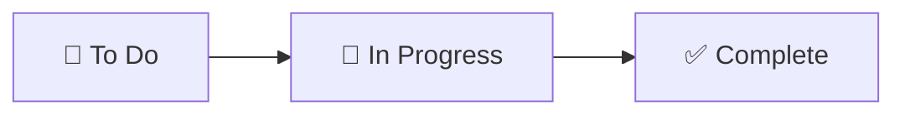
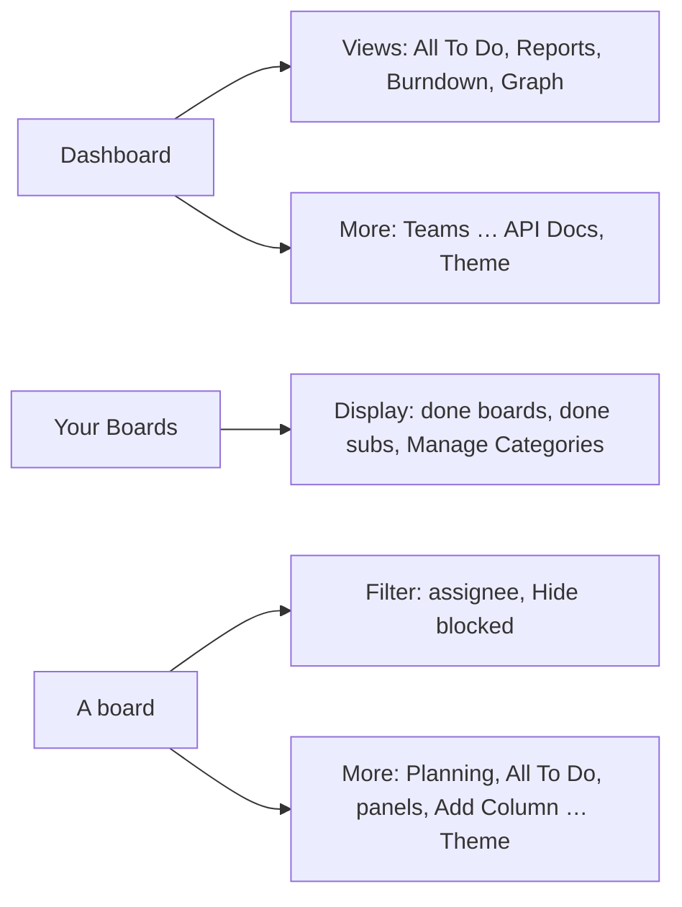
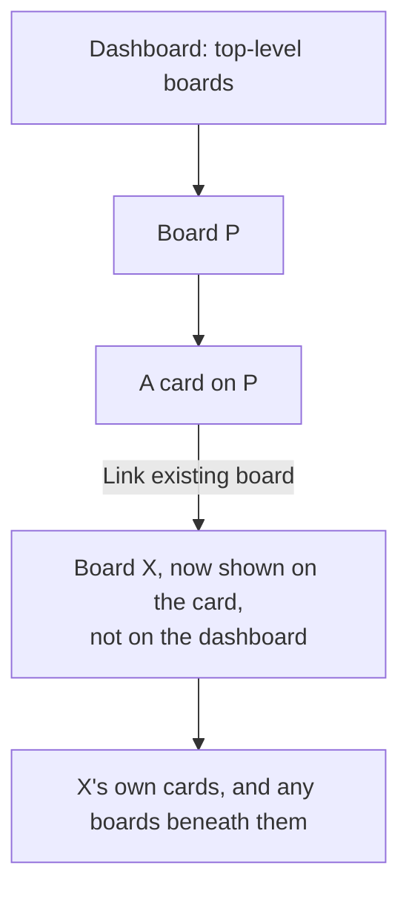
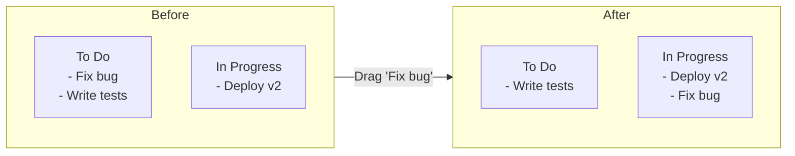
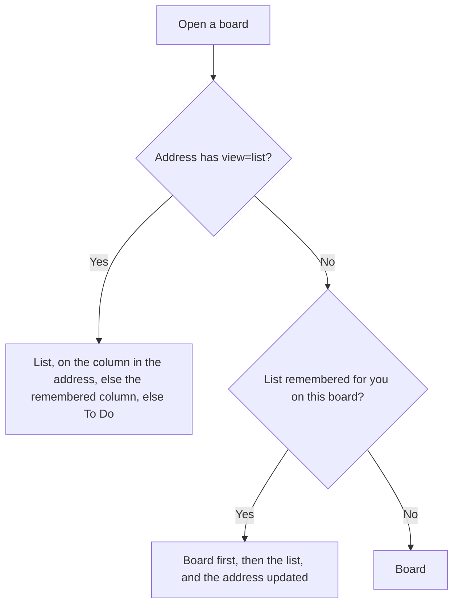
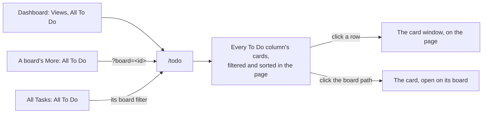
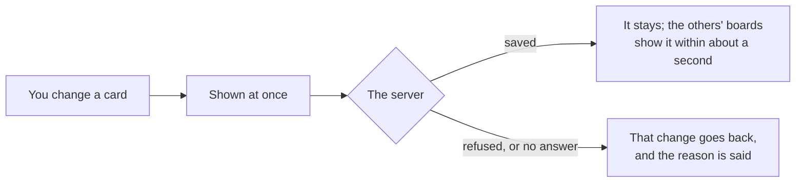
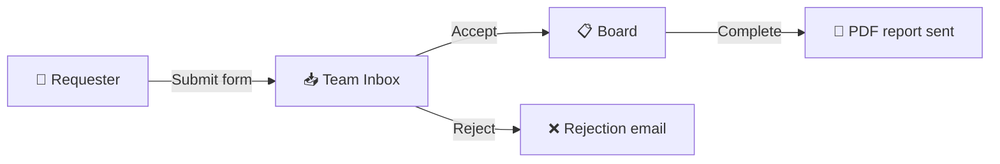
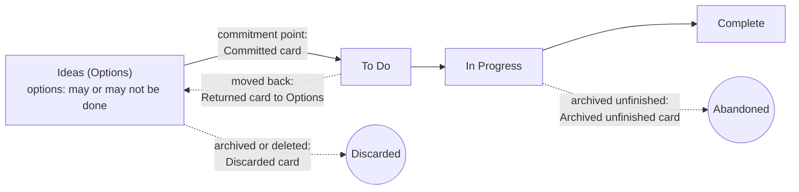
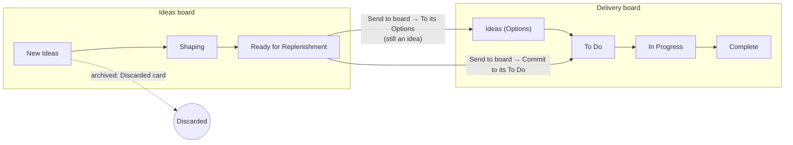

# DumpFire — Feature Overview

DumpFire is a self-hosted Kanban board for teams that want fast, visual task management without third-party subscriptions. This guide covers every feature from a user's perspective.

## What Is DumpFire?

DumpFire is a digital task board. Think of it as a wall of sticky notes on your screen — you create cards for tasks, organise them into columns, and drag them from left to right as work progresses.

Unlike Trello, Jira, or Monday.com, DumpFire runs on **your own server**. Your data never leaves your network.

---

## Core Features

### Boards

Boards are your workspaces. Each board has columns that represent stages of work.

- **Create unlimited boards** — one per project, team, or sprint
- **Emoji icons** — personalise each board with an emoji
- **Board categories** — group related boards together. You see a group that holds a board you can open, or one with no board in it yet, such as one you have just made
- **Sub-boards** — create a board inside a card for detailed breakdowns
- **Public boards** — make a board visible to all users
- **Favourites** — star boards for quick access from the dashboard
- **Your dashboard figures are yours** — the assigned, active, overdue and due-soon counts, Upcoming Deadlines, the trends and Recent Activity cover only boards you can open. When you are taken off a board, its cards and your past actions on it leave them

### The Header Bars

The dashboard's and each board's header keep what you use every minute in view, and put the rest one click away in a menu (from 26 October 2026; until then every control sat in the bar).

- **The dashboard** — **All Tasks**, **Inbox** (with how many requests wait), **Planning** and **+ New Board** are always shown. **Views** holds **All To Do**, **Reports**, **Burndown** and **Graph**. **More** holds **Teams**, **Archived**, **Admin** and **Audit & Logs** (for administrators), **Request**, **API Docs** and the theme. On a phone or narrow window (under 640 px) All Tasks, Inbox and Planning leave the bar and are listed first in Views, and the inbox count shows on the Views button instead. Every menu opens wholly on the screen, moved in from the edge where it would not fit.
- **Your Boards** — **Display**, beside the title, holds the **done boards** and **done subs** switches and **Manage Categories**. A small dot on the button means a switch is not at its usual setting (done boards hidden, or done sub-boards shown).
- **A board** — on the left the way back, the board's emoji and name and what it has cost; in the middle the search; on the right **Board | List**, **Filter** and **More**. **Filter** holds the assignee filter and **Hide blocked**; its button says how many are on ("Filter · 2"), so a board showing fewer cards says why. **More** holds **Planning** and **All To Do** for this board, the Activity Log, Statistics and Archived Cards panels, **Add Column**, **Burndown**, **Manage Categories**, **Bulk Select**, **Share Board**, **Delete Sub-board** (on a sub-board) and the theme. The XP bars are no longer shown on a board: they are the XP Leaderboard on the dashboard's sidebar.
- **From the keyboard** — every menu opens with Enter, Space or the down arrow, the arrow keys move between its items, Escape closes it and puts you back on its button, and Tab moves on. A click anywhere else closes it.

### Cards

Cards are your tasks. Each card sits in a column and can be enriched with detail.

| Feature | Description |
|---------|-------------|
| **Title and description** | Rich text descriptions with Markdown support: headings, lists, task lists, tables, code blocks, links, emphasis and pictures, and plain HTML such as `
` or `<kbd>`. Some things are never drawn, because a description is shown to everyone who opens the card: styles, the page's own classes, forms and buttons, dialogs and pop-ups, image maps, SVG and maths markup. A picture attached to a card shows as itself, written as its path (`/api/cards/1/attachments/2`) or as its full address on this DumpFire; any other picture, from another site or from any other address on DumpFire, shows as a link reading 🖼 and its description, which opens the address, so nothing is fetched from another site, and no other DumpFire address is called as the reader, as the card opens. What was written is kept exactly as written; only what is drawn changes (15 October 2026) |
| **Priority levels** | Critical, High, Medium, Low — colour-coded badges |
| **Due dates** | Set deadlines with visual overdue warnings. A due date is a calendar day, read in your own time zone: a card's or a subtask's due-date badge reads due today on that day wherever you are, and overdue from the next day (from 19 October 2026: it read a day early west of UTC, a subtask showed as overdue on its own due day, and in the UK the week before the October clock change counted one day too many). The dashboard's overdue and due-soon counts and which cards its Upcoming Deadlines lists are counted from your own day too, so they agree with the badges (from 19 October 2026: they were worked out on the server's day, UTC, and near midnight could be a day out; for an instant as the dashboard first appears they still show the UTC day's figures, then change). A report's Overdue figure counts from the day where it is made: the Reports page sends your browser's time zone, and a scheduled report uses its schedule's zone, whose days its PDF also prints its period in, as its mail does. A report's Due Date column prints the day set. A goal's target date is read the same way, on the plan list, the goal's plan page and the plan PDF: it shows the date it was set wherever you are, reads "today" on that day, and turns late ("1d over", the "overdue" tag) only from the day after it, while work remains (from 19 October 2026: west of UTC it read a day early and turned late on the target day itself) |
| **Labels** | Tag cards with coloured labels for filtering. Labels are made and changed in the card window, on any saved card: click a label to put it on or take it off, "+ New label" makes one with a name and a colour and puts it on the card, and "Edit labels" renames, recolours or deletes one. A delete asks first, since it takes the label off every card on the board. A new card gets its labels once it is saved, but for a card made from a template: the New Task window lists the template's labels that are labels of the board under "Labels from the template", and they are put on the card once it is created. One deleted since the template was saved is left out. A label that cannot be put on is said in a message, and the card is kept; one deleted while the window was open is named "a label of the template that no longer exists". A new card the server does not make is said in a message, in the server's words, and the New Task window stays open with what was typed |
| **Categories** | Classify cards by a category of their own board, or by a shared one that belongs to no board. The card window offers no other board's: on a board's page it offers those two kinds, and in All Tasks the card's board's own; a card already filed under another board's category keeps it until it is changed, and still shows its name. Lists of categories, Manage Categories among them, show the categories of boards you can open and the shared ones |
| **Colour tags** | Set through the API (`colorTag`, a colour written `#rrggbb`); shown as a bar across the top of the card on the All Tasks page. The card window has no control for one, and a save there keeps it: until 15 October 2026 a save on a board or the plan page cleared it |
| **Card ID** | Every card displays a unique `#N` identifier for easy reference. A number is never given to a second card, even after the first is deleted |
| **Attachments** | Attach files of up to 25 MB to a card. PNG, JPEG, GIF and WebP images show as thumbnails on the card and open in the browser; every other attachment, PDFs included, is saved to disk |
| **Card covers** | A strip of colour across the top of the card, on the board and in the card window, to make a card stand out. Pick one of eight gradients or eight colours, or any colour of your own, under More options on a saved card. The custom colour opens on the cover's own colour, or a gradient's first colour (from 20 October 2026: for a gradient it opened on black) |
| **The card window** | Opened from a card on the board, All Tasks, All To Do or a plan page. **Save sends only what you changed in it**, wherever the window was opened, so a change someone else made to the same card while your window was open is kept; a field you both changed is the last save's. Until 20 October 2026 this was so on a board's page alone, and a save from All Tasks, All To Do or a plan page sent every field back, undoing a colleague's change to any of them. A save with nothing changed closes the window, saves nothing and says nothing. A save that does change something shows on the card at once, on a board, All Tasks and All To Do. There, too, a field you have not changed shows the card as it is now, someone else's changes arriving as the page reads them, except the box you are typing in, which takes them once you leave it; a field you changed stays as you typed it and is what Save sends, even when you set it back to what it was and someone else changed it meanwhile. On every one of these pages a save the server refuses, or that gets no answer, keeps the window open with what you typed and says why (or that no answer came, so the card may not have been saved), and only what that save changed goes back. A plan page used to say "Card updated" whatever came back, and close the window. On a board, a card someone else archives or deletes while its window is open says "This card is no longer on this board." and saving it sends nothing. **Ctrl+Enter** (Cmd+Enter on a Mac) saves the window, as its footer says; in the comment box it posts the comment, in a comment being edited it saves the edit, and in a label, sub-board or new category name box it makes that, as Enter does there, without saving the window. A second Ctrl+Enter, or a second click on Create, while a save is on its way does nothing. **Escape** closes the open dialog, dropdown, picker or form in the window (the dependency search among them), and the window itself only when nothing is open in it, and not while a save is on its way; Cancel and ✕ always close (all from 20 October 2026) |
| **Business value** | Document why this task matters |
| **Duplicate** | Right-click a card and choose Duplicate: a copy, its subtasks open, is added at the end of the same column. The copy of a finished card is new work, so it goes to the end of To Do (the board's first column that is not Complete or Done) instead, and the message says where: `Duplicated "Fix bug (Copy)" into To Do` |
| **Templates** | **Save as Template**, on a saved card, keeps its title, description, priority, subtasks and labels under a name. **From template**, in the New Task window, fills the window from one; its labels are put on the card once it is created |
| **Pin to top** | Keep important cards at the top of a column |
| **On-hold notes** | Add a reason when putting a task on hold. The note is cleared when the card leaves On Hold for a column that is not a hold column, however it is moved; it stays on a move to another hold column (Hold, Blocked, Parked or Waiting). Empty the note in the card window to clear it by hand |

### Subtasks

Break large tasks into smaller steps:
- Checkbox-style completion tracking
- A title, description, priority, due date and completion per subtask. The subtask window offers no colour: the one it offered was stored and shown nowhere, so it was taken out (card 2185). A colour set through the API is kept and returned, and shown nowhere
- Progress bar shows completion percentage on the card
- **Completion guard** — prevents moving a card to "Complete" if subtasks remain open
- **Every change is recorded** — ticking a subtask shows in the board's activity panel and on the Audit page as "Completed subtask", and since card 2299 unticking one ("Reopened …") and editing its title, description, priority or due date ("Updated …: title, dueDate") show as "Updated subtask". A Save in the subtask window that changed nothing records nothing and refreshes no other open page. Changing a subtask's place in the list is not recorded

### Sub-boards

A card can have a whole board beneath it, for work too large for a list of subtasks. Open the card and, under **Sub-board**, either create a new board there or choose **Link existing board** to put one of your boards beneath the card.

- **Linking asks first.** The confirmation says what changes: the board is shown on the card instead of on the dashboard, so its members who cannot open the board the card is on no longer see it on theirs; those who can open the board the card is on see it on the card only if they can open the linked board too; its cards are in that board's reports only when whoever downloads, sends or schedules the report can open the linked board too, and whoever they send it to gets what that person can see; that board's editors can move the card, taking the linked board with it; the card cannot be completed while the linked board has cards that are not complete; and the linked board is deleted for good, with everything on it, if the card, its column or the board the card is on is ever deleted for good.
- **Who may link a board.** The board's owner or an administrator. The owner is whoever created the board; someone shared as Owner before 14 October 2026 keeps that role and may link it too, but no screen can make anyone an owner now. A board with no owner, such as one whose creator was deleted, can be linked only by an administrator. Whoever links it must also be able to edit the board the card is on. An editor of a board cannot put it beneath another board's card, because that would hand its deletion to that board's editors. The list offers only the boards you may link, so an editor who owns no other board does not see the button.
- **No loops.** A board cannot go beneath a card on itself or on one of its own sub-boards; DumpFire refuses it and says why.
- **A card cannot be moved onto its own sub-board**, or onto a board beneath one: its sub-boards go with it, so they would hang beneath themselves, on no dashboard, and the card could never be completed. DumpFire refuses the move and says why, in All Tasks' Move window and through the API, and the card stays where it was. A board left beneath one of its own cards by a move made before this was refused still opens, its path showing the loop once round, and the server names it in the system log at every start until it is put right: see [Admin Operations Guide](admin-guide.md#a-board-beneath-one-of-its-own-cards).
- **You see only the sub-boards you can open.** A sub-board is a board of its own: being able to open the board above it does not open it. One you were not given is not shown on its card, in the card's window or on the dashboard, and is not counted in your dashboard figures. Completing its card is still refused while the sub-board has open cards.
- **At most 20 levels deep.** A sub-board can be at most 20 levels below a board that is not a sub-board. Making one deeper, linking a board there or moving a card whose sub-boards would go deeper is refused, and DumpFire says so on the board page, in All Tasks' Move window and through the API (card 2172). A tree made deeper before then keeps working, and can be moved or linked higher.
- **The path at the top of a sub-board** names each board above it, the nearest 20 at most, with "…" before them when there are more. One you cannot open is shown as "🔒 A board you cannot open", with no link; Delete Sub-board is still offered.
- **Archived cards are not counted.** A sub-board's progress, on the card, in its window, on the plan page and on the dashboard, counts the cards that are not archived, and how many of them are in Complete. A card is held back only by those that are not archived and not in Complete, so archiving a card on a sub-board, rather than finishing it, no longer stops its parent from being completed. Restoring an archived card under a card already complete leaves that card complete, as adding a new card to its sub-board does. Until 14 October 2026 the board page and the completion check counted archived cards too, and a card held back only by archived ones could not be completed.
- **A refusal is said in DumpFire's words**, and "Board linked as sub-board" appears only once it is saved. Until 14 October 2026 the button said the board was linked and nothing was saved.

### Dependencies

A card's window lists what the card is **Blocked by** and what it **Blocks**. Either end can be a card or a subtask, on this board or another.

- **A row's link opens that card**, on this board or another, in place of the card whose window was open. Until 14 October 2026 a link to a card on the board already open, or to a card on another board, changed the address and opened no card. **Back** afterwards closes the card that link opened; and going to another board, by any link or by Back, closes a card window that was open, so one board's card is never left open over another board.
- **A subtask reads as one.** A row for a subtask reads "subtask #45 of #12", and its link opens card 12, the card the subtask belongs to. Removing it removes that link and no other.
- **Every change is recorded.** Adding or removing one dependency, in the card window or through the API, shows in the board's activity panel and on the Audit page; both activity panels, the board's and All Tasks', name it "Added dependency" or "Removed dependency" whichever way it was done. A batch through the bulk endpoint records each link it creates in the same way, one "Added dependency" on the card that waits, on that card's board (card 2291: it wrote one "Added dependencies" entry for the whole batch, on the first board it touched only), and the links that go when a card is deleted write none of their own. A goal's changes are recorded too (card 2289; none was): putting a card in a goal or taking it out, from the card window's picker, the plan page or the API, shows as "Added card to milestone" or "Removed card from milestone" on the card's board, and renaming a goal, changing its description, target date or board, closing, reopening or deleting it shows as "Updated milestone", "Closed milestone", "Reopened milestone" or "Deleted milestone" on the goal's board (for a goal across boards, on each board holding its cards, which reads it as "milestone #id", since not every reader there can open it). A save on the plan page that changed nothing records nothing. A deleted goal's 🎯 chip leaves every open board at once.
- **Not counted as work.** The activity report does not take a dependency added or removed, or a card put in a goal or taken out, to be work on the card, or the work of whoever did it.
- **Work on a board you cannot open is not named.** A card that waits on a card of a board you were not given still shows as blocked, and the other end is listed as "A card on a board you cannot open", with no link and no board or column: on the Blocked chip, in the card window, on All Tasks and on the plan. You can still remove the link.

### Drag and Drop

Move cards between columns by dragging them. Everything updates in real-time for all users viewing the board.

A drop the server refuses, a blocked drop into Complete and Cancel in the On Hold window put the card back at once, without waiting for the board to be read again, and a refused drop says why; nothing on the board moves while the blocked window is open. When a card is taken through several columns with the keyboard, a hop that is refused, blocked or cancelled puts the card back in the column it was in before that hop. A card dragged into On Hold is moved first, and its note written only once it has moved, so a refused move writes no note; a note refused after the move is said, and the note window stays open with the note, to try again. A column dragged to a new place that the server refuses goes back to where it was (all from 20 October 2026).

### Bulk Actions

Select multiple cards with checkboxes and apply actions in bulk:
- **Bulk move** — move selected cards to any column
- **Bulk archive** — archive selected cards. They can be restored from Archived Cards
- **Bulk priority** — change priority of all selected cards

A bulk priority or archive changes every selected card on screen at once. The cards the server refuses go back, stay selected, and how many and the first reason are said; the rest stay changed (from 20 October 2026: bulk priority cleared the selection and said nothing).

### Search & Filtering

Filter cards in real time using the search bar:
- **Text search** — matches card titles, descriptions, categories, and assignee names
- **Card ID search** — type `#221` to jump to card 221 instantly
- **Assignee filter** — filter cards by assigned team member, under the board's **Filter** menu, beside **Hide blocked**; the button counts the filters on
- **Sub-boards on All Tasks** — the search on All Tasks covers the cards of every sub-board you can open, at any depth. Choosing a board in its filter also shows the cards of that board's sub-boards, and choosing a category also shows the sub-boards under that category's boards, unless a sub-board has a category of its own. In the filter, each sub-board is listed under its parent when you can open that parent and it is in the same group, indented ("↳"; past eight levels the indent stops and the arrow gives the depth, "↳ 12"). A board whose category has been deleted is listed under Uncategorized, with the sub-boards beneath it. A sub-board whose parent you cannot open, or whose parent is in another group, is listed at the top of its group, and choosing the board above still takes in its cards. A sub-board made by someone else is shown only if you can open it: it does not come with the board above it
- **What a chosen board covers elsewhere** — with a board chosen in the All Tasks filter, Export to CSV, Planning and Statistics still cover that board alone, while the list also shows its sub-boards' cards; pointing at those buttons says so
- **Where a card lives** — on All Tasks, each card's board tag names the boards above its board, from the top level down ("📋 DumpFire › 🗂️ Search fixes"), cut short with "…" when long, with the whole path when you point at it. Boards above it that you cannot open are shown as one "…", with no name and no count

### List View

A second way to look at a board, made for a portrait monitor: one column at a time across the full width, with room for each card's summary and description.

- **Switching** — the **Board | List** control at the start of the board header's right-hand buttons. Board is the usual side-by-side columns; List is the one-column view. On a phone the control shows its icons only.
- **Opens on To Do, most urgent first** — the list opens on the column titled "To Do" (or "Todo"), or the first column if there is none. The cards are in priority order: pinned cards first, then critical, high, medium and low, keeping the board's order within each priority. **Board order** beside it shows the column exactly as the board does.
- **Choosing a column** — a strip of the board's columns above the list, each with its card count ("shown/total" while a filter is on, as the board's column headers say it). It wraps onto a second line when narrow. Choosing a column starts its list at the top; if the column shown is deleted, the list moves to To Do at once.
- **What a row shows** — the title in full, the card's summary (the plain-English line written for reports), up to five lines of its description, and one line with Blocked, milestone, priority, category, assignees, age, due date, subtasks done and cost. In On Hold, the hold note. Labels and sub-boards are in the card window.
- **What a row does** — click it (or Tab to its title and press Enter or Space) to open the card; with Bulk Select on, a click selects it. Right-click opens the same menu as on the board, where **Move to** moves the card to another column. Cards are not dragged or reordered in the list, because the order on screen is not the board's stored order.
- **Filters** — the header's search, and the assignee filter and Hide blocked under its **Filter** menu, apply to the list too; a card that does not match is left out of it. Live updates from other people appear as they do on the board.
- **Remembered** — the choice (board or list, the column, and the order) is remembered for you and for that board, in this browser (in a private window, until it is closed). Another person signing in on the same browser has their own. Nothing is remembered with site data blocked; the control still works there.
- **Bookmarking** — while the list is shown the address ends `?view=list&column=<id>`, so a portrait monitor can bookmark its list and open straight into it.

### All To Do

One table of every card waiting to be started, across every board you can open: the cards in each board's **To Do** column, and nothing else (card 2240).

- **What it lists** — the cards in every column titled "To Do" or "Todo" (any capitals, spaces round it ignored), on every board and sub-board you can open, exactly the cards All Tasks shows under To Do. A board with two such columns has both listed. In Progress, On Hold, Complete and archived cards are left out.
- **A board with no To Do column** is not given one: its cards are not listed under another column's name. The header says how many boards have none ("2 boards have no To Do column"); opening that line lists them, each a link to its board. Renaming a column to To Do brings its cards in.
- **The three ways in** — **All To Do** under the dashboard's **Views** menu; **All To Do** in every board's **More** menu, after Planning, which opens the page filtered to that board and its sub-boards; and **All To Do** on All Tasks, beside Planning, which carries the board or grouping chosen there.
- **The table** — title, priority, board, category, labels, assignees, due date, subtasks done, milestone and Blocked. Where it is wider than the window (from 1000 px to about 1400 px) it scrolls sideways inside its own box, which the arrow keys scroll once it has the focus, and long titles wrap. Click a column's heading to sort by it, click it again to reverse it; a card with no value sorts last either way. Unsorted, the most urgent come first, then the soonest due, then board name, then the board's own order. Pinned cards are not put first here (a pin shows on the row), so sorting by due date sorts by due date. Labels and assignees do not sort, as a card can have several.
- **The filters** — board (with its sub-boards, or a whole grouping, as on All Tasks), priority, category, label, assignee (Anyone, Me, Unassigned or a person), milestone (or No milestone), Blocked or Startable, and a search that finds `#123` exactly, or words in the id, title, description, category or an assignee's name. A category or label is chosen by name, so "Bug" on five boards is one choice. The header reads "n of N cards" while a filter is on, and **Clear filters** puts them back (to the board the page was opened for, when it came from a board).
- **The address keeps the filters** — every filter and the sort are in the address a moment after you change them, so a filtered view can be bookmarked or sent, and **Back** from a board or a plan opened from the page comes back to it with the same filters. **Me** means whoever opens the link. A board in the address that you cannot open, or that does not exist, is dropped with the same notice either way: "The board in the address is not one you can open"; so is a grouping that holds none of your boards. If the chosen board stops being one you can open while the page is open, the page goes back to every board with the same notice.
- **A row opens the card here** — clicking a row (or its title) opens the card window over the table, to edit or archive it, and the filters, sort and place in the list are kept. The board path on a row opens the card on its own board instead; the milestone opens its plan. A card leaves To Do from its board: there is no Move window here.
- **Live** — a card moved, added or edited anywhere appears, changes or leaves within a moment, the filters kept.
- **On a phone or narrow window** (under 1000 px) — each row becomes a block: the title and priority, then the board path, then the rest as small chips, empty ones left out. The filters fold behind **Filters (n)**, n being how many are on; the search box stays in view, and the sort is chosen there since there are no headings to click. Nothing scrolls sideways.
- **Empty pages say why** — no boards yet; no board with a To Do column; the chosen board (and its sub-boards) has no To Do column; the chosen board or grouping has nothing in To Do ("<board> has nothing in To Do"), with **Show every board**; every board's To Do column empty ("Nothing to do: every To Do column is empty", said only with every board chosen); or no card matching the filters, with Clear filters beside it.

---

## Collaboration

### Teams

Create teams and add members. Share boards with entire teams at once instead of individually.

### Board Sharing

Share boards with specific permissions:

| Role | What they can do |
|------|-----------------|
| **Owner** | Everything — create, edit, delete, manage sharing. The board's creator is its owner. No share makes anyone else one: the share window offers Owner only on a row already stored as owner, which keeps it |
| **Editor** | Create and edit cards, move cards between columns |
| **Viewer** | View the board only — no changes allowed |

The share window lists every user and every team by name, so a board can be shared with anyone. Email addresses are shown only where you may see them: an administrator sees everyone's, and the board's owner sees those of the people the board is already shared with.

The share window also tells the board's owner and an administrator about the board's webhooks (card 2329). A webhook is sent only while the person who set it up can open the board, so removing them, or a team they are in, can stop it. ✕ on such a person or team asks first: "Removing Sam stops 1 webhook they set up on this board: nothing is sent to it until they can open the board again, or someone takes it over.", with **Remove** and **Cancel**; ✕ on anyone else removes them at once. Above the list, the window says how many of the board's webhooks send nothing now, whatever stopped them (a person taken out of a team, the board made private, an administrator made an ordinary user, a webhook with no recorded setter), and where to read why: `GET /api/v1/boards/{id}/webhooks` with an API key, whose `pausedBecause` says why each is held and how to take it over. Editors and viewers see neither.

Making a public board private can stop webhooks too: those set up by someone who can open the board only because it is public (card 2385). The switch then asks first: "Making this board private stops 1 webhook set up by an account that can open it only because it is public: nothing is sent to it until that account can open the board again, or someone takes it over.", with **Make Private** and **Cancel**. Otherwise it switches at once, as before. After the switch, as after any share added, changed or removed, the window reads its list again, so the count of webhooks that send nothing is up to date at once.

### Assignees

Assign one or more team members to any card. Assignees receive email notifications when their cards are updated.

### Comments

Discuss tasks directly on cards:
- **@mentions** — tag team members to get their attention: write `@` and the username as it is spelled, in any case (`@Greg`, `@jane.doe`, `@Jane Doe`). The name is the longest username the text after the `@` begins with, so `@jane.doe` never reaches `jane`, and an `@` inside a word, as in an email address, is not a mention (card 2207). A mention is drawn as a chip wherever it is in the comment's text, in code and in a link's text too, because whoever is named there is mailed; never inside a link's address, its tooltip or a picture's description. An email address in a comment is a working link
- **Markdown support** — format comments with bold, code, lists, as a description is formatted, with the same rules for what is drawn
- **Email notifications** — mentioned users who can open the card's board receive email alerts, which each can switch off under **Mentions** on My Account. Someone named on a board they cannot open is not mailed (card 2198). The card window draws chips only for the people of the card's own board, from the board, the plan, All Tasks and All To Do alike, so a chip shows who is mailed; on a public board, someone who is not one of its people is mailed without a chip. Only the first 200 mentions written in a comment are read, so a mention after them mails nobody and has no chip

### Real-Time Updates

All changes appear instantly for everyone viewing the same board. No need to refresh — when someone moves a card, you see it move live. Assigning or unassigning someone, editing a comment, renaming a board or filing it under a group, and making a sub-board under a card reach the other open pages too, whether done on a page or through the API.

**A change on a board shows at once and stays** (from 20 October 2026). Before, the board reloaded itself twice after every change, and a change could flicker back. Now other people's changes arrive within about a second, a burst of them, such as a bulk change of 20 cards, as one, and never in the middle of a drag. A change that is refused says why, in the server's words, and only that change goes back: renaming a card on the board itself, pinning, a priority changed from its dot, a card's menu or the bulk bar, the card menu's Move to, the completion prompt (which stays open with what was typed), adding and deleting categories, which show once the server has taken them (a refused one keeps its name in the box), dragging cards and columns, the board's name and emoji, and a column's colour, WIP limit and Add Task switch. Before, these looked saved until the page was reloaded. "Moved to …", "Pinned", "Priority → …", "WIP limit set" and "Title updated" are said only once the change is made. Two quick changes to the same thing keep the later one, and Escape in a card's title edit on the board no longer saves it. A board you lose access to, or that is deleted, while you have it open shows the refusal page at its next refresh.

**All Tasks refreshes once for a burst of changes** (from 20 October 2026). A bulk change of 20 cards on any board is 20 changes, sent one after another; All Tasks used to reload itself 20 times for them, and now reloads a few times, about once a second while the change lasts and a quarter of a second after the last, not once per card. Each new card and each move still shows its own notice and plays its sound, and a completion still sets off its fireworks first.

A board page listens to the board it shows. Following a sub-board, a breadcrumb or a link in a card's window to another board, or going Back or Forward to one, opens that board's page afresh, listening to that board: no selection, open panel, search or filter is carried over from the board left. Until 14 October 2026 the page went on listening to the first board, so the second showed nothing done by others until it was reloaded.

A page left open while DumpFire is updated to a new version says so within about a minute, in a bar across the foot of the window: "DumpFire has been updated. Save anything you are editing, then reload to use the new version." It never reloads by itself, so nothing typed is lost; **Reload** loads the new version, and so does the next page opened from it.

---

## Task Requests

External stakeholders can submit task requests without needing a DumpFire account.

- **Public request form** — anyone with the link can submit. A request from someone without an account is passed to the team once they confirm it from an email sent to the address they gave
- **Choosing a board is optional** — someone without an account sends a request to a person or a team and is not shown any board; whoever accepts the request chooses the board and column. A signed-in requester may pick one of the boards they can open, or leave it to the team
- **Private conversation link** — each request has its own secret link, emailed to the requester; it is the only way in without an account
- **Conversation thread** — back-and-forth messaging between requester and team. A message is at most 5,000 characters, and the box stops there. A message that is not sent says why, under the box in the inbox and above it on the requester's reply page, and keeps what was typed to send again; a conversation that could not be read says so where its messages would be, on either page
- **Saying what went wrong in the inbox** — an Accept or a Reject that is refused (a column not on the board, a request someone else has already answered) says why in its own window, which stays open with what was chosen and typed, and a request someone else has already answered leaves the Pending list; an inbox or a conversation that could not be read says so where it would be, in place of "No requests" or "No messages yet"
- **Progress emails** — requesters get email updates as work progresses. A requester with an account can switch them off under **Request Progress** on My Account
- **Completion report** — a PDF is automatically generated and emailed when the task is finished

---

## Reporting

### On-Demand Reports

Generate PDF reports for any board, category, or the entire system. Reports include:
- Executive summary with key metrics — cards and tasks (cards + subtasks) shown side by side, the same figures as the dashboard's All Tasks row
- Priority breakdown
- Assignee performance stats
- Completed work first, then the outstanding task lists
- Where the boards have ideas, an **Upstream** line: ideas now and how old the oldest is, ideas committed, returned and discarded, sent to other boards, and the discard rate; and an **Abandoned** line for committed work archived before Complete, which any board can have. Ideas are in none of the other figures. A report about one person leaves both out and says so, since they describe the boards rather than anyone's work

A report is its reader's: it takes in the sub-boards beneath its boards that the person asking for it can open, and none they cannot, and names a board's parent only when they can open that too. A report emailed by hand is the sender's, and a scheduled one its owner's as their account stands at each run; every recipient gets that same report. A sub-board shared with someone without its parent board is in their Reports page's board list, to report on by itself.

Use the **Include** filter to choose what the report lists:
- **All work** — completed in the period first, then everything still open
- **Completed only** — just what was finished in the period
- **In Progress only** — open cards that have left To Do (including On Hold and Review)
- **To Do only** — cards not yet started

### Scheduled Reports

Set up automatic weekly or monthly reports delivered to up to 10 email addresses each, any addresses, with up to 20 schedules an account. Each schedule remembers its own detail level and Include filter. A schedule is sent at a time of day written `HH:MM` (09:00 when it is left empty), on a day of the week or a day of the month from 1 to 28, and each recipient must be an email address: one that is not is refused when the schedule is saved, and when a report is emailed by hand, rather than left out. The recipients may be put one to a line, or separated by commas, `;` or spaces, as in the report's email dialog; each address is sent one mail, once, and a schedule saves them separated by commas. A report emailed by hand goes to up to 10 addresses at a time, and one account's report mail reaches at most 100 addresses a day (24 hours from its first), the schedules it makes, turns on or re-times, and the addresses a change of a schedule's list adds, included. Every report mail names the account that sent it or set it up (card 2182). A report's period must not end before it begins.

### Charts

- **Burndown & burn-up charts** — for any board, several boards, a board group, a milestone or everything, narrowed by category, label, assignee or priority; with work in play, an ideal line to the target date, a forecast (dated on a single board; across several boards the time to deliver is the one finish date) and a time-to-deliver estimate (likely and 85% dates, and the chance of hitting a target). Every figure explains itself on hover. Full page at `/burndown`, a compact chart in board Statistics, and a panel on every milestone plan. See [Burndown Charts](burndown-charts.md)
- **Cumulative Flow Diagram** — visualise workload distribution across columns. On a board with an Options column the ideas are left out, unless **Show upstream** is ticked above the chart: it draws them as the bottom band, with its top edge marked **commitment point**, and each person's choice is remembered in their own browser. A column made the Options column during the 30 days is left out with its band, earlier days included, until Show upstream is ticked
- **Delivery metrics** — in board Statistics: **Lead time (commitment to done)**, from when a card was committed to until it reached Complete (Complete is the delivery point, so customer and system lead time are the same here); **cycle time**, the time from start of work to done, never longer than the lead time (a card created straight into a working column has none); **Throughput** beside **Committed (all)**, the cards that arrived as committed work; **Abandoned**, committed work archived before Complete, when there is any; and on a board with an Options column, the upstream figures (see [The Options Column](#the-options-column)). An ideas board's Statistics show its ideas, the upstream figures and the flow diagram only

### Graph View

An interactive, Neo4j-style knowledge graph showing how boards, cards, columns, and users connect across the entire workspace.

- **Force-directed layout** — nodes arrange themselves naturally based on relationships
- **Lazy-load expansion** — click any board node to reveal its cards and columns
- **Pan, zoom, and drag** — navigate the graph like a map
- **Colour-coded nodes** — boards (purple), cards (cyan), columns (amber), users (green)
- **Hover tooltips** — see entity details without clicking

---

## Gamification

### XP System

Completing a card earns XP for the user who moved it into a Complete (or Done)
column, or who created it in one. The amount depends on the card's priority:

| Card priority | XP Earned |
|---------------|-----------|
| Low | +50 XP |
| Medium | +100 XP |
| High | +150 XP |
| Critical | +200 XP |

XP is awarded **once per card**, the first time it is ever completed, and the same
way however the card was moved — dragged on the board, moved from the All Tasks
page or the card modal, or moved through the API. Moving a card back out of
Complete and in again earns nothing. A card added straight to a Complete column (with the
column's **+**, through the API, or by accepting a task request into it) is completed as it
is created, and its creator earns the XP then.

### Levelling

Every 500 XP earns a new level. Each person's level, XP and progress to the next level are shown in the **XP Leaderboard** on the dashboard's sidebar, highest first, kept current as cards are completed anywhere. Until 26 October 2026 they were shown in every board's header instead; a board no longer shows them, and the XP gained still shows in the celebration.

### Celebrations

🎆 When a card is moved into, or created in, a Complete (or Done) column, a **fireworks celebration** plays on screen for all users viewing the board.

---

## Customisation

### 16 Built-In Themes

Chosen from the Theme list, each theme by its icon and name, at the foot of the **More** menu on the dashboard and on a board, or from the theme button on the other pages. The choice is kept in your browser.

| Theme | Style |
|-------|-------|
| Light | Clean white default |
| Dark | Premium dark mode |
| Solarized | Classic Solarized palette |
| Coffee | Warm beige light |
| Rose | Soft pink light |
| Cappuccino | Rich brown dark |
| Midnight | Deep indigo dark |
| Ocean | Blue marine dark |
| Forest | Earthy green light |
| Lavender | Soft purple light |
| Sunset | Warm orange dark |
| Nord | Cool arctic dark |
| Dracula | Iconic purple dark |
| Monokai | Warm code editor dark |
| Cherry | Rich crimson dark |
| Arctic | Icy blue-white light |
| Hacker | Green-on-black terminal |

### Sound Effects

Audio feedback for card actions:
- **Pop** — card moved between columns
- **Chime** — task completed
- **Sparkle** — new card created
- **Swoosh** — notification received

### Column Customisation

- **WIP limits** — set maximum cards per column with visual warnings
- **Colour coding** — customise column header colours. A colour stored before 15 October 2026 that is not a plain colour is shown grey until a new one is picked; every other colour looks as it did. A column's, a label's, a category's or a board group's is fixed by picking a colour in its own colour picker. A card's or a subtask's colour tag has no control on the page, so it is fixed through the API: with the tracking wrapper, `update-card` or `update-subtask` with `-ColorTag '#rrggbb'`, quoted, or `-ColorTag none` to clear it. Renaming any of them sends the old colour back unchanged and keeps it, grey or not
- **Add Card button** — toggle quick-add on specific columns; the choice is saved with the column. A column called "To Do" or "Todo", in any capitals and with any space around the name, always has it, with the double-click to add a card, as All Tasks already treats such columns (from 20 October 2026: "Todo" did not; "To-Do" is not one)
- **Reorderable** — drag columns to rearrange
- **Renaming keeps what the cards mean** — a column called Complete or Done is where finished work lives. While it holds any card, archived ones included, it can be renamed only to Complete or Done, and a column that holds cards cannot be renamed Complete or Done: the cards would turn back into open work, or be finished without anyone finishing them. The board says why and keeps the old name. An empty column can be renamed to anything

### The Options Column

From 26 October 2026 (milestone 22), a board can keep ideas apart from the work it has committed to, as the Kanban Method does: ideas that may or may not be done (options) on one side, committed work on the other, and the **commitment point** between them. Nothing changes on any board until somebody adds an Options column.

- **One per board, at the far left.** **More → Add Options Column**, offered to anyone who can edit the board, adds a column called **Ideas**; its header reads **Ideas (Options)**. It has no WIP limit, always offers **Add idea**, and no column can be put left of it.
- **Collapsed to a strip.** It is drawn as a narrow strip showing how many ideas it holds, how old the oldest is, and how many are older than 30 days, so stale ideas are seen. A press opens it; each person's choice is remembered in their own browser. Cards can still be dragged onto the strip.
- **Making an existing column the Options column.** For the board's owner and administrators, a column's menu offers **Make this the Options column…** where its name does not already mean To Do, On Hold or Complete. A column with cards in it is converted after a question that counts its cards: they all become ideas in one step, recorded as one entry in the activity log, with no mail, and their age as ideas starts then. It can be made an ordinary column again, from the same menu, once it is empty.
- **Kept safe.** An Options column cannot be deleted while it holds ideas: the board says so at once; move them out, or archive them to discard them, first. Every card created from now on records when it was committed and by whom, which later updates use for lead time.
- **Moving an idea out commits it.** Dragging a card out of the Options column into any other column, or moving it there from the card's menu, a bulk Move, All Tasks or the API, commits it: the card records when and by whom, and its activity reads **Committed card** instead of a move. Whichever way it was moved on a page (a drag, putting it on hold, the card menu's **Move to**, a bulk **Move** or All Tasks' **Move** window), a toast says `Committed "<title>"`, in place of "Moved to …". Moving a committed card back into the Options column makes it an idea again, its commitment cleared: the toast says `Returned "<title>" to Options` and the activity **Returned card to Options**. Every **Move to** list marks the Options column "(Options)". An idea can go straight to Complete; an idea that turns out not to be needed is better archived. Moves between committed columns, and between ideas, change nothing about the commitment.
- **Two moves are refused.** An archived card cannot be moved out of or back into Options: restore it first. A committed card with sub-boards does not go back into the Options column: it is committed work, so keep it in a committed column, or archive it if it is no longer wanted.
- **Archiving or deleting an idea discards it.** An idea archived from the Options column, by any way of archiving a card (the card window, the card menu, a bulk archive or the API), is **discarded**: the card records when and by whom, its activity reads **Discarded card**, and the Archived page, All Tasks' Archived Cards and the board's Archived Cards mark it **Discarded**. The board says so as it happens: the archive's question ends "This idea will be recorded as discarded.", the toast reads `Discarded "<title>"`, and a bulk archive counts the ideas among the cards it archived; All Tasks' card window says the same. Restoring it brings it back to the Options column as an idea, its discard cleared; the activity says it is back in its column. Deleting an idea for good is a discard too; deleting a card already archived is not. Deleting a whole column or board, clearing a board or purging the archive discards nothing.
- **Archiving unfinished work abandons it.** A committed card archived before it reached Complete is recorded as **Archived unfinished card** in the activity log, instead of Archived card, so work dropped part way is not lost from view. Archiving finished work, from a column called Complete or Done, still reads **Archived card**; a last column called anything else, such as Released or Shipped, counts as unfinished.
- **Ideas are in none of the figures.** Every count of work leaves them out: board Statistics (its totals, average age and bars, with a line of their own, `Options N · discard rate X%`), the board's delivery metrics and flow diagram, burndown, the dashboard's board rows (a board with ideas says on its count that they are not counted), All Tasks' total (its ideas are one **Options** column, first, marked **not committed**), goals and reports. Lead time and aging run from when a card was committed, so the time a card spent as an idea is not counted against delivery. Board Statistics shows, for a board with an Options column, the **upstream figures**: Committed from options, Options now, Returned to options, Discarded, Sent to other boards, Discard rate, Oldest option (days), Options over 30 days and Time in options. A goal lists its ideas apart ("3/5 and 2 options"); its plan marks each **Option** and never offers one as startable, though one still holds up what waits on it. Both CSV exports still list ideas, marked **Option** in a new **Stage** column (Option or Committed), with **Committed** after it, both at the end. Boards with no Options column show the same figures as before.

### Ideas Boards

From 26 October 2026 (milestone 22, card 2463), a board can be an **ideas board**: a board of ideas only, none of them committed to yet, whose ideas are sent on to the delivery boards that will do them. Every board made before is a delivery board, and stays one.

- **Making one.** **New Board** on the dashboard asks for the kind: **Delivery board**, as every board has been, with To Do, On Hold, In Progress and Complete; or **Ideas board**, with **New Ideas**, **Shaping** and **Ready for Replenishment**. A sub-board is always a delivery board. The header of an ideas board says **Ideas board** beside its name.
- **Every card is an idea.** Every column of an ideas board works as an Options column does: it always offers **Add idea**, and shows how old its oldest idea is and how many are older than 30 days. A WIP limit can still be set, on Ready for Replenishment for example, as a replenishment queue. There is no Options strip, no Complete column, no burndown and no delivery figures: its Statistics show how many ideas it holds, the upstream figures and its flow diagram. An ideas board has no column called To Do, On Hold or Complete (or Todo, Blocked, Parked, Done and the like): such a name is refused. A column holding ideas cannot be deleted until they are moved out, or archived, which discards them. No sub-board can be made under an idea, nor under an idea in a delivery board's Options column: the card's menu and card window offer none, and the dashboard offers no New Sub-board on an ideas board.
- **Send to board.** An idea is sent on with **Send to board…**, in the card's menu and its card window, offered for any idea: on an ideas board, or in a delivery board's Options column; never for committed work, which is moved. It lists the delivery boards you can edit, and sends the idea **To its Options**, still an idea, or **Commit to its To Do**, which commits to it (into the first column called To Do, or the first working column; never On Hold). A board with no Options column offers To Do only, and a card with a sub-board is never sent into another board's Options. Sent from a card window with changes not saved, it asks first. The idea leaves the board, keeps its age as an idea, and a toast says `Sent "<title>" to <board>'s Options` (or To Do), with `Committed "<title>"` for To Do. Its labels, category and goal stay behind, as with any move to another board. The board it left records **Sent card to another board**; so does any other move of an idea to another board, so the discard rate and "Sent to other boards" count every way an idea leaves.
- **Turning a board into an ideas board.** For the board's owner and administrators, a delivery board that is not a sub-board offers **More → Make this an ideas board…**. It counts the board's cards, live and archived, and asks first: they all become ideas in one step, recorded as one entry in the activity log (**Converted board to an ideas board**), with no mail, and their commitments are cleared; its empty To Do, On Hold and Complete columns go. A board with no cards at all has its columns replaced with the ideas board's. The board says at once, before asking, when it cannot: a live card with a sub-board (an archived one is refused once asked), or a To Do or On Hold column holding cards (rename it first), or a Complete column holding cards (move or delete them first).
- **Going back.** An ideas board becomes a delivery board again with **More → Make this a delivery board…**, only while it holds no cards, live or archived; its columns are then replaced with To Do, On Hold, In Progress and Complete. While it holds any, the board says so.

### Using Options Well

Three habits keep the figures honest (the whole feature, with its rules, is in [Upstream Kanban](upstream-kanban.md)):

- **Park ideas in Options, not in On Hold.** On Hold is for committed work that is paused, and every figure counts it as committed work, its age included. An idea parked there looks like work going stale, and makes the lead time longer when it is finally done.
- **Archive an idea that is not needed; do not complete it.** Moving an idea straight to Complete is allowed, for one that was done there and then, but it then counts as finished work in throughput, lead time and the burndown. An idea that turned out not to be needed is archived, which records it as discarded and counts it in the discard rate.
- **Moving work back into Options changes past burndowns.** The burndown is worked out from each card as it is now, so a card returned to Options leaves the scope of every earlier day as well, and a chart already shared will read differently. Return a card to Options only when nobody is committed to it any more.

---

## Administration

### User Management

- **Roles**: Superadmin, Admin, and User
- **Invite via email** — send password-set links to new users
- **Emoji avatars** — each user chooses their own emoji identity

### Automated Backups

- Schedule backups hourly, every 6h, 12h, daily, or weekly
- Push to **SFTP**, **Amazon S3**, **Google Drive**, or **OneDrive**
- Retention limits automatically delete old backups
- Failure alerts via email
- A backup holds the database. Attachment files are kept in a folder on the server, which your administrator backs up separately

### Archive Management

- **Soft delete** — archived cards can be restored at any time, and come back exactly as they were: subtasks, comments, attachments, dependencies and sub-boards included
- **Permanent delete** — remove cards forever when needed. The card's subtasks, comments, dependencies and sub-boards go with it, and the confirmation says so before anything is deleted
- **Deleting a column deletes its cards** — for good, not to the archive. Move the cards first if you want to keep them
- **A 30-day safety net for files** — the attachment files of deleted cards are kept for 30 days, so restoring a backup within that time brings the attachments back too
- **Admin purge** — bulk-delete all archived cards at once
- **All or nothing** — a delete either happens completely or not at all. If something goes wrong part of the way through, nothing is deleted and the page says so

### SMTP Configuration

Configure email sending from the Admin panel. Test with a single click.

---

## API Access

DumpFire has a full REST API for automation:
- **API keys** — generate and manage from your account
- **81 operations** — boards, cards, subtasks, assignees, and more
- **Rate limited** — 60 requests/minute per key
- **Every field checked** — a field the API cannot use is refused with a `400` that names it, before anything is written: a priority it does not know, a date not written `YYYY-MM-DD`, text where a number belongs
- **A key sees what its user sees** — lists, dependencies and plans leave out, or show as "on a board you cannot open", what is on boards the key's user cannot open; a webhook's address and secret are given only to the board's owner and administrators
- **PowerShell, Python, curl** examples included

Common integrations:
- CI/CD pipelines creating task cards
- Monitoring tools auto-creating incident cards
- Chat bots reading and updating task status
- Custom dashboards pulling board data

---

## Data Ownership

| Aspect | DumpFire | SaaS alternatives |
|--------|----------|-------------------|
| **Data location** | Your server | Their cloud |
| **Data access** | Full database access | API-limited |
| **Backup control** | You choose where | Vendor-decided |
| **Subscription** | None — self-hosted | Monthly per user |
| **Feature limits** | Unlimited everything | Often tiered |
| **Uptime** | You control it | Subject to outages |
