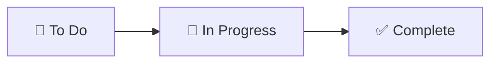
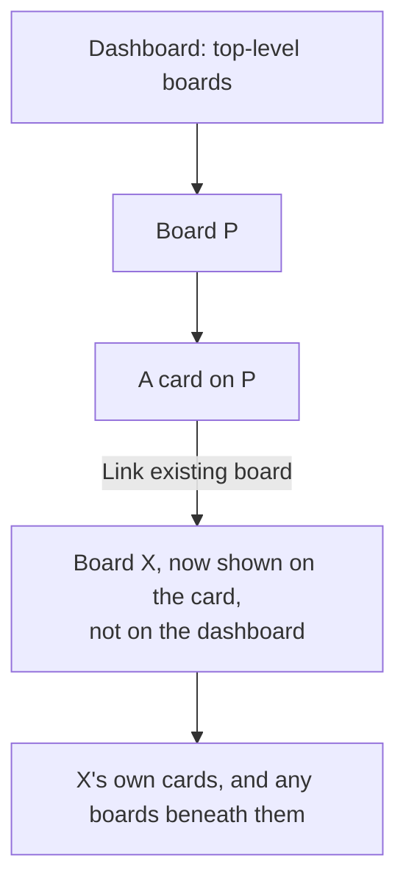
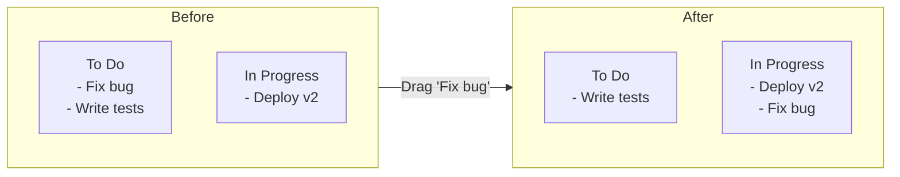
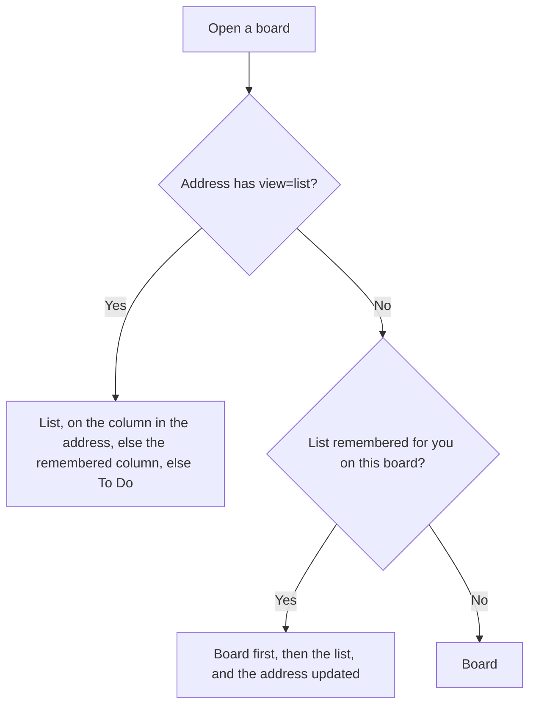
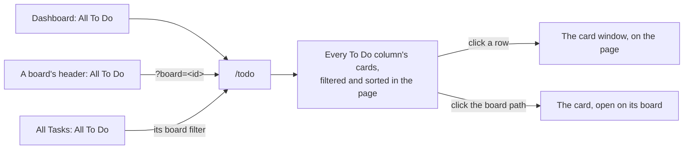
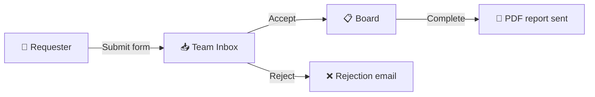

# DumpFire — Feature Overview

DumpFire is a self-hosted Kanban board for teams that want fast, visual task management without third-party subscriptions. This guide covers every feature from a user's perspective.

## What Is DumpFire?

DumpFire is a digital task board. Think of it as a wall of sticky notes on your screen — you create cards for tasks, organise them into columns, and drag them from left to right as work progresses.

Unlike Trello, Jira, or Monday.com, DumpFire runs on **your own server**. Your data never leaves your network.

---

## Core Features

### Boards

Boards are your workspaces. Each board has columns that represent stages of work.

- **Create unlimited boards** — one per project, team, or sprint
- **Emoji icons** — personalise each board with an emoji
- **Board categories** — group related boards together. You see a group that holds a board you can open, or one with no board in it yet, such as one you have just made
- **Sub-boards** — create a board inside a card for detailed breakdowns
- **Public boards** — make a board visible to all users
- **Favourites** — star boards for quick access from the dashboard
- **Your dashboard figures are yours** — the assigned, active, overdue and due-soon counts, Upcoming Deadlines, the trends and Recent Activity cover only boards you can open. When you are taken off a board, its cards and your past actions on it leave them

### Cards

Cards are your tasks. Each card sits in a column and can be enriched with detail.

| Feature | Description |
|---------|-------------|
| **Title and description** | Rich text descriptions with Markdown support: headings, lists, task lists, tables, code blocks, links, emphasis and pictures, and plain HTML such as `
` or `<kbd>`. Some things are never drawn, because a description is shown to everyone who opens the card: styles, the page's own classes, forms and buttons, dialogs and pop-ups, image maps, SVG and maths markup. A picture attached to a card shows as itself, written as its path (`/api/cards/1/attachments/2`) or as its full address on this DumpFire; any other picture, from another site or from any other address on DumpFire, shows as a link reading 🖼 and its description, which opens the address, so nothing is fetched from another site, and no other DumpFire address is called as the reader, as the card opens. What was written is kept exactly as written; only what is drawn changes (15 October 2026) |
| **Priority levels** | Critical, High, Medium, Low — colour-coded badges |
| **Due dates** | Set deadlines with visual overdue warnings |
| **Labels** | Tag cards with coloured labels for filtering. Labels are made and changed in the card window, on any saved card: click a label to put it on or take it off, "+ New label" makes one with a name and a colour and puts it on the card, and "Edit labels" renames, recolours or deletes one. A delete asks first, since it takes the label off every card on the board. A new card gets its labels once it is saved, but for a card made from a template: the New Task window lists the template's labels that are labels of the board under "Labels from the template", and they are put on the card once it is created. One deleted since the template was saved is left out. A label that cannot be put on is said in a message, and the card is kept; one deleted while the window was open is named "a label of the template that no longer exists". A new card the server does not make is said in a message, in the server's words, and the New Task window stays open with what was typed |
| **Categories** | Classify cards by a category of their own board, or by a shared one that belongs to no board. The card window offers no other board's: on a board's page it offers those two kinds, and in All Tasks the card's board's own; a card already filed under another board's category keeps it until it is changed, and still shows its name. Lists of categories, Manage Categories among them, show the categories of boards you can open and the shared ones |
| **Colour tags** | Set through the API (`colorTag`, a colour written `#rrggbb`); shown as a bar across the top of the card on the All Tasks page. The card window has no control for one, and a save there keeps it: until 15 October 2026 a save on a board or the plan page cleared it |
| **Card ID** | Every card displays a unique `#N` identifier for easy reference. A number is never given to a second card, even after the first is deleted |
| **Attachments** | Attach files of up to 25 MB to a card. PNG, JPEG, GIF and WebP images show as thumbnails on the card and open in the browser; every other attachment, PDFs included, is saved to disk |
| **Card covers** | A strip of colour across the top of the card, on the board and in the card window, to make a card stand out. Pick one of eight gradients or eight colours, or any colour of your own, under More options on a saved card |
| **Business value** | Document why this task matters |
| **Duplicate** | Right-click a card and choose Duplicate: a copy, its subtasks open, is added at the end of the same column. The copy of a finished card is new work, so it goes to the end of To Do (the board's first column that is not Complete or Done) instead, and the message says where: `Duplicated "Fix bug (Copy)" into To Do` |
| **Templates** | **Save as Template**, on a saved card, keeps its title, description, priority, subtasks and labels under a name. **From template**, in the New Task window, fills the window from one; its labels are put on the card once it is created |
| **Pin to top** | Keep important cards at the top of a column |
| **On-hold notes** | Add a reason when putting a task on hold. The note is cleared when the card leaves On Hold for a column that is not a hold column, however it is moved; it stays on a move to another hold column (Hold, Blocked, Parked or Waiting). Empty the note in the card window to clear it by hand |

### Subtasks

Break large tasks into smaller steps:
- Checkbox-style completion tracking
- A title, description, priority, due date and completion per subtask. The subtask window offers no colour: the one it offered was stored and shown nowhere, so it was taken out (card 2185). A colour set through the API is kept and returned, and shown nowhere
- Progress bar shows completion percentage on the card
- **Completion guard** — prevents moving a card to "Complete" if subtasks remain open

### Sub-boards

A card can have a whole board beneath it, for work too large for a list of subtasks. Open the card and, under **Sub-board**, either create a new board there or choose **Link existing board** to put one of your boards beneath the card.

- **Linking asks first.** The confirmation says what changes: the board is shown on the card instead of on the dashboard, so its members who cannot open the board the card is on no longer see it on theirs; those who can open the board the card is on see it on the card only if they can open the linked board too, but that board's reports, scheduled ones included, take in its cards for all of them; that board's editors can move the card, taking the linked board with it; the card cannot be completed while the linked board has cards that are not complete; and the linked board is deleted for good, with everything on it, if the card, its column or the board the card is on is ever deleted for good.
- **Who may link a board.** The board's owner or an administrator. The owner is whoever created the board; someone shared as Owner before 14 October 2026 keeps that role and may link it too, but no screen can make anyone an owner now. A board with no owner, such as one whose creator was deleted, can be linked only by an administrator. Whoever links it must also be able to edit the board the card is on. An editor of a board cannot put it beneath another board's card, because that would hand its deletion to that board's editors. The list offers only the boards you may link, so an editor who owns no other board does not see the button.
- **No loops.** A board cannot go beneath a card on itself or on one of its own sub-boards; DumpFire refuses it and says why.
- **A card cannot be moved onto its own sub-board**, or onto a board beneath one: its sub-boards go with it, so they would hang beneath themselves, on no dashboard, and the card could never be completed. DumpFire refuses the move and says why, in All Tasks' Move window and through the API, and the card stays where it was. A board left beneath one of its own cards by a move made before this was refused still opens, its path showing the loop once round, and the server names it in the system log at every start until it is put right: see [Admin Operations Guide](admin-guide.md#a-board-beneath-one-of-its-own-cards).
- **You see only the sub-boards you can open.** A sub-board is a board of its own: being able to open the board above it does not open it. One you were not given is not shown on its card, in the card's window or on the dashboard, and is not counted in your dashboard figures. Completing its card is still refused while the sub-board has open cards.
- **At most 20 levels deep.** A sub-board can be at most 20 levels below a board that is not a sub-board. Making one deeper, linking a board there or moving a card whose sub-boards would go deeper is refused, and DumpFire says so on the board page, in All Tasks' Move window and through the API (card 2172). A tree made deeper before then keeps working, and can be moved or linked higher.
- **The path at the top of a sub-board** names each board above it, the nearest 20 at most, with "…" before them when there are more. One you cannot open is shown as "🔒 A board you cannot open", with no link; Delete Sub-board is still offered.
- **Archived cards are not counted.** A sub-board's progress, on the card, in its window, on the plan page and on the dashboard, counts the cards that are not archived, and how many of them are in Complete. A card is held back only by those that are not archived and not in Complete, so archiving a card on a sub-board, rather than finishing it, no longer stops its parent from being completed. Restoring an archived card under a card already complete leaves that card complete, as adding a new card to its sub-board does. Until 14 October 2026 the board page and the completion check counted archived cards too, and a card held back only by archived ones could not be completed.
- **A refusal is said in DumpFire's words**, and "Board linked as sub-board" appears only once it is saved. Until 14 October 2026 the button said the board was linked and nothing was saved.

### Dependencies

A card's window lists what the card is **Blocked by** and what it **Blocks**. Either end can be a card or a subtask, on this board or another.

- **A row's link opens that card**, on this board or another, in place of the card whose window was open. Until 14 October 2026 a link to a card on the board already open, or to a card on another board, changed the address and opened no card. **Back** afterwards closes the card that link opened; and going to another board, by any link or by Back, closes a card window that was open, so one board's card is never left open over another board.
- **A subtask reads as one.** A row for a subtask reads "subtask #45 of #12", and its link opens card 12, the card the subtask belongs to. Removing it removes that link and no other.
- **Every change is recorded.** Adding or removing one dependency, in the card window or through the API, shows in the board's activity panel and on the Audit page; both activity panels, the board's and All Tasks', name it "Added dependency" or "Removed dependency" whichever way it was done. The bulk endpoint writes one `api:dependencies_bulk_added` entry for the whole batch, "Added dependencies", on the first board it touched only, and the links that go when a card is deleted write none of their own.
- **Not counted as work.** The activity report does not take a dependency added or removed to be work on the card, or the work of whoever added or removed it.
- **Work on a board you cannot open is not named.** A card that waits on a card of a board you were not given still shows as blocked, and the other end is listed as "A card on a board you cannot open", with no link and no board or column: on the Blocked chip, in the card window, on All Tasks and on the plan. You can still remove the link.

### Drag and Drop

Move cards between columns by dragging them. Everything updates in real-time for all users viewing the board.

### Bulk Actions

Select multiple cards with checkboxes and apply actions in bulk:
- **Bulk move** — move selected cards to any column
- **Bulk archive** — archive selected cards. They can be restored from Archived Cards
- **Bulk priority** — change priority of all selected cards

### Search & Filtering

Filter cards in real time using the search bar:
- **Text search** — matches card titles, descriptions, categories, and assignee names
- **Card ID search** — type `#221` to jump to card 221 instantly
- **Assignee filter** — filter cards by assigned team member
- **Sub-boards on All Tasks** — the search on All Tasks covers the cards of every sub-board you can open, at any depth. Choosing a board in its filter also shows the cards of that board's sub-boards, and choosing a category also shows the sub-boards under that category's boards, unless a sub-board has a category of its own. In the filter, each sub-board is listed under its parent when you can open that parent and it is in the same group, indented ("↳"; past eight levels the indent stops and the arrow gives the depth, "↳ 12"). A board whose category has been deleted is listed under Uncategorized, with the sub-boards beneath it. A sub-board whose parent you cannot open, or whose parent is in another group, is listed at the top of its group, and choosing the board above still takes in its cards. A sub-board made by someone else is shown only if you can open it: it does not come with the board above it
- **What a chosen board covers elsewhere** — with a board chosen in the All Tasks filter, Export to CSV, Planning and Statistics still cover that board alone, while the list also shows its sub-boards' cards; pointing at those buttons says so
- **Where a card lives** — on All Tasks, each card's board tag names the boards above its board, from the top level down ("📋 DumpFire › 🗂️ Search fixes"), cut short with "…" when long, with the whole path when you point at it. Boards above it that you cannot open are shown as one "…", with no name and no count

### List View

A second way to look at a board, made for a portrait monitor: one column at a time across the full width, with room for each card's summary and description.

- **Switching** — the **Board | List** control at the start of the board header's right-hand buttons. Board is the usual side-by-side columns; List is the one-column view. On a phone the control shows its icons only.
- **Opens on To Do, most urgent first** — the list opens on the column titled "To Do" (or "Todo"), or the first column if there is none. The cards are in priority order: pinned cards first, then critical, high, medium and low, keeping the board's order within each priority. **Board order** beside it shows the column exactly as the board does.
- **Choosing a column** — a strip of the board's columns above the list, each with its card count ("shown/total" while a filter is on, as the board's column headers say it). It wraps onto a second line when narrow. Choosing a column starts its list at the top; if the column shown is deleted, the list moves to To Do at once.
- **What a row shows** — the title in full, the card's summary (the plain-English line written for reports), up to five lines of its description, and one line with Blocked, milestone, priority, category, assignees, age, due date, subtasks done and cost. In On Hold, the hold note. Labels and sub-boards are in the card window.
- **What a row does** — click it (or Tab to its title and press Enter or Space) to open the card; with Bulk Select on, a click selects it. Right-click opens the same menu as on the board, where **Move to** moves the card to another column. Cards are not dragged or reordered in the list, because the order on screen is not the board's stored order.
- **Filters** — the header's search, assignee filter and Hide blocked apply to the list too; a card that does not match is left out of it. Live updates from other people appear as they do on the board.
- **Remembered** — the choice (board or list, the column, and the order) is remembered for you and for that board, in this browser (in a private window, until it is closed). Another person signing in on the same browser has their own. Nothing is remembered with site data blocked; the control still works there.
- **Bookmarking** — while the list is shown the address ends `?view=list&column=<id>`, so a portrait monitor can bookmark its list and open straight into it.

### All To Do

One table of every card waiting to be started, across every board you can open: the cards in each board's **To Do** column, and nothing else (card 2240).

- **What it lists** — the cards in every column titled "To Do" or "Todo" (any capitals, spaces round it ignored), on every board and sub-board you can open, exactly the cards All Tasks shows under To Do. A board with two such columns has both listed. In Progress, On Hold, Complete and archived cards are left out.
- **A board with no To Do column** is not given one: its cards are not listed under another column's name. The header says how many boards have none ("2 boards have no To Do column"); opening that line lists them, each a link to its board. Renaming a column to To Do brings its cards in.
- **The three ways in** — **All To Do** on the dashboard, after All Tasks; **All To Do** in every board's header, after Planning, which opens the page filtered to that board and its sub-boards; and **All To Do** on All Tasks, beside Planning, which carries the board or grouping chosen there.
- **The table** — title, priority, board, category, labels, assignees, due date, subtasks done, milestone and Blocked. Where it is wider than the window (from 1000 px to about 1400 px) it scrolls sideways inside its own box, which the arrow keys scroll once it has the focus, and long titles wrap. Click a column's heading to sort by it, click it again to reverse it; a card with no value sorts last either way. Unsorted, the most urgent come first, then the soonest due, then board name, then the board's own order. Pinned cards are not put first here (a pin shows on the row), so sorting by due date sorts by due date. Labels and assignees do not sort, as a card can have several.
- **The filters** — board (with its sub-boards, or a whole grouping, as on All Tasks), priority, category, label, assignee (Anyone, Me, Unassigned or a person), milestone (or No milestone), Blocked or Startable, and a search that finds `#123` exactly, or words in the id, title, description, category or an assignee's name. A category or label is chosen by name, so "Bug" on five boards is one choice. The header reads "n of N cards" while a filter is on, and **Clear filters** puts them back (to the board the page was opened for, when it came from a board).
- **The address keeps the filters** — every filter and the sort are in the address a moment after you change them, so a filtered view can be bookmarked or sent, and **Back** from a board or a plan opened from the page comes back to it with the same filters. **Me** means whoever opens the link. A board in the address that you cannot open, or that does not exist, is dropped with the same notice either way: "The board in the address is not one you can open"; so is a grouping that holds none of your boards. If the chosen board stops being one you can open while the page is open, the page goes back to every board with the same notice.
- **A row opens the card here** — clicking a row (or its title) opens the card window over the table, to edit or archive it, and the filters, sort and place in the list are kept. The board path on a row opens the card on its own board instead; the milestone opens its plan. A card leaves To Do from its board: there is no Move window here.
- **Live** — a card moved, added or edited anywhere appears, changes or leaves within a moment, the filters kept.
- **On a phone or narrow window** (under 1000 px) — each row becomes a block: the title and priority, then the board path, then the rest as small chips, empty ones left out. The filters fold behind **Filters (n)**, n being how many are on; the search box stays in view, and the sort is chosen there since there are no headings to click. Nothing scrolls sideways.
- **Empty pages say why** — no boards yet; no board with a To Do column; the chosen board (and its sub-boards) has no To Do column; the chosen board or grouping has nothing in To Do ("<board> has nothing in To Do"), with **Show every board**; every board's To Do column empty ("Nothing to do: every To Do column is empty", said only with every board chosen); or no card matching the filters, with Clear filters beside it.

---

## Collaboration

### Teams

Create teams and add members. Share boards with entire teams at once instead of individually.

### Board Sharing

Share boards with specific permissions:

| Role | What they can do |
|------|-----------------|
| **Owner** | Everything — create, edit, delete, manage sharing. The board's creator is its owner. No share makes anyone else one: the share window offers Owner only on a row already stored as owner, which keeps it |
| **Editor** | Create and edit cards, move cards between columns |
| **Viewer** | View the board only — no changes allowed |

The share window lists every user and every team by name, so a board can be shared with anyone. Email addresses are shown only where you may see them: an administrator sees everyone's, and the board's owner sees those of the people the board is already shared with.

### Assignees

Assign one or more team members to any card. Assignees receive email notifications when their cards are updated.

### Comments

Discuss tasks directly on cards:
- **@mentions** — tag team members to get their attention. A mention is drawn as a chip wherever it is in the comment's text, in code and in a link's text too, because whoever is named there is mailed; never inside a link's address, its tooltip or a picture's description. An email address in a comment is a working link
- **Markdown support** — format comments with bold, code, lists, as a description is formatted, with the same rules for what is drawn
- **Email notifications** — mentioned users receive email alerts, which each can switch off under **Mentions** on My Account

### Real-Time Updates

All changes appear instantly for everyone viewing the same board. No need to refresh — when someone moves a card, you see it move live. Assigning or unassigning someone, editing a comment, renaming a board or filing it under a group, and making a sub-board under a card reach the other open pages too, whether done on a page or through the API.

A board page listens to the board it shows. Following a sub-board, a breadcrumb or a link in a card's window to another board, or going Back or Forward to one, opens that board's page afresh, listening to that board: no selection, open panel, search or filter is carried over from the board left. Until 14 October 2026 the page went on listening to the first board, so the second showed nothing done by others until it was reloaded.

A page left open while DumpFire is updated to a new version says so within about a minute, in a bar across the foot of the window: "DumpFire has been updated. Save anything you are editing, then reload to use the new version." It never reloads by itself, so nothing typed is lost; **Reload** loads the new version, and so does the next page opened from it.

---

## Task Requests

External stakeholders can submit task requests without needing a DumpFire account.

- **Public request form** — anyone with the link can submit. A request from someone without an account is passed to the team once they confirm it from an email sent to the address they gave
- **Choosing a board is optional** — someone without an account sends a request to a person or a team and is not shown any board; whoever accepts the request chooses the board and column. A signed-in requester may pick one of the boards they can open, or leave it to the team
- **Private conversation link** — each request has its own secret link, emailed to the requester; it is the only way in without an account
- **Conversation thread** — back-and-forth messaging between requester and team
- **Progress emails** — requesters get email updates as work progresses. A requester with an account can switch them off under **Request Progress** on My Account
- **Completion report** — a PDF is automatically generated and emailed when the task is finished

---

## Reporting

### On-Demand Reports

Generate PDF reports for any board, category, or the entire system. Reports include:
- Executive summary with key metrics — cards and tasks (cards + subtasks) shown side by side, the same figures as the dashboard's All Tasks row
- Priority breakdown
- Assignee performance stats
- Completed work first, then the outstanding task lists

Use the **Include** filter to choose what the report lists:
- **All work** — completed in the period first, then everything still open
- **Completed only** — just what was finished in the period
- **In Progress only** — open cards that have left To Do (including On Hold and Review)
- **To Do only** — cards not yet started

### Scheduled Reports

Set up automatic weekly or monthly reports delivered to up to 10 email addresses each, any addresses, with up to 20 schedules an account. Each schedule remembers its own detail level and Include filter. A schedule is sent at a time of day written `HH:MM` (09:00 when it is left empty), on a day of the week or a day of the month from 1 to 28, and each recipient must be an email address: one that is not is refused when the schedule is saved, and when a report is emailed by hand, rather than left out. The recipients may be put one to a line, or separated by commas, `;` or spaces, as in the report's email dialog; each address is sent one mail, once, and a schedule saves them separated by commas. A report emailed by hand goes to up to 10 addresses at a time, and one account's report mail reaches at most 100 addresses a day (24 hours from its first), the schedules it makes, turns on or re-times, and the addresses a change of a schedule's list adds, included. Every report mail names the account that sent it or set it up (card 2182). A report's period must not end before it begins.

### Charts

- **Burndown & burn-up charts** — for any board, several boards, a board group, a milestone or everything, narrowed by category, label, assignee or priority; with work in play, an ideal line to the target date, a forecast (dated on a single board; across several boards the time to deliver is the one finish date) and a time-to-deliver estimate (likely and 85% dates, and the chance of hitting a target). Every figure explains itself on hover. Full page at `/burndown`, a compact chart in board Statistics, and a panel on every milestone plan. See [Burndown Charts](burndown-charts.md)
- **Cumulative Flow Diagram** — visualise workload distribution across columns

### Graph View

An interactive, Neo4j-style knowledge graph showing how boards, cards, columns, and users connect across the entire workspace.

- **Force-directed layout** — nodes arrange themselves naturally based on relationships
- **Lazy-load expansion** — click any board node to reveal its cards and columns
- **Pan, zoom, and drag** — navigate the graph like a map
- **Colour-coded nodes** — boards (purple), cards (cyan), columns (amber), users (green)
- **Hover tooltips** — see entity details without clicking

---

## Gamification

### XP System

Completing a card earns XP for the user who moved it into a Complete (or Done)
column, or who created it in one. The amount depends on the card's priority:

| Card priority | XP Earned |
|---------------|-----------|
| Low | +50 XP |
| Medium | +100 XP |
| High | +150 XP |
| Critical | +200 XP |

XP is awarded **once per card**, the first time it is ever completed, and the same
way however the card was moved — dragged on the board, moved from the All Tasks
page or the card modal, or moved through the API. Moving a card back out of
Complete and in again earns nothing. A card added straight to a Complete column (with the
column's **+**, through the API, or by accepting a task request into it) is completed as it
is created, and its creator earns the XP then.

### Levelling

Every 500 XP earns a new level. Progress is shown in the board header.

### Celebrations

🎆 When a card is moved into, or created in, a Complete (or Done) column, a **fireworks celebration** plays on screen for all users viewing the board.

---

## Customisation

### 16 Built-In Themes

| Theme | Style |
|-------|-------|
| Light | Clean white default |
| Dark | Premium dark mode |
| Solarized | Classic Solarized palette |
| Coffee | Warm beige light |
| Rose | Soft pink light |
| Cappuccino | Rich brown dark |
| Midnight | Deep indigo dark |
| Ocean | Blue marine dark |
| Forest | Earthy green light |
| Lavender | Soft purple light |
| Sunset | Warm orange dark |
| Nord | Cool arctic dark |
| Dracula | Iconic purple dark |
| Monokai | Warm code editor dark |
| Cherry | Rich crimson dark |
| Arctic | Icy blue-white light |
| Hacker | Green-on-black terminal |

### Sound Effects

Audio feedback for card actions:
- **Pop** — card moved between columns
- **Chime** — task completed
- **Sparkle** — new card created
- **Swoosh** — notification received

### Column Customisation

- **WIP limits** — set maximum cards per column with visual warnings
- **Colour coding** — customise column header colours. A colour stored before 15 October 2026 that is not a plain colour is shown grey until a new one is picked; every other colour looks as it did. A column's, a label's, a category's or a board group's is fixed by picking a colour in its own colour picker. A card's or a subtask's colour tag has no control on the page, so it is fixed through the API: with the tracking wrapper, `update-card` or `update-subtask` with `-ColorTag '#rrggbb'`, quoted, or `-ColorTag none` to clear it. Renaming any of them sends the old colour back unchanged and keeps it, grey or not
- **Add Card button** — toggle quick-add on specific columns; the choice is saved with the column
- **Reorderable** — drag columns to rearrange
- **Renaming keeps what the cards mean** — a column called Complete or Done is where finished work lives. While it holds any card, archived ones included, it can be renamed only to Complete or Done, and a column that holds cards cannot be renamed Complete or Done: the cards would turn back into open work, or be finished without anyone finishing them. The board says why and keeps the old name. An empty column can be renamed to anything

---

## Administration

### User Management

- **Roles**: Superadmin, Admin, and User
- **Invite via email** — send password-set links to new users
- **Emoji avatars** — each user chooses their own emoji identity

### Automated Backups

- Schedule backups hourly, every 6h, 12h, daily, or weekly
- Push to **SFTP**, **Amazon S3**, **Google Drive**, or **OneDrive**
- Retention limits automatically delete old backups
- Failure alerts via email
- A backup holds the database. Attachment files are kept in a folder on the server, which your administrator backs up separately

### Archive Management

- **Soft delete** — archived cards can be restored at any time, and come back exactly as they were: subtasks, comments, attachments, dependencies and sub-boards included
- **Permanent delete** — remove cards forever when needed. The card's subtasks, comments, dependencies and sub-boards go with it, and the confirmation says so before anything is deleted
- **Deleting a column deletes its cards** — for good, not to the archive. Move the cards first if you want to keep them
- **A 30-day safety net for files** — the attachment files of deleted cards are kept for 30 days, so restoring a backup within that time brings the attachments back too
- **Admin purge** — bulk-delete all archived cards at once
- **All or nothing** — a delete either happens completely or not at all. If something goes wrong part of the way through, nothing is deleted and the page says so

### SMTP Configuration

Configure email sending from the Admin panel. Test with a single click.

---

## API Access

DumpFire has a full REST API for automation:
- **API keys** — generate and manage from your account
- **80 operations** — boards, cards, subtasks, assignees, and more
- **Rate limited** — 60 requests/minute per key
- **Every field checked** — a field the API cannot use is refused with a `400` that names it, before anything is written: a priority it does not know, a date not written `YYYY-MM-DD`, text where a number belongs
- **A key sees what its user sees** — lists, dependencies and plans leave out, or show as "on a board you cannot open", what is on boards the key's user cannot open; a webhook's address and secret are given only to the board's owner and administrators
- **PowerShell, Python, curl** examples included

Common integrations:
- CI/CD pipelines creating task cards
- Monitoring tools auto-creating incident cards
- Chat bots reading and updating task status
- Custom dashboards pulling board data

---

## Data Ownership

| Aspect | DumpFire | SaaS alternatives |
|--------|----------|-------------------|
| **Data location** | Your server | Their cloud |
| **Data access** | Full database access | API-limited |
| **Backup control** | You choose where | Vendor-decided |
| **Subscription** | None — self-hosted | Monthly per user |
| **Feature limits** | Unlimited everything | Often tiered |
| **Uptime** | You control it | Subject to outages |
