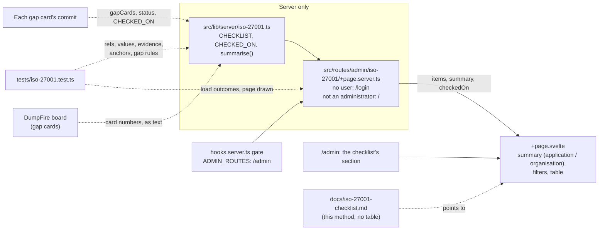
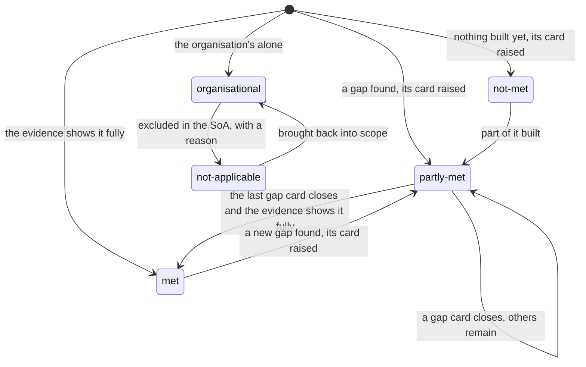
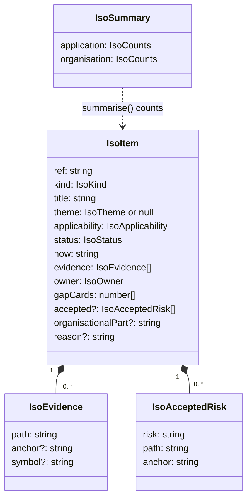
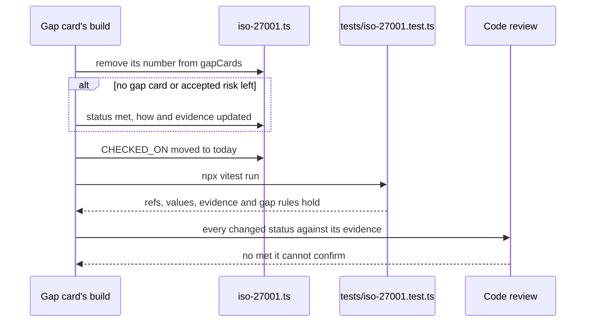

# ISO 27001 Checklist: Method

DumpFire keeps a checklist of ISO/IEC 27001:2022 for its administrators: every Annex A control
and clauses 4 to 10, each with how far DumpFire meets it, the evidence in the repository, and
the cards that close what is still open. **The checklist itself is the page,
`/admin/iso-27001`.** This document is its method. It holds no per-control rows and no counts,
so that there is one source, and so that the list of DumpFire's known weaknesses stays behind
DumpFire's own access control rather than in a document library (card 2670, plan D3).

## What it is, and what it is not

- **It is** the in-application half of the ISO register: what DumpFire, the software, does
  towards each control, checked against the code on the date the page shows.
- **It is not a certificate.** ISO/IEC 27001 certifies an organisation's information security
  management system (ISMS), not a piece of software. No application is "ISO 27001 compliant"
  on its own.
- **It is not the Statement of Applicability.** It is an input to it (clause 6.1.3 d): the
  organisation decides which controls apply, and why, in its own SoA.
- **It quotes no part of the standard but the titles.** The standard's text is copyrighted. Each
  item holds the control's or clause's title and our own words for how DumpFire meets it
  (plan D6). Read the standard itself for what each control asks.

## Architecture

The checklist is one typed module on the server. The page's load reads it, behind the gate and
an administrator check of its own, and the page draws it. A test guards the module's shape.
Every card that changes a control's status edits the module in its own commit.

### Where the page is, and who can see it

- **`/admin/iso-27001`**, linked from the **📋 ISO 27001:2022 Checklist** section of the admin
  page. Every administrator and the superadmin can read it. A plain user is sent home and
  somebody not signed in is sent to sign in, by the gate and again by the page's own load.
- **It is read-only.** The page writes nothing and fetches nothing. Its three filters (status,
  applicability, theme) are held in the page's own state, not the address.
- **The source is server-only** (plan D2). The checklist names DumpFire's known weaknesses and
  the files they are in. A module the page imported would be built into a script under
  `/_app/`, which anyone can fetch without signing in. Under `src/lib/server/`, SvelteKit
  refuses to build it into client code, so it reaches a browser only through the load.
- **Card numbers are text, never links.** The page ships in every installation, where those
  ids mean another card or nothing. They are the cards on the DumpFire board that builds
  DumpFire.

## Applicability

Each item has one of three:

- **`app`**: DumpFire itself implements the control, with nothing left for the organisation
  (for example secure authentication, information access restriction, information deletion).
  Owner `DumpFire`, and no `organisationalPart`.
- **`supports`**: DumpFire provides part of it and the organisation does the rest. Owner
  `DumpFire`, and the item must say, in `organisationalPart`, what the organisation must still
  do, so that "met" there can never be read as covering the whole control.
- **`organisational`**: the organisation's alone: the people and physical controls, most
  organisational controls, and every clause 4 to 10. Owner `the organisation`. Some of these
  name evidence DumpFire offers the organisation (the system log for evidence collection, the
  UTC timestamps for clock synchronisation) without claiming the control.

The page's summary counts the application's side (`app` and `supports`) and the organisation's
side (`organisational`) apart, and never adds them together.

## Statuses

- **`met`**: the evidence in the repository shows DumpFire's part fully. It names no gap card
  and no accepted risk. An over-claimed "met" is the worst failure this page can have, so a
  status becomes `met` only when the code shows it, never on the strength of a card being
  planned.
- **`partly-met`**: DumpFire does some of it. It names at least one open gap card or accepted
  risk, and its "how" says what is still open.
- **`not-met`**: DumpFire does none of it yet. Same rule as `partly-met`.
- **`not-applicable`**: the organisation has excluded the control through its Statement of
  Applicability (clause 6.1.3). It carries its `reason`, and only an organisational item can
  have it, so the application's summary block never counts it. The application never decides
  this.
- **`organisational`**: for organisational items alone, and only for them.

## The item, in the module

`src/lib/server/iso-27001.ts` exports `CHECKLIST` (every Annex A control in order, then every
clause), `CHECKED_ON` (the date the statuses were last checked against the code, shown on the
page) and `summarise(items)`. The types:

- **The unions**: `IsoKind` is `annex-a` or `clause`; `IsoTheme` is `organisational`,
  `people`, `physical` or `technological`; `IsoApplicability` and `IsoStatus` are the values
  above; `IsoOwner` is `DumpFire` or `the organisation`; `IsoCounts` is a count for every
  status, each present at 0.
- **`ref`**: `A.5.1` to `A.8.34` for Annex A; `4.1` to `10.2` for a clause. `kind` keeps
  `A.5.1` and clause `5.1` apart.
- **`theme`**: an Annex A control's chapter: 5 organisational, 6 people, 7 physical, 8
  technological. Null for a clause; the page's theme filter offers "Clauses 4-10" for those.
- **`evidence`**: a path from the repository's root, with an optional heading anchor in a
  Markdown file (as GitHub makes it: lower case, only letters, digits, spaces and hyphens,
  spaces as hyphens) or an optional name that appears in the file. Never a line number, which
  every edit would make stale.
- **`accepted`**: a risk the organisation has accepted in place of closing a gap, named where it
  is written down, for example a row of
  [Accepted Risks](authentication-security.md#accepted-risks).

## The rules the tests hold

`tests/iso-27001.test.ts` has eleven cases. Five guard the module:

1. Every Annex A control exactly once, in order, each with its chapter's theme. The test builds
   the list of refs itself.
2. Every clause 4 to 10 exactly once, each organisational with no theme.
3. Every status, applicability and owner from its set. An organisational item is the
   organisation's, with status `organisational` (or `not-applicable` with a reason) and no gap
   cards. An `app` or `supports` item is DumpFire's and never `organisational`. A `supports`
   item has its `organisationalPart`, and an `app` item has none: an item with an
   organisation's part is `supports`. A `not-applicable` item has its `reason`, and is
   organisational.
4. Every piece of evidence exists: each path from the repository's root, each anchor among the
   file's headings, each name in the file; and every `app` and `supports` item has some. No
   path is under `docs/planning/`, which is git-ignored and so absent from a clone and from the
   image build, where the suite also runs.
5. Every gap is named: a `partly-met` or `not-met` item has a gap card or an accepted risk, a
   `met` item has neither, card numbers are positive and not repeated, and every accepted
   risk's path and anchor resolve.

The other six cover `summarise` keeping the two sides apart, each of the load's three outcomes,
the page's two summary blocks drawn apart, and each filter. The tests cannot read prose: whether
a "met" is really met is checked by the code review of every card that changes the module, row
by row against its evidence (plan D13).

## Keeping it current

The module is the in-application half of the ISO register that a card's pickup names (plan D9).

- **A card that closes a gap** edits `src/lib/server/iso-27001.ts` in its own commit: it removes
  its number from the item's `gapCards`; once no gap card or accepted risk is left, and the
  evidence shows the control fully, it changes `status` to `met` and updates `how` and
  `evidence`; and it moves `CHECKED_ON` to the day it was checked. Each gap card's plan lists
  `src/lib/server/iso-27001.ts` in its expected files.
- **A new gap** is raised as a card on the board first, and its number added to the item's
  `gapCards`, with `how` saying what is open. A `met` item that gains a gap becomes
  `partly-met` in the same edit. The test refuses a partly met item with no card, so nothing is
  marked short without saying what closes it.
- **An accepted risk** in place of a card: write it as a row of
  [Accepted Risks](authentication-security.md#accepted-risks) (what it is, and what bounds it),
  then name it in the item's `accepted`, with that path and anchor.
- **A control excluded by the organisation** becomes `not-applicable`, with the SoA's reason, on
  an organisational item only.

## Related

- The page: `/admin/iso-27001`; for administrators, [Admin Guide](admin-guide.md#the-iso-270012022-checklist).
- Its build: [Architecture](architecture.md#the-iso-27001-checklist-page) and the plan,
  `docs/planning/card-2670-iso-27001-checklist.md`.
- The two-step sign-in's own ISO rows: [Authentication & Security](authentication-security.md#isoiec-270012022).
- Its tests: [Testing](testing.md).
