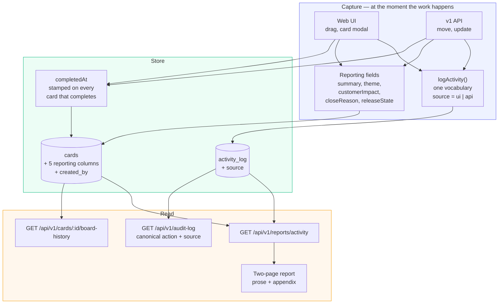
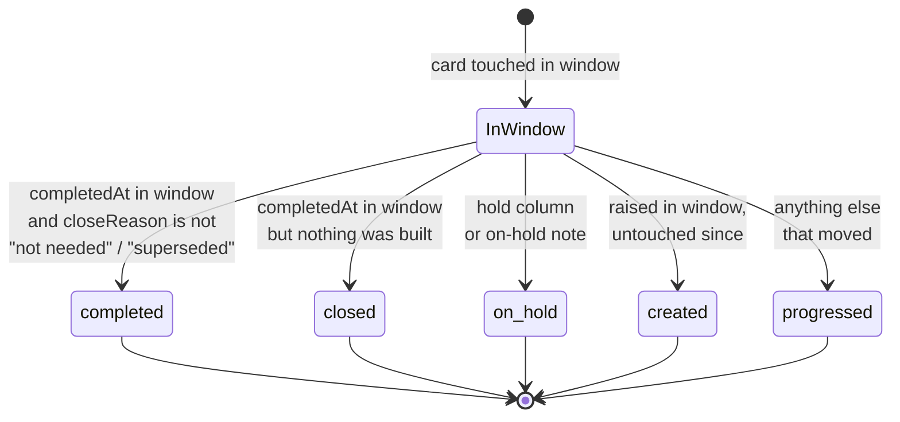
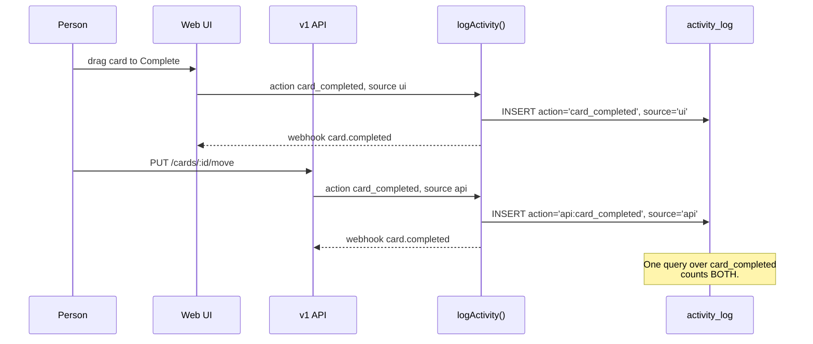
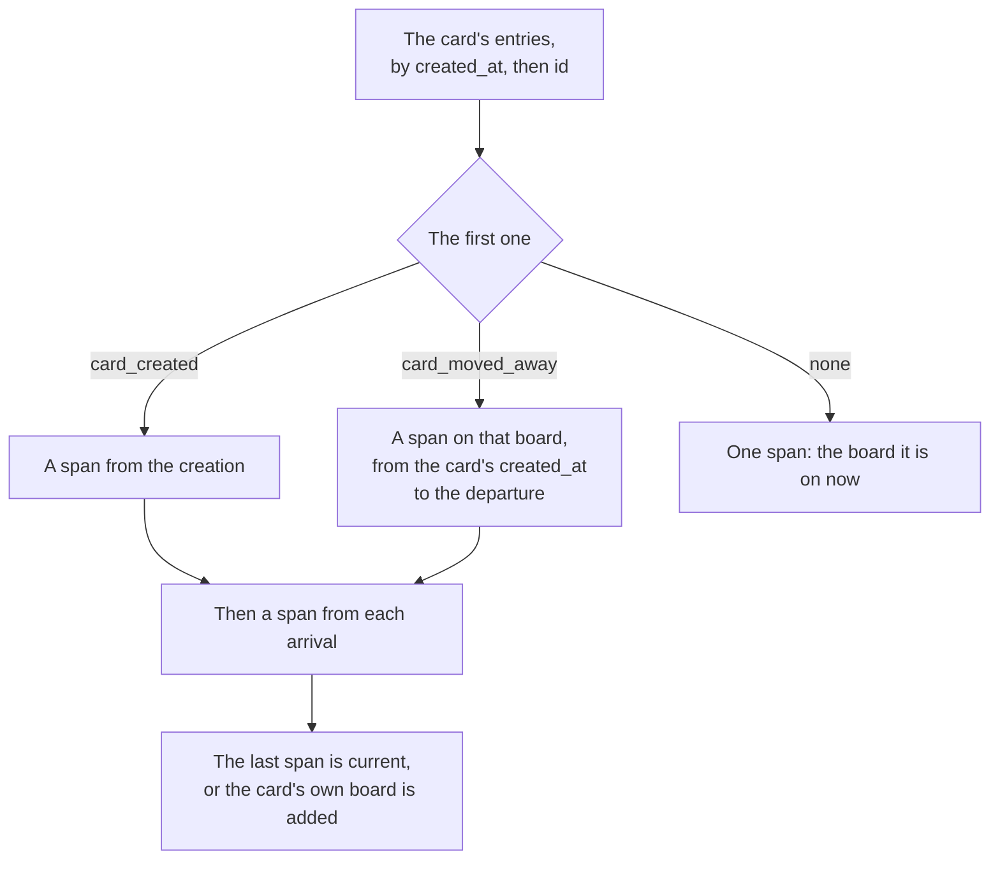

# Management Activity Reporting

## Why this exists

Senior management need a regular, readable account of what the development team
delivered and why it mattered. Producing the first one by hand cost **229 API
calls and about 18 minutes of extraction**, and most of that was writing 196
plain-English summaries, because card titles are written for engineers.

Time was the smaller problem. The report was also **wrong in two directions and
had no way to show it**:

1. **It under-counted activity.** The audit log recorded only `api:*` actions, so
   everything done in the web UI was invisible. 42 of 145 completions in the
   window had no event at all and were found only by reading each card's
   `completedAt`. Anything trusting the log under-reported delivered work by
   roughly 30%.
2. **It over-counted delivery.** Cards closed as *not needed* or *superseded*
   land in the same Complete column as delivered work and are indistinguishable
   once there. "145 completed" counted eight cards where nothing was built.

Both are now fixed at the source rather than corrected in the write-up.

## How the pieces fit



The shape of the fix is that **every fact the report needs is recorded when it is
cheap to record** — while the person who knows it is looking at the card — rather
than reconstructed a month later by someone guessing.

## Completion is counted from `completedAt`

This is the single most important decision in the design, and it is deliberate.

The audit log is now complete, but a report that *depended* on that would
silently under-report for every window predating the fix. The card's own
`completedAt` is the fact; the log is corroboration.

Three rules follow:

- **Bucketing never reads audit events.** Only `completedAt`, `createdAt`,
  `updatedAt` and the card's column.
- **Sitting in a Complete column is not a completion.** A card finished in May
  that picks up one comment in September is `progressed`, not a September
  delivery. Counting it would overstate the period — exactly what this replaces.
  `meta.completedOutsideWindow` reports how many such cards were seen.
- **Every completion path stamps the date.** Drag-and-drop, the card modal and
  `PUT /cards/:id/move` all set it. Previously the drag path stamped only *one*
  card per request, so dragging two cards to Complete together left one of them
  complete with no completion date and invisible to every report.

### Buckets



A card is "touched in the window" if **any** of these hold: it completed, it was
raised, it was edited, an audit event names it, or someone commented on it. The
union matters — relying on the audit log alone is what made the hand-built report
miss 30% of completions.

"Edited" means a field changed. Since 15 October 2026 a save that changes nothing,
such as Save pressed on an unchanged card in the card window or an API call that
repeats what the card holds, writes no row and no `card_updated` entry, so it
leaves `updated_at` as it was and neither puts the card in the window nor makes it
the work of whoever pressed Save. Until then every such save did both (card 2183).

A card is "on hold" when it is in a hold column (On Hold, Hold, Blocked, Parked or
Waiting) or carries an on-hold note, wherever it is. A move out of a hold column
into one that is not clears the note, by every route, so a card that has left the
pause is not counted as on hold for a note left behind (card 2208). Until 15 October
2026 only a drag on the board page cleared it. Cards that already carry a note
outside a hold column keep it until someone empties it in the card window, or the card goes on hold and
leaves it again.

A dependency added or removed is not work on the card it is recorded on, and is
not counted: `dependency_added`, `dependency_removed` and `dependencies_bulk_added`,
in either spelling, neither put a card in the window nor make it the work of
whoever wrote them. Since 14 October 2026 the card window records every link it
adds or removes, and counted, linking a blocker would have read as work on the
card.

A subtask edited is work on its card, as a subtask ticked is. Since card 2299 an
untick and a change of a subtask's title, description, priority, colour or due
date are recorded as `subtask_updated`, in either spelling, so a card whose only
activity in the window is such an edit is in the window and is the work of
whoever made the edit; until then it was neither, and the count of cards worked
on can rise from the deploy on. A change of a subtask's position alone, and a
save that changes nothing, are not recorded and do not count.

## The five reporting fields

Stored on `cards`, all nullable, none backfilled.

| Column | Values | Purpose |
|---|---|---|
| `summary` | free text, ≤ 200 chars | Plain English, ~12 words. Quoted **verbatim** into the appendix. |
| `theme` | `new capability`, `customer issue`, `security & compliance`, `maintenance` | Groups the prose sections. |
| `customer_impact` | `none`, `internal`, `live customers` (optionally `: Quickline`) | Who felt it. |
| `close_reason` | `delivered`, `not needed`, `superseded`, `parked` | Why it left the board. |
| `release_state` | `built`, `on UAT`, `live` | How far it travelled toward customers. |

Validation lives in `src/lib/server/reporting-fields.ts`; the vocabularies are
shared with the card modal through `src/lib/reporting.ts`, so the list a person
picks from and the list the API accepts cannot drift apart.

**An unrecognised value is a 400, never a silent drop.** A dropped value reads
back as *not recorded* and is indistinguishable from one that was never set.

**Nothing is inferred to fill a gap.** A card with no summary reports a null
summary and its technical title, not a generated paraphrase. This text goes to
senior management under someone's name, and a plausible invention is worse than
an obvious blank.

### Where they are captured

Two places, both optional:

- **Card modal** — a collapsed *Reporting* section, expanded automatically once
  anything has been recorded. It is the same window on the board page, the plan
  page and All Tasks, and each shows the values a card holds and saves what is
  typed there. Until 15 October 2026 All Tasks opened the section empty and
  dropped what was typed in it (card 2186).
- **Completion prompt** — after a card is dragged to Complete, a small dialog
  asks for `summary` and `closeReason`. It appears *after* the move, so skipping
  costs nothing. A required field here would be filled in with whatever closes
  the dialog fastest.

## The audit log

One vocabulary, two sources.



On disk the API keeps its historic `api:` prefix, so 2,500 existing rows and
every stored consumer keep working. On read, `action` is canonical, `rawAction`
is the stored spelling, and `source` resolves from the column or falls back to
the prefix. **Nothing is backfilled** — a guessed `source` would be
indistinguishable from a recorded one.

Webhooks now fire off the canonical name, so a card completed in the UI notifies
subscribers. Previously only the `api:` spellings were mapped and it notified
nobody.

The entry is written inside the transaction of the action it records, so an
action and its entry are saved together or not at all: the log cannot hold an
entry for a move that was rolled back, or lack one for a move that was saved.
The webhook in the diagram is queued when the entry is written and sent once
that transaction has committed.

Deletes are in the same vocabulary: `card_archived`, `card_deleted`,
`column_deleted` (one entry for a column and every card in it), `cards_purged`
and `cards_cleared`. A `card_deleted` entry has no `cardId`, because the card it
would point to is gone; a deleted board leaves no entry, because its log is
deleted with it.

### Paging

Responses carry `total` and `hasMore` alongside `limit`/`offset`/`count`. The
default page of 100 was undocumented and a full page looked exactly like a
complete result — which is how a 2,500-entry scan quietly became a 100-entry one.

`limit` and `offset` are never refused (card 2117): each is rounded down, `limit` is
held between 1 and 500 and `offset` is 0 or more, and text that is not a number is the
default. `limit=-1` used to answer the whole log, and `limit=2.5` was a `500`. `boardId`,
`userId` and `cardId` are read as an id in a path is: `400` for one that is not a whole
number of 1 or more.

## Board attribution

A card that changes board mid-window appears in the log under two different
`boardId`s — 13 cards did in one 30-day window. The events always recorded the
board correctly at the time; what was missing was any way to read the sequence
back. `GET /api/v1/cards/:cardId/board-history` returns the spans, oldest first.

**Where the history begins** (card 2199). `getCardBoardHistory` reads the card's
`card_created`, `card_moved_away` and `card_moved_in` entries, bare or with `api:`, in the
order they were written (`created_at`, then `id`), and the first one decides. A creation or
an arrival begins a span of its own. A departure first means the card was on that board
before any entry says it arrived anywhere (it was made before entries were written), so a
span on that board, from the card's own `created_at` to the departure, comes first. Times
cannot decide it: a move writes its departure and its arrival in the same second, and
`created_at` is kept to the second, so the two tie; the departure is written first and has
the lower id. Until card 2199 the first board was given only when the departure was
strictly earlier than the first arrival, so a card with no recorded creation began on its
second board. A card whose creation was recorded begins on that board, once.



A board the caller cannot open keeps its id and dates in the answer, with `boardName`
`Board not visible to you`: hiding it would make the sequence lie, and since card 2181 the
move's own entries name no board, so the name is not given here either.

## A note on timestamps

Two formats coexist in this database and are compared as strings:

| Written by | Shape | Columns |
|---|---|---|
| SQLite `datetime('now')` | `2026-04-09 13:53:46` | `cards.created_at`, `activity_log.created_at`, `card_comments.created_at` |
| JavaScript `toISOString()` | `2026-04-09T13:54:01.210Z` | `cards.completed_at`, `cards.updated_at` |

They do not sort against each other: a space (`0x20`) sorts before `T` (`0x54`),
so `'2026-09-14 09:00:00' < '2026-09-14T00:00:00.000Z'` is **true**. A single
report query touches both, so every timestamp is trimmed to
`YYYY-MM-DD HH:MM:SS` on both sides before any comparison. Sub-second precision
is dropped, which is immaterial for a report bucketed by day.

Getting this wrong silently includes or excludes a whole day's work at a window
boundary.

## Using it

```powershell
# One call. Do NOT pass -Compact — it would discard the whole report.
& $API -Action report -UserId 3 -From 2026-08-15 -To 2026-09-14
```

Then **read `meta` before quoting a figure**:

| Field | Why |
|---|---|
| `closeReasonAssumedCount` | Completions counted as delivered with no recorded reason. |
| `completedOutsideWindow` | Cards in Complete that did not complete in this period. |
| `missingSummaryCount` | Appendix lines falling back to technical titles. |
| `attribution` | Current assignment stands in for historic assignment, which is not recorded. |
| `boardsExcludedForAccess` | Always 0, deprecated (card 2326): the report reads only boards you can open, and refuses a named board you cannot open. It counted the boards left out, which told a reader when a board they could not open was worked on. |

## Files

| Path | Role |
|---|---|
| `src/lib/server/activity-report.ts` | Report builder, bucketing, board history |
| `src/lib/server/reporting-fields.ts` | Validation of the five fields |
| `src/lib/reporting.ts` | Vocabularies shared with the client |
| `src/lib/server/logActivity.ts` | Single writer, canonical vocabulary, source marker |
| `src/routes/api/v1/reports/activity/+server.ts` | Report endpoint. Reads the query; the builder reads only the boards the caller can open, and answers a board named in `boardIds` that does not exist `404` `Board N not found`, and one the caller cannot open `403` `No access to board N`, administrators included (card 2326) |
| `src/routes/api/v1/audit-log/+server.ts` | Audit query, canonical action, paging |
| `src/routes/api/v1/cards/[cardId]/board-history/+server.ts` | Board spans |
| `src/lib/components/board/CompletionPromptModal.svelte` | Post-completion prompt |
| `drizzle/0048_add_audit_completeness.sql` | `activity_log.source`, `cards.created_by` |
| `drizzle/0049_add_card_reporting_fields.sql` | The five reporting columns |

## Known limits

- **Milestone membership is current membership.** A card's milestone history is
  not recorded, so a card moved into a goal mid-window counts for the whole of
  it. Reported, not hidden.
- **Attribution uses current assignment.** Historic assignment is not recorded.
  `meta.attribution` states this in words in every response.
- **Milestones without a target date** can show progress but never "on track" or
  "at risk". `hasTargetDate` says which are which.
