# Notifications & Email System

DumpFire notifies users through three channels: email notifications via SMTP, real-time browser updates via SSE, and external webhooks. All channels are fire-and-forget — they never block API responses.

All three are sent only after the change they report has been committed to the database. A change that is rolled back sends nothing on any channel.

## Notification Architecture

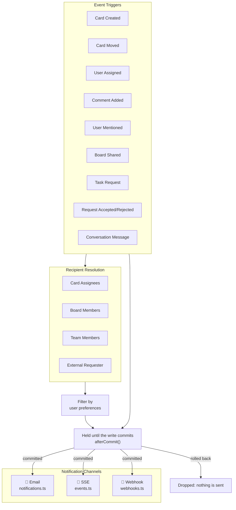

## When Notifications Are Sent

A request that writes does so inside one transaction (see [Architecture](architecture.md#writes-one-transaction-then-the-effects)). Whatever it wants to tell people is queued while that transaction is open and started once it has committed.

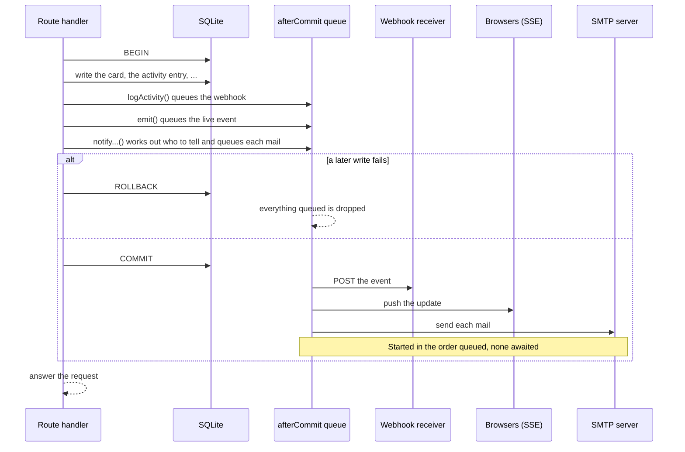

- **Each channel queues itself.** `emit()` in `events.ts`, `logActivity()` (which dispatches webhooks) and the mail functions in `notifications.ts` all go through `afterCommit()`, so a route that calls them inside a transaction needs to do nothing more. Called with no transaction open, each sends at once.
- **A drop of several cards is announced only if all of it is saved.** If the last card of a drop cannot be completed, the earlier cards are rolled back with it and no webhook, live update or mail goes out for any of them.
- **A failure to send never undoes the write.** A webhook that cannot be delivered or a mail that cannot be sent is logged at `ERROR` and goes no further. The request has already been committed and is answered as a success.
- **Some notifications look up their recipients when they are called and queue only the send; others run entirely after the commit.** The card-move announcements and the requester's progress mail are of the second kind: the progress mail builds a PDF on completion, which is asynchronous work that must not start inside a transaction. Either way, no mail leaves before the commit.
- **Mail the caller waits for is not queued.** The SMTP test, a report emailed on demand and the scheduled reports use the functions in `email.ts` directly, outside any transaction, and read what each send returned: see [A Report Emailed on Demand](#a-report-emailed-on-demand) and [Schedule Execution](backup-reporting.md#schedule-execution).

## Email Notifications

### SMTP Configuration

SMTP settings are stored in the `settings` table and configured via the Admin panel.

| Setting Key | Type | Default | Description |
|------------|------|---------|-------------|
| `smtp_host` | string | — | SMTP server hostname |
| `smtp_port` | number | 587 | Port number |
| `smtp_secure` | boolean | false | Use direct SSL |
| `smtp_user` | string | — | Auth username |
| `smtp_pass` | string | — | Auth password |
| `smtp_from_address` | string | — | Sender email address |
| `smtp_from_name` | string | DumpFire | Sender display name |

### Connection Handling

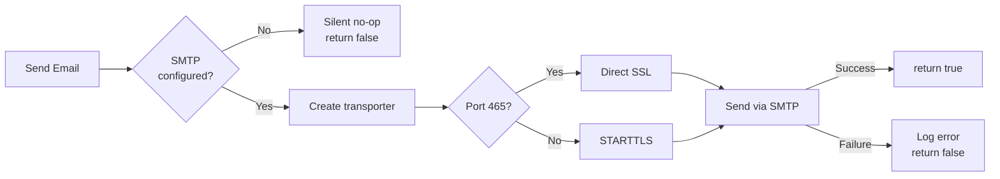

Key transport settings:
- **IPv4 forced** — Prevents ETIMEDOUT on dual-stack DNS
- **EHLO name** — Set to `dumpfire.app` to avoid Google 421 errors from local hostnames
- **Timeouts** — 10s connection, 10s greeting, 15s socket

### Email Types

| Event | Recipients | Preference Key | Subject Format |
|-------|-----------|---------------|----------------|
| Card Moved | Assignees who can open the board the card is on now, never the one who moved it | `email_moved` | `Card moved: {title} → {column}` |
| User Assigned | Assignee | `email_assigned` | `Assigned: {title}` |
| Comment Added | Board members | `email_comments` | `New comment on: {title}` |
| User Mentioned | Mentioned user | `email_mentions` | `{author} mentioned you: {title}` |
| Board Shared | Target user | `email_board_shared` | `Board shared: {boardName}` |
| Request Confirmation | Requester (no account) | — | `Confirm your request: {title}` |
| Task Request | Target user/team | `email_requests` | `New request: {title}` |
| Request Accepted | Requester | — | `Request accepted: {title}` |
| Request Rejected | Requester | — | `Request declined: {title}` |
| Conversation Message | Requester/Admin | `email_requests` | `Message on request: {title}` |
| Request Complete | Requester | `email_request_progress` | `Your request is complete: {title}` |

**A new card sends no mail of its own.** Whoever is put on a new card is mailed
"Assigned": accepting a task request with an assignee (`PATCH /api/requests/{id}`,
`assigneeId`) makes the card and assigns it in one go, and a page that makes a card with
assignees adds each one after the card is made. A "Card Created" mail would have told
them twice. The table
listed a "Card Created" mail, `New card: {title}`, whose function, `notifyCardCreated`,
nothing called; it was removed (card 2010). A new card still reaches the pages open on its
board and the board's webhooks, which is the "Card Created" of the diagram above.

**When "Card moved" is sent** (card 2134). For every move made on a page (a drag, the card
window, All Tasks), and for a move that completes the card however it was made, through
the API included. A move through the API that does not complete the card mails nobody: a
script working a board moves cards all day, and a mail for each would bury the people on
it. Whoever made the move is never mailed about it, on any route, as the commenter is left
out of the comment mail: `notifyCardMoved()` takes the mover's id and leaves them out of the
assignees. Turning "Card moved" off to stop such a mail would also stop the "Unblocked"
mail, which reads the same preference. A card created in a Complete column is not moved,
and sends no "Card moved".

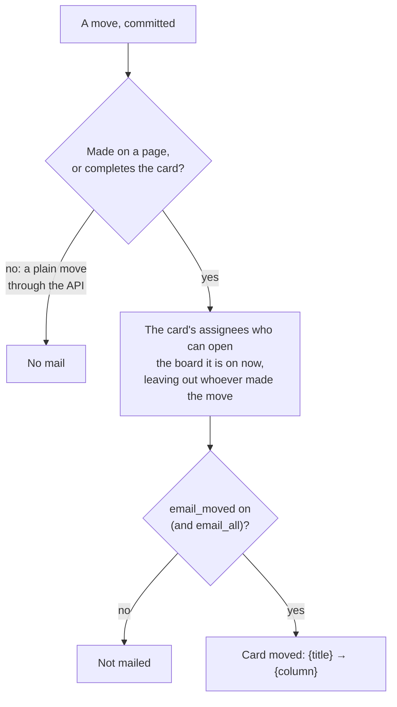

**Only assignees who can open the board are mailed** (card 2180). Taking someone off a
board, or out of the team it is shared with, leaves them assigned to its cards, and the
"Card moved" and "Unblocked" mails name the card, the board and who did what.
So `getAssigneeEmails(cardId, boardId, excludeUserId?)` in `notifications.ts` keeps only the
assignees who can open `boardId` (`whoCanOpen`, which asks `canViewBoard`): the board's
owner, a member of any role, a member of a team it is shared with, anyone for a public
board, and an administrator. `boardId` is the board the mail is about: the board the card
is on after the move for "Card moved" (a card moved to a
board an assignee cannot open is not mailed to them), and the waiting card's board for
"Unblocked". It is asked when the mail is sent, and preferences decide after it. Nobody is
unassigned by it.

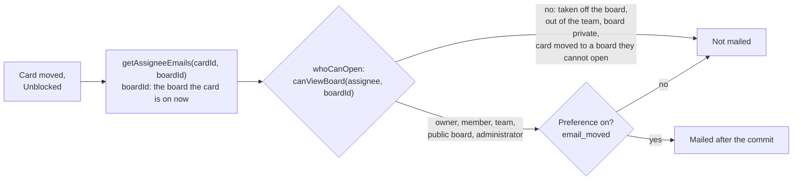

### Text in Mail Is Text

Every text a mail carries is somebody's typing: a board's or grouping's name, a card's
title, a username, a comment, a schedule's name, the error a backup destination's server
answered. A report can be emailed to any address, so if such a text were put into a mail's
HTML as it was typed, anyone with an account could have the server's own sender deliver
HTML of their choosing to anyone: a link, or a styled "sign in again" button. The report
emailed by hand, the scheduled report and the backup failure mail did exactly that until
card 2149.

The rule now:

- **Every text put into a mail's HTML goes through `escapeHtml` where it is put**, a link in
  an `href` included. The five characters HTML reads as markup (`&`, `<`, `>`, `"`, `'`)
  become entities, so a board named `R&D <b>bold</b>` reads as exactly that in the mail.
- **One function does it**, `escapeHtml` in `src/lib/escape-html.ts`, which every mail and
  the `/docs` page use. `notifications.ts` had a function of its own for the same five
  characters; it is gone.
- **Left bare** are only a number, a value taken from a fixed table in the same function
  (the priority colours, the progress mail's headings) and a block of HTML built in the
  same function from values already escaped.
- **A subject is not escaped.** It is plain text, not HTML, and an escaped subject would
  show its reader `&lt;`. nodemailer replaces a line break in any header, so a name cannot
  add a header either.

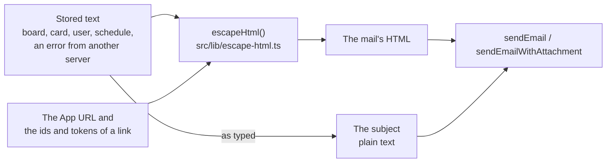

`tests/mail-escaping.test.ts` sends every mail with markup in every text it carries, and an
App URL with a quote in it, and fails if any recorded mail holds either as it was written.
It also fails if `notifications.ts` exports a mail it has no case for.

### User Notification Preferences

Stored as JSON in `users.notification_prefs`. Each user can toggle individual notification types, on My Account under **Email Notifications**.

There is one list of them, `NOTIFICATION_PREFS` in `src/lib/notification-prefs.ts`, a module with no server imports (card 2146). The account page draws its switches from it, `GET` and `PUT /api/account/notifications` make their defaults and their save from it (`defaultPrefs()`, every key on), and `shouldNotifyUser()` and `filterRecipientsByPref()` in `notifications.ts` take a key of it as their type, so `npm run check` refuses a mail that reads a key nobody can save. `GET` answers every key, so the page shows what is stored.

| Switch on My Account | Key | Read by |
|----------------------|-----|---------|
| All Email Notifications | `email_all` (`MASTER_PREF`) | Every mail below: `false` stops them all, whatever each says. On the page, turning it off turns every switch off, and on turns them all on |
| Task Assignments | `email_assigned` | User Assigned |
| Comments | `email_comments` | Comment Added |
| Mentions | `email_mentions` | User Mentioned |
| Card Moves | `email_moved` | Card Moved, and Unblocked |
| Task Requests | `email_requests` | Task Request, Conversation Message |
| Request Progress | `email_request_progress` | The progress mails of [Requester Progress Notifications](#requester-progress-notifications), Request Complete among them, to a requester who has an account. A requester without one has nothing to switch and is always mailed |
| Board Sharing | `email_board_shared` | Board Shared |
| Planning | `email_planning` | The mail about a new plan |

Until 2026-10-15 the page, the route and the mail kept three lists. The route's left out `email_request_progress` and `email_mentions`, so it neither answered nor saved them: the page offered Request Progress, whose switch went back on at every reload, and the progress mail was always sent; and the mention mail read `email_mentions`, which nothing offered, so it could be stopped only by switching all mail off. The page now offers **Mentions**, and both keys are saved and answered. No account had either stored, so a requester who switched Request Progress off before then is mailed until they switch it off again. A key not stored, or a preference that cannot be read, is on. A save that is refused, or gets no answer, puts every switch back as it was and says why under them.

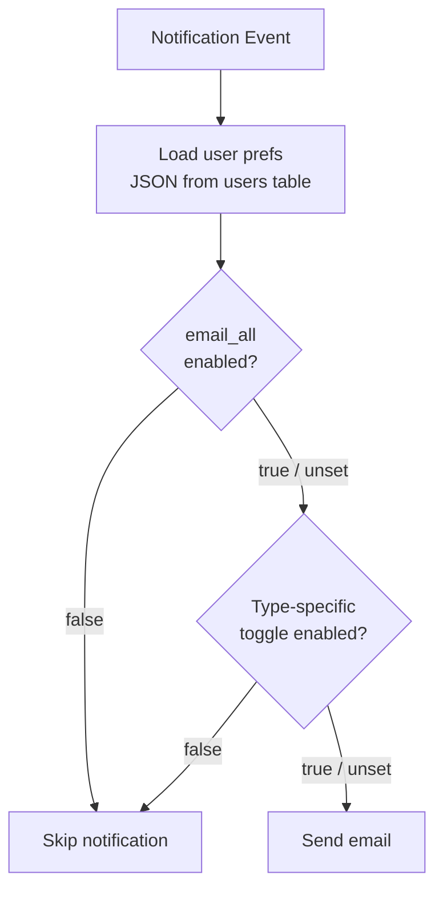

### Request Confirmation

A request submitted without an account sends one email, to the address the requester
gave, asking them to confirm. The **Task Request** email to the team is sent when they
do, not when the form is submitted — otherwise the form is a way for anyone to email the
team. Requests from signed-in users skip this and notify the team at once.

Every link emailed to a requester (`requestReplyUrl()` and `requestConfirmUrl()` in
`request-tokens.ts`) carries that request's own token. Links used to carry the
requester's email address, which is not a secret.

Each reply the requester sends through that link mails every member the request is
addressed to, so the requester may send 20 replies to one request in an hour, and the 21st
is refused `429` with nothing saved and nothing mailed. A reply from the team starts the
count again. See [Authentication & Security](authentication-security.md#the-public-request-form).

### Requester Progress Notifications

When a task request is accepted and converted to a card, the requester receives progress emails:

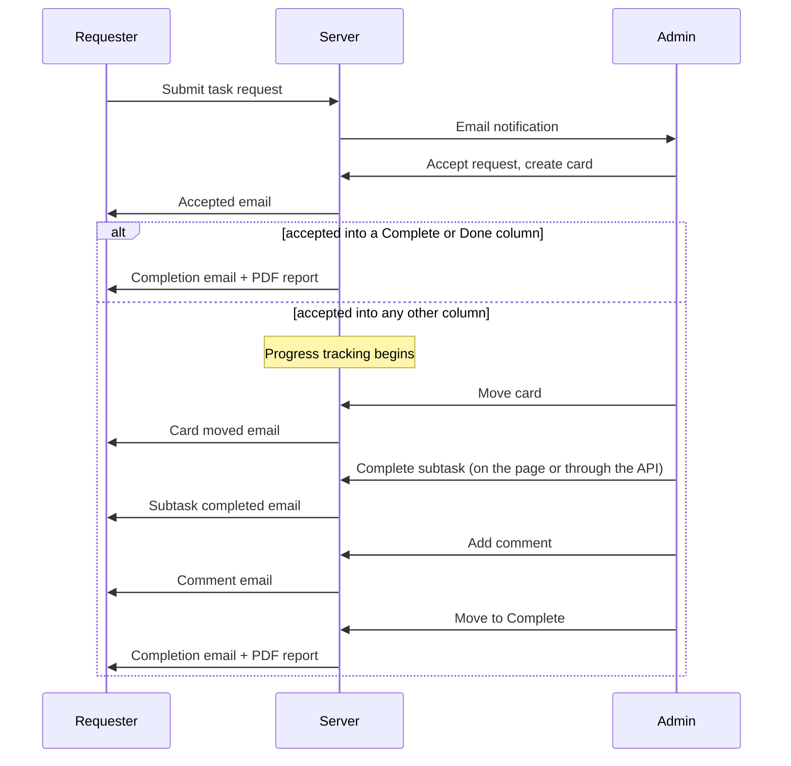

On card completion, a **PDF task report** is automatically generated and attached to the completion email. A request accepted straight into a Complete or Done column makes a card that is completed as it is created (see [Data Model](data-model.md#one-completion-however-a-card-arrives)), so the requester is sent "Request accepted" and then the completion email with its report (card 2134). A subtask ticked through the API mails the requester as one ticked on the page does (card 2108). No progress email goes to a requester who made the change themselves, and none but the completion email once the card is complete.

### A Report Emailed on Demand

The Reports page's **Email** sends `POST /api/reports/email`, which answers with what was
sent (card 2113). It used to answer `200` "Report sent to N recipient(s)", with every
recipient's `success` true, whatever the mail server answered and with no mail set up at
all, and the dialog closed. The recipients are each an address, read with the other fields
before the report is made: one that is not is `400` `recipients[<n>] must be an email
address`, naming its place in the list, and nothing is sent (card 2117).

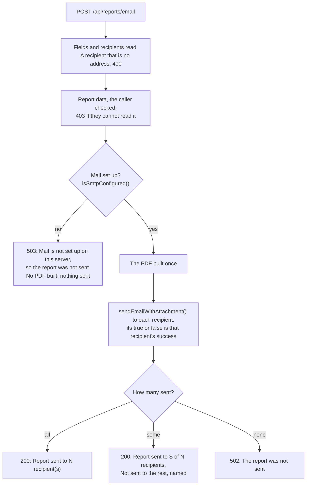

| Answer | `message` | `results` |
|--------|-----------|-----------|
| `503` | `Mail is not set up on this server, so the report was not sent. The superadmin sets it up on the admin page.` | None |
| `200`, all sent | `Report sent to <n> recipient(s)` | `{ email, success: true }` for each |
| `200`, some sent | `Report sent to <s> of <n> recipients. Not sent to <addresses>. The mail server did not accept it. An administrator can see the reason in the system log.` | Each recipient, a failure with `success: false` and the `message` `The mail server did not accept it. An administrator can see the reason in the system log.` |
| `502`, none sent | `The report was not sent. The mail server did not accept it. An administrator can see the reason in the system log.` | As above, every one a failure |

- **The mail server's own reason is not in the answer.** `email.ts` writes it to the system
  log, an `ERROR` line under `EMAIL` for each address, which an administrator reads on the
  Audit page's console. The gate writes the line of every `5xx` answer at `ERROR` too, a
  `503` and a `502` from here among them.
- **The answer says which addresses the mail server accepted.** Each recipient's `success`
  is whether the mail server took the mail for that address, so a mail server that refuses
  an unknown mailbox as the mail is sent tells the sender which of the addresses they typed
  exist there. That is accepted as designed: the sender needs it to send to the rest again.
  Card 2182 is to cap how many recipients one report may be sent to. See
  [Authentication & Security](authentication-security.md#what-an-emailed-reports-answer-tells).
- **A report that reached some recipients is `200`, not a failure status**, so that nothing
  in between offers to send it again: the ones who had it would get it twice. The Reports
  page shows it as a failure all the same, keeps the dialog open, and leaves only the
  addresses not reached in the box, saying so, so that Send goes to those alone. A `503` or
  a `502` is shown in the dialog with the box as it was.
- **Each answer is written with its own status**, as `tests/error-shape.test.ts` requires
  of a failure answered with `json()`.

## Real-Time Updates via SSE

### Architecture

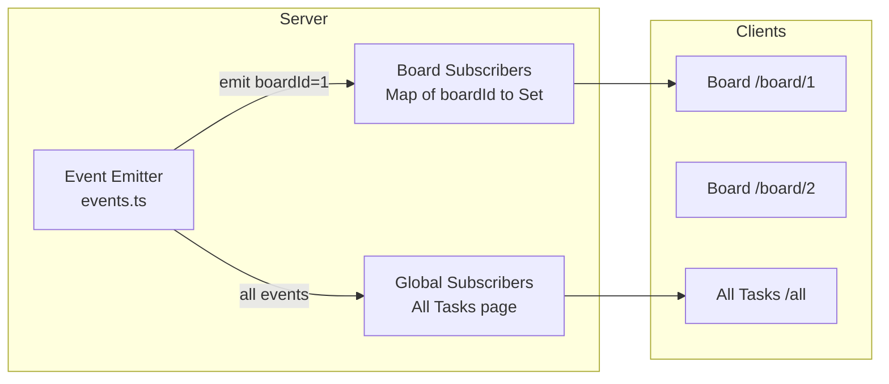

### Event Types

| Event | Payload | Trigger |
|-------|---------|---------|
| `update` | `{type: 'card'}` | Card updated, moved, archived, restored or deleted. A creation carries `action: 'created'`, `cardTitle`, `userName` and `userEmoji`, an accepted request's card among them (card 2108). Someone assigned to a card (also when they already were) or taken off it, and a comment edited, on a page or through the API (card 2143) |
| `update` | `{type: 'column'}` | Column added, renamed, reordered, deleted |
| `update` | `{type: 'board'}` | The board updated: renamed, its emoji or dashboard grouping changed, or made public or private, on a page or through the API (card 2143); or put under a card or taken out from under one, which only a page can do (`PUT /api/boards/{id}` with `parentCardId`: `PUT /api/v1/boards/{id}` reads no `parentCardId`). Sent once to the board, and once to each board whose card it joined or left. A request that sent no field sends nothing |
| `update` | `{type: 'label'}` | A label of the board made, renamed, recoloured or deleted, or put on or taken off one of its cards: on a page (`POST`, `PATCH`, `PUT` and `DELETE /api/labels`), or through the API (`POST /api/v1/boards/{id}/labels`, `PUT` and `DELETE /api/v1/labels/{id}`, `POST` and `DELETE /api/v1/cards/{id}/labels`) |
| `update` | `{type: 'category'}` | A category of the board made, changed or deleted: on a page (`POST /api/categories`, `PUT` and `DELETE /api/categories/{id}`), or through the API (`POST /api/v1/boards/{id}/categories`, `PUT` and `DELETE /api/v1/categories/{id}`). A shared category, of no board, tells no board |
| `update` | `{type: 'subtask'}` | A subtask of one of the board's cards made, saved or deleted on a page (`POST /api/subtasks`, `PUT` and `DELETE /api/subtasks/{id}`). The same through the API sends `{type: 'card'}` |
| `update` | `{type: 'board', action: 'created'}` | A sub-board was made under a card on this board, on a page or through `POST /api/v1/boards` (card 2143). Nothing is sent for a board made at the top level |
| `update` | `{type: 'board', action: 'deleted'}` | The board was deleted, or was a sub-board deleted with a board, card or column |
| `update` | `{type: 'board', action: 'sub_board_deleted'}` | A sub-board deleted on its own hung from a card on this board, which is still there |
| `update` | `{type: 'card', action: 'purged'}` | Archived cards on the board were purged, or the board was a sub-board removed by the purge |
| `update` | `{type: 'card', action: 'cleared'}` | The board's cards were cleared, or it was a sub-board removed by the clear |
| `xp-update` | `{}` | XP was given for a completion |
| `celebrate` | `{type: 'complete', cardTitle, userName, userEmoji, xpGained}` | A card moved into a Complete column, or created in one (card 2134). One event for a drop of several cards, naming the last |

The four delete payloads say what kind of change it was and nothing more: no board name,
card title or user (card 2108). The board of a sub-board's card can be viewed by people who
could never open the sub-board, and the page only reads its board again, under its own
access check. Restoring a card that is not archived, from a page, writes nothing and sends
nothing. Nor does a card update that changes nothing, on either tree: every field sent at
the value the card holds is no change, and sends no `update` (card 2183).

### Connection Lifecycle

1. A board page opens `GET /api/boards/{id}/events`, for the board it shows; All Tasks, the dashboard and the burndown page open `GET /api/events`, the stream of every board the reader can open. Each is opened through `keepStreamOpen()` (`src/lib/live-stream.ts`)
2. Server creates SSE stream with `text/event-stream` content type
3. Server calls `subscribe(boardId, listener)` or `subscribeGlobal(listener)`
4. On board mutation, server calls `emit(boardId, event, data)`. Inside a transaction the event is held until the commit, and dropped if the transaction rolls back, so a page told to refresh always finds the change there
5. All subscribed listeners receive the event
6. On client disconnect, unsubscribe callback cleans up the listener set

A board page listens to the board it shows. SvelteKit keeps a page when only its address's
board changes, so `src/routes/board/[id]/+layout.svelte` makes the page afresh for each
board (`{#key page.params.id}`, card 2184): after a sub-board badge, a breadcrumb, a link in
the card window, or Back and Forward to another board, the first board's stream is closed as
its page is destroyed and the second board's opened as its page mounts. A link to a card on
the same board (`?card=`) keeps the page and its stream.

The global stream carries card titles and who did what on every board, so a subscriber
is only sent events from boards they can view. The check is made per event and cached
per board for 30 seconds, which is how long a revoked share can keep trickling through.
Administrators receive everything. A board that has been deleted can be viewed by nobody
but an administrator, so a member's dashboard is not told of its deletion, and catches up
when it is next brought to the front. A page open on the board itself is told, by the
board's own stream, which checked access once when it was opened: it reads the board
again and shows "Board not found".

## Webhooks

Board-level webhooks fire HTTP POST requests to configured URLs when events occur.

### Configuration

| Field | Type | Description |
|-------|------|-------------|
| `url` | string | Target HTTP endpoint |
| `secret` | string | Shared secret for signature verification |
| `events` | JSON array | Event types to subscribe to |
| `active` | boolean | Enable/disable toggle |

### Who Can See the Secret

The secret is what lets a receiver trust that a delivery came from DumpFire, so anyone
holding it can forge one. The delivery address goes with it (card 2133): an address can
name a server inside the network, or carry a user name and password before the host. Both
are returned by the API only:

- in the response to the `POST` that created the webhook, to the caller who supplied them;
- on a read or update, when the caller is the **board owner or an administrator**.

Every other caller — board editors and viewers included — gets the webhook without a
`secret` field and without a `url` field, on both reads and in the answer to an update, an
editor's own update of the address included. The keys are left out, not set to null.
`hasSecret` (boolean) is always present and says whether a secret is set, and `events` and
`active` are given as before. Before October 2026 the secret was returned to anyone who
could view the board, and until 2026-10-14 the address was. An editor may still change the
address without being able to read it, which card 2154 is to settle.

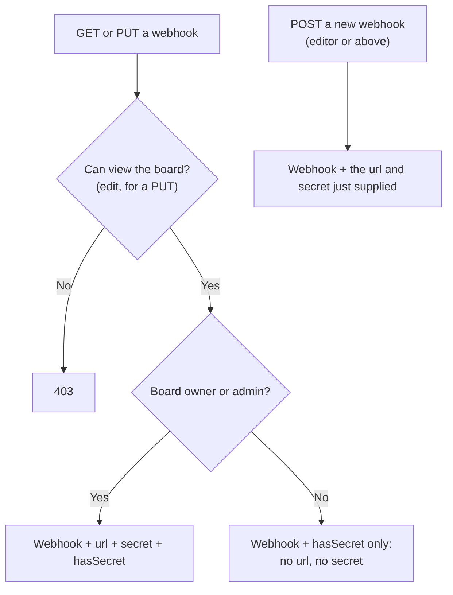

All webhook responses are built by `presentWebhook(hook, reveal)` in
`src/lib/server/webhooks.ts`, which leaves out `url` and `secret` together unless `reveal`
is true, so no route can return the raw row.

### Webhook Flow

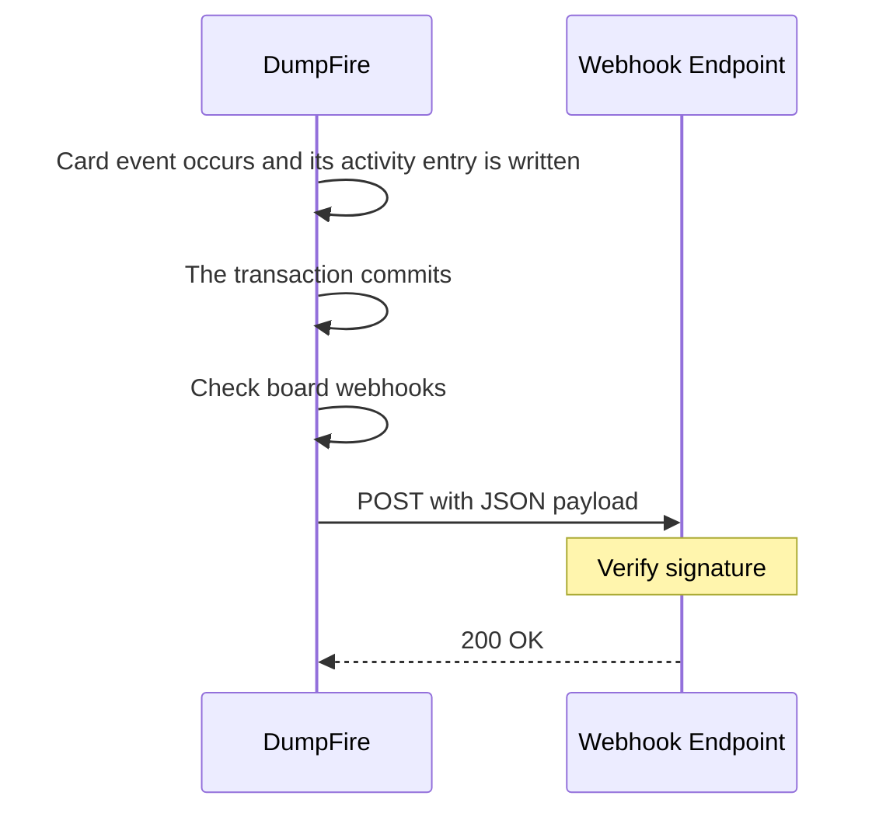

A webhook is dispatched by the activity entry for the action, once that entry is committed. The delivery is not awaited and not retried. One that cannot be made, or gets no answer within 10 seconds, is logged at `ERROR`. The receiver's status code is not read, so an answer of 500 from a receiver is not logged as a failure.

### Events and Payload

| Event | Sent when the activity entry is |
|-------|---------------------------------|
| `card.created` | `card_created`: by every way of creating a card, accepting a task request among them (card 2108) |
| `card.updated` | `card_updated` |
| `card.moved` | `card_moved` |
| `card.completed` | `card_completed`: a card moved into a Complete column, or created in one (card 2134) |
| `card.deleted` | `card_deleted`: a card deleted for good |
| `comment.added` | `comment_added` |

The same event is sent whether the action was made in the web UI or through the API. The request carries the headers `X-DumpFire-Event` and `X-DumpFire-Signature` (`sha256=` and the HMAC-SHA256 of the body under the webhook's secret, or empty when no secret is set), and a body of this shape:

```json
{
  "event": "card.deleted",
  "timestamp": "2026-10-13T09:14:03.512Z",
  "boardId": 3,
  "data": {
    "cardId": 1686,
    "action": "card_deleted",
    "source": "ui",
    "detail": "\"Compose network segmentation applied on the new host\"",
    "user": "greg"
  }
}
```

What is not sent:

- **Archiving a card sends nothing.** It writes `card_archived`, which has no event. Nor does restoring one: `card_restored` has none, and a restore through `PUT /api/v1/cards/{cardId}` with no other field sends no `card.updated` either, since it writes `api:card_restored` and no `api:card_updated` (card 2108).
- **A card update that changes nothing sends nothing** (card 2183). `PUT /api/cards/{id}` and `PUT /api/v1/cards/{cardId}` compare what is sent with what the card holds, and write no entry, so send no `card.updated`, when every field is as stored; one that changes some fields sends one `card.updated` whose `detail` names those alone. The card window sends a card's whole state back with every save, so every Save on an unchanged card sent a `card.updated` until 2026-10-15.
- **A move out of an On Hold column sends the move's events alone** (card 2208). The move clears the card's on-hold note itself; the board page's drag out of On Hold sent a second request to clear it, which delivered a `card.updated` beside the `card.moved`, until 2026-10-15.
- **A `card.deleted` carries the id of the card that went**, although the activity entry it comes from is stored with no card id, the card being gone.
- **Deleting a column sends nothing**, for the column or for any card in it. Neither does purging archived cards, clearing a board's cards or deleting a board. A board's webhooks are deleted with the board. Open pages are told of each by a live update: see [Event Types](#event-types).

## Key Implementation Files

| File | Purpose |
|------|---------|
| `src/lib/server/email.ts` | SMTP config, transporter creation, sendEmail |
| `src/lib/server/notifications.ts` | All email notification functions with preference filtering |
| `src/lib/notification-prefs.ts` | The one list of mail preferences: `MASTER_PREF`, `NOTIFICATION_PREFS`, `defaultPrefs()`. Read by the account page, the preferences route and the mail alike (card 2146) |
| `src/lib/escape-html.ts` | `escapeHtml()`: the one function every mail puts its texts and links through |
| `src/lib/server/events.ts` | SSE event emitter with board and global subscriptions |
| `src/lib/board/sse.ts`, `src/routes/board/[id]/+layout.svelte` | The board page's stream, opened as the page mounts and closed as it goes; the layout makes the page afresh for each board, so the stream follows the board shown (card 2184) |
| `src/lib/server/webhooks.ts` | Webhook dispatch on board events |
| `src/lib/server/logActivity.ts` | Writes the activity entry and queues the webhook for it |
| `src/lib/server/db/transaction.ts` | `afterCommit()`: holds every notification until the write it reports is committed |
| `src/lib/server/mentions.ts` | Extract @mentions from comment text |
