# Notifications & Email System

DumpFire notifies users through three channels: email notifications via SMTP, real-time browser updates via SSE, and external webhooks. All channels are fire-and-forget — they never block API responses — but for an invite's mail, which its route waits for after its commit so that it can say whether the mail went (card 2196, [When a Mail Fails](#when-a-mail-fails)).

All three are sent only after the change they report has been committed to the database. A change that is rolled back sends nothing on any channel.

## Notification Architecture

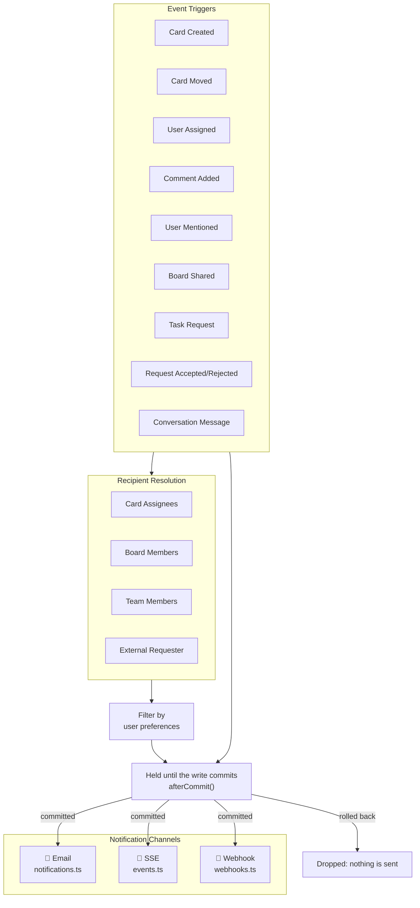

## When Notifications Are Sent

A request that writes does so inside one transaction (see [Architecture](architecture.md#writes-one-transaction-then-the-effects)). Whatever it wants to tell people is queued while that transaction is open and started once it has committed.

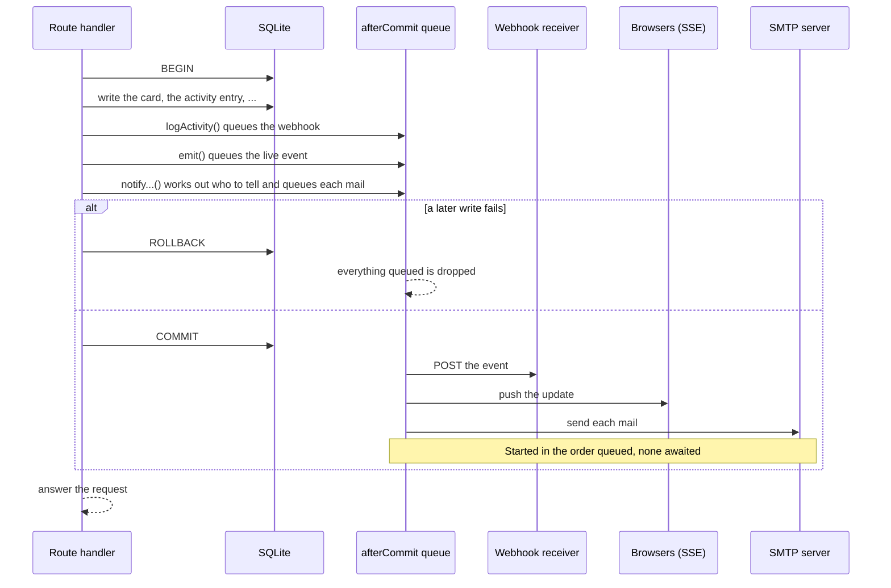

- **Each channel queues itself.** `emit()` in `events.ts`, `logActivity()` (which dispatches webhooks) and the mail functions in `notifications.ts` all go through `afterCommit()`, so a route that calls them inside a transaction needs to do nothing more. Called with no transaction open, each sends at once.
- **A drop of several cards is announced only if all of it is saved.** If the last card of a drop cannot be completed, the earlier cards are rolled back with it and no webhook, live update or mail goes out for any of them.
- **A failure to send never undoes the write.** A webhook that cannot be delivered or a mail that cannot be sent is logged at `ERROR` and goes no further. The request has already been committed and is answered as a success.
- **Some notifications look up their recipients when they are called and queue only the send; others run entirely after the commit.** The card-move announcements and the requester's progress mail are of the second kind: the progress mail builds a PDF on completion, which is asynchronous work that must not start inside a transaction. Either way, no mail leaves before the commit.
- **Mail the caller waits for is not queued.** The SMTP test, a report emailed on demand and the scheduled reports use the functions in `email.ts` directly, outside any transaction, and read what each send returned: see [A Report Emailed on Demand](#a-report-emailed-on-demand) and [Schedule Execution](backup-reporting.md#schedule-execution).

## Email Notifications

### SMTP Configuration

SMTP settings are stored in the `settings` table and configured via the Admin panel.

| Setting Key | Type | Default | Description |
|------------|------|---------|-------------|
| `smtp_host` | string | — | SMTP server hostname |
| `smtp_port` | number | 587 | Port number |
| `smtp_allow_insecure` | `'true'` or `'false'` | not set (off) | "Allow mail without a checked, encrypted connection" (card 2189): only `'true'` is on. Written when the panel first saves it |
| `smtp_secure` | boolean | false | No longer read or written (card 2189). It was "Use SSL/TLS", which only switched the certificate check on for ports other than 465; that is now always on. A row saved before is left where it is, and a working copy removes it with the other mail settings |
| `smtp_user` | string | — | Auth username |
| `smtp_pass` | string | — | Auth password |
| `smtp_from_address` | string | — | Sender email address |
| `smtp_from_name` | string | DumpFire | Sender display name |

**The password is in no backup** (card 2169). A backup's copy has no `smtp_pass` row; the
other mail settings are in it. An Import Backup keeps this server's password when the
backup is one this server made and nobody has changed since (its seal, made with a key this
server keeps) and its `smtp_host` (trimmed of ASCII spaces and tabs, ASCII letters in any case), `smtp_port` (587 when not set),
`smtp_allow_insecure` (off when not set, as in a backup made before card 2189) and
`smtp_user` are all this server's, and otherwise lists the mail password to enter again in
**Admin → 📧 Email / SMTP**: with the port and the way out compared too, a backup cannot have this server's
password sent over a connection whose certificate is not checked. Until it is entered, mail
is tried with the user name and an empty password, which a mail server that asks for one
refuses, the backup failure mail included; a requester who asks for a new link is told
"New links cannot be sent just now. Please contact the team that sent you the link." rather
than that one was sent, with the reason in a `[WARN] [REQUESTS]` line; and every start writes
one `[WARN] [STARTUP]` line saying so. See [The Secrets a Backup Does Not Hold](authentication-security.md#the-secrets-a-backup-does-not-hold-card-2169).

**The saved password stays with the connection it was saved for** (card 2190). `GET
/api/admin/smtp` answers the password as `••••••••` (`SECRET_MASK` in
`src/lib/server/backup-secrets.ts`) and `allowInsecure` as `true` or `false`; it no longer
answers `secure`. `PUT /api/admin/smtp` takes `host`, `port`, `allowInsecure` (`true` or
`false`; anything else is refused, `allowInsecure must be true or false`), `user`, `pass`,
`fromAddress`, `fromName` and `appUrl`; a `secure` is ignored as any unknown key. A password
typed, an empty one included, is saved as typed. One sent masked, or left out, while a
password is stored, is kept only while the host (trimmed of ASCII spaces and tabs, ASCII letters in any case; a no-break space, a byte-order mark or an ideographic space is a change, as is a letter outside ASCII that `toLowerCase()` would fold to one inside it), port (587 when not set),
user name (`''` when not set) and way out (off when not set) that the save would leave stored,
each sent over the one stored, are the stored ones (`keepMailPassword`, by the rule a restore
fills the password by). Otherwise the save is refused `400`, inside its transaction, with
nothing written:

> Type the mail password again. The saved password is used only with the host, port, user name
> and "Allow mail without a checked, encrypted connection" setting it was saved with, and this
> changes the host.

naming each field that changed. The host is saved trimmed of ASCII spaces and tabs only, and
where the stored password is kept the stored host is written in place of the one sent, so that
the host compared is the host connected to, byte for byte (the review-fix pass's S1). The sender's address and name and the App URL decide nothing
about where the password goes and are not compared, so the App URL saved alone is never
refused; with no password stored there is nothing to keep and nothing is refused. Until card
2190 a masked password was kept for any host, and one left out too, since only the keys sent
are written: a save of `{ "host": "smtp.evil.example" }` sent the stored password there at the
next mail. A save that changes the way out writes, once committed, one `WARN` line under
`SMTP`: `Mail is now sent without a checked, encrypted connection (set by <username>)`, or
`with`.

### Connection Handling

Every mail goes through `deliverMail` in `src/lib/server/email.ts` (card 2196), the one place a
mail is handed to the mail server, and so through `createTransporter`, built afresh for each
send from the stored settings: `sendEmail` and `trySendEmail` (invites, notifications, request
mail and its confirmation, the new-link mail, the backup failure mail), `sendEmailWithAttachment`
(reports, the requester's completion PDF) and `sendTestEmail` (Send Test). Card 2189 made the
connection a checked, encrypted one by default. What `deliverMail` answers, records and logs
is under [When a Mail Fails](#when-a-mail-fails), below.

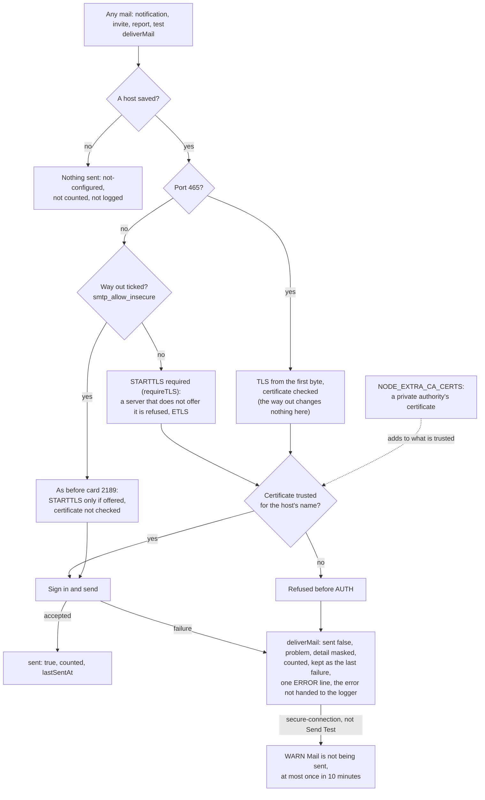

The options handed to nodemailer (10.1.1):

| Option | Port 465 | Any other port | Any other port, way out ticked |
|---|---|---|---|
| `secure` | `true` | `false` | `false` |
| `requireTLS` | `false` (TLS already) | `true` | `false` |
| `tls.rejectUnauthorized` | `true` | `true` | `false` |
| `auth` | the user and password, when a user is saved | the same | the same |
| `name` (the EHLO name) | `dumpfire.app` | `dumpfire.app` | `dumpfire.app` |
| `connectionTimeout`, `greetingTimeout`, `socketTimeout` | 10 s, 10 s, 15 s | the same | the same |

- **The certificate** is checked against Node's own authorities and any named by
  `NODE_EXTRA_CA_CERTS`, which Node reads once at start for every TLS connection of the
  process (webhook deliveries and backup destinations trust that authority too). There is no
  setting for an authority's certificate on the panel: see
  [Mail Server Certificates](deployment.md#mail-server-certificates).
- **Port 465 is checked even with the way out ticked** (the plan's R9): it checked the
  certificate before card 2189 too, so no installation on 465 depends on an unchecked one.
- **The EHLO name** is `dumpfire.app`, to avoid Google's `421` answers to local host names.
- **IPv4 and IPv6.** DumpFire no longer passes `family: 4` ("force IPv4"): nodemailer 10's SMTP
  connection does not read a `family` option. nodemailer looks up the host's IPv4 and IPv6
  addresses together, leaving out a family the server has no network address for (and falling
  back to `dns.lookup` when neither finds an address), and with more than one address it has
  Node's `net.connect` try them in turn (`autoSelectFamily`), going on to the next when one
  fails or is slow.
- **The check before deploying** ([Mail Server Certificates](deployment.md#mail-server-certificates))
  builds these same options and calls `verify()`, which connects, upgrades, checks and quits
  without signing in, so it tells what the first mail will meet. `createTransporter`'s comment
  names it: change the two together.

**What a failure says.** Send Test's `500` is `Failed to send test email: <the error>`, the error
being the mail server's words masked as the log has them (`MailNotSent`, thrown by
`sendTestEmail`; card 2196). When the error is the certificate or STARTTLS (the problem
`secure-connection`, read by the one test `tlsFaultHint` and `mailProblem` share: the code `ETLS`
or `EREQUIRETLS`, or nodemailer's or Node's own words matching `certificate`, `altnames`,
`self-signed` or `STARTTLS`, the mail server's reply left out of that reading), the error is
ended as a sentence and followed by:

> The mail server's certificate could not be checked, or the server does not offer STARTTLS.
> For a certificate from a private authority, see docs/deployment.md, Mail Server Certificates;
> for a relay on this server's own network that cannot use TLS, tick "Allow mail without a
> checked, encrypted connection" and type the password again.

A refused STARTTLS comes back `ETLS` "Error upgrading connection with STARTTLS: …"; a
certificate refused during STARTTLS comes back `ESOCKET` with Node's message
("self-signed certificate", "Hostname/IP does not match certificate's altnames: …"); and a server
that answers neither EHLO nor STARTTLS comes back `ECONNECTION` "EHLO failed but HELO does not
support required STARTTLS", which nodemailer 10 names so (the review-fix pass's S6). A sign-in
failure or a timeout says what it says, with no sentence. Every mail's failure, Send Test's
included, is one `ERROR` line under `EMAIL` written by `deliverMail` (`Failed to send email to
<to>: <subject>`); the SMTP route's own line for Send Test is gone (card 2196's N2). When it is
the certificate or STARTTLS, `deliverMail` also writes one `WARN` line under `EMAIL`, `Mail is
not being sent: <the error, masked>. <the sentence above>`, at most once in ten minutes in a
process, so the Audit page says why invites and notifications stopped. Send Test does not
write it: its answer already says the same to the superadmin who pressed it.

### When a Mail Fails

Card 2196. An invite whose mail failed was answered "Invite sent", a user made with no password
while mail failed was answered `invited: true` (which the admin page read as "invite email
sent!"), and every other mail that failed was one `ERROR` line and nothing else. The line was the
error itself, so a mail server's refusal that quoted the mail's link put a live invite token in
front of every administrator in the live console.

**One place a mail is sent from.** `deliverMail(message)` in `email.ts` answers `{ sent: true }`
or `{ sent: false, problem, detail }`. "Sent" means the mail server accepted it; a bounce
afterwards goes to the From address and is not known here. "Not sent" means "not confirmed
sent": a mail server can take the whole message after `DATA` and the connection then drop
before its answer arrives, and then the mail is delivered all the same. So an invite's link
given to its issuer may reach a person who also has the mail; either works, once. `trySendEmail(to, subject, html)`
answers the whole outcome; `sendEmail` and `sendEmailWithAttachment` still answer a boolean,
which the report routes read; `sendTestEmail` still throws. The `.catch(log.error(…))` beside
each send in `notifications.ts`, and the backup failure mail's `catch`, are for an error before
the send: a mail that fails resolves, and its one line is `deliverMail`'s.

`problem` is read from nodemailer's error by `mailProblem(err)`:

| `problem` | Words (in an answer and on the panel) | From |
|---|---|---|
| `not-configured` | mail is not set up on this server | No mail host when the mail was sent. Not counted as a failure, not logged |
| `no-password` | the mail password has not been entered on this server; the superadmin enters it under 📧 Email / SMTP | `EAUTH` with `command` `'API'`: nodemailer's own "Missing credentials for …", for a mail user name saved with no password (what a restore leaves, card 2169). Nothing was asked of the mail server |
| `secure-connection` | the mail server's certificate could not be checked, or it does not offer STARTTLS | `ETLS`, `EREQUIRETLS`, or nodemailer's or Node's own words matching `certificate`, `altnames`, `self-signed` or `STARTTLS` (an altnames mismatch comes back `ESOCKET`; nodemailer 10's "EHLO failed but HELO does not support required STARTTLS" comes back `ECONNECTION`). The mail server's reply is not read for the words: a refusal saying "certificate" is the server's answer, `refused` or `failed` |
| `unreachable` | the mail server could not be reached | `ECONNECTION`, `EDNS`, `ETIMEDOUT`, `ESOCKET` otherwise |
| `sign-in` | the mail server refused the sign-in | `EAUTH` otherwise |
| `refused` | the mail server did not accept the message | `EENVELOPE`, `EMESSAGE` |
| `failed` | the mail could not be sent | Anything else |

**What an invite answers.** Both routes that issue an invite, `POST /api/users/{id}/invite` and
`POST /api/users` with no password, issue it in their transaction and then send its mail,
after the commit, and wait for it: usually a second or two; each step of the conversation with
the mail server can wait up to 15 seconds (`socketTimeout`), after 10 to connect and 10 for the
greeting. The invite is kept whatever the mail did: the account's earlier invite was deleted
at the commit, so deleting this one too would leave it no link at all.

Both refuse in the transaction, before any invite is made, when the mail cannot go and that is
known beforehand: no mail host (`400`, as before), or a mail user name saved with no password
(`smtpPasswordMissing()`, as card 2158's new-link route asks; the review-fix pass of card 2196).
The second is `400` with `The invite was not made: <no-password's words>. Any earlier invite to
this account still works.` from the resend, and `Password must be at least 8 characters
(<no-password's words>)` from a user made with no password. So the account's earlier invite is
not ended for a mail certain to fail, and no link is put on a screen for it: decision 8 offers
the link only for a mail that was tried.

| | `POST /api/users/{id}/invite` (`200`) | `POST /api/users`, no password (`201`) |
|---|---|---|
| Sent | `{ success: true, mailSent: true, message: "Invite sent to ana@example.com. Any earlier invite to this account no longer works." }` | the user, `invited: true`, `mailSent: true` |
| Not sent | `{ success: true, mailSent: false, mailProblem, inviteUrl, message: "The invite was made, but its mail to ana@example.com could not be sent: <mailProblem>. Give ana the link yourself. Any earlier invite to this account no longer works." }` | the user, `invited: true`, `mailSent: false`, `mailProblem`, `inviteUrl` |
| Not sent, link not shown | `{ success: true, mailSent: false, mailProblem, message: "The invite was made, but its mail could not be sent, and its link cannot be shown to you now. Send a new invite with 📧 once mail works." }` | the user, `invited: true`, `mailSent: false`, `mailProblem` |

A user made with a password is answered `invited: false` and no `mailSent`. `mailProblem` is the
problem's words, never the mail server's, which can name the mail host and its user name (the
superadmin's settings; any administrator may send an invite). Every outcome but `sent: true` is
a mail not sent, `not-configured` included: the superadmin cleared the mail host between the
commit and the send, and the invite exists all the same. An answer that carries `inviteUrl` has
`Cache-Control: no-store`.

`inviteUrl` is the mail's own link, `<base>/invite/<token>`, which works once, for seven days,
and ends as any invite ends. It goes only to the administrator whose request issued it, whom
the account rule already lets reset that account's password. Because the mail takes seconds,
`inviteMailAnswer` in `src/lib/server/invite-link.ts` reads three things again before the link
is put in the answer, by reads only, and gives no link if any fails: the caller's session is
still open and still an administrator's (`openSessionUser`), `mayManageAccount` still holds
between the caller and the account, both read afresh, and the token is still a usable invite
(`usableInvite`, now in `invites.ts`; a newer invite sent meanwhile has deleted it).

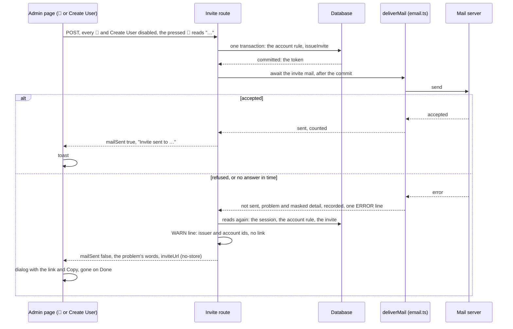

**The mail panel's record.** `deliverMail` keeps, in memory since the server started, how many
mails were sent and how many failed, when the last was sent, and the last failure: when, its
subject (not its recipient, which the system log has), the problem's words and `detail`, the
error's message masked and cut at 500 characters (it can still name the recipient, from a
refusal at `RCPT TO`). The subject is the mail's own, so a request mail's subject holds the
request's title, which a member of the public typed on the request form. `detail` is the mail
server's reply when it answered, and this server's own words when it never did: `Connection
timeout`, `Greeting never received`, `connect ECONNREFUSED 203.0.113.5:587`, `getaddrinfo
ENOTFOUND smtp.example.com` (the code, `ETIMEDOUT`, `ECONNECTION`, `ESOCKET` or `EDNS`, is in the
`ERROR` line). The panel puts it after "The mail error was:". Every mail counts, whatever sent it: notifications, invites, the request
mails, the backup failure mail, reports scheduled and sent by hand, and Send Test. A mail not
sent for want of a host is not counted. `GET /api/admin/smtp` answers it as `mailStatus`,
configured or not, to the superadmin alone, with `Cache-Control: no-store` on both answers. The
admin page reads it when the panel opens, after Save and Send Test, and, for the superadmin, as
each invite is answered, so the panel the invite's dialog points to shows that mail:

```json
"mailStatus": {
  "since": "2026-10-14T08:00:03.112Z",
  "sent": 40,
  "failed": 3,
  "lastSentAt": "2026-10-14T09:58:40.006Z",
  "lastFailure": {
    "at": "2026-10-14T10:02:11.481Z",
    "subject": "Assigned: Deploy v2.1",
    "problem": "the mail server refused the sign-in",
    "detail": "Invalid login: 535-5.7.8 Username and Password not accepted"
  }
}
```

It is never written to the database: a write after every mail would land at a moment no request
controls, and every backup would carry it. A restart starts it again; the system log keeps each
failure for 30 days. The panel shows it under Send Test (see the admin guide's SMTP
Configuration).

**Nothing secret is logged.** `deliverMail` never hands the error to the logger: an `Error`'s
stack, and nodemailer's `response`, hold the mail server's words unmasked, and the logger stores
an `Error` as its message and stack. It writes

```text
[ERROR] [EMAIL] Failed to send email to <to>: <subject> | {"code":"EMESSAGE","command":"DATA","responseCode":554,"problem":"refused","detail":"Message failed: 554 5.7.1 rejected, listed URL https://kanban.example.com/invite/[token]"}
```

where `detail` is `maskMailText(err.message)`: a hyphen encoded as `%2D`, `&#45;` or `&#x2D;`
(any case) is read back as `-`, which would otherwise break a UUID into runs of 12 or fewer;
then `maskSecretPaths` (an invite's `/invite/<token>` and a request link's `?token=` become
`[token]`); then every run of 16 or more hex digits and hyphens, in any case, becomes `[token]`. A refusal can quote the link URL-encoded, in capitals,
with HTML entities, or split across two reply lines after `/invite/`; each leaves the token's own
characters as they are, which the second rule finds (an invite's token is a UUID, a request's 64
hex digits). The cost is the odd queue id. The second rule is not in `maskSecretPaths`, which is
run over the whole log at every start: it would mask every UUID there. The same `detail` is the
panel's, Send Test's `500` and the `WARN` line's. When an invite's link is handed over, or not,
the route writes one `WARN` line under `AUTH`, with the issuer as the row's user and no link or
token:

```text
[WARN] [AUTH] Invite for user 12 was issued by user 3; its mail was not sent (the mail server could not be reached), and its link was given in the answer to their request
[WARN] [AUTH] Invite for user 12 was issued by user 3; its mail was not sent (the mail server could not be reached), and its link was not given to them: the invite no longer works
```

The other reasons a link is not given are "the caller's session has ended, or is no longer an
administrator's" and "the caller may no longer manage the account".

So one failed mail is one `ERROR` line. Beside it, the first failure in ten minutes for the
certificate or STARTTLS adds the `WARN` "Mail is not being sent" above, and an invite adds the
`WARN` of its link; neither repeats the other.

**A public request whose confirmation mail fails** is answered as before: the form would
otherwise wait on the mail server, and tell anyone on the internet when this server's mail is
down. The failure shows on the panel and in the log.

### Email Types

| Event | Recipients | Preference Key | Subject Format |
|-------|-----------|---------------|----------------|
| Card Moved | Assignees who can open the board the card is on now, never the one who moved it | `email_moved` | `Card moved: {title} → {column}` |
| Card Unblocked | Assignees of the card that was waiting who can open its board (card 2180). Each is told the finished work's title only if they can open the board it is on (card 2152) | `email_moved` | `Unblocked: {title of the waiting card}` |
| Plan Created | Assignees of the cards attached to an empty goal, and every administrator, less whoever attached them, and then only those who can open the plan (card 2152). Each is told the plan as they would see it on its page | `email_planning` | `Plan created: {goal}` |
| User Assigned | Assignee | `email_assigned` | `Assigned: {title}` |
| Comment Added | Board members | `email_comments` | `New comment on: {title}` |
| User Mentioned | A user named as `@username` in a comment who can open the card's board (card 2198), never the author | `email_mentions` | `{author} mentioned you: {title}` |
| Board Shared | Target user | `email_board_shared` | `Board shared: {boardName}` |
| Request Confirmation | Requester (no account) | — | `Confirm your request: {title}` |
| A New Link (card 2158) | Requester, at the request's address (for a request made signed in, the account's email as it is now: card 2171), when they ask for it from a link that no longer works: at most three an hour to one address, and for a request not yet confirmed within the form's three confirmation mails an hour to it; at most 30 an hour in all; worked out and sent after the answer. See [The Public Request Form](authentication-security.md#the-public-request-form) | — | `A new link to your request: {title}` |
| Task Request | Target user/team | `email_requests` | `New request: {title}` |
| Request Accepted | Requester | — | `Request accepted: {title}` |
| Request Rejected | Requester | — | `Request declined: {title}` |
| Conversation Message | Requester/Admin | `email_requests` | `Message on request: {title}` |
| Request Complete | Requester | `email_request_progress` | `Your request is complete: {title}` |

**A new card sends no mail of its own.** Whoever is put on a new card is mailed
"Assigned": accepting a task request with an assignee (`PATCH /api/requests/{id}`,
`assigneeId`) makes the card and assigns it in one go, and a page that makes a card with
assignees adds each one after the card is made. A "Card Created" mail would have told
them twice. The table
listed a "Card Created" mail, `New card: {title}`, whose function, `notifyCardCreated`,
nothing called; it was removed (card 2010). A new card still reaches the pages open on its
board and the board's webhooks, which is the "Card Created" of the diagram above.

**What "Unblocked" and "Plan created" tell** (card 2152). Each mail is one person's, and is
drawn for that person:

- **"Unblocked"** says "Nothing is blocking this card any more — *who* completed *the work*,
  which was the last one", with the waiting card's title and board. The finished work is
  `#12 <title>` for a card, or `the subtask <title>`, to an assignee who can open the board
  it is on (`canViewBoard(assignee, completed.boardId)`), and otherwise `#12 A card on a
  board you cannot open`, or `A subtask on a board you cannot open`. A card keeps its number
  either way, as a withheld plan node keeps its id; a subtask is never given its id as if it
  were a card's number, as it once was. At most two mails are built, one of each kind.
- **"Plan created"** is sent when cards are attached to an empty goal
  (`POST /api/v1/milestones/{id}/cards/bulk`), and by that operation alone (card 2289,
  decision 11): a card put in a goal one at a time, by the plan page's Add cards, the card
  window's picker, `POST /api/v1/milestones/{id}/cards` or `milestoneId` on
  `PUT /api/v1/cards/{cardId}`, sends none, so the first click on a new goal does not mail
  every administrator a "plan" of one card. The bulk attach is how a plan is laid down whole.
  The recipients are chosen as before and then
  each is asked `canViewMilestone`: someone who cannot open the plan, such as a former member
  of its board or someone who cannot open every board of a goal across boards, is not mailed.
  The rest are mailed the plan from `getMilestoneSummary(milestoneId, recipient)`, as its page
  shows it to them: a step on a board they cannot open is `#12 A card on a board you cannot
  open` in "The chain that cannot slip", and "Covering" counts the boards they cannot open as
  "A board you cannot open". Recipients who can open the same boards share one notice and one
  mail, so the administrators cost one. The route hands `notifyPlanCreated` a function that
  gives a recipient's notice or null, so that `notifications.ts` imports neither planning
  module, which import it.
- The "Unblocked" comment on the card is stored once for every reader of its board, and so
  follows a rule of its own: see
  [Critical-Path Planning](critical-path-planning.md#unblock-notification).

**When "Card moved" is sent** (card 2134). For every move made on a page (a drag, the card
window, All Tasks), and for a move that completes the card however it was made, through
the API included. A move through the API that does not complete the card mails nobody: a
script working a board moves cards all day, and a mail for each would bury the people on
it. Whoever made the move is never mailed about it, on any route, as the commenter is left
out of the comment mail: `notifyCardMoved()` takes the mover's id and leaves them out of the
assignees. Turning "Card moved" off to stop such a mail would also stop the "Unblocked"
mail, which reads the same preference. A card created in a Complete column is not moved,
and sends no "Card moved".

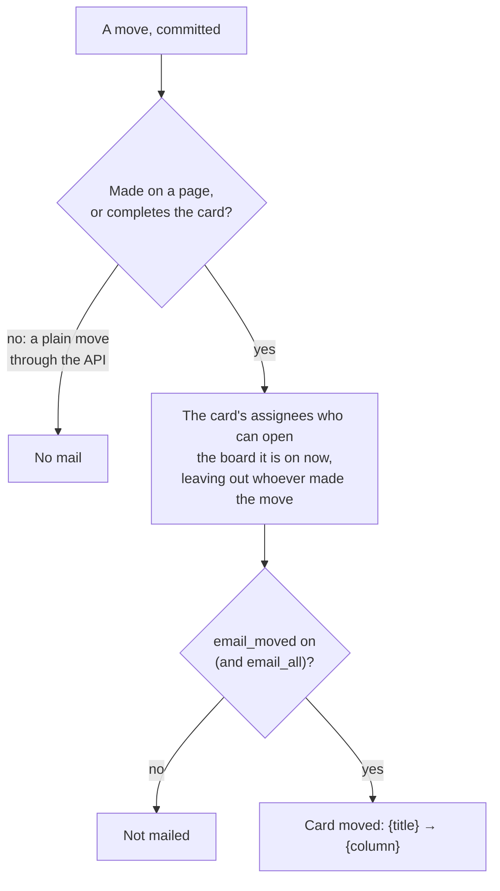

**Only assignees who can open the board are mailed** (card 2180). Taking someone off a
board, or out of the team it is shared with, leaves them assigned to its cards, and the
"Card moved" and "Unblocked" mails name the card, the board and who did what.
So `getAssigneeEmails(cardId, boardId, excludeUserId?)` in `notifications.ts` keeps only the
assignees who can open `boardId` (`whoCanOpen`, which asks `canViewBoard`): the board's
owner, a member of any role, a member of a team it is shared with, anyone for a public
board, and an administrator. `boardId` is the board the mail is about: the board the card
is on after the move for "Card moved" (a card moved to a
board an assignee cannot open is not mailed to them), and the waiting card's board for
"Unblocked". It is asked when the mail is sent, and preferences decide after it. Nobody is
unassigned by it.

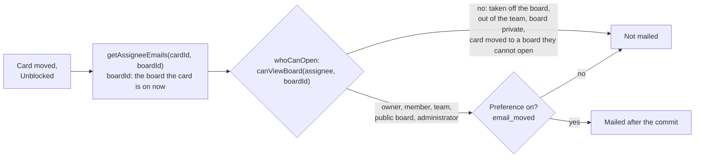

**Who a mention mails** (cards 2198 and 2207). A comment added on a page or through the API
(`POST /api/cards/{id}/comments`, `POST /api/v1/cards/{id}/comments`) is read for mentions
by `processMentions()` in `src/lib/server/mentions.ts`, inside the comment's transaction,
and each account it names is handed to `notifyMention()`. Only the two routes that add a
comment call it: an edit and a card's description mail nobody.

- **Whose name it is.** `findMentions(text, usernames)` in `src/lib/mentions.ts`, which the
  card window's chips use too, applies one rule. A mention starts at an `@` that begins the
  text or follows a character that is not a letter, a digit or `_` (of any language), so
  `bob@example.com` holds none. Its name is the longest username of any account that the
  text after the `@` begins with, case ignored, and the name must end there: not followed by
  a letter, a digit or `_`, nor by `.` or `-` and then one of those. So `@jane.doe` is the
  account `jane.doe` and never `jane`; `@jane.`, `@jane,` and `@jane's` are `jane`;
  `@Jane Doe` is the account `Jane Doe`; and if the longest name does not end there, the
  `@` names nobody. Where two usernames differ only in case, the one typed exactly is named,
  and neither when it is typed in neither spelling. The server reads every account's
  username once per comment (none when the text holds no `@`): matching against the board's
  people only could cut a longer name of someone off the board to a shorter name of someone
  on it. Only the first 200 `@` of a comment that could start a name are looked up (one at
  the end, or before a space or another `@`, cannot), each against the usernames that begin
  with its next letter, because this runs inside the comment's write: a mention after them
  mails nobody.
- **Who of them is mailed.** `notifyMention()` asks `whoCanOpen([user], boardId)` after it
  has found mail set up and before the preference, so an account that cannot open the card's
  board is mailed nothing and nothing is logged for it. The comment is saved and answered as
  it would be, and the author is not told which names were not mailed: an answer that said
  so would tell any editor whether an account of a given name exists and can open the board.
  The author is never mailed for their own mention.

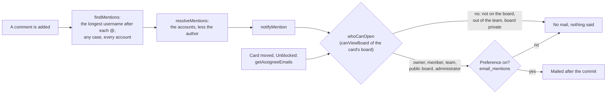

Comments written before are drawn with their chips by the same rule; no mail is sent again
for them.

### Text in Mail Is Text

Every text a mail carries is somebody's typing: a board's or grouping's name, a card's
title, a username, a comment, a schedule's name, the error a backup destination's server
answered. A report can be emailed to any address, so if such a text were put into a mail's
HTML as it was typed, anyone with an account could have the server's own sender deliver
HTML of their choosing to anyone: a link, or a styled "sign in again" button. The report
emailed by hand, the scheduled report and the backup failure mail did exactly that until
card 2149.

The rule now:

- **Every text put into a mail's HTML goes through `escapeHtml` where it is put**, a link in
  an `href` included. The five characters HTML reads as markup (`&`, `<`, `>`, `"`, `'`)
  become entities, so a board named `R&D <b>bold</b>` reads as exactly that in the mail.
- **One function does it**, `escapeHtml` in `src/lib/escape-html.ts`, which every mail and
  the `/docs` page use. `notifications.ts` had a function of its own for the same five
  characters; it is gone.
- **Left bare** are only a number, a value taken from a fixed table in the same function
  (the priority colours, the progress mail's headings) and a block of HTML built in the
  same function from values already escaped.
- **A subject is not escaped.** It is plain text, not HTML, and an escaped subject would
  show its reader `&lt;`. nodemailer replaces a line break in any header, so a name cannot
  add a header either.

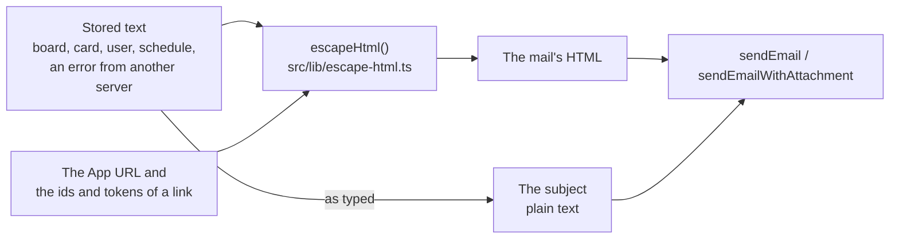

`tests/mail-escaping.test.ts` sends every mail with markup in every text it carries, and an
App URL with a quote in it, and fails if any recorded mail holds either as it was written.
It also fails if `notifications.ts` exports a mail it has no case for.

**Escaping keeps markup out, and not text.** A board named "Your account is locked: call
0800 123 456" is mailed as exactly those words, in the report's subject and in its body, and
a plain address or web address in a name may still be shown as a link by the reader's mail
client. Nothing in a mail can tell a reader that the words of a name are not DumpFire's own.
What bounds that is who a report can be mailed to, how many at once and in a day, and that
every report mail names the account behind it (card 2182): see
[Who a Report Can Be Mailed To](#who-a-report-can-be-mailed-to).

### User Notification Preferences

Stored as JSON in `users.notification_prefs`. Each user can toggle individual notification types, on My Account under **Email Notifications**.

There is one list of them, `NOTIFICATION_PREFS` in `src/lib/notification-prefs.ts`, a module with no server imports (card 2146). The account page draws its switches from it, `GET` and `PUT /api/account/notifications` make their defaults and their save from it (`defaultPrefs()`, every key on), and `shouldNotifyUser()` and `filterRecipientsByPref()` in `notifications.ts` take a key of it as their type, so `npm run check` refuses a mail that reads a key nobody can save. `GET` answers every key, so the page shows what is stored.

| Switch on My Account | Key | Read by |
|----------------------|-----|---------|
| All Email Notifications | `email_all` (`MASTER_PREF`) | Every mail below: `false` stops them all, whatever each says. On the page, turning it off turns every switch off, and on turns them all on |
| Task Assignments | `email_assigned` | User Assigned |
| Comments | `email_comments` | Comment Added |
| Mentions | `email_mentions` | User Mentioned |
| Card Moves | `email_moved` | Card Moved, and Unblocked |
| Task Requests | `email_requests` | Task Request, Conversation Message |
| Request Progress | `email_request_progress` | The progress mails of [Requester Progress Notifications](#requester-progress-notifications), Request Complete among them, to a requester who has an account. A requester without one has nothing to switch and is always mailed |
| Board Sharing | `email_board_shared` | Board Shared |
| Planning | `email_planning` | The mail about a new plan |

Until 2026-10-15 the page, the route and the mail kept three lists. The route's left out `email_request_progress` and `email_mentions`, so it neither answered nor saved them: the page offered Request Progress, whose switch went back on at every reload, and the progress mail was always sent; and the mention mail read `email_mentions`, which nothing offered, so it could be stopped only by switching all mail off. The page now offers **Mentions**, and both keys are saved and answered. No account had either stored, so a requester who switched Request Progress off before then is mailed until they switch it off again. A key not stored, or a preference that cannot be read, is on. A save that is refused, or gets no answer, puts every switch back as it was and says why under them.

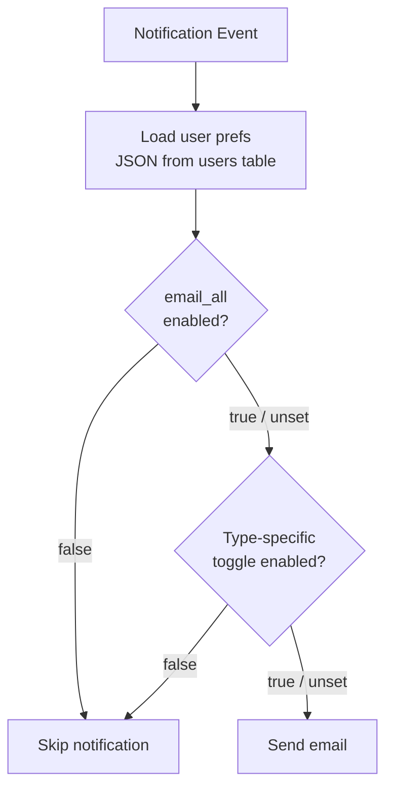

### Request Confirmation

A request submitted without an account sends one email, to the address the requester
gave, asking them to confirm. The **Task Request** email to the team is sent when they
do, not when the form is submitted — otherwise the form is a way for anyone to email the
team. Requests from signed-in users skip this and notify the team at once.

Every link emailed to a requester (`requestReplyUrl()` and `requestConfirmUrl()` in
`request-tokens.ts`) carries that request's own token. Links used to carry the
requester's email address, which is not a secret.

Each reply the requester sends through that link mails every member the request is
addressed to, so the requester may send 20 replies to one request in an hour, and the 21st
is refused `429` with nothing saved and nothing mailed. A reply from the team starts the
count again. See [Authentication & Security](authentication-security.md#the-public-request-form).

### Requester Progress Notifications

When a task request is accepted and converted to a card, the requester receives progress emails:

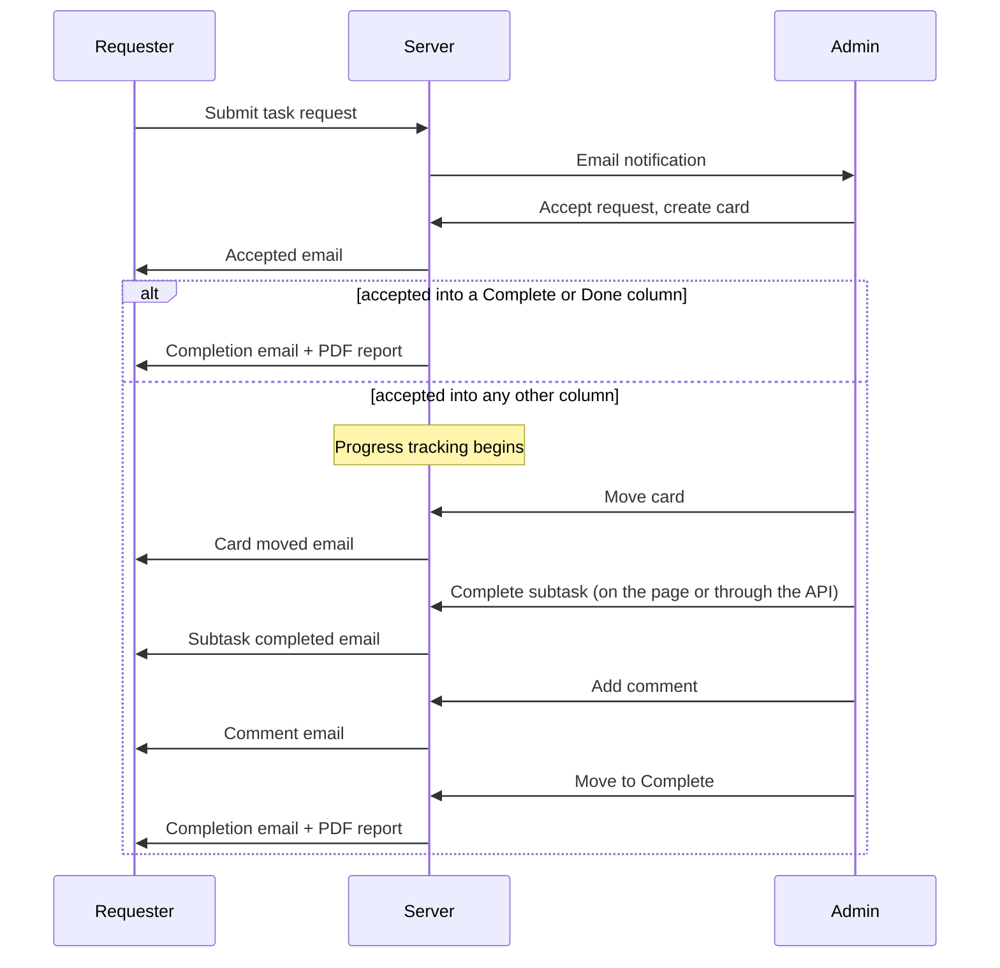

**Which address a requester is mailed at** (card 2171). Every mail to a requester, these
and "Request accepted", "Request declined", the team's reply and a new link, goes to
`requesterAddress()` in `src/lib/server/request-access.ts`, asked when the mail is sent: for
a request made while signed in (`requester_user_id` set), the account's `users.email` as it
is then; for one made without an account, the address given on the form
(`requester_email`); and to nobody, with nothing sent, when the account named is not there
or there is no address at all. The address stored when a request is made is still written,
but a requester who changes their account's email is mailed at the new one from then on.
"When it is sent" is when the action is taken, inside its transaction, for a reply, an
acceptance or a decline, and after the commit, when the row is read, for the progress and
completion mails. When an account is deleted, its email is written onto each of its
requests first, so they go on being mailed at its last address. The inbox shows the same
address.

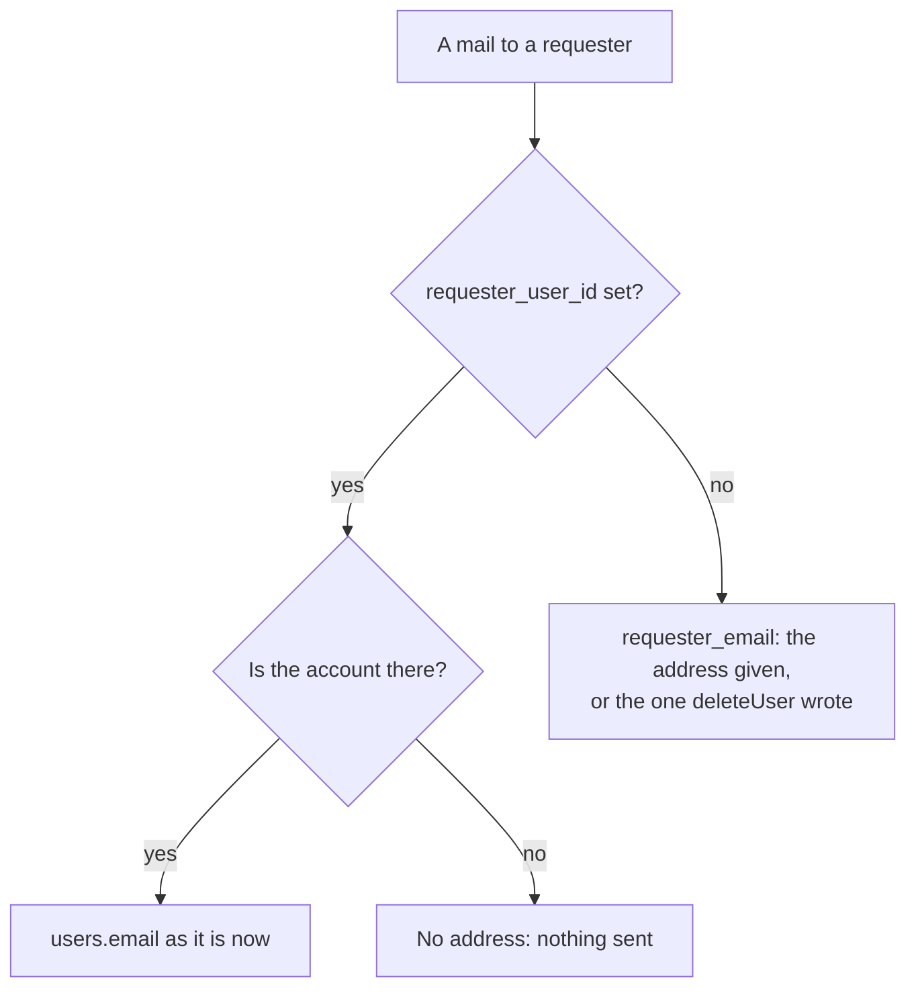

On card completion, a **PDF task report** is automatically generated and attached to the completion email. A request accepted straight into a Complete or Done column makes a card that is completed as it is created (see [Data Model](data-model.md#one-completion-however-a-card-arrives)), so the requester is sent "Request accepted" and then the completion email with its report (card 2134). A subtask ticked through the API mails the requester as one ticked on the page does (card 2108). No progress email goes to a requester who made the change themselves, and none but the completion email once the card is complete.

### A Report Emailed on Demand

The Reports page's **Email** sends `POST /api/reports/email`, which answers with what was
sent (card 2113). It used to answer `200` "Report sent to N recipient(s)", with every
recipient's `success` true, whatever the mail server answered and with no mail set up at
all, and the dialog closed. The recipients are each an address, read with the other fields
before the report is made: one that is not is `400` `recipients[<n>] must be an email
address`, naming its place in the list, and nothing is sent (card 2117). Since card 2182
they are also read as the mailer reads them, at most 10 distinct addresses a call and 100 a
day from one account, each address sent one mail once: see
[Who a Report Can Be Mailed To](#who-a-report-can-be-mailed-to).

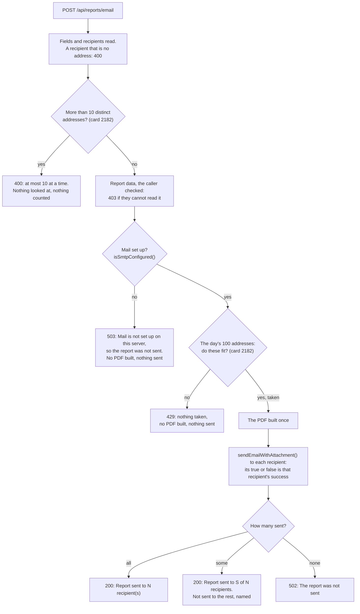

| Answer | `message` | `results` |
|--------|-----------|-----------|
| `503` | `Mail is not set up on this server, so the report was not sent. The superadmin sets it up on the admin page.` | None |
| `200`, all sent | `Report sent to <n> recipient(s)` | `{ email, success: true }` for each |
| `200`, some sent | `Report sent to <s> of <n> recipients. Not sent to <addresses>. The mail server did not accept it. An administrator can see the reason in the system log.` | Each recipient, a failure with `success: false` and the `message` `The mail server did not accept it. An administrator can see the reason in the system log.` |
| `502`, none sent | `The report was not sent. The mail server did not accept it. An administrator can see the reason in the system log.` | As above, every one a failure |

- **The mail server's own reason is not in the answer.** `email.ts` writes it to the system
  log, an `ERROR` line under `EMAIL` for each address, which an administrator reads on the
  Audit page's console. The gate writes the line of every `5xx` answer at `ERROR` too, a
  `503` and a `502` from here among them.
- **The answer says which addresses the mail server accepted.** Each recipient's `success`
  is whether the mail server took the mail for that address, so a mail server that refuses
  an unknown mailbox as the mail is sent tells the sender which of the addresses they typed
  exist there. That is accepted as designed: the sender needs it to send to the rest again.
  Since card 2182 a call names at most 10 addresses, and one account at most 100 in a
  24-hour window counted from its first (so up to 200 across one window's end and the next's
  start), and that is all one account can learn so in a day. See
  [Authentication & Security](authentication-security.md#what-an-emailed-reports-answer-tells).
- **A report that reached some recipients is `200`, not a failure status**, so that nothing
  in between offers to send it again: the ones who had it would get it twice. The Reports
  page shows it as a failure all the same, keeps the dialog open, and leaves only the
  addresses not reached in the box, saying so, so that Send goes to those alone. A `503` or
  a `502` is shown in the dialog with the box as it was.
- **Each answer is written with its own status**, as `tests/error-shape.test.ts` requires
  of a failure answered with `json()`.

### Who a Report Can Be Mailed To

A report goes from the company's own sender, which mail providers trust, and its subject
and body carry names as somebody typed them. Until card 2182 a report emailed by hand went
to as many addresses as one request named (300 outside addresses, twice over, were sent in
the plan's probe), a schedule held as many as it was given (2,000), and an account could
make any number of schedules. A mass send also spends the sender's daily quota at the mail
provider, which once spent stops every other DumpFire mail until it resets.

**The report is its sender's or its owner's view** (card 2150). A report emailed by hand is
built as its sender may read it, and a scheduled one as its owner's account stands at the
run: the sub-boards that person can open, and no parent board they cannot open by name.
Every recipient is sent that same report, whoever they are; an account gives a recipient
neither more nor less. See
[Whose Report It Is](backup-reporting.md#whose-report-it-is).

**Any address may still be a recipient**, an account's or not, and every report mail names
the account behind it: the one emailed by hand says "Sent by `<username>` via DumpFire",
and a scheduled one now says "Set up by `<username>`" above "— DumpFire Automated Reports",
the username escaped as every text in a mail is. The gate's line for each request names the
account on the Audit page too. What is bounded is how many.

| Limit | Where | Refused |
|-------|-------|---------|
| 10 distinct addresses a call | `POST /api/reports/email`, before the board or the caller's access is looked at, administrators included | `400` `A report can be emailed to at most 10 addresses at a time, and this names 12. Nothing was sent.` |
| 10 addresses a schedule | `POST /api/report-schedules`; `PUT /api/report-schedules/{id}` when it sends a changed list | `400` `A schedule can be sent to at most 10 addresses, and this names 12. The schedule was not saved.` (`The schedule was not changed.` for the `PUT`) |
| 20 schedules an account | `POST /api/report-schedules`, counting the caller's own | `409` `You have 20 report schedules, the most one account may have. Delete one first.` An account that already has more keeps them all, and is told `You have 25 report schedules, and the most one account may have is 20. Delete 6 first.` |
| 100 addresses a day an account | The report emailed by hand; every schedule made, turned on, or re-timed while on; and the addresses a changed list adds | `429` `Reports can be emailed to at most 100 addresses a day from one account, and this would make 104. Try again in 5 hour(s).`; for a schedule, `Report mail can reach at most 100 addresses a day from one account, and this schedule's 10 would make 104. The schedule was not saved. Try again in 5 hour(s).` (`was not changed.` for the `PUT`, and `this schedule's 4 new addresses would make 104` when a changed list is what does not fit) |

Each refusal is whole: nothing is sent, saved or counted. The wait is in hours, rounded up,
for an hour or more, and in minutes under an hour.

#### One reading of a list

`reportRecipients(input)` in `src/lib/report-recipients.ts` reads a list of recipients, as
the email route takes one (a list of texts) or as a schedule keeps one (one text). It
imports nothing from the server, so the Reports page uses it too. The email route, both
schedule routes, the scheduler and the page all read a list through it, so the number the
server holds a list to is the number the page shows and the number of mails sent.

- **Each text is split on commas, semicolons and white space** (spaces, tabs, new lines);
  each part is trimmed and lower-cased, and empty parts and repeats are dropped.
- **A part written `<address>` is the address inside.** So `Alice Smith <alice@x.test>` is
  the address `alice@x.test` and two parts that are not addresses, `alice` and `smith`.
- **An address** has one `@` with a dot after it, at most 254 characters, no white space,
  none of `< > ( ) [ ] \ , ; : "`, and no control or format character (Unicode's `\p{C}`:
  a right-to-left override, U+202E, turns the text after it round on the page, so the
  address shown would not be the one mailed). It answers `{ addresses, notAddresses }`, each in
  the order first written. `MAX_REPORT_RECIPIENTS = 10` is beside it.

Why those separators and that rule: the mailer (nodemailer's address parser) reads
`a@x.test;b@x.test` as two addresses in one mail, each in view of the other; an address on
one line with another on the next as one address, the second being its display name, which
is never mailed; and parts the old pattern took, such as `a@b.c<x>` and `abc<def>@x.com`, as
mail to `x` and to `def`. Each address is now handed to the mailer on its own, and is
exactly one recipient, the one the page shows. So a schedule typed with semicolons sends one
mail to each address where it sent one mail to all of them; one typed an address to a line
reaches every address where it reached only the first; and an address written twice, in
any case, is mailed once.

What each reader does with a part that is not an address:

- **The email route** refuses it in card 2117's words, `recipients[<n>] must be an email
  address`, naming its place in the list. An entry the mailer would send to someone else, or
  with no dot after its `@`, is refused so too, where card 2117's own rule took it. The
  answer's `results` carry each address lower-cased.
- **The schedule routes** refuse it, `400`, with nothing saved:
  `recipients holds "smith", which is not an email address`, or several,
  `recipients holds "alice", "smith", which are not email addresses`, up to five named, each
  cut to 100 characters, then `and 3 more`. A list is stored as the addresses it will be
  sent to, lower-cased, each once, separated by `, ` (`readReportRecipients` in
  `src/lib/server/request-body.ts`), at most 2,000 characters. A `PUT` that sends the stored
  list back as it is keeps it unchecked, so a page that sends the whole row back can still
  rename or switch off a schedule kept with more than 10, whether it is on or off: `enabled:
  true` is refused only when it would turn such a schedule on.
- **The scheduler** sends to the addresses and never to the other parts, and names the
  parts it left out at the end of the run's line: `Left out, as not email addresses:
  "alice", "smith".` A schedule stored as `Alice Smith <alice@x.test>` before the rule still
  reaches Alice, and is not switched off for the rest.
- **The Reports page's email dialog** says it, and sends nothing:
  `"x" is not an email address. Nothing was sent.` (`"x", "y" are not email addresses.` for
  several). Its hint reads "Up to 10 addresses, separated by commas", and the schedule
  form's "Up to 10 addresses, separated by commas. The report is emailed to each." The
  schedule list counts each schedule's addresses through `reportRecipients`, where it
  counted commas and showed one recipient for a list typed with semicolons.

#### The day's 100

`takeReportMail(user, n, spend)` in `src/lib/server/reports.ts` takes `n` addresses from the
account's allowance, `REPORT_MAILS_PER_DAY = 100`, through `takeAllowance` in
`src/lib/server/rate-limit.ts`, keyed `report-mail:<userId>`. It counts addresses, not
calls: one call of ten addresses is ten. The day is a fixed 24 hours from the account's first
take, and a take that would pass 100 is refused whole and takes nothing. So "100 a day" is
100 in a window counted from the first take, not a calendar day: an account that spends its
100 at the end of one window and another 100 at the start of the next has reached 200
addresses within minutes.

- **The report emailed by hand** takes its addresses after the body, the cap, the caller's
  access and the `503` for a server with no mail set up, and before the PDF is built. A call
  refused for any of those spends nothing. What it takes is not given back when the mail
  server refuses a send: the attempt was made.
- **A schedule pays when it is made, turned on or re-timed while on**, because each of those can bring
  a send forward. A schedule made for the next minute is sent at the scheduler's next tick,
  and deleting it makes room for another: by the plan's probe, one account mailed 10, 20,
  then 30 outside addresses in six minutes of clock that way, and with 20 schedules it would
  have been 200 a minute. So `POST /api/report-schedules` takes the new schedule's
  addresses, and `PUT /api/report-schedules/{id}` takes the schedule's addresses as they will
  be after the change when it turns the schedule on (`enabled: true` on one that is off) or
  sends a `frequency`, `dayOfWeek`, `dayOfMonth`, `timeOfDay` or `timeZone` other than the
  one stored. A new zone (card 2159), like a new time, can bring a send forward to any time,
  the next minute included, and is paid for in the same way. A schedule that is off after
  the change sends nothing, so re-timing it takes nothing; turning it on pays then.
- **A changed list pays for the addresses it adds.** When a `PUT` does neither of those and
  sends a list that reads differently from the stored one, it takes the addresses of the
  new list that are not in the stored list: a schedule of one address given ten takes nine.
  A schedule made with no addresses costs nothing, so until the review of card 2182 one made
  empty, given ten by a change, sent and deleted, over and over, mailed 120 to 150 addresses
  a day with no `429`. The stored list sent back in another order or case, or cut down,
  takes nothing, nor does a change of name or filter, or turning it off. The take is the
  last check, immediately before the write in the same transaction, with nothing awaited
  between them, so two requests cannot both fit in the last of the allowance. Nothing is
  given back when a schedule is deleted, or when a list is cut down.
- **A scheduled run takes nothing.** It would otherwise be dropped, with nobody told, on a
  day its owner had also mailed by hand.
- **The first refusal in each window is one `WARN` line** under `REPORTS`:
  `Account "<username>" (user N) reached its limit of 100 report mail addresses a day:
  report mail, and schedules made, turned on, re-timed or given new addresses, are refused
  until the day is up`, with the account as the line's user, so the Audit page finds it by
  user, and `{ used, asked, retryAfterSecs }` as its detail. The refusals after it in the
  same window are not logged; the gate writes its own line for every `429`.
- **In memory**, as every count in `rate-limit.ts` is: a restart starts the day again.

So an account's scheduled mail is at most its 20 schedules of 10 addresses each, on their
own timetables; and the mail it sends by hand, together with the schedules it makes, turns
on, re-times or gives new addresses, reaches at most 100 addresses in a window. Someone who makes five schedules of ten
and then emails reports by hand has 50 left that day.

#### A schedule kept from before with more than 10

A schedule made before the cap can hold more than 10 addresses. At its next due run the
scheduler reads its list, and over 10 it switches the schedule off and sends nothing, before
the report is built. The write is conditional (`enabled = 0 … WHERE id = ? AND enabled = 1`),
and only the run that changed the row writes the one `ERROR` line under `REPORTS`, naming
the schedule's owner, who is also the line's user, so the Audit page finds it by user:

```
Report schedule 12 "Weekly sales", owner "pat" (user 7), was switched off: it is sent to 15 addresses, and the most is 10. Nothing was sent. Its owner can delete it and make it again with at most 10.
```

- **The Reports page says why.** In place of the count, the schedule reads
  "15 recipients: the most is 10, so it is not sent", with its addresses beneath as text
  that can be selected and copied, and "Copy the ones to keep into a new schedule of at most
  10, then delete this one." The page has no way to edit a schedule's list, so this is where
  its owner finds the addresses before deleting it.
- **It cannot be turned on as it is.** A `PUT` with `enabled: true` on such a schedule
  that is off is `400`
  `This schedule cannot be turned on: it is sent to 15 addresses, and the most is 10. Delete it and make it again with at most 10.`,
  and nothing changes. `enabled: true` on one still on, as a page sends the row back with
  a new name, is not a turning on and is accepted. A `PUT` that sends a list of 10 or fewer
  and `enabled: true` together is accepted, and when that turns the schedule on it takes the
  new list's addresses from the day's 100. Turned back on, its next run is worked out again
  from now (card 2159), so it is sent at its next time, not at once.
- **Before the deploy**, the query in
  [The Update That Brings the Limits on Report Mail](deployment.md#the-update-that-brings-the-limits-on-report-mail)
  lists each schedule's addresses as this rule counts them: any above 10 is switched off at
  its next run unless it is remade first. Remade after the deploy, each new schedule takes
  its addresses from the day's 100.

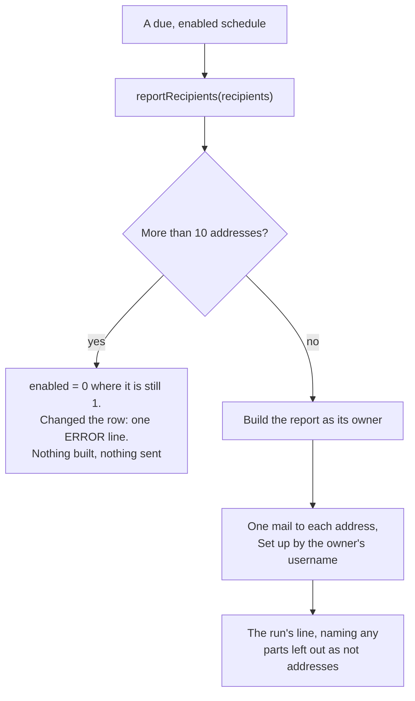

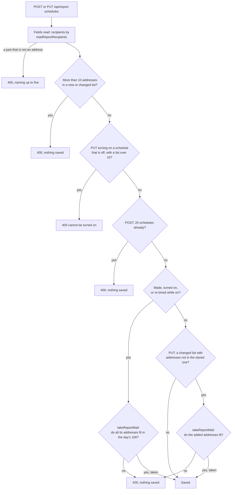

## Real-Time Updates via SSE

### Architecture

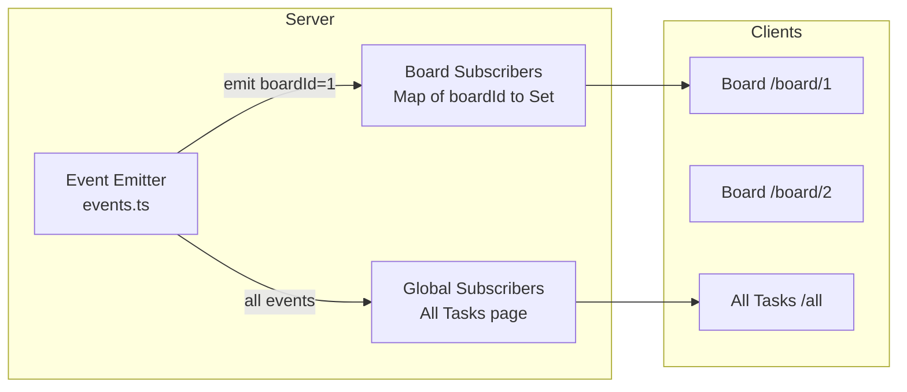

### Event Types

| Event | Payload | Trigger |
|-------|---------|---------|
| `update` | `{type: 'card'}` | Card updated, moved, archived, restored or deleted. A creation carries `action: 'created'`, `cardTitle`, `userName` and `userEmoji`, an accepted request's card among them (card 2108). Someone assigned to a card (also when they already were) or taken off it, on a page or through the API (card 2143). Also sent, beside the comment event below, to the board of a card an "Unblocked" notice is written on. Not an archive of a card already archived, on a page or through the API, which writes and sends nothing (card 2285). A change of position within a column, by a drag, the v1 move or `PUT /api/cards/{id}`, carries `action: 'reorder'`, `userName` and `userEmoji` (the card update sent a bare `{type: 'card'}` for it until card 2288) |
| `update` | `{type: 'comment', cardId}` | A comment added or edited on the card, on a page or through the API, sent last, once the comment, its entry and its mail are queued (card 2282; an edit sent `{type: 'card'}` until then); a comment deleted, on a page or through `DELETE /api/v1/comments/{id}`, once the row is gone and its `comment_deleted` entry written (card 2283; a delete sent nothing), so a window open on the card loses it; and an "Unblocked" notice written on the card, which is a comment. Not a comment saved with its text unchanged, which sends nothing (card 2284). Every page re-reads on it as on any update; a card window open on that card (the board page, All Tasks, All To Do) also reads its comments again, 250 ms on so a burst is one read, without "Loading comments..." and keeping a comment being edited, so another person's comment shows without reopening the card. The window does the same after a reconnect or a return to the tab, which may have missed one. The plan page's window, which has no stream, does not |
| `update` | `{type: 'attachment', cardId}` | A file attached to the card or deleted from it in the card window's Files tab, once the row and its `attachment_added` or `attachment_deleted` entry are committed (card 2337; neither sent anything, nor was recorded). Every page re-reads on it as on any update; a card window open on that card (the board page, All Tasks, All To Do) whose files it has already read (its Files tab opened once) reads them again, 250 ms on so a burst is one read, without "Loading attachments...", so another person's new file shows, or a deleted one goes, without reopening the card; the tab's count follows. It does the same after a reconnect or a return to the tab. A window that has not read its files reads them when its Files tab is opened, as before. Not sent through `/api/v1`, which serves no attachments; the plan page's window does not follow |
| `update` | `{type: 'column'}` | Column added, renamed, reordered, deleted |
| `update` | `{type: 'board'}` | The board updated: renamed, its emoji or dashboard grouping changed, or made public or private, on a page or through the API (card 2143); or put under a card or taken out from under one, which only a page can do (`PUT /api/boards/{id}` with `parentCardId`: `PUT /api/v1/boards/{id}` reads no `parentCardId`). Sent once to the board, and once to each board whose card it joined or left. A request that sent no field sends nothing |
| `update` | `{type: 'label'}` | A label of the board made, renamed, recoloured or deleted, or put on or taken off one of its cards: on a page (`POST`, `PATCH`, `PUT` and `DELETE /api/labels`), or through the API (`POST /api/v1/boards/{id}/labels`, `PUT` and `DELETE /api/v1/labels/{id}`, `POST` and `DELETE /api/v1/cards/{id}/labels`) |
| `update` | `{type: 'category'}` | A category of the board made, changed or deleted: on a page (`POST /api/categories`, `PUT` and `DELETE /api/categories/{id}`), or through the API (`POST /api/v1/boards/{id}/categories`, `PUT` and `DELETE /api/v1/categories/{id}`). A shared category, of no board, tells no board |
| `update` | `{type: 'subtask'}` | A subtask of one of the board's cards made, saved or deleted on a page (`POST /api/subtasks`, `PUT` and `DELETE /api/subtasks/{id}`). The same through the API sends `{type: 'card'}`. Not a save that changes nothing, on a page or through the API, which writes and sends nothing (card 2299) |
| `update` | `{type: 'milestone'}` | A milestone changed (its name, description, target date or board), closed, reopened or deleted, on a page or through the API (card 2289): sent to each board its entries go on, its own board, or each board holding its cards for one across boards, and on a change of board the boards before and after. A delete is also sent to every board a released card is on, so an open board drops the goal's 🎯 chip without a reload. Not a change that changes nothing. A card put in a milestone or taken out sends `{type: 'card'}`, and only when something was written. Every page re-reads on it as on any update; the plan page has no stream |
| `update` | `{type: 'board', action: 'created'}` | A sub-board was made under a card on this board, on a page or through `POST /api/v1/boards` (card 2143). Nothing is sent for a board made at the top level |
| `update` | `{type: 'board', action: 'deleted'}` | The board was deleted, or was a sub-board deleted with a board, card or column |
| `update` | `{type: 'board', action: 'sub_board_deleted'}` | A sub-board deleted on its own hung from a card on this board, which is still there |
| `update` | `{type: 'card', action: 'purged'}` | Archived cards on the board were purged, or the board was a sub-board removed by the purge |
| `update` | `{type: 'card', action: 'cleared'}` | The board's cards were cleared, or it was a sub-board removed by the clear |
| `xp-update` | `{}` | XP was given for a completion |
| `celebrate` | `{type: 'complete', cardTitle, userName, userEmoji, xpGained}` | A card moved into a Complete column, or created in one (card 2134). One event for a drop of several cards, naming the last |
| `update` | `{type: 'card', action: 'moved_away', cardTitle, fromColumn, toColumn, userName, userEmoji}` | A card moved to another board, sent to the board it left. `action: 'moved_in'`, with the same fields, goes to the board it joined. Neither names the other board (card 2181) |

The four delete payloads say what kind of change it was and nothing more: no board name,
card title or user (card 2108). The board of a sub-board's card can be viewed by people who
could never open the sub-board, and the page only reads its board again, under its own
access check. Restoring a card that is not archived, from a page, writes nothing and sends
nothing. Nor does a card update that changes nothing, on either tree: every field sent at
the value the card holds is no change, and sends no `update` (card 2183).

The two events of a move between boards carried the other board's name, `toBoard` on
`moved_away` and `fromBoard` on `moved_in`, until card 2181. An event goes to every listener
of its board, on the board stream and the global one, and some of them cannot open the other
board; nothing on any page read either field, which only makes the page read its board
again. The move's two activity entries name neither board for the same reason.

### Connection Lifecycle

1. A board page opens `GET /api/boards/{id}/events`, for the board it shows; All Tasks, the dashboard and the burndown page open `GET /api/events`, the stream of every board the reader can open. Each is opened through `keepStreamOpen()` (`src/lib/live-stream.ts`)
2. Server creates SSE stream with `text/event-stream` content type
3. Server calls `subscribe(boardId, listener)` or `subscribeGlobal(listener)`
4. On board mutation, server calls `emit(boardId, event, data)`. Inside a transaction the event is held until the commit, and dropped if the transaction rolls back, so a page told to refresh always finds the change there
5. All subscribed listeners receive the event
6. On client disconnect, unsubscribe callback cleans up the listener set

A board page listens to the board it shows. SvelteKit keeps a page when only its address's
board changes, so `src/routes/board/[id]/+layout.svelte` makes the page afresh for each
board (`{#key page.params.id}`, card 2184): after a sub-board badge, a breadcrumb, a link in
the card window, or Back and Forward to another board, the first board's stream is closed as
its page is destroyed and the second board's opened as its page mounts. A link to a card on
the same board (`?card=`) keeps the page and its stream.

The global stream carries card titles and who did what on every board, so a subscriber
is only sent events from boards they can view. The check is made at a board's first event
and kept until the stream's next heartbeat, which forgets every answer (card 2170): a share
taken away stops what it sends of that board from its next heartbeat. Administrators
receive everything. A board that has been deleted can be viewed by nobody but an
administrator, so a member's dashboard is not told of its deletion, and catches up when it
is next brought to the front. A page open on the board itself is told, by the board's own
stream, as the delete commits: it reads the board again and shows "Board not found".

The board stream opens only on a board that is there and that the caller can open (`404`,
administrators included; `403`; `400` for an id that is not one), and asks again at each
heartbeat, of the account as it is now (card 2170). When the board has gone or the account
can no longer open it, it sends one last `update` with `{"type":"access"}`, on that stream
alone, and ends; the page re-reads and shows "You do not have access to this board" or
"Board not found". A deleted board's own event always arrives first. See
[An Open Stream and Its Session](authentication-security.md#an-open-stream-and-its-session).

## Webhooks

Board-level webhooks fire HTTP POST requests to configured URLs when events occur.

### Configuration

| Field | Type | Description |
|-------|------|-------------|
| `url` | string | Target HTTP endpoint |
| `secret` | string | Shared secret for signature verification |
| `events` | JSON array | Event types to subscribe to |
| `active` | boolean | Enable/disable toggle |

Each webhook also records `set_by` (card 2168, migration 0056): the account that last set its
address or its secret, the caller of the `POST` that made it, or of a `PUT` that changed
either. No answer gives it. It is what taking an account back reads: see
[Who May Change a Webhook](#who-may-change-a-webhook). It is also what every delivery checks
(card 2325): a webhook is sent only while that account can open the board, and one with no
`set_by` is held: see
[When Nobody Who Can Open the Board Set It Up](#when-nobody-who-can-open-the-board-set-it-up).
Every webhook is sent through the
rules of [Where a Webhook May Send](#where-a-webhook-may-send), and a board holds at most 10
([How Many Webhooks a Board May Have](#how-many-webhooks-a-board-may-have)).

**A webhook's secret is in no backup** (card 2169). In a backup's copy every webhook that had
a secret has `secret` empty and `active` off, and is listed in the `webhook_secrets_left_out`
setting with whether it was on: switched off so that a backup put in place as the database
by hand sends nothing unsigned. Its address and events are kept. An Import Backup on the
server the backup came from, of the file as that server made it, puts each secret back from
the webhook here with the same id, board, address and setter (`set_by`, none and none alike),
and switches the webhook on or off as it was. A secret here set by another account than the
one the backup's row names was set again since the backup: it is not filled, and the webhook
is listed to enter again, as one whose address has changed is. A backup changed since, or made by another server, has none put back: its seal does
not verify. Anywhere else such a webhook
stays off with no secret, the import's result lists it with its board, and every start says
so, until the board's owner or an administrator sets its secret and switches it on with
`PUT /api/v1/webhooks/{id}` and `{ "secret": "…", "active": true }`, or deletes it. A webhook
made without a secret is in a backup as it is.

### Who Can See the Secret

The secret is what lets a receiver trust that a delivery came from DumpFire, so anyone
holding it can forge one. The delivery address goes with it (card 2133): an address can
name a server inside the network, or carry a user name and password before the host. Both
are returned by the API only:

- in the response to the `POST` that created the webhook, to the caller who supplied them;
- on a read or update, when the caller is the **board owner or an administrator**.

Every other caller — board editors and viewers included — gets the webhook without a
`secret` field and without a `url` field, on both reads and in the answer to an update, an
editor's own update of the address included. The keys are left out, not set to null.
`hasSecret` (boolean) is always present and says whether a secret is set, and `events` and
`active` are given as before. Before October 2026 the secret was returned to anyone who
could view the board, and until 2026-10-14 the address was. Since card 2154 an editor cannot
change either: see [Who May Change a Webhook](#who-may-change-a-webhook).

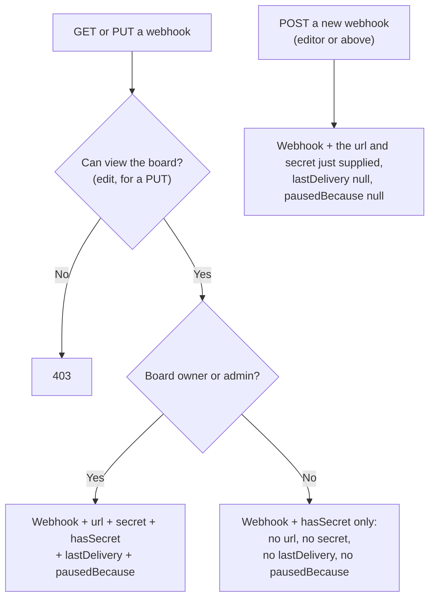

All webhook responses are built by `presentWebhook(hook, reveal)` in
`src/lib/server/webhooks.ts`, which leaves out `url`, `secret`, `lastDelivery` (card 2178,
[Last Delivery](#last-delivery)) and `pausedBecause` (card 2325,
[When Nobody Who Can Open the Board Set It Up](#when-nobody-who-can-open-the-board-set-it-up))
together unless `reveal` is true, so no route can return the raw row. It leaves out `setBy`
for every caller. The create's answer is made inside the transaction that saved the webhook,
since `pausedBecause` reads whether its setter can open the board; it is always `null` there,
because the caller can edit the board and is the setter.

### Who May Change a Webhook

The people who may read a webhook's address and secret are the ones who may change them, and
the ones who may switch a webhook on (card 2154):

| On a board, through `/api/v1/` | Editor | Board owner or administrator |
|-------------------------------|--------|------------------------------|
| Create a webhook (`POST /boards/{boardId}/webhooks`), with the address they type | ✅ | ✅ |
| Change its `events` | ✅ | ✅ |
| Switch it off (`PUT /webhooks/{id}`, `{"active": false}`) | ✅ | ✅ |
| Send `"active": true` for a webhook that is already on (a value unchanged) | ✅ | ✅ |
| Switch it on: `"active": true` for a webhook that is off | ❌ `403` | ✅ |
| Send `url` or `secret` at all, whatever the value: a new one, the stored one, `null` | ❌ `403` | ✅ |
| Delete it | ✅ | ✅ |

An editor's refusals are `403` `Only the board's owner or an administrator can change a
webhook's address or secret. Ask the board's owner.` and `403` `Only the board's owner or an
administrator can switch a webhook on. Ask the board's owner.`, and nothing in the request is
written. An editor whose own webhook their own password reset switched off asks the owner too,
or deletes it and creates it again. A viewer is `403` `No edit access to this
board`, as before. The stored address sent back unchanged is refused to an editor too, because
accepting it would let them test guesses at an address they cannot read. Switching a webhook
on is choosing again to send the board's events to an address the editor cannot see, perhaps
an intruder's that a password reset switched off. A script that sends back the whole answer of
the `POST` (it carries `url` and `secret`) with a changed `events` is now refused: send only the
fields that change.

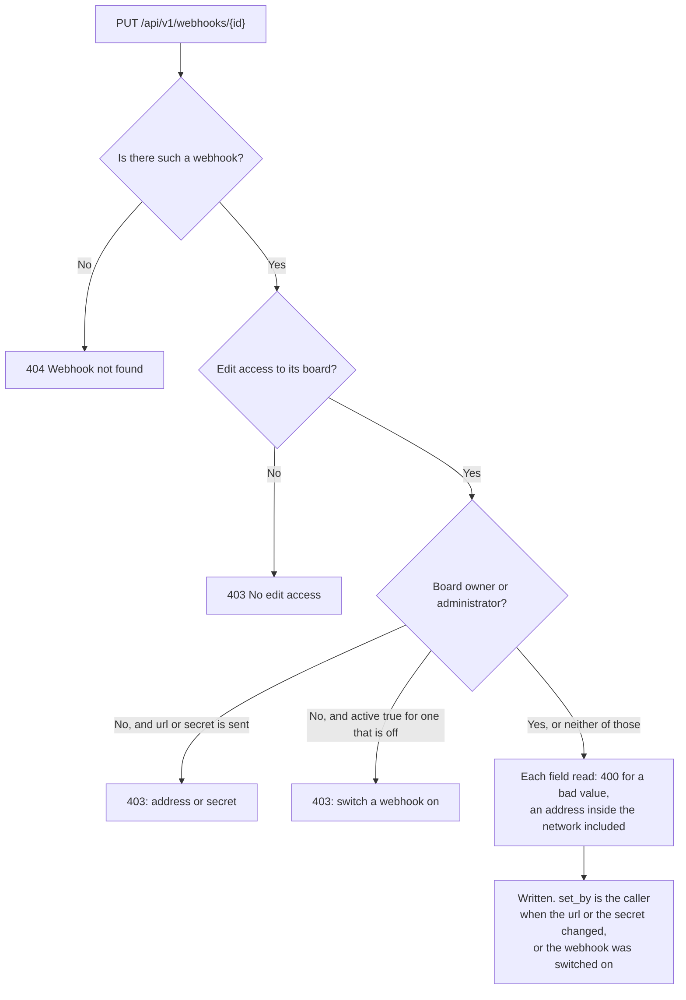

**Who set it.** `set_by` is the account that last set the webhook's address or secret, or
switched it on: the `POST`'s caller, and the caller of a `PUT` whose `url` or `secret` differs
from what is stored, or that switches the webhook on (after the rule above, the board's owner or
an administrator). Sent back unchanged, and `"active": true` for one already on, they set
nothing. The `POST` and the `PUT` ask again, in the transaction that writes, that the caller's
key is still there: a key a reset ended while the request's body was arriving is `401` `Invalid
or expired API key`, with nothing written. Taking an account back switches off every webhook it set that is on: an
administrator's password reset, an invite used, the holder's own change with "End my API keys
too" (or "Switch off the N webhooks I set up") ticked, and deleting the account. A webhook with
no setter (made before migration 0056, or whose setter's account was deleted) is left on by
these, and held at every delivery since card 2325. A
webhook switched off this way keeps naming its setter, and is switched on again by the board's
owner or an administrator with `PUT /api/v1/webhooks/{id}` and `{"active": true}`; no page
shows webhooks. See [What Setting a Password Ends](authentication-security.md#what-setting-a-password-ends).

**Taking over a held webhook** (card 2325). A webhook whose setter can no longer open the
board, or that has none, is held, not switched off. The board's owner or an administrator
takes it over in two requests: `PUT /api/v1/webhooks/{id}` `{"active": false}`, then
`{"active": true, "secret": "<new>"}`. Switching it on makes them its setter, so it is sent
again; a new secret, because the former setter knows the old one and could forge deliveries
to the receiver, which may be the company's own system; and then the receiver is updated with
the new secret. `{"active": true}` for a webhook already on is no change and takes nothing
over. The address was chosen by the former setter: delete the webhook unless you recognise
it. Whoever takes it over answers for it: a reset of their account, or deleting it, switches
it off. Prefer the board's owner where they have a key. A single `PUT {"secret": "<new>"}`
also takes it over, with no gap while it is off. Off then on, with no secret change, takes
over a receiver that does not check signatures.

### Where a Webhook May Send

A webhook is a request this server makes to an address a caller typed. With no rule it would
send a board's events to anything the server can reach and the caller cannot: the server itself
(loopback), the Docker host and its other containers, the office or cloud network, and the cloud
metadata service at `169.254.169.254`. So **an address inside the network is refused** (card
2161): when a webhook is registered or its address changed, as written, and at every delivery,
as written and as resolved. `src/lib/server/webhook-address.ts` holds the rule; `insideReason()`
is the one judgement of an address for both.

An address is inside if it is in these tables, the IANA special-purpose addresses that are not
globally reachable, condensed. Everything else is outside. The words are the ones the refusals
use.

| IPv4 | Refused as |
|------|------------|
| `0.0.0.0/8` | a "this network" address, which reaches this server |
| `10.0.0.0/8`, `172.16.0.0/12` (Docker's own networks), `192.168.0.0/16` | a private network address |
| `100.64.0.0/10` | a shared address (carrier NAT, Tailscale) |
| `127.0.0.0/8` | a loopback address |
| `169.254.0.0/16` | a link-local address, where the cloud metadata service is |
| `192.0.0.0/24` | an IETF protocol address |
| `192.0.2.0/24`, `198.51.100.0/24`, `203.0.113.0/24` | a documentation address |
| `192.88.99.0/24` | a 6to4 relay address |
| `198.18.0.0/15` | a benchmarking address |
| `224.0.0.0/4` | a multicast address |
| `240.0.0.0/4` | a reserved address |

| IPv6 | Refused as |
|------|------------|
| `::ffff:0:0/96` (mapped), `64:ff9b::/96` (NAT64), `2002::/16` (6to4) | judged by the IPv4 address it holds: `[::ffff:7f00:1] is a loopback address (it holds 127.0.0.1)` |
| `::/128` | the unspecified address, which reaches this server |
| `::1/128` | a loopback address |
| `64:ff9b:1::/48` | a local-use NAT64 address |
| the rest of `::/8` | a reserved address (the retired IPv4-compatible form, and SIIT's `::ffff:0:0:0/96`) |
| `100::/64` | a discard-only address |
| `2001::/23` | an IETF protocol address (Teredo and benchmarking among it) |
| `2001:db8::/32`, `3fff::/20` | a documentation address |
| `5f00::/16` | an SRv6 identifier |
| `fc00::/7` | a unique local address (a private network) |
| `fe80::/10` | a link-local address |
| `fec0::/10` | a site-local address |
| `ff00::/8` | a multicast address |

Names refused whatever they resolve to, with case ignored and every final dot removed
(`LOCALHOST..` is `localhost`):

| Name | Refused as |
|------|------------|
| `localhost`, and any name ending `.localhost` | `localhost is this server` |
| A name with no dot, such as `n8n` | `n8n is a name with no dot, which is looked up inside the network` (a Docker service on the same network, an office host) |
| A name ending `.local` | `printer.local is a name on the local link (.local)` |
| A name ending `.internal` | `host.docker.internal is a name kept for private networks (.internal)` |
| A name ending `.home.arpa` | `x.home.arpa is a home network name (.home.arpa)` |
| A name with an empty label | `a..b is a name with an empty label` |

IPv4 written another way (`2130706433`, `0x7f.1`, `127.1`, `0177.0.0.1`) is read the way the URL
parser reads it, `127.0.0.1` for all four. An address with a user name or password is always
refused: `http.request` would send the pair as Basic authentication, and a receiver that wants a
credential reads the signature.

**When it is registered** (`POST /api/v1/boards/{boardId}/webhooks`, and a `PUT` that sends a
`url`): the address as written. One inside is `400` `Webhook url points inside the network:
<why>`, for example `Webhook url points inside the network: 127.0.0.1 is a loopback address`; one
with credentials is `400` `Webhook url must not carry a user name or password`. Nothing is
written. **No name is looked up then**: a lookup's answer can differ a second later, and proves
nothing. The stored address sent back unchanged in a `PUT` is accepted, so a webhook stored
before this rule can still be saved.

**At every delivery**: the address as written again, then every address its name resolves to,
judged at the moment the connection is made. The webhooks have an `http.Agent` and an
`https.Agent` of their own, with `keepAlive: false` and `guardedLookup` as their lookup, so each
delivery is a new connection made through it, and the address judged is the address connected
to. Each agent holds at most 20 connections to one host and port at once (`maxSockets: 20`);
a delivery past that waits for one to close, and every request says `Connection: close`, so the
one that waits is given a connection of its own, with its lookup. A name that resolved outside when it was registered and resolves inside now is refused at
this send; so is one that answers one address outside and one inside (DNS rebinding). An
address written as an IP makes no lookup, and is judged as written. **Redirects are not
followed**: `http.request` never follows one.

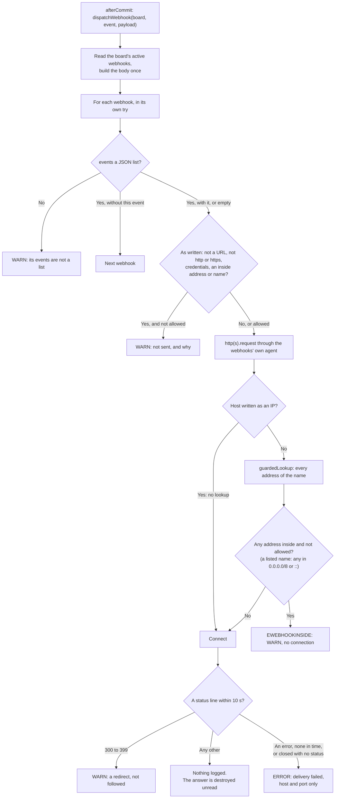

What the system log says, under `Webhooks`. Each line names the webhook, its board and its
host, never the path or the query, which can carry a token (a Slack address's path is its
secret):

| Line | Level | When |
|------|-------|------|
| `Webhook 4 on board 3 not sent: 127.0.0.1 is a loopback address` | `WARN` | The address as written is inside, or a name of the table above. Also `… not sent: the address for <host> carries a user name or password`, `… not sent: its address is not an http or https address (ftp:)` (a row stored before such addresses were refused) and `… not sent: its address is not a URL` |
| `Webhook 4 on board 3 not sent: localtest.me resolves to 127.0.0.1, a loopback address` | `WARN` | A name resolved, at the connection, to an address inside. No connection is made |
| `Webhook 4 on board 3: hooks.example.com answered 307, a redirect, which is not followed` | `WARN` | A status from 300 to 399 |
| `Webhook 4 on board 3: delivery to hooks.example.com failed: <Node's message>` | `ERROR` | An error before the status line, or none within 10 seconds of the delivery being given its connection (`no answer within 10 s`). It named the whole address, path and query included, until card 2161. `… failed: the connection closed with no status`: neither a status nor an error came, as for a `101` answer (card 2178's review) |
| `Webhook 4 on board 3 not sent: its events are not a list` | `WARN` | Its stored `events` is not a JSON list (card 2145). Every other webhook of the board is still sent |

Each `WARN` is written **one line per webhook and kind of refusal per hour** (refused as
written, resolves inside, a redirect, events not a list): the first at once, then none of that
kind for that webhook for an hour, however its words change (another address resolved, another
status), each counted, and the next after the hour, in its words then, ends `(12 more like this
since the last such line were not logged)`. It was one line for each event, so a bulk move of
100 cards wrote 100, and a busy board with a stopped receiver pushed out of the system log,
which keeps 50,000 rows, what else it held. The count is kept in memory, so a restart writes
the next one at once; at most 10,000 webhook and kind pairs are kept, and past that the oldest
is forgotten, its next line written at once. An `ERROR` is written every time. At `LOG_LEVEL=ERROR` no `WARN` is
written at all. **Rows already stored
that the rules refuse are kept**, and accepted when sent back unchanged: each is refused at every
delivery, with its `WARN`, until its address is changed or `WEBHOOK_ALLOW_INSIDE` names it, and
every start names each one that is on and refused as written, by webhook and board, with why,
in one `[WARN] [STARTUP]` line: `2 webhook(s) that are on are not sent, whatever their names
resolve to: webhook 4 on board 3 (127.0.0.1 is a loopback address); webhook 9 on board 3 (n8n is
a name with no dot, which is looked up inside the network). Each is refused at every event until
its address is changed or it is switched off; one inside the network can instead be named in
WEBHOOK_ALLOW_INSIDE.` (the first 20, then `; and N more`). No name is looked up for it.

**A receiver inside the network** (a self-hosted automation tool beside DumpFire) is let in by
whoever runs the server, with the environment variable `WEBHOOK_ALLOW_INSIDE`: a list,
separated by commas, of host names (exact, case ignored, final dots removed), addresses and
ranges (`n8n`, `host.docker.internal`, `10.0.5.20`, `10.0.5.0/24`, `fd00::/8`, `[fd00::1]`).

- A name in it is allowed whatever it resolves to inside, and passes the name rules: `n8n` lets
  `http://n8n:5678/…` through. **A listed name is never let reach `0.0.0.0` or `::`**: a DNS
  filter answers `0.0.0.0` (or `::`) for a name it blocks, which would reach this server, so an
  answer in `0.0.0.0/8` or `::` is refused at the connection with the `resolves to` `WARN`, and
  an address written in `0.0.0.0/8` is refused whatever range is listed.
- An address or range lets in any address inside it, written in the address or resolved from a
  name, of its own family; a range of the mapped, NAT64 or 6to4 forms is the IPv4 range it holds.
- An entry is kept only if it lies **wholly inside one row of the tables**. `0.0.0.0/0`, `::/0`,
  `::ffff:0:0/96` and a slip such as `10.0.0.0/2` for `/24` would let every webhook reach this
  server and the metadata service, so each is ignored, and so is an entry outside the network
  (`8.8.8.0/24`, which would allow nothing), an IPv4 address not written as four decimal numbers
  (`127.1`), and a port, a path or a wildcard. The rest of the list applies.
- Nor may an entry hold `0.0.0.0` or `::`, which reach this server whatever it listens on, or a
  row listed before the row that holds it, though one row holds it all: `0.0.0.0/8` and
  `0.0.0.0` lie inside the "this network" row, and `::/8`, `::/96` and `::1/8` inside `::/8`,
  yet each held this server. Anything else inside `::/8` is ignored too (it is reserved), and so
  is an IPv4-mapped or NAT64 range written with a prefix under 96: `::ffff:10.0.5.0/24` is
  `::/24`, not `10.0.5.0/24`, and held `::1`. These rules shut out `0.0.0.0`, `::` and the
  reserved forms only (see the trust point below). An entry that names this server on purpose, `127.0.0.1`, `::1` or
  `localhost`, is taken: a development installation's receiver is one.
- Each ignored entry is one `[WARN] [STARTUP]` line at every start: `WEBHOOK_ALLOW_INSIDE:
  "10.0.0.0/2" ignored: wider than one inside range`, or `… ignored: not inside the network, so
  it allows nothing`, `an IPv4 address not written as four decimal numbers`, `its range is not a
  number of bits`, `not a host name, an address or a range (a port, a path or a wildcard is not
  taken)`, `it holds 0.0.0.0, a "this network" address, which reaches this server`, `it holds ::,
  the unspecified address, which reaches this server`, `it holds 64:ff9b:1::/48, a local-use
  NAT64 address`, `an IPv4-mapped range needs /96 or more`, `a NAT64 range needs /96 or more`,
  `a reserved range inside ::/8 (an IPv4-mapped range needs /96 or more)`.
- **An entry trusts every account with every port and path on that host**: anyone who can
  register a webhook, an editor of any board, may send to any of them, and a port cannot be
  named. Name a dedicated host or address for the receiver. Do not list `host.docker.internal`,
  or the Docker host's address, while anything else listens on the host. Nor list a range that
  holds this container's own address: its Docker network (`172.16.0.0/12`, or the narrower
  network it is on) opens this server too. Name the receiver's single address or name instead.
- It is not a setting on the admin page: an administrator's session, or a stolen one, could then
  open the internal network, and a restore would bring an old list back. See
  [Deployment](deployment.md#where-a-webhook-may-send).

**No proxy.** A webhook is delivered directly, never through `HTTP_PROXY` or `HTTPS_PROXY`:
through a proxy the lookup would judge the proxy's address, not the receiver's. An installation
whose only way out is a proxy could not deliver before (Node's `fetch` went direct too) and
cannot now.

**What is left.** A webhook to this server's own public address, or to a name that resolves to
it, leaves the container, turns at the host and reaches what listens there. The tables cannot
name that address. See
[Webhook Destinations](authentication-security.md#webhook-destinations).

### How Many Webhooks a Board May Have

**At most 10** (card 2201, `MAX_WEBHOOKS_PER_BOARD` in `src/lib/server/webhooks.ts`), switched-off
ones counted: one is a single `PUT {"active": true}` away from being sent. Every event of a board
is sent to each of its webhooks, each a connection of its own held up to 10 seconds, so the cap
bounds what one event sends. The 11th `POST /api/v1/boards/{boardId}/webhooks` is `409` `This
board has 10 webhooks, and a board may have at most 10: delete 1 before adding another.`, with
nothing created. It is the create's last check, after the 404, the 403 and every field's 400,
made in the same transaction as the insert, so two creates sent together cannot both take the
tenth place. Deleting one makes room. A `PUT` adds no row, and nothing else makes one.

**A board that already has more** keeps them all, and every active one is still sent: which to
drop would be a guess. No webhook can be added to it until it has fewer than 10, and the `409`
gives its own count (`This board has 14 webhooks, … delete 5 before adding another.`). Every
start names such boards in one `[WARN] [STARTUP]` line, by id and count, never an address:
`2 board(s) have more webhooks than the 10 a board may have: board 12 has 14, board 40 has 11.
All of them are still sent, and none can be added to such a board until it has fewer than 10.`,
the first 20 named and the rest counted (`, and N more`). It is a constant, not a setting: a
large value would remove the protection.

### Last Delivery

Since card 2178 a webhook's answer tells the board's owner what its last delivery came to, as
`lastDelivery`. Until then the requests a webhook made were blind to everyone but the
administrators reading the system log, so a broken integration stayed broken until one of them
happened to look.

```json
"lastDelivery": {
  "at": "2026-10-14T10:02:11.481Z",
  "event": "card.moved",
  "outcome": "answered",
  "status": 500,
  "reason": "The receiver answered 500"
}
```

**Who reads it.** Whoever may read the address and the secret: the board's owner and
administrators, in `GET /api/v1/webhooks/{id}`, the board's list, and the answer to a `PUT`.
Every other caller, an editor included, gets no `lastDelivery` key, as they get no `url`. The
answer to the `POST` that made the webhook has `lastDelivery: null`. Card 2154 gives the right
to change the address to the same people, so the people told a webhook is failing are the
people who can fix it.

**Read through the API only.** No page shows webhooks, and nothing tells anyone that a
delivery failed: no mail, no notification, no mark on the board. An owner who wants to know
polls `GET /api/v1/webhooks/{id}` or the board's list, `GET /api/v1/boards/{boardId}/webhooks`.

**What it is.** One result per attempt, recorded at the first of: a refusal before any
request, the receiver's status line, an error before the status line, and the request closing
with none of these (a `101` answer, whose connection Node closes for want of an `upgrade`
listener, gives neither a status nor an error). An error or the timeout after the status has
come is not a result: the webhook was delivered. `at` is the moment the dispatch began, the
body's own `timestamp`. An event the webhook does not ask for, and a webhook switched off,
record nothing.

**The latest attempt only, not a history.** Each result replaces the one before it: an
earlier failure followed by a success is not shown, and a receiver that fails one event in
ten may read `delivered` whenever it is asked. The system log keeps each failure, for
administrators.

**What the timeout counts.** The 10 seconds run from when the delivery is given its
connection: the name's lookup and the connect are counted, a wait behind the 20 connections
already open to the same receiver (the agents' `maxSockets`) is not. A burst of events to a
slow receiver queues, and each delivery still has its whole 10 seconds once it is sent.

| `outcome` | `status` | `reason`, exactly | When | What to do |
|---|---|---|---|---|
| `delivered` | 200 to 299 | `The receiver answered {status}` | A 2xx | Nothing |
| `answered` | 300 to 399 | `The receiver answered {status}, a redirect, which is not followed` | A redirect | Register the final address, the one the redirect points to |
| `answered` | any other | `The receiver answered {status}` | 4xx, 5xx (a `100` or `103` is interim, and the final status is the one recorded; a `101` is not reached, below) | A `401` or `403`: check that the receiver holds the same secret and checks `X-DumpFire-Signature` as [Events and Payload](#events-and-payload) describes it. Any other: the receiver's own logs say why |
| `no-answer` | `null` | `The receiver's host name could not be found` | `ENOTFOUND`, `EAI_AGAIN` | Check the host name's spelling, and that it is published in public DNS |
| `no-answer` | `null` | `The receiver's certificate could not be checked` | A certificate error: `ERR_TLS_CERT_…`, `CERT_…`, `UNABLE_TO_…`, `DEPTH_ZERO_SELF_SIGNED_CERT`, `SELF_SIGNED_CERT_IN_CHAIN` | The receiver's certificate is expired, self-signed, for another name, or served without its intermediate chain: fix it on the receiver. There is no setting to trust a self-signed certificate |
| `no-answer` | `null` | `The receiver could not be reached, or did not answer within 10 seconds` | Everything else: a refused or unreachable port, a reset, the timeout, something that does not speak HTTP (the parser's `HPE_…`), a TLS error that is not about the certificate (a listener that does not speak TLS), a `101` | The receiver is down, behind a firewall that drops this server, or slower than the 10 seconds to send its status: answer first, then do the work |
| `not-sent` | `null` | `Not sent: the address is inside the network` | Inside as written, or a name that resolved inside at the connection | Ask an administrator whether the receiver may be named in `WEBHOOK_ALLOW_INSIDE` |
| `not-sent` | `null` | `Not sent: the address carries a user name or password` | Credentials before the host | Take them out of the address: put a token in the path, or rely on the signature |
| `not-sent` | `null` | `Not sent: the address is not an http or https address` | Another scheme, or a stored row that is not a URL | Register an `http://` or `https://` address |
| `not-sent` | `null` | `Not sent: its events are not a list` | Its stored `events` is not a JSON list (card 2145) | `PUT` the webhook's `events` as a list (`[]` for every event) |
| `not-sent` | `null` | `Not sent: the account that set it up can no longer open this board` | Held: its setter cannot open the board (card 2325) | Delete it unless you recognise the address; to keep it, take it over ([Who May Change a Webhook](#who-may-change-a-webhook)) |
| `not-sent` | `null` | `Not sent: nobody is recorded as having set it up` | Held: it has no setter (card 2325) | The same |

**A reason is fixed words.** One of the sentences above and nothing else: never the address,
its path or query, a user name, a password, the secret, an address a name resolved to, or
Node's own message (a connection error names `address:port`). The system log keeps the error
for administrators, in the lines of [Where a Webhook May Send](#where-a-webhook-may-send).
**A closed port, a filtered one and a stalled receiver read alike**, in their words and in
their timing: a not-reached result is recorded no sooner than the timeout after the delivery
was given its connection, so a port that refuses at once is recorded when a port that drops
the connection would be. Told apart, they would let any user who owns a board map which ports
of a host are open, from inside its firewall, with one card move. An owner learns nothing of a
host beyond the ports where a web server answers or a TLS server presents a certificate. An
administrator reads which in the log.

**Which result is kept.** Each dispatch takes the next number from a counter, and a result is
dropped only when its dispatch's number is lower than the one held: of two deliveries in
flight, the newer attempt's result stays, whichever answers last. A count, not the clock: two
dispatches in one millisecond, or a clock set back by a time sync, would make a newer attempt
look older.

**Where it is kept: in the server's memory, never in the database.** A map in
`src/lib/server/webhooks.ts` from a webhook's id to its last result, at most 10,000, the one
recorded longest ago forgotten first. Nothing a delivery does writes a row: a write there
would land at a moment no request controls, and a backup, a restore or a working copy would
carry another server's results. DumpFire runs one process, so every request reads the same
map. **A restart, a deploy included, forgets every result**: a webhook answers
`lastDelivery: null` until its first delivery since the server last started.

**A result follows the address.** It is held with a SHA-256 of the webhook's board, creation
time and address, never the address itself, and given only while the row still hashes the
same. A `PUT` that changes `url` answers `lastDelivery: null`, and so does every read until
the next delivery, or until the address is changed back: an address changed from A to B and
back to A, with no delivery between, gives A's result again, since the row hashes as it did.
A change of the secret, the events or `active` keeps it (a receiver that
refuses a bad signature answers 401, which stays true until the next delivery). A row that
reuses an id after a reset or a restore, for another address, is given nothing.
`DELETE /api/v1/webhooks/{id}` forgets the result once the delete has committed.

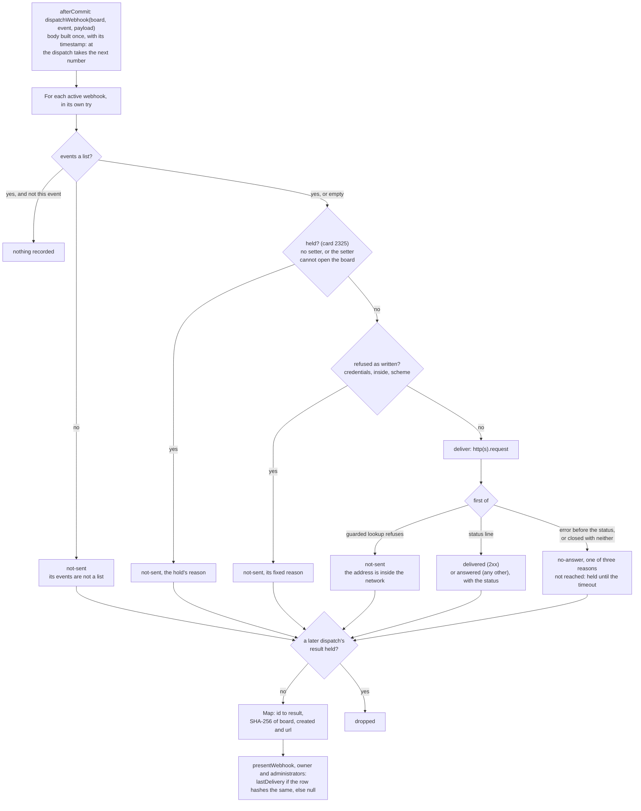

### Webhook Flow

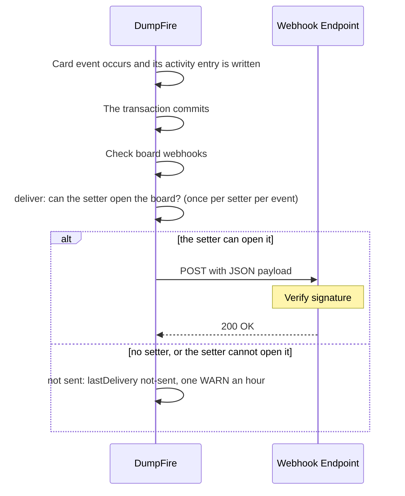

A webhook is dispatched by the activity entry for the action, once that entry is committed. Each card moved to another column of its board is one entry, so at most one delivery to each of the board's webhooks (a move to another board is two or three entries across the two boards, made one card at a time: see the table below): a drag and drop, `PUT /api/cards/reorder`, moves at most 100 cards to another column (card 2209), and names each card at most once, so one request sends at most 100 deliveries to each webhook. A request that would move more, or that names a card twice, is refused whole, `400`, with nothing moved or sent: a card named over and over, to and fro between two columns, was once a real move for every entry. The delivery is not awaited and not retried. One that cannot be made, or gets no status line within 10 seconds, is logged at `ERROR`, naming the host and port and never the path. A redirect is logged, and not followed; an answer of 500 from a receiver is not logged as a failure, and is told to the board's owner in the webhook's `lastDelivery` instead, with every other outcome (card 2178, [Last Delivery](#last-delivery)). The board's webhooks are read once, and the body built once, for each event: every webhook of one event is sent the same body and timestamp, signed for each, and each webhook is handled on its own, so a row that cannot be sent stops no other (card 2145). See [Where a Webhook May Send](#where-a-webhook-may-send). Before anything else, `deliver` asks whether the webhook is held (card 2325): see the next section.

### When Nobody Who Can Open the Board Set It Up

Anyone who can edit a board can set up a webhook, which sends every event of the board it asks
for (card titles, the fields changed, comment text, who did what) to an address they choose.
Until card 2325 it went on doing so after they lost the board: taken off it, taken out of the
team it is shared with, the team deleted, the board made private (for one who could open it
only because it was public), an administrator made an ordinary user, or a working copy or
backup put in place. Only a password reset, an invite used or deleting the account switched it
off.

**The rule.** A webhook is sent only while the account that set it up (`set_by`) can open the
board, as `canViewBoard` has it: the board's owner, a member of any role, a member of a team it
is shared with, anyone for a public board, an administrator. That is the rule mail uses for
assignees (card 2180, `whoCanOpen`). A viewer can read everything a webhook sends, so an editor
made a viewer is still sent to. A webhook nobody is recorded as having set up (made before
migration 0056 on 2026-10-18/19, or brought back by restoring an older backup) is held too:
nobody answers for where it sends. It stays held until it is taken over; it has no setter whose
access could come back.

**Where it is asked: in `deliver`, at each event.** Not where access is lost: there are at least
seven ways to lose it, and a check at each would miss the next one added. `holdOf(hook, cache)`
in `src/lib/server/webhooks.ts` reads the setter's row, with the role as it is now, and asks
`canViewBoard`. `dispatchWebhook` makes one cache for the event and passes it to each
webhook's `deliver`, so one event asks once per setter (all of an event's webhooks are on one
board). The check sits in `deliver` itself, before the address is judged, so anything that
sends goes through it; a `deliver` called on its own asks afresh. A check that throws throws
before any request: in a dispatch the webhook's own `try` logs an `ERROR` and it is not sent.

**What a hold does.** Nothing is sent. `active` is left as it is: it keeps its meaning, switched
on or off by a person. Nothing is written but one `WARN` an hour in the system log, under
`Webhooks`: `Webhook <id> on board <board> not sent: the account that set it up (user <id>) can
no longer open the board`, or `Webhook <id> on board <board> not sent: nobody is recorded as
having set it up`, never the address. `lastDelivery` records the not-sent result
([Last Delivery](#last-delivery)). A webhook whose setter is given the board back is sent again
at the next event, with nothing else changed. An event already on its way when access was
removed may still arrive, up to 10 seconds later: there are no retries and no queue.

**`pausedBecause`.** Given where the address is given (the board's owner and administrators, and
the answer to the create, where it is `null`), worked out when the answer is made and never
stored, so it is there after a restart when `lastDelivery` is `null`. It is `null` unless the
webhook is on and held, so a webhook switched off is `null` whoever set it. While held it reads,
word for word:

- a setter who can no longer open the board: "The account that set this up can no longer open
  this board, so nothing is sent. The address was chosen by that account: delete the webhook
  unless you recognise it; to keep it, switch it off and on, which makes you its setter, and set
  a new secret and update the receiver."
- no recorded setter: "Nobody is recorded as having set this up. Delete it unless you recognise
  the address; to keep it, switch it off and on, which makes you its setter, and set a new
  secret."

Editors and viewers see neither field, as they see no `lastDelivery`: they see `active: true`.
No page lists webhooks, and `pausedBecause` is read through the API.
Taking one over is in [Who May Change a Webhook](#who-may-change-a-webhook). A held webhook
still counts toward the board's 10, and still counts on the Account and admin pages among the
webhooks an account set up that are on, since a reset of that account still switches it off.

```mermaid
stateDiagram-v2
    [*] --> Sending: created (the caller is the setter)
    Sending --> Held: the setter loses the board<br/>(or the row has no setter)
    Held --> Sending: the setter can open the board again
    Held --> Sending: owner or admin switches it off, then on<br/>(they become the setter; new secret)
    Sending --> Off: switched off, or the setter's reset
    Held --> Off: switched off
    Held --> Off: the setter's own reset, account delete<br/>or invite used (endAccountAccess, deleteUser)
    Off --> Sending: owner or admin switches it on, and can open the board
    Off --> [*]: deleted
    Held --> [*]: deleted
    Sending --> [*]: deleted
```

**The Share window (card 2329).** A board's owner who does not read the API learnt of a held
webhook from nothing. The Share window (Share Board, in a board's **More** menu) now tells the
owner and an administrator, from the same rule and to the same people as `pausedBecause`:

- **Before a removal.** `GET /api/boards/{id}/share` gives each person and each team
  `stopsWebhooks`: how many of the board's webhooks that are sent now that share's removal
  would hold. `webhookShareNotes(board)` in `webhooks.ts` asks `holdOf` of each webhook that is
  on, and of each that is sent asks `roleOnBoard` again for its setter with the share left out
  (`without: { userId }` for the setter's own member row, `without: { teamId }` for each team
  the board is shared with that the setter is in: taking away a team they are not in changes
  nothing for them). Each setter is worked out once, however many of the webhooks they set. A
  setter who could still open the board another way (their own share as a member, for a team's
  removal, another team, the board being public, having made it, an administrator's role) is
  not counted. ✕ on a share
  above 0 asks first in the app's confirm, "Removing Sam stops 1 webhook they set up on this
  board: nothing is sent to it until they can open the board again, or someone takes it over."
  (for a team, "… set up by its members … until those members can open the board again …"),
  **Remove** or **Cancel**; ✕ on any other share removes at once.
- **Held now.** The same answer carries `heldWebhooks`, how many are on and held, whatever held
  them, webhooks with no setter included. Above 0, the window says so above the list, with
  where to read why (`GET /api/v1/boards/{id}/webhooks`). The list is read again after each
  share added, changed or removed, and after the public switch (card 2385), so a change's
  count shows at once. Only the latest read of the list is shown: an older one answering last
  does not put back the list from before a later change.
- **Before making a board private (card 2385).** The same answer carries
  `privateStopsWebhooks`: on a public board, how many webhooks sent now would be held once it
  is private, that is those whose setter opens the board only because it is public (no share,
  no shared team, not its creator, not an administrator); 0 on a private board.
  `webhookShareNotes` asks `roleOnBoard` with the board handed in as private
  (`{ ...board, isPublic: false }`), in the same per-setter pass: `roleOnBoard` takes
  `isPublic` from the board it is given, so no new `without` shape was needed. The switch,
  going to private while it is above 0, asks first in the app's confirm, **Make Private**:
  "Making this board private stops 1 webhook set up by an account that can open it only
  because it is public: nothing is sent to it until that account can open the board again, or
  someone takes it over." (plural: "… set up by accounts that … until those accounts …"),
  **Make Private** or **Cancel**. Going public, or a count of 0, switches at once.

Anyone else is answered none of the three keys. Nothing is stored: every count is worked out at
the read, as `pausedBecause` is. A hold caused elsewhere (a team's members changed, a role
changed, the board made private through `PUT /api/v1/boards/{boardId}`) is not warned of
before; the count says so the next time the window opens.

```mermaid
sequenceDiagram
    participant O as Board owner
    participant W as Share window
    participant R as GET /api/boards/{id}/share
    participant N as webhookShareNotes
    O->>W: Share Board
    W->>R: read the list
    R->>N: owner or admin only
    N->>N: holdOf(each webhook that is on)
    N->>N: roleOnBoard(setter, board, without share)
    N->>N: roleOnBoard(setter, board read as private)
    N-->>R: held, byMember, byTeam, privateStops
    R-->>W: members[].stopsWebhooks, teams[].stopsWebhooks, heldWebhooks, privateStopsWebhooks
    O->>W: ✕ on a share with stopsWebhooks > 0
    W-->>O: Remove Access: "Removing … stops N webhooks …"
    O->>W: Remove
    W->>R: DELETE, then read the list again
    O->>W: the switch, on a public board with privateStopsWebhooks > 0
    W-->>O: Make Private: "Making this board private stops N webhooks …"
    O->>W: Make Private
    W->>R: PATCH isPublic false, then read the list again
```

### Events and Payload

| Event | Sent when the activity entry is |
|-------|---------------------------------|
| `card.created` | `card_created`: by every way of creating a card, accepting a task request among them (card 2108) |
| `card.updated` | `card_updated` |
| `card.moved` | `card_moved`; `card_reopened`, a card moved out of a Complete column (card 2278); `card_moved_away` and `card_moved_in`, a card moved to another board, each to its own board (card 2278) |
| `card.completed` | `card_completed`: a card moved into a Complete column, **instead of** `card.moved`, or created in one (card 2134) |
| `card.deleted` | `card_deleted`: a card deleted for good |
| `comment.added` | `comment_added` |
| `milestone.card_added` | `milestone_card_added`: a card put in a goal, by any route or page (card 2343, since 2026-10-21) |
| `milestone.card_removed` | `milestone_card_removed`: a card taken out of a goal, by any route or page (card 2343, since 2026-10-21), and a card that leaves a goal because of another change: moved to another board, its goal deleted, deleted itself, or released when its goal's board was deleted (card 2381, since 2026-10-21) |

**A webhook whose `events` list is empty is sent every event, so one made before 2026-10-21
receives the two `milestone.*` events from that deploy on** (card 2343): list the events wanted
to receive neither.

No other entry sends one. A comment edited (`comment_edited`) or deleted (`comment_deleted`,
recorded since card 2283) sends no webhook: an empty `events` list means every event, so a new
`comment.deleted` would start reaching existing receivers unannounced (card 2283, decision 8).
A receiver mirroring a card's comments learns of an edit or a delete only by reading the
card's comments again. A file attached (`attachment_added`) or deleted (`attachment_deleted`),
recorded since card 2337, sends none for the same reason, and a receiver could not fetch the
file: attachments are not part of the API. No subtask entry sends one either: an untick or an edit
(`subtask_updated`, recorded since card 2299) is no more a webhook event than a tick is. Nor
does a change to a goal itself (card 2289): `milestone_updated`, `milestone_closed`,
`milestone_reopened` and `milestone_deleted` have no event, for the same reason, and their
entries name no card, where every event names one (card 2343, ruling 1). **Goal membership
sends no `card.updated` on any route**: a card put in a goal or taken out sends
`milestone.card_added` or `milestone.card_removed` instead (card 2343), below.

**A card put in a goal or taken out** (card 2343). Every route and page that does it writes its
entry through `logCardInOrOut` (`src/lib/server/milestones.ts`): the card window's
**Milestone** picker and the plan page (`PATCH /api/milestones/{id}`),
`POST` and `DELETE /api/v1/milestones/{milestoneId}/cards`, the bulk pair (one delivery for
each card attached or detached, none for a card skipped, up to 500 a request) and `milestoneId`
on `PUT /api/v1/cards/{cardId}`. Each is sent to the webhooks of **the card's board**, the
board the entry is on, as every event is: a goal across boards has no board of its own. A held
webhook (card 2325) is held for it as for any event. `data.detail` is the entry's words,
`Added "Plan" to milestone "Launch"` or `Removed "Plan" from milestone "Launch"`, a goal that
spans boards named `milestone #<id>` (card 2257). A card moved from one goal to another is one
`milestone.card_added` whose `detail` ends ` (from milestone "Pilot")`, and no
`milestone.card_removed` for the goal it left.

**A card that leaves a goal because of another change** (card 2381) writes a card taken out's
entry on its board through `logCardLeftGoal` (`src/lib/server/milestones.ts`), in the same
transaction as the change, so it sends `milestone.card_removed` once the change commits, with
why in brackets in `data.detail`. Each of these sent nothing for the goal before:

| What happened | Where it is written | `data.detail` ends | `data.cardId` |
|---|---|---|---|
| Moved to another board out of its goal (`card-moves.ts`; an older goal of neither board named `milestone #<id>`) | The board it left, after `card_moved_away`, beside its `card.moved` | `(moved to another board)` | The card |
| Its goal deleted (`deleteMilestoneFor`, one a released card, archived ones included) | Each card's board, after the boards' `milestone_deleted` | `(milestone deleted)` | The card |
| Deleted for good: alone (beside its `card.deleted`), with its column, by an administrator's clear of a board's cards, or by a purge of archived cards (`deletes.ts`, `recordLeftGoals`) | Its board, after the delete's own entry | `(card deleted)` | The deleted card's id (`webhookCardId`); the entry's `cardId` is null |
| Left in place on another board and released from a goal of a deleted board, or of a sub-board deleted with its parent card | Its own board | `(milestone deleted with its board)` | The card |

**A card deleted with its own board** (the board deleted, a sub-board under a deleted card, a
board in a loop) writes and sends nothing: the board's log and its webhooks are deleted in the
same transaction, so the entry would go with them and there is no webhook to send it to; a
goal's webhooks are its cards' boards'. **A webhook with an empty `events` list receives these
from 2026-10-21**: a clear of a board of 400 goal cards sends it 400 deliveries. For a card
deleted for good, `card.deleted` and `milestone.card_removed` are separate deliveries and may
arrive in either order: a receiver should treat a `milestone.card_removed` for a card it does
not know, or has already deleted, as harmless.

```mermaid
flowchart LR
    W["picker / plan page<br/>PATCH /api/milestones/{id}"] --> L
    V["v1 single, bulk,<br/>milestoneId on PUT /cards"] --> L
    O["moved board, goal deleted,<br/>card deleted, released (2381)"] --> F["logCardLeftGoal:<br/>if the card's board stays"]
    F -->|"afterCommit"| D
    L["logCardInOrOut:<br/>entry on the card's board"] -->|"afterCommit"| D["dispatchWebhook(card's board)"]
    D --> E{"events empty, or<br/>names the event?"}
    E -->|"yes"| H{"setter can open<br/>the board? (2325)"}
    E -->|"no"| X["not sent, not recorded"]
    H -->|"yes"| S["POST milestone.card_added /<br/>milestone.card_removed"]
    H -->|"no"| N["held: not-sent, hourly WARN"]
```

The same event is sent whether the action was made in the web UI or through the API. The request is a `POST` made with `node:http` or `node:https` (card 2161; it was `fetch`), and carries the headers `X-DumpFire-Event` and `X-DumpFire-Signature` (`sha256=` and the HMAC-SHA256 of the body under the webhook's secret, or empty when no secret is set), with `Content-Type: application/json`, `Content-Length` (the body is sent whole, never chunked, as `fetch` sent it), `Accept: */*`, `User-Agent: DumpFire-Webhook/1.0` and `Connection: close`, and a body of this shape:

```json
{
  "event": "card.deleted",
  "timestamp": "2026-10-13T09:14:03.512Z",
  "boardId": 3,
  "data": {
    "cardId": 1686,
    "action": "card_deleted",
    "source": "ui",
    "detail": "\"Compose network segmentation applied on the new host\"",
    "user": "greg"
  }
}
```

`data.action` is the entry's action with no `api:`, so a receiver tells the four entries that send `card.moved` apart by it. What each move sends (card 2278, `ACTION_TO_EVENT` in `src/lib/server/logActivity.ts`), one delivery for each entry that has an event:

| What happened | Sent to the webhooks of | Event and `data.action` |
|---|---|---|
| A card moved to another column of its board | its board | `card.moved`, `card_moved` |
| … into a Complete column | its board | `card.completed`, `card_completed`, instead of `card.moved` |
| … out of a Complete column (reopened) | its board | `card.moved`, `card_reopened` |
| A card moved to another board | the board it left; the board it joined | `card.moved`, `card_moved_away`; `card.moved`, `card_moved_in` |
| … into the other board's Complete column | as above, and the board it joined | as above, then `card.completed`, `card_completed` |
| … out of Complete into the other board's open column | as above, and the board it joined | as above, then `card.moved`, `card_reopened` |
| A card moved within its column (its position only), by a drag, the v1 move or the web application's card update | — | nothing (the card update sent `card.updated` until 2026-10-14, the 1.2.0 release, card 2288) |

A delivery for a move to another board carries that board's own entry: `"<title>" moved to another board (<from> → <to>)` on the board it left, `"<title>" moved from another board (<from> → <to>)` on the board it joined. The one on the board it left ends ` and out of milestone "<name>"` when the move took the card out of one of that board's milestones, or ` and out of a milestone of another board` for a third board's (card 2155). Neither names the other board (card 2181); the two columns are the route, one of them the other board's, as in each board's Activity. So a receiver is sent nothing a reader of its board cannot read there. Until 2026-10-19 a reopening and a move to another board sent nothing, and a receiver of `card.moved` missed them.

```mermaid
flowchart TD
    Move["A card changes column"] --> Across{"To another board?"}
    Across -->|"No"| Role{"Into Complete? Out of it?"}
    Role -->|"Into"| Done["card.completed to its board"]
    Role -->|"Out of"| Reopen["card.moved (card_reopened) to its board"]
    Role -->|"Neither"| Moved["card.moved (card_moved) to its board"]
    Across -->|"Yes"| Two["card.moved (card_moved_away) to the board it left<br/>card.moved (card_moved_in) to the board it joined"]
    Two --> Then{"Into Complete? Out of it?"}
    Then -->|"Into"| Done2["and card.completed to the board it joined"]
    Then -->|"Out of"| Reopen2["and card.moved (card_reopened) to the board it joined"]
    Then -->|"Neither"| Nothing["nothing more"]
```

What is not sent:

- **Archiving a card sends nothing.** It writes `card_archived`, which has no event. Nor does restoring one: `card_restored` has none, and a restore through `PUT /api/v1/cards/{cardId}` with no other field sends no `card.updated` either, since it writes `api:card_restored` and no `api:card_updated` (card 2108).
- **A card update that changes nothing sends nothing** (card 2183). `PUT /api/cards/{id}` and `PUT /api/v1/cards/{cardId}` compare what is sent with what the card holds, and write no entry, so send no `card.updated`, when every field is as stored; one that changes some fields sends one `card.updated` whose `detail` names those alone. The card window sends a card's whole state back with every save, so every Save on an unchanged card sent a `card.updated` until 2026-10-15.
- **A change of a card's position within its column sends nothing, on every route** (card 2288). A drag (`PUT /api/cards/reorder`) and `PUT /api/v1/cards/{cardId}/move` to the card's own column never sent anything for it. The web application's card update, `PUT /api/cards/{id}` with a `position` and no change of column, wrote `card_updated` "Updated fields: position" and so sent `card.updated`, until 2026-10-14 (the 1.2.0 release); it now goes through the drag's path, writes the position alone and records nothing. Sent with other fields, it still sends one `card.updated`, whose `detail` no longer names `position`. No page sends a position on that route, so only a hand-made request saw it.
- **A card put in a milestone or taken out sends no `card.updated`, on every route** (card 2289). `PUT /api/v1/cards/{cardId}` with a `milestoneId` wrote `api:card_updated` "Updated fields: milestoneId" and so sent `card.updated`, until 2026-10-14 (the 1.2.0 release); it now writes `api:milestone_card_added` or `api:milestone_card_removed`, as the milestone routes (single and bulk) and the web application's picker and plan page do. Until 2026-10-21 neither had an event, so nothing was sent; each now sends `milestone.card_added` or `milestone.card_removed` (card 2343). So when `milestoneId` is the only change, or comes with only a restore (`archivedAt: null`, whose `api:card_restored` has no event), that `milestone.*` event alone is sent. Sent with other fields, it also sends one `card.updated`, whose `detail` no longer names `milestoneId`. A milestone changed, closed, reopened or deleted sends nothing of its own (a delete's released cards each send `milestone.card_removed`, card 2381).
- **A move out of an On Hold column sends the move's events alone** (card 2208). The move clears the card's on-hold note itself; the board page's drag out of On Hold sent a second request to clear it, which delivered a `card.updated` beside the `card.moved`, until 2026-10-15.
- **A move into a Complete column sends no `card.moved`.** It sends `card.completed` instead, its entry being a completion (a move into another board's Complete column also sends each board its `card.moved`); a receiver that wants every column change asks for both events. A reopening is sent as `card.moved` (card 2278).
- **No delivery names another board.** A move to another board is sent to each board as that board's own entry, which names no board (card 2181), and with the board's own `boardId`; the other board's name, and its id, are in neither. A webhook whose board a card left is not told where it went beyond the column in the route, and the joined board's webhooks are not told where it came from beyond its column.
- **A `card.deleted` carries the id of the card that went**, although the activity entry it comes from is stored with no card id, the card being gone.
- **Deleting a column sends no event for the column, and no `card.deleted` for its cards.** Neither does purging archived cards, clearing a board's cards or deleting a board. A board's webhooks are deleted with the board. Since 2026-10-21 a card among them that was in a goal sends `milestone.card_removed`, `… (card deleted)`, while its board stays, and a card elsewhere released from a deleted board's goal sends one to its own board (card 2381, above). Open pages are told of each by a live update: see [Event Types](#event-types).
- **A goal deleted sends no event of its own**; each card it releases sends `milestone.card_removed`, `… (milestone deleted)` (card 2381).

## Key Implementation Files

| File | Purpose |
|------|---------|
| `src/lib/server/email.ts` | SMTP config, transporter creation; `deliverMail`, the one place a mail is sent from, with `mailProblem`, `maskMailText` and the in-memory `mailStatus()` (card 2196); `sendEmail`, `trySendEmail`, `sendEmailWithAttachment`, `sendTestEmail` |
| `src/lib/server/invite-link.ts` | `inviteMailAnswer()`: what an invite route answers about its mail, the checks read again before its link is given, and the `WARN` line (card 2196) |
| `src/lib/server/notifications.ts` | All email notification functions with preference filtering |
| `src/lib/notification-prefs.ts` | The one list of mail preferences: `MASTER_PREF`, `NOTIFICATION_PREFS`, `defaultPrefs()`. Read by the account page, the preferences route and the mail alike (card 2146) |
| `src/lib/escape-html.ts` | `escapeHtml()`: the one function every mail puts its texts and links through |
| `src/lib/report-recipients.ts` | `reportRecipients()` and `MAX_REPORT_RECIPIENTS`: the one reading of who a mailed report goes to, used by the email route, the schedule routes, the scheduler and the Reports page (card 2182) |
| `src/lib/server/reports.ts` | `takeReportMail()` and `REPORT_MAILS_PER_DAY`: the day's 100 addresses an account's report mail may reach; the scheduler, which switches off a schedule kept with more than 10 |
| `src/lib/server/events.ts` | SSE event emitter with board and global subscriptions |
| `src/lib/board/sse.ts`, `src/routes/board/[id]/+layout.svelte` | The board page's stream, opened as the page mounts and closed as it goes; the layout makes the page afresh for each board, so the stream follows the board shown (card 2184) |
| `src/lib/server/webhooks.ts` | Webhook dispatch on board events: `dispatchWebhook()`, each webhook in its own `try` (card 2145); `deliver()` on the webhooks' own agents (card 2161), its `WARN`s one line per webhook and kind of refusal per hour; `refusalAsWritten()` and `activeWebhooksRefused()`, for delivery and the start-up line; `presentWebhook()`, with `lastDelivery`; each webhook's last result held in memory, `deliveryResultFor()`, `forgetDelivery()` and `deliveryReason()` (card 2178); `MAX_WEBHOOKS_PER_BOARD`, `refuseWebhookOverCap()` and `boardsOverWebhookCap()` (card 2201) |
| `src/lib/server/webhook-address.ts` | Where a webhook may send (card 2161): `insideReason()`, `addressRefusal()`, `allowInside()` and `parseAllowInside()` for `WEBHOOK_ALLOW_INSIDE`, `guardedLookup()`, `readWebhookUrl()` |
| `src/lib/server/startup-checks.ts` | Among its thirteen start-up lines, the ignored entries of `WEBHOOK_ALLOW_INSIDE`, the boards over the webhook cap, and the webhooks that are on and refused as written |
| `src/lib/server/logActivity.ts` | Writes the activity entry and queues the webhook for it: `ACTION_TO_EVENT`, which entry sends which event (the two `milestone.*` since card 2343). `WebhookEvent` and `WEBHOOK_EVENTS`, the events a webhook may ask for, are in `webhooks.ts` |
| `src/lib/server/milestones.ts`, `src/lib/server/deletes.ts` | `logCardInOrOut()`, a card put in a goal or taken out (card 2343); `logCardLeftGoal()`, a card that leaves one because of another change, called by the move, the goal delete and `recordLeftGoals()` in the deletes (card 2381) |
| `src/lib/server/db/transaction.ts` | `afterCommit()`: holds every notification until the write it reports is committed |
| `src/lib/server/mentions.ts` | Extract @mentions from comment text: `parseMentions()` through `findMentions`, against every account's username, then `notifyMention()` for each account found |
| `src/lib/mentions.ts` | `findMentions(text, usernames)`: where a mention starts and whose name it is (card 2207), shared by the server and the card window's chips |
