# Notifications & Email System

DumpFire notifies users through three channels: email notifications via SMTP, real-time browser updates via SSE, and external webhooks. All channels are fire-and-forget — they never block API responses — but for an invite's mail, which its route waits for after its commit so that it can say whether the mail went (card 2196, [When a Mail Fails](#when-a-mail-fails)).

All three are sent only after the change they report has been committed to the database. A change that is rolled back sends nothing on any channel.

## Notification Architecture

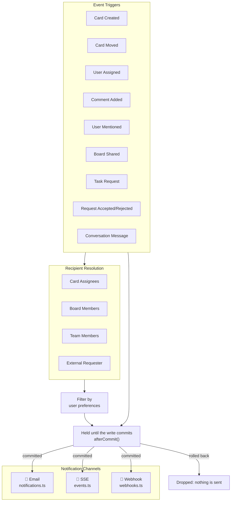

## When Notifications Are Sent

A request that writes does so inside one transaction (see [Architecture](architecture.md#writes-one-transaction-then-the-effects)). Whatever it wants to tell people is queued while that transaction is open and started once it has committed.

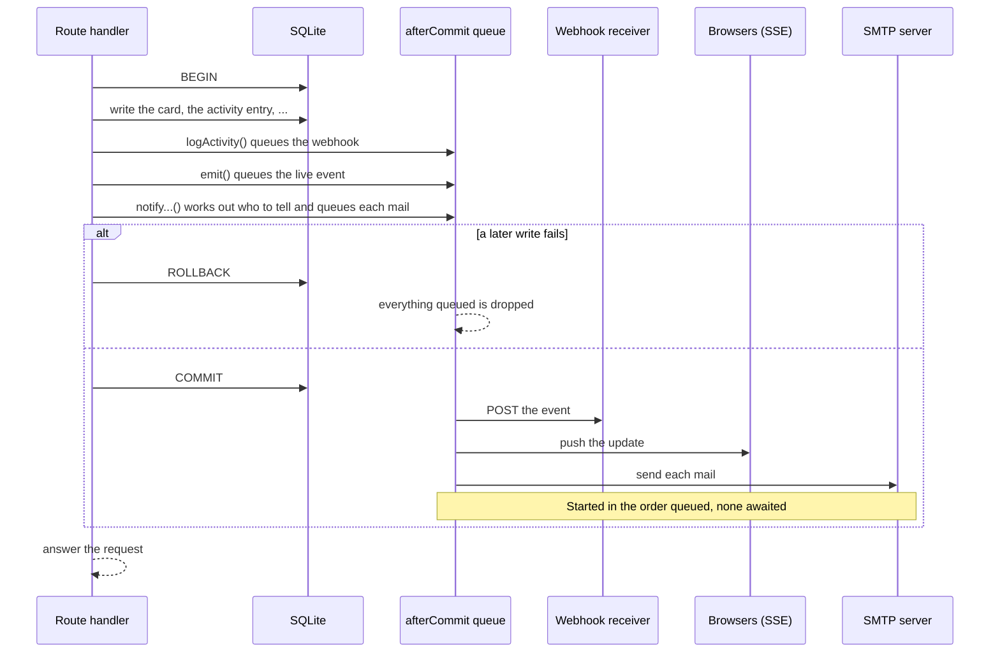

- **Each channel queues itself.** `emit()` in `events.ts`, `logActivity()` (which dispatches webhooks) and the mail functions in `notifications.ts` all go through `afterCommit()`, so a route that calls them inside a transaction needs to do nothing more. Called with no transaction open, each sends at once.
- **A drop of several cards is announced only if all of it is saved.** If the last card of a drop cannot be completed, the earlier cards are rolled back with it and no webhook, live update or mail goes out for any of them.
- **A failure to send never undoes the write.** A webhook that cannot be delivered or a mail that cannot be sent is logged at `ERROR` and goes no further. The request has already been committed and is answered as a success.
- **Some notifications look up their recipients when they are called and queue only the send; others run entirely after the commit.** The card-move announcements and the requester's progress mail are of the second kind: the progress mail builds a PDF on completion, which is asynchronous work that must not start inside a transaction. Either way, no mail leaves before the commit.
- **Mail the caller waits for is not queued.** The SMTP test, a report emailed on demand and the scheduled reports use the functions in `email.ts` directly, outside any transaction, and read what each send returned: see [A Report Emailed on Demand](#a-report-emailed-on-demand) and [Schedule Execution](backup-reporting.md#schedule-execution).

## Email Notifications

### SMTP Configuration

SMTP settings are stored in the `settings` table and configured via the Admin panel, by any
administrator or the superadmin (`GET`, `PUT` and `POST /api/admin/smtp` ask `requireAdmin`;
they were the superadmin's alone until card 2395, 2026-10-21, at the owner's request).
Whoever sets the mail server sees every mail the app sends, invite links and password-reset
links included, the superadmin's among them, and the App URL, saved by the same route,
decides where every link in a mail points. Since card 2847 a save that would change the App
URL is the superadmin's alone (`403` to any other administrator, before the password), and
where the server's configuration names its address (`APP_URL`, or an `ORIGIN` that is not the
image's `http://localhost:3000`) the App URL must be on it (`400` otherwise) and a stored one
that is not is not used: the environment wins (see
[Where a Mailed Link's Address Comes From](authentication-security.md#where-a-mailed-links-address-comes-from)).
The mail server stays every administrator's (card 2906 asks the owner). Since card 2397 (2026-10-22) who pointed mail where
it goes, and apart from them who set the App URL to its address, is recorded, by place, in
`setting_setters` (migration 0059), and that account made a user, or deleted, takes them away:
see [When the Mail's Setter Is Demoted](#when-the-mails-setter-is-demoted). The system log
names each change too, since card 2396: see
[Who Changed the Mail Settings](#who-changed-the-mail-settings).

| Setting Key | Type | Default | Description |
|------------|------|---------|-------------|
| `smtp_host` | string | — | SMTP server hostname |
| `smtp_port` | number | 587 | Port number |
| `smtp_allow_insecure` | `'true'` or `'false'` | not set (off) | "Allow mail without a checked, encrypted connection" (card 2189): only `'true'` is on. Written when the panel first saves it |
| `smtp_secure` | boolean | false | No longer read or written (card 2189). It was "Use SSL/TLS", which only switched the certificate check on for ports other than 465; that is now always on. A row saved before is left where it is, and a working copy removes it with the other mail settings |
| `smtp_user` | string | — | Auth username |
| `smtp_pass` | string | — | Auth password |
| `smtp_from_address` | string | — | Sender email address |
| `smtp_from_name` | string | DumpFire | Sender display name |

**The password is in no backup** (card 2169). A backup's copy has no `smtp_pass` row; the
other mail settings are in it. An Import Backup keeps this server's password when the
backup is one this server made and nobody has changed since (its seal, made with a key this
server keeps) and its `smtp_host` (trimmed of ASCII spaces and tabs, ASCII letters in any case), `smtp_port` (587 when not set),
`smtp_allow_insecure` (off when not set, as in a backup made before card 2189) and
`smtp_user` are all this server's, and otherwise lists the mail password to enter again in
**Admin → 📧 Email / SMTP**: with the port and the way out compared too, a backup cannot have this server's
password sent over a connection whose certificate is not checked. Until it is entered, mail
is tried with the user name and an empty password, which a mail server that asks for one
refuses, the backup failure mail included; a requester who asks for a new link, or (card
2870) sends the public form a request that must be confirmed, is told "New links cannot be
sent just now. Please contact the team that sent you the link." rather than that one was
sent, with the reason in a `[WARN] [REQUESTS]` line; no requester link is issued for a team
reply or a progress mail, and neither is mailed; and every start writes
one `[WARN] [STARTUP]` line saying so. See [The Secrets a Backup Does Not Hold](authentication-security.md#the-secrets-a-backup-does-not-hold-card-2169).

**The saved password stays with the connection it was saved for** (card 2190). `GET
/api/admin/smtp` answers the password as `••••••••` (`SECRET_MASK` in
`src/lib/server/backup-secrets.ts`) and `allowInsecure` as `true` or `false`; it no longer
answers `secure`. `PUT /api/admin/smtp` takes `host`, `port`, `allowInsecure` (`true` or
`false`; anything else is refused, `allowInsecure must be true or false`), `user`, `pass`,
`fromAddress`, `fromName` and `appUrl`; a `secure` is ignored as any unknown key. A password
typed, an empty one included, is saved as typed. One sent masked, or left out, while a
password is stored, is kept only while the host (trimmed of ASCII spaces and tabs, ASCII letters in any case; a no-break space, a byte-order mark or an ideographic space is a change, as is a letter outside ASCII that `toLowerCase()` would fold to one inside it), port (587 when not set),
user name (`''` when not set) and way out (off when not set) that the save would leave stored,
each sent over the one stored, are the stored ones (`keepMailPassword`, by the rule a restore
fills the password by). Otherwise the save is refused `400`, inside its transaction, with
nothing written:

> Type the mail password again. The saved password is used only with the host, port, user name
> and "Allow mail without a checked, encrypted connection" setting it was saved with, and this
> changes the host.

naming each field that changed. The host is saved trimmed of ASCII spaces and tabs only, and
where the stored password is kept the stored host is written in place of the one sent, so that
the host compared is the host connected to, byte for byte (the review-fix pass's S1). The sender's address and name and the App URL decide nothing
about where the password goes and are not compared, so the App URL saved alone is never
refused; with no password stored there is nothing to keep and nothing is refused. Until card
2190 a masked password was kept for any host, and one left out too, since only the keys sent
are written: a save of `{ "host": "smtp.evil.example" }` sent the stored password there at the
next mail. A save that changes the way out writes, once committed, one `WARN` line under
`SMTP`: `Mail is now sent without a checked, encrypted connection (set by <username>)`, or
`with`.

### Who Changed the Mail Settings

Card 2396. Every `PUT /api/admin/smtp` that changes a mail setting or the App URL writes, once
committed, one line under `SMTP`, filed under the saving account (`user_id`, the chip on the
Audit page) and naming it:

> `Mail settings changed: host from "smtp.example.com" to "smtp.other.com"; port from 587 to
> 465; user changed; password changed (set by "chief")`

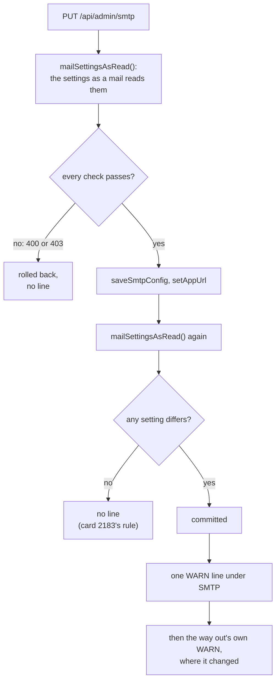

- **What is compared.** `mailSettingsAsRead()` in `email.ts` reads the settings as a mail
  does, with `getSmtpConfig`'s defaults (port 587, From Name `DumpFire`, empty text for the
  rest), whether a host is set or not, and the App URL as `getAppUrl()` answers it (`http://`
  added to one stored without a scheme, the `APP_URL` environment variable where none is
  stored), empty for none. The route reads it inside the save's transaction before and after
  it writes, and the fields that differ (`Object.is`) are the change. A row written with the
  value a mail already used, such as the panel saved as it was filled, is no change and writes
  no line.
- **The line.** The fields in the panel's order: `host`, `port`, `allowInsecure`, `user`,
  the password, `fromAddress`, `fromName`, `appUrl`, joined by `; `, each as `<field> from
  <old> to <new>`, text in quotation marks with each `\` and `"` escaped (`quotedName`, as
  the backup settings' line quotes a destination's name), a number or `true`/`false` as it is;
  then `(set by "<username>")`, the name quoted the same way. The user name is `user
  changed` and the password `password changed`, typed anew or emptied, and never a value:
  some mail providers take the API token as both the user name and the password. The meta is
  `{ "changes": [ { "field", "from", "to" } ] }`, the user name's and the password's entries
  `{ "field": "user" }` and `{ "field": "pass" }` alone.
- **Its level.** Always a `WARN` (card 2396's review): a change of the sender or the password
  matters as much as one of the host, and an `INFO` is not kept at `LOG_LEVEL=WARN`. The way
  out keeps its own `WARN` line, written after this one.
- **When it is written.** After `writeAs` returns, so after the commit: a save refused (the
  password needed again, a field of the wrong type, `{}`, a caller no longer an administrator)
  or one that fails writes none. Backup saves write no audit entry, and nor does this.

### When the Mail's Setter Is Demoted

Since card 2397 (2026-10-22, the owner's ruling). Since card 2395 any administrator can point
mail at a server of their own, and before this card that server went on receiving every mail
after its administrator was demoted or deleted. Now the same `PUT /api/admin/smtp` that logs a
change records its saver, inside its `writeAs` (`recordMailSetters` in
`src/lib/server/setting-setters.ts`): a save that moves the host, port, user or
`allowInsecure`, as a mail reads them, to a place nobody is recorded for writes a `mail` row in
`setting_setters` naming the saver for that place, and one that sets the App URL to an address
nobody is recorded for an `app_url` row, so that saving the App URL alone does not take the
mail server over. The setter is the account recorded for where the mail is now: moved back to
where somebody put it before, it is theirs again (the second code review: an administrator who
changed a passwordless relay's port and changed it back, or the App URL, had taken the
superadmin's over). The sender's name or address, a password typed again alone, and an App URL
cleared make nobody the setter (the first review: an administrator who corrected one field of
the superadmin's mail became its setter, and their demotion then removed it), and a save that
changes nothing records nothing.

When that account is made a user (`PUT /api/users/:id`) or deleted (`deleteUser`), in the same
transaction, every `smtp_*` row of `settings` goes where the mail is still at a place it is
recorded for, so
`isSmtpConfigured()` is false and **no mail is sent** (notifications, invites, password-reset
invites, request mail, reports, the backup failure mail) until an administrator sets the mail
up again; an invite then shows its link in the dialog of [When a Mail Fails](#when-a-mail-fails).
The `app_url` row goes where it is still an address the account is recorded for, so links use `APP_URL`, or `ORIGIN`
([Where the App URL Comes From](#where-the-app-url-comes-from)). Once committed, one `WARN`
under `SMTP`, filed under the account that made the change:

```
The mail settings and the App URL removed: saved by "ann", who was made a user by "chief". No mail is sent until an administrator sets the mail up again. Links in mail use APP_URL, or the server's own address, until an App URL is saved again.
```

(`The mail settings removed: …` or `The App URL removed: …` where only one went; `whose
account was deleted by "chief"` for a delete), its meta `{ "setter", "reason": "demoted" |
"deleted", "mail", "appUrl" }`. An `app_url` row that reads as none (an App URL cleared since
its setter saved it) is at no recorded place: it stays, as whoever cleared it left it, and is
not reported or logged (the second review; the first removed it unsaid). A mail already handed to the mail server is sent. Mail
settings saved before migration 0059 have no row, name nobody, and stay. See
[Settings Go With Their Setter](authentication-security.md#settings-go-with-their-setter-card-2397).

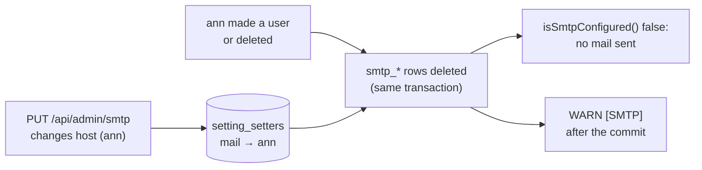

### Where the App URL Comes From

Card 2401. Every link in a mail begins with the App URL that `getAppUrl()` in `email.ts`
answers: the `app_url` setting, or where no row holds any text, the `APP_URL` environment
variable (then `ORIGIN`, in `linkBaseUrl`, which is not the App URL). `GET /api/admin/smtp`
answered it as `appUrl`, the App URL panel filled its field with it and **Save** sent it back,
and the PUT stored whatever it was sent: an App URL from `APP_URL` became the setting, and a
later change of `APP_URL` no longer applied. Where no mail host was set the GET answered no
App URL at all, so the panel showed an empty field and its Save stored an empty App URL over a
saved one.

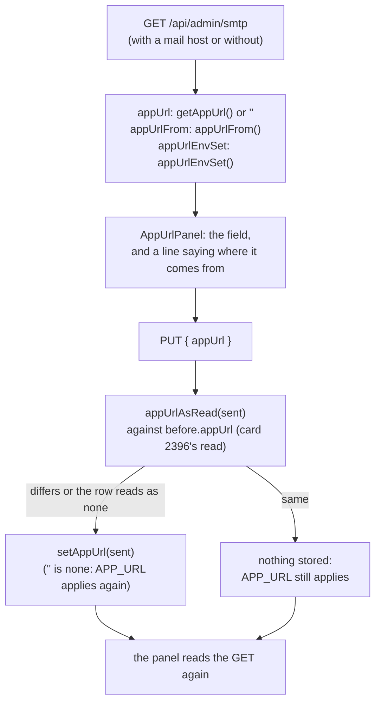

- **`appUrlFrom`**, in both GET answers beside `appUrl`: `setting` (a row with text in it,
  which wins), `environment` (no row, or an empty one, and `APP_URL` set) or `none`. A row of
  spaces alone is `none`, as `getAppUrl()` answers null for it. `appUrlFrom()` and
  `getAppUrl()` read through the one `appUrlAsRead` (trimmed, trailing slashes off, `http://`
  added to text with no `http://` or `https://` scheme in any case, empty for none: the review
  made the scheme check case-insensitive, as `HTTPS://Host` was read as `http://HTTPS://Host`).
- **`appUrlEnvSet`**, in both GET answers (the review): whether `APP_URL` holds an App URL as a
  link reads it (`appUrlEnvSet()`), so that the panel says what clearing a saved App URL goes
  back to. Its value is already answered whenever it is in effect, so nothing new is revealed.
- **The save.** The PUT stores the App URL only when `appUrlAsRead(sent)` differs from the App
  URL in effect, `mailSettingsAsRead().appUrl` read before the write in the same transaction.
  An unchanged save, a trailing slash or a missing `http://` included, stores nothing and is
  still `200`. A value typed that equals `APP_URL` while another is stored is a change, and is
  stored as typed. Empty text where one is stored is stored, and an empty row is none, so
  `APP_URL` applies again: that is the way back to the environment's App URL. Empty text where
  `APP_URL` is in effect writes an empty row, which changes nothing. A stored row that reads as none
  (spaces alone, from before card 2117's rule) still hides `APP_URL`, so the review has any
  save, an empty one included, write over it (`appUrlRowReadsAsNone()`).
- **The panel.** For `environment`: `From the server's configuration (APP_URL). Saving it
  unchanged leaves it there, so a later change of APP_URL still applies.`; for `setting`
  where `APP_URL` is set: `Saved here, ahead of the server's configuration (APP_URL). Clear it
  and save to use the server's configuration (APP_URL) again.`; for `setting` where it is not:
  `Saved here; the server's configuration sets no APP_URL. Clear it and save to use ORIGIN, the
  server's own address.`; for `none`, the amber `No App URL set` warning, shown while the field
  is empty once the App URL has been read. The source line speaks of the App URL read, so it is
  hidden while the field holds anything else. **Save** stays off until a GET has answered
  (`appUrlFrom` not null): an empty field saved before the answer would clear a stored App URL.
  A GET that fails, or cannot reach the server, leaves Save off and says `The page could not
  read the App URL settings: reload the page before saving.` After a save it reads the GET
  again.
- **The line.** Card 2396's line compares the App URL as a link reads it before and after, so a
  save that stores nothing writes none. Clearing a saved App URL writes a line only when the
  App URL in effect changes: `appUrl from "<saved>" to "<APP_URL>"` where `APP_URL` is set and
  differs from it, none where the saved value equals `APP_URL` (the row goes, the App URL in
  effect reads the same), and `appUrl from "<saved>" to ""` where `APP_URL` is not set.

### Connection Handling

Every mail goes through `deliverMail` in `src/lib/server/email.ts` (card 2196), the one place a
mail is handed to the mail server, and so through `createTransporter`, built afresh for each
send from the stored settings: `sendEmail` and `trySendEmail` (invites, notifications, request
mail and its confirmation, the new-link mail, the backup failure mail), `sendEmailWithAttachment`
(reports, the requester's completion PDF) and `sendTestEmail` (Send Test). Card 2189 made the
connection a checked, encrypted one by default. What `deliverMail` answers, records and logs
is under [When a Mail Fails](#when-a-mail-fails), below.

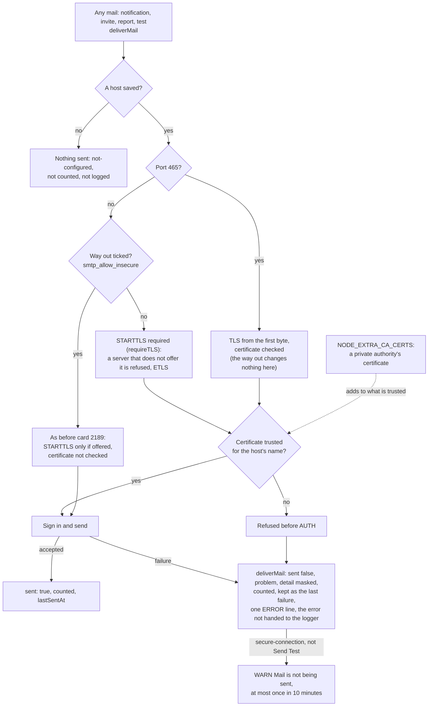

The options handed to nodemailer (10.4.0 since card 2852; 10.1.1 before):

| Option | Port 465 | Any other port | Any other port, way out ticked |
|---|---|---|---|
| `secure` | `true` | `false` | `false` |
| `requireTLS` | `false` (TLS already) | `true` | `false` |
| `tls.rejectUnauthorized` | `true` | `true` | `false` |
| `auth` | the user and password, when a user is saved | the same | the same |
| `name` (the EHLO name) | `dumpfire.app` | `dumpfire.app` | `dumpfire.app` |
| `connectionTimeout`, `greetingTimeout`, `socketTimeout` | 10 s, 10 s, 15 s | the same | the same |

- **The certificate** is checked against Node's own authorities and any named by
  `NODE_EXTRA_CA_CERTS`, which Node reads once at start for every TLS connection of the
  process (webhook deliveries and backup destinations trust that authority too). There is no
  setting for an authority's certificate on the panel: see
  [Mail Server Certificates](deployment.md#mail-server-certificates).
- **Port 465 is checked even with the way out ticked** (the plan's R9): it checked the
  certificate before card 2189 too, so no installation on 465 depends on an unchecked one.
- **The EHLO name** is `dumpfire.app`, to avoid Google's `421` answers to local host names.
- **IPv4 and IPv6.** DumpFire no longer passes `family: 4` ("force IPv4"): nodemailer 10's SMTP
  connection does not read a `family` option. nodemailer looks up the host's IPv4 and IPv6
  addresses together, leaving out a family the server has no network address for (and falling
  back to `dns.lookup` when neither finds an address), and with more than one address it has
  Node's `net.connect` try them in turn (`autoSelectFamily`), going on to the next when one
  fails or is slow.
- **The check before deploying** ([Mail Server Certificates](deployment.md#mail-server-certificates))
  builds these same options and calls `verify()`, which connects, upgrades, checks and quits
  without signing in, so it tells what the first mail will meet. `createTransporter`'s comment
  names it: change the two together.

**What a failure says.** Send Test's `500` is `Failed to send test email: <the error>`, the error
being the mail server's words masked as the log has them (`MailNotSent`, thrown by
`sendTestEmail`; card 2196). When the error is the certificate or STARTTLS (the problem
`secure-connection`, read by the one test `tlsFaultHint` and `mailProblem` share: the code `ETLS`
or `EREQUIRETLS`, or nodemailer's or Node's own words matching `certificate`, `altnames`,
`self-signed` or `STARTTLS`, the mail server's reply left out of that reading), the error is
ended as a sentence and followed by:

> The mail server's certificate could not be checked, or the server does not offer STARTTLS.
> For a certificate from a private authority, see docs/deployment.md, Mail Server Certificates;
> for a relay on this server's own network that cannot use TLS, tick "Allow mail without a
> checked, encrypted connection" and type the password again.

A refused STARTTLS comes back `ETLS` "Error upgrading connection with STARTTLS: …"; a
certificate refused during STARTTLS comes back `ESOCKET` with Node's message
("self-signed certificate", "Hostname/IP does not match certificate's altnames: …"); and a server
that answers neither EHLO nor STARTTLS comes back `ECONNECTION` "EHLO failed but HELO does not
support required STARTTLS", which nodemailer 10 names so (the review-fix pass's S6). A sign-in
failure or a timeout says what it says, with no sentence. Every mail's failure, Send Test's
included, is one `ERROR` line under `EMAIL` written by `deliverMail` (`Failed to send email to
<to>: <subject>`, or, for a decision's record mail, `Failed to send email to participant <id>
of decision <id>: <subject>`, card 2675's S7, and for any of the seven mails to a task request's
requester, `Failed to send email to the requester of request <id>: <subject>`, card 2896, so that
no requester's address is logged; a mail to an account holder names its address); the SMTP route's own line for Send Test is gone
(card 2196's N2). When it is
the certificate or STARTTLS, `deliverMail` also writes one `WARN` line under `EMAIL`, `Mail is
not being sent: <the error, masked>. <the sentence above>`, at most once in ten minutes in a
process, so the Audit page says why invites and notifications stopped. Send Test does not
write it: its answer already says the same to the administrator who pressed it.

### When a Mail Fails

Card 2196. An invite whose mail failed was answered "Invite sent", a user made with no password
while mail failed was answered `invited: true` (which the admin page read as "invite email
sent!"), and every other mail that failed was one `ERROR` line and nothing else. The line was the
error itself, so a mail server's refusal that quoted the mail's link put a live invite token in
front of every administrator in the live console.

**One place a mail is sent from.** `deliverMail(message)` in `email.ts` answers `{ sent: true }`
or `{ sent: false, problem, detail }`. "Sent" means the mail server accepted it; a bounce
afterwards goes to the From address and is not known here. "Not sent" means "not confirmed
sent": a mail server can take the whole message after `DATA` and the connection then drop
before its answer arrives, and then the mail is delivered all the same. So an invite's link
given to its issuer may reach a person who also has the mail; either works, once. `trySendEmail(to, subject, html)`
answers the whole outcome; `sendEmail` and `sendEmailWithAttachment` still answer a boolean,
which the report routes read; `sendTestEmail` still throws. The `.catch(log.error(…))` beside
each send in `notifications.ts`, and the backup failure mail's `catch`, are for an error before
the send: a mail that fails resolves, and its one line is `deliverMail`'s.

`problem` is read from nodemailer's error by `mailProblem(err)`:

| `problem` | Words (in an answer and on the panel) | From |
|---|---|---|
| `not-configured` | mail is not set up on this server | No mail host when the mail was sent. Not counted as a failure, not logged |
| `no-password` | the mail password has not been entered on this server; an administrator enters it under 📧 Email / SMTP (it said "the superadmin" until card 2395) | `EAUTH` with `command` `'API'`: nodemailer's own "Missing credentials for …", for a mail user name saved with no password (what a restore leaves, card 2169). Nothing was asked of the mail server |
| `secure-connection` | the mail server's certificate could not be checked, or it does not offer STARTTLS | `ETLS`, `EREQUIRETLS`, or nodemailer's or Node's own words matching `certificate`, `altnames`, `self-signed` or `STARTTLS` (an altnames mismatch comes back `ESOCKET`; nodemailer 10's "EHLO failed but HELO does not support required STARTTLS" comes back `ECONNECTION`). The mail server's reply is not read for the words: a refusal saying "certificate" is the server's answer, `refused` or `failed` |
| `unreachable` | the mail server could not be reached | `ECONNECTION`, `EDNS`, `ETIMEDOUT`, `ESOCKET` otherwise |
| `sign-in` | the mail server refused the sign-in | `EAUTH` otherwise |
| `refused` | the mail server did not accept the message | `EENVELOPE`, `EMESSAGE` |
| `failed` | the mail could not be sent | Anything else |

**What an invite answers.** Both routes that issue an invite, `POST /api/users/{id}/invite` and
`POST /api/users` with no password, issue it in their transaction and then send its mail,
after the commit, and wait for it: usually a second or two; each step of the conversation with
the mail server can wait up to 15 seconds (`socketTimeout`), after 10 to connect and 10 for the
greeting. The invite is kept whatever the mail did: the account's earlier invite was deleted
at the commit, so deleting this one too would leave it no link at all.

Both refuse in the transaction, before any invite is made, when the mail cannot go and that is
known beforehand: no mail host (`400`, as before), or a mail user name saved with no password
(`smtpPasswordMissing()`, as card 2158's new-link route asks; the review-fix pass of card 2196).
The second is `400` with `The invite was not made: <no-password's words>. Any earlier invite to
this account still works.` from the resend, and `Password must be at least 8 characters
(<no-password's words>)` from a user made with no password. So the account's earlier invite is
not ended for a mail certain to fail, and no link is put on a screen for it: decision 8 offers
the link only for a mail that was tried.

| | `POST /api/users/{id}/invite` (`200`) | `POST /api/users`, no password (`201`) |
|---|---|---|
| Sent | `{ success: true, mailSent: true, message: "Invite sent to ana@example.com. Any earlier invite to this account no longer works." }` | the user, `invited: true`, `mailSent: true` |
| Not sent | `{ success: true, mailSent: false, mailProblem, inviteUrl, message: "The invite was made, but its mail to ana@example.com could not be sent: <mailProblem>. Give ana the link yourself. Any earlier invite to this account no longer works." }` | the user, `invited: true`, `mailSent: false`, `mailProblem`, `inviteUrl` |
| Not sent, link not shown | `{ success: true, mailSent: false, mailProblem, message: "The invite was made, but its mail could not be sent, and its link cannot be shown to you now. Send a new invite with 📧 once mail works." }` | the user, `invited: true`, `mailSent: false`, `mailProblem` |

A user made with a password is answered `invited: false` and no `mailSent`. `mailProblem` is the
problem's words, never the mail server's, which can name the mail host and its user name (read
on the mail panel and in the system log, both every administrator's since card 2395). Every outcome but `sent: true` is
a mail not sent, `not-configured` included: an administrator cleared the mail host between the
commit and the send, and the invite exists all the same. An answer that carries `inviteUrl` has
`Cache-Control: no-store`.

`inviteUrl` is the mail's own link, `<base>/invite/<token>`, which works once, for seven days,
and ends as any invite ends. It goes only to the administrator whose request issued it, whom
the account rule already lets reset that account's password. Because the mail takes seconds,
`inviteMailAnswer` in `src/lib/server/invite-link.ts` reads three things again before the link
is put in the answer, by reads only, and gives no link if any fails: the caller's session is
still open and still an administrator's (`openSessionUser`), `mayManageAccount` still holds
between the caller and the account, both read afresh, and the token is still a usable invite
(`usableInvite`, now in `invites.ts`; a newer invite sent meanwhile has deleted it).

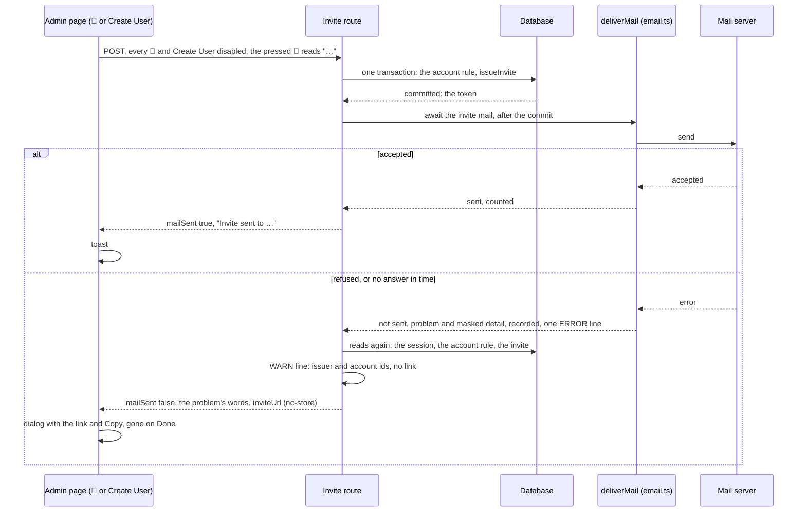

**The mail panel's record.** `deliverMail` keeps, in memory since the server started, how many
mails were sent and how many failed, when the last was sent, and the last failure: when, its
subject (not its recipient, which the system log has), the problem's words and `detail`, the
error's message masked and cut at 500 characters (it can still name the recipient, from a
refusal at `RCPT TO`). The subject is the mail's own, so a request mail's subject holds the
request's title, which a member of the public typed on the request form. `detail` is the mail
server's reply when it answered, and this server's own words when it never did: `Connection
timeout`, `Greeting never received`, `connect ECONNREFUSED 203.0.113.5:587`, `getaddrinfo
ENOTFOUND smtp.example.com` (the code, `ETIMEDOUT`, `ECONNECTION`, `ESOCKET` or `EDNS`, is in the
`ERROR` line). The panel puts it after "The mail error was:". Every mail counts, whatever sent it: notifications, invites, the request
mails, the backup failure mail, reports scheduled and sent by hand, and Send Test. A mail not
sent for want of a host is not counted. `GET /api/admin/smtp` answers it as `mailStatus`,
configured or not, to any administrator (the superadmin alone until card 2395), with `Cache-Control: no-store` on both answers. The
admin page reads it when the panel opens, after Save and Send Test, and as
each invite is answered, so the panel the invite's dialog points to shows that mail:

```json
"mailStatus": {
  "since": "2026-10-14T08:00:03.112Z",
  "sent": 40,
  "failed": 3,
  "lastSentAt": "2026-10-14T09:58:40.006Z",
  "lastFailure": {
    "at": "2026-10-14T10:02:11.481Z",
    "subject": "Assigned: Deploy v2.1",
    "problem": "the mail server refused the sign-in",
    "detail": "Invalid login: 535-5.7.8 Username and Password not accepted"
  }
}
```

It is never written to the database: a write after every mail would land at a moment no request
controls, and every backup would carry it. A restart starts it again; the system log keeps each
failure for 30 days. The panel shows it under Send Test (see the admin guide's SMTP
Configuration).

**Nothing secret is logged.** `deliverMail` never hands the error to the logger: an `Error`'s
stack, and nodemailer's `response`, hold the mail server's words unmasked, and the logger stores
an `Error` as its message and stack. It writes

```text
[ERROR] [EMAIL] Failed to send email to <to>: <subject> | {"code":"EMESSAGE","command":"DATA","responseCode":554,"problem":"refused","detail":"Message failed: 554 5.7.1 rejected, listed URL https://kanban.example.com/invite/[token]"}
```

where `detail` is `maskMailText(err.message)`: a hyphen encoded as `%2D`, `&#45;` or `&#x2D;`
(any case) is read back as `-`, which would otherwise break a UUID into runs of 12 or fewer, and
a slash encoded as `%2F`, `&#47;` or `&#x2F;` as `/` (card 2675's S1); then `maskSecretPaths`
in any case (an invite's `/invite/<token>`, a decision's `/decision-link/<token>` and a request
link's `?token=` become `[token]`); then every run of 32 or more base64url characters (a decision
link's token is 43) and every run of 16 or more hex digits and hyphens, in any case, becomes
`[token]`. A decision's record mail also has its recipient's address, wherever the server's words
quote it, written `[participant <id> of decision <id>]` (`trySendEmail`'s `recipient`, S7), and a
requester's mail its requester's, written `[the requester of request <id>]` (`requesterLabel`,
passed by `notifications.ts` to `trySendEmail` and to `sendEmailWithAttachment`'s `recipient`,
card 2896), in any case, so the mail panel's last failure holds it masked too; every
other mail is unchanged. A refusal can quote the link URL-encoded, in capitals,
with HTML entities, or split across two reply lines after `/invite/`; each leaves the token's own
characters as they are, which the second rule finds (an invite's token is a UUID, a request's 64
hex digits). The cost is the odd queue id. The second rule is not in `maskSecretPaths`, which is
run over the whole log at every start: it would mask every UUID there. The same `detail` is the
panel's, Send Test's `500` and the `WARN` line's. When an invite's link is handed over, or not,
the route writes one `WARN` line under `AUTH`, with the issuer as the row's user and no link or
token:

```text
[WARN] [AUTH] Invite for user 12 was issued by user 3; its mail was not sent (the mail server could not be reached), and its link was given in the answer to their request
[WARN] [AUTH] Invite for user 12 was issued by user 3; its mail was not sent (the mail server could not be reached), and its link was not given to them: the invite no longer works
```

The other reasons a link is not given are "the caller's session has ended, or is no longer an
administrator's" and "the caller may no longer manage the account".

So one failed mail is one `ERROR` line. Beside it, the first failure in ten minutes for the
certificate or STARTTLS adds the `WARN` "Mail is not being sent" above, and an invite adds the
`WARN` of its link; neither repeats the other.

**A public request whose confirmation mail fails** is answered as before: the form would
otherwise wait on the mail server, and tell anyone on the internet when this server's mail is
down. The failure shows on the panel and in the log.

### Email Types

| Event | Recipients | Preference Key | Subject Format |
|-------|-----------|---------------|----------------|
| Card Moved | Assignees who can open the board the card is on now, never the one who moved it | `email_moved` | `Card moved: {title} → {column}` |
| Card Unblocked | Assignees of the card that was waiting who can open its board (card 2180). Each is told the finished work's title only if they can open the board it is on (card 2152) | `email_moved` | `Unblocked: {title of the waiting card}` |
| Plan Created | Assignees of the cards attached to an empty goal, and every administrator, less whoever attached them, and then only those who can open the plan (card 2152). Each is told the plan as they would see it on its page | `email_planning` | `Plan created: {goal}` |
| User Assigned | Assignee | `email_assigned` | `Assigned: {title}` |
| Comment Added | Board members | `email_comments` | `New comment on: {title}` |
| User Mentioned | A user named as `@username` in a comment who can open the card's board (card 2198), never the author | `email_mentions` | `{author} mentioned you: {title}` |
| Board Shared | Target user | `email_board_shared` | `Board shared: {boardName}` |
| Request Confirmation | Requester (no account) | — | `Confirm your request: {title}` |
| A New Link (card 2158) | Requester, at the request's address (for a request made signed in, the account's email as it is now: card 2171), when they ask for it from a link that no longer works: at most three an hour to one address, and for a request not yet confirmed within the form's three confirmation mails an hour to it; at most 30 an hour in all; worked out and sent after the answer, and only when the request, read again as its link is written, is still there with the same address and its links have not ended (the card 2870 code review, CS1): never for an unconfirmed request that has lapsed, nor for one settled more than 90 days ago (card 2902), whose ask is answered the same sentence and mailed nothing. It carries a new link of its own, one of at most three asked-for links the request keeps, and ends no link another mail carried (card 2870); it says "A new link to this request was asked for with your email address. Use the button below to open it.", with "Confirm my request" or "View the conversation". See [The Public Request Form](authentication-security.md#the-public-request-form) | — | `A new link to your request: {title}` |
| Task Request | Target user/team | `email_requests` | `New request: {title}` |
| Request Accepted | Requester | — | `Request accepted: {title}` |
| Request Rejected | Requester | — | `Request declined: {title}` |
| Conversation Message | Requester/Admin | `email_requests` | `Message on request: {title}` |
| Request Complete | Requester | `email_request_progress` | `Your request is complete: {title}` |
| Backup Failed | The backup settings' failure email address(es), one mail a run, naming every destination that failed (card 2415), a copy of the database that could not be made included (card 2416) | — (the backup settings' failure alerts, `notifyOnFailure`) | `⚠️ DumpFire Backup Failed` |
| Decision Invitation (card 2675) | Each participant of a decision `reachOf` reaches, at the snapshot address: on opening, when added or brought back after opening (as consulted, only while the decision is open: card 2743), when made consulted while the decision is open (card 2740), on a re-send (a consulted participant's only while it is open), and when an Extend or a re-publish asking again reopens the decision, to each consulted participant the round never reached (card 2744). No route sends it yet | — (never read, the master switch included: D22) | `Your view is asked: {title}` (consulted), `For your information: {title}` (informed) |
| Decision Asked Again (card 2675) | As above, on a re-publish that asks again | — | `Changed, and your view is asked again: {title}` |
| Decision Changed (card 2675) | As above, on a re-publish that only tells | — | `Changed: {title}` |
| Decision Withdrawn (card 2675) | As above, on withdrawing a decision that was opened | — | `Withdrawn: {title}` |
| Decision Ruled (card 2675, sent by card 2679) | As above, on a ruling: every live participant, consulted and informed | — | `Ruled: {title}` |
| Concern About a Ruling (card 2679) | The decision's decider, at their account's address, when a participant raises a concern: a participant's first always, then at most one about them in 24 hours | `email_decisions` | `A concern about the ruling on {title}` |
| A Question About a Decision (card 2678) | The decision's author and decider, each who may answer now and is not the asker, at their account's address, when a participant asks a question: a participant's first always, then at most one about them in 24 hours. See [The Question Notices](#the-question-notices-card-2678) | `email_decisions` | `A question about {title}` |
| Your Question Answered (card 2678) | The asker, when a person answers their question, or publishes or replaces an agent's draft of an answer: an account holder at their account's address, a link holder at the participant's snapshot address, with no link | `email_decisions` (an account holder; a link holder has no switch) | `Your question about {title} has been answered` |
| Decision Closing Reminder (card 2685) | Each consulted participant who has not responded in the round, once a round, about a day before the closing time, at the snapshot address: an account holder with a link to the page, a link holder with no link. Sent by a scheduled job, only where the schedulers run. See [The Closing-Date Reminder](#the-closing-date-reminder-card-2685) | `email_decisions` (an account holder; a link holder has no switch) | `Reminder: your view is asked by {closes_at} UTC: {title}` |
| Two-Step Sign-In Notices (card 2769) | The account's owner, at its address: when two-step sign-in is set up, a recovery code is used, code entry is paused or locked, every tenth wrong recovery code in a row, at most once an hour a wrong code after the right password or a sign-in left unfinished, and (card 2772) when an authenticator is added or removed or a new set of recovery codes is made on the Account page. See [Two-Step Sign-In Notices](#two-step-sign-in-notices-card-2769) | — (cannot be switched off) | Ten, one for each notice |
| The Release's Set-Up Link (card 2769) | The account's owner, at its address, when they give the right password at an account that may set up on its password and a mail host is configured: at most one a day | — | `Set up two-step sign-in for your DumpFire account` |

**The backup failure mail says which kind of run failed** (card 2413, 2026-10-22). Sent by
`runBackup()` in `src/lib/server/backup.ts`: headed **Scheduled Backup Failed**, "A scheduled
backup to *name* (*type*) failed.", for a scheduled run, and **Run Now Backup Failed**, "A backup
made by ▶ Run Now to *name* (*type*) failed.", for a Run Now (`runBackup(…, 'manual')`, POST
`/api/admin/backup`). It said "scheduled" for both. The subject is the same for both, and the
name, type and error are escaped as before ([Text in Mail Is Text](#text-in-mail-is-text)).

**One backup failure mail a run** (card 2415, 2026-10-22). `runBackup()` keeps each destination
that failed with its error, and once the run's last destination is done sends one mail: the
heading, then for each failed destination, in the order they are configured, the sentence above
and its error box. A run with one failed destination reads exactly as before. It sent one mail
for each destination that failed, from inside the failure itself, so four destinations failing
sent four mails for one run. A scheduled run that failed at every destination is now tried again
15 minutes later, up to three times ([Backup & Reporting](backup-reporting.md)); each try is a run
and sends its own mail.

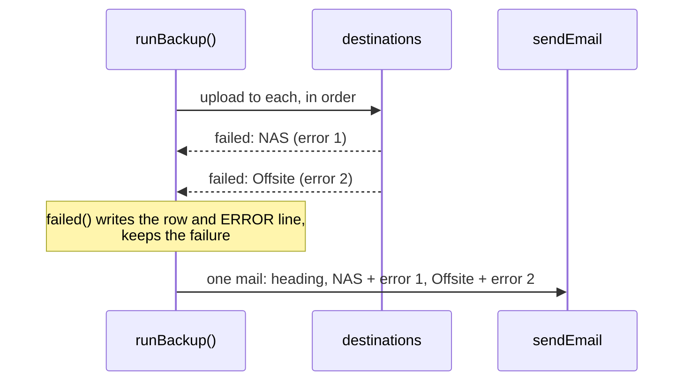

**The backup failure mail is sent where the copy cannot be made** (card 2416, 2026-10-22).
`runBackup()` makes one copy of the database before any upload (`generateBackupData()`); where
that throws (the volume beside the database full, a disk error), each destination it was to be
sent to fails with `The copy of the database could not be made: <reason>`, and the run's one mail
names each of them with that error, escaped as every error is. It threw out of the run, so no
mail was sent, nor any row written. A failed row that cannot be written (the disk full for that
too) does not stop the mail: `failed()` writes its row inside a `try` and says
`Backup History row for <destination> could not be written` where it cannot. See
[Backup & Reporting](backup-reporting.md#a-copy-that-cannot-be-made).

**A new card sends no mail of its own.** Whoever is put on a new card is mailed
"Assigned": accepting a task request with an assignee (`PATCH /api/requests/{id}`,
`assigneeId`) makes the card and assigns it in one go, and a page that makes a card with
assignees adds each one after the card is made. A "Card Created" mail would have told
them twice. The table
listed a "Card Created" mail, `New card: {title}`, whose function, `notifyCardCreated`,
nothing called; it was removed (card 2010). A new card still reaches the pages open on its
board and the board's webhooks, which is the "Card Created" of the diagram above.

**What "Unblocked" and "Plan created" tell** (card 2152). Each mail is one person's, and is
drawn for that person:

- **"Unblocked"** says "Nothing is blocking this card any more — *who* completed *the work*,
  which was the last one", with the waiting card's title and board. The finished work is
  `#12 <title>` for a card, or `the subtask <title>`, to an assignee who can open the board
  it is on (`canViewBoard(assignee, completed.boardId)`), and otherwise `#12 A card on a
  board you cannot open`, or `A subtask on a board you cannot open`. A card keeps its number
  either way, as a withheld plan node keeps its id; a subtask is never given its id as if it
  were a card's number, as it once was. At most two mails are built, one of each kind.
- **"Plan created"** is sent when cards are attached to an empty goal
  (`POST /api/v1/milestones/{id}/cards/bulk`), and by that operation alone (card 2289,
  decision 11): a card put in a goal one at a time, by the plan page's Add cards, the card
  window's picker, `POST /api/v1/milestones/{id}/cards` or `milestoneId` on
  `PUT /api/v1/cards/{cardId}`, sends none, so the first click on a new goal does not mail
  every administrator a "plan" of one card. The bulk attach is how a plan is laid down whole.
  The recipients are chosen as before and then
  each is asked `canViewMilestone`: someone who cannot open the plan, such as a former member
  of its board or someone who cannot open every board of a goal across boards, is not mailed.
  The rest are mailed the plan from `getMilestoneSummary(milestoneId, recipient)`, as its page
  shows it to them: a step on a board they cannot open is `#12 A card on a board you cannot
  open` in "The chain that cannot slip", and "Covering" counts the boards they cannot open as
  "A board you cannot open". Recipients who can open the same boards share one notice and one
  mail, so the administrators cost one. The route hands `notifyPlanCreated` a function that
  gives a recipient's notice or null, so that `notifications.ts` imports neither planning
  module, which import it.
- The "Unblocked" comment on the card is stored once for every reader of its board, and so
  follows a rule of its own: see
  [Critical-Path Planning](critical-path-planning.md#unblock-notification).

**When "Card moved" is sent** (card 2134). For every move made on a page (a drag, the card
window, All Tasks), and for a move that completes the card however it was made, through
the API included. A move through the API that does not complete the card mails nobody: a
script working a board moves cards all day, and a mail for each would bury the people on
it. Whoever made the move is never mailed about it, on any route, as the commenter is left
out of the comment mail: `notifyCardMoved()` takes the mover's id and leaves them out of the
assignees. Turning "Card moved" off to stop such a mail would also stop the "Unblocked"
mail, which reads the same preference. A card created in a Complete column is not moved,
and sends no "Card moved".

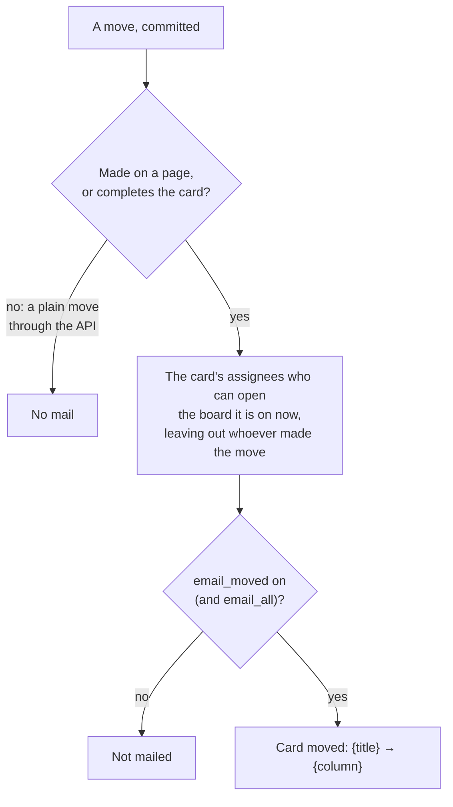

**Only assignees who can open the board are mailed** (card 2180). Taking someone off a
board, or out of the team it is shared with, leaves them assigned to its cards, and the
"Card moved" and "Unblocked" mails name the card, the board and who did what.
So `getAssigneeEmails(cardId, boardId, excludeUserId?)` in `notifications.ts` keeps only the
assignees who can open `boardId` (`whoCanOpen`, which asks `canViewBoard`): the board's
owner, a member of any role, a member of a team it is shared with, anyone for a public
board, and an administrator. `boardId` is the board the mail is about: the board the card
is on after the move for "Card moved" (a card moved to a
board an assignee cannot open is not mailed to them), and the waiting card's board for
"Unblocked". It is asked when the mail is sent, and preferences decide after it. Nobody is
unassigned by it.

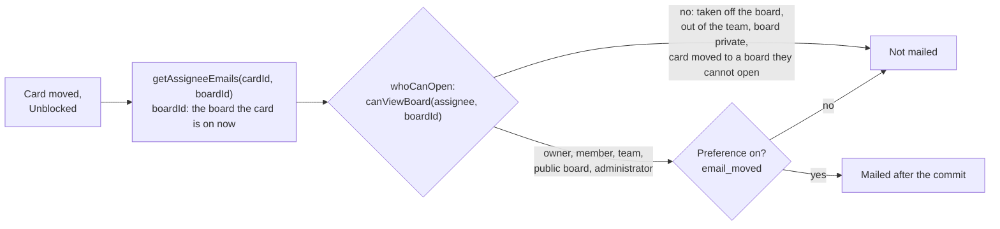

**Who a mention mails** (cards 2198 and 2207). A comment added on a page or through the API
(`POST /api/cards/{id}/comments`, `POST /api/v1/cards/{id}/comments`) is read for mentions
by `processMentions()` in `src/lib/server/mentions.ts`, inside the comment's transaction,
and each account it names is handed to `notifyMention()`. Only the two routes that add a
comment call it: an edit and a card's description mail nobody.

- **Whose name it is.** `findMentions(text, usernames)` in `src/lib/mentions.ts`, which the
  card window's chips use too, applies one rule. A mention starts at an `@` that begins the
  text or follows a character that is not a letter, a digit or `_` (of any language), so
  `bob@example.com` holds none. Its name is the longest username of any account that the
  text after the `@` begins with, case ignored, and the name must end there: not followed by
  a letter, a digit or `_`, nor by `.` or `-` and then one of those. So `@jane.doe` is the
  account `jane.doe` and never `jane`; `@jane.`, `@jane,` and `@jane's` are `jane`;
  `@Jane Doe` is the account `Jane Doe`; and if the longest name does not end there, the
  `@` names nobody. Where two usernames differ only in case, the one typed exactly is named,
  and neither when it is typed in neither spelling. The server reads every account's
  username once per comment (none when the text holds no `@`): matching against the board's
  people only could cut a longer name of someone off the board to a shorter name of someone
  on it. Only the first 200 `@` of a comment that could start a name are looked up (one at
  the end, or before a space or another `@`, cannot), each against the usernames that begin
  with its next letter, because this runs inside the comment's write: a mention after them
  mails nobody.
- **Who of them is mailed.** `notifyMention()` asks `whoCanOpen([user], boardId)` after it
  has found mail set up and before the preference, so an account that cannot open the card's
  board is mailed nothing and nothing is logged for it. The comment is saved and answered as
  it would be, and the author is not told which names were not mailed: an answer that said
  so would tell any editor whether an account of a given name exists and can open the board.
  The author is never mailed for their own mention.

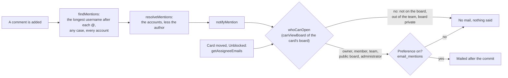

Comments written before are drawn with their chips by the same rule; no mail is sent again
for them.

### Two-Step Sign-In Notices (Card 2769)

Two-step sign-in tells an account's owner what they should know of their sign-in, and mails the
link that sets it up at the release. Both are in `src/lib/server/notifications.ts`. How sign-in
raises them is in [Two-Step Sign-In](authentication-security.md#two-step-sign-in-card-2769).

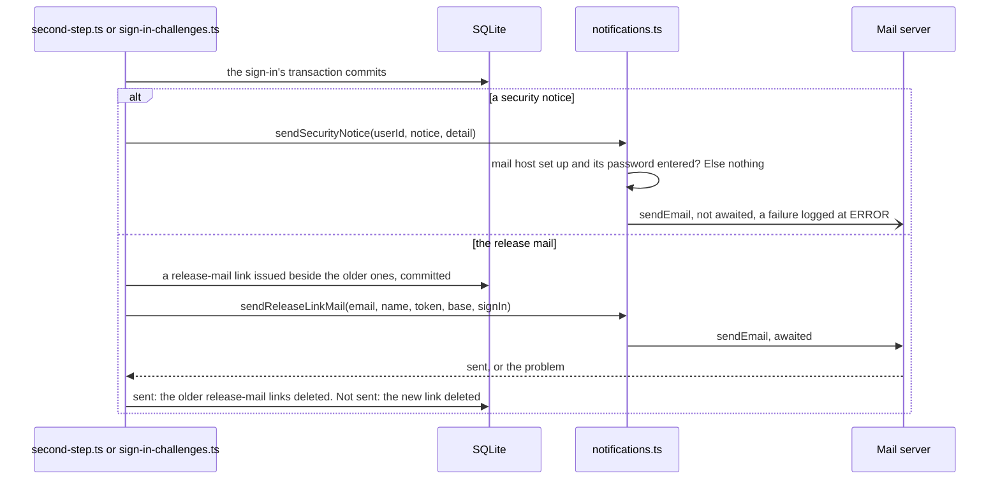

**The security notices** (`sendSecurityNotice()`). Sent after the commit of what they report,
never awaited, so sign-in is never held up by the mail server. Nothing is sent unless a mail
host is set up and its password entered on this server. They are about the account itself, so
no preference switches them off. Each names when (UTC) and from which address, as received, and
says what to do if it was not the owner. **None holds a code, a secret, a token or a link.**

| Notice | Subject | When | Limit |
|---|---|---|---|
| `enrolled` | `Two-step sign-in was set up for your DumpFire account` | Every set-up confirmed. Lists the account's live API keys (name, made, last used) and its webhooks that are on (board, host, made), and asks the owner to revoke any they do not recognise | None |
| `recovery-code-used` | `A recovery code was used to sign in to DumpFire` | A recovery code signs in. Says how many are left, and at 3 or fewer "That is few: make a new set on your Account page as soon as you can." (card 2772 added "on your Account page", where a new set is now made) | None |
| `codes-paused` | `Code entry for your DumpFire account is paused` | A lane's count of wrong codes in a row reaches or passes 5, 10, 15, 20 or 25. Says until when. Since card 2772 it gives no count: "Too many wrong authenticator codes in a row were entered for your DumpFire account, the last on …", since a lane counts one for each authenticator a code was tried against, which is not the number typed | None |
| `codes-locked` | `Authenticator codes for your DumpFire account are locked` | A lane reaches 30 or more. With no count since card 2772, in the same words | None |
| `recovery-codes-guessed` | `Wrong recovery codes were entered for your DumpFire account` | Every tenth wrong recovery code in a row | None |
| `wrong-code` | `Your DumpFire password was used with a wrong code` | The first wrong code on a sign-in that had the right password | At most once an hour, with the next |
| `unfinished-sign-in` | `A sign-in to your DumpFire account was not finished` | A sign-in that had the right password and was left until it expired, found by the sweep: at start-up, every five minutes, and whenever a challenge is issued | At most once an hour, with the one above |
| `factor-added` (card 2772) | `An authenticator was added to your DumpFire account` | An authenticator added on the Account page. "An authenticator, *name* (added *date* UTC), was added to your DumpFire account on *time* from *address*. It now signs in to your account with your password, as your other authenticators do." | None |
| `factor-removed` (card 2772) | `An authenticator was removed from your DumpFire account` | An authenticator removed on the Account page. Says every other browser was signed out, that it was confirmed with the password and a code ("if it was not you, both are known to someone else"), lists the account's live API keys and webhooks that are on, and, since card 2894, "Your report schedules that are on:" with each one's name, what it covers and its addresses (`schedulesOnOf()` in `reports.ts`; listed, never paused), then "Revoke or delete any you do not recognise. If the device was lost, also change your password." | None |
| `codes-regenerated` (card 2772) | `New recovery codes were made for your DumpFire account` | A new set of recovery codes made on the Account page. "A new set of ten recovery codes was made for your DumpFire account on *time* from *address*. The old codes no longer work." | None |
| `report-schedule-set` (card 2751) | `A report schedule was made on your DumpFire account`; for a change, `A report schedule of yours was changed on DumpFire` | A report schedule made, given an address, turned on or widened, each confirmed with the password and a code. Names what was done, when and from where, the schedule's name, what it covers and every address it is sent to. See [Report Schedule Notices](#report-schedule-notices-card-2751) | None |
| `report-schedules-running` (card 2751) | `Your DumpFire report schedules` | Once, at the first start after card 2751's release, to each owner of a report schedule that is on, listing each of theirs that is on. See [Report Schedule Notices](#report-schedule-notices-card-2751) | Once |
| `account-disabled` (card 2671) | `Your DumpFire account was disabled` | An administrator disables the account. Names who (`SecurityNoticeDetail.by`) and when, and never the address it was done from, which is the administrator's and kept on the `AUTH` line alone (the code review's CS1), and that every session and API key ended, the webhooks were switched off and the report schedules paused, and "Nothing else will be mailed to you as an account holder." Sent after the commit and awaited by the disable route; not sent where the disable removed the mail settings, and the answer's `noticeSent` is then false | None |
| `account-enabled` (card 2671) | `Your DumpFire account was enabled again` | An administrator enables it. Names who and when, never the address (CS1), and that the API keys, webhooks and report schedules were not given back | None |

**Nothing else is mailed to a disabled account as an account holder** (card 2671, S7, S16).
`shouldNotifyUser` answers false for it, read with its preferences in one row, so no assignment,
mention, request or report mail reaches it; `getUserNotifPrefs(userId, { refuseDisabled })`
refuses it for the senders that read the preferences first; the release's set-up link is not
mailed; a decision reaches it neither by its account nor by a personal link (`reachOf` skips it
with `account_disabled`); the requester's progress mail of a request it raised is not sent
(`requesterMailAddress`), the team still seeing the address. The two notices above are the only
mail it is sent.

Card 2772's three are each confirmed with the password and a code (a step-up), and sent after
the commit of the write they report. An authenticator's name is its holder's own text: it is
escaped in the mail, with the date it was added beside it so that two of the same name, or a
look-alike, are told apart (`SecurityNoticeDetail.authenticator`, `{ label, createdAt }`). Each
ends, as the others do, with what to do if it was not the owner.

The `wrong-code` and `unfinished-sign-in` notices are the stolen-password signals. Each sets the account's security banner, by a
conditional `UPDATE` of `security_banner_at` that does nothing within an hour of the last, and
mails only when it wrote. Since card 2772 the banner is shown at the top of the Account page
until its holder clears it there (**That was me**, with the password and a code) or changes
their own password. A set-up left unfinished sends nothing. A sign-in left at its second
step that a restore or the host's reset command ends is not mailed: each writes one `WARN` line
instead.

**The release's set-up link** (`sendReleaseLinkMail()`, card 2769, decision 23). Where a mail
host is configured, the right password at an account that may set up on its password, within
the 14 days after the release, issues a set-up link (`issued_by` `release-mail`, seven days) and
mails it to the account's address: when and from which address the password was used, that
two-step sign-in is now required, a **Set Up Two-Step Sign-In** button to `<base>/enrol/<token>`,
and that if it was not them, their password is known to someone else, and they should set it up
with this link, change the password straight away and tell an administrator.

- **At most one a day.** While a release-mail link under 24 hours old is live, a sign-in issues
  and mails nothing, and the sign-in page says when it went and when a new one may be had. After
  24 hours a new link is issued beside the older one, and the older stops working only once the
  new mail has gone.
- **Nothing while a set-up is under way.** While the owner is setting up on a live mailed link
  (a live set-up challenge naming it), a sign-in issues and mails nothing and is told (`200`)
  "Two-step sign-in is being set up for this account from the link we emailed. Finish it there,
  or sign in again in ten minutes.", so whoever else holds the password cannot end the owner's
  set-up.
- **Awaited, and a link nobody received is deleted.** The mail goes after the link's transaction
  commits. If it is not sent, only its new link is deleted, by its hash, and the sign-in answers
  `503` "We could not email you a set-up link just now…"; the link already mailed keeps working.
  So there is never a live link that was not mailed.
- **Only where the mail can work.** A configured host whose password is not entered on this
  server, or no address to build the link from, or the image's placeholder `ORIGIN`, issues no
  link and answers the same `503`. The link's address is `linkBaseUrl()`'s, as every mailed
  link's ([Where the App URL Comes From](#where-the-app-url-comes-from)).
- **The mail is itself the signal** that someone had the password: only a right password sends
  it.

Both functions are in `tests/mail-escaping.test.ts`: every notice with markup in the username,
the address and the keys' and webhooks' names (and, since card 2751, a schedule's name, what it
covers and its addresses), and the release mail with its link (`link:
true`). The administrator's reset notice of card 2773 (`sendMfaResetNotice()`) is apart from
these, and holds no link either.

**The two-step reset's notice** (`sendMfaResetNotice(email, username, resetBy, hadFactor,
ended)`), sent by the reset route once its transaction has committed, and awaited: "Your DumpFire
two-step sign-in was reset", who reset it and when, what stopped working, and that an
administrator gives the set-up link by hand. Since card 2915 `ended` is `{ schedulesPaused,
apiKeysEnded, webhooksSwitchedOff }` (card 2894's `kept` before: the reset kept the keys then).
Where the reset paused a report schedule it says "Your 1 report schedule was paused" or "Your N
report schedules were paused", that each emails a report whether or not they are signed in, and to
turn on the ones they recognise on the Reports page once the new authenticator is set up (nothing
for none; card 2894, D2, E24). Where it ended a key or switched off a webhook (card 2915, decision
7): "The reset also ended your API keys and switched off the webhooks you set up:", "Your API
keys:" and "Your webhooks:" listed as the security notices list them (`keyItem`, `hookItem`: when
each was made, a key's last use, a webhook's board and host), "None." for an empty list, then
"Make new keys for the scripts you recognise once your new authenticator is set up. A webhook you
recognise is switched back on by the board's owner or an administrator, which gives it a new
secret. If any is one you did not make, someone else had your password: change it, and tell an
administrator." Nothing of keys where the reset ended none. The keys listed are those still
working before the reset, read before it deleted them (`liveApiKeysOf`); the webhooks are read by
the switch-off's own ids (`webhooksByIds`, S5), so the list is exactly what was switched off.
Every text is escaped (`tests/mail-escaping.test.ts`, with markup in the keys' and webhooks'
names). The administrator's message gives the same counts and the day each was made, and no name
(card 2894's code review, CS2), and is the channel that reaches the holder for certain (S16): this
mail may not go, and the mailbox may be what was taken. The names are this mail's alone. Since
card 2923 the boards' owners are mailed too, separately, once the reset is committed: the
webhooks it switched off, and apart those it held that were already off, with the cause "the
account that set it up had its two-step sign-in reset by an administrator", naming nobody (see
[When Nobody Who Can Open the Board Set It Up](#when-nobody-who-can-open-the-board-set-it-up), below). The holder, where they own the
board, gets that mail beside this notice.

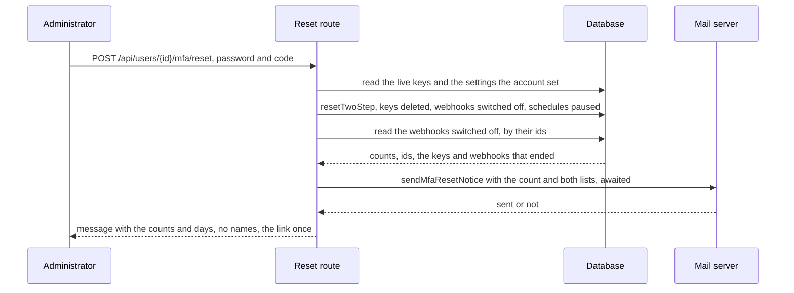

### Report Schedule Notices (Card 2751)

Since card 2751 a report schedule made, given an address, turned on or widened asks for the
password and a code (see
[Report Schedules and Report Mail](authentication-security.md#report-schedules-and-report-mail-card-2751)).
A phished or shoulder-surfed step-up would still make one, so its owner is told. Both notices
are `sendSecurityNotice()` kinds, under the same rules as the others: sent only with a mail host
set up and its password entered, never awaited, no preference turns them off, and no link, code
or secret in them. Each schedule is named as `SecurityNoticeDetail.schedules` holds it
(`{ name, covers, addresses }`, `NoticeSchedule`): "*name*, a report of *what it covers*,
emailed to: *every address*" ("no address yet" for none), where what it covers is `the board
"Sales"`, `the grouping "North"` or `every board` (`reportCovers()` in `reports.ts`; one since
deleted is named by its id). The name, what it covers and every address are text typed, each
escaped.

- **`report-schedule-set`**, sent after the commit of the write (`reportScheduleSet()` in
  `reports.ts`, in `afterCommit`), to the schedule's owner, with the caller's address.
  `SecurityNoticeDetail.change` says what was done: `made`, `added` (the new addresses),
  `turnedOn`, `widenedTo` (the filter's words, such as `All work`). The body reads "A report
  schedule of yours was *made* / *given a new address (c@x.test)* / *turned on* / *widened to
  All work* on *time* from *address*." (several joined with "and"), says it emails a report of
  board activity on its timetable whether or not you are signed in, lists the schedule, says it
  was confirmed with your password and a code from your authenticator app, and ends "If this was
  not you, someone can confirm changes as you: change your password and tell an administrator."
  No notice is sent for a report emailed by hand: its `INFO` line is the record.
- **`report-schedules-running`**, sent once, at the first start after the release, by
  `announceReportSchedules()` in `startup-checks.ts`, to each owner of a schedule that is on. It
  lists each of theirs that is on, says each emails a report on its timetable whether or not you
  are signed in, that from this release making a schedule, adding an address to one, turning one
  on or widening what it reports asks for your password and a code, and to delete any schedule
  you do not recognise on the Reports page; it ends "If you do not recognise one of these, delete
  it, change your password, and tell an administrator." It names no time or address. It is sent
  with `securityNoticeSent()`, the same notice as `sendSecurityNotice()` but resolving to whether
  the mail server took it, and every owner's is awaited (`Promise.allSettled`). With no mail set
  up nothing is sent and one `WARN` line names the owners not told; the `WARN` line written for
  each schedule is the record. Only once every notice went (or with no mail set up) is
  `settings.report_schedules_announced` written, with `INSERT OR IGNORE`, so it is never sent
  again (but after a restore of a backup made before the release); a notice that did not go
  leaves it unwritten, one `WARN` line names the owners not told, and the next start sends it to
  every owner again. Where the schedulers do not run (the dev server, `SCHEDULERS=off`) nothing
  is sent and nothing written, so a rehearsal mails nobody. See
  [Deployment](deployment.md#the-release-that-asks-for-the-password-before-report-mail-card-2751).

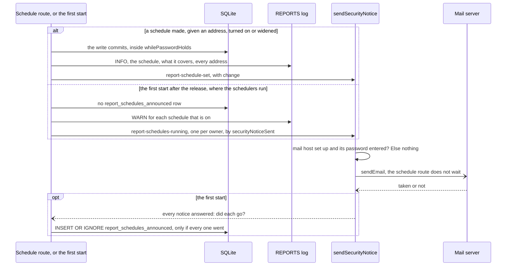

Both are rows of `tests/mail-escaping.test.ts`'s loop over every notice (T20, T21), each schedule
field a marker that must come out escaped.

### Decision Record Mails (card 2675)

A decision's participants are told of it by five mails that are part of its record: the
invitation, asked again, told of a change, withdrawn, and the ruling (built here, sent since
card 2679 by `ruleDecision`, [below](#the-ruling-mail-and-the-concern-notice-card-2679)). `queueRecordMails(decision, mail, opts)` in `src/lib/server/decision-mail.ts` writes them
inside the service write that asks for them, which card 2697's lifecycle routes call: Open,
Re-publish, Withdraw and Resend in the decision's editor ([The dry run, and the limits on
decision mail](#the-dry-run-and-the-limits-on-decision-mail-card-2697)). What each mail carries:

| Mail | Event on the record | Body (every value through `escapeHtml`) |
|---|---|---|
| Invitation | `invited` (`{ resend: true }` on a re-send) | The question; for a consulted participant what is asked of them and by when (UTC), for an informed one that nothing is asked; who decides; the link |
| Asked again | `asked_again` | The change note; that an earlier response stays on the record for its version; by when; the link. Sent to consulted participants alone (card 2739) |
| Told of a change | `told_of_change` | The change note; the link. Sent by a tell-only re-publish, and to informed participants by one that asks again (card 2739) |
| Withdrawn | `told_withdrawn` | That it is withdrawn, the reason, that the link goes on working for 90 days; the link |
| Ruled | `told_ruling` | The option chosen, or "None of these", the reason and the conditions; "You can raise a concern about this ruling from the page for 90 days." (card 2679); no count, no figure, no "against" and no cut-off (S4); the link |

The heading is `emailTemplate(escapeHtml(title), body)`: `emailTemplate`, exported from
`notifications.ts` for this, puts its title in as given. A title cannot hold a control,
direction, invisible or other format character (`\p{Cf}`; `createDecision` refuses it,
`UNPRINTABLE` in `logger.ts`), and the subject is plain text that never holds a token. No mail
names another participant.

**Who is mailed** is one rule, `reachOf` in `src/lib/server/decision-links.ts`, asked for every
participant who is not removed. A person who is gone or has left is never mailed, whatever their
account; a person whose account is deleted is marked left by the delete (card 2675's S4). A row
with an account is mailed a link to `/decisions/{id}`, behind a sign-in, while the person is
still linked to that same account and the snapshot address is still the person's (S2). A row with
no account is mailed a **personal link**,
`/decision-link/[token]`, while the person has no account, the row never held one on this
decision, and the snapshot address is still the person's. Everyone else gets no mail, and the
record says why in `mail_skipped { mail, reason }`, the reason the first of `deleted`, `left`,
`account_not_attached`, `account_disabled` (card 2671: the row's account is disabled, "<name>'s
account is disabled: they cannot be mailed about this decision"), `account_removed` and
`address_changed`. A re-send to such a participant is refused 409 in that reason's words.

**A fresh link in every mail.** Only a link's hash is stored, so a later mail cannot carry the
link an earlier one did. Each mail to a link holder issues a new link, which replaces the last
(`link_issued { replaced: true }`), so a forwarded older mail stops working.

**Where the links point.** Every link is made on `decisionLinkBase()`, which is `linkBaseUrl()`
asked with no request: the App URL, else `ORIGIN`. The request's own Host is never used, even
under dev, and a service's `opts.baseUrl` is not read. With neither, opening, re-publishing, a
re-send and adding or bringing back a participant are refused 409 with the `NO_LINK_ADDRESS`
words and nothing written. A withdrawal goes ahead, each mail it would send recorded with
`mail_outcome { delivered: false, problem: 'no_link_address' }` in the same transaction, no link
issued, and nothing sent. Opening is also refused while no mail host is set.

**Delivery is two events, and a batch is sent in sequence.** The mail's event is written in the
write's transaction. The mails of one call are held in memory, the tokens with them, and handed
to **one** `afterCommit` effect, which sends them one at a time: each `trySendEmail` awaited and
its `mail_outcome { of, mail, delivered, problem? }` appended by `DumpFire` (source `system`) in
an `inTransaction` of its own before the next starts. An opening with 5,000 participants holds
one mail connection at a time. `problem` is the `MailProblem` code alone; the mail server's own
words go only to the system log, where `maskMailText` writes `/decision-link/[token]` for the
token (`SECRET_IN_PATH`). An outcome that cannot be written, for a decision deleted meanwhile, is
one WARN line naming the decision and event ids and no address, and the batch goes on.

**Asked again before each send** (`stillToSend`, card 2675's F2). Another write can commit while
the batch is out, so just before each mail is handed over it is checked again: the decision must
still exist, at the version the mail was built on (card 2739's code review, 2026-11-05: a mail
overtaken by a re-publish quotes a version no longer current); the row must not be removed and
must still hold the mail's address; a link mail's
row must still hold that mail's link (`link_token_hash` the hash of its token); and an account
mail's participant must still be reached through their account. A mail whose decision is gone is
not sent, and is a WARN line, `Decision <id>: mail event <id> was not sent, as the decision is
gone`. Any other that fails is not sent, and is recorded `mail_outcome { delivered: false,
problem: 'superseded' }`.

**The throttle.** `RECORD_MAIL_MIN_MINUTES` is 10. A re-send, a re-publish and bringing back a
removed participant are refused 409 while a participant they would mail was mailed less than 10
minutes ago, naming the moment, in UTC, from which they may be. Since card 2697 the same writes
are also refused 409 once a participant has been sent `RECORD_MAIL_DAILY_CAP` (5) record mails
in 24 hours: "<name> has been mailed about this decision 5 times in the last 24 hours: they can
be mailed again from <stamp> UTC", the stamp the earliest of the five plus 24 hours, read from
the record. One `mailRestOf` gives both answers, to the write and to the editor's delivery
panel. Opening, withdrawal and the ruling happen once per change of status and are not
throttled.

**A participant made consulted** (card 2740). When `setParticipants` changes a participant's
role from informed to consulted while the decision is shown open (stored open, not past its
closing time), they are sent the **invitation**, which in their new role asks for their view
("Your view is asked: {title}"), in the same `queueRecordMails` call as the write's other
invitations: `role_changed`, then for a link holder `link_issued { replaced: true }` and a fresh
link, then `invited`. It is not `asked_again`, whose words say the decision changed. The rest and
the caps hold the mail back but never the role change: where `mailRestOf` holds the participant
(the 10-minute rest or `RECORD_MAIL_DAILY_CAP`), or the caller's `CALLER_MAIL_DAILY_CAP` would
not take the mail with the write's own invitations, the role is changed and
`mail_skipped { mail: 'invitation', reason }` written, `resting`, `daily_cap` or `caller_cap`
(`HoldReason`), which the delivery panel says in `HELD_WORDS` ("… was not asked for their view:
they had been mailed about this decision less than 10 minutes before. Resend asks them once they
may be mailed again"; card 2744 reworded them to fit an ask held at a reopening too), with Resend
from the moment it may. The
`caller_cap` words name no Resend, as the panel cannot ask the caller's own cap and a Resend
would be refused 429: they say the invitation was held, as the daily limit of 500 decision
mails one account can send had been reached, and that it can be sent tomorrow. The panel shows
a participant's latest skip only while it is newer than their latest record mail (on the same
moment, the later event), so a held mail sent since by Resend leaves no "not sent" line. One
`reachOf` skips is recorded with its own reason, and is asked before the rest: one whose address
changed and who was also mailed a moment ago reads `address_changed`, not `resting`. A participant made informed is sent nothing,
nor one made consulted on a decision closed or past its closing time, as they cannot respond.

**Someone added while the decision is closed for input** (card 2743). On a decision stored
closed, or stored open past its closing time, `setParticipants` sends nothing to one it adds or
brings back as **consulted**: no invitation (it would ask for a view by a moment past, or while
responses are refused), no link and no `mail_skipped`, as nothing was due. Their told line reads
"You were included in this decision on …", card 2738 reads them as never reached, and the
delivery panel shows "Not mailed yet". One added or brought back as **informed** is still sent
their invitation ("For your information: {title}", "Nothing is asked of you"), true whether or not
the decision is open, with a link that works on a closed decision. The 10-minute rest and the
participant's daily cap hold only those the write mails, so bringing back a consulted participant
mailed a moment ago is not refused. The caller's daily cap counts every inclusion, mailed now or
not, as `NO_LINK_ADDRESS` refuses any inclusion: one not mailed now is mailed at the ruling or the
withdrawal, which mail every live participant and ask no cap of their own, so an inclusion that
took nothing would let a caller close a decision early, include thousands, and have the ruling
mail them all (card 2743's code review). Who a save mails is `mailedOnSave` in
`src/lib/decision-rules.ts`, which `setParticipants` and the editor's picker both read. **Resend** refuses a consulted participant while the decision is not shown open, 409
"This decision is awaiting a ruling: {name} is consulted, and cannot be asked for their view
until it is reopened" (`CLOSED_ASK_WORDS`), and the delivery panel says the same in place of the
button; an informed participant can still be sent theirs. The reopening asks them (card 2744,
below). The editor's confirmation counts only those the save mails, and says how many consulted
(added, or made consulted) "may be asked for their view when the decision is reopened". The
count is advice: it cannot see a participant `reachOf` skips or a mail a rest or a cap holds back,
nor whom the round already reached (one reached, made informed, then made consulted again while
the decision was closed is counted, but the reopening does not ask them again).

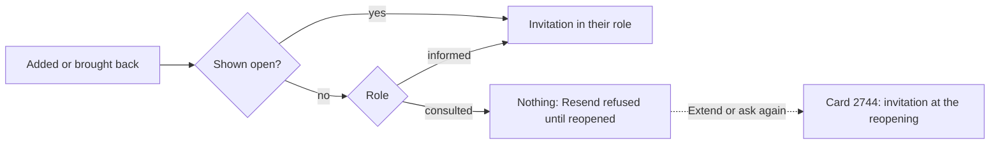

**A reopening asks whom the round never reached** (card 2744). An **Extend** that reopens a
decision for input (it was stored closed, or stored open past its closing time) sends the
**invitation** ("Your view is asked: {title}") to each live consulted participant with no
response in the current round whom the round has not reached: `unaskedOf` in `decision-lifecycle-writes.ts`,
which reads `currentResultsOf` (card 2738's `reachedInRound`, the very rule an early ruling writes
`cut_off { reached }` by). So one included or made consulted while the decision was closed, one
whose invitation a rest or a cap held back, and one whose invitation was refused or never
delivered; never one whose asking mail was delivered while they were consulted and the decision
open, nor one who saw the question then, nor one who responded. The asks go through card 2740's
`heldAsks`: one the participant's 10-minute rest or daily cap, or the caller's
`CALLER_MAIL_DAILY_CAP`, holds is written `mail_skipped { mail: 'invitation', reason }` and the
**reopening goes ahead all the same**; one `reachOf` skips is recorded with its own reason; the
rest are sent in one `queueRecordMails` call after the commit (`extended`, then `link_issued` for a
link holder, then `invited`). An Extend of a decision already open for input mails nobody. A
**key** never causes record mail, so a key's Extend that would mail anyone is refused 403
(`REOPEN_ASKS_ACT`); one with nobody to ask, or only people `reachOf` skips (recorded
`mail_skipped`, not mailed), goes ahead (code review 2026-11-05). The Extend confirmation on a decision
shown not open says the unasked are sent the invitation, as the mail limits allow.

A **re-publish**, on a closed decision (card 2744) or one open for input (card 2739), reads the
same `unaskedOf` before writing the new version. **Asking again** (which reopens a closed
decision): the unasked are sent the first-time **invitation**, never `asked_again` ("asked again,
an earlier response stays"); every other consulted participant `asked_again`; and every
**informed** participant `told_of_change` ("Changed: {title}" and the change note), since they are
asked nothing and cannot respond (card 2739, D1). **Telling only** (which leaves a closed decision
closed): the unasked are sent nothing (as card 2743 sends nothing to one added as consulted while
closed; on an open decision the delivery panel offers Resend) and neither the rest nor the
caller's cap counts them; everyone else, informed and reached consulted alike, `told_of_change`.
One exception (card 2739's code review, 2026-11-05): an unasked participant whose asking mail is
still in flight (its `invited` or `asked_again` has no `mail_outcome` yet, `askingInFlight`) holds
a tell-only re-publish to their 10-minute rest, as before card 2739, so no new version is
published while that mail, quoting the old one, is still to go. Every mail a re-publish sends
counts against the rest and the caps, as before, and they still refuse the whole write. Behind
that, `stillToSend` records any queued mail built before the decision was published again as
`mail_outcome { delivered: false, problem: 'superseded' }` and sends nothing, as it does a mail
whose link was replaced. No kind is new: `told_of_change` was already in `MAIL_KINDS` and
`CALLER_CAPPED_KINDS`, the delivery panel shows it as "Told of a change" and the told line as "You
were told of a change to this decision on …", and reach (card 2738) never counted an informed
participant. The re-publish panel's note says who each choice asks, tells or invites, in terms
of whom "this round's ask" has reached.

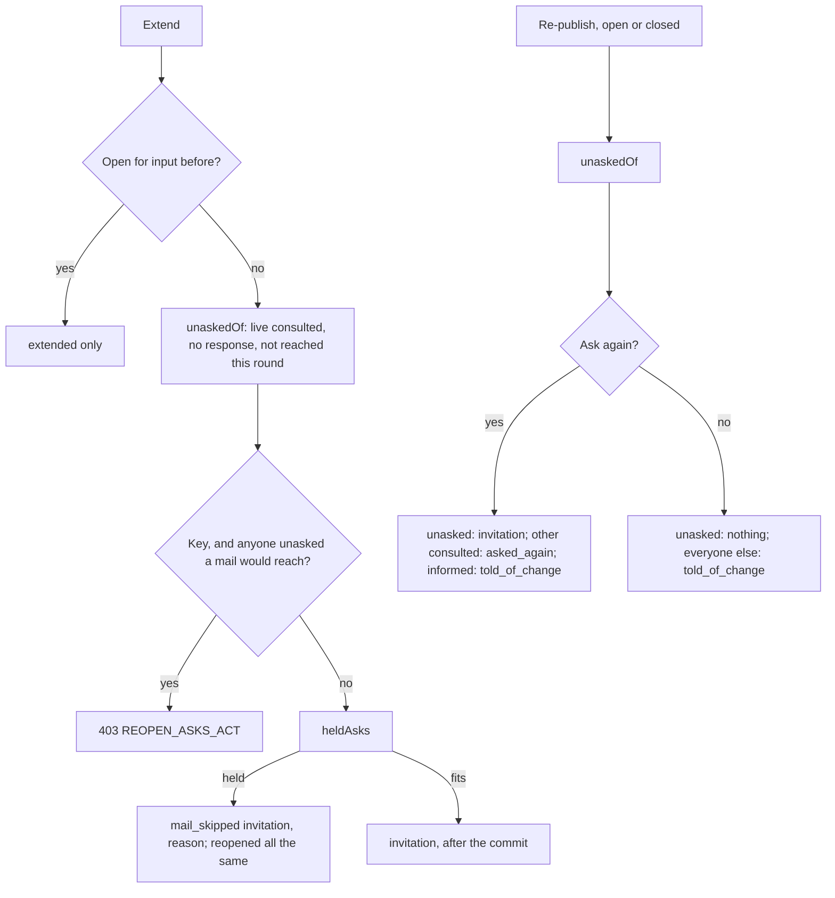

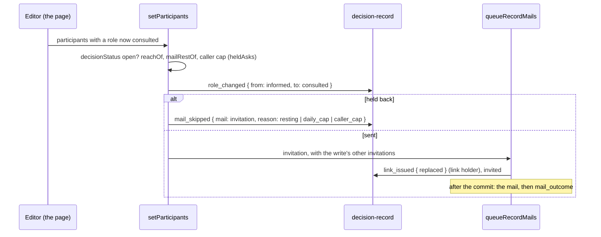

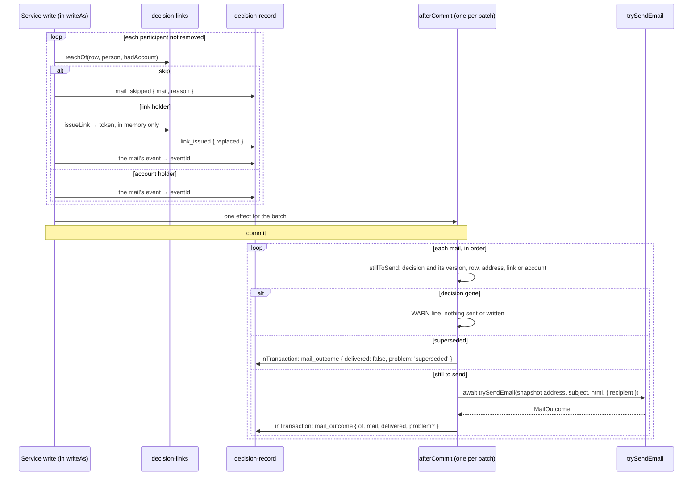

### The Dry Run, and the Limits on Decision Mail (card 2697)

Card 2697 (2026-11-04) made the decision mails reachable from the decision's editor, and added
one mail that is no record mail, the dry run, with limits on everything that mails.

**The dry run** (`dryRunDecision` in `decision-authoring-writes.ts`, `queueDryRun` in `decision-mail.ts`). Send
me a dry run mails the presser the invitation a consulted participant would get: subject
`Dry run: ` and the invitation's, body the invitation's, quoting the **working copy's** question
and what is asked (never a version, so it shows edits not yet published), the closing time and
decider lines, the line "This dry run was sent at the request of <username>.", and a link to
`<App URL>/decisions/<id>/preview`. Every value goes through `escapeHtml`. It holds no personal
link and no participant's address. `subjectOf` and `bodyOf` take a role (`consulted` or
`informed`) in place of a participant row, so the dry run and the record mails share them.

- **To whom.** Only to the caller's address in the people directory: the person whose account is
  the caller's, and only when that person's address is the account's own (compared in lower
  case). Otherwise `409`: "A dry run is sent only to the address the people directory holds for
  you, and it holds none for your account: an administrator can add you in People", or "…, and it
  is not your account's address: an administrator can make them agree". An account's address is
  set by its holder and confirmed by nobody; the directory's is an administrator's.
- **Refused first, with nothing written, sent or counted:** `revision` missing (`400`) or stale
  (`409`); no mail host, `409` "Mail is not set up on this server: a dry run cannot be sent"; no
  App URL or `ORIGIN`, `409` `NO_LINK_ADDRESS`.
- **The limits, `429`, per caller across every decision:** within `DRY_RUN_MIN_MINUTES` (10) of
  the last, "Your last dry run was less than 10 minutes ago: the next can be sent from <stamp>
  UTC"; and `DRY_RUN_DAILY_CAP` (20) in 24 hours, "You have sent 20 dry runs in the last 24
  hours: the next can be sent from <stamp> UTC", read from the `dry_run` events and then from an
  in-memory allowance, which a deletion of the decisions (and their events) does not give back.
- **What it records.** One `dry_run` event with no participant and the detail `{}`, by the
  caller. No `mail_outcome`, no link, no activity entry, no live event. One `afterCommit` send by
  `trySendEmail`, `recipient: caller <id> dry run of decision <id>`, so a failed send's log line
  names no address; a mail server that refuses it gives nothing back.

**The publish limit.** Open and Re-publish each mail every live participant, so each caller may
do `PUBLISH_DAILY_CAP` (10) of them in 24 hours, across decisions: read from the `published`
events by `actor_user_id`, then from the in-memory allowance; `429` "You have opened or
re-published 10 decisions in the last 24 hours: the next can be sent from <stamp> UTC", asked
after every other refusal, so a refused publish takes nothing.

**The daily cap per participant** is the throttle's second part above: five record mails in 24
hours, on re-publishing, Resend and including someone again; never the withdrawal or the
ruling, which each participant must be told.

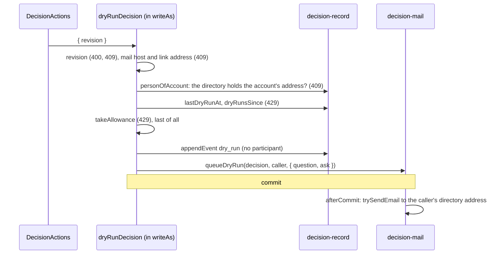

Covered by `tests/decision-lifecycle.test.ts` (cases 32 to 34, 55 to 57).

### The Ruling Mail and the Concern Notice (card 2679)

Card 2679 (2026-11-04) sends the ruling mail, and adds one mail that is no record mail: the
notice to a decider that a concern arrived.

**The ruling mail.** `ruleDecision` calls `queueRecordMails(row, 'ruling', { by, ruling })` for
every live participant, consulted and informed, inside the ruling's transaction: `told_ruling`
is written for each then, and each send is an `afterCommit`, recorded by its `mail_outcome` as
every record mail is. It is sent once and each participant must be told, so it is held to no
rest, no daily cap and no caller cap, and counted against none (card 2697's ruling). With no App
URL or `ORIGIN` the ruling goes ahead and each mail is recorded as not sent. Its body gains the
line "You can raise a concern about this ruling from the page for 90 days." It never carries a
figure, whether the ruling went against the responses, whether it was early, or who was cut
off. **Releasing the results mails nobody**: the totals belong on the page, not in an inbox.
**Superseding mails nobody**: it makes a draft, and the new decision's own ruling mail tells its
participants.

**The concern notice** (`notifyDecisionConcern(deciderUserId, decisionId, title, heldBefore)`
in `notifications.ts`). A participant's concern about the ruling (consulted or informed,
signed in or by their link) is recorded whatever the mail does; the decider is told one
arrived:

- **Under `email_decisions` and the master switch**, the new **Decisions** switch on My Account
  (design D22: it is not a record mail). To the decider's account address.
- **It names neither the participant nor what they wrote**: "A participant raised a concern
  about the ruling on <title>. Open the results to read it.", with **Open the results**, a
  link to `<App URL>/decisions/<id>/results` behind a sign-in, where the decider reads the
  concern by name. With concerns held since the last notice about the same participant it adds
  "They raised <n> more since the last notice about them, which were not mailed."
- **It takes no `baseUrl`**: the link is made on `linkBaseUrl()` (`email.ts`), the App URL or
  `ORIGIN`, read inside the notice, so a request's Host can never reach it (S6). It is the
  whole of `decisionLinkBase()`, which `notifications.ts` cannot import back from
  `decision-mail.ts` without a cycle. The title is escaped; the subject is plain text.
- **Its limit is per participant** (S3): a participant's first concern on a decision always
  notifies; after a notice about them, their next notifies only once that notice is 24 hours
  (`DAY_MS`) old, and sooner it is recorded as `held`. Another participant's concerns never
  hold it back. A participant's own concerns are already at most 5 and 10 minutes apart.
- **The outcome is written on `concern_raised { responseId, notice }`, decided inside the
  write** (`noticeOf` in `decision-ruling-writes.ts`), in this order:

| `notice` | When | Mail |
|---|---|---|
| `no_decider` | The decision's decider account is gone | None |
| `no_link_address` | No App URL and no `ORIGIN` (`decisionLinkBase()` is null) | None |
| `prefs_off` | The decider's `email_decisions` or **All Email Notifications** is off (`shouldNotifyUser`, exported for this) | None; not counted |
| `no_mail_host` | No mail host is set up (`isSmtpConfigured()` is false; code review F2, S5) | None; not counted |
| `held` | Within 24 hours of the last `asked` notice about this participant | None; counted into the next notice's held number |
| `asked` | Otherwise | Queued for after the commit |

Only `asked` holds the next notice back: the other outcomes sent nothing. `prefs_off` and
`no_mail_host` are not counted as held either, so the participant's next concern, once the
preference is on or a mail host is set up, notifies at once. Mail never refuses a concern. A
concern writes no activity entry and no live event. `notifyDecisionConcern` still asks the mail
host, the preference and the address again before it sends, as every mail in
`notifications.ts` does.

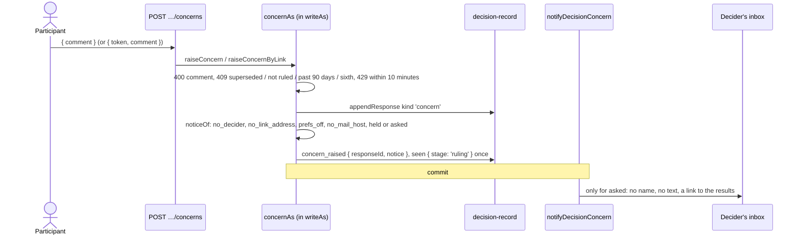

Covered by `tests/decision-ruling.test.ts` (cases 1, 4, 24 to 29) and `tests/mail-escaping.test.ts`.

### The Question Notices (card 2678)

Card 2678 (2026-11-04) adds two notices, neither a record mail: one to whoever may answer a
new clarification question, and one to the asker once a person's answer stands. Both are under
`email_decisions` and **All Email Notifications** for an account holder (design D22), both
reuse the concern notice's pattern (the outcome decided inside the write and written on the
event, the mail queued for after the commit), and **mail never refuses a question, an
answer, a publish or a replacement**.

**The new-question notice** (`notifyDecisionQuestion(recipientUserId, decisionId, title,
heldBefore)`). Recipients are the decider and the author, once for one account, each only if
the account is there, `answer` lets it in now (board edit), and it is **not the asker's own
account** (an author or decider who is also a participant is not told of their own question).
"A participant asked a question about <title>. Open the decision to read and answer it.", with
**Open the decision**, a link to `<App URL>/decisions/<id>#questions` behind a sign-in; with
`heldBefore` above 0 it adds "They asked <n> more since the last notice about them, which were
not mailed." It names nobody, quotes nothing, and takes no `baseUrl`. For each recipient, in
order, written on `question_asked { questionId, notices: { userId, outcome }[] }`:

| `outcome` | When | Mail |
|---|---|---|
| `no_link_address` | No App URL and no `ORIGIN` | None |
| `prefs_off` | The recipient's `email_decisions` or **All Email Notifications** is off | None; not counted |
| `no_mail_host` | No mail host is set up | None; not counted |
| `held` | Within 24 hours (`DAY_MS`) of the last `asked` notice about this participant to this recipient | None; counted into the next notice's held number |
| `asked` | Otherwise | Queued for after the commit |

The rest is per participant, so another participant's question never holds back a first
notice. An empty `notices` list means nobody may answer now.

**The answer notice** (`notifyQuestionAnswered(to, decisionId, title)`, `to` being `{ userId }`
or `{ address, latestLink }`). Decided when a person answers, publishes an agent's draft or replaces it,
and written on `question_answered { questionId, role, agentDrafted, notice }`, `answer_published
{ questionId, notice }` or `answer_replaced { questionId, role, discarded, notice }`, none of
which names a participant. "Your question about <title> has been answered." An account
holder's mail links to `/decisions/<id>#questions`. **A link holder's mail carries no link and
issues none**: issuing a fresh link, as record mails do, would end the link in their last record
mail and put a new key in a mailbox for a notice. It goes to the participant row's snapshot
address, never to an account a browser beside the link was signed in as. Which line it carries in
place of a link is decided in the write (card 2721), by `mailedLinkOf` in
`src/lib/server/decision-links.ts`, the closing-date reminder's rule, shared rather than copied:

| The row, at the answer | `latestLink` | The line |
|---|---|---|
| Holds a hash, `linkUsable` now, and its latest record mail (the one that issued the hash) has `mail_outcome { delivered: true }` | `true` | "Open the decision from the personal link in the latest email you were sent about it." (`LATEST_LINK_LINE`) |
| Anything else: the hash emptied (by a restore, or any other `link_revoked`), the link past its time, the latest record mail refused or its outcome not yet written, or no record mail at all | `false` | "The personal link you were last sent may no longer open the decision. Ask its author or its decider to send you a new one." (`ASK_FOR_LINK_LINE`) |

`reachOf` reads no hash, which is why the line asks `mailedLinkOf`: after a restore every row's
hash is empty, and a link holder told to use their latest email would be pointed at a link that
opens nothing. The author or the decider gives a new link with Resend, allowed in the same
statuses as an answer. The send still waits for the commit; nothing is asked again at the send,
so a link ended between the commit and the send (a restore, an address change, a removal or an
account being attached) can leave that one mail's line stale; the mail carries no credential. The
recorded `notice` is `asked` either way: which line went follows from the record's
`link_revoked` and `mail_outcome` events.

| `notice` | When | Mail |
|---|---|---|
| `awaiting_review` | On `question_answered` only: an API key's answer is a draft, not mailed until a person stands behind it | None |
| `not_reached` | The participant is removed, has left, or `reachOf` skips them | None |
| `no_link_address` | An account holder, with no App URL and no `ORIGIN` | None |
| `prefs_off` | An account holder whose `email_decisions` or master switch is off | None |
| `no_mail_host` | No mail host is set up (account or link holder) | None |
| `asked` | Otherwise; a link holder has no preference to ask | Queued for after the commit |

There is no rest on answer notices: each question is answered once, so an asker gets at most
10 per decision. Neither notice quotes a question or an answer, so participants' words never
sit in mailboxes outside the record; record and ruling mails never carry a question, an answer
or a draft either. Both escape the title in the body, and are rows of
`tests/mail-escaping.test.ts`.

```mermaid
sequenceDiagram
    actor P as Participant
    participant W as askQuestion (in writeAs)
    participant Q as afterCommit queue
    actor A as Author and decider
    actor D as Answerer
    participant X as answerQuestion / publishAnswer
    P->>W: a question
    W->>W: questionNoticesOf: no_link_address, prefs_off, no_mail_host, held or asked
    W->>Q: notifyDecisionQuestion for each asked (never the asker's own account)
    Note over Q: commit, then sent, dropped on any rollback
    Q-->>A: "A participant asked a question about …" (no name, no text)
    D->>X: an answer, a publish or a replacement
    X->>X: answerNoticeOf: awaiting_review (a key's draft), not_reached, …, asked
    X->>Q: notifyQuestionAnswered
    Q-->>P: "Your question about … has been answered" (a link holder's: no link, the latest-email line only under mailedLinkOf)
```

Covered by `tests/decision-questions.test.ts` (cases 6, 12, 13 to 16, 19 to 21, and card 2721's
2721-2: a link cleared by a restore, by an answer, by a publish and by a replacement; a refused latest mail; one
with no outcome yet; no record mail; a link past its time) and `tests/mail-escaping.test.ts`
(both of a link holder's lines).

### The Closing-Date Reminder (card 2685)

A scheduled job, `src/lib/server/decision-reminders.ts`, sends each consulted participant who
has not responded one short reminder about a day before a decision's closing time. It is started
by `startSchedulers` with the backup, report and snapshot schedulers and the attachment file
sweep, and like them it runs only where `SCHEDULERS` lets it: a built server by default, never
the dev server or a rehearsal unless `SCHEDULERS=on` ([Deployment](deployment.md#environment-variables)).
Its first run is 5 minutes after the server starts, then one every 5 minutes; nothing runs at
start-up.

**When.** A participant is reminded at the first run on or after 24 hours before `closes_at`,
and never in its last hour: a run picks decisions whose `closes_at` is in `(now + 1 h, now +
24 h]`, soonest closing first. Their asking mail of the current round (the `invited` or
`asked_again` at or after the round's version was published) must be at least 24 hours old, so a
decision opened less than 25 hours before it closes sends none, and nobody is reminded within a
day of being invited or re-sent their invitation. Every comparison is on stored UTC moments.

**Who** (`dueOf`, asked inside the record step's transaction). First, outside any transaction and
once per decision, a pre-filter of two batched reads (`countedInRound` and `remindedIn` over all
its consulted participants) leaves out those already answered or reminded in the round, so the
write lock is taken only for a participant who may be due; the no-mail warning uses the same
pre-filter. Then, for each one left, every one of these, the clauses asked again at the send
(1 to 5, 8, 9) in one function, `standsAt`:

1. the decision is stored `open` and its closing time is in the window;
2. the participant is consulted, not informed, and not removed;
3. `reachOf` reaches them, through their account or by a personal link;
4. a link holder holds a live link, and their latest record mail, the one that carried it, was
   delivered: one whose latest mail was refused, a tell-only re-publish's included, is left to
   the editor's Resend, which gives them a working link;
5. they have given no counted response in the round (a concern is none);
6. they have not been reminded in the round;
7. their asking mail of the round was delivered and is a day old;
8. no `role_changed`, `address_changed`, `account_attached`, `account_cleared`, `removed` or
   `re_included` was recorded for them after that mail (`CHANGE_KINDS`): the reminder reminds of
   a mail sent to this person, in this role, by this route, in this inclusion (a re-inclusion's
   own invitation, written after it, is the next asking mail);
9. an account holder has **Decisions** (`email_decisions`) and **All Email Notifications** on.
   Preferences that cannot be read (not JSON, or not a JSON object) count as off, as they do for
   every mail since card 2724 (see [Preferences That Cannot Be Read](#preferences-that-cannot-be-read-card-2724));
10. `mailRestOf` lets them be mailed now.

Anyone who fails one is passed over and nothing is written: no `mail_skipped`, which a run every
5 minutes would repeat without end. They are asked again at the next run.

**Once a round, at most once.** The round is `currentRound`, the latest version that asked
again; the `reminded` event's `version_number` is that round. A re-publish that only tells, or a
later closing time, starts no round and earns no second reminder; one that asks again does,
24 hours after its delivered `asked_again`. For each participant in turn the job records, then
sends: one `inTransaction` (`BEGIN IMMEDIATE`) re-reads the decision and the participant on a
fresh clock, asks `dueOf` and writes `reminded` through `appendEvent`; after the commit the
reminder is asked again, sent and awaited, and its `mail_outcome { of, mail: 'reminder',
delivered, problem? }` written; then the next participant. A restart mid-run leaves at most the
one reminder in hand recorded with no outcome, and it is never sent again. Three guards hold the
"once": the write lock, the job's in-flight flag (a tick is skipped while the last run is
going), and migration 0063's partial unique index on `decision_events (participant_id,
version_number) WHERE kind = 'reminded'`. Should the index refuse a second reminder, that
participant's step is rolled back, one WARN line says `Decision <id>: participant <id> was
already reminded in round <n>`, and the run goes on. A busy or locked database rolls back that
step, is one WARN line naming the decision, and leaves the rest of its participants to the next
run. Any other fault, in the pre-filter, a record step, the mail's building or a send, is held to
its decision too: one ERROR line, `Decision <id>: its reminders were left to the next run, as a
step failed at participant <id>`, with the ids alone (an error's own words may hold an address),
and the run goes on with the next decision. A reminder recorded before such a fault keeps no
outcome and is never sent again.

**Just before each send** (`stillStands`), on the clock as it is then: the decision must still be
there (else one WARN line and nothing recorded), its round the reminder's, and this reminder the
round's first for the participant; then `standsAt` again on the fresh clock (stored open and
closing in the window; consulted, not removed, reached; a link holder's live link and delivered
latest mail; no counted response; no change since the asking mail; an account holder's switches
on); and, asked only here, the address, the route, the link and the latest mail the ones the
write found. A reminder that fails one is not sent and is recorded
`mail_outcome { delivered: false, problem: 'superseded' }`, so a slow run cannot mail inside the
last hour.

**What it says.** Subject, plain text: `Reminder: your view is asked by <closes_at> UTC:
<title>`. Body, in `emailTemplate`, every value through `escapeHtml`: "Your view on this decision
is asked by <closes_at> UTC, and you have not responded to the current version yet.", **Who
decides:** and the decider's name, then an account holder's **Open the decision** button to
`<App URL>/decisions/<id>`, behind a sign-in, or a link holder's line, "Open the decision from
the personal link in the latest email you were sent about it." (`LATEST_LINK_LINE` in
`$lib/decision-words`, the answer notice's line too, so both say it in the same words, and both
ask `mailedLinkOf` first (card 2721); the button
is `openDecisionButton`, the record mails' too). It quotes
no question or ask, names no other participant and gives no figure. **It mints no personal link
and carries no token**: the link a link holder holds stays the only live one, and link rotation
stays with the five record mails.

**The limits on mail to one participant.** A reminder waits while the 10-minute rest after the
participant's last record mail runs, and it starts that rest itself: `lastMailAt` and the
delivery panel's `lastRestAt` read `reminded` too, so a Resend, re-publish or re-inclusion within
10 minutes of a reminder is refused 409 with the rest's words. It is not counted toward
`RECORD_MAIL_DAILY_CAP`, which reads the record mails alone, so it takes none of an editor's five
Resends a day, and the delivery panel's last mail stays the last record mail. The per-caller cap
does not apply: no account causes it.

**A run's size.** At most `REMINDERS_PER_RUN` (200) are recorded in one run, and no new
participant is started once `REMINDER_RUN_BUDGET_MS` (4 minutes) has passed; the rest wait for the
next run. Each send is awaited by the run itself, not by `afterCommit`, so one mail connection is
open at a time and the in-flight flag covers it.

**When mail cannot go.** With no mail host or no App URL and no `ORIGIN`, nothing is recorded or
sent, and one WARN line per process, "Decision reminders are due and cannot be sent: …", says
so only when a reminder is due; a run with nothing due says nothing. The reminder still goes once
mail is set up, inside its window. A refused send is recorded `delivered: false` with its
`MailProblem` code alone and is never retried; the ERROR line names `participant <id> of decision
<id> reminder`, never the address.

| Outcome on the record | When |
|---|---|
| `delivered: true` | The mail server accepted it |
| `delivered: false`, `problem: <MailProblem>` | The mail server refused it, or could not be reached; never retried |
| `delivered: false`, `problem: 'superseded'` | `stillStands` failed just before the send |
| no outcome | The server stopped between the commit and the send; never sent again |

```mermaid
sequenceDiagram
    participant T as Timer (every 5 min)
    participant J as runDecisionReminders(now)
    participant DB as SQLite (BEGIN IMMEDIATE)
    participant M as Mail server
    T->>J: tick (skipped while the last run is in flight)
    J->>J: mail host and link address? (else WARN once if someone is due)
    J->>DB: open decisions, closes_at in (now+1h, now+24h], soonest first
    loop each decision, until 200 recorded or 4 minutes gone
      J->>DB: pre-filter: countedInRound, remindedIn (batched, no transaction)
      loop each candidate
        J->>DB: inTransaction: re-read, dueOf(t), appendEvent reminded
        alt the index refuses a second reminder
            DB-->>J: rolled back: WARN, next participant
        else busy or locked
            DB-->>J: rolled back: WARN, next decision
        else any other fault
            DB-->>J: ERROR with ids alone, next decision
        else not due
            DB-->>J: nothing written
        else recorded
            J->>DB: stillStands(reminded, t')
            alt still stands
                J->>M: trySendEmail (no address in the log)
                M-->>J: outcome, awaited
                J->>DB: mail_outcome { of, mail: 'reminder', delivered, problem? }
            else decision gone
                J->>J: WARN, nothing recorded
            else superseded
                J->>DB: mail_outcome { delivered: false, problem: 'superseded' }
            end
        end
      end
    end
```

A reminder writes `decision_events` rows alone: no column of the decision or of a participant
moves, so neither revision changes and a decider who has read the results can still rule on
them. The record view shows it as "A reminder was due before closing", followed by its **Mail
outcome**; a person's own record shows it with the same words and no outcome. No activity entry
and no webhook. Covered by `tests/decision-reminders.test.ts` (cases 1 to 44 and 48 to 50) and
`tests/uploads-sweep.test.ts` (case 47).

### Text in Mail Is Text

Every text a mail carries is somebody's typing: a board's or grouping's name, a card's
title, a username, a comment, a schedule's name, the error a backup destination's server
answered. A report can be emailed to any address, so if such a text were put into a mail's
HTML as it was typed, anyone with an account could have the server's own sender deliver
HTML of their choosing to anyone: a link, or a styled "sign in again" button. The report
emailed by hand, the scheduled report and the backup failure mail did exactly that until
card 2149.

The rule now:

- **Every text put into a mail's HTML goes through `escapeHtml` where it is put**, a link in
  an `href` included. The five characters HTML reads as markup (`&`, `<`, `>`, `"`, `'`)
  become entities, so a board named `R&D <b>bold</b>` reads as exactly that in the mail.
- **One function does it**, `escapeHtml` in `src/lib/escape-html.ts`, which every mail and
  the `/docs` page use. `notifications.ts` had a function of its own for the same five
  characters; it is gone.
- **Left bare** are only a number, a value taken from a fixed table in the same function
  (the priority colours, the progress mail's headings) and a block of HTML built in the
  same function from values already escaped.
- **A subject is not escaped.** It is plain text, not HTML, and an escaped subject would
  show its reader `&lt;`. nodemailer replaces a line break in any header, so a name cannot
  add a header either.

```mermaid
flowchart LR
    Typed["Stored text<br/>board, card, user, schedule,<br/>an error from another server"] --> Escape["escapeHtml()<br/>src/lib/escape-html.ts"]
    Base["The App URL and<br/>the ids and tokens of a link"] --> Escape
    Escape --> Html["The mail's HTML"]
    Typed -->|"as typed"| Subject["The subject<br/>plain text"]
    Html --> Send["sendEmail / sendEmailWithAttachment"]
    Subject --> Send
```

`tests/mail-escaping.test.ts` sends every mail with markup in every text it carries, and an
App URL with a quote in it, and fails if any recorded mail holds either as it was written.
It also fails if `notifications.ts` exports a mail it has no case for.

**Escaping keeps markup out, and not text.** A board named "Your account is locked: call
0800 123 456" is mailed as exactly those words, in the report's subject and in its body, and
a plain address or web address in a name may still be shown as a link by the reader's mail
client. Nothing in a mail can tell a reader that the words of a name are not DumpFire's own.
What bounds that is who a report can be mailed to, how many at once and in a day, and that
every report mail names the account behind it (card 2182): see
[Who a Report Can Be Mailed To](#who-a-report-can-be-mailed-to).

### User Notification Preferences

Stored as JSON in `users.notification_prefs`. Each user can toggle individual notification types, on My Account under **Email Notifications**.

There is one list of them, `NOTIFICATION_PREFS` in `src/lib/notification-prefs.ts`, a module with no server imports (card 2146). The account page draws its switches from it, `GET` and `PUT /api/account/notifications` make their defaults and their save from it (`defaultPrefs()`, every key on), and `shouldNotifyUser()` and `filterRecipientsByPref()` in `notifications.ts` take a key of it as their type, so `npm run check` refuses a mail that reads a key nobody can save. `GET` answers every key, so the page shows what is stored.

### Preferences That Cannot Be Read (card 2724)

Stored preferences that are not JSON, or not a JSON object, cannot say what their owner asked for. They send **no mail that can be switched off**: `getUserNotifPrefs()` answers `null` for them, and `shouldNotifyUser()` answers no to every kind, so `filterRecipientsByPref()` and the decision reminder do too. Mail a person cannot switch off (an invite, a password reset, a decision's record mails) never asks, and is sent as before. Until card 2724 they were read as the defaults, every switch on, so a damaged value sent mail its owner had turned off; the decision reminder alone read them as off (card 2685).

One `[WARN] [NOTIFY]` line per account per process says so, naming the account by id alone: `The notification preferences of user <id> could not be read, so they are sent no mail they can switch off until they are saved again: notification_prefs is not a JSON object`. It was one line at every read, one for each member of a board at each change.

`GET /api/account/notifications` answers them as they are applied, every key `false`, with `unreadable: true`, and the account page says under its heading: "Your saved choices could not be read, so you are sent none of these emails. Turn on the ones you want: saving replaces them." A `PUT` starts from every key off, so the first switch turned on saves every key, readable, and the line goes. No admin control resets another account's preferences: the route writes only readable JSON, so a damaged value comes from outside the application, and the person can repair their own on the page.

| Switch on My Account | Key | Read by |
|----------------------|-----|---------|
| All Email Notifications | `email_all` (`MASTER_PREF`) | Every mail below: `false` stops them all, whatever each says. On the page, turning it off turns every switch off, and on turns them all on |
| Task Assignments | `email_assigned` | User Assigned |
| Comments | `email_comments` | Comment Added |
| Mentions | `email_mentions` | User Mentioned |
| Card Moves | `email_moved` | Card Moved, and Unblocked |
| Task Requests | `email_requests` | Task Request, Conversation Message |
| Request Progress | `email_request_progress` | The progress mails of [Requester Progress Notifications](#requester-progress-notifications), Request Complete among them, to a requester who has an account. A requester without one has nothing to switch and is always mailed |
| Board Sharing | `email_board_shared` | Board Shared |
| Planning | `email_planning` | The mail about a new plan |
| Decisions | `email_decisions` | "When someone asks about or raises a concern on a decision you decide or wrote, your question about a decision is answered, or a decision you have not answered is about to close": the notice to a decider that a concern about a ruling arrived (card 2679), card 2678's two question notices, to the author and the decider of a new question and to an asker with an account once their question is answered, and card 2685's closing-date reminder to a consulted participant with an account. A link holder has no account and no switch |

Until 2026-10-15 the page, the route and the mail kept three lists. The route's left out `email_request_progress` and `email_mentions`, so it neither answered nor saved them: the page offered Request Progress, whose switch went back on at every reload, and the progress mail was always sent; and the mention mail read `email_mentions`, which nothing offered, so it could be stopped only by switching all mail off. The page now offers **Mentions**, and both keys are saved and answered. No account had either stored, so a requester who switched Request Progress off before then is mailed until they switch it off again. A key not stored, or a preference that cannot be read, is on. A save that is refused, or gets no answer, puts every switch back as it was and says why under them.

**A decision's record mails read no preference** (card 2675, design D22). The invitation, asked
again, told of a change, withdrawn and ruled mails carry a decision's record to the people asked
or told, and are sent whatever their account's switches say, **All Email Notifications**
included: `queueRecordMails` calls neither `shouldNotifyUser` nor `filterRecipientsByPref`. Who is
mailed is `reachOf`'s rule instead ([Decision Record Mails](#decision-record-mails-card-2675)).
The closing-date reminder (card 2685) is not one of the five: for an account holder it reads
`email_decisions` and the master switch, when it is recorded and again just before it is sent.

```mermaid
flowchart TD
    Event["Notification Event"] --> GetPrefs["Load user prefs\nJSON from users table"]
    GetPrefs --> MasterToggle{"email_all\nenabled?"}
    MasterToggle -->|"false"| Skip["Skip notification"]
    MasterToggle -->|"true / unset"| TypeToggle{"Type-specific\ntoggle enabled?"}
    TypeToggle -->|"false"| Skip
    TypeToggle -->|"true / unset"| Send["Send email"]
```

### Request Confirmation

A request submitted without an account sends one email, to the address the requester
gave, asking them to confirm. The **Task Request** email to the team is sent when they
do, not when the form is submitted — otherwise the form is a way for anyone to email the
team. Requests from signed-in users skip this and notify the team at once.

Every link emailed to a requester (`requestReplyUrl()` and `requestConfirmUrl()` in
`request-tokens.ts`) carries a token of that request's. Links used to carry the
requester's email address, which is not a secret.

**Each mail to a requester carries a link of its own** (card 2870). The server keeps only the
SHA-256 of each token, in `request_links`, so it cannot put an earlier link into a later
mail: the confirmation, each team reply and each progress or completion mail issue a new link
(`issueRequestLink()`, source `mail`), and a new link asked for issues one too (source `ask`).
Earlier links keep working, so a requester with the conversation open is not cut off when the
team answers. A request keeps its newest 20 mail links, so the 21st mail ends the oldest, and
its newest 3 asked-for links; each kind is trimmed only among its own, so asking for a new link
never ends a link a mail carried. A link is issued only when the mail is about to be handed on:
an address to send to, mail set up, the mail password there (`!smtpPasswordMissing()`) and an
address to make the link from. With the mail password missing, the form refuses a request
that must be confirmed `503` "New links cannot be sent just now. Please contact the team that
sent you the link." (why in a `[WARN] [REQUESTS]` line), and a team reply is saved and mails
nothing. See
[Requester Links Stored as Hashes](authentication-security.md#requester-links-stored-as-hashes-card-2870).

**A settled request's links end 90 days after it was settled** (card 2902): declined, at its
decline; accepted, when its card is completed (open again if the card is reopened), or at its
acceptance if the card was deleted. Its links then open nothing, as a link that is not there,
and a new link asked for is not mailed, though the ask answers its usual sentence. Open requests
keep their links. The page an ended link opens says, in general words, that a request settled
more than 90 days ago is closed and no new link is sent, and that one made signed in can be read
by signing in (`linkEnded` in `request-access.ts`).

```mermaid
flowchart TD
    Send["A mail to a requester that carries a link"] --> Ready{"An address, mail set up,<br/>its password, a link address?"}
    Ready -->|"no"| None["No link issued, no mail"]
    Ready -->|"yes"| Issue["issueRequestLink: a new token,<br/>only its SHA-256 written"]
    Issue --> Trim{"Source"}
    Trim -->|"mail: confirmation, reply, progress"| Twenty["Keep the newest 20 mail links"]
    Trim -->|"ask: a new link asked for"| Three["Keep the newest 3 ask links"]
    Twenty --> Out["The mail carries the token,<br/>earlier links still work"]
    Three --> Out
```

Each reply the requester sends through that link mails every member the request is
addressed to, so the requester may send 20 replies to one request in an hour, and the 21st
is refused `429` with nothing saved and nothing mailed. A reply from the team starts the
count again. See [Authentication & Security](authentication-security.md#the-public-request-form).

**A failed mail to a requester never logs their address** (card 2896). Each of the seven mails
to a requester (the confirmation, a team reply, a new link, accepted, declined, and the progress
and completion mails below) is sent with `recipient` `the requester of request <id>`
(`requesterLabel` in `email.ts`), so `deliverMail`'s `ERROR` line reads `Failed to send email to
the requester of request <id>: <subject>`, the mail server's words name `[the requester of
request <id>]` where they quoted the address, and the rare line written when the send cannot
start (`Accept mail to the requester of request <id> failed` and its like) names the request
too. Each function takes the request's id first: `notifyRequesterAccepted(requestId, email,
title, resolverName)` and the same for `Rejected`, `Confirm`, `Message` and `NewLink`. A
requester who made the request signed in is labelled the same.

### Requester Progress Notifications

When a task request is accepted and converted to a card, the requester receives progress emails:

```mermaid
sequenceDiagram
    participant R as Requester
    participant S as Server
    participant A as Admin

    R->>S: Submit task request
    S->>A: Email notification
    A->>S: Accept request, create card
    S->>R: Accepted email

    alt accepted into a Complete or Done column
        S->>R: Completion email + PDF report
    else accepted into any other column
        Note over S: Progress tracking begins

        A->>S: Move card
        S->>R: Card moved email
        A->>S: Complete subtask (on the page or through the API)
        S->>R: Subtask completed email
        A->>S: Add comment
        S->>R: Comment email
        A->>S: Move to Complete
        S->>R: Completion email + PDF report
    end
```

**Which address a requester is mailed at** (card 2171). Every mail to a requester, these
and "Request accepted", "Request declined", the team's reply and a new link, goes to
`requesterAddress()` in `src/lib/server/request-access.ts`, asked when the mail is sent: for
a request made while signed in (`requester_user_id` set), the account's `users.email` as it
is then; for one made without an account, the address given on the form
(`requester_email`); and to nobody, with nothing sent, when the account named is not there
or there is no address at all. The address stored when a request is made is still written,
but a requester who changes their account's email is mailed at the new one from then on.
"When it is sent" is when the action is taken, inside its transaction, for a reply, an
acceptance or a decline. For the progress and completion mails since card 2870,
`notifyRequesterProgress()` reads the request and the address, makes every skip and issues
the mail's link synchronously, and where depends on what it reports. A comment and a subtask
tick call it inside their write's transaction, so the link is a savepoint of it and a
rolled-back write mails nothing and leaves no link. A move and a card created complete report
from an effect after their commit (`announceCardMoves()`, `announceCardCreated()`), so the link
has a transaction of its own, and the move or the card is saved whatever happens to the mail;
each of those two catches a failure of the progress mail and logs it at `ERROR`, so its other
announcements still go (the card 2870 code review, CS4). The mail itself is built and sent
after the commit. A new link asked for reads the request again, in the transaction that
writes its link, before it issues one: see
[Requester Links Stored as Hashes](authentication-security.md#requester-links-stored-as-hashes-card-2870).
When an account is deleted, its email is written onto each of its
requests first, so they go on being mailed at its last address. The inbox shows the same
address.

```mermaid
flowchart TD
    Mail["A mail to a requester"] --> Who{"requester_user_id set?"}
    Who -->|"yes"| Account{"Is the account there?"}
    Account -->|"yes"| Now["users.email as it is now"]
    Account -->|"no"| None["No address: nothing sent"]
    Who -->|"no"| Stored["requester_email: the address given,<br/>or the one deleteUser wrote"]
```

On card completion, a **PDF task report** is automatically generated and attached to the completion email. A request accepted straight into a Complete or Done column makes a card that is completed as it is created (see [Data Model](data-model.md#one-completion-however-a-card-arrives)), so the requester is sent "Request accepted" and then the completion email with its report (card 2134). A subtask ticked through the API mails the requester as one ticked on the page does (card 2108). No progress email goes to a requester who made the change themselves, and none but the completion email once the card is complete.

### A Report Emailed on Demand

The Reports page's **Email** sends `POST /api/reports/email`, which answers with what was
sent (card 2113). It used to answer `200` "Report sent to N recipient(s)", with every
recipient's `success` true, whatever the mail server answered and with no mail set up at
all, and the dialog closed. The recipients are each an address, read with the other fields
before the report is made: one that is not is `400` `recipients[<n>] must be an email
address`, naming its place in the list, and nothing is sent (card 2117). Since card 2182
they are also read as the mailer reads them, at most 10 distinct addresses a call and 100 a
day from one account, each address sent one mail once: see
[Who a Report Can Be Mailed To](#who-a-report-can-be-mailed-to).

**Behind the password and a code (card 2751).** Every call asks for the caller's current
password and a code from their authenticator app (`currentPassword`, `currentCode`), whatever
the addresses, the caller's own and the company's among them, through the step-up every listed
action asks with. Every refusal below that needs neither is made first, in the step-up's guard
(`readReportMail`), so none costs a check or a guess: the fields, the addresses and their cap,
an all-boards report by an administrator alone, what the report covers (`reportScopeOpen()`,
the rule every report opens with: `403` "Failed to generate report or no access" for a board or
grouping that is not there or none of whose boards the caller can open), the `503` with no mail
set up, and the day's 100, **read with nothing taken** (`checkReportMail()`: an ended window is
not begun again by it). A wrong password or code is `403`, and nothing is built or sent. The
addresses are taken from the day's 100 once the password is checked and the report built.
Before **every** send the session, the caller's access and the password are asked again: refused
before any mail has gone (the first, or a later one when the mail server refused every address
before it), the answer is that refusal and nothing more is sent; once a mail has gone, the
sending stops and each address left is answered "Not sent: sending stopped because the session
ended, access changed or the password changed while the report was being sent". Once the
sending is done one `INFO` line under `REPORTS`, the sender as its user, names the addresses
reached and any not: `Report "Sales" was mailed by pat (ID: 7) to: a@x.test; not to: b@x.test`.
See [Report Schedules and Report Mail](authentication-security.md#report-schedules-and-report-mail-card-2751).

```mermaid
flowchart TD
    Post["POST /api/reports/email"] --> Fields["Fields and recipients read.<br/>A recipient that is no address: 400"]
    Fields --> Cap{"More than 10 distinct<br/>addresses? (card 2182)"}
    Cap -->|"yes"| R400["400: at most 10 at a time.<br/>Nothing looked at, nothing counted"]
    Cap -->|"no"| Scope["All-boards by an administrator,<br/>reportScopeOpen: 403 if they cannot read it"]
    Scope --> Smtp{"Mail set up?<br/>isSmtpConfigured()"}
    Smtp -->|"no"| R503["503: Mail is not set up on this server,<br/>so the report was not sent.<br/>No PDF built, nothing sent"]
    Smtp -->|"yes"| Allow{"The day's 100 addresses:<br/>do these fit? (card 2182)<br/>read, nothing taken (card 2751)"}
    Allow -->|"no"| R429["429: nothing taken,<br/>no PDF built, nothing sent"]
    Allow -->|"yes"| StepUp{"Password and code?<br/>(card 2751)"}
    StepUp -->|"missing or wrong"| R4xx["400 or 403: nothing built, nothing sent"]
    StepUp -->|"right"| Data["Report built as the caller now (403 if null),<br/>the addresses taken from the day's 100"]
    Data --> Pdf["The PDF built once"]
    Pdf --> Each["Before each recipient: session, access, password<br/>asked again. Then sendEmailWithAttachment():<br/>its true or false is that recipient's success"]
    Each -->|"refused before the first"| R403["401 or 403, nothing sent"]
    Each -->|"refused before a later one"| Stop["The rest answered STOPPED"]
    Stop --> Count
    Each --> Count{"How many sent?"}
    Count -->|"all"| R200["200: Report sent to N recipient(s)"]
    Count -->|"some"| R200s["200: Report sent to S of N recipients.<br/>Not sent to the rest, named"]
    Count -->|"none"| R502["502: The report was not sent"]
```

| Answer | `message` | `results` |
|--------|-----------|-----------|
| `503` | `Mail is not set up on this server, so the report was not sent. An administrator sets it up on the admin page.` (it said "The superadmin" until card 2395) | None |
| `200`, all sent | `Report sent to <n> recipient(s)` | `{ email, success: true }` for each |
| `200`, some sent | `Report sent to <s> of <n> recipients. Not sent to <addresses>. The mail server did not accept it. An administrator can see the reason in the system log.` | Each recipient, a failure with `success: false` and the `message` `The mail server did not accept it. An administrator can see the reason in the system log.` |
| `502`, none sent | `The report was not sent. The mail server did not accept it. An administrator can see the reason in the system log.` | As above, every one a failure |
| `200`, the sending stopped (card 2751) | `Report sent to <s> of <n> recipients. Not sent to <addresses>. Not sent: sending stopped because the session ended, access changed or the password changed while the report was being sent` | Each address after the stop `{ email, success: false, message: "Not sent: sending stopped because …" }` |
| `200`, some refused and the sending stopped (card 2751, CR3) | `Report sent to <s> of <n> recipients. Not sent to <refused>: The mail server did not accept it. An administrator can see the reason in the system log. Not sent to <stopped>: Not sent: sending stopped because …` | Each refused address with the mail server's words, each after the stop with STOPPED's |

- **The mail server's own reason is not in the answer.** `email.ts` writes it to the system
  log, an `ERROR` line under `EMAIL` for each address, which an administrator reads on the
  Audit page's console. The gate writes the line of every `5xx` answer at `ERROR` too, a
  `503` and a `502` from here among them.
- **The answer says which addresses the mail server accepted.** Each recipient's `success`
  is whether the mail server took the mail for that address, so a mail server that refuses
  an unknown mailbox as the mail is sent tells the sender which of the addresses they typed
  exist there. That is accepted as designed: the sender needs it to send to the rest again.
  Since card 2182 a call names at most 10 addresses, and one account at most 100 in a
  24-hour window counted from its first (so up to 200 across one window's end and the next's
  start), and that is all one account can learn so in a day. See
  [Authentication & Security](authentication-security.md#what-an-emailed-reports-answer-tells).
- **A report that reached some recipients is `200`, not a failure status**, so that nothing
  in between offers to send it again: the ones who had it would get it twice. The Reports
  page shows it as a failure all the same, keeps the dialog open, and leaves only the
  addresses not reached in the box, saying so, so that Send goes to those alone; since card
  2751 it adds "Enter your password and a new code to send again.", as both fields were
  cleared when it was sent and the code is spent. A `503` or a `502` is shown in the dialog
  with the box as it was.
- **Each answer is written with its own status**, as `tests/error-shape.test.ts` requires
  of a failure answered with `json()`.

### Who a Report Can Be Mailed To

A report goes from the company's own sender, which mail providers trust, and its subject
and body carry names as somebody typed them. Until card 2182 a report emailed by hand went
to as many addresses as one request named (300 outside addresses, twice over, were sent in
the plan's probe), a schedule held as many as it was given (2,000), and an account could
make any number of schedules. A mass send also spends the sender's daily quota at the mail
provider, which once spent stops every other DumpFire mail until it resets.

**The report is its sender's or its owner's view** (card 2150). A report emailed by hand is
built as its sender may read it, and a scheduled one as its owner's account stands at the
run: the sub-boards that person can open, and no parent board they cannot open by name.
Every recipient is sent that same report, whoever they are; an account gives a recipient
neither more nor less. See
[Whose Report It Is](backup-reporting.md#whose-report-it-is).

**Any address may still be a recipient**, an account's or not, and every report mail names
the account behind it: the one emailed by hand says "Sent by `<username>` via DumpFire",
and a scheduled one now says "Set up by `<username>`" above "— DumpFire Automated Reports",
the username escaped as every text in a mail is. The gate's line for each request names the
account on the Audit page too. What is bounded is how many, and, since card 2751, who may set
it going: a schedule made, given an address, turned on or widened, and a report emailed by
hand, ask for the password and a code, each limit below refused before them with nothing
counted or taken. A schedule made or changed so writes an `INFO` line naming every address
it is sent to, and its owner gets the `report-schedule-set` notice
([Report Schedule Notices](#report-schedule-notices-card-2751)).

| Limit | Where | Refused |
|-------|-------|---------|
| 10 distinct addresses a call | `POST /api/reports/email`, before the board or the caller's access is looked at, administrators included | `400` `A report can be emailed to at most 10 addresses at a time, and this names 12. Nothing was sent.` |
| 10 addresses a schedule | `POST /api/report-schedules`; `PUT /api/report-schedules/{id}` when it sends a changed list | `400` `A schedule can be sent to at most 10 addresses, and this names 12. The schedule was not saved.` (`The schedule was not changed.` for the `PUT`) |
| 20 schedules an account | `POST /api/report-schedules`, counting the caller's own | `409` `You have 20 report schedules, the most one account may have. Delete one first.` An account that already has more keeps them all, and is told `You have 25 report schedules, and the most one account may have is 20. Delete 6 first.` |
| 100 addresses a day an account | The report emailed by hand; every schedule made, turned on, or re-timed while on; and the addresses a changed list adds | `429` `Reports can be emailed to at most 100 addresses a day from one account, and this would make 104. Try again in 5 hour(s).`; for a schedule, `Report mail can reach at most 100 addresses a day from one account, and this schedule's 10 would make 104. The schedule was not saved. Try again in 5 hour(s).` (`was not changed.` for the `PUT`, and `this schedule's 4 new addresses would make 104` when a changed list is what does not fit) |

Each refusal is whole: nothing is sent, saved or counted. The wait is in hours, rounded up,
for an hour or more, and in minutes under an hour.

#### One reading of a list

`reportRecipients(input)` in `src/lib/report-recipients.ts` reads a list of recipients, as
the email route takes one (a list of texts) or as a schedule keeps one (one text). It
imports nothing from the server, so the Reports page uses it too. The email route, both
schedule routes, the scheduler and the page all read a list through it, so the number the
server holds a list to is the number the page shows and the number of mails sent.

- **Each text is split on commas, semicolons and white space** (spaces, tabs, new lines);
  each part is trimmed and lower-cased, and empty parts and repeats are dropped.
- **A part written `<address>` is the address inside.** So `Alice Smith <alice@x.test>` is
  the address `alice@x.test` and two parts that are not addresses, `alice` and `smith`.
- **An address** has one `@` with a dot after it, at most 254 characters, no white space,
  none of `< > ( ) [ ] \ , ; : "`, and no control or format character (Unicode's `\p{C}`:
  a right-to-left override, U+202E, turns the text after it round on the page, so the
  address shown would not be the one mailed). It answers `{ addresses, notAddresses }`, each in
  the order first written. `MAX_REPORT_RECIPIENTS = 10` is beside it.

Why those separators and that rule: the mailer (nodemailer's address parser) reads
`a@x.test;b@x.test` as two addresses in one mail, each in view of the other; an address on
one line with another on the next as one address, the second being its display name, which
is never mailed; and parts the old pattern took, such as `a@b.c<x>` and `abc<def>@x.com`, as
mail to `x` and to `def`. Each address is now handed to the mailer on its own, and is
exactly one recipient, the one the page shows. So a schedule typed with semicolons sends one
mail to each address where it sent one mail to all of them; one typed an address to a line
reaches every address where it reached only the first; and an address written twice, in
any case, is mailed once.

What each reader does with a part that is not an address:

- **The email route** refuses it in card 2117's words, `recipients[<n>] must be an email
  address`, naming its place in the list. An entry the mailer would send to someone else, or
  with no dot after its `@`, is refused so too, where card 2117's own rule took it. The
  answer's `results` carry each address lower-cased.
- **The schedule routes** refuse it, `400`, with nothing saved:
  `recipients holds "smith", which is not an email address`, or several,
  `recipients holds "alice", "smith", which are not email addresses`, up to five named, each
  cut to 100 characters, then `and 3 more`. A list is stored as the addresses it will be
  sent to, lower-cased, each once, separated by `, ` (`readReportRecipients` in
  `src/lib/server/request-body.ts`), at most 2,000 characters. A `PUT` that sends the stored
  list back as it is keeps it unchecked, so a page that sends the whole row back can still
  rename or switch off a schedule kept with more than 10, whether it is on or off: `enabled:
  true` is refused only when it would turn such a schedule on.
- **The scheduler** sends to the addresses and never to the other parts, and names the
  parts it left out at the end of the run's line: `Left out, as not email addresses:
  "alice", "smith".` A schedule stored as `Alice Smith <alice@x.test>` before the rule still
  reaches Alice, and is not switched off for the rest.
- **The Reports page's email dialog** says it, and sends nothing:
  `"x" is not an email address. Nothing was sent.` (`"x", "y" are not email addresses.` for
  several). Its hint reads "Up to 10 addresses, separated by commas", and the schedule
  form's "Up to 10 addresses, separated by commas. The report is emailed to each." The
  schedule list counts each schedule's addresses through `reportRecipients`, where it
  counted commas and showed one recipient for a list typed with semicolons.

#### The day's 100

`takeReportMail(user, n, spend)` in `src/lib/server/reports.ts` takes `n` addresses from the
account's allowance, `REPORT_MAILS_PER_DAY = 100`, through `takeAllowance` in
`src/lib/server/rate-limit.ts`, keyed `report-mail:<userId>`. It counts addresses, not
calls: one call of ten addresses is ten. The day is a fixed 24 hours from the account's first
take, and a take that would pass 100 is refused whole and takes nothing. So "100 a day" is
100 in a window counted from the first take, not a calendar day: an account that spends its
100 at the end of one window and another 100 at the start of the next has reached 200
addresses within minutes.

- **The report emailed by hand** takes its addresses after the body, the cap, the caller's
  access, the `503` for a server with no mail set up and (card 2751) the password and the code,
  once the report is built and before the PDF is. A call refused for any of those spends
  nothing. What it takes is not given back when the mail server refuses a send, or the sending
  stops: the attempt was made.
- **Asked before the password, with nothing taken** (card 2751). The step-up's guard of each
  route that asks (`POST /api/reports/email`, `POST /api/report-schedules`, and a
  `PUT /api/report-schedules/{id}` that adds an address, turns the schedule on or widens its
  filter) asks `checkReportMail(user, n, spend)`, which reads the account's window with
  `allowanceState()` in `rate-limit.ts`, storing nothing: a window that has ended reads as
  nothing used, and is not begun again by the read. Over the limit it answers the same `429`
  in the same words, and counts the refusal on the live window (`noteAllowanceRefused()`), so
  the one `WARN` line below is still written once a window. `takeReportMail` takes at the
  write as before; both refuse through one function, `refuseReportMail`.
- **A schedule pays when it is made, turned on or re-timed while on**, because each of those can bring
  a send forward. A schedule made for the next minute is sent at the scheduler's next tick,
  and deleting it makes room for another: by the plan's probe, one account mailed 10, 20,
  then 30 outside addresses in six minutes of clock that way, and with 20 schedules it would
  have been 200 a minute. So `POST /api/report-schedules` takes the new schedule's
  addresses, and `PUT /api/report-schedules/{id}` takes the schedule's addresses as they will
  be after the change when it turns the schedule on (`enabled: true` on one that is off) or
  sends a `frequency`, `dayOfWeek`, `dayOfMonth`, `timeOfDay` or `timeZone` other than the
  one stored. A new zone (card 2159), like a new time, can bring a send forward to any time,
  the next minute included, and is paid for in the same way. A schedule that is off after
  the change sends nothing, so re-timing it takes nothing; turning it on pays then.
- **A changed list pays for the addresses it adds.** When a `PUT` does neither of those and
  sends a list that reads differently from the stored one, it takes the addresses of the
  new list that are not in the stored list: a schedule of one address given ten takes nine.
  A schedule made with no addresses costs nothing, so until the review of card 2182 one made
  empty, given ten by a change, sent and deleted, over and over, mailed 120 to 150 addresses
  a day with no `429`. The stored list sent back in another order or case, or cut down,
  takes nothing, nor does a change of name or filter, or turning it off. The take is the
  last check, immediately before the write in the same transaction, with nothing awaited
  between them, so two requests cannot both fit in the last of the allowance. Nothing is
  given back when a schedule is deleted, or when a list is cut down.
- **A scheduled run takes nothing.** It would otherwise be dropped, with nobody told, on a
  day its owner had also mailed by hand.
- **The first refusal in each window is one `WARN` line** under `REPORTS`:
  `Account "<username>" (user N) reached its limit of 100 report mail addresses a day:
  report mail, and schedules made, turned on, re-timed or given new addresses, are refused
  until the day is up`, with the account as the line's user, so the Audit page finds it by
  user, and `{ used, asked, retryAfterSecs }` as its detail. The refusals after it in the
  same window are not logged; the gate writes its own line for every `429`.
- **In memory**, as every count in `rate-limit.ts` is: a restart starts the day again.

So an account's scheduled mail is at most its 20 schedules of 10 addresses each, on their
own timetables; and the mail it sends by hand, together with the schedules it makes, turns
on, re-times or gives new addresses, reaches at most 100 addresses in a window. Someone who makes five schedules of ten
and then emails reports by hand has 50 left that day.

#### A schedule kept from before with more than 10

A schedule made before the cap can hold more than 10 addresses. At its next due run the
scheduler reads its list, and over 10 it switches the schedule off and sends nothing, before
the report is built. The write is conditional (`enabled = 0 … WHERE id = ? AND enabled = 1`),
and only the run that changed the row writes the one `ERROR` line under `REPORTS`, naming
the schedule's owner, who is also the line's user, so the Audit page finds it by user:

```
Report schedule 12 "Weekly sales", owner "pat" (user 7), was switched off: it is sent to 15 addresses, and the most is 10. Nothing was sent. Its owner can delete it and make it again with at most 10.
```

- **The Reports page says why.** In place of the count, the schedule reads
  "15 recipients: the most is 10, so it is not sent", with its addresses beneath as text
  that can be selected and copied, and "Copy the ones to keep into a new schedule of at most
  10, then delete this one." The page has no way to edit a schedule's list, so this is where
  its owner finds the addresses before deleting it.
- **It cannot be turned on as it is.** A `PUT` with `enabled: true` on such a schedule
  that is off is `400`
  `This schedule cannot be turned on: it is sent to 15 addresses, and the most is 10. Delete it and make it again with at most 10.`,
  and nothing changes. `enabled: true` on one still on, as a page sends the row back with
  a new name, is not a turning on and is accepted. A `PUT` that sends a list of 10 or fewer
  and `enabled: true` together is accepted, and when that turns the schedule on it takes the
  new list's addresses from the day's 100. Turned back on, its next run is worked out again
  from now (card 2159), so it is sent at its next time, not at once.
- **Before the deploy**, the query in
  [The Update That Brings the Limits on Report Mail](deployment.md#the-update-that-brings-the-limits-on-report-mail)
  lists each schedule's addresses as this rule counts them: any above 10 is switched off at
  its next run unless it is remade first. Remade after the deploy, each new schedule takes
  its addresses from the day's 100.

```mermaid
flowchart TD
    Due["A due, enabled schedule"] --> Read["reportRecipients(recipients)"]
    Read --> Over{"More than 10 addresses?"}
    Over -->|"yes"| Off["enabled = 0 where it is still 1.<br/>Changed the row: one ERROR line.<br/>Nothing built, nothing sent"]
    Over -->|"no"| Build["Build the report as its owner"]
    Build --> Send["One mail to each address,<br/>Set up by the owner's username"]
    Send --> Line["The run's line, naming any<br/>parts left out as not addresses"]
```

```mermaid
flowchart TD
    Write["POST or PUT /api/report-schedules"] --> Fields["Fields read: recipients by<br/>readReportRecipients"]
    Fields -->|"a part that is not an address"| NotAddr["400, naming up to five"]
    Fields --> Cap{"More than 10 addresses<br/>in a new or changed list?"}
    Cap -->|"yes"| Cap400["400, nothing saved"]
    Cap -->|"no"| On{"PUT turning on a schedule<br/>that is off, with a list over 10?"}
    On -->|"yes"| On400["400 cannot be turned on"]
    On -->|"no"| Count{"POST: 20 schedules already?"}
    Count -->|"yes"| Full["409, nothing saved"]
    Count -->|"no"| Pays{"Made, turned on,<br/>or re-timed while on?"}
    Pays -->|"yes"| Take{"takeReportMail:<br/>do all its addresses fit in the day's 100?"}
    Pays -->|"no"| Added{"PUT: a changed list with<br/>addresses not in the stored one?"}
    Added -->|"no"| Save["Saved"]
    Added -->|"yes"| TakeNew{"takeReportMail:<br/>do the added addresses fit?"}
    Take -->|"no"| R429["429, nothing saved"]
    TakeNew -->|"no"| R429
    Take -->|"yes, taken"| Save
    TakeNew -->|"yes, taken"| Save
```

## Real-Time Updates via SSE

### Architecture

```mermaid
flowchart LR
    subgraph Server
        EventEmitter["Event Emitter\nevents.ts"]
        BoardSubs["Board Subscribers\nMap of boardId to Set"]
        GlobalSubs["Global Subscribers\nAll Tasks page"]
    end

    subgraph Clients
        Board1["Board /board/1"]
        Board2["Board /board/2"]
        AllTasks["All Tasks /all"]
    end

    EventEmitter -->|"emit boardId=1"| BoardSubs
    BoardSubs --> Board1
    EventEmitter -->|"all events"| GlobalSubs
    GlobalSubs --> AllTasks
```

### Event Types

| Event | Payload | Trigger |
|-------|---------|---------|
| `update` | `{type: 'card'}` | Card updated, moved, archived, restored or deleted. A creation carries `action: 'created'`, `cardTitle`, `userName` and `userEmoji`, an accepted request's card among them (card 2108). Someone assigned to a card (also when they already were) or taken off it, on a page or through the API (card 2143). Also sent, beside the comment event below, to the board of a card an "Unblocked" notice is written on. Not an archive of a card already archived, on a page or through the API, which writes and sends nothing (card 2285). A change of position within a column, by a drag, the v1 move or `PUT /api/cards/{id}`, carries `action: 'reorder'`, `userName` and `userEmoji` (the card update sent a bare `{type: 'card'}` for it until card 2288) |
| `update` | `{type: 'comment', cardId}` | A comment added or edited on the card, on a page or through the API, sent last, once the comment, its entry and its mail are queued (card 2282; an edit sent `{type: 'card'}` until then); a comment deleted, on a page or through `DELETE /api/v1/comments/{id}`, once the row is gone and its `comment_deleted` entry written (card 2283; a delete sent nothing), so a window open on the card loses it; and an "Unblocked" notice written on the card, which is a comment. Not a comment saved with its text unchanged, which sends nothing (card 2284). Every page re-reads on it as on any update; a card window open on that card (the board page, All Tasks, All To Do) also reads its comments again, 250 ms on so a burst is one read, without "Loading comments..." and keeping a comment being edited, so another person's comment shows without reopening the card. The window does the same after a reconnect or a return to the tab, which may have missed one. The plan page's window, which has no stream, does not |
| `update` | `{type: 'attachment', cardId}` | A file attached to the card or deleted from it in the card window's Files tab, once the row and its `attachment_added` or `attachment_deleted` entry are committed (card 2337; neither sent anything, nor was recorded); an image attached through `POST /api/v1/cards/{cardId}/attachments`, with its `api:attachment_added` entry (card 2754); and images moved to the trash by image retention, once per card in the run, with their `attachment_expired` entries (card 2754). Every page re-reads on it as on any update; a card window open on that card (the board page, All Tasks, All To Do) whose files it has already read (its Files tab opened once) reads them again, 250 ms on so a burst is one read, without "Loading attachments...", so another person's new file shows, or a deleted one goes, without reopening the card; the tab's count follows. It does the same after a reconnect or a return to the tab. A window that has not read its files reads them when its Files tab is opened, as before. A key's list and download send nothing, and a key deletes no file; the plan page's window does not follow |
| `update` | `{type: 'column'}` | Column added, renamed, reordered, deleted |
| `update` | `{type: 'board'}` | The board updated: renamed, its emoji or dashboard grouping changed, or made public or private, on a page or through the API (card 2143); or put under a card or taken out from under one, which only a page can do (`PUT /api/boards/{id}` with `parentCardId`: `PUT /api/v1/boards/{id}` reads no `parentCardId`). Sent once to the board, and once to each board whose card it joined or left. A request that sent no field sends nothing |
| `update` | `{type: 'label'}` | A label of the board made, renamed, recoloured or deleted, or put on or taken off one of its cards: on a page (`POST`, `PATCH`, `PUT` and `DELETE /api/labels`), or through the API (`POST /api/v1/boards/{id}/labels`, `PUT` and `DELETE /api/v1/labels/{id}`, `POST` and `DELETE /api/v1/cards/{id}/labels`) |
| `update` | `{type: 'category'}` | A category of the board made, changed or deleted: on a page (`POST /api/categories`, `PUT` and `DELETE /api/categories/{id}`), or through the API (`POST /api/v1/boards/{id}/categories`, `PUT` and `DELETE /api/v1/categories/{id}`). A shared category, of no board, tells no board |
| `update` | `{type: 'subtask'}` | A subtask of one of the board's cards made, saved or deleted on a page (`POST /api/subtasks`, `PUT` and `DELETE /api/subtasks/{id}`). The same through the API sends `{type: 'card'}`. Not a save that changes nothing, on a page or through the API, which writes and sends nothing (card 2299) |
| `update` | `{type: 'milestone'}` | A milestone changed (its name, description, target date or board), closed, reopened or deleted, on a page or through the API (card 2289): sent to each board its entries go on, its own board, or each board holding its cards for one across boards, and on a change of board the boards before and after. A delete is also sent to every board a released card is on, so an open board drops the goal's 🎯 chip without a reload. Not a change that changes nothing. A card put in a milestone or taken out sends `{type: 'card'}`, and only when something was written. Every page re-reads on it as on any update; the plan page has no stream |
| `update` | `{type: 'board', action: 'created'}` | A sub-board was made under a card on this board, on a page or through `POST /api/v1/boards` (card 2143). Nothing is sent for a board made at the top level |
| `update` | `{type: 'board', action: 'deleted'}` | The board was deleted, or was a sub-board deleted with a board, card or column |
| `update` | `{type: 'board', action: 'sub_board_deleted'}` | A sub-board deleted on its own hung from a card on this board, which is still there |
| `update` | `{type: 'card', action: 'purged'}` | Archived cards on the board were purged, or the board was a sub-board removed by the purge |
| `update` | `{type: 'card', action: 'cleared'}` | The board's cards were cleared, or it was a sub-board removed by the clear |
| `xp-update` | `{}` | XP was given for a completion |
| `celebrate` | `{type: 'complete', cardTitle, userName, userEmoji, xpGained}` | A card moved into a Complete column, or created in one (card 2134). One event for a drop of several cards, naming the last |
| `update` | `{type: 'card', action: 'moved_away', cardTitle, fromColumn, toColumn, userName, userEmoji}` | A card moved to another board, sent to the board it left. `action: 'moved_in'`, with the same fields, goes to the board it joined. Neither names the other board (card 2181) |
| `decision` | `{decisionId, status, boardId}` | A decision on the board opened, re-published, closed, extended, and, once it had been opened, withdrawn or deleted (card 2675); ruled, its results released, and an old decision superseded, on the old one's board (card 2679; never for a concern or a superseding draft). `status` is the shown one (`open`, `awaiting_ruling`, `withdrawn`, …). Never for a draft, a participant, a mail or a link, nor for a decision whose board is gone. The data carries no title and no name, and `boardId` itself, so the global stream can check it. Two pages listen for it (card 2680, `connectLiveRefresh`'s `events` option): the register (`/decisions`, every `decision` event the caller is sent) and a board's list of decisions (`/board/[id]/decisions`, its own board's alone, by the payload's `boardId`), each re-reading through the one 250 ms debounce; the board itself and the decision editor do not. It reaches board viewers only: a participant who cannot open the board, and any decision with no board, are current on navigation, a return to the tab, or a reconnect. Linking or unlinking a card sends no live event. The decision services' routes under `/api/decisions` send it as each write commits |

The four delete payloads say what kind of change it was and nothing more: no board name,
card title or user (card 2108). The board of a sub-board's card can be viewed by people who
could never open the sub-board, and the page only reads its board again, under its own
access check. Restoring a card that is not archived, from a page, writes nothing and sends
nothing. Nor does a card update that changes nothing, on either tree: every field sent at
the value the card holds is no change, and sends no `update` (card 2183).

The two events of a move between boards carried the other board's name, `toBoard` on
`moved_away` and `fromBoard` on `moved_in`, until card 2181. An event goes to every listener
of its board, on the board stream and the global one, and some of them cannot open the other
board; nothing on any page read either field, which only makes the page read its board
again. The move's two activity entries name neither board for the same reason.

**Who listens for `decision` (card 2680).** `connectLiveRefresh(onRefresh, onEvent?, options)`
takes `{ events?, boardId? }`: `events` replaces the default `['update', 'xp-update']` (every
caller from before passes nothing and is unchanged), and with `boardId` a `decision` event
re-reads only when its payload's `boardId` is that board. Every event goes through the one
250 ms debounce, on the one `keepStreamOpen`.

```mermaid
flowchart LR
    W["A decision's lifecycle write<br/>(board not null)"] -->|"emit(boardId, 'decision', {decisionId, status, boardId})"| E["/api/events"]
    E -->|"only to a caller who can open boardId"| R["/decisions<br/>events: ['decision']"]
    E -->|"only to a caller who can open boardId"| L["/board/[id]/decisions<br/>events: ['decision'], boardId"]
    L -->|"payload boardId is not this board"| X["ignored"]
    R --> D["250 ms debounce, invalidateAll()"]
    L --> D
    N["A boardless decision,<br/>a participant-only caller"] -.->|"no event"| C["current on navigation,<br/>a return to the tab, or a reconnect"]
```

### Connection Lifecycle

1. A board page opens `GET /api/boards/{id}/events`, for the board it shows; All Tasks, the dashboard and the burndown page open `GET /api/events`, the stream of every board the reader can open. Each is opened through `keepStreamOpen()` (`src/lib/live-stream.ts`)
2. Server creates SSE stream with `text/event-stream` content type
3. Server calls `subscribe(boardId, listener)` or `subscribeGlobal(listener)`
4. On board mutation, server calls `emit(boardId, event, data)`. Inside a transaction the event is held until the commit, and dropped if the transaction rolls back, so a page told to refresh always finds the change there
5. All subscribed listeners receive the event
6. On client disconnect, unsubscribe callback cleans up the listener set

A board page listens to the board it shows. SvelteKit keeps a page when only its address's
board changes, so `src/routes/board/[id]/+layout.svelte` makes the page afresh for each
board (`{#key page.params.id}`, card 2184): after a sub-board badge, a breadcrumb, a link in
the card window, or Back and Forward to another board, the first board's stream is closed as
its page is destroyed and the second board's opened as its page mounts. A link to a card on
the same board (`?card=`) keeps the page and its stream.

The global stream carries card titles and who did what on every board, so a subscriber
is only sent events from boards they can view. The check is made at a board's first event
and kept until the stream's next heartbeat, which forgets every answer (card 2170): a share
taken away stops what it sends of that board from its next heartbeat. Administrators
receive everything. A board that has been deleted can be viewed by nobody but an
administrator, so a member's dashboard is not told of its deletion, and catches up when it
is next brought to the front. A page open on the board itself is told, by the board's own
stream, as the delete commits: it reads the board again and shows "Board not found".

The board stream opens only on a board that is there and that the caller can open (`404`
`Board not found`, administrators included, and for a board the caller cannot open alike since
card 2719; `400` for an id that is not one), and asks again at each heartbeat, of the account
as it is now (card 2170). When the board has gone or the account can no longer open it, it
sends one last `update` with `{"type":"access"}`, on that stream alone, and ends; the page
re-reads and shows "Board not found" either way (card 2719). A deleted board's own event
always arrives first. See
[An Open Stream and Its Session](authentication-security.md#an-open-stream-and-its-session).

## Webhooks

Board-level webhooks fire HTTP POST requests to configured URLs when events occur.

### Configuration

| Field | Type | Description |
|-------|------|-------------|
| `url` | string | Target HTTP endpoint |
| `secret` | string | Shared secret for signature verification |
| `events` | JSON array | Event types to subscribe to |
| `active` | boolean | Enable/disable toggle |

Each webhook also records `set_by` (card 2168, migration 0056): the account that last set its
address or its secret, the caller of the `POST` that made it, or of a `PUT` that changed
either. No answer gives it. It is what taking an account back reads: see
[Who May Change a Webhook](#who-may-change-a-webhook). It is also what every delivery checks
(card 2325): a webhook is sent only while that account can open the board, and one with no
`set_by` is held: see
[When Nobody Who Can Open the Board Set It Up](#when-nobody-who-can-open-the-board-set-it-up).
Every webhook is sent through the
rules of [Where a Webhook May Send](#where-a-webhook-may-send), and a board holds at most 10
([How Many Webhooks a Board May Have](#how-many-webhooks-a-board-may-have)).

**A webhook's secret is in no backup** (card 2169). In a backup's copy every webhook that had
a secret has `secret` empty and `active` off, and is listed in the `webhook_secrets_left_out`
setting with whether it was on: switched off so that a backup put in place as the database
by hand sends nothing unsigned. Its address and events are kept. An Import Backup on the
server the backup came from, of the file as that server made it, puts each secret back from
the webhook here with the same id, board, address and setter (`set_by`, none and none alike),
and switches the webhook on or off as it was. A secret here set by another account than the
one the backup's row names was set again since the backup: it is not filled, and the webhook
is listed to enter again, as one whose address has changed is. A backup changed since, or made by another server, has none put back: its seal does
not verify. Anywhere else such a webhook
stays off with no secret, the import's result lists it with its board, and every start says
so, until the board's owner or an administrator sets its secret and switches it on with
`PUT /api/v1/webhooks/{id}` and `{ "secret": "…", "active": true }`, or deletes it. A webhook
made without a secret is in a backup as it is.

### Who Can See the Secret

The secret is what lets a receiver trust that a delivery came from DumpFire, so anyone
holding it can forge one. The delivery address goes with it (card 2133): an address can
name a server inside the network, or carry a user name and password before the host. Both
are returned by the API only:

- in the response to the `POST` that created the webhook, to the caller who supplied them;
- on a read or update, when the caller is the **board owner or an administrator**.

Every other caller — board editors and viewers included — gets the webhook without a
`secret` field and without a `url` field, on both reads and in the answer to an update, an
editor's own update of the address included. The keys are left out, not set to null.
`hasSecret` (boolean) is always present and says whether a secret is set, and `events` and
`active` are given as before. Before October 2026 the secret was returned to anyone who
could view the board, and until 2026-10-14 the address was. Since card 2154 an editor cannot
change either: see [Who May Change a Webhook](#who-may-change-a-webhook).

```mermaid
flowchart TD
    Read["GET or PUT a webhook"] --> Open{"Can open the board?"}
    Open -->|"No"| N404["404 Webhook not found (card 2719)"]
    Open -->|"Yes"| View{"Edit access, for a PUT?"}
    View -->|"No"| R403["403"]
    View -->|"Yes"| Role{"Board owner or admin?"}
    Role -->|"Yes"| WithSecret["Webhook + url + secret + hasSecret<br/>+ lastDelivery + pausedBecause"]
    Role -->|"No"| NoSecret["Webhook + hasSecret only:<br/>no url, no secret,<br/>no lastDelivery, no pausedBecause"]
    Create["POST a new webhook\n(editor or above)"] --> Once["Webhook + the url and secret just supplied,<br/>lastDelivery null, pausedBecause null"]
```

All webhook responses are built by `presentWebhook(hook, reveal)` in
`src/lib/server/webhooks.ts`, which leaves out `url`, `secret`, `lastDelivery` (card 2178,
[Last Delivery](#last-delivery)) and `pausedBecause` (card 2325,
[When Nobody Who Can Open the Board Set It Up](#when-nobody-who-can-open-the-board-set-it-up))
together unless `reveal` is true, so no route can return the raw row. It leaves out `setBy`
for every caller. The create's answer is made inside the transaction that saved the webhook,
since `pausedBecause` reads whether its setter can open the board; it is always `null` there,
because the caller can edit the board and is the setter.

### Who May Change a Webhook

The people who may read a webhook's address and secret are the ones who may change them, and
the ones who may switch a webhook on (card 2154):

| On a board, through `/api/v1/` | Editor | Board owner or administrator |
|-------------------------------|--------|------------------------------|
| Create a webhook (`POST /boards/{boardId}/webhooks`), with the address they type | ✅ (`409` at a receiver, the same scheme, host and port, of one switched off on the board, asked last; the owners are mailed of the create; card 2752 and its code review's CS2, CS3) | ✅ |
| Change its `events` | ✅ | ✅ |
| Switch it off (`PUT /webhooks/{id}`, `{"active": false}`) | ✅ | ✅ |
| Send `"active": true` for a webhook that is already on (a value unchanged) | ✅ | ✅ |
| Switch it on: `"active": true` for a webhook that is off | ❌ `403` | ✅ (one switched off for a lost setter: a new `secret` in the answer, and a `secret` sent with it `400`; card 2752) |
| Send `url` or `secret` at all, whatever the value: a new one, the stored one, `null` | ❌ `403` | ✅ |
| Delete it | ✅, but ❌ `403` for one switched off for good (the code review's CS1) | ✅ |

An editor's refusals are `403` `Only the board's owner or an administrator can change a
webhook's address or secret. Ask the board's owner.` and `403` `Only the board's owner or an
administrator can switch a webhook on. Ask the board's owner.`, and nothing in the request is
written. An editor whose own webhook their own password reset switched off asks the owner too,
or deletes it and creates it again. A viewer is `403` `No edit access to this
board`, as before. The stored address sent back unchanged is refused to an editor too, because
accepting it would let them test guesses at an address they cannot read. Switching a webhook
on is choosing again to send the board's events to an address the editor cannot see, perhaps
an intruder's that a password reset switched off. A script that sends back the whole answer of
the `POST` (it carries `url` and `secret`) with a changed `events` is now refused: send only the
fields that change.

```mermaid
flowchart TD
    Put["PUT /api/v1/webhooks/{id}"] --> Found{"Is there such a webhook?"}
    Found -->|"No"| N404["404 Webhook not found"]
    Found -->|"Yes"| Opens{"Can open its board?"}
    Opens -->|"No"| N404
    Opens -->|"Yes"| Edit{"Edit access to its board?"}
    Edit -->|"No"| E403["403 No edit access"]
    Edit -->|"Yes"| Who{"Board owner or administrator?"}
    Who -->|"No, and url or secret is sent"| A403["403: address or secret"]
    Who -->|"No, and active true for one that is off"| S403["403: switch a webhook on"]
    Who -->|"Yes, or neither of those"| Fields["Each field read: 400 for a bad value,<br/>an address inside the network included"]
    Fields --> Write["Written. set_by is the caller<br/>when the url or the secret changed,<br/>or the webhook was switched on"]
```

**Who set it.** `set_by` is the account that last set the webhook's address or secret, or
switched it on: the `POST`'s caller, and the caller of a `PUT` whose `url` or `secret` differs
from what is stored, or that switches the webhook on (after the rule above, the board's owner or
an administrator). Sent back unchanged, and `"active": true` for one already on, they set
nothing. The `POST` and the `PUT` ask again, in the transaction that writes, that the caller's
key is still there: a key a reset ended while the request's body was arriving is `401` `Invalid
or expired API key`, with nothing written. Taking an account back switches off every webhook it set that is on: an
administrator's password reset, an invite used, the holder's own change with "End my API keys
too" (or "Switch off the N webhooks I set up") ticked, and deleting the account. A webhook with
no setter (made before migration 0056, or whose setter's account was deleted) is left on by
these, and held at every delivery since card 2325. A
webhook switched off this way keeps naming its setter, and is switched on again by the board's
owner or an administrator with `PUT /api/v1/webhooks/{id}` and `{"active": true}`; no page
shows webhooks. See [What Setting a Password Ends](authentication-security.md#what-setting-a-password-ends).

**Taking over a held webhook** (card 2325). A webhook whose setter can no longer open the
board, or that has none, is held, not switched off. The board's owner or an administrator
takes it over in two requests: `PUT /api/v1/webhooks/{id}` `{"active": false}`, then
`{"active": true, "secret": "<new>"}`. Switching it on makes them its setter, so it is sent
again; a new secret, because the former setter knows the old one and could forge deliveries
to the receiver, which may be the company's own system; and then the receiver is updated with
the new secret. `{"active": true}` for a webhook already on is no change and takes nothing
over. The address was chosen by the former setter: delete the webhook unless you recognise
it. Whoever takes it over answers for it: a reset of their account, or deleting it, switches
it off. Prefer the board's owner where they have a key. A single `PUT {"secret": "<new>"}`
also takes it over, with no gap while it is off. Off then on, with no secret change, takes
over a receiver that does not check signatures.

### Where a Webhook May Send

A webhook is a request this server makes to an address a caller typed. With no rule it would
send a board's events to anything the server can reach and the caller cannot: the server itself
(loopback), the Docker host and its other containers, the office or cloud network, and the cloud
metadata service at `169.254.169.254`. So **an address inside the network is refused** (card
2161): when a webhook is registered or its address changed, as written, and at every delivery,
as written and as resolved. `src/lib/server/webhook-address.ts` holds the rule; `insideReason()`
is the one judgement of an address for both.

An address is inside if it is in these tables, the IANA special-purpose addresses that are not
globally reachable, condensed. Everything else is outside. The words are the ones the refusals
use.

| IPv4 | Refused as |
|------|------------|
| `0.0.0.0/8` | a "this network" address, which reaches this server |
| `10.0.0.0/8`, `172.16.0.0/12` (Docker's own networks), `192.168.0.0/16` | a private network address |
| `100.64.0.0/10` | a shared address (carrier NAT, Tailscale) |
| `127.0.0.0/8` | a loopback address |
| `169.254.0.0/16` | a link-local address, where the cloud metadata service is |
| `192.0.0.0/24` | an IETF protocol address |
| `192.0.2.0/24`, `198.51.100.0/24`, `203.0.113.0/24` | a documentation address |
| `192.88.99.0/24` | a 6to4 relay address |
| `198.18.0.0/15` | a benchmarking address |
| `224.0.0.0/4` | a multicast address |
| `240.0.0.0/4` | a reserved address |

| IPv6 | Refused as |
|------|------------|
| `::ffff:0:0/96` (mapped), `64:ff9b::/96` (NAT64), `2002::/16` (6to4) | judged by the IPv4 address it holds: `[::ffff:7f00:1] is a loopback address (it holds 127.0.0.1)` |
| `::/128` | the unspecified address, which reaches this server |
| `::1/128` | a loopback address |
| `64:ff9b:1::/48` | a local-use NAT64 address |
| the rest of `::/8` | a reserved address (the retired IPv4-compatible form, and SIIT's `::ffff:0:0:0/96`) |
| `100::/64` | a discard-only address |
| `2001::/23` | an IETF protocol address (Teredo and benchmarking among it) |
| `2001:db8::/32`, `3fff::/20` | a documentation address |
| `5f00::/16` | an SRv6 identifier |
| `fc00::/7` | a unique local address (a private network) |
| `fe80::/10` | a link-local address |
| `fec0::/10` | a site-local address |
| `ff00::/8` | a multicast address |

Names refused whatever they resolve to, with case ignored and every final dot removed
(`LOCALHOST..` is `localhost`):

| Name | Refused as |
|------|------------|
| `localhost`, and any name ending `.localhost` | `localhost is this server` |
| A name with no dot, such as `n8n` | `n8n is a name with no dot, which is looked up inside the network` (a Docker service on the same network, an office host) |
| A name ending `.local` | `printer.local is a name on the local link (.local)` |
| A name ending `.internal` | `host.docker.internal is a name kept for private networks (.internal)` |
| A name ending `.home.arpa` | `x.home.arpa is a home network name (.home.arpa)` |
| A name with an empty label | `a..b is a name with an empty label` |

IPv4 written another way (`2130706433`, `0x7f.1`, `127.1`, `0177.0.0.1`) is read the way the URL
parser reads it, `127.0.0.1` for all four. An address with a user name or password is always
refused: `http.request` would send the pair as Basic authentication, and a receiver that wants a
credential reads the signature.

**When it is registered** (`POST /api/v1/boards/{boardId}/webhooks`, and a `PUT` that sends a
`url`): the address as written. One inside is `400` `Webhook url points inside the network:
<why>`, for example `Webhook url points inside the network: 127.0.0.1 is a loopback address`; one
with credentials is `400` `Webhook url must not carry a user name or password`. Nothing is
written. **No name is looked up then**: a lookup's answer can differ a second later, and proves
nothing. The stored address sent back unchanged in a `PUT` is accepted, so a webhook stored
before this rule can still be saved.

**At every delivery**: the address as written again, then every address its name resolves to,
judged at the moment the connection is made. The webhooks have an `http.Agent` and an
`https.Agent` of their own, with `keepAlive: false` and `guardedLookup` as their lookup, so each
delivery is a new connection made through it, and the address judged is the address connected
to. Each agent holds at most 20 connections to one host and port at once (`maxSockets: 20`);
a delivery past that waits for one to close, and every request says `Connection: close`, so the
one that waits is given a connection of its own, with its lookup. A name that resolved outside when it was registered and resolves inside now is refused at
this send; so is one that answers one address outside and one inside (DNS rebinding). An
address written as an IP makes no lookup, and is judged as written. **Redirects are not
followed**: `http.request` never follows one.

```mermaid
flowchart TD
    Event["afterCommit: dispatchWebhook(board, event, payload)"] --> Select["Read the board's active webhooks,<br/>build the body once"]
    Select --> Each["For each webhook, in its own try"]
    Each --> List{"events a JSON list?"}
    List -->|"No"| W1["WARN: its events are not a list"]
    List -->|"Yes, without this event"| Skip["Next webhook"]
    List -->|"Yes, with it, or empty"| Written{"As written: not a URL, not http or https,<br/>credentials, an inside address or name?"}
    Written -->|"Yes, and not allowed"| W2["WARN: not sent, and why"]
    Written -->|"No, or allowed"| Req["http(s).request through the webhooks' own agent"]
    Req --> IsIp{"Host written as an IP?"}
    IsIp -->|"Yes: no lookup"| Connect["Connect"]
    IsIp -->|"No"| Lookup["guardedLookup: every address of the name"]
    Lookup --> Any{"Any address inside and not allowed?<br/>(a listed name: any in 0.0.0.0/8 or ::)"}
    Any -->|"Yes"| W3["EWEBHOOKINSIDE: WARN, no connection"]
    Any -->|"No"| Connect
    Connect --> Status{"A status line within 10 s?"}
    Status -->|"300 to 399"| W4["WARN: a redirect, not followed"]
    Status -->|"Any other"| Done["Nothing logged.<br/>The answer is destroyed unread"]
    Status -->|"An error, none in time,<br/>or closed with no status"| E1["ERROR: delivery failed,<br/>host and port only"]
```

What the system log says, under `Webhooks`. Each line names the webhook, its board and its
host, never the path or the query, which can carry a token (a Slack address's path is its
secret):

| Line | Level | When |
|------|-------|------|
| `Webhook 4 on board 3 not sent: 127.0.0.1 is a loopback address` | `WARN` | The address as written is inside, or a name of the table above. Also `… not sent: the address for <host> carries a user name or password`, `… not sent: its address is not an http or https address (ftp:)` (a row stored before such addresses were refused) and `… not sent: its address is not a URL` |
| `Webhook 4 on board 3 not sent: localtest.me resolves to 127.0.0.1, a loopback address` | `WARN` | A name resolved, at the connection, to an address inside. No connection is made |
| `Webhook 4 on board 3: hooks.example.com answered 307, a redirect, which is not followed` | `WARN` | A status from 300 to 399 |
| `Webhook 4 on board 3: delivery to hooks.example.com failed: <Node's message>` | `ERROR` | An error before the status line, or none within 10 seconds of the delivery being given its connection (`no answer within 10 s`). It named the whole address, path and query included, until card 2161. `… failed: the connection closed with no status`: neither a status nor an error came, as for a `101` answer (card 2178's review) |
| `Webhook 4 on board 3 not sent: its events are not a list` | `WARN` | Its stored `events` is not a JSON list (card 2145). Every other webhook of the board is still sent |

Each `WARN` is written **one line per webhook and kind of refusal per hour** (refused as
written, resolves inside, a redirect, events not a list): the first at once, then none of that
kind for that webhook for an hour, however its words change (another address resolved, another
status), each counted, and the next after the hour, in its words then, ends `(12 more like this
since the last such line were not logged)`. It was one line for each event, so a bulk move of
100 cards wrote 100, and a busy board with a stopped receiver pushed out of the system log,
which keeps 50,000 rows, what else it held. The count is kept in memory, so a restart writes
the next one at once; at most 10,000 webhook and kind pairs are kept, and past that the oldest
is forgotten, its next line written at once. An `ERROR` is written every time. At `LOG_LEVEL=ERROR` no `WARN` is
written at all. **Rows already stored
that the rules refuse are kept**, and accepted when sent back unchanged: each is refused at every
delivery, with its `WARN`, until its address is changed or `WEBHOOK_ALLOW_INSIDE` names it, and
every start names each one that is on and refused as written, by webhook and board, with why,
in one `[WARN] [STARTUP]` line: `2 webhook(s) that are on are not sent, whatever their names
resolve to: webhook 4 on board 3 (127.0.0.1 is a loopback address); webhook 9 on board 3 (n8n is
a name with no dot, which is looked up inside the network). Each is refused at every event until
its address is changed or it is switched off; one inside the network can instead be named in
WEBHOOK_ALLOW_INSIDE.` (the first 20, then `; and N more`). No name is looked up for it.

**A receiver inside the network** (a self-hosted automation tool beside DumpFire) is let in by
whoever runs the server, with the environment variable `WEBHOOK_ALLOW_INSIDE`: a list,
separated by commas, of host names (exact, case ignored, final dots removed), addresses and
ranges (`n8n`, `host.docker.internal`, `10.0.5.20`, `10.0.5.0/24`, `fd00::/8`, `[fd00::1]`).

- A name in it is allowed whatever it resolves to inside, and passes the name rules: `n8n` lets
  `http://n8n:5678/…` through. **A listed name is never let reach `0.0.0.0` or `::`**: a DNS
  filter answers `0.0.0.0` (or `::`) for a name it blocks, which would reach this server, so an
  answer in `0.0.0.0/8` or `::` is refused at the connection with the `resolves to` `WARN`, and
  an address written in `0.0.0.0/8` is refused whatever range is listed.
- An address or range lets in any address inside it, written in the address or resolved from a
  name, of its own family; a range of the mapped, NAT64 or 6to4 forms is the IPv4 range it holds.
- An entry is kept only if it lies **wholly inside one row of the tables**. `0.0.0.0/0`, `::/0`,
  `::ffff:0:0/96` and a slip such as `10.0.0.0/2` for `/24` would let every webhook reach this
  server and the metadata service, so each is ignored, and so is an entry outside the network
  (`8.8.8.0/24`, which would allow nothing), an IPv4 address not written as four decimal numbers
  (`127.1`), and a port, a path or a wildcard. The rest of the list applies.
- Nor may an entry hold `0.0.0.0` or `::`, which reach this server whatever it listens on, or a
  row listed before the row that holds it, though one row holds it all: `0.0.0.0/8` and
  `0.0.0.0` lie inside the "this network" row, and `::/8`, `::/96` and `::1/8` inside `::/8`,
  yet each held this server. Anything else inside `::/8` is ignored too (it is reserved), and so
  is an IPv4-mapped or NAT64 range written with a prefix under 96: `::ffff:10.0.5.0/24` is
  `::/24`, not `10.0.5.0/24`, and held `::1`. These rules shut out `0.0.0.0`, `::` and the
  reserved forms only (see the trust point below). An entry that names this server on purpose, `127.0.0.1`, `::1` or
  `localhost`, is taken: a development installation's receiver is one.
- Each ignored entry is one `[WARN] [STARTUP]` line at every start: `WEBHOOK_ALLOW_INSIDE:
  "10.0.0.0/2" ignored: wider than one inside range`, or `… ignored: not inside the network, so
  it allows nothing`, `an IPv4 address not written as four decimal numbers`, `its range is not a
  number of bits`, `not a host name, an address or a range (a port, a path or a wildcard is not
  taken)`, `it holds 0.0.0.0, a "this network" address, which reaches this server`, `it holds ::,
  the unspecified address, which reaches this server`, `it holds 64:ff9b:1::/48, a local-use
  NAT64 address`, `an IPv4-mapped range needs /96 or more`, `a NAT64 range needs /96 or more`,
  `a reserved range inside ::/8 (an IPv4-mapped range needs /96 or more)`.
- **An entry trusts every account with every port and path on that host**: anyone who can
  register a webhook, an editor of any board, may send to any of them, and a port cannot be
  named. Name a dedicated host or address for the receiver. Do not list `host.docker.internal`,
  or the Docker host's address, while anything else listens on the host. Nor list a range that
  holds this container's own address: its Docker network (`172.16.0.0/12`, or the narrower
  network it is on) opens this server too. Name the receiver's single address or name instead.
- It is not a setting on the admin page: an administrator's session, or a stolen one, could then
  open the internal network, and a restore would bring an old list back. See
  [Deployment](deployment.md#where-a-webhook-may-send).

**No proxy.** A webhook is delivered directly, never through `HTTP_PROXY` or `HTTPS_PROXY`:
through a proxy the lookup would judge the proxy's address, not the receiver's. An installation
whose only way out is a proxy could not deliver before (Node's `fetch` went direct too) and
cannot now.

**What is left.** A webhook to this server's own public address, or to a name that resolves to
it, leaves the container, turns at the host and reaches what listens there. The tables cannot
name that address. See
[Webhook Destinations](authentication-security.md#webhook-destinations).

### How Many Webhooks a Board May Have

**At most 10** (card 2201, `MAX_WEBHOOKS_PER_BOARD` in `src/lib/server/webhooks.ts`), switched-off
ones counted: one is a single `PUT {"active": true}` away from being sent. Every event of a board
is sent to each of its webhooks, each a connection of its own held up to 10 seconds, so the cap
bounds what one event sends. The 11th `POST /api/v1/boards/{boardId}/webhooks` is `409` `This
board has 10 webhooks, and a board may have at most 10: delete 1 before adding another.`, with
nothing created. It is the create's last check, after the 404, the 403 and every field's 400,
made in the same transaction as the insert, so two creates sent together cannot both take the
tenth place. Deleting one makes room. A `PUT` adds no row, and nothing else makes one.

**A board that already has more** keeps them all, and every active one is still sent: which to
drop would be a guess. No webhook can be added to it until it has fewer than 10, and the `409`
gives its own count (`This board has 14 webhooks, … delete 5 before adding another.`). Every
start names such boards in one `[WARN] [STARTUP]` line, by id and count, never an address:
`2 board(s) have more webhooks than the 10 a board may have: board 12 has 14, board 40 has 11.
All of them are still sent, and none can be added to such a board until it has fewer than 10.`,
the first 20 named and the rest counted (`, and N more`). It is a constant, not a setting: a
large value would remove the protection.

### Last Delivery

Since card 2178 a webhook's answer tells the board's owner what its last delivery came to, as
`lastDelivery`. Until then the requests a webhook made were blind to everyone but the
administrators reading the system log, so a broken integration stayed broken until one of them
happened to look.

```json
"lastDelivery": {
  "at": "2026-10-14T10:02:11.481Z",
  "event": "card.moved",
  "outcome": "answered",
  "status": 500,
  "reason": "The receiver answered 500"
}
```

**Who reads it.** Whoever may read the address and the secret: the board's owner and
administrators, in `GET /api/v1/webhooks/{id}`, the board's list, and the answer to a `PUT`.
Every other caller, an editor included, gets no `lastDelivery` key, as they get no `url`. The
answer to the `POST` that made the webhook has `lastDelivery: null`. Card 2154 gives the right
to change the address to the same people, so the people told a webhook is failing are the
people who can fix it.

**Read through the API only.** No page shows webhooks, and nothing tells anyone that a
delivery failed: no mail, no notification, no mark on the board. An owner who wants to know
polls `GET /api/v1/webhooks/{id}` or the board's list, `GET /api/v1/boards/{boardId}/webhooks`.

**What it is.** One result per attempt, recorded at the first of: a refusal before any
request, the receiver's status line, an error before the status line, and the request closing
with none of these (a `101` answer, whose connection Node closes for want of an `upgrade`
listener, gives neither a status nor an error). An error or the timeout after the status has
come is not a result: the webhook was delivered. `at` is the moment the dispatch began, the
body's own `timestamp`. An event the webhook does not ask for, and a webhook switched off,
record nothing.

**The latest attempt only, not a history.** Each result replaces the one before it: an
earlier failure followed by a success is not shown, and a receiver that fails one event in
ten may read `delivered` whenever it is asked. The system log keeps each failure, for
administrators.

**What the timeout counts.** The 10 seconds run from when the delivery is given its
connection: the name's lookup and the connect are counted, a wait behind the 20 connections
already open to the same receiver (the agents' `maxSockets`) is not. A burst of events to a
slow receiver queues, and each delivery still has its whole 10 seconds once it is sent.

| `outcome` | `status` | `reason`, exactly | When | What to do |
|---|---|---|---|---|
| `delivered` | 200 to 299 | `The receiver answered {status}` | A 2xx | Nothing |
| `answered` | 300 to 399 | `The receiver answered {status}, a redirect, which is not followed` | A redirect | Register the final address, the one the redirect points to |
| `answered` | any other | `The receiver answered {status}` | 4xx, 5xx (a `100` or `103` is interim, and the final status is the one recorded; a `101` is not reached, below) | A `401` or `403`: check that the receiver holds the same secret and checks `X-DumpFire-Signature` as [Events and Payload](#events-and-payload) describes it. Any other: the receiver's own logs say why |
| `no-answer` | `null` | `The receiver's host name could not be found` | `ENOTFOUND`, `EAI_AGAIN` | Check the host name's spelling, and that it is published in public DNS |
| `no-answer` | `null` | `The receiver's certificate could not be checked` | A certificate error: `ERR_TLS_CERT_…`, `CERT_…`, `UNABLE_TO_…`, `DEPTH_ZERO_SELF_SIGNED_CERT`, `SELF_SIGNED_CERT_IN_CHAIN` | The receiver's certificate is expired, self-signed, for another name, or served without its intermediate chain: fix it on the receiver. There is no setting to trust a self-signed certificate |
| `no-answer` | `null` | `The receiver could not be reached, or did not answer within 10 seconds` | Everything else: a refused or unreachable port, a reset, the timeout, something that does not speak HTTP (the parser's `HPE_…`), a TLS error that is not about the certificate (a listener that does not speak TLS), a `101` | The receiver is down, behind a firewall that drops this server, or slower than the 10 seconds to send its status: answer first, then do the work |
| `not-sent` | `null` | `Not sent: the address is inside the network` | Inside as written, or a name that resolved inside at the connection | Ask an administrator whether the receiver may be named in `WEBHOOK_ALLOW_INSIDE` |
| `not-sent` | `null` | `Not sent: the address carries a user name or password` | Credentials before the host | Take them out of the address: put a token in the path, or rely on the signature |
| `not-sent` | `null` | `Not sent: the address is not an http or https address` | Another scheme, or a stored row that is not a URL | Register an `http://` or `https://` address |
| `not-sent` | `null` | `Not sent: its events are not a list` | Its stored `events` is not a JSON list (card 2145) | `PUT` the webhook's `events` as a list (`[]` for every event) |
| `not-sent` | `null` | `Not sent: the account that set it up can no longer open this board` | Held: its setter cannot open the board (card 2325), and switched off for good at that event (card 2752) | Delete it unless you recognise the address; to keep it, switch it on with your key, which gives it a new secret ([Who May Change a Webhook](#who-may-change-a-webhook)) |
| `not-sent` | `null` | `Not sent: the API key that set it up has ended` | Held: its key was revoked, expired, passed its deadline, was deleted or is another account's, or (one set up before keys were recorded) its setter has no working key from then; switched off for good at that event (card 2893) | Switch it on with your own key, which records your key and gives it a new secret, and give the receiver the new secret; or delete it |
| `not-sent` | `null` | `Not sent: nobody is recorded as having set it up` | Held: it has no setter (card 2325), and switched off for good at that event (card 2752) | Delete it unless you recognise the address; to keep it, switch it on and set a new secret |

**A reason is fixed words.** One of the sentences above and nothing else: never the address,
its path or query, a user name, a password, the secret, an address a name resolved to, or
Node's own message (a connection error names `address:port`). The system log keeps the error
for administrators, in the lines of [Where a Webhook May Send](#where-a-webhook-may-send).
**A closed port, a filtered one and a stalled receiver read alike**, in their words and in
their timing: a not-reached result is recorded no sooner than the timeout after the delivery
was given its connection, so a port that refuses at once is recorded when a port that drops
the connection would be. Told apart, they would let any user who owns a board map which ports
of a host are open, from inside its firewall, with one card move. An owner learns nothing of a
host beyond the ports where a web server answers or a TLS server presents a certificate. An
administrator reads which in the log.

**Which result is kept.** Each dispatch takes the next number from a counter, and a result is
dropped only when its dispatch's number is lower than the one held: of two deliveries in
flight, the newer attempt's result stays, whichever answers last. A count, not the clock: two
dispatches in one millisecond, or a clock set back by a time sync, would make a newer attempt
look older.

**Where it is kept: in the server's memory, never in the database.** A map in
`src/lib/server/webhooks.ts` from a webhook's id to its last result, at most 10,000, the one
recorded longest ago forgotten first. Nothing a delivery does writes a row: a write there
would land at a moment no request controls, and a backup, a restore or a working copy would
carry another server's results. DumpFire runs one process, so every request reads the same
map. **A restart, a deploy included, forgets every result**: a webhook answers
`lastDelivery: null` until its first delivery since the server last started.

**A result follows the address.** It is held with a SHA-256 of the webhook's board, creation
time and address, never the address itself, and given only while the row still hashes the
same. A `PUT` that changes `url` answers `lastDelivery: null`, and so does every read until
the next delivery, or until the address is changed back: an address changed from A to B and
back to A, with no delivery between, gives A's result again, since the row hashes as it did.
A change of the secret, the events or `active` keeps it (a receiver that
refuses a bad signature answers 401, which stays true until the next delivery). A row that
reuses an id after a reset or a restore, for another address, is given nothing.
`DELETE /api/v1/webhooks/{id}` forgets the result once the delete has committed.

```mermaid
flowchart TD
    Event["afterCommit: dispatchWebhook(board, event, payload)<br/>body built once, with its timestamp: at<br/>the dispatch takes the next number"] --> Each["For each active webhook, in its own try"]
    Each --> Asks{"events a list?"}
    Asks -->|"no"| R1["not-sent<br/>its events are not a list"]
    Asks -->|"yes, and not this event"| Skip["nothing recorded"]
    Asks -->|"yes, or empty"| Held{"held? (card 2325)<br/>no setter, or the setter<br/>cannot open the board"}
    Held -->|"yes"| R0["not-sent, the hold's reason;<br/>switched off for good (card 2752)"]
    Held -->|"no"| Written{"refused as written?<br/>credentials, inside, scheme"}
    Written -->|"yes"| R2["not-sent, its fixed reason"]
    Written -->|"no"| Deliver["deliver: http(s).request"]
    Deliver --> First{"first of"}
    First -->|"guarded lookup refuses"| R3["not-sent<br/>the address is inside the network"]
    First -->|"status line"| R4["delivered (2xx)<br/>or answered (any other), with the status"]
    First -->|"error before the status,<br/>or closed with neither"| R5["no-answer, one of three reasons<br/>not reached: held until the timeout"]
    R1 --> Keep{"a later dispatch's<br/>result held?"}
    R0 --> Keep
    R2 --> Keep
    R3 --> Keep
    R4 --> Keep
    R5 --> Keep
    Keep -->|"no"| Store["Map: id to result,<br/>SHA-256 of board, created and url"]
    Keep -->|"yes"| Drop["dropped"]
    Store --> Read["presentWebhook, owner and administrators:<br/>lastDelivery if the row hashes the same, else null"]
```

### Webhook Flow

```mermaid
sequenceDiagram
    participant S as DumpFire
    participant W as Webhook Endpoint

    S->>S: Card event occurs and its activity entry is written
    S->>S: The transaction commits
    S->>S: Check board webhooks
    S->>S: deliver: can the setter open the board? (once per setter per event)
    alt the setter can open it
        S->>W: POST with JSON payload
        Note over W: Verify signature
        W-->>S: 200 OK
    else no setter, or the setter cannot open it
        S->>S: not sent: lastDelivery not-sent, one WARN an hour
    end
```

A webhook is dispatched by the activity entry for the action, once that entry is committed. Each card moved to another column of its board is one entry, so at most one delivery to each of the board's webhooks (a move to another board is two or three entries across the two boards, made one card at a time: see the table below): a drag and drop, `PUT /api/cards/reorder`, moves at most 100 cards to another column (card 2209), and names each card at most once, so one request sends at most 100 deliveries to each webhook. A request that would move more, or that names a card twice, is refused whole, `400`, with nothing moved or sent: a card named over and over, to and fro between two columns, was once a real move for every entry. The delivery is not awaited and not retried. One that cannot be made, or gets no status line within 10 seconds, is logged at `ERROR`, naming the host and port and never the path. A redirect is logged, and not followed; an answer of 500 from a receiver is not logged as a failure, and is told to the board's owner in the webhook's `lastDelivery` instead, with every other outcome (card 2178, [Last Delivery](#last-delivery)). The board's webhooks are read once, and the body built once, for each event: every webhook of one event is sent the same body and timestamp, signed for each, and each webhook is handled on its own, so a row that cannot be sent stops no other (card 2145). See [Where a Webhook May Send](#where-a-webhook-may-send). Before anything else, `deliver` asks whether the webhook is held (card 2325): see the next section.

### When Nobody Who Can Open the Board Set It Up

Anyone who can edit a board can set up a webhook, which sends every event of the board it asks
for (card titles, the fields changed, comment text, who did what) to an address they choose.
Until card 2325 it went on doing so after they lost the board: taken off it, taken out of the
team it is shared with, the team deleted, the board made private (for one who could open it
only because it was public), an administrator made an ordinary user, or a working copy or
backup put in place. Only a password reset, an invite used or deleting the account switched it
off.

**The rule.** A webhook is sent only while the account that set it up (`set_by`) can open the
board, as `canViewBoard` has it: the board's owner, a member of any role, a member of a team it
is shared with, anyone for a public board, an administrator. That is the rule mail uses for
assignees (card 2180, `whoCanOpen`). A viewer can read everything a webhook sends, so an editor
made a viewer is still sent to. A webhook nobody is recorded as having set up (made before
migration 0056 on 2026-10-18/19, or brought back by restoring an older backup) is held too:
nobody answers for where it sends. Since card 2752 either is switched off for good, and stays
off until the board's owner or an administrator switches it on.

**Where it is asked: at the write that takes the access away, and at delivery as the backstop**
(card 2752; card 2325 asked at delivery alone). `holdOf(hook, cache)` in
`src/lib/server/webhooks.ts` reads the setter's row, with the role as it is now, and asks
`canViewBoard`. `switchOffLostWebhooks(scope, cause)` asks it of every webhook that is on within
a scope, inside the transaction of the write that took the access away: `{ boardIds }` for a
person or a team taken off the board and for the board made private (the share `DELETE` and
`PATCH`, `updateBoard`), `{ setters }` for the setter taken out of a team, a team deleted (its
members read before the delete) and a role changed, and `'all'` at every start
(`switchOffHeldWebhooksAtStart`) and after a restore as it is. A change none of those sees (a
row changed from the host) is caught by `deliver`, which asks first, at each event, before the
address is judged: access lost and given back between two events never reaches a delivery, so
delivery alone could not hold. `dispatchWebhook` makes one cache for the event and passes it to
each webhook's `deliver`, so one event asks once per setter.

**What a hold does: switches the webhook off for good.** One writer, `switchOffHeld`, sets
`active` false, `held_because` (`'setter cannot open'` or `'no setter'`) and `held_at`, only
while the webhook is on and its setter is still the one judged (`AND set_by IS ?`); only the
caller whose write changed the row writes the `WARN` and mails, so a stale row delivered twice
is said once. The `WARN`, under `Webhooks`, once: `Webhook <id> on board <board> switched off:
the account that set it up (user <id>) can no longer open the board (<cause>). It stays off
until an owner of the board or an administrator switches it on.` (or `… switched off: nobody is
recorded as having set it up (<cause>) …`), never the address. The delivery records not-sent
whether or not its write succeeds; a failed write is an `ERROR`. **Giving the setter the board
back changes nothing**: it stays off until the board's owner or an administrator switches it on
([Who May Change a Webhook](#who-may-change-a-webhook)), which makes them its setter and, for a
setter who lost the board or had its access ended, gives it a new secret, given in that answer and
readable by the board's owner or an administrator. A password reset, a reset of the two-step
sign-in (card 2915), an invite used, the holder's own change that ends their keys, a disabled
account (card 2671) and a deleted account record their own hold, `'setter access ended'` (the
code review's CS4), as they switch off the webhooks the account set (`endAccountAccess`,
`deleteUser`, the host's `scripts/mfa-reset.mjs`). **Since card 2923 they hold the ones already
off too**: a webhook the account set that was switched off without a hold (by a `PUT`, or by a
restore kept apart) is given the same hold in the same statement, `active` left off, so switching
it on gives it a new secret; one already off with another hold keeps it; the holder's own change
that keeps the keys holds nothing. And they tell, once committed (`tellSwitchedOff`): a `WARN` for
those switched off as above, and one for those held, `Webhook <id> on board <board>, already
switched off, is now held: the account that set it up (user <id>) had its access ended
(<cause>). Switched on again by an owner of the board or an administrator, it is given a new
secret.` (the first 20 named and the rest counted where there are several), then the owners'
mail below. One writer does both groups for every ending on the server, `holdWebhooksOfSetter`
(card 2923's code review, E4); the host's command keeps a copy. Webhooks already off that no
ending held are held by `holdUnheldOfGoneSetters` (its code review, S2, S3, E3): once, every one
with no hold, whoever set it, at the first start of the release (`holdAlreadyOffWebhooksAtStart`,
the `settings` flag `webhooks_already_off_held`, one `WARN`, nobody mailed) and in a restore of a
backup without the flag; at every start and in every restore, those whose setter is disabled or
not recorded (one `WARN` only when it held one). A restore holds them after its carries, told with
its sweep under the same scheduler rule; a working copy holds them too, before it switches every
webhook off, and tells nobody. Since the code review (S1) a webhook held for want of a setter is
given a new secret at its switch-on too, as every hold is. An event already
on its way when access was removed may still arrive, up to 10 seconds later: there are no
retries and no queue.

**The owners' mails** (`notifyWebhooksSwitchedOff` and `notifyWebhookCreated` in
`notifications.ts`). The board's creator and every account with a member row `owner`, or, where
the board has neither, every administrator and the superadmin, are mailed once per write, a
disabled account never among them (`webhookRecipients`, card 2671, S4: a board whose owners are
all disabled is told through its enabled administrators),
grouped across its webhooks and boards: "A webhook on your board was switched off" (or "*N*
webhooks on your boards were switched off"), naming each board, each webhook's id and host
(never the path, the query or the secret), why, and the cause ("Sam was taken off the board by
Ann", "found when the server started", …), with what to do. They are not subject to the
recipients' mail switches. A start and a restore mail only where the schedulers run
(`SCHEDULERS`); elsewhere one more `WARN` says the owners were not mailed, and why.

**When an account's access ends (card 2923).** The six writes that end an account's access with
its keys mail the owners too, always, once committed: one mail to each recipient for the write,
over the boards of both groups, each recipient told only of their own boards. The webhooks
switched off are listed as above; the ones held where they were already off are listed apart,
in fixed words, host only, every text escaped: "Board **B**: webhook *N* to **host**: already
switched off; now held because the account that set it up had its access ended; switched on, it
is given a new secret." A mail of switched-off webhooks alone keeps its subject; one that holds a
held webhook is "A notice about webhooks on your boards", subject and heading. Held webhooks never
mail their setter. The cause in the mail names the kind of action and no account (card 2923's
code review, S5; `ENDING_IN_MAIL` in `webhooks.ts`): "the account that set it up ended its own API
keys when changing its password", "… had its password reset by an administrator", "… set its
password with an invite", "… had its two-step sign-in reset by an administrator", "… was disabled
by an administrator" and "… was deleted by an administrator". The `WARN` lines, which
administrators read, name both accounts: "<name> changed their password and ended their API
keys", "<name>'s password was reset by <admin>", "<name> set their password with an invite",
"<name>'s two-step sign-in was reset by <admin>", "<name>'s account was disabled by <admin>" and
"<name>'s account was deleted by <admin>". The recipients are read when the mail is
made, so a disabled or deleted account is not among them, and a board whose only owner it was is
told through its enabled administrators. The host's `scripts/mfa-reset.mjs` sends no mail: it
writes the same `WARN` lines and one saying the owners were not mailed, and prints both lists for
its operator to pass on.

```mermaid
sequenceDiagram
    participant C as Caller (reset, invite, own change, disable, delete)
    participant E as endAccountAccess / deleteUser
    participant DB as SQLite
    participant T as tellSwitchedOff
    participant M as Owners' mail
    C->>E: in the write's transaction, with the cause
    E->>DB: read the account's webhooks off with no hold
    E->>DB: one UPDATE, active 0, held 'setter access ended'<br/>WHERE set_by = id AND (active = 1 OR held_because IS NULL)
    C->>DB: COMMIT
    E->>T: afterCommit, switched off and held
    T->>T: WARN for each group
    T->>M: notifyWebhooksSwitchedOff(items, cause, held), one mail per owner
```

And whenever
someone who is neither an owner of the board nor an administrator makes a webhook on it, the
same people get "A webhook was made on *board*", naming who made it, its id and its host.
Neither mail carries a link.

```mermaid
sequenceDiagram
    participant O as Owner (Share Board)
    participant R as Share DELETE
    participant W as webhooks.ts
    participant DB as SQLite
    participant M as Mail and log
    O->>R: take Sam off the board
    R->>DB: BEGIN, delete the member row
    R->>W: switchOffLostWebhooks({ boardIds }, "Sam was taken off the board by Ann")
    W->>DB: holdOf each webhook that is on
    W->>DB: switchOffHeld: active 0, held_because, held_at
    R->>DB: COMMIT
    W->>M: one WARN each, then the owners' mail (afterCommit)
```

**`pausedBecause`.** Given where the address is given (the board's owner and administrators, and
the answer to the create, where it is `null`), worked out when the answer is made, so it is
there after a restart when `lastDelivery` is `null`. Since card 2752 it is history: for a
webhook switched off by a hold it reads, word for word, the reason kept as recorded:

- switched off because its setter lost the board: "This was switched off because the account
  that set it up could no longer open this board. It stays off if that account is given the
  board back. The address was chosen by that account: delete the webhook unless you recognise
  it; to keep it, switch it on with your own key, which makes you its setter and gives it a new
  secret, given in that answer and readable by the board's owner or an administrator, and update
  the receiver."
- switched off by a password reset, a two-step reset (card 2915), an invite used, a disable (card
  2671) or a delete of its setter (CS4), a holder's own change that ends keys, or held when already
  off (card 2923): "This was switched off because the account that set it up had its password or
  its two-step sign-in reset, ended its API keys when changing its own password, used an invite,
  was disabled, or was deleted; one already switched off then, or found switched off with its
  setter disabled or not recorded, is held the same way. …", with the same advice.
- switched off because nobody was recorded as its setter: "This was switched off because nobody
  is recorded as having set it up. Delete it unless you recognise the address; to keep it,
  switch it on with your own key, which makes you its setter and gives it a new secret, given in
  that answer and readable by the board's owner or an administrator, and update the receiver."
  (since card 2923's code review, S1: it said "and set a new secret", and kept its old one).

For one still on and held by a change none of the writes saw, it begins "Nothing is sent: " until
its next event switches it off. It is `null` for one that is sent, and for one switched off by a
`PUT` whose setter's access has not ended since, or ended keeping their keys (card 2923). Editors and viewers see neither field, as they see no
`lastDelivery`. No page lists webhooks, and `pausedBecause` is read through the API. A webhook
switched off still counts toward the board's 10.

```mermaid
stateDiagram-v2
    [*] --> Sending: created (the caller is the setter)
    Sending --> HeldOff: a write takes the setter's access away<br/>(or a start, a restore, a delivery finds it held)
    HeldOff --> HeldOff: the setter is given the board back
    HeldOff --> Sending: owner or admin switches it on<br/>(they become the setter, new secret unless no setter)
    Sending --> HeldOff: the setter's password or two-step reset, invite,<br/>own change that ends keys, account disabled or deleted (setter access ended)
    Sending --> Off: switched off by a PUT
    Off --> HeldOff: the setter's access ended, or found disabled or gone,<br/>or any, once, at the first start or a restore of an older backup
    Off --> Sending: owner or admin switches it on, and can open the board
    Off --> [*]: deleted
    HeldOff --> [*]: deleted
    Sending --> [*]: deleted
```

**The Share window (card 2329).** A board's owner who does not read the API learnt of a held
webhook from nothing. The Share window (Share Board, in a board's **More** menu) now tells the
owner and an administrator, from the same rule and to the same people as `pausedBecause`:

- **Before a removal.** `GET /api/boards/{id}/share` gives each person and each team
  `stopsWebhooks`: how many of the board's webhooks that are sent now that share's removal
  would hold. `webhookShareNotes(board)` in `webhooks.ts` asks `holdOf` of each webhook that is
  on, and of each that is sent asks `roleOnBoard` again for its setter with the share left out
  (`without: { userId }` for the setter's own member row, `without: { teamId }` for each team
  the board is shared with that the setter is in: taking away a team they are not in changes
  nothing for them). Each setter is worked out once, however many of the webhooks they set. A
  setter who could still open the board another way (their own share as a member, for a team's
  removal, another team, the board being public, having made it, an administrator's role) is
  not counted. ✕ on a share
  above 0 asks first in the app's confirm, "Removing Sam switches off 1 webhook they set up on
  this board. It stays off, even if they are given the board back, until you or an
  administrator switches it on again with an API key." (for a team, "… set up by its members on
  this board. … even if those members are given the board back …"; card 2752), **Remove** or
  **Cancel**; ✕ on any other share removes at once.
- **Switched off.** The same answer carries `heldWebhooks`: since card 2752, how many were
  switched off by any hold, whatever the hold (card 2893's ended key included), and how many are
  on and held now. Above 0, the window says so above the list in words that name no reason,
  "1 webhook on this board was switched off and sends nothing. Read why with your API key (GET
  /api/v1/boards/{boardId}/webhooks), and delete it or switch it on." (E18). The list is read again after each
  share added, changed or removed, and after the public switch (card 2385), so a change's
  count shows at once. Only the latest read of the list is shown: an older one answering last
  does not put back the list from before a later change.
- **Before making a board private (card 2385).** The same answer carries
  `privateStopsWebhooks`: on a public board, how many webhooks sent now would be held once it
  is private, that is those whose setter opens the board only because it is public (no share,
  no shared team, not its creator, not an administrator); 0 on a private board.
  `webhookShareNotes` asks `roleOnBoard` with the board handed in as private
  (`{ ...board, isPublic: false }`), in the same per-setter pass: `roleOnBoard` takes
  `isPublic` from the board it is given, so no new `without` shape was needed. The switch,
  going to private while it is above 0, asks first in the app's confirm, **Make Private**:
  "Making this board private switches off 1 webhook set up by an account that can open it only
  because it is public. It stays off, even if the board is made public again, until you or an
  administrator switches it on again with an API key." (plural: "… set up by accounts that …
  They stay off …"), **Make Private** or **Cancel**. Going public, or a count of 0, switches at
  once.

Anyone else is answered none of the three keys. Nothing is stored: every count is worked out at
the read, as `pausedBecause` is. A hold caused elsewhere (a team's members changed, a role
changed, the board made private through `PUT /api/v1/boards/{boardId}`) is not warned of
before; the count says so the next time the window opens.

```mermaid
sequenceDiagram
    participant O as Board owner
    participant W as Share window
    participant R as GET /api/boards/{id}/share
    participant N as webhookShareNotes
    O->>W: Share Board
    W->>R: read the list
    R->>N: owner or admin only
    N->>N: holdOf(each webhook that is on)
    N->>N: roleOnBoard(setter, board, without share)
    N->>N: roleOnBoard(setter, board read as private)
    N-->>R: held, byMember, byTeam, privateStops
    R-->>W: members[].stopsWebhooks, teams[].stopsWebhooks, heldWebhooks, privateStopsWebhooks
    O->>W: ✕ on a share with stopsWebhooks > 0
    W-->>O: Remove Access: "Removing … stops N webhooks …"
    O->>W: Remove
    W->>R: DELETE, then read the list again
    O->>W: the switch, on a public board with privateStopsWebhooks > 0
    W-->>O: Make Private: "Making this board private stops N webhooks …"
    O->>W: Make Private
    W->>R: PATCH isPublic false, then read the list again
```

### When the API Key That Set It Up Ends (card 2893)

A webhook is switched off for good, `'key ended'`, when the API key that created it, last set
its address or secret, or switched it on has ended: revoked on the Account page, expired, past
its deadline, deleted, or not its setter's; and one set before keys were recorded, once its
setter has no working key from then. It is card 2752's switched-off state, its `WARN` and its
owners' mail; the rule is in
[A Webhook Switched Off When Its API Key Ends](authentication-security.md#a-webhook-switched-off-when-its-api-key-ends-card-2893).
What it adds to the mail:

- **The owners' mail** names why as "the API key that set it up ended", or, for one from before
  the release, "it was set up before keys were recorded, and the account that set it up has no
  working API key from then"; a revoke's cause names the key by its id, never its name ("API key
  #12 was revoked by Sam"). Its "What to do" says a webhook switched off for a lost setter or an
  ended key is given a new secret when switched on.
- **The setter's own mail** (`notifyWebhookSetter`, sent by `notifyWebhooksSwitchedOff` for an
  item that carries `setter`). The account that set it up, while it can still open the board
  (`canViewBoard`) and is not one of the board's owners told above, gets one mail per write,
  "A webhook you set was switched off" (or "*N* webhooks you set were switched off"): the API
  key it used ended, so the webhook was switched off for good; the cause; each board, webhook id
  and host, never the path, query or secret; that it stays off even with a new key of theirs,
  and to ask the board's owner to switch it on with their own key, which gives it a new secret
  for its receiver. Not subject to the mail switches; no link; sent after the commit. One who can
  no longer open the board is told nothing of it.
- **The one-time announcement** (`notifyWebhooksBeforeKeys`, called by
  `announceWebhooksBeforeKeys` at start). Each owner of a board holding webhooks set up before
  keys were recorded that are still sent gets one mail, "A webhook on your board will stop when
  its key ends" (or "*N* webhooks on your boards will stop when their keys end"), listing each
  board, webhook id and host with the earliest date it stops (`stops at the earliest <date>
  (UTC); later if that account keeps or replaces a key from before the release.`, the code
  review's CS2) or "no date" where one of those keys has neither
  an expiry nor a deadline, and how to keep one: re-save it with your key (switch it off and
  on). It resolves to whether every mail went; the start writes `webhooks_before_keys_announced`
  only then, so a mail that did not go is sent again, to every owner, at the next start. Only
  where the schedulers run; with no mail set up, one `WARN` says so and the setting is written.

```mermaid
sequenceDiagram
    participant H as Key holder (Account page)
    participant R as DELETE /api/account/api-keys/{id}
    participant W as webhooks.ts
    participant DB as SQLite
    participant M as Mail and log
    H->>R: Revoke (the confirm showed the count)
    R->>DB: BEGIN, delete the key (set_by_key emptied)
    R->>W: switchOffLostWebhooks({ setters }, the cause naming the key by its id)
    W->>DB: holdOf: 'key ended', switchOffHeld
    R->>DB: COMMIT
    W->>M: one WARN each, the owners' mail, the setter's own mail
    R-->>H: { success: true, webhooksSwitchedOff: n }
```

### Events and Payload

| Event | Sent when the activity entry is |
|-------|---------------------------------|
| `card.created` | `card_created`: by every way of creating a card, accepting a task request among them (card 2108) |
| `card.updated` | `card_updated` |
| `card.moved` | `card_moved`; `card_reopened`, a card moved out of a Complete column (card 2278); `card_moved_away` and `card_moved_in`, a card moved to another board, each to its own board (card 2278); `card_returned_to_options`, a committed card moved back into an upstream column (milestone 22, card 2460); `card_sent`, an option sent on to another board, by Send or any move, to the board it left, in place of `card_moved_away` (card 2463) |
| `card.completed` | `card_completed`: a card moved into a Complete column, **instead of** `card.moved`, or created in one (card 2134) |
| `card.committed` | `card_committed`: a card moved out of an upstream column (a board's Options column, or any column of an ideas board) into a committed one, **instead of** `card.moved` (milestone 22, card 2460) |
| `card.deleted` | `card_deleted`: a card deleted for good |
| `card.discarded` | `card_discarded`: an option dropped, a card in an upstream column archived, or deleted for good, which then sends `card.deleted` too (milestone 22, card 2461) |
| `comment.added` | `comment_added` |
| `milestone.card_added` | `milestone_card_added`: a card put in a goal, by any route or page (card 2343, since 2026-10-21) |
| `milestone.card_removed` | `milestone_card_removed`: a card taken out of a goal, by any route or page (card 2343, since 2026-10-21), and a card that leaves a goal because of another change: moved to another board, its goal deleted, deleted itself, or released when its goal's board was deleted (card 2381, since 2026-10-21) |

**A webhook whose `events` list is empty is sent every event, so one made before 2026-10-21
receives the two `milestone.*` events from that deploy on** (card 2343): list the events wanted
to receive neither. **The same holds for `card.committed`** (milestone 22): a webhook with an
empty list receives it from the deploy that adds it, and one that lists only `card.moved` does
not, as it does not receive `card.completed`. **And for `card.discarded`** (card 2461): a
webhook with an empty list receives it from the deploy that adds it.

No other entry sends one. A comment edited (`comment_edited`) or deleted (`comment_deleted`,
recorded since card 2283) sends no webhook: an empty `events` list means every event, so a new
`comment.deleted` would start reaching existing receivers unannounced (card 2283, decision 8).
A receiver mirroring a card's comments learns of an edit or a delete only by reading the
card's comments again. A file attached (`attachment_added`) or deleted (`attachment_deleted`),
recorded since card 2337, sends none for the same reason, whether attached in the card
window or, an image, through `/api/v1` (card 2754); nor does an image moved to the trash by
image retention (`attachment_expired`, source `system`, card 2754). A receiver that wants a
card's files reads them with `GET /api/v1/cards/{cardId}/attachments`. No subtask entry sends one either: an untick or an edit
(`subtask_updated`, recorded since card 2299) is no more a webhook event than a tick is. Nor
does a change to a goal itself (card 2289): `milestone_updated`, `milestone_closed`,
`milestone_reopened` and `milestone_deleted` have no event, for the same reason, and their
entries name no card, where every event names one (card 2343, ruling 1). **Goal membership
sends no `card.updated` on any route**: a card put in a goal or taken out sends
`milestone.card_added` or `milestone.card_removed` instead (card 2343), below.

**A card put in a goal or taken out** (card 2343). Every route and page that does it writes its
entry through `logCardInOrOut` (`src/lib/server/milestones.ts`): the card window's
**Milestone** picker and the plan page (`PATCH /api/milestones/{id}`),
`POST` and `DELETE /api/v1/milestones/{milestoneId}/cards`, the bulk pair (one delivery for
each card attached or detached, none for a card skipped, up to 500 a request) and `milestoneId`
on `PUT /api/v1/cards/{cardId}`. Each is sent to the webhooks of **the card's board**, the
board the entry is on, as every event is: a goal across boards has no board of its own. A held
webhook (card 2325) is held for it as for any event. `data.detail` is the entry's words,
`Added "Plan" to milestone "Launch"` or `Removed "Plan" from milestone "Launch"`, a goal that
spans boards named `milestone #<id>` (card 2257). A card moved from one goal to another is one
`milestone.card_added` whose `detail` ends ` (from milestone "Pilot")`, and no
`milestone.card_removed` for the goal it left.

**A card that leaves a goal because of another change** (card 2381) writes a card taken out's
entry on its board through `logCardLeftGoal` (`src/lib/server/milestones.ts`), in the same
transaction as the change, so it sends `milestone.card_removed` once the change commits, with
why in brackets in `data.detail`. Each of these sent nothing for the goal before:

| What happened | Where it is written | `data.detail` ends | `data.cardId` |
|---|---|---|---|
| Moved to another board out of its goal (`card-moves.ts`; an older goal of neither board named `milestone #<id>`) | The board it left, after `card_moved_away`, beside its `card.moved` | `(moved to another board)` | The card |
| Its goal deleted (`deleteMilestoneFor`, one a released card, archived ones included) | Each card's board, after the boards' `milestone_deleted` | `(milestone deleted)` | The card |
| Deleted for good: alone (beside its `card.deleted`), with its column, by an administrator's clear of a board's cards, or by a purge of archived cards (`deletes.ts`, `recordLeftGoals`) | Its board, after the delete's own entry | `(card deleted)` | The deleted card's id (`webhookCardId`); the entry's `cardId` is null |
| Left in place on another board and released from a goal of a deleted board, or of a sub-board deleted with its parent card | Its own board | `(milestone deleted with its board)` | The card |

**A card deleted with its own board** (the board deleted, a sub-board under a deleted card, a
board in a loop) writes and sends nothing: the board's log and its webhooks are deleted in the
same transaction, so the entry would go with them and there is no webhook to send it to; a
goal's webhooks are its cards' boards'. **A webhook with an empty `events` list receives these
from 2026-10-21**: a clear of a board of 400 goal cards sends it 400 deliveries. For a card
deleted for good, `card.deleted` and `milestone.card_removed` are separate deliveries and may
arrive in either order: a receiver should treat a `milestone.card_removed` for a card it does
not know, or has already deleted, as harmless.

```mermaid
flowchart LR
    W["picker / plan page<br/>PATCH /api/milestones/{id}"] --> L
    V["v1 single, bulk,<br/>milestoneId on PUT /cards"] --> L
    O["moved board, goal deleted,<br/>card deleted, released (2381)"] --> F["logCardLeftGoal:<br/>if the card's board stays"]
    F -->|"afterCommit"| D
    L["logCardInOrOut:<br/>entry on the card's board"] -->|"afterCommit"| D["dispatchWebhook(card's board)"]
    D --> E{"events empty, or<br/>names the event?"}
    E -->|"yes"| H{"setter can open<br/>the board? (2325)"}
    E -->|"no"| X["not sent, not recorded"]
    H -->|"yes"| S["POST milestone.card_added /<br/>milestone.card_removed"]
    H -->|"no"| N["held: not-sent, hourly WARN"]
```

The same event is sent whether the action was made in the web UI or through the API. The request is a `POST` made with `node:http` or `node:https` (card 2161; it was `fetch`), and carries the headers `X-DumpFire-Event` and `X-DumpFire-Signature` (`sha256=` and the HMAC-SHA256 of the body under the webhook's secret, or empty when no secret is set), with `Content-Type: application/json`, `Content-Length` (the body is sent whole, never chunked, as `fetch` sent it), `Accept: */*`, `User-Agent: DumpFire-Webhook/1.0` and `Connection: close`, and a body of this shape:

```json
{
  "event": "card.deleted",
  "timestamp": "2026-10-13T09:14:03.512Z",
  "boardId": 3,
  "data": {
    "cardId": 1686,
    "action": "card_deleted",
    "source": "ui",
    "detail": "\"Compose network segmentation applied on the new host\"",
    "user": "greg"
  }
}
```

`data.action` is the entry's action with no `api:`, so a receiver tells the four entries that send `card.moved` apart by it. What each move sends (card 2278, `ACTION_TO_EVENT` in `src/lib/server/logActivity.ts`), one delivery for each entry that has an event:

| What happened | Sent to the webhooks of | Event and `data.action` |
|---|---|---|
| A card moved to another column of its board | its board | `card.moved`, `card_moved` |
| … into a Complete column | its board | `card.completed`, `card_completed`, instead of `card.moved` |
| … out of a Complete column (reopened) | its board | `card.moved`, `card_reopened` |
| A card moved to another board | the board it left; the board it joined | `card.moved`, `card_moved_away`; `card.moved`, `card_moved_in` |
| … into the other board's Complete column | as above, and the board it joined | as above, then `card.completed`, `card_completed` |
| … out of Complete into the other board's open column | as above, and the board it joined | as above, then `card.moved`, `card_reopened` |
| A card moved within its column (its position only), by a drag, the v1 move or the web application's card update | — | nothing (the card update sent `card.updated` until 2026-10-14, the 1.2.0 release, card 2288) |
| A card moved out of the Options column into a committed column (milestone 22) | its board | `card.committed`, `card_committed`, instead of `card.moved` |
| … straight into a Complete column | its board | `card.committed`, `card_committed`, then `card.completed`, `card_completed` |
| A committed card moved back into the Options column | its board | `card.moved`, `card_returned_to_options` |
| … from a Complete column | its board | `card.moved`, `card_returned_to_options`, and nothing for its `card_reopened` entry (ruling q) |
| An option (a card on an ideas board, or in a board's Options column) sent to another board's To Do by **Send to board** (`POST /api/cards/{id}/send`, `POST /api/v1/cards/{cardId}/send`, `to: "todo"`), or moved into any committed column of another board (milestone 22, card 2463) | the board it left; the board it joined | `card.moved`, `card_sent` (in place of `card_moved_away`); `card.moved`, `card_moved_in`, then `card.committed`, `card_committed` |
| An option sent to another board's Options column (`to: "options"`), or moved into another board's upstream | the board it left; the board it joined | `card.moved`, `card_sent`; `card.moved`, `card_moved_in`; the commitment is left as it was |
| A committed card moved onto an ideas board, or into another board's Options column | the board it left; the board it joined | `card.moved`, `card_moved_away`; `card.moved`, `card_moved_in`, then `card.moved`, `card_returned_to_options` |
| A card moved within upstream on one board, or between committed columns | as for any other move | nothing more: the commitment is left as it was |

**Sent on** (milestone 22, card 2463). An option leaving its board for another, by Send or by
any move (`moveCard`, the S5a review's L5), writes `card_sent` on the board it left, whose
`data.detail` says where it went without naming the board: `"<title>" sent to another board's
Options (<from> → <to>)`, `… To Do (…)` or `… "<column>" column (…)`, with ` and out of
milestone "<name>"` when it left a goal (whose `milestone.card_removed` then says `(sent to
another board)`). Every entry of the move is stored at the move's one moment, so the activity
log pairs `card_sent` with its `card_moved_in`. A webhook's `timestamp` is when it was sent, not
that moment. Converting a board to an ideas board (`POST
/api/boards/{id}/convert`, `POST /api/v1/boards/{boardId}/convert`) writes one
`board_converted_to_ideas` entry and sends **no webhook** and **no mail**, for the board or any
of its cards, as converting a column to the Options column did not while milestone 22 builds offered it (card 2527 took that conversion out before release: every delivery board has its Options column).

**Across the commitment point** (milestone 22, card 2460). `moveCard` in
`src/lib/server/card-moves.ts` decides, for every route that moves a card: the drag, the board
page's menu move and bulk move (`PUT /api/cards/reorder`), All Tasks' move (`PUT
/api/cards/{id}` with a `columnId`) and `PUT /api/v1/cards/{cardId}/move`. Its entry,
`"<title>": <from> → <to>`, names the column the card went into; a commitment's ends
` (column <to id>, from column <from id>)` too, the ids of the column it went into and the
column it left (`commitmentSuffix`, card 2462; one written before ends ` (column <to id>)`). A move from Complete back into
the Options column writes `card_reopened` and then `card_returned_to_options`, and passes
`webhook: false` to `logActivity` for the first, so the move sends one `card.moved`, from the
return. A move to another board that also returns the card to options sends the board it joined
two `card.moved`, `card_moved_in` then `card_returned_to_options`, as a reopening to another
board does.

```mermaid
flowchart TD
    M["moveCard: a card changes column"] --> K{"Which side of the<br/>commitment point?"}
    K -->|"archived and crossing, or<br/>sub-boards and committed into upstream"| X["409: nothing written, nothing sent"]
    K -->|"upstream → committed"| C["card_committed → card.committed<br/>(then card_completed → card.completed into Complete)"]
    K -->|"committed → upstream"| R["card_returned_to_options → card.moved<br/>(card_reopened before it from Complete, no webhook)"]
    K -->|"same side"| S["as any other move: card_moved,<br/>or the completion, reopening or board pair"]
```

A delivery for a move to another board carries that board's own entry: `"<title>" moved to another board (<from> → <to>)` on the board it left, `"<title>" moved from another board (<from> → <to>)` on the board it joined. The one on the board it left ends ` and out of milestone "<name>"` when the move took the card out of one of that board's milestones, or ` and out of a milestone of another board` for a third board's (card 2155). Neither names the other board (card 2181); the two columns are the route, one of them the other board's, as in each board's Activity. So a receiver is sent nothing a reader of its board cannot read there. Until 2026-10-19 a reopening and a move to another board sent nothing, and a receiver of `card.moved` missed them.

```mermaid
flowchart TD
    Move["A card changes column"] --> Across{"To another board?"}
    Across -->|"No"| Role{"Into Complete? Out of it?"}
    Role -->|"Into"| Done["card.completed to its board"]
    Role -->|"Out of"| Reopen["card.moved (card_reopened) to its board"]
    Role -->|"Neither"| Moved["card.moved (card_moved) to its board"]
    Across -->|"Yes"| Two["card.moved (card_moved_away) to the board it left<br/>card.moved (card_moved_in) to the board it joined"]
    Two --> Then{"Into Complete? Out of it?"}
    Then -->|"Into"| Done2["and card.completed to the board it joined"]
    Then -->|"Out of"| Reopen2["and card.moved (card_reopened) to the board it joined"]
    Then -->|"Neither"| Nothing["nothing more"]
```

**A discard** (milestone 22, card 2461). An option archived or deleted is dropped, and sent as
`card.discarded`, from `archiveCard` and `deleteCard` in `src/lib/server/deletes.ts`, whichever
route archived or deleted it (the page's and v1's `DELETE` on a card; the card window, the card
menu and the board page's bulk archive all send the page's):

| What happened | Sent to the webhooks of | Event and `data.action` | `data.detail` |
|---|---|---|---|
| A card in an upstream column (a board's Options column, any column of an ideas board) archived | its board | `card.discarded`, `card_discarded` | `"<title>": discarded from <column>` |
| … deleted for good while live (not archived) | its board | `card.discarded`, `card_discarded`, then `card.deleted`, `card_deleted`, each with the card's id in `data.cardId` | `"<title>": deleted from <column>`, then `"<title>"` |
| An archived card deleted for good, a discarded one or one archived as committed work before its column was converted to Options | its board | `card.deleted`, `card_deleted` alone | `"<title>"` |
| A committed card archived from a column that is not Complete | — | nothing: its entry is `card_abandoned` ("Archived unfinished card", `"<title>": archived unfinished, from <column>`), which has no event | |
| A card archived from Complete; any restore | — | nothing, as before | |

```mermaid
flowchart TD
    Gone["archiveCard / deleteCard"] --> Up{"In an upstream column?"}
    Up -->|"archive"| D["card_discarded → card.discarded"]
    Up -->|"delete, live"| DD["card_discarded → card.discarded,<br/>then card_deleted → card.deleted"]
    Up -->|"no, or archived: delete"| Del["card_deleted → card.deleted"]
    Up -->|"no: archive"| Q{"In Complete?"}
    Q -->|"yes"| A["card_archived: nothing sent"]
    Q -->|"no"| Ab["card_abandoned: nothing sent"]
```

What is not sent:

- **Archiving a card sends nothing**, unless it is an option (a discard, above). It writes `card_archived`, or `card_abandoned` for committed work that was not finished (milestone 22), neither of which has an event. Nor does restoring one: `card_restored` has none, and a restore through `PUT /api/v1/cards/{cardId}` with no other field sends no `card.updated` either, since it writes `api:card_restored` and no `api:card_updated` (card 2108).
- **A card update that changes nothing sends nothing** (card 2183). `PUT /api/cards/{id}` and `PUT /api/v1/cards/{cardId}` compare what is sent with what the card holds, and write no entry, so send no `card.updated`, when every field is as stored; one that changes some fields sends one `card.updated` whose `detail` names those alone. The card window sends a card's whole state back with every save, so every Save on an unchanged card sent a `card.updated` until 2026-10-15.
- **A change of a card's position within its column sends nothing, on every route** (card 2288). A drag (`PUT /api/cards/reorder`) and `PUT /api/v1/cards/{cardId}/move` to the card's own column never sent anything for it. The web application's card update, `PUT /api/cards/{id}` with a `position` and no change of column, wrote `card_updated` "Updated fields: position" and so sent `card.updated`, until 2026-10-14 (the 1.2.0 release); it now goes through the drag's path, writes the position alone and records nothing. Sent with other fields, it still sends one `card.updated`, whose `detail` no longer names `position`. No page sends a position on that route, so only a hand-made request saw it.
- **A card put in a milestone or taken out sends no `card.updated`, on every route** (card 2289). `PUT /api/v1/cards/{cardId}` with a `milestoneId` wrote `api:card_updated` "Updated fields: milestoneId" and so sent `card.updated`, until 2026-10-14 (the 1.2.0 release); it now writes `api:milestone_card_added` or `api:milestone_card_removed`, as the milestone routes (single and bulk) and the web application's picker and plan page do. Until 2026-10-21 neither had an event, so nothing was sent; each now sends `milestone.card_added` or `milestone.card_removed` (card 2343). So when `milestoneId` is the only change, or comes with only a restore (`archivedAt: null`, whose `api:card_restored` has no event), that `milestone.*` event alone is sent. Sent with other fields, it also sends one `card.updated`, whose `detail` no longer names `milestoneId`. A milestone changed, closed, reopened or deleted sends nothing of its own (a delete's released cards each send `milestone.card_removed`, card 2381).
- **A move out of an On Hold column sends the move's events alone** (card 2208). The move clears the card's on-hold note itself; the board page's drag out of On Hold sent a second request to clear it, which delivered a `card.updated` beside the `card.moved`, until 2026-10-15.
- **A move into a Complete column sends no `card.moved`.** It sends `card.completed` instead, its entry being a completion (a move into another board's Complete column also sends each board its `card.moved`); a receiver that wants every column change asks for both events. A reopening is sent as `card.moved` (card 2278).
- **A move out of the Options column sends no `card.moved` either** (milestone 22). It sends `card.committed`, its entry being a commitment; a receiver that wants every column change asks for `card.moved`, `card.completed` and `card.committed`. A return to options is sent as `card.moved`.
- **No delivery names another board.** A move to another board is sent to each board as that board's own entry, which names no board (card 2181), and with the board's own `boardId`; the other board's name, and its id, are in neither. A webhook whose board a card left is not told where it went beyond the column in the route, and the joined board's webhooks are not told where it came from beyond its column.
- **A `card.deleted` carries the id of the card that went**, although the activity entry it comes from is stored with no card id, the card being gone.
- **Deleting a column sends no event for the column, and no `card.deleted` for its cards.** Neither does purging archived cards, clearing a board's cards or deleting a board, and none of them sends `card.discarded` for an option among the cards (milestone 22, decision M22-9). A board's webhooks are deleted with the board. Since 2026-10-21 a card among them that was in a goal sends `milestone.card_removed`, `… (card deleted)`, while its board stays, and a card elsewhere released from a deleted board's goal sends one to its own board (card 2381, above). Open pages are told of each by a live update: see [Event Types](#event-types).
- **A goal deleted sends no event of its own**; each card it releases sends `milestone.card_removed`, `… (milestone deleted)` (card 2381).

## Key Implementation Files

| File | Purpose |
|------|---------|
| `src/lib/server/email.ts` | SMTP config, transporter creation; `deliverMail`, the one place a mail is sent from, with `mailProblem`, `maskMailText` and the in-memory `mailStatus()` (card 2196); `sendEmail`, `trySendEmail`, `sendEmailWithAttachment`, `sendTestEmail` |
| `src/lib/server/invite-link.ts` | `inviteMailAnswer()`: what an invite route answers about its mail, the checks read again before its link is given, and the `WARN` line (card 2196) |
| `src/lib/server/notifications.ts` | All email notification functions with preference filtering; `sendSecurityNotice()` and `sendReleaseLinkMail()` (card 2769), which no preference filters; card 2772's three notices of the Account page's two-step section |
| `src/lib/notification-prefs.ts` | The one list of mail preferences: `MASTER_PREF`, `NOTIFICATION_PREFS`, `defaultPrefs()`. Read by the account page, the preferences route and the mail alike (card 2146) |
| `src/lib/escape-html.ts` | `escapeHtml()`: the one function every mail puts its texts and links through |
| `src/lib/report-recipients.ts` | `reportRecipients()` and `MAX_REPORT_RECIPIENTS`: the one reading of who a mailed report goes to, used by the email route, the schedule routes, the scheduler and the Reports page (card 2182) |
| `src/lib/server/reports.ts` | `takeReportMail()` and `REPORT_MAILS_PER_DAY`: the day's 100 addresses an account's report mail may reach; `checkReportMail()`, the same asked with nothing taken (card 2751); `reportScopeOpen()`, `reportCovers()` and `reportScheduleSet()`, the schedule's `INFO` line and its owner's `report-schedule-set` notice (card 2751); the scheduler, which switches off a schedule kept with more than 10 |
| `src/lib/server/events.ts` | SSE event emitter with board and global subscriptions |
| `src/lib/board/sse.ts`, `src/routes/board/[id]/+layout.svelte` | The board page's stream, opened as the page mounts and closed as it goes; the layout makes the page afresh for each board, so the stream follows the board shown (card 2184) |
| `src/lib/server/webhooks.ts` | Webhook dispatch on board events: `dispatchWebhook()`, each webhook in its own `try` (card 2145); `deliver()` on the webhooks' own agents (card 2161), its `WARN`s one line per webhook and kind of refusal per hour; `refusalAsWritten()` and `activeWebhooksRefused()`, for delivery and the start-up line; `presentWebhook()`, with `lastDelivery`; each webhook's last result held in memory, `deliveryResultFor()`, `forgetDelivery()` and `deliveryReason()` (card 2178); `MAX_WEBHOOKS_PER_BOARD`, `refuseWebhookOverCap()` and `boardsOverWebhookCap()` (card 2201) |
| `src/lib/server/webhook-address.ts` | Where a webhook may send (card 2161): `insideReason()`, `addressRefusal()`, `allowInside()` and `parseAllowInside()` for `WEBHOOK_ALLOW_INSIDE`, `guardedLookup()`, `readWebhookUrl()` |
| `src/lib/server/startup-checks.ts` | Among its thirteen start-up lines, the ignored entries of `WEBHOOK_ALLOW_INSIDE`, the boards over the webhook cap, and the webhooks that are on and refused as written; and `announceReportSchedules()` (card 2751), once at the first start after that card, the `report-schedules-running` notices |
| `src/lib/server/logActivity.ts` | Writes the activity entry and queues the webhook for it: `ACTION_TO_EVENT`, which entry sends which event (the two `milestone.*` since card 2343). `WebhookEvent` and `WEBHOOK_EVENTS`, the events a webhook may ask for, are in `webhooks.ts` |
| `src/lib/server/milestones.ts`, `src/lib/server/deletes.ts` | `logCardInOrOut()`, a card put in a goal or taken out (card 2343); `logCardLeftGoal()`, a card that leaves one because of another change, called by the move, the goal delete and `recordLeftGoals()` in the deletes (card 2381). `archiveCard()` and `deleteCard()` in `deletes.ts` write `card_discarded` for an option archived or deleted (milestone 22, card 2461) |
| `src/lib/server/db/transaction.ts` | `afterCommit()`: holds every notification until the write it reports is committed |
| `src/lib/server/mentions.ts` | Extract @mentions from comment text: `parseMentions()` through `findMentions`, against every account's username, then `notifyMention()` for each account found |
| `src/lib/mentions.ts` | `findMentions(text, usernames)`: where a mention starts and whose name it is (card 2207), shared by the server and the card window's chips |
