# Notifications & Email System

DumpFire notifies users through three channels: email notifications via SMTP, real-time browser updates via SSE, and external webhooks. All channels are fire-and-forget — they never block API responses.

All three are sent only after the change they report has been committed to the database. A change that is rolled back sends nothing on any channel.

## Notification Architecture

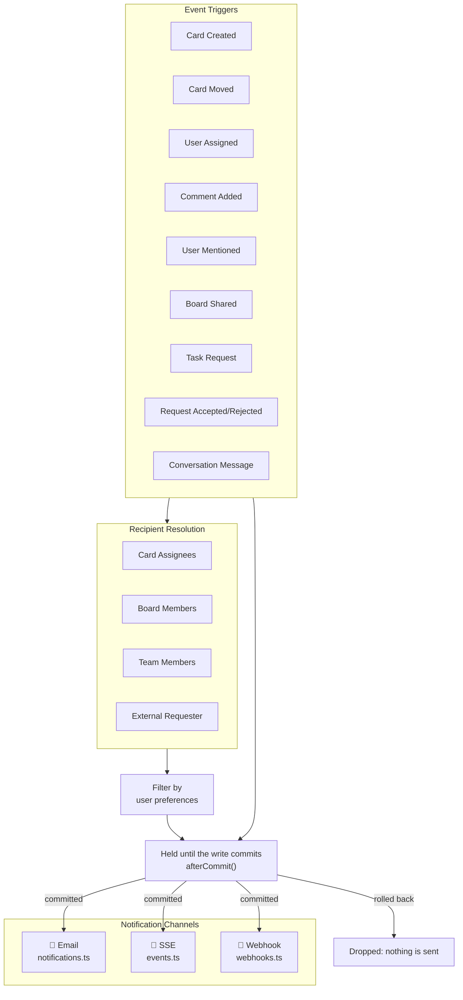

## When Notifications Are Sent

A request that writes does so inside one transaction (see [Architecture](architecture.md#writes-one-transaction-then-the-effects)). Whatever it wants to tell people is queued while that transaction is open and started once it has committed.

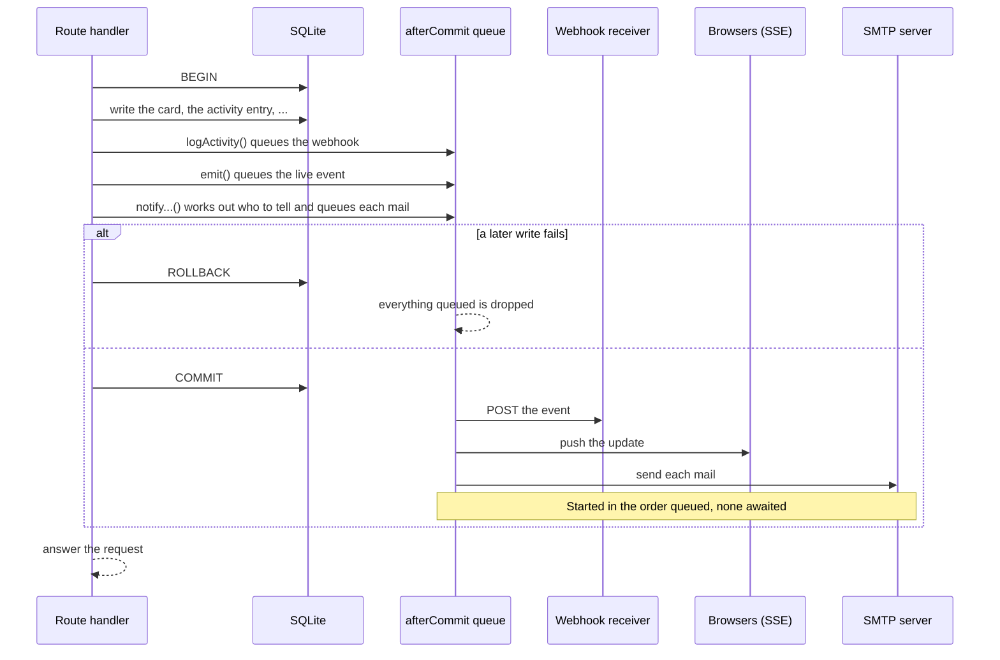

- **Each channel queues itself.** `emit()` in `events.ts`, `logActivity()` (which dispatches webhooks) and the mail functions in `notifications.ts` all go through `afterCommit()`, so a route that calls them inside a transaction needs to do nothing more. Called with no transaction open, each sends at once.
- **A drop of several cards is announced only if all of it is saved.** If the last card of a drop cannot be completed, the earlier cards are rolled back with it and no webhook, live update or mail goes out for any of them.
- **A failure to send never undoes the write.** A webhook that cannot be delivered or a mail that cannot be sent is logged at `ERROR` and goes no further. The request has already been committed and is answered as a success.
- **Some notifications look up their recipients when they are called and queue only the send; others run entirely after the commit.** The card-move announcements and the requester's progress mail are of the second kind: the progress mail builds a PDF on completion, which is asynchronous work that must not start inside a transaction. Either way, no mail leaves before the commit.
- **Mail the caller waits for is not queued.** The SMTP test, a report emailed on demand and the scheduled reports use the functions in `email.ts` directly, outside any transaction, and read what each send returned: see [A Report Emailed on Demand](#a-report-emailed-on-demand) and [Schedule Execution](backup-reporting.md#schedule-execution).

## Email Notifications

### SMTP Configuration

SMTP settings are stored in the `settings` table and configured via the Admin panel.

| Setting Key | Type | Default | Description |
|------------|------|---------|-------------|
| `smtp_host` | string | — | SMTP server hostname |
| `smtp_port` | number | 587 | Port number |
| `smtp_allow_insecure` | `'true'` or `'false'` | not set (off) | "Allow mail without a checked, encrypted connection" (card 2189): only `'true'` is on. Written when the panel first saves it |
| `smtp_secure` | boolean | false | No longer read or written (card 2189). It was "Use SSL/TLS", which only switched the certificate check on for ports other than 465; that is now always on. A row saved before is left where it is, and a working copy removes it with the other mail settings |
| `smtp_user` | string | — | Auth username |
| `smtp_pass` | string | — | Auth password |
| `smtp_from_address` | string | — | Sender email address |
| `smtp_from_name` | string | DumpFire | Sender display name |

**The password is in no backup** (card 2169). A backup's copy has no `smtp_pass` row; the
other mail settings are in it. An Import Backup keeps this server's password when the
backup is one this server made and nobody has changed since (its seal, made with a key this
server keeps) and its `smtp_host` (trimmed of ASCII spaces and tabs, ASCII letters in any case), `smtp_port` (587 when not set),
`smtp_allow_insecure` (off when not set, as in a backup made before card 2189) and
`smtp_user` are all this server's, and otherwise lists the mail password to enter again in
**Admin → 📧 Email / SMTP**: with the port and the way out compared too, a backup cannot have this server's
password sent over a connection whose certificate is not checked. Until it is entered, mail
is tried with the user name and an empty password, which a mail server that asks for one
refuses, the backup failure mail included; a requester who asks for a new link is told
"New links cannot be sent just now. Please contact the team that sent you the link." rather
than that one was sent, with the reason in a `[WARN] [REQUESTS]` line; and every start writes
one `[WARN] [STARTUP]` line saying so. See [The Secrets a Backup Does Not Hold](authentication-security.md#the-secrets-a-backup-does-not-hold-card-2169).

**The saved password stays with the connection it was saved for** (card 2190). `GET
/api/admin/smtp` answers the password as `••••••••` (`SECRET_MASK` in
`src/lib/server/backup-secrets.ts`) and `allowInsecure` as `true` or `false`; it no longer
answers `secure`. `PUT /api/admin/smtp` takes `host`, `port`, `allowInsecure` (`true` or
`false`; anything else is refused, `allowInsecure must be true or false`), `user`, `pass`,
`fromAddress`, `fromName` and `appUrl`; a `secure` is ignored as any unknown key. A password
typed, an empty one included, is saved as typed. One sent masked, or left out, while a
password is stored, is kept only while the host (trimmed of ASCII spaces and tabs, ASCII letters in any case; a no-break space, a byte-order mark or an ideographic space is a change, as is a letter outside ASCII that `toLowerCase()` would fold to one inside it), port (587 when not set),
user name (`''` when not set) and way out (off when not set) that the save would leave stored,
each sent over the one stored, are the stored ones (`keepMailPassword`, by the rule a restore
fills the password by). Otherwise the save is refused `400`, inside its transaction, with
nothing written:

> Type the mail password again. The saved password is used only with the host, port, user name
> and "Allow mail without a checked, encrypted connection" setting it was saved with, and this
> changes the host.

naming each field that changed. The host is saved trimmed of ASCII spaces and tabs only, and
where the stored password is kept the stored host is written in place of the one sent, so that
the host compared is the host connected to, byte for byte (the review-fix pass's S1). The sender's address and name and the App URL decide nothing
about where the password goes and are not compared, so the App URL saved alone is never
refused; with no password stored there is nothing to keep and nothing is refused. Until card
2190 a masked password was kept for any host, and one left out too, since only the keys sent
are written: a save of `{ "host": "smtp.evil.example" }` sent the stored password there at the
next mail. A save that changes the way out writes, once committed, one `WARN` line under
`SMTP`: `Mail is now sent without a checked, encrypted connection (set by <username>)`, or
`with`.

### Connection Handling

Every mail goes through `createTransporter` in `src/lib/server/email.ts`, built afresh for each
send from the stored settings: `sendEmail` (invites, notifications, request mail and its
confirmation, the new-link mail, the backup failure mail), `sendEmailWithAttachment` (reports,
the requester's completion PDF) and `sendTestEmail` (Send Test). Card 2189 made the connection
a checked, encrypted one by default.

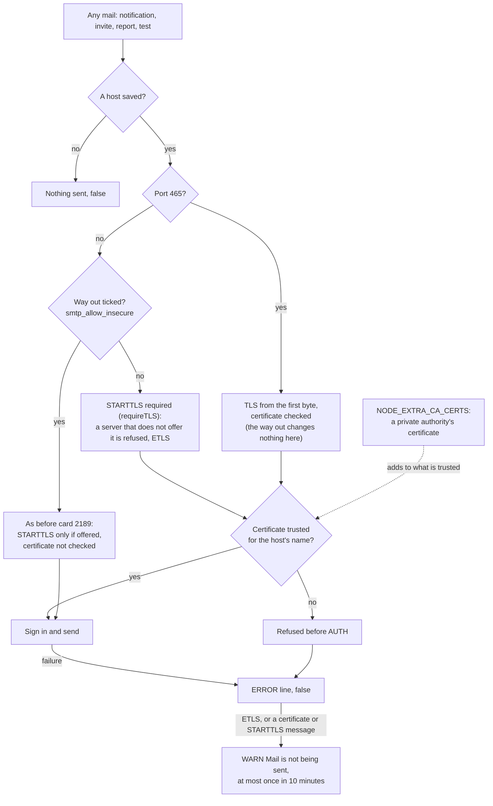

The options handed to nodemailer (10.1.1):

| Option | Port 465 | Any other port | Any other port, way out ticked |
|---|---|---|---|
| `secure` | `true` | `false` | `false` |
| `requireTLS` | `false` (TLS already) | `true` | `false` |
| `tls.rejectUnauthorized` | `true` | `true` | `false` |
| `auth` | the user and password, when a user is saved | the same | the same |
| `name` (the EHLO name) | `dumpfire.app` | `dumpfire.app` | `dumpfire.app` |
| `connectionTimeout`, `greetingTimeout`, `socketTimeout` | 10 s, 10 s, 15 s | the same | the same |

- **The certificate** is checked against Node's own authorities and any named by
  `NODE_EXTRA_CA_CERTS`, which Node reads once at start for every TLS connection of the
  process (webhook deliveries and backup destinations trust that authority too). There is no
  setting for an authority's certificate on the panel: see
  [Mail Server Certificates](deployment.md#mail-server-certificates).
- **Port 465 is checked even with the way out ticked** (the plan's R9): it checked the
  certificate before card 2189 too, so no installation on 465 depends on an unchecked one.
- **The EHLO name** is `dumpfire.app`, to avoid Google's `421` answers to local host names.
- **IPv4 and IPv6.** DumpFire no longer passes `family: 4` ("force IPv4"): nodemailer 10's SMTP
  connection does not read a `family` option. nodemailer looks up the host's IPv4 and IPv6
  addresses together, leaving out a family the server has no network address for (and falling
  back to `dns.lookup` when neither finds an address), and with more than one address it has
  Node's `net.connect` try them in turn (`autoSelectFamily`), going on to the next when one
  fails or is slow.
- **The check before deploying** ([Mail Server Certificates](deployment.md#mail-server-certificates))
  builds these same options and calls `verify()`, which connects, upgrades, checks and quits
  without signing in, so it tells what the first mail will meet. `createTransporter`'s comment
  names it: change the two together.

**What a failure says.** Send Test's `500` is `Failed to send test email: <the error>`. When the
error is the certificate or STARTTLS (`tlsFaultHint`: the code `ETLS`, or a message matching
`certificate`, `altnames`, `self-signed` or `STARTTLS`), the error is ended as a sentence and followed by:

> The mail server's certificate could not be checked, or the server does not offer STARTTLS.
> For a certificate from a private authority, see docs/deployment.md, Mail Server Certificates;
> for a relay on this server's own network that cannot use TLS, tick "Allow mail without a
> checked, encrypted connection" and type the password again.

A refused STARTTLS comes back `ETLS` "Error upgrading connection with STARTTLS: …"; a
certificate refused during STARTTLS comes back `ESOCKET` with Node's message
("self-signed certificate", "Hostname/IP does not match certificate's altnames: …"); and a server
that answers neither EHLO nor STARTTLS comes back `ECONNECTION` "EHLO failed but HELO does not
support required STARTTLS", which nodemailer 10 names so (the review-fix pass's S6). A sign-in
failure or a timeout says what it says, with no sentence. Every other mail is sent after its
write commits, and a failure is an `ERROR` line (`Failed to send email to …`); when it is the
certificate or STARTTLS, `sendEmail` and `sendEmailWithAttachment` also write one `WARN` line
under `EMAIL`, `Mail is not being sent: <the error>. <the sentence above>`, at most once in ten
minutes in a process, so the Audit page says why invites and notifications stopped.

### Email Types

| Event | Recipients | Preference Key | Subject Format |
|-------|-----------|---------------|----------------|
| Card Moved | Assignees who can open the board the card is on now, never the one who moved it | `email_moved` | `Card moved: {title} → {column}` |
| User Assigned | Assignee | `email_assigned` | `Assigned: {title}` |
| Comment Added | Board members | `email_comments` | `New comment on: {title}` |
| User Mentioned | Mentioned user | `email_mentions` | `{author} mentioned you: {title}` |
| Board Shared | Target user | `email_board_shared` | `Board shared: {boardName}` |
| Request Confirmation | Requester (no account) | — | `Confirm your request: {title}` |
| A New Link (card 2158) | Requester, at the request's address (for a request made signed in, the account's email as it is now: card 2171), when they ask for it from a link that no longer works: at most three an hour to one address, and for a request not yet confirmed within the form's three confirmation mails an hour to it; at most 30 an hour in all; worked out and sent after the answer. See [The Public Request Form](authentication-security.md#the-public-request-form) | — | `A new link to your request: {title}` |
| Task Request | Target user/team | `email_requests` | `New request: {title}` |
| Request Accepted | Requester | — | `Request accepted: {title}` |
| Request Rejected | Requester | — | `Request declined: {title}` |
| Conversation Message | Requester/Admin | `email_requests` | `Message on request: {title}` |
| Request Complete | Requester | `email_request_progress` | `Your request is complete: {title}` |

**A new card sends no mail of its own.** Whoever is put on a new card is mailed
"Assigned": accepting a task request with an assignee (`PATCH /api/requests/{id}`,
`assigneeId`) makes the card and assigns it in one go, and a page that makes a card with
assignees adds each one after the card is made. A "Card Created" mail would have told
them twice. The table
listed a "Card Created" mail, `New card: {title}`, whose function, `notifyCardCreated`,
nothing called; it was removed (card 2010). A new card still reaches the pages open on its
board and the board's webhooks, which is the "Card Created" of the diagram above.

**When "Card moved" is sent** (card 2134). For every move made on a page (a drag, the card
window, All Tasks), and for a move that completes the card however it was made, through
the API included. A move through the API that does not complete the card mails nobody: a
script working a board moves cards all day, and a mail for each would bury the people on
it. Whoever made the move is never mailed about it, on any route, as the commenter is left
out of the comment mail: `notifyCardMoved()` takes the mover's id and leaves them out of the
assignees. Turning "Card moved" off to stop such a mail would also stop the "Unblocked"
mail, which reads the same preference. A card created in a Complete column is not moved,
and sends no "Card moved".

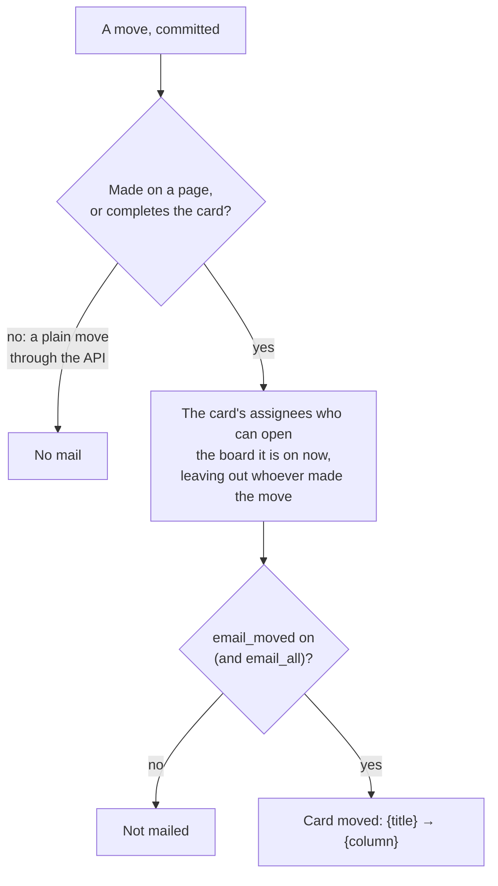

**Only assignees who can open the board are mailed** (card 2180). Taking someone off a
board, or out of the team it is shared with, leaves them assigned to its cards, and the
"Card moved" and "Unblocked" mails name the card, the board and who did what.
So `getAssigneeEmails(cardId, boardId, excludeUserId?)` in `notifications.ts` keeps only the
assignees who can open `boardId` (`whoCanOpen`, which asks `canViewBoard`): the board's
owner, a member of any role, a member of a team it is shared with, anyone for a public
board, and an administrator. `boardId` is the board the mail is about: the board the card
is on after the move for "Card moved" (a card moved to a
board an assignee cannot open is not mailed to them), and the waiting card's board for
"Unblocked". It is asked when the mail is sent, and preferences decide after it. Nobody is
unassigned by it.

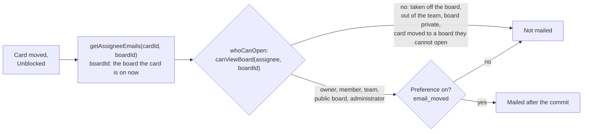

### Text in Mail Is Text

Every text a mail carries is somebody's typing: a board's or grouping's name, a card's
title, a username, a comment, a schedule's name, the error a backup destination's server
answered. A report can be emailed to any address, so if such a text were put into a mail's
HTML as it was typed, anyone with an account could have the server's own sender deliver
HTML of their choosing to anyone: a link, or a styled "sign in again" button. The report
emailed by hand, the scheduled report and the backup failure mail did exactly that until
card 2149.

The rule now:

- **Every text put into a mail's HTML goes through `escapeHtml` where it is put**, a link in
  an `href` included. The five characters HTML reads as markup (`&`, `<`, `>`, `"`, `'`)
  become entities, so a board named `R&D <b>bold</b>` reads as exactly that in the mail.
- **One function does it**, `escapeHtml` in `src/lib/escape-html.ts`, which every mail and
  the `/docs` page use. `notifications.ts` had a function of its own for the same five
  characters; it is gone.
- **Left bare** are only a number, a value taken from a fixed table in the same function
  (the priority colours, the progress mail's headings) and a block of HTML built in the
  same function from values already escaped.
- **A subject is not escaped.** It is plain text, not HTML, and an escaped subject would
  show its reader `&lt;`. nodemailer replaces a line break in any header, so a name cannot
  add a header either.

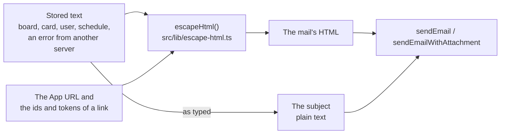

`tests/mail-escaping.test.ts` sends every mail with markup in every text it carries, and an
App URL with a quote in it, and fails if any recorded mail holds either as it was written.
It also fails if `notifications.ts` exports a mail it has no case for.

**Escaping keeps markup out, and not text.** A board named "Your account is locked: call
0800 123 456" is mailed as exactly those words, in the report's subject and in its body, and
a plain address or web address in a name may still be shown as a link by the reader's mail
client. Nothing in a mail can tell a reader that the words of a name are not DumpFire's own.
What bounds that is who a report can be mailed to, how many at once and in a day, and that
every report mail names the account behind it (card 2182): see
[Who a Report Can Be Mailed To](#who-a-report-can-be-mailed-to).

### User Notification Preferences

Stored as JSON in `users.notification_prefs`. Each user can toggle individual notification types, on My Account under **Email Notifications**.

There is one list of them, `NOTIFICATION_PREFS` in `src/lib/notification-prefs.ts`, a module with no server imports (card 2146). The account page draws its switches from it, `GET` and `PUT /api/account/notifications` make their defaults and their save from it (`defaultPrefs()`, every key on), and `shouldNotifyUser()` and `filterRecipientsByPref()` in `notifications.ts` take a key of it as their type, so `npm run check` refuses a mail that reads a key nobody can save. `GET` answers every key, so the page shows what is stored.

| Switch on My Account | Key | Read by |
|----------------------|-----|---------|
| All Email Notifications | `email_all` (`MASTER_PREF`) | Every mail below: `false` stops them all, whatever each says. On the page, turning it off turns every switch off, and on turns them all on |
| Task Assignments | `email_assigned` | User Assigned |
| Comments | `email_comments` | Comment Added |
| Mentions | `email_mentions` | User Mentioned |
| Card Moves | `email_moved` | Card Moved, and Unblocked |
| Task Requests | `email_requests` | Task Request, Conversation Message |
| Request Progress | `email_request_progress` | The progress mails of [Requester Progress Notifications](#requester-progress-notifications), Request Complete among them, to a requester who has an account. A requester without one has nothing to switch and is always mailed |
| Board Sharing | `email_board_shared` | Board Shared |
| Planning | `email_planning` | The mail about a new plan |

Until 2026-10-15 the page, the route and the mail kept three lists. The route's left out `email_request_progress` and `email_mentions`, so it neither answered nor saved them: the page offered Request Progress, whose switch went back on at every reload, and the progress mail was always sent; and the mention mail read `email_mentions`, which nothing offered, so it could be stopped only by switching all mail off. The page now offers **Mentions**, and both keys are saved and answered. No account had either stored, so a requester who switched Request Progress off before then is mailed until they switch it off again. A key not stored, or a preference that cannot be read, is on. A save that is refused, or gets no answer, puts every switch back as it was and says why under them.

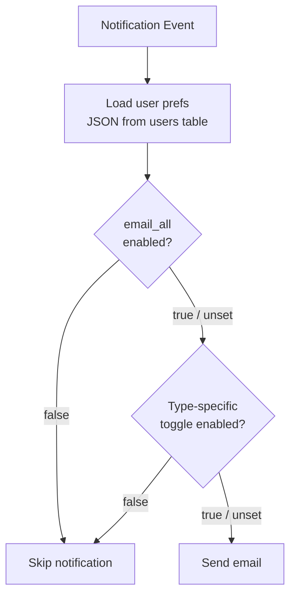

### Request Confirmation

A request submitted without an account sends one email, to the address the requester
gave, asking them to confirm. The **Task Request** email to the team is sent when they
do, not when the form is submitted — otherwise the form is a way for anyone to email the
team. Requests from signed-in users skip this and notify the team at once.

Every link emailed to a requester (`requestReplyUrl()` and `requestConfirmUrl()` in
`request-tokens.ts`) carries that request's own token. Links used to carry the
requester's email address, which is not a secret.

Each reply the requester sends through that link mails every member the request is
addressed to, so the requester may send 20 replies to one request in an hour, and the 21st
is refused `429` with nothing saved and nothing mailed. A reply from the team starts the
count again. See [Authentication & Security](authentication-security.md#the-public-request-form).

### Requester Progress Notifications

When a task request is accepted and converted to a card, the requester receives progress emails:

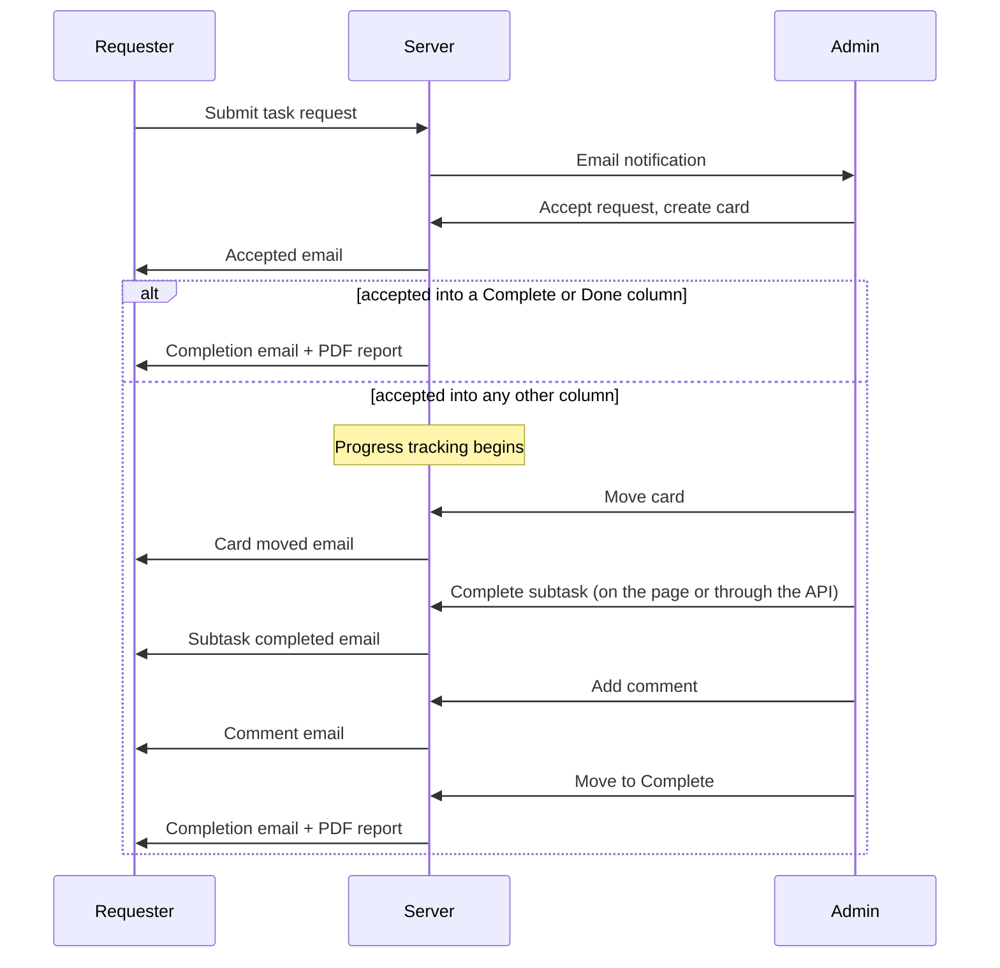

**Which address a requester is mailed at** (card 2171). Every mail to a requester, these
and "Request accepted", "Request declined", the team's reply and a new link, goes to
`requesterAddress()` in `src/lib/server/request-access.ts`, asked when the mail is sent: for
a request made while signed in (`requester_user_id` set), the account's `users.email` as it
is then; for one made without an account, the address given on the form
(`requester_email`); and to nobody, with nothing sent, when the account named is not there
or there is no address at all. The address stored when a request is made is still written,
but a requester who changes their account's email is mailed at the new one from then on.
"When it is sent" is when the action is taken, inside its transaction, for a reply, an
acceptance or a decline, and after the commit, when the row is read, for the progress and
completion mails. When an account is deleted, its email is written onto each of its
requests first, so they go on being mailed at its last address. The inbox shows the same
address.

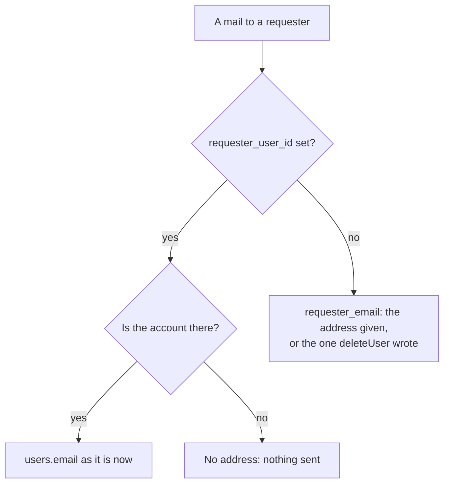

On card completion, a **PDF task report** is automatically generated and attached to the completion email. A request accepted straight into a Complete or Done column makes a card that is completed as it is created (see [Data Model](data-model.md#one-completion-however-a-card-arrives)), so the requester is sent "Request accepted" and then the completion email with its report (card 2134). A subtask ticked through the API mails the requester as one ticked on the page does (card 2108). No progress email goes to a requester who made the change themselves, and none but the completion email once the card is complete.

### A Report Emailed on Demand

The Reports page's **Email** sends `POST /api/reports/email`, which answers with what was
sent (card 2113). It used to answer `200` "Report sent to N recipient(s)", with every
recipient's `success` true, whatever the mail server answered and with no mail set up at
all, and the dialog closed. The recipients are each an address, read with the other fields
before the report is made: one that is not is `400` `recipients[<n>] must be an email
address`, naming its place in the list, and nothing is sent (card 2117). Since card 2182
they are also read as the mailer reads them, at most 10 distinct addresses a call and 100 a
day from one account, each address sent one mail once: see
[Who a Report Can Be Mailed To](#who-a-report-can-be-mailed-to).

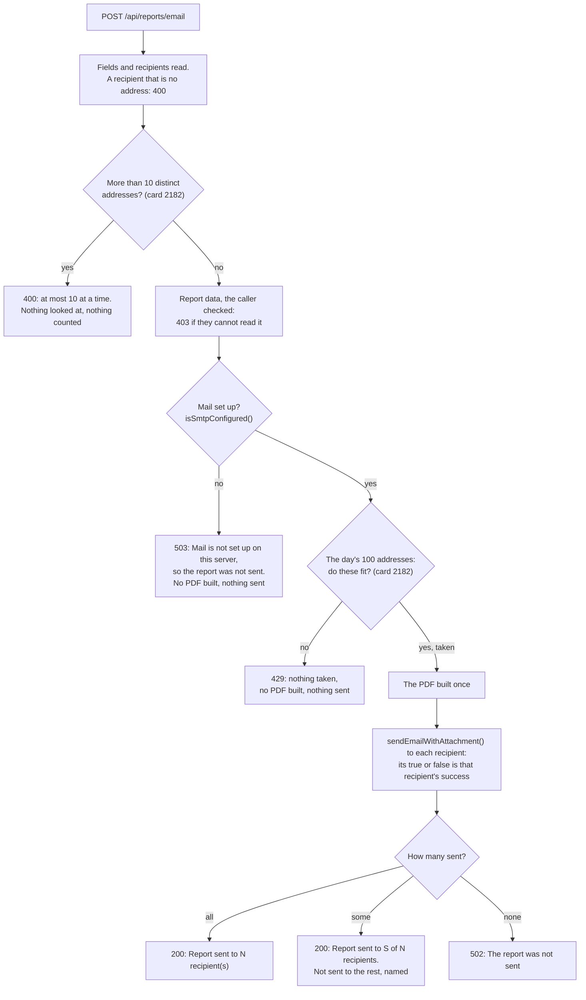

| Answer | `message` | `results` |
|--------|-----------|-----------|
| `503` | `Mail is not set up on this server, so the report was not sent. The superadmin sets it up on the admin page.` | None |
| `200`, all sent | `Report sent to <n> recipient(s)` | `{ email, success: true }` for each |
| `200`, some sent | `Report sent to <s> of <n> recipients. Not sent to <addresses>. The mail server did not accept it. An administrator can see the reason in the system log.` | Each recipient, a failure with `success: false` and the `message` `The mail server did not accept it. An administrator can see the reason in the system log.` |
| `502`, none sent | `The report was not sent. The mail server did not accept it. An administrator can see the reason in the system log.` | As above, every one a failure |

- **The mail server's own reason is not in the answer.** `email.ts` writes it to the system
  log, an `ERROR` line under `EMAIL` for each address, which an administrator reads on the
  Audit page's console. The gate writes the line of every `5xx` answer at `ERROR` too, a
  `503` and a `502` from here among them.
- **The answer says which addresses the mail server accepted.** Each recipient's `success`
  is whether the mail server took the mail for that address, so a mail server that refuses
  an unknown mailbox as the mail is sent tells the sender which of the addresses they typed
  exist there. That is accepted as designed: the sender needs it to send to the rest again.
  Since card 2182 a call names at most 10 addresses, and one account at most 100 in a
  24-hour window counted from its first (so up to 200 across one window's end and the next's
  start), and that is all one account can learn so in a day. See
  [Authentication & Security](authentication-security.md#what-an-emailed-reports-answer-tells).
- **A report that reached some recipients is `200`, not a failure status**, so that nothing
  in between offers to send it again: the ones who had it would get it twice. The Reports
  page shows it as a failure all the same, keeps the dialog open, and leaves only the
  addresses not reached in the box, saying so, so that Send goes to those alone. A `503` or
  a `502` is shown in the dialog with the box as it was.
- **Each answer is written with its own status**, as `tests/error-shape.test.ts` requires
  of a failure answered with `json()`.

### Who a Report Can Be Mailed To

A report goes from the company's own sender, which mail providers trust, and its subject
and body carry names as somebody typed them. Until card 2182 a report emailed by hand went
to as many addresses as one request named (300 outside addresses, twice over, were sent in
the plan's probe), a schedule held as many as it was given (2,000), and an account could
make any number of schedules. A mass send also spends the sender's daily quota at the mail
provider, which once spent stops every other DumpFire mail until it resets.

**Any address may still be a recipient**, an account's or not, and every report mail names
the account behind it: the one emailed by hand says "Sent by `<username>` via DumpFire",
and a scheduled one now says "Set up by `<username>`" above "— DumpFire Automated Reports",
the username escaped as every text in a mail is. The gate's line for each request names the
account on the Audit page too. What is bounded is how many.

| Limit | Where | Refused |
|-------|-------|---------|
| 10 distinct addresses a call | `POST /api/reports/email`, before the board or the caller's access is looked at, administrators included | `400` `A report can be emailed to at most 10 addresses at a time, and this names 12. Nothing was sent.` |
| 10 addresses a schedule | `POST /api/report-schedules`; `PUT /api/report-schedules/{id}` when it sends a changed list | `400` `A schedule can be sent to at most 10 addresses, and this names 12. The schedule was not saved.` (`The schedule was not changed.` for the `PUT`) |
| 20 schedules an account | `POST /api/report-schedules`, counting the caller's own | `409` `You have 20 report schedules, the most one account may have. Delete one first.` An account that already has more keeps them all, and is told `You have 25 report schedules, and the most one account may have is 20. Delete 6 first.` |
| 100 addresses a day an account | The report emailed by hand; every schedule made, turned on or re-timed; and the addresses a changed list adds | `429` `Reports can be emailed to at most 100 addresses a day from one account, and this would make 104. Try again in 5 hour(s).`; for a schedule, `Report mail can reach at most 100 addresses a day from one account, and this schedule's 10 would make 104. The schedule was not saved. Try again in 5 hour(s).` (`was not changed.` for the `PUT`, and `this schedule's 4 new addresses would make 104` when a changed list is what does not fit) |

Each refusal is whole: nothing is sent, saved or counted. The wait is in hours, rounded up,
for an hour or more, and in minutes under an hour.

#### One reading of a list

`reportRecipients(input)` in `src/lib/report-recipients.ts` reads a list of recipients, as
the email route takes one (a list of texts) or as a schedule keeps one (one text). It
imports nothing from the server, so the Reports page uses it too. The email route, both
schedule routes, the scheduler and the page all read a list through it, so the number the
server holds a list to is the number the page shows and the number of mails sent.

- **Each text is split on commas, semicolons and white space** (spaces, tabs, new lines);
  each part is trimmed and lower-cased, and empty parts and repeats are dropped.
- **A part written `<address>` is the address inside.** So `Alice Smith <alice@x.test>` is
  the address `alice@x.test` and two parts that are not addresses, `alice` and `smith`.
- **An address** has one `@` with a dot after it, at most 254 characters, no white space,
  none of `< > ( ) [ ] \ , ; : "`, and no control or format character (Unicode's `\p{C}`:
  a right-to-left override, U+202E, turns the text after it round on the page, so the
  address shown would not be the one mailed). It answers `{ addresses, notAddresses }`, each in
  the order first written. `MAX_REPORT_RECIPIENTS = 10` is beside it.

Why those separators and that rule: the mailer (nodemailer's address parser) reads
`a@x.test;b@x.test` as two addresses in one mail, each in view of the other; an address on
one line with another on the next as one address, the second being its display name, which
is never mailed; and parts the old pattern took, such as `a@b.c<x>` and `abc<def>@x.com`, as
mail to `x` and to `def`. Each address is now handed to the mailer on its own, and is
exactly one recipient, the one the page shows. So a schedule typed with semicolons sends one
mail to each address where it sent one mail to all of them; one typed an address to a line
reaches every address where it reached only the first; and an address written twice, in
any case, is mailed once.

What each reader does with a part that is not an address:

- **The email route** refuses it in card 2117's words, `recipients[<n>] must be an email
  address`, naming its place in the list. An entry the mailer would send to someone else, or
  with no dot after its `@`, is refused so too, where card 2117's own rule took it. The
  answer's `results` carry each address lower-cased.
- **The schedule routes** refuse it, `400`, with nothing saved:
  `recipients holds "smith", which is not an email address`, or several,
  `recipients holds "alice", "smith", which are not email addresses`, up to five named, each
  cut to 100 characters, then `and 3 more`. A list is stored as the addresses it will be
  sent to, lower-cased, each once, separated by `, ` (`readReportRecipients` in
  `src/lib/server/request-body.ts`), at most 2,000 characters. A `PUT` that sends the stored
  list back as it is keeps it unchecked, so a page that sends the whole row back can still
  rename or switch off a schedule kept with more than 10, whether it is on or off: `enabled:
  true` is refused only when it would turn such a schedule on.
- **The scheduler** sends to the addresses and never to the other parts, and names the
  parts it left out at the end of the run's line: `Left out, as not email addresses:
  "alice", "smith".` A schedule stored as `Alice Smith <alice@x.test>` before the rule still
  reaches Alice, and is not switched off for the rest.
- **The Reports page's email dialog** says it, and sends nothing:
  `"x" is not an email address. Nothing was sent.` (`"x", "y" are not email addresses.` for
  several). Its hint reads "Up to 10 addresses, separated by commas", and the schedule
  form's "Up to 10 addresses, separated by commas. The report is emailed to each." The
  schedule list counts each schedule's addresses through `reportRecipients`, where it
  counted commas and showed one recipient for a list typed with semicolons.

#### The day's 100

`takeReportMail(user, n, spend)` in `src/lib/server/reports.ts` takes `n` addresses from the
account's allowance, `REPORT_MAILS_PER_DAY = 100`, through `takeAllowance` in
`src/lib/server/rate-limit.ts`, keyed `report-mail:<userId>`. It counts addresses, not
calls: one call of ten addresses is ten. The day is a fixed 24 hours from the account's first
take, and a take that would pass 100 is refused whole and takes nothing. So "100 a day" is
100 in a window counted from the first take, not a calendar day: an account that spends its
100 at the end of one window and another 100 at the start of the next has reached 200
addresses within minutes.

- **The report emailed by hand** takes its addresses after the body, the cap, the caller's
  access and the `503` for a server with no mail set up, and before the PDF is built. A call
  refused for any of those spends nothing. What it takes is not given back when the mail
  server refuses a send: the attempt was made.
- **A schedule pays when it is made, turned on or re-timed**, because each of those can bring
  a send forward. A schedule made for the next minute is sent at the scheduler's next tick,
  and deleting it makes room for another: by the plan's probe, one account mailed 10, 20,
  then 30 outside addresses in six minutes of clock that way, and with 20 schedules it would
  have been 200 a minute. So `POST /api/report-schedules` takes the new schedule's
  addresses, and `PUT /api/report-schedules/{id}` takes the schedule's addresses as they will
  be after the change when it turns the schedule on (`enabled: true` on one that is off) or
  sends a `frequency`, `dayOfWeek`, `dayOfMonth` or `timeOfDay` other than the one stored.
- **A changed list pays for the addresses it adds.** When a `PUT` does neither of those and
  sends a list that reads differently from the stored one, it takes the addresses of the
  new list that are not in the stored list: a schedule of one address given ten takes nine.
  A schedule made with no addresses costs nothing, so until the review of card 2182 one made
  empty, given ten by a change, sent and deleted, over and over, mailed 120 to 150 addresses
  a day with no `429`. The stored list sent back in another order or case, or cut down,
  takes nothing, nor does a change of name or filter, or turning it off. The take is the
  last check, immediately before the write in the same transaction, with nothing awaited
  between them, so two requests cannot both fit in the last of the allowance. Nothing is
  given back when a schedule is deleted, or when a list is cut down.
- **A scheduled run takes nothing.** It would otherwise be dropped, with nobody told, on a
  day its owner had also mailed by hand.
- **The first refusal in each window is one `WARN` line** under `REPORTS`:
  `Account "<username>" (user N) reached its limit of 100 report mail addresses a day:
  report mail, and schedules made, turned on, re-timed or given new addresses, are refused
  until the day is up`, with the account as the line's user, so the Audit page finds it by
  user, and `{ used, asked, retryAfterSecs }` as its detail. The refusals after it in the
  same window are not logged; the gate writes its own line for every `429`.
- **In memory**, as every count in `rate-limit.ts` is: a restart starts the day again.

So an account's scheduled mail is at most its 20 schedules of 10 addresses each, on their
own timetables; and the mail it sends by hand, together with the schedules it makes, turns
on, re-times or gives new addresses, reaches at most 100 addresses in a window. Someone who makes five schedules of ten
and then emails reports by hand has 50 left that day.

#### A schedule kept from before with more than 10

A schedule made before the cap can hold more than 10 addresses. At its next due run the
scheduler reads its list, and over 10 it switches the schedule off and sends nothing, before
the report is built. The write is conditional (`enabled = 0 … WHERE id = ? AND enabled = 1`),
and only the run that changed the row writes the one `ERROR` line under `REPORTS`, naming
the schedule's owner, who is also the line's user, so the Audit page finds it by user:

```
Report schedule 12 "Weekly sales", owner "pat" (user 7), was switched off: it is sent to 15 addresses, and the most is 10. Nothing was sent. Its owner can delete it and make it again with at most 10.
```

- **The Reports page says why.** In place of the count, the schedule reads
  "15 recipients: the most is 10, so it is not sent", with its addresses beneath as text
  that can be selected and copied, and "Copy the ones to keep into a new schedule of at most
  10, then delete this one." The page has no way to edit a schedule's list, so this is where
  its owner finds the addresses before deleting it.
- **It cannot be turned on as it is.** A `PUT` with `enabled: true` on such a schedule
  that is off is `400`
  `This schedule cannot be turned on: it is sent to 15 addresses, and the most is 10. Delete it and make it again with at most 10.`,
  and nothing changes. `enabled: true` on one still on, as a page sends the row back with
  a new name, is not a turning on and is accepted. A `PUT` that sends a list of 10 or fewer
  and `enabled: true` together is accepted, and when that turns the schedule on it takes the
  new list's addresses from the day's 100. Turned back on, it keeps the run time it had,
  which is past, so it is sent at the scheduler's next tick.
- **Before the deploy**, the query in
  [The Update That Brings the Limits on Report Mail](deployment.md#the-update-that-brings-the-limits-on-report-mail)
  lists each schedule's addresses as this rule counts them: any above 10 is switched off at
  its next run unless it is remade first. Remade after the deploy, each new schedule takes
  its addresses from the day's 100.

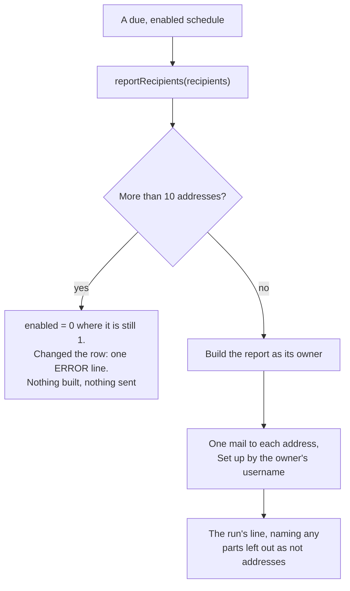

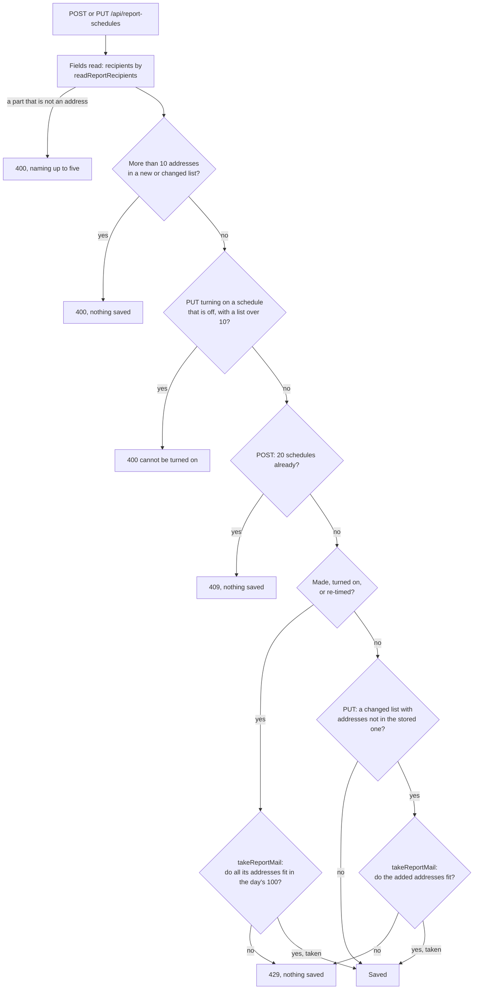

## Real-Time Updates via SSE

### Architecture

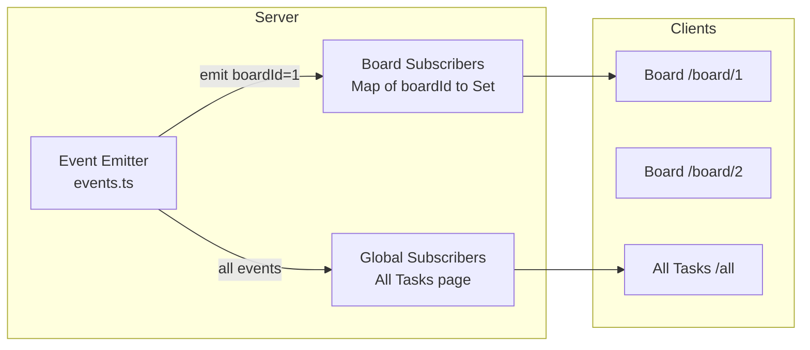

### Event Types

| Event | Payload | Trigger |
|-------|---------|---------|
| `update` | `{type: 'card'}` | Card updated, moved, archived, restored or deleted. A creation carries `action: 'created'`, `cardTitle`, `userName` and `userEmoji`, an accepted request's card among them (card 2108). Someone assigned to a card (also when they already were) or taken off it, and a comment edited, on a page or through the API (card 2143) |
| `update` | `{type: 'column'}` | Column added, renamed, reordered, deleted |
| `update` | `{type: 'board'}` | The board updated: renamed, its emoji or dashboard grouping changed, or made public or private, on a page or through the API (card 2143); or put under a card or taken out from under one, which only a page can do (`PUT /api/boards/{id}` with `parentCardId`: `PUT /api/v1/boards/{id}` reads no `parentCardId`). Sent once to the board, and once to each board whose card it joined or left. A request that sent no field sends nothing |
| `update` | `{type: 'label'}` | A label of the board made, renamed, recoloured or deleted, or put on or taken off one of its cards: on a page (`POST`, `PATCH`, `PUT` and `DELETE /api/labels`), or through the API (`POST /api/v1/boards/{id}/labels`, `PUT` and `DELETE /api/v1/labels/{id}`, `POST` and `DELETE /api/v1/cards/{id}/labels`) |
| `update` | `{type: 'category'}` | A category of the board made, changed or deleted: on a page (`POST /api/categories`, `PUT` and `DELETE /api/categories/{id}`), or through the API (`POST /api/v1/boards/{id}/categories`, `PUT` and `DELETE /api/v1/categories/{id}`). A shared category, of no board, tells no board |
| `update` | `{type: 'subtask'}` | A subtask of one of the board's cards made, saved or deleted on a page (`POST /api/subtasks`, `PUT` and `DELETE /api/subtasks/{id}`). The same through the API sends `{type: 'card'}` |
| `update` | `{type: 'board', action: 'created'}` | A sub-board was made under a card on this board, on a page or through `POST /api/v1/boards` (card 2143). Nothing is sent for a board made at the top level |
| `update` | `{type: 'board', action: 'deleted'}` | The board was deleted, or was a sub-board deleted with a board, card or column |
| `update` | `{type: 'board', action: 'sub_board_deleted'}` | A sub-board deleted on its own hung from a card on this board, which is still there |
| `update` | `{type: 'card', action: 'purged'}` | Archived cards on the board were purged, or the board was a sub-board removed by the purge |
| `update` | `{type: 'card', action: 'cleared'}` | The board's cards were cleared, or it was a sub-board removed by the clear |
| `xp-update` | `{}` | XP was given for a completion |
| `celebrate` | `{type: 'complete', cardTitle, userName, userEmoji, xpGained}` | A card moved into a Complete column, or created in one (card 2134). One event for a drop of several cards, naming the last |

The four delete payloads say what kind of change it was and nothing more: no board name,
card title or user (card 2108). The board of a sub-board's card can be viewed by people who
could never open the sub-board, and the page only reads its board again, under its own
access check. Restoring a card that is not archived, from a page, writes nothing and sends
nothing. Nor does a card update that changes nothing, on either tree: every field sent at
the value the card holds is no change, and sends no `update` (card 2183).

### Connection Lifecycle

1. A board page opens `GET /api/boards/{id}/events`, for the board it shows; All Tasks, the dashboard and the burndown page open `GET /api/events`, the stream of every board the reader can open. Each is opened through `keepStreamOpen()` (`src/lib/live-stream.ts`)
2. Server creates SSE stream with `text/event-stream` content type
3. Server calls `subscribe(boardId, listener)` or `subscribeGlobal(listener)`
4. On board mutation, server calls `emit(boardId, event, data)`. Inside a transaction the event is held until the commit, and dropped if the transaction rolls back, so a page told to refresh always finds the change there
5. All subscribed listeners receive the event
6. On client disconnect, unsubscribe callback cleans up the listener set

A board page listens to the board it shows. SvelteKit keeps a page when only its address's
board changes, so `src/routes/board/[id]/+layout.svelte` makes the page afresh for each
board (`{#key page.params.id}`, card 2184): after a sub-board badge, a breadcrumb, a link in
the card window, or Back and Forward to another board, the first board's stream is closed as
its page is destroyed and the second board's opened as its page mounts. A link to a card on
the same board (`?card=`) keeps the page and its stream.

The global stream carries card titles and who did what on every board, so a subscriber
is only sent events from boards they can view. The check is made per event and cached
per board for 30 seconds, which is how long a revoked share can keep trickling through.
Administrators receive everything. A board that has been deleted can be viewed by nobody
but an administrator, so a member's dashboard is not told of its deletion, and catches up
when it is next brought to the front. A page open on the board itself is told, by the
board's own stream, which checked access once when it was opened: it reads the board
again and shows "Board not found".

## Webhooks

Board-level webhooks fire HTTP POST requests to configured URLs when events occur.

### Configuration

| Field | Type | Description |
|-------|------|-------------|
| `url` | string | Target HTTP endpoint |
| `secret` | string | Shared secret for signature verification |
| `events` | JSON array | Event types to subscribe to |
| `active` | boolean | Enable/disable toggle |

**A webhook's secret is in no backup** (card 2169). In a backup's copy every webhook that had
a secret has `secret` empty and `active` off, and is listed in the `webhook_secrets_left_out`
setting with whether it was on: switched off so that a backup put in place as the database
by hand sends nothing unsigned. Its address and events are kept. An Import Backup on the
server the backup came from, of the file as that server made it, puts each secret back from
the webhook here with the same id, board and address, and switches the webhook on or off as
it was. A backup changed since, or made by another server, has none put back: its seal does
not verify. Anywhere else such a webhook
stays off with no secret, the import's result lists it with its board, and every start says
so, until the board's owner or an administrator sets its secret and switches it on with
`PUT /api/v1/webhooks/{id}` and `{ "secret": "…", "active": true }`, or deletes it. A webhook
made without a secret is in a backup as it is.

### Who Can See the Secret

The secret is what lets a receiver trust that a delivery came from DumpFire, so anyone
holding it can forge one. The delivery address goes with it (card 2133): an address can
name a server inside the network, or carry a user name and password before the host. Both
are returned by the API only:

- in the response to the `POST` that created the webhook, to the caller who supplied them;
- on a read or update, when the caller is the **board owner or an administrator**.

Every other caller — board editors and viewers included — gets the webhook without a
`secret` field and without a `url` field, on both reads and in the answer to an update, an
editor's own update of the address included. The keys are left out, not set to null.
`hasSecret` (boolean) is always present and says whether a secret is set, and `events` and
`active` are given as before. Before October 2026 the secret was returned to anyone who
could view the board, and until 2026-10-14 the address was. An editor may still change the
address without being able to read it, which card 2154 is to settle.

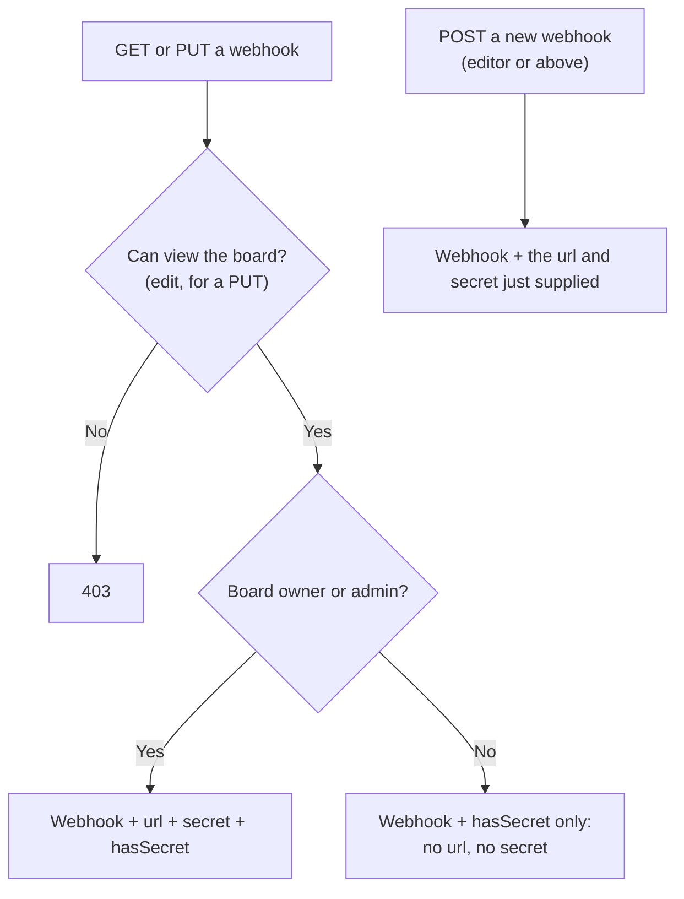

All webhook responses are built by `presentWebhook(hook, reveal)` in
`src/lib/server/webhooks.ts`, which leaves out `url` and `secret` together unless `reveal`
is true, so no route can return the raw row.

### Webhook Flow

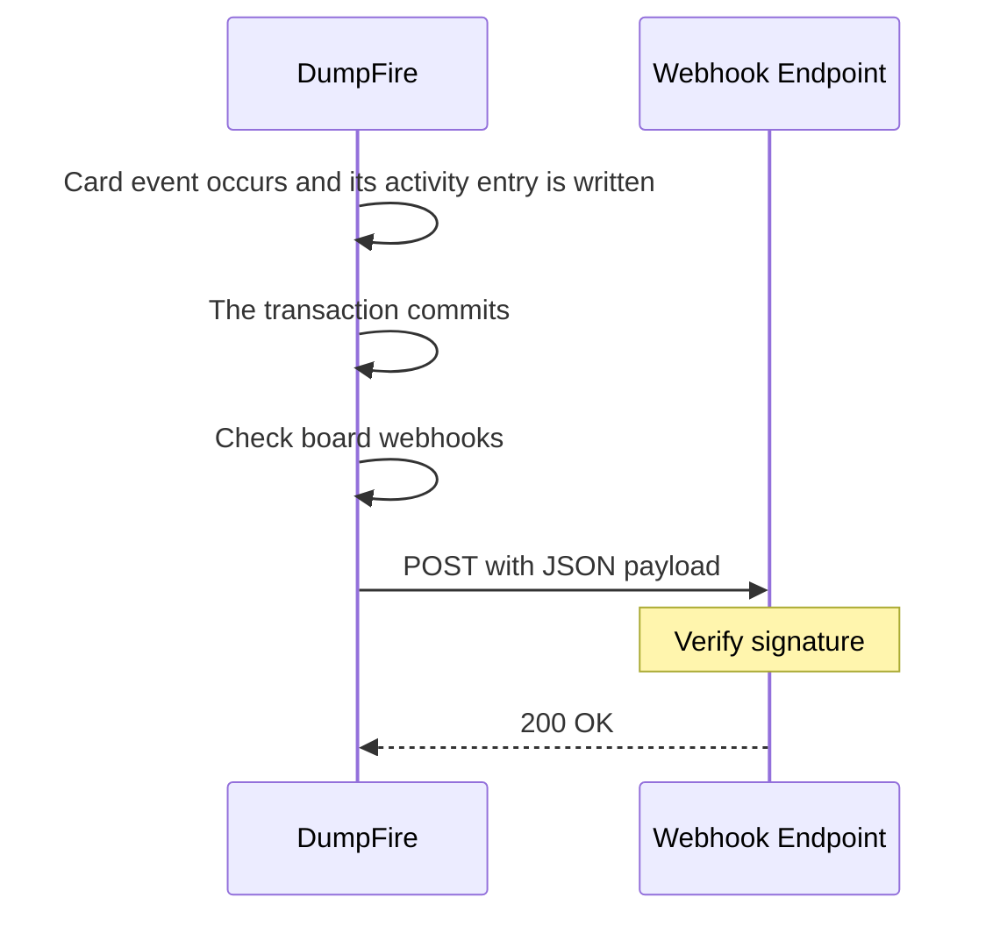

A webhook is dispatched by the activity entry for the action, once that entry is committed. Each card moved to another column is one entry, so at most one delivery to each of the board's webhooks: a drag and drop, `PUT /api/cards/reorder`, moves at most 100 cards to another column (card 2209), and names each card at most once, so one request sends at most 100 deliveries to each webhook. A request that would move more, or that names a card twice, is refused whole, `400`, with nothing moved or sent: a card named over and over, to and fro between two columns, was once a real move for every entry. The delivery is not awaited and not retried. One that cannot be made, or gets no answer within 10 seconds, is logged at `ERROR`. The receiver's status code is not read, so an answer of 500 from a receiver is not logged as a failure.

### Events and Payload

| Event | Sent when the activity entry is |
|-------|---------------------------------|
| `card.created` | `card_created`: by every way of creating a card, accepting a task request among them (card 2108) |
| `card.updated` | `card_updated` |
| `card.moved` | `card_moved` |
| `card.completed` | `card_completed`: a card moved into a Complete column, or created in one (card 2134) |
| `card.deleted` | `card_deleted`: a card deleted for good |
| `comment.added` | `comment_added` |

The same event is sent whether the action was made in the web UI or through the API. The request carries the headers `X-DumpFire-Event` and `X-DumpFire-Signature` (`sha256=` and the HMAC-SHA256 of the body under the webhook's secret, or empty when no secret is set), and a body of this shape:

```json
{
  "event": "card.deleted",
  "timestamp": "2026-10-13T09:14:03.512Z",
  "boardId": 3,
  "data": {
    "cardId": 1686,
    "action": "card_deleted",
    "source": "ui",
    "detail": "\"Compose network segmentation applied on the new host\"",
    "user": "greg"
  }
}
```

What is not sent:

- **Archiving a card sends nothing.** It writes `card_archived`, which has no event. Nor does restoring one: `card_restored` has none, and a restore through `PUT /api/v1/cards/{cardId}` with no other field sends no `card.updated` either, since it writes `api:card_restored` and no `api:card_updated` (card 2108).
- **A card update that changes nothing sends nothing** (card 2183). `PUT /api/cards/{id}` and `PUT /api/v1/cards/{cardId}` compare what is sent with what the card holds, and write no entry, so send no `card.updated`, when every field is as stored; one that changes some fields sends one `card.updated` whose `detail` names those alone. The card window sends a card's whole state back with every save, so every Save on an unchanged card sent a `card.updated` until 2026-10-15.
- **A move out of an On Hold column sends the move's events alone** (card 2208). The move clears the card's on-hold note itself; the board page's drag out of On Hold sent a second request to clear it, which delivered a `card.updated` beside the `card.moved`, until 2026-10-15.
- **A `card.deleted` carries the id of the card that went**, although the activity entry it comes from is stored with no card id, the card being gone.
- **Deleting a column sends nothing**, for the column or for any card in it. Neither does purging archived cards, clearing a board's cards or deleting a board. A board's webhooks are deleted with the board. Open pages are told of each by a live update: see [Event Types](#event-types).

## Key Implementation Files

| File | Purpose |
|------|---------|
| `src/lib/server/email.ts` | SMTP config, transporter creation, sendEmail |
| `src/lib/server/notifications.ts` | All email notification functions with preference filtering |
| `src/lib/notification-prefs.ts` | The one list of mail preferences: `MASTER_PREF`, `NOTIFICATION_PREFS`, `defaultPrefs()`. Read by the account page, the preferences route and the mail alike (card 2146) |
| `src/lib/escape-html.ts` | `escapeHtml()`: the one function every mail puts its texts and links through |
| `src/lib/report-recipients.ts` | `reportRecipients()` and `MAX_REPORT_RECIPIENTS`: the one reading of who a mailed report goes to, used by the email route, the schedule routes, the scheduler and the Reports page (card 2182) |
| `src/lib/server/reports.ts` | `takeReportMail()` and `REPORT_MAILS_PER_DAY`: the day's 100 addresses an account's report mail may reach; the scheduler, which switches off a schedule kept with more than 10 |
| `src/lib/server/events.ts` | SSE event emitter with board and global subscriptions |
| `src/lib/board/sse.ts`, `src/routes/board/[id]/+layout.svelte` | The board page's stream, opened as the page mounts and closed as it goes; the layout makes the page afresh for each board, so the stream follows the board shown (card 2184) |
| `src/lib/server/webhooks.ts` | Webhook dispatch on board events |
| `src/lib/server/logActivity.ts` | Writes the activity entry and queues the webhook for it |
| `src/lib/server/db/transaction.ts` | `afterCommit()`: holds every notification until the write it reports is committed |
| `src/lib/server/mentions.ts` | Extract @mentions from comment text |
