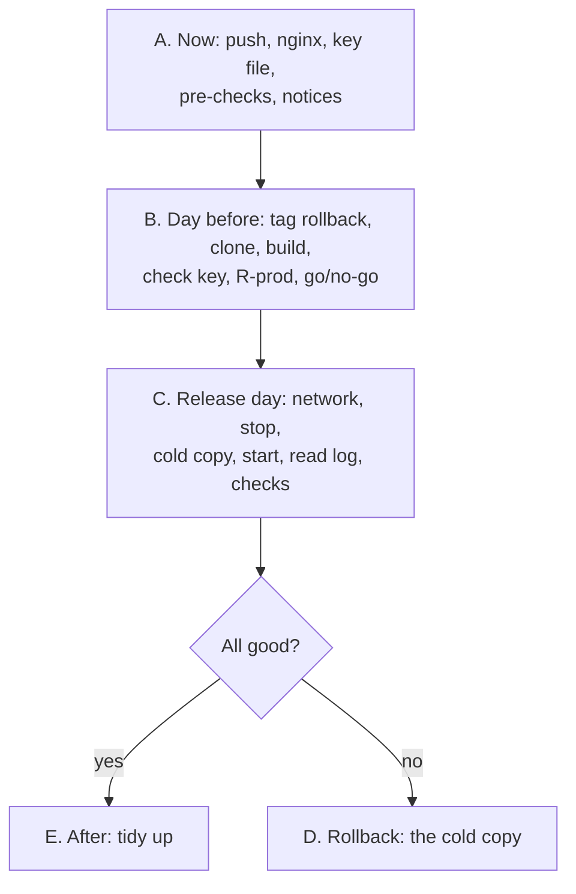

# Release Checklist: 106ea45 to 4ce25de

The owner's task list, in order. Live runs **106ea45** on EFL-CON-02; the release commit is **4ce25de**.
Host commands run as root. Full detail for every step: [deployment.md, Releasing Everything Since
106ea45](deployment.md#releasing-everything-since-106ea45-cards-3046-3064).



## A. Now (any day before)

### A1. Push the release (PC)

```
git -C C:\Users\boong\source\repos\DumpFire push origin main
```

Why: the host clones from GitHub. A fast-forward from 332634f.

### A2. nginx changes (host, quiet moment)

Copy `default.conf.new` and `default.conf.live` from the tested nginx kit to `/home/itsupport/nginx/`.

```bash
cd /home/itsupport/nginx
diff default.conf default.conf.live && echo ok        # must print only "ok"
cp -p default.conf default.conf.bak-$(date +%F)
cat default.conf.new > default.conf                    # in place: keeps the mounted file
docker exec nginx-proxy grep -c dumpfire_masked /etc/nginx/conf.d/default.conf   # 8
docker exec nginx-proxy nginx -t && docker exec nginx-proxy nginx -s reload
```

Why: no 502s after the swap, uploads above 1 MB, link secrets masked in the log, real visitor
addresses. Safe on today's live.
Undo: `cat default.conf.bak-YYYY-MM-DD > default.conf`, then `nginx -t` and reload.

### A3. MFA key file and cold-copy passphrase (host)

```bash
install -d -m 700 /home/itsupport/.secrets
( umask 077 && openssl rand -hex 32 > /home/itsupport/.secrets/dumpfire_mfa_key )
( umask 077 && openssl rand -base64 48 > /home/itsupport/.secrets/dumpfire_cold_pass )
cat /home/itsupport/.secrets/dumpfire_mfa_key /home/itsupport/.secrets/dumpfire_cold_pass   # copy BOTH into the password manager now
chown 1000:1000 /home/itsupport/.secrets/dumpfire_mfa_key
stat -c '%a %u %s %n' /home/itsupport/.secrets/*        # 600 1000 65 …mfa_key ; 600 0 65 …cold_pass
```

Why: the new version will not start without the key; the passphrase encrypts the rollback copy.
Never lose the key.

### A4. Read-only pre-checks (host, 2 to 3 working days before)

```bash
c=dumpfire
q() { docker exec "$c" node -e "const D=require('better-sqlite3');const d=new D(process.env.DB_PATH||'/app/data/dumpfire.db',{readonly:true,fileMustExist:true});console.log(JSON.stringify(d.prepare(process.argv[1]).all()))" "$1"; }
```

Then run **P1, P2, P3, P-new-1 to P-new-4, P8, P16, P17** and the **P-new-3 query block**, exactly as
[Before the Release](deployment.md#before-the-release-owner-read-only) gives them.

Why: confirms live is what was tested, and gives the counts for the notices and the ISO risk register.
Stop if: an unknown administrator or CRITICAL line, a second volume, or a webhook whose events already
name a decision event.

### A5. Notices (two working days before; a quiet weekday morning, not a Friday)

Texts under "Notices" in the runbook:

1. Everyone: a short outage; reload open tabs afterwards; nobody is signed out.
2. API key holders: the time and the 1.15.1 change list.
3. Board owners listed by the two 2752 queries: their webhooks are switched off.

## B. The day before

### B1. Tag the way back, clone, build (host)

```bash
docker tag "$(docker inspect -f '{{.Image}}' dumpfire)" dumpfire:rollback
url=$(git -C /home/itsupport/DumpFire remote get-url origin)
mv /home/itsupport/DumpFire /home/itsupport/DumpFire-5478f58
git clone "$url" /home/itsupport/DumpFire
git -C /home/itsupport/DumpFire checkout --detach 4ce25de
```

Write `/home/itsupport/DumpFire/docker-compose.yml` exactly as:

```yaml
services:
  dumpfire:
    build: .
    container_name: dumpfire
    init: true
    stop_grace_period: 30s
    environment:
      - DB_PATH=/app/data/dumpfire.db
      - ORIGIN=https://dumpfire.elecfron.com
      - MFA_KEY_FILE=/run/secrets/dumpfire_mfa_key
      - ADDRESS_HEADER=X-Forwarded-For
      - XFF_DEPTH=1
      - IMAGE_RETENTION_DAYS=off
    volumes:
      - dumpfire-data:/app/data
      - type: bind
        source: /home/itsupport/.secrets/dumpfire_mfa_key
        target: /run/secrets/dumpfire_mfa_key
        read_only: true
        bind:
          create_host_path: false
    restart: unless-stopped
    logging:
      driver: json-file
      options:
        max-size: "10m"
        max-file: "5"
    networks:
      - dumpfire_edge
      - default

volumes:
  dumpfire-data:

networks:
  dumpfire_edge:
    external: true
```

```bash
cd /home/itsupport/DumpFire
docker compose -p dumpfire config | grep -A2 '^volumes:'      # name: dumpfire_dumpfire-data
docker compose -p dumpfire build                              # runs the test suite; live keeps running
docker tag dumpfire-dumpfire:latest dumpfire:candidate
```

Why: the old checkout and image stay as the way back; the same path keeps the same volume.
Never use `update-dumpfire.sh` for this release.

### B2. The new image reads the key

```bash
docker run --rm --user 1000:1000 --entrypoint sh \
  --mount type=bind,source=/home/itsupport/.secrets/dumpfire_mfa_key,target=/run/secrets/dumpfire_mfa_key,readonly \
  dumpfire:candidate -c 'stat -c "%a %u" /run/secrets/dumpfire_mfa_key && tr -d "\n" < /run/secrets/dumpfire_mfa_key | wc -c'
# 600 1000   then   64
```

### B3. R-prod: rehearse on a copy of live

Follow "R-prod" in the runbook (copy by `VACUUM INTO` as
[Rehearsing an Update Against a Copy](deployment.md#rehearsing-an-update-against-a-copy) says, start
`dumpfire:candidate` on it with no network and a scratch key, time it to `Listening on`, then delete the
copy). Write down the seconds.

Why: live's real first-start time; C5 waits that long plus half (at least two minutes).

### B4. Go/no-go

All 12 lines of [Go/No-Go](deployment.md#gono-go) say go.

## C. Release day

### C1. Private network and log rotation (L0)

```bash
docker network create --internal dumpfire_edge
docker network connect dumpfire_edge dumpfire
```

In `/home/itsupport/nginx/docker-compose.yml`, the `nginx-proxy` service gains:

```yaml
    networks:
      - proxy_net
      - dumpfire_edge
    logging:
      driver: json-file
      options:
        max-size: "10m"
        max-file: "5"
# and at the top level:
networks:
  proxy_net:
    external: true
  dumpfire_edge:
    external: true
```

```bash
cd /home/itsupport/nginx && docker compose up -d --force-recreate
docker exec nginx-proxy nginx -t
```

Then sign in and open a board.

### C2. Re-checks (L2)

Run the P-new-3 query block again; keep the two 2752 lists.

### C3. Stop the old server (L3)

```bash
cd /home/itsupport/DumpFire && docker compose -p dumpfire stop -t 30 dumpfire   # ends in a kill at 30 s: expected
```

### C4. Cold copy, then the volume handed to the new user (L4)

```bash
set -o pipefail
docker volume inspect dumpfire_dumpfire-data -f '{{.Name}} {{.Mountpoint}}'
docker volume ls --format '{{.Name}}' | grep -x 'dumpfire-data' && echo 'STRAY VOLUME: stop' || true
install -d -m 700 /root/dumpfire-cold
docker run --rm --user root --entrypoint tar -v dumpfire_dumpfire-data:/app/data:ro dumpfire:rollback -C /app/data -cf - . \
  | gpg --batch --yes --symmetric --cipher-algo AES256 \
      --passphrase-file /home/itsupport/.secrets/dumpfire_cold_pass -o /root/dumpfire-cold/dumpfire-data-0060.tar.gpg \
  && echo 'cold copy written'
gpg --batch --decrypt --passphrase-file /home/itsupport/.secrets/dumpfire_cold_pass \
    /root/dumpfire-cold/dumpfire-data-0060.tar.gpg \
  | tar -tvf - \
  | awk '$1 ~ /^-/ { size = $3; sub(/^[^ ]+ +[^ ]+ +[^ ]+ +[^ ]+ +[^ ]+ +\.\//, ""); print size, $0 }' \
  | sort > /tmp/cold-copy.list && echo 'cold copy reads back to its end'
docker run --rm --user root -v dumpfire_dumpfire-data:/app/data:ro --entrypoint find dumpfire:rollback \
  /app/data -type f -printf '%s %P\n' | sort > /tmp/volume.list
diff /tmp/volume.list /tmp/cold-copy.list && echo 'cold copy matches the volume: every file, every size'
rm /tmp/cold-copy.list /tmp/volume.list
docker run --rm --user root -v dumpfire_dumpfire-data:/app/data --entrypoint chown dumpfire:rollback -R 1000:1000 /app/data
docker run --rm --user 1000:1000 -v dumpfire_dumpfire-data:/app/data --entrypoint sh dumpfire:candidate \
  -c 'touch /app/data/.write-test && rm /app/data/.write-test && echo writable'
```

Go on only with `cold copy written`, `cold copy reads back to its end`, `cold copy matches the volume`
and `writable`. Otherwise take the copy again (nothing has changed yet).

### C5. Start the new version (L5)

```bash
docker compose -p dumpfire up -d dumpfire && docker logs -f dumpfire
```

On any failure (it exits, a stop line, or no `Listening on` within B3's time plus half):
`docker compose -p dumpfire stop dumpfire` **at once**, then section D.

### C6. Reload nginx (L5b)

```bash
docker exec nginx-proxy nginx -t && docker exec nginx-proxy nginx -s reload
```

### C7. Read the first-start log (L6)

```bash
docker logs dumpfire 2>&1 | grep -E '\] \[(DB|STARTUP|AUTH|Webhooks|REPORTS|UPLOADS|BACKUP|REQUESTS)\] |^\[(STARTUP|LOGGER)\] |Listening on'
docker logs dumpfire 2>&1 | grep -E '\[(ERROR|CRITICAL)\]'      # only the key-change CRITICAL is expected
```

Expect: 24 `Applied migration` lines (0061 to 0084), the Sealed line, the Key change line saying
"kept, sealed in place", **`Scrubbed the old plain text`**, `Listening on`. Any stop line from the
runbook's L6 list: section D.

### C8. First backup (L7)

Admin → Scheduled Backups → ▶ Run Now, then the seal check in the runbook's "L7, the seal checked after
the release".

### C9. Tell everyone to reload open tabs (L8)

### C10. Live checks (L9)

- `docker exec dumpfire id` is `uid=1000(node)`; `ADDRESS_HEADER`, `XFF_DEPTH`, `MFA_KEY_FILE` set.
- A person signed in before is still signed in after a reload.
- An existing key: `curl -H "Authorization: Bearer <key>" https://dumpfire.elecfron.com/api/v1/boards` is `200`; `/api/v1/openapi.json` says `1.15.1`.
- An old invite and an old requester reply link open.
- A webhook that was delivering delivers the next event.
- A 2 MB attachment uploads.
- After opening a reply link, `docker logs nginx-proxy 2>&1 | grep -Ec 'token=[0-9a-f]{8}'` is `0`.
- Admin → Two-step sign-in says "not required".

## D. Rollback (only if needed, after C5)

```bash
docker compose -p dumpfire stop dumpfire
docker run --rm --user root -v dumpfire_dumpfire-data:/app/data --entrypoint sh dumpfire:rollback -c 'find /app/data -mindepth 1 -delete'
gpg --batch --decrypt --passphrase-file /home/itsupport/.secrets/dumpfire_cold_pass /root/dumpfire-cold/dumpfire-data-0060.tar.gpg \
  | docker run --rm -i --user root -v dumpfire_dumpfire-data:/app/data --entrypoint tar dumpfire:rollback -C /app/data -xpf -
docker tag dumpfire:rollback dumpfire-dumpfire
cd /home/itsupport/DumpFire-5478f58 && docker compose -p dumpfire up -d --no-build dumpfire
docker exec nginx-proxy nginx -s reload
```

Why: live exactly as it was at C3. Anything done between the swap and the rollback is lost; tell
everyone. If it failed before C5 started anything, only the last three lines are needed.

Coming forward again: see "Coming forward again" in the runbook (retag the candidate, a new cold copy
with the old one moved aside first, then the chown).

## E. After

| When | Do |
|---|---|
| Same day | `docker exec dumpfire rm -f /app/data/.pre-restore-safety.json`; confirm each SFTP destination's host key |
| Within a day | Regenerate any Slack, Teams or Discord webhook addresses |
| Once known good | Replace `/home/itsupport/update-dumpfire.sh` with the runbook's new script; rename (do not delete) `/home/itsupport/DumpFire-5478f58` |
| Go/no-go + 14 days | `shred -u /root/dumpfire-cold/dumpfire-data-0060.tar.gpg` |
