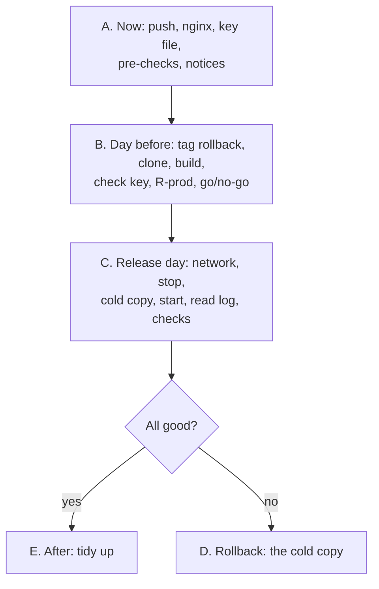

# Release Checklist: 106ea45 to 4ce25de

The owner's task list, in order. Live runs **106ea45** on EFL-CON-02; the release commit is **4ce25de**.
Host commands run as root. Full detail for every step: [deployment.md, Releasing Everything Since
106ea45](deployment.md#releasing-everything-since-106ea45-cards-3046-3064).



## A. Now (any day before)

### A1. Push the release (PC)

```
git -C C:\Users\boong\source\repos\DumpFire push origin main
```

Why: the host clones from GitHub. A fast-forward from 332634f.

### A2. nginx changes (host, quiet moment)

Copy `default.conf.new` and `default.conf.live` from the tested nginx kit to `/home/itsupport/nginx/`.

```bash
cd /home/itsupport/nginx
diff default.conf default.conf.live && echo ok        # must print only "ok"
cp -p default.conf default.conf.bak-$(date +%F)
cat default.conf.new > default.conf                    # in place: keeps the mounted file
docker exec nginx-proxy grep -c dumpfire_masked /etc/nginx/conf.d/default.conf   # 8
docker exec nginx-proxy nginx -t && docker exec nginx-proxy nginx -s reload
```

Why: no 502s after the swap, uploads above 1 MB, link secrets masked in the log, real visitor
addresses. Safe on today's live.
Undo: `cat default.conf.bak-YYYY-MM-DD > default.conf`, then `nginx -t` and reload.

### A3. MFA key file and cold-copy passphrase (host)

```bash
install -d -m 700 /home/itsupport/.secrets
( umask 077 && openssl rand -hex 32 > /home/itsupport/.secrets/dumpfire_mfa_key )
( umask 077 && openssl rand -base64 48 > /home/itsupport/.secrets/dumpfire_cold_pass )
cat /home/itsupport/.secrets/dumpfire_mfa_key /home/itsupport/.secrets/dumpfire_cold_pass   # copy BOTH into the password manager now
chown 1000:1000 /home/itsupport/.secrets/dumpfire_mfa_key
stat -c '%a %u %s %n' /home/itsupport/.secrets/*        # 600 1000 65 …mfa_key ; 600 0 65 …cold_pass
```

Why: the new version will not start without the key; the passphrase encrypts the rollback copy.
Never lose the key.

### A4. Read-only pre-checks (host, 2 to 3 working days before)

```bash
c=dumpfire
q() { docker exec "$c" node -e "const D=require('better-sqlite3');const d=new D(process.env.DB_PATH||'/app/data/dumpfire.db',{readonly:true,fileMustExist:true});console.log(JSON.stringify(d.prepare(process.argv[1]).all()))" "$1"; }
```

Then paste each block below. Nothing here writes anything. Why: confirms live is what was tested,
and gives the counts for the notices and the ISO risk register. Keep the output (paste it to Claude).

**P1. Live's version, user and settings.**

```bash
q "SELECT hash FROM __drizzle_migrations ORDER BY id DESC LIMIT 1"
docker exec $c id
for v in ORIGIN DB_PATH MFA_KEY_FILE APP_URL ADDRESS_HEADER; do docker exec $c printenv $v || echo "$v unset"; done
```

Expect `0060_add_upstream_options.sql`; `uid=0(root)`; `https://dumpfire.elecfron.com`,
`/app/data/dumpfire.db`, then `MFA_KEY_FILE unset`, `APP_URL unset`, `ADDRESS_HEADER unset`.
Stop if: any other migration.

**P2. Only one DumpFire container.**

```bash
docker ps -a --format '{{.Names}} {{.Image}} {{.Status}}'
```

Expect one `dumpfire`. Stop if: a second DumpFire instance on the volume.

**P3. Critical log lines and administrators.**

```bash
q "SELECT timestamp, message FROM system_logs WHERE level = 'CRITICAL' ORDER BY id"
q "SELECT id, username, email, role, created_at FROM users WHERE role IN ('superadmin','admin') ORDER BY role, id"
```

Expect every CRITICAL line one you recognise, every administrator one you know, each email a mailbox
that person reads. Stop if: anything unknown (treat the server as compromised; do not deploy).

**P-new-1. Compose facts.**

```bash
git -C /home/itsupport/DumpFire status --porcelain --ignored
ls -la /home/itsupport/DumpFire
( cd /home/itsupport/DumpFire && docker compose -p dumpfire config )
docker volume ls | grep dumpfire
docker inspect dumpfire -f '{{.Config.Image}} {{.Image}}'
gpg --version | head -1
```

Expect only `?? docker-compose.yml` untracked; `config` shows `ORIGIN` and volume
`dumpfire_dumpfire-data`; that one volume only; gpg answers. Stop if: a second DumpFire volume, or no
gpg. Any other Compose input (an `.env`) is copied in B1.

**P-new-2. App URL.**

```bash
q "SELECT value FROM settings WHERE key = 'app_url'"
```

Expect `https://dumpfire.elecfron.com` (checked 2026-11-24): `APP_URL` stays unset.

**P-new-3. What will be kept, counted.**

```bash
# Sessions, unused invites and requester links kept.
q "SELECT (SELECT COUNT(*) FROM sessions) AS sessions, (SELECT COUNT(*) FROM invite_tokens WHERE used = 0) AS unused_invites, (SELECT COUNT(*) FROM task_requests WHERE access_token IS NOT NULL AND access_token <> '') AS requests_with_link"
# API keys.
q "SELECT COUNT(*) AS api_keys, SUM(expires_at IS NULL) AS no_expiry, SUM(last_used_at IS NOT NULL) AS used FROM api_keys"
# Webhooks by state (active 0 + no_setter 1 is the count C7's 2923 line holds).
q "SELECT active, set_by IS NULL AS no_setter, secret <> '' AS has_secret, COUNT(*) AS n FROM webhooks GROUP BY 1, 2, 3"
# Expect NO rows: a webhook already naming a decision event.
q "SELECT id, board_id, active, events FROM webhooks WHERE events LIKE '%decision%'"
# Webhooks made before 0056 (compare the two by eye).
q "SELECT created_at FROM __drizzle_migrations WHERE hash = '0056_add_webhook_set_by.sql'"
q "SELECT id, board_id, created_at FROM webhooks WHERE secret <> '' ORDER BY created_at"
# 2752, list 1: on, with no setter (switched off at the first start; owners mailed).
q "SELECT w.id, w.board_id, b.name AS board FROM webhooks w JOIN boards b ON b.id = w.board_id WHERE w.active = 1 AND (w.set_by IS NULL OR NOT EXISTS (SELECT 1 FROM users u WHERE u.id = w.set_by)) ORDER BY w.board_id, w.id"
# 2752, list 2: on, with a setter who cannot open the board (switched off too).
q "SELECT w.id, w.board_id, b.name AS board, u.username AS setter FROM webhooks w JOIN boards b ON b.id = w.board_id JOIN users u ON u.id = w.set_by WHERE w.active = 1 AND u.role NOT IN ('admin', 'superadmin') AND (b.created_by IS NULL OR b.created_by <> u.id) AND b.is_public = 0 AND NOT EXISTS (SELECT 1 FROM board_members m WHERE m.board_id = b.id AND m.user_id = u.id) AND NOT EXISTS (SELECT 1 FROM board_teams bt JOIN team_members tm ON tm.team_id = bt.team_id WHERE bt.board_id = b.id AND tm.user_id = u.id) ORDER BY w.board_id, w.id"
# Signing keys' lengths (never values): seal key 64 + hex means "kept, sealed in place" at C7.
q "SELECT key, length(value) AS len, value NOT GLOB '*[^0-9a-f]*' AS hex FROM settings WHERE key IN ('backup_seal_key', 'request_form_secret', 'known_browser_secret')"
# Rows whose created_at names no moment: expect 0 in each.
q "SELECT 'users' AS t, COUNT(*) AS n FROM users WHERE datetime(created_at) IS NULL UNION ALL SELECT 'boards', COUNT(*) FROM boards WHERE datetime(created_at) IS NULL UNION ALL SELECT 'teams', COUNT(*) FROM teams WHERE datetime(created_at) IS NULL UNION ALL SELECT 'webhooks', COUNT(*) FROM webhooks WHERE datetime(created_at) IS NULL UNION ALL SELECT 'report_schedules', COUNT(*) FROM report_schedules WHERE datetime(created_at) IS NULL"
# Image attachments (not checked at this release).
q "SELECT COUNT(*) AS images FROM card_attachments WHERE mime_type LIKE 'image/%'"
# Enabled report schedules: an administrator confirms each one.
q "SELECT u.username, u.email, s.id, s.name, s.scope, s.scope_id, s.recipients FROM report_schedules s JOIN users u ON u.id = s.user_id WHERE s.enabled = 1 ORDER BY u.username, s.id"
# OneDrive backup history.
q "SELECT status, substr(error, 1, 120) AS error, created_at FROM backup_log WHERE destination_type = 'onedrive' ORDER BY id DESC LIMIT 10"
```

Stop if: any `created_at` count above 0, or any row from the decision-event query. Keep the two 2752
lists: they are the board owners you notify (A5) and what C7 must match.

Also, by hand: any **S3** destination with more than 1,000 objects under its prefix (copy older ones
aside or raise Keep Last); any **Google Drive** destination with a service account JSON (C7 then shows
"Rewrote the service account JSON"); any **OneDrive** destination (it pauses until re-entered).

**P-new-4. Nothing in front of nginx.**

```bash
docker logs --tail 500 nginx-proxy 2>/dev/null | awk '{ print $1 }' | sort | uniq -c
docker logs --tail 500 nginx-proxy 2>/dev/null | awk -F'"' 'NF == 9 { print $8 }' | sort | uniq -c
docker exec nginx-proxy grep -n 'X-Forwarded-For' /etc/nginx/conf.d/default.conf
```

Expect the first list to be callers' own addresses (10.1.10.x, or remote callers you know), never a
CDN's; the second, `-` only; the grep, three lines, DumpFire's reading `$remote_addr` (after A2).
Stop if: a CDN's addresses (then `XFF_DEPTH=2`: ask first).

**P8. Mail works.** Admin → 📧 Email / SMTP: send a test mail to the superadmin's address and to each
administrator's from P3. Each must arrive.

**P16. Disk space.**

```bash
docker exec $c df -h /app/data
docker exec $c ls -l /app/data/dumpfire.db /app/data/dumpfire.db-wal
```

Expect free space above 1 GB + 2 × the database + 25 MB.

**P17. Key and user id headroom.**

```bash
q "SELECT max(coalesce((SELECT seq FROM sqlite_sequence WHERE name='api_keys'),0), coalesce((SELECT max(id) FROM api_keys),0)) - (SELECT COUNT(*) FROM api_keys) AS key_seed_rows"
q "SELECT max(coalesce((SELECT seq FROM sqlite_sequence WHERE name='users'),0), coalesce((SELECT max(id) FROM users),0)) - (SELECT COUNT(*) FROM users) AS user_seed_rows"
```

Expect both far under 1,000,000. Stop if: either at or above it.

### A5. Notices (two working days before; a quiet weekday morning, not a Friday)

Texts under "Notices" in the runbook:

1. Everyone: a short outage; reload open tabs afterwards; nobody is signed out.
2. API key holders: the time and the 1.15.1 change list.
3. Board owners listed by the two 2752 queries: their webhooks are switched off.

## B. The day before

### B1. Tag the way back, clone, build (host)

```bash
docker tag "$(docker inspect -f '{{.Image}}' dumpfire)" dumpfire:rollback
url=$(git -C /home/itsupport/DumpFire remote get-url origin)
mv /home/itsupport/DumpFire /home/itsupport/DumpFire-5478f58
git clone "$url" /home/itsupport/DumpFire
git -C /home/itsupport/DumpFire checkout --detach 4ce25de
```

Write `/home/itsupport/DumpFire/docker-compose.yml` exactly as:

```yaml
services:
  dumpfire:
    build: .
    container_name: dumpfire
    init: true
    stop_grace_period: 30s
    environment:
      - DB_PATH=/app/data/dumpfire.db
      - ORIGIN=https://dumpfire.elecfron.com
      - MFA_KEY_FILE=/run/secrets/dumpfire_mfa_key
      - ADDRESS_HEADER=X-Forwarded-For
      - XFF_DEPTH=1
      - IMAGE_RETENTION_DAYS=off
    volumes:
      - dumpfire-data:/app/data
      - type: bind
        source: /home/itsupport/.secrets/dumpfire_mfa_key
        target: /run/secrets/dumpfire_mfa_key
        read_only: true
        bind:
          create_host_path: false
    restart: unless-stopped
    logging:
      driver: json-file
      options:
        max-size: "10m"
        max-file: "5"
    networks:
      - dumpfire_edge
      - default

volumes:
  dumpfire-data:

networks:
  dumpfire_edge:
    external: true
```

```bash
cd /home/itsupport/DumpFire
docker compose -p dumpfire config | grep -A2 '^volumes:'      # name: dumpfire_dumpfire-data
docker compose -p dumpfire build                              # runs the test suite; live keeps running
docker tag dumpfire-dumpfire:latest dumpfire:candidate
```

Why: the old checkout and image stay as the way back; the same path keeps the same volume.
Never use `update-dumpfire.sh` for this release.

### B2. The new image reads the key

```bash
docker run --rm --user 1000:1000 --entrypoint sh \
  --mount type=bind,source=/home/itsupport/.secrets/dumpfire_mfa_key,target=/run/secrets/dumpfire_mfa_key,readonly \
  dumpfire:candidate -c 'stat -c "%a %u" /run/secrets/dumpfire_mfa_key && tr -d "\n" < /run/secrets/dumpfire_mfa_key | wc -c'
# 600 1000   then   64
```

### B3. R-prod: rehearse on a copy of live (host, after B1 and B2)

Why: proves the new image migrates **live's real data** cleanly and keeps what it should, and gives
live's real first-start time (C5 waits that long plus half, at least two minutes). Live keeps running
throughout; the copy runs with **no network**, so it can send no mail, webhook or backup.

> The copy holds password hashes, session tokens and secrets: keep it in `/root`, never on shared
> storage, and delete it at the end of this step.

**B3.1 Take the copy and a scratch key.**

```bash
mkdir -p /root/dumpfire-rehearsal && chmod 700 /root/dumpfire-rehearsal && cd /root/dumpfire-rehearsal
docker exec dumpfire node -e "
const Database = require('better-sqlite3');
const live = new Database(process.env.DB_PATH || 'dumpfire.db', { readonly: true });
live.prepare('VACUUM INTO ?').run('/tmp/rehearsal.db');
console.log(new Database('/tmp/rehearsal.db', { readonly: true }).pragma('integrity_check', { simple: true }));
"                                                   # prints: ok
mkdir -p r1
docker cp dumpfire:/tmp/rehearsal.db r1/dumpfire.db
docker exec dumpfire rm /tmp/rehearsal.db
( umask 077 && openssl rand -hex 32 > rehearsal_mfa_key )
chown -R 1000:1000 r1 rehearsal_mfa_key             # the new image runs as uid 1000
```

Live has no authenticators yet, so a scratch key works. Never mount the real key here.

**B3.2 Helpers** (paste once, in that folder):

```bash
rehearse() {      # rehearse <container name> <image> <directory>
  docker run -d --name "$1" --network none \
    -v "$PWD/$3:/rehearsal" -e DB_PATH=/rehearsal/dumpfire.db -e SCHEDULERS=off \
    --mount type=bind,source="$PWD/rehearsal_mfa_key",target=/run/secrets/dumpfire_mfa_key,readonly \
    -e MFA_KEY_FILE=/run/secrets/dumpfire_mfa_key "$2"
}
counts() {        # counts <directory>: what was kept, read without starting the server
  docker run --rm --network none -v "$PWD/$1:/rehearsal" --entrypoint node dumpfire:candidate -e "
const db = require('better-sqlite3')('/rehearsal/dumpfire.db', { readonly: true });
const one = (sql) => { try { return JSON.stringify(db.prepare(sql).all()); } catch (e) { return 'n/a (' + e.message + ')'; } };
console.log('migrations      ', one('SELECT COUNT(*) AS n, MAX(hash) AS last FROM __drizzle_migrations'));
console.log('sessions        ', one('SELECT COUNT(*) AS n FROM sessions'));
console.log('sessions kept   ', one('SELECT COUNT(*) AS n FROM sessions WHERE kept_at_release = 1'));
console.log('requester links ', one('SELECT COUNT(*) AS n FROM request_links'));
console.log('api keys        ', one('SELECT COUNT(*) AS n, SUM(deadline_at IS NULL) AS no_deadline FROM api_keys'));
console.log('two-step switch ', one(\"SELECT key FROM settings WHERE key IN ('two_step_required_at','two_step_released_at','api_key_deadline')\"));
console.log('fk violations   ', db.pragma('foreign_key_check').length);
"
}
```

**B3.3 Before.**

```bash
counts r1
```

Expect `migrations … last 0060_add_upstream_options.sql`, `sessions 4`, and `n/a` for the lines whose
tables or columns do not exist yet. Keep this output.

**B3.4 First start, timed.**

```bash
t0=$(date +%s)
rehearse df-new dumpfire:candidate r1
until docker logs df-new 2>&1 | grep -q 'Listening on'; do
  [ "$(docker inspect -f '{{.State.Running}}' df-new)" = true ] || { echo 'EXITED'; break; }; sleep 1
done
echo "R-prod: $(( $(date +%s) - t0 )) s to Listening on"           # WRITE THIS DOWN
docker logs df-new 2>&1 | grep -E '\] \[(DB|STARTUP|AUTH|Webhooks|REPORTS|UPLOADS|BACKUP|REQUESTS)\] |^\[(STARTUP|LOGGER)\] |Listening on'
docker logs df-new 2>&1 | grep -E '\[(ERROR|CRITICAL)\]'
docker rm -f df-new
```

Expect:

- 24 `Applied migration` lines, `0061_…` to `0084_compatibility_release.sql`, in order;
- the `Sealed N stored secret(s)` line;
- `[CRITICAL] [STARTUP] Key change recorded`, the seal key **"kept, sealed in place"** (the only
  CRITICAL expected);
- **`Scrubbed the old plain text from the database file`**;
- one `[WARN] [SCHEDULERS]` line saying they are off (expected here only);
- `Listening on`.

Stop if: `EXITED`, any other `[ERROR]` or `[CRITICAL]`, the Scrubbed line missing, or any of these:
`Ended N session(s)`, `Ended N invite(s)`, `Ended the links of`, `now held`, `set up before API keys`,
`Report schedule … is on at this release`, `Checked the … images`. Send Claude the output.

**B3.5 After.**

```bash
counts r1
```

Expect `migrations` 24 higher than B3.3, last `0084_compatibility_release.sql`; `sessions 4` and `sessions kept 4` (nobody
signed out); `requester links 11` (P-new-3's count: every link kept); `api keys 2` with
`no_deadline 2`; `two-step switch []` (dormant, no deadline); `fk violations 0`. Stop if any differs.

**B3.6 Second start: nothing left to do.**

```bash
rehearse df-new dumpfire:candidate r1
sleep 15; docker logs df-new 2>&1 | grep -E '\] \[DB\] |Applied migration|Listening on'
docker rm -f df-new
```

Expect `Listening on` and no `Applied migration` line.

**B3.7 Delete the copy.**

```bash
cd /root && rm -rf /root/dumpfire-rehearsal
```

### B4. Go/no-go (the evening before; every line must be yes)

- [ ] 1. B1: the build passed its tests; `dumpfire:candidate` and `dumpfire:rollback` both exist
  (`docker image ls dumpfire`).
- [ ] 2. B3: R-prod passed; seconds written down. (The local rehearsal on fabricated data already
  passed.)
- [ ] 3. P1 at `0060`; P2 one container; P3 every CRITICAL line and administrator known.
- [ ] 4. P-new-1 one volume `dumpfire_dumpfire-data`; P-new-2 `APP_URL` unset; P-new-4 nothing in
  front of nginx.
- [ ] 5. P-new-3 run (counts sent to Claude for the risk register); every enabled report schedule
  confirmed (there are none).
- [ ] 6. P8 test mail reached the superadmin and every administrator; P16 and P17 within bounds.
- [ ] 7. A5 notices sent at least two working days before.
- [ ] 8. A2 nginx in: `docker exec nginx-proxy grep -c dumpfire_masked /etc/nginx/conf.d/default.conf`
  is `8` and `nginx -t` passes.
- [ ] 9. A3 key file `600 1000 65`, passphrase `600`, both in the password manager; B2 printed
  `600 1000` and `64`.
- [ ] 10. The compose file exactly as B1; `docker compose -p dumpfire config` names
  `dumpfire_dumpfire-data`.
- [ ] 11. This checklist's section D printed or open beside the terminal; `/home/itsupport/DumpFire-5478f58`
  exists.
- [ ] 12. You are free for two hours after the start and the next morning.

Any "no": do not release; move the window and tell everyone.

## C. Release day

### C1. Private network and log rotation (L0)

```bash
docker network create --internal dumpfire_edge
docker network connect dumpfire_edge dumpfire
```

In `/home/itsupport/nginx/docker-compose.yml`, the `nginx-proxy` service gains:

```yaml
    networks:
      - proxy_net
      - dumpfire_edge
    logging:
      driver: json-file
      options:
        max-size: "10m"
        max-file: "5"
# and at the top level:
networks:
  proxy_net:
    external: true
  dumpfire_edge:
    external: true
```

```bash
cd /home/itsupport/nginx && docker compose up -d --force-recreate
docker exec nginx-proxy nginx -t
```

Then sign in and open a board.

### C2. Re-checks (L2)

Run the P-new-3 query block again; keep the two 2752 lists.

### C3. Stop the old server (L3)

```bash
cd /home/itsupport/DumpFire && docker compose -p dumpfire stop -t 30 dumpfire   # ends in a kill at 30 s: expected
```

### C4. Cold copy, then the volume handed to the new user (L4)

```bash
set -o pipefail
docker volume inspect dumpfire_dumpfire-data -f '{{.Name}} {{.Mountpoint}}'
docker volume ls --format '{{.Name}}' | grep -x 'dumpfire-data' && echo 'STRAY VOLUME: stop' || true
install -d -m 700 /root/dumpfire-cold
docker run --rm --user root --entrypoint tar -v dumpfire_dumpfire-data:/app/data:ro dumpfire:rollback -C /app/data -cf - . \
  | gpg --batch --yes --symmetric --cipher-algo AES256 \
      --passphrase-file /home/itsupport/.secrets/dumpfire_cold_pass -o /root/dumpfire-cold/dumpfire-data-0060.tar.gpg \
  && echo 'cold copy written'
gpg --batch --decrypt --passphrase-file /home/itsupport/.secrets/dumpfire_cold_pass \
    /root/dumpfire-cold/dumpfire-data-0060.tar.gpg \
  | tar -tvf - \
  | awk '$1 ~ /^-/ { size = $3; sub(/^[^ ]+ +[^ ]+ +[^ ]+ +[^ ]+ +[^ ]+ +\.\//, ""); print size, $0 }' \
  | sort > /tmp/cold-copy.list && echo 'cold copy reads back to its end'
docker run --rm --user root -v dumpfire_dumpfire-data:/app/data:ro --entrypoint find dumpfire:rollback \
  /app/data -type f -printf '%s %P\n' | sort > /tmp/volume.list
diff /tmp/volume.list /tmp/cold-copy.list && echo 'cold copy matches the volume: every file, every size'
rm /tmp/cold-copy.list /tmp/volume.list
docker run --rm --user root -v dumpfire_dumpfire-data:/app/data --entrypoint chown dumpfire:rollback -R 1000:1000 /app/data
docker run --rm --user 1000:1000 -v dumpfire_dumpfire-data:/app/data --entrypoint sh dumpfire:candidate \
  -c 'touch /app/data/.write-test && rm /app/data/.write-test && echo writable'
```

Go on only with `cold copy written`, `cold copy reads back to its end`, `cold copy matches the volume`
and `writable`. Otherwise take the copy again (nothing has changed yet).

### C5. Start the new version (L5)

```bash
docker compose -p dumpfire up -d dumpfire && docker logs -f dumpfire
```

On any failure (it exits, a stop line, or no `Listening on` within B3's time plus half):
`docker compose -p dumpfire stop dumpfire` **at once**, then section D.

### C6. Reload nginx (L5b)

```bash
docker exec nginx-proxy nginx -t && docker exec nginx-proxy nginx -s reload
```

### C7. Read the first-start log (L6)

```bash
docker logs dumpfire 2>&1 | grep -E '\] \[(DB|STARTUP|AUTH|Webhooks|REPORTS|UPLOADS|BACKUP|REQUESTS)\] |^\[(STARTUP|LOGGER)\] |Listening on'
docker logs dumpfire 2>&1 | grep -E '\[(ERROR|CRITICAL)\]'      # only the key-change CRITICAL is expected
```

Expect: 24 `Applied migration` lines (0061 to 0084), the Sealed line, the Key change line saying
"kept, sealed in place", **`Scrubbed the old plain text`**, `Listening on`. Any stop line from the
runbook's L6 list: section D.

### C8. First backup (L7)

Admin → Scheduled Backups → ▶ Run Now, then the seal check in the runbook's "L7, the seal checked after
the release".

### C9. Tell everyone to reload open tabs (L8)

### C10. Live checks (L9)

- `docker exec dumpfire id` is `uid=1000(node)`; `ADDRESS_HEADER`, `XFF_DEPTH`, `MFA_KEY_FILE` set.
- A person signed in before is still signed in after a reload.
- An existing key: `curl -H "Authorization: Bearer <key>" https://dumpfire.elecfron.com/api/v1/boards` is `200`; `/api/v1/openapi.json` says `1.15.1`.
- An old invite and an old requester reply link open.
- A webhook that was delivering delivers the next event.
- A 2 MB attachment uploads.
- After opening a reply link, `docker logs nginx-proxy 2>&1 | grep -Ec 'token=[0-9a-f]{8}'` is `0`.
- Admin → Two-step sign-in says "not required".

## D. Rollback (only if needed, after C5)

```bash
docker compose -p dumpfire stop dumpfire
docker run --rm --user root -v dumpfire_dumpfire-data:/app/data --entrypoint sh dumpfire:rollback -c 'find /app/data -mindepth 1 -delete'
gpg --batch --decrypt --passphrase-file /home/itsupport/.secrets/dumpfire_cold_pass /root/dumpfire-cold/dumpfire-data-0060.tar.gpg \
  | docker run --rm -i --user root -v dumpfire_dumpfire-data:/app/data --entrypoint tar dumpfire:rollback -C /app/data -xpf -
docker tag dumpfire:rollback dumpfire-dumpfire
cd /home/itsupport/DumpFire-5478f58 && docker compose -p dumpfire up -d --no-build dumpfire
docker exec nginx-proxy nginx -s reload
```

Why: live exactly as it was at C3. Anything done between the swap and the rollback is lost; tell
everyone. If it failed before C5 started anything, only the last three lines are needed.

Coming forward again: see "Coming forward again" in the runbook (retag the candidate, a new cold copy
with the old one moved aside first, then the chown).

## E. After

| When | Do |
|---|---|
| Same day | `docker exec dumpfire rm -f /app/data/.pre-restore-safety.json`; confirm each SFTP destination's host key |
| Within a day | Regenerate any Slack, Teams or Discord webhook addresses |
| Once known good | Replace `/home/itsupport/update-dumpfire.sh` with the runbook's new script; rename (do not delete) `/home/itsupport/DumpFire-5478f58` |
| Go/no-go + 14 days | `shred -u /root/dumpfire-cold/dumpfire-data-0060.tar.gpg` |
