# Testing

DumpFire's tests run with [vitest](https://vitest.dev) against the real route
handlers and the real database schema. No dev server is started, nothing is built,
no port is opened and nothing touches `dumpfire.db` or the `uploads` folder beside
it.

```
npm test          # run everything once
npm run test:watch
npm run verify    # the same run, refusing a stray .only: what the deploy procedure and the image build run
```

`npm run verify` is `vitest run --allowOnly=false`. A test left marked `it.only` or
`describe.only` makes vitest run that test and skip every other in its file, and the run
still passes. With the flag such a file fails, with `Unexpected .only modifier`, and the
run exits 1. `npm test` leaves the choice to vitest, which allows `.only` unless the
environment variable `CI` is set: at a desk it can be used, and nothing in the image
build sets `CI`, which is why the build's command carries the flag.

The suite is 60 test files and 5,352 tests, and takes under a minute. A run that passes
reports `5352 passed`:

- **None is expected to fail.** A test of a fault that is known and not yet fixed states
  what the application should do, is run with `it.fails`, and fails the suite on the day
  the fault is put right. The last three were put right on 2026-10-15: see
  [Known Faults the Suite Records](#known-faults-the-suite-records).
- **None is skipped.** One was: the request to `GET /api/admin/export` that is let in,
  which could not be made while the handler wrote its copy beside the database, and the
  tests' database is in memory with nothing beside it. The copy of a database in memory
  goes to the temp folder now, and the request is made. On a machine with fewer than three
  CPUs, two are: the tests of `tests/password-checks.test.ts` that time the server's thread
  while two real worker threads check passwords (`it.skipIf(CPUS < 3)`, with `CPUS` from
  `os.availableParallelism()`). With fewer than three, the two threads and the test's own
  share them, and the 60 ms and 100 ms bounds could fail the image build for a fault that is
  not there; the run then reports `5342 passed | 2 skipped`, which is a pass. See
  [Deployment](deployment.md#the-suite-inside-the-image-build).

`npm run verify` is to be run before every image is built, as the quick check. The image
build runs it too: the builder stage of the `Dockerfile` runs `npm run verify` before
`npm run build`, on Linux in `node:22-slim`, and `docker build` stops with no image if a
test fails. See [Deployment](deployment.md#run-the-tests-before-you-build).

The suite was started in October 2026 after a code review found faults that only
a test would have caught: twenty different definitions of "complete", and routes
whose access check depended on a field in the request body. Every fix from that
review comes with a test that fails on the old code.

## How It Fits Together

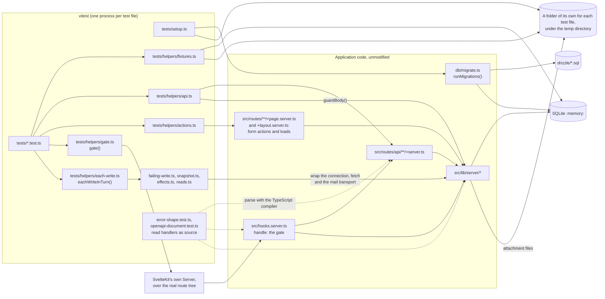

Six decisions shape everything else:

1. **The schema comes from the real migrations.** `tests/setup.ts` calls the same
   `runMigrations()` a deployment calls, against the same files in `drizzle/`. A
   hand-written test schema would keep passing while the migrations drifted. This
   way a migration that no longer applies to a fresh database fails every test.
2. **The database is in memory, and that is enforced.** `vitest.config.ts` sets
   `DB_PATH=:memory:` before any module loads, and `tests/setup.ts` refuses to run
   if `getDbPath()` returns anything else. `dumpfire.db` holds live board data.
3. **Handlers are called directly.** `api()` finds the handler for a method and URL
   in the real route tree and calls it with the caller the test supplies. That is
   the caller the handler has to defend against: `hooks.server.ts` turns an anonymous
   request away from most paths, but it does not know which board a card is on.
4. **What is around a handler is tested through the gate.** `api()` never meets
   `hooks.server.ts`, nor anything SvelteKit does around a handler. `gate()` sends a
   request through SvelteKit's own server with the real `handle` in front, so a test
   can assert the status, the content type and the body a caller is sent. See
   [The Gate Harness](#the-gate-harness).
5. **Attachment files go under the temp directory, and that is enforced too.** The
   repository's `uploads` folder holds real attachment files, and a test that deletes a
   card moves its files. `vitest.config.ts` sets `UPLOADS_DIR` to a folder under the
   operating system's temp directory, and `tests/setup.ts` refuses to run if it is unset
   or names anywhere inside the repository. `UPLOADS_DIR` exists for the tests. It is not
   a deployment setting: a deployed server keeps its uploads beside its database.
6. **Nothing reaches the network, and that is enforced as well.** A webhook is delivered
   with `fetch`, and a mail goes to a host whose address is looked up first. The
   application catches the failure of either, so a test that let one be attempted passed
   all the same, after waiting on a resolver for `smtp.example.test`. `tests/setup.ts`
   replaces `fetch` and every DNS lookup before anything runs. An attempt is refused at
   once, and the test that made it fails with `This test reached for the network: a
   fetch of https://hooks.example.test/3`, naming each address. A test that is about a
   webhook or a mail installs `effects()`, which records it and sends nothing. The image
   build relies on the same rule and adds none of its own: its test step is a plain
   `RUN npm run verify`, which Docker does not cut off from the network. See
   [Deployment](deployment.md#the-suite-inside-the-image-build).

## The List of Test Files

vitest runs the files it finds and counts them. It has no way to know that one is
missing: a build from a commit that left `tests/access-every-route.test.ts` out ran the
other 29 files and passed. So the files are listed, in `TEST_FILES` at the top of
`tests/harness.test.ts`, and a test there compares the list with every `*.test.ts` under
`tests/` on disk.

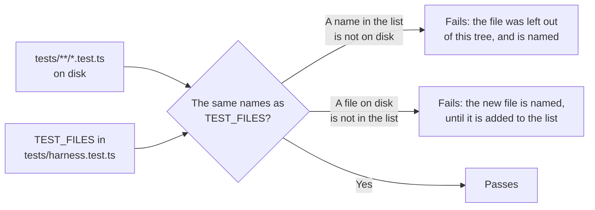

- **A new test file is added to `TEST_FILES`** in the commit that adds it. Until it is,
  the test fails and names it.
- **A test file that is deleted is taken out of the list** in the same commit.
- **The file that holds the list is watched from outside it.** A tree with no
  `tests/harness.test.ts` has no such test to fail, so `tests/setup.ts`, which runs before
  every test file, refuses to run when that file is not there: every test file then
  fails, with `tests/harness.test.ts is missing`.

## Running a Test

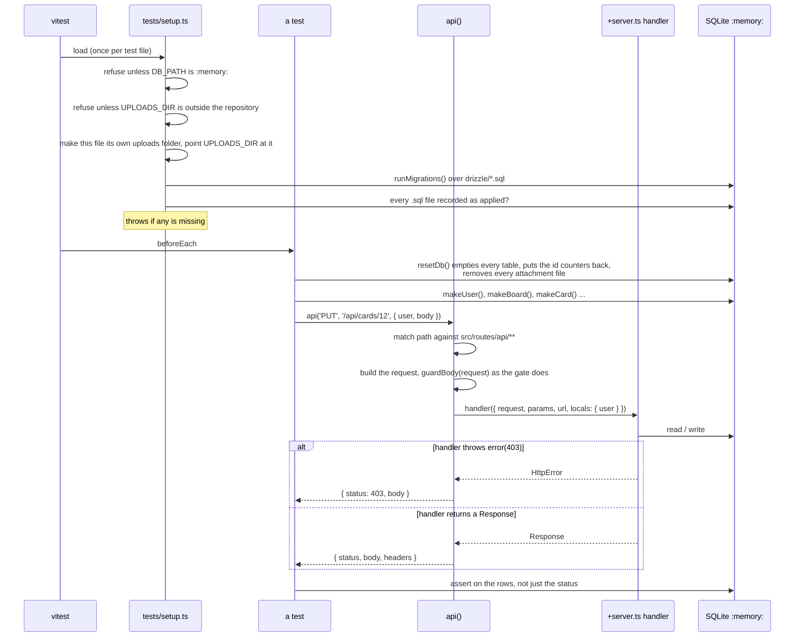

## The Pieces

| File | What it does |
|------|--------------|
| `vitest.config.ts` | Loads the SvelteKit plugin (so `$lib` resolves), sets `DB_PATH=:memory:`, `SCHEDULERS=off`, `PASSWORD_THREADS=0` (every password hashed and checked on the test's own thread a turn later, so that a test's `vi.mock('bcryptjs')` sees every call), `UPLOADS_DIR` to `dumpfire-test-uploads` under the temp directory, and `LOG_LEVEL=ERROR`, and runs each test file in its own process |
| `tests/setup.ts` | Guards against a real database and against an uploads folder inside the repository, gives the test file an uploads folder of its own and removes it afterwards, refuses every `fetch` and every DNS lookup and fails the test that attempted one, applies the migrations, fails if any did not apply |
| `tests/helpers/fixtures.ts` | `resetDb()`, `resetUploads()`, `testUploadsDir()` and builders: `makeUser`, `makeApiKey`, `makeSession`, `makeBoard`, `makeCard`, `makeSubtask`, `makeLabel`, `addBoardMember`, `makeTeam`, `shareBoardWithTeam`, `makeDependency`, `makeMilestone`, `makeComment`, `makeAttachment`, `makeSubBoard`, `assignCard`, `makeWebhook`, `makeSmtp` |
| `tests/helpers/api.ts` | `api(method, path, { user, body, headers })`, which calls a handler directly, guards the reading of its body as the gate does, and gives it the cookies of the request's `cookie` header, plus `routePatterns()`, `routeMethods()` and `serverFilesNotServed()` for tests that walk the whole route tree. The tree is read from `src/routes` on disk each time a test file starts |
| `tests/helpers/gate.ts` | `gate(method, path, { headers, body, ip, platform })` sends a request through SvelteKit's own server with the real `handle` in front. Also `gateApiRoutes()`, the API routes that server serves, `gateRoutes()`, every route it serves with whether each is a page or an endpoint, and `bodyOverTheLimit()`, a body as the node adapter presents one that is too large |
| `tests/helpers/actions.ts` | `action(path, { form, user, cookies })` calls a form action in a `+page.server.ts`, which `api()` cannot reach, plus `pagePatterns()`; and `pageLoad(path, { user, layout })`, which calls a page's or a layout's `load` as SvelteKit does, with `loadKeys()`, every server load there is. The loads are read from `src/routes` on disk each time a test file starts |
| `tests/helpers/failing-write.ts` | `failingWrite()` counts the writes a request makes and makes the nth one throw |
| `tests/helpers/snapshot.ts` | `snapshotDb()`, `diffSnapshots()` and `expectUnchanged()`: every row of every table, to show that a failed request changed nothing |
| `tests/helpers/effects.ts` | `effects()` records every webhook delivery, live event and email a request would send, and sends none. `effects({ refuseMailTo })` makes its mail server refuse the addresses named |
| `tests/helpers/each-write.ts` | `eachWriteInTurn()` puts the three above together to prove a request is all or nothing |
| `tests/helpers/timestamps.ts` | `otherTimestampForms(database)` lists every value in a timestamp column that is not a real moment in the stored form (the conversion's own `is_stamp`, so `2026-02-30 08:00:00` is listed) or NULL, as `table.column = <value>`, at most five a column; `allowOtherTimestampForms()` lets the test that calls it leave such values, for the one test; `afterEachTimestampCheck(database)` throws naming each value, and forgets the allowance either way. See [Timestamps: the check after every test](#timestamps-the-check-after-every-test) |
| `tests/helpers/reads.ts` | `watchReads(table, afterRead)` shows that a check is made inside the transaction that writes, by letting another request's write land between two reads. `readBudget(limit)` counts every read and throws past the limit, so a walk that would never end fails its test in milliseconds instead of hanging the run (card 2142) |
| `tests/fixtures/production-schema-2026-10-12.json` | The structure of the production database as captured on 2026-10-12: every table and index as `sqlite_master` reported it, and the names of the 55 migration files it had recorded. No rows. `tests/migrations.test.ts` builds a database from it to prove that production's shape, which differs from the shape the migrations give a new database, converges on the model |

### `api(method, path, options)`

```ts
const res = await api('PUT', `/api/cards/${card.id}`, {
	user: outsider,                       // a SessionUser, or omit for an anonymous caller
	body: { title: 'x', boardId: 99 }     // sent as JSON; a FormData is sent as multipart
});
expect(res.status).toBe(403);
```

- The path is matched against the real route tree, preferring a static segment
  over a parameter (`/api/cards/reorder` is not `/api/cards/[id]`). A path that
  matches no route throws, so a renamed route fails the test instead of silently
  testing nothing.
- `throw error(...)` and `throw redirect(...)` are turned into a result. Any other
  exception propagates and fails the test: it is a crash, not an answer.
- `user: null` (the default) is an anonymous caller reaching the handler, which
  happens for real on the public paths under `/api/requests`.
- **The route tree is read from the disk when a test file starts.** `routePatterns()` is
  every `+server.ts` under `src/routes/api`, found with `readdirSync`, and each handler
  module is loaded through Vite when a request first needs it. The tree was once listed
  with `import.meta.glob`, which Vite expands when it transforms `api.ts`. vitest keeps
  what it has transformed (in `node_modules/.vitest-cache`), so a route file added on a
  workstation was not in the list until `api.ts` was next edited or the cache was
  removed, and the test that says every route has an entry passed without it. A build,
  which starts with no cache, saw it.
- `routeMethods(pattern)` is what a route exports that answers a request: the five
  methods `api()` calls, and `OPTIONS`, `HEAD` and `fallback` if a route is ever given
  one. `serverFilesNotServed()` is every `+server` file that is not in `routePatterns()`:
  one outside `src/routes/api`, and a `+server.js`. SvelteKit serves those as well, and
  `api()` cannot reach them. There are none, and a test says so.
- **The body guard is applied.** `hooks.server.ts` does not run, but the one thing it
  does to a request before a handler sees it is done here too: every request `api()`
  builds is given to `guardBody()`. So a body that is missing, is not JSON or is
  not an object is a `400` with the guard's own message in a handler test, as it is on
  the wire.
- **A handler's cookies are the request's.** `cookies.get()` reads the `cookie` header the
  test sends, as SvelteKit reads it, and finds nothing when there is none. The three routes
  that ask for a current password count wrong ones against the session cookie and answer
  `401` without one, so a test of them sends it:
  `` headers: { cookie: `${SESSION_COOKIE_NAME}=my-laptop` } ``. The cookie is not looked up: the
  handler is given `user` as its caller, as the gate would give it the session's account. A
  test of the count across two sessions of one account sends real sessions through `gate()`.

### The Gate Harness

`gate()` in `tests/helpers/gate.ts` sends one request through the gate and returns the
`Response` SvelteKit answers, untouched. It is how the suite tests `handle` in
`src/hooks.server.ts`, and everything SvelteKit does around a handler: the choice between
JSON and an HTML page for an `error()`, the answer to a method the route does not have,
and the page for a path that is no route.

That choice follows the request's `Accept` header. An internal route's `error()` sent with no
`Accept` header is answered as an HTML page; sent with `accept: */*`, which is what a page's
`fetch` sends, it is JSON. A test of an internal route's refusal through `gate()` sends
`*/*`, as `tests/colours.test.ts` does.

```ts
const user = makeUser();
const key = makeApiKey(user);

const res = await gate('PATCH', '/api/v1/me', { headers: { authorization: `Bearer ${key}` } });

expect(res.status).toBe(405);
expect(res.headers.get('content-type')).toBe('application/json');
expect(res.headers.get('allow')).toBe('GET, HEAD');
expect(await res.json()).toEqual({ message: 'PATCH method not allowed' });
```

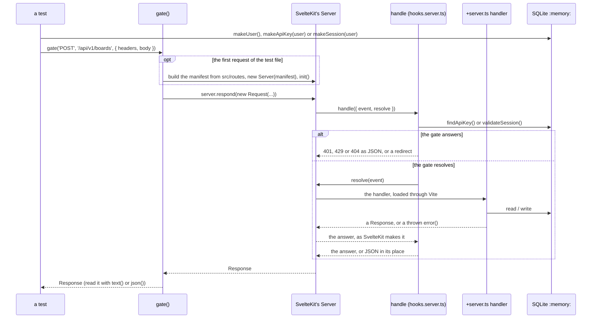

How it is built, which decides what it shows:

- **It is SvelteKit's own `Server`**, the class a built application runs, given a manifest
  made the way `vite dev` makes one. The route list comes from SvelteKit's own reading of
  `src/routes`, and every module is loaded through Vite when a request first needs it.
  Nothing is built, no dev server is started and no port is opened.
- **A handler reached this way shares its database with the test.** The modules are the
  ones the test file has loaded, so a row a fixture made is there for the handler and a row
  the handler wrote is there for the assertion.
- **The server is started once for a test file**, by its first request.
- **Loading `hooks.server.ts` runs what it runs at start-up.** The migrations are already
  applied by `tests/setup.ts`, so nothing happens. The session and log clean-up run.
  `startSchedulers()` is called and starts nothing, because `vitest.config.ts` sets
  `SCHEDULERS: 'off'`: a test never starts the backup, report or snapshot scheduler,
  whatever kind of server vitest is taken to be. Beside it, `PASSWORD_THREADS: '0'` makes
  every password hash and check on the test's own thread, a turn later (`setImmediate`),
  and not on worker threads (card 2191): so `vi.mock('bcryptjs')` in
  `tests/atomic-accounts.test.ts` sees every call, a check is still never answered in the
  turn that asked for it, and the fake clocks below, which leave `setImmediate` real, still
  run. A sign-in at a name that is no account is checked against a real cost-12 hash, about
  0.2 s of real time each. `tests/password-checks.test.ts` starts real threads with
  `setPasswordThreads()`.
- **The request is sent as it is given.** A string, bytes, a `FormData` or a stream is the
  body as it stands, and the test says what it is with a `content-type` header. Anything
  else is sent as JSON, with that header. A redirect is returned, not followed. `ip` is the
  address the request appears to come from; `ip: null` is a request whose address cannot be
  read, for which `getClientAddress()` throws the node adapter's own error, as it does when
  the adapter is started with `ADDRESS_HEADER` and the header is not there. `platform` is
  what the node adapter hands a request as `event.platform`; none by default, as under
  `vite dev`, and `{ req: { socket: { destroyed: true } } }` for a caller who has gone, whose
  password is then never checked.
- **A body given with no `content-type` header is dropped.** The real servers do the same:
  `getRequest` in `@sveltejs/kit/src/exports/node/index.js`, which makes the `Request` under
  `vite dev` and in the node adapter alike, passes no body on when the header is not there.
  So a handler is sent no body, and answers `400` "The request body is missing or is not
  valid JSON" to JSON that was valid. A `FormData` is the exception, because its header is
  written with it. The harness used to send such a body, which no server does.
- **A body is sent with its length.** The gate refuses a body that declares more than its
  route accepts before reading any of it, and `new Request` writes no such header. So
  `gate()` writes it, as a client would: the length of a string in bytes, the length of
  bytes, and for a `FormData` the length of the form written out. A stream is the one body
  sent without it, as a body sent in chunks is on the wire, which the gate counts as it is
  read. A `content-length` header the test sets is never replaced, which is how a test
  declares more than it sends: a body "of 27 MB" is five bytes and a header.

A request through the gate needs what a real caller holds, which `api()` never does:

| Builder | Makes | Send it as |
|---------|-------|------------|
| `makeApiKey(user, name?)` | An API key for the user, made by the application's own generator and stored as the application stores one, so that the gate accepts it. Returns the key as the caller holds it | `authorization: Bearer <key>` |
| `makeSession(user)` | A session for the user, made as a login makes one. Returns the token | `cookie: dumpfire_session=<token>`, the name being `SESSION_COOKIE_NAME` |

Both are random, as real ones are, so a fixture that makes one is not the same rows twice.
A test that sends more than 60 requests with one key, or more than 60 to `/api/v1/` from one
address with no key the gate accepts, meets the rate limit, which is counted in memory:
`tests/gate.test.ts` calls `resetAllRateLimits()` before and after each test.

**A request that waits, on a fake clock.** A sign-in at an account with five wrong passwords
waits up to four seconds on a timer before it is answered (card 2177), so the tests of it in
`tests/gate.test.ts` run on fake time, with three helpers of that file:

| Helper | What it does |
|--------|--------------|
| `onTheFakeClock()` | Sends one sign-in with an empty name on the real clock, which loads the login page's modules and counts nothing, then fakes `setTimeout`, `clearTimeout` and `Date` alone. `setImmediate` stays real, so a request can still be let run. The test puts the real clock back in its `afterEach` |
| `heldFor(...requests)` | Lets the requests run, on the real `setImmediate`; while any is unanswered and a timer is set, moves the clock 250 ms and lets them run again. Gives back, for each, how long it was held and its answer: one answered with no timer set was held 0 ms |
| `heldInTurn(attempts, status = 400)` | Sends each attempt after the last is answered, through `heldFor`, checks each answered `status`, and gives back the milliseconds each was held |

So `expect(await heldInTurn([D, D, D].map((ip) => wrongAt(name, ip)))).toEqual([2000, 4000, 4000])`
reads as what a person would wait, and a test of requests sent together passes them to one
`heldFor` call. A request that is neither answered nor waiting on a timer after 200 rounds
fails the test rather than hang it.

**It tests itself.** The harness leans on SvelteKit's internals, which no version promises
to keep: three modules imported by path and the shape of the manifest. The first test in
`tests/gate.test.ts` is of the harness and not of the gate: the API routes it serves must be
exactly the ones `routePatterns()` finds by reading `src/routes/api` for itself. An upgrade
of SvelteKit that breaks the harness fails there, by name, and not as forty failures that
look like the gate's.

What it cannot show:

| Not shown | Why |
|-----------|-----|
| The refusal of a write sent as a form with no matching `Origin` | SvelteKit makes that check only outside development mode, and under vitest it is in development mode. A built server makes it, before `handle` is called |
| The node adapter | The harness begins where the adapter has made a `Request`. `bodyOverTheLimit()` stands in for a body the adapter fails: a stream that fails, when read, with a `413` of a class that is not SvelteKit's, as the adapter's is in a built server, where it has a copy of that class of its own. It is sent with a `content-length` its route accepts, because the gate now refuses a declared length over the limit before anything is read, so what is left for the adapter to fail is a body that runs past the length it declared. How the adapter builds a request, reads the client's address and enforces `BODY_SIZE_LIMIT` is not exercised. Which requests it gives a body to, and that it holds a body with no declared length to no limit, are read from its source by `tests/body-limits.test.ts`, which fails if an upgrade changes either |
| The image's `BODY_SIZE_LIMIT` | A test reads the `Dockerfile` and checks the value is one the adapter can parse. That a container has the variable is checked on the host: `docker exec <container> printenv BODY_SIZE_LIMIT` |
| What a browser does with an upload that fails | No DOM. `uploadFailure()` and its neighbours in `src/lib/api.ts` are functions and are called; that the two pages call them, and clear their busy flag in a `finally`, is read from their source by `tests/page-failures.test.ts` |
| What a browser does with the gate's `401` | No DOM. The watch on `fetch` (`src/lib/signed-out.ts`) and the stream that opens itself again (`src/lib/live-stream.ts`) are given stand-ins for `fetch`, `EventSource` and the timers, and called, by `tests/page-failures.test.ts`; that `src/hooks.client.ts` installs the watch, and that every stream but the audit console's is opened through `keepStreamOpen()`, is read from the source. That a real page goes to the login page is checked by hand |
| A path that begins `/_app` | SvelteKit answers it `404` before it calls `handle`, under the harness as in a built server, so the gate's pass-through for `/_app/` is never reached, but for a call to a remote function, `/_app/remote/<id>`, which reaches the gate with the path its `x-sveltekit-pathname` header names and is answered `404` there. `tests/gate.test.ts` says so of both, and fails if either changes |
| A connection the server closes | `heldToLimit()` leaves a body it has refused unread rather than cancel it, because the adapter answers a cancelled body by destroying the connection, and the `413` would never reach the caller. The harness has no connection: the test shows the body is not cancelled, and reads the adapter's `cancel` from its source |
| `vite dev` and a built server | Neither is started. What a running server answers on the wire is checked by hand |
| The policy's style directives as a built server sends them | Under vitest SvelteKit is in development mode, and adds `'unsafe-inline'` to the style directives of a page's `Content-Security-Policy`. `tests/content-security-policy.test.ts` reads the configured style directives from `svelte.config.js` instead, and the page tests read only the others. A production build's `/login` was checked by hand on 2026-10-15: `style-src-elem 'self'` alone |
| What a browser does under the policy | No browser. That the pages still work under it, the reports page's PDF preview above all, is the report-only deploy's walk: see [Deployment](deployment.md#the-update-that-brings-the-content-security-policy) |

### Fixtures

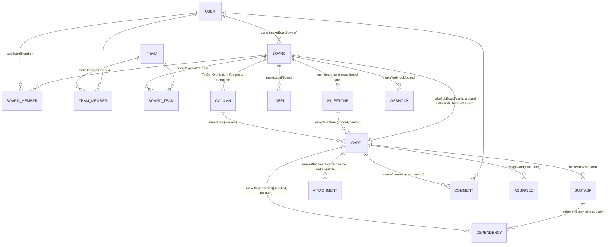

`makeBoard()` returns `{ board, cols }` with the columns keyed by title, so a test
reads `A.cols['Complete']`. Builders insert through the Drizzle schema; anything
they do not cover is inserted the same way in the test itself.

What the newer builders are for:

| Builder | Makes | Note |
|---------|-------|------|
| `makeDependency({ blocked, blocker, createdBy })` | A `work_dependencies` row | Either end is a card or a subtask row. The ends are named, so the direction cannot be got backwards by position |
| `makeMilestone({ board, cards, createdBy })` | A milestone with the cards attached | Without `board` it is a cross-board milestone |
| `makeComment(card, author)` | A comment | |
| `makeAttachment(card, { name, mimeType, content, uploadedBy, file })` | The attachment row and a real file where the row says it is, under the tests' uploads folder | The stored file name is numbered, not random as an upload's is, so a fixture built twice makes the same rows. `file: false` makes the row alone, which is what a working copy has |
| `makeSubBoard(parent, { cards })` | A board whose `parentCardId` is `parent`, with cards on it | Returns `{ board, cols, cards }`. Call it again with one of those cards to go a level deeper |
| `assignCard(card, user)` | An assignee, who is who a "card moved" mail goes to | |
| `makeWebhook(board, { events })` | A webhook. With no `events` it receives every event | Use with `effects()`, which records the delivery |
| `makeSmtp()` | Mail settings, so that the application tries to send mail | Without it every notification returns before it looks for anyone to tell |

`resetDb()` empties every table except the migration record, with foreign keys
switched off for the wipe and back on before the test runs. It also deletes the id
counters, so the first card of every test is card 1, restarts the builders' own
numbering, and removes every attachment file the tests have made, the trash included.
Call it from `beforeEach`. Because of it a fixture built twice is the same rows with the
same ids, which `eachWriteInTurn()` depends on.

### `action(path, options)`

A form action is not under `src/routes/api`: it is the `actions` export of a page's
`+page.server.ts`, takes form data, and answers by returning data, returning `fail(...)`
or throwing a redirect. `action()` calls one by the page's path.

```ts
const res = await action('/invite/abc123', {
	form: { password: 'correct horse', confirmPassword: 'correct horse' }
});
expect(res).toMatchObject({ type: 'redirect', location: '/' });
expect(res.cookies.dumpfire_session).toBeDefined();
```

- The result's `type` is `success`, `failure` (the action returned `fail`), `redirect`
  or `error`, with `status` and `data`, `location` or `body` to match.
- `cookies` holds what the action set and `deletedCookies` what it deleted.
- `name` picks a named action; without it the `default` action is called.
- The path is matched against the real route tree, and a path or an action that is not
  there throws. `hooks.server.ts` does not run.

### `pageLoad(path, options)`

A page's `load`, or a layout's, is called the same way, by the page's path, with the caller
the test gives it (card 2130). Each page that draws board data is asked by it what it gives
a caller who cannot open a board, which no route of the table covers.

```ts
const res = await pageLoad(`/board/${board.id}`, { user: viewer });
expect(res.type).toBe('data');
expect(JSON.stringify(res)).not.toContain('kept-to-board-B');
```

- The result's `type` is `data`, with the load's `data`; `redirect`, with `status` and
  `location`; or `error`, with `status` and `body`. Anything else the load throws is a crash
  and fails the test.
- `layout: true` calls the `+layout.server.ts` at that path instead of the page.
- The page tree is read from the disk when the test file starts, as `api()` reads its
  routes, and not with `import.meta.glob` as `action()`'s pages are: vitest keeps what it
  transformed, so a page added afterwards would not be seen until the helper was next
  edited. `loadKeys()` lists every load as `page <path>` or `layout <path>`, and the test
  that asks every page compares its table with it.
- A load that asks for `parent()` or calls `fetch` fails the test: none does today.
  `hooks.server.ts` does not run.

### Timestamps: the check after every test

Every timestamp column (every TEXT column whose name ends in `_at`, and
`system_logs.timestamp`) holds one form, `YYYY-MM-DD HH:MM:SS` in UTC (card 2095). The suite
holds it so: `tests/setup.ts` registers `afterEach(() => afterEachTimestampCheck(sqlite))`,
and a test that leaves any other value in any such column fails, with "This test left
timestamps that are not in the stored form" and each value named. A value with the stored
form's shape that names no real moment, such as `2026-02-30 08:00:00` or an hour of 24,
counts as another form: the check asks the conversion's own `is_stamp`
(`registerStampFunctions`, in `src/lib/server/db/timestamps.ts`), not a pattern. So the whole suite
passing is the proof that no path it runs writes another form.

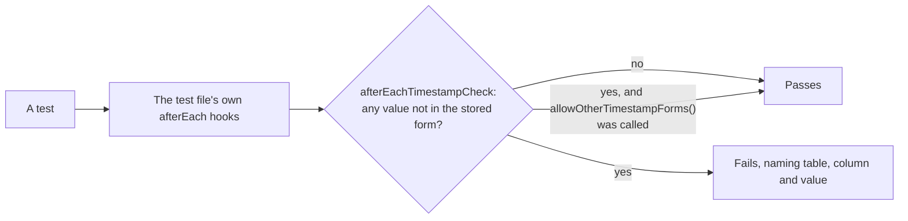

- **A test that writes another form on purpose**, to test the conversion, calls
  `allowOtherTimestampForms()` first; the allowance ends with that test.
- **Write fixtures with `stamp()`** from `src/lib/timestamps.ts`, or as
  `'2026-10-14 08:00:00'`, never with `toISOString()`.
- **vitest runs `afterEach` hooks as a stack**, so a test file's own hooks run before the
  one in `tests/setup.ts`. A file whose `afterEach` empties the database (`resetDb()`) calls
  `afterEachTimestampCheck(sqlite)` first, or the check would find nothing:
  `tests/backups.test.ts`, `tests/import-working-copy.test.ts` and
  `tests/migrations.test.ts` do, with their own cleanup in a `finally`. A test in
  `tests/timestamps.test.ts` fails on any `afterEach` that calls `resetDb()` without making
  the check first, and another fails if the line in `tests/setup.ts` goes.
- **Pages write nothing to the database**, so the check does not look at them; they are held
  by tests that read their source (`tests/timestamps.test.ts`, "the pages read every stored
  value as UTC").

## Proving a Request Is All or Nothing

A request that makes several writes must save all of them or none, and must tell nobody
about a write that was not saved (see
[Architecture](architecture.md#writes-one-transaction-then-the-effects)). A test that
only makes the request and looks at the result cannot show that. The pattern that does is
to fail each of the request's writes in turn.

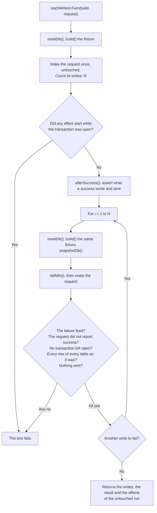

```ts
it('moves the card, awards the XP and logs it, or does none of them', async () => {
	const run = await eachWriteInTurn({
		// Called on an empty database, once for each run. It must make the same rows
		// every time, which the builders do.
		build: () => {
			const user = makeUser();
			const board = makeBoard({ owner: user });
			makeWebhook(board.board);
			return { user, board, card: makeCard(board.cols['To Do']) };
		},
		request: ({ user, board, card }) =>
			api('PUT', `/api/v1/cards/${card.id}/move`, {
				user,
				body: { columnId: board.cols['Complete'].id }
			}),
		// The untouched run, with the database as the request left it.
		afterSuccess: (fixture, res) => {
			expect(res.status).toBe(200);
			expect(res.body.completedAt).not.toBeNull();
		}
	});

	// More than one write, or there was nothing to prove.
	expect(run.writes.length).toBeGreaterThanOrEqual(2);
	// What a success sends, in order. Each was started after the commit.
	expect(run.effects.map((e) => e.kind)).toContain('webhook');
});
```

What it checks on each of the N failing runs, and throws if it does not hold:

| Check | Why |
|-------|-----|
| The injected failure fired | Otherwise this run did not make that write, and nothing was tested |
| The request did not report success | A `try/catch` that swallows a database error and carries on is the fault being looked for. By default a result with a `status` of 500 or more counts as a failure; pass `failed` to say otherwise |
| No transaction is left open | |
| Every row of every table is as the fixture left it | Id counters included: a rolled-back insert must not use up an id. `system_logs` is left out, because a failed request is meant to leave a log line |
| No webhook, live event or email was sent | Nothing may be announced that was not saved |

On the untouched run it also throws if any effect started while a transaction was still
open, and if the request made no write at all.

The pieces can be used on their own:

| Helper | Use |
|--------|-----|
| `failingWrite()` | `writes.count` and `writes.writes` after a request say how many statements changed the database and what they were. `writes.failNth(n)` makes the nth write from now throw an `InjectedWriteFailure`; `writes.fired` says whether the request got that far. Call `writes.restore()` in `afterEach` |
| `snapshotDb()`, `expectUnchanged(before)` | Take a snapshot, make a request that should be refused, and assert that nothing changed. `diffSnapshots(before, after)` returns one line for each row added, removed or changed, naming its table and column |
| `effects()` | `sent.webhooks`, `sent.events`, `sent.emails` and `sent.all` are what the request would have sent. `sent.duringTransaction` must be empty: it lists every effect that started while a transaction was open, a refused mail among them. `await sent.settle()` lets effects that start on a later turn of the event loop start. Call `sent.restore()` in `afterEach` |
| `effects({ refuseMailTo: ['b@example.test'] })` | A mail server that refuses some addresses, for a test of what is said when mail does not go (card 2113). The recorded transport throws `REFUSED_MAIL`, exported from the helper, for a mail to one of them, as a real one does when the server refuses it, so `sendEmail` and `sendEmailWithAttachment` log the failure and return `false`. That mail is kept in `sent.refusedMail`, in the order it was tried, and not in `sent.emails` or `sent.all`; `sent.clear()` empties it too. One started while a transaction was open is in `sent.duringTransaction` all the same, so a refusal cannot hide a mail sent too early. With no option, nothing is refused |
| `watchReads(table, afterRead)` | `reads.inTransaction` says, for each read of the table, whether a transaction was open. `afterRead(nth)` runs between a read made outside a transaction and the request seeing its rows, so a test can make the write another request would have committed at that moment. This is how the suite shows an invite cannot be used twice and set-up cannot create two superadmins |
| `readBudget(limit)` | Counts every `get`, `all` and `iterate` of every statement SQLite calls read-only, of any table, inside a transaction or not; writes are not counted. The read past `limit` sets `budget.spent` and throws `ReadBudgetSpent`. `budget.count` is the reads so far. Call `budget.restore()` in a `finally`, and assert `budget.spent` is false after the call as well as its answer. See [A walk that must end: the read budget](#a-walk-that-must-end-the-read-budget) |

How they work, which decides what they can and cannot see:

- **`failingWrite` wraps the connection's `prepare` and `exec`**, and the `run`, `get`,
  `all` and `iterate` of every statement prepared while it is installed. Drizzle prepares
  a statement for every query and keeps none, so its writes are seen. A statement prepared
  once and run in a loop is counted each time it runs. A statement prepared before the
  helper was installed is not seen.
- **A write is a statement SQLite does not call read-only.** An `UPDATE ... RETURNING`
  read with `.get()` counts and a `SELECT` does not. `exec` always counts. `BEGIN`,
  `COMMIT`, `SAVEPOINT` and the pragmas are not seen. Writes to `system_logs` are left out
  and never failed: the logger makes them, and they are not part of a request.
- **`effects` replaces `fetch`**, which is how a webhook is delivered, and nodemailer's
  `createTransport`, and subscribes a listener to every board's live events. Mail is only
  attempted when SMTP is configured, so a test that expects mail calls `makeSmtp()`.
- **A test that sets up a webhook or mail and does not install `effects` fails.** The
  application would try to deliver, and `tests/setup.ts` refuses every `fetch` and every
  DNS lookup: the attempt is recorded, and a check after each test fails the test that
  made it, naming the address. `effects()` puts that guard back when it is restored.
- **`failingWrite`, `watchReads` and `readBudget` all wrap `prepare`**, so no two of them
  can be installed together: `readBudget` refuses to be installed over any of them, or over
  another of itself, with `the connection is already wrapped`. Neither `failingWrite`,
  `effects` nor `watchReads` can be installed by a test while `eachWriteInTurn` is running,
  because it installs the first two itself.

`tests/test-helpers.test.ts` tests the helpers themselves, including that
`eachWriteInTurn` catches a request that keeps its first write when its second fails, one
that announces something and then fails, and one that swallows the failure.

### A check made where the write is: the read table

A request that writes must check the caller inside the transaction that writes (see
[Authentication & Security](authentication-security.md#where-the-decision-is-made)). Three
files show it the same way, with a table and `watchReads`: `tests/atomic-v1.test.ts`, for
the documented API, `tests/atomic-dependencies.test.ts`, for the four dependency routes, and
`tests/check-at-the-write.test.ts`, for the 21 other handlers that checked before their body
and for `PATCH /api/labels`, which card 2010 added.
Each row names the route, the table its guard reads (`boards` for a board's guard,
`labels`, `columns`, `team_members` with a team owner who is no administrator as the
caller, and so on), the status expected, any preparation and the request. Each test
installs `watchReads` last, just before the request, and asserts at least one read, every
read inside a transaction, and the status. A row is added with each handler that writes.

The race is the other form: `afterRead` makes, between the check and the write, the change
another request would have committed, and the test shows the request does not act on what
it read. It acts on the first read only (`if (nth === 1)`): a request that reads the table
twice would otherwise have the change made twice. Inside a transaction `afterRead` never
runs, which is what a passing test shows. `tests/check-at-the-write.test.ts` takes a
membership away as the check reads it; `tests/atomic-dependencies.test.ts` writes the
opposite link as an adding request reads the graph, which before card 2114 stored a loop.

### A walk that must end: the read budget

A walk of the board tree follows a board's parents up, or its sub-boards down, a step at a
time. On a loop, a board beneath one of its own cards, a walk with no guard never ends and
holds the one thread (card 2142). A vitest timeout cannot stop it: the timer never gets
the event loop back, and the test file's process spins and grows until it dies, holding up
the run. So a test of a walk proves that it ends by counting reads, not by a timeout:

```ts
const budget = readBudget(1000);
let res;
try {
	res = await pageLoad(`/board/${loopBoard.id}`, { user });
} finally {
	budget.restore();
}
expect(budget.spent).toBe(false);
expect(res.type).toBe('data');
```

A walk that reads the database at each step passes 1,000 reads in well under a second, and
the read past the limit throws `ReadBudgetSpent` out of the call. `spent` is asserted as
well as the answer, because code that caught the error and went on would otherwise pass.
Every read is counted, of any table, through a join, inside a transaction or not, so a
walk cannot slip past it by the way it reads. As with `failingWrite`, a statement prepared
before the budget was installed is not seen; Drizzle prepares one for every query.
`tests/board-tree-loops.test.ts` runs every call that meets a loop so, through its
`withinBudget()`.

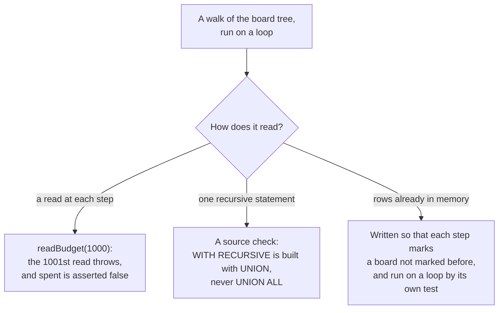

Two kinds of walk are outside any read budget, and something else holds each:

- **One recursive statement** is one read however far it goes. Built with `UNION` it keeps
  each row once and ends on a loop; built with `UNION ALL` it would follow the loop for
  ever. A test in `tests/board-tree-loops.test.ts` reads every `.ts` file under `src` and
  holds each whose SQL has `WITH RECURSIVE` to no `UNION ALL`: today `deletes.ts` and
  `sub-boards.ts`. It reads the text of the strings and templates, with the TypeScript
  compiler, and not the comments.
- **A walk over rows already read into memory** reads nothing as it goes: `deepestFirst()`
  in `deletes.ts`, `boardsInLoops()` in `sub-boards.ts`, which reads the boards once
  and finds the loops in memory, and `boardAncestry()` in `board-tree.ts`, which reads
  every board's parent board once for All Tasks (card 1990). Each is written so that every
  step marks a board not marked before, and each is run on a loop by its own test: the
  delete tests on a card inside its own sub-board, `boardsInLoops()` on every shape of loop
  and on a chain 5,000 deep, where it makes exactly one read, and All Tasks on every shape
  of loop, with `boardAncestry()` on a chain 2,000 deep in one read. That makes each end,
  not each cheap. `boardsInLoops()` keeps its marks for the whole walk and takes one step
  for each board. `deepestFirst()` and `boardAncestry()` start their marks afresh for each
  board they are given and walk it to the top, so they take as many steps as the boards
  times their depth: 2,000 boards deep took `deepestFirst()` 400 ms. Card 2172's limit on
  how deep boards nest, 20 levels, is what bounds them for every tree made since; a tree
  made deeper before it, or brought back by a backup, is kept and still walked whole, and
  `boardAncestry()` is deliberately not capped, so that All Tasks' paths stay right for it.
  The board page's breadcrumbs are capped: at most the nearest 20 boards and a "…", 61 rows
  however deep for an administrator; for anyone else `canViewBoard()` reads each crumb's
  board again and the membership, team and team-access rows it needs, up to four more a
  crumb, at most 141. `tests/sub-board-depth.test.ts` holds the load of a board 60 deep,
  as an administrator, to at most 30 reads of `boards`, with `watchReads`.

## Access for Every Route

`tests/access-control.test.ts` holds, one by one, the requests that used to succeed and
must not. `tests/access-every-route.test.ts` is the other half: a table, `TABLE`, with an
entry for every route and method under `src/routes/api`. Each entry says what kind of
access its handler requires and how to make a real request to it, and the tests are made
from the table, the same ones for every entry of a kind. There are 215 entries, for the
215 methods of the 127 route files, 80 of them under `/api/v1/`.

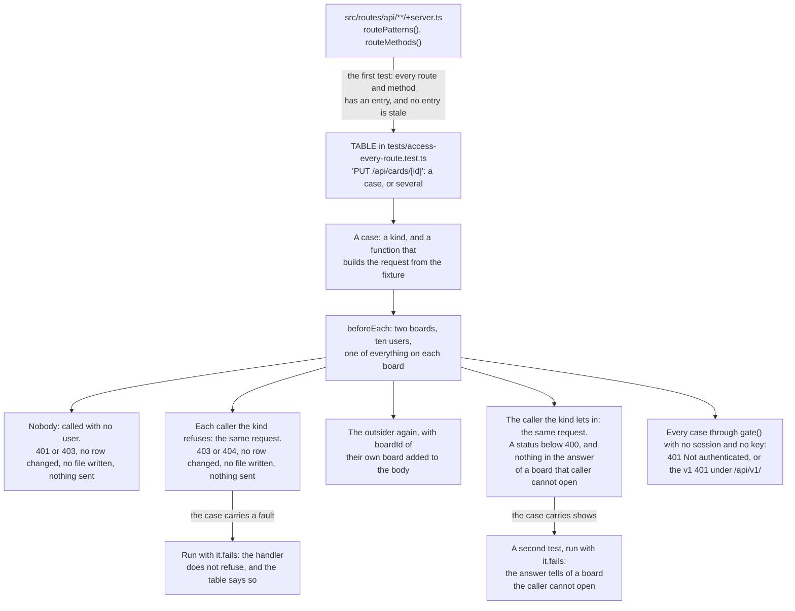

The cast is the same in every test. Board A is the one being defended:

| Caller | Is |
|--------|----|
| `owner` | The owner of board A |
| `editor` | An editor of board A |
| `viewer` | A viewer of board A |
| `guest` | A member of a team that board A is shared with, to view. They have no other way in |
| `outsider` | The owner of board B, with no access to board A. They once had it: a comment of theirs is on a card of board A, a card of board A is still assigned to them, and the activity log has an entry of theirs. None of it lets them back in |
| `both` | An editor of board A and of board B |
| `editsB` | An editor of board B who can only view board A |
| `editsA` | An editor of board A who can only view board B |
| `admin` | An administrator |
| `chief` | The superadmin: the one account set-up made |
| nobody | A caller with no session and no API key |

What is in the fixture beside the two boards, and what each is there to show:

| In the fixture | It shows |
|----------------|----------|
| Every name on board A has `kept-to-board-A` in it, and every name on board B has `kept-to-board-B` | An answer to a caller who cannot open a board has neither of that board's |
| A team, with `owner`, `editor` and `guest` in it, that board A is shared with to view | Sharing with a team to view gives its members view access and no more: `guest` is refused by every `edit` and `owner` case |
| A public board of `owner`, with a card | Public means anyone signed in may read it. Only its owner may change it |
| A grouping with board A and board B both filed under it | A grouping may be renamed or deleted only by a caller who can edit every board under it, and is charted and reported to each caller as far as they can open it |
| A second grouping, with one board that `outsider` cannot open, and `kept-to-board-A` in its name | A caller with no board under a grouping is refused a report of it, a read of it and its burndown, and is not told its name (card 2128) |
| A dependency: board A's card waits on a card of board B | A viewer of board A who cannot open board B is not told the title of that card or the name of its board: the end is listed withheld (card 2129) |
| A milestone that belongs to no board, made by `owner`, with no card | It is its maker's alone until it has cards; then whoever can open every board those cards are on may read it, and still only its maker may change it |
| A task request addressed to the team, beside the one addressed to `owner` | It is for a member of the team to read, answer, accept and reject, and for nobody else |
| An API key, a report schedule and the task requests of board A's side, each with the mark in its name | A list of "mine" given to `outsider` has none of them |
| Two card templates `outsider` made: one saved on board A before they lost it, and one saved on no board | Having made a template is not access to its board: the first is no longer theirs to delete, and an administrator's still. The second has no board to ask about and stays its maker's |

The kinds, and what follows from each. A method has one entry and an entry may have
several cases, so the 325 cases are more than the 215 methods:

| Kind | The handler requires | Refused | Let in | Cases |
|------|----------------------|---------|--------|-------|
| `public` | Nothing | Nobody is | A caller who is not signed in | 1 |
| `signed-in` | A session or an API key, whoever's | nobody | `outsider` | 48 |
| `view` | View access to the board of what the request names | nobody, `outsider` | `viewer` | 73 |
| `edit` | Edit access to that board | nobody, `outsider`, `viewer`, `guest` | `editor` | 80 |
| `owner` | To own that board, or to be an administrator | nobody, `outsider`, `viewer`, `guest`, `editor` | `owner` | 9 |
| `across` | Edit access to two boards: the one of what the path names and the one of what the body names | nobody, `outsider` (who can edit the first), `editor` (who can edit the second), `editsB` and `editsA` (who can each edit one and view the other) | `both` | 20 |
| `admin` | To be an administrator | nobody, `outsider`, `owner` | `admin` | 24 |
| `superadmin` | To be the superadmin. What acts on the whole installation: the export, the import, the reset, everything under `/api/admin/backup`, and the mail and App URL settings | nobody, `outsider`, `owner`, `admin` | `chief` | 12 |
| `own` | To be the one the thing belongs to: who made it, or whom it is addressed to. Also used for a rule no other kind fits, with the callers named | nobody, and the callers the case names | The one the case names | 52 |
| `link` | To hold the secret link a task request was made with | nobody and `outsider` with no link, and nobody with the link of another request | Nobody, with the link; for two routes the one the request is addressed to as well | 4 |
| `form` | A session, or the token the public request form was given when it was rendered | nobody with no token, with a token that has expired, with one signed with another key, and with text that is no token | `outsider`, signed in; and nobody, with a token issued just now | 2 |

`GET /api/requests/targets` and `POST /api/requests` are the two `form` routes. They were
entered as `public`, which they are not: a caller who is not signed in and holds no token
is refused by both.

What "refused" and "let in" mean, which is what makes the table worth having:

- **A refused caller makes the request the allowed caller makes.** So a refusal is never
  a body the handler could not read, or an id that is not there. For most cases that
  request succeeds for the allowed caller. It does not for the ten cases that carry
  `answers` (see below), where the allowed caller is turned down too, by another rule and
  with another status. And the holder of a link or of a form token does not make the same
  request: they send the link or the token, which a refused caller has not got.
- **Refused is a 401, 403 or 404, with not one row changed, no file written and nothing
  sent.** The whole database is compared before and after with `snapshotDb()` and
  `expectUnchanged()`, the uploads folder is listed before and after, and `effects()`
  records every webhook, live event and mail. A handler that answers 403 after writing
  has refused nothing.
- **A refusal is never the status the allowed caller is answered.** Where a case carries
  `answers`, that status is taken out of the ones a refusal may be: otherwise the case
  would pass with no access check in the handler at all. A bulk endpoint refuses with a
  409 that names the entries at fault, and its cases say so with `refusedAs`; a 409 is
  taken for a refusal only when its body says the caller has no access ("No edit access
  to the board holding ..."), because the same endpoints answer 409 for every other
  thing wrong with a batch.
- **An upload is not read for a caller who will be refused.** The attachment upload
  checks access before it reads the body. Without that check it would read the file,
  write it, find the caller has no access and take the file away again, leaving the
  folder as it was. So for a refused request with a file in it the test also watches
  `Request.prototype.formData`, which must not be called.
- **`across` is the request that names a second thing in its body**: a column to move a
  card to, the other end of a dependency, a card for a milestone, a board for a
  milestone, a batch. It names something of board B in the path and something of board A
  in the body, so that each of two callers can edit one end and neither is let in.
  `editsB` and `editsA` can edit one end and view the other, so a check of the second
  board that asks only for view access lets one of them in. The two routes that rename
  and delete a grouping are `across` as well: both boards are filed under the grouping,
  and it takes edit access to both.
- **Removing a dependency is not `across`.** Adding a link takes edit access to both
  boards. Removing one takes edit access to the board of the end that waits, whichever
  end the request is addressed to, so that work can stop waiting on a board its owner can
  no longer open, and an editor of the blocking end alone cannot unblock another board's
  work. Each of the four routes that remove a link has the same three `own` cases, made
  by `unlinking()`, for a link whose waiting end is on board B: at the address of the
  waiting end `outsider` is let in and `editor`, `editsA`, `owner` and `viewer` are
  refused; at the address of the end it waits on `editsB` is let in and `editor`,
  `editsA`, `owner` and `outsider` are refused, `outsider` because that address is of a
  card they cannot open; and an administrator is let in.
- **The outsider is tried twice** wherever the request has a JSON body with no board id
  of its own: once as it stands, and once with `boardId` of their own board added. That
  is the fault the suite began with, asked of every route and not only the ones it was
  found in.
- **Every answer to the allowed caller is read for what it gives away**, whatever the
  method. An answer to `outsider` must not contain `kept-to-board-A`, and an answer to
  `owner`, `editor`, `viewer` or `guest` must not contain `kept-to-board-B`. Two
  answers are meant to tell and say why with `tellsEveryone`, one reason for both:
  `GET /api/teams` and `GET /api/requests/targets` list the fixture's team, whose name
  has `kept-to-board-A` in it, to every caller, because a team's name is listed to every
  signed-in caller and to the public form, as a username is: the share dialog and the form
  need it. Its members are not, which a test below the table shows (card 2128). For those
  the test expects the mark in the answer, so the `tellsEveryone` goes when the handler
  stops telling. Until card 2128 four did: the card categories of `GET /api/categories`,
  `GET /api/v1/categories/[categoryId]` and `GET /api/cards/[id]/context`, and every board
  of the request form, which now give each caller what they may be told. An answer that is
  a PDF cannot be read this way: see below.
- **A list that filters is not refused.** `GET /api/milestones?boardId=` answers a caller
  who cannot open the board with an empty list. Such a case is marked `filtered`: the
  outsider's answer must have nothing of board A in it, and the viewer's must have
  something, so that a filter which returned nothing to everyone would fail. The card
  search is three such cases, searched for a word that is in every title on both boards.
- **Nobody is tried twice too**: by calling the handler with no user, and through
  `gate()` with no session and no API key, which is done for every case of an entry and
  not only its first. Four handlers had no check of their own for the first and threw a
  `TypeError` reading `locals.user!` (the three under `/api/boards/[id]/` for `cfd`,
  `export/csv` and `metrics`, and `/api/cards/export/csv`), and were marked
  `nobody: 'crashes'` until card 2117 gave each `requireUser`: they answer 401 now, as
  every other handler does. `GET /api/cards/archived` answers such a caller 200 with an
  empty list, and its case says so with `nobody: 'empty'`.
- **Where the caller who is let in is not answered with a success**, the case says what
  they are answered and why, with `answers` and `because`. There are twelve. Four are
  requests whose success would reach outside the tests: the three backup routes that
  would connect to a destination, and the import. Five are cases where another rule
  refuses everybody: a reorder stays within one board, a card takes only its own board's
  labels, and a milestone of one board takes no card of another. Three take a card out
  of a milestone (card 2117, R5): through one it is not in, on both trees, and through
  one that is not there, each answered 404 whoever asks. In each the refused callers are
  refused first, which shows the access check comes first, and nothing is written. The
  milestone that is not there is a `signed-in` case: it is 404 to everyone signed in,
  before anything else is looked at.
- **Three answers are streams with no end** (`/api/events`, `/api/boards/[id]/events`,
  `/api/logs/stream`). The allowed caller's request is sent through `gate()` with a
  session, checked for its status and content type, and cancelled.

What the table cannot say is tested below it, in the same file:

- **What `GET /api/events` sends.** Every signed-in caller may open the stream, and what
  they are sent is decided event by event. The test opens it through `gate()` as
  `outsider`, emits one event for board A and then one for board B, and reads the stream
  until board B's arrives: board A's, had it been sent, would have arrived first. The
  same is done as `viewer`, the other way round.
- **What is in a report of a grouping.** `POST /api/reports` answers with a PDF and
  `POST /api/reports/email` mails one, and neither can be read for a card's title. Both
  draw what `generateCategoryReport()` gives them, so that is called for the grouping
  both boards are under: `outsider` is given board B and nothing of board A, and `viewer`
  board A and nothing of board B.
- **Who may manage which account.** The table has one administrator. Two more callers
  are made for these tests and are in no other: `admin2`, a second administrator, and
  `chief`, the superadmin. For each of `PUT /api/users/[id]/password`,
  `PUT /api/users/[id]`, `DELETE /api/users/[id]` and `POST /api/users/[id]/invite`: an
  administrator who names another administrator is refused with nothing changed and
  nothing mailed, an administrator manages an ordinary user, the superadmin manages an
  administrator, everyone else who names the superadmin is refused, and so is a second
  superadmin, put in the table by the test, who names the first. Whoever names their own
  account on the password route or the invite route is refused and told where a password
  is changed, and an invite that is allowed is mailed to the account's own address with
  the token that was saved.
- **What a role may be, on both routes that write one.** For each of `["admin"]`,
  `["superadmin"]`, `"superadmin"`, `"Admin"`, `1`, `{}` and `null` sent as `role` by an
  administrator and by the superadmin, to `PUT /api/users/[id]` for another account and
  for their own, and to `POST /api/users`: 400 in the words that value is answered with,
  no row changed and nobody made. Only the superadmin makes an administrator, on both
  routes; nobody changes their own role on `PUT /api/users/[id]`, the superadmin and an
  administrator alike, whatever they send, with what else came with it unsaved (card 2117,
  decision 13); and a `username`, `email`, `emoji` or `password` that is not a string is a
  400 on both.
- **What the users route does with the caller's own account.** Their own `email` is
  refused, with what else came with it unsaved, and their own `emoji` is saved. A change
  of nothing, `{}` or a body of fields the route does not know, is answered with the six
  columns a change answers.
- **That no account route answers a password hash.** Every route and method under
  `/api/users` and `/api/account` is asked by a caller who is not signed in, an ordinary
  user, an administrator and the superadmin, with the request the table makes for it and,
  for `PUT /api/users/[id]`, a change of nothing: no answer has `passwordHash` in it, or
  `$2`, which is how every bcrypt hash begins. The routes are taken from the table, so a
  new one is asked without being added here, and a test says the list is the whole of
  both trees.
- **What is saved when a board is made public.** On both routes that change a board: an
  editor's name and emoji are saved when `isPublic` is not sent, an editor who sends
  `isPublic` is answered 403 with not a row changed, whatever value they sent, `null`,
  `1`, `"1"` and `[true]` among them, and the owner and an administrator set it. From the
  owner or an administrator a value that is neither `true` nor `false` is a 400 with not
  a row changed.
- **That the two routes that create a board answer alike for a sub-board.** A parent
  card that is not there is a 404 on both with no board made, a caller who cannot edit
  the parent card's board is refused in the same words on both, and the board is hung
  under the card that was checked.
- **What `GET /api/graph` lists.** A card with two sub-boards, one shared with `viewer`
  and one not: the column's graph lists `viewer` the first and not the second, lists the
  owner and an administrator both, and the second is not expanded for `viewer` either.
  With no board named, each caller is listed the boards they can open and no other. A
  dependency between two cards of the column is drawn; one that reaches a card of board B
  is drawn for a caller who can view board B and not for one who cannot, to whom that
  card's id is nowhere in the answer; and a row of the legacy `card_dependencies` table
  and a link to a subtask are not drawn.
- **That a refusal to remove a dependency does not say whether the link is there.** On
  each of the four routes an editor of the blocking end's board is answered the same 403,
  word for word, before the link is made and after. A caller who may remove it is then
  answered 200, and 404 once it is gone.
- **Whom a removed dependency is told to.** On each of the four routes a link between
  the boards, removed at the address of the end that is waited on, sends the live event
  to both boards, read through `effects()`; a link within one board sends one. The v1
  card route's activity entry is on the board of the end that waits, naming the waiting
  card, or the waiting subtask's card, where the card in the address is on another board.
- **Recent activity, on the boards the caller can open (card 2126).** `outsider`'s entry
  on board A is made their newest and 26 of theirs on board B each a minute older, the
  times set by the test and not left to the clock: `GET /api/v1/me/stats` gives the 20
  newest of board B's and the dashboard the 10 newest, none of board A's, which a filter
  applied after the limit would not. A member is still given their entry on the board, and
  an administrator theirs on every board.
- **What the lists give (card 2128).** People and teams: every user to an ordinary caller
  by id, name and emoji alone, and with the address, role and creation date to an
  administrator and the superadmin; every team by name, and its members only to the
  team's own and to an administrator; the teams page with no other user's address. Dashboard
  groupings: the two list routes and the dashboard, All Tasks and Reports loads give
  `outsider` the grouping of both boards and an empty one and not board A's, `viewer` all
  three and an administrator every one; one is given by its id to a caller it is listed to,
  an empty one included, and refused `403` otherwise, the burndown of it too; filing a
  board under one outside the list is `403` on both trees and on a new board with nothing
  written, and under one in it, or by an administrator, is saved. Card categories: listed
  by the boards the caller can open and the shared one; a category a card of board A
  carries from board B is in `viewer`'s board page, All Tasks and card context marked
  `carried`, and in nothing they may pick; the four card writes refuse another board's
  category, `404` by card 2117's rule, and keep one a card carries. The public request
  form: every user and team and no board to a token holder, and the boards a signed-in
  caller can open. Email addresses (R1): none in a public board's page or card context to
  a signed-in caller who is no member of it, and the share list's only to its owner and an
  administrator.
- **The other end of a dependency, to a caller who cannot open its board (card 2129).**
  Board A's card waits on a card of board B, and a subtask of it on another. For each of
  17 answers (the card and subtask dependency routes of both trees, GET and the answers to
  POST and DELETE, `GET /api/v1/cards/[cardId]`, both summaries and the compact one, and
  the board page, All Tasks and plan page loads), a caller who can open board A and not
  board B, a viewer or for a write an editor, is given the end with its id, its kind,
  whether it is finished, `withheld: true` and the replacement texts, nulls for its board,
  column, priority and milestone, no `kept-to-board-B` anywhere, and what waits on it still
  blocked; `editsA`, `both` and an administrator are given its title and board. Then a card
  of board A's milestone is moved to board B, keeping the milestone (R4): to a viewer of
  board A the summaries, the plan page and both PDFs hold nothing of board B, `progress`
  counts it under one withheld board, and `criticalPath` is the chain an administrator is
  given, card ids only. The PDFs are read through `gate()` and `pdfText()`, which inflates
  the PDF's streams and joins the text they draw; an administrator's PDF naming board B is
  its control.
- **Every page load, to a caller who cannot open a board (card 2130).** `PAGES` has an
  entry for every `+page.server.ts` and `+layout.server.ts`: the paths its load is called
  for, or why it gives no board data (the layout, `/account`, `/graph`,
  `/invite/[token]`, `/login`, `/logout`, `/request`, `/setup`). The first test fails for a
  load with no entry, against `loadKeys()`. The describe's own `beforeEach` adds a
  sub-board of board A's card that only `outsider` can open, `kept-to-board-B` in its name,
  and a due date next week on the card of board A still assigned to `outsider`. Each other
  load is called through `pageLoad()` as `outsider` and as `viewer`, the board page for
  board A, board B and the sub-board, the burndown with no query and with board A's
  grouping, and the plan pages for both milestones: it is refused, or gives nothing of a
  board the caller cannot open. The filters do not empty the pages: `viewer`'s dashboard and
  board page have board A, and an administrator's dashboard both boards. The sub-board is
  left off the card on the board page, in the card context and on the dashboard tile for
  `viewer`, and is there for an administrator and for `viewer` once given it; the dashboard's
  sub-board count, All Tasks walk, token cost and spend by person leave it out until then;
  `outsider`'s dashboard counts only their card of board B, and names it alone in Upcoming
  Deadlines, until they are given board A again. Its breadcrumbs show board A to `outsider`
  as "🔒 A board you cannot open" with no link, keep a board above that they can open
  named and linked, and name both to an administrator. And "Link existing board" offers no
  caller a board they cannot open. All To Do (card 2240) is in `PAGES` as `/todo` and
  `/todo?board=<board A>`, and is asked beside All Tasks in the groupings sweep, the
  carried-category case and the Blocked chip's withheld blocker.

### Adding a route

A new `+server.ts` under `src/routes/api`, or a new method in one, fails the test `has an
entry for every route and method`, the first of the file, with the route and method by
name, until it has an entry. The tree it is compared with is read from the disk on every
run. The same test fails, by name, on a route that exports `fallback`, `OPTIONS` or
`HEAD`, on a `+server.js`, and on a `+server.ts` outside `src/routes/api`: SvelteKit
serves each, and the table has no way to say who may call it.

```ts
'PUT /api/things/[id]': edit((w) => json(`/api/things/${w.A.thing.id}`, { name: 'Renamed' })),
```

1. **Choose the kind** from what the handler requires, not from what it happens to do
   today. If the handler is wrong, the table is where that shows.
2. **Build the request from the fixture**, for something of board A. If the route needs a
   row the fixture does not make, add it to `side()` if every board has one, to `world()`
   if there is one of it, or to the case's `setup` if only this case needs it.
3. **If the body names a second thing** that is on a board, add an `across` case for it
   beside the first.
4. **If the same route answers differently by a query parameter** (one board, every
   board), give each its own case with an `of` to name it.
5. Run the file. Every caller the kind refuses must be refused, and the caller it lets in
   answered. If a refused caller is let in, the handler has a fault: fix the handler. If
   it cannot be fixed in the same change, give the case a `fault`, naming the callers who
   get in and the card, and never weaken the kind to make the test pass.

## Known Faults the Suite Records

A test that finds a fault in the application is not left failing, which would hide every
other failure behind it, and is not weakened or deleted, which would hide the fault. It
is run with `it.fails`: the test says what should happen, passes while it does not, and
fails with `Expect test to fail` on the day it does. Then the mark is taken off.

In `tests/access-every-route.test.ts` the mark is on the case, and is one of three. Each
is in the name of its test, as `KNOWN FAULT`.

| Mark on the case | The fault | The test that runs with `it.fails` |
|------------------|-----------|------------------------------------|
| `fault`, naming callers | Those callers should be refused and are not. With `filtered`, where nobody is refused: they are answered with something of board A | The refusal of each caller named |
| `shows` | The answer to the allowed caller has in it something of a board they cannot open | A second test of the allowed caller's request. The first, which says they are answered, stays a plain test |
| `answersOtherwise` | The allowed caller should be answered the case's `answers`, and is not | The allowed caller's request |

A fault is recorded only where the handler does not say it is meant. Where the handler's
own source says an answer is open on purpose, the case carries `tellsEveryone` and the
reason, and is no fault.

There is none in the table now: the last were put right on 2026-10-14 (below). The marks,
and the tests they make, are still there for the next fault the table finds.

There is none outside the table either. The last three, in
`tests/card-completion.test.ts`, were put right on 2026-10-15, and their marks came off:

- **Card 2108, 2 tests.** A subtask ticked through the API (`PUT /api/v1/subtasks/[subtaskId]`)
  wrote no `subtask_completed` entry, and whoever asked for its card was not told; the page's
  route did both. It now writes `api:subtask_completed`, `<subtask> (on <card>)`, and mails
  the requester. The `silent` flag of the table of subtask routes, which ran both tests of
  the API's row with `it.fails`, went with them.
- **Card 2127, 1 test.** The Audit page's Action filter (`GET /api/audit`) compared the action
  with what was typed and nothing else, so `card_completed` found what the page did and
  nothing the API did. It now finds both, and `api:` in front still means through the API.

So no test in the suite runs with `it.fails`.

Eight faults that were recorded here were put right on 2026-10-13, on cards 2101 to 2104,
2118, 2124, 2125 and 2131, and their 21 marks came off: 20 in the table and the one in
`tests/atomic-accounts.test.ts`, which had asserted the opposite before it was a mark.
Each is now an ordinary test of the rule.

Two more were put right on 2026-10-14 by card 2117's third slice, and their 8 marks came
off: the four handlers that read `locals.user!` unchecked (5 tests), and
`PATCH /api/milestones/[id]` with `attach: false`, which never looked at the milestone in
its path (3 tests). The first four answer 401 to a caller who is not signed in; the
milestone is looked for and checked, and the card must be in it.

One more was put right on 2026-10-14 by card 2126, and its mark came off: `recentActivity`
of `GET /api/v1/me/stats` listed the caller's own entries on a board they can no longer
open. It and the dashboard's Recent Activity list only entries on boards the caller can
open, filtered before their limits of 20 and 10, which a test below the table shows with
a former member whose newest entry is on the board they lost.

The last three were put right the same day, and their 12 marks came off.

- **Card 2128, 6 marks.** Every dashboard grouping was given to every signed-in caller: the
  `shows` of both list routes and the `fault` of `GET /api/v1/board-categories/[categoryId]`
  came off by themselves. The two burndown cases by a grouping with no board the caller can
  open were `filtered` with a `fault`, which a refusal would not have taken off, since the
  filtered test asks for a status below 400: each is now a plain `view` case, `outsider`
  refused and `viewer`, who can open the one board under it, answered. And every team's
  members went to every signed-in caller: the `shows` of `GET /api/teams` came off, and the
  team keeps its mark, with `tellsEveryone`, because its name is listed to everyone on
  purpose. By hand, as each stopped telling for the right reason: the `tellsEveryone` of
  `GET /api/categories`, the card context and the request form's boards came off, and
  `GET /api/v1/categories/[categoryId]` became a `view` case on board A's category and a
  `signed-in` case on the shared one. The constants `SHARED_VOCABULARY`,
  `NAMES_ON_THE_FORM` and `EVERY_GROUPING` went with them, and `TEAM_NAMES` is the one
  reason left.
- **Card 2129, 6 marks.** A card that waits on a card of another board gave a caller who
  can open the first board and not the second the title of that card and the name of its
  board: the `shows` of both trees' dependency lists, `GET /api/v1/cards/[cardId]`, both
  summaries and the answer of `POST /api/cards/[id]/dependencies`, each `NAMES_THE_BLOCKER`,
  came off by themselves, and the constant with them.

Card 2130 had no mark: no page load was in the table. It is asked of every one by the
sweep below the table.

When a fault is fixed, its tests fail and name themselves. Take the mark off the case, or
the `it.fails` out, in the same commit, and take its row out of these tables.

## Tests That Read the Source

Three rules about the API are kept by tests that read the code and not by a helper every
handler must remember to call: every failure has one shape, the OpenAPI document says what
the handlers do, and the document lists every route. Each parses the source with the
TypeScript compiler, so a new handler is held to the rule the moment its file exists.

A fourth is held the same way: every handler reads its JSON body through `readBody` and
its fields through the readers of `src/lib/server/request-body.ts`, and uses no field the
readers have not looked at. `tests/request-body.test.ts` reads every `+server.ts` under
`src/routes` and every module under `src/lib/server` for it (card 2117): a body read any
other way, a cast of what `readBody` hands back, a field copied by a key that is not
written out, and fewer than 80 calls of `readBody` each fail it. See
[Architecture](architecture.md#reading-a-body) and its row in
[What Is Covered](#what-is-covered).

`tests/page-failures.test.ts` reads pages the same way, for a different reason: a page
cannot be run in these tests, which have no browser. It parses the `<script>` of the
reports, admin, account, invite, archived, All Tasks, teams and board pages, of the dashboard and
the root layout, of the card modal and of its label picker, and of the share and subtask
windows, looks at which side of a request's answer each statement is on (the branch for a
failure, the branch for a success, or neither), and finds which `{#if}` blocks a line of the
markup is inside. It imports `svelte.config.js` for how often a page asks for a new version
(card 2167). And it reads every `.svelte` file under `src/routes` and
`src/lib/components`, scripts and event handlers alike, with every module under
`src/lib/board`, for a write whose answer is thrown away. `tests/docs-format.test.ts` reads the `/docs` page so: its script, and every place
in its markup where it draws HTML. `tests/card-covers-and-labels.test.ts` reads every
`.svelte` file under `src` for a `style` that draws a card's cover, which must be inside an
`{#if isCoverValue(...)}` of the very value it draws (card 2010), and reads the card window
for where it offers labels and a cover. `tests/board-tree-loops.test.ts` reads every `.ts`
file under `src` for its SQL: a file whose strings and templates hold `WITH RECURSIVE` may
hold no `UNION ALL`, which would follow a loop in the board tree for ever (card 2142; see
[A walk that must end](#a-walk-that-must-end-the-read-budget)). That is all it checks: a
recursive step that carries a column changing at every step, a depth or a path, makes every
row new and goes round a loop with `UNION` too, so it must bound itself with a `WHERE`,
which the test does not look for.

Three more read the source for what they then run or compare. `tests/card-window.test.ts`
runs a piece of a page: the object the card window's `save()` hands the page is compiled
from `CardModal.svelte` with the TypeScript compiler and run with the window's variables
given, and `saveCard` of `src/lib/board/card-actions.ts` is called with it, `fetch` stood in for and each request
answered by the real route through `api()` (cards 2147 and 2163). `tests/activity-twins.test.ts`
reads every `logActivity` and `logUiActivity` call under `src` for the `action` it writes,
which must each have a label (card 2212), and `tests/atomic-accounts.test.ts` reads
`src/lib/server/notifications.ts` for every preference key a mail reads, which must each be
one that is saved (card 2146).

A page's logic can also be moved out of it so that it can be run. The rows of the plan
page's work table are arranged by `src/lib/plan-table.ts`, pure functions with no DOM, and
`tests/plan-table.test.ts` calls them with what the page load gives through `pageLoad()`;
it reads the page's script only for what is left there: that it draws the table from that
module with the load's `subtasks`, that both expanders say whether they are open, that every
`localStorage` access is inside a `try`, that the one write is reached only when what is
remembered changed, that closing the card window re-runs the load, and that the burndown is
fetched on `burndownKey` and not on every new summary (card 2221).

Three rules about pages are held by reading the source too (cards 2162, 2202, 2203 and
2210):

- **Every colour drawn goes through `drawnColour`.** `tests/colours.test.ts` reads every
  `.svelte` file under `src`, finds each `style`, `fill` and `stroke` attribute and each
  `style:` directive in a tag, with scripts, styles and comments blanked first, and looks at
  every interpolated expression in that attribute's own value, the `${}` parts of a template
  literal included: each that names a colour (`/colou?r/i`, `METHOD_COLORS` and `nodeColor`
  among them, in any case) must call `drawnColour(`. An offender is named by file and line.
  The reader is tested on a sample first, and must find at least 70 colour expressions, so a
  reader broken into finding none fails. The same file reads every `+server.ts` under
  `src/routes` for a `color` or `colorTag` read with any reader but `readColour`, and every
  file that reads one must be in its table of 24 routes.
- **One Markdown renderer.** `tests/markdown.test.ts` reads the source: only
  `src/lib/markdown.ts` imports `marked` or `dompurify`; every `{@html` in a `.svelte` file
  calls `renderMarkdown(` or `formatDescription(`; `package.json`'s `dompurify` range, the
  lock's root range and the lock's installed `dompurify` admit no release below 3.4.17;
  `jsdom` is a development dependency only; `findMentions` in
  `src/lib/mentions.ts` holds the one mention pattern, which neither the renderer nor
  `src/lib/server/mentions.ts` repeats, and nothing names `highlightMentions`.
- **No page names Google.** `tests/content-security-policy.test.ts` reads every file under
  `src` and `static`, and `svelte.config.js`, for `fonts.googleapis.com` or
  `fonts.gstatic.com`; reads `src/lib/fonts/inter.css` for seven faces whose files exist and
  the root layout for its import before `app.css`; checks that no `.svelte` file under `src`
  has `<svelte:options css="injected"` and that `svelte.config.js` sets neither
  `compilerOptions.css` nor `emitCss: false`, either of which would make Svelte write a
  `<style>` element the policy refuses; and reads `src/app.html` for the theme script's
  nonce.

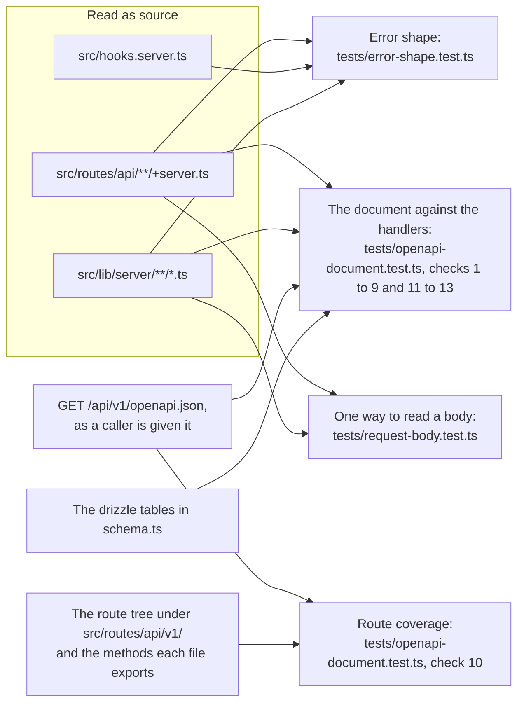

### 1. Error shape: `tests/error-shape.test.ts`

Every failure the API answers is JSON with a `message` and no `error`. The test reads every
`+server.ts` under `src/routes/api`, `src/hooks.server.ts` and every file under
`src/lib/server`, and looks at each place that answers a failure.

| Written as | Must be |
|------------|---------|
| `json(...)`, `Response.json(...)`, `new Response(...)` or `text(...)` with a status of 400 or above | A body that is an object written out where the answer is made, with a `message` key and no `error` key. For `new Response` the object is looked for inside `JSON.stringify(...)`. A body that is plain text fails |
| `error(status, ...)` from `@sveltejs/kit` | Given a text, or an object with a `message`. `error(404)` with nothing fails, because it answers `Error: 404` |

- **What it cannot read it does not pass.** A status that is not written as a number, a body
  that is a variable and a spread in a body each fail, naming the file and the line. The one
  status that is not a number and is understood is `e.status` inside
  `if (e instanceof SomeError)`.
- **There is an allow-list of one.** `ALLOWED` names, by file and line, the answer in
  `api-errors.ts` whose status is the status of the answer it replaces. An entry that no
  longer matches a finding fails the test, so move that line and the list has to follow.
- **It checks that it looked.** It fails if it finds fewer than 400 `error()` calls or fewer
  than 30 `json(...)` answers with a status, so a parser that sees nothing cannot pass. The
  floor was 600: card 2117 moves each handler's refusals of its fields into the readers of
  `src/lib/server/request-body.ts`, which make them in a few calls between them, and the
  count falls with each slice of it (536 after its second, 496 after its third).

### 2. The OpenAPI document: `tests/openapi-document.test.ts`

`src/routes/api/v1/openapi.json/+server.ts` is written by hand, and the `/docs` page is
drawn from it. The test reads the document as a caller is given it, finds the handler for
each operation in the `+server.ts` its path names, and works out from the source every
status the handler can answer, whether it reads a body, which query parameters it reads, and
every text it can answer with. A status or a text counts as the handler's if it is in the
handler, in a function of the same file it calls, or in a function it imports from the
repository, the guards in `route-guards.ts` above all. For the texts a function is read as
it was called: `requireBoard(user, id, 'view')` answers "No access to this board" and not
"No edit access to this board", which is in the same line of it.

| # | The document must |
|---|-------------------|
| 1 | Give every operation a `401` and a `429`, unless it declares `security: []`, and a `500` |
| 2 | Give an operation a `requestBody` exactly when its handler calls `request.json()`, and then a `400` and a `413` |
| 3 | Declare every `{parameter}` of a path as a required path parameter, and have no `$ref` that names nothing |
| 4 | Document every failure a handler can answer, the successes it returns and no others, and no failure that neither the handler nor the gate answers |
| 5 | Document the query parameters a handler reads, and no others |
| 6 | Tag every operation with a tag in `tags`, and list no tag without an operation. The `/docs` page lists an operation only under a listed tag |
| 7 | Answer every failure with a schema that is an object with a required string `message`, and have no `error` key in an example of one. Use no `nullable`, which means nothing in OpenAPI 3.1, and no `allOf`, `oneOf` or `anyOf`, which the `/docs` page cannot draw |
| 8 | Give each schema that mirrors a table that table's columns, each with the column's type, and require every one of its properties |
| 9 | Have exactly `OPERATIONS` operations (80), each with a handler that was read and a status found in it |
| 11 | Give every property that counts tokens `format: 'int64'`, in the token schemas and in what the token operations send and answer. One entry may hold 10,000,000,000, which 32 bits do not |
| 12 | Say of every property of an answer whether it is always there: every schema that describes an object in an answer has a `required`, and a property is in it or is listed with the reason it can be left out |
| 13 | Give no example of a refusal whose `message` its operation cannot answer: the text is a string, or what a template makes, in the handler or in what it calls, or in the gate for a body at fault, a `401`, a `404`, a `405`, a `413` and a `429` |

Check 10 is [route coverage](#3-route-coverage-check-10-of-the-same-file).

Five lists in the file are the only exceptions, and each fails the test when it has
outlived its reason:

| List | Holds |
|------|-------|
| `MIRRORS` | The schemas that mirror a table, with what the API `adds` beside the row, a column it `withholds`, a column it answers `retyped`, and a property an answer is `sometimesAbsent` from, each with the reason |
| `SOMETIMES_ABSENT` | For every other schema of an answer, the properties an answer does not always have, each with when it is left out: `cycle`, `graph`, `cardTitles` and `subtaskTitles`, `parentCardId` on a card and on a withheld subtask of a plan (card 2129), the burndown's `options`, and the lists a `direction` or an `include` decides |
| `BUILT_AT_RUN_TIME` | An example whose text is in no source file as it is answered. Empty: every example is a literal or a template of its handler |
| `READ_AND_NEVER_ANSWERED` | A status the reading finds for an operation which that operation never answers. One entry: `POST /api/v1/tokens/bulk`, whose `403` and `404` become lines of its `409` |
| `QUERY_READ_ELSEWHERE` | An operation whose query parameters are read in a function the reading cannot follow. One entry: the burndown, read in `parseBurndownQuery` |

What cannot be found in the source is the shape of an answer. A last group of tests in the
same file calls the real routes and compares the top-level keys of each answer with the
schema the document gives for it. Every call it makes is also held to the `required` lists
of the schema documented for the status it was answered with, at every depth, and the last
test of the group fails unless an answer of every operation was held so. Those answers are
an administrator's, in which nothing is withheld, and keys and `required` say nothing of a
null where the schema has an integer: one more test reads a viewer's dependencies and
summary, whole and compact, with a blocker, a subtask and a moved member card on a board
they cannot open, and holds every value to its property's `type` with `typeFaults()`
(card 2129). `Webhook.url` is in `MIRRORS` as `sometimesAbsent`, left out as the secret is
(card 2133).

### 3. Route coverage: check 10 of the same file

The document and the route tree agree in both directions, on paths and on methods. Every
`+server.ts` under `src/routes/api/v1/` and every method it exports has an entry, and every
entry has a route file that exports its method. The document describes itself, at
`GET /api/v1/openapi.json`, so the check has no list of exceptions.

### Adding an operation

A new route under `/api/v1/` fails these tests until steps 1 to 4 are done. Steps 5 and 6
are not enforced: they are what keeps its answer true as well.

1. **Write the handler so that it can be read.** Refuse with `throw error(404, 'Card not
   found')`: a status written as a number, and a text. An answer that carries more than a
   text is `json({ message: '...', ... }, { status: 409 })`, with `message` in the object
   and the status written as a number. A typed error is rethrown as
   `if (e instanceof SomeError) throw error(e.status, e.message)`.
2. **Read query parameters by name**, as `url.searchParams.get('name')`, so that the name
   can be read from the source.
3. **Add the operation to the document**, under its path with `{braces}` round each
   parameter, with:
   - a tag that is in `tags`. A new tag is added there too, or the `/docs` page will not
     list the operation;
   - every path parameter, `required: true`, and every query parameter the handler reads;
   - a `requestBody` if, and only if, the handler calls `request.json()`;
   - a response for every status the handler can answer, the guards it calls included, and
     for the success it returns;
   - `401` and `429`, unless the operation needs no key and says so with `security: []`;
     `500`; and, with a request body, `400` and `413`. The shared responses under
     `components.responses` are there to be referred to;
   - for every failure, a schema with a required string `message`, and no `error` in its
     example.
4. **Change `OPERATIONS`** in `tests/openapi-document.test.ts` to the new count.
5. **If the answer is a row of a table**, either refer to a schema already in `MIRRORS` or
   add the new schema to it, so that it is held to the table's columns.
6. **Add a test of the answer** to the last group in `tests/openapi-document.test.ts`,
   which calls the route and compares what it answers with the schema.

Then `npm test`. Each check fails with one line for each operation at fault, naming it.

A new operation also fails `tests/access-every-route.test.ts` until it has an entry in
that file's table saying who may call it, as every route under `/api/` does: see
[Adding a route](#adding-a-route).

## What Is Covered

| Suite | Covers |
|-------|--------|
| `tests/harness.test.ts` | The harness itself: in-memory database, schema from the real migrations, foreign keys on, route matching, signed-in and anonymous callers. And the suite: every test file under `tests/` is in the list `TEST_FILES`, and every name in the list is a file that is there. See [The List of Test Files](#the-list-of-test-files) |
| `tests/access-control.test.ts` | Board access decided from the row: body `boardId` ignored on card, subtask, label, column, category and reorder routes; archive, restore, favourites, templates, request accept, comments and task lists checked; writable-field whitelists; webhook secrets and addresses, to the board's owner and an administrator only (card 2133); superadmin accepted wherever admin is. See [Authentication & Security](authentication-security.md) |
| `tests/access-every-route.test.ts` | Who may call every route and method under `/api/`, from a table with an entry for each of the 215: nobody is refused by the handler and through the gate, each signed-in caller the entry's kind refuses is refused with no row changed, no file written and nothing sent, the outsider is refused again with a board of their own named in the body, a request that names a second board's thing in its body needs edit access to both boards and is refused to a caller who can edit one and view the other, the public request form's two routes refuse a caller with no token and with a wrong one, a request's link does not open another request, a list filtered by board gives a caller nothing of a board they cannot open, and the caller the kind lets in is answered with nothing of a board they cannot open. The ways into a board that are not membership are each tried: a team it is shared with, its being public, a grouping it is filed under, a milestone that belongs to no board and a task request addressed to a team. Below the table: the live event stream sends a listener the events of the boards they can open and no other, a report of a grouping holds the boards its reader can open, only the superadmin manages an administrator's account on each of the four routes that manage one, the invite route among them, a role is `user` or `admin` and nothing else on both routes that write one, nobody changes their own email or their own role on the users route, the superadmin included (card 2117), no account route answers a password hash, `isPublic` from an editor saves nothing and is a boolean from anyone else, both routes that create a board answer alike for a sub-board, the graph lists a sub-board and draws a dependency only to a caller who can view the other end, a refusal to remove a dependency is the same whether the link is there or not, and a removal is told to both ends' boards and recorded on the waiting end's, and putting an existing board under a card (`PUT /api/boards/[id]` with `parentCardId`, card 2139): the board's owner, or a member shared as Owner, with edit access to the card's board, links it, moves it to another card and takes it out with `null`, and the three boards concerned are sent a live update; the card it already hangs under, sent back, changes nothing and tells no board it did not leave or join, the board itself being told once of the rename sent with it (card 2143); an editor of the board is refused `403` in the link's own words, with nothing that came with the request saved; an owner who cannot edit the card's board is refused in the words for creating a sub-board; a card that is not there is `404`, and one that is no id `400`; a card on the board itself or on a board one or two levels beneath it is `409`, with nothing saved; a loop already in the data does not stop the check, and a board in one can be taken out of it; and `linkableBoards` offers the top-level boards the caller owns by `getBoardRole`, every one to an administrator, never this board or the top of its chain of parents, and nothing to an editor who owns none or to a caller who cannot edit the board; it reads the database as often with forty more boards as without them, for an owner and for an administrator, offers a board on which the caller is a member stored as owner and not one stored with any other text; and `getBoardRole` reads a member row stored with a role other than the three (`admin`, `Owner`, `''` and more) as a viewer, who may not make the board public. And what is read of boards a caller cannot open: recent activity filtered before its limit, and read newest first by its index of time, by `EXPLAIN QUERY PLAN` (card 2126); what the lists of people, teams, groupings, categories and the request form give, and the email addresses of a public board's page, card context and share list (card 2128), and no page load giving an ordinary caller an address but their own (its review); the other end of a dependency withheld in 17 answers, and a moved card of a milestone withheld in the summaries, the plan page, both PDFs and the milestone's own read, and left out of its burndown in both trees, with the PDF's words for a withheld step (card 2129 and its review); and every page load, called through `pageLoad()` as a former member and as a viewer, refusing them or giving nothing of a board they cannot open, with the sub-board left off its card, the tile and the dashboard's figures, its open cards counted on the board page's card with no name, the breadcrumb withheld and the personal figures counted on boards the caller can open (card 2130). A route or method with no entry fails the first test, as does a `fallback`, an `OPTIONS` or a `HEAD`, a `+server.js` and a `+server.ts` outside `src/routes/api`. The faults it finds are recorded and not hidden. See [Access for Every Route](#access-for-every-route). Card 2172's limit changed card 2139's case of a loop already in the data: a board linked under a card on a board below a loop is refused `409` in the depth limit's words, the loop check having ended and found none of its own, and the page offers no board to link there; a board in the loop is still taken out of it, `200`. |
| `tests/card-completion.test.ts` | One definition of Complete and On Hold for the browser and the server, and one completion path: each of the three ways to move a card (drag, card update, API move) stamps the same dates, awards XP once, writes one activity entry, and refuses alike a card with open subtasks, a card whose sub-board is unfinished, a viewer, and a card or a column that is not there; a move between two finished columns is neither a completion nor a reopening; each of the two ways to tick a subtask marks it, leaves its card alone and refuses alike, writes one `subtask_completed` entry saying who ticked it and by which way, and mails whoever asked for the card (card 2108); a drop of several cards is all or nothing; a move to another board drops the labels and category of the board it left; every reader of an action's name in the activity log (board metrics, personal stats, both audit logs, the board's activity list, the activity report, a card's board history and the burndown) sees what the page did and what the API did alike; and the browser has no route to write activity entries. A card created in a Complete column (card 2134), by each of the three ways to create one (`POST /api/cards`, the API's create and accepting a request): completed as a move into it completes it, the dates, the XP for its priority and `card_created` then `card_completed`, by the creator and from the route's source; a column called Done the same; any other column `card_created` alone; `card.created`, `card.completed`, the `created` update, `xp-update` and `celebrate`, none during the transaction; and the card, its completion, its XP and both entries saved together or not at all, each write failed in turn. A request accepted into a Complete column mails the requester "Request accepted" and then "Your request is complete" with its PDF. Duplicate on the board page, with `fetch` stood in for: the copy of a finished card is made, open, in the board's first column that is not a Complete column, the columns given out of order; a card in another column is copied beside it; and a board of Complete columns alone keeps the copy beside the original, where it is completed; the copy made away from the original names its column, `into`, for the board page's message, and one made beside it does not. The parent card the dashboard makes for a sub-board: `firstOpenColumn()` gives the first column, by position, that is not a Complete column, and none when every column is one, and the dashboard's `createSubBoardInline` takes it, and the first column only then (read from its source). The "Card moved" mail, for each of the three ways to move a card: an assignee is mailed for a completion, for a plain move only when it was made on the page, never when they made the move, and never when they cannot open the board (card 2180). The Audit page's log, `GET /api/audit` (card 2127): a filter by action finds the page's and the API's entries alike, `source=ui` and `source=api` tell them apart, `api:` in front means through the API, a source that is neither is `400`, and on both audit logs `card_*` finds the four `card_` entries and not a `cards_purged` beside them, which `cards_*` finds. Archived cards on a sub-board (card 2205), in the world of a card with a sub-board holding one card in Complete, one archived card in To Do and one archived card in Complete: by each of the three ways to move a card, the card completes, and a live open card added to the sub-board still holds it back, counted alone (`has 1 incomplete card`); the board page's card, the card context and the dashboard tile give the sub-board the same figures, 1 of 1 and with the live card 1 of 2; an editor who cannot open the sub-board gets `hiddenOpenCount` 1 for a live open card and has the drop refused, and once that card is archived 0 and the drop taken; a sub-board of archived cards alone holds nothing back and reads 0 of 0; a completed card stays complete, its `completedAt` unchanged, when an archived card under it is restored; the column rename refusal still counts archived cards; and, read from the source, `getCompletionBlocker`, `hiddenOpenCountsFor` and the three loads each call `subBoardProgress(` and none reads a sub-board's columns itself. See [Data Model](data-model.md#one-completion-however-a-card-arrives) |
| `tests/report-mail.test.ts` | What is said when a report is mailed (card 2113), with `effects({ refuseMailTo })` for a mail server that refuses an address. `POST /api/reports/email`: `200` when every recipient was sent it; `200` for a report that reached some, naming the address it did not reach, with each recipient's result; `502` when the mail server refused every one; and `503` with no mail set up, with no PDF built (a spy on PDFKit's `end`, shown to see a build once mail is set up), nothing sent and nothing changed. The scheduled report, `runDueReportSchedules()` called with a time, at `LOG_LEVEL=WARN`: one `WARN` line when every recipient was sent it; one `ERROR` line naming the address it did not reach, with `lastRunAt` set and nothing sent again on a second run; an `ERROR` line saying mail is not set up, rather than that it was emailed; and a `WARN` line, with nothing sent, for a schedule whose board is gone and for one whose board its owner can no longer read, for a board or grouping schedule that names none ("the schedule has no board", "has no grouping"), and for a grouping that is there with no board its owner can read, in the words that name all three reasons a grouping gives no report. The timer's `runDueReportSchedulesOnce()`: a second call while the first is still awaiting its PDF answers `false` and sends nothing, the report goes once and `lastRunAt` is set, and the next call once the run is over runs (card 2113's review, S2). See [Backup & Reporting](backup-reporting.md#schedule-execution) |
| `tests/public-requests.test.ts` | The public request form, the one part of DumpFire reachable without an account: form tokens, who an anonymous caller may list and send to, rate limits, a request held unverified and kept from the team until the requester confirms it by email, and a requester's thread opened only by its own token and never by an email address. A request that cannot be opened (card 2132): with no session and no link, or a wrong one, a pending, an accepted, a rejected and an unconfirmed request and an id with none are each `404` `Request not found` on the read, the thread and a reply as the requester, with nothing saved or mailed; a reply from the team with no session is `401` before the request is looked for; the holder of the link is told the state; and a signed-in caller is still answered `403` or `404`. The board a request names (card 2128): a token holder is listed no board, and the board they send is not read, stored or looked up; a signed-in user is listed the boards they can open, may send none, and is refused one they cannot open. A requester's replies (card 2156): twenty to one request in an hour saved and mailed, the 21st `429` with nothing saved and nothing mailed; a wrong link, an empty message and one too long counting nothing; a reply from the team starting the count again; each request counted apart; the requester replying again once the hour is up; and one `WARN` line at the first refusal, naming the request and not the message. See [Authentication & Security](authentication-security.md#the-public-request-form) |
| `tests/migrations.test.ts` | The migration runner, driven against separate in-memory databases and temporary directories of `.sql` files: a failing file is rolled back and halts the run; which errors are tolerated and which statements are refused; the legacy `card_dependencies` conversion; each of the six reconciled tables rebuilt with every row, reference and id counter intact, and what happens when a rebuild cannot go ahead; the start-up schema check; the removal of `time_entries`; the restore of an older backup; and that a new database, a database in production's shape and one built from the migration files as they stood before the reconciliation all end up as the model exactly. Migration 0053 (card 2106): every foreign key column leads an index, in the model's DDL, on a new database and on the production fixture taken through the runner, and before 0053 exactly the 39 it adds did not; 0053 ends every session and leaves every other table as it was, a later start deletes nothing, and a backup made after a session holds no trace of its id; a file from 0053 on that loses rows must be declared in `tests/rehearsal/one-offs.ts`, judged by the runner's own statement scanner: a `DELETE`, a `DROP TABLE`, a `REPLACE`, a `WITH`, an `INSERT OR REPLACE` or `UPDATE OR REPLACE`, or a trigger whose body deletes or replaces, and not a `DROP INDEX` or a trigger that only waits for a delete; and the rehearsal's `compare` notes a declared loss only in a run that applied its file. Migration 0054 (the review of the three cards): the one file after 0053, with its statements; the log's index on `user_id` and `created_at` in place of 0053's, and the query plans it serves (`/api/audit` and `/api/v1/audit-log` filtered by a person read the index with no sort, `/api/v1/me/stats` counts by person and time, and with a board or a card filtered as well the audit routes read that one's own index and name no `user_id`) with `card_comments.user_id` left as it was; the activity report filtered by a person looking each card's entries and comments up by card; every unused invite deleted, used ones and every other table kept, the rehearsal's note, and nothing deleted at the next start. The timestamp step: its `WARN` and `ERROR` lines, nothing converted at a second start, and nothing converted when the database records a migration this build lacks. See [Data Model](data-model.md#migrations-and-schema-reconciliation) |
| `tests/timestamps.test.ts` | One timestamp form (card 2095). The helper: `stamp`, `toStamp` (every shape, an offset to UTC, a bare date as both edges, a date not in the calendar and anything not a string refused) and `parseStamp`. `timestampColumns` (37 on the model, the date columns and `__drizzle_migrations` left out). `normaliseTimestamps` on every shape, an unreadable value reported with its example, a value that names no real moment (`2026-02-30`, an hour of 24, `9999-99-99 99:99:99`) reported and never converted, a second run converting nothing, and a trigger's refusal rolled back; the restore of a backup holding ISO 8601, and Import Backup's `[WARN] [IMPORT]` line. Every write path of the server modules leaves the stored form. Each comparison that was wrong, on the boundary day where the old code went wrong: `me/stats`, the reports' bounds, ties and dates under another time zone, the dashboard's last activity, All Tasks' sort, board metrics across the end of summer time, velocity, the activity report and its `to`, the audit log, `/api/audit` and `/api/logs` with a bare date, an ISO bound and an offset, and a custom report's last day. A `400` naming the parameter for every bound that cannot be read; `null`, text and anything else for `archivedAt` and `expiresAt`. A session, an API key and an invite whose expiry names no moment, or is ISO 8601 an hour past on the same day, closed, and one still to come open in either form; the sweep of expired sessions clearing exactly the sessions that rule closes. The stored form to the minute, with no seconds, converted, and an hour of 24 or 30 February in it reported. `onTheWire` (a key named `__proto__` kept as a key) and `toIso`; every `/api/v1/` handler answering with the `json` of `v1-json.ts`; 19 v1 answers holding no stored-form string; webhook data. The check after every test, wired. The pages, read as source: every helper that shows a stored time parses with `parseStamp`, no page or component reads one with `new Date()` or patches its zone, the card list sorts as UTC with ties by id, and the audit and reports pages send the dates chosen. See [Timestamps: the check after every test](#timestamps-the-check-after-every-test) |
| `tests/uploads-sweep.test.ts` | The attachment file sweep (card 2107), with ages set by `utimesSync`. Moved: a file no row names, older than 24 hours, to `.trash/<id>/` with its marker, the folder removed when left empty, and a file left by a delete made before the trash. Left alone: a named file, a young one, a sub-folder and what is in it, `.trash`, a folder named `notes`, an empty folder 400 days old, a folder above the card counter (with its `WARN`), a folder `0<id>` beside `<id>` holding a named file's name, an upload in progress, and the margin's edge by a second either way. A file whose name differs from a row's only in case, counted in `caseOnly` and named in a `WARN`. Nothing outside the uploads folder through a linked card folder, a row naming `../../outside.txt`, a linked file, or a `.trash` or `.trash/<id>` that is a link (the file stays, with the `WARN`). Nothing while a transaction is open, nothing and a `WARN` when the rows cannot be read, `MAX(id)` when the counter row is gone, and no line when there is nothing to do. The timers under fake time; `startSchedulers` starting it only when on; and Import Backup putting a swept file back. See [Deployment](deployment.md#the-sweep-files-no-attachment-names) |
| `tests/columns.test.ts` | A column's WIP limit on both routes that update a column (`/api/columns/[id]`, which the board page uses, and `/api/v1/columns/[columnId]`, the documented one): whatever is sent is stored as a whole number of 0 or more and the request is never answered 500. `null`, a negative number and text that is not a number become 0, which means no limit; a fraction loses its fractional part; a number sent as text is read as that number; a request that does not mention the limit leaves it alone; and the API document describes the field the same way. A rename on both routes (card 2134): a column that holds a card renamed into Done, Complete renamed Completed while it holds cards, and a column holding only an archived card are each `409` with the message, which counts the archived cards, with nothing changed and nothing sent; an empty column is renamed into Done and out again, and a column holding cards from Complete to Done, each `200` |
| `tests/database-location.test.ts` | Where the database is (card 2083), with nothing opened, no file written and the machine's `/proc` never read. `databaseLocation` in `src/lib/server/db/location.ts`, through a file system it is given and `path.posix`: `:memory:` and `''` look at nothing; a scratch `DB_PATH` beside the repository's `dumpfire.db` opens as new with only that file and the image's `/app/data/dumpfire.db` looked at and no folder listed, and a file with data with nothing else looked at; on Windows (`path.win32`) `/app/data/dumpfire.db` is `C:\app\data\dumpfire.db`, never the image's, and nothing but it is looked at; at the image's path `/app/data/dumpfire.db`, a file with data opens and names a non-empty `/app/dumpfire.db` beside it as another database, with both files' sizes and times, and one it could not look at stops nothing; no file, or an empty one, is refused beside a non-empty `/app/dumpfire.db`, another non-empty `*.db` in `/app/data` and a non-empty `dumpfire.db-wal`, the line naming each with its size, when it was last written and its way forward and holding neither "remove" nor "delete"; it opens as new beside an empty `-wal`, a `-shm`, a `.backup-temp`, an `.export-temp`, an empty `*.db` and an empty `/app/dumpfire.db`, and with nothing anywhere; a folder named `dumpfire.db` or `*.db` is no database; an image's path that cannot be looked at (`EACCES`) is not refused; a new database is refused beside a folder that cannot be listed (`EACCES`, named) but not one that is not there (`ENOENT`), and beside a `/app/dumpfire.db`, a `*.db` or a `-wal` that cannot be looked at, each named; and `data/dumpfire.db` in `/app` is the image's path. At another path while the image's database has data: an empty `DB_PATH`, which reaches the guard as `/app/dumpfire.db`, and a typo on the volume (`dumpfire.sqlite`, a trailing space, a capital) are refused, naming `/app/data/dumpfire.db` and the way forward; a database with data, and a new one beside an empty image's file, open; and an image's file that cannot be looked at is refused. `entryAt`, on a temporary directory: a file's size and modification time, a folder, and nothing for a missing path or one through a file. `heldInContainerLayer` on mountinfo text: a volume at `/app/data` is not the layer, an overlay root with no mount for it is, an `ext4` root is not, `tmpfs` is, a database file bind-mounted alone leaves its folder in the layer, `/app/data2` is not held by a mount at `/app/data`, the later of two lines for one mount point wins, `fuse.fuse-overlayfs`, `fuse-overlayfs`, `aufs` and `overlay` are known and `btrfs` is not, `\040`, `\011` and `\134` are decoded, and empty text is nothing. The `Dockerfile`'s production stage has `WORKDIR /app`, `mkdir -p /app/data` and `ENV DB_PATH=/app/data/dumpfire.db`, in that order, and the builder stage none. The three start-up lines, each given its facts and with `LOG_LEVEL=WARN`: a new database, a database off the volume and another database beside the one in use (naming both, with sizes and times), each one `WARN` when so and nothing otherwise; nothing for an in-memory database, whose mountinfo is not read; nothing, no throw and nothing on the console when mountinfo cannot be read; and the first two written to the console at `LOG_LEVEL=ERROR`, in the logger's format, and once only at `WARN`. `refuseUserlessBesideAnother`: with no users and another database it writes one `[CRITICAL] [DB]` line naming both files with their sizes and times, without "remove" or "delete", and throws; with a user, or no other database, nothing; the running database's users counted (none after `resetDb`, then one); and `hooks.server.ts` calls it after `runMigrations()` and before everything else it starts. And `db/index.ts`, imported afresh with the driver and `./location` replaced: a refusal is written to the console and the import fails with the driver never made, and a pass is asked with `DB_PATH` before the driver opens it and is kept for `createdAtStart()` and `otherDatabaseAtStart()` |
| `tests/schedulers.test.ts` | Whether an instance runs its backup, report and snapshot schedulers: with `SCHEDULERS` unset they run in a built server and not under the dev server; `on` and `off` decide in either, whatever their case; an empty value is unset; and a value that is neither is reported and gives the default. The decision alone is tested: nothing here starts a scheduler. See [Deployment](deployment.md#environment-variables) |
| `tests/import-working-copy.test.ts` | Import Backup's two ways to restore. As a working copy: every report schedule and webhook switched off, the backup schedule disabled and its destinations removed, the mail settings removed, everything else as the backup has it, and the counts reported; the application's own readers then find no destination, no mail, no report to send and no webhook to call. As it is: all four untouched. The choice by `?outside=`, its default from the scheduler setting, a bad value refused before anything is read, an export in the old JSON format refused `400` before it is read whatever `?outside=` asks (card 2157), and a failed restore leaving all four as they were. The import forgets the cached key the public request form signs with, so a form token made before the import is refused after it. See [Admin Guide](admin-guide.md#restoring-from-backup) |
| `tests/transaction.test.ts` | `inTransaction` and `afterCommit`, driven directly: what a function writes is committed, or rolled back if it throws; the outermost takes the write lock and a nested one is a savepoint; an inner failure the outer part catches is rolled back alone; an async function, or one that returns a promise, is refused and leaves no row; effects wait for the outermost commit, run in order, and are dropped on a rollback; one that throws or rejects is logged and stops nothing; effects queued inside a transaction the helper did not open are dropped and reported; `inTransaction` called while such a transaction is open throws before it runs anything, directly and through `POST /api/cards`; and log lines written inside a transaction are in `system_logs` afterwards, committed or rolled back. See [Architecture](architecture.md#writes-one-transaction-then-the-effects) |
| `tests/test-helpers.test.ts` | The helpers the all-or-nothing tests stand on: `failingWrite`, the snapshot, `effects()` and its `refuseMailTo`, which refuses the addresses it is given and keeps that mail apart, and nothing unless told, while `duringTransaction` still notes a refused mail started inside a transaction, `action()`, `pageLoad()` (data, a redirect, an error, a layout, and a page that is not there), `readBudget()` (it counts every read of every table, in a transaction or not, `iterate` included, and no write; refuses the read past its limit and says it was spent even when the refusal is caught; and cannot be installed with `watchReads`, `failingWrite` or another of itself), the newer builders, and that `eachWriteInTurn` catches each kind of fault it exists to catch |
| `tests/atomic-moves.test.ts` | Card and subtask moves and completion through all five routes (`PUT /api/cards/:id`, `PUT /api/cards/reorder`, `PUT /api/v1/cards/:id/move`, and the subtask update in both trees), each write failed in turn: the card, the XP, the activity entry and the "Unblocked" notice are saved together or not at all, the API's subtask tick with its `api:subtask_completed` entry (card 2108), nothing is sent before the commit, the requester's mail follows the commit, an API move across boards that completes a card mails its assignee "Card moved" (card 2134), and a notice that cannot be written fails the completion. A move out of an On Hold column clears the card's on-hold note (card 2208): by `PUT /api/cards/reorder`, by `PUT /api/cards/:id` with `columnId` and by `PUT /api/v1/cards/:id/move`, to In Progress, and by the last two to another board, the note `''` in the row and in the answer; the note kept on a move between two hold columns, into one, within one and between two working columns; a move to Complete refused for an open subtask, by each route, `409` with nothing written and the note kept; the move recorded by its own entry alone, with no `card_updated`, no `card.updated` and one `update` event; on `PUT /api/cards/:id`, the note the card held sent back with the move not written back, and a new note sent with it written; and the activity report no longer puts the moved card in its `on hold` bucket. Who is mailed that a card moved (card 2180): only the assignees who can open the board the card is on after the move, a member, a member of a team the board is shared with and an administrator, on both page routes, and not one whose membership was deleted or who was taken out of the team; and for a move to another board, by `PUT /api/cards/:id` or a completion through the API, only those who can open that board, the mail naming it. The assignee of `scene()` is a viewer of the board, so that the mails pinned elsewhere still go. The reorder's two caps (card 2209), in its "PUT /api/cards/reorder" describe: 5,001 entries refused `400` before any card is read, nothing moved or sent, and 5,000 passing the cap to the first card's `404`; 101 cards moved to another column refused `400`, nothing moved or sent, and 100 moved with 100 entries and 1,000 deliveries to ten webhooks; a drop on a board of 300 cards, every card named and one moved, let through with one entry; a card named 200 times, to and fro between two columns, refused `400` `updates names card <id> more than once` with nothing moved or sent, and a card that is not there named twice refused so, not `404` (the review's S5); and the order: a viewer's 101 moves `403`, and a bad id among them the field's `400`. |
| `tests/deletes.test.ts` | What a delete removes and what it leaves, judged by the rows left afterwards: an archive touches only the card and a restore brings it back whole; a permanent delete of a card, a column and a board, through both API trees, takes sub-boards at every depth, dependency links at either end and the attachment files, and leaves everything outside the tree; a board's report schedules go, cards elsewhere leave its milestones and its categories, and its categories and its sub-boards' go; Purge Archived Cards and Clear Cards; a board that is not there (card 2211): Clear Cards `404` `Board not found` to an administrator, clearing, recording and sending nothing, and `403` first to anyone else, and its delete through both trees `404` to an administrator and to the owner of another board, where the session tree answered an administrator `200`; removing a board's share from a person or a team that does not have it (the review of group Q-F) is `404` `This board is not shared with that user` (or `team`) with no row changed, after the owner's check, which refuses anyone else `403`, and a second removal of the same share is `404`; the activity entry or system log line each writes, the API's subtask delete's `api:subtask_deleted` among them; who each delete tells (card 2108), every event with its whole payload and the board it is for: each sub-board a card or column delete removes, a deleted board and its sub-boards, the board of the card a deleted sub-board hung from, told `sub_board_deleted`, each board a purge takes cards from, a cleared board, and nobody for a purge with nothing archived; a card inside its own sub-board does not hang the delete; subtask and milestone deletes; and each delete with every write failed in turn changes no row, moves no file and sends nothing. See [Data Model](data-model.md#what-a-delete-removes) |
| `tests/board-tree-loops.test.ts` | Loops in the board tree (cards 2141 and 2142), with every call that meets a loop run under `readBudget(1000)` and the budget asserted unspent. A card moved onto a board beneath it, on `PUT /api/v1/cards/:id/move` and on `PUT /api/cards/:id` with a `columnId`: onto its own sub-board, `409` `Card "<title>" cannot go onto "<board>", which hangs beneath it` with no row changed and nothing sent (an assignee, mail and a webhook on every board set up to see it); two levels down, and again through an archived card in the chain; a card with two sub-boards, the target beneath the second; and moved, `200`, onto a board not beneath it with a loop elsewhere above the target, out of a loop onto a board outside it (after which `boardsInLoops()` is empty), and within a board of a loop. A title sent beside the refused `columnId` is not saved, every read of `boards` the v1 move makes is inside its transaction, a card with 200 sub-boards costs the v1 move exactly the reads a card with one does, refused and moved, so the sub-boards are asked about in one walk up from the target (card 2141's review; asking each in turn cost 213 reads to 14), and a reorder across boards is still `400`. The board page's breadcrumbs on every shape of loop, each crumb a link to its board: none on a top-level board, a clean chain as before, a board under a card on itself one crumb, a loop of two `A › B`, and boards below a loop the loop once round and then the boards between. Every other walk ends on a loop: All Tasks, whose board paths show each loop once round as the breadcrumbs do (card 1990), the board report of a loop board, the completion check of the card a loop hangs from, that card's context and the graph of its board, and the All Boards report and the dashboard, which pin only that those still start from top-level boards. `boardsInLoops()` names each board of a loop with its card, whether that card is archived, and that card's board, and none below a loop or clean, matches the owner's read-only query, is empty with no loop, and makes exactly one read on a chain 5,000 deep. The start-up line: one `WARN` `STARTUP` line naming each board, its card, the card's board, the way out, that one move for each loop is enough, the warning not to delete a board, card or column of a loop, and the admin guide's section, in those words; an archived card marked to be restored from Archived first; a line break or another control character in a name or a title printed as a space, on the console as in the log, so that a name cannot split the line; none with no loop; 20 boards named and the rest counted; said by `reportInstallation()`, which changes no row. What a delete does on a loop, each `200`: deleting a board of it, a board below it, the card it hangs from or its column, a purge with that card archived, and Clear Cards on a board of it, which takes that board too. Clear Cards on a loop board, and a purge with the card it hangs from archived, each write one `INFO` `DELETE` line in the system log naming the board and what went, as a card or a column deleted the same way does, and tell that board `{ type: 'board', action: 'deleted' }`, the boards below it still being told `cleared` or `purged`. And the source check that no recursive query of the board tree is built with `UNION ALL`, which is all it checks. See [A walk that must end](#a-walk-that-must-end-the-read-budget). Card 2172's limit changed one case, on both routes: a card carrying a sub-board moved onto a board with a loop above it, not beneath the card, finds no loop of its own and ends, and is refused `409` in the depth limit's words, a board below a loop counting as past it; a card with no sub-board is moved there, `200`. |
| `tests/sub-board-depth.test.ts` | How deep sub-boards may nest (card 2172). `depthOf` and `heightUnderCard` called directly: a chain counted and stopped one past the limit, and a loop, which reads as past it, ended, with a board whose parent card is gone read as the top. On `POST /api/boards` and `POST /api/v1/boards`: one 20 levels deep made, one 21 deep refused `409` with nothing written, one under a card on a board below a loop refused, and one under a card on a top-level board made as before. On `PUT /api/v1/cards/:cardId/move` and `PUT /api/cards/:id` with a `columnId`: onto a board 18 deep, where the card's deepest sub-board would be 21, `409` with nothing changed; onto one 17 deep, moved; a card with no sub-board moved onto the deepest board; and in a tree already 25 deep, a card lifted part of the way and one moved within the deepest board, each moved. `PUT /api/boards/:id` with `parentCardId`: under a card on a board 18 deep `409`, on one 17 deep linked, and a board of a tree already too deep linked higher; `linkableBoards` offering nothing on a board 20 deep and the top-level boards on one 19 deep. The board page's breadcrumbs: every board above one 20 deep with no "…", and the nearest 20 above one 60 deep with a "…" with no link before them, in at most 30 reads of `boards`, run as an administrator, for whom `canViewBoard` does not read each crumb's board again |
| `tests/deletes-no-parent-key.test.ts` | The same permanent delete on a database whose `boards.parent_card_id` has no foreign key, where nothing removes a sub-board but the delete itself. In a file of its own because it rebuilds `boards`, and every test in a file shares one database |
| `tests/uploads.test.ts` | Attachment files: where the uploads folder is and which folders are refused; a stored file name that climbs out of its folder; deleting an attachment (row in the transaction, file to the trash after it); the trash emptied after 30 days and not before, ten minutes after a start and on the six-hourly tick and not at start-up itself, reaching nothing outside itself; an import putting back the files its rows name; an upload that leaves no file when its row cannot be written, and one that still writes its file when the sweep removes the card's folder between the folder made and the file written; and how an attachment is served: HTML, SVG and PDF as downloads, the inline types as themselves, `sandbox` and `nosniff` on every answer, and the file name encoded |
| `tests/user-delete.test.ts` | `DELETE /api/users/:id`: one test for each of the five columns that name a user with no delete rule, each cleared and its row kept; that the list of five is every such key in the database; the user's XP and uploaded file left in place; all or nothing; the system log line; and who may delete whom |
| `tests/admin-reset.test.ts` | Reset and Vacuum. On a database with a row in every table, Reset clears everything but the system log and the backup history, leaves the id counters and the migration record alone, moves the attachment files to the trash and logs who did it; with any one write failed, or the commit refused, it clears nothing and answers 500. Vacuum leaves the id counters as they were |
| `tests/bulk-endpoints.test.ts` | The endpoints that write many rows in one request, each write failed in turn: column reorder, the bulk milestone attach and detach, bulk dependencies, bulk token entries, clearing a board's categories and resetting XP; clearing the categories of a board that is not there, `404` `Board not found` to an administrator with nothing cleared, and `403` first to anyone else (card 2211); and the mail of a plan made by the bulk attach names the card of a step on the critical path, by its title where the attacher can open it and as on a board they cannot where not |
| `tests/atomic-creation.test.ts` | Creating something that is more than one row: a board with its columns, its owner and its `board_created` entry (card 2143), a card, a subtask, a comment and a team each with what records them, restoring a card through both routes that do it with its `card_restored` entry and one live update (card 2108), a card that is not archived answered as it is with nothing written and nobody told, and the mail settings saved all or none |
| `tests/live-streams.test.ts` | An open live stream and its session (card 2160), through `gate()` with `setInterval` faked: each of the three streams (`/api/events`, `/api/boards/[id]/events`, `/api/logs/stream`) ends at the next heartbeat when its session is deleted, has expired or has no account, and sends nothing more; of two streams on one board, the one whose session ended stops and the other gets the event; a stream goes on when another session of the same account ends, and sends every heartbeat without moving the session's expiry on; `/api/events` and the log stream end at the next heartbeat when an administrator is made an ordinary user, `/api/events` too when an ordinary user is made an administrator, and the board stream goes on for an administrator on the board made an ordinary user; a check that throws ends the stream with one `WARN` line and never escapes the timer; `sessionStillOpen()` is true of an open session only, and `openSessionUser()` gives an open session's account as it is now and null for any other, and neither writes nor logs anything. See [Authentication & Security](authentication-security.md#an-open-stream-and-its-session) |
| `tests/atomic-accounts.test.ts` | Passwords, sessions, invites and set-up: a password change ends the old sessions and starts the new one together; creating a user and their invite; an invite sets one password and cannot be used twice; set-up creates one superadmin and cannot create two, shown with `watchReads`; and no password is hashed while a transaction is open. What setting a password ends (cards 2116 and 2137): issuing an invite ends the account's earlier unused invites, and an earlier link is then a dead link; using an invite ends the account's sessions, its other invites and its API keys; an invite written for the superadmin is refused with nothing written; an administrator's reset ends the user's sessions, unused invites and keys, and the ended key is refused at the gate while a bystander's still works; the holder's own change ends the invites and keeps the keys unless `endApiKeys` is `true`, and anything but `true` or `false` is `400`; making an API key asks for the password, refuses a missing or wrong one with nothing written, checks it outside a transaction and, if the hash changed meanwhile, again outside it before the transaction is run once more, and writes the key's id and not its name or prefix to the system log; and the admin page's load gives the key count of each account the caller may reset, to an administrator and to the superadmin, and `null` for every other. A change of email or role (card 2140): every unused invite of the account ends when the superadmin or an administrator changes its email, when the superadmin makes it an administrator and a user again, and when its holder changes their own email, each all or nothing with the invites deleted before the account is written, the old link then dead on the page and from the form, `invitesEnded` in the users route's answer, the session that asked kept, and one `INFO` line for each route naming who changed whose account and no address; none ends for the same email in other case, an emoji, a username or the role it has; a refusal ends none; the address is looked for again inside the email route's transaction; and `endUnusedInvites()` throws outside a transaction. Wrong current passwords (card 2165), on the email, password and key routes, counted for the session: the eleventh in 15 minutes is `429` with nothing checked or written, the right password included; the three routes share one count; on each route, six sent at once from two sessions, five answered `403` and the sixth `429` with the busy words, five checks made and the places given back after (the review's L1); through `gate()`, another browser of the account is not held up and changes the password, which signs the first out, and another account's guesses are its own; the right password clears the count; the window ends after 15 minutes; a check made again after the hash changed is not counted again; the stored hash changed twice while a change is being saved answers `409` with nothing written and counts one attempt (card 2191); two submissions of one invite, or of set-up, at the same moment each hash, and one gets in; a password that is not text is `400` and not counted; a request with no session cookie is `401`; and each wrong one, and the first refusal of each window and no other, is a `WARN` line naming the route and the user and never the session. Also `/api/account/notifications`: stored preferences that cannot be read are answered as the defaults and can be saved over; every preference key a mail reads, found in `notifications.ts` with the TypeScript parser, is one of `NOTIFICATION_PREFS` and is saved and answered, `email_request_progress` and `email_mentions` among them; with Request Progress off a requester who has an account is sent no progress mail for a move, and with it on again the next; and someone with Mentions off is sent no mention mail (card 2146). Remembered browsers when a password is set (card 2194), five tests: the holder's own change forgets every other browser and remembers the one that made it anew, a refused change forgets none, an invite's use remembers the browser that used it, set-up remembers the superadmin's browser, and an administrator's reset forgets every one and remembers none. Every hash and check goes through `passwords.ts` on the test's thread (`PASSWORD_THREADS=0`), so the file's `vi.mock('bcryptjs')` records whether a transaction was open at each (`afterCompare` and `compared` let a test act between a check and its answer); with a check awaited none can be made inside one, so `expectHashedOutsideTransaction()` is now always true, and the guards that matter are `inTransaction`'s type and the source test in `tests/password-checks.test.ts`. `beforeEach` makes the remembered-browser key once, because the first `rememberBrowser` is a write of its own after the transaction, and `eachWriteInTurn` would otherwise count it in whichever test ran first |
| `tests/password-checks.test.ts` | Password hashes and checks on worker threads (card 2191), sixteen tests, with real threads started by `setPasswordThreads()` and cost-12 hashes made once. The server's thread stays free while six checks are made at once (the longest gap of a 10 ms timer under 60 ms), and through `gate()` a key's request sent 20 ms after four wrong sign-ins at a cost-12 account is answered within 100 ms and before any of them: both `it.skipIf(CPUS < 3)`, since with fewer than three CPUs the two threads share them with the test's own. On a thread: right and wrong answered, and a hash made there checks on the server's thread; `DUMMY_HASH` is a hash at `BCRYPT_ROUNDS` and answers false without throwing (card 2192); the first lane goes ahead of second-lane checks already waiting; a sign-in waiting behind three streams of first-lane checks, each sending the next as it is answered, is made after the third of them, and the twenty go on after it (the review's L1); a thread ended during a check is replaced and the check answered, and a second end fails it; a check against a 60-character value that is not a hash fails alone and the same thread goes on; with no thread able to start, one `ERROR` row and every check answered on the server's thread. The line: one `WARN` past 20 waiting, and not again within five minutes; with the bound set to 3, the fourth sign-in answered `503` with the busy words at once, the account's count unchanged, while a first-lane check queued after it is answered; a caller who has gone never checked and answered `503`; a 500,000-character name echoed at 320. What is queued: anything but text refused with a `TypeError`, and a 600-character password checked by its first 256. The source: only `passwords.ts` imports bcryptjs, and every `checkPassword(` and `checkCurrentPassword(` under `src/` is awaited. See [Authentication & Security](authentication-security.md#password-hashing) |
| `tests/archive-answers.test.ts` | What a page is told when it archives a card, with `fetch` stood in for and no database: the bulk archive asks for each selected card in turn and says which the server did not archive and why, a single archive hands back the answer to check, and a delete is still said to be a delete |
| `tests/atomic-requests.test.ts` | Task requests: accepting one (the card, with the accepter as its `createdBy`, its `card_created` entry, its comments, the assignee with its `assignee_added` entry (card 2143), and the request's status) is one transaction, so a request cannot be accepted into two cards, and the board's webhook and open pages are told of the card after the commit (card 2108); rejecting one; and creating one from the public form, whose board is not read from someone without an account and is held to one a signed-in requester can open (card 2128) |
| `tests/atomic-dependencies.test.ts` | The four routes that add and remove one dependency link, card and subtask, under `/api/v1/` and `/api/` (card 2114): each of the six handlers that wrote no entry, with `eachWriteInTurn`, writes the link and its `dependency_added` or `dependency_removed` entry or neither, and sends nothing for a write that failed; each entry's action, stored spelling, source, board, card and detail, for an address that is a card and one that is a subtask, and for a removal made at the blocking end's address on another board; every handler of the four routes reads the row its address check reads, and the links, only inside a transaction; a link the other way round, written by another writer as an adding handler reads the graph, cannot close a loop; and the activity report counts none of the entries, `dependencies_bulk_added` included, in either spelling, as work on a card, in the window or for the person who wrote them, while any other entry on the card still counts. See [Critical-Path Planning](critical-path-planning.md#how-a-refused-link-is-answered) |
| `tests/check-at-the-write.test.ts` | Access checked at the write (card 2115). The rule, read from the source and failing closed: every handler under `src/routes/api` is parsed with the TypeScript compiler, and every call made before its body is read (the first call, in source order, that is a reader method of the request, `json()`, `formData()`, `arrayBuffer()`, `text()`, `blob()` or `bytes()`, or is given the request, `readBody(request)`) must be one that reads no row (`error`, `Number`, `isNaN`, `pathId`, `requireUser`, `requireSuperadmin`, `isAdmin`, `cookies.get`), or the handler is on `ALLOWED` with its reason (the upload, the public request form, its confirmation, the import); a function given the request that is not a known body reader fails; an `ALLOWED` entry that no longer asks anything first fails; fewer than 120 files, 200 handlers or 50 handlers reading a body fails, so a parser that sees nothing cannot pass; and a handler counted as reading no body whose text reads one (`readBody(`, or `request.` with one of the six reader methods) fails, so a read the parser misses, the request taken out of the event inside the handler or the body read in a function written inside it, cannot pass unseen. The rule itself against made-up source. Each of the 21 handlers, and any added to the read table since (`PATCH /api/labels` among them, card 2010), reads the rows its guard reads only inside a transaction. A membership taken away as the check reads it does not let the write through, for an editor and for a team owner. A board, a team and a share target that are not there are `404` to an administrator and to anyone else, the board's share list read among them (card 2130); and a body that cannot be read is `400` to a caller who would be refused, while a body that can be read is still `403` to them. See [A check made where the write is](#a-check-made-where-the-write-is-the-read-table) |
| `tests/atomic-v1.test.ts` | The documented API: every `/api/v1/` request that makes more than one write, each write failed in turn; `PUT /api/v1/cards/:cardId` validates before it writes; and each path reads what it checks inside the transaction that writes. A restore with `archivedAt: null` (card 2108): recorded as `api:card_restored` and nothing else when nothing else changed, as the restore and then the update with a new title, an `archivedAt` that changes nothing not named in the update and written as no restore, and on its own writing nothing at all (card 2183), and a date refused with nothing written. Removing a user who is not assigned records nothing and tells nobody (`404`). A board made under a card tells the board that card is on, once and after the commit (card 2143) |
| `tests/gate.test.ts` | The gate, through `gate()`: the harness serving every API route in the tree; the `401`s and the `429` with its `Retry-After`, as JSON whatever the request asked for; a key's requests counted against the key once it is checked, a request to a path that is no route among them, a wrong key that begins as a real one spending none of the real key's allowance, two keys of one user counted apart, and a key over its limit not marked as used; requests with no key the gate accepts, a missing header among them, counted against their address, sixty answered `401` and the next `429`, apart from another address's, holding up no real key, and answered and counted where the address cannot be read; an address with a letter percent-encoded (`/%61dmin`, `/%61dmin/__data.json`, `/%61udit`, `/%61pi/v1/me`, `/%61pi/cards`) answered exactly as the plain one is, for a plain user, an administrator and nobody, with `%2F` left as it is, nothing decoded twice, and an address that cannot be decoded answered `400` before the gate; the admin and audit page loads, called with no gate in front of them, turning away everyone but an administrator; a body that is missing, is not JSON or is not an object answered `400` on a v1 route and two internal routes, an array among them (`[]` made a board on `POST /api/boards`), with nothing changed; a body that is not a form answered `400` and not `500` by the attachment upload, with nothing attached, a type that is a form only up to its first `;` among them, and by the form actions of `/login`, `/setup` and `/invite/[token]`, to a page and to a script; `POST /api/admin/import` sent, as the superadmin and as `application/json`, no body, text that is not JSON, a JSON object and a body that runs past its limit, each answered `400` for not being a `.db` backup, with none of it read and nothing changed; valid JSON sent with no `Content-Type` answered `400` as a body that is missing; a body over the limit answered `413` read as JSON, as the attachment upload and as the import; a handler's `error()` answered as JSON to a request with no `Accept` header, with `text/html` and with `application/xml`; a v1 path that is no route answered `404` as JSON with no page and nothing about the key's owner; a method the route does not have answered `405` as JSON with `Allow` and a `Content-Length` that is the body's; `/api/v1/openapi.json` answered with no key and counted against no limit; the five security headers, `X-XSS-Protection: 0` among them, on every answer the gate gives (pages for somebody signed in or not, its redirects and the JSON a page's script is sent on with, its `401`s, its `404` for a remote call, its `413`s, a body with no length read past the limit among them, and its `429`, a v1 answer and a handler's refusal), an attachment's own kept, no header an answer already has replaced, and the public request form's three pages without `X-Frame-Options`; the routes a caller with no session is let through to, exactly the public ones of every route in the tree (each sent a method it does not have, `OPTIONS` last for an endpoint that has all four write methods, as `/api/labels` has since card 2010), `/requestX`, `/request/1`, `/loginX`, `/setupX` and `/faviconX` not among them, a path that begins `/_app` answered by SvelteKit before the gate, and a call to a remote function answered `404` by the gate, to nobody and to an administrator, by `GET` and `POST`, whatever path its header names (`/_app/x`, `/login`, `/api/requests`, `/admin`); the login form and the public request form's routes answering, and not `500`, a request whose address cannot be read, the login form counting such requests together, ten and then `429`; an internal route asked by a script with no session answered `401` `{ message }`, a browser going to its address still sent to sign in, a page sent to sign in whatever it asks for, the form's routes and the documented API answering for themselves, and with no users a browser sent to set-up and a script answered `401`; each of the gate's redirects made as SvelteKit makes it, held against SvelteKit's own functions, and the `Accept` header read as SvelteKit's `negotiate` reads it; a fault in a handler written to the system log at `ERROR` with its reason, route and user and answered `500` `{ message: 'Internal Error' }` with nothing of it, a fault in the gate written once, the `404` for no route not written at `ERROR`, and `handleError` answering SvelteKit's message and never throwing; what the gate leaves as it was outside `/api/v1/`; and the status it logs, beside the address as it was sent, a redirect with where it sends the caller, an invite's address as `/invite/[token]` in the line, its fields and the rows written (encoded, under `__data.json` and as a path under `/invite/` that is no route), no query ever, so no request link's `?token=`, and a remote call at the address it was sent to. Also `guardBody` and `failureAsJson` given a request and an answer directly: a `413` of any class thrown again as SvelteKit's and never made a `400`; an array refused `400`; `formData()` refusing a body not sent as a form `400` with none of it read, reading either form type in any case and with its parameters, answering undici's own refusal of a type that is a form only up to its first `;` with the same `400`, and passing on as it was the fault of a broken form; and a text answer read only when it says it is short. See [Architecture](architecture.md#the-gate). Wrong passwords at one account, from any number of addresses (card 2177), in a describe of its own of seventeen tests, each on the fake clock (`onTheFakeClock()`, `heldFor()` and `heldInTurn()`, see [The Gate Harness](#the-gate-harness)): five wrong from three addresses answered at once, and the next from a fourth held 1, 2, then 4 seconds, in the usual `400` and words, the one `WARN` line naming the account, who is the line's user; the right password signed in after its wait, and the next wrong one answered at once; a username and its email one count; a name that is no account held alike; a name that is no account counted as the lookup reads it, so five at a username in capitals and one in its own case wait alike, none, for an account and for a name that is none (the review's M1); at most 10,000 counts kept, `WRONG_SIGN_IN_KEYS`, the one counted longest ago forgotten first, a count counted again kept (the review's N7); another account not held; the address's own `429` answered first and at once, and not counted at the account; `GET /login` and a key's request answered while a sign-in is held; three sign-ins sent together at five wrong let in one at a time, one held 1 s and answered `400` and two answered `429` with the one-at-a-time words at once, the account's count up by one and its `WARN` line said once (card 2194), and with `SIGN_IN_ONE_AT_A_TIME` off each held 1 s and answered `400`, none `429`; that `WARN` line names an account whose username is 150 characters by its first 100 (the review's W9); the count forgotten 15 minutes after the last wrong one; a 100-character password checked whole after a wait; and, for card 2226, nine wrong at another account and a sign-in to one's own giving nothing back (the tenth `400`, the eleventh `429`), two wrong at a name that is no account staying counted after a sign-in, three mistypes and a sign-in giving those four back, and `refundSignInAttempts` giving back only in the window, never below zero, never a refusal, and forgotten by `resetAllRateLimits`. The `unknown` bucket's ten wrong passwords at one account and its eleventh `429` run on the fake clock too, the sixth to the tenth being held. A browser that has signed in here before (card 2194), thirteen tests: a sign-in sets `dumpfire_known_<id>` with `Path=/login`, `HttpOnly`, `SameSite=Strict` and a year's `Max-Age`; with the cookie, the right password at an account with seven wrong signs in with no wait, and the next wrong one without it still waits 4 s; at an account with none wrong, seven sent together without it: five checked and two `429` at once; a name that is no account held the same way in the same words, with its `WARN` line; a refusal kept counted at its address when the account then signs in from it; a cookie with its MAC changed, another account's under this account's name, one issued before the password was set and one issued 366 days ago, each answered as no cookie, beside the cookie as it was set, which holds; five wrong from a cookie, none counted at the account, the sixth treated as not remembered, and remembered again 15 minutes later; eight sent together with one cookie, five let in at once and three held as not remembered (the review's R2); six sent together, each with a cookie of its own, five checked and the sixth `429` with the one-at-a-time words, nothing counted at its cookie, the account or the address, and the six one after another each checked (the review's L1); ten wrong from one address and then the right password with the cookie from it answered `303`, giving the address nothing back, so a wrong one without the cookie is still `429`; the cookie kept by `POST /logout` and set by it with a session, and not without one (the review's R5); the key made once in `settings` and only by a remembered browser, an old cookie not holding without it, and Reset forgetting it; and the start-up `WARN` while `SIGN_IN_ONE_AT_A_TIME` is off, on the console whatever `LOG_LEVEL` is, `OFF` taken for off and any other value one `WARN` and on. Counting an address (card 2195), eighteen tests: `addressKey` as a table of thirteen rows (an IPv6 address by its /64, with a dotted quad at its end, in capitals, in brackets with a port and with a zone; an IPv4 address with a port and written as IPv6, in either notation; `unknown` and what is no address as they are) and 100 characters kept of what is no address; ten wrong sign-ins from one /64 and the eleventh from another of its addresses `429`, another /64 `400`, and the refusal's line holding the address as received and `counted as 2001:db8:1:2::/64` with the address as its `ip`; an IPv4 address and the same written as IPv6 one count; sixty requests to `/api/v1/` with no key from one /64 and the 61st from another of it `429`; and the public request form's five from one /64. A failed sign-in (cards 2192 and 2193), four tests: a wrong password at a name that is no account makes one password check, as one at an account does, with the same status and words; the failed lines hold nothing typed: a 10,000-character name is one line of under 300 characters with its length, the address and `ip`, a password typed as the name is in no message or meta, and a wrong password typed with the account's email names the account by its username and id, with `user_id`, and not the email; and a file posted as the name or as the password is `400` with the empty-field words. Four tests of card 2226's are in the 2177 describe, above, and `signIn()` takes a cookie. |
| `tests/body-limits.test.ts` | How large a request's body may be, through `gate()`: a declared length over the limit answered `413` with the limit, before anything reads the body, on a page's form action, an internal route, a v1 route, a path that is no route and `/favicon.ico`, to anybody; an attachment declared as 5 MB attached, 26 MB let through and 27 MB refused; the import accepting up to `BODY_SIZE_LIMIT` and no more, `512M` where the dev server was given none, any length for `Infinity`, refused to an administrator before a byte is read, its whole limit given to the superadmin alone (an administrator and a user who declare 2 MB refused `413` with 512 KB), and a backup sent in chunks held to the same limits; a body with no declared length, sent in chunks without end, read to just past its route's limit and answered `413` with the limit on an internal route, a v1 route, the attachment upload, the import, the public request form, Run Backup Now and a public request's confirmation (the last two read their body in a catch of their own, which passes the `413` on), never cancelled and nothing made; the same on the login form as a page and as the JSON a page's script reads; a body in chunks within the limit read as any other, the sign-in form, a v1 write and an attachment among them; the limit held to the byte; a `Content-Length` that is no number counted as none; a `GET`, a `DELETE` with nothing in it and a `POST` with an empty body not asked for a length; a form posted to `/login`, `/setup` and `/invite/[token]` whose body runs past its length answered `413` and not `500`. Then the functions: the limit read exactly as the node adapter's own `parse_as_bytes` reads it, taken out of its source and run, `512MB` no number to either; the `Dockerfile` setting what the application says the image sets; the limit of a route for a caller who is not yet known, nobody, signed in and the superadmin; `heldToLimit()` failing a read past the limit however the body is read, a clone and the stream included, passing a body within it on as it was, handing back a request with no body or no limit as it was, and passing the adapter's own failure on; and the lines of the adapter that say which requests have a body, and that a cancelled body closes the connection. See [Authentication & Security](authentication-security.md#how-large-a-request-may-be) |
| `tests/backups.test.ts` | What a backup holds and what a restore brings in. The bytes of the file an export downloads, and of the copy "Run Now" hands a destination (a stand-in for `createDestination` keeps what it is given), hold no known session id and no known unused invite token, hold a used invite and every user, pass an integrity check and are one file with no write-ahead log, and the running database still has its sessions; a copy with the rows deleted and no vacuum still holds the ids, and the copy `withoutSignIns()` writes out again does not, with nothing left beside it; an invite opened through the gate, and lines the log held from before the gate masked it, leave no unused invite's token in the exported bytes, the lines kept with it masked and the running log unchanged. A restore brings in no session and no unused invite, and signs out whoever sent it and takes their cookie away, through the route. A `.db` backup with users and no superadmin among them is refused `400` with no row changed and no safety copy written, one with no users is accepted, its safety copy holding every setting but the key remembered browsers are signed with (the review's I3), and an administrator is refused before the upload is read. An export in the old JSON format, with a superadmin in it, is refused `400` with `?outside=keep`, `off` and none, before any of the body is read: no row changed, no safety copy written and nobody signed out (card 2157). The type is the media type alone: a body sent as `application/json; x=application/octet-stream` is refused the same way, and a `.db` backup sent as `Application/Octet-Stream; charset=binary` is taken. A restore whose superadmin's row cannot be copied is rolled back, by `restoreFromBackup()` and through the route, with nothing changed, and the route answers it `422` with one `WARN` line; and the import's answer names the superadmin the restored data has, or says set-up is open when it has no users. A restore whose data holds a board beneath one of its own cards writes the line about it at once, one `WARN` under `IMPORT`, and a restore with none writes none (card 2142's review). The line the server writes at start when there are users and no superadmin: one `CRITICAL` row, none with a superadmin, none with no users, and nothing thrown whatever goes wrong; with the database not to be had, one console line for each check that reads it, two since card 2142 added the check for boards in a loop. The running log masked at start (`maskLiveLog()`): an invite's address, an unused invite's token on its own and a request link's `token=` masked in the line and in what is kept with it, a line with no secret and the invites themselves as they were, a second run changing nothing; called by `hooks.server.ts` after the migrations; and a failure said at `WARN`, with nothing thrown. Old failed sign-in lines (card 2193), from a fixture of a password typed as a name, a ` (bad password)` line, a name holding `" from IP 1.2.3.4` and a line break, a 320-character name and an unrelated line: a backup's copy holds none of the names typed, and the running log at start has each line for a name that was no account rewritten whole to its length, the others left, and a second start changing nothing. The key remembered browsers are signed with (card 2194): the bytes of an export and of `generateBackupData()` hold neither its name nor its value, other settings kept; and a restore brings no such row and clears the live one. See [Authentication & Security](authentication-security.md#what-a-backup-holds-and-what-a-restore-brings-in) |
| `tests/gdrive-retention.test.ts` | Retention on a Google Drive destination (card 2238), with `googleapis` replaced by `vi.mock` with a folder held in the file whose `files.list` answers as Drive does (only the fields asked for, in name order, at most 100 files a page whatever the page size, and a `nextPageToken` while more remain), each backup run with `runBackup` at `LOG_LEVEL=WARN`: ten deletable files and retention 7 delete the three oldest by their listed ids with no second listing by name; three files the account may neither delete nor trash are set aside, not counted and not tried, with one `WARN` naming how many and the oldest and no `ERROR`; a file it may only trash is trashed with `files.update` and not deleted, and logged as `moved to the trash`; of two files of one name, one removable and one not, only the removable one is tried; 150 files over two pages are all counted and 143 removed; a page token answered again and again stops after 100 pages with one `ERROR` and nothing removed; every call carries `supportsAllDrives` (and `files.list` `includeItemsFromAllDrives`); a delete that fails with a `500` is one `ERROR` naming the file and the run goes on; and an SFTP stand-in without `listForRetention` is counted from `list()` and trimmed with `delete()` as before |
| `tests/mail-links.test.ts` | Where a mailed link's address comes from, run as a built server by replacing `$app/environment`. An invite, an invite sent again, a public request's confirmation, a reply to a request, the requester's progress mail and an ordinary notification, each sent with a forged `Host` and `X-Forwarded-Host` to a forged address: the link begins with the App URL, with `APP_URL` when there is none, and with `ORIGIN` as the adapter reads it when there is neither, and the forged host is in no mail. With none of the three, the two invites and the public request are refused `503` with no row written, and the progress mail, a notification and a reply's mail are skipped with one `WARN` line each while the move, the assignment and the reply stand. `linkBaseUrl` asked directly for the dev server, which alone uses the request's address, last. And the `WARN` line at start for an `ORIGIN` that is still the image's. See [Authentication & Security](authentication-security.md#where-a-mailed-links-address-comes-from) |
| `tests/mail-escaping.test.ts` | Text in a mail is text (card 2149), each mail recorded by `effects()` with markup in every text it carries: the report emailed by hand, for a board and for a grouping, with the board's or grouping's name and the sender's username escaped and the subject as typed; the scheduled report, run by its own timer with `setInterval` faked, with the schedule's name escaped; the backup failure mail, with a stand-in destination whose upload fails, with the destination's name and type and the error escaped; every mail `notifications.ts` sends, the four progress mails among them, with no text as it was written and every link escaped from an App URL with a quote in it, and a case for every mail the module exports; and a link built from the App URL setting through the comment route. The two mails to a card's assignees, `notifyCardMoved` and `notifyCardUnblocked`, called directly: none goes to an assignee who cannot open the board, and each goes to them once they can (card 2180). See [Notifications & Email](notifications-email.md#text-in-mail-is-text) |
| `tests/page-failures.test.ts` | What pages do with an answer that is a failure, read from their source because no page can be run here: the reports page reads the body of a failed answer with `failureMessage` alone, so a proxy's HTML `502` is a plain message and not a parser error, and makes its PDF preview an `application/pdf` blob whatever type the answer gave, never `res.blob()`; the card's dependency list is read again after a removal that was refused; the import and a card's attachment upload each say which of four things went wrong, read no answer as JSON unguarded and clear their busy flag in a `finally`; an export that was refused saves no file; and the admin page shows the App URL, Backup & Restore, Scheduled Backups, the mail settings and Reset Everything inside `{#if isSuperadmin}`, asks the server for none of them for anybody else when it opens, and names the superadmin to an administrator. What setting a password ends, said on the page: Generate Key on the account page sends the password, reads a refusal with `failureMessage` and shows it, and clears the password whatever the answer; the account page's "End my API keys too" box is not ticked, is shown only when there are keys, is cleared whenever the key list is empty, and is sent as `endApiKeys`; the change clears its busy flag in a `finally` and hides a key it ended, and the page links to `/docs`; the admin page's reset dialog reads the counts again when it opens and shows none until it has, says beforehand how many keys the reset ends and none where the page was given `null`, its toast gives the answer's counts, and on the administrator's own row it says the keys are kept and sends no `endApiKeys`; and the invite page says the form's own dead-link words, which name a change of the account's password, email address or role, and that setting a password ends the account's keys; after a change of role, the admin page's toast says an invite sent earlier no longer works when the answer's `invitesEnded` is above 0. A page whose session has ended: the watch on `fetch` acts only on a `401` from the page's own server under `/api/`, outside `/api/v1/` and `/api/requests`, sends a signed-in page to the login page once, leaves a page with nobody signed in where it is, hands every answer back as it came and cannot make a request fail; a live-update stream that fails waits 3 seconds and twice as long each time up to five minutes, asks before it opens again, stays closed after a `401`, `403` or `404`, has the page re-read when it opens again and stops when the page closes it; and, read from the source, `src/hooks.client.ts` installs the watch once and every stream is opened through `keepStreamOpen()`. The audit console's live log, its `onMount` run as written with a stand-in `EventSource`: it says it is disconnected once the browser has given up on the stream, where it said "reconnecting…" for ever, and shows each entry once when the stream sends its last entries again on reconnecting, and every entry after a server restart; and the admin page knows a `.db` backup by its name in any case. Every page action that can fail says so (card 2109): each write of the archived, All Tasks, teams, admin and reports pages, of the card window and of its label picker (card 2010: a label put on or taken off, made, renamed or deleted, the picker's list and the card's labels changed only for a success, and a label put on or taken off as the answer's `toggled` says), and of the share window, the subtask window, the dashboard and the account page (card 2148: nineteen writes, the account page's `changePassword` and `generateApiKey` among them) is in a table, and every function of those files that sends one must be; for each, and for the board page's restore and archive and its column rename (`finishEditColumn`, card 2134, which sets the new title only on success), the refusal is read with `failureMessage`, `deleteFailure` or the admin page's `sent()` on the failure side, no answer is read as JSON unless it is a success, what was changed before the answer is put back for a refusal (the cover, a role, a destination, a milestone, the share window's role select, the dashboard's star, the account page's avatar and its mail switches) and what says it was done is on the success side alone, and a request that gets no answer is caught; a write whose answer is thrown away (a statement that is the request, after `void`, followed by `.then` or `.catch`, the body of an arrow without braces that is not handed to `sent` or `deleteFailure`, or kept in a variable never read), anywhere under `src/routes`, `src/lib/components` and `src/lib/board` and in a page's event handlers too, is found unless it is on a named list, each entry with the card that puts it right, which fails on an entry no longer found: its 20 entries are all card 2012's, the board page's other writes and `src/lib/board` (card 2148 took off the six found beside them, the share window's `updateRole` came off with card 2115's review, `updateColumn` in `src/lib/board/board-actions.ts` when it began to hand back its answer, card 2134, the drop's request to clear the on-hold note with card 2208, and the bulk move's `reorderCards` with card 2209); the toast store, with timers faked, keeps a failure until it is closed and lets anything else go after 3 seconds, shows the same failure once and three failures at most, the oldest going first, drops a failure whose request was started before a navigation, and `clearErrors` takes the failures alone; `Toast.svelte` clears them when its page goes and on a navigation that keeps the page, counts each navigation in `onNavigate`, and is drawn above every dialog, the seven pages' own included; every failure toast of those pages that follows a request is given the navigation count read before the request, the dashboard's `failureToasts.add` and the board page's for a template's label among them; the card window's message keeps to the top of the window and is brought into view when it is set, and the window leaves Escape to a confirmation the page opened over it; the import says a failure in its report and not in a toast as well, and a backup destination cannot be removed while the destinations are being saved; the admin, teams, reports and All Tasks pages show the shared toast and none of their own, and the card window, its label picker, the share window, the subtask window and the account page say a failure on a line of their own and add no error toast after a request; no page or component calls `alert(`; no file of the table calls a `fetch` but the global one, or does anything of its own about a `401`; All Tasks asks before it archives, in the board page's words from `cardArchiveWarning`, and sends the archive from the confirmation alone; Purge on the archived page is inside `{#if data.isAdmin`; duplicating a card, with `fetch` stood in for, is not "Duplicated" when the copy is refused, stops at the first subtask refused and says how far it got, and the board page says so, naming the column the copy went to when it is not beside the original; a drop onto Complete (card 2130's review), with `fetch` stood in for, is stopped by the open cards of sub-boards the caller cannot open, offering no sub-board to open when only those hold it back, and a move the server refuses, or that gets no answer, comes back `refused` in the server's words, which the board page says in the shared toast before it reads the columns again, with no sound; linking an existing board under a card (card 2139) hands back the answer from `src/lib/board/card-actions.ts`, and the board page asks first in `subBoardLinkWarning`'s words, which say who will no longer see the board on their dashboard, that this board's readers see it on the card only if they can open it too (card 2130) while this board's reports, scheduled ones included, take in its cards for all of them, that this board's editors can move the card and the board with it, that the card cannot be completed while the board has open cards, and what deletes it, sends the link from the confirmation alone, says a refusal with `failureMessage` and says it was linked only for a success; the card window's dependency rows (card 2138): `dependencyEndBody` gives the four bodies for a card row and a subtask row, `dependencyRow` labels a subtask row "subtask #45 of #12" and links it to card 12, and gives a withheld row no link (card 2129), `addDependency` and `removeDependency` build their bodies with it and write no field name themselves, and both remove buttons pass the row; the share window's role select (card 2115's review) offers Owner only on a row stored as owner, hands `updateRole` the select itself, and `updateRole` says a refusal with `failureMessage` on the window's own line, which it clears as it starts (card 2148; it was the shared toast), puts the select back for a refusal and not only for no answer, and reads the list again for a success only; where a refusal is read (card 2148): the share window says a failed load or write on its own line above Close, `role="alert"`, and clears it as each write starts; the subtask window says a refused save or delete above its buttons and does not close for one, and takes a subtask off the card once the server has deleted it, or at once for a New Task's pending one, which sends no request; the dashboard says each refusal in the shared toast, and a sub-board's on its form's line, in the server's words; the account page says each refusal on a line under its control; and the account page draws its mail switches from `NOTIFICATION_PREFS` (card 2146), with `MASTER_PREF`, no key of its own, a switch's new value `notifPrefs[key] === false`, and Mentions and Request Progress in the list; the card window (cards 2147 and 2163) hands the page no `colorTag` and a new card's template labels as `pendingLabelIds`, keeps them through `templateLabelIds` in `applyTemplate`, lists them inside `{#if !card && templateLabels.length > 0}` above the footer and nowhere else, and its Save as Template dialog says a template holds the labels; the board page (card 2164) opens the card its address names in `afterNavigate` and not in `onMount`, looks it up in `data.columns` and not the page's own copy, closes a window already open, and opens the card and calls `replaceState` from `$app/navigation` only after `await nextTick()`, with no `history.replaceState` call (the page's second `afterNavigate`, and `setBoardView`'s `replaceState`, are the list view's, card 2079), and says each template label not put on a new card as an error in the shared toast; and, since the group's review, its `afterNavigate` callback first closes the window when `navigationClosesWindow(from, to, editingCard !== null)` says so, names a label deleted while the window was open as one "that no longer exists" and never by its number, and says a create that made no card in the shared toast before it closes the window or says "Created"; a page left open across a deploy (card 2167): `svelte.config.js`, imported, asks every 60,000 ms and leaves the version's name to SvelteKit, and the root layout imports `updated` and `beforeNavigate`, shows the bar with its words and Reload inside `{#if updated.current}` alone, calls `location.reload(` once, makes a move to another page a full load by SvelteKit's documented pattern, its callback run as written, and draws the bar after `.app-layout`, above every other `z-index` under `src`; the review of that group: the bar is at the foot of the window, its measured height set on the page's root as `--update-bar-space` while it shows, which `.modal-overlay`, the toast and the user badge keep clear of; the user badge is inside `.app-layout`, beneath every window; the badge is opaque, `var(--bg-elevated)` and `var(--shadow-md)`, each of the 17 themes giving `--bg-elevated` as a solid colour, and the audit page, the board's columns and list view, All Tasks' columns, the plan, archived, admin, reports, inbox, home and account pages end their last line or their scroll at `--user-badge-space`, above it (card 2239); the account page's avatar change reads the page's data again (`invalidateAll()`) on the success side alone, returns at once while one is on its way and disables the picker meanwhile; and the subtask window's Save returns at once and is disabled while a save is on its way, its `saving` flag cleared in a `finally`; the board page's live stream (card 2184): `src/routes/board/[id]/+layout.svelte` imports `page` from `$app/state` and its markup is `{#key page.params.id}{@render children()}{/key}` and nothing else, the page calls `connectSSE` once, with `data.board.id`, in the function it gives `onMount`, `cleanupSSE()` in the one it gives `onDestroy`, and no `$effect` calls it, and `connectSSE`, with `EventSource` and `document` stood in for, closes board 1's stream and opens `/api/boards/2/events`, its `visibilitychange` listener added twice and taken away once; the drop out of On Hold (card 2208) sends `PUT /api/cards/reorder` alone, with no second request to clear the note, and clears its own copy of it; the card window (card 2200) sends an emptied on-hold note or business value as `''`, by the two expressions `onHoldNote || (card?.onHoldNote ? '' : undefined)` and the same for `businessValue`, and `saveCard` of `src/lib/board/card-actions.ts`, with `fetch` stood in for, puts both `''` in the body of `PUT /api/cards/{id}`; the subtask window (card 2185) has no colour tag in its script or markup, no colour input, no `colorTags`, and builds `payload` of `title`, `description`, `priority`, `dueDate`, `completed` and `boardId` alone; All Tasks (card 2186) hands the card window `{ ...card, ... }` with its twelve fall-backs, none of them a reporting field or `requestOrigin`, and its `saveCard` sends the five reporting fields after its earlier eight, and All To Do (card 2240), which carries its own copy of those handlers until card 2012 merges them, is held to the same, to the same archive confirmation, and in the table of writes (`saveCard`, `deleteCard`), the shared toast and the CardModal and ConfirmModal list; its page ends clear of the user badge (`.todo-page`) with the pages of card 2239; and the admin page's role select, invite and delete are inside `{#if mayManageAccount(...)}` and off the caller's own row, 🔑 is on it, and `mayManageAccount` and `requireManagedAccount` answer every pair of caller and account, the caller's own included, as the guard did before it asked the rule. `failureMessage`, `uploadFailure`, `duplicateCard`, the toast store, the watch and the stream themselves are called, and the reading is tested against each page as it was and against made-up source. See [Tests That Read the Source](#tests-that-read-the-source). The Reports page reads recipients through `reportRecipients` and lists the addresses of a schedule over the cap, where it counted commas (card 2182). `createSubBoard` in `src/lib/board/card-actions.ts` gives back the new board, the server's words for a refusal, or that there was no answer, and the board page's card menu goes to the new board only when it was made and says a refusal as an error, as its new-card window does for each sub-board refused, the card kept (card 2172). `bulkMove` in `src/lib/board/bulk-actions.ts` gives back the server's words, `null` when the cards moved, or that there was no answer, and the board page says a refusal as an error, keeps the selection and reads the board again either way (card 2209): it came off the named list. |
| `tests/error-shape.test.ts` | Every failure the API answers is JSON with a `message` and no `error`, read from the source of every route file, the gate and the server library, and the check itself tested against each way of getting it wrong. See [Tests That Read the Source](#tests-that-read-the-source) |
| `tests/openapi-document.test.ts` | The OpenAPI document against the handlers, in thirteen checks: statuses, request bodies, path and query parameters, tags, the shape of every failure, the schemas that mirror a table, an entry for every route and method under `/api/v1/` and none without one, a 64-bit format for every count of tokens, a `required` for every property an answer always has, and no example of a refusal that its operation cannot answer. Then the reading itself tested on source made for it, and real routes called, each answer's keys compared with its schema and every answer held to its schema's `required`; and a viewer's dependencies and summary, whole and compact, with work on a board they cannot open withheld, each value held to its property's `type` by `typeFaults()` (card 2129); and a summary's `progress.totalSubtasks` beside `openSubtasks`, whole and compact, counting ticked and unticked subtasks of the member cards and none of an archived member or of a card outside the milestone, and `0` of a milestone whose cards have none (card 2225) |
| `tests/docs-format.test.ts` | How the `/docs` page draws the document's text: `escapeHtml` (in `src/lib/escape-html.ts`, the function the mails use too) escapes the five characters HTML reads as markup, and `formatDescription` escapes HTML and then reads a line break, backticks and double asterisks and nothing else, so that a description holding `<script>` is drawn as text, tried on every description of the real document; a request body as a Python literal; a file saved, and not parsed as JSON, by the samples of the operation that answers a PDF; and the page read as source, drawing HTML only through `formatDescription`, drawing the document's own description, and showing a parameter's allowed values. See [Tests That Read the Source](#tests-that-read-the-source) |
| `tests/dependency-refusals.test.ts` | A dependency link that is refused, asked of each of the four routes that add or remove one (card and subtask, under `/api/v1/` and under `/api/`): a body that cannot be read, no end or two, an end that is not there, no edit access, a link already recorded, an end that waits on itself, an archived end, a link that would close a loop, and removing a link that is not there. Each is answered alike by all four, changes no row and sends nothing. A path id or a body id that is no id is `400` on each route. And the body the card window builds for a subtask row removes the link to the subtask and leaves the link to the card with the subtask's number, from either list (card 2138). See [Critical-Path Planning](critical-path-planning.md#how-a-refused-link-is-answered) |
| `tests/internal-refusals.test.ts` | The internal routes that used to refuse in a shape of their own and now answer `{ message }`: report schedules, with the fields of `PUT /api/report-schedules/:id` each refused in its words, the report and the emailed report, `GET /api/my-tasks` for a caller who is not signed in, and `GET /api/logs/stream` for one who is not an administrator. Each refused request changes nothing. And card 2182's refusals in that shape, the limiter reset before each test: the emailed report's `400` for more than 10 addresses and its `429` past the day's report mail; `POST /api/report-schedules`' `400` for more than 10, `409` for a 21st schedule and `429`; and `PUT /api/report-schedules/:id`'s `400` for more than 10, or for turning on a schedule kept with more, and its `429`. |
| `tests/report-recipients.test.ts` | Who a mailed report reaches (card 2182), with `makeSmtp()` and `effects()`, the limiter reset around each test: `reportRecipients` splitting on commas, semicolons, spaces and lines, dropping a repeat in any case, taking the address in `<address>` and refusing each part nodemailer would mail to someone other than it shows, and each holding a control or format character (U+202E, U+200B, NUL, U+0085), the address beside one kept (the review's N6); the emailed report refusing 11 addresses before the report is built and sending 10, one mail each, an address written twice sent once, and an entry the mailer would misread refused in card 2117's words; the day's 100 addresses, refused whole with one `WARN` for the window's first refusal, the account as the line's user and `{ used, asked, retryAfterSecs }` its detail, another account still sent to, a refused call spending nothing, and the same account sent to again a day and a second later; schedules: 11 addresses or a part that is not an address refused with nothing saved, a 21st refused and another account's first made, a change to 11 refused, a schedule kept with 12 not turned on unless the same change sends 10, one kept on with 12 renamed by the whole row sent back with `enabled: true` (the review's O4), and each schedule made, turned on or re-timed taken from the day's 100, and nothing for a new name, a list cut down or the same time sent back; the scheduled run switching off a schedule kept with more than 10, sending nothing and saying so once, naming its owner, who is the line's user, mailing each address of a list typed with semicolons or one to a line, sending to the address in `Name <address>` and naming the parts it left out, and naming the account that set it up, escaped; a schedule made, run and deleted over and over, held to the day's 100 at the eleventh; and a schedule's list changed (the review's B1): a schedule made empty and given ten, then deleted, ten times, and the eleventh change refused `429` with nothing changed, one address changed to ten taking nine, and the stored list sent back reversed in capitals, or cut down, taking nothing, each read off the limiter with a take of 101 that is always refused |
| `tests/request-body.test.ts` | One way to read a request body (card 2117), with no database: every reader of `src/lib/server/request-body.ts` against its rule, each field reader against what all of them do (`required`, `nullable`, `keep`, `says`, the body's own fields only), a number written as text read as that number and one of 400 digits refused, an id written whole (`"1.0"`, `" 7"`, `"007"`) and not one `Number()` only rounds (`"1.0000000000000001"`), a time with no zone read as UTC, an email address holding `, ; < > " ( )` refused, a colour written `#rrggbb` and nothing else (`readColour`, on `isHexColour` in `src/lib/colours.ts`), a card's cover a colour or one of the eight preset gradients and nothing else (`readCover`, on `isCoverValue` beside it, card 2010), a whole number written whole, a query timestamp with an offset or no zone handed back in UTC, `readLimit` and `readOffset` held to a number SQLite takes and `readQueryCount` to its cap, and the types the readers hand back (three `@ts-expect-error` lines the type check holds). Then the rule, read from the source of every `+server.ts` under `src/routes` and every module under `src/lib/server`: no body read from the request (`json()`, `text()`, `arrayBuffer()`, `blob()`, `bytes()`, `formData()`, `.body`) outside `request-body.ts` and `api-errors.ts` but by a read on `NOT_JSON` (the import, the upload, the gate's count), which fails on an entry that no longer matches, with `STILL_READING`, the list of files that read their body themselves, empty since card 2117's fourth slice moved the last 21 and held so, and at least 80 calls of `readBody` found (95 then); no cast of what `readBody`, `readObjects` or `asObject` hands back; and no body read by a key not written out, spread, handed to `Object.assign`, `keys`, `entries` or `values`, walked with `for…in`, or with a field turned by `Number()`, `String()`, `Boolean()` or `!!`. The check itself is tested against made-up source for each shape it finds and each it lets pass. Then, with the database, a table of cases for 20 of the handlers card 2115 moved onto `readBody` (`PUT /api/teams/:id`, `PUT /api/boards/:id` with its `parentCardId`, the share routes, the v1 column, label, category and webhook routes and more): each refuses a field it cannot use with `400` and its words, with nothing changed; an id that names nothing is `404`; and a value the row already holds, sent back unchanged, is kept. And a new comment, `POST` in both trees, read as an edit is: over 50,000 characters once trimmed, not text, or empty is `400` in its words with nothing saved, and 50,000 is taken, trimmed. Then a table of cases for the 21 handlers of `/api/v1/` that card 2117's second slice moved, every one that reads a body: each refuses a field it cannot use with `400` and its words, with nothing changed; every id in a path is read as an id, on the reads and deletes too; the path's row is looked for, and the caller checked, before a field is read; a board that is not there is `404` to everyone; a category of another board, an assignee not on the card and a card not in the milestone named are `404`; a value the row holds, sent back unchanged, is kept, and another on that row refused; `archivedAt: null` restores a card and nothing else is taken; a card is taken out of a milestone only by someone who may change it, and an archived card is put into none; and the audit log's `limit` and `offset`, the activity report's window and an average cycle time of 0 are read as decision 17 says. Then a table of cases for the 20 handlers of the web application's work routes that card 2117's third slice moved (boards, board categories, categories, columns and their order, cards and their order, assignees, labels, milestones, subtasks and templates): each refuses a field it cannot use with `400` and its words, with nothing changed, an id in the body that names the row checked in the guard's words (`Invalid card ID`); what the path or the body names is looked for, and the caller checked, before a field is read, a new comment in both trees among them; a category of another board, a board grouping that is not there, an assignee not on the card and a card not in the milestone named are `404`; a card is filed under its board's category or a shared one, and keeps another board's it holds, and the card window offers only those two kinds; a value the row holds, sent back unchanged, is kept, and another on that row refused; "Show Add Task" is saved; a card is taken out of a milestone only by someone who may change it, and an archived card is put into none; every id in a path or a query string of those routes is read as an id; the graph draws the superadmin among the administrators; and three of the API's: a card's labels answer 404 for a card that is not there, a dependency batch reads each end as an id and names the entry, and the activity report reads a bare `to` as the end of its day. Then a table of cases for the 22 handlers of the accounts, administration, teams, reports and requests that card 2117's fourth slice moved, every one that reads a body but the request confirmation: each refuses a field it cannot use with `400` and its words, with nothing changed; every id in their paths, and in `GET /api/audit`'s query, is read as an id; the account, the request or the schedule's board is looked for, and the caller checked, before a field is read; a confirmation token that is not text is the `404` a wrong one gets, for a request that is there and one that is not, and a body that cannot be read is no longer read as no token; a manual backup is not run for a body that cannot be read; the backup settings keep what they are not sent and a secret sent back masked; the mail settings are read by their rules and keep a value stored before them; a key's expiry is stored in UTC; `PUT /api/users/:id` holds a username and an email to `POST`'s rules and answers a duplicate `409`; a number written as text, a trimmed name and an empty schedule time are read as the rules say; the audit and system logs' `limit` and `offset` are held to their range; `GET /api/boards/:id/cards` and `GET /api/activity` answer 404 for a board that is not there before 403; and `GET /api/milestones` reads `status` as `open` or `closed`. Then the review fixes to those slices (version 1.7 of the plan): a card is not taken out of a milestone the caller may not change by putting it in another, on the card window's route (another goal, then None), on the API's single attach and `milestoneId`, and in the batch, which lists it under `problems`; `archivedAt: null` with a `milestoneId` restores the card first, and a milestone refused leaves it archived; a move to another board lets the move decide the category the card held, and holds a new one to the board it ends on; All Tasks offers the shared categories; the mail settings answer `{}` `400`; a report's period must not end before it begins; the new limits on a requester's name, a rejection's reason, the mail settings and a backup destination's text, a pasted private key taken; a request deleted that is not there is `404`; the card search reads `exclude` as an id; a `limit` of 0 is the default on the three logs; and, read from the source, what the pages now send: a schedule's recipients separated by commas and its name trimmed, no retention for a box left empty, and names made from a card's title held to 200 characters. Then the second fix pass (version 1.8): addresses in one text separated by commas, semicolons or lines and stored separated by commas, on a report schedule and the backup failure email; an App URL with no scheme stored with `http://`, as `getAppUrl()` reads it, and one still no host refused; an SFTP port cleared, `null`, stored and connecting to 22, the mail settings' port cleared still refused; a duplicate made, with its subtasks, from a card holding a priority, colour tag, due date and category no rule allows, the board page's requests sent to the routes themselves; and a template saved with a subtask's priority outside the four left out |
| `tests/card-covers-and-labels.test.ts` | A card's cover, its recurrence and the label routes the card window's label picker calls (card 2010). `isCoverValue` takes each of the sixteen presets, eight gradients and eight colours, and any colour written `#rrggbb`, and nothing else: not `#fff`, `red`, an address, a gradient of the writer's own or one with more after it, another type, or `null`, which is no cover; `readCover` hands a cover back as sent, `''` and `null` as `null` where null is allowed, and refuses anything else in one text naming `coverUrl`. On both card updates, `PUT /api/cards/[id]` and `PUT /api/v1/cards/[cardId]`: every preset and a hex colour stored as sent, `''` and `null` as `null`; an address, a style, a gradient that is no preset, a list and a number refused `400` with nothing of the request written and nothing sent; and a cover stored before the rule kept when sent back unchanged, and refused as a new value. Recurrence: `PUT /api/cards/[id]` no longer writes `recurrenceRule`, alone or beside another field, the v1 update answers a body of it alone `No valid fields to update`, and every card answer still carries `recurrenceRule` and `nextRecurrence`, as `null`. `POST /api/labels`: no name, a blank one, one of 201 characters, a name or a colour of the wrong type and a colour that is not `#rrggbb` refused `400` in their words with no row; a name stored trimmed and `#6366f1` when no colour is sent. `PATCH /api/labels`: a rename and a recolour answered with the row, the board told once and after the commit; only what is sent changed; the same refusals as a create, an empty name, neither field, and an id that is no id each `400` with nothing changed; `404` for an id that is no label; and a colour stored before the rule kept when sent back with a rename, and refused as a new colour. Read from the source: every `style` that draws a cover, in any `.svelte` file under `src`, is inside `{#if isCoverValue(...)}` of the very value it draws, which are the board's strip and the card window's header strip and custom swatch; the board draws the strip as the first child of each card, absolute, 6 pixels high, as the category strip is placed; and the card window offers the label picker and the cover presets on a saved card only, the labels whether or not the board has any, with no label picker or preset list of its own left; and the picker offers "Done editing" whenever its edit mode is on, labels or none, ends edit mode when the last label goes, by a delete or the board's reload, and takes whether a label is on the card from the answer's `toggled`, not from what it believed. That the picker reads each answer is in `tests/page-failures.test.ts`; who may call `PATCH /api/labels` in `tests/access-every-route.test.ts`; and that it reads its guard's rows inside the transaction that writes in `tests/check-at-the-write.test.ts`. See [Data Model](data-model.md#key-schema-notes) |
| `tests/activity-twins.test.ts` | The web application's routes record and tell what their `/api/v1/` twins do (card 2143). Six pairs, side by side: assigning someone, taking them off, editing a comment, making a board under a card, changing a board, and making a milestone on a board, each request made by the same caller to the internal route and to its twin on a fixture built twice. Each makes one entry, with the same canonical action, board, card, user and detail, `source` `ui` against `api` and the name stored bare against with `api:`, and the two send the same live updates and mail. Each internal route with every write failed in turn keeps nothing and sends nothing, and its mail and updates start after the commit. Assigning someone already assigned writes no entry and sends no mail, and sends the one update the twin sends; removing someone not assigned is `404` with nothing written or sent, on both trees. The details: a change of three fields names them in the twin's order, an editor's `isPublic` is refused with nothing recorded, a board put under a card names the field and tells the board and the card's board once each, a change that sends no field records nothing and tells nobody, a milestone of no board writes no entry, and a top-level board writes its entry and tells nobody, on both trees. Accepting a request with an assignee writes `card_created` and then `assignee_added`, by the accepter, in the card window's words. And one set of activity labels for the board page and All Tasks (card 2212): every action written to the log, which is every value of `ACTIONS` and every `action` of a `logActivity` or `logUiActivity` call under `src`, read with the TypeScript parser, has a label in `ACTIVITY_LABELS`, `api:dependencies_bulk_added`, which is not in `ACTIONS`, among them, and each such `action` is a string, a member of `ACTIONS` or a ternary of them; both spellings of a name read alike, with no `api:` or `_`; a name with no label reads as words, `api:time_logged` as "Time logged" and `constructor` as "Constructor"; and both pages import and call `activityLabel` and write none of the table's words themselves, the board page with no `.replace('api:'` and no `text-transform` on `.activity-action`, and All Tasks with no `getActionLabel` and its API badge kept |
| `tests/card-window.test.ts` | What the card window saves (cards 2147 and 2163). The object its `save()` hands the page is compiled from `CardModal.svelte` and run with the window's variables given, `saveCard` of `src/lib/board/card-actions.ts` is called with it, and `fetch` is stood in for, each request answered by the real route through `api()`. A saved card's save sends a `PUT` with no `colorTag`, a `#ef4444` set through the API is still there, and the `card_updated` entry does not name it; a new card is posted with none; and Duplicate still copies the tag. `templateLabelIds` keeps the stored ids that are labels of the board, in their stored order, once each, and leaves out a label deleted since, another board's, `1.5`, `"3"`, `null`, a list inside the list and an object, and gives none for text that is not JSON, `''`, `'null'`, a number, a JSON string or a board with no labels. A new card from a template is posted without its labels, then sent one `PUT /api/labels` for each with the new card's id, and ends with them; none is sent for a card saved again or a new card with no template; a label deleted since (`404` `Label not found`) and another board's (`400`) come back in `labelFailures` in the server's words, with the card and its other labels kept; no answer and a `502` page are said, and the next label is still sent; and a label listed twice is sent once, since a second toggle would take it off. A create the server refused (a title over 500 characters) or that got no answer comes back as `{ isNew: false, title, failure }`, in the server's words, with no card made and nothing more sent, where it came back as created. `navigationClosesWindow` closes the card window for a navigation to another board, a card named or not, and on the same board for a saved card's window when the address names no card (Back), and leaves a window to the card the address names, and a New Task window on the same board (the group's review). What the window and the board page do with these is read from their source in `tests/page-failures.test.ts` |
| `tests/plan-table.test.ts` | A milestone's plan page opening each card of its work table to its subtasks (card 2221). `src/lib/plan-table.ts` is called with what the page load gives through `pageLoad()`, in a world of a milestone of board A with card a1 (two plain subtasks, one of them ticked, and two that carry a dependency, made out of `position` order with two at 0), card a2 with none and waiting on a1, and card a3 moved to board B, which keeps the milestone, and a viewer of A who cannot open B. With nothing open and nothing searched, card rows only, a1 reading 1 of 4 subtasks and a2 0 of 0; a1 opened, its four under it by `position` and then id, the plain ones Done or Open with no blockers and no Unblocks, the ordered ones Startable or Blocked with their blockers, Unblocks and priority; sorted by title both ways and by state, every subtask directly under its own card in its order; text only in a plain subtask's title lists its card, open, with that subtask alone, remembers nothing, and closed again once cleared; the card's own title with the card open draws all its subtasks, and not open the card alone; a card closed by hand under a search stays closed; Blocked draws the blocked ordered subtask under its card, Done finds no plain ticked subtask, and Startable draws all of a matching card's subtasks; `#<id>` and a bare number equal to a subtask's id and no card's find nothing; the state counts are the cards and ordered subtasks, as before, and not the plain ones; Expand all opens the cards with a subtask, the key is `df-plan-open-<id>`, what is stored drops a card no longer in the milestone, and on the read entries that are not positive whole numbers are dropped. Under a search or filter (the review's fixes): a card remembered open and shut for the view is drawn closed; closing it there shuts it for the view and leaves what is stored the same set, as opening it there does, while with nothing filtered a toggle changes what is stored and drops the view; Expand all's label follows the cards drawn ("zebra" lists a1 drawn open, so Collapse all, though a3 is closed), and pressed there it opens or shuts the cards listed for the view and stores nothing, and with nothing filtered it stores every card with a subtask, then none. `burndownKey` is the same after a re-read with nothing changed, a plain subtask ticked and a card moved between open columns, and changes when a card is done, a card joins and the target date moves. The load gives every subtask of a card the caller can open, `id, title, priority, completed` and no `cardId`, in order, and none of a card with none; to the viewer, none of the moved card and nothing of board B anywhere in the data, which is drawn withheld with no subtasks, while the owner gets its three; and `planSubtasks` reads `subtasks` once for forty cards (`watchReads`). Read from the page's source: it draws the table with `cardGroups(nodes, summary.blocked, data.subtasks)` and `tableRows` from `$lib/plan-table`, the subtask button and the blockers expander carry `aria-expanded`, the subtask button has no `aria-label`, its name being its text and a visually hidden " of #{r.id}", every `localStorage` access is inside a `try`, the one `localStorage.setItem` is in `applyOpen` after a return when the stored set came back the same, and every toggle and Expand all goes through `afterToggle` and `afterExpandAll` with `filtering`, `closeCard`, the window's `onClose`, calls `invalidateAll`, and the effect that fetches the burndown reads `burndownSource` (`burndownKey(milestone, nodes)`) and neither `summary` nor `milestone`; and the Progress panel's subtask tile reads `{openSubtasks}/{totalSubtasks}` over "open subtasks / all" (card 2225). See [Critical-Path Planning](critical-path-planning.md#the-planning-view) |
| `tests/board-list-view.test.ts` | The board's list view, one column at a time for a portrait monitor (card 2079). `src/lib/board/board-view.ts` is called directly, with a `localStorage` of a plain map or one that throws put on the global object for a test. The choice is kept under `dumpfire-board-view:<userId>:<boardId>`, one per viewer and per board; with storage blocked, or absent as on the server, nothing is remembered and nothing throws; what is stored and was not written by it (not JSON, `null`, a string, an unknown view, an array) reads as nothing, and a bad column or order as none and priority. The address asks for the list only with `view=list`, its `column` a positive whole number or none; `withViewParams` adds `view` and `column` for the list and takes both off for the board, keeping `card` and every other parameter, never puts the order in, and leaves the URL it was given alone; `openingView` takes the address, then the remembered choice (its order, and its column when the address names none), then the board. The list opens on the first column titled "to do" or "todo" (any case, trimmed), else the first, none on a board with no columns, and keeps a chosen column only while it is on the board. Its rows, of a column held out of order with a pinned low card: priority puts the pinned card first, then critical to low in the board's order within each; Board order is the column as held; neither reorders the column's array; a card that fails the filter is left out in either order; `passesFilter` is the board's search (`#8` too), assignee and Hide blocked tests, and `isFiltering` is on for any of them and not for a blank search. Read from the source: `localStorage` appears twice in `board-view.ts`, each inside a `try`, and nowhere in the page or the three new components; the components make no request (`fetch(`, `$lib/api`, `invalidateAll`); the page draws `<ColumnListView` in an `{#if boardView.view === 'list'}` before the untouched Kanban block, with `{/if}` after it, and `<BoardViewSwitch` first in `.board-header-right`; and its second `afterNavigate`, the list view's, comes after the card window's and reads the view from `to.url`, or from `location.href` on Back and Forward (`type === 'popstate'`), whose stored URL lacks the shallow view parameters, and waits exactly one `nextTick` before `setBoardView` (the card window's address is written first only while both callbacks wait equally); `setBoardView` builds the address from `location.href`, never `$page.url`; and one `$effect` moves the list off a column deleted live through `setBoardView`, once the view has been opened. The row (review fixes) is an `<article>` with no `role="button"` or `tabindex`, its `<h4>` holding a `<button type="button" class="row-open">` whose content is only `#id` and the title, stretched over the row by `.row-open::after` (absolute, `inset: 0`), the milestone link outside the button and, with the Blocked chip, above the stretch (`z-index: 1`), the context menu on the article, a held Enter (`e.repeat`) taken as one press, a focused selected row ringed differently from a selected one, and free chip text in a `.chip-text` span that ellipsises. In the list, the order buttons have a `:focus-visible` outline, `.strip-title` has `min-width: 0`, and changing column scrolls the list to its top. See [Feature Overview](feature-overview.md#list-view) |
| `tests/pricing.test.ts` | What a token costs (card 2014), each figure written out from the published rates read on 2026-10-14 and not worked out from the table it tests. Opus 5.5 is $4 / $20 with cache reads at 0.05x, Sonnet 5.5 $2 / $10 at the usual 0.1x, Haiku 5.5 $0.10 / $0.50 with a note that it is priced at the rate for prompts of 100K tokens or fewer, and the seventeen older rows are kept, twenty in all, verified `2026-10-14`. How an id finds its row: every row by its own id, in capitals and with a date after it; `claude-haiku-4-5-20251001`, `claude-opus-4-20250514`, `claude-opus-4-6[1m]`, `claude-opus-5-5-fast` and `claude-opus-5-5[1m]` by their rows; and an id that is a row followed by a version the table does not list (`claude-opus-5-6`, `claude-opus-4-9`, `claude-sonnet-5-5-1`, a seven-digit version), or by a version written straight after it (`claude-fable-5-10`, `claude-opus-4-10`, `claude-opus-50`, `claude-sonnet-50`), by none, its tokens counted in `unpricedTokens` beside a priced entry, as `VERSION_AFTER_KEY` says: a digit, or a dash and one to seven digits, not a date, a tag or nothing; while `claude-opus-5-5` followed by `-20261001`, `@20261001`, `[1m]`, `-fast`, `-v1:0` or `-20261001-v1:0` still finds its row. A measured breakdown (input, output, cache read, both cache writes) costs what the rates say for Opus 5.5, Sonnet 5.5, Haiku 5.5, Opus 5 and Fable 5.1, to ten places. One entry is priced the same in the card window as in the card's total: `costInputOf` gives the API document's example entry its breakdown, $0.07 where the window's rows said $0.3703, and none to an entry without cache reads, which is priced at the blend; on the ledger, a card's `costUsd` from `getCardTokenTotal` is the sum of its entries each priced through `costInputOf`, $0.09548; for a card with a measured, a total-only (on a subtask) and a split-only entry of one model, `getCardTokenTotal`, `getCardTokenTotals`, `getBoardTokenTotals` and `getUserSpendByPeriod` (the person and the model, today and all time) all say $0.1427, where the grouped ones priced the model as a whole at the blend, $0.441; and, read from the source, every `costOf(` in `CardModal.svelte` is given `costInputOf`. `formatRate` shows a third place only where it is not zero (`$0.125`, `$0.20`, `$20.00`), and `unpricedReason` names a model with no price and the date, or says no model was recorded. The copy of the table in `.agent/scripts/token-usage.mjs` cannot be read here, being ignored by git and left out of the image: it was compared with `MODEL_PRICES` once, by a probe, when the card was built |
| `tests/card-updates.test.ts` | A card update records and announces only what it changed (card 2183), each case on `PUT /api/cards/:id` and on `PUT /api/v1/cards/:cardId`, against one card holding a value in every field the update takes, on a board with a webhook, under `effects()` with "nothing written" judged by `snapshotDb()` and `expectUnchanged()`. Every writable field sent at its stored value: `200` with the card as stored, no row changed, `updated_at` included, no activity entry, and nothing sent. `null` and `''` taken as the same value either way round; a reporting value in another spelling (`"Maintenance"` on `maintenance`) as the value stored; an unchanged body from a viewer still `403` with nothing written. One field changed among many: that field and `updated_at` written, one entry naming it alone, one `card.updated` with that detail and one `update` event. On the session route: the card window's own body, unchanged, writes nothing; a move with nothing else changed is the move's entries and events with no `card_updated`; and a move to another board lets the move clear the category sent back, and writes one of the new board sent with it. On v1: the milestone the card is in, sent back, writes nothing, even one the caller could not now put a card in, and `{}` is still `400` `No valid fields to update`. All Tasks' body with the reporting fields (card 2186): an edited summary stored and named alone, a theme sent as `null` cleared, and nothing written when nothing was edited. A subtask saved from its window, with no `colorTag`, keeps the `#ef4444` it holds (card 2185). And the clear the card window relies on (card 2200): `businessValue: ''` and `onHoldNote: ''` stored as `''` and named, and `businessValue: null` `400` `businessValue must be text` with nothing written |
| `tests/all-tasks.test.ts` | Sub-boards on All Tasks (card 1990). `src/lib/board-tree.ts` with no database: `placeBoards` sends of each board only its nearest parent the caller can open, whether boards they cannot open come between, and its filter category, a category no longer among the caller's (deleted) counting as none and lent to no sub-board; `boardPlaces` built from those gives each board the boards above it from the top down and the category of the nearest that has one, a board the caller cannot open as `null` (a run of them one `null`) that lends no category, and a loop once round, through a board the caller cannot open too; `inBoardFilter` lets a chosen board's sub-boards in at every depth and a category's sub-boards that have none of their own, and no other board; `boardOptions` lists each sub-board straight after its parent one level deeper, at the top level when its parent is in another group or not the caller's, and every board of a loop once; `boardOptionLabel` indents three spaces a level and past eight levels gives the depth instead; `chosenBoardId` takes the filter's value as a string or a number; `inBoardFilter` given a board's id as a number does not throw; `boardPathText` writes the tag with "…". `boardAncestry()` follows an archived parent card and makes one read on a chain 2,000 deep. The load through `pageLoad('/all')`: the owner gets every sub-board card two levels down, each board with its path and filter category, and the filters let the lowest card in; a member of the lowest sub-board alone gets its cards, path `[null]`, and no name of a board above; an editor of the top board gets nothing of a sub-board someone else made under it (no inheritance pinned); each board in the load has only `id`, `name`, `emoji`, `parentId`, `hiddenAbove` and `filterCategoryId`, so no `parentCardId`, maker or category; on a chain 400 deep the boards come to under 200 KB and the page still builds the deepest one's path; and a board whose category was deleted and its sub-boards are filtered under none. `GET /api/cards/search` finds the lowest card by title and by `#id`. And the page's source: the board filter's options pass their ids as strings and nothing reads the filter but `chosenBoardId` and `inBoardFilter`, `matchesFilters` asks `inBoardFilter`, the board filter groups by `filterCategoryId` through `boardOptions`, and the card's tag is the path with it in its title |
| `tests/todo-page.test.ts` | All To Do (card 2240), 47 tests. The To Do role: `columnRole` is `'todo'` for "To Do", " todo " and "TODO", and null for "To-Do", "Backlog" and "In Progress", with the Complete and hold titles unchanged; `isTodoColumnTitle` and `todoColumnIds`; and `defaultListColumn` still opens the list on the first To Do-titled column and falls back to the first. `src/lib/todo-table.ts` with no database: `filtersFromUrl` and `filtersToUrl` round-trip every parameter, `board=12` and `board=cat:3`, and drop (and report) a board or grouping not offered and an unknown priority, state, sort or direction, a grouping kept as `cat:N` however it was spelt (`cat:010` is `cat:10`), and offered (`knownBoardFilters`) only when it holds one of the caller's boards, and a search of nothing but spaces left out of the address; `passesTodoFilters` for each filter alone and together, a board taking in its sub-boards two deep and a grouping its sub-boards, a category and a label by name across boards in any case, `assignee=me` as the viewer and `none` as unassigned, `milestone=none`, Blocked and Startable from `blockedState`, and `#12` matching card 12 alone; `sortTodoRows` in the default order (priority, due with none last, board name, position), each sortable column both ways with empty values last both ways, a pinned card not first and the input not reordered; `filterChoices` drawn from the cards in the board filter's scope, each name once, and `dropUnknownChoices`; and `keepKnownFilters`, after a live re-read, putting a board or grouping no longer offered back on every board with `boardRefused`, and a label, person or milestone no card has any more back on any. The load through `pageLoad('/todo')`: only To Do cards, In Progress, On Hold, Complete and archived To Do cards left out, each with the fields the card window reads; a board with `Backlog`, `Doing`, `Done` sent with `hasTodo: false` and none of its cards, one with `" TODO "` with `hasTodo: true`; the card ids equal to those of All Tasks' To Do bucket for an owner, a member and an administrator over boards with one, two and no To Do-titled columns and a sub-board; a member of a sub-board alone sees its cards with its path hidden above and no name of the board above, an editor of the parent sees nothing of a sub-board someone else made, an outsider nothing; a blocker on a board the caller cannot open withheld and a carried category named and marked; and every address loading the same answer as `/todo`. And the page's source (tests 15 and 16): the address written a quarter second after the last change with `goto(next, { replaceState: true, keepFocus: true, noScroll: true })`, with no shallow `replaceState` and nothing through `window.history` (a shallow write left the arrival address in the history entry, so Back from a board lost the filters), and neither `/todo`'s load nor the layout's reading `url`, so no load runs again; the filters read again from `page.url` when it changes other than by the page's own write, and checked again with `keepKnownFilters` when the data does; the live re-read opened in `onMount` and closed in `onDestroy`, the filters and sort through `$lib/todo-table`, the refused-board notice, a real button in each sortable heading with `aria-sort`, the row's click and its title button opening the card window with the board and milestone links stopping it, the table inside a keyboard-scrollable `overflow-x: auto` box (`tabindex="0"`, `role="region"`) with a title that wraps, a chosen board with nothing in To Do said as that board with Show every board and "every To Do column is empty" only for every board, the table folding to blocks below 1000 px with the filters behind "Filters (n)" and the page's foot clear of the user badge at both widths, a due date read through `parseStamp` and no `new Date(`; `BoardFilterSelect.svelte` giving every board option `value={String(option.id)}`, grouped by `filterCategoryId` through `boardOptions`; the board header's `/todo?board={data.board.id}` after Planning with `BoardViewSwitch` still first, the dashboard's pill after All Tasks, and All Tasks' link after Planning carrying its board filter in a form `filtersFromUrl` reads back as the same filter |
| `tests/colours.test.ts` | What a colour from a request may be, and how a stored one is drawn (card 2162), 69 tests. `isHexColour`, `isSafeColour` and `drawnColour` called directly: `#a1B2c3` is both; `#fff`, `#ffff`, `#ff000080`, `red` and `var(--accent)` are safe and not hex; `red;background:url(//x.io)`, `url(x)`, `#zzzzzz`, `#12345`, `rgb(1,2,3)`, `x y`, `' red'`, `var(--a,red)`, `var(--x, url(//x.io))`, 31 letters, `'   '`, `' red;x:url(//x.io) '`, `5`, `['#ffffff']` and `null` are neither; `drawnColour` gives `''` for `null`, `undefined` and `''`, a safe value as it is, one with spaces, tabs or line breaks around it (`' red'`, `'#ef4444 '`, `'\t#fff\n'`, `'\r\nvar(--accent)\f'`) trimmed, `#94a3b8` for anything else, spaces alone included, and its `fallback` when given. A table of the 24 routes of both trees that store a `color` or `colorTag`, each with its owner and its body, held to the source: 24 distinct routes, every `+server.ts` that reads either field reads it with `readColour` and nothing else, and every such file is in the table. Through `api()`, each route refuses `red;background:url(//x.io)`, `red`, `#fff`, `url(x)`, `5` and `['#ffffff']` with `400` and its words, and `expectUnchanged` shows no row of any table changed, the name or title sent beside it included; each stores `#a1B2c3` as sent and ` #c3b2a1 ` trimmed; the six `colorTag` routes take `''`, which clears a stored tag. A colour stored before the rule (`red;background:url(//x.io)`, set by SQL) on a column, a category and a card's colour tag, in each tree, is kept when a rename sends it back unchanged, and `blue` is still refused. One refusal through `gate()` in each tree: a key's `PUT /api/v1/labels/{id}`, and a session's `POST /api/columns` with `accept: */*`, as a page's `fetch` sends, each `400` JSON in the error shape. `saveCard` of `src/lib/board/card-actions.ts`, with `fetch` stood in for, makes a new card's three pending subtasks with the tags `''`, `#ef4444` and `''`. And the source check of every page: see [Tests That Read the Source](#tests-that-read-the-source) |
| `tests/content-security-policy.test.ts` | The pages' Content-Security-Policy and the font DumpFire serves (cards 2162 and 2203), 15 tests. The configured policy, imported from `svelte.config.js`, is exactly the one in [Authentication & Security](authentication-security.md#the-content-security-policy): `mode: 'auto'`, each directive's list, `style-src-elem` without `'unsafe-inline'`, and no `upgrade-insecure-requests`, `frame-ancestors`, `report-uri` or `report-to`; nothing would make Svelte write a `<style>` element. Through `gate()`, `/login`, `/docs` and `/request` for nobody, and `/`, a board, `/all` and a path that is no route signed in, each carry it with a nonce on `script-src`, the directives development mode leaves alone, the nonce on every executable script (a JSON data block needs none), a nonce of their own each, and the five headers as before, `/request` with no `X-Frame-Options`; `/login` and `/request` name no Google host and have no `rel="preconnect"`. An internal API answer, a v1 answer, the gate's `401` and a redirect carry no policy, and an attachment's is exactly `sandbox`. With `CSP_MODE=report-only`, a page carries the same policy, bar its nonce, as `Content-Security-Policy-Report-Only` and no `Content-Security-Policy`, and an attachment still `sandbox`; `secured()` called directly moves a page's and nothing else's; `cspMode()` is `report-only` for that word alone. The start-up line: one `WARN` in `system_logs` for `report-only`, one naming any other value, none for `enforce` or nothing, written to the console at `LOG_LEVEL=ERROR` too, and said by `reportInstallation()`. The theme script is in `src/app.html` with the nonce, and out of the root layout. The font: no file under `src` or `static` names Google's hosts; `inter.css` declares seven faces, `Inter`, `300 800`, `normal`, `swap`, each to a file that exists, the layout imports it before `app.css`, and `app.css` still names `'Inter'`; the folder holds the seven files alone, each `wOF2`, over 4,096 bytes and with its SHA-256 pinned; the licence begins with Inter's copyright line, holds the OFL 1.1, and `inter.css` names its path |
| `tests/markdown.test.ts` | A card's description and its comments drawn one way (cards 2202 and 2210), 79 tests. **Through a jsdom window**: DOMPurify needs a DOM, and jsdom is the one its own documentation names for use outside a browser (happy-dom is "not considered safe" with it), so each test hands `createMarkdownRenderer` the window of `new JSDOM('', { url })`. The suite stays in vitest's `node` environment, which is the no-DOM case. `jsdom` 29.1.1 and `@types/jsdom` 28.0.3 are development dependencies used by this file alone (jsdom 30 needs Node 22.22.2 or later, and `.npmrc` sets `engine-strict`). `isAttachmentAddress`, with the window's origin, refuses the 16 forms another server would be asked for (`//host`, `/\host`, `\\host`, a tab or new line inside, a leading control character, any scheme, `blob:`), each written with an attachment's path; refuses 25 addresses on DumpFire that are no card attachment (`/api/admin/export?1`, `/api/events`, `x.png`, `?q`, the path with `?`, `#`, a trailing `/`, `/..` or `%32`, the full address with `/..` or a query, with a name and password, over `http:`, or on another port); keeps 7 forms of `/api/cards/<id>/attachments/<id>` (the path, padded, with a tab, and the full address on the origin, in capitals, with `:443`); and keeps a full address only on the origin given. What a description or comment may hold: no `<style>` or its text, no style attribute; no class but `language-<name>`, a typed `mention-chip` included; an outside image, as Markdown and as ``, becomes one link to its address reading `🖼 ` and its alt text, or the address, with no other attribute naming the host, and inside a link its text alone; a card attachment, as a path or a full address here, and a `data:` image stay; any other image here (`/api/admin/export?1`, `/api/events`, `x.png`, the attachment path on another origin) becomes a link and leaves no `src`, and on a video or audio any address but an attachment's goes; `srcset`, `poster`, `background` and an outside `src` on video, source and input go; no `dialog` or `open`; no `template`, nor the image it held; no `map`, `area` or `usemap`; no `popover`, `popovertarget` or `popovertargetaction`; an `id` and a `name` prefixed `user-content-`; SVG and MathML leave nothing; a password form, a button and a select are drawn as their text, and a task list keeps its two disabled checkboxes; DOMPurify's own protection and Markdown's output hold (guards). With no DOM, a renderer made with no window and `renderMarkdown` in Node give the text escaped and do not throw. Mentions: an email address is one working `mailto:` link, a link's title and an image's alt text keep their words, a mention in code and link text is chipped, since it is mailed, and a description has no chips; `parseMentions` is `findMentions`' names, lower-cased, each once. And the source checks of [Tests That Read the Source](#tests-that-read-the-source) |

### Writing an access-control test

The pattern is a request that used to succeed and must not, followed by a check
that nothing changed:

```ts
it('refuses an update that names a board the caller can edit', async () => {
	const card = makeCard(A.cols['To Do'], { title: 'Original' });

	const res = await api('PUT', `/api/cards/${card.id}`, {
		user: outsider,                              // owns board B, no access to A
		body: { title: 'Hijacked', boardId: B.board.id }
	});

	expect(res.status).toBe(403);
	expect(cardRow(card.id)?.title).toBe('Original');
});
```

Assert on the database as well as the status. A handler that answers 403 after
writing the row has not refused anything.

That is for a request with a story of its own: a field that was trusted, a check made
against the wrong row. The plain question, who may call this route at all, is not asked
here. It is asked of every route by the table in `tests/access-every-route.test.ts`:
see [Access for Every Route](#access-for-every-route).

## The Expected Schema

`src/lib/server/db/expected-schema.ts` is a generated copy of the model in
`schema.ts`, as DDL. It is not a test file. The migration runner uses it at run time,
in production, to compare each database with the model, and the tests are what keep it
true.

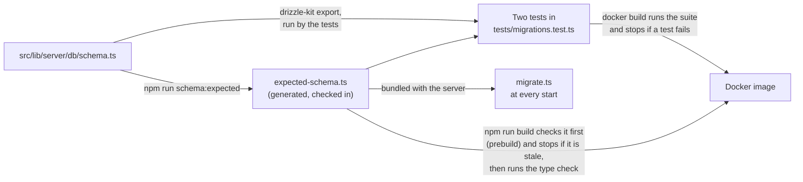

- **After any change to `schema.ts`, run `npm run schema:expected`** and commit the
  result with the change. Never edit the module by hand.
- **Two tests fail if the checked-in module is out of date.** Both are in
  `tests/migrations.test.ts`, under "the checked-in copy of the model". One compares the
  module with a fresh `drizzle-kit export`, statement for statement. The other runs the
  generator with `--check`, which compares the whole file. From the command line,
  `npm run schema:expected -- --check` does the same: it writes nothing and exits 1 if
  the module is out of date.
- **`npm run build` refuses to build a stale module, or code that fails the type
  check.** Its `prebuild` step runs the generator with `--check` and then
  `npm run check` (since card 2110, which also cleared the last two type errors), so a
  build stops, on a workstation or inside `docker build`, when the module is not what
  the model generates or `svelte-check` reports an error. A test in
  `tests/harness.test.ts` ("the build") pins that wiring. The module is
  bundled into the server as it stands, and a stale one is worse than a wrong report:
  the six reconciled tables are rebuilt from its statements, so a foreign key or a
  `NOT NULL` that a stale statement lacks would be removed from the live table.
- **The tests must pass before an image is built, and the build sees to it.** Building
  the image runs the whole suite (`RUN npm run verify` in the `Dockerfile`) and then
  checks the module and the types in `prebuild`; any of them stops the build. Run `npm run verify` first
  all the same, to find out sooner: see
  [Deployment](deployment.md#run-the-tests-before-you-build).

How the runner uses the module is in
[Data Model](data-model.md#the-expected-schema).

## Rehearsing the Runner Against a Copy of a Real Database

The suite proves the migration runner on databases it builds itself. The rehearsal shows
what the runner will do to one particular database, on a copy, before it is allowed to.
Run it before the first `npm run dev` on code that brings a new migration, and against a
downloaded backup before an update:

```
npm run rehearse                              # a copy of ./dumpfire.db
npm run rehearse -- path/to/backup.db         # a copy of any database file
npm run rehearse -- path/to/backup.db --keep  # and leave the copy to look at
```

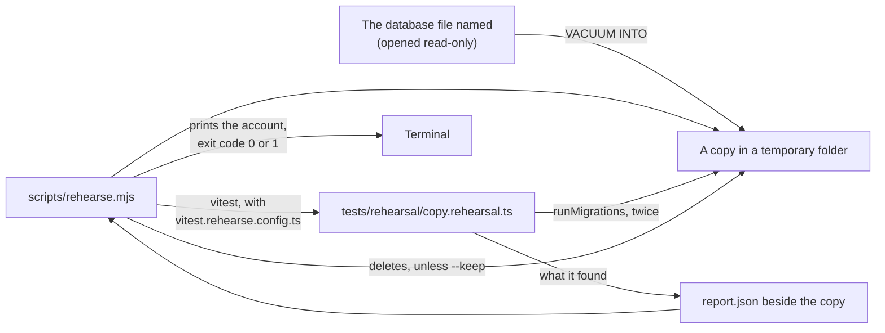

- **The file named is never written to.** It is opened read-only and copied with
  `VACUUM INTO`, which gives a complete and consistent copy even while a server has the
  database open. Only its `-shm` file may get a new modified time: that is SQLite's index
  of the `-wal` file, which a reader maps too, and it holds no data.
- **No server and no scheduler is started.** The runner is called directly, and the
  application's own connection is the suite's in-memory one. A copy of production sends
  no report and uploads no backup.
- **The copy holds everything the database holds**, password hashes and credentials
  included. It is deleted afterwards unless `--keep` is given.
- **It is not part of `npm test`.** Its file is `*.rehearsal.ts`, which the suite's
  configuration does not include.

It fails, with exit code 1, if any of these does not hold:

| Must hold | Why |
|-----------|-----|
| The runner does not stop | A halt here is the server refusing to start |
| No table has fewer rows than it had, unless a one-off declared in `tests/rehearsal/one-offs.ts` took them, in a run that applied its file | The migration record gains one row for each file applied. `time_entries` may go only if it was empty. 0053 empties `sessions` and 0054 deletes every unused invite from `invite_tokens`, and both are declared: each loss is printed under `Worth knowing` |
| The timestamp conversion did not fail | A conversion that failed was rolled back, and converts nothing on either run, so the second-run rule alone would pass it |
| No id counter is lower | An id is never reused |
| No more rows break a foreign key than before | A rebuild carries a broken row across and adds none |
| `PRAGMA integrity_check` says ok, and foreign keys are on afterwards | |
| A second run applies nothing, rebuilds nothing, changes no row count and converts no timestamp | An up-to-date database is left alone |

The comparison is `compare()` in `tests/rehearsal/compare.ts`, and the declared one-offs are
`ONE_OFFS` in `tests/rehearsal/one-offs.ts`: plain modules, which no `include` pattern picks up
and the list of test files does not count, imported both by `copy.rehearsal.ts` and by
`tests/migrations.test.ts`, which tests `compare()` itself. Importing `copy.rehearsal.ts`
from a test file would run its rehearsal there.

It prints the timestamps the first run converted, `Timestamps converted to the stored form
(YYYY-MM-DD HH:MM:SS, UTC): N` with a line for each column and its count, and the second
run's count, which must be 0. On a production export that is the measurement of every
timestamp column, made by the code that will run: see
[Deployment](deployment.md#before-the-deploy-checks-0a-0b-0c-and-0d).

Three things are printed and are not failures, because the server starts with each and
logs it as an error at every start: a table left in the shape it has, anything that
still differs from the model, and a timestamp column holding values in no form the
conversion can read (`Timestamps in no form the conversion can read`, with the count and
an example). On the development database that is the table
`__new_report_schedules`, which `drizzle-kit push` left behind.

What the rehearsal does not cover is the image: that the built server exits on a failed
migration, and that `docker build` produces one that starts. That is the rehearsal in
[Deployment](deployment.md#rehearsing-an-update-against-a-copy).

## Known Gaps

- The suite runs on Linux only inside `docker build`, and has done so on one machine. The
  builder stage of the `Dockerfile` runs it, and on 2026-10-13 it passed there for the
  first time (Docker 29.2.1, `node:22-slim`, amd64) with the totals it then had on
  Windows, `2200 passed | 19 expected fail | 1 skipped`, with no test changed to get
  there. It was built again later that day, as it is now, and passed with the totals it
  has on Windows, `2578 passed | 45 expected fail | 1 skipped` in 30 files (it is now
  `5111 passed` in 56 files, not yet run in a build), each file
  with the same number of tests in both places, again with no test changed. Both
  builds were made from a Windows working copy, in which 27 source files have CRLF line
  endings. From a Linux checkout, where every file has LF, and on the production Docker
  host, it has not yet been run: the next image built there is the first. See
  [Deployment](deployment.md#run-the-tests-before-you-build).
- A passing run prints `[ERROR]` lines. The logger runs at `LOG_LEVEL=ERROR`, and tests
  that cause a failure on purpose leave the application's error line in the output. In a
  build log these read like failures and are not; nothing marks them as expected. None is
  any longer an attempt to reach `smtp.example.test` or `hooks.example.test`: a test that
  let the application try now fails.
- Nothing outside the suite keeps it off the network. The image build's test step is a
  plain `RUN npm run verify`, so that it needs no particular builder, and Docker does
  not cut it off: `RUN --network=none` was written into the `Dockerfile` on 2026-10-13,
  never built, and taken out, because it works only under BuildKit. What is refused, at
  a desk and in the build alike, is what `tests/setup.ts` replaces: `fetch` and every
  DNS lookup. A connection opened straight to an IP address asks for neither and would
  not be refused; nothing under `tests/` opens one. See
  [Deployment](deployment.md#the-suite-inside-the-image-build).
- A PDF answer is not read. `POST /api/reports`, `GET /api/milestones/[id]/pdf` and its
  twin under `/api/v1/` answer the allowed caller with a PDF, in which the mark of a board
  the caller cannot open would not be seen. The report's contents are tested before they
  are drawn (see [Access for Every Route](#access-for-every-route)); the milestone PDF's
  are not, and it is drawn from the summary whose own answer is recorded as a known
  fault.
- Worker threads in a built server are not exercised by the suite. `tests/password-checks.test.ts`
  starts real threads from the source; that a built server's threads find `bcryptjs` in
  `node_modules` was checked once by hand, on 2026-10-15, with a production build on a
  scratch database ("Password checks run on 2 worker thread(s)"), and is the first thing to
  look for after a deploy: see
  [Deployment](deployment.md#the-update-that-brings-password-checks-off-the-servers-thread-and-remembered-browsers).
  Nor is a caller who has gone: `req.socket.destroyed` exists only behind the node adapter,
  and the tests stand in for it with `platform`.
- A running server is not exercised. The gate is tested through SvelteKit's own server
  in the test process, which is not `vite dev` and not a built server behind the node
  adapter. Two things only a built server does are therefore not tested: the refusal of a
  write sent as a form with no matching `Origin`, and the adapter's body size limit. See
  [The Gate Harness](#the-gate-harness).
- No Svelte component or browser tests. What the pages show is therefore checked by
  hand: the confirmation texts that say what a delete takes, and that a page reports a
  failed delete or reset instead of behaving as if it worked. `tests/page-failures.test.ts`
  holds the source to it, page by page and write by write; nothing runs a page.
- An effect is tested up to the moment it starts. `effects()` records a webhook delivery
  or an email and sends nothing, so a receiver's answer and an SMTP server's are not
  exercised. The one answer of a mail server that is, a refusal, is made by
  `effects({ refuseMailTo })`, which throws as a transport does; a timeout or a server that
  cannot be reached is not.
