# Testing

DumpFire's tests run with [vitest](https://vitest.dev) against the real route
handlers and the real database schema. No dev server is started, nothing is built,
no port is opened and nothing touches `dumpfire.db` or the `uploads` folder beside
it.

```
npm test          # run everything once
npm run test:watch
npm run verify    # the same run, refusing a stray .only: what the deploy procedure and the image build run
```

`npm run verify` is `vitest run --allowOnly=false`. A test left marked `it.only` or
`describe.only` makes vitest run that test and skip every other in its file, and the run
still passes. With the flag such a file fails, with `Unexpected .only modifier`, and the
run exits 1. `npm test` leaves the choice to vitest, which allows `.only` unless the
environment variable `CI` is set: at a desk it can be used, and nothing in the image
build sets `CI`, which is why the build's command carries the flag.

The suite is 94 test files and 8,857 tests, and takes about a minute. A run that passes
reports `8857 passed`:

- **None is expected to fail.** A test of a fault that is known and not yet fixed states
  what the application should do, is run with `it.fails`, and fails the suite on the day
  the fault is put right. The last three were put right on 2026-10-15: see
  [Known Faults the Suite Records](#known-faults-the-suite-records).
- **None is skipped.** One was: the request to `GET /api/admin/export` that is let in,
  which could not be made while the handler wrote its copy beside the database, and the
  tests' database is in memory with nothing beside it. The copy of a database in memory
  goes to the temp folder now, and the request is made. On a machine with fewer than three
  CPUs, two are: the tests of `tests/password-checks.test.ts` that time the server's thread
  while two real worker threads check passwords (`it.skipIf(CPUS < 3)`, with `CPUS` from
  `os.availableParallelism()`). With fewer than three, the two threads and the test's own
  share them, and the half-a-check and 100 ms bounds could fail the image build for a fault that is
  not there; the run then reports `8834 passed | 2 skipped`, which is a pass. See
  [Deployment](deployment.md#the-suite-inside-the-image-build).

`npm run verify` is to be run before every image is built, as the quick check. The image
build runs it too: the builder stage of the `Dockerfile` runs `npm run verify` before
`npm run build`, on Linux in `node:22-slim`, and `docker build` stops with no image if a
test fails. See [Deployment](deployment.md#run-the-tests-before-you-build).

The suite was started in October 2026 after a code review found faults that only
a test would have caught: twenty different definitions of "complete", and routes
whose access check depended on a field in the request body. Every fix from that
review comes with a test that fails on the old code.

## How It Fits Together


Six decisions shape everything else:

1. **The schema comes from the real migrations.** `tests/setup.ts` calls the same
   `runMigrations()` a deployment calls, against the same files in `drizzle/`. A
   hand-written test schema would keep passing while the migrations drifted. This
   way a migration that no longer applies to a fresh database fails every test.
2. **The database is in memory, and that is enforced.** `vitest.config.ts` sets
   `DB_PATH=:memory:` before any module loads, and `tests/setup.ts` refuses to run
   if `getDbPath()` returns anything else. `dumpfire.db` holds live board data.
3. **Handlers are called directly.** `api()` finds the handler for a method and URL
   in the real route tree and calls it with the caller the test supplies. That is
   the caller the handler has to defend against: `hooks.server.ts` turns an anonymous
   request away from most paths, but it does not know which board a card is on.
4. **What is around a handler is tested through the gate.** `api()` never meets
   `hooks.server.ts`, nor anything SvelteKit does around a handler. `gate()` sends a
   request through SvelteKit's own server with the real `handle` in front, so a test
   can assert the status, the content type and the body a caller is sent. See
   [The Gate Harness](#the-gate-harness).
5. **Attachment files go under the temp directory, and that is enforced too.** The
   repository's `uploads` folder holds real attachment files, and a test that deletes a
   card moves its files. `vitest.config.ts` sets `UPLOADS_DIR` to a folder under the
   operating system's temp directory, and `tests/setup.ts` refuses to run if it is unset
   or names anywhere inside the repository. `UPLOADS_DIR` exists for the tests. It is not
   a deployment setting: a deployed server keeps its uploads beside its database.
6. **Nothing reaches the network, and that is enforced as well.** A webhook is delivered
   with `http.request` or `https.request` (card 2161; it was `fetch`), and it and a mail go
   to a host whose address is looked up first. The application catches the failure of
   either, so a test that let one be attempted passed all the same, after waiting on a
   resolver for `smtp.example.test`. `tests/setup.ts` replaces `fetch`, every DNS lookup,
   and `http.request` and `https.request` for a host that is an IP address other than
   loopback (`127.*` or `::1`), which makes no lookup, before anything runs; a request to a
   name is left to the lookup's refusal, and one to loopback goes through, for the local
   servers of `tests/webhooks.test.ts`. An attempt is refused at once, and the test that
   made it fails with `This test reached for the network: a DNS lookup of
   hooks.example.test`, or `a request to http://10.0.0.5/x`, naming each address. A test
   that is about a webhook or a mail installs `effects()`, which records it and sends
   nothing. The image
   build relies on the same rule and adds none of its own: its test step is a plain
   `RUN npm run verify`, which Docker does not cut off from the network. See
   [Deployment](deployment.md#the-suite-inside-the-image-build).

## The List of Test Files

vitest runs the files it finds and counts them. It has no way to know that one is
missing: a build from a commit that left `tests/access-every-route.test.ts` out ran the
other 29 files and passed. So the files are listed, in `TEST_FILES` at the top of
`tests/harness.test.ts`, and a test there compares the list with every `*.test.ts` under
`tests/` on disk.

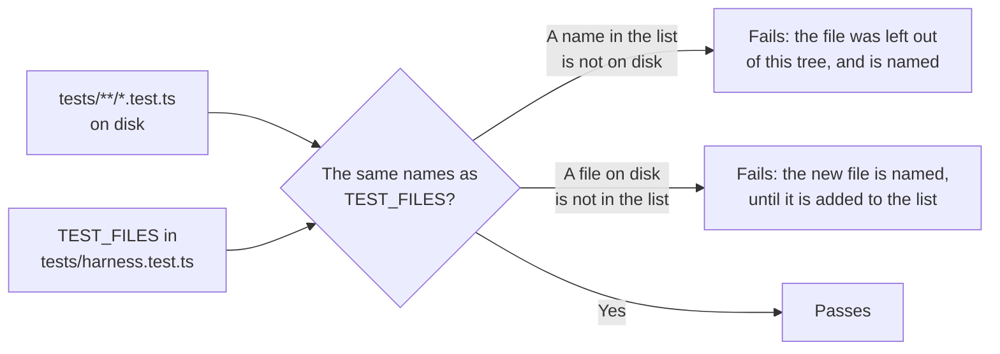

- **A new test file is added to `TEST_FILES`** in the commit that adds it. Until it is,
  the test fails and names it.
- **A test file that is deleted is taken out of the list** in the same commit.
- **The file that holds the list is watched from outside it.** A tree with no
  `tests/harness.test.ts` has no such test to fail, so `tests/setup.ts`, which runs before
  every test file, refuses to run when that file is not there: every test file then
  fails, with `tests/harness.test.ts is missing`.

## Running a Test

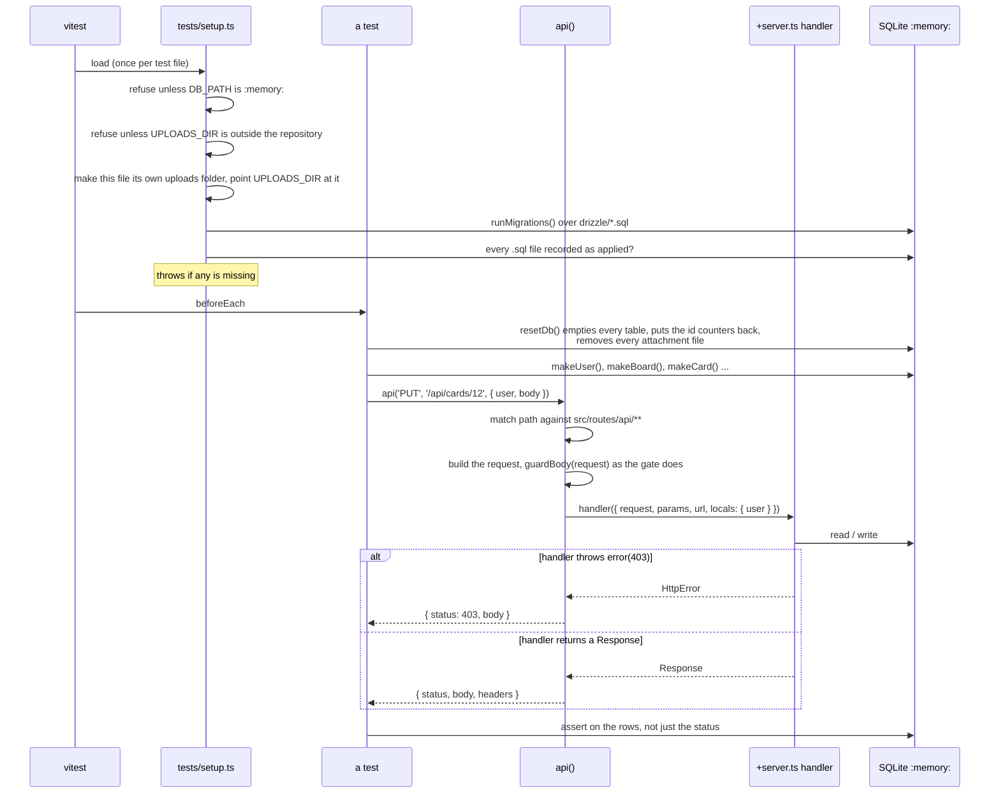

## The Pieces

| File | What it does |
|------|--------------|
| `vitest.config.ts` | Loads the SvelteKit plugin (so `$lib` resolves), sets `DB_PATH=:memory:`, `SCHEDULERS=off`, `PASSWORD_THREADS=0` (every password hashed and checked on the test's own thread a turn later, so that a test's `vi.mock('bcryptjs')` sees every call), `UPLOADS_DIR` to `dumpfire-test-uploads` under the temp directory, and `LOG_LEVEL=ERROR`, and runs each test file in its own process |
| `tests/setup.ts` | Guards against a real database and against an uploads folder inside the repository, gives the test file an uploads folder of its own and removes it afterwards, refuses every `fetch`, every DNS lookup and every `http`/`https` request to an IP address other than loopback, and fails the test that attempted one, applies the migrations, fails if any did not apply |
| `tests/helpers/fixtures.ts` | `resetDb()`, `resetUploads()`, `testUploadsDir()` and builders: `makeUser`, `makeApiKey`, `makeSession`, `makeBoard`, `makeCard`, `makeSubtask`, `makeLabel`, `addBoardMember`, `makeTeam`, `shareBoardWithTeam`, `makeDependency`, `makeMilestone`, `makeComment`, `makeAttachment`, `makeSubBoard`, `assignCard`, `makeWebhook`, `makeSmtp` |
| `tests/helpers/api.ts` | `api(method, path, { user, body, headers })`, which calls a handler directly, guards the reading of its body as the gate does, and gives it the cookies of the request's `cookie` header, with `locals.credential` left undefined unless a `credential` is given (a session's token or a key's row id, as the gate keeps it; card 2251 gives two sessions of one account), plus `routePatterns()`, `routeMethods()` and `serverFilesNotServed()` for tests that walk the whole route tree. The tree is read from `src/routes` on disk each time a test file starts |
| `tests/helpers/gate.ts` | `gate(method, path, { headers, body, ip, platform })` sends a request through SvelteKit's own server with the real `handle` in front. Also `gateApiRoutes()`, the API routes that server serves, `gateRoutes()`, every route it serves with whether each is a page or an endpoint, and `bodyOverTheLimit()`, a body as the node adapter presents one that is too large |
| `tests/helpers/actions.ts` | `action(path, { form, user, cookies })` calls a form action in a `+page.server.ts`, which `api()` cannot reach, plus `pagePatterns()`; and `pageLoad(path, { user, layout })`, which calls a page's or a layout's `load` as SvelteKit does, with `loadKeys()`, every server load there is. The loads are read from `src/routes` on disk each time a test file starts |
| `tests/helpers/failing-write.ts` | `failingWrite()` counts the writes a request makes and makes the nth one throw |
| `tests/helpers/snapshot.ts` | `snapshotDb()`, `diffSnapshots()` and `expectUnchanged()`: every row of every table, to show that a failed request changed nothing |
| `tests/helpers/effects.ts` | `effects()` records every webhook delivery, live event and email a request would send, and sends none. A webhook is recorded from `http.request` and `https.request`, which it replaces while installed: a request carrying `X-DumpFire-Event`, at `end`, answered 200; any other request is handed to the `request` it replaced, the setup's refusal. It no longer replaces `fetch`. `effects({ refuseMailTo })` makes its mail server refuse the addresses named, and `effects({ mailRefusal })` refuse with an error of the test's own, shown each mail (card 2196). Each mail records `files`, `{ filename, content }[]`, the bytes of its attachments, beside their names in `attachments` (card 2150) |
| `tests/helpers/pdf.ts` | `pdfText(bytes)`, the text of a PDF that `pdfkit` wrote: every content stream, as long as its dictionary's `/Length` says, inflated with `zlib`, each `Tj` and `TJ` hex showing decoded, one line per showing. It reads `pdfkit`'s own output and nothing more, so a test can say a report's PDF holds a name or does not (card 2150). The information dictionary (title, subject) is not in a stream: a test that says a name is nowhere reads the bytes as Latin-1 as well. A compressed stream that does not inflate throws (card 2404): it used to be read as no text, which passes every "not in it". It also used to find a stream's end by taking a line end off before `endstream`; a compressed stream ends in its checksum, whose last byte is a carriage return one time in 256, so on some days, by the dates printed on a report, a page read as empty. `tests/report-access.test.ts` reads such a stream, and a scheduled report run on twelve days pinned with `vi.setSystemTime` |
| `tests/helpers/stand-in-request.ts` | `StandInRequest`, the request object the recorder and the setup's refusal hand back (`on`, `once`, `write`, `end`, `destroy`, `setTimeout`, and `answer(status)`), and `requestOf(args)`, which reads the URL, host and headers out of the arguments `http.request` was called with (card 2161) |
| `tests/helpers/each-write.ts` | `eachWriteInTurn()` puts the three above together to prove a request is all or nothing |
| `tests/helpers/timestamps.ts` | `otherTimestampForms(database)` lists every value in a timestamp column that is not a real moment in the stored form (the conversion's own `is_stamp`, so `2026-02-30 08:00:00` is listed) or NULL, as `table.column = <value>`, at most five a column; `allowOtherTimestampForms()` lets the test that calls it leave such values, for the one test; `afterEachTimestampCheck(database)` throws naming each value, and forgets the allowance either way. See [Timestamps: the check after every test](#timestamps-the-check-after-every-test) |
| `tests/helpers/held-body.ts` | `sendAround(method, path, { key } or { session }, body, meanwhile, { headers })` sends a request through the gate with its body held back, runs `meanwhile` once the gate has let it in (a key deleted, a session ended, a role lowered), then sends the body, and answers the status and the answer; `heldBody(value)` is the held stream. The body is JSON, a `FormData` written out as multipart with the page's `Origin`, or bytes as they are, with the `content-type` given in `headers`. A request the gate answers before it reads the body is answered, with `meanwhile` not run (card 2253) |
| `tests/helpers/reads.ts` | `watchReads(table, afterRead)` shows that a check is made inside the transaction that writes, by letting another request's write land between two reads. `readBudget(limit)` counts every read and throws past the limit, so a walk that would never end fails its test in milliseconds instead of hanging the run (card 2142) |
| `tests/fixtures/production-schema-2026-10-12.json` | The structure of the production database as captured on 2026-10-12: every table and index as `sqlite_master` reported it, and the names of the 55 migration files it had recorded. No rows. `tests/migrations.test.ts` builds a database from it to prove that production's shape, which differs from the shape the migrations give a new database, converges on the model |

### `api(method, path, options)`

```ts
const res = await api('PUT', `/api/cards/${card.id}`, {
	user: outsider,                       // a SessionUser, or omit for an anonymous caller
	body: { title: 'x', boardId: 99 }     // sent as JSON; a FormData is sent as multipart
});
expect(res.status).toBe(403);
```

- The path is matched against the real route tree, preferring a static segment
  over a parameter (`/api/cards/reorder` is not `/api/cards/[id]`). A path that
  matches no route throws, so a renamed route fails the test instead of silently
  testing nothing.
- `throw error(...)` and `throw redirect(...)` are turned into a result. Any other
  exception propagates and fails the test: it is a crash, not an answer.
- `user: null` (the default) is an anonymous caller reaching the handler, which
  happens for real on the public paths under `/api/requests`.
- **The route tree is read from the disk when a test file starts.** `routePatterns()` is
  every `+server.ts` under `src/routes/api`, found with `readdirSync`, and each handler
  module is loaded through Vite when a request first needs it. The tree was once listed
  with `import.meta.glob`, which Vite expands when it transforms `api.ts`. vitest keeps
  what it has transformed (in `node_modules/.vitest-cache`), so a route file added on a
  workstation was not in the list until `api.ts` was next edited or the cache was
  removed, and the test that says every route has an entry passed without it. A build,
  which starts with no cache, saw it.
- `routeMethods(pattern)` is what a route exports that answers a request: the five
  methods `api()` calls, and `OPTIONS`, `HEAD` and `fallback` if a route is ever given
  one. `serverFilesNotServed()` is every `+server` file that is not in `routePatterns()`:
  one outside `src/routes/api`, and a `+server.js`. SvelteKit serves those as well, and
  `api()` cannot reach them. There are none, and a test says so.
- **The body guard is applied.** `hooks.server.ts` does not run, but the one thing it
  does to a request before a handler sees it is done here too: every request `api()`
  builds is given to `guardBody()`. So a body that is missing, is not JSON or is
  not an object is a `400` with the guard's own message in a handler test, as it is on
  the wire.
- **A handler's cookies are the request's.** `cookies.get()` reads the `cookie` header the
  test sends, as SvelteKit reads it, and finds nothing when there is none. The three routes
  that ask for a current password count wrong ones against the session cookie and answer
  `401` without one, so a test of them sends it:
  `` headers: { cookie: `${SESSION_COOKIE_NAME}=my-laptop` } ``. The cookie is not looked up: the
  handler is given `user` as its caller, as the gate would give it the session's account. A
  test of the count across two sessions of one account sends real sessions through `gate()`.

### The Gate Harness

`gate()` in `tests/helpers/gate.ts` sends one request through the gate and returns the
`Response` SvelteKit answers, untouched. It is how the suite tests `handle` in
`src/hooks.server.ts`, and everything SvelteKit does around a handler: the choice between
JSON and an HTML page for an `error()`, the answer to a method the route does not have,
and the page for a path that is no route.

That choice follows the request's `Accept` header. An internal route's `error()` sent with no
`Accept` header is answered as an HTML page; sent with `accept: */*`, which is what a page's
`fetch` sends, it is JSON. A test of an internal route's refusal through `gate()` sends
`*/*`, as `tests/colours.test.ts` does.

```ts
const user = makeUser();
const key = makeApiKey(user);

const res = await gate('PATCH', '/api/v1/me', { headers: { authorization: `Bearer ${key}` } });

expect(res.status).toBe(405);
expect(res.headers.get('content-type')).toBe('application/json');
expect(res.headers.get('allow')).toBe('GET, HEAD');
expect(await res.json()).toEqual({ message: 'PATCH method not allowed' });
```

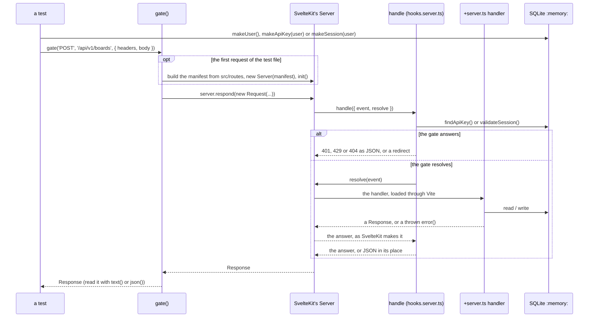

How it is built, which decides what it shows:

- **It is SvelteKit's own `Server`**, the class a built application runs, given a manifest
  made the way `vite dev` makes one. The route list comes from SvelteKit's own reading of
  `src/routes`, and every module is loaded through Vite when a request first needs it.
  Nothing is built, no dev server is started and no port is opened.
- **A handler reached this way shares its database with the test.** The modules are the
  ones the test file has loaded, so a row a fixture made is there for the handler and a row
  the handler wrote is there for the assertion.
- **The server is started once for a test file**, by its first request.
- **Loading `hooks.server.ts` runs what it runs at start-up.** The migrations are already
  applied by `tests/setup.ts`, so nothing happens. The session and log clean-up run.
  `startSchedulers()` is called and starts nothing, because `vitest.config.ts` sets
  `SCHEDULERS: 'off'`: a test never starts the backup, report or snapshot scheduler,
  whatever kind of server vitest is taken to be. Beside it, `PASSWORD_THREADS: '0'` makes
  every password hash and check on the test's own thread, a turn later (`setImmediate`),
  and not on worker threads (card 2191): so `vi.mock('bcryptjs')` in
  `tests/atomic-accounts.test.ts` sees every call, a check is still never answered in the
  turn that asked for it, and the fake clocks below, which leave `setImmediate` real, still
  run. A sign-in at a name that is no account is checked against a real cost-12 hash, about
  0.2 s of real time each. `tests/password-checks.test.ts` starts real threads with
  `setPasswordThreads()`.
- **The request is sent as it is given.** A string, bytes, a `FormData` or a stream is the
  body as it stands, and the test says what it is with a `content-type` header. Anything
  else is sent as JSON, with that header. A redirect is returned, not followed. `ip` is the
  address the request appears to come from; `ip: null` is a request whose address cannot be
  read, for which `getClientAddress()` throws the node adapter's own error, as it does when
  the adapter is started with `ADDRESS_HEADER` and the header is not there. `platform` is
  what the node adapter hands a request as `event.platform`; none by default, as under
  `vite dev`, and `{ req: { socket: { destroyed: true } } }` for a caller who has gone, whose
  password is then never checked.
- **A body given with no `content-type` header is dropped.** The real servers do the same:
  `getRequest` in `@sveltejs/kit/src/exports/node/index.js`, which makes the `Request` under
  `vite dev` and in the node adapter alike, passes no body on when the header is not there.
  So a handler is sent no body, and answers `400` "The request body is missing or is not
  valid JSON" to JSON that was valid. A `FormData` is the exception, because its header is
  written with it. The harness used to send such a body, which no server does.
- **A body is sent with its length.** The gate refuses a body that declares more than its
  route accepts before reading any of it, and `new Request` writes no such header. So
  `gate()` writes it, as a client would: the length of a string in bytes, the length of
  bytes, and for a `FormData` the length of the form written out. A stream is the one body
  sent without it, as a body sent in chunks is on the wire, which the gate counts as it is
  read. A `content-length` header the test sets is never replaced, which is how a test
  declares more than it sends: a body "of 27 MB" is five bytes and a header.

A request through the gate needs what a real caller holds, which `api()` never does:

| Builder | Makes | Send it as |
|---------|-------|------------|
| `makeApiKey(user, name?)` | An API key for the user, made by the application's own generator and stored as the application stores one, so that the gate accepts it. Returns the key as the caller holds it | `authorization: Bearer <key>` |
| `makeSession(user)` | A session for the user, made as a login makes one. Returns the token | `cookie: dumpfire_session=<token>`, the name being `SESSION_COOKIE_NAME` |

Both are random, as real ones are, so a fixture that makes one is not the same rows twice.
A test that sends more than 60 requests with one key, or more than 60 to `/api/v1/` from one
address with no key the gate accepts, meets the rate limit, which is counted in memory:
`tests/gate.test.ts` calls `resetAllRateLimits()` before and after each test.

**A request that waits, on a fake clock.** A sign-in at an account with five wrong passwords
waits up to four seconds on a timer before it is answered (card 2177), so the tests of it in
`tests/gate.test.ts` run on fake time, with three helpers of that file:

| Helper | What it does |
|--------|--------------|
| `onTheFakeClock()` | Sends one sign-in with an empty name on the real clock, which loads the login page's modules and counts nothing, then fakes `setTimeout`, `clearTimeout` and `Date` alone. `setImmediate` stays real, so a request can still be let run. The test puts the real clock back in its `afterEach` |
| `heldFor(...requests)` | Lets the requests run, on the real `setImmediate`; while any is unanswered and a timer is set, moves the clock 250 ms and lets them run again. Gives back, for each, how long it was held and its answer: one answered with no timer set was held 0 ms |
| `heldInTurn(attempts, status = 400)` | Sends each attempt after the last is answered, through `heldFor`, checks each answered `status`, and gives back the milliseconds each was held |

So `expect(await heldInTurn([D, D, D].map((ip) => wrongAt(name, ip)))).toEqual([2000, 4000, 4000])`
reads as what a person would wait, and a test of requests sent together passes them to one
`heldFor` call. A request that is neither answered nor waiting on a timer after 200 rounds
fails the test rather than hang it.

The waits take no real time; the password checks do. The account these tests sign in to is
re-hashed at cost 4, about a millisecond a check, but a sign-in at a name that is no account
is checked against `DUMMY_HASH`, at cost 12 (card 2192), on the test's own thread: about
200 ms alone, and more than twice that under the whole suite, where a test making eleven of
them ran past vitest's 5 s default (card 2279). So a test that makes five or more passes
`withChecks(n)` as its timeout, `n` the checks it makes: 5 s, and 1.5 s a check on top. A
timeout asserts nothing, so it is sized for a loaded machine. A test that times out leaves
its sign-ins still running, counting into the next test's state, so a timeout here can show
as a wrong wait or a wrong status in the test after it.

**It tests itself.** The harness leans on SvelteKit's internals, which no version promises
to keep: three modules imported by path and the shape of the manifest. The first test in
`tests/gate.test.ts` is of the harness and not of the gate: the API routes it serves must be
exactly the ones `routePatterns()` finds by reading `src/routes/api` for itself. An upgrade
of SvelteKit that breaks the harness fails there, by name, and not as forty failures that
look like the gate's.

SvelteKit's refusal of a write sent as a form with no matching `Origin` is made here, as a
built server makes it, before `handle` is called. Since SvelteKit 2.70 (card 2227) the check
is skipped while the global `__SVELTEKIT_DEV__` is true, and vitest sets it true in every
test file, as under `vite dev`; `start()` in `tests/helpers/gate.ts` sets it false, as a
build is, for the files that use the harness. The harness reads `svelte.config.js` with
`load_svelte_config()` and not `load_config()`, which resolves the whole Vite config as a
build, rewrites `.svelte-kit/` from every such file at once, and, when two of them raced,
fell back without a word and left the check off in that file (the harness test below
failed in about one full run in three). So a test that posts a form, or
`text/plain`, as a page or a page's script does sends `origin: 'http://localhost'`, as a
browser does; one without it is SvelteKit's `403`, and never reaches the gate. "The harness"
in `tests/gate.test.ts` holds this: a form posted to `/login` with no `Origin`, or another
site's, is that `403`, and one from `http://localhost` reaches the form's action.

What it cannot show:

| Not shown | Why |
|-----------|-----|
| The node adapter | The harness begins where the adapter has made a `Request`. `bodyOverTheLimit()` stands in for a body the adapter fails: a stream that fails, when read, with a `413` of a class that is not SvelteKit's, as the adapter's was in a built server up to adapter-node 5.5.4, when it had a copy of that class of its own. Since 5.5.5 the build has one copy, and the harness keeps the separate class as the stricter case: the gate must know the `413` by its `status`, whatever its class. It is sent with a `content-length` its route accepts, because the gate now refuses a declared length over the limit before anything is read, so what is left for the adapter to fail is a body that runs past the length it declared. How the adapter builds a request, reads the client's address and enforces `BODY_SIZE_LIMIT` is not exercised. Which requests it gives a body to, and that it holds a body with no declared length to `BODY_SIZE_LIMIT` alone and never to its route's limit, are read by `tests/body-limits.test.ts` from SvelteKit's `getRequest` (`@sveltejs/kit/node`), which the adapter builds every request with since adapter-node 5.5.5, and which fails if an upgrade changes either. Up to 5.5.4 the adapter had a copy of its own, which held such a body to no limit at all |
| The image's `BODY_SIZE_LIMIT` | A test reads the `Dockerfile` and checks the value is one the adapter can parse. That a container has the variable is checked on the host: `docker exec <container> printenv BODY_SIZE_LIMIT` |
| What a browser does with an upload that fails | No DOM. `uploadFailure()` and its neighbours in `src/lib/api.ts` are functions and are called; that the two pages call them, and clear their busy flag in a `finally`, is read from their source by `tests/page-failures.test.ts` |
| What a browser does with the gate's `401` | No DOM. The watch on `fetch` (`src/lib/signed-out.ts`) and the stream that opens itself again (`src/lib/live-stream.ts`) are given stand-ins for `fetch`, `EventSource` and the timers, and called, by `tests/page-failures.test.ts`; that `src/hooks.client.ts` installs the watch, and that every stream but the audit console's is opened through `keepStreamOpen()`, is read from the source. That a real page goes to the login page is checked by hand |
| A path that begins `/_app` | SvelteKit answers it `404` before it calls `handle`, under the harness as in a built server, so the gate's pass-through for `/_app/` is never reached, but for a call to a remote function, `/_app/remote/<id>`, which reaches the gate with the path its `x-sveltekit-pathname` header names and is answered `404` there (`400` `Malformed URI` when that path cannot be decoded, as SvelteKit 2.60 also answered it; seen through the harness once, on 2026-10-18, and not held by a test). `tests/gate.test.ts` says so of both, and fails if either changes |
| A connection the server closes | `heldToLimit()` leaves a body it has refused unread rather than cancel it, because the adapter answers a cancelled body by destroying the connection, and the `413` would never reach the caller. The harness has no connection: the test shows the body is not cancelled, and reads the adapter's `cancel` from its source |
| `vite dev` and a built server | Neither is started. What a running server answers on the wire is checked by hand |
| The policy's style directives as a built server sends them | Under vitest SvelteKit is in development mode, and adds `'unsafe-inline'` to the style directives of a page's `Content-Security-Policy`. `tests/content-security-policy.test.ts` reads the configured style directives from `svelte.config.js` instead, and the page tests read only the others. A production build's `/login` was checked by hand on 2026-10-15: `style-src-elem 'self'` alone |
| What a browser does under the policy | No browser. That the pages still work under it, the reports page's PDF preview above all, is the report-only deploy's walk: see [Deployment](deployment.md#the-update-that-brings-the-content-security-policy) |

### Fixtures

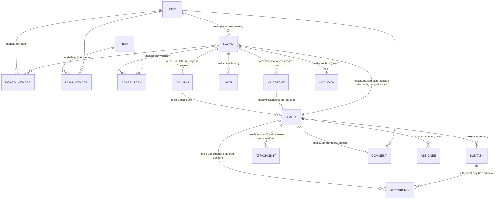

`makeBoard()` returns `{ board, cols }` with the columns keyed by title, so a test
reads `A.cols['Complete']`. Builders insert through the Drizzle schema; anything
they do not cover is inserted the same way in the test itself.

What the newer builders are for:

| Builder | Makes | Note |
|---------|-------|------|
| `makeDependency({ blocked, blocker, createdBy })` | A `work_dependencies` row | Either end is a card or a subtask row. The ends are named, so the direction cannot be got backwards by position |
| `makeMilestone({ board, cards, createdBy })` | A milestone with the cards attached | Without `board` it is a cross-board milestone |
| `makeComment(card, author)` | A comment | |
| `makeAttachment(card, { name, mimeType, content, uploadedBy, file })` | The attachment row and a real file where the row says it is, under the tests' uploads folder | The stored file name is numbered, not random as an upload's is, so a fixture built twice makes the same rows. `file: false` makes the row alone, which is what a working copy has |
| `makeSubBoard(parent, { cards })` | A board whose `parentCardId` is `parent`, with cards on it | Returns `{ board, cols, cards }`. Call it again with one of those cards to go a level deeper |
| `assignCard(card, user)` | An assignee, who is who a "card moved" mail goes to | |
| `makeWebhook(board, { events, url, secret, active, setBy })` | A webhook. With no `events` it receives every event. With no `setBy` its setter is the board's owner (`board.createdBy`), so it is sent; `setBy: null` names no setter, as a row from before migration 0056 does, and is held at delivery (card 2325), and so is one on a board made with no owner unless a `setBy` (a `SessionUser`) is given. Its default address, `https://hooks.example.test/n`, passes every rule of where a webhook may send | Use with `effects()`, which records the delivery |
| `makeSmtp()` | Mail settings, so that the application tries to send mail | Without it every notification returns before it looks for anyone to tell |

`resetDb()` empties every table except the migration record, with foreign keys
switched off for the wipe and back on before the test runs. It also deletes the id
counters, so the first card of every test is card 1, restarts the builders' own
numbering, and removes every attachment file the tests have made, the trash included.
And it starts again what mail has done since the server started (`resetMailStatus()` in
`email.ts`, card 2196), which is kept in memory and not in a table, with the ten minutes of
the `Mail is not being sent` line, and which webhook `WARN` lines were written in the last
hour (`forgetWebhookWarnings()` in `webhooks.ts`), and each webhook's last delivery result
(`forgetDeliveries()`, card 2178), and the Google Drive Connects under way (`forgetConnects()` in
`gdrive-connect.ts`, card 2251), so each test starts as a server does: a test's webhook 1
is not held back by the last test's, nor given its result (ids, addresses and creation
seconds repeat from test to test, so the address check alone would not tell them apart).
Call it from `beforeEach`. Because of it a fixture built twice is the same rows with the
same ids, which `eachWriteInTurn()` depends on.

### `action(path, options)`

A form action is not under `src/routes/api`: it is the `actions` export of a page's
`+page.server.ts`, takes form data, and answers by returning data, returning `fail(...)`
or throwing a redirect. `action()` calls one by the page's path.

```ts
const res = await action('/invite/abc123', {
	form: { password: 'correct horse', confirmPassword: 'correct horse' }
});
expect(res).toMatchObject({ type: 'redirect', location: '/' });
expect(res.cookies.dumpfire_session).toBeDefined();
```

- The result's `type` is `success`, `failure` (the action returned `fail`), `redirect`
  or `error`, with `status` and `data`, `location` or `body` to match.
- `cookies` holds what the action set and `deletedCookies` what it deleted.
- `name` picks a named action; without it the `default` action is called.
- The path is matched against the real route tree, and a path or an action that is not
  there throws. `hooks.server.ts` does not run.

### `pageLoad(path, options)`

A page's `load`, or a layout's, is called the same way, by the page's path, with the caller
the test gives it (card 2130). Each page that draws board data is asked by it what it gives
a caller who cannot open a board, which no route of the table covers.

```ts
const res = await pageLoad(`/board/${board.id}`, { user: viewer });
expect(res.type).toBe('data');
expect(JSON.stringify(res)).not.toContain('kept-to-board-B');
```

- The result's `type` is `data`, with the load's `data`; `redirect`, with `status` and
  `location`; or `error`, with `status` and `body`. Anything else the load throws is a crash
  and fails the test.
- `layout: true` calls the `+layout.server.ts` at that path instead of the page.
- The page tree is read from the disk when the test file starts, as `api()` reads its
  routes, and not with `import.meta.glob` as `action()`'s pages are: vitest keeps what it
  transformed, so a page added afterwards would not be seen until the helper was next
  edited. `loadKeys()` lists every load as `page <path>` or `layout <path>`, and the test
  that asks every page compares its table with it.
- A load that asks for `parent()` or calls `fetch` fails the test: none does today.
  `hooks.server.ts` does not run.

### Timestamps: the check after every test

Every timestamp column (every TEXT column whose name ends in `_at`, and
`system_logs.timestamp`) holds one form, `YYYY-MM-DD HH:MM:SS` in UTC (card 2095). The suite
holds it so: `tests/setup.ts` registers `afterEach(() => afterEachTimestampCheck(sqlite))`,
and a test that leaves any other value in any such column fails, with "This test left
timestamps that are not in the stored form" and each value named. A value with the stored
form's shape that names no real moment, such as `2026-02-30 08:00:00` or an hour of 24,
counts as another form: the check asks the conversion's own `is_stamp`
(`registerStampFunctions`, in `src/lib/server/db/timestamps.ts`), not a pattern. So the whole suite
passing is the proof that no path it runs writes another form.

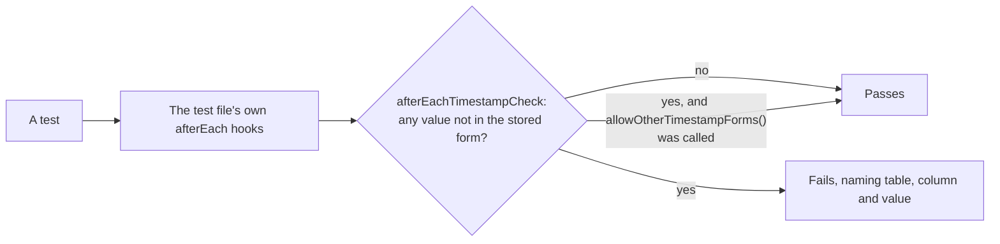

- **A test that writes another form on purpose**, to test the conversion, calls
  `allowOtherTimestampForms()` first; the allowance ends with that test.
- **Write fixtures with `stamp()`** from `src/lib/timestamps.ts`, or as
  `'2026-10-14 08:00:00'`, never with `toISOString()`.
- **vitest runs `afterEach` hooks as a stack**, so a test file's own hooks run before the
  one in `tests/setup.ts`. A file whose `afterEach` empties the database (`resetDb()`) calls
  `afterEachTimestampCheck(sqlite)` first, or the check would find nothing:
  `tests/backups.test.ts`, `tests/import-working-copy.test.ts` and
  `tests/migrations.test.ts` do, with their own cleanup in a `finally`. A test in
  `tests/timestamps.test.ts` fails on any `afterEach` that calls `resetDb()` without making
  the check first, and another fails if the line in `tests/setup.ts` goes.
- **Pages write nothing to the database**, so the check does not look at them; they are held
  by tests that read their source (`tests/timestamps.test.ts`, "the pages read every stored
  value as UTC").

## Proving a Request Is All or Nothing

A request that makes several writes must save all of them or none, and must tell nobody
about a write that was not saved (see
[Architecture](architecture.md#writes-one-transaction-then-the-effects)). A test that
only makes the request and looks at the result cannot show that. The pattern that does is
to fail each of the request's writes in turn.

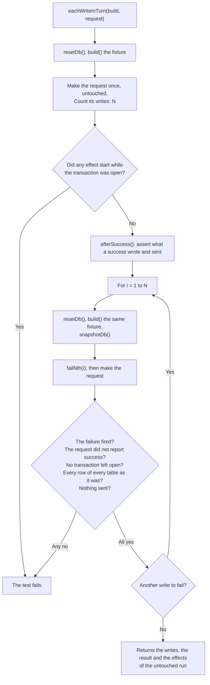

```ts
it('moves the card, awards the XP and logs it, or does none of them', async () => {
	const run = await eachWriteInTurn({
		// Called on an empty database, once for each run. It must make the same rows
		// every time, which the builders do.
		build: () => {
			const user = makeUser();
			const board = makeBoard({ owner: user });
			makeWebhook(board.board);
			return { user, board, card: makeCard(board.cols['To Do']) };
		},
		request: ({ user, board, card }) =>
			api('PUT', `/api/v1/cards/${card.id}/move`, {
				user,
				body: { columnId: board.cols['Complete'].id }
			}),
		// The untouched run, with the database as the request left it.
		afterSuccess: (fixture, res) => {
			expect(res.status).toBe(200);
			expect(res.body.completedAt).not.toBeNull();
		}
	});

	// More than one write, or there was nothing to prove.
	expect(run.writes.length).toBeGreaterThanOrEqual(2);
	// What a success sends, in order. Each was started after the commit.
	expect(run.effects.map((e) => e.kind)).toContain('webhook');
});
```

What it checks on each of the N failing runs, and throws if it does not hold:

| Check | Why |
|-------|-----|
| The injected failure fired | Otherwise this run did not make that write, and nothing was tested |
| The request did not report success | A `try/catch` that swallows a database error and carries on is the fault being looked for. By default a result with a `status` of 500 or more counts as a failure; pass `failed` to say otherwise |
| No transaction is left open | |
| Every row of every table is as the fixture left it | Id counters included: a rolled-back insert must not use up an id. `system_logs` is left out, because a failed request is meant to leave a log line |
| No webhook, live event or email was sent | Nothing may be announced that was not saved |

On the untouched run it also throws if any effect started while a transaction was still
open, and if the request made no write at all.

The pieces can be used on their own:

| Helper | Use |
|--------|-----|
| `failingWrite()` | `writes.count` and `writes.writes` after a request say how many statements changed the database and what they were. `writes.failNth(n)` makes the nth write from now throw an `InjectedWriteFailure`; `writes.fired` says whether the request got that far. Call `writes.restore()` in `afterEach` |
| `snapshotDb()`, `expectUnchanged(before)` | Take a snapshot, make a request that should be refused, and assert that nothing changed. `diffSnapshots(before, after)` returns one line for each row added, removed or changed, naming its table and column |
| `effects()` | `sent.webhooks`, `sent.events`, `sent.emails` and `sent.all` are what the request would have sent; each mail carries `files`, its attachments' bytes, which `pdfText()` reads. `sent.duringTransaction` must be empty: it lists every effect that started while a transaction was open, a refused mail among them. `await sent.settle()` lets effects that start on a later turn of the event loop start. Call `sent.restore()` in `afterEach` |
| `effects({ refuseMailTo: ['b@example.test'] })` | A mail server that refuses some addresses, for a test of what is said when mail does not go (card 2113). The recorded transport throws `REFUSED_MAIL`, exported from the helper, for a mail to one of them, as a real one does when the server refuses it, so `sendEmail` and `sendEmailWithAttachment` log the failure and return `false`. That mail is kept in `sent.refusedMail`, in the order it was tried, and not in `sent.emails` or `sent.all`; `sent.clear()` empties it too. One started while a transaction was open is in `sent.duringTransaction` all the same, so a refusal cannot hide a mail sent too early. With no option, nothing is refused |
| `effects({ mailRefusal: (mail) => error })` | A refusal of the test's own (card 2196). Asked about every mail as the transport is handed it, with its `to`, `subject` and `html`; the error it returns is what the transport throws, with whatever `code`, `responseCode` and words the test gives it, and `undefined` lets the mail through. It is called inside the send, after the commit, so it can quote the mail's own link and change the database while the mail is out, as another request would. A mail it refuses is in `sent.refusedMail`, as one in `refuseMailTo` is |
| `watchReads(table, afterRead)` | `reads.inTransaction` says, for each read of the table, whether a transaction was open. `afterRead(nth)` runs between a read made outside a transaction and the request seeing its rows, so a test can make the write another request would have committed at that moment. This is how the suite shows an invite cannot be used twice and set-up cannot create two superadmins |
| `readBudget(limit)` | Counts every `get`, `all` and `iterate` of every statement SQLite calls read-only, of any table, inside a transaction or not; writes are not counted. The read past `limit` sets `budget.spent` and throws `ReadBudgetSpent`. `budget.count` is the reads so far, and `budget.sources` the SQL of each, in order (card 2394, which counts a page's reads of the caller's boards from them). Call `budget.restore()` in a `finally`, and assert `budget.spent` is false after the call as well as its answer. See [A walk that must end: the read budget](#a-walk-that-must-end-the-read-budget) |

How they work, which decides what they can and cannot see:

- **`failingWrite` wraps the connection's `prepare` and `exec`**, and the `run`, `get`,
  `all` and `iterate` of every statement prepared while it is installed. Drizzle prepares
  a statement for every query and keeps none, so its writes are seen. A statement prepared
  once and run in a loop is counted each time it runs. A statement prepared before the
  helper was installed is not seen.
- **A write is a statement SQLite does not call read-only.** An `UPDATE ... RETURNING`
  read with `.get()` counts and a `SELECT` does not. `exec` always counts. `BEGIN`,
  `COMMIT`, `SAVEPOINT` and the pragmas are not seen. Writes to `system_logs` are left out
  and never failed: the logger makes them, and they are not part of a request.
- **`effects` replaces `http.request` and `https.request`**, which is how a webhook is
  delivered (card 2161), and nodemailer's `createTransport`, and subscribes a listener to
  every board's live events. It records only a request that carries `X-DumpFire-Event`, when
  the request is ended, with `inTransaction` as it is then, and answers it 200; any other
  request (a backup upload through the AWS SDK, a stray one) is handed to the `request` it
  replaced, the setup's refusal, so nothing passes as a webhook that is not one. The record
  keeps its shape, `{ kind: 'webhook', url, event, headers, body, inTransaction }`, with the
  URL as it was passed; its `headers` now hold `content-length` and `accept` beside the
  event, the signature, the content type and the user agent. A webhook's request is made and
  ended in `dispatchWebhook`'s loop with no `await` before it, so its place among the effects
  is where `fetch`'s was. `effects` no longer replaces `fetch`: nothing on the server calls
  it. Mail is only attempted when SMTP is configured, so a test that expects mail calls
  `makeSmtp()`.
- **A test that sets up a webhook or mail and does not install `effects` fails.** The
  application would try to deliver, and `tests/setup.ts` refuses every `fetch`, every DNS
  lookup, and every `http` or `https` request to an IP address other than loopback: the
  attempt is recorded, and a check after each test fails the test that made it, naming the
  address. `effects()` puts both `request`s back when it is restored, and
  `tests/test-helpers.test.ts` checks that it does and that `fetch` was never replaced.
- **A test of delivery itself uses the real transport.** `tests/webhooks.test.ts` does not
  install `effects()` for its delivery tests: it starts an `http.createServer` of its own
  listening with no host (one listening on `127.0.0.1` would make a lookup the setup
  refuses), stands in for `dns.lookup` by assignment per test (`answerLookups`), sets and
  restores `WEBHOOK_ALLOW_INSIDE` and `LOG_LEVEL` per test, reads the `WARN` lines from
  `system_logs` (`lines`), and gives `deliver()` a shortened timeout. Its `receiver` and
  `closedPort` are there to reuse.
- **`failingWrite`, `watchReads` and `readBudget` all wrap `prepare`**, so no two of them
  can be installed together: `readBudget` refuses to be installed over any of them, or over
  another of itself, with `the connection is already wrapped`. Neither `failingWrite`,
  `effects` nor `watchReads` can be installed by a test while `eachWriteInTurn` is running,
  because it installs the first two itself.

`tests/test-helpers.test.ts` tests the helpers themselves, including that
`eachWriteInTurn` catches a request that keeps its first write when its second fails, one
that announces something and then fails, and one that swallows the failure.

### A check made where the write is: the read table

A request that writes must check the caller inside the transaction that writes (see
[Authentication & Security](authentication-security.md#where-the-decision-is-made)). Three
files show it the same way, with a table and `watchReads`: `tests/atomic-v1.test.ts`, for
the documented API, `tests/atomic-dependencies.test.ts`, for the four dependency routes, and
`tests/check-at-the-write.test.ts`, for the 21 other handlers that checked before their body
and for `PATCH /api/labels`, which card 2010 added.
Each row names the route, the table its guard reads (`boards` for a board's guard,
`labels`, `columns`, `team_members` with a team owner who is no administrator as the
caller, and so on), the status expected, any preparation and the request. Each test
installs `watchReads` last, just before the request, and asserts at least one read, every
read inside a transaction, and the status. A row is added with each handler that writes.

The race is the other form: `afterRead` makes, between the check and the write, the change
another request would have committed, and the test shows the request does not act on what
it read. It acts on the first read only (`if (nth === 1)`): a request that reads the table
twice would otherwise have the change made twice. Inside a transaction `afterRead` never
runs, which is what a passing test shows. `tests/check-at-the-write.test.ts` takes a
membership away as the check reads it; `tests/atomic-dependencies.test.ts` writes the
opposite link as an adding request reads the graph, which before card 2114 stored a loop.

### A walk that must end: the read budget

A walk of the board tree follows a board's parents up, or its sub-boards down, a step at a
time. On a loop, a board beneath one of its own cards, a walk with no guard never ends and
holds the one thread (card 2142). A vitest timeout cannot stop it: the timer never gets
the event loop back, and the test file's process spins and grows until it dies, holding up
the run. So a test of a walk proves that it ends by counting reads, not by a timeout:

```ts
const budget = readBudget(1000);
let res;
try {
	res = await pageLoad(`/board/${loopBoard.id}`, { user });
} finally {
	budget.restore();
}
expect(budget.spent).toBe(false);
expect(res.type).toBe('data');
```

A walk that reads the database at each step passes 1,000 reads in well under a second, and
the read past the limit throws `ReadBudgetSpent` out of the call. `spent` is asserted as
well as the answer, because code that caught the error and went on would otherwise pass.
Every read is counted, of any table, through a join, inside a transaction or not, so a
walk cannot slip past it by the way it reads. As with `failingWrite`, a statement prepared
before the budget was installed is not seen; Drizzle prepares one for every query.
`tests/board-tree-loops.test.ts` runs every call that meets a loop so, through its
`withinBudget()`.

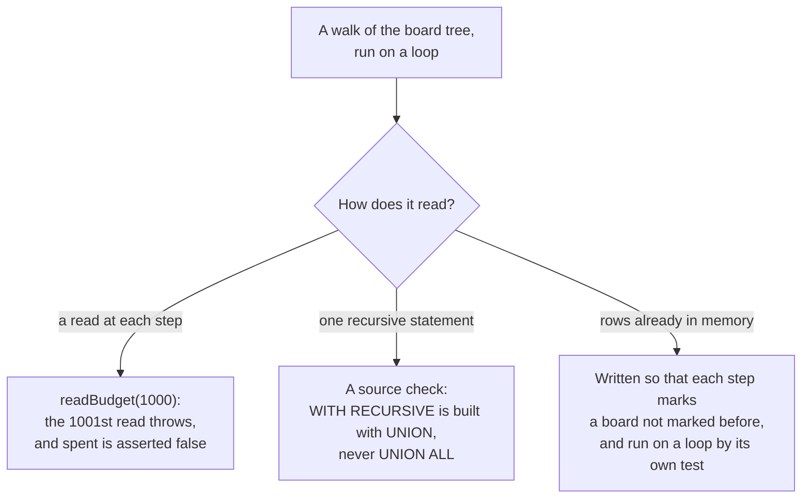

Two kinds of walk are outside any read budget, and something else holds each:

- **One recursive statement** is one read however far it goes. Built with `UNION` it keeps
  each row once and ends on a loop; built with `UNION ALL` it would follow the loop for
  ever. A test in `tests/board-tree-loops.test.ts` reads every `.ts` file under `src` and
  holds each whose SQL has `WITH RECURSIVE` to no `UNION ALL`: today `deletes.ts` and
  `sub-boards.ts`. It reads the text of the strings and templates, with the TypeScript
  compiler, and not the comments.
- **A walk over rows already read into memory** reads nothing as it goes: `deepestFirst()`
  in `deletes.ts`, `boardsInLoops()` in `sub-boards.ts`, which reads the boards once
  and finds the loops in memory, and `boardAncestry()` in `board-tree.ts`, which reads
  every board's parent board once for All Tasks (card 1990). Each is written so that every
  step marks a board not marked before, and each is run on a loop by its own test: the
  delete tests on a card inside its own sub-board, `boardsInLoops()` on every shape of loop
  and on a chain 5,000 deep, where it makes exactly one read, and All Tasks on every shape
  of loop, with `boardAncestry()` on a chain 2,000 deep in one read. That makes each end,
  not each cheap. `boardsInLoops()` keeps its marks for the whole walk and takes one step
  for each board. `deepestFirst()` and `boardAncestry()` start their marks afresh for each
  board they are given and walk it to the top, so they take as many steps as the boards
  times their depth: 2,000 boards deep took `deepestFirst()` 400 ms. Card 2172's limit on
  how deep boards nest, 20 levels, is what bounds them for every tree made since; a tree
  made deeper before it, or brought back by a backup, is kept and still walked whole, and
  `boardAncestry()` is deliberately not capped, so that All Tasks' paths stay right for it.
  The board page's breadcrumbs are capped: at most the nearest 20 boards and a "…", 61 rows
  however deep for an administrator; for anyone else `canViewBoard()` reads each crumb's
  board again and the membership, team and team-access rows it needs, up to four more a
  crumb, at most 141. `tests/sub-board-depth.test.ts` holds the load of a board 60 deep,
  as an administrator, to at most 30 reads of `boards`, with `watchReads`.

## Access for Every Route

`tests/access-control.test.ts` holds, one by one, the requests that used to succeed and
must not. `tests/access-every-route.test.ts` is the other half: a table, `TABLE`, with an
entry for every route and method under `src/routes/api`. Each entry says what kind of
access its handler requires and how to make a real request to it, and the tests are made
from the table, the same ones for every entry of a kind. There are 218 entries, for the
218 methods of the 129 route files, 81 of them under `/api/v1/` (the latest added is card
2283's `DELETE /api/v1/comments/[commentId]`, which copies the three rows of the `PUT` there;
before it, `POST /api/requests/[id]/link` and card 2280's `GET /api/boards/[id]/contents`,
whose cases are those of `GET /api/boards/[id]/cards`: `view`, a team's guest and a public
board).

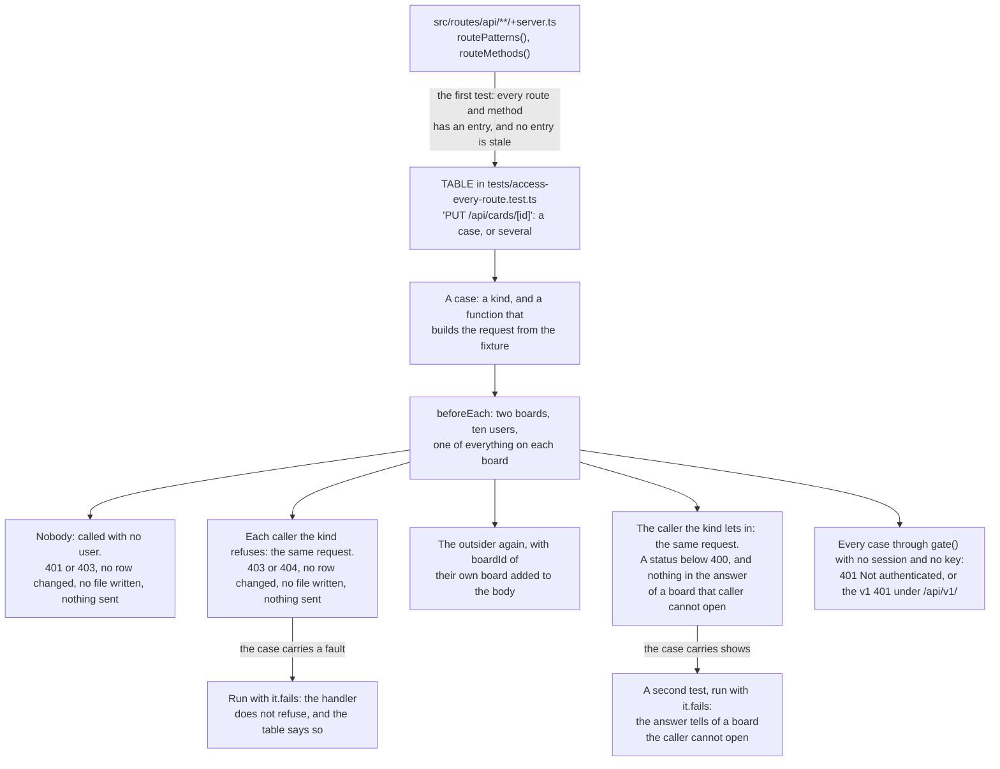

The cast is the same in every test. Board A is the one being defended:

| Caller | Is |
|--------|----|
| `owner` | The owner of board A |
| `editor` | An editor of board A |
| `viewer` | A viewer of board A |
| `guest` | A member of a team that board A is shared with, to view. They have no other way in |
| `outsider` | The owner of board B, with no access to board A. They once had it: a comment of theirs is on a card of board A, a card of board A is still assigned to them, and the activity log has an entry of theirs. None of it lets them back in |
| `both` | An editor of board A and of board B |
| `editsB` | An editor of board B who can only view board A |
| `editsA` | An editor of board A who can only view board B |
| `admin` | An administrator |
| `chief` | The superadmin: the one account set-up made |
| nobody | A caller with no session and no API key |

What is in the fixture beside the two boards, and what each is there to show:

| In the fixture | It shows |
|----------------|----------|
| Every name on board A has `kept-to-board-A` in it, and every name on board B has `kept-to-board-B` | An answer to a caller who cannot open a board has neither of that board's |
| A team, with `owner`, `editor` and `guest` in it, that board A is shared with to view | Sharing with a team to view gives its members view access and no more: `guest` is refused by every `edit` and `owner` case |
| A public board of `owner`, with a card | Public means anyone signed in may read it. Only its owner may change it |
| A grouping with board A and board B both filed under it | A grouping may be renamed or deleted only by a caller who can edit every board under it, and is charted and reported to each caller as far as they can open it |
| A second grouping, with one board that `outsider` cannot open, and `kept-to-board-A` in its name | A caller with no board under a grouping is refused a report of it, a read of it and its burndown, and is not told its name (card 2128) |
| A dependency: board A's card waits on a card of board B | A viewer of board A who cannot open board B is not told the title of that card or the name of its board: the end is listed withheld (card 2129) |
| A milestone that belongs to no board, made by `owner`, with no card | It is its maker's alone until it has cards; then whoever can open every board those cards are on may read it, and still only its maker may change it |
| A task request addressed to the team, beside the one addressed to `owner` | It is for a member of the team to read, answer, accept and reject, and for nobody else |
| An API key, a report schedule and the task requests of board A's side, each with the mark in its name | A list of "mine" given to `outsider` has none of them |
| Two card templates `outsider` made: one saved on board A before they lost it, and one saved on no board | Having made a template is not access to its board: the first is no longer theirs to delete, and an administrator's still. The second has no board to ask about and stays its maker's |

The kinds, and what follows from each. A method has one entry and an entry may have
several cases, so there are more cases than methods: 325 when the counts below were made,
before the last two routes above were added:

| Kind | The handler requires | Refused | Let in | Cases |
|------|----------------------|---------|--------|-------|
| `public` | Nothing | Nobody is | A caller who is not signed in | 1 |
| `signed-in` | A session or an API key, whoever's | nobody | `outsider` | 48 |
| `view` | View access to the board of what the request names | nobody, `outsider` | `viewer` | 73 |
| `edit` | Edit access to that board | nobody, `outsider`, `viewer`, `guest` | `editor` | 80 |
| `owner` | To own that board, or to be an administrator | nobody, `outsider`, `viewer`, `guest`, `editor` | `owner` | 9 |
| `across` | Edit access to two boards: the one of what the path names and the one of what the body names | nobody, `outsider` (who can edit the first), `editor` (who can edit the second), `editsB` and `editsA` (who can each edit one and view the other) | `both` | 20 |
| `admin` | To be an administrator. Since card 2395 this includes everything under `/api/admin/backup` and the mail and App URL settings, which were `superadmin` | nobody, `outsider`, `owner` | `admin` | 33 |
| `superadmin` | To be the superadmin: the export, the import and the reset | nobody, `outsider`, `owner`, `admin` | `chief` | 3 |
| `own` | To be the one the thing belongs to: who made it, or whom it is addressed to. Also used for a rule no other kind fits, with the callers named | nobody, and the callers the case names | The one the case names | 52 |
| `link` | To hold the secret link a task request was made with | nobody and `outsider` with no link, and nobody with the link of another request | Nobody, with the link; for two routes the one the request is addressed to as well | 4 |
| `form` | A session, or the token the public request form was given when it was rendered | nobody with no token, with a token that has expired, with one signed with another key, and with text that is no token | `outsider`, signed in; and nobody, with a token issued just now | 2 |

`GET /api/requests/targets` and `POST /api/requests` are the two `form` routes. They were
entered as `public`, which they are not: a caller who is not signed in and holds no token
is refused by both.

What "refused" and "let in" mean, which is what makes the table worth having:

- **A refused caller makes the request the allowed caller makes.** So a refusal is never
  a body the handler could not read, or an id that is not there. For most cases that
  request succeeds for the allowed caller. It does not for the ten cases that carry
  `answers` (see below), where the allowed caller is turned down too, by another rule and
  with another status. And the holder of a link or of a form token does not make the same
  request: they send the link or the token, which a refused caller has not got.
- **Refused is a 401, 403 or 404, with not one row changed, no file written and nothing
  sent.** The whole database is compared before and after with `snapshotDb()` and
  `expectUnchanged()`, the uploads folder is listed before and after, and `effects()`
  records every webhook, live event and mail. A handler that answers 403 after writing
  has refused nothing.
- **A refusal is never the status the allowed caller is answered.** Where a case carries
  `answers`, that status is taken out of the ones a refusal may be: otherwise the case
  would pass with no access check in the handler at all. A bulk endpoint refuses with a
  409 that names the entries at fault, and its cases say so with `refusedAs`; a 409 is
  taken for a refusal only when its body says the caller has no access ("No edit access
  to the board holding ..."), because the same endpoints answer 409 for every other
  thing wrong with a batch.
- **An upload is not read for a caller who will be refused.** The attachment upload
  checks access before it reads the body. Without that check it would read the file,
  write it, find the caller has no access and take the file away again, leaving the
  folder as it was. So for a refused request with a file in it the test also watches
  `Request.prototype.formData`, which must not be called.
- **`across` is the request that names a second thing in its body**: a column to move a
  card to, the other end of a dependency, a card for a milestone, a board for a
  milestone, a batch. It names something of board B in the path and something of board A
  in the body, so that each of two callers can edit one end and neither is let in.
  `editsB` and `editsA` can edit one end and view the other, so a check of the second
  board that asks only for view access lets one of them in. The two routes that rename
  and delete a grouping are `across` as well: both boards are filed under the grouping,
  and it takes edit access to both.
- **Removing a dependency is not `across`.** Adding a link takes edit access to both
  boards. Removing one takes edit access to the board of the end that waits, whichever
  end the request is addressed to, so that work can stop waiting on a board its owner can
  no longer open, and an editor of the blocking end alone cannot unblock another board's
  work. Each of the four routes that remove a link has the same three `own` cases, made
  by `unlinking()`, for a link whose waiting end is on board B: at the address of the
  waiting end `outsider` is let in and `editor`, `editsA`, `owner` and `viewer` are
  refused; at the address of the end it waits on `editsB` is let in and `editor`,
  `editsA`, `owner` and `outsider` are refused, `outsider` because that address is of a
  card they cannot open; and an administrator is let in.
- **The outsider is tried twice** wherever the request has a JSON body with no board id
  of its own: once as it stands, and once with `boardId` of their own board added. That
  is the fault the suite began with, asked of every route and not only the ones it was
  found in.
- **Every answer to the allowed caller is read for what it gives away**, whatever the
  method. An answer to `outsider` must not contain `kept-to-board-A`, and an answer to
  `owner`, `editor`, `viewer` or `guest` must not contain `kept-to-board-B`. Two
  answers are meant to tell and say why with `tellsEveryone`, one reason for both:
  `GET /api/teams` and `GET /api/requests/targets` list the fixture's team, whose name
  has `kept-to-board-A` in it, to every caller, because a team's name is listed to every
  signed-in caller and to the public form, as a username is: the share dialog and the form
  need it. Its members are not, which a test below the table shows (card 2128). For those
  the test expects the mark in the answer, so the `tellsEveryone` goes when the handler
  stops telling. Until card 2128 four did: the card categories of `GET /api/categories`,
  `GET /api/v1/categories/[categoryId]` and `GET /api/cards/[id]/context`, and every board
  of the request form, which now give each caller what they may be told. An answer that is
  a PDF cannot be read this way: see below.
- **A list that filters is not refused.** `GET /api/milestones?boardId=` answers a caller
  who cannot open the board with an empty list. Such a case is marked `filtered`: the
  outsider's answer must have nothing of board A in it, and the viewer's must have
  something, so that a filter which returned nothing to everyone would fail. The card
  search is three such cases, searched for a word that is in every title on both boards.
- **Nobody is tried twice too**: by calling the handler with no user, and through
  `gate()` with no session and no API key, which is done for every case of an entry and
  not only its first. Four handlers had no check of their own for the first and threw a
  `TypeError` reading `locals.user!` (the three under `/api/boards/[id]/` for `cfd`,
  `export/csv` and `metrics`, and `/api/cards/export/csv`), and were marked
  `nobody: 'crashes'` until card 2117 gave each `requireUser`: they answer 401 now, as
  every other handler does. `GET /api/cards/archived` answers such a caller 200 with an
  empty list, and its case says so with `nobody: 'empty'`.
- **Where the caller who is let in is not answered with a success**, the case says what
  they are answered and why, with `answers` and `because`. There are twelve. Four are
  requests whose success would reach outside the tests: the three backup routes that
  would connect to a destination, and the import. Five are cases where another rule
  refuses everybody: a reorder stays within one board, a card takes only its own board's
  labels, and a milestone of one board takes no card of another. Three take a card out
  of a milestone (card 2117, R5): through one it is not in, on both trees, and through
  one that is not there, each answered 404 whoever asks. In each the refused callers are
  refused first, which shows the access check comes first, and nothing is written. The
  milestone that is not there is a `signed-in` case: it is 404 to everyone signed in,
  before anything else is looked at.
- **Three answers are streams with no end** (`/api/events`, `/api/boards/[id]/events`,
  `/api/logs/stream`). The allowed caller's request is sent through `gate()` with a
  session, checked for its status and content type, and cancelled.

What the table cannot say is tested below it, in the same file:

- **What `GET /api/events` sends.** Every signed-in caller may open the stream, and what
  they are sent is decided event by event. The test opens it through `gate()` as
  `outsider`, emits one event for board A and then one for board B, and reads the stream
  until board B's arrives: board A's, had it been sent, would have arrived first. The
  same is done as `viewer`, the other way round.
- **What is in a report of a grouping.** `POST /api/reports` answers with a PDF and
  `POST /api/reports/email` mails one, and neither can be read for a card's title. Both
  draw what `generateCategoryReport()` gives them, so that is called for the grouping
  both boards are under: `outsider` is given board B and nothing of board A, and `viewer`
  board A and nothing of board B.
- **Who may manage which account.** The table has one administrator. Two more callers
  are made for these tests and are in no other: `admin2`, a second administrator, and
  `chief`, the superadmin. For each of `PUT /api/users/[id]/password`,
  `PUT /api/users/[id]`, `DELETE /api/users/[id]` and `POST /api/users/[id]/invite`: an
  administrator who names another administrator is refused with nothing changed and
  nothing mailed, an administrator manages an ordinary user, the superadmin manages an
  administrator, everyone else who names the superadmin is refused, and so is a second
  superadmin, put in the table by the test, who names the first. Whoever names their own
  account on the password route or the invite route is refused and told where a password
  is changed, and an invite that is allowed is mailed to the account's own address with
  the token that was saved.
- **What a role may be, on both routes that write one.** For each of `["admin"]`,
  `["superadmin"]`, `"superadmin"`, `"Admin"`, `1`, `{}` and `null` sent as `role` by an
  administrator and by the superadmin, to `PUT /api/users/[id]` for another account and
  for their own, and to `POST /api/users`: 400 in the words that value is answered with,
  no row changed and nobody made. Only the superadmin makes an administrator, on both
  routes; nobody changes their own role on `PUT /api/users/[id]`, the superadmin and an
  administrator alike, whatever they send, with what else came with it unsaved (card 2117,
  decision 13); and a `username`, `email`, `emoji` or `password` that is not a string is a
  400 on both.
- **What the users route does with the caller's own account.** Their own `email` is
  refused, with what else came with it unsaved, and their own `emoji` is saved. A change
  of nothing, `{}` or a body of fields the route does not know, is answered with the six
  columns a change answers.
- **That no account route answers a password hash.** Every route and method under
  `/api/users` and `/api/account` is asked by a caller who is not signed in, an ordinary
  user, an administrator and the superadmin, with the request the table makes for it and,
  for `PUT /api/users/[id]`, a change of nothing: no answer has `passwordHash` in it, or
  `$2`, which is how every bcrypt hash begins. The routes are taken from the table, so a
  new one is asked without being added here, and a test says the list is the whole of
  both trees.
- **What is saved when a board is made public.** On both routes that change a board: an
  editor's name and emoji are saved when `isPublic` is not sent, an editor who sends
  `isPublic` is answered 403 with not a row changed, whatever value they sent, `null`,
  `1`, `"1"` and `[true]` among them, and the owner and an administrator set it. From the
  owner or an administrator a value that is neither `true` nor `false` is a 400 with not
  a row changed.
- **That the two routes that create a board answer alike for a sub-board.** A parent
  card that is not there is a 404 on both with no board made, a caller who cannot edit
  the parent card's board is refused in the same words on both, and the board is hung
  under the card that was checked.
- **What `GET /api/graph` lists.** A card with two sub-boards, one shared with `viewer`
  and one not: the column's graph lists `viewer` the first and not the second, lists the
  owner and an administrator both, and the second is not expanded for `viewer` either.
  With no board named, each caller is listed the boards they can open and no other. A
  dependency between two cards of the column is drawn; one that reaches a card of board B
  is drawn for a caller who can view board B and not for one who cannot, to whom that
  card's id is nowhere in the answer; and a row of the legacy `card_dependencies` table
  and a link to a subtask are not drawn.
- **That a refusal to remove a dependency does not say whether the link is there.** On
  each of the four routes an editor of the blocking end's board is answered the same 403,
  word for word, before the link is made and after. A caller who may remove it is then
  answered 200, and 404 once it is gone.
- **Whom a removed dependency is told to.** On each of the four routes a link between
  the boards, removed at the address of the end that is waited on, sends the live event
  to both boards, read through `effects()`; a link within one board sends one. The v1
  card route's activity entry is on the board of the end that waits, naming the waiting
  card, or the waiting subtask's card, where the card in the address is on another board.
- **Recent activity, on the boards the caller can open (card 2126).** `outsider`'s entry
  on board A is made their newest and 26 of theirs on board B each a minute older, the
  times set by the test and not left to the clock: `GET /api/v1/me/stats` gives the 20
  newest of board B's and the dashboard the 10 newest, none of board A's, which a filter
  applied after the limit would not. A member is still given their entry on the board, and
  an administrator theirs on every board.
- **What `me/stats` counts (card 2292).** Eleven cases on the same world. `GET /api/v1/me/stats`
  counts `outsider` one open card, board B's, and not board A's other card, still assigned
  to them on the board they lost, while a completion of theirs logged on board A still
  counts in `cardsCompleted` and `streak`; their average cycle time over a card of board A
  completed after 10 days and one of board B after 2 is 2; an administrator is counted a
  card of a board they are no member of, and `guest`, who opens board A through a team, its
  card; a user who opens no board (the world's public board made private for the case) is
  answered `activeCards` 0 and `avgCycleTimeDays` null. `GET /api/velocity?days=14` counts
  `outsider` board B's completion today and not board A's, an administrator's on a board
  they are no member of, and 0 for a user who opens no board. The three screens agree for
  `outsider`: the open count is 1 in `me/stats`, in the dashboard's `analytics.active` and
  in what My Tasks lists, and Velocity's total equals the dashboard's
  `completedThisWeek`. A public board `outsider` is no member of counts: its open card in
  `activeCards`, its card completed after 4 days as the whole average, and that completion
  in Velocity. Seven of the eleven failed before the change; the administrator, `guest`,
  administrator's Velocity and public board cases pin what it keeps, the last shown failing
  with public boards left out of `getAccessibleBoardIds` for the run.
- **What the activity report counts (card 2326).** Thirteen cases of
  `GET /api/v1/reports/activity`. After a card is raised on board A, `outsider`'s report
  counts `meta.boardsExcludedForAccess` 0 and has nothing of board A; so do two one-second
  windows, one around a card raised on board A at a set moment and one an hour away from it.
  `?boardIds=<A>` refuses `outsider` `403` `No access to board <A>`, `?boardIds=999999` is
  `404` `Board 999999 not found`, to `outsider` and to an administrator, and a list is
  refused at its first board at fault in the order given (board B then A is the `403` of A;
  999999 then A the `404`; A then 999999 the `403`). `editor`, naming board A, is given
  exactly its three cards that are not archived. An administrator naming board A is given its new card and counts
  0. A former editor of board A, still assigned to its card and taken off through
  `DELETE /api/boards/[id]/share`, is given nothing of it in their report on themselves, and
  0. A user who can open no board, in a database of the test's own (`resetDb()`, one private
  board of another's with a card raised today and no public board), is answered an empty
  report, every total 0. Two pin what is kept: `outsider` is given the cards of a public board
  they are no member of, and `editor`'s report on everyone holds exactly board A and the
  public board, cards `[A.card, A.other, A.loose, publicBoard.card]` (the archived card left
  out), with `created` 4 and every other bucket 0, the figures found on the code before the
  change. A milestone of board A holding a1 on board A and h1 on a private board `viewer` is
  not on (card 2129's case), h1 completed on 2026-09-20 and a1 on the 25th: `viewer`'s report
  counts it `totalCards` 1, `completedAtStart` 0, `completedAtEnd` 1, the same with `from`
  moved past h1's completion; before the change h1 was counted (`totalCards` 2,
  `completedAtEnd` 2, and `completedAtStart` 1 once `from` passed it). Nine of the
  thirteen failed before the change; the administrator's named board, the public board and
  both of `editor`'s reports passed and must keep passing.
- **What the lists give (card 2128).** People and teams: every user to an ordinary caller
  by id, name and emoji alone, and with the address, role and creation date to an
  administrator and the superadmin; every team by name, and its members only to the
  team's own and to an administrator; the teams page with no other user's address. Dashboard
  groupings: the two list routes and the dashboard, All Tasks and Reports loads give
  `outsider` the grouping of both boards and an empty one and not board A's, `viewer` all
  three and an administrator every one; one is given by its id to a caller it is listed to,
  an empty one included, and refused `403` otherwise, the burndown of it too; filing a
  board under one outside the list is `403` on both trees and on a new board with nothing
  written, and under one in it, or by an administrator, is saved. Card categories: listed
  by the boards the caller can open and the shared one; a category a card of board A
  carries from board B is in `viewer`'s board page, All Tasks and card context marked
  `carried`, and in nothing they may pick; the four card writes refuse another board's
  category, `404` by card 2117's rule, and keep one a card carries. The public request
  form: every user and team and no board to a token holder, and the boards a signed-in
  caller can open. Email addresses (R1): none in a public board's page or card context to
  a signed-in caller who is no member of it, and the share list's only to its owner and an
  administrator.
- **The other end of a dependency, to a caller who cannot open its board (card 2129).**
  Board A's card waits on a card of board B, and a subtask of it on another. For each of
  17 answers (the card and subtask dependency routes of both trees, GET and the answers to
  POST and DELETE, `GET /api/v1/cards/[cardId]`, both summaries and the compact one, and
  the board page, All Tasks and plan page loads), a caller who can open board A and not
  board B, a viewer or for a write an editor, is given the end with its id, its kind,
  whether it is finished, `withheld: true` and the replacement texts, nulls for its board,
  column, priority and milestone, no `kept-to-board-B` anywhere, and what waits on it still
  blocked; `editsA`, `both` and an administrator are given its title and board. Then a card
  of board A's milestone is moved to board B, keeping the milestone (R4): to a viewer of
  board A the summaries, the plan page and both PDFs hold nothing of board B, `progress`
  counts it under one withheld board, and `criticalPath` is the chain an administrator is
  given, card ids only. The PDFs are read through `gate()` and `pdfText()`, which inflates
  the PDF's streams and joins the text they draw; an administrator's PDF naming board B is
  its control.
- **Every page load, to a caller who cannot open a board (card 2130).** `PAGES` has an
  entry for every `+page.server.ts` and `+layout.server.ts`: the paths its load is called
  for, or why it gives no board data (the layout, `/account`, `/graph`,
  `/invite/[token]`, `/login`, `/logout`, `/request`, `/setup`). The first test fails for a
  load with no entry, against `loadKeys()`. The describe's own `beforeEach` adds a
  sub-board of board A's card that only `outsider` can open, `kept-to-board-B` in its name,
  and a due date next week on the card of board A still assigned to `outsider`. Each other
  load is called through `pageLoad()` as `outsider` and as `viewer`, the board page for
  board A, board B and the sub-board, the burndown with no query and with board A's
  grouping, and the plan pages for both milestones: it is refused, or gives nothing of a
  board the caller cannot open. The filters do not empty the pages: `viewer`'s dashboard and
  board page have board A, and an administrator's dashboard both boards. The sub-board is
  left off the card on the board page, in the card context and on the dashboard tile for
  `viewer`, and is there for an administrator and for `viewer` once given it; the dashboard's
  sub-board count, All Tasks walk, token cost and spend by person leave it out until then;
  `outsider`'s dashboard counts only their card of board B, and names it alone in Upcoming
  Deadlines, until they are given board A again. Its breadcrumbs show board A to `outsider`
  as "🔒 A board you cannot open" with no link, keep a board above that they can open
  named and linked, and name both to an administrator. And "Link existing board" offers no
  caller a board they cannot open. All To Do (card 2240) is in `PAGES` as `/todo` and
  `/todo?board=<board A>`, and is asked beside All Tasks in the groupings sweep, the
  carried-category case and the Blocked chip's withheld blocker.
- **Asked again at the write: the two walks (card 2253).** Every write handler asks, in the
  transaction that writes, whether its key or session is still open and who its account is
  now (see [Asked Again at the Write](authentication-security.md#asked-again-at-the-write-card-2253)).
  The describe "asked again at the write (card 2253)" walks every write case of the table
  twice. The handlers are read from the route modules when the file is collected
  (`TREE_WRITES`), not from the table, and a write handler with no entry fails its first
  test; the walks then reach every case of every entry.

  ```mermaid
  sequenceDiagram
      participant T as The walk
      participant G as gate()
      participant H as Write handler
      participant DB as Test database
      T->>G: the case's request, its body held (sendAround)
      G->>H: let in with the credential made for the walk
      H->>H: awaits the body
      alt Walk 1
          T->>DB: delete the session row (the key row under /api/v1)
      else Walk 2
          T->>DB: lower the role: admin to user, superadmin to admin
      else Control
          T->>DB: nothing, or the role set to what it was
      end
      T->>DB: snapshotDb()
      T->>G: the body
      H->>DB: writeAs / stillCallerNow asks again
      H-->>T: 401, or the lower role's refusal, or the allowed answer
      T->>DB: expectUnchanged(), no file, nothing sent
  ```

  A request with no body has no window to hold: it is called through `api()` with the
  credential already ended, or the role already lowered and the account as the gate read it,
  which is what its handler meets at the write. The import is held as a backup is sent (the
  case's `held`), since its JSON is refused before a byte is read. A case whose request the
  gate answers before its body is read fails its walk (`ran`), so a walk never passes by not
  reaching the window. A control whose allowed answer is a success also shows that a row
  changed, from the same moment the walk takes its snapshot, so the walk's "nothing changed"
  is a check that can fail; a case whose allowed request writes no row says why
  (`writesNothing`: a report made or mailed, the test mail, the vacuum, a backup with no
  destination, the new request link, a bulk removal of a card not in the milestone named).
  The import's leftover files cannot appear here, as the walk's import is no backup: R1's
  import tests in `tests/write-as.test.ts` prove that check. Shown failing: with `writeAs`
  handing the write `locals.user` without asking, Walk 1 failed for 202 of its 216 cases and
  Walk 2 for 150 of its 162 (every handler that writes through `writeAs`), and with
  `stillCallerNow` answering `locals.user`, the other 14 and 12 (the eight handlers it
  guards); every control passed both times.

### Adding a route

A new `+server.ts` under `src/routes/api`, or a new method in one, fails the test `has an
entry for every route and method`, the first of the file, with the route and method by
name, until it has an entry. The tree it is compared with is read from the disk on every
run. The same test fails, by name, on a route that exports `fallback`, `OPTIONS` or
`HEAD`, on a `+server.js`, and on a `+server.ts` outside `src/routes/api`: SvelteKit
serves each, and the table has no way to say who may call it.

```ts
'PUT /api/things/[id]': edit((w) => json(`/api/things/${w.A.thing.id}`, { name: 'Renamed' })),
```

1. **Choose the kind** from what the handler requires, not from what it happens to do
   today. If the handler is wrong, the table is where that shows.
2. **Build the request from the fixture**, for something of board A. If the route needs a
   row the fixture does not make, add it to `side()` if every board has one, to `world()`
   if there is one of it, or to the case's `setup` if only this case needs it.
3. **If the body names a second thing** that is on a board, add an `across` case for it
   beside the first.
4. **If the same route answers differently by a query parameter** (one board, every
   board), give each its own case with an `of` to name it.
5. Run the file. Every caller the kind refuses must be refused, and the caller it lets in
   answered. If a refused caller is let in, the handler has a fault: fix the handler. If
   it cannot be fixed in the same change, give the case a `fault`, naming the callers who
   get in and the card, and never weaken the kind to make the test pass.

## Known Faults the Suite Records

A test that finds a fault in the application is not left failing, which would hide every
other failure behind it, and is not weakened or deleted, which would hide the fault. It
is run with `it.fails`: the test says what should happen, passes while it does not, and
fails with `Expect test to fail` on the day it does. Then the mark is taken off.

In `tests/access-every-route.test.ts` the mark is on the case, and is one of three. Each
is in the name of its test, as `KNOWN FAULT`.

| Mark on the case | The fault | The test that runs with `it.fails` |
|------------------|-----------|------------------------------------|
| `fault`, naming callers | Those callers should be refused and are not. With `filtered`, where nobody is refused: they are answered with something of board A | The refusal of each caller named |
| `shows` | The answer to the allowed caller has in it something of a board they cannot open | A second test of the allowed caller's request. The first, which says they are answered, stays a plain test |
| `answersOtherwise` | The allowed caller should be answered the case's `answers`, and is not | The allowed caller's request |

A fault is recorded only where the handler does not say it is meant. Where the handler's
own source says an answer is open on purpose, the case carries `tellsEveryone` and the
reason, and is no fault.

There is none in the table now: the last were put right on 2026-10-14 (below). The marks,
and the tests they make, are still there for the next fault the table finds.

There is none outside the table either. The last three, in
`tests/card-completion.test.ts`, were put right on 2026-10-15, and their marks came off:

- **Card 2108, 2 tests.** A subtask ticked through the API (`PUT /api/v1/subtasks/[subtaskId]`)
  wrote no `subtask_completed` entry, and whoever asked for its card was not told; the page's
  route did both. It now writes `api:subtask_completed`, `<subtask> (on <card>)`, and mails
  the requester. The `silent` flag of the table of subtask routes, which ran both tests of
  the API's row with `it.fails`, went with them.
- **Card 2127, 1 test.** The Audit page's Action filter (`GET /api/audit`) compared the action
  with what was typed and nothing else, so `card_completed` found what the page did and
  nothing the API did. It now finds both, and `api:` in front still means through the API.

So no test in the suite runs with `it.fails`.

Eight faults that were recorded here were put right on 2026-10-13, on cards 2101 to 2104,
2118, 2124, 2125 and 2131, and their 21 marks came off: 20 in the table and the one in
`tests/atomic-accounts.test.ts`, which had asserted the opposite before it was a mark.
Each is now an ordinary test of the rule.

Two more were put right on 2026-10-14 by card 2117's third slice, and their 8 marks came
off: the four handlers that read `locals.user!` unchecked (5 tests), and
`PATCH /api/milestones/[id]` with `attach: false`, which never looked at the milestone in
its path (3 tests). The first four answer 401 to a caller who is not signed in; the
milestone is looked for and checked, and the card must be in it.

One more was put right on 2026-10-14 by card 2126, and its mark came off: `recentActivity`
of `GET /api/v1/me/stats` listed the caller's own entries on a board they can no longer
open. It and the dashboard's Recent Activity list only entries on boards the caller can
open, filtered before their limits of 20 and 10, which a test below the table shows with
a former member whose newest entry is on the board they lost.

The last three were put right the same day, and their 12 marks came off.

- **Card 2128, 6 marks.** Every dashboard grouping was given to every signed-in caller: the
  `shows` of both list routes and the `fault` of `GET /api/v1/board-categories/[categoryId]`
  came off by themselves. The two burndown cases by a grouping with no board the caller can
  open were `filtered` with a `fault`, which a refusal would not have taken off, since the
  filtered test asks for a status below 400: each is now a plain `view` case, `outsider`
  refused and `viewer`, who can open the one board under it, answered. And every team's
  members went to every signed-in caller: the `shows` of `GET /api/teams` came off, and the
  team keeps its mark, with `tellsEveryone`, because its name is listed to everyone on
  purpose. By hand, as each stopped telling for the right reason: the `tellsEveryone` of
  `GET /api/categories`, the card context and the request form's boards came off, and
  `GET /api/v1/categories/[categoryId]` became a `view` case on board A's category and a
  `signed-in` case on the shared one. The constants `SHARED_VOCABULARY`,
  `NAMES_ON_THE_FORM` and `EVERY_GROUPING` went with them, and `TEAM_NAMES` is the one
  reason left.
- **Card 2129, 6 marks.** A card that waits on a card of another board gave a caller who
  can open the first board and not the second the title of that card and the name of its
  board: the `shows` of both trees' dependency lists, `GET /api/v1/cards/[cardId]`, both
  summaries and the answer of `POST /api/cards/[id]/dependencies`, each `NAMES_THE_BLOCKER`,
  came off by themselves, and the constant with them.

Card 2130 had no mark: no page load was in the table. It is asked of every one by the
sweep below the table.

Card 2326 had no mark either, but changed a case. `GET /api/v1/reports/activity` with
`boardIds` naming board A was `filtered`: `outsider` was answered `200` with nothing of
board A, and the answer's `meta.boardsExcludedForAccess` said whether board A had activity.
The report now refuses a named board the caller cannot open, so it is a plain `view` case,
`outsider` refused (shown failing, answered `200`, before the change) and `viewer` answered.

When a fault is fixed, its tests fail and name themselves. Take the mark off the case, or
the `it.fails` out, in the same commit, and take its row out of these tables.

## Tests That Read the Source

Three rules about the API are kept by tests that read the code and not by a helper every
handler must remember to call: every failure has one shape, the OpenAPI document says what
the handlers do, and the document lists every route. Each parses the source with the
TypeScript compiler, so a new handler is held to the rule the moment its file exists.

A fourth is held the same way: every handler reads its JSON body through `readBody` and
its fields through the readers of `src/lib/server/request-body.ts`, and uses no field the
readers have not looked at. `tests/request-body.test.ts` reads every `+server.ts` under
`src/routes` and every module under `src/lib/server` for it (card 2117): a body read any
other way, a cast of what `readBody` hands back, a field copied by a key that is not
written out, and fewer than 80 calls of `readBody` each fail it. See
[Architecture](architecture.md#reading-a-body) and its row in
[What Is Covered](#what-is-covered).

`tests/page-failures.test.ts` reads pages the same way, for a different reason: a page
cannot be run in these tests, which have no browser. It parses the `<script>` of the
reports, admin, account, invite, archived, All Tasks, All To Do, plan, teams and board pages, of the dashboard and
the root layout, of the components the admin page, the dashboard, All Tasks and the plan page are
split into (card 2281: each pin reads the file that now holds its piece, and what is said to be
gone is looked for in the page and every one of its components), of the card modal, of its sections under `src/lib/components/card/` that
send a write and of its label picker, and of the share and subtask windows, looks at which side of a request's answer each statement is on (the branch for a
failure, the branch for a success, or neither), and finds which `{#if}` blocks a line of the
markup is inside. It imports `svelte.config.js` for how often a page asks for a new version
(card 2167). And it reads every `.svelte` file under `src/routes` and
`src/lib/components`, scripts and event handlers alike, with every module under
`src/lib/board`, for a write whose answer is thrown away. `tests/docs-format.test.ts` reads the `/docs` page so: its script, and every place
in its markup where it draws HTML. `tests/card-covers-and-labels.test.ts` reads every
`.svelte` file under `src` for a `style` that draws a card's cover, which must be inside an
`{#if isCoverValue(...)}` of the very value it draws (card 2010), and reads the card window
for where it offers labels and a cover. `tests/board-tree-loops.test.ts` reads every `.ts`
file under `src` for its SQL: a file whose strings and templates hold `WITH RECURSIVE` may
hold no `UNION ALL`, which would follow a loop in the board tree for ever (card 2142; see
[A walk that must end](#a-walk-that-must-end-the-read-budget)). That is all it checks: a
recursive step that carries a column changing at every step, a depth or a path, makes every
row new and goes round a loop with `UNION` too, so it must bound itself with a `WHERE`,
which the test does not look for.

Three more read the source for what they then run or compare. `tests/card-window.test.ts`
runs a piece of a page: the object the card window's `save()` hands the page is compiled
from `CardModal.svelte` with the TypeScript compiler and run with the window's variables
given, and `saveCard` of `src/lib/board/card-actions.ts` is called with it, `fetch` stood in for and each request
answered by the real route through `api()` (cards 2147 and 2163); since card 2280 it also
runs the window's own `$state` initialisers (`windowOpenedOn`) and its follow `$effect`
(`followEffect`, in a `with` scope over the fields) from `CardModal.svelte`'s source, against
the card-window controller and a real board state whose reads the contents route answers.
`tests/activity-twins.test.ts`
reads every `logActivity` and `logUiActivity` call under `src` for the `action` it writes,
which must each have a label (card 2212), and every route file's calls of a shared service
for the options each passes (card 2012, see
[The Two API Trees Side by Side](#the-two-api-trees-side-by-side-card-2012)), and
`tests/atomic-accounts.test.ts` reads
`src/lib/server/notifications.ts` for every preference key a mail reads, which must each be
one that is saved (card 2146).

A page's logic can also be moved out of it so that it can be run. The rows of the plan
page's work table are arranged by `src/lib/plan-table.ts`, pure functions with no DOM, and
`tests/plan-table.test.ts` calls them with what the page load gives through `pageLoad()`;
it reads the page's source only for what is left there, in the page or, since card 2281,
in the block that holds it (`WorkTable`, `PlanProgress`, `PlanBurndown`), with what may be
nowhere else looked for across `PLAN_FILES` (the page, every component under
`src/lib/components/plan/` and `src/lib/plan-graph.ts`): that it draws the table from that
module with the load's `subtasks`, that both expanders say whether they are open, that every
`localStorage` access is inside a `try`, that the one write is reached only when what is
remembered changed, that closing the card window re-runs the load, and that the burndown is
fetched on `burndownKey` and not on every new summary (card 2221).

Three rules about pages are held by reading the source too (cards 2162, 2202, 2203 and
2210):

- **Every colour drawn goes through `drawnColour`.** `tests/colours.test.ts` reads every
  `.svelte` file under `src`, finds each `style`, `fill` and `stroke` attribute and each
  `style:` directive in a tag, with scripts, styles and comments blanked first, and looks at
  every interpolated expression in that attribute's own value, the `${}` parts of a template
  literal included: each that names a colour (`/colou?r/i`, `METHOD_COLORS` and `nodeColor`
  among them, in any case) must call `drawnColour(`. An offender is named by file and line.
  The reader is tested on a sample first, and must find at least 70 colour expressions, so a
  reader broken into finding none fails. The same file reads every `+server.ts` under
  `src/routes` for a `color` or `colorTag` read with any reader but `readColour`, and every
  file that reads one must be in its table of 24 routes.
- **One Markdown renderer.** `tests/markdown.test.ts` reads the source: only
  `src/lib/markdown.ts` imports `marked` or `dompurify`; every `{@html` in a `.svelte` file
  calls `renderMarkdown(` or `formatDescription(`; `package.json`'s `dompurify` range, the
  lock's root range and the lock's installed `dompurify` admit no release below 3.4.17;
  `jsdom` is a development dependency only; `findMentions` in
  `src/lib/mentions.ts` holds the one mention pattern, which neither the renderer nor
  `src/lib/server/mentions.ts` repeats, and nothing names `highlightMentions`.
- **No page names Google.** `tests/content-security-policy.test.ts` reads every file under
  `src` and `static`, and `svelte.config.js`, for `fonts.googleapis.com` or
  `fonts.gstatic.com`; reads `src/lib/fonts/inter.css` for seven faces whose files exist and
  the root layout for its import before `app.css`; checks that no `.svelte` file under `src`
  has `<svelte:options css="injected"` and that `svelte.config.js` sets neither
  `compilerOptions.css` nor `emitCss: false`, either of which would make Svelte write a
  `<style>` element the policy refuses; and reads `src/app.html` for the theme script's
  nonce.

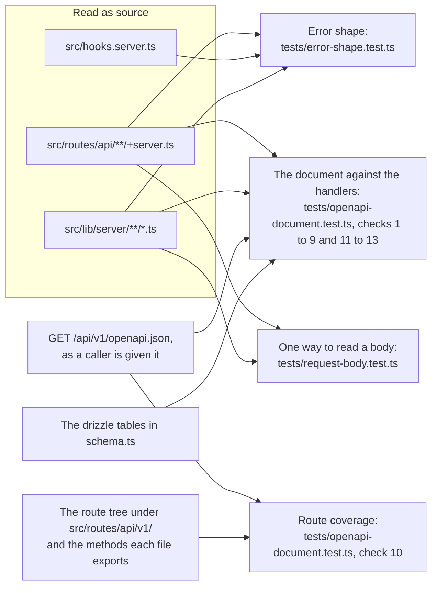

### 1. Error shape: `tests/error-shape.test.ts`

Every failure the API answers is JSON with a `message` and no `error`. The test reads every
`+server.ts` under `src/routes/api`, `src/hooks.server.ts` and every file under
`src/lib/server`, and looks at each place that answers a failure.

| Written as | Must be |
|------------|---------|
| `json(...)`, `Response.json(...)`, `new Response(...)` or `text(...)` with a status of 400 or above | A body that is an object written out where the answer is made, with a `message` key and no `error` key. For `new Response` the object is looked for inside `JSON.stringify(...)`. A body that is plain text fails |
| `error(status, ...)` from `@sveltejs/kit` | Given a text, or an object with a `message`. `error(404)` with nothing fails, because it answers `Error: 404` |

- **What it cannot read it does not pass.** A status that is not written as a number, a body
  that is a variable and a spread in a body each fail, naming the file and the line. The one
  status that is not a number and is understood is `e.status` inside
  `if (e instanceof SomeError)`.
- **There is an allow-list of three.** `ALLOWED` names, by file and line, the answer in
  `api-errors.ts` whose status is the status of the answer it replaces, `json` of
  `v1-json.ts`, the v1 API's own, and the gate's `400 Malformed URI` at
  `src/hooks.server.ts:394` (it was `:381` until card 2253 put `locals.credential = null` at
  the head of `handle`, and `:387` until card 2406 added the start-up removal of settings). An entry that no longer matches a finding fails the test, so move
  that line and the list has to follow.
- **It checks that it looked.** It fails if it finds fewer than 300 `error()` calls
  (`LEAST_ERROR_CALLS`) or fewer than 30 `json(...)` answers with a status, so a parser that
  sees nothing cannot pass. The floor was 600: card 2117 moves each handler's refusals of its
  fields into the readers of `src/lib/server/request-body.ts`, which make them in a few calls
  between them, and the count falls with each slice of it (536 after its second, 496 after its
  third). It was 400 until card 2012, which merges each pair of handlers' refusals, one in each
  API tree, into one service: its slice A3 alone took the dependency guards written in four
  route files and a dozen `MilestoneError` and `TokenError` turns down to a few, from 403 to
  371, and A4 to 355. Every refusal is still answered in its words; only the number of places
  that write them fell, so the floor was lowered to 300, its meaning kept.

### 2. The OpenAPI document: `tests/openapi-document.test.ts`

`src/routes/api/v1/openapi.json/+server.ts` is written by hand, and the `/docs` page is
drawn from it. The test reads the document as a caller is given it, finds the handler for
each operation in the `+server.ts` its path names, and works out from the source every
status the handler can answer, whether it reads a body, which query parameters it reads, and
every text it can answer with. A status or a text counts as the handler's if it is in the
handler, in a function of the same file it calls, or in a function it imports from the
repository, the guards in `route-guards.ts` above all. For the texts a function is read as
it was called: `requireBoard(user, id, 'view')` answers "No access to this board" and not
"No edit access to this board", which is in the same line of it.

The statuses are read the same way (card 2012). A v1 handler that calls a shared service
hands it an object of options written out at the call (`{ source: 'api', refuseEmpty: true,
says: NO_EDIT }`), and the reading follows the service with those values known: a branch the
options decide (`if (opts.allowMove && …)`, `opts.source === 'api'`, `opts.says ?? '…'`) is
read only the way the handler's options take it, an option left out of the object counting as
`false`, and a module's constant holding a text is read as that text. So a status or a text only
the internal tree reaches through the same service, such as the move's `409` behind
`allowMove`, is not counted for the v1 operation. A condition it cannot decide (a local, a row)
is read both ways, which is why a service puts the option itself in such a condition. The
readers are `reading` (the statuses), `textsOf`, `decided`, `calledWith`, `valueOf` and
`branchesOf`.

| # | The document must |
|---|-------------------|
| 1 | Give every operation a `401` and a `429`, unless it declares `security: []`, and a `500` |
| 2 | Give an operation a `requestBody` exactly when its handler calls `request.json()`, and then a `400` and a `413` |
| 3 | Declare every `{parameter}` of a path as a required path parameter, and have no `$ref` that names nothing |
| 4 | Document every failure a handler can answer, the successes it returns and no others, and no failure that neither the handler nor the gate answers |
| 5 | Document the query parameters a handler reads, and no others |
| 6 | Tag every operation with a tag in `tags`, and list no tag without an operation. The `/docs` page lists an operation only under a listed tag |
| 7 | Answer every failure with a schema that is an object with a required string `message`, and have no `error` key in an example of one. Use no `nullable`, which means nothing in OpenAPI 3.1, and no `allOf`, `oneOf` or `anyOf`, which the `/docs` page cannot draw |
| 8 | Give each schema that mirrors a table that table's columns, each with the column's type, and require every one of its properties |
| 9 | Have exactly `OPERATIONS` operations (81, with `DELETE /api/v1/comments/{commentId}`, card 2283), each with a handler that was read and a status found in it |
| 11 | Give every property that counts tokens `format: 'int64'`, in the token schemas and in what the token operations send and answer. One entry may hold 10,000,000,000, which 32 bits do not |
| 12 | Say of every property of an answer whether it is always there: every schema that describes an object in an answer has a `required`, and a property is in it or is listed with the reason it can be left out |
| 13 | Give no example of a refusal whose `message` its operation cannot answer: the text is a string, or what a template makes, in the handler or in what it calls, or in the gate for a body at fault, a `401`, a `404`, a `405`, a `413` and a `429` |

Check 10 is [route coverage](#3-route-coverage-check-10-of-the-same-file).

Five lists in the file are the only exceptions, and each fails the test when it has
outlived its reason:

| List | Holds |
|------|-------|
| `MIRRORS` | The schemas that mirror a table, with what the API `adds` beside the row, a column it `withholds`, a column it answers `retyped`, and a property an answer is `sometimesAbsent` from, each with the reason |
| `SOMETIMES_ABSENT` | For every other schema of an answer, the properties an answer does not always have, each with when it is left out: `cycle`, `graph`, `cardTitles` and `subtaskTitles`, `parentCardId` on a card and on a withheld subtask of a plan (card 2129), the burndown's `options`, and the lists a `direction` or an `include` decides |
| `BUILT_AT_RUN_TIME` | An example whose text is in no source file as it is answered. Empty: every example is a literal or a template of its handler |
| `READ_AND_NEVER_ANSWERED` | A status the reading finds for an operation which that operation never answers. One entry: `POST /api/v1/tokens/bulk`, whose `403` and `404` become lines of its `409` |
| `QUERY_READ_ELSEWHERE` | An operation whose query parameters are read in a function the reading cannot follow. One entry: the burndown, read in `parseBurndownQuery` |

What cannot be found in the source is the shape of an answer. A last group of tests in the
same file calls the real routes and compares the top-level keys of each answer with the
schema the document gives for it. Every call it makes is also held to the `required` lists
of the schema documented for the status it was answered with, at every depth, and to the
properties that schema lists, by `undocumentedProperties()` (card 2254): a key an object's
`properties` does not name fails, naming its path, unless `additionalProperties` is `true`
or a schema (then the value is held to that), and an object schema that lists no properties
documents none of the keys it is given. The last test of the group fails unless an answer of
every operation was held so. Those answers are
an administrator's, in which nothing is withheld, and keys and `required` say nothing of a
null where the schema has an integer: one more test reads a viewer's dependencies and
summary, whole and compact, with a blocker, a subtask and a moved member card on a board
they cannot open, and holds every value to its property's `type` with `typeFaults()`
(card 2129). `Webhook.url` is in `MIRRORS` as `sometimesAbsent`, left out as the secret is
(card 2133).

### 3. Route coverage: check 10 of the same file

The document and the route tree agree in both directions, on paths and on methods. Every
`+server.ts` under `src/routes/api/v1/` and every method it exports has an entry, and every
entry has a route file that exports its method. The document describes itself, at
`GET /api/v1/openapi.json`, so the check has no list of exceptions.

### Adding an operation

A new route under `/api/v1/` fails these tests until steps 1 to 4 are done. Steps 5 and 6
are not enforced: they are what keeps its answer true as well.

1. **Write the handler so that it can be read.** Refuse with `throw error(404, 'Card not
   found')`: a status written as a number, and a text. An answer that carries more than a
   text is `json({ message: '...', ... }, { status: 409 })`, with `message` in the object
   and the status written as a number. A typed error is rethrown as
   `if (e instanceof SomeError) throw error(e.status, e.message)`.
2. **Read query parameters by name**, as `url.searchParams.get('name')`, so that the name
   can be read from the source.
3. **Add the operation to the document**, under its path with `{braces}` round each
   parameter, with:
   - a tag that is in `tags`. A new tag is added there too, or the `/docs` page will not
     list the operation;
   - every path parameter, `required: true`, and every query parameter the handler reads;
   - a `requestBody` if, and only if, the handler calls `request.json()`;
   - a response for every status the handler can answer, the guards it calls included, and
     for the success it returns;
   - `401` and `429`, unless the operation needs no key and says so with `security: []`;
     `500`; and, with a request body, `400` and `413`. The shared responses under
     `components.responses` are there to be referred to;
   - for every failure, a schema with a required string `message`, and no `error` in its
     example.
4. **Change `OPERATIONS`** in `tests/openapi-document.test.ts` to the new count.
5. **If the answer is a row of a table**, either refer to a schema already in `MIRRORS` or
   add the new schema to it, so that it is held to the table's columns.
6. **Add a test of the answer** to the last group in `tests/openapi-document.test.ts`,
   which calls the route and compares what it answers with the schema. Every call there
   goes through the file's `api()`, which fails on a property the answer has and the
   schema does not list, at any depth, so every field of the answer, nested ones too, is
   documented; a map is written `additionalProperties: true`, or with a schema for its
   values (card 2254).

Then `npm test`. Each check fails with one line for each operation at fault, naming it.

A new operation also fails `tests/access-every-route.test.ts` until it has an entry in
that file's table saying who may call it, as every route under `/api/` does: see
[Adding a route](#adding-a-route).

## The Two API Trees Side by Side (card 2012)

Card 2012 moved 99 handlers of the two API trees, the internal one and `/api/v1/`, onto one
service per action in `src/lib/server/` (see
[Architecture](architecture.md#one-service-per-action-both-trees)). It was a pure move, and the
suite was the proof: no existing case was edited for it but two source pins whose lines moved
unchanged (`tests/request-body.test.ts`'s card-field limits, now read in
`src/lib/server/card-fields.ts`, and `tests/subtask-order.test.ts`'s subtask reads and creates,
now in `src/lib/server/subtasks.ts`), one made-up line of card 2253's rule itself (its (d)
case's callback returned its caller, which the check that the caller is never let out now
refuses, so it returns `caller.id` and still tests (d) alone), and the two floors below. Three things hold it.

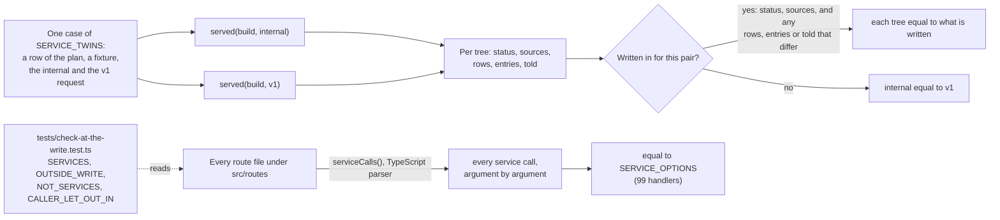

### The twins: `tests/activity-twins.test.ts`

The describe "the pairs that share one service, side by side (card 2012)". Each of its 49 pair
cases (`SERVICE_TWINS`, each naming its row of section 3.1 of the plan) was written, and passed,
against the code before its pair moved, and passes unchanged after; but row 11, a comment
deleted, whose v1 half is new with card 2283 and failed until it was there, and row 15's
untick and edit, new with card 2299, which recorded nothing in either tree until then. `served(build, request)`
resets the database, builds the fixture, takes a `snapshotDb()`, installs `effects()`, makes the
one request, waits for every effect to settle, checks that none started inside the transaction,
and says what the tree did:

| Part | What it holds |
|---|---|
| `status` | The answer's status |
| `sources` | Each entry's raw action and `source` (`card_updated ui` against `api:card_updated api`), then each webhook's event and `source` |
| `rows` | Every row the request added, removed or changed, by table, whole, with its timestamps masked; the activity log and its id counter left out |
| `entries` | Each entry with its action canonical and its `source` left out |
| `told` | Every live event, mail and webhook in the order it started, each webhook's `source` left out |

A case writes each tree's `status` and `sources` in. `rows`, `entries` and `told` are compared
tree against tree, unless the pair differs today, when each tree's is written in
(`{ internal: [...], v1: [...] }`: a subtask's event `type`, a comment's entry words, the order
of an entry and its mail). A pair that records nothing or tells nobody says so with
`entries` or `told` `{ internal: [], v1: [] }` (a label put on a card, a milestone changed, a
dashboard grouping); otherwise the case insists that something was recorded and told, so a
comparison of two empty lists cannot pass. Beside the pairs, for each slice, a case of each
tree's `403` words for a caller who may not, a case of its `404` and `400` words (and `409`,
for rows 24 to 30), a case
of the reads (the same rows from both trees, and each tree's refusals), the case of v1's four
token writes (each update sent once committed), and a case listing the rows that have a pair
case (1 to 7, 9, 10, 12, 14 to 18, 21, 22, 24 to 27, 29 and 30; the reads, and the rows only
one tree has, are held by the refusal and read cases).

**The options table.** "hands each service exactly the options its handler took before it
moved" compares `serviceCalls()` with `SERVICE_OPTIONS`. `serviceCalls()` reads every route
file under `src/routes` (`+server.ts`, `+page.server.ts` and `+layout.server.ts`: each method,
`load`, each `actions.<name>`, and any call in no handler), finds each call of a function of a
module of `src/lib/server/` that exports `READS`, and records its arguments as parsed: an
object written out by property (their order not compared), a literal as itself, anything else
as its code (`{ code: 'caller' }`). The table names 99 handlers, the 20 reads among them. A
handler that calls a service and is not in it fails, so does one in it that no longer calls it
so, and so does an option added, dropped or changed (`allowMove`, `refuseEmpty`,
`tellBeforeEntry`, `says`, `source`, …): the table is what each handler took and refused with
before it moved. A service is known by its `READS` export, so a new module is pinned here the
moment a route calls it.

### The service rule: `tests/check-at-the-write.test.ts`

The describe "one service per action, written only inside writeAs (card 2012)" reads every
route file and every module of `src/lib/server/` with the TypeScript parser and fails closed.
What it holds is in [Authentication & Security](authentication-security.md#asked-again-at-the-write-card-2253),
"The service rule": a service write called only in its own `writeAs` callback, handed that
callback's `caller`; `inWrite();` the first statement of every write; reads named on `READS`;
nothing of the request in a service; and the list checked against the files. Its lists:

| List | Holds |
|---|---|
| `SERVICES` | The 13 modules: `cards.ts`, `card-assignees.ts`, `card-comments.ts`, `card-labels.ts`, `subtasks.ts`, `work-dependencies.ts`, `token-service.ts`, `milestone-service.ts`, `boards.ts`, `board-groupings.ts`, `columns.ts`, `card-categories.ts`, `labels.ts`. A case also holds each one's reads and writes by name |
| `OUTSIDE_WRITE` | What a handler that calls a service may call from `$lib/server/**` after its body outside its callback, each with why: `pathId`, `linkBaseUrl` and v1's `json` |
| `NOT_SERVICES` | A module that exports a function handed `SessionUser \| null` and is no service, with why: `request-access.ts` (`requireRequest`, a guard). An entry that excuses nothing fails, and a module that imports `inWrite` cannot be on it |
| `CALLER_LET_OUT_IN` | The handlers whose callback may let its caller out, with why. Empty; card 2253's rule reads every write handler for it |

Four cases over the tree, and fifteen of the rule itself against made-up source ("the rule
itself (5)"), every probe of the security reviews of its first slice among them.
`tests/write-as.test.ts`'s describe `inWrite` holds the check made at
run time: it refuses outside any transaction and inside a bare `inTransaction`; passes inside
`writeAs` and what is nested in it; is taken off when `writeAs` returns or throws; and a
session ended while the body arrived, naming in its body an id that is not there, is `401`, not
`404`.

### Two floors lowered, and why

Two tests count places in the source as their check that they read something, and the move
merged each pair's two copies into one:

- **Card 2212's labels** (`tests/activity-twins.test.ts`, "has a label for every action
  written to the log…") required more than 30 `logActivity` and `logUiActivity` call sites under
  `src`. Slice A2 merged fourteen into seven (36 to 29), and the count is 26 after A4. The floor
  is 20 (`toBeGreaterThan(20)`), with a line that card 2012 merges the two trees' call sites;
  every action still has its label.
- **The `error()` calls** (`tests/error-shape.test.ts`, `LEAST_ERROR_CALLS`) were at least 400;
  slice A3 brought them from 403 to 371 and A4 to 355. The floor is 300 (see
  [Error shape](#1-error-shape-testserror-shapetestts)); every refusal is still answered in its
  words.

Neither is a change of behaviour: the count of places that write an entry or a refusal fell,
not what is written or refused.

## The Board Page and Its Card Window (card 2280)

The board page cannot be run here, so what it does is held in three ways: its plain modules
are run, its components are mounted, and its script is read.

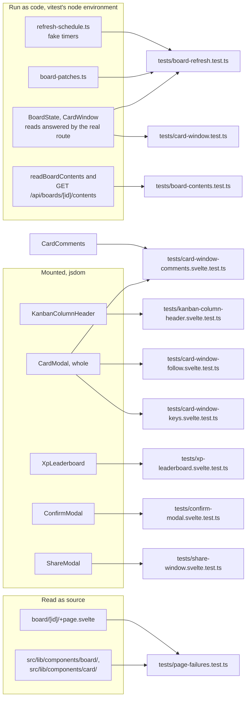

- **The plain modules.** `src/lib/board/refresh-schedule.ts` is plain TypeScript on the
  page's own timers, so `tests/board-refresh.test.ts` runs it with fake ones: the 250 ms
  wait, the 1 s maximum, one read at a time, holds as a count with their watchdogs, the
  access read never held, and the generation that drops a late answer. The patches are pure
  functions, and `BoardState` reaches nothing of the browser but the `fetch` it is given:
  `tests/board-refresh.test.ts` gives it one that answers each read as the test chooses, and
  `tests/card-window.test.ts` one that hands each request to the real route through `api()`,
  so the card-window controller is run against a board state whose reads the contents route
  answers.
- **Replays of the page's own functions.** Some of the page's functions (the drag's holds,
  the On Hold and blocked windows, the bulk changes, `saveCard`) are compiled from its
  script with the TypeScript compiler and run as written, against a real `refreshSchedule`
  or `BoardState` with fake timers, in `tests/page-failures.test.ts`.
- **Components under jsdom.** Seven files mount a component with Svelte's client runtime (card
  2281 added five that mount whole pages the same way, and card 2383 a sixth: see
  [The Split Pages](#the-split-pages-and-the-card-window-off-the-board-card-2281)):
  `tests/xp-leaderboard.svelte.test.ts` (card 2304, the first),
  `tests/kanban-column-header.svelte.test.ts`, `tests/card-window-keys.svelte.test.ts` and
  `tests/card-window-follow.svelte.test.ts` (card 2280), and
  `tests/card-window-comments.svelte.test.ts` (cards 2284 and 2282), which mounts the
  window's Comments tab alone with its comment list a bound `$state` prop, and the whole
  window to follow its comments live, and `tests/confirm-modal.svelte.test.ts` (card 2353),
  which mounts the confirm dialog alone with a button outside it as its opener, and
  `tests/share-window.svelte.test.ts` (card 2329), which mounts the Share window alone with a
  `fetch` stand-in answering its list. The three that mount `CardModal` (the keys, follow and
  comments files) give `svelte` the client's runtime with `vi.mock`, as All Tasks' file does,
  so that the window's own `import … from 'svelte'` gets it too: without it the window has
  the server's, whose `onMount` is a no-op and whose `untrack` tracks, and its opening reads
  of its comments and dependencies are never made (the keys and follow files mounted it so
  until card 2341; a case in each now holds that those reads happen). Each takes vitest's `jsdom`
  environment by a `// @vitest-environment jsdom` comment on its first line, so the suite as
  a whole stays in `node` and no other file's environment changes; the component is then
  compiled for the browser. A bare `'svelte'` still gives the server's `mount`, which only
  throws, since vitest leaves packages to Node and Node does not use the package's `browser`
  export, so each file loads `mount`, `unmount` and `flushSync` from
  `node_modules/svelte/src/index-client.js` by its path, with `pathToFileURL` and a dynamic
  `import()`. Each is named `.svelte.test.ts`, which lets it make its props with `$state`, as
  a page does: the XP bars' file and the follow file do. The three that mount `CardModal` stub `fetch` for the window's reads on open and
  give `$app/stores` with `vi.mock`, since only a running SvelteKit app has the page's store.
  The keys and comments files' `settle` awaits five microtasks and then a `setTimeout(0)` turn before it draws, so a
  read and what it writes have both landed.
  Each unmounts what it mounted after every test.

## The Split Pages and the Card Window off the Board (card 2281)

Card 2281 split the admin page, the dashboard, All Tasks and the plan page into components and
put the card window of All Tasks, All To Do and the plan page on the board page's controller
(see [Architecture](architecture.md#the-other-large-pages-in-components)). A split adds no
behaviour, so its tests prove two things: that each pin of the page's source still reads the
piece it read, wherever that piece now is, and that what the page joins up between its
components still works when Svelte runs it.

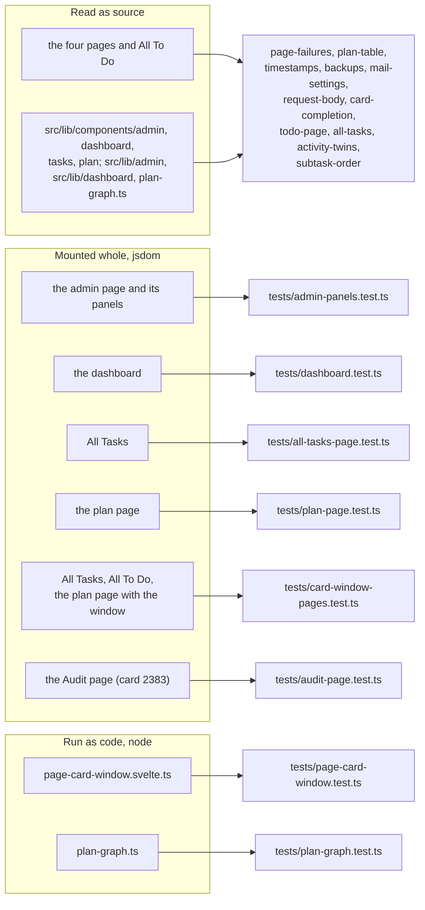

- **The source pins follow the code.** Each pin that read a page now reads the file that holds
  its piece, and each "is gone" or "nowhere else" check reads the page with every one of its
  components and modules, so a piece cannot come back in a component unseen. The helpers that
  gather them:
  - `tests/page-failures.test.ts`: `adminSources()` (the admin page, every component under
    `src/lib/components/admin/` and every module under `src/lib/admin/`); `SUPERADMIN_COMPONENTS`
    (Backup & Restore alone since card 2395; it held the App URL, Scheduled Backups, the
    destination form, the Drive box, the backup history and the mail panel too),
    `ADMINISTRATOR_COMPONENTS` (ten, the App URL, Scheduled Backups and the mail panel among
    them) and `SCHEDULED_BACKUP_PARTS` (the destination form, the Drive box and the backup
    history, each drawn by the scheduled backups panel alone and in no `{#if isSuperadmin}`),
    with a case that every component under the folder is in exactly one of the three lists;
    `drawnForSuperadminOnly(component)`, which follows each of a component's tags up through the
    component that draws it to the page and requires each to be inside the page's
    `{#if isSuperadmin}` and not its `{:else}`; `drawnForEveryAdministrator(component)`, which
    requires each to be inside no `{#if}` at all; `tasksComponents()` and `planComponents()`;
    `WINDOW_PAGES`, the three pages whose card window goes through the controller, each with its
    `parts` (All Tasks' components; the plan page's with `src/lib/plan-graph.ts`; none for All To
    Do), read for what must be in none of them; and `NO_WRITE_OF_ITS_OWN`, All To Do and, since
    its Move window and Archived Cards became components, All Tasks, for which "every function
    that sends a write is in the table" expects none.
  - `tests/timestamps.test.ts`: `dashboardEverywhere()` (the dashboard, its seven components and
    `src/lib/dashboard/`) and `planEverywhere()`.
  - `tests/plan-table.test.ts`: `PLAN_FILES` (the plan page, its seven components and
    `src/lib/plan-graph.ts`).
- **The pages mounted whole.** Five files mount a page with its components under jsdom, as the
  card 2280 files mount a component (and `tests/audit-page.test.ts`, card 2383, the Audit page,
  its Live Console's `EventSource` a stand-in that never opens, since jsdom has none): the client runtime loaded by its path, `svelte` itself
  mocked to the client's (each page's `<Toast />` needs its `onDestroy`), `$app/navigation` given
  with `vi.mock` (and `$app/stores` where the page or the card window reads who is signed in),
  `invalidateAll` a counted stand-in, the live streams (`keepStreamOpen`, `connectLiveRefresh`)
  stand-ins where the page has one, `fetch` a stand-in that keeps each request sent, and each
  file's `afterEach` unmounting. Where a case needs a re-read, the page's props are put in
  Svelte's `proxy` (from `svelte/internal/client`, as SvelteKit does) and `props.data` replaced.
  The dashboard's cases were each shown failing with the binding they hold broken.
- **No timer outlives its case (cards 2312 and 2328).** A timer a component starts and does not
  clear keeps running after `afterEach` has unmounted the page, and fires in a later case, or
  between cases against the real `fetch`, whose rejection of a relative address fails the
  whole run. So a component clears its own timers when it goes (the plan page's card picker
  its 250 ms search, the dashboard's request toasts their poll and each toast's 6 s timer), and
  a case that drives a timer runs it fake: `vi.useFakeTimers({ toFake: [...] })` with only the
  timers the case needs, and `vi.useRealTimers()` in the file's `afterEach` **after** the
  unmount, so the component clears a fake timer as a fake one. The plan page's `settle()`
  moves fake time on by nothing (`vi.advanceTimersByTimeAsync(0)`) when timers are fake, so
  the picker's cases need no real wait. A case that leaves the page inside the test does it
  with the file's `leave()`, which unmounts as `afterEach` does.
- **CSS checked against the markup it is for (card 2320).** `css_unused_selector` was
  suppressed in `svelte.config.js`, so a rule whose selector no longer matches the markup was
  silent in `npm run check` and the build; card 2357 (2026-10-21) switched it back on, and
  `tests/page-failures.test.ts` holds every `.svelte` file under `src` to it. It judges only
  what the compiler can see, though. Where a rule matters to behaviour, the test compiles
  the component with `svelte/compiler` (`css: 'external'`), reads the CSS with jsdom's parser,
  strips Svelte's scoping class and the states jsdom cannot hold (`:hover`,
  `:has(:focus-visible)`, `:focus-within`, `:focus-visible`), and matches what is left against
  the mounted page: `stylesOf()` in `tests/plan-page.test.ts`, which takes a test of the
  declarations, and `revealsOf()` (`opacity: 1`) over it, for the work table's ✕ and its focus
  ring; another component's CSS by naming its file. Where what matters is which of two
  rules wins, `computedOf()` (card 2321) adds the component's compiled sheet, its scoping class
  put to the one on the drawn element, and reads `getComputedStyle`, which jsdom 29 works out
  by specificity as a browser does; jsdom keeps no `border` shorthand built on `var()`, so a
  border is read through the other declarations of its rule. Svelte's own `css_unused_selector`
  cannot stand in for these: any element whose class is built from an expression
  (`row-{r.state}`) makes it take every class selector as possibly used.
- **The adapter and the graph run as code.** `tests/page-card-window.test.ts` runs
  `PageCardBoard` and `PageCardWindow` over a plain two-group list standing in for a page's;
  `tests/plan-graph.test.ts` calls `src/lib/plan-graph.ts` with two graphs whose node boxes and
  edge paths were read from the page's SVG, drawn in jsdom, before the move.

## What Is Covered

| Suite | Covers |
|-------|--------|
| `tests/harness.test.ts` | The harness itself: in-memory database, schema from the real migrations, foreign keys on, route matching, signed-in and anonymous callers. And the suite: every test file under `tests/` is in the list `TEST_FILES`, and every name in the list is a file that is there. See [The List of Test Files](#the-list-of-test-files) |
| `tests/access-control.test.ts` | Board access decided from the row: body `boardId` ignored on card, subtask, label, column, category and reorder routes; archive, restore, favourites, templates, request accept, comments and task lists checked; writable-field whitelists; webhook secrets and addresses, to the board's owner and an administrator only (card 2133), and changing either or switching a webhook on likewise: an editor's `url`, `secret` (the stored value included) or `active: true` for one that is off is `403` with the row unchanged, their `events` and switching off `200` (card 2154); a webhook's `lastDelivery` given to the owner and an administrator on both reads and an update, `null` in the create's answer, an editor's included, and no key for a viewer or an editor (card 2178); superadmin accepted wherever admin is; the inbox (card 2153): a pending request naming a board its addressee cannot open answers `desiredBoardId`, `desiredBoardName` and `desiredBoardEmoji` null with the board's name and emoji nowhere in the answer, and to a team, each member, an administrator among them, is answered for themselves; and the answer to an accept or a reject gives `desiredBoardId` null to an addressee who cannot open the board, and the board's id to one who can (the review's N3); a goal's name (card 2257): a goal across boards with a card on A and one on B, refused to the editor of A (`403`), is in neither the `/all` nor the `/todo` load given to them (`milestoneNames` empty, the card still carrying its `milestoneId`), and named in both to an administrator and to a member of both boards; `GET /api/v1/reports/activity` gives the editor the card's `milestoneName: null` and leaves the goal out of `milestones` once a card of it completes in the window, while a member of both and an administrator are given both; and a third board's milestone on a card of A, written directly, is named by none of the three to A's owner or editor, and is named to an administrator. A webhook's `lastDelivery` and, since card 2325, its `pausedBecause` (`null` for the owner, an administrator and the create's answer, its webhooks set by the board's owner) are given to nobody else. See [Authentication & Security](authentication-security.md) |
| `tests/access-every-route.test.ts` | Who may call every route and method under `/api/`, from a table with an entry for each of the 218: nobody is refused by the handler and through the gate, each signed-in caller the entry's kind refuses is refused with no row changed, no file written and nothing sent, the outsider is refused again with a board of their own named in the body, a request that names a second board's thing in its body needs edit access to both boards and is refused to a caller who can edit one and view the other, the public request form's two routes refuse a caller with no token and with a wrong one, a request's link does not open another request, a list filtered by board gives a caller nothing of a board they cannot open, and the caller the kind lets in is answered with nothing of a board they cannot open. The ways into a board that are not membership are each tried: a team it is shared with, its being public, a grouping it is filed under, a milestone that belongs to no board and a task request addressed to a team. Below the table: the live event stream sends a listener the events of the boards they can open and no other, a report of a grouping holds the boards its reader can open, only the superadmin manages an administrator's account on each of the four routes that manage one, the invite route among them, a role is `user` or `admin` and nothing else on both routes that write one, nobody changes their own email or their own role on the users route, the superadmin included (card 2117), no account route answers a password hash, `isPublic` from an editor saves nothing and is a boolean from anyone else, both routes that create a board answer alike for a sub-board, the graph lists a sub-board and draws a dependency only to a caller who can view the other end, a refusal to remove a dependency is the same whether the link is there or not, and a removal is told to both ends' boards and recorded on the waiting end's, and putting an existing board under a card (`PUT /api/boards/[id]` with `parentCardId`, card 2139): the board's owner, or a member shared as Owner, with edit access to the card's board, links it, moves it to another card and takes it out with `null`, and the three boards concerned are sent a live update; the card it already hangs under, sent back, changes nothing and tells no board it did not leave or join, the board itself being told once of the rename sent with it (card 2143); an editor of the board is refused `403` in the link's own words, with nothing that came with the request saved; an owner who cannot edit the card's board is refused in the words for creating a sub-board; a card that is not there is `404`, and one that is no id `400`; a card on the board itself or on a board one or two levels beneath it is `409`, with nothing saved; a loop already in the data does not stop the check, and a board in one can be taken out of it; and `linkableBoards` offers the top-level boards the caller owns by `getBoardRole`, every one to an administrator, never this board or the top of its chain of parents, and nothing to an editor who owns none or to a caller who cannot edit the board; it reads the database as often with forty more boards as without them, for an owner and for an administrator, offers a board on which the caller is a member stored as owner and not one stored with any other text; and `getBoardRole` reads a member row stored with a role other than the three (`admin`, `Owner`, `''` and more) as a viewer, who may not make the board public. And what is read of boards a caller cannot open: recent activity filtered before its limit, and read newest first by its index of time, by `EXPLAIN QUERY PLAN` (card 2126); `me/stats`' open count and cycle time and the Velocity window counting only boards the caller can open, and agreeing with the dashboard and My Tasks (card 2292); the activity report reading only boards the caller can open, its count of boards left out always 0, a milestone counted over the cards on boards the caller can open, and a named board the caller cannot open refused `403`, one that does not exist `404`, administrators included (card 2326); what the lists of people, teams, groupings, categories and the request form give, and the email addresses of a public board's page, card context and share list (card 2128), and no page load giving an ordinary caller an address but their own (its review); the other end of a dependency withheld in 17 answers, and a moved card of a milestone withheld in the summaries, the plan page, both PDFs and the milestone's own read, and left out of its burndown in both trees, with the PDF's words for a withheld step (card 2129 and its review); and every page load, called through `pageLoad()` as a former member and as a viewer, refusing them or giving nothing of a board they cannot open, with the sub-board left off its card, the tile and the dashboard's figures, its open cards counted on the board page's card with no name, the breadcrumb withheld and the personal figures counted on boards the caller can open (card 2130). A route or method with no entry fails the first test, as does a `fallback`, an `OPTIONS` or a `HEAD`, a `+server.js` and a `+server.ts` outside `src/routes/api`. The faults it finds are recorded and not hidden. See [Access for Every Route](#access-for-every-route). Card 2172's limit changed card 2139's case of a loop already in the data: a board linked under a card on a board below a loop is refused `409` in the depth limit's words, the loop check having ended and found none of its own, and the page offers no board to link there; a board in the loop is still taken out of it, `200`. Giving a milestone to another board (card 2179), on both `PATCH` routes: the table's "moving it to another board" answers `400`, the refused callers still refused `403` first, and "moving an empty one to another board" succeeds; then a milestone of B holding a card of B, or only an archived one, sent board A, is `400` in the rule's words with nothing changed, and a viewer of A is still refused it and lists nothing; a goal across boards holding cards of A and B is refused A until B's card is taken out, and then a viewer of A reads A's card and no title of B; `boardId: null`, an empty milestone and the milestone's own board are each `200`; a board id that does not exist is `404` `Board not found` to an administrator and to the owner; and an editor of B alone is `403` `No edit access to that board`, not the `400`. In the R4 describe (card 2206), `GET /api/v1/milestones`, `GET /api/milestones` and the plan page's list give a viewer of A only `[A]` in `boardIds`, with every card counted, and an editor of both and an administrator both boards. Asked again at the write (card 2253), two walks over every write handler of the tree, read from the route modules at collection (`routeMethods`), so a write handler added is walked or fails for want of an entry: Walk 1, for each of the 219 write cases of the 134 handlers, the case's allowed caller (`outsider` for a public route, the link's holder signed in for a link) has their session row deleted, or their API key's row under `/api/v1`, once the gate has let the request in and before its body is let go (`sendAround`; a request with no body is handed the ended credential through `api()`, there being no window to hold), and is answered `401` in the gate's words with no row changed, no file written, nothing the import writes before it restores and nothing sent; Walk 2, for each of the 162 cases of 119 handlers an administrator or the superadmin is let into by role and an ordinary account refused (`view`, `edit`, `owner`, `across` and `admin` by an administrator, `superadmin` by the superadmin, and `own` cases whose own is one of them), the role is lowered by SQL meanwhile (an administrator to `user`, the superadmin to `admin`) and the request is refused as the lower role is, a batch's `409` saying `No access` and listing every item it was sent, with nothing changed. Each case of each walk has its control, the same ordering with nothing ended, or the role set to what it was, answered as the table's allowed case is and, for a success, with a row changed unless the case says why not (`writesNothing`). An administrator also manages the owner's team and handles the owner's request, each a case of its own, so that Walk 2 reaches the team and request routes too. The import is held as a backup is sent (`held`), since its JSON is refused before it is read. Among the dashboard groupings' cases, a board whose grouping is deleted through v1 is answered `categoryId: null` by `GET /api/v1/boards/{id}` and in `GET /api/boards`, where it was answered the deleted grouping's id (card 2293). A goal's archived cards, in its read (card 2346), six cases: `GET /api/v1/milestones/{id}` lists a board's goal's archived card in `archivedCards`, with `archivedAt` in ISO, and leaves it out of `cards`; a goal across boards lists its archived cards of both boards by card id to an editor of both and an administrator, and a viewer of A is refused the goal `403`; an archived card of board A's goal moved onto board B by a direct write (the stray row) is listed withheld, `archivedAt: null`, to a viewer of A, and by its board and `archivedAt` to an editor of A who views B; a goal with no archived card answers `archivedCards: []`; end to end, the board change refused, each `archivedCards` id taken out with `DELETE …/cards`, then the change `200`; and the page tree's `GET /api/milestones/{id}` answers neither `cards` nor `archivedCards`. |
| `tests/card-completion.test.ts` | One definition of Complete and On Hold for the browser and the server, and one completion path: each of the three ways to move a card (drag, card update, API move) stamps the same dates, awards XP once, writes one activity entry, and refuses alike a card with open subtasks, a card whose sub-board is unfinished, a viewer, and a card or a column that is not there; a move between two finished columns is neither a completion nor a reopening; each of the two ways to tick a subtask marks it, leaves its card alone and refuses alike, writes one `subtask_completed` entry saying who ticked it and by which way, and mails whoever asked for the card (card 2108), and an untick writes one `subtask_updated`, `Reopened <subtask> (on <card>)` (card 2299: it wrote none); a drop of several cards is all or nothing; a move to another board drops the labels and category of the board it left; every reader of an action's name in the activity log (board metrics, personal stats, both audit logs, the board's activity list, the activity report, a card's board history and the burndown) sees what the page did and what the API did alike; and the browser has no route to write activity entries. A card created in a Complete column (card 2134), by each of the three ways to create one (`POST /api/cards`, the API's create and accepting a request): completed as a move into it completes it, the dates, the XP for its priority and `card_created` then `card_completed`, by the creator and from the route's source; a column called Done the same; any other column `card_created` alone; `card.created`, `card.completed`, the `created` update, `xp-update` and `celebrate`, none during the transaction; and the card, its completion, its XP and both entries saved together or not at all, each write failed in turn. A request accepted into a Complete column mails the requester "Request accepted" and then "Your request is complete" with its PDF. Duplicate on the board page, with `fetch` stood in for: the copy of a finished card is made, open, in the board's first column that is not a Complete column, the columns given out of order; a card in another column is copied beside it; and a board of Complete columns alone keeps the copy beside the original, where it is completed; the copy made away from the original names its column, `into`, for the board page's message, and one made beside it does not. The parent card the dashboard makes for a sub-board: `firstOpenColumn()` gives the first column, by position, that is not a Complete column, and none when every column is one, and the dashboard's `createSubBoardInline` takes it, and the first column only then (read from its source). The "Card moved" mail, for each of the three ways to move a card: an assignee is mailed for a completion, for a plain move only when it was made on the page, never when they made the move, and never when they cannot open the board (card 2180). The Audit page's log, `GET /api/audit` (card 2127): a filter by action finds the page's and the API's entries alike, `source=ui` and `source=api` tell them apart, `api:` in front means through the API, a source that is neither is `400`, and on both audit logs `card_*` finds the four `card_` entries and not a `cards_purged` beside them, which `cards_*` finds. Archived cards on a sub-board (card 2205), in the world of a card with a sub-board holding one card in Complete, one archived card in To Do and one archived card in Complete: by each of the three ways to move a card, the card completes, and a live open card added to the sub-board still holds it back, counted alone (`has 1 incomplete card`); the board page's card, the card context and the dashboard tile give the sub-board the same figures, 1 of 1 and with the live card 1 of 2; an editor who cannot open the sub-board gets `hiddenOpenCount` 1 for a live open card and has the drop refused, and once that card is archived 0 and the drop taken; a sub-board of archived cards alone holds nothing back and reads 0 of 0; a completed card stays complete, its `completedAt` unchanged, when an archived card under it is restored; the column rename refusal still counts archived cards; and, read from the source, `getCompletionBlocker`, `hiddenOpenCountsFor` and the three loads each call `subBoardProgress(` and none reads a sub-board's columns itself. The refusal's words (card 2151), on each of the three move routes: an editor who cannot open the card's unfinished sub-board is answered `409` "A sub-board you cannot open still has incomplete cards that must be completed first. Ask this board's owner.", with no name and no number, and nothing changes; a second unfinished sub-board they can open is the one named; the sub-board's maker and an administrator are told its name. A card's board history with no recorded creation (card 2199), every entry put at one time so that the tie does not hang on the clock: a card made on A by `makeCard` and moved to B, through the API or the card window, begins with A, from its `createdAt` to the departure, then B, current; one moved A, B, C in the same second is `[A, B, C]`; and one made through `POST /api/cards` and moved in the same second lists A once, which `<=` in place of the old `<` fails. See [Data Model](data-model.md#one-completion-however-a-card-arrives) |
| `tests/report-mail.test.ts` | What is said when a report is mailed (card 2113), with `effects({ refuseMailTo })` for a mail server that refuses an address. `POST /api/reports/email`: `200` when every recipient was sent it; `200` for a report that reached some, naming the address it did not reach, with each recipient's result; `502` when the mail server refused every one; and `503` with no mail set up, with no PDF built (a spy on PDFKit's `end`, shown to see a build once mail is set up), nothing sent and nothing changed. The scheduled report, `runDueReportSchedules()` called with a time, at `LOG_LEVEL=WARN`: one `WARN` line when every recipient was sent it; one `ERROR` line naming the address it did not reach, with `lastRunAt` set and nothing sent again on a second run; an `ERROR` line saying mail is not set up, rather than that it was emailed; and a `WARN` line, with nothing sent, for a schedule whose board is gone and for one whose board its owner can no longer read, for a board or grouping schedule that names none ("the schedule has no board", "has no grouping"), and for a grouping that is there with no board its owner can read, in the words that name all three reasons a grouping gives no report. The timer's `runDueReportSchedulesOnce()`: a second call while the first is still awaiting its PDF answers `false` and sends nothing, the run claimed before the PDF (`lastRunAt` set already, card 2144), the report sent once, and the next call once the run is over runs (card 2113's review, S2). See [Backup & Reporting](backup-reporting.md#schedule-execution) |
| `tests/report-schedules.test.ts` | A report schedule sent once, at the time it shows, in its own zone (cards 2144 and 2159). `nextRunAfter`, pure, with the process's zone set to `UTC`, `Europe/London` and `America/New_York` in turn: weekly Monday 09:00 London in summer and across both clock changes, worked out afresh from a run and not seven days on; a time the clocks jump over sent an hour later by the clock, and one that happens twice sent once, at the first; monthly day 31 read as 28 and an empty time as 09:00; New York, Lord Howe (half an hour) and three zones whose clocks change at local midnight (Santiago twice, Cairo); each fault naming its field and value; `canonicalTimeZone` (`europe/london`, `Etc/UTC`, `Etc/GMT+1`, and `Mars/Base`, `5`, empty, 65 characters and an offset refused, one written with the minus sign U+2212 included, which Node reads as `-01:00`); a stored value named to 80 characters and `…` in a fault; and the literal `UTC` the same in the routes, migration 0058 and the expected schema. The scheduler, with `effects()`: a time of `9` and a weekly day of `-2` switched off with one `ERROR` line naming the schedule and its owner, nothing sent, over two runs; two due schedules and two runs started together, each sent once, the second run claiming what the first had not reached and the first then claiming nothing (the review's R3); `claimScheduleRun` claiming nothing with a row already claimed or a schedule switched off; a schedule with no next run given one and sent nothing; a London schedule not run a second early and run at its moment; a next run of `NaN-NaN-NaN NaN:NaN:NaN` read as none, switched off with one line and cleared where the time cannot be read, and given a first run where it can; a run that fails after its claim saying it is not sent again before its next run (`db.select` made to throw at the owner's read). `getPeriodForSchedule` under each process zone: seven days back from a London run after the autumn change and a Sydney run after its spring change, each from the same time by the schedule's clock; and the mailed period written in Sydney's dates with the process on UTC. `initReportScheduler()` with its interval faked: never throws, dates one schedule, switches off one it cannot date, and a second start writes no second line; with `Date` faked as well, a `NaN-…` next run read as none, on or off, switched off and cleared where it cannot be dated, dated where it can. The routes, with `Date` faked: `POST` reading Thursday 09:00 in the zone sent under each process zone, in UTC with none, `europe/london` stored as `Europe/London` and four zones refused; `PUT` moving the next run for a new zone or time and not for the same zone spelt otherwise or a new name; a schedule turned back on a week later given its coming run and sending nothing; turning on one switched off because it cannot be dated refused, and it stays off, then turned on with a time that can be read; a change of zone alone keeping the day's run where it is still to come there (New York) and giving next week's where it has gone (Tokyo); a schedule re-timed while it is off taking nothing from a spent day's 100, and turning it on or re-timing one that is on refused `429`. The Reports page's source: **Use my time zone** offered only to a schedule with no fault, with its line saying what it does, and Next followed by the viewer's time. See [Backup & Reporting](backup-reporting.md#report-scheduling) |
| `tests/report-access.test.ts` | A report is its reader's (card 2150), 46 tests, each PDF read with `pdfText()` and, for what must be nowhere, its bytes as Latin-1 too. Board A, with a sub-board HIDDEN its viewer was not given (and DEEP, shared with them, beneath it) and a sub-board SHOWN they were: downloaded through `gate()`, mailed through `api()` and `effects()`, and scheduled through `runDueReportSchedules(now)`, each of board A and of a grouping holding it, the viewer's report holds SHOWN's card and nothing of HIDDEN or DEEP, and an administrator's holds all three; the report data reads the same without a PDF; a sub-board shared with the viewer under a board they cannot open is a board of its own, its parent named nowhere, and named under its parent in the administrator's report, and a parent the reader can open is named (`A → SHOWN`); a schedule follows its owner's account at the run, taking in a sub-board given since and leaving out what an administrator made an ordinary user can no longer open; and the Reports page offers an ordinary user each board they can open whose parent they cannot, and none they cannot open, and an administrator the top-level boards. And the reader itself (card 2404): `pdfText()` reads a compressed stream whose last byte is a carriage return and throws on one that does not inflate, and the scheduled report of board A and of the grouping, run at 09:00 on twelve days pinned with `vi.setSystemTime` (19 to 25 October 2026, the ends of a month and a year, and London's two clock changes), its cards stamped an hour before, says it was generated that day and holds SHOWN and nothing of HIDDEN. On the old reader the scheduled report of the grouping read as no text on 2026-10-22, and three of the twenty-four pinned runs did. See [Backup & Reporting](backup-reporting.md#whose-report-it-is) |
| `tests/public-requests.test.ts` | The public request form, the one part of DumpFire reachable without an account: form tokens, who an anonymous caller may list and send to, rate limits, a request held unverified and kept from the team until the requester confirms it by email, and a requester's thread opened only by its own token and never by an email address. A request nobody confirmed within seven days (card 2243): made seven days and a minute ago, its confirmation is `404` "This confirmation link is not valid." with the row left `unverified`, no mail and an empty inbox; made a minute inside the seven days, it is confirmed and the team mailed once; one confirmed thirty days ago is answered `alreadyConfirmed`; `hasLapsed` and `unconfirmedCutoff` at the edge with a fixed clock (strictly older, an unconfirmed request alone); and its link is `404` `Request not found` on the read, the thread and a reply, where one six days old opens its thread waiting for confirmation; and the confirmation mail says "This link lasts seven days: a request not confirmed by then is no longer kept, and can be made again.", with `UNVERIFIED_LIFETIME_DAYS` 7. A request that cannot be opened (card 2132): with no session and no link, or a wrong one, a pending, an accepted, a rejected and an unconfirmed request and an id with none are each `404` `Request not found` on the read, the thread and a reply as the requester, with nothing saved or mailed; a reply from the team with no session is `401` before the request is looked for; the holder of the link is told the state; and a signed-in caller is still answered `403` or `404`. The board a request names (card 2128): a token holder is listed no board, and the board they send is not read, stored or looked up; a signed-in user is listed the boards they can open, may send none, and is refused one they cannot open. A requester's replies (card 2156): twenty to one request in an hour saved and mailed, the 21st `429` with nothing saved and nothing mailed; a wrong link, an empty message and one too long counting nothing; a reply from the team starting the count again; each request counted apart; the requester replying again once the hour is up; and one `WARN` line at the first refusal, naming the request and not the message. Asking for a new link (card 2158): the right address in another case with spaces, for a pending, an accepted, a rejected and an unconfirmed request, is `202` with the one sentence and one mail to the request's address carrying the request's current link (the confirmation link for the unconfirmed one), with nothing written; a wrong address, an empty one, a request that is not there, an id that is not a number or not whole, and a request with no address are each answered the same `202` word for word with no mail; a body with no `email` text is `400`; no mail set up, a mail user with no password (card 2169's O6), or no address to make a link from, is `503` with the same plain words for a requester, "New links cannot be sent just now. Please contact the team that sent you the link.", the reason in a `WARN` line under `REQUESTS` alone (O7), and no request read; the answer is given before anything a match leads to, and the mail is sent after it (S3); a new link to a request not yet confirmed is not sent once the form has sent its three confirmation mails to the address that hour, one to a confirmed request still is, and three such new links use up the form's three (S2); the 31st new-link mail in an hour, to its own address, is not sent and answered the same (S2); the sixth ask in 15 minutes from one address is `429`, another address going on; four asks over two requests made with one address send three mails and answer the fourth the same; wrong addresses use up none of the requester's three; and an unconfirmed request eight days old is answered the same with nothing sent, where one six days old and a settled one thirty days old are sent their links. For a request made signed in whose account's email has changed since (card 2171): the old address is answered the one sentence with nothing sent, and the new one, in another case with spaces, the same sentence and one mail to it carrying the thread's link; three asks with the new address send three mails and the fourth none, and asks with the old address before them use none of the three. A request nobody has confirmed is not the team's to read (card 2260): addressed to `staff`, the request and its thread are `404` `Request not found` to `staff` and to an administrator; an accept, a reject and a reply from the team by either are `404` with nothing written (`snapshotDb`) and no mail; to `other`, signed in and not addressed, `404` where it was `403`; a lapsed one is `404` to `staff` and to a signed-in caller holding its link; its own link opens it with no session and signed in as `staff`, `status: 'unverified'`, `requesterEmail: null` (signed in, it gave the address); confirmed, `staff` reads it with the address and accepts it; a pending request is read by `staff` and an administrator and `403` to an outsider; and `canHandleRequest` and `canReadRequest` are false for an unconfirmed request, an administrator included, the author rule too. The thread lists messages by when they were sent and those of one second by id (card 2367): a contract, since SQLite gives id order for a tie, with a source pin on the tie-break, which alone was shown failing. See [Authentication & Security](authentication-security.md#the-public-request-form) |
| `tests/migrations.test.ts` | The migration runner, driven against separate in-memory databases and temporary directories of `.sql` files: a failing file is rolled back and halts the run; which errors are tolerated and which statements are refused; the legacy `card_dependencies` conversion; each of the six reconciled tables rebuilt with every row, reference and id counter intact, and what happens when a rebuild cannot go ahead; the start-up schema check; the removal of `time_entries`; the restore of an older backup; and that a new database, a database in production's shape and one built from the migration files as they stood before the reconciliation all end up as the model exactly. Migration 0053 (card 2106): every foreign key column leads an index, in the model's DDL, on a new database and on the production fixture taken through the runner, and before 0053 exactly the 39 it adds did not; 0053 ends every session and leaves every other table as it was, a later start deletes nothing, and a backup made after a session holds no trace of its id; a file from 0053 on that loses rows must be declared in `tests/rehearsal/one-offs.ts`, judged by the runner's own statement scanner: a `DELETE`, a `DROP TABLE`, a `REPLACE`, a `WITH`, an `INSERT OR REPLACE` or `UPDATE OR REPLACE`, or a trigger whose body deletes or replaces, and not a `DROP INDEX` or a trigger that only waits for a delete; and the rehearsal's `compare` notes a declared loss only in a run that applied its file. Migration 0054 (the review of the three cards): the one file after 0053, with its statements; the log's index on `user_id` and `created_at` in place of 0053's, and the query plans it serves (`/api/audit` and `/api/v1/audit-log` filtered by a person read the index with no sort, `/api/v1/me/stats` counts by person and time, and with a board or a card filtered as well the audit routes read that one's own index and name no `user_id`) with `card_comments.user_id` left as it was; the activity report filtered by a person looking each card's entries and comments up by card; every unused invite deleted, used ones and every other table kept, the rehearsal's note, and nothing deleted at the next start. Migration 0055 (card 2158): one `UPDATE` of every `access_token`, in the backfill's form, under a header of decision 3's form; every request's link replaced, open, settled or unconfirmed, 64 hex characters, all different, none the old, with every other column and table as it was and the rehearsal's note; harmless on an empty table; recorded once, and the next start replacing nothing; declared in `one-offs.ts` with `keepsRows`, and a declaration with `keepsRows` must name a file that loses no row and updates its table; `compare` excuses no loss for such a one-off and notes its change only in a run that applied it. A restore of an older backup gives its requests their links inside the restore (`requestLinksReplaced`), so the backfill after it gives none. Through the route, a restore committed with foreign keys left off answers `500` with `committed: true` and says, in its message, its figures and its `CRITICAL` line, the request links it replaced and the mail password to enter again, with why none was kept, as a restore that succeeded does (card 2169's O8). The timestamp step: its `WARN` and `ERROR` lines, nothing converted at a second start, and nothing converted when the database records a migration this build lacks. 0057 (card 2155): the file's one statement and its header; on seven cards (on B in A's goal, on A in A's, archived on B in A's, on B in a goal across boards, on A in a goal whose board was deleted with foreign keys off, on A naming a goal that is gone, on A in none) query 3, held as `QUERY_3` and printed word for word in [Deployment](deployment.md), lists exactly the three 0057 then changes, and only their `milestone_id`, with `updated_at` and every other table unchanged; the statement run again changes nothing, the next start applies nothing, and the rehearsal notes the change with no problem; an empty database; and its declaration in `tests/rehearsal/one-offs.ts`. The third backfill (card 2179): `CARDS_LEAVE_OTHER_BOARDS_MILESTONES` is 0057's statement, word for word with whitespace normalised; run twice on a database of six cards it takes out exactly the card of A's goal on B, the archived one on B and the one whose goal's board is gone, reports 3 and then 0, and leaves `updated_at`, a goal across boards and a card whose column is gone as they were; a restore of a backup holding a card of A's goal on B reports `releasedFromMilestones: 1` and `released` names that card and its milestone, and the card has no milestone, while the restore's "Filled in" texts pinned elsewhere are unchanged; a start that takes out 54 cards names the first 50 in its `WARN` line, `card 1 left milestone 2, card 2 left milestone 1, …; and 4 more`; an Import Backup through the route names `(card 3 left milestone 1)` in its "Filled in"; 0057's query-3 test runs the constant on a copy and it changes exactly the cards query 3 lists; and the halt's stage and the four reports name the third count. 0058 (card 2159): its one statement and header; a schedule made before it reads `UTC` with every other column as it was, the rehearsal noting nothing, and the next start applying nothing; nothing declared to the rehearsal. The fourth backfill (card 2293), which has no migration file: on boards filed under a grouping that exists, under one deleted and under none, it clears only the second, reports `unfiledBoards: 1` and `unfiled` `[{ boardId: 2, groupingId: 7 }]`, leaves `updated_at` as it was, and a second run reports nothing; `BOARDS_LEAVE_DELETED_GROUPINGS` is the statement word for word, and `BOARDS_LEAVING_DELETED_GROUPINGS`, the read that names the boards, is built from its own `WHERE`; a start that clears 52 boards names the first 50 in its `WARN` line, `board 1 (grouping 7), …; and 2 more`; a restore of a backup holding a board under a grouping it does not hold commits, notes the row in `errors` as the backup's own state, reports it in `backfilled` and leaves the board unfiled; a restore that cannot copy a grouping a board points at is rolled back with the stranded-row refusal naming `boards` and `board_categories`, the live database unchanged to the byte, as for a real foreign key, while one that cannot copy a grouping no board points at, with a board under a grouping the backup never held, commits, notes that board as the backup's own state and clears it (the soft reference is sorted board by board, by the grouping each names); an Import Backup through the route names `(board 2 (grouping 9))` in its "Filled in"; the halt's stage names `boards.category_id`, and every `Backfill` compared whole carries `unfiledBoards: 0, unfiled: []`. Migration 0059 (card 2397, five tests): the file is the table with its foreign key and then its index, after a header that says it changes no row and runs once; applied to a database with every file before it, a superadmin, an administrator and settings, it leaves every setting unattributed (the table empty), changes no row, passes the rehearsal, keys its rows by setting and place (two accounts for two places of `mail`, a second row for the same place refused), keeps a row naming nobody (`user_id` NULL) through an account's delete, cascades a setter row away with its account and does nothing at the next start; it declares nothing to the rehearsal; a backup made before 0059 restores every setting it holds, with no error, and the running server's setter rows cleared; and a backup made after it restores with its setter rows beside the accounts they name. The lists of files applied, the production fixture's and the pre-card database's model differences (`setting_setters: the table is in the model but not in the database`) and the production record (64 → 65 files) gain 0059. See [Data Model](data-model.md#migrations-and-schema-reconciliation) |
| `tests/timestamps.test.ts` | One timestamp form (card 2095). The helper: `stamp`, `toStamp` (every shape, an offset to UTC, a bare date as both edges, a date not in the calendar and anything not a string refused) and `parseStamp`. `timestampColumns` (37 on the model, the date columns and `__drizzle_migrations` left out). `normaliseTimestamps` on every shape, an unreadable value reported with its example, a value that names no real moment (`2026-02-30`, an hour of 24, `9999-99-99 99:99:99`) reported and never converted, a second run converting nothing, and a trigger's refusal rolled back; the restore of a backup holding ISO 8601, and Import Backup's `[WARN] [IMPORT]` line. Every write path of the server modules leaves the stored form. Each comparison that was wrong, on the boundary day where the old code went wrong: `me/stats`, the reports' bounds, ties and dates under another time zone, the dashboard's last activity, All Tasks' sort, board metrics across the end of summer time, velocity, the activity report and its `to`, the audit log, `/api/audit` and `/api/logs` with a bare date, an ISO bound and an offset, and a custom report's last day. The audit log's range (card 2217): `GET /api/v1/audit-log` answers a `from` after its `to` `400` `` `from` is after `to` ``, as two dates and as an ISO bound against a stored-form one; equal bounds find that one second, and one date as both its whole day; three entries in one second, read a page of one at a time, come back newest id first on `/api/audit` and `/api/v1/audit-log`; both routes order by `desc(activityLog.createdAt), desc(activityLog.id)` (read from the source). Card 2262: `/api/audit` and `/api/logs` answer the same two reversed ranges `400` `` `from` is after `to` `` and take equal bounds, and the four routes that read a range (those two, `/api/v1/audit-log` and `/api/v1/reports/activity`) call `refuseReversedRange` and hold no copy of its words (read from the source). A `400` naming the parameter for every bound that cannot be read; `null`, text and anything else for `archivedAt` and `expiresAt`. A session, an API key and an invite whose expiry names no moment, or is ISO 8601 an hour past on the same day, closed, and one still to come open in either form; the sweep of expired sessions clearing exactly the sessions that rule closes. The stored form to the minute, with no seconds, converted, and an hour of 24 or 30 February in it reported. `onTheWire` (a key named `__proto__` kept as a key) and `toIso`; every `/api/v1/` handler answering with the `json` of `v1-json.ts`; 19 v1 answers holding no stored-form string; webhook data. The check after every test, wired. The pages, read as source: every helper that shows a stored time parses with `parseStamp`, no page or component reads one with `new Date()` or patches its zone, the card list sorts as UTC with ties by id, and the audit and reports pages send the dates chosen. Due dates as calendar days (card 2241), with the clock and `TZ` set: at 11:00 in New York on 19 October a card due that day is "today", the 20th "tomorrow" and "soon", the 18th "1d overdue", and `formatDueDate` prints "19 Oct 2026"; the same in Tokyo and London, and in Tokyo at 01:00 on the 20th the 20th is today; in London on 24 October, across the clock change, the 26th is "in 2d" and "soon" and the 27th "in 3d"; `dueDay`, `daysUntilDue`, `getDueStatus` and `formatDueDate` of a value that is not a real `YYYY-MM-DD` (a trailing digit, a time after the day, a year below 1000); the helpers' bodies hold no `new Date(` of a value; the three badge titles and All To Do's use `formatDueDate`, the card window's subtask is overdue from the day after its due day, the dashboard's counters call `daysUntilDue`, and an Upcoming Deadlines entry already past for the viewer reads "Nd overdue", not "Today". The page sweep flags `new Date(<…>dueDate` and `Date.parse(<…>dueDate` as it flags a moment, and a target date read either way, anywhere, the same (card 2259). A milestone's target date as a calendar day (card 2259): both plan pages hold no `formatDate`, `daysUntil` or `setHours` of their own and read the target through `daysUntilDue` and `formatDueDate`, the goal page late at `(daysUntilDue(milestone.targetDate) ?? 0) < 0`, and the plan PDF prints `Target ${formatDueDate(m.targetDate)}` (read from the source); in New York at 15:00 UTC on 19 October a target of the 19th is 0 days and reads "19 Oct 2026", in Tokyo at 01:00 on the 20th it is -1; the plan PDF of a goal targeting `2026-10-19`, drawn under `TZ` New York, reads "Target 19 Oct 2026"; the plan list works its rows out again on a 15-second tick, so its "today" moves on at midnight (read from the source). The server's today is the reader's (card 2258), with the clock set and the process in UTC: at 23:30 UTC on 19 October `daysUntilDue` of the 19th is -1 in London, 0 in UTC and New York, an unknown zone read as UTC, and without a zone the process's own; `calendarDayIn` in London, New York, Tokyo, an unknown zone and across a new year; `dueFigures` over seven due dates (overdue, due soon over the day and the three after it, at most five upcoming in the order given, a value that is not a day counted nowhere) in London, UTC and either side of New York's midnight; the dashboard's load sends `dueCards` (open, assigned, dated, by date then id) and `asOf`, and no `overdue`, `dueSoon` or `upcomingDeadlines`; the dashboard page counts them with `dueFigures`, from the UTC day at `asOf` until `clock` is set in an `$effect` and on a 15-second tick, which a deadline's words read too (read from the source); a report's Overdue counts a card due the 19th in London and not in UTC, New York or with no zone; a report made by hand, drawn under `TZ` New York, prints its due date "19 Oct 2026" and its period "1 Oct 2026  -  14 Oct 2026" in UTC; a weekly `Asia/Tokyo` schedule run at 23:00 UTC on 19 October prints the period "13 Oct 2026  -  20 Oct 2026" in its PDF, as its mail does, and its Overdue tile counts a card due the 19th; both report routes pass `readTimeZone(body, 'timeZone', {})` to each report and the Reports page sends the browser's zone (read from the source). A report preset's days are the viewer's calendar days (card 2271): `calendarPeriod` gives "This month", "This quarter" and "Year to date" as dates from the first day to today, at noon UTC on 19 October in four zones, either side of London's midnight on 1 October and 1 April in summer time, of Tokyo's on 1 January 2027 and its last day of 2026, and of New York's on 1 October and 1 January 2027, each against UTC at the same moment, an unknown zone and none read as UTC; the days a London preset sends at 00:30 BST on 1 October are read by `readReportWindow` as the UTC day `2026-10-01`, leave out a card completed at `2026-09-30 23:30:00`, and print "1 Oct 2026  -  1 Oct 2026"; and `getPeriodDates` returns `calendarPeriod(genPeriod, end, browserZone)` for the three, with no `setHours` (read from the source). The goal page works its "overdue" tag out again on the 15-second tick, and the dashboard's Active Tasks window reads its due words on its `clock` under the name `dueWords`, which no longer shadows the page's `due` (read from the source). Group B's review: `dueFigures` over forty cards builds at most two `Intl.DateTimeFormat`s (a spy on the constructor), with the same figures, and a report's Overdue as many for thirty dated cards as for one; the dashboard's load counts the cards due on or before the UTC day minus 2 as `longOverdue` and lists from the UTC day minus 1 on, a card on a board the reader cannot open in neither, and `dueFigures` adds the count, at UTC−12 and UTC+14; a report counts Overdue from the moment it is given, and a weekly UTC schedule run late (the clock two hours on, into the next UTC day) prints its period to the 19th and an Overdue tile of 0 for a card due the 19th; the scheduler passes its `now` to each report (read from the source). Card 2275: `calendarPeriod` for the last 7, 14, 30, 60 and 90 days and 12 months in London at 00:30 BST, in Tokyo at 00:30 on 1 January 2027 and in New York at 23:30 EST on 31 December, each against UTC at the same moment, 29 February a year back the 28th, an unknown zone UTC, and `isCalendarPreset`; and `getPeriodDates` sends every period but a custom range through `calendarPeriod`, with no `setDate`, `setHours`, `setMonth` or `switch` (read from the source). The two audit routes' range, and their order by time then id, are read from `src/lib/server/audit-log.ts`, which both call (card 2294). See [Timestamps: the check after every test](#timestamps-the-check-after-every-test) |
| `tests/uploads-sweep.test.ts` | The attachment file sweep (card 2107), with ages set by `utimesSync`. Moved: a file no row names, older than 24 hours, to `.trash/<id>/` with its marker, the folder removed when left empty, and a file left by a delete made before the trash. Left alone: a named file, a young one, a sub-folder and what is in it, `.trash`, a folder named `notes`, an empty folder 400 days old, a folder above the card counter (with its `WARN`), a folder `0<id>` beside `<id>` holding a named file's name, an upload in progress, and the margin's edge by a second either way. A file whose name differs from a row's only in case, counted in `caseOnly` and named in a `WARN`. Nothing outside the uploads folder through a linked card folder, a row naming `../../outside.txt`, a linked file, or a `.trash` or `.trash/<id>` that is a link (the file stays, with the `WARN`). Nothing while a transaction is open, nothing and a `WARN` when the rows cannot be read, `MAX(id)` when the counter row is gone, and no line when there is nothing to do. The timers under fake time; `startSchedulers` starting it only when on; and Import Backup putting a swept file back. See [Deployment](deployment.md#the-sweep-files-no-attachment-names) |
| `tests/columns.test.ts` | A column's WIP limit on both routes that update a column (`/api/columns/[id]`, which the board page uses, and `/api/v1/columns/[columnId]`, the documented one): whatever is sent is stored as a whole number of 0 or more and the request is never answered 500. `null`, a negative number and text that is not a number become 0, which means no limit; a fraction loses its fractional part; a number sent as text is read as that number; a request that does not mention the limit leaves it alone; and the API document describes the field the same way. A rename on both routes (card 2134): a column that holds a card renamed into Done, Complete renamed Completed while it holds cards, and a column holding only an archived card are each `409` with the message, which counts the archived cards, with nothing changed and nothing sent; an empty column is renamed into Done and out again, and a column holding cards from Complete to Done, each `200` |
| `tests/database-location.test.ts` | Where the database is (card 2083), with nothing opened, no file written and the machine's `/proc` never read. `databaseLocation` in `src/lib/server/db/location.ts`, through a file system it is given and `path.posix`: `:memory:` and `''` look at nothing; a scratch `DB_PATH` beside the repository's `dumpfire.db` opens as new with only that file and the image's `/app/data/dumpfire.db` looked at and no folder listed, and a file with data with nothing else looked at; on Windows (`path.win32`) `/app/data/dumpfire.db` is `C:\app\data\dumpfire.db`, never the image's, and nothing but it is looked at; at the image's path `/app/data/dumpfire.db`, a file with data opens and names a non-empty `/app/dumpfire.db` beside it as another database, with both files' sizes and times, and one it could not look at stops nothing; no file, or an empty one, is refused beside a non-empty `/app/dumpfire.db`, another non-empty `*.db` in `/app/data` and a non-empty `dumpfire.db-wal`, the line naming each with its size, when it was last written and its way forward and holding neither "remove" nor "delete"; it opens as new beside an empty `-wal`, a `-shm`, a `.backup-temp`, an `.export-temp`, an empty `*.db` and an empty `/app/dumpfire.db`, and with nothing anywhere; a folder named `dumpfire.db` or `*.db` is no database; an image's path that cannot be looked at (`EACCES`) is not refused; a new database is refused beside a folder that cannot be listed (`EACCES`, named) but not one that is not there (`ENOENT`), and beside a `/app/dumpfire.db`, a `*.db` or a `-wal` that cannot be looked at, each named; and `data/dumpfire.db` in `/app` is the image's path. At another path while the image's database has data: an empty `DB_PATH`, which reaches the guard as `/app/dumpfire.db`, and a typo on the volume (`dumpfire.sqlite`, a trailing space, a capital) are refused, naming `/app/data/dumpfire.db` and the way forward; a database with data, and a new one beside an empty image's file, open; and an image's file that cannot be looked at is refused. `entryAt`, on a temporary directory: a file's size and modification time, a folder, and nothing for a missing path or one through a file. `heldInContainerLayer` on mountinfo text: a volume at `/app/data` is not the layer, an overlay root with no mount for it is, an `ext4` root is not, `tmpfs` is, a database file bind-mounted alone leaves its folder in the layer, `/app/data2` is not held by a mount at `/app/data`, the later of two lines for one mount point wins, `fuse.fuse-overlayfs`, `fuse-overlayfs`, `aufs` and `overlay` are known and `btrfs` is not, `\040`, `\011` and `\134` are decoded, and empty text is nothing. The `Dockerfile`'s production stage has `WORKDIR /app`, `mkdir -p /app/data` and `ENV DB_PATH=/app/data/dumpfire.db`, in that order, and the builder stage none. The three start-up lines, each given its facts and with `LOG_LEVEL=WARN`: a new database, a database off the volume and another database beside the one in use (naming both, with sizes and times), each one `WARN` when so and nothing otherwise; nothing for an in-memory database, whose mountinfo is not read; nothing, no throw and nothing on the console when mountinfo cannot be read; and the first two written to the console at `LOG_LEVEL=ERROR`, in the logger's format, and once only at `WARN`. `refuseUserlessBesideAnother`: with no users and another database it writes one `[CRITICAL] [DB]` line naming both files with their sizes and times, without "remove" or "delete", and throws; with a user, or no other database, nothing; the running database's users counted (none after `resetDb`, then one); and `hooks.server.ts` calls it after `runMigrations()` and before everything else it starts. And `db/index.ts`, imported afresh with the driver and `./location` replaced: a refusal is written to the console and the import fails with the driver never made, and a pass is asked with `DB_PATH` before the driver opens it and is kept for `createdAtStart()` and `otherDatabaseAtStart()` |
| `tests/schedulers.test.ts` | Whether an instance runs its backup, report and snapshot schedulers: with `SCHEDULERS` unset they run in a built server and not under the dev server; `on` and `off` decide in either, whatever their case; an empty value is unset; and a value that is neither is reported and gives the default. The decision alone is tested: nothing here starts a scheduler. See [Deployment](deployment.md#environment-variables) |
| `tests/import-working-copy.test.ts` | Import Backup's two ways to restore. As a working copy: every report schedule and webhook switched off, the backup schedule disabled and its destinations removed, the mail settings removed, everything else as the backup has it, and the counts reported; the application's own readers then find no destination, no mail, no report to send and no webhook to call. A backup made since card 2169 (the armed rows through `withoutSecrets()`), restored as a working copy directly and through the route: the webhooks it had on counted as switched off though its signed ones were off in the copy, six mail settings removed (it has no password), every webhook off, and its "to enter" naming the signed webhooks and neither the mail password nor a destination, with nothing kept (R3). As it is, a backup that holds its secrets (as one made before card 2169 does): all four as the backup has them, and the readers find each. What a restore as it is of a backup made since keeps from this server, and what it lists to enter, is in `tests/backups.test.ts`. The choice by `?outside=`, its default from the scheduler setting, a bad value refused before anything is read, an export in the old JSON format refused `400` before it is read whatever `?outside=` asks (card 2157), and a failed restore leaving all four as they were. The import forgets the cached key the public request form signs with, so a form token made before the import is refused after it. `switchOffOutside` removes the `setting_setters` rows of the mail settings and every destination, a row naming nobody included, keeps the App URL's, and changes nothing else (card 2406; shown failing with the delete switched off). See [Admin Guide](admin-guide.md#restoring-from-backup) |
| `tests/transaction.test.ts` | `inTransaction` and `afterCommit`, driven directly: what a function writes is committed, or rolled back if it throws; the outermost takes the write lock and a nested one is a savepoint; an inner failure the outer part catches is rolled back alone; an async function, or one that returns a promise, is refused and leaves no row; effects wait for the outermost commit, run in order, and are dropped on a rollback; one that throws or rejects is logged and stops nothing; effects queued inside a transaction the helper did not open are dropped and reported; `inTransaction` called while such a transaction is open throws before it runs anything, directly and through `POST /api/cards`; and log lines written inside a transaction are in `system_logs` afterwards, committed or rolled back. See [Architecture](architecture.md#writes-one-transaction-then-the-effects) |
| `tests/test-helpers.test.ts` | The helpers the all-or-nothing tests stand on: `failingWrite`, the snapshot, `effects()` and its `refuseMailTo`, which refuses the addresses it is given and keeps that mail apart, and nothing unless told, while `duringTransaction` still notes a refused mail started inside a transaction, `action()`, `pageLoad()` (data, a redirect, an error, a layout, and a page that is not there), `readBudget()` (it counts every read of every table, in a transaction or not, `iterate` included, and no write; refuses the read past its limit and says it was spent even when the refusal is caught; and cannot be installed with `watchReads`, `failingWrite` or another of itself), the newer builders, and that `eachWriteInTurn` catches each kind of fault it exists to catch. Card 2196: `mailRefusal` refuses with the error it returns, is shown each mail, and keeps a refused mail apart; `resetDb` starts again what mail has done since the server started, and forgets each webhook's last delivery result (card 2178). Card 2161: the effect started inside a transaction, the order across kinds and `eachWriteInTurn`'s webhook case dispatch a real webhook through `dispatchWebhook`, so they prove the channel webhooks use; a request that is not a webhook is handed to the `request` the recorder replaced; and `restore()` puts back `http.request` and `https.request`, with `fetch` never replaced. Card 2150: each mail's `files` holds its attachments' bytes |
| `tests/atomic-moves.test.ts` | Card and subtask moves and completion through all five routes (`PUT /api/cards/:id`, `PUT /api/cards/reorder`, `PUT /api/v1/cards/:id/move`, and the subtask update in both trees), each write failed in turn: the card, the XP, the activity entry and the "Unblocked" notice are saved together or not at all, the API's subtask tick with its `api:subtask_completed` entry (card 2108), and with the rename sent beside it its `api:subtask_updated` entry after it (card 2299), a subtask ticked again telling nobody, nothing is sent before the commit, the requester's mail follows the commit, an API move across boards that completes a card mails its assignee "Card moved" (card 2134), and a notice that cannot be written fails the completion. A move out of an On Hold column clears the card's on-hold note (card 2208): by `PUT /api/cards/reorder`, by `PUT /api/cards/:id` with `columnId` and by `PUT /api/v1/cards/:id/move`, to In Progress, and by the last two to another board, the note `''` in the row and in the answer; the note kept on a move between two hold columns, into one, within one and between two working columns; a move to Complete refused for an open subtask, by each route, `409` with nothing written and the note kept; the move recorded by its own entry alone, with no `card_updated`, no `card.updated` and one `update` event; on `PUT /api/cards/:id`, the note the card held sent back with the move not written back, and a new note sent with it written; and the activity report no longer puts the moved card in its `on hold` bucket. Who is mailed that a card moved (card 2180): only the assignees who can open the board the card is on after the move, a member, a member of a team the board is shared with and an administrator, on both page routes, and not one whose membership was deleted or who was taken out of the team; and for a move to another board, by `PUT /api/cards/:id` or a completion through the API, only those who can open that board, the mail naming it. The assignee of `scene()` is a viewer of the board, so that the mails pinned elsewhere still go. The reorder's two caps (card 2209), in its "PUT /api/cards/reorder" describe: 5,001 entries refused `400` before any card is read, nothing moved or sent, and 5,000 passing the cap to the first card's `404`; 101 cards moved to another column refused `400`, nothing moved or sent, and 100 moved with 100 entries and 1,000 deliveries to ten webhooks; a drop on a board of 300 cards, every card named and one moved, let through with one entry; a card named 200 times, to and fro between two columns, refused `400` `updates names card <id> more than once` with nothing moved or sent, and a card that is not there named twice refused so, not `404` (the review's S5); and the order: a viewer's 101 moves `403`, and a bad id among them the field's `400`. The "Unblocked" notice of work on another board (card 2152): the comment on a card waiting on a card of another board reads `Unblocked: #<n>, a card on another board, completed — nothing is blocking this card now.` with the title nowhere in it, the assignee who cannot open that board is mailed "A card on a board you cannot open", the one who can its title, and one who cannot open the waiting card's board is not mailed; a subtask of another board is "a subtask on another board" in the comment and named as a subtask in the mail, never by its id; and on the same board both name the work by title, as before. A move to another board and its milestone (card 2155): through the v1 move, under `eachWriteInTurn`, a card of A's milestone moved to B answers and stores `milestoneId: null`, writes the update of the card and two entries and nothing else, `card_moved_away` ends `and out of milestone "M"`, and a viewer of A reads from `GET /api/v1/milestones/{id}` only the card that stayed; the same through `PUT /api/cards/{id}`; both answers name the milestone left as `leftMilestone` `{ id, name }` (the review's O3); a third board's milestone is left with `and out of a milestone of another board`, and `leftMilestone` is null with its name nowhere in the answer; and a goal across boards, a move within the board and a card arriving on its milestone's board each keep the milestone, the entry unchanged, each answered `leftMilestone: null`, as is a save of the card window that moves nothing; the departure reads `"…" moved to another board (…)`, with the milestone's phrase after it. A move to another board withholds the names in the card's "Unblocked" notices (card 2256): a card of A named in W's notice reads `Unblocked: #<n>, a card on another board, completed — …` once W is on B, through both comment routes to a viewer of B alone, with the title nowhere and `createdAt` and `updatedAt` as they were (the notice backdated first, so a rewrite that stamped it could not pass in the same second); a subtask's notice reads `a subtask on another board`, `nothing is blocking subtask "Review it" now.` kept; a notice naming only W's own subtasks ("First step" finished, "Second step" waiting, and a tail of `this card`) stays named, while one naming another card's subtask, or W's own finished subtask with a waiting subtask that is not W's, is withheld (the review); a notice already withheld is unchanged, and one naming a card that is on the board W arrives on stays named (decision 2); a card moved back to A keeps the withheld form; a move within the board, and comments that are not exactly a named notice (other text after "Unblocked:", a lower-case one, text before or after the notice, a second "Unblocked:" inside), are unchanged; a move refused `409` for an open subtask rewrites nothing (its own test); and under `eachWriteInTurn` the move's writes are the comment's update, the card's and the two entries, each failure leaving the comment named. A move between boards names neither board (card 2181): boards ALPHA-SECRET and BRAVO-SECRET, a viewer of each and one of both; through `PUT /api/v1/cards/:id/move`, `GET /api/activity?boardId=` gives each viewer `"First" moved to another board (To Do → In Progress)` or `"First" moved from another board (To Do → In Progress)` with the other board's name nowhere in the answer, nor in the feed across boards, while the viewer of both reads each entry under its own board's name; and under `effects()` the `moved_away` event on A and the `moved_in` event on B have exactly `type`, `action`, `cardTitle`, `fromColumn`, `toColumn`, `userName` and `userEmoji`, and no event names either board. A move to another board withholds the moved card's name in other cards' notices (card 2261): W on A waits on Y ("YSECRET2261"); Y completed, then moved to BRAVO: a viewer of A alone reads W's notice through both comment routes as `Unblocked: #Y, a card on another board, completed — …`, no "YSECRET2261", times unchanged; a subtask of Y blocking W and a subtask of another card: both notices read "a subtask on another board"; a notice of the same subtask title on a card that waited on none of Y's subtasks, and one on W naming another title, are unchanged; W waiting on Y's "Tests" and on Q's "Tests", the notice written by Q's, stays named when Y moves (the review); on a card of BRAVO a withheld notice stays withheld and a named card or subtask notice stays named; Y moved, then W follows it to BRAVO: W's notice stays withheld; `#<Y>7` is not `#<Y>`; a move within one board and a person's comments mentioning `#Y` change nothing; a refused move rewrites nothing; and under `eachWriteInTurn` Y's move writes W's comment, the card and the two entries, each failure leaving W's notice named. Card 2256's "a card named on the board the card arrives on" test now makes its named notice by hand (as a move before card 2261 left it), since Z's move withholds it. Card 2381: the v1 move out of a milestone of the board it left writes one entry more, `api:milestone_card_removed` on that board, between the move's two, failed in turn with them. |
| `tests/deletes.test.ts` | What a delete removes and what it leaves, judged by the rows left afterwards: an archive touches only the card and a restore brings it back whole; a permanent delete of a card, a column and a board, through both API trees, takes sub-boards at every depth, dependency links at either end and the attachment files, and leaves everything outside the tree; a board's report schedules go, cards elsewhere leave its milestones and its categories, and its categories and its sub-boards' go; Purge Archived Cards and Clear Cards; a board that is not there (card 2211): Clear Cards `404` `Board not found` to an administrator, clearing, recording and sending nothing, and `403` first to anyone else, and its delete through both trees `404` to an administrator and to the owner of another board, where the session tree answered an administrator `200`; removing a board's share from a person or a team that does not have it (the review of group Q-F) is `404` `This board is not shared with that user` (or `team`) with no row changed, after the owner's check, which refuses anyone else `403`, and a second removal of the same share is `404`; the activity entry or system log line each writes, the API's subtask delete's `api:subtask_deleted` among them; who each delete tells (card 2108), every event with its whole payload and the board it is for: each sub-board a card or column delete removes, a deleted board and its sub-boards, the board of the card a deleted sub-board hung from, told `sub_board_deleted`, each board a purge takes cards from, a cleared board, and nobody for a purge with nothing archived; a card inside its own sub-board does not hang the delete; subtask and milestone deletes, the milestone's with its `milestone_deleted` entry (card 2289) and then one `milestone_card_removed` a released card (card 2381); and each delete with every write failed in turn changes no row, moves no file and sends nothing. A board's delete sends board B's webhook `milestone.card_removed` for B's card released from A's milestone (card 2381), so its system-log case runs under `effects()`. The read of the cards that leave a goal, for a card, a column, a board and a clear, is checked by `EXPLAIN QUERY PLAN`: the cards deleted by their ids and the cards in a deleted board's goal by `idx_cards_milestone`, with no `SCAN c` (card 2381's review: one `WHERE` with an `OR` read every card in the database). See [Data Model](data-model.md#what-a-delete-removes) |
| `tests/board-tree-loops.test.ts` | Loops in the board tree (cards 2141 and 2142), with every call that meets a loop run under `readBudget(1000)` and the budget asserted unspent. A card moved onto a board beneath it, on `PUT /api/v1/cards/:id/move` and on `PUT /api/cards/:id` with a `columnId`: onto its own sub-board, `409` `Card "<title>" cannot go onto "<board>", which hangs beneath it` with no row changed and nothing sent (an assignee, mail and a webhook on every board set up to see it); two levels down, and again through an archived card in the chain; a card with two sub-boards, the target beneath the second; and moved, `200`, onto a board not beneath it with a loop elsewhere above the target, out of a loop onto a board outside it (after which `boardsInLoops()` is empty), and within a board of a loop. A title sent beside the refused `columnId` is not saved, every read of `boards` the v1 move makes is inside its transaction, a card with 200 sub-boards costs the v1 move exactly the reads a card with one does, refused and moved, so the sub-boards are asked about in one walk up from the target (card 2141's review; asking each in turn cost 213 reads to 14), and a reorder across boards is still `400`. The board page's breadcrumbs on every shape of loop, each crumb a link to its board: none on a top-level board, a clean chain as before, a board under a card on itself one crumb, a loop of two `A › B`, and boards below a loop the loop once round and then the boards between. Every other walk ends on a loop: All Tasks, whose board paths show each loop once round as the breadcrumbs do (card 1990), the board report of a loop board, the completion check of the card a loop hangs from, that card's context and the graph of its board, and the All Boards report and the dashboard, which pin only that those still start from top-level boards. `boardsInLoops()` names each board of a loop with its card, whether that card is archived, and that card's board, and none below a loop or clean, matches the owner's read-only query, is empty with no loop, and makes exactly one read on a chain 5,000 deep. The start-up line: one `WARN` `STARTUP` line naming each board, its card, the card's board, the way out, that one move for each loop is enough, the warning not to delete a board, card or column of a loop, and the admin guide's section, in those words; an archived card marked to be restored from Archived first; a line break or another control character in a name or a title printed as a space, on the console as in the log, so that a name cannot split the line; none with no loop; 20 boards named and the rest counted; said by `reportInstallation()`, which changes no row. What a delete does on a loop, each `200`: deleting a board of it, a board below it, the card it hangs from or its column, a purge with that card archived, and Clear Cards on a board of it, which takes that board too. Clear Cards on a loop board, and a purge with the card it hangs from archived, each write one `INFO` `DELETE` line in the system log naming the board and what went, as a card or a column deleted the same way does, and tell that board `{ type: 'board', action: 'deleted' }`, the boards below it still being told `cleared` or `purged`. And the source check that no recursive query of the board tree is built with `UNION ALL`, which is all it checks. See [A walk that must end](#a-walk-that-must-end-the-read-budget). Card 2172's limit changed one case, on both routes: a card carrying a sub-board moved onto a board with a loop above it, not beneath the card, finds no loop of its own and ends, and is refused `409` in the depth limit's words, a board below a loop counting as past it; a card with no sub-board is moved there, `200`. |
| `tests/sub-board-depth.test.ts` | How deep sub-boards may nest (card 2172). `depthOf` and `heightUnderCard` called directly: a chain counted and stopped one past the limit, and a loop, which reads as past it, ended, with a board whose parent card is gone read as the top. On `POST /api/boards` and `POST /api/v1/boards`: one 20 levels deep made, one 21 deep refused `409` with nothing written, one under a card on a board below a loop refused, and one under a card on a top-level board made as before. On `PUT /api/v1/cards/:cardId/move` and `PUT /api/cards/:id` with a `columnId`: onto a board 18 deep, where the card's deepest sub-board would be 21, `409` with nothing changed; onto one 17 deep, moved; a card with no sub-board moved onto the deepest board; and in a tree already 25 deep, a card lifted part of the way and one moved within the deepest board, each moved. `PUT /api/boards/:id` with `parentCardId`: under a card on a board 18 deep `409`, on one 17 deep linked, and a board of a tree already too deep linked higher; `linkableBoards` offering nothing on a board 20 deep and the top-level boards on one 19 deep. The board page's breadcrumbs: every board above one 20 deep with no "…", and the nearest 20 above one 60 deep with a "…" with no link before them, in at most 30 reads of `boards`, run as an administrator, for whom `canViewBoard` does not read each crumb's board again |
| `tests/subtask-order.test.ts` | Subtasks in one order everywhere (card 2223). Three `POST /api/v1/cards/{cardId}/subtasks` with no `position` read back 0, 1 and 2, and one sent at 0.5 keeps it and lists second; after a v1 one sent at 7, `POST /api/subtasks` gives 8 and a v1 one with none 9; a card's first subtask is at 0 from either create, whatever another card holds. Four subtasks made at positions 2, 0, 0 and 1 come back by position, then id, from the board page load, All Tasks, `GET /api/cards/{id}/context`, `GET /api/subtasks`, the v1 list and the v1 card, the board report and the card report and the card report's PDF (through `pdfText`), and both CSV exports. A tie cannot be made to scan out of id order in SQLite, so the source check holds the tie: each of the ten reader sites in nine files imports `SUBTASK_ORDER` and orders by `.orderBy(...SUBTASK_ORDER)`, none by `asc(subtasks.position)` alone, and both creates call `nextSubtaskPosition(cardId)`. `orderSubtaskNodes` orders nodes 9, 4 and 6 as listed (6, 9, 4), unlisted nodes last by id, and the plan page's graph groups its subtask nodes through it with `data.subtasks[cardId]`, no longer by id |
| `tests/card-order.test.ts` | Cards in one order everywhere (card 2347), 15 tests. Two boards, five cards made in an order that puts positions out of id order and ties at 0 within a column, across two columns and across the boards; then each reader: the board page's load, All Tasks' To Do bucket and All To Do's load (which take in both boards' To Do columns), the internal picker `GET /api/boards/{id}/cards`, the v1 listing column by column, each by position and then id, and both CSV exports board by board (by id), column by column, then by position and id (card 2368); a second case moves a column before another, renames a board to sort after the other, and puts two columns at one place (the older first). All Tasks, All To Do and both exports were shown failing on the old code (a tie came by its column; for card 2368, rows mixed across columns and boards); the board page, the picker and v1 are contracts, since SQLite gives id order within a column and those two had the tiebreak. The source check: the six readers import `CARD_ORDER` from `$lib/server/card-order` and order by `...CARD_ORDER`, and no other file under `src` writes `asc(cards.position)`. Columns in one order (card 2372), 6 tests: a board's columns made First, Second, Third, Third moved to the front and Second tied with First at 0, read in the order Third, First, Second by the board page, `GET /api/v1/boards/{boardId}`, its `/columns` and the internal picker, the board's CSV export and the v1 card listing running through them so, and `POST /api/v1/boards` answering its columns by position; these are contracts, as SQLite gives a tie in id order. The graph's board expansion, `GET /api/graph?boardId=`, giving its column nodes Third, First, Second (the card 2372 review; shown failing on the old code, which read them with no order: First, Second, Third). The source check (shown failing with the inbox's reader put back to `asc(columns.position)`, and with the graph's reader before the review): `COLUMN_ORDER` in `card-order.ts`, the thirteen readers importing it and ordering by `...COLUMN_ORDER`, no file under `src` but `card-order.ts` and `columns.ts` (which takes only the largest position) writing `asc(columns.position)`, and the reports' To Do fallback and All Tasks' bucket order tying by id in code. The board's CSV export of a board with no columns (card 2371, 1 test): a board named `Q3 "launch" 🚀` answers `200`, the header row alone, as `Q3__launch____-2026-10-22.csv` (shown failing on the old code: `Cannot convert argument to a ByteString`), with the clock pinned at 23:59:59.9 UTC (card 2409: the date was read again after the request, and a run crossing midnight in between expected the next day's; shown failing that way by an advance of 0.2 s between the request and the expectation) |
| `tests/team-owners.test.ts` | A team keeps at least one owner (card 2373), and a role left out keeps a member's (card 2378), 14 tests. `POST /api/teams/{id}/members/{userId}` making the last owner a member, and `DELETE` of the last owner, by the owner themselves and by an administrator, each `409` `A team needs at least one owner. Make someone else an owner first, or delete the team.` with the database unchanged (`snapshotDb`); a role the field may not hold still `400`; with a second owner either is made a member and the other is then kept; the last owner sent back as owner, or sent `{}`, is `200` and still owner (`{}` set `member` and was `409` until card 2378); a member added, made owner and back, and removed beside the one owner; on a team with no owner an administrator changes and removes a member and makes someone owner again; a removal of someone not in the team answered as before. Six shown failing with the rule taken out; the four that pass either way are the rule's limits. The card 2373 review (2 tests, contracts: the route already asked who may manage the team first): a member of the team who is not its owner, and an account outside it, are each `403`, not `409`, for the last owner made a member and removed, with nothing changed. Card 2378 (2 tests): an owner of a team with a second owner sent `{}` is `200 { success: true, action: 'updated' }`, still owner, the database unchanged (shown failing on the old line, which set `member`; with the changed case above); someone not in the team sent `{}` is added as `member`, `201` (a contract) |
| `tests/deletes-no-parent-key.test.ts` | The same permanent delete on a database whose `boards.parent_card_id` has no foreign key, where nothing removes a sub-board but the delete itself. In a file of its own because it rebuilds `boards`, and every test in a file shares one database |
| `tests/uploads.test.ts` | Attachment files: where the uploads folder is and which folders are refused; a stored file name that climbs out of its folder; deleting an attachment (row and entry in the transaction, file to the trash after it, each of the two writes failed in turn leaving the file); an upload and a delete each recorded (card 2337): one `attachment_added` entry `Attached "my page.html" to "Has files"` by the uploader, or `attachment_deleted` `Deleted the file "old plan.pdf" from "Has files"` by the editor who deleted it, source `ui`, the live event `{type: 'attachment', cardId}` once committed, and no webhook to a webhook that asks for every event; an upload whose entry cannot be written leaves no row, no file, no entry and no event; a refused delete records and tells nothing; a name with a right-to-left override and a zero-width space is kept as uploaded on the row and quoted without them in both entries; the trash emptied after 30 days and not before, ten minutes after a start and on the six-hourly tick and not at start-up itself, reaching nothing outside itself; an import putting back the files its rows name; an upload that leaves no file when its row cannot be written, and one that still writes its file when the sweep removes the card's folder between the folder made and the file written; and how an attachment is served: HTML, SVG and PDF as downloads, the inline types as themselves, `sandbox` and `nosniff` on every answer, and the file name encoded. The card in the path (card 2361, both shown failing on the old routes, which answered 200): a read and a delete under a card the attachment is not on are `404 Attachment not found`, before any question of access (a file on a board the caller cannot open, named under a card they can, is 404, not 403), an outsider under the file's own card is still 403, and a card id that is none is `400 Invalid card ID`; the delete leaves the row and the file and records and tells nothing |
| `tests/user-delete.test.ts` | `DELETE /api/users/:id`: one test for each of the five columns that name a user with no delete rule, each cleared and its row kept; that the list of five is every such key in the database; the user's XP and uploaded file left in place; the two requests the leaver made, after their email changed, carrying the account's email at the delete and another user's request untouched, the write inside the delete's transaction and in its list of writes (card 2171); the leaver's webhook switched off before the account goes and then naming nobody, the owner's and nobody's left on, so the last write, the user's own row, is now the eighth (card 2168); the delete confirmation's words; all or nothing; the system log line; and who may delete whom. The only owner of a team (card 2377, 4 tests): the only owner of Beta and Alpha, and a member of a team with its own owner, is `409` `This account is the only owner of: Alpha, Beta. Make someone else an owner or delete those teams first.` with the database unchanged; one team reads "that team"; an owner of a team with another owner, and a member of another, is deleted and the team keeps its other owner (shown failing with the other-owner test taken out of the query); an ordinary user, and an administrator deleting another administrator, are `403` first (a contract). The first two shown failing with the refusal switched off. The confirmation for such an account (card 2380, 1 test): `userDeleteWarning('leaver', ['Alpha', 'Beta'])` says after the question "They are the only owner of: Alpha, Beta, so the delete will be refused: make someone else an owner or delete those teams first.", one team "that team", and with no teams it is the old text (shown failing with the teams ignored); the panel's own case is in `tests/admin-panels.test.ts` |
| `tests/admin-reset.test.ts` | Reset and Vacuum. On a database with a row in every table, Reset clears everything but the system log and the backup history, leaves the id counters and the migration record alone, moves the attachment files to the trash and logs who did it; with any one write failed, or the commit refused, it clears nothing and answers 500. Vacuum leaves the id counters as they were. Its database with a row in every table holds a `setting_setters` row too since card 2397, so the table is among those Reset clears |
| `tests/bulk-endpoints.test.ts` | The endpoints that write many rows in one request, each write failed in turn: column reorder, the bulk milestone attach and detach (each card attached or detached with its `api:milestone_card_added` or `api:milestone_card_removed` on its board, the one moved naming the goal it left, and none for a card already in or not in, card 2289; and its `milestone.card_added` or `milestone.card_removed` to the board's webhook after the commit, card 2343), bulk dependencies, bulk token entries, clearing a board's categories and resetting XP; a chain of bulk dependencies across two boards writes one `api:dependency_added` per link on the waiting card's board with its id and the single add's words, a batch of one stored and one new link records and tells only the new link's boards, once each, and a batch of stored links alone writes and tells nothing (a contract) (card 2291); clearing the categories of a board that is not there, `404` `Board not found` to an administrator with nothing cleared, and `403` first to anyone else (card 2211); and the mail of a plan made by the bulk attach is drawn for each recipient (card 2152): the card of a step on the critical path by its title to a recipient who can open its board and as "A card on a board you cannot open", with its number, to one who cannot, an administrator given its title, and an assignee who cannot open the plan not mailed |
| `tests/atomic-creation.test.ts` | Creating something that is more than one row: a board with its columns, its owner and its `board_created` entry (card 2143), a card, a subtask, a comment and a team each with what records them, restoring a card through both routes that do it with its `card_restored` entry and one live update (card 2108), a card that is not archived answered as it is with nothing written and nobody told, and the mail settings saved all or none. The comment tests' `mentioned` is a viewer of the board, so it is mailed "New comment" and then "mentioned you". Who a mention mails (card 2198), on both comment routes: of an outsider, a viewer, a member of a team the board is shared with and an administrator not on the board, all named, the three who can open it are mailed and the outsider is sent nothing; a member whose membership is deleted is not mailed; and an outsider named on a public board is (it is `canViewBoard`, not a list of members). The mail settings' save, every setting and the App URL or none, now ends with the two `setting_setters` inserts of card 2397 (who set the mail, who set the App URL), each failed in turn with the rest |
| `tests/load-query-counts.test.ts` | How many reads the admin page's and the dashboard's loads make, and what they answer (cards 2297, 2298, 2391, 2393 and 2394), thirteen tests. Each load is called through `pageLoad()` with `readBudget` counting its reads: the admin load makes the same number (seven) for 1 board and 1 team as for 50 of each; the dashboard's makes the same number for 1 top-level board as for 10, for 1 assignee row as for 30, and for sub-boards 1 level deep as for 3, for an owner, a board member, a team member, an administrator and someone who sees only a public board. What each answers is pinned as the old loads answered it (the cases passed on the old code before the change): the admin load's whole answer, key for key, each board's counts (archived cards counted, a shared category not), each team's members in the order of their ids whatever order they joined; and for each of the five callers on the dashboard, the keys of the answer, of a board and of the analytics in order, each board's figures, its sub-boards in the order of their cards' columns, All Tasks' totals, the pending requests, the leaderboard with a tie broken by the order the rows were made in, the board health and the spend, and since card 2393's review the groupings listed (`allCategories`: one each holding A, B and the sub-board under A's card to do, and one holding nothing) and the caller's recent activity (an entry of each caller's on A, B, P and that sub-board), added to the scene and to all five pins on purpose because the load hands its list of the caller's boards to the helpers answering them; the new pins passed with those helpers left to read the list for themselves, as before card 2393, and a `null` handed to them in the load (the old helpers trusting it) fails the member's, the mate's and the outsider's pins. One figure was changed on purpose after: the leaderboard leaves archived cards out (card 2391), so the archived card assigned in the scene no longer counts as active for four of the five callers; and a test of its own has one person whose only card is archived in Complete, off the board, and one with an archived card in Complete and an open one in To Do, `0 done, 1 active`, the load making the same number of reads as with nothing archived. Each of the five callers in the pinned scene has a ceiling on the dashboard's reads as well (`MOST_READS`), set on purpose to what the load makes: 23 for the owner, 21 for the board member, 21 for the team member, 16 for the administrator and 22 for the public board's viewer. Each was one more (24, 22, 22, 17, 23) while the load read the caller's teams for the pending requests with the query `getAccessibleBoardIds` had just run (the administrator's read and not used); they come from that read now (`getAccessibleBoardsAndTeams`, card 2394), and putting the read back takes all five over their ceilings. The owner's and the viewer's were one more each while the columns of the caller's own assigned cards were read twice with the same query, once for which are done and once for which are on hold; they are read once now (card 2392). Every caller's but the administrator's were 12 more again, and the team member's 15 (36, 34, 37 and 35), while the boards the caller can open were read four times a load, by the load and again by `subBoardsFor`, `boardCategoriesFor` and `recentActivityFor`; the load reads them once now and hands them on (card 2393). Putting back any one of those three reads takes each of the four callers over its ceiling. A read added to the load is a change to that list too. Two tests of card 2393's review hand those helpers a `null` list of boards: from a caller who is not an administrator, `recentActivityFor`, `boardCategoryRule`, `boardCategoriesFor` and `subBoardsFor` each answer for the caller's own boards alone, as with the list left out (all eight checks failed while a `null` was taken as every board from anyone); from an administrator it is every board, and `boardCategoryRule` reads nothing |
| `tests/load-access-reads.test.ts` | How many times the other pages read the boards their caller can open, and what they answer (card 2394), 140 tests. Card 2402 added two cases of the activity report of boards named (`?boardIds=` A and B, answered to the owner and the administrator and refused to the others at the board they cannot open; and P, answered to everyone), their ten hashes taken on the old code (`7d01342`) before its change and unchanged by it; lowered the ceilings of those cases, of the three goal routes, the plan pages, the board pages and the burndown pages, with the count before beside each (the report of A and B for the owner 11 → 9, `GET /api/milestones` for the board member 8 → 7), and raised the outsider's refusal at A 4 → 5 and the access count of the three refusals 0 → 1 (the caller's boards are read where `canViewBoard` was asked of each board); asked the report with every one of the member's boards named in the count test of one board against twelve (12 against 46 on the old code, 10 for both now); and one test: the goal lists' one read of `milestones` asks `goalsShownTo`'s rule for every caller but an administrator, whose read of `GET /api/milestones` is the whole table. With the report asking of each board again (three reads a board, a temporary edit), its ten cases but the outsider's refusal and the count test failed; with the 404 asked after the 403, two tests of the report's refusals in `access-every-route.test.ts` failed; with the rule's clause on a goal's cards outside the caller's boards left out, 39 failed, the `canViewMilestone` test among them; with a goal of no card opened to no one, a goal with cards opened only to its maker, or archived cards left out of the rule, the `canViewMilestone` test failed (and the count test with the first two). In its review the `canViewMilestone` test also asks `listMilestones` of no board, each board and one that is not there, every status (none, `open`, `closed`, empty) and both modes, for every caller of both scenes, with a third of the goals closed and half given one target date, and holds each answer, unsorted, so in its order, to the old pipeline worked out in the test (the whole table in id order, the board or the goals with an unarchived card on it, the status, `canViewMilestone` of each goal, the list's sort); with the board filter joined to the rest by `or` in place of `and`, it failed (and the three hashes of the plan page for board A), and with the `touching` subquery's archived condition left out, it alone failed. And one test puts the rule's two copies side by side: for every caller of both scenes, the goals `milestoneIdsOpenTo` (`milestonesOpenAmong`) opens of every goal are those `listMilestones` (`goalsShownTo`) lists; with the maker's clause left out of `goalsShownTo` it failed with three others, and with a goal of no card opened to no one in `milestonesOpenAmong` it alone failed. Card 2400 added the activity report as a case (`GET /api/v1/reports/activity` for January 2026), its five hashes taken on the old code (`5b002fc`) before its change and unchanged by it; lowered the ceilings of All Tasks, All To Do and the report, whose goal names were asked goal by goal (the board member's All Tasks 33 → 26, All To Do 29 → 24, the report 15 → 8); asked the three in the count test of one board and its goals against twelve (on the old code 33 against 148 for All Tasks, 28 against 62 for All To Do, 18 against 133 for the report; 24, 22 and 9 now for both); and two tests: the plan page reads no whole list of top-level boards for a caller who is not an administrator and one for an administrator, and offers a caller who can open no board none with no such read. With `canViewMilestone` asked of each goal again, and the plan page's whole read put back (temporary edits), 12 failed, every hash matching. Card 2399 added six cases (the inbox, the plan page, the plan page for board A, `GET /api/milestones`, `GET /api/milestones?forBoard=` and `GET /api/v1/milestones`), their 30 hashes taken on the old code before its change and unchanged by it; lowered the ceilings of the inbox and of every case that lists goals (the board pages and the burndown pages among them; the board member's board page for A 48 → 41, the plan page 23 → 9), with the count before beside each, and the access count of the plan page 2 → 1 and of the two goal lists for the outsider 0 → 1 (none of the goals is theirs: the boards are read once where each goal's board was); and three tests: the inbox, the plan page and the three goal routes make the same reads for one board and its goals as for twelve (on the old code 19 against 8 for the inbox and 138 against 23 for `GET /api/milestones`), the goal lists answer exactly the goals `canViewMilestone` opens for every caller of both scenes (the second scene asked by its member, its owner and an outsider; in the review three goals were added to both scenes inside that test alone, so that no hash or count moved: a goal of no board with no card made by the owner, a goal on a public board, and a goal across an open board and a hidden one whose only card on the hidden one is archived, each held by name to who opens it; with archived cards left out of `getMilestonesBoardIds`, or a goal with no card opened to anyone, a temporary edit, it failed; before the review neither edit would have failed it, as neither scene held such a goal for a caller who did not make it, argued, not shown), and All Tasks reads no whole `boards` table for a caller who is not an administrator (it did on the old code) and one for an administrator. With `canViewMilestone` asked of each goal again (a temporary edit), 51 failed; with a goal across boards opened by any one of its boards, the hashes of 22 cases, the count test and the `canViewMilestone` test failed; with the inbox's per-board read put back, the inbox's five cases and the count test failed. One scene (boards A and B of an owner's, A shared with a board member and a team, a stranger's public board P; card categories of A, of B and shared, one carried; blockers across boards; goals on A, on B and across A and B, A's holding a card on B that kept it when moved off A, as before card 2155; groupings, one holding A and B; sub-boards one of which only the owner opens; each caller's activity and completions) is asked by the five kinds of caller of `load-query-counts.test.ts`, on 16 cases: All Tasks, All To Do, Reports, `GET /api/v1/me/stats`, the board page for A and for P, `GET /api/boards/[id]/contents`, the burndown page for every board, by grouping, for a goal across boards, for a goal and a grouping and for board A, and `GET /api/v1/burndown` for every board, by grouping, for a goal and for board A. Each pins the whole answer by the SHA-256 of `JSON.stringify` of it (the burndown's `generatedAt` put to one value), taken on the old code, where all 80 passed before the change; in the review B joined A's grouping and the card on B was added, and the 38 hashes that moved were taken again on the code as it is (marked "re-pinned"), with what the grouping charts held by name in a test of its own; the number of reads of the public boards, the one statement of `getAccessibleBoardIds` no other part of these pages runs, which is now 1 for every caller who is not an administrator and 0 for an administrator, a refusal made before it, and a burndown of named boards; and a ceiling on all reads, set to what each makes now, with the count before beside it (All Tasks for the owner 42 → 30, the board page for the team member 73 → 53, the burndown page by grouping 37 → 25). One test holds that the callers are told apart by what they are told: it asks every case again and hashes each answer without the caller's own user object (the burndown page hands it back as `user`, so the pinned hashes of those five cases differ for any two callers), leaves out `GET /api/v1/me/stats` (its entries are the caller's own rows of the log, told apart by their ids), and finds every two kinds answered differently by at least one case; with the outsider made a second administrator with no card assigned (a temporary edit) it failed on "admin and outsider", and it passed then with the user object kept in, as the pinned check it replaced did. Four tests chart the grouping of A and B for the owner, the board member, the team member and the administrator, on the burndown page, for A's goal within the grouping, and by `GET /api/v1/burndown`: the owner and the administrator are charted A and B, the two members A alone, told one board is left out, and offered the groupings that hold a board they can open; with the grouping widened to every board in it (a temporary edit) the two members' failed, and their answers no longer matched the re-pinned hashes of the six cases by grouping. With the helpers made to read for themselves again (a temporary edit), 47 of the cases failed on their access count, the answers still matching; with the burndown's one read not kept, the three endpoint cases by grouping failed. Two tests hand the helpers card 2394 gave the argument a `null`: from the outsider each answers for the outsider's own boards, as with it left out (11 of the 13 checks failed while a `null` was trusted from anyone; `milestonesForBoard` also asks `canViewMilestone`, which hides it in this scene), and a board member handed it by `listMilestones` is told A's goal is on A alone, not on B where its card moved off A is (with a `null` trusted, it was told B too, and the answer differed from the one with the list left out); from an administrator it is every board, read with nothing. Card 2403: the plan page asked with `?board=2.5`, `abc`, `0` and `-1` answers each of the five callers exactly as `/plan` does, and a member asked with board B, which they cannot open, as before; with `?board=` read with `Number` again (a temporary edit) it failed on `2.5` for the administrator, the 139 other tests still passing |
| `tests/live-streams.test.ts` | An open live stream and its session (card 2160), through `gate()` with `setInterval` faked: each of the three streams (`/api/events`, `/api/boards/[id]/events`, `/api/logs/stream`) ends at the next heartbeat when its session is deleted, has expired or has no account, and sends nothing more; of two streams on one board, the one whose session ended stops and the other gets the event; a stream goes on when another session of the same account ends, and sends every heartbeat without moving the session's expiry on; `/api/events` and the log stream end at the next heartbeat when an administrator is made an ordinary user, `/api/events` too when an ordinary user is made an administrator, and the board stream goes on for an administrator on the board made an ordinary user; a check that throws ends the stream with one `WARN` line and never escapes the timer. A stream and access to its board (card 2170): the board stream sends one `update` of `{"type":"access"}` and ends at the next heartbeat when its reader's membership is deleted, the team share they opened it through is deleted, they are taken out of that team, a public board they are not on is made private, or an administrator not on it is made an ordinary user; a deleted board's own event comes first, then the access event, then the end; a member who stays is sent every event and no access event over several heartbeats; it does not open on a board that is not there (`404`, administrators included) or on an id that is not one (`400`), and is `403` on one the caller cannot open; `/api/events`, its answer for a board once given, stops sending that board's events at the next heartbeat to someone taken off it, with the clock not moved, and goes on with the boards they can open; and an access check that throws (`canViewBoard` mocked) ends the board stream with the same `WARN` line and no access event; `sessionStillOpen()` is true of an open session only, and `openSessionUser()` gives an open session's account as it is now and null for any other, and neither writes nor logs anything. A card moved to another board (card 2181): the viewer's board stream, open through `gate()`, hands on the `moved_away` update with the other board's name nowhere in it. See [Authentication & Security](authentication-security.md#an-open-stream-and-its-session) |
| `tests/atomic-accounts.test.ts` | Passwords, sessions, invites and set-up: a password change ends the old sessions and starts the new one together; creating a user and their invite (answered `mailSent: true` since card 2196, the mail awaited after the commit and never sent for a run that failed); an invite sets one password and cannot be used twice; set-up creates one superadmin and cannot create two, shown with `watchReads`; and no password is hashed while a transaction is open. What setting a password ends (cards 2116 and 2137): issuing an invite ends the account's earlier unused invites, and an earlier link is then a dead link; using an invite ends the account's sessions, its other invites and its API keys; an invite written for the superadmin is refused with nothing written; an administrator's reset ends the user's sessions, unused invites and keys, and the ended key is refused at the gate while a bystander's still works; the holder's own change ends the invites and keeps the keys unless `endApiKeys` is `true`, and anything but `true` or `false` is `400`; making an API key asks for the password, refuses a missing or wrong one with nothing written, checks it outside a transaction and, if the hash changed meanwhile, again outside it before the transaction is run once more, and writes the key's id and not its name or prefix to the system log; and the admin page's load gives the key count of each account the caller may reset, to an administrator and to the superadmin, and `null` for every other. What taking an account back switches off (card 2168): a reset switches off the webhooks the account set and pauses its schedules, and the next event sends nothing to them, while a webhook set by another account or by nobody stays on; an invite used does the same; the holder's own change switches the webhooks off only with `endApiKeys`, and never pauses a schedule, an account with no key included; an administrator who changes somebody's webhook address becomes its setter, and their own reset switches it off; after a reset an editor's switching on is `403` and the owner's `200`; the reset under `eachWriteInTurn`, with webhooks and schedules in the fixture, each failed write leaving them on and nothing sent; and the admin page's load gives the two counts by the same rule as the keys. A change of email or role (card 2140): every unused invite of the account ends when the superadmin or an administrator changes its email, when the superadmin makes it an administrator and a user again, and when its holder changes their own email, each all or nothing with the invites deleted before the account is written, the old link then dead on the page and from the form, `invitesEnded` in the users route's answer, the session that asked kept, and one `INFO` line for each route naming who changed whose account and no address; none ends for the same email in other case, an emoji, a username or the role it has; a refusal ends none; the address is looked for again inside the email route's transaction; and `endUnusedInvites()` throws outside a transaction. Wrong current passwords (card 2165), on the email, password and key routes, counted for the session: the eleventh in 15 minutes is `429` with nothing checked or written, the right password included; the three routes share one count; on each route, six sent at once from two sessions, five answered `403` and the sixth `429` with the busy words, five checks made and the places given back after (the review's L1); through `gate()`, another browser of the account is not held up and changes the password, which signs the first out, and another account's guesses are its own; the right password clears the count; the window ends after 15 minutes; a check made again after the hash changed is not counted again; the stored hash changed twice while a change is being saved answers `409` with nothing written and counts one attempt (card 2191); two submissions of one invite, or of set-up, at the same moment each hash, and one gets in; a password that is not text is `400` and not counted; a request with no session cookie is `401`; and each wrong one, and the first refusal of each window and no other, is a `WARN` line naming the route and the user and never the session. Also `/api/account/notifications`: stored preferences that cannot be read are answered as the defaults and can be saved over; every preference key a mail reads, found in `notifications.ts` with the TypeScript parser, is one of `NOTIFICATION_PREFS` and is saved and answered, `email_request_progress` and `email_mentions` among them; with Request Progress off a requester who has an account is sent no progress mail for a move, and with it on again the next; and someone with Mentions off is sent no mention mail (card 2146). Remembered browsers when a password is set (card 2194), five tests: the holder's own change forgets every other browser and remembers the one that made it anew, a refused change forgets none, an invite's use remembers the browser that used it, set-up remembers the superadmin's browser, and an administrator's reset forgets every one and remembers none. Every hash and check goes through `passwords.ts` on the test's thread (`PASSWORD_THREADS=0`), so the file's `vi.mock('bcryptjs')` records whether a transaction was open at each (`afterCompare` and `compared` let a test act between a check and its answer); a webhook or report schedule created or changed through `gate()` with a body held back until a reset has committed is `401` with nothing written, and let through when nothing ended (the webhook review, S1); with a check awaited none can be made inside one, so `expectHashedOutsideTransaction()` is now always true, and the guards that matter are `inTransaction`'s type and the source test in `tests/password-checks.test.ts`. `beforeEach` makes the remembered-browser key once, because the first `rememberBrowser` is a write of its own after the transaction, and `eachWriteInTurn` would otherwise count it in whichever test ran first |
| `tests/password-checks.test.ts` | Password hashes and checks on worker threads (card 2191), sixteen tests, with real threads started by `setPasswordThreads()` and cost-12 hashes made once. The server's thread stays free while six checks are made at once: the longest gap of a 10 ms timer is under half of one cost-12 check timed on the test's own thread in the same run (card 2274; a fixed 60 ms measured the machine's load and failed under the whole suite at 75 and 79 ms, while a check on the server's thread holds the timer for a whole check and still fails), and through `gate()` a key's request sent 20 ms after four wrong sign-ins at a cost-12 account is answered within 100 ms and before any of them: both `it.skipIf(CPUS < 3)`, since with fewer than three CPUs the two threads share them with the test's own. On a thread: right and wrong answered, and a hash made there checks on the server's thread; `DUMMY_HASH` is a hash at `BCRYPT_ROUNDS` and answers false without throwing (card 2192); the first lane goes ahead of second-lane checks already waiting; a sign-in waiting behind three streams of first-lane checks, each sending the next as it is answered, is made after the third of them, and the twenty go on after it (the review's L1); a thread ended during a check is replaced and the check answered, and a second end fails it; a check against a 60-character value that is not a hash fails alone and the same thread goes on; with no thread able to start, one `ERROR` row and every check answered on the server's thread. The line: one `WARN` past 20 waiting, and not again within five minutes; with the bound set to 3, the fourth sign-in answered `503` with the busy words at once, the account's count unchanged, while a first-lane check queued after it is answered; a caller who has gone never checked and answered `503`; a 500,000-character name echoed at 320. What is queued: anything but text refused with a `TypeError`, and a 600-character password checked by its first 256. The source: only `passwords.ts` imports bcryptjs, and every `checkPassword(` and `checkCurrentPassword(` under `src/` is awaited. See [Authentication & Security](authentication-security.md#password-hashing) |
| `tests/archive-answers.test.ts` | What a page is told when it archives a card, with `fetch` stood in for and no database: the bulk archive asks for each selected card in turn and says which the server did not archive and why, a single archive hands back the answer to check, and a delete is still said to be a delete |
| `tests/atomic-requests.test.ts` | Task requests: accepting one (the card, with the accepter as its `createdBy`, its `card_created` entry, its comments, the assignee with its `assignee_added` entry (card 2143), and the request's status) is one transaction, the discussion copied in the order it was sent and its copies listed newest first (card 2301), so a request cannot be accepted into two cards, and the board's webhook and open pages are told of the card after the commit (card 2108); rejecting one; and creating one from the public form, whose board is not read from someone without an account and is held to one a signed-in requester can open (card 2128). Mail to a requester who made the request signed in (card 2171), with the account's email changed through `PUT /api/users/:id` as the superadmin: the team's reply, the acceptance, a second request's decline, a comment's progress mail and the completion mail with its report all go to the new address and none to the old; a request made without an account is mailed at the address given, as before; a request whose account was deleted is mailed at the account's address at the delete; `requesterAddress()` gives the account's current email, the address given without an account, and `null` for an account not there or no address; no progress mail for a request whose account is not there, never the stored address; `GET /api/requests`, `GET /api/requests/:id` (the handler and the author) and the accept and decline answers give the current address for an account's request and the given one otherwise; and the board page's and All Tasks' loads give a viewer the requester's name and the request's title and no address. Each comment copied on an accept keeps its message's time as its `createdAt` and its `updatedAt`, so the card window shows no "(edited)", and the card's list gives the copies newest first by those times (card 2340, shown failing on the old route, which stamped every copy with the accept) |
| `tests/atomic-dependencies.test.ts` | The four routes that add and remove one dependency link, card and subtask, under `/api/v1/` and `/api/` (card 2114): each of the six handlers that wrote no entry, with `eachWriteInTurn`, writes the link and its `dependency_added` or `dependency_removed` entry or neither, and sends nothing for a write that failed; each entry's action, stored spelling, source, board, card and detail, for an address that is a card and one that is a subtask, and for a removal made at the blocking end's address on another board; every handler of the four routes reads the row its address check reads, and the links, only inside a transaction; a link the other way round, written by another writer as an adding handler reads the graph, cannot close a loop; and the activity report counts none of the entries, `dependencies_bulk_added` included, in either spelling, as work on a card, in the window or for the person who wrote them, while any other entry on the card still counts; nor `milestone_card_added` or `milestone_card_removed`, written straight to the log by someone who neither made the card nor is assigned to it (card 2289); and a subtask edited through the API, on a card made and changed long ago by nobody it is put down to, brings the card into the window as the editor's work (card 2299). The report's window runs from the day before to the day after the date read as it is asked (card 2409): the entries are stamped by SQLite's clock, which no fake timer reaches, and a date read once as the file was collected left them outside the window when a run crossed midnight (both window tests shown failing so, with the clock pinned at 23:59:59.9 UTC the day before as the file was collected). See [Critical-Path Planning](critical-path-planning.md#how-a-refused-link-is-answered) |
| `tests/check-at-the-write.test.ts` | Access checked at the write (card 2115). The rule, read from the source and failing closed: every handler under `src/routes/api` is parsed with the TypeScript compiler, and every call made before its body is read (the first call, in source order, that is a reader method of the request, `json()`, `formData()`, `arrayBuffer()`, `text()`, `blob()` or `bytes()`, or is given the request, `readBody(request)`) must be one that reads no row (`error`, `Number`, `isNaN`, `pathId`, `requireUser`, `requireSuperadmin`, `isAdmin`, `cookies.get`), or the handler is on `ALLOWED` with its reason (the upload, the public request form, its confirmation, the new link a requester asks for (card 2158), the import); a function given the request that is not a known body reader fails; an `ALLOWED` entry that no longer asks anything first fails; fewer than 120 files, 200 handlers or 50 handlers reading a body fails, so a parser that sees nothing cannot pass; and a handler counted as reading no body whose text reads one (`readBody(`, or `request.` with one of the six reader methods) fails, so a read the parser misses, the request taken out of the event inside the handler or the body read in a function written inside it, cannot pass unseen. The rule itself against made-up source. Each of the 21 handlers, and any added to the read table since (`PATCH /api/labels` among them, card 2010), reads the rows its guard reads only inside a transaction. A membership taken away as the check reads it does not let the write through, for an editor and for a team owner. A board, a team and a share target that are not there are `404` to an administrator and to anyone else, the board's share list read among them (card 2130); and a body that cannot be read is `400` to a caller who would be refused, while a body that can be read is still `403` to them. See [A check made where the write is](#a-check-made-where-the-write-is-the-read-table). And who the caller is, asked at the write (card 2253, the describe "every write handler asks who the caller is at the write"), failing closed over the 133 write handlers: each calls `writeAs(locals, …)` in the handler itself or is one of the eight of `STILL_CALLER_NOW` (the vacuum, the import, the two report routes, the backup run, the Test, the Google Drive Connect and the test mail), whose `stillCallerNow(locals)` is the statement after the body with no `await` before the call it guards (twice for the report mail); no `inTransaction` in a route file; no database write outside a `writeAs` callback; after the body no `.user` read but on the callback's own parameter, no name bound from `locals.user` used, the locals copied, renamed, read by a computed key or handed to anything but the two; before the body `locals.user` only in a call of `QUICK_CHECKS` (`requireUser`, `requireSuperadmin`, `requireAdmin`, `refuseOwnAccount`) that binds no name; the three current-password routes' write a `writeAs` inside `whilePasswordHolds`; and the allowances by handler with their reasons, `QUICK_CHECKS_IN` (`requireCard` before the upload, `screenAnonymous` before the public form), `READS_IN` (the import's SELECTs), `USER_FIELDS_IN` (the mail server's `user` in the mail settings) and `USER_FOR_A_LINE_IN` (the reset's failure line). `NOT_YET`, the handlers not yet moved, is empty and kept as a guard; a callback's caller is let out nowhere (`CALLER_LET_OUT_IN`, empty). The rule itself against made-up source, every probe of its security reviews among it. And one service per action, written only inside `writeAs` (card 2012, the describe of that name): in a handler that calls a service, nothing from `$lib/server/**` after the body outside its callback but `OUTSIDE_WRITE` (since card 2337 also the upload's `attachmentPath` and `cardDir`, the file's path and folder, with `card-attachments.ts` on `SERVICES`), and each service write called in its own callback with that callback's `caller` and options written out, or its own module's `<NAME>_PAGE_OPTIONS` constant whole or spread (the card 2296 review: a page route and a new card's nested write share it), the constant used for nothing else; every module on `SERVICES` with its `READS`, `inWrite();` first in each write, no `inTransaction` before it and nothing of the request, and exporting nothing else but such a constant, a const written out of texts and booleans (the four there are named: `ASSIGN_PAGE_OPTIONS`, `TOGGLE_LABEL_PAGE_OPTIONS`, `CREATE_SUBTASK_PAGE_OPTIONS`, `CREATE_BOARD_PAGE_OPTIONS`; two made-up-source cases, one shown failing with the route rule taking no constant, the other argued); and `SERVICES` checked against every module of `src/lib/server/`, `NOT_SERVICES` with why. See [The Two API Trees Side by Side](#the-two-api-trees-side-by-side-card-2012) |
| `tests/write-as.test.ts` | Who the caller is, asked at the write (card 2253). `stillAuthenticated` answers the account as it is now and sets `locals.user`; `null` answers `null`; a key deleted, expired or whose account is gone, and a session the same, are `401` in the gate's words; outside a transaction it throws; with no credential recorded it answers `locals.user` under vitest alone, and otherwise `401` with exactly one `ERROR` line under `AUTH`; the gate sets `locals.credential` on every branch that hands a request on, for every method. `writeAs` and `stillCallerNow`. `inWrite` (card 2012): refused outside any transaction and inside a bare `inTransaction`, passed inside `writeAs` and what is nested in it, taken off when `writeAs` returns or throws, and a session ended while the body arrived naming an id that is not there answered `401`, not `404`. Then, by route slice, held bodies through the gate (`sendAround`) with the session or key ended meanwhile, each with its control; the handlers with no body handed an ended credential; an administrator or the superadmin lowered meanwhile; the upload refused at its write removing its file; the password change's session rotated after its last check; the public request routes with `null` and with a session ended (`401`, never anonymous); the report mail's second check, after the PDF is made, re-deciding access for all boards, a board and a grouping; the Connect refused at its write removing the folder it made; the import refused leaving no temporary copy or safety file; and the reset's failure at its commit naming the superadmin. Card 2395 (17 tests, 16 shown failing on the old code; the one that passed there, the export, import and reset still refused to an administrator, shown failing with the export's guard let an administrator through): each of the six backup and mail writes sent by an administrator with its body held, let through, and refused `403 Forbidden`, nothing saved or sent, when the administrator is made a user while the body arrives (two of the walks shown failing again with the re-check given the gate's account); the three reads answered to an administrator and every method of the four routes refused an ordinary account; the export, the import and the reset refused to an administrator with `SUPERADMIN_ONLY` and let through for the superadmin; the superadmin made an administrator let through the mail and backup settings and refused the three; every secret masked for an administrator as for the superadmin, and a masked secret pointed elsewhere refused `400`; and the Connect refused at its write, its folder removed, when the administrator is made a user while Google answers. The rows that lowered the superadmin to administrator on the backup and mail routes lower an administrator to user since. The v1 deletes with an open key send the milestone delete's two `milestone.card_removed` before the permanent delete's `card.deleted` (card 2381). Since card 2398 the backup settings' held save raises Keep Last (7 to 9) where it lowered it, for the superadmin and an administrator alike, and so does the superadmin made an administrator (lowering is the superadmin's alone now); the Connect's control holds that the connecting account is recorded as the destination's setter, and a Connect refused at its write that nobody is (card 2397) |
| `tests/atomic-v1.test.ts` | The documented API: every `/api/v1/` request that makes more than one write, each write failed in turn; `PUT /api/v1/cards/:cardId` validates before it writes, and with a title, a priority and a milestone writes the milestone and its `api:milestone_card_added`, then the fields and their `api:card_updated`, naming `title, priority` alone (card 2289); and each path reads what it checks inside the transaction that writes. A restore with `archivedAt: null` (card 2108): recorded as `api:card_restored` and nothing else when nothing else changed, as the restore and then the update with a new title, an `archivedAt` that changes nothing not named in the update and written as no restore, and on its own writing nothing at all (card 2183), and a date refused with nothing written. Removing a user who is not assigned records nothing and tells nobody (`404`). A board made under a card tells the board that card is on, once and after the commit (card 2143). The comment's `mentioned` is a viewer of the board (card 2198), so it is mailed "New comment" and then "mentioned you". The check that `POST /api/v1/boards/:boardId/cards` reads `boards` only inside its transaction runs without the scene's webhook: whether a webhook's setter can open the board (card 2325) is read after the commit, immediately before the delivery, and is no check of the route's write |
| `tests/audit-log.test.ts` | The two audit routes side by side (card 2294) and their cursor (card 2387), 23 tests: `GET /api/audit` and `GET /api/v1/audit-log`, one fixture of five entries on three boards (one older with no `source`), each asked the same. The rows equal but for `action` (as stored against canonical) and the form of `createdAt`, each with `rawAction`, `source` and `boardName`, and the same `pagination` with `total` and `hasMore`; an older entry's `source` read from its spelling on both; `api:` in the action filter meaning through the API on the page's route and a spelling on v1, and a bare action the same on both; `cardId` filtering both; each route reading the board names of a page in one query (`sqlite.prepare` watched); the ids refused in v1's words on both; a member refused `403` and a superadmin let in by both. Shown failing with the page's route's old behaviour put back in `queryAuditLog` (`cardId` ignored, no `rawAction`, the raw `source`, the short `pagination`, one name read a board: five cases, the superadmin's by its `total` alone), with the old `Invalid boardId` (its case), and with the `api:` condition taken out (its case, and two in `tests/card-completion.test.ts`); the admin check's refusal and the `api:` reading pass on the old code, which answered them so already. Card 2387's thirteen: on each route, an entry written between two pages of two is given again by `offset` and not by `before` (the last entry's `createdAt` and `id`), with `total` and `hasMore` counted from the cursor, the last page `hasMore: false`, and an `offset` counted from the cursor; a page that ends inside one second goes on by id on both routes, each taking back its own form of `createdAt`; nine bad cursors (no id, a date alone, id 0, `2.5`, a month 13, no time) refused `400` in the same words on both, an empty one no cursor; and the page's statement and its `COUNT`, captured from `sqlite.prepare` and asked of `EXPLAIN QUERY PLAN`, answered from `idx_activity_log_created_at` (`idx_activity_log_board_created` with a board, `idx_activity_log_user_id_created_at` with a person) by the row value, never a `SCAN`. Shown failing with the cursor ignored (four), with `readBefore` reading nothing (thirteen), with the date-alone check taken out (two), and with the keyset written `<` OR (`=` AND `<`) (the plan's case); its person's plan, added by the review, shown failing with the person always asked as `+user_id` |
| `tests/gate.test.ts` | The gate, through `gate()`: the harness serving every API route in the tree; the `401`s and the `429` with its `Retry-After`, as JSON whatever the request asked for; a key's requests counted against the key once it is checked, a request to a path that is no route among them, a wrong key that begins as a real one spending none of the real key's allowance, two keys of one user counted apart, and a key over its limit not marked as used; requests with no key the gate accepts, a missing header among them, counted against their address, sixty answered `401` and the next `429`, apart from another address's, holding up no real key, and answered and counted where the address cannot be read; an address with a letter percent-encoded (`/%61dmin`, `/%61dmin/__data.json`, `/%61udit`, `/%61pi/v1/me`, `/%61pi/cards`) answered exactly as the plain one is, for a plain user, an administrator and nobody, with `%2F` left as it is, nothing decoded twice, and an address that cannot be decoded answered `400` `Malformed URI` by the gate before anything else, as SvelteKit answered it up to 2.60, with nothing logged; the admin and audit page loads, called with no gate in front of them, turning away everyone but an administrator; a body that is missing, is not JSON or is not an object answered `400` on a v1 route and two internal routes, an array among them (`[]` made a board on `POST /api/boards`), with nothing changed; a body that is not a form answered `400` and not `500` by the attachment upload, with nothing attached, a type that is a form only up to its first `;` among them, and by the form actions of `/login`, `/setup` and `/invite/[token]`, to a page and to a script; `POST /api/admin/import` sent, as the superadmin and as `application/json`, no body, text that is not JSON, a JSON object and a body that runs past its limit, each answered `400` for not being a `.db` backup, with none of it read and nothing changed; valid JSON sent with no `Content-Type` answered `400` as a body that is missing; a body over the limit answered `413` read as JSON, as the attachment upload and as the import; a handler's `error()` answered as JSON to a request with no `Accept` header, with `text/html` and with `application/xml`; a v1 path that is no route answered `404` as JSON with no page and nothing about the key's owner; a method the route does not have answered `405` as JSON with `Allow` and a `Content-Length` that is the body's; `/api/v1/openapi.json` answered with no key and counted against no limit; the five security headers, `X-XSS-Protection: 0` among them, on every answer the gate gives (pages for somebody signed in or not, its redirects and the JSON a page's script is sent on with, its `401`s, its `404` for a remote call, its `413`s, a body with no length read past the limit among them, and its `429`, a v1 answer and a handler's refusal), an attachment's own kept, no header an answer already has replaced, and the public request form's three pages without `X-Frame-Options`; the routes a caller with no session is let through to, exactly the public ones of every route in the tree (each sent a method it does not have, `OPTIONS` last for an endpoint that has all four write methods, as `/api/labels` has since card 2010), `/requestX`, `/request/1`, `/loginX`, `/setupX` and `/faviconX` not among them, a path that begins `/_app` answered by SvelteKit before the gate, and a call to a remote function answered `404` by the gate, to nobody and to an administrator, by `GET` and `POST`, whatever path its header names (`/_app/x`, `/login`, `/api/requests`, `/admin`); the login form and the public request form's routes answering, and not `500`, a request whose address cannot be read, the login form counting such requests together, ten and then `429`; an internal route asked by a script with no session answered `401` `{ message }`, a browser going to its address still sent to sign in, a page sent to sign in whatever it asks for, the form's routes and the documented API answering for themselves, and with no users a browser sent to set-up and a script answered `401`; each of the gate's redirects made as SvelteKit makes it, held against SvelteKit's own functions, and the `Accept` header read as SvelteKit's `negotiate` reads it, a type read from the start of its part alone, and 50,000 letters read in well under 100 ms (card 2227); a fault in a handler written to the system log at `ERROR` with its reason, route and user and answered `500` `{ message: 'Internal Error' }` with nothing of it, a fault in the gate written once, the `404` for no route not written at `ERROR`, and `handleError` answering SvelteKit's message and never throwing; what the gate leaves as it was outside `/api/v1/`; and the status it logs, beside the address as it was sent, a redirect with where it sends the caller, an invite's address as `/invite/[token]` in the line, its fields and the rows written (encoded, under `__data.json` and as a path under `/invite/` that is no route), no query ever, so no request link's `?token=`, and a remote call at the address it was sent to. Also `guardBody` and `failureAsJson` given a request and an answer directly: a `413` of any class thrown again as SvelteKit's and never made a `400`; an array refused `400`; `formData()` refusing a body not sent as a form `400` with none of it read, reading either form type in any case and with its parameters, answering undici's own refusal of a type that is a form only up to its first `;` with the same `400`, and passing on as it was the fault of a broken form; and a text answer read only when it says it is short. See [Architecture](architecture.md#the-gate). Wrong passwords at one account, from any number of addresses (card 2177), in a describe of its own of seventeen tests, each on the fake clock (`onTheFakeClock()`, `heldFor()` and `heldInTurn()`, see [The Gate Harness](#the-gate-harness)): five wrong from three addresses answered at once, and the next from a fourth held 1, 2, then 4 seconds, in the usual `400` and words, the one `WARN` line naming the account, who is the line's user; the right password signed in after its wait, and the next wrong one answered at once; a username and its email one count; a name that is no account held alike; a name that is no account counted as the lookup reads it, so five at a username in capitals and one in its own case wait alike, none, for an account and for a name that is none (the review's M1); at most 10,000 counts kept, `WRONG_SIGN_IN_KEYS`, the one counted longest ago forgotten first, a count counted again kept (the review's N7); another account not held; the address's own `429` answered first and at once, and not counted at the account; `GET /login` and a key's request answered while a sign-in is held; three sign-ins sent together at five wrong let in one at a time, one held 1 s and answered `400` and two answered `429` with the one-at-a-time words at once, the account's count up by one and its `WARN` line said once (card 2194), and with `SIGN_IN_ONE_AT_A_TIME` off each held 1 s and answered `400`, none `429`; that `WARN` line names an account whose username is 150 characters by its first 100 (the review's W9); the count forgotten 15 minutes after the last wrong one; a 100-character password checked whole after a wait; and, for card 2226, nine wrong at another account and a sign-in to one's own giving nothing back (the tenth `400`, the eleventh `429`), two wrong at a name that is no account staying counted after a sign-in, three mistypes and a sign-in giving those four back, and `refundSignInAttempts` giving back only in the window, never below zero, never a refusal, and forgotten by `resetAllRateLimits`. The `unknown` bucket's ten wrong passwords at one account and its eleventh `429` run on the fake clock too, the sixth to the tenth being held. A browser that has signed in here before (card 2194), thirteen tests: a sign-in sets `dumpfire_known_<id>` with `Path=/login`, `HttpOnly`, `SameSite=Strict` and a year's `Max-Age`; with the cookie, the right password at an account with seven wrong signs in with no wait, and the next wrong one without it still waits 4 s; at an account with none wrong, seven sent together without it: five checked and two `429` at once; a name that is no account held the same way in the same words, with its `WARN` line; a refusal kept counted at its address when the account then signs in from it; a cookie with its MAC changed, another account's under this account's name, one issued before the password was set and one issued 366 days ago, each answered as no cookie, beside the cookie as it was set, which holds; five wrong from a cookie, none counted at the account, the sixth treated as not remembered, and remembered again 15 minutes later; eight sent together with one cookie, five let in at once and three held as not remembered (the review's R2); six sent together, each with a cookie of its own, five checked and the sixth `429` with the one-at-a-time words, nothing counted at its cookie, the account or the address, and the six one after another each checked (the review's L1); ten wrong from one address and then the right password with the cookie from it answered `303`, giving the address nothing back, so a wrong one without the cookie is still `429`; the cookie kept by `POST /logout` and set by it with a session, and not without one (the review's R5); the key made once in `settings` and only by a remembered browser, an old cookie not holding without it, and Reset forgetting it; and the start-up `WARN` while `SIGN_IN_ONE_AT_A_TIME` is off, on the console whatever `LOG_LEVEL` is, `OFF` taken for off and any other value one `WARN` and on. Counting an address (card 2195), eighteen tests: `addressKey` as a table of thirteen rows (an IPv6 address by its /64, with a dotted quad at its end, in capitals, in brackets with a port and with a zone; an IPv4 address with a port and written as IPv6, in either notation; `unknown` and what is no address as they are) and 100 characters kept of what is no address; ten wrong sign-ins from one /64 and the eleventh from another of its addresses `429`, another /64 `400`, and the refusal's line holding the address as received and `counted as 2001:db8:1:2::/64` with the address as its `ip`; an IPv4 address and the same written as IPv6 one count; sixty requests to `/api/v1/` with no key from one /64 and the 61st from another of it `429`; and the public request form's five from one /64. A failed sign-in (cards 2192 and 2193), four tests: a wrong password at a name that is no account makes one password check, as one at an account does, with the same status and words; the failed lines hold nothing typed: a 10,000-character name is one line of under 300 characters with its length, the address and `ip`, a password typed as the name is in no message or meta, and a wrong password typed with the account's email names the account by its username and id, with `user_id`, and not the email; and a file posted as the name or as the password is `400` with the empty-field words. Four tests of card 2226's are in the 2177 describe, above, and `signIn()` takes a cookie. |
| `tests/body-limits.test.ts` | How large a request's body may be, through `gate()`: a declared length over the limit answered `413` with the limit, before anything reads the body, on a page's form action, an internal route, a v1 route, a path that is no route and `/favicon.ico`, to anybody; an attachment declared as 5 MB attached, 26 MB let through and 27 MB refused; the import accepting up to `BODY_SIZE_LIMIT` and no more, `512M` where the dev server was given none, any length for `Infinity`, refused to an administrator before a byte is read, its whole limit given to the superadmin alone (an administrator and a user who declare 2 MB refused `413` with 512 KB), and a backup sent in chunks held to the same limits; a body with no declared length, sent in chunks without end, read to just past its route's limit and answered `413` with the limit on an internal route, a v1 route, the attachment upload, the import, the public request form, Run Backup Now and a public request's confirmation (the last two read their body in a catch of their own, which passes the `413` on), never cancelled and nothing made; the same on the login form as a page and as the JSON a page's script reads; a body in chunks within the limit read as any other, the sign-in form, a v1 write and an attachment among them; the limit held to the byte; a `Content-Length` that is no number counted as none; a `GET`, a `DELETE` with nothing in it and a `POST` with an empty body not asked for a length; a form posted to `/login`, `/setup` and `/invite/[token]` whose body runs past its length answered `413` and not `500`. Then the functions: the limit read exactly as the node adapter's own `parse_as_bytes` reads it, taken out of its source and run, `512MB` no number to either; the `Dockerfile` setting what the application says the image sets; the limit of a route for a caller who is not yet known, nobody, signed in and the superadmin; `heldToLimit()` failing a read past the limit however the body is read, a clone and the stream included, passing a body within it on as it was, handing back a request with no body or no limit as it was, and passing the adapter's own failure on; and the lines of the adapter that say which requests have a body, that it builds them with SvelteKit's `getRequest` given the server's limit, that a body with no declared length is held to that limit alone, and that a cancelled body closes the connection. See [Authentication & Security](authentication-security.md#how-large-a-request-may-be) |
| `tests/backups.test.ts` | What a backup holds and what a restore brings in. The bytes of the file an export downloads, and of the copy "Run Now" hands a destination (a stand-in for `createDestination` keeps what it is given), hold no known session id and no known unused invite token, hold a used invite and every user, pass an integrity check and are one file with no write-ahead log, and the running database still has its sessions; a copy with the rows deleted and no vacuum still holds the ids, and the copy `withoutSecrets()` writes out again does not, with nothing left beside it; an invite opened through the gate, and lines the log held from before the gate masked it, leave no unused invite's token in the exported bytes, the lines kept with it masked and the running log unchanged. A restore brings in no session and no unused invite, and signs out whoever sent it and takes their cookie away, through the route. A `.db` backup with users and no superadmin among them is refused `400` with no row changed and no safety copy written, one with no users is accepted, its safety copy holding every setting but the key remembered browsers are signed with (the review's I3), and an administrator is refused before the upload is read. An export in the old JSON format, with a superadmin in it, is refused `400` with `?outside=keep`, `off` and none, before any of the body is read: no row changed, no safety copy written and nobody signed out (card 2157). The type is the media type alone: a body sent as `application/json; x=application/octet-stream` is refused the same way, and a `.db` backup sent as `Application/Octet-Stream; charset=binary` is taken. A restore whose superadmin's row cannot be copied is rolled back, by `restoreFromBackup()` and through the route, with nothing changed, and the route answers it `422` with one `WARN` line; and the import's answer names the superadmin the restored data has, or says set-up is open when it has no users. A restore whose data holds a board beneath one of its own cards writes the line about it at once, one `WARN` under `IMPORT`, and a restore with none writes none (card 2142's review). The line the server writes at start when there are users and no superadmin: one `CRITICAL` row, none with a superadmin, none with no users, and nothing thrown whatever goes wrong; with the database not to be had, one console line for each check that reads it, three since card 2169 added the check for secrets still to enter (two since card 2142 added the check for boards in a loop). The running log masked at start (`maskLiveLog()`): an invite's address, an unused invite's token on its own and a request link's `token=` masked in the line and in what is kept with it, a line with no secret and the invites themselves as they were, a second run changing nothing; called by `hooks.server.ts` after the migrations; and a failure said at `WARN`, with nothing thrown. Old failed sign-in lines (card 2193), from a fixture of a password typed as a name, a ` (bad password)` line, a name holding `" from IP 1.2.3.4` and a line break, a 320-character name and an unrelated line: a backup's copy holds none of the names typed, and the running log at start has each line for a name that was no account rewritten whole to its length, the others left, and a second start changing nothing. The key remembered browsers are signed with (card 2194): the bytes of an export and of `generateBackupData()` hold neither its name nor its value, other settings kept; and a restore brings no such row and clears the live one. Request links and the request form's key (card 2158), from a fixture of a request with a known link and the form's key in `settings`: the bytes of an export, of the copy "Run Now" hands a destination and of `generateBackupData()` hold neither the link, the key's value nor the name `request_form_secret`, the request is there with a NULL link and the running database keeps both; a copy with the link set to NULL and no vacuum still holds a link on its page (the second request's: the first row of a page is written over in place) and the copy `withoutSecrets()` writes out again holds none; a restore of a backup made before card 2158 (links and a form key) and of one made since (neither) gives every request a 64-character hex link, all different and none the backup's, counts them in `requestLinksReplaced`, has the backfill give none and brings in no form key; a backup with no requests counts none; a restore that rolls back leaves every link as it was; through the route, the answer says "1 request link(s) replaced: …" and `requestLinksReplaced`, the link from before the import opens nothing and the new one opens the thread; and after an import of a backup that held the running database's own form key, a form token signed before is refused and one signed after is taken, under a new key kept for the next process. The secrets a backup does not hold (card 2169), from a fixture of mail settings with a password, a destination of each type with every secret field set to a known value, two signed webhooks (one on, one off) and an unsigned one: the bytes of an export, of the copy Run Now hands a destination and of `generateBackupData()` hold none of the ten known values, the running database keeps each, every destination is kept with its other fields, the two signed webhooks are off with no secret and listed in `webhook_secrets_left_out` with whether each was on, and the unsigned one is as it was; `withoutSecrets()` writes out a copy with none; `clearSecrets()` refuses the running database before it changes anything (N1); a `backup_config` that is not JSON, a destination of an unknown type, a service account JSON that cannot be read, a copy with no settings or webhooks table and a copy already holding a list are each handled as decision 1 says, the list keeping each entry whose webhook still has no secret (R2); every type's secret fields and a service account's key are cleared from a destination of any type (S4). The seal (the review's S1): an export and `generateBackupData()` carry a `backup_seal` of `2:` and 64 hex characters that `sealOf()` makes again from the file, with this server's key, and a seal of any other form (the bare 64 characters, `1:`, `3:`, `02:`, upper case, a line break after it, two MACs) neither verifies nor is checked, and is reported as "carries no seal this server can check"; the key is a setting of the running database and in no backup, by value or by name, and a restore of a backup that brings a key of its own, sealed with this server's, keeps this server's, brings no seal in, and a backup made before it still verifies after it, and a server with no key yet is given none by it; `sealCopy()` refuses the running database; an unchanged backup on the server that made it fills every secret; a backup with one superadmin added (the review's probe), one card changed, its seal taken out, a seal that is not hex or a table added fills nothing and lists every gap; so does one with an index added or ANALYZE run on it (`sqlite_stat1` is in the seal: the second review's B1), or one made by another server (another key) or restored where there is no key, and the reason given is "carries no seal this server can check" for no seal or no key and "was not made by this server, or was changed since" for another key (N7); a change to `sqlite_sequence` alone still verifies, and so does a database ANALYZE has run on, through `VACUUM INTO`; a sealed backup whose index fails `PRAGMA integrity_check` (an index definition changed with `writable_schema`), or that holds an index named `sqlite_cover`, fills nothing, is restored all the same and names the check, and through the route that check is one `WARN` line of its own; `strayInternalObjects()` tells, from a list of `sqlite_master` rows, `sqlite_sequence`, `sqlite_stat1` to 4 and the autoindexes of the database's own tables from anything else named as SQLite's own, and a backup made now holds none; `rowsToRestore()` returns a table's rows in rowid order where a `sqlite_stat1` hint makes a bare `SELECT *` read an index in reverse, and a source check holds `NOT INDEXED` in `fromTableStorage()`, `settingOf()`, every read of `rowsToRestore()` and both of `lacksSuperadmin()`'s counts; every statement the restore prepares on the backup runs inside one read transaction, ended when the restore returns and when it throws, and one the caller opened is left open; `sealOf()` tells the text `'1'` from the integer 1 and the real 1.0, `'ab'`+`'c'` from `'a'`+`'bc'` and from a blob, and rows in another order apart, and gives the same seal for the same rows written in another order; through the route, the answer, `secretsToEnter` and the one `WARN` line end "None was kept from this server, because this backup was not made by this server, or was changed since." The backup settings route shows a service account's key masked where there is one and empty where a restore left none (O2). A backup made now restored into the server it came from has every secret as it was, the webhooks on and off as before, and says what it kept; into a server with none of them, nothing filled, the webhooks off and each listed with what it needs, through the route word for word in the answer, in `secretsToEnter` and in a `WARN` line of its own. Near misses (R1): mail on this host and user with another user, port or "Use SSL/TLS"; SFTP, S3, Drive and OneDrive destinations that differ in any field that is not secret, the name and the place included; a webhook at another address; a Drive OAuth destination lacking only its refresh token; two Drive OAuth destinations made with one client, filled from the one that is the same and from neither when it is neither or both: none is filled and each is listed, and this server's secret is in no row it was not in. A backup made before card 2169 restores as it has them and says nothing; a restore that rolls back leaves this server's secrets and webhooks as they were; a list in a backup that is not a JSON list, or with bad entries, sealed again with this server's key, is read as far as it can be and said, and one naming a webhook with a secret in the backup changes nothing (N4). A backup run does not try an S3 destination with no secret, records it `failed` with decision 8's words, tries an SFTP one with neither password nor key (the plan's section 9), and makes no copy when no destination can be tried (N2). The start-up line: one `WARN` naming the mail password, the destination and only the webhook still without a secret, none for a complete installation, a list it cannot read said on the console alone; after an import that could not fill them, it names the webhooks at every start until each is set, and a backup made since still lists them; a restore that fills every webhook, and a working copy, write no list. The backup settings' secrets (cards 2187 and 2190), from a fixture of one destination of each type and sign-in method with every secret field set to a known value: `GET /api/admin/backup` holds none of the known values and masks each secret field, the refresh token included; for each field of the exported `SECRET_FIELDS`, iterated, the GET masks it, a PUT carrying the mask keeps the stored value and the test route is handed the stored value (the stand-in records `handed`); a password left on an S3 destination is masked, and a service account JSON that cannot be read, that reads as a string or as a list is masked whole; one that names `private_key` twice, the last empty, or holds a `privateKey`, is written out again from what was read, the key masked (S3); a PUT with a secret masked and one change (SFTP host, port, remote path; S3 bucket, prefix, endpoint; Drive folder ID, client ID; OneDrive tenant; a rename at the same place; a destination of another type at the same place; a name never saved; an SFTP destination with both secrets and only the password typed; an SFTP host with a no-break space, a byte-order mark or an ideographic space, S1) is `400` with decision 3's words naming what changed and every field still masked, nothing written; the list sent back unchanged, an endpoint missing against `''`, a host in capitals with spaces and a tab (saved as stored, S1), an S3 destination stored with no region or prefix and a OneDrive one with no folder path sent back as the edit form sends them, keep their secrets, and a host changed with the password typed saves the new password, the host trimmed of ASCII spaces and tabs alone; two stored destinations the same but for their passwords refuse a masked save and test with O1's way out (remove the destinations of that name, add it once with its secret typed), which then saves; a list naming two destinations alike is `400` naming it, with O1's way out where two were saved before and "give one of them another name" otherwise, nothing written (S4); a test of "NAS" at another host with the password masked is `400` and hands nothing; `grantedScope` comes back only with a kept token. Google Drive asks only for the files DumpFire makes (card 2188), with `getToken` and `google.drive` spied on: the consent address's scope is exactly `drive.file`; `driveScopeIsNarrow()` for six scopes; Connect with the Folder ID empty makes one folder "DumpFire backups (made …)" and saves it with the token and `grantedScope` (the clock pinned at 2026-10-22 23:59:59.9 UTC around the Connect and the name expected a literal, card 2410: the date was read again after the Connect, so a run crossing midnight failed; shown failing on the old form with an advance to 00:00:00.1 after the Connect, `2026-10-23` expected), with none made when the exchange gives no refresh token; a Folder ID found is kept; one Google rejects refuses the Connect with nothing written, the remedy beginning with removing access for a connection made before; a PUT made while Google answers is kept and the folder made is deleted; `GDriveDestination.test()` says when it cannot reach the folder, signed in either way; a restore fills a Drive token with this server's `grantedScope`. A restore whose backup brings a way out other than this server's names the box in its "To enter again" line, either way round, and not for another host or a backup with no seal this server can check (S5). The Scheduled Backups panel on the admin page, read from its source (slice 4): `driveScopeIsNarrow` and `dumpfireFolderName` imported from `$lib/drive-scope` and nothing from `$lib/server`; `✅ Connected` and `⚠️ Connected · all of Drive` by the recorded scope, Connect only where there is no connection, and no button to connect again; the line on how to narrow a wide connection; both forms' OAuth hint ("may not be reachable") and Folder ID placeholder, and in the inline edit form the hint only for a destination not yet connected; the inline edit form's line on when a saved secret is kept; a refusal shown in the server's words. Connect is taken only from the session that started it (card 2251), the first half (`begin`) a `GET` whose state the second (`finish`) sends back, two sessions of one superadmin given by `api()`'s `credential`: every `GET` answers a new 43-character state that is not the destination's name, an S256 `code_challenge` and `Cache-Control: no-store`; the `POST` hands Google `{ code, codeVerifier }`, the verifier's SHA-256 being the address's challenge; no state, an empty one, one never given, the destination's name, one from another session, another superadmin or for another destination are each `400` in one sentence with nothing exchanged or written and one `WARN` line; a state is refused the second time, whether the first was refused or taken; one is taken inside its ten minutes and refused past them (`vi.setSystemTime`); a second `GET` of the same session and destination forgets the first; at most twenty are held, the oldest dropped. "Connect again" appears on the page only in the two toasts of card 2251's paste box. An SFTP destination's host key (card 2250): the thirteenth start-up line names each SFTP destination with no confirmed key, one with neither password nor key among them, says nothing when every one has a key, and names the first 20 and counts the rest (and with the database unreadable `reportInstallation` prints six console lines, not five); a restore never takes a key from a backup (R4): a filled SFTP destination takes this server's key or none, one not filled loses the backup's and is listed with "then Test to confirm its host key", every SFTP destination of a backup whose seal does not verify loses its key, one held with its password loses the key and keeps the rest, and one with neither secret here either takes this server's key or none; and the same-place rule as a narrowing (decision 8): a key confirmed where none was keeps the masked secrets and is shown as stored, unmasked, as is the line `ssh-keygen -l` prints sent back, while a key changed, emptied or left out is refused naming "host key", and a changed key is saved with the secrets typed. Run Now and card 2169's run give their SFTP destinations a confirmed key. A save's line for each host key (card 2267), with `LOG_LEVEL` raised to `WARN` for the describe: a key confirmed where none was, changed or emptied with the password typed again, and a destination with a key left out or saved as another type under its name each write one `WARN` `BACKUP` line, filed under the chief, with its words and the meta `{ destination, from, to }`; the key sent back as `ssh-keygen -l` prints it and a save of the schedule alone write none; the three refused saves write none beside `expectUnchanged`; a save whose write fails (a `TEMP TRIGGER` that aborts the write of `backup_config`) writes none, the line waiting for the commit; a name holding a line break is one line; a save that moves the destination as well as changing or clearing its key names the old place, `(at nas.example.test:22)`, and the meta `fromAt`, and one that only leaves the port empty (22) does not (the card 2267 review). `hostKeyChanges` on its own: stored text that does not read is no key, S3, Drive and OneDrive destinations are never named, a change of type with the same fingerprint is a change, several destinations give one entry each with the saved host and port (the stored ones for one removed, `0` read as 22), and what is not a destination is ignored, and `fromAt` is given only for a key changed or cleared at a place the save leaves. A save's line for what it changed in the backup settings (card 2270), with `LOG_LEVEL` raised to `INFO` for the describe: a destination added, the settings beside the destinations (each with its values, `notifyEmail` by name alone), a schedule made less frequent (hourly to daily) and a password typed again alone each write one `INFO` `BACKUP` line filed under the chief, with its words and the meta `{ settings, added, removed, changed }`; a destination left out, one saved as another type under its name (removed and added), the schedule switched off, the retention lowered (under `disabled`), a schedule made more frequent with the retention kept (weekly to hourly), a destination's host and port, or its port alone, changed with its secrets typed again (named by field, neither value in the line or meta, `elsewhere` in the meta), and one of two stored under a name left out write a `WARN` (with card 2267's `removed with the destination` line for its key); a key confirmed is named `hostKey`, with no key, before card 2267's line; a `"` and a `\` in a name are escaped in this line and in 2267's; the list sent back as shown, settings sent as they are, and a retention and day stored as text sent as the same numbers write none, and so do a refused save and one whose write fails (the `TEMP TRIGGER`). `settingsChanges` on its own: `null` for the same settings, the list in another order and each default as used (port empty and 22, a host's case and spaces, an empty endpoint, a region of `us-east-1`, a folder path's slashes); each field changed named, a secret without its value, a key whose type changed as `hostKey`, a refresh token emptied with its `grantedScope`; another type under a name removed and added; stored and saved matched one to one (one of two left over is removed, a second saved is added), and so in `hostKeyChanges` (a key on the one left over removed, on a second saved added); the retention and day compared as numbers; `elsewhere` for an SFTP user name and a service account's address changed, not for a secret alone; and what is not a destination ignored. A Google Drive Connect saved writes one line under `BACKUP`, filed under the account (card 2273): an `INFO` for a first connection, naming the scope's kind (narrow, wide, none named) and the folder made or reached, with no token, code, state, verifier or folder id; a `WARN` for one that replaced a connection, a pre-2188 one with its Folder ID empty included; the name quoted as the settings' lines quote it; none where no refresh token comes, the folder is not reached, the destination changed meanwhile or the state is refused, nor where the write fails (`TEMP TRIGGER`), the made folder deleted; `replaced` read from the settings as read again, so a Connect finished while Google answers another makes the second a `WARN`; and the Connect's other lines (the state refused, the folder not reached, a made folder not deleted, a failure) filed under the account with a `"` in the name escaped. The edit form's hint for a Drive destination not yet connected names the row's button as it is labelled, "🔗 Connect", and no markup says "Connect Google Account" (card 2306). See [Authentication & Security](authentication-security.md#what-a-backup-holds-and-what-a-restore-brings-in) |
| `tests/mail-settings.test.ts` | The mail settings (cards 2189, 2190, 2396 and 2401), 71 tests, the transport a spy on `nodemailer.createTransport`. Test 16, the options every mail is handed to nodemailer with, through `sendEmail`, `sendEmailWithAttachment` and `sendTestEmail`: 587 and 25 `requireTLS: true`, `rejectUnauthorized: true`, `secure: false`; 465 `secure: true` and checked, with the way out too; the way out on 587 and 25 the options from before; a stored `smtp_secure` changing nothing. Test 17: `GET /api/admin/smtp` answers `allowInsecure` and no `secure`; a `PUT` that changes the way out with the password typed stores it and writes the `WARN` line naming the superadmin, one that changes nothing writes none, `allowInsecure: 'true'` is refused. Test 18: Send Test's `500` adds decision 15's sentence for `ETLS`, for a certificate message and for nodemailer 10's `ECONNECTION` "… does not support required STARTTLS" (the review-fix pass's S6), not for a sign-in failure or a timeout, and `sendEmail` failing for `ETLS` writes one `Mail is not being sent` `WARN` in ten minutes and none for `EAUTH`. Test 19: a password masked, and left out, with the host, port, user name, the way out, or host and port changed, is `400` with decision 4's words naming the field, nothing written; so is a host with a no-break space, a byte-order mark, an ideographic space, or a Kelvin sign where the stored host has a k (S1: trimmed of ASCII spaces and tabs, ASCII letters in any case). Test 20: the sender and the App URL saved alone, the host in capitals with spaces and a tab (the stored host written, not the one sent: S1), the port as text, no host sent, no password stored, and a new host with the password typed, are saved, a host typed with the password saved trimmed of ASCII spaces and tabs and of nothing else. The mail panel on the admin page, read from its source (slice 4): no "Use SSL/TLS" and no `secure` sent; the box labelled exactly "Allow mail without a checked, encrypted connection", as the server's words name it, read from the GET and sent as `allowInsecure`; decision 14's warning only while it is ticked; the lines under the port and the password; a refused save in the server's words. Card 2396, the line a save writes: each of the eight settings changed alone, by an administrator, is one line under `SMTP` filed under them and naming them (`Mail settings changed: host from "smtp.example.test" to "smtp.other.test" (set by "deputy")`), every one a `WARN`, run at `LOG_LEVEL=WARN` so that a line of any lower level is not stored, the user name as `user changed` and the password as `password changed` with no value in the line or its meta, a `"` in a value escaped; the user name changed with the password typed as the same token is never in the line, its meta or any `SMTP` row, the old one nor the new; the saver's name is quoted as the values are, a `"` and a `\` in it escaped; several changed in one save are one line in the panel's order, the App URL as stored (`http://` added); the password saved, replaced and emptied is never in any `SMTP` row; the panel sent back as filled, the password typed as stored, the port as text and the App URL emptied where none is set write nothing; a save refused (the stored password to another host, a port of `"abc"`, `{}`, a user who is not an administrator) writes nothing and saves nothing. With the line not written (a temporary edit) the ten that expect one failed; with the password's values kept in the change and a line written for every save, the two password tests and the unchanged save's failed; with a line written before the save's checks, all twelve failed, the refused save's among them. In the review, with the user name's values put back in the line (a temporary edit) the user's case and the user name test failed; with the earlier levels put back (`INFO` but for the host, port, user and App URL), the four `INFO` settings' cases, the password test, the quoting test and test 17 failed (seven); with the saver's name unquoted, the 13 tests that read the line failed. Test 17 now expects this line before each of the way out's own. Card 2401, where the App URL comes from (`APP_URL` saved and put back around each test): `GET /api/admin/smtp` answers `appUrl` and `appUrlFrom` for nothing (`none`), `APP_URL` (`environment`), an empty row and `APP_URL` (`environment`), a row and `APP_URL` (`setting`) and a row of spaces and `APP_URL` (`none`, as `getAppUrl()` answers null), with a mail host and without; the App URL from `APP_URL` saved as it is (alone, with spaces and a trailing slash, and with the whole panel) stores nothing, and a later `APP_URL` is the one answered; a stored App URL saved as it is rewrites nothing (a row with no scheme left as it was), and `APP_URL`'s typed over it is stored; a stored App URL saved empty gives way to `APP_URL`, with the line `appUrl from "<saved>" to "<APP_URL>"`. Test 17 expects `appUrlFrom: 'none'`. With the PUT storing every App URL again (a temporary edit) the two unchanged-save tests and `tests/request-body.test.ts`'s App URL test failed; with the answer without a mail host put back, the GET test and `tests/mail-failures.test.ts` M8 failed; with a row of spaces read as `setting`, the GET test failed. The emptied save's test is argued, not shown: it fails only if an empty App URL stops being stored. Card 2401's review: the GET's `appUrlEnvSet` for nothing, `APP_URL`, a row and `APP_URL`, a row alone and an `APP_URL` of spaces, with a mail host and without (test 17 expects `appUrlEnvSet: false`); a scheme in capitals read as a scheme by `appUrlAsRead`, stored, saved (stored as typed, trailing slash off) and from `APP_URL` (it was read as `http://HTTPS://…`); a stored row of spaces with `APP_URL` set is written over by an empty save, so `APP_URL` is answered again. Each shown failing by a temporary edit: `appUrlEnvSet` answered false, the scheme check case-sensitive, and the row-of-spaces rule dropped from the PUT |
| `tests/gdrive-retention.test.ts` | Retention on a Google Drive destination (card 2238), with `googleapis` replaced by `vi.mock` with a folder held in the file whose `files.list` answers as Drive does (only the fields asked for, in name order, at most 100 files a page whatever the page size, and a `nextPageToken` while more remain), each backup run with `runBackup` at `LOG_LEVEL=WARN`: ten deletable files and retention 7 delete the three oldest by their listed ids with no second listing by name; three files the account may neither delete nor trash are set aside, not counted and not tried, with one `WARN` naming how many and the oldest and no `ERROR`; a file it may only trash is trashed with `files.update` and not deleted, and logged as `moved to the trash`; of two files of one name, one removable and one not, only the removable one is tried; 150 files over two pages are all counted and 143 removed; a page token answered again and again stops after 100 pages with one `ERROR` and nothing removed; every call carries `supportsAllDrives` (and `files.list` `includeItemsFromAllDrives`); a delete that fails with a `500` is one `ERROR` naming the file and the run goes on; and an SFTP stand-in without `listForRetention` is counted from `list()` and trimmed with `delete()` as before, its destination given a confirmed host key, since a run does not try an SFTP destination without one (card 2250). Run Now (card 2405, 4 tests, on the SFTP stand-in with seven scheduled copies and Keep Last 7, pressed through `POST /api/admin/backup` by an administrator, the clock alone faked and moved a second a press so that each copy is named apart): a press removes no scheduled copy, names its copy `dumpfire-backup-2026-10-22T10-00-01-manual.db` and its `Backup succeeded` line ends `Made by Run Now: Keep Last counts Run Now copies apart from scheduled ones, …`; seven presses and then a scheduled run (`runBackup()`) remove only the oldest scheduled copy and keep the seven Run Now copies; eight presses remove the first press's copy alone, one `Retention cleanup` line, and keep every scheduled copy; and a scheduled run that removes every older scheduled copy never removes a Run Now copy. Shown failing: the route running a scheduled run (all three of the build), and the Run Now copies counted by Keep Last with Run Now not pruning (two: not pruning on Run Now alone does not close the hole); the review's, a Run Now pruning nothing (the eight presses), and a Run Now pruning over every copy (four). The history and the schedule (card 2412, 3 tests): `GET /api/admin/backup` with twelve `backup_log` rows answers all twelve and changes nothing (`snapshotDb()`), and a run then trims the history to the newest 10; `lastScheduledBackupAt()` is 0 with no row and leaves out a failed row and a `…-manual.db` one; and with an hourly schedule, the last scheduled run 61 minutes and a Run Now one minute before a start, `initBackupScheduler()` (the clock and `setInterval` faked) runs a scheduled backup at its first check. Shown failing: the read's delete put back (the GET answered 10), and the newest successful row of any kind taken (the other two) |
| `tests/setting-setters.test.ts` | Cards 2397, 2398, 2406 and 2411, 51 tests, through the route handlers (`api()`) and the gate with a held body (`sendAround`), at `LOG_LEVEL=WARN` (put back after each), with a superadmin `chief`, two administrators `ann` and `bob`, and a destination `Old` saved before 0059. **2398:** an administrator is refused, `403` `Lowering Keep Last, removing a destination or switching the schedule off needs the superadmin. This save would …`, Keep Last lowered (7 to 1), a destination removed, one renamed (the old one removed), the schedule switched off, and all three at once (the words joined with `, and`), each with nothing written and no line; the superadmin makes each of the five; an administrator raises Keep Last, changes between schedules that run, adds a destination and edits one in place (another bucket, its secret typed again); the superadmin made an administrator while the body is held is refused at the write with nothing written (shown failing with the role read before the body), the superadmin with nothing changed meanwhile is let through, and an administrator made a user meanwhile is refused `Forbidden` first. **2397:** a change of the host, port, user or `allowInsecure` makes its saver the `mail` setter (each shown, by bob and chief in turn), the App URL alone its own `app_url` setter; a save that changes nothing, as a mail reads it, records nothing; a destination added or pointed at another bucket is the saver's, one left as it was records nothing, a removed one loses its row and a renamed one is the superadmin's under its new name; a refused save records nothing. The review of 2026-10-22: a sender's name, a sender's address and a password typed again alone leave the superadmin the `mail` setter; an App URL cleared leaves its setter; an S3 secret typed again for the same place and an SFTP host key confirmed leave the superadmin the destinations' setter. Demoting ann removes exactly her `smtp_*` rows, App URL and destination (its secret nowhere in `backup_config`), keeps bob's destination and `Old`, writes one `WARN` under `SMTP` and one under `BACKUP` with their words, meta and the superadmin's `user_id`, answers `settingsRemoved`, and leaves mail not configured; deleting her does the same (`{ success: true, settingsRemoved }`); demoting bob removes his destination alone, and an administrator who set nothing gets no field and no line, demoted or deleted; mail settings, an App URL and a destination saved before 0059 stay whoever is demoted; an email change, or `admin` sent again, removes nothing; the review's probe: the superadmin's mail, App URL and destination survive ann's sender's name, mail password typed again and destination secret typed again, and then ann's demotion, with no field and no line; an App URL cleared since its setter saved it stays as it was left, and the setter's row goes (no field, no line); the admin page's load gives `settingsSet` for each account the caller may manage (ann's three, bob's destination, null for a setter row whose destination is gone) and none to another administrator; `GET /api/users/:id` answers the same for one account, read again after bob takes the mail over (ann's mail no longer, bob's now), null for the caller's own and for an account the caller may not manage, `403` to a user and `404` for none, `no-store`. The second review of 2026-10-22, with the superadmin's passwordless relay (port 25), keyless S3 destination (prefix `a/`) and App URL: ann changing each and changing it back (26 then 25, `b/` then `a/`, her address then the superadmin's) leaves all three the superadmin's, and her demotion removes none, with no field and no line; ann moving each and leaving it makes her the setter of all three, and her demotion removes them and every row of each; ann's move undone by bob gives the mail back to the superadmin, and her demotion then removes only the App URL and the destination. The third review: the reviewer's mail probe (ann claims port 465 first with a garbage password and goes back; chief's later move there with the real password is his, and ann's demotion removes nothing) and destination probe (the same with a bucket and a secret); bob moving with the password typed takes a port ann visited first, and chief setting with no secret an App URL she visited first; 21 port saves by ann leave one row of hers; a mail relay, an App URL and a keyless destination saved before 0059, changed and changed back by ann, are nobody's (three rows naming nobody) and her demotion removes none. `setters()` reads whose each setting is as the removal reads it (`settingsHeldBy`), `rows()` the rows as stored; a trigger that refuses the removal's delete of setter rows rolls back the role change and every removal, logging no `WARN`, and one that refuses the delete rolls back every removal with it. Shown failing: the refusal switched off (seven), the role read before the body (one), each recording switched off (ten, with the Connect's control in `tests/write-as.test.ts`), each removal switched off (four), the demotion's removal moved after the commit and the delete's into a transaction of its own (the two rollback tests), and the removal taking every destination and every mail setting (four); the review's, the recordings put back to every changed field (five: the three "makes nobody" tests, the probe and the App URL removal), the App URL's removal reported whatever its row read (one), and the load's `settingsSet` switched off (one); the second review's, a move back to a recorded place given to the saver (two: changed back, and undone by bob), the removal asking the setting and not its place (six), the App URL row deleted for any `app_url` row of the setter (two: the cleared App URL and changed back), and `GET /api/users/:id` answering null (one); the third review's, the superadmin and a typed secret given no precedence (three), each account's other rows kept (one), and no row naming nobody (one). **2406** (6 tests, `removeSettingsOfNonAdministrators()` called as the start would): ann made a user by SQL loses her mail settings, App URL and destination, with the two `WARN` lines ending `(found at start-up: the role was changed outside the admin page)`, meta `reason: 'not-an-administrator'`, `user_id` null, and a second call finds nobody and changes nothing; the superadmin made `admin` by SQL loses nothing; ann deleted with foreign keys off (her rows left) is removed the same, `saved by account <id>, whose account no longer exists …`; ann deleted with foreign keys on cannot be found (the cascade took her rows) and her settings stay, the limit recorded; a trigger refusing the delete of setter rows returns null, rolls every removal back and writes one `WARN` under `STARTUP`; and `src/hooks.server.ts` calls it after `runMigrations()` and before `startSchedulers()`. Shown failing: the removal switched off (three), the call taken out of the hooks (one), and the removal run outside a transaction (one). **2411** (5 tests, through `POST /api/admin/import` as the superadmin under a temporary working directory at `LOG_LEVEL=INFO`, the backup `generateBackupData()` made after ann was made a user by SQL): restored as it is, ann's mail settings, App URL and destination go, with the two `WARN` lines ending `(found after a restore)` and `who is not an administrator in the restored data`, `user_id` null, bob's kept, and the answer, its `settingsRemoved` and the `INFO` line say `Removed after the restore, …: the mail settings, so no mail is sent, invites and password resets included, …; the App URL, …; backup destination(s) "Ann's", with their stored secrets.`, the sealed backup's kept line naming only "Old" and "Bob's" and no mail password; as a working copy, only the App URL is left to go, one `SMTP` line, the answer naming it, and no setter row stays; a backup changed after it was made (unsealed), restored as it is, lists only "Old" and "Bob's" to enter again, in the answer and its `WARN` line, and as a working copy names only the App URL; ann's account deleted from the backup with foreign keys off (her setter rows kept) gives `saved by account <id>, whose account is not in the restored data (found after a restore)`, meta `reason: 'gone'`; and a trigger refusing the removal's write of `backup_config` leaves the restore answered `200` with no `settingsRemoved`, the mail password still kept, everything of ann's in place, and one `WARN` under `IMPORT`. Shown failing: the call switched off (three), the failure passed on instead of logged (one, `500`); in the code review, the answer built from the restore's own account (four: no `settingsRemoved`), the kept and to-enter lists not cut (two), and the gone sentence given the start-up words (one) |
| `tests/sftp-host-key.test.ts` | An SFTP destination's host key, confirmed once and checked at every connect (card 2250), 27 tests. `ssh2-sftp-client` is replaced by a stand-in that does with its configuration what ssh2 does: a host key format it is pinned to that the server does not offer ends the handshake before the verifier is asked (`Handshake failed: no matching host key format`); the verifier is handed the server's raw key blob, made by ssh2's `utils.generateKeyPairSync`; a `false` ends the connection; with `server.forged` set, a `true` is followed by `Handshake failed: signature verification failed`, as ssh2 checks the signature after the verifier; only then is the caller authenticated. The fingerprints expected are worked out in the test, as OpenSSH prints them. A Test with no confirmed key answers the key presented, is never authenticated and makes no directory, and its configuration holds no password, private key or passphrase for a destination with a password, with a key, or with a key that does not parse (R6), naming the server's key file of the type presented; with the key confirmed, a Test and an upload authenticate with `algorithms.serverHostKey` pinned (`['ssh-ed25519']`, and the three RSA formats for an RSA key), and a listing and a delete work; a key that does not match is refused by a Test before any credential, answering both keys with one `ERROR` line through the test route, and by an upload, a listing and a delete as `HostKeyMismatch`; a server that no longer offers the confirmed type is refused by a Test before the verifier, answering `confirmedHostKey` with one `ERROR` line, and by an upload as `HostKeyTypeNotOffered`; a Test that keeps a masked password is refused `400` naming the host key, with nothing connected, when it sends a key where none is stored or another than the stored one, connects with the stored password when it sends the stored key, takes the first look with no secret when neither has one, and may name a key with the password typed (the review's M1); a server that shows the confirmed key and then fails the signature is refused by a Test by name, answering `confirmedHostKey` with one `SFTP host key signature failed …` `ERROR` line, and by an upload as `HostKeySignatureFailed`, and a key that did not match is still `HostKeyMismatch` (S4); every message begins `SFTP host key not confirmed: ` or `SFTP host key refused: ` (S2); an upload, a listing or a delete with no confirmed key opens no connection (R7); and `runBackup` does not try a destination with no key (Backup History, the `ERROR` line and the failure mail), holds one with neither password nor key to the same rule, fails one whose key does not match or whose server no longer offers its type with nothing put, and uploads to one whose key matches |
| `tests/mail-links.test.ts` | Where a mailed link's address comes from, run as a built server by replacing `$app/environment`. An invite, an invite sent again, a public request's confirmation, a reply to a request, a new link a requester asks for (card 2158), the requester's progress mail and an ordinary notification, each sent with a forged `Host` and `X-Forwarded-Host` to a forged address: the link begins with the App URL, with `APP_URL` when there is none, and with `ORIGIN` as the adapter reads it when there is neither, and the forged host is in no mail. With none of the three, the two invites, the public request and the new link are refused `503` with no row written (the new link in plain words for a requester, its reason in a `WARN` line: card 2169's O7), and the progress mail, a notification and a reply's mail are skipped with one `WARN` line each while the move, the assignment and the reply stand. `linkBaseUrl` asked directly for the dev server, which alone uses the request's address, last. And the `WARN` line at start for an `ORIGIN` that is still the image's. See [Authentication & Security](authentication-security.md#where-a-mailed-links-address-comes-from) |
| `tests/mail-escaping.test.ts` | Text in a mail is text (card 2149), each mail recorded by `effects()` with markup in every text it carries: the report emailed by hand, for a board and for a grouping, with the board's or grouping's name and the sender's username escaped and the subject as typed; the scheduled report, run by its own timer with `setInterval` faked, with the schedule's name escaped; the backup failure mail, with a stand-in destination whose upload fails, with the destination's name and type and the error escaped; every mail `notifications.ts` sends, the four progress mails among them, with no text as it was written and every link escaped from an App URL with a quote in it, and a case for every mail the module exports; and a link built from the App URL setting through the comment route. The two mails to a card's assignees, `notifyCardMoved` and `notifyCardUnblocked`, called directly: none goes to an assignee who cannot open the board, and each goes to them once they can (card 2180). `notifyMention` called directly for an account that cannot open the card's board sends nothing (card 2198). See [Notifications & Email](notifications-email.md#text-in-mail-is-text) |
| `tests/mail-failures.test.ts` | Mail that says whether it went (card 2196), 49 tests, through `effects({ mailRefusal })`, with an App URL, a superadmin, an administrator and the account invited. M1 to M4: an invite resent, and a user made with no password, with the mail refused, answer `mailSent: false`, the problem's words and `inviteUrl` for the one unused invite, with `no-store`; the invite page's `load` takes the link; with the mail sent, `mailSent: true`, "Invite sent to …" and no link, the mail sent once and after the commit; a user made with a password has no `mailSent`. M5a to M5h, at `LOG_LEVEL=INFO` with every console method spied on: a refusal quoting the link as written, URL-encoded, in capitals, split after `/invite/` across two reply lines, split inside the token, the token alone, a public request's confirmation link URL-encoded, Send Test with a token in its words, and the token's hyphens encoded (`%2d` in a URL-encoded link, `&#45;`, `&#X2D;`): no row of `system_logs`, no console line, no entry of the live console's ring buffer and no `lastFailure.detail` holds the token or 16 characters of it (encoded hyphens read back), and no `meta` has a `stack`; the `ERROR` row's fields and the `AUTH` `WARN` row, word for word. M6: the answer never holds the mail server's words. M7: `mailProblem` over 17 errors, nodemailer 10's `ECONNECTION` STARTTLS error, a server reply naming a certificate (`refused`) and nodemailer's own `EAUTH` from the `API` (`no-password`) among them. M8 to M12: `mailStatus` in both `GET /api/admin/smtp` answers, each `no-store`, the answer with no mail host holding the stored App URL, `appUrlFrom: 'setting'` (card 2401) and `appUrlEnvSet: false` (its review) too; a notification refused, then sent; Send Test refused (one `ERROR` line, `deliverMail`'s) and then sent; Send Test refused for STARTTLS writes no `Mail is not being sent` `WARN` and the next mail refused so writes it; a mail with an attachment refused answers `false` and is counted; the record is every administrator's and nobody else's (the superadmin's alone until card 2395). M13: no link when, while the mail is out, the caller is made an ordinary user, the caller's session is deleted, a newer invite is sent, or the account is made an administrator, each with the `WARN` line naming the check; and none for a request with no session. M14: the mail host cleared between the commit and the send (`watchReads` on `settings`): `mail is not set up on this server`, the link, nothing counted. A mail user name with no password: a notification refused so is `no-password` on the panel; a resent invite and a user made with no password are refused `400` before anything is made, the earlier invite still unused and no mail offered |
| `tests/logger.test.ts` | Every log line is one line (card 2214), twelve tests: `printable()` puts a space in place of each of the 82 characters of C0, DEL, C1, U+2028 and U+2029, the bidi controls (U+202A to U+202E, U+2066 to U+2069), U+200B to U+200F and U+FEFF, and leaves the rest (U+200A, U+2027, U+202F, U+206A among them); it takes `undefined` or a number as text and does not throw; a message holding `\n`, `\r`, a tab, ESC, DEL, U+0085 and U+2028 is one console line (a spy on `console.error`), and the `system_logs` row, `getRecentLogs()` and a `subscribeToLogs()` listener hold the same cleaned text; a context is cleaned the same way; a meta holding DEL and U+0085 is stored as valid JSON with neither; a message with none (`é`, an emoji, `|`) is printed and stored as passed; a message passed as `undefined` is printed and stored as `undefined`; the entry's `ip` is cleaned the same way in the row, the ring buffer and the live feed, and none stays `null`; `DELETE /api/boards/{id}` on a board named across two lines writes one `[INFO] [DELETE]` console line and row with no line break; and `startup-checks.ts` and `backup-secrets.ts` each import the logger's `printable` and keep no copy (read from the source). Logs at `ERROR`, or sets `LOG_LEVEL` and puts it back |
| `tests/page-failures.test.ts` | What pages do with an answer that is a failure, read from their source because no page can be run here. The admin page's import (card 2169): `accountOf`, compiled from the page and run, passes the answer's `secretsKept` and `secretsToEnter` through and gives neither when the answer has none, and the report shows each as a line of its own after the working copy's and before the superadmin's; it passes `settingsRemoved` through too (card 2411's code review), shown as a line after what is to enter and before the superadmin's (shown failing with it dropped); `accountOf` gives a line for the request links an import replaced (card 2158, the review's O1), "2 request links replaced: …", "1 request link replaced: …" and none for none, shown after the files put back and before the working copy's; and the import dialog's "Restore everything as it is" says that a backup holds no mail password, destination credential or webhook secret, word for word, and no longer that the outside comes back exactly. A request's pages for a link that no longer works (card 2158): the reply page's `loadData` and `pollMessages`, run as written with a stand-in `fetch` and timer, ask nothing more and poll nothing for a link answered `403` or `404`, poll once a thread has loaded (once only, however often it loads) and stop at the first `403` or `404`, showing the form; the reply page shows `NewRequestLink` in place of the thread and the confirm page under its refusal, for a `404` alone; and the form says card 2171's decision 13 words ("…the email address you made the request with (if you made it while signed in to DumpFire, your account's email address as it is now)…"), posts the address to `/api/requests/{id}/link`, shows the answer's sentence and "It can take a few minutes to arrive.", and says a refusal with `failureMessage`; and the form says, once and after its `{#if answered}` block so in every state alike, "A request not confirmed within seven days is no longer kept; make it again at /request." with a link to `/request` (card 2243), which tells nobody whether this request lapsed. Then: the reports page reads the body of a failed answer with `failureMessage` alone, so a proxy's HTML `502` is a plain message and not a parser error, and makes its PDF preview an `application/pdf` blob whatever type the answer gave, never `res.blob()`; asks for a report once more without `timeZone` only when the first answer is `400` with `readTimeZone`'s own refusal (the page's `ZONE_REFUSED` held to the server's words), and says so in a warning only on the success side; the card's dependency list is read again after a removal that was refused, and on the success side only where the answer's body is not the two lists (card 2379's review: `removeDependency` is no longer a `putsBack` row of the table of writes for it); the import and a card's attachment upload each say which of four things went wrong, read no answer as JSON unguarded and clear their busy flag in a `finally`; an export that was refused saves no file; and the admin page shows Backup & Restore and Reset Everything inside `{#if isSuperadmin}`, and the App URL, Scheduled Backups and the mail settings to every administrator (card 2395; they were inside it), each asking for its settings once in its own effect, and names the superadmin to an administrator. What setting a password ends, said on the page: Generate Key on the account page sends the password, reads a refusal with `failureMessage` and shows it, and clears the password whatever the answer; the account page's "End my API keys too" box is not ticked, is shown only when there are keys, is cleared whenever the key list is empty, and is sent as `endApiKeys`; the change clears its busy flag in a `finally` and hides a key it ended, and the page links to `/docs`; the admin page's reset dialog reads the counts again when it opens and shows none until it has, says beforehand how many keys the reset ends and none where the page was given `null`, its toast gives the answer's counts, and on the administrator's own row it says the keys are kept and sends no `endApiKeys`; and the invite page says the form's own dead-link words, which name a change of the account's password, email address or role, and that setting a password ends the account's keys; after a change of role, the admin page's toast says an invite sent earlier no longer works when the answer's `invitesEnded` is above 0. A page whose session has ended: the watch on `fetch` acts only on a `401` from the page's own server under `/api/`, outside `/api/v1/` and `/api/requests`, sends a signed-in page to the login page once, leaves a page with nobody signed in where it is, hands every answer back as it came and cannot make a request fail; a live-update stream that fails waits 3 seconds and twice as long each time up to five minutes, asks before it opens again, stays closed after a `401`, `403` or `404`, has the page re-read when it opens again and stops when the page closes it; and, read from the source, `src/hooks.client.ts` installs the watch once and every stream is opened through `keepStreamOpen()`. The audit console's live log, its `onMount` run as written with a stand-in `EventSource`: it says it is disconnected once the browser has given up on the stream, where it said "reconnecting…" for ever, and shows each entry once when the stream sends its last entries again on reconnecting, and every entry after a server restart; and the admin page knows a `.db` backup by its name in any case. Every page action that can fail says so (card 2109): each write of the archived, All Tasks, teams, admin and reports pages (the Teams page's and the admin teams panel's `changeRole`, card 2355, among them, its picker put back only for a failure, from the page's data as it is then), of the card window and of its label picker (card 2010: a label put on or taken off, made, renamed or deleted, the picker's list and the card's labels changed only for a success, and a label put on or taken off as the answer's `toggled` says), and of the share window, the subtask window, the dashboard and the account page (card 2148: nineteen writes, the account page's `changePassword` and `generateApiKey` among them) is in a table, and every function of those files that sends one must be; for each, and for the board page's restore and archive and its column rename (`finishEditColumn`, card 2134, which sets the new title only on success), the refusal is read with `failureMessage`, `deleteFailure` or the admin page's `sent()` on the failure side, no answer is read as JSON unless it is a success, what was changed before the answer is put back for a refusal (the cover, a role, a destination, a milestone, the share window's role select, the dashboard's star, the account page's avatar and its mail switches) and what says it was done is on the success side alone, and a request that gets no answer is caught; a write whose answer is thrown away (a statement that is the request, after `void`, followed by `.then` or `.catch`, the body of an arrow without braces that is not handed to `sent` or `deleteFailure`, or kept in a variable never read), anywhere under `src/routes`, `src/lib/components` and `src/lib/board` and in a page's event handlers too, is found, and none is: the named list of writes left for a card of their own is gone (card 2148 took off six, the share window's `updateRole` came off with card 2115's review, `updateColumn` in `src/lib/board/board-actions.ts` when it began to hand back its answer, card 2134, the drop's request to clear the on-hold note with card 2208, the bulk move's `reorderCards` with card 2209, and card 2280 the last twenty, the board page's and those of `src/lib/board`, two of which had no caller and went), and a function that hands back a write's answer, of `$lib/board` or the page's own, counts as a write, so a caller that drops what it hands back is found (card 2280, shown on a made-up page); the toast store, with timers faked, keeps a failure until it is closed and lets anything else go after 3 seconds, shows the same failure once and three failures at most, the oldest going first, drops a failure whose request was started before a navigation, and `clearErrors` takes the failures alone, and the warnings given to stay; a warning given to stay (each one the admin page's `showToast` gives, card 2397's review) waits past three seconds, is shown once however often it comes, and goes with the failures, while the board's warnings still go after three seconds; `Toast.svelte` clears them when its page goes and on a navigation that keeps the page, counts each navigation in `onNavigate`, and is drawn above every dialog, the seven pages' own included; every failure toast of those pages that follows a request is given the navigation count read before the request, the dashboard's `failureToasts.add` and the board page's for a template's label among them; the card window's message keeps to the top of the window and is brought into view when it is set, and the window leaves Escape to any confirmation open, one the page opened over it or, since card 2338, one of its own; the import says a failure in its report and not in a toast as well, and a backup destination cannot be removed while the destinations are being saved; the admin, teams, reports and All Tasks pages show the shared toast and none of their own, and the card window, its label picker, the share window, the subtask window and the account page say a failure on a line of their own and add no error toast after a request; no page or component calls `alert(`; no file of the table calls a `fetch` but the global one, or does anything of its own about a `401`; All Tasks asks before it archives, in the board page's words from `cardArchiveWarning`, and sends the archive from the confirmation alone; All Tasks' Move says a move that took the card out of a milestone of the board it left in `leftMilestoneNotice`'s one sentence ("Moved. It left milestone "M"; moving it back does not put it back in."), read from the answer's `leftMilestone` on the success side, no page or component writes those words itself, and neither the board page nor All To Do has a move to another board to say it on (card 2155, the review's O3); Purge on the archived page is inside `{#if data.isAdmin`; duplicating a card, with `fetch` stood in for, is not "Duplicated" when the copy is refused, sends the copy's subtasks in its one request and none for a card without, makes no copy when a subtask is refused and names it by its title (card 2389; it kept a copy with the subtasks before the one refused), and the board page says so, naming the column the copy went to when it is not beside the original; a drop onto Complete (card 2130's review), with `fetch` stood in for, is stopped by the open cards of sub-boards the caller cannot open, offering no sub-board to open when only those hold it back and ending "Ask this board's owner." as the server's refusal does (the review's O-N5), and a move the server refuses, or that gets no answer, comes back `refused` in the server's words, which the board page says in the shared toast before it reads the columns again, with no sound; linking an existing board under a card (card 2139) hands back the answer from `src/lib/board/card-actions.ts`, and the board page asks first in `subBoardLinkWarning`'s words, which say who will no longer see the board on their dashboard, that this board's readers see it on the card only if they can open it too (card 2130), that its cards are in this board's reports only when whoever downloads, sends or schedules the report can open it too, and whoever they send it to gets what that person can see (card 2150, the review's S2), that this board's editors can move the card and the board with it, that the card cannot be completed while the board has open cards, and what deletes it, sends the link from the confirmation alone, says a refusal with `failureMessage` and says it was linked only for a success; the card window's dependency rows (card 2138): `dependencyEndBody` gives the four bodies for a card row and a subtask row, `dependencyRow` labels a subtask row "subtask #45 of #12" and links it to card 12, and gives a withheld row no link (card 2129), `addDependency` and `removeDependency` build their bodies with it and write no field name themselves, and both remove buttons pass the row; the share window's role select (card 2115's review) offers Owner only on a row stored as owner, hands `updateRole` the select itself, and `updateRole` says a refusal with `failureMessage` on the window's own line, which it clears as it starts (card 2148; it was the shared toast), puts the select back for a refusal and not only for no answer, and reads the list again for a success only; where a refusal is read (card 2148): the share window says a failed load or write on its own line above Close, `role="alert"`, and clears it as each write starts; the subtask window says a refused save or delete above its buttons and does not close for one, and takes a subtask off the card once the server has deleted it, or at once for a New Task's pending one, which sends no request; the dashboard says each refusal in the shared toast, and a sub-board's on its form's line, in the server's words; the account page says each refusal on a line under its control; and the account page draws its mail switches from `NOTIFICATION_PREFS` (card 2146), with `MASTER_PREF`, no key of its own, a switch's new value `notifPrefs[key] === false`, and Mentions and Request Progress in the list; the card window (cards 2147 and 2163) hands the page no `colorTag` and a new card's template labels still among the board's as `pendingLabelIds` (the card 2296 review), keeps them through `templateLabelIds` in `applyTemplate`, lists them inside `{#if !card && templateLabels.length > 0}` above the footer and nowhere else, and its Save as Template dialog says a template holds the labels; the board page (card 2164) opens the card its address names in `afterNavigate` and not in `onMount`, looks it up in the board state's columns (`boardState.columns`, card 2280; it read `data.columns`), closes a window already open, and opens the card and calls `replaceState` from `$app/navigation` only after `await nextTick()`, with no `history.replaceState` call (the page's second `afterNavigate`, and `setBoardView`'s `replaceState`, are the list view's, card 2079), and says each template label not put on a new card as an error in the shared toast; and, since the group's review, its `afterNavigate` callback first closes the window, `cardWindow.close()`, when `navigationClosesWindow(from, to, cardWindow.cardId !== null)` says so, names no refused label itself and never by its number (since card 2296 a refused label refuses the card, in the server's words), and says a create that made no card in the shared toast before it closes the window or says "Created"; a page left open across a deploy (card 2167): `svelte.config.js`, imported, asks every 60,000 ms and leaves the version's name to SvelteKit, and the root layout imports `updated` and `beforeNavigate`, shows the bar with its words and Reload inside `{#if updated.current}` alone, calls `location.reload(` once, makes a move to another page a full load by SvelteKit's documented pattern, its callback run as written, and draws the bar after `.app-layout`, above every other `z-index` under `src`; the review of that group: the bar is at the foot of the window, its measured height set on the page's root as `--update-bar-space` while it shows, which `.modal-overlay`, the toast and the user badge keep clear of; the user badge is inside `.app-layout`, beneath every window; the badge is opaque, `var(--bg-elevated)` and `var(--shadow-md)`, each of the 17 themes giving `--bg-elevated` as a solid colour, and the audit page, the board's columns and list view, All Tasks' columns, the plan, archived, admin, reports, inbox, home and account pages end their last line or their scroll at `--user-badge-space`, above it (card 2239); the account page's avatar change reads the page's data again (`invalidateAll()`) on the success side alone, returns at once while one is on its way and disables the picker meanwhile; and the subtask window's Save returns at once and is disabled while a save is on its way, its `saving` flag cleared in a `finally`; the board page's live stream (card 2184): `src/routes/board/[id]/+layout.svelte` imports `page` from `$app/state` and its markup is `{#key page.params.id}{@render children()}{/key}` and nothing else, the page calls `connectSSE` once, with `data.board.id`, in the function it gives `onMount`, `cleanupSSE()` in the one it gives `onDestroy`, and no `$effect` calls it, and `connectSSE`, with `EventSource` and `document` stood in for, closes board 1's stream and opens `/api/boards/2/events`, its `visibilitychange` listener added twice and taken away once; the drop out of On Hold (card 2208) sends `PUT /api/cards/reorder` alone, with no second request to clear the note, and clears its own copy of it; the card window (card 2200) sends an emptied on-hold note or business value as `''`, by the two expressions `onHoldNote || (card?.onHoldNote ? '' : undefined)` and the same for `businessValue`, and `saveCard` of `src/lib/board/card-actions.ts`, with `fetch` stood in for, puts both `''` in the body of `PUT /api/cards/{id}`; the subtask window (card 2185) has no colour tag in its script or markup, no colour input, no `colorTags`, and builds `payload` of `title`, `description`, `priority`, `dueDate`, `completed` and `boardId` alone; All Tasks (card 2186) hands the card window the row with its twelve fall-backs, none of them a reporting field or `requestOrigin` (since card 2281 through `windowCard` in `src/lib/board/page-card-window.svelte.ts`, from the page's `openCard(card, card.boardId)`), and sends the five reporting fields (since card 2281 they are in `WINDOW_FIELDS`, the page builds no body, and `changedFields` sends each changed one as the window gives it, null for a cleared one); All To Do (card 2240) is held to the same and to the same archive confirmation; both hand the card window the people of the card's own board, read from `GET /api/cards/:id/context` by `loadBoardUsers(card.id)` and kept only while that card is open (`cardWindow.cardId === cardId`), never `data.allUsers` (the review of card 2198), and are in the table of writes (`saveFromWindow` and `archiveFromWindow`, sent `via` the controller), the shared toast and the CardModal and ConfirmModal list; its page ends clear of the user badge (`.todo-page`) with the pages of card 2239; and the admin page's role select, invite and delete are inside `{#if mayManageAccount(...)}` and off the caller's own row, 🔑 is on it, and `mayManageAccount` and `requireManagedAccount` answer every pair of caller and account, the caller's own included, as the guard did before it asked the rule. `failureMessage`, `uploadFailure`, `duplicateCard`, the toast store, the watch and the stream themselves are called, and the reading is tested against each page as it was and against made-up source. See [Tests That Read the Source](#tests-that-read-the-source). The Reports page reads recipients through `reportRecipients` and lists the addresses of a schedule over the cap, where it counted commas (card 2182). `createSubBoard` in `src/lib/board/card-actions.ts` gives back the new board, the server's words for a refusal, or that there was no answer, and the board page's card menu goes to the new board only when it was made and says a refusal as an error, and the new-card window sends its sub-boards in the card's one request and says each made (card 2172; card 2296). `bulkMove` in `src/lib/board/bulk-actions.ts` gives back the server's words, `null` when the cards moved, or that there was no answer, and the board page says a refusal as an error and keeps the selection (card 2209): it came off the named list. Since card 2280 it moves the cards on screen at once through the board state, puts them all back for a refusal, and reads nothing after. The admin page's invite whose mail was not sent (card 2196): `resendInvite` and `createUser` set `inviteLink` only on the success side and under `mailSent === false`, from `inviteUrl`; nothing else sets it, no `showToast` is given it, nothing stores it, and Done (`closeInviteLink`) clears it; 📋 Copy through `navigator.clipboard`; decision 9's words; one `inviteInFlight` flag, asked first with `inviteLink` and cleared in `finally`, disables every 📧 and Create User, the pressed 📧 reading "…", and so does an open link dialog; both read the mail panel again in `finally`, for every administrator since card 2395 (for the superadmin before); the dialog's `aria-describedby`, and Copy given the focus through `holdFocus` (card 2365; it was Copy's `autofocus`, and Tab is held in the dialog too, which `tests/admin-panels.test.ts` drives); "Invite sent!" only under `mailSent === true`, an answer without it an error toast; the mail panel reads `mailStatus` only from an ok answer, when it loads and after Save and Send Test, and shows decision 11's block ("The mail error was:") under Send Test to every administrator (the superadmin alone until card 2395). The Reports page's `useMyTimeZone` (card 2159) reads the answer as the other schedule actions do. A drop sends the columns it touched, once (card 2213): `handleCardDndFinalize` called with three columns of 3, 2 and 4 cards sends one reorder naming the 5 cards of the column dropped into and the column the card left, numbered from 0; a drop within a column names that column alone; a drop into On Hold holds back only the two columns and sends nothing until `confirmOnHold`; called as the zone the card left, with its shadow in On Hold, it names no card outside that zone; and the board page's `handleCardDndFinalize` takes the items and returns on `TRIGGERS.DROPPED_INTO_ANOTHER` before it calls the handler (read from the source). The admin page's Google Drive paste box (card 2251): `exchangeGDriveCode` reads `code` and `state` from the pasted address and sends both; a bare code (decision 5's words, word for word), an address holding `error=access_denied` and one holding any other `error=` each say why in an `if` of the function itself that returns before the call that sends; Google's error is read before the code; the instructions and the placeholder ask for the whole address. The admin page's SFTP host key (card 2250): a Host key box bound to `destHostKey` with R5's placeholder in the SFTP part of both forms, and nowhere else; `destHostKey` reset to `''`, filled from the destination by `populateDestForm`'s SFTP branch, and sent as `hostKey` by `buildDestConfig`'s SFTP destination; `hostKeyCheckOf`, compiled from the page and run, reads a key presented alone, both keys, the confirmed key alone, and nothing from any other answer; `testDestination` keeps that in `hostKeyChecks` for the destination and returns before its toast when there is one; the box under an SFTP destination shows the Test's words, then ✅ Confirm this key (off while saving) only for a key not confirmed, both keys and no Confirm for a mismatch, and the confirmed key alone and no Confirm where the type is no longer offered, with one `confirmHostKey(` on the page; `confirmHostKey` saves the destination with `hostKey: key` through `saveBackupConfig`, puts the list back when refused, and only once saved reads the list back with `loadBackupConfig(true)` and tests the destination as the server holds it (in the table of writes). The review's fixes: the edit form's SFTP part has the private key box the add form has, filled by `populateDestForm` as the password is (M2); `loadBackupConfig(quiet = false)` sets `backupLoading` only when not quiet, and `addDestination`, `updateDestination` and `confirmHostKey` call `loadBackupConfig(true)` on success (M3, in the table of writes); an SFTP destination with no `hostKey` has "Host key not confirmed — press Test" among its card's buttons (S1); and `forgetHostKeyCheck`, compiled from the page and run, clears a box and moves its destination's number on, `addDestination`, `updateDestination` and `removeDestination` call it on success (the table of writes), and `testDestination` takes the next number before it sends and drops an answer whose number has moved on before the box or the toast (S3). The Connect's `GET` (cards 2265 and 2266): `connectGDriveOAuth` and `closeGDriveConnect`, compiled from the page and run with the real `failureMessage` and `answerBody` and stand-ins for `fetch` (its answers given one at a time), `window.open` and the toast: a `400`, `404` or `403` toasts the server's words, opens no window and closes the box; a proxy's `502` says "Failed to generate auth URL", as do `{}`, a numeric or empty `authUrl` and a `200` that is a page, with no window opened; `failureMessage` is asked once, on the failed branch; `window.open` giving `null` leaves the box blocked with the address kept, a window leaves it opened with the address kept; a Connect cancelled before its answer opens nothing and keeps no address, a cancelled Connect's refusal neither toasts nor closes the Connect started after it, and of two Connects only the later's address is kept and one window opened; the box says "Opening Google's sign-in page…" while there is no address, the blocked sentence only when blocked, the link with `rel="noopener noreferrer"` in both other states and "has opened" once; the paste box and its Connect wait for the address; Cancel calls `closeGDriveConnect`, which moves the attempt on, ends any exchange (`gdriveExchanging`) and is the one place the box is closed. The card 2266 review: an answered `authUrl` that is not `https://accounts.google.com/…` (`javascript:`, Google's over `http`, another host, a host that only starts with Google's, text that is no address) opens nothing and closes the box, and Google's own over `https` opens; with `exchangeGDriveCode` compiled too (`sent` a stand-in), a Cancel mid exchange frees ✅ Connect, and an older exchange answering later keeps its toast and reload but leaves the next Connect's box, its `GET` and its own exchange alone. The Test button (card 2268): `testDestination` and `forgetHostKeyCheck`, compiled and run with `sent` a stand-in whose answers are given one at a time, asked through the Test button's own `disabled` expression read from the markup: a destination's button waits while another destination's Test starts and answers, comes back when its own answers, comes back for an answer dropped after a save, and for a refusal or an answer that is not JSON; the button reads `byName(testsInFlight, dest.name) !== undefined` for `disabled` and ⏳, and `testingDest` is gone. A destination named `constructor`, `__proto__`, `toString`, `valueOf` or `hasOwnProperty` (the card 2268 review), run with `hostKeyTests` as the page declares it and the host key box's condition read from the markup: its button is free before a Test, waits during it and comes back, no box shows before a Test, and its Tests are numbered (an overtaken one says nothing, the next is said); `testsInFlight`, `hostKeyChecks` and `hostKeyTests` are read only through `byName`. Pages that said nothing when a read or a send failed, their functions run as written with a stand-in `fetch` (cards 2262, 2263 and 2272). The Audit Log's `loadAudit`: a refused Apply shows no rows and the server's words, a refused Load more keeps the rows, no answer says "No answer from the server. The audit log was not read.", the next answer that works clears the line, `auditLoading` is cleared in a `finally`, and the line is drawn under the filters with "No audit entries match these filters." only without it. The inbox: a send refused `400` or `401` says the server's words under the box and keeps the text, no answer says so and Send is not left on "...", and a send answered after its window closed says and clears nothing in the window then open; Accept and Reject say a refusal or no answer in their window, which stays open with what was chosen and typed, and close for a success alone; a failed list is said in its place, emptied, and never stays on "Loading..."; a failed thread read is said in the thread, cleared by the next poll that works; a read or a poll answered after another request's window opened puts nothing in it and starts no poll; each failure is read by `failureMessage` on the failed side, each flag cleared in a `finally`, every window opened or closed with an empty line, and each line drawn where it is read. The requester's reply page: a refusal in the server's words and no answer each said, the text kept, a `404` the link form as before, and `sending` cleared in a `finally`. The group's review: an older Audit Log answer, refused or not, never replaces or clears a newer Apply's, and only the newest clears "Loading…"; an Accept or a Reject answered once its window shows another request says nothing in it, does not close it and leaves its send on, and an accepted one is still read out of the list; one refused "Request already resolved" (the route's own words) reads the list again, and no other refusal does; a second Send, or Ctrl+Enter, while one is on its way sends nothing, on the inbox and the reply page, and text typed while a message was on its way is kept; an earlier window's answer leaves the next window's send on; and the reply page reads its thread with `readThread`, saying a failed read in the thread (cleared by the next poll that works) and reading it again alone after a reply, never `loadData`. The board page and its card window (card 2280): no `invalidateAll` in the page but its import and the `invalidate:` it hands `new BoardState`, nor anywhere under `src/lib/board/`, `src/lib/components/board/` or `src/lib/components/card/` but the board state's own call in `#refuse`; one `new BoardState(…)`, disposed in `onDestroy`, the load read for `data.board.id` alone, and the one `$effect` that reads `data` handing it to `take` only while refused; `connectSSE`, driven with a stand-in `EventSource`, hands `onUpdate` the access event, any other event, and `null` for data that is no object, a return to the tab and a reopen, and the page sends the first to `accessChanged` and the rest to `refresh`; every write the page sends is held, inside a `try` whose `finally` lets the hold go or inside the send handed to `boardState.write*` or the card window's `save` and `archive`, and an inline edit's start holds nothing; the drag's holds (`holdDrag` at each consider, `takeDragHold` let go in the move's `finally`, `stopDrag` for a keyboard drag's `DRAG_STOPPED`) and the On Hold and blocked windows' unwatched holds, run as written against a real `refreshSchedule` with fake timers. The table of writes is keyed by the function that sends: 22 rows for the board page, with `reads: 'write'` for each sent through `boardState.write`, `writeCard` or `writeColumn` and its words said only on the failed side, what it puts back and what it says on success; the card window's writes keyed by the section that sends each (`createCategoryInline` in `CardModal.svelte`, fourteen in seven files under `src/lib/components/card/`, `uploadFile` of `CardAttachments.svelte` tested above), and a case that every file under `src/lib/components/card/` whose script sends a write is a file of the table. The bulk priority, archive and move through a real board state, each card shown at once, sent in turn, the refused ones put back and kept selected with the count and first reason; the On Hold order (the move first, the note only once it is taken, a note refused after the move kept in the open window); a refused, blocked or cancelled drop put back from the columns the drag began with, a card archived meanwhile left off, and the blocked window holding until it closes; two quick changes to one field keeping the later; Escape in a card's title edit sending nothing; the category window keeping a refused name and sending one add at a time; the bulk changes' five-minute hold. The board page's card window goes through its controller: one `new CardWindow(boardState, data.board.id)`, no `editingCard`, `showCardModal` or `cardModalColumnId` in the page or its components, `card={cardWindow.card}`, `notice` while `gone`, `edits={cardWindow.edits}` inside `{#key cardWindow.edits}`; `saveCard`, run with a stand-in controller, says a refusal, then each `told` in order, and holds, reads and sends nothing itself; `confirmDeleteCard` sends `cardWindow.archive` from inside its confirmation. Card 2281: the admin page's pins read the panel that holds each piece, with what is said to be gone looked for in `adminSources()`; every superadmin component (`SUPERADMIN_COMPONENTS`) is drawn only inside the page's `{#if isSuperadmin}`, followed through the component that draws it (`drawnForSuperadminOnly`), every administrator's (`ADMINISTRATOR_COMPONENTS`) inside no `{#if}` (`drawnForEveryAdministrator`), and each component is in one of the lists (three since card 2395, with the scheduled backups panel's parts); each text of the superadmin's (Backup & Restore's heading, Reset Everything, export, import, the import's file box; the App URL's, Scheduled Backups' and the mail panel's headings and Run Now moved to every administrator's with card 2395) is in one place, shown to the superadmin alone, Reset Everything inside the danger zone's own `{#if isSuperadmin}` with the page's `isSuperadmin` handed on, and each of every administrator's (the four headings, Purge Archived Cards, Vacuum, Reset All XP) is not. The card window on All Tasks, All To Do and the plan page goes through the controller (`WINDOW_PAGES`, 4 cases each, the plan's section 6.3 case 2): one `new PageCardWindow` over the page's own list (`let buckets = $derived(data.buckets);`, `let cards = $derived(data.cards);`, `modalCard`) re-reading with `invalidateAll`, no `editingCard`, `showCardModal` or `editingBoardId` in the page or its `parts`, one `<CardModal>` drawn by the page alone; no `saveCard` or `deleteCard` anywhere in the file, no `cardActions`, and no call in the save and archive handlers that sends a write; the handler run with stand-ins says a refusal, nothing for nothing changed, "Card updated" and one re-read; archive through `cardWindow.archive` inside the confirm with the board page's words, or no Archive on the plan page. All Tasks' stream listener hands each event to `liveRefresh.schedule()` and has no timer, `invalidateAll` or `fetchActivity` of its own; the page makes one `refreshSchedule` whose run re-reads the page and the open Activity Log, and disposes of it in `onDestroy` (section 6.3 case 1, slice C3b). Nothing left unused on the admin page, the dashboard and All Tasks, each page with its components (cards 2308, 2313 and 2316): no name at the top of a script that nothing reads (the component's script found whatever its attributes, none read as empty; read in the markup only as an identifier in a `{…}` expression, a component's tag or a directive's name, not anywhere in the text; an exported function apart; `$name` counts as a read of a store), no `.column-tag`, nor the boards table's `class:all-done`: a class written with a value in it stops the compiler flagging any class rule of its file, and the six files with one are listed and held to that list; no theme subscription, no comment about the page before the split in the mail panel, and no line ending in a space or a tab. Card 2357 (1 test): `svelte.config.js`'s `warningFilter` lets `css_unused_selector` through, and no `.svelte` file under `src` compiles with one (it was suppressed app-wide, so `npm run check` never said; this moved the compiler check of the split pages' files here, for every component); shown failing with the suppression put back and with the dead `.optional` rule of the request page put back. A plan page's save with nothing changed reads nothing again (card 2324: it re-read as the window closed, saved or not). |
| `tests/error-shape.test.ts` | Every failure the API answers is JSON with a `message` and no `error`, read from the source of every route file, the gate and the server library, and the check itself tested against each way of getting it wrong. See [Tests That Read the Source](#tests-that-read-the-source) |
| `tests/openapi-document.test.ts` | The OpenAPI document against the handlers, in thirteen checks: statuses, request bodies, path and query parameters, tags, the shape of every failure, the schemas that mirror a table, an entry for every route and method under `/api/v1/` and none without one, a 64-bit format for every count of tokens, a `required` for every property an answer always has, and no example of a refusal that its operation cannot answer. Then the reading itself tested on source made for it, and real routes called, each answer's keys compared with its schema and every answer held to its schema's `required` and to the properties it lists, by `undocumentedProperties()`, itself tested on made-up schemas, so a field the document leaves out fails where it appears, and an object where its schema gives another type is named too (card 2254), the burndown asked once by a board category and once by a milestone so that `scope.boardCategory` and `scope.milestone` are held; and a viewer's dependencies and summary, whole and compact, with work on a board they cannot open withheld, each value held to its property's `type` by `typeFaults()` (card 2129); and a summary's `progress.totalSubtasks` beside `openSubtasks`, whole and compact, counting ticked and unticked subtasks of the member cards and none of an archived member or of a card outside the milestone, and `0` of a milestone whose cards have none (card 2225); and the 2026-10-14 note of version `1.2.0` holding this milestone's later items after (93), item (94) for card 2293, with `deleteBoardCategory`'s description saying the boards are taken out of the category, and item (95) for card 2345 after it, with `updateBoard`'s description giving the unchanged rule, and item (96) for card 2346 after that, with `MilestoneDetail` requiring `archivedCards` (its items requiring `archivedAt`, its description naming "a card moved off the milestone's board"), `cards`'s description and `getMilestone`'s pointing at it, and the milestone `PATCH`'s 400 pointing at it in place of `?archived=true`; `MilestoneDetail`'s mirror lists `archivedCards` among what it adds to the table; and item (97) for card 2337 after it, the two attachment actions, with the Attachments paragraph naming them too; items (98) and (99) for cards 2359 and 2340, and (100) for card 2286 after them, with the assign operation's description saying nobody is mailed about assigning themselves; and (101) for card 2372 after it, with `getBoard`'s and `listColumns`' descriptions saying the columns tie by column id; and (103) for card 2381 after (102), with the move's, the card delete's, the column delete's, the board delete's and the milestone delete's descriptions naming `milestone.card_removed`. `GET /api/v1/audit-log` reads its query in `readAuditParams` (`src/lib/server/audit-log.ts`, card 2294), a second `QUERY_READ_ELSEWHERE` entry |
| `tests/docs-format.test.ts` | How the `/docs` page draws the document's text: `escapeHtml` (in `src/lib/escape-html.ts`, the function the mails use too) escapes the five characters HTML reads as markup, and `formatDescription` escapes HTML and then reads a line break, backticks and double asterisks and nothing else, so that a description holding `<script>` is drawn as text, tried on every description of the real document; a request body as a Python literal; a file saved, and not parsed as JSON, by the samples of the operation that answers a PDF; and the page read as source, drawing HTML only through `formatDescription`, drawing the document's own description, and showing a parameter's allowed values. See [Tests That Read the Source](#tests-that-read-the-source) |
| `tests/dependency-refusals.test.ts` | A dependency link that is refused, asked of each of the four routes that add or remove one (card and subtask, under `/api/v1/` and under `/api/`): a body that cannot be read, no end or two, an end that is not there, no edit access, a link already recorded, an end that waits on itself, an archived end, a link that would close a loop, and removing a link that is not there. Each is answered alike by all four, changes no row and sends nothing. A path id or a body id that is no id is `400` on each route. And the body the card window builds for a subtask row removes the link to the subtask and leaves the link to the card with the subtask's number, from either list (card 2138). See [Critical-Path Planning](critical-path-planning.md#how-a-refused-link-is-answered) |
| `tests/internal-refusals.test.ts` | The internal routes that used to refuse in a shape of their own and now answer `{ message }`: report schedules, with the fields of `PUT /api/report-schedules/:id` each refused in its words, the report and the emailed report, `GET /api/my-tasks` for a caller who is not signed in, and `GET /api/logs/stream` for one who is not an administrator. Each refused request changes nothing. And card 2182's refusals in that shape, the limiter reset before each test: the emailed report's `400` for more than 10 addresses and its `429` past the day's report mail; `POST /api/report-schedules`' `400` for more than 10, `409` for a 21st schedule and `429`; and `PUT /api/report-schedules/:id`'s `400` for more than 10, or for turning on a schedule kept with more, and its `429`. Card 2159's: a `timeZone` the server does not know, an offset, empty or 65 characters, on `POST` and `PUT`; and a re-timing (a new day or zone) or turning on of a schedule whose stored time cannot be read, refused with the reason and nothing changed. |
| `tests/report-recipients.test.ts` | Who a mailed report reaches (card 2182), with `makeSmtp()` and `effects()`, the limiter reset around each test: `reportRecipients` splitting on commas, semicolons, spaces and lines, dropping a repeat in any case, taking the address in `<address>` and refusing each part nodemailer would mail to someone other than it shows, and each holding a control or format character (U+202E, U+200B, NUL, U+0085), the address beside one kept (the review's N6); the emailed report refusing 11 addresses before the report is built and sending 10, one mail each, an address written twice sent once, and an entry the mailer would misread refused in card 2117's words; the day's 100 addresses, refused whole with one `WARN` for the window's first refusal, the account as the line's user and `{ used, asked, retryAfterSecs }` its detail, another account still sent to, a refused call spending nothing, and the same account sent to again a day and a second later; schedules: 11 addresses or a part that is not an address refused with nothing saved, a 21st refused and another account's first made, a change to 11 refused, a schedule kept with 12 not turned on unless the same change sends 10, one kept on with 12 renamed by the whole row sent back with `enabled: true` (the review's O4), and each schedule made, turned on, or re-timed while on, taken from the day's 100, and nothing for a new name, a list cut down or the same time sent back; the scheduled run switching off a schedule kept with more than 10, sending nothing and saying so once, naming its owner, who is the line's user, mailing each address of a list typed with semicolons or one to a line, sending to the address in `Name <address>` and naming the parts it left out, and naming the account that set it up, escaped; a schedule made, run and deleted over and over, held to the day's 100 at the eleventh; and a schedule's list changed (the review's B1): a schedule made empty and given ten, then deleted, ten times, and the eleventh change refused `429` with nothing changed, one address changed to ten taking nine, and the stored list sent back reversed in capitals, or cut down, taking nothing, each read off the limiter with a take of 101 that is always refused |
| `tests/request-body.test.ts` | One way to read a request body (card 2117), with no database: every reader of `src/lib/server/request-body.ts` against its rule, each field reader against what all of them do (`required`, `nullable`, `keep`, `says`, the body's own fields only), a number written as text read as that number and one of 400 digits refused, an id written whole (`"1.0"`, `" 7"`, `"007"`) and not one `Number()` only rounds (`"1.0000000000000001"`), a time with no zone read as UTC, an email address holding `, ; < > " ( )` refused, a colour written `#rrggbb` and nothing else (`readColour`, on `isHexColour` in `src/lib/colours.ts`), a card's cover a colour or one of the eight preset gradients and nothing else (`readCover`, on `isCoverValue` beside it, card 2010), a whole number written whole, a query timestamp with an offset or no zone handed back in UTC, `readLimit` and `readOffset` held to a number SQLite takes and `readQueryCount` to its cap, and the types the readers hand back (three `@ts-expect-error` lines the type check holds). Then the rule, read from the source of every `+server.ts` under `src/routes` and every module under `src/lib/server`: no body read from the request (`json()`, `text()`, `arrayBuffer()`, `blob()`, `bytes()`, `formData()`, `.body`) outside `request-body.ts` and `api-errors.ts` but by a read on `NOT_JSON` (the import, the upload, the gate's count), which fails on an entry that no longer matches, with `STILL_READING`, the list of files that read their body themselves, empty since card 2117's fourth slice moved the last 21 and held so, and at least 80 calls of `readBody` found (95 then); no cast of what `readBody`, `readObjects` or `asObject` hands back; and no body read by a key not written out, spread, handed to `Object.assign`, `keys`, `entries` or `values`, walked with `for…in`, or with a field turned by `Number()`, `String()`, `Boolean()` or `!!`. The check itself is tested against made-up source for each shape it finds and each it lets pass. Then, with the database, a table of cases for 20 of the handlers card 2115 moved onto `readBody` (`PUT /api/teams/:id`, `PUT /api/boards/:id` with its `parentCardId`, the share routes, the v1 column, label, category and webhook routes and more): each refuses a field it cannot use with `400` and its words, with nothing changed; an id that names nothing is `404`; and a value the row already holds, sent back unchanged, is kept. And a new comment, `POST` in both trees, read as an edit is: over 50,000 characters once trimmed, not text, or empty is `400` in its words with nothing saved, and 50,000 is taken, trimmed. Then a table of cases for the 21 handlers of `/api/v1/` that card 2117's second slice moved, every one that reads a body: each refuses a field it cannot use with `400` and its words, with nothing changed; every id in a path is read as an id, on the reads and deletes too; the path's row is looked for, and the caller checked, before a field is read; a board that is not there is `404` to everyone; a category of another board, an assignee not on the card and a card not in the milestone named are `404`; a value the row holds, sent back unchanged, is kept, and another on that row refused; `archivedAt: null` restores a card and nothing else is taken; a card is taken out of a milestone only by someone who may change it, and an archived card is put into none; and the audit log's `limit` and `offset`, the activity report's window and an average cycle time of 0 are read as decision 17 says. Then a table of cases for the 20 handlers of the web application's work routes that card 2117's third slice moved (boards, board categories, categories, columns and their order, cards and their order, assignees, labels, milestones, subtasks and templates): each refuses a field it cannot use with `400` and its words, with nothing changed, an id in the body that names the row checked in the guard's words (`Invalid card ID`); what the path or the body names is looked for, and the caller checked, before a field is read, a new comment in both trees among them; a category of another board, a board grouping that is not there, an assignee not on the card and a card not in the milestone named are `404`; a card is filed under its board's category or a shared one, and keeps another board's it holds, and the card window offers only those two kinds; a value the row holds, sent back unchanged, is kept, and another on that row refused; "Show Add Task" is saved; a card is taken out of a milestone only by someone who may change it, and an archived card is put into none; every id in a path or a query string of those routes is read as an id; the graph draws the superadmin among the administrators; and three of the API's: a card's labels answer 404 for a card that is not there, a dependency batch reads each end as an id and names the entry, and the activity report reads a bare `to` as the end of its day. Then a table of cases for the 22 handlers of the accounts, administration, teams, reports and requests that card 2117's fourth slice moved, every one that reads a body but the request confirmation: each refuses a field it cannot use with `400` and its words, with nothing changed; every id in their paths, and in `GET /api/audit`'s query, is read as an id; the account, the request or the schedule's board is looked for, and the caller checked, before a field is read; a confirmation token that is not text is the `404` a wrong one gets, for a request that is there and one that is not, and a body that cannot be read is no longer read as no token; a manual backup is not run for a body that cannot be read; the backup settings keep what they are not sent and a secret sent back masked; the mail settings are read by their rules and keep a value stored before them; a key's expiry is stored in UTC; `PUT /api/users/:id` holds a username and an email to `POST`'s rules and answers a duplicate `409`; a number written as text, a trimmed name and an empty schedule time are read as the rules say; the audit and system logs' `limit` and `offset` are held to their range; `GET /api/boards/:id/cards` and `GET /api/activity` answer 404 for a board that is not there before 403; and `GET /api/milestones` reads `status` as `open` or `closed`. Then the review fixes to those slices (version 1.7 of the plan): a card is not taken out of a milestone the caller may not change by putting it in another, on the card window's route (another goal, then None), on the API's single attach and `milestoneId`, and in the batch, which lists it under `problems`; `archivedAt: null` with a `milestoneId` restores the card first, and a milestone refused leaves it archived; a move to another board lets the move decide the category the card held, and holds a new one to the board it ends on; All Tasks offers the shared categories; the mail settings answer `{}` `400`; a report's period must not end before it begins; the new limits on a requester's name, a rejection's reason, the mail settings and a backup destination's text, a pasted private key taken; a request deleted that is not there is `404`; the card search reads `exclude` as an id; a `limit` of 0 is the default on the three logs; and, read from the source, what the pages now send: a schedule's recipients separated by commas and its name trimmed, no retention for a box left empty, and names made from a card's title held to 200 characters; and the conversation's box in the inbox and on the requester's reply page held to `maxlength="5000"`, the messages route's `max: 5000` (cards 2263 and 2272). `refuseReversedRange` refuses a `from` after its `to` and passes equal bounds and a range open at either end (card 2262). Then the second fix pass (version 1.8): addresses in one text separated by commas, semicolons or lines and stored separated by commas, on a report schedule and the backup failure email; an App URL with no scheme stored with `http://`, as `getAppUrl()` reads it, and one still no host refused; an SFTP port cleared, `null`, stored and connecting to 22, the mail settings' port cleared still refused; a duplicate made, with its subtasks, from a card holding a priority, colour tag, due date and category no rule allows, the board page's requests sent to the routes themselves; and a template saved with a subtask's priority outside the four left out. `readTimeZone` (card 2159) as every field reader, a zone handed back by the name the server gives it, and an unknown name, an offset, empty text, 65 characters, a number and `null` refused. `POST /api/reports` and `POST /api/reports/email` refuse a `timeZone` of `Mars/Base` in its words (card 2258). Then one wording for a length limit (card 2218), held by the code's shape and not its words: in every file of the rule's list (every `+server.ts` under `src/routes` and every module under `src/lib/server`), a call of a length reader (`readText`, `readUrl`, `readEmailText`, `readReportRecipients`, read from `request-body.ts` as the exported readers that refuse in `must be at most <max> characters`) whose rule, written in the call, has a `max` gives no `says` but one written out there as an object, and that object's `invalid`, if it has one, is a text or template ending `must be at most <max> characters` with the rule's own number (a path in front allowed, as templates and backup destinations write it), found with the TypeScript parser and listed `file:line why`; the check itself against made-up source for each way round it (other words, a wrong number, a constant, a shared `says`, the shorthand, a helper's call for the `says` or its text, quoted names, a whole-says text, a spread in the rule or the `says`), each caught, and against what it lets pass (the readers' words with a path or a named number, no `invalid`, no `max`, a number's range, a choice). Outside the check, and not claimed: a route's own `throw error(400, …)` without a reader, and a rule handed to a reader by name (`readWebhookUrl`'s). Read from the pages: the card window holds a card's title to 500 characters, its description to 50,000 and its business value to 10,000, and the request page a request's title to 500, its description to 10,000 and its business value to 5,000, the routes' own limits, which the test reads too. And the milestone service's own check of a name says `name must be at most 200 characters` in both places. Every case of the tables above that quotes a length refusal expects the readers' words (`title must be at most 500 characters`, `name must be at most 200 characters`), and six rows of the v1 table pin answers no test held before: the board update's, the board category create's, the milestone create's and update's `name`, the card create's `description` and the subtask update's `title`. `POST /api/admin/backup/gdrive/auth` reads `state` as text after `code` and `destName` (`state must be text`, card 2251). An SFTP destination's `hostKey` (card 2250, R5): the line `ssh-keygen -l` prints for ED25519, ECDSA of 256, 384 and 521 bits and RSA (a comment with spaces, or none, and a trailing line break), and the type and fingerprint with spaces and tabs around and between, each saved as `<type> SHA256:<43>`, and empty or blank text saved `''`; on the save, ECDSA of 255 bits, RSA of 1,023 and 512 bits (the review's S5, with 1,024 saved), DSA, ED25519-SK, a bare `SHA256:…`, `ssh-dss`, a type in capitals, base64url characters, 42 and 44 characters, a padded one, one whose last character's spare bits are not 0, an MD5 fingerprint in either form and `sha256:` in lower case are each `400` `destinations[0].hostKey …` in R5's words, and a number `destinations[0].hostKey must be text`; on the test route a bare fingerprint is `400` `hostKey …`; `getConnectConfig().port` is read of a destination given a key. `GET /api/audit` refuses its ids in `GET /api/v1/audit-log`'s words since card 2294 (`Invalid board ID`, `Invalid user ID`, `Invalid card ID`) |
| `tests/card-covers-and-labels.test.ts` | A card's cover, its recurrence and the label routes the card window's label picker calls (card 2010). `isCoverValue` takes each of the sixteen presets, eight gradients and eight colours, and any colour written `#rrggbb`, and nothing else: not `#fff`, `red`, an address, a gradient of the writer's own or one with more after it, another type, or `null`, which is no cover; `readCover` hands a cover back as sent, `''` and `null` as `null` where null is allowed, and refuses anything else in one text naming `coverUrl`. On both card updates, `PUT /api/cards/[id]` and `PUT /api/v1/cards/[cardId]`: every preset and a hex colour stored as sent, `''` and `null` as `null`; an address, a style, a gradient that is no preset, a list and a number refused `400` with nothing of the request written and nothing sent; and a cover stored before the rule kept when sent back unchanged, and refused as a new value. Recurrence: `PUT /api/cards/[id]` no longer writes `recurrenceRule`, alone or beside another field, the v1 update answers a body of it alone `No valid fields to update`, and every card answer still carries `recurrenceRule` and `nextRecurrence`, as `null`. `POST /api/labels`: no name, a blank one, one of 201 characters, a name or a colour of the wrong type and a colour that is not `#rrggbb` refused `400` in their words with no row; a name stored trimmed and `#6366f1` when no colour is sent. `PATCH /api/labels`: a rename and a recolour answered with the row, the board told once and after the commit; only what is sent changed; the same refusals as a create, an empty name, neither field, and an id that is no id each `400` with nothing changed; `404` for an id that is no label; and a colour stored before the rule kept when sent back with a rename, and refused as a new colour. Read from the source: every `style` that draws a cover, in any `.svelte` file under `src`, is inside `{#if isCoverValue(...)}` of the very value it draws, which are the board's strip and the card window's header strip and custom swatch; the board draws the strip as the first child of each card, absolute, 6 pixels high, as the category strip is placed; and the card window offers the label picker and the cover presets on a saved card only, the labels whether or not the board has any, with no label picker or preset list of its own left; and the picker offers "Done editing" whenever its edit mode is on, labels or none, ends edit mode when the last label goes, by a delete or the board's reload, and takes whether a label is on the card from the answer's `toggled`, not from what it believed. That the picker reads each answer is in `tests/page-failures.test.ts`; who may call `PATCH /api/labels` in `tests/access-every-route.test.ts`; and that it reads its guard's rows inside the transaction that writes in `tests/check-at-the-write.test.ts`. The cover picker's custom colour (card 2280, slice B5b): `coverPickerColour` in `src/lib/colours.ts` gives a colour cover as it is, each of the eight gradients its first colour, and `#6366f1` (`COVER_PICKER_DEFAULT`) for `''`, `null` and `undefined`; every preset gives a `#rrggbb` a colour box keeps, and `#fff`, `red`, `url(...)` and a gradient of the writer's own give the default; the picker, `src/lib/components/card/CardCoverPicker.svelte`, is given `coverPickerColour(coverUrl)`, and `coverUrl || '#6366f1'`, which a colour box turned to black for a gradient, is gone. Since card 2280's split the board's strip is read from `KanbanCardBody.svelte` and the card window's swatch and presets from `CardCoverPicker.svelte`, each drawn by its page. See [Data Model](data-model.md#key-schema-notes) |
| `tests/card-create-contents.test.ts` | A new card made with its subtasks, labels, assignees and sub-boards in one `POST /api/cards` (card 2296), 23 tests, through `api()` with `effects()` installed for every test (a board with a webhook and mail set up). One request writes each part, in the order sent, the subtasks with their fields and positions, the sub-board under the new card. The same scene run as the separate requests the window used to send (the card, each `POST /api/subtasks`, `PUT /api/labels`, `POST /api/cards/{id}/assignees`, `POST /api/boards`) and, on a fresh database, as the one request gives equal entries, equal effects in the same order (webhooks by event and data, live events, mail) and equal rows, none started inside a transaction; the helper is mailed and the owner, who assigned themselves, is not (card 2286). A label or a person sent twice is taken once; no lists, or empty ones, make a plain card. Sixteen refusals, each with a sound subtask, label, person and sub-board beside it, leave the database as it was (`snapshotDb`) and send nothing, in the part's words with its entry named: a subtask with no title, too long, a priority not one of the four, one that is no object; a label not found, one of a board the caller cannot open (`403` in the label route's own words), an id that is no id; someone who cannot open the board, someone not there; a label not found and someone not there after one sent twice, named by their place as sent, `labelIds[2]` and `assigneeIds[2]` (the review; both shown failing on the place in the list without the repeat); a sub-board with no name, too long; a list of 101; a list that is no list; and a sub-board under a card on a board 20 levels down, `409` in `createBoard`'s words. The lists' shapes are read with the card's fields, before the category; a viewer is refused `403` first. v1's create ignores the four lists (ruling 2296-2). Eighteen shown failing with the route not passing `withContents`, and the twice-sent case with the ids not taken once; the plain card, viewer and v1 cases pass on the old code, as guards |
| `tests/activity-twins.test.ts` | The web application's routes record and tell what their `/api/v1/` twins do (card 2143). Six pairs, side by side: assigning someone, taking them off, editing a comment, making a board under a card, changing a board, and making a milestone on a board, each request made by the same caller to the internal route and to its twin on a fixture built twice. Each makes one entry, with the same canonical action, board, card, user and detail, `source` `ui` against `api` and the name stored bare against with `api:`, and the two send the same live updates and mail. Each internal route with every write failed in turn keeps nothing and sends nothing, and its mail and updates start after the commit. Assigning someone already assigned writes no entry and sends no mail, and sends the one update the twin sends; removing someone not assigned is `404` with nothing written or sent, on both trees; a comment saved with its own text, or with its stored outer spaces trimmed off, writes, records and tells nothing and is answered as it is stored, and a viewer or a non-author sending that text is still refused `403` (card 2284); archiving a card already archived is `200` `{ "success": true }` and writes and tells nothing, its `archivedAt` and `updatedAt` kept and no webhook sent, on both trees (card 2285); a subtask saved unchanged, the subtask window's whole payload on the page's route and one field through v1, writes and tells nothing and is answered as it is, and a change of its position alone through v1 is written and told and not recorded (a contract, card 2299); a card sent its own position on the page's route writes and tells nothing (a contract, card 2288); a milestone sent the name it has, on both trees, and a card put in the milestone it is already in, on the page's route, write, record and tell nothing, and an archived card already in the milestone put in it again through v1 is still `400` `Card does not exist or is archived` (a contract: the check for no change comes after every refusal) (card 2289). The details: a change of three fields names them in the twin's order, an editor's `isPublic` is refused with nothing recorded, a board put under a card names the field and tells the board and the card's board once each, a change that sends no field records nothing and tells nobody, a milestone of no board writes no entry, and a top-level board writes its entry and tells nobody, on both trees, and a subtask ticked and renamed in one request writes `subtask_completed` and then `subtask_updated` naming `title` (card 2299); and a milestone's entries (card 2289): a closed one reopened through v1 writes `api:milestone_reopened`; one across boards renamed writes one entry on each board holding its cards, `Updated milestone #<id>: name`, and none on a third board; a board's milestone given to another board and renamed is named `"Launch"` on the board it leaves and `"Go"` on the one it joins; one across boards given to the board holding its card, and renamed, is named there by its new name; one made across boards, holding a card of its board, writes one entry there by the name it had; a card moved from a milestone across boards names the one it left `#<id>`; and one across boards deleted writes an entry with its own count on each board and tells each. Accepting a request with an assignee writes `card_created` and then `assignee_added`, by the accepter, in the card window's words. The pairs that share one service (card 2012): 49 pair cases, each written against the code before its pair moved (row 11, a comment deleted, against a v1 delete new with card 2283: recorded and told in both trees in the same words, and no webhook; row 15's untick and edit, new with card 2299: `subtask_updated` in the same words in both trees, `Reopened Draft it (on First)` and `Updated Write it (on First): title, dueDate`, no mail and no notice; row 22's four milestone writes, which recorded and told nothing, and row 2's card put in a milestone through v1's card update, which wrote `api:card_updated` naming `milestoneId` and sent `card.updated`, each now its milestone action in the same words in both trees, with no webhook for a goal change and a goal change telling its board `{ type: 'milestone' }`, card 2289; a card put in or taken out sends `milestone.card_added` or `milestone.card_removed` from both trees, card 2343), comparing per tree the status, each entry's raw action and source and each webhook's source, the rows written, the entries and everything told in order, with today's differences written in; each slice's refusal words per tree, its reads, and v1's token writes; and `SERVICE_OPTIONS`, every service call in a route file under `src/routes`, argument by argument, read from the source (99 handlers), a service's `_PAGE_OPTIONS` constant read as the service writes it out; and a new card's four nested writes in `createCard` hand the same constant as the subtask, label, assignment and board routes, with only `baseUrl` beside the assignment's (the card 2296 review, shown failing with a subtask's options copied by hand again). See [The Two API Trees Side by Side](#the-two-api-trees-side-by-side-card-2012). And one set of activity labels for the board page and All Tasks (card 2212): every action written to the log, which is every value of `ACTIONS` and every `action` of a `logActivity` or `logUiActivity` call under `src`, read with the TypeScript parser, has a label in `ACTIVITY_LABELS`, and `dependencies_bulk_added`, which is not in `ACTIONS` and is no longer written (card 2291), keeps its label for older rows, and each such `action` is a string, a member of `ACTIONS` or a ternary of them, over more than 20 call sites (30 until card 2012 merged the two trees' sites); both spellings of a name read alike, with no `api:` or `_`; a name with no label reads as words, `api:time_logged` as "Time logged" and `constructor` as "Constructor"; and both pages import and call `activityLabel` and write none of the table's words themselves, the board page with no `.replace('api:'` and no `text-transform` on `.activity-action`, and All Tasks with no `getActionLabel` and its API badge kept. Deleting a dashboard grouping (card 2293), through each tree: the database differs only in the grouping's row, gone, and the `category_id` of each board filed under it, sub-boards included, now null, with `updated_at` as it was, no entry and nothing told, while a second grouping and the board filed under it are untouched; and a grouping holding a board the caller cannot edit is `403` with nothing changed. A board save that changes nothing (card 2345), through each tree: a filed, public board sent its own `name`, `emoji`, `categoryId` and `isPublic`, or its name with outer spaces, answers `200` with the board as stored (v1 in ISO), with the database unchanged and nothing told; its name changed with the other three sent as held writes the name and `updated_at` alone, one entry `(fields: name)` and one update; the page's `{}` writes nothing, where it moved `updated_at`; and, as contracts, v1's `{}` is still `400` and an editor sending `isPublic` as held is still `403`. "The details"' order test sends three real changes (`isPublic: true`, an empty grouping, a new name), since a field sent as held is no longer named. Card 2359's rule for a column, a label, a card category and a dashboard grouping, through both trees each (eight routes; all 26 cases shown failing on the old services): none of the four tables has a timestamp, so the writes are counted as statements with `failingWrite` beside `effects`. Each row sent back as held writes no statement, tells nothing and answers the row; a name or title with outer spaces is unchanged; a recolour with the other fields as held writes `update "<table>" set "color" = ?` alone and tells as before (the board's `column`, `label` or `category` update, nothing for a grouping); and a column holding a card renamed Complete is still `409`, now with nothing written before the refusal, where the write was made and rolled back. The R3 entry for `deleteAttachment` names `{ cardId, attachmentId }` (card 2361). The column reorder, the page's route alone (card 2369; the first three shown failing on the old service): every column sent at its own place writes no statement, tells nothing and answers `{ success: true }`; two swapped write two and tell the board once; a column named twice ends at its last position and is written only if that moves it; and, as a contract, a viewer and a position that is not a number are still refused first. Nobody is mailed about assigning themselves (card 2286, all three shown failing on the old code): through either tree the row, the entry and the board's update and no mail; a request accepted onto the accepter mails only the requester. A card that leaves a goal because of another change (card 2381): the goal-delete twin now records and sends the released card's `milestone_card_removed`, `… (milestone deleted)`, and three new twins (a goal card deleted for good, a column with a goal card deleted, a goal card moved to another board, recorded on the board it left) record and send it in both trees; the goal across boards deleted names each released card on its own board by the goal's number. Shown failing with `logCardLeftGoal` writing nothing |
| `tests/card-window.test.ts` | What the card window saves (cards 2147 and 2163). The object its `save()` hands the page is compiled from `CardModal.svelte` and run with the window's variables given, `saveCard` of `src/lib/board/card-actions.ts` is called with it, and `fetch` is stood in for, each request answered by the real route through `api()`. A saved card's save sends a `PUT` with no `colorTag`, a `#ef4444` set through the API is still there, and the `card_updated` entry does not name it; a new card is posted with none; and Duplicate still copies the tag. Duplicate sends the copy's subtasks in its one `POST /api/cards` (card 2389): each made open, in order, with `card_created` then a `subtask_created` each; one the server refuses (a title of spaces) makes no copy and no subtask, and is named by its title. `templateLabelIds` keeps the stored ids that are labels of the board, in their stored order, once each, and leaves out a label deleted since, another board's, `1.5`, `"3"`, `null`, a list inside the list and an object, and gives none for text that is not JSON, `''`, `'null'`, a number, a JSON string or a board with no labels. A new card from a template is posted with its labels in its one request (`labelIds`, card 2296), and ends with them; none is sent for a card saved again or a new card with no template; a label deleted since that the window still holds among the board's labels (`labels`, a variable the window's save reads since the card 2296 review, which leaves out a label no longer there) and another board's refuse the card, `labelIds[1]: Label not found` and `labelIds[0]: That label belongs to a different board`, with no card and no label written; and a label listed twice is sent once, since the server toggles each and a second toggle would take it off. (Before card 2296 each label was its own `PUT /api/labels` after the card, a refused one named with the card kept.) A create the server refused (a title over 500 characters) or that got no answer comes back as `{ isNew: false, title, failure }` (the no answer marked `noAnswer`, the card 2296 review), in the server's words, with no card made and nothing more sent, where it came back as created. `navigationClosesWindow` closes the card window for a navigation to another board, a card named or not, and on the same board for a saved card's window when the address names no card (Back), and leaves a window to the card the address names, and a New Task window on the same board (the group's review). The board's card-window controller, `src/lib/board/card-window.svelte.ts` (card 2280, slices B2c and B5d), against a real `BoardState` whose reads are answered by the contents route: the lost update (someone else changes the description and the board reads it; the user changes the title alone; the `PUT` is `{ title, boardId }` and their description stays), in every order the reviews found, a read drawn before the window is made included; a refused save takes back only its own fields, leaves the window open and gives the server's words, no answer the no-answer words; nothing changed sends nothing and closes; an emptied On Hold note, summary and due date are sent `''`, `null`, `null`; a new card is one `POST /api/cards` carrying `subtasks` (each mapped as the window keeps it: description `''`, priority `medium`, a colour tag that is no colour `''`), `labelIds` once each, `assigneeIds` and `subBoards`, none under the window's own names, says "Created" and each sub-board made, reads the board once and leaves no hold (card 2296); a part refused keeps the New Task window, says the part by the name the window holds (`"bob" could not be assigned: User does not have access to this board`, the card 2296 review) and sends nothing more; a refused create keeps the New Task window; archive is held while out and takes the card off only once taken; the window opens on the board's copy, keeps the card as last found when the board loses it (`gone`, and a save refused with no request), and `close()` forgets it. Untouched fields follow the board and touched ones stay as typed, with CardModal's own follow `$effect` run from its source after each read and each change typed: a priority someone else changed is shown and not sent; picking again a value someone else changed away from is sent; a touched field typed back to its start is sent only when the board's value has moved since; `WindowEdits.follow` alone, a held (focused) field included. No `$effect` of the window or of its sections sets a typed field but that one effect, which sets each of the twelve once to what `follow` brought, read from the source with compound assignments, destructuring, `++` and `--` counted, and no effect calls a function of the window that sets one (`applyTemplate`, `createCategoryInline`); the sections have no `$effect` or `onMount`; the subtask and cost effects are keyed by the card's id. The board page passes `edits={cardWindow.edits}` inside `{#key cardWindow.edits}`, and since card 2281 (the C3a-1 review) All Tasks, All To Do and the plan page do the same. What the window and the board page do with these is read from their source in `tests/page-failures.test.ts` |
| `tests/board-contents.test.ts` | The board's contents read in one place (card 2280, slice B1), 8 tests. `readBoardContents` gives, for a board with columns, cards, labels, assignees, a sub-board, a blocked card, token entries and a goal, what the board load gave key for key (written first, against the load before the move), and the load gives the reader; nothing in it is lost to JSON. `GET /api/boards/{id}/contents`: `404` for a board that is not there, an administrator included; `403` for one the caller cannot open, and `401` for nobody; a viewer answered the reader's contents for that viewer, a withheld blocker withheld; `cache-control: private, no-store`. The breadcrumb walk reads each crumb's board once for someone who is not an administrator (`watchReads`), and `roleOnBoard`, `getBoardRole` and `canViewBoard` each give every caller, owner to outsider, the role the access model gives, each answer pinned literally. Who may call the route is in `tests/access-every-route.test.ts` |
| `tests/board-refresh.test.ts` | How the board page keeps itself current (card 2280, slices B1 to B2b), 33 tests, plain modules with fake timers. `refreshSchedule`: ten calls within 250 ms run once; calls every 100 ms for 3 s run at least once a second; a call during a run runs once more after it, never beside it; holds are a count; a hold left open is let go after about 30 s, one taken with `watchdogMs` after that time, and one with `watchdog: false` only by its release; `released` says when a hold is spent, and `dispose()` spends every hold still open; an access read is never held, and is applied on its first answer however many holds come and go; an answer to a read sent before a write settled, or before a hold was taken, is dropped and the board read again; `refreshNow` has no wait. The patches: `patchCard` merges, `moveCards` sets `columnId` and `position`, and each patch's undo restores only its own change, leaving a card a refresh took off off and a field a later change took as it is; `answeredFields`; `undoDrag` and `withCurrentCards` touch only the columns the drag did; cards a bulk archive took off go back in order. `BoardState`: the viewer's sorts re-applied after a read; `401`, `403` and `404` refused (emptied, the refusal page asked for once), a `5xx` or no answer kept; a write begun while a read is out is not undone by its answer; the state comes back from a refusal given the board again; a refused write takes back only its own card and reads once; `writeCard` and `writeColumn` take only the fields they sent, and two quick writes do not undo each other |
| `tests/plan-table.test.ts` | A milestone's plan page opening each card of its work table to its subtasks (card 2221). `src/lib/plan-table.ts` is called with what the page load gives through `pageLoad()`, in a world of a milestone of board A with card a1 (two plain subtasks, one of them ticked, and two that carry a dependency, made out of `position` order with two at 0), card a2 with none and waiting on a1, and card a3 moved to board B, which keeps the milestone, and a viewer of A who cannot open B. With nothing open and nothing searched, card rows only, a1 reading 1 of 4 subtasks and a2 0 of 0; a1 opened, its four under it by `position` and then id, the plain ones Done or Open with no blockers and no Unblocks, the ordered ones Startable or Blocked with their blockers, Unblocks and priority; sorted by title both ways and by state, every subtask directly under its own card in its order; text only in a plain subtask's title lists its card, open, with that subtask alone, remembers nothing, and closed again once cleared; the card's own title with the card open draws all its subtasks, and not open the card alone; a card closed by hand under a search stays closed; Blocked draws the blocked ordered subtask under its card, Done finds no plain ticked subtask, and Startable draws all of a matching card's subtasks; `#<id>` and a bare number equal to a subtask's id and no card's find nothing; the state counts are the cards and ordered subtasks, as before, and not the plain ones; Expand all opens the cards with a subtask, the key is `df-plan-open-<id>`, what is stored drops a card no longer in the milestone, and on the read entries that are not positive whole numbers are dropped. Under a search or filter (the review's fixes): a card remembered open and shut for the view is drawn closed; closing it there shuts it for the view and leaves what is stored the same set, as opening it there does, while with nothing filtered a toggle changes what is stored and drops the view; Expand all's label follows the cards drawn ("zebra" lists a1 drawn open, so Collapse all, though a3 is closed), and pressed there it opens or shuts the cards listed for the view and stores nothing, and with nothing filtered it stores every card with a subtask, then none. `burndownKey` is the same after a re-read with nothing changed, a plain subtask ticked and a card moved between open columns, and changes when a card is done, a card joins and the target date moves. The load gives every subtask of a card the caller can open, `id, title, priority, completed` and no `cardId`, in order, and none of a card with none; to the viewer, none of the moved card and nothing of board B anywhere in the data, which is drawn withheld with no subtasks, while the owner gets its three; and `planSubtasks` reads `subtasks` once for forty cards (`watchReads`). Read from the source of the page or, since card 2281's slice C3a-3, of the block that holds each piece (`WorkTable`, `PlanProgress`, `PlanBurndown`), with what must be nowhere else checked across `PLAN_FILES`: it draws the table with `cardGroups(nodes, summary.blocked, data.subtasks)` and `tableRows` from `$lib/plan-table`, the subtask button and the blockers expander carry `aria-expanded`, the subtask button has no `aria-label`, its name being its text and a visually hidden " of #{r.id}", every `localStorage` access is inside a `try`, the one `localStorage.setItem` is in `applyOpen` after a return when the stored set came back the same, and every toggle and Expand all goes through `afterToggle` and `afterExpandAll` with `filtering`, `closeCard`, the window's `onClose`, calls `invalidateAll` only under `if (wrote)`, which the window's `onWrote` sets (card 2324), and the effect that fetches the burndown reads `burndownSource` (`burndownKey(milestone, nodes)`) and neither `summary` nor `milestone`; and the Progress panel's subtask tile reads `{openSubtasks}/{totalSubtasks}` over "open subtasks / all" (card 2225); and no name the page or a block declares at its script's top (an import, a function, a `const` or a `let`, the props apart) goes unread by its script or markup, a plain assignment's left side not counting as a read, so a `let` only ever set is caught (card 2323: the split left `criticalKeys` and `cardHref`, and the page's `modalLoading` was only ever set). See [Critical-Path Planning](critical-path-planning.md#the-planning-view) |
| `tests/board-list-view.test.ts` | The board's list view, one column at a time for a portrait monitor (card 2079). `src/lib/board/board-view.ts` is called directly, with a `localStorage` of a plain map or one that throws put on the global object for a test. The choice is kept under `dumpfire-board-view:<userId>:<boardId>`, one per viewer and per board; with storage blocked, or absent as on the server, nothing is remembered and nothing throws; what is stored and was not written by it (not JSON, `null`, a string, an unknown view, an array) reads as nothing, and a bad column or order as none and priority. The address asks for the list only with `view=list`, its `column` a positive whole number or none; `withViewParams` adds `view` and `column` for the list and takes both off for the board, keeping `card` and every other parameter, never puts the order in, and leaves the URL it was given alone; `openingView` takes the address, then the remembered choice (its order, and its column when the address names none), then the board. The list opens on the first column titled "to do" or "todo" (any case, trimmed), else the first, none on a board with no columns, and keeps a chosen column only while it is on the board. Its rows, of a column held out of order with a pinned low card: priority puts the pinned card first, then critical to low in the board's order within each; Board order is the column as held; neither reorders the column's array; a card that fails the filter is left out in either order; `passesFilter` is the board's search (`#8` too), assignee and Hide blocked tests, and `isFiltering` is on for any of them and not for a blank search. Read from the source: `localStorage` appears twice in `board-view.ts`, each inside a `try`, and nowhere in the page or the three new components; the components make no request (`fetch(`, `$lib/api`, `invalidateAll`); the page draws `<ColumnListView` in an `{#if boardView.view === 'list'}` before the untouched Kanban block, with `{/if}` after it, and `<BoardViewSwitch` first in `.board-header-right`; and its second `afterNavigate`, the list view's, comes after the card window's and reads the view from `to.url`, or from `location.href` on Back and Forward (`type === 'popstate'`), whose stored URL lacks the shallow view parameters, and waits exactly one `nextTick` before `setBoardView` (the card window's address is written first only while both callbacks wait equally); `setBoardView` builds the address from `location.href`, never `$page.url`; and one `$effect` moves the list off a column deleted live through `setBoardView`, once the view has been opened. The row (review fixes) is an `<article>` with no `role="button"` or `tabindex`, its `<h4>` holding a `<button type="button" class="row-open">` whose content is only `#id` and the title, stretched over the row by `.row-open::after` (absolute, `inset: 0`), the milestone link outside the button and, with the Blocked chip, above the stretch (`z-index: 1`), the context menu on the article, a held Enter (`e.repeat`) taken as one press, a focused selected row ringed differently from a selected one, and free chip text in a `.chip-text` span that ellipsises. In the list, the order buttons have a `:focus-visible` outline, `.strip-title` has `min-width: 0`, and changing column scrolls the list to its top. See [Feature Overview](feature-overview.md#list-view) |
| `tests/pricing.test.ts` | What a token costs (card 2014), each figure written out from the published rates read on 2026-10-14 and not worked out from the table it tests. Opus 5.5 is $4 / $20 with cache reads at 0.05x, Sonnet 5.5 $2 / $10 at the usual 0.1x, Haiku 5.5 $0.10 / $0.50 with a note that it is priced at the rate for prompts of 100K tokens or fewer, and the seventeen older rows are kept, twenty in all, verified `2026-10-14`. How an id finds its row: every row by its own id, in capitals and with a date after it; `claude-haiku-4-5-20251001`, `claude-opus-4-20250514`, `claude-opus-4-6[1m]`, `claude-opus-5-5-fast` and `claude-opus-5-5[1m]` by their rows; and an id that is a row followed by a version the table does not list (`claude-opus-5-6`, `claude-opus-4-9`, `claude-sonnet-5-5-1`, a seven-digit version), or by a version written straight after it (`claude-fable-5-10`, `claude-opus-4-10`, `claude-opus-50`, `claude-sonnet-50`), by none, its tokens counted in `unpricedTokens` beside a priced entry, as `VERSION_AFTER_KEY` says: a digit, or a dash and one to seven digits, not a date, a tag or nothing; while `claude-opus-5-5` followed by `-20261001`, `@20261001`, `[1m]`, `-fast`, `-v1:0` or `-20261001-v1:0` still finds its row. A measured breakdown (input, output, cache read, both cache writes) costs what the rates say for Opus 5.5, Sonnet 5.5, Haiku 5.5, Opus 5 and Fable 5.1, to ten places. One entry is priced the same in the card window as in the card's total: `costInputOf` gives the API document's example entry its breakdown, $0.07 where the window's rows said $0.3703, and none to an entry without cache reads, which is priced at the blend; on the ledger, a card's `costUsd` from `getCardTokenTotal` is the sum of its entries each priced through `costInputOf`, $0.09548; for a card with a measured, a total-only (on a subtask) and a split-only entry of one model, `getCardTokenTotal`, `getCardTokenTotals`, `getBoardTokenTotals` and `getUserSpendByPeriod` (the person and the model, today and all time) all say $0.1427, where the grouped ones priced the model as a whole at the blend, $0.441, run under London at 00:30 local and under New York in the evening with the entries stamped at that moment; the spend windows are UTC days (card 2255): `spendPeriodStarts` gives the UTC today, Monday, 1st and 1 January at 00:30 on a Monday in London and at 22:30 on 31 October in New York, and a person's spend today at 23:31 UTC holds that UTC day's entries under London and New York alike, and at 02:30 UTC under New York only the new day's, and the Spend window says "Days are counted in UTC." on the page under its period buttons, not only in their tooltips; a correction held to what was recorded (card 2220): on a card with a measured Opus 5.5 entry of 1,000,000 and a total-only one of 10,000 ($0.374), `-500,000` with no breakdown is `400` naming the 10,000 and the model, with nothing written, where it was taken at -$2.426, `-10,000` with none is taken and leaves $0.318, and `-500,000` with its breakdown is taken and prices what is left, $0.215; a part of a breakdown beyond what is recorded is `400` naming it; total-only entries corrected up to their sum of that model and no further; nothing taken across from a card to its subtask or back; a correction with no `model` held to the entries with none, its refusal naming the models the card does have, and one sent to a card naming where a subtask's entries are corrected; entries of +1, +12 and -13 exactly $0 on the card total and the grouped total; a batch held to what is stored and to its own earlier entries, an over-correction a `problems` line with its `index` and nothing written; an entry a correction balances not removed before it; and through `POST /api/v1/cards/{id}/tokens` and `/subtasks/{id}/tokens` the `400` with its message, and `403` first for a viewer; and, read from the source, every `costOf(` in `CardModal.svelte` is given `costInputOf`. `formatRate` shows a third place only where it is not zero (`$0.125`, `$0.20`, `$20.00`), and `unpricedReason` names a model with no price and the date, or says no model was recorded. The copy of the table in `.agent/scripts/token-usage.mjs` cannot be read here, being ignored by git and left out of the image: it was compared with `MODEL_PRICES` once, by a probe, when the card was built |
| `tests/card-updates.test.ts` | A card update records and announces only what it changed (card 2183), each case on `PUT /api/cards/:id` (whose answer carries `leftMilestone` beside the card, null for an update that moves it to no other board, the review's O3) and on `PUT /api/v1/cards/:cardId`, against one card holding a value in every field the update takes, on a board with a webhook, under `effects()` with "nothing written" judged by `snapshotDb()` and `expectUnchanged()`. Every writable field sent at its stored value: `200` with the card as stored, no row changed, `updated_at` included, no activity entry, and nothing sent. `null` and `''` taken as the same value either way round; a reporting value in another spelling (`"Maintenance"` on `maintenance`) as the value stored; an unchanged body from a viewer still `403` with nothing written. One field changed among many: that field and `updated_at` written, one entry naming it alone, one `card.updated` with that detail and one `update` event. On the session route: the card window's own body, unchanged, writes nothing; a move with nothing else changed is the move's entries and events with no `card_updated`; on `PUT /api/cards/:id` a change of position alone is written as a drag writes it, with no entry, no `card.updated`, `updatedAt` kept and the drag's `reorder` update, and with a title beside it the entry and the webhook name the title alone (card 2288); and a move to another board lets the move clear the category sent back, and writes one of the new board sent with it. On v1: the milestone the card is in, sent back, writes nothing, even one the caller could not now put a card in; a `milestoneId` alone writes `api:milestone_card_added` with no `api:card_updated` and no `card.updated`, and `milestoneId: null` with a title writes `api:milestone_card_removed` and an `api:card_updated` naming the title alone, with one `card.updated` (card 2289), each goal entry with its `milestone.card_added` or `milestone.card_removed` (card 2343); and `{}` is still `400` `No valid fields to update`. All Tasks' body with the reporting fields (card 2186): an edited summary stored and named alone, a theme sent as `null` cleared, and nothing written when nothing was edited. A subtask saved from its window, with no `colorTag`, keeps the `#ef4444` it holds (card 2185). And the clear the card window relies on (card 2200): `businessValue: ''` and `onHoldNote: ''` stored as `''` and named, and `businessValue: null` `400` `businessValue must be text` with nothing written. The full card, in a milestone of A, moved to B writes `milestone_card_removed` between the move's two entries (card 2381) |
| `tests/all-tasks.test.ts` | Sub-boards on All Tasks (card 1990). `src/lib/board-tree.ts` with no database: `placeBoards` sends of each board only its nearest parent the caller can open, whether boards they cannot open come between, and its filter category, a category no longer among the caller's (deleted) counting as none and lent to no sub-board; `boardPlaces` built from those gives each board the boards above it from the top down and the category of the nearest that has one, a board the caller cannot open as `null` (a run of them one `null`) that lends no category, and a loop once round, through a board the caller cannot open too; `inBoardFilter` lets a chosen board's sub-boards in at every depth and a category's sub-boards that have none of their own, and no other board; `boardOptions` lists each sub-board straight after its parent one level deeper, at the top level when its parent is in another group or not the caller's, and every board of a loop once; `boardOptionLabel` indents three spaces a level and past eight levels gives the depth instead; `chosenBoardId` takes the filter's value as a string or a number; `inBoardFilter` given a board's id as a number does not throw; `boardPathText` writes the tag with "…". `boardAncestry()` follows an archived parent card and makes one read on a chain 2,000 deep. The load through `pageLoad('/all')`: the owner gets every sub-board card two levels down, each board with its path and filter category, and the filters let the lowest card in; a member of the lowest sub-board alone gets its cards, path `[null]`, and no name of a board above; an editor of the top board gets nothing of a sub-board someone else made under it (no inheritance pinned); each board in the load has only `id`, `name`, `emoji`, `parentId`, `hiddenAbove` and `filterCategoryId`, so no `parentCardId`, maker or category; on a chain 400 deep the boards come to under 200 KB and the page still builds the deepest one's path; and a board whose category was deleted and its sub-boards are filtered under none. `GET /api/cards/search` finds the lowest card by title and by `#id`, and reads only the boards the caller can open, before its limit (card 2327): 60 matches on a board the caller cannot open, made first, leave their 5 found, and 40 leave the cap of 25; 60 hidden matching subtasks leave theirs found; a public board's card is found by a non-member and a private one's by an administrator; a caller who opens no board, and `#<id>` of a hidden or archived card, get `[]`; 30 own matches made alternately on two boards, the lower-id board holding the later cards, answer the 25 lowest ids in order, as an administrator is answered, and subtasks come in id order across boards too; and `kinds=subtask` alone still answers the cards. The load with 501 completed cards (card 2366, shown failing on the old load): `hasMoreCompleted` at `completedLimit` 450, not at 500, nor at 550, which is read as 500; the total 501 throughout. And the page's source: the board filter's options pass their ids as strings and nothing reads the filter but `chosenBoardId` and `inBoardFilter`, `matchesFilters` asks `inBoardFilter`, the board filter groups by `filterCategoryId` through `boardOptions`, and the card's tag is the path with it in its title |
| `tests/burndown.test.ts` | The burndown, 25 tests. One answer to "when does it finish" across boards (card 1968): the forecast marked `spansBoards`, never changed, the worked example of two boards, every other pace worded alike, the target verdict, and `GET /api/v1/burndown` deciding on the cards the filters leave and judging each breakdown row on its own cards. The page's address (card 2242): its load, given a URL tracked as SvelteKit tracks it, reads only the names in `BURNDOWN_PARAMS` and never `view` or the whole address; `BURNDOWN_PARAMS` is exactly the names `parseBurndownQuery` reads, with every parameter set and with none; the load gives the same result with `view=burnup` as without; and the page writes the switch with `goto(url, { replaceState: true, keepFocus: true, noScroll: true })`, with no shallow `replaceState`, and derives `view` from `$page.url`. No column that repeats Work in play (card 2269): all-time scope less Work in play is `summarise(series).doneStart` on every day, and the two are equal with nothing finished before the window; the page and the shared chart hold no "All cards ever" (no `fmt(p.scope)`, no `.muted-cell`, no `hovered.scope`, and no `r.key || 'none'` or `.tt-key.none` now every hover row has a key), the chart's explanation gives "Finished before this period: {fmt(r.summary.doneStart)}", and the CSV keeps its columns, `all_cards` included |
| `tests/todo-page.test.ts` | All To Do (card 2240), 47 tests. The To Do role: `columnRole` is `'todo'` for "To Do", " todo " and "TODO", and null for "To-Do", "Backlog" and "In Progress", with the Complete and hold titles unchanged; `isTodoColumnTitle` and `todoColumnIds`; and `defaultListColumn` still opens the list on the first To Do-titled column and falls back to the first. `src/lib/todo-table.ts` with no database: `filtersFromUrl` and `filtersToUrl` round-trip every parameter, `board=12` and `board=cat:3`, and drop (and report) a board or grouping not offered and an unknown priority, state, sort or direction, a grouping kept as `cat:N` however it was spelt (`cat:010` is `cat:10`), and offered (`knownBoardFilters`) only when it holds one of the caller's boards, and a search of nothing but spaces left out of the address; `passesTodoFilters` for each filter alone and together, a board taking in its sub-boards two deep and a grouping its sub-boards, a category and a label by name across boards in any case, `assignee=me` as the viewer and `none` as unassigned, `milestone=none`, Blocked and Startable from `blockedState`, and `#12` matching card 12 alone; `sortTodoRows` in the default order (priority, due with none last, board name, position), each sortable column both ways with empty values last both ways, a pinned card not first and the input not reordered; `filterChoices` drawn from the cards in the board filter's scope, each name once, and `dropUnknownChoices`; and `keepKnownFilters`, after a live re-read, putting a board or grouping no longer offered back on every board with `boardRefused`, and a label, person or milestone no card has any more back on any. The load through `pageLoad('/todo')`: only To Do cards, In Progress, On Hold, Complete and archived To Do cards left out, each with the fields the card window reads; a board with `Backlog`, `Doing`, `Done` sent with `hasTodo: false` and none of its cards, one with `" TODO "` with `hasTodo: true`; the card ids equal to those of All Tasks' To Do bucket for an owner, a member and an administrator over boards with one, two and no To Do-titled columns and a sub-board; a member of a sub-board alone sees its cards with its path hidden above and no name of the board above, an editor of the parent sees nothing of a sub-board someone else made, an outsider nothing; a blocker on a board the caller cannot open withheld and a carried category named and marked; and every address loading the same answer as `/todo`. And the page's source (tests 15 and 16): the address written a quarter second after the last change with `goto(next, { replaceState: true, keepFocus: true, noScroll: true })`, with no shallow `replaceState` and nothing through `window.history` (a shallow write left the arrival address in the history entry, so Back from a board lost the filters), and neither `/todo`'s load nor the layout's reading `url`, so no load runs again; the filters read again from `page.url` when it changes other than by the page's own write, and checked again with `keepKnownFilters` when the data does; the live re-read opened in `onMount` and closed in `onDestroy`, the filters and sort through `$lib/todo-table`, the refused-board notice, a real button in each sortable heading with `aria-sort`, the row's click and its title button opening the card window with the board and milestone links stopping it, the table inside a keyboard-scrollable `overflow-x: auto` box (`tabindex="0"`, `role="region"`) with a title that wraps, a chosen board with nothing in To Do said as that board with Show every board and "every To Do column is empty" only for every board, the table folding to blocks below 1000 px with the filters behind "Filters (n)" and the page's foot clear of the user badge at both widths, a due date printed through `formatDueDate` (card 2241's one formatter) and no `new Date(`; `BoardFilterSelect.svelte` giving every board option `value={String(option.id)}`, grouped by `filterCategoryId` through `boardOptions`; the board header's `/todo?board={data.board.id}` after Planning with `BoardViewSwitch` still first, the dashboard's pill after All Tasks, and All Tasks' link after Planning carrying its board filter in a form `filtersFromUrl` reads back as the same filter |
| `tests/colours.test.ts` | What a colour from a request may be, and how a stored one is drawn (card 2162), 69 tests. `isHexColour`, `isSafeColour` and `drawnColour` called directly: `#a1B2c3` is both; `#fff`, `#ffff`, `#ff000080`, `red` and `var(--accent)` are safe and not hex; `red;background:url(//x.io)`, `url(x)`, `#zzzzzz`, `#12345`, `rgb(1,2,3)`, `x y`, `' red'`, `var(--a,red)`, `var(--x, url(//x.io))`, 31 letters, `'   '`, `' red;x:url(//x.io) '`, `5`, `['#ffffff']` and `null` are neither; `drawnColour` gives `''` for `null`, `undefined` and `''`, a safe value as it is, one with spaces, tabs or line breaks around it (`' red'`, `'#ef4444 '`, `'\t#fff\n'`, `'\r\nvar(--accent)\f'`) trimmed, `#94a3b8` for anything else, spaces alone included, and its `fallback` when given. A table of the 24 routes of both trees that store a `color` or `colorTag`, each with its owner and its body, held to the source: 24 distinct routes, every `+server.ts` that reads either field reads it with `readColour` and nothing else, and every such file is in the table. Through `api()`, each route refuses `red;background:url(//x.io)`, `red`, `#fff`, `url(x)`, `5` and `['#ffffff']` with `400` and its words, and `expectUnchanged` shows no row of any table changed, the name or title sent beside it included; each stores `#a1B2c3` as sent and ` #c3b2a1 ` trimmed; the six `colorTag` routes take `''`, which clears a stored tag. A colour stored before the rule (`red;background:url(//x.io)`, set by SQL) on a column, a category and a card's colour tag, in each tree, is kept when a rename sends it back unchanged, and `blue` is still refused. One refusal through `gate()` in each tree: a key's `PUT /api/v1/labels/{id}`, and a session's `POST /api/columns` with `accept: */*`, as a page's `fetch` sends, each `400` JSON in the error shape. `saveCard` of `src/lib/board/card-actions.ts`, with `fetch` stood in for, makes a new card's three pending subtasks with the tags `''`, `#ef4444` and `''`. And the source check of every page: see [Tests That Read the Source](#tests-that-read-the-source) |
| `tests/confirm-modal.svelte.test.ts` | The app's confirm dialog and the keyboard's focus (card 2353), 6 tests, `ConfirmModal.svelte` mounted alone under jsdom with Svelte's client runtime, a button outside it focused first as its opener. On open Cancel has the focus, and the dialog's `aria-describedby` names the message's id; with no message it names none. Tab on the confirm button goes to Cancel and Shift+Tab on Cancel to the confirm button, each `defaultPrevented`, and Tab on Cancel is left to the browser; Tab and Shift+Tab with the focus outside the dialog (on the body, or on the opener) bring it to Cancel. Closed with the focus on it, the dialog gives the focus back to the opener after one macrotask and not before (not even after a microtask). It gives nothing back when something else took the focus in a microtask as it closed (as Svelte's `autofocus` does, the card window's title after Cannot Complete's Open Card), nor when the opener was removed, and nothing throws; that case passes on a dialog that gives nothing back, and fails on one that gives the focus back in a microtask. Since card 2362 the rules are `src/lib/dialog-focus.ts`'s (`takeFocus`, `keepTab`), which the dialog calls and these cases hold unchanged; the admin page's Import Database dialog and Connect box use them through its `holdFocus` action (`tests/admin-panels.test.ts`) |
| `tests/share-window.svelte.test.ts` | The Share window and a board's webhooks (cards 2329 and 2385), 14 tests, `ShareModal.svelte` mounted alone under jsdom with Svelte's client runtime and a `fetch` stand-in that answers its list and keeps every request. ✕ on a person whose removal stops webhooks opens **Remove Access** with "Removing sam stops 2 webhooks they set up on this board: …", sends no delete until **Remove** and then one; **Cancel** sends nothing and keeps the person (and the singular, "1 webhook … it"); a team's says "… set up by its members … until those members can open the board again …"; a person or a team that stops none, or a row with no count, is removed at once with no confirm. The held count: one held in the singular with where to read why (`GET /api/v1/boards/3/webhooks`), two in the plural read again after a removal, and nothing when the list gives no count. Five shown failing with every share removed at once and the count not read. The review's two: after **Remove** in the confirm, with the focus on the removed row's ✕, the focus goes to **Close** and not to the page; and a removal with no confirm, its list read held, shows no "Loading..." while the read is out, keeps the focus on the ✕, and moves it to **Close** once the row has gone. Both shown failing on the old `loadData`, which put "Loading..." in place of the list at every read. Card 2385's four: the switch on a public board whose `privateStopsWebhooks` is 2 opens **Make Private** with the plural words, sends nothing on **Cancel**, and on **Make Private** sends the `PATCH` and reads the list again (the held count then shown); one in the singular; with no count, going public with a count, or with none to stop, it switches at once, the list read again after each; and two re-reads answered out of order show the newer list. Shown failing with the switch never asking (two), with no read after the switch (two), with the reads not numbered (one), and with `refresh` read from `loading`, which made the window read its list twice on opening (two). The review's fifth: with the focus on the switch, **Make Private** in the confirm and its `PATCH` held past the confirm's macrotask leaves the focus on the switch, busy (`aria-disabled` and `aria-busy`) but not `disabled`; a press while the change is out sends nothing and opens no confirm; and once answered, and again through a switch back to public with no confirm, the focus stays on the switch. Shown failing on the switch made `disabled` while the change was out (the focus on the page, not the switch), and with the press not held while one is out (a second confirm) |
| `tests/audit-page.test.ts` | The Audit page's **Load more** (cards 2383 and 2387), 3 tests, the page mounted whole under jsdom with the client's `svelte` given by `vi.mock`, `EventSource` a stand-in that never opens and `fetch` answering `/api/audit` page by page: a first page of exactly 100 with `hasMore: false` offers no Load more; a page with `hasMore: true` offers it, which reads the next page and goes once that answer says nothing follows. Both shown failing on the old `data.length < AUDIT_PAGE`. Card 2387's: Load more sends the last row's `createdAt` and `id` as `before` and no `offset`, 103 rows drawn, and a new Apply sends no cursor; shown failing with the old `offset`. The page's failure handling is read from the source in `tests/page-failures.test.ts`, whose page stand-in now answers `pagination.hasMore` and a `createdAt`, and whose refused Load more checks `before` |
| `tests/content-security-policy.test.ts` | The pages' Content-Security-Policy and the font DumpFire serves (cards 2162 and 2203), 15 tests. The configured policy, imported from `svelte.config.js`, is exactly the one in [Authentication & Security](authentication-security.md#the-content-security-policy): `mode: 'auto'`, each directive's list, `style-src-elem` without `'unsafe-inline'`, and no `upgrade-insecure-requests`, `frame-ancestors`, `report-uri` or `report-to`; nothing would make Svelte write a `<style>` element. Through `gate()`, `/login`, `/docs` and `/request` for nobody, and `/`, a board, `/all` and a path that is no route signed in, each carry it with a nonce on `script-src`, the directives development mode leaves alone, the nonce on every executable script (a JSON data block needs none), a nonce of their own each, and the five headers as before, `/request` with no `X-Frame-Options`; `/login` and `/request` name no Google host and have no `rel="preconnect"`. An internal API answer, a v1 answer, the gate's `401` and a redirect carry no policy, and an attachment's is exactly `sandbox`. With `CSP_MODE=report-only`, a page carries the same policy, bar its nonce, as `Content-Security-Policy-Report-Only` and no `Content-Security-Policy`, and an attachment still `sandbox`; `secured()` called directly moves a page's and nothing else's; `cspMode()` is `report-only` for that word alone. The start-up line: one `WARN` in `system_logs` for `report-only`, one naming any other value, none for `enforce` or nothing, written to the console at `LOG_LEVEL=ERROR` too, and said by `reportInstallation()`. The theme script is in `src/app.html` with the nonce, and out of the root layout. The font: no file under `src` or `static` names Google's hosts; `inter.css` declares seven faces, `Inter`, `300 800`, `normal`, `swap`, each to a file that exists, the layout imports it before `app.css`, and `app.css` still names `'Inter'`; the folder holds the seven files alone, each `wOF2`, over 4,096 bytes and with its SHA-256 pinned; the licence begins with Inter's copyright line, holds the OFL 1.1, and `inter.css` names its path |
| `tests/markdown.test.ts` | A card's description and its comments drawn one way (cards 2202 and 2210), 79 tests. **Through a jsdom window**: DOMPurify needs a DOM, and jsdom is the one its own documentation names for use outside a browser (happy-dom is "not considered safe" with it), so each test hands `createMarkdownRenderer` the window of `new JSDOM('', { url })`. This file stays in vitest's `node` environment, which is the no-DOM case. `jsdom` 29.1.1 and `@types/jsdom` 28.0.3 are development dependencies (jsdom 30 needs Node 22.22.2 or later, and `.npmrc` sets `engine-strict`); this file is the one that makes a `JSDOM` itself, and the four component tests take jsdom as their vitest environment (see [The Board Page and Its Card Window](#the-board-page-and-its-card-window-card-2280)). `isAttachmentAddress`, with the window's origin, refuses the 16 forms another server would be asked for (`//host`, `/\host`, `\\host`, a tab or new line inside, a leading control character, any scheme, `blob:`), each written with an attachment's path; refuses 25 addresses on DumpFire that are no card attachment (`/api/admin/export?1`, `/api/events`, `x.png`, `?q`, the path with `?`, `#`, a trailing `/`, `/..` or `%32`, the full address with `/..` or a query, with a name and password, over `http:`, or on another port); keeps 7 forms of `/api/cards/<id>/attachments/<id>` (the path, padded, with a tab, and the full address on the origin, in capitals, with `:443`); and keeps a full address only on the origin given. What a description or comment may hold: no `<style>` or its text, no style attribute; no class but `language-<name>`, a typed `mention-chip` included; an outside image, as Markdown and as ``, becomes one link to its address reading `🖼 ` and its alt text, or the address, with no other attribute naming the host, and inside a link its text alone; a card attachment, as a path or a full address here, and a `data:` image stay; any other image here (`/api/admin/export?1`, `/api/events`, `x.png`, the attachment path on another origin) becomes a link and leaves no `src`, and on a video or audio any address but an attachment's goes; `srcset`, `poster`, `background` and an outside `src` on video, source and input go; no `dialog` or `open`; no `template`, nor the image it held; no `map`, `area` or `usemap`; no `popover`, `popovertarget` or `popovertargetaction`; an `id` and a `name` prefixed `user-content-`; SVG and MathML leave nothing; a password form, a button and a select are drawn as their text, and a task list keeps its two disabled checkboxes; DOMPurify's own protection and Markdown's output hold (guards). With no DOM, a renderer made with no window and `renderMarkdown` in Node give the text escaped and do not throw. Mentions: an email address is one working `mailto:` link, a link's title and an image's alt text keep their words, a mention in code and link text is chipped, since it is mailed, and a description has no chips; `parseMentions` gives the usernames `findMentions` names, as stored, each once, read against a list, and `a@example.com` names nobody; the chips in code and a fenced block are on usernames (`@alice`, `@Bob`), and `@decorator`, nobody's, is left as text. And the source checks of [Tests That Read the Source](#tests-that-read-the-source) |
| `tests/mentions.test.ts` | One mention rule for the server and the page (card 2207), 34 tests. `findMentions` on a table of texts with the accounts `Greg`, `jane`, `jane.doe`, `Jane-Doe`, `Jane Doe`, `o'brien` and `zoë`: `@Greg`, `@greg` and `@GREG.` are `Greg`; `@jane.doe` is `jane.doe` and `@jane-doe` `Jane-Doe`; `@jane.`, `@jane,`, `@jane's` and `(@jane)` are `jane`; `@jane.smith`, `@janet`, `@jane_doe` and `@jane2` name nobody; `@Jane Doe will` is `Jane Doe`; `@o'brien` and `@ZOË` their accounts; `bob@jane.doe` and `a@greg` nobody; each with its `start` at the `@` and its `end` after the name. Of `Sam` and `sam`, the one typed exactly, and neither for `@SAM`; no usernames, no mentions. On a long text (the review's S1): 50,000 `@` against 3,000 usernames, and 50,000 `@a ` against 3,000 usernames that begin with `a`, each under 50 ms (about 1 ms each, where the old loop took about 1.8 s), and of 250 mentions after 500 `@` that start no name, the first 200 are found. The chip, through `createMarkdownRenderer` with a jsdom window, wraps the text as written (`@JANE.DOE`), and an unknown name has none. The mail, through both comment routes with `makeSmtp()` and `effects()`: `@greg and @jane.doe` mails `Greg` and `jane.doe` and not `jane`; `bob@example.com` mails the viewer `example` "New comment" only. Read from the source: `src/lib/utils/mentions.ts` is gone, no file under `src` holds the old pattern, the server and `src/lib/markdown.ts` import `findMentions` from `$lib/mentions`, and the server mails the usernames as stored, each once |
| `tests/webhooks.test.ts` | Webhooks (cards 2145, 2161, 2168, 2178, 2201, 2278, 2325, 2343, 2381, 2329 and 2385), 263 tests. A board's webhooks each sent on their own: a row whose events are `null`, a number, a string or not JSON is skipped with a `WARN` and the next delivered, one body for every webhook of an event. Delivery through the real transport to local servers, with `dns.lookup` stood in for: loopback refused and, allowed, received with its headers, `Content-Length` and a valid signature; a name that resolves inside, or answers one address outside and one inside, refused before any connection; an address that resolved outside at registration refused at delivery once it resolves inside; a second delivery after the allow-list is emptied refused (no kept-alive connection); every IPv6 inside form answered by the lookup with `family: 6` refused; a redirect not followed and logged; credentials, `localhost`, a name with no dot and a mapped loopback refused as written; `https` through the guarded lookup; a timeout after the status logs nothing, a closed port one `ERROR` naming the host. `insideReason` and `addressRefusal` over every range's edges, the forms that hold an IPv4 address, IPv4 shorthands and every name rule; `WEBHOOK_ALLOW_INSIDE`: names, addresses and ranges allowed, wide, outside and malformed entries ignored, and so is an entry that holds `0.0.0.0` or `::` or a row before its own (`0.0.0.0/8`, `::/8`, `::/96`, `::1/8`, `::ffff:10.0.5.0/24`), with `::1` and `0.0.0.0` still refused; a listed name that resolves to `0.0.0.0` or `::`, and an address written in `0.0.0.0/8` under a listed range, still refused; the start-up line one per bad entry. Registration: every inside address and name, and credentials, `400` with the database unchanged, allowed ones `201`, no lookup made, the stored address sent back unchanged accepted. `set_by` recorded by the create, by a change of address or secret and by switching on, never answered. The cap: ten then `409`, switched-off ones counted, deleting makes room, two creates at once give one `201`, the order of the refusals, per board, a board already over the cap told its count and still sent, and the start-up line. One `WARN` line per webhook and kind of refusal per hour, with fake time for `Date` alone, the next line counting those not written: a name resolving to five different inside addresses writes one, then the latest words with the count; at most 10,000 webhook and kind pairs remembered, the oldest forgotten; every `ERROR` written. At most 20 connections to one receiver, the rest waiting, each with `Connection: close`. The start-up line of webhooks that are on and refused as written: by id, board and why, never the path, no lookup, the first 20 and a count. A webhook's last delivery (card 2178), read as the owner's answer or with `deliveryResultFor`: a 500 with the body's timestamp as `at`, a 204 delivered, a 307 answered with the redirect sentence; a closed port, a receiver silent past a 200 ms timeout, a server that answers an SSH banner and `https` to a plain HTTP server all `The receiver could not be reached, or did not answer within …`, with no code; a name not found; inside as written and as resolved, credentials, another scheme, not a URL and events not a list each `not-sent` in its words, no address in any; an event not asked for and a webhook switched off record nothing; a status before a body held open stays the result; one failing webhook does not stop the next; the newer dispatch's result kept in one millisecond and with the clock set back; `null` after the owner changes the address until the next delivery, kept on a change of the secret or the events; forgotten on `DELETE`, and nothing for a row that reuses the id for another address; no row written (`expectUnchanged`); the review's: 21 deliveries to one receiver answering in 400 ms all `delivered` under a 600 ms timeout, timed from the connection and not the queue; a refused port recorded no sooner than the timeout, in the words a silent receiver gets; a result still on its way not held once every result is forgotten; a `101` read as not reached with its `ERROR`; a 2xx after a 500 replacing it; the result updated while the hourly redirect `WARN` is held. A not-reached result waits out the timeout, so its tests call `deliver` with a short one. Which action sends which event (card 2278): every action of `ACTIONS`, bare and with `api:`, through `logActivity`, the whole map pinned, the six milestone actions of card 2289 and the two attachment actions of card 2337 with no event; a reopening, by each of the three routes that move a card, sends `card.moved` as `card_reopened`, and a completion `card.completed` alone; a move to another board, by the two routes that make one, `card.moved` to each board with its own entry and `boardId`, naming neither board, and into or out of the other board's Complete column the completion or the reopening to the joined board after the arrival; a move to another board with a new title, by `PUT /api/cards/:id`, tells the board left the old title only, and the joined board the arrival, then the `card.updated` with the new title. A webhook whose setter can no longer open the board (card 2325), eighteen cases through the real routes and `effects()`, each webhook made by its setter's own `POST`: an editor taken off the board, a team's share taken away, the editor taken out of the team, a public board made private once its editor was taken off its members, and an administrator made an ordinary user (sent to while an administrator, the role read at each event) each stop deliveries to that setter's webhook and not the owner's (or a second administrator's); a public board's former member, an editor made a viewer, and one taken off and given the board back as a viewer are still sent to; a webhook with `setBy: null` held beside the owner's, then taken over (off, then on with a new secret) and signed with it; the owner's and an administrator's answers carry `pausedBecause` in D4's words and `lastDelivery` `not-sent` with its reason, and after `forgetDeliveries()`, as a restart, `pausedBecause` still and `lastDelivery` `null`; a viewer's and a remaining editor's answers (list, one, the editor's own `PUT`) have no `pausedBecause`, `url`, `secret` or `lastDelivery`, and a create's answer, an editor's too, `pausedBecause: null`; an unchanged `{"active": true}` takes nothing over; two held events write one `WARN` naming the webhook, the board and the setter's id, never the address; a direct `dispatchWebhook()` to a held webhook leaves every table as it was (`snapshotDb`) and adds one `system_logs` row; a webhook switched off answers `pausedBecause: null`, whoever set it. Twelve of the fifteen failed before the change; the three guards passed and pass. The review's three: `deliver` called on its own, with no dispatch and no cache, holds a lost setter's webhook with its reason and `WARN` (decision 10); a cache shared across two boards does not carry the setter's access to one board to the other; a `set_by` naming no account, as after a restore, is held with the lost-setter sentence. The no-setter case also checks its `WARN`, without the address. Card 2343 (13 tests; the whole map's two goal rows changed): a card put in a goal or taken out through each of the eight ways (the page's `PATCH /api/milestones/:id` both ways, v1's single add and remove, `milestoneId` set and `null` on v1's card update, the bulk attach and detach) sends one `milestone.card_added` or `milestone.card_removed` a card to its own board's webhook, the five fields every event has (`ui` or `api`), none to a webhook asking for `card.updated` alone and none to the other board's; a goal across boards named `milestone #<id>`, its name in no delivery; a card moved between goals one `milestone.card_added` "(from milestone "Pilot")" and no `milestone.card_removed`; a webhook whose setter cannot open the board held for it (`not-sent`); a webhook made with `events: ["milestone.card_added"]` sent that alone; and the OpenAPI document's two `events` enums equal `WEBHOOK_EVENTS`. Shown failing with the two map entries taken out (all but the last; the last and the by-name case with the two taken out of `WEBHOOK_EVENTS`). A card that leaves a goal because of another change (card 2381), 10 tests: `milestone.card_removed` to the card's board, one a card, with why in `data.detail`, for a move to another board (on the board it left), the goal deleted through either tree, a card deleted for good, its column deleted, an administrator's clear and a purge (the archived card alone), `data.cardId` the gone card's; a board deleted sends a card elsewhere released from its goal to that card's board, the goal named by number, and nothing for its own cards; a card deleted with its sub-board sends nothing to the sub-board's webhook; a move that leaves no goal sends no goal event. Shown failing with `logCardLeftGoal` writing nothing (all but the last), and the board-still-there check taken out (the board and sub-board cases). The share list and the board's webhooks (card 2329), 7 tests, `GET /api/boards/{id}/share` as the owner reads it: a member in only as a member is given `stopsWebhooks` for the webhooks they set that are on (one off not counted), the owner's own, an administrator's and another member's none; a setter who is both a member and in a team shared with the board stops nothing either way, one in by a team alone is counted on the team; a member of a public board and an administrator who is a member stop nothing; `heldWebhooks` counts one with no setter and one whose setter lost the board, neither counted as stopped, and none switched off; a removal through the route, of a person and then of a team, raises `heldWebhooks` by what each was said to stop; and both counts go to the owner and an administrator, an editor and a viewer answered neither key. Shown failing with `roleOnBoard`'s `without` ignored (four cases), and with every member counted and only a missing setter counted as held (four cases: the public, administrator and held ones among them). The review's seventh calls `webhookShareNotes` itself with `sqlite.prepare` spied on: a second webhook by the same setter, and two more shared teams the setter is not in, prepare no more statements than one webhook did, and with the setter's own team's share taken away their row's removal stops both. Shown failing on the old loop (15 statements for two webhooks against 10), and with the cache kept but every shared team asked of (13 against 11). Card 2385's two: on a public board `privateStopsWebhooks` counts the two webhooks of a setter with no share and none of a member's, a shared team member's, an administrator's, the owner's, one switched off or one held; a `PATCH` to private raises `heldWebhooks` by exactly that and a `PATCH` back lowers it; and the key goes to the owner and an administrator alone, 0 once the board is private. Both shown failing with the private answer never worked out |
| `tests/kanban-column-header.svelte.test.ts` | Which board columns offer Add Task (card 2280, slice B5a), 5 tests, `KanbanColumnHeader.svelte` mounted under jsdom with Svelte's client runtime, as the XP bars' file below is. Add Task and a ticked Show Add Task for "To Do", "Todo", "TO DO", "todo", "TODO", " To Do " and "  todo\t"; neither for "To-Do", "Backlog", "In Progress", "Todos" or "To Do Soon" with the switch off; both for any title with it on. Read from the source: the header's two checks and the page's three (`toggleShowAddCard`, the cards zone's double-click, the empty column's hint) ask `isTodoColumnTitle` (`src/lib/column-role.ts`), and the only `toLowerCase() === 'to do'` left in the page is `warnIfStillBlocked`'s, unchanged (the plan's ruling 3) |
| `tests/card-window-keys.svelte.test.ts` | The card window's keys (card 2280, slice B5c), its dependency picker's close (card 2388) and its New Task save (card 2296), 46 tests, the whole `CardModal` mounted under jsdom on a saved card or a New Task, `fetch` stubbed and every request recorded, `$app/stores` and the client's `svelte` given by `vi.mock` (card 2341). The window opened on a saved card reads its comments and dependencies as it opens, and a New Task reads neither. Ctrl+Enter in the title box saves once and Cmd+Enter elsewhere saves again, without closing; Enter, Shift+Enter and Ctrl+S do not save; a confirmation over the window, the From template picker and the subtask window each take it, with no save; with a comment's delete confirm open inside the window (card 2338), Escape closes the confirm alone, not the window, and Ctrl+Enter neither saves nor closes it, with no `DELETE` sent; in Save as Template it posts the template alone. In the comment box it posts one comment and reaches no listener on `window` (a second one is added to prove it), and in a comment being edited sends one `PUT`; in the New label box, a label being edited, a saved card's and a new card's sub-board box, and the New Category box, it does what Enter does there and does not save. One save at a time: on a New Task whose save is not yet answered, Ctrl+Enter, a repeat, Ctrl+Enter again, Enter in the title and the disabled Create give one save, and once it is answered Ctrl+Enter saves again; a repeat alone does not save; on a focused Cancel it is `defaultPrevented`. Escape, then Escape again, closes first the thing open and then the window, for the Save as Template dialog, the From template picker, a chip's dropdown, the New Category form, a comment being edited, the New label form, a label being edited, the sub-board link picker and the dependency picker (its search box, the window's body, one of its results, the goal list); Escape does nothing while a save is on its way, and Cancel and ✕ still close. `showDueDate` is gone. Card 2388's: Escape in the picker's box (the B5c case, which waited and expected the search sent, now expects none), its ✕, and the other list's picker opened over it each send no search typed just before, the other opening empty; and a search the picker is left open on is still sent. The first three shown failing with `closePicker` leaving the timer and the search number. Card 2296's: the New Task window, its save handed to a real `CardWindow`, with a title, a subtask added through the subtask window and a sub-board, sends one `POST /api/cards` carrying both; refused (`409`), the window stays open with the title, the subtask and the sub-board shown, and `onClose` is not called; sent again it is made with the same body, "Created" and the sub-board said, the board read once. Shown failing with the sub-boards left out of the request. The card 2296 review's: a template applied with Bug and Urgent, Urgent then taken out of the board's labels (the props made with `$state`), sends only Bug (shown failing on the old window, which sent both and was refused every time); a refused subtask is named by its title and a refused sub-board by its name, the window still open; a refused label or person by the board's name for it (`The template's label "Bug" could not be put on the card: …`, `"bob" could not be assigned: …`), counted in the labels as sent once each, someone or a label no longer on the board said so, and words naming no part given as they came (six cases); and with no answer the board is read once and the words end "Check the board before creating it again.", the window open with the title. Shown failing with `namePart` giving the server's words back and with the no-answer branch taken out |
| `tests/card-window-comments.svelte.test.ts` | The card window's comments and files (cards 2284, 2282, 2283, 2338, 2342, 2337 and 2360), 42 tests, under jsdom with `$state` props, `fetch` stubbed, and the client's `svelte` (so the window's `onMount` read runs); who is signed in is set per case (`signedIn`). `CardComments` alone: Save on a comment whose text is unchanged sends no request, closes the box and shows no "(edited)"; a save that changes it sends the trimmed text and takes the comment's text and `updatedAt` from the answer, not the browser's clock. Delete asks first (card 2338): it opens "Delete Comment", "This comment will be deleted for everyone on the card. This cannot be undone.", and sends nothing, and Cancel closes it with the comment kept and nothing sent; the dialog's Delete sends one `DELETE /api/cards/7/comments/3`, takes the comment out, closes the dialog and calls `onWritten` once; an administrator deleting Bob's comment is told "bob's comment will be deleted for everyone on the card, and the Activity Log will record that you deleted it. This cannot be undone." A post (card 2342), its answer held by a `fetch` that answers when the case says: the box is emptied as the post goes, with the trimmed text sent, and what is typed while it is out is still there after the answer, the comment shown and `onWritten` called once; while it is out Post Comment is disabled, and a second click and two Ctrl+Enters send nothing and leave the box, one `POST` in all; refused (`400`, the server's words said) or not answered ("No answer from the server…"), the text comes back in front of what was typed since with a blank line between, or alone when nothing was, Post Comment on again and `onWritten` not called. `commentsChanged`, five rows: this card's comment event, `null` (a gap) and `undefined` say yes, another card's and `{type: 'card'}` no. The whole `CardModal`, with fake timers and each read answered by hand: a raised `commentsTold` re-reads once, 250 ms on, showing the new comment and count and keeping what is typed; the re-read is quiet (the edit box the same element, with its focus, caret and text; no "Loading comments..."); a window opened with the count above 0 reads once; three raises in 250 ms are one read; an earlier answer arriving last is dropped; a posted comment shows once whether the post's answer or the re-read comes first; the comment being edited, gone from a re-read, stays marked "(deleted)", its Save sends nothing and says "This comment no longer exists.", and Cancel drops it; a re-read sent before a post, an edit or a delete (confirmed in its dialog) made in the window and answered after it is not taken; a slow opening read still shows when a later re-read gets no answer; a re-read answered `500`, or not at all, keeps the list; a window closed with a re-read waiting sends none; and a comment deleted elsewhere, the delete's event heard through `connectLiveRefresh` as To Do hears it, goes from the list and the count falls (card 2283). And `connectLiveRefresh` with the stream opener stood in for: `onEvent` gets each parsed update and `null` on a reconnect and on a return to the tab, with the re-read still scheduled, and nothing once closed. The window following its files (card 2337): `attachmentsChanged`, five rows (this card's attachment event, `null` and `undefined` yes; another card's and a comment event no); with its Files tab opened on one file, `attachmentsTold` raised three times in 250 ms is one quiet re-read (no "Loading attachments..."), the new file shown and the tab's count 2, and a window whose Files tab was never opened reads nothing when told; one told while the tab's first read is out re-reads too, and when that first read answers stale the newer answer shows; a re-read sent before an upload made in the window and answered after it is not taken, and an upload whose answer comes after a re-read brought its file shows it once. `CardAttachments` alone (card 2360): a file's delete opens "Delete File", `"plan.txt" will be deleted from the card for everyone. This cannot be undone.`, and sends nothing; the dialog's Delete sends one `DELETE /api/cards/7/attachments/4`, takes the file out and calls `onWritten` once; Cancel and Escape each close it with nothing sent and the file kept |
| `tests/card-window-follow.svelte.test.ts` | The card window following its card (card 2280, slice B5d), its read of the card's links when it fails (card 2382), and its dependency search and the order of its reads (card 2384), and its search timer (card 2386), 28 tests, `CardModal` mounted under jsdom with `$state` props and the client's `svelte` given by `vi.mock` (card 2341). The window reads its card's comments and dependencies as it opens. Given the controller's `edits`, a card handed afresh with someone else's title, description and priority shows them, a title typed in stays through a further card, and Save hands `onSave` what is shown; the box with the focus keeps its text and caret through a read and shows the new value once it is left, the autofocused title included, the focus alone no touch; `cardWindow.edits` is state, so what reads it runs again at each open and close. Given no `edits`, the fields and the save keep what the window was filled with; no page does that now, since all four host pages pass `edits` inside `{#key cardWindow.edits}` (card 2281's C3a-1), and the case says so in its name. Card 2382, 7 tests, More options opened: the read as the window opens with no answer, with an answer that is not JSON, with JSON that is not the two lists, refused in its words and refused with none, each says so above the lists (`No answer from the server. The dependencies could not be loaded.` and the rest) and is no longer loading; a refused removal whose read again gets no answer keeps the row and says both messages; a read that works says nothing. Six shown failing on the old `loadDependencies` (three by an unhandled rejection). Card 2384, 11 tests: the picker's search with no answer, an answer that is not JSON, JSON that is not a list, refused in its words and refused with none, each said in the picker (`No answer from the server. The search could not be run.`, `The search was refused.` and the rest) and not "No cards match"; two searches answered out of order show the later one's results; a search answered after the picker was closed and opened again is not shown under its empty box, which is not "Searching…"; a box emptied before its search is sent sends none and is not "Searching…"; two reads of the links answered out of order (two refused removals, on the Blocks list, which Blocked by's "Loading…" does not hide) show the newer one's; and the opening read answered after a link was added does not put back the lists from before it. All ten shown failing with the old `onPickerInput`, `loadDependencies` with no read numbers and the old "Searching…" condition (two by an unhandled rejection). The review's eleventh: a blocker added while the opening read is held shows at once, not behind Blocked by's "Loading…", and the opening read answering after it changes nothing; shown failing with `dependenciesWritten` raising the floor alone. Card 2386's two: a search typed and the window unmounted within 250 ms sends none; and one typed and the card's id changed under the window sends none and is not left "Searching…". Both shown failing with the cleanup doing nothing. The review's two: the same card handed in afresh (a new object, the same id) while typing still sends the search (`exclude=7`) and shows what it found, shown failing with the cleanup keyed on the card rather than its id; and the card's id changed with the picker open empties its box and the results found for the card before, shown failing on the cleanup that left them |
| `tests/xp-leaderboard.svelte.test.ts` | The board header's XP bars (card 2304), 4 tests, the suite's first component test. **Mounted under jsdom with Svelte's client runtime**: the file takes vitest's `jsdom` environment for itself, by a `// @vitest-environment jsdom` comment on its first line, so `XpLeaderboard.svelte` is compiled for the browser; `mount`, `unmount` and `flushSync` are loaded from `node_modules/svelte/src/index-client.js` by its path, since a bare `'svelte'` is left to Node, which does not use the package's `browser` export, and gives the server's `mount`, which only throws. It is named `.svelte.test.ts` so that it makes the list with `$state`, as the board page does: only a write to state while drawing is refused, so a plain array would not show the fault. One entry is drawn; three already highest first are drawn in that order, and four out of order highest first, each leaving the page's array in its own order (the bars sorted that array in place and threw `state_unsafe_mutation` with two or more); and an entry pushed onto the page's array afterwards is drawn in its place |
| `tests/admin-panels.test.ts` | The admin page and its panels mounted under jsdom (card 2281, slices C1a and C1b; it was `tests/admin-backup-panels.test.ts` until it covered every panel), 96 tests. Card 2405's review: the line under Keep Last (`Keep Last counts scheduled copies and Run Now copies separately: …`) for an administrator and for the superadmin, and the same sentence after `Backup completed to 1 destination.` in the Run Now toast (shown failing with the toast's sentence taken out). Scheduled Backups reads its settings once as it opens, sends what is typed in the edit and the add form (bound through `DestinationForm` to the panel), opens one of the two at a time, + Add Destination closing an edit form and leaving the destination as saved, ✏️ Edit closing the add form (card 2305), keeps ✏️ Edit and + Add Destination off while a save is on its way, and leaves alone a form opened meanwhile (each button forced on to reach it) when the answer comes, in both orders (the `PUT` held by `held()`; the review of card 2305), keeps the history's "Show all" open through the read after Run Now, and opens the Drive box from 🔗 Connect through the box it holds; the App URL panel reads its setting once and shows it, and (card 2401; each shown failing with the line for `APP_URL`, and the read after a save, switched off) says under the field where it comes from, `From the server's configuration (APP_URL). …` or `Saved here, ahead of the server's configuration (APP_URL). …`, or for none no line and the `No App URL set` warning, and on Save sends the field as it stands and reads the App URL again, showing the one now in effect and its line; and (card 2401's review) a saved App URL's line says `… (APP_URL) again.` where `appUrlEnvSet` is true and `Saved here; the server's configuration sets no APP_URL. … ORIGIN, the server's own address.` where it is false (shown failing with the first line put back for both), the line is hidden while the field holds anything but the App URL read and shown again once it holds it (shown failing with the condition taken out), and Save is off while the GET is on its way (held), and stays off after a `500` or a fetch that rejects, with `⚠️ The page could not read the App URL settings: reload the page before saving.` and no `No App URL set` warning, and a click sends no `PUT` (both shown failing with Save's `appUrlFrom === null` taken out, and again with the line switched off); the users panel sends Add User, hands the invite link back to the page and asks for the mail panel's read, asks the page's confirm before a delete, and opens the password dialog with 🔑 through `bind:this`; the password dialog sends the caller's current password with the new one; the teams panel sends Add Team and re-reads, and sends the role chosen beside the member picker, Member until Owner is chosen and again whenever another person is chosen (card 2309); the mail panel reads its settings once, sends Send Test to the signed-in account's address and reads again through its export, and clears the timer of Save's and Send Test's success line when it goes and an earlier one's when Send Test starts, and starts none for a Send Test answered after it has gone (card 2308, `setTimeout`/`clearTimeout` spied, restored with `onTestFinished`); the danger zone shows Reset Everything to the superadmin alone and hands a refused reset's notice back. The page mounted with every panel: the mail panel read again through the page once 📧 is answered, the invite link's dialog opened from the users panel through the page and cleared by Done, a refused reset's notice shown, and, for an administrator who is not the superadmin (card 2395, both shown failing on the old code), the mail, App URL and Scheduled Backups panels, each read once, and no Backup & Restore, no Export Backup and no Reset Everything, with the 🔒 line naming the export, the import and the reset alone; and the mail panel read again through the page once 📧 is answered for them, the invite link's dialog pointing them to Email / SMTP. The dialogs (card 2362, each shown failing on the old code): the page's confirm (Vacuum Database) is the app's `ConfirmModal`, Cancel focused, the warning its `aria-describedby`, Escape closing it with nothing sent and the focus back on Vacuum after a macrotask; the Connect box gives Cancel the focus and closes on Escape, the focus back on 🔗 Connect; `BackupRestorePanel` alone, the Import Database dialog gives Cancel the focus, Tab on Confirm goes to the chosen restore choice and Shift+Tab there back to Confirm, Tab from the page behind comes to Cancel and from Cancel is left to the browser, and Escape closes it opening no file picker, the focus back on Import; the Archived page mounted alone: Delete Permanently is `ConfirmModal`, Cancel focused, Escape deleting nothing and giving the focus back, and Delete Forever deleting. Card 2365 (each shown failing on the old code; the invite link with its old `autofocus`, so failing at Tab): the invite link's dialog has Copy focused, Tab from Done goes to Copy and Shift+Tab back, Tab from the page behind comes to Copy, and Escape leaves it open until Done; a refused reset's notice gives Close the focus, keeps Tab on it, and closes on Escape; a done reset's notice gives Continue to set-up the focus and stays on Escape. Card 2355: the teams panel's member row has a role picker (`bob's role in this team`, Member and Owner), marked `aria-busy` while its change is out, sending `{ userId, role }` and reading the page again, and showing the stored role again when refused (shown failing with the put-back removed); the Teams page mounted (`src/routes/teams/+page.svelte`): the role beside Add, Member until another is chosen and again after an add, sent with the add (shown failing with `role: 'member'` sent fixed); a member's role changed in place, "Role changed" and a re-read, and a refusal saying the server's words and putting the picker back (shown failing with the put-back removed); no picker on your own row or for a member who does not run the team, the roles shown as badges; and a role stored outside the two shown as itself (these two argued: the old page had no picker). The card 2355 review, run on both the teams panel and the Teams page (`describe.each`, props in Svelte's `proxy` so that setting `data` is a re-read): a member removed meanwhile, answered `201 "added"`, said as "bob was no longer in the team and has been added again as Owner"; a refusal put back on its own member's row when the rows have moved meanwhile (shown failing with the rows unkeyed) and as the role the data gives then, not the one held when it was sent (shown failing with the held role put back); the picker marked busy rather than turned off, and a second choice meanwhile not sent and put back to the role being sent (shown failing with `disabled` put back, and with the guard taken out; that a picker turned off drops the keyboard's focus is argued, not shown: jsdom keeps it); and two changes out at once each busy until its own answer (shown failing with one slot). The card 2365 review: after the invite link's Done the focus goes to + Add User for Create (shown failing with no return target) and to the row's 📧 for 📧 (argued, not shown: jsdom keeps the focus on the 📧 turned off, so it passes without the change); and the users panel hands the page + Add User as the link's `returnTo`. Card 2376 (each shown failing with the picker made to send as it is chosen again): every role picker only chooses, and the row's **Change** (`Change bob's team role` on the team pages, `Change bob's role` on the users panel) saves; the card 2355 cases above choose and then press Change, the teams panel's case with Change `aria-disabled` until a role is chosen and while it is out and the `role="status"` line reading "Saving bob's role…" meanwhile and empty after; the Teams page's case choosing Owner and Member again with nothing sent and Change doing nothing, and no Change on your own row; on both team pages a second choice while out goes back to the role being saved and a second Change sends nothing; the users panel mounted: Admin, User, Admin chosen with nothing sent, Change pressed twice sending one `PUT` `{ role: 'admin' }`, the picker busy and the status line saying so, and a refusal putting the picker back to User with Change dimmed. Card 2374, on both team pages (`describe.each`; shown failing with the guard taken out): a double click on Add sends one `POST`, Add `aria-busy` and not disabled while it is out, one "Member added". The card 2376 review (each shown failing on the old code): on both team pages, a role chosen and not saved is dropped once a re-read finds the member gone or already holding it, so bob removed and read back as Member shows Member with Change dimmed (shown failing again with the re-read's `$effect.pre` switched off), and forgotten when the page removes the member, read back with no re-read between (shown failing again with the removal's clear switched off); on the users panel the same for an account (re-read gone or holding it, and deleted by the panel), each half shown failing again the same way; and an administrator who is not the superadmin gets no role picker and no Change on a user's row, the badge reading `user`, with 🔑 and 🗑️ kept. The card 2374 review, on both team pages: an Add answered `200 "updated"` says "carol was already in the team; role set to Owner", not "Member added". Card 2380 (2 tests): bob's 🗑️ on the users panel, with bob the only owner of Zeta and Alpha, an owner of Shared beside chief, a member of Helped and of Ownerless, opens the confirm with "Delete user "bob"? They are the only owner of: Alpha, Zeta, so the delete will be refused: …", and **Confirm**'s action still sends the delete (shown failing with the panel passing no teams, and again with any owner row counted); with no team it alone owns the confirmation names no team. Card 2398 (4 panel tests, 1 page test; the three administrator tests and the page test shown failing with the panel taking every reader as the superadmin, the superadmin's the control): for an administrator, 🗑️ is `aria-disabled` and not disabled, titled `Removing a destination needs the superadmin`, and a press opens no confirm, sends nothing and toasts the rule; the line `🔒 Lowering Keep Last, removing a destination or switching the schedule off needs the superadmin.` is under the schedule; Keep Last's least is the stored 7, a 3 is put back with the toast and nothing sent, a 9 is sent and becomes the least; Disabled reads `Disabled (superadmin only)`, `aria-disabled`, and choosing it puts `daily` back with nothing sent, while `weekly` is sent; the superadmin's panel has no line, no `aria-disabled` or title on 🗑️ (a press asks the confirm), a least of 1, and sends Keep Last 3 and Disabled; the page mounted passes `isSuperadmin`, the administrator's panel showing the line and the superadmin's not. Card 2397 (6 panel tests, 4 page tests; the two that remove something and the page test shown failing with the words switched off, the third the control): a role change answered `settingsRemoved` toasts, as a `warning` that stays (the review of 2026-10-22), `Role updated. What bob had set was removed: the mail settings, so no mail is sent, invites and password resets included, until an administrator sets them again in Email / SMTP; the App URL, so the links in mail point to the server's APP_URL, or else its ORIGIN; the backup destinations "Bob's", "NAS".` and hands the page's `settingsRemoved` what went; a delete the same (`User deleted. What bob had set was removed: the backup destination "Bob's".`); a delete with no such field says `User deleted` and calls nothing. The review's: bob, an administrator whose `settingsSet` names the three, made a user asks the page's confirm `Change Role`, `Make bob a user? This removes what they set: …`, sending nothing until Confirm; made an administrator, or a user holding nothing, is sent at once (the controls); the delete's confirmation ends `What they set goes too: …`. The second review's (4 panel tests): what bob holds is read from `GET /api/users/2` just before each question (the stand-in answers `settingsSet: null` unless a case says), so where the server names settings the page's data does not, both the role change and the delete ask, naming them, and where the server names none the page's data names, the role change is sent at once and the delete names nothing; where the read is refused (`500`) or not answered (`it.each`), both ask all the same, ending `What they set of the mail settings, the App URL and the backup destinations could not be read just now: whatever of it is still theirs goes too.`, and Confirm sends the change. Shown failing (six) with the read put back to the page's data. The page mounted, after a delete, draws again only the panels that show what went (`it.each`: the mail settings or the App URL, mail read 2 → 4 and backup read 1; a destination, mail 2 and backup 1 → 2; all three, both), the toast `.toast-warning` with ⚠️ and no role of its own, its words in the toast's `.toast-said` region, `role="status"`, always on the page, and a warning added to go by itself (the board's WIP-limit kind) a `role="alert"` toast (the second review; shown failing with every warning given no role, and with every warning `status` as before); the same staying warning added again empties the region and fills it again after `SAY_AFTER_MS` (the third review; shown failing with the region given the words at once). Card 2398's review (3 panel tests): a refused save (`403 Forbidden`) reads the settings again quietly, Keep Last back to 7 and its least 7, toasting `Forbidden. The settings shown are the ones the server holds.`, and a destination added and refused goes off the list, still in the form; where the read back fails, the toast says to reload; the edit form tells an administrator, and not the superadmin, `Renaming needs the superadmin: a destination renamed is the old one removed.` Shown failing: the confirmation and the delete's words switched off, the warning kind as an error, the per-panel keys as one, the re-read switched off (both), the hint switched off |
| `tests/dashboard.test.ts` | The dashboard mounted with its seven components under jsdom (card 2281, slice C2), 25 tests: a board row's right-click opens the context menu (through `bind:this`) and Set Category reaches its request; the menu's Delete Board asks the page's confirm, whose Confirm sends the delete; a sub-board the menu made shows its parent opened out in the boards table; the header's New Board opens Create New Board, which posts and opens the board; the request toasts' inbox count shows in the header, with a toast and the new count when the poll finds more; no poll is started when the dashboard is left before the inbox's first answer, a failed first read still starts the poll and raises no toast for a request already waiting, a toast's timer is cleared when the dashboard is left, and a poll whose answer is still being read when the dashboard is left raises no toast (card 2312, each shown failing on the old component); a request handled and a new one arriving between two polls toasts the new one, the count unchanged, and one waiting since that is listed after the others is toasted by its id (card 2336; the stand-in's requests carry ids, as the server's do); the sidebar's tile opens Active Tasks (through `bind:this`), which reads its list and words its due dates on the page's clock (with the clock pinned at 23:59:59.9 and the due date read when the list is answered, card 2409: read once as the file loaded, a run crossing midnight before the page drew showed `1d overdue`, shown failing so); Velocity, Spend and Manage Categories open the page's windows; Create New Board reopens with what was typed after Cancel; a folded grouping and an opened board stay so while the menu files a board and makes a sub-board; and the due figures and Active Tasks' words move on at midnight on the page's clock. Each was shown failing with its binding broken. Manage Categories (card 2358, each shown failing on the old window): making a grouping refused says the server's words, and with no answer "No answer from the server. The category may not have been created.", in the window (`role="alert"`), the name kept and Add working again, a second Add clearing the line; a rename refused says the words and keeps the edit box open with what was typed; the delete asks in the app's dialog, "Delete Category", `"Clients" will be deleted. Boards using it will become uncategorised.`, never the browser's `confirm()` (stubbed and not called), Cancel sends nothing, a refused delete says the words and one done reads the page again; and a category's delete is held off (disabled, no dialog) while another change is on its way (the review). Manage Categories from the keyboard (card 2365, each shown failing with its part taken out): named `Manage Categories`, × named Close, the name box focused as it opens, Tab from the last stop to the first and Shift+Tab back, Tab from the page behind to the name box, Escape closing it and the focus back on 🏷️ Manage Categories; Escape ignored while an add is out and closing it once answered; and with the delete's confirm up, Tab from Cancel left to the browser and Escape closing the confirm alone. The card 2365 review: Escape with a category's edit open cancels the edit alone, sending nothing, the focus goes back to that row's ✎, and the next Escape closes the window (shown failing with the edit's branch taken out). Card 2375 (shown failing with × closing at once again): × with an add out keeps the window open, marked `aria-disabled` and not disabled, and once answered closes it |
| `tests/all-tasks-page.test.ts` | All Tasks mounted with its six components under jsdom (card 2281, slices C3a-2 and C3b), 34 tests: a card's face opens the page's card window; the open window reads its comments again for its own card's comment event, a reconnect and a return to the tab, and not for another card's (card 2282); with its Files tab opened, it reads its files again for its own card's attachment event and the same two gaps, and not for another card's or a comment (card 2337); its Move button opens the Move window (not the card window) and the move reaches its request; the More menu opens and closes the Activity Log and Archived Cards, each read as it first opens and kept while shut, the Activity Log opened with the page when it was left open; Archived Cards restores a card, and asks through the page's confirm before a delete for good; Archived Cards and the Activity Log each say a read with no answer, a refusal in the server's words and an answer that is not JSON in place of saying there is nothing, take it back once a read is answered, and keep the list read before under what they say of a Refresh that fails (card 2317; the stand-in's `answer` gives a case's own answer, or throws for none); the More menu closes on a click anywhere; Statistics opens and closes; the header's search, board filter and Hide blocked filter the page's cards; a live event shows in the live toasts, a completion in the fireworks, and the open Activity Log is read again; two completions arriving together play in turn. The re-read after live events (slice C3b): 20 events 45 ms apart each show their toast, and the page and the Activity Log are read again at most twice; a lone event re-reads both about 250 ms after. The Activity Log's pulse (card 2356, each shown failing on the old panel): after a failed first read, the first read answered marks nothing new and a later one marks only what is new; the panel mounted alone on fake timers ends a read's 30-second pulse timer as it goes (`vi.getTimerCount()` 1, then 0), and a read answered after it has gone starts none; each of those two leaves the panel and puts the real timers back through `onTestFinished`, so a failed assertion leaves no pulse pending. Load more (card 2300, shown failing on the old page): it calls `goto` with `completedLimit=100` and `{ replaceState: true, keepFocus: true, noScroll: true }`, never `window.history.replaceState`, and no `invalidateAll` on top; `draw()` takes fields laid over the load. Only the latest Activity Log read is used (card 2364, each shown failing with the checks taken out; the panel alone, its reads held by `holdReads()`): an older read answering first leaves "Loading activity..." until the newer answers, an older read answering last leaves the newer list, and an older read failing after the newer answer says nothing. Show More (card 2370, shown failing on the old page): "Show More (118 remaining)" with no search or filter, "Show More" with the search, the board filter or Hide blocked on. At the 500 cap with more completed (card 2366, shown failing on the old page): no Load more, "Showing the latest 500 of 501 completed cards" in its place and the header's "1 of 501"; with every completed card shown, neither |
| `tests/plan-page.test.ts` | The plan page mounted with its seven components under jsdom (card 2281, slice C3a-3), 85 tests. Card 2324 (11 tests): the card window closed with nothing done reads the plan again not at all; a save that changed the title once; a save with nothing changed not at all; a subtask ticked, then closed, once, and the next window opened and closed with nothing done adds none; a dependency removed in More options, then closed, once (the first, third and fourth shown failing with the re-read on every close; the second, fourth and fifth with the flag never set). The card 2324 review, one per remaining `onWrote?.()` call, each then closed with ✕ and read once: a subtask added (**Add Subtask**) and one edited in the subtask window (shown failing with `handleSubtaskSaved`'s call taken out), one deleted there (`handleSubtaskDeleted`'s), a dependency added through More options' picker (on fake timers; `addDependency`'s), and the card moved to another goal or taken out of its goal by the Milestone picker (`saveMilestone`'s). The cards of slice C3a-3 and later: the card window opened from the work table by a title and by an id, from a blocker the table lists under a row, from the critical path, from the graph, from the cards nobody sequenced, and from a subtask of a card opened in the graph (the card it belongs to); the header's Add cards opens the card picker, which searches and adds the card chosen through the page's `mutate`, keeps what was typed while Add cards shuts it, and is cleared by Done, and sends no search once the page is left with one still waiting (card 2328; the picker's cases on fake timers); the header renames the goal, closes it (Close held while the change is out) and sets the target date, and follows a re-read (every card done: Ready to close); the work table's ✕ takes a card out of the goal, and is shown on its row's hover and keyboard focus, on its own keyboard focus (with a focus ring of its own) and always on a touch screen, checked against the component's compiled CSS (card 2320); a refusal is said in the page above the blocks; the progress block draws from the plan and again from a re-read; the burndown is read for the goal, and again only when the work it charts changes; and the graph is drawn with each node's box and each edge as the page drew them before the split. Cards 2314, 2319, 2321, 2322, 2323 and 2335 (the stand-ins for the search, the burndown and a card's context are settable per case): a card's read that gets no answer, is refused, is refused with SvelteKit's bare "Internal Error", or is answered with a page that is not JSON toasts the no-answer words, the server's words, the fallback or that the answer could not be read, and opens no window; a change to the goal that gets no answer, or answers "Internal Error", says the no-answer words or the fallback above the blocks and in a toast and frees Close, and a Remove with no answer is toasted too; the picker says nothing and sends nothing once its box is emptied before its search goes out, shows the latest search's answer when an older one answers after it, says a search with no answer, refused or answered with something not JSON and takes the older results away, and is not filled again by a search still out when Done clears it; the burndown's first read with no answer, refused or not JSON says so in place of the chart, a read after a failed first one says Loading while it is out, and a later read that fails keeps the chart with a note that it may no longer be current, cleared by the next good read, the server's words given a full stop only when they end without `.`, `?` or `!`; the cards nobody sequenced have their card's box (`computedOf()` on the graph's compiled CSS: padding and background, the reset's pointer and left alignment); the graph's and the work table's compiled CSS hold no `.list-card.on-critical`, `.blocked-group` or `.col-id a`; and the ✕ ("Remove from this goal") opens the app's confirm dialog, "Remove From Goal", naming the card and the goal, sending its PATCH only on Remove and nothing on Cancel or Escape. Cards 2350, 2351 and 2352 (each shown failing on the old code): two cards opened quickly, the first's read answering last with its context or with no answer, leave the window on the second and toast nothing; two burndown reads out, the latest answering first, keep its chart when the older answers after with a refusal, and after a failed first read the older answering first leaves "Loading the burndown…" until the latest answers (`holdBurndownReads()`); a card added from the picker that is refused or not answered keeps the box's text and the results; a rename refused or not answered keeps the name box open with the new name, and one saved closes it; and the work table's and the critical path's compiled CSS write `.blocker:hover` and `.chain-card:hover` once each (`selectorsOf()`, which the 2323 cases now share). Card 2363 (each shown failing with its guard taken out): Enter and then a blur while the rename is out send one PATCH; the blur after a refused rename sends nothing, Enter sends it again, and a new name is sent by the blur; and a blur after Escape has closed the box sends nothing. The card 2363 review: a name typed while a rename is out keeps the box open with it once the first is saved, and only Enter sends it (shown failing with the box closed on any success). Card 2379 and its review (15 tests; `Element.prototype.scrollIntoView` stood in for, as the window's message box is brought into view): any refusal of a window write the plan draws reads the plan once as the window closes, since a refusal can mean it was already done elsewhere: a dependency removal refused `404` or `403`, a tick refused `404 Subtask not found`, a subtask edited in the subtask window refused `404`, a subtask added there refused, a link added through the picker refused `409`, the card taken out of its goal by the Milestone picker refused `404 Card is not in this milestone` (the picker put back), and a subtask deleted refused `404` (the review's cases each shown failing with its one call taken out, the `403` removal with the call kept for a `404` alone; the `403` removal and the refused delete read nothing before the review); a tick with no answer, a subtask added and a subtask deleted in the subtask window with no answer, a link removed and the card moved to another goal with no answer, and a link added through the picker with no answer, each once (each shown failing with its one call taken out); a link added and one removed answered `200` with a body that is not JSON each read the plan once as the window closes, the picker shut and the window's links read again (shown failing with the parse unguarded, once in each function: an unhandled rejection and the expectation after it); a tick answered after its window closed reads the plan as it answers, none at the close; and one answered after its window closed and the card opened again reads it as it answers and not when the second window closes with nothing done (both shown failing with the page's old `onWrote`, which only set the flag, and again with `CardModal` reading `edits` when the write answers instead of as it was opened) |
| `tests/plan-graph.test.ts` | The plan page's graph geometry, `src/lib/plan-graph.ts` (card 2281, slice C3a-3), 5 tests, with layouts read from the page's SVG before the move: a chain with a short cut and a card on its own, layered left to right with the lone card under the first; a card whose subtasks block and wait on other cards, collapsed (rolled up into a cycle, every node stranded into one layer, duplicate and self edges dropped) and opened (its box grown to hold its two subtasks); a subtask of a collapsed card drawn as its card, and an empty graph at no size; and `clip` |
| `tests/page-card-window.test.ts` | The adapter that puts the card window of All Tasks, All To Do and the plan page on the board page's controller, `src/lib/board/page-card-window.svelte.ts` (card 2281, slice C3a-1), run over a plain two-group list, 12 tests. `PageCardBoard.writeCard` shows the change at once and on success takes the answer's value of each field sent and no other; on a refusal puts back the fields it changed alone and gives the server's words, and for no answer the no-answer words; and keeps a newer read that replaced the card while the save was out. `hold` holds nothing, and its release says it is spent once called and may be called again; `refresh` is the page's re-read. Through `PageCardWindow`: the lost update (someone else's priority kept, `{ title, boardId }` sent); nothing changed sends nothing and closes; a refusal keeps the window open with the card put back; a card the page's list has lost since the window opened is still saved (not `CARD_GONE`); a controller is made for each card opened, on its board (archive's `DELETE` body); and `windowCard` gives the row with its fall-backs, the same object for the same row |
| `tests/card-window-pages.test.ts` | The card window of All Tasks, All To Do and the plan page saved through the controller, each page mounted under jsdom (card 2281, slice C3a-1 and its review), 30 tests. For each page: one field changed sends `{ title, boardId: 3 }` and says "Card updated"; nothing changed sends nothing, closes and says nothing; a refusal says the server's words alone and keeps the window open with what was typed, the page's list as it was; no answer says so and keeps the window open. All Tasks shows the new title on the card's face while the save is out and the old one once refused. All Tasks and All To Do: archive asks first in the board page's words, sends `DELETE` with `{ boardId: 3 }`, closes, says so and re-reads, and a refused archive keeps the window; with their props in Svelte's `proxy` and `data` replaced, the list follows a re-read, a save refused after a re-read keeps the re-read's value and the window what was typed, a field nobody typed in follows the re-read in the window while one typed in stays, and a field typed back to its first value after a re-read moved it is sent; a card reopened while its own save is out, then refused, shows the card as put back and a save of that value sends it. The plan page: two cards opened in turn, the second's context answering last, show the second's fields (and nothing before it: the first, overtaken, opens no window, card 2350); a save answered after its window was closed leaves another card's window, or the same card's reopened, open with what was typed |

### Writing an access-control test

The pattern is a request that used to succeed and must not, followed by a check
that nothing changed:

```ts
it('refuses an update that names a board the caller can edit', async () => {
	const card = makeCard(A.cols['To Do'], { title: 'Original' });

	const res = await api('PUT', `/api/cards/${card.id}`, {
		user: outsider,                              // owns board B, no access to A
		body: { title: 'Hijacked', boardId: B.board.id }
	});

	expect(res.status).toBe(403);
	expect(cardRow(card.id)?.title).toBe('Original');
});
```

Assert on the database as well as the status. A handler that answers 403 after
writing the row has not refused anything.

That is for a request with a story of its own: a field that was trusted, a check made
against the wrong row. The plain question, who may call this route at all, is not asked
here. It is asked of every route by the table in `tests/access-every-route.test.ts`:
see [Access for Every Route](#access-for-every-route).

## The Expected Schema

`src/lib/server/db/expected-schema.ts` is a generated copy of the model in
`schema.ts`, as DDL. It is not a test file. The migration runner uses it at run time,
in production, to compare each database with the model, and the tests are what keep it
true.

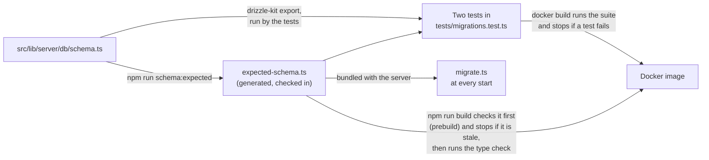

- **After any change to `schema.ts`, run `npm run schema:expected`** and commit the
  result with the change. Never edit the module by hand.
- **Two tests fail if the checked-in module is out of date.** Both are in
  `tests/migrations.test.ts`, under "the checked-in copy of the model". One compares the
  module with a fresh `drizzle-kit export`, statement for statement. The other runs the
  generator with `--check`, which compares the whole file. From the command line,
  `npm run schema:expected -- --check` does the same: it writes nothing and exits 1 if
  the module is out of date.
- **`npm run build` refuses to build a stale module, or code that fails the type
  check.** Its `prebuild` step runs the generator with `--check` and then
  `npm run check` (since card 2110, which also cleared the last two type errors), so a
  build stops, on a workstation or inside `docker build`, when the module is not what
  the model generates or `svelte-check` reports an error. A test in
  `tests/harness.test.ts` ("the build") pins that wiring. The module is
  bundled into the server as it stands, and a stale one is worse than a wrong report:
  the six reconciled tables are rebuilt from its statements, so a foreign key or a
  `NOT NULL` that a stale statement lacks would be removed from the live table.
- **The tests must pass before an image is built, and the build sees to it.** Building
  the image runs the whole suite (`RUN npm run verify` in the `Dockerfile`) and then
  checks the module and the types in `prebuild`; any of them stops the build. Run `npm run verify` first
  all the same, to find out sooner: see
  [Deployment](deployment.md#run-the-tests-before-you-build).

How the runner uses the module is in
[Data Model](data-model.md#the-expected-schema).

## Rehearsing the Runner Against a Copy of a Real Database

The suite proves the migration runner on databases it builds itself. The rehearsal shows
what the runner will do to one particular database, on a copy, before it is allowed to.
Run it before the first `npm run dev` on code that brings a new migration, and against a
downloaded backup before an update:

```
npm run rehearse                              # a copy of ./dumpfire.db
npm run rehearse -- path/to/backup.db         # a copy of any database file
npm run rehearse -- path/to/backup.db --keep  # and leave the copy to look at
```

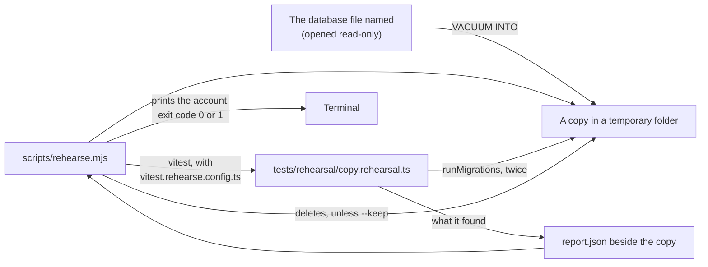

- **The file named is never written to.** It is opened read-only and copied with
  `VACUUM INTO`, which gives a complete and consistent copy even while a server has the
  database open. Only its `-shm` file may get a new modified time: that is SQLite's index
  of the `-wal` file, which a reader maps too, and it holds no data.
- **No server and no scheduler is started.** The runner is called directly, and the
  application's own connection is the suite's in-memory one. A copy of production sends
  no report and uploads no backup.
- **The copy holds everything the database holds**, password hashes and credentials
  included. It is deleted afterwards unless `--keep` is given.
- **It is not part of `npm test`.** Its file is `*.rehearsal.ts`, which the suite's
  configuration does not include.

It fails, with exit code 1, if any of these does not hold:

| Must hold | Why |
|-----------|-----|
| The runner does not stop | A halt here is the server refusing to start |
| No table has fewer rows than it had, unless a one-off declared in `tests/rehearsal/one-offs.ts` took them, in a run that applied its file | The migration record gains one row for each file applied. `time_entries` may go only if it was empty. 0053 empties `sessions` and 0054 deletes every unused invite from `invite_tokens`, and both are declared: each loss is printed under `Worth knowing`. 0055 replaces every request's link and is declared as keeping its rows (`keepsRows`): it excuses no loss from `task_requests`, and the change is printed under `Worth knowing` |
| The timestamp conversion did not fail | A conversion that failed was rolled back, and converts nothing on either run, so the second-run rule alone would pass it |
| No id counter is lower | An id is never reused |
| No more rows break a foreign key than before | A rebuild carries a broken row across and adds none |
| `PRAGMA integrity_check` says ok, and foreign keys are on afterwards | |
| A second run applies nothing, rebuilds nothing, changes no row count and converts no timestamp | An up-to-date database is left alone |

The comparison is `compare()` in `tests/rehearsal/compare.ts`, and the declared one-offs are
`ONE_OFFS` in `tests/rehearsal/one-offs.ts`: plain modules, which no `include` pattern picks up
and the list of test files does not count, imported both by `copy.rehearsal.ts` and by
`tests/migrations.test.ts`, which tests `compare()` itself. Importing `copy.rehearsal.ts`
from a test file would run its rehearsal there.

It prints the timestamps the first run converted, `Timestamps converted to the stored form
(YYYY-MM-DD HH:MM:SS, UTC): N` with a line for each column and its count, and the second
run's count, which must be 0. On a production export that is the measurement of every
timestamp column, made by the code that will run: see
[Deployment](deployment.md#before-the-deploy-checks-0a-0b-0c-and-0d).

Three things are printed and are not failures, because the server starts with each and
logs it as an error at every start: a table left in the shape it has, anything that
still differs from the model, and a timestamp column holding values in no form the
conversion can read (`Timestamps in no form the conversion can read`, with the count and
an example). On the development database that is the table
`__new_report_schedules`, which `drizzle-kit push` left behind.

What the rehearsal does not cover is the image: that the built server exits on a failed
migration, and that `docker build` produces one that starts. That is the rehearsal in
[Deployment](deployment.md#rehearsing-an-update-against-a-copy).

## Known Gaps

- The suite runs on Linux only inside `docker build`, and has done so on one machine. The
  builder stage of the `Dockerfile` runs it, and on 2026-10-13 it passed there for the
  first time (Docker 29.2.1, `node:22-slim`, amd64) with the totals it then had on
  Windows, `2200 passed | 19 expected fail | 1 skipped`, with no test changed to get
  there. It was built again later that day, as it is now, and passed with the totals it
  has on Windows, `2578 passed | 45 expected fail | 1 skipped` in 30 files (it is now
  `5111 passed` in 56 files, not yet run in a build), each file
  with the same number of tests in both places, again with no test changed. Both
  builds were made from a Windows working copy, in which 27 source files have CRLF line
  endings. From a Linux checkout, where every file has LF, and on the production Docker
  host, it has not yet been run: the next image built there is the first. See
  [Deployment](deployment.md#run-the-tests-before-you-build).
- A passing run prints `[ERROR]` lines. The logger runs at `LOG_LEVEL=ERROR`, and tests
  that cause a failure on purpose leave the application's error line in the output. In a
  build log these read like failures and are not; nothing marks them as expected. None is
  any longer an attempt to reach `smtp.example.test` or `hooks.example.test`: a test that
  let the application try now fails.
- Nothing outside the suite keeps it off the network. The image build's test step is a
  plain `RUN npm run verify`, so that it needs no particular builder, and Docker does
  not cut it off: `RUN --network=none` was written into the `Dockerfile` on 2026-10-13,
  never built, and taken out, because it works only under BuildKit. What is refused, at
  a desk and in the build alike, is what `tests/setup.ts` replaces: `fetch`, every DNS
  lookup, and `http.request` and `https.request` to an IP address other than loopback
  (card 2161). A connection opened straight to an IP address some other way (`net.connect`,
  a TLS socket) asks for none of them and would not be refused, and neither would a request
  to loopback, which `tests/webhooks.test.ts` sends to servers of its own; nothing else under
  `tests/` opens one. See
  [Deployment](deployment.md#the-suite-inside-the-image-build).
- A PDF answer is not read. `POST /api/reports`, `GET /api/milestones/[id]/pdf` and its
  twin under `/api/v1/` answer the allowed caller with a PDF, in which the mark of a board
  the caller cannot open would not be seen. The report's contents are tested before they
  are drawn (see [Access for Every Route](#access-for-every-route)); the milestone PDF's
  are not, and it is drawn from the summary whose own answer is recorded as a known
  fault.
- Worker threads in a built server are not exercised by the suite. `tests/password-checks.test.ts`
  starts real threads from the source; that a built server's threads find `bcryptjs` in
  `node_modules` was checked once by hand, on 2026-10-15, with a production build on a
  scratch database ("Password checks run on 2 worker thread(s)"), and is the first thing to
  look for after a deploy: see
  [Deployment](deployment.md#the-update-that-brings-password-checks-off-the-servers-thread-and-remembered-browsers).
  Nor is a caller who has gone: `req.socket.destroyed` exists only behind the node adapter,
  and the tests stand in for it with `platform`.
- A running server is not exercised. The gate is tested through SvelteKit's own server
  in the test process, which is not `vite dev` and not a built server behind the node
  adapter. What only the adapter does is therefore not tested: its body size limit. (The
  refusal of a write sent as a form with no matching `Origin` is made in the tests too,
  since SvelteKit 2.70.) See [The Gate Harness](#the-gate-harness).
- No browser tests, and few component tests. Four files mount a component under jsdom (the
  board header's XP bars and a column's header, and the card window, twice: see
  [The Board Page and Its Card Window](#the-board-page-and-its-card-window-card-2280)); jsdom
  draws no layout and runs no drag. What the pages show
  is otherwise checked by hand: the confirmation texts that say what a delete takes, that a
  page reports a failed delete or reset instead of behaving as if it worked, and the board
  page's drags, hover rules and scroll (the hands-on checks in
  [Deployment](deployment.md#the-board-page-and-the-card-window-apply-each-change)).
  `tests/page-failures.test.ts` holds the source to it, page by page and write by write;
  nothing runs a whole page.
- An effect is tested up to the moment it starts. `effects()` records a webhook delivery
  or an email and sends nothing, so a receiver's answer and an SMTP server's are not
  exercised. The one answer of a mail server that is, a refusal, is made by
  `effects({ refuseMailTo })` or `effects({ mailRefusal })`, which throw as a transport does,
  the second with the code and words of a timeout or of a server that cannot be reached as
  nodemailer words them; a real timeout, or a real server that cannot be reached, is not.
