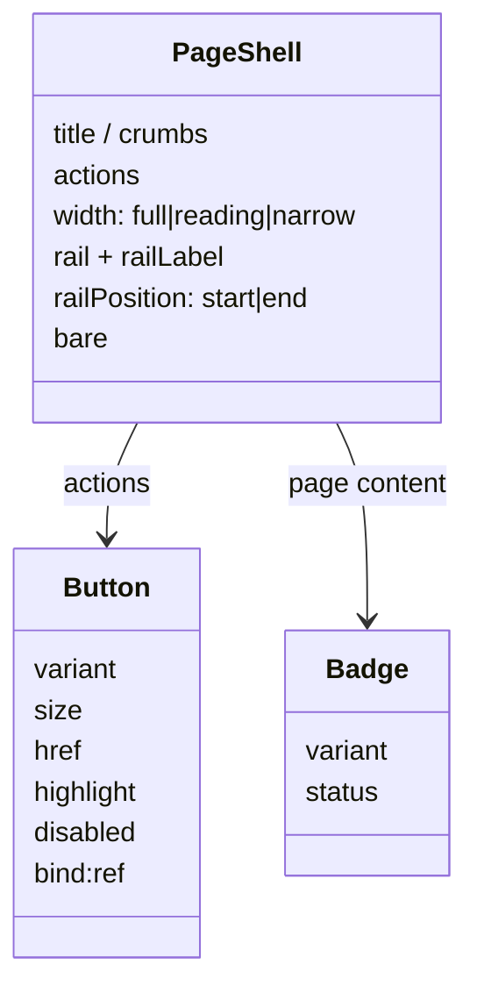
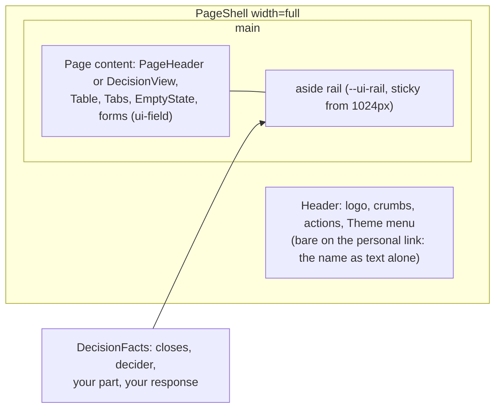
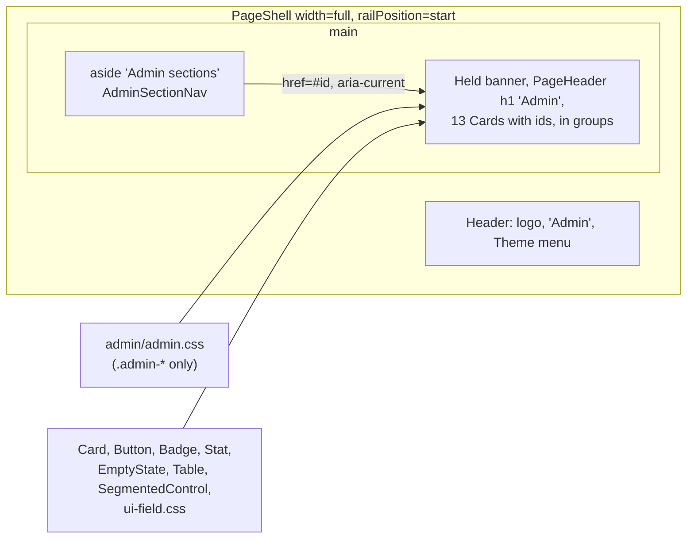
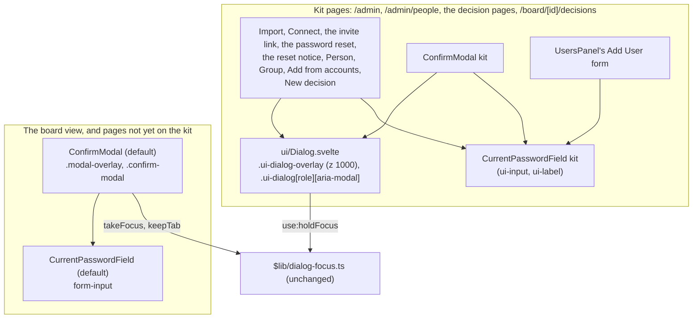
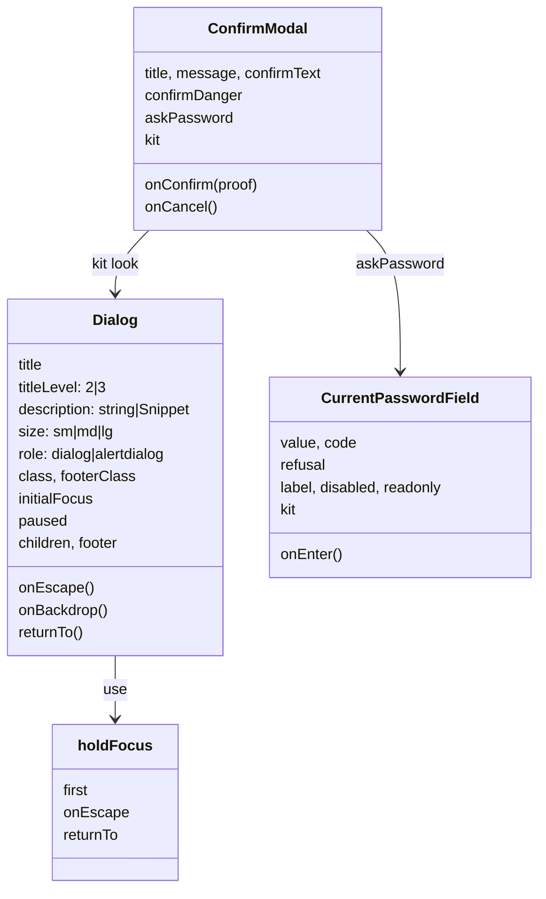
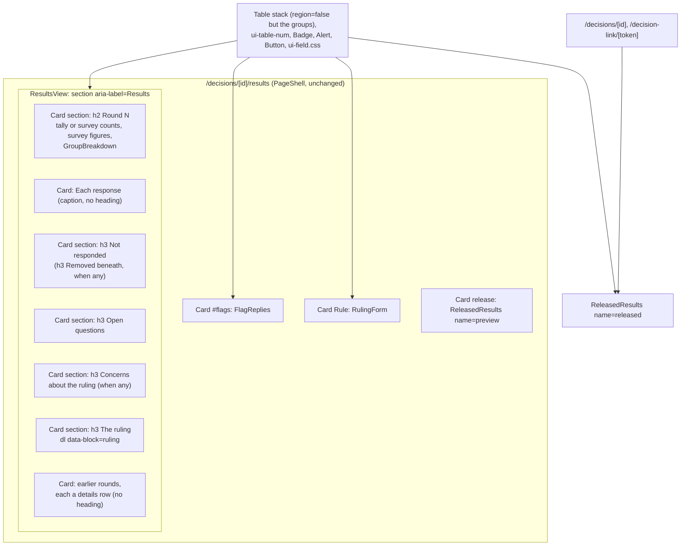

# UI Kit and Page Shell

**Card 3074 (milestone 41).** The pages around the board (decisions, admin, account and the rest) each copied their own header and chose their own widths and styles. The kit gives them one page shell and one set of components with the look of shadcn-svelte, built in plain Svelte 5 with scoped CSS: no Tailwind, no bits-ui, no new dependency. Cards 3075 (decision pages) and 3076 (admin) move pages onto it.

**The board view never uses the kit.** The board view itself (`src/routes/board/[id]/+page.svelte`) and the Kanban components read no `--ui-*` token and no `.ui-` class. `tests/ui-kit.test.ts` (case 7) checks that the kit only adds to `src/app.css`: no existing rule, theme block or token was changed. A board's decision list, `/board/[id]/decisions`, is a list page under the board's address, not the board view, and uses the kit (card 3075).

**Who uses it.** Card 3075 moved the ten decision pages onto it: `/decisions` (the register), `/decisions/[id]`, its `edit`, `results`, `record` and `preview`, `/decisions/people/[personId]`, `/decisions/tour`, `/decision-link/[token]` and `/board/[id]/decisions`, with the decision components they draw (buttons, fields and status badges). Card 3076 moved the three admin pages onto it: `/admin` (with a list of its sections in a rail), `/admin/people` and `/admin/iso-27001`, with every admin panel and the admin dialogs' fields. Card 3078 moved the dialogs of those pages and of the decision pages onto the kit's `Dialog` frame (see [Dialogs](#dialogs-card-3078)). Card 3087 moved the inside of the results page (the results, the ruling form, the flag replies) and the released results participants see onto the kit's `Card`, `Table`, `Badge`, `Alert` and field styles (see [The results and ruling on the kit](#the-results-and-ruling-on-the-kit-card-3087)).

## High level

## Tokens

Defined once on `:root` in `app.css`, after the existing `:root` block. Each is a `var()` or `color-mix()` of an existing theme token, so every theme gets its own values with no change to its block.

| Token | Value |
|---|---|
| `--ui-background` | `--bg-deep` |
| `--ui-surface`, `--ui-card` | `--bg-surface` |
| `--ui-muted` | `--bg-hover` |
| `--ui-foreground` / `--ui-muted-foreground` / `--ui-subtle-foreground` | `--text-primary` / `--text-secondary` / `--text-tertiary` |
| `--ui-border` | 12% of `--text-primary` |
| `--ui-input` | 60% of `--text-primary` (field edge at least 3:1 in every theme) |
| `--ui-primary` / `--ui-primary-hover` / `--ui-primary-foreground` | `--accent-indigo` darkened 10% / 22%, white text; for solarized, cappuccino, ocean, sunset, nord, dracula, monokai and hacker the accent itself with near-black text |
| `--ui-ring` | opaque: 40% `--accent-indigo` into `--text-primary` |
| `--ui-destructive`, `--ui-success`, `--ui-warning`, `--ui-info` | rose, emerald, amber, cyan accents |
| `--ui-radius` (`-sm`, `-lg`) | 0.5rem (0.375, 0.75) |
| `--ui-content-max`, `--ui-reading-max`, `--ui-rail` | 1600px, 72rem, 20rem |

## Components (`src/lib/components/ui/`)

| Component | Purpose and main props |
|---|---|
| `PageShell` | Fixed 64px header (logo, `crumbs` or `title`, `actions`, the Theme menu), `<main>` with `width` full, reading or narrow, padding `var(--space-2xl) var(--space-2xl) var(--user-badge-space)`; optional `rail` (requires `railLabel`) as an `aside`, sticky beside the content from 1024px, stacked below. The document follows what is drawn (card 3076): `railPosition="end"` puts the rail after the page, `railPosition="start"` before it, so a start rail (filters, a list of sections) is met first by the keyboard and a screen reader. Draws no `h1`: the page's own heading stays the first `h1`. `bare` (card 3075): the header holds the fire and "DumpFire" as plain text (a `span`, not a link) and nothing else, no crumbs, title, actions or Theme menu even when given; `main` and the rail are as without it. For a page that must link nowhere, the personal decision link. |
| `Button` | `variant` default, secondary, outline, ghost, destructive, link; `size` sm, default, lg, icon; `href` renders a link; `highlight` plays a short sheen twice on the page's one main action. `bind:ref` (card 3075) holds the element drawn, the `button` or the `a`, for a page that puts the focus back on it after a dialog or a refusal (shadcn-svelte's pattern). |
| `Card` (+ Header, Title, Description, Content, Footer) | Surface panel; `interactive` adds a small hover lift. `CardHeader` wraps (card 3076): the title block takes at least 16rem and the actions go under it where the card is narrower, so they never cover the title on a phone. |
| `Badge` | Variants and `status` (draft, open, awaiting_ruling, ruled, superseded, withdrawn) with a tone dot and tint; text always in the foreground colour. |
| `Alert` | default, info, success, warning, destructive; `live` adds `role="alert"`. |
| `Table` | Scrolling frame, caption (named region only when captioned), `stack` for phones. `region` (default `true`): with a caption the frame is a region named by it that takes the focus, so a wide table can be scrolled from the keyboard; `region={false}` only for a table that cannot scroll sideways (stacked, few columns, its cells wrapping), whose frame is then no region, no `aria-labelledby` and no Tab stop, the caption still captioning the table (card 3087). A table that can be wider than the page keeps the default, so the keyboard can scroll it (WCAG 2.1.1). A row's own header (`<th scope="row">` in the body) is a cell in the foreground weight that heads its block when stacked; `ui-table-num` on a cell or column header is a figure, right-aligned in tabular digits (card 3087). |
| `Tabs` / `SegmentedControl` | Link tabs with `aria-current="page"` and counts read as "(3)", the text "Open (3)" (the hidden " (" is written as an expression, as Svelte trims a leading space inside an element; card 3075); toggle buttons with `aria-pressed`. |
| `Dialog` | The dialog frame (card 3078): a backdrop and a box with a title, an optional description, a body and an optional button row; the box is the `dialog` or `alertdialog`, held by the app's `holdFocus`. See [Dialogs](#dialogs-card-3078). |
| `Separator`, `EmptyState`, `PageHeader`, `Stat` | Divider; empty list with a heading; the page's `h1` with description and actions; a figure that counts up. |
| `ui-field.css` | `.ui-label`, `.ui-hint`, `.ui-input`, `.ui-textarea`, `.ui-select`. |
| `motion.ts` | `fadeIn` (180ms, Web Animations API) and `tickUp` (counts drawn in the browser; numbers the server rendered are kept, not recounted). |

## Rules

- **Contrast.** Every text and background pair in the kit meets WCAG AA (4.5:1) in all 17 themes, the focus ring and field edges 3:1. `tests/ui-kit.test.ts` case 9 computes it from `app.css` the way a browser resolves `var()` and `color-mix()`.
- **Motion.** Everything stops under `prefers-reduced-motion`; nothing loops.
- **Touch.** Under `pointer: coarse`, buttons, tabs, segments and fields are at least 44px, fields 16px text.
- **Focus.** `:focus-visible` draws a 2px solid ring with a 2px offset; no transparent outlines at rest (forced-colours mode).
- **CSP.** No `<style>` element is created, no outside font or script; the select arrow is a `data:` image (`img-src` allows it).
- **Dialogs where they are placed.** A `Dialog` is drawn where its page places it, not moved to the end of the document: so draw one outside a sticky rail (`PageShell`'s rail is sticky from 1024px) and outside any transformed box (an `interactive` `Card` on hover). Either is a stacking context of its own, which would hold the backdrop under the shell's header, and a transform traps `position: fixed`. No dialog is drawn in either today.
- **The board view never passes `kit`.** `ConfirmModal` and `CurrentPasswordField` are drawn by the board view too, in their default look; neither the board page, the Kanban and card components, the card and subtask windows nor Share passes `kit` or imports `ui/Dialog` (`tests/ui-kit.test.ts`, B1).

## The decision pages on the kit (card 3075)

Every decision page is drawn at `width="full"`. Running text in a decision keeps a measure of about 80 characters while the options and tables take the width. The only motion is the sheen on New decision in a board's list (`highlight`), off under reduced motion.

| Page | Rail |
|---|---|
| `/decisions/[id]` | end, "About this decision": `DecisionFacts`, then the actions card (Results and ruling, Record, Supersede…, the two PDFs) and the Supersede form |
| `/decision-link/[token]` | `bare`; end, "About this decision": `DecisionFacts` alone, the response state as text, no link |
| `/decisions/[id]/preview` | end, "Preview settings": the "Preview as" choosers, then `DecisionFacts` for the person previewed (no response row) |
| `/decisions` | start, "Filters": the filter form |
| `/decisions/[id]/record` | start, "Filter the record": the participant form and People's records |
| editor, results, a person's record, a board's decision list, the tour | none (the editor keeps its own side column, `--ui-rail` wide from 1024px) |

Kept as native controls, restyled with the tokens, because each draws a checked state the kit's `Button` does not: the participant picker's group and role toggles (`role="checkbox"`) and the response form's scores (`role="radio"`). The linked cards' Waits on this decision toggle is a kit outline `Button` with `aria-pressed`; its pressed state is drawn by its own tick box (filled with a tick, or empty), so not by colour alone.

## The admin pages on the kit (card 3076)

`/admin`, `/admin/people` and `/admin/iso-27001` are drawn at `width="full"`, each with `PageHeader` for its `h1` ("Admin", "People Directory", "ISO 27001:2022 Checklist") and the superadmin's held-settings banner above it. The people and ISO pages' crumbs are "Admin" (a link to `/admin`) and the page's name; the "← Admin" link and the pages' own headers, Theme menus and `max-width` columns are gone. Every panel of `/admin` is a `Card as="section"` with an `id` (its address, `/admin#users`) and a `CardTitle level={2}`, the titles without their emoji. Nothing on the three pages fades, lifts, scales or slides; the overview's counts tick up once where the browser draws the page (`Stat`), and not under reduced motion.

**Admin parts, not kit parts.** Two files beside the panels, in `src/lib/components/admin/`, are made with the kit's tokens but are not in the kit (its plan's decision 17: one page needs them):

| File | What it is |
|---|---|
| `AdminSectionNav.svelte` | The `/admin` rail: a `<nav>` named by the rail's `aside` (`railLabel="Admin sections"`, not named twice), links grouped as the page is (the overview and the held list; Access; Data; Settings; Danger Zone), the held list's link only while a setting is held (`held`). The section in view is `aria-current="location"` (an `IntersectionObserver`, `rootMargin` `-72px 0px -55% 0px`, the first in page order in view; a section drawn again or late is watched as it appears); a pressed link is marked at once and keeps the mark until the reader scrolls. Without the observer nothing is marked until a press. Below 1024px one row of pills that scrolls sideways within itself, the group names hidden. Each link is at least 44px high under a coarse pointer, at every width |
| `admin.css` | The patterns several panels share, imported by the three pages: `.admin-section` (`scroll-margin-top` under the header), `.admin-subform` (a form opened in a card, at most 48rem), `.admin-field-row`, `.admin-field`, `.admin-fields-max`, `.admin-note`, `.admin-warning`, `.admin-rows` (rows divided by a line), `.admin-notice` with `-success`, `-info`, `-warning`, `-destructive` (the kit's alert look on an element and role a test reads), `.admin-crumb` (4px of room for its focus ring) and the danger zone's red edge. Card 3078 took out `.admin-dialog` and the rules that drew `CurrentPasswordField` as the kit's field inside `.admin-subform`, `.admin-dialog` and `.admin-kit-fields`: the dialogs are the kit's `Dialog`, and the field has the kit's look itself (`kit`). A stylesheet stays loaded once its page is left, so every selector in it starts with an `.admin-` class (`tests/admin-panels.test.ts`, N6) |

Mapping kept on the admin pages: every button the kit's `Button` (one main action per card; row actions `ghost sm`, the emoji row buttons keeping their emoji and `title`; Cancel, Test, Edit, Send Test, Dismiss `outline sm`; the Danger Zone and Require two-step sign-in `outline`, red only on the confirmation, and on the Import dialog's Confirm, `destructive`); every field the kit's `ui-input`, `ui-select` or `ui-textarea`; the role a `Badge` (superadmin `warning`, admin `info`, user `secondary`), a backup destination's type an outline badge, the ISO statuses badges (met `success`, partly met `warning`, not met `destructive`, not applicable `outline`, organisational `secondary`); words in the text colours, the tone in an edge, a dot or the ⚠️ and ✅ already there. Classes tests read stay on the elements as hooks (`danger`, `btn-backup export`, `invite-resend`, `role-change`, `member-role-change`, `import-cancel`, `smtp-msg`, `import-report`, `held-pointer`, `host-key-box`, `space-line`). Card 3078 moved the admin pages' dialogs onto the kit's `Dialog` (see [Dialogs](#dialogs-card-3078)).

## Dialogs (card 3078)

The kit's dialog frame, `src/lib/components/ui/Dialog.svelte`, in shadcn's anatomy, and a kit look for the two shared step-up pieces, `ConfirmModal` and `CurrentPasswordField`, which the kit's pages alone turn on. The board view and the pages not yet on the kit keep the app's own dialogs, unchanged. Plan: `docs/planning/card-3078-dialogs-on-kit.md`.

### `Dialog`

Mounted means open: the caller draws it inside an `{#if}` and closes it by no longer drawing it. It draws no Cancel, Confirm or close cross of its own (a cross would add a Tab stop before the fields).

| Prop | Type, default | What it does |
|---|---|---|
| `title` | `string`, required | The heading, `.ui-dialog-title`, with an id from `$props.id()` |
| `titleLevel` | `2` or `3`, `2` | `h2` or `h3` (the confirm keeps its `h3`) |
| `description` | `string` or `Snippet`, none | Under the title, muted. A string gets its own id and becomes the box's `aria-describedby` unless one is given; a snippet draws the caller's own element (the confirm's `p.confirm-message`), which the caller names in `aria-describedby` |
| `size` | `'sm'`, `'md'` or `'lg'`, `'md'` | Max width 28rem, 32rem, 40rem |
| `role` | `'dialog'` or `'alertdialog'`, `'dialog'` | On the box, with `aria-modal="true"` and `tabindex="-1"` |
| `aria-label`, `aria-labelledby`, `aria-describedby`, `id`, `data-*` | passed to the box | With no label given, the box is `aria-labelledby` its title |
| `class` | `string` | Added to the box: the hooks `confirm-modal`, `person-dialog`, `group-dialog`, `from-accounts-dialog` |
| `footerClass` | `string` | Added to the button row: `confirm-actions`, `modal-actions` |
| `initialFocus` | a selector inside the box | `holdFocus`'s `first`: the first focus, and where a Tab from outside comes back to. Default: the body's first enabled field, else the footer's first enabled button, else the box |
| `onEscape` | `() => void`, none | Escape while the dialog is up; none: Escape does nothing |
| `onBackdrop` | `() => void`, none | A press on the backdrop itself: one that went down and came up on it (the overlay's `pointerdown` target is kept for the `click`), so a drag that began in the box, selecting a field's text, and was let go over the backdrop closes nothing; none: nothing |
| `paused` | `boolean`, `false` | `holdFocus`'s `paused`: while a dialog is open over this one, its Escape and Tab are left to the top one, so Escape closes that alone (as `ShareModal` does for the confirms over it) |
| `returnTo` | `() => HTMLElement`, `null` or `undefined` | Where the focus goes back to as it closes (`holdFocus`'s `returnTo`); otherwise what had the focus as it opened |
| `children` | `Snippet`, required | The body |
| `footer` | `Snippet`, none | The button row, Cancel (an outline `Button`) first and the action last, red (`destructive`) for one that destroys; not drawn without it |

Markup: `div.ui-dialog-overlay` (`role="presentation"`) holding `div.ui-dialog.ui-dialog-{size}` with the role, names, `tabindex="-1"` and `use:holdFocus`; inside it `div.ui-dialog-header`, `div.ui-dialog-body` and `div.ui-dialog-footer`. It imports `./ui-field.css`, so a dialog mounted alone has the field classes.

**Keyboard.** The rules are `$lib/dialog-focus`'s `holdFocus`, unchanged, which every admin dialog already used: the first focus as it opens; Tab and Shift+Tab held on the box's own stops; a Tab from outside back to the first focus; the focus handed back after one macrotask, only if nothing else has taken it. The frame only wires it.

**Look.** Every colour a kit token, so each of the 17 themes draws it; `app.css` is unchanged.

- Backdrop: fixed, `z-index: 1000` (under the toast, over the user badge and the shell's header), black at 50% with no blur, 1rem of margin, its foot clear of the update bar (`calc(1rem + var(--update-bar-space, 0px))`).
- Box: `--ui-card` with a `--ui-border` edge, `--ui-radius-lg`, `--ui-shadow`; at most the window's height less the margins and the update bar.
- Header: 1.5rem of padding; the title 1.125rem, 600; the description, and any `p` the caller draws in the header, 0.875rem in `--ui-muted-foreground`.
- Body: 1rem by 1.5rem; it scrolls while the title and the buttons stay put; its children spaced by a 0.75rem gap, their own margins taken away.
- Buttons: at the right, 0.5rem apart. Up to 640px wide they are full width, one above another, the action on top; their order in the page (Cancel first) is kept, so the keyboard's order is.
- Motion: the backdrop fades in and the box fades and grows from 97% in 150ms; nothing under `prefers-reduced-motion`.

### The kit look of `ConfirmModal` and `CurrentPasswordField`

Both are drawn by the board view as well (a column's or a card's delete, a comment's, a file's, Share's Remove Access), so each takes a `kit` prop, `false` by default and set once as the dialog is drawn. Without it each draws and behaves exactly as before: the same markup, classes, styles and focus code (`tests/confirm-modal.svelte.test.ts`, C2).

- **`ConfirmModal kit`**: the `Dialog` frame, `size="sm"`, `titleLevel={3}`, `class="confirm-modal"`, `footerClass="confirm-actions"`, named by its title and described by its message (`p.confirm-message`, drawn as the description). No round icon: the red Confirm (`Button variant="destructive"`, keeping the `btn-confirm-danger` hook) carries the danger; otherwise the default variant. Cancel is an outline `Button` (`confirm-cancel`). Its keyboard is the frame's on the confirm's own rules: the first focus in the password where one is asked, Cancel otherwise; Tab home the same; Escape cancels except while the answer is awaited. A refusal with no field is the kit's notice: a red edge, the words in the text colour.
- **`CurrentPasswordField kit`**: `ui-input` fields and `ui-label` labels, the recovery-code switch a quiet underlined link with the kit's focus ring, the weight line `ui-hint`, the refusal the kit's notice. Ids, `aria-*`, `autocomplete`, `inputmode` and the hook classes (`current-password`, `code-switch`, `current-code-weight`, `current-password-refusal`) are the same in both looks; its kit rules are keyed on `.current-password.kit`.

**Who passes `kit`.** `ConfirmModal`: the admin page's one confirm (every panel's confirmation goes through it), `AppUrlPanel`, `BackupRestorePanel`'s Export, `SmtpPanel`, the people directory page, and on the decision pages `DecisionActions` (Open, Close, Extend, Withdraw, Delete), `DeliveryPanel`, `ParticipantPicker` (Save participants), `RulingForm` (Rule) and Results' Release. `CurrentPasswordField`: the confirm's kit look, the Import, Connect and password dialogs, Person and Add from accounts, and `UsersPanel`'s Add User form. Nothing else: not `/account`, `/reports` or any old page, and never the board view.

### The dialogs on the frame (the adopters)

| Dialog | File | Role, size | First focus | Escape, backdrop |
|---|---|---|---|---|
| The reset's notice | `routes/admin/+page.svelte` | `alertdialog` named by its title, md | Its one button (Continue to set-up, or Close) | Close only after a refused reset, nothing after one done; the backdrop nothing |
| The invite, reset or set-up link | `admin/InviteLinkDialog.svelte` | `alertdialog`, its three names, described by `#invite-link-said` and `#invite-link-warning`, lg | Copy | No Escape (the link would be lost); Done returns the focus to the control the users panel names |
| Reset Password, Change Your Password | `admin/ResetPasswordDialog.svelte` | `dialog`, lg | The first enabled field | Escape is Cancel, which clears the passwords and the refusal |
| Connect Google Drive | `admin/GDriveConnectModal.svelte` | `dialog`, md | Cancel (`gdrive-cancel`) | Escape closes |
| Import Database | `admin/BackupRestorePanel.svelte` | `dialog`, md | Cancel (`import-cancel`) | Escape cancels; Confirm red |
| Add or edit a person, a group | `admin/people/PersonDialog.svelte`, `GroupDialog.svelte` | `dialog`, md | The first field | Escape closes |
| Add from Accounts | `admin/people/FromAccountsDialog.svelte` | `dialog`, md | Cancel (`accounts-cancel`) | Escape closes |
| New decision | `routes/board/[id]/decisions/+page.svelte` | `dialog`, sm | The title field | Escape and a press on the backdrop close; the focus back on New decision (`returnTo`) |

The moved dialogs' titles and buttons have no emoji ("Connect Google Drive", "Their set-up link", "Copy", "Connect"); the row buttons that open them (🔑, 📧, 🛡️, 🔗) keep theirs.

## The results and ruling on the kit (card 3087)

Card 3075 put `/decisions/[id]/results` on `PageShell` and its flags, Rule and release blocks in `Card`s, but left the components inside them drawing their own tables (`.results-table`, `--glass-border`), bare headings, bulleted lists and a plain `dl`. This card moved the inside onto the kit; the page itself is unchanged. Plan: `docs/planning/card-3087-results-ruling-on-kit.md`.

Nothing a reader is told changed: every word, heading text and level, `id`, `data-*` hook, `aria-*` attribute, order, condition and behaviour is as it was, and no figure was added. The board view, the decision PDF and the server are not touched.

| Component | What moved |
|---|---|
| `ResultsView` | Each part is a kit `Card`. The round, Not responded, Open questions, Concerns about the ruling and The ruling are each a `section` named by its own heading (`aria-labelledby`, ids from `$props.id()`), at the level it had (`CardTitle level={2}` for the round, `3` for the rest). Each response and the earlier rounds had no heading and have none now, so their cards are not sections: the responses table is named by its caption. Every table is the kit's `Table stack` with its caption, `data-table`, `data-question` and each cell's `data-label`; the classes `results-table` and `stacked` stay on the `<table>` as hooks, with no rule behind them. Its tables are `region={false}` (few columns, wrapping cells: they cannot scroll sideways). Lists drawn without bullets say `role="list"`, which Safari and VoiceOver otherwise drop. The responses' survey answers and comments are one block per cell, so the phone's label stands beside them all; an empty cell is not drawn at phone width, as before. Not responded, Removed, Open questions and Concerns are rows divided by a line, the name in the foreground weight and the rest muted. "Not reached" is an outline `Badge`; its brackets are in the text, for a screen reader and a copy, but not drawn. The ruling is a grid of label and value with a line between pairs, the outcome first and larger, one column at phone width; a Yes for "Against the responses" or "Early" is a warning `Badge` around the same words, a No plain text. Each earlier round is a `details` row whose chevron turns as it opens (none under reduced motion); "Answer on the decision's page" is an outline `Button`, size `sm` (36px, 44px under a coarse pointer). |
| `GroupBreakdown` | The kit's `Table stack`, every count right-aligned (`ui-table-num`), Most chosen (words) left; the note muted. It keeps the default `region`: a column per option (two in score mode) under headers that do not wrap makes it wide (score mode with four options is 14 columns, about 1,400px), so between phone width and a wide screen it scrolls sideways in its frame, which must then take the focus (code review H1). |
| `RulingForm` | The options are rows to press: the native radio kept, drawn with the kit's tokens; the row chosen has an edge in `--ui-ring`, a faint `--ui-primary` tint, its radio filled and a tick at its end, so not by colour alone (in forced colours the system's own radio). Each textarea is `ui-textarea` under its `ui-label`, its count `ui-hint`. "This goes against the responses", the early ruling's note and the objections unanswered are warning `Alert`s with the same words and hooks (`id` and `data-note` pass through), their words in `--ui-foreground` as before rather than the kit alert's muted body (scoped to the form, code review L2); the open-questions and open-talks boxes sit inside a warning `Alert`; a survey's "no options" note is an info `Alert`. |
| `FlagReplies` | Each flag is a bordered row on the card's surface; who raised it and when muted beside its kind; a reply set in with a line at its left; the box and its notes on `ui-field.css`. "Not answered yet" (or its talk wording) is a `Badge`: warning for an objection, which holds the ruling back, outline for a request to talk. |
| `ReleasedResults` | The kit's `Table region={false}` (two columns, so not stacked, and never wide); the comments list says `role="list"`, figures right-aligned; the comments rows divided by a line, the results page's Leave out rows among them. The participant pages around it are unchanged. |

**Rules learned.**

- **A row header is the kit's.** Results tables head each row with `<th scope="row">`, which the kit's `Table` did not style; it now draws one as a body cell in the foreground weight and, stacked, as the line that heads the block. A page needs no rule of its own for it.
- **Only a table that cannot scroll is no region.** A captioned kit table is by default a focusable region, so a table wider than the page can be scrolled from the keyboard. The results' tables of a few columns (the tally, counts, survey figures, responses, released results) are stacked and wrap, so they cannot scroll sideways, and each being a Tab stop and a landmark would only add stops (ruled 2026-11-26): they pass `region={false}`. `GroupBreakdown`'s table is the exception: its columns grow with the options, its headers do not wrap, and above phone width it can be wider than the page, so it keeps the default (code review H1). Every other kit table keeps the default too. `tests/ui-kit.svelte.test.ts` T1 holds the prop both ways; R1 holds the groups table to a region and the others to none, with four options in score mode (the wide case); R4 holds the released and preview tables to none.
- **No bullets, still a list.** A `ul` styled `list-style: none` says `role="list"` (with `svelte-ignore a11y_no_redundant_roles`), as Safari and VoiceOver drop the list's role otherwise.
- **Figures go right with `ui-table-num`,** on the column's header and each of its cells, in tabular digits; stacked, they go back beside their label.
- **Hooks stay, rules go.** A class tests or other code read (`results-table`, `stacked`, `comment`, `not-reached`, `earlier`) stays on its element after its CSS is deleted; `tests/decision-ruling.svelte.test.ts` R1 checks no old table rule is left in the three components.
- **No heading, no section.** A part that had no heading is a plain `Card`: giving it a heading or an `aria-label` would add words, and a `section` with no name is no landmark.
- **Text kept, punctuation not drawn.** Where a badge replaces brackets around words, the brackets stay in the text and are hidden from sight only, so the words read and copy as before.

Tests: `tests/decision-ruling.svelte.test.ts`, "the results and the ruling on the kit (card 3087)", R1 to R5, and `tests/ui-kit.svelte.test.ts` T1; every earlier case in that file and in `tests/decision-questions.svelte.test.ts` passes unchanged.
