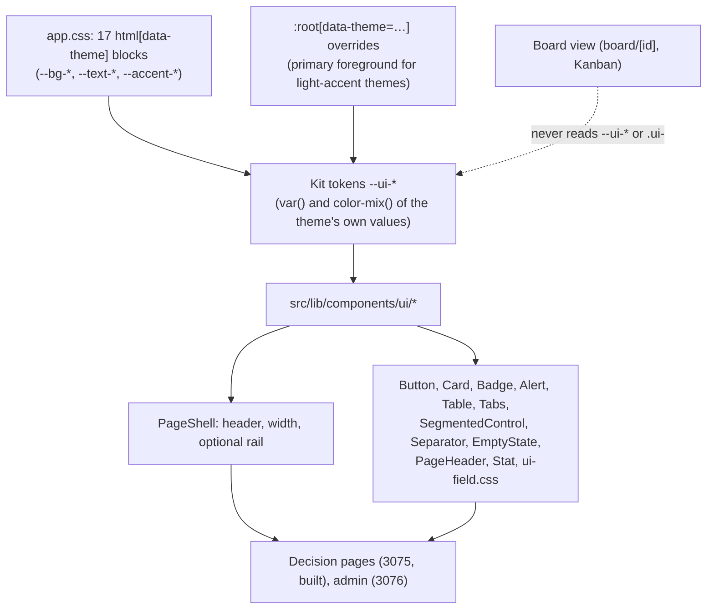
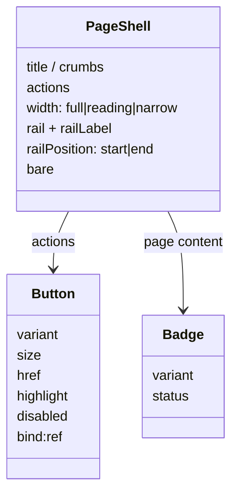
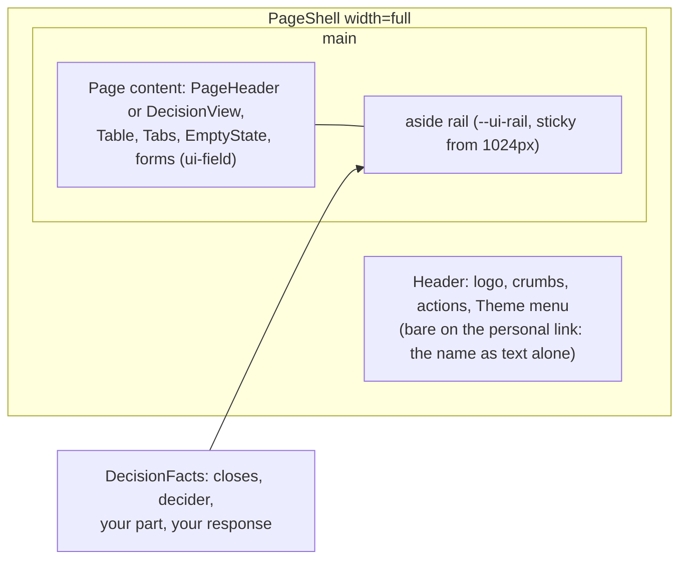

# UI Kit and Page Shell

**Card 3074 (milestone 41).** The pages around the board (decisions, admin, account and the rest) each copied their own header and chose their own widths and styles. The kit gives them one page shell and one set of components with the look of shadcn-svelte, built in plain Svelte 5 with scoped CSS: no Tailwind, no bits-ui, no new dependency. Cards 3075 (decision pages) and 3076 (admin) move pages onto it.

**The board view never uses the kit.** The board view itself (`src/routes/board/[id]/+page.svelte`) and the Kanban components read no `--ui-*` token and no `.ui-` class. `tests/ui-kit.test.ts` (case 7) checks that the kit only adds to `src/app.css`: no existing rule, theme block or token was changed. A board's decision list, `/board/[id]/decisions`, is a list page under the board's address, not the board view, and uses the kit (card 3075).

**Who uses it.** Card 3075 moved the ten decision pages onto it: `/decisions` (the register), `/decisions/[id]`, its `edit`, `results`, `record` and `preview`, `/decisions/people/[personId]`, `/decisions/tour`, `/decision-link/[token]` and `/board/[id]/decisions`, with the decision components they draw (buttons, fields and status badges). Card 3076 (admin) is next.

## High level

## Tokens

Defined once on `:root` in `app.css`, after the existing `:root` block. Each is a `var()` or `color-mix()` of an existing theme token, so every theme gets its own values with no change to its block.

| Token | Value |
|---|---|
| `--ui-background` | `--bg-deep` |
| `--ui-surface`, `--ui-card` | `--bg-surface` |
| `--ui-muted` | `--bg-hover` |
| `--ui-foreground` / `--ui-muted-foreground` / `--ui-subtle-foreground` | `--text-primary` / `--text-secondary` / `--text-tertiary` |
| `--ui-border` | 12% of `--text-primary` |
| `--ui-input` | 60% of `--text-primary` (field edge at least 3:1 in every theme) |
| `--ui-primary` / `--ui-primary-hover` / `--ui-primary-foreground` | `--accent-indigo` darkened 10% / 22%, white text; for solarized, cappuccino, ocean, sunset, nord, dracula, monokai and hacker the accent itself with near-black text |
| `--ui-ring` | opaque: 40% `--accent-indigo` into `--text-primary` |
| `--ui-destructive`, `--ui-success`, `--ui-warning`, `--ui-info` | rose, emerald, amber, cyan accents |
| `--ui-radius` (`-sm`, `-lg`) | 0.5rem (0.375, 0.75) |
| `--ui-content-max`, `--ui-reading-max`, `--ui-rail` | 1600px, 72rem, 20rem |

## Components (`src/lib/components/ui/`)

| Component | Purpose and main props |
|---|---|
| `PageShell` | Fixed 64px header (logo, `crumbs` or `title`, `actions`, the Theme menu), `<main>` with `width` full, reading or narrow, padding `var(--space-2xl) var(--space-2xl) var(--user-badge-space)`; optional `rail` (requires `railLabel`) as an `aside`, sticky beside the content from 1024px, stacked below. Draws no `h1`: the page's own heading stays the first `h1`. `bare` (card 3075): the header holds the fire and "DumpFire" as plain text (a `span`, not a link) and nothing else, no crumbs, title, actions or Theme menu even when given; `main` and the rail are as without it. For a page that must link nowhere, the personal decision link. |
| `Button` | `variant` default, secondary, outline, ghost, destructive, link; `size` sm, default, lg, icon; `href` renders a link; `highlight` plays a short sheen twice on the page's one main action. `bind:ref` (card 3075) holds the element drawn, the `button` or the `a`, for a page that puts the focus back on it after a dialog or a refusal (shadcn-svelte's pattern). |
| `Card` (+ Header, Title, Description, Content, Footer) | Surface panel; `interactive` adds a small hover lift. |
| `Badge` | Variants and `status` (draft, open, awaiting_ruling, ruled, superseded, withdrawn) with a tone dot and tint; text always in the foreground colour. |
| `Alert` | default, info, success, warning, destructive; `live` adds `role="alert"`. |
| `Table` | Scrolling frame, caption (named region only when captioned), `stack` for phones. |
| `Tabs` / `SegmentedControl` | Link tabs with `aria-current="page"` and counts read as "(3)", the text "Open (3)" (the hidden " (" is written as an expression, as Svelte trims a leading space inside an element; card 3075); toggle buttons with `aria-pressed`. |
| `Separator`, `EmptyState`, `PageHeader`, `Stat` | Divider; empty list with a heading; the page's `h1` with description and actions; a figure that counts up. |
| `ui-field.css` | `.ui-label`, `.ui-hint`, `.ui-input`, `.ui-textarea`, `.ui-select`. |
| `motion.ts` | `fadeIn` (180ms, Web Animations API) and `tickUp` (counts drawn in the browser; numbers the server rendered are kept, not recounted). |

## Rules

- **Contrast.** Every text and background pair in the kit meets WCAG AA (4.5:1) in all 17 themes, the focus ring and field edges 3:1. `tests/ui-kit.test.ts` case 9 computes it from `app.css` the way a browser resolves `var()` and `color-mix()`.
- **Motion.** Everything stops under `prefers-reduced-motion`; nothing loops.
- **Touch.** Under `pointer: coarse`, buttons, tabs, segments and fields are at least 44px, fields 16px text.
- **Focus.** `:focus-visible` draws a 2px solid ring with a 2px offset; no transparent outlines at rest (forced-colours mode).
- **CSP.** No `<style>` element is created, no outside font or script; the select arrow is a `data:` image (`img-src` allows it).

## The decision pages on the kit (card 3075)

Every decision page is drawn at `width="full"`. Running text in a decision keeps a measure of about 80 characters while the options and tables take the width. The only motion is the sheen on New decision in a board's list (`highlight`), off under reduced motion.

| Page | Rail |
|---|---|
| `/decisions/[id]` | end, "About this decision": `DecisionFacts`, then the actions card (Results and ruling, Record, Supersede…, the two PDFs) and the Supersede form |
| `/decision-link/[token]` | `bare`; end, "About this decision": `DecisionFacts` alone, the response state as text, no link |
| `/decisions/[id]/preview` | end, "Preview settings": the "Preview as" choosers, then `DecisionFacts` for the person previewed (no response row) |
| `/decisions` | start, "Filters": the filter form |
| `/decisions/[id]/record` | start, "Filter the record": the participant form and People's records |
| editor, results, a person's record, a board's decision list, the tour | none (the editor keeps its own side column, `--ui-rail` wide from 1024px) |

Kept as native controls, restyled with the tokens, because each draws a checked state the kit's `Button` does not: the participant picker's group and role toggles (`role="checkbox"`) and the response form's scores (`role="radio"`). The linked cards' Waits on this decision toggle is a kit outline `Button` with `aria-pressed`; its pressed state is drawn by its own tick box (filled with a tick, or empty), so not by colour alone.
