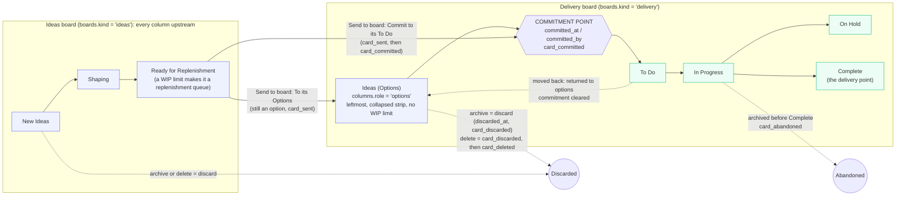
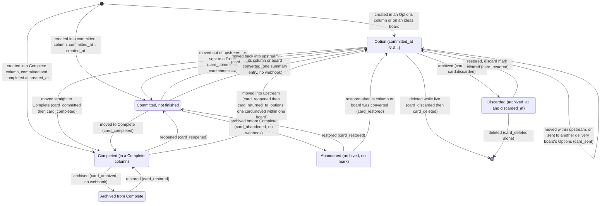
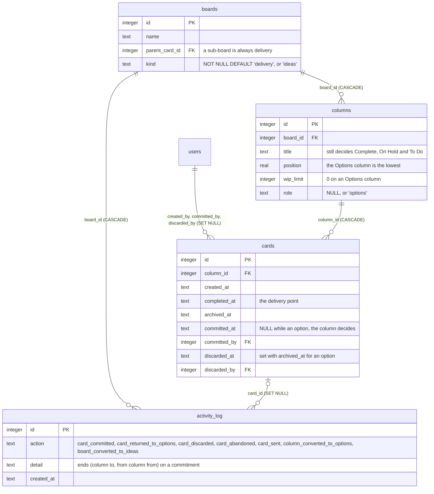
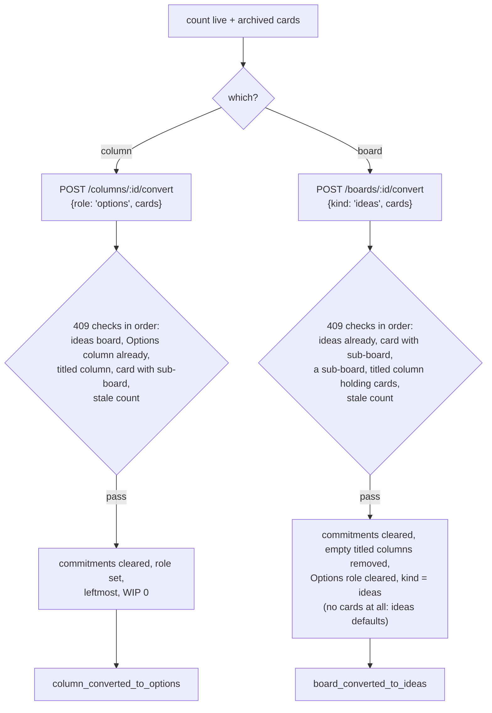
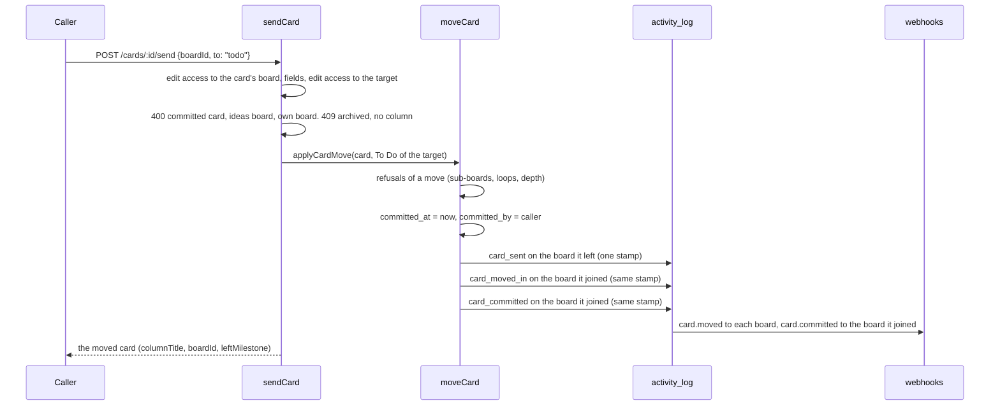

# Upstream Kanban: options, the commitment point and ideas boards

Since milestone 22 (cards 2459 to 2465, 2026-10-26) DumpFire follows the Kanban Method's split
between **upstream**, the ideas that may or may not be done (**options**), and **downstream**,
the work a team has committed to. The **commitment point** between them is recorded on every
card that crosses it. Choosing options to commit is **replenishment**; dropping one is a
**discard**.

Nothing changes on a board until somebody adds an Options column or makes an ideas board. Every
card made before the release counts as committed from the moment it was created, so no figure
moved at the deploy but one: a cycle time can no longer be negative or start after the card's
completion (the S4a review's H5), so a card moved between two Complete columns after it was
completed now shows 0 where it showed a negative cycle time.

This page is the one place that describes the feature whole. The detail of each part lives
where it belongs: [Feature Overview](feature-overview.md#the-options-column) (what users see),
[Admin Operations Guide](admin-guide.md#the-options-column) (operating it),
[Data Model](data-model.md#the-options-column-milestone-22) (fields and entries),
[Architecture](architecture.md#upstream-and-the-commitment-point) (the code),
[Management Activity Reporting](management-reporting.md#options-upstream-of-the-commitment-point),
[Burndown Charts](burndown-charts.md), [Critical-Path Planning](critical-path-planning.md#options-in-a-goal)
and `DUMPFIRE_API.md`, "Changes on 2026-10-26". The plan, with every review ruling, is
[`planning/milestone-22-upstream-kanban.md`](planning/milestone-22-upstream-kanban.md).

## Part one: the high level

### What counts as upstream

A card is **upstream**, an option, when its column is the board's **Options column** or any
column of an **ideas board**. Every other card is **committed**. One predicate decides it
everywhere, in the browser and on the server: `isUpstreamColumn(column, boardKind)` in
`src/lib/column-role.ts`, which is `role === 'options' || boardKind === 'ideas'`. Nothing takes a
card's empty `committed_at` to mean upstream: the column and the board decide.

### The pieces

| Piece | What it is | Who can do it |
|---|---|---|
| **Options column** | One column of a delivery board, always the leftmost, with no WIP limit, drawn as a collapsed strip showing how many options it holds, the oldest one's age and how many are over 30 days. A new one is titled **Ideas**, and its header reads **Ideas (Options)**: the suffix is not part of the title | Anyone who can edit the board adds one (More → Add Options Column, or Add Column's tick box) |
| **Converting a column** | A column holding cards becomes the Options column with its cards, in one recorded step | The board's owner or an administrator |
| **Ideas board** | A board whose every column is upstream, made with New Ideas, Shaping and Ready for Replenishment. No Complete column, no burndown, no sub-boards, no delivery figures | Anyone who makes a board chooses the kind; the owner or an administrator changes it |
| **Converting a board** | A delivery board holding cards becomes an ideas board with its cards, in one recorded step | The board's owner or an administrator |
| **The commitment** | Moving an option into a committed column records when and by whom (`committed_at`, `committed_by`) | Whoever moves it |
| **Send to board** | An option goes to another delivery board: to its Options column, still an option, or to its To Do, which commits it | Anyone who can edit both boards |
| **Discard** | Archiving or deleting an option records it as discarded | Whoever archives or deletes it |
| **Abandoned** | Archiving committed work before it reached Complete records it as abandoned | Whoever archives it |

### The commitment point on a card

Every way a card changes column goes through one function (`moveCard`), so every route records
the commitment point the same way: a drag, the card menu's Move to, a bulk Move, the On Hold
confirmation, All Tasks' Move window, the card window's board picker, the API's move and Send.
Creation does too: a card created outside an upstream column is committed as it is created,
at its `created_at`, by its creator.

Moves the diagram does not show are refused with `409` and write nothing:

- An **archived** card never crosses the commitment point, either way (ruling n): `Card "<title>"
  is archived: restore it before moving it out of or back into Options`. A Send of an archived
  card is refused with the same `409` whichever column it is sent to, Options or To Do. A move of
  an archived card may still stay within one side.
- A **card with sub-boards is never an option** (ruling o, the S5a review's L6). A committed card
  with a sub-board cannot be moved into an upstream column, and a card with a sub-board cannot
  enter another board's upstream (Send to Options, or a move into another board's upstream
  column). A card already upstream with a sub-board, made before the rule, may still move within
  one board's upstream and out of it (the S2 review's C1). A conversion refuses such a card, and
  no sub-board is made under an option.

### How it shows in the figures

One rule: **a delivery measure counts committed cards on delivery boards only.** Options are
counted in figures of their own.

| Where | What changed |
|---|---|
| Board Statistics, delivery metrics | **Lead time (commitment to done)**, from `committed_at` to Complete (Complete is the delivery point, so customer and system lead time are the same here). **Cycle time**, start of work to done, never longer than the lead time. **Throughput** beside **Committed (all)**, the cards that arrived as committed work. **Abandoned**, committed work archived before Complete. The **Upstream** block: Committed from options, Options now, Returned to options, Discarded, Sent to other boards, Discard rate, Oldest option (days), Options over 30 days, Time in options |
| Board Statistics totals, average age, bars | Committed cards only, aging from `committed_at`; a line `Options N · discard rate X%` |
| Cumulative flow diagram | A delivery board's upstream columns are left out unless the viewer ticks **Show upstream**, which draws the Options band at the bottom with its top edge marked **commitment point**. An ideas board draws its own columns |
| Burndown | Committed cards only, each in scope from its `committed_at` |
| Dashboard, All Tasks, My Tasks | Committed cards only; a delivery board row gains its options count; All Tasks puts every board's options in one **Options** column, first, marked **not committed** |
| Goals and plans | Options counted apart (`optionsCount`, `progress.options`); an option is never startable or blocked, and still holds up what waits on it |
| Sub-board progress | An option on a sub-board does not hold back completing its parent card |
| Reports (PDF, mail, schedules) and the activity report | Options in no bucket or total; an **Upstream** line and an **Abandoned** line; neither in a report about one person |
| CSV exports | Two more columns at the end, **Stage** (Option or Committed) and **Committed** |
| Velocity, XP | Unchanged: completions only. An option moved straight to Complete is committed first, then completed |

### When to use options, and when not

These three points come from the plan review (ruling w):

- **Park ideas in Options, not in On Hold.** On Hold is committed work that is paused: every
  delivery figure counts it, its age included. An idea parked there reads as committed work going
  stale, and lengthens lead time when it is finally done. In the Options column it is counted as
  an option, aged as one, and committed only when someone moves it out.
- **An idea closed as not needed is discarded, not completed.** Moving an option straight to
  Complete is allowed (decision M22-7), for an idea that was done there and then. It is then
  committed and finished work, and throughput, lead time and the burndown count it as done. An
  idea that turned out not to be needed is archived instead, which records it as discarded and
  counts it in the discard rate.
- **Burndown is worked out from each card's current state.** A card moved back into the Options
  column leaves the scope of every past day as well, not only from today, and one committed today
  joins from today. A burndown already shared reads differently afterwards. Return work to options
  only when it really is no longer committed to.

## Part two: the low level

### Data model (migration 0060)

One migration, `drizzle/0060_add_upstream_options.sql`, carries the whole data model. `role`
and `kind` are free text checked in code, not a `CHECK`: `columns` and `boards` are tables the
start-up rebuilds from the model, and a `CHECK` would stop that rebuild.

| Field | Meaning |
|---|---|
| `columns.role` | `NULL`, an ordinary column whose title decides what it is, or `'options'`, the board's Options column |
| `boards.kind` | `'delivery'` (every board before 0060, and the default) or `'ideas'`; any other value would count as delivery everywhere |
| `cards.committed_at`, `committed_by` | When and by whom the card crossed the commitment point; `NULL` while it is an option. `committed_by` is `SET NULL` when the account is deleted, as `created_by` is |
| `cards.discarded_at`, `discarded_by` | Set when an option is archived, in the same `UPDATE` as `archived_at`; cleared by a restore |
| `idx_cards_committed_by`, `idx_cards_discarded_by` | The indexes every foreign key column leads (card 2106) |

0060's one-off commits every card at its `created_at` by its `created_by`: before 0060 nothing
was upstream. `runBackfills` repeats three repairs at every start and after every restore: commit
a card not upstream that has no commitment, clear the commitment of an upstream card, and clear
the discard mark of a card that is not archived. At a start each has its own `WARN` line when it
changes anything (`Committed N card(s) that are not upstream …`, `Cleared the commitment on N
card(s) …`, `Cleared the discard mark on N card(s) …`); after a restore each has its own clause in
the restore's report (`committed_at and committed_by on N card(s) not upstream` in its "Filled
in" line, and `Cleared: the commitment of N upstream card(s), the discard mark of N card(s) that
are not archived.`, each part only when there were any). Each finds nothing at an ordinary
start; a count there means a write path forgot, or an older image was used meanwhile. Abandonment has no field: it is recorded in the activity log alone (decision
M22-21).

### The rules, where they live

| Rule | Where |
|---|---|
| Upstream predicate; `columnRoleOf` (role before title, so the Options column is never To Do, On Hold or Complete); `firstOpenColumn` skipping the Options column; `isQueueColumn` | `src/lib/column-role.ts` (browser-safe) |
| SQL fragment `UPSTREAM` / `notUpstream()` (with `IS`, so its negation keeps ordinary columns), `boardKinds`, `upstreamColumnIds`, `isUpstreamColumnId`, `commitmentOnCreation`, `optionsSince`, `upstreamFigures`, `committedAll`, `timeInOptions`, `cycleStarts`, `flowTimes`, `stageOf`, the entry suffixes | `src/lib/server/upstream.ts` |
| Column role on create, update and reorder; leftmost placement; the WIP and delete refusals; `convertColumnFor` | `src/lib/server/columns.ts` |
| Kind on create and update; the empty switch; `convertBoardFor`; the sub-board refusals | `src/lib/server/boards.ts` |
| The commitment on a move; the archived and sub-board refusals; `card_sent` on every cross-board move out of upstream | `src/lib/server/card-moves.ts` (`moveCard`) |
| Commitment on creation | `src/lib/server/card-create.ts` (`recordCardCreated`) |
| Send, and the boards it can go to | `src/lib/server/cards.ts` (`sendCard`, `sendTargetsFor`) |
| Discard and abandoned on archive and delete; the restore | `src/lib/server/deletes.ts`, `src/lib/server/card-restore.ts` |

**The Options column.** `role` is read with the column's own as `keep`, so an update that leaves
it out keeps it; anything but `'options'` or `null` is `400 role must be "options" or null, not
"<sent>"`. Each refusal is `409` with nothing written: no Options column on an ideas board; no
second one; no role given or taken away by a plain update while the column holds cards, archived
included; no Options column whose title means To Do, On Hold or Complete (ruling x); no WIP limit
above 0 on it, on a create as on an update; no other column at or left of it. Given the role, a
column moves to one less than the lowest other position and its WIP limit to 0. A column made on
the board page with no position goes straight after it (the board's columns renumbered first
when no number is left between); through the API it goes after the last. It is not deleted while
it holds live cards; its archived cards go with it, not discarded.

**Ideas boards.** Made with New Ideas, Shaping and Ready for Replenishment. No column whose
title means To Do, On Hold or Complete, by `columnRole` (so Todo, Blocked, Parked, Waiting, Done
and the rest): create and rename are `409` (the S5a review's L1). WIP limits are allowed. A
column holding live ideas is not deleted (L2). A sub-board is a delivery board (`409 A sub-board
is a delivery board.`, on create and on re-parenting), and no sub-board is made under an option.
`PUT kind` changes an **empty** board only (no card, live or archived), the owner's or an
administrator's, replacing its columns with the other kind's (ruling j, decision M22-18).

**Conversions** (ruling i). The body carries the count of live and archived cards the caller
saw; a different count now is `409 The column now holds K cards; look again.` (`The board now
holds …`). One transaction clears `committed_at` and `committed_by` on every card in scope,
archived ones included, and writes one summary entry, with no entry, webhook or mail for each
card:

The two summary entries' details, each ending with the id the option's age is read by:

| Entry | Detail |
|---|---|
| `column_converted_to_options` | `"<column>": N cards became options (column <id>)`, or `1 card became an option` |
| `board_converted_to_ideas` | `"<board>": N cards became ideas; its columns To Do, On Hold, Complete were removed (board <id>)` (`its column Complete was removed` for one; no clause when none went; `1 card became an idea`). A board holding no card at all: `"<board>": 0 cards became ideas; its columns A, B were replaced with New Ideas, Shaping, Ready for Replenishment (board <id>)`, or `it was given the columns …` for a board with none |

Going back needs an empty column or board: taking the role away, or making an ideas board a
delivery board, is refused while any card is there.

**Send** (ruling l). Only an option is sent, to **another delivery board**. `to: 'options'` puts
it in that board's Options column (409 if it has none); `to: 'todo'` in its first column titled To
Do, else its first committed column that is neither Complete nor On Hold (`sendToTodoColumn`:
never On Hold; 409 if there is none). It is then a move in every way, with all of a move's
refusals, and the option's age kept. As any move to another board, it sheds the labels of the
board it leaves and a category or goal that belongs to another board; a category of no board,
and a goal across boards, stay.

`card_sent` is written for **every** move of an option to another board, by Send or by an
ordinary move (the S5a review's L5), so "Sent to other boards" and the discard rate see every way
an option leaves. It sits in place of `card_moved_away`, and names neither board (card 2181).

### Activity entries and webhooks

| Entry | Written when | Detail | Label | Webhook |
|---|---|---|---|---|
| `card_committed` | A card leaves upstream for a committed column, by a move or a Send to To Do | `"<title>": <from> → <to> (column <to id>, from column <from id>)` | Committed card | `card.committed` |
| `card_returned_to_options` | A committed card is moved into an upstream column | `"<title>": <from> → <to>` | Returned card to Options | `card.moved` (the only webhook for that move, ruling q) |
| `card_discarded` | An option is archived, or deleted while live | `"<title>": discarded from <column>`, or `"<title>": deleted from <column>` | Discarded card | `card.discarded` |
| `card_abandoned` | Committed work not in a Complete column is archived, in place of `card_archived` | `"<title>": archived unfinished, from <column>` | Archived unfinished card | none |
| `card_sent` | An option moves to another board, on the board it leaves, in place of `card_moved_away` | `"<title>" sent to another board's Options (<from> → <to>)`, `… To Do (…)` or `… "<column>" column (…)`, ending ` and out of milestone "<name>"` (or ` and out of a milestone of another board`) when it left a goal | Sent card to another board | `card.moved` |
| `column_converted_to_options` | A column conversion, one per conversion | as in *Conversions* above | Converted column to Options | none |
| `board_converted_to_ideas` | A board conversion, one per conversion | as in *Conversions* above | Converted board to an ideas board | none |
| `card_restored` (unchanged action) | A discarded card is restored | `"<title>": back in <column>` | Restored card | none |

Within one board a move out of upstream sends `card.committed` **instead of** `card.moved`: a
receiver that lists only `card.moved` no longer hears it, as one without `card.completed` hears
no completion. Across boards each board is sent its own `card.moved` (`card_sent`,
`card_moved_in`), and the board it joins `card.committed` too. A webhook with an empty event list
receives everything, the two new events included. There are ten events.

### The upstream figures

`upstreamFigures(boardIds, from, to)` reads the activity log over a window that includes both
ends (the S3 review's E4), in four reads however many boards (E3). `null` for the boards means
every board.

| Figure | What it counts |
|---|---|
| `options` | Live cards in an upstream column now |
| `committedFromOptions`, `returnedToOptions`, `discarded`, `sentOn` | Distinct cards whose **last** upstream act in the window was a commitment, a return, a discard or a Send (ruling c). A deleted card's entries each count once. A Send whose target board is in scope is dropped, paired by the `card_moved_in` with the same card and stamp (ruling b) |
| `abandoned` | Distinct cards with a `card_abandoned` in the window, counted on their own (E1): a card committed and then abandoned counts as both |
| `discardRate` | `discarded / (discarded + committedFromOptions + sentOn)`, `null` when that is 0; abandoned work is not in it |
| `oldestOptionDays`, `agingOptions` | The oldest option's age in whole days, and how many are older than 30 days. An option's age runs from the latest of its creation, its latest return to options, and the latest conversion of its column or board that made it one, counted only if the card has not arrived on the board since (`optionsSince`, decision M22-20, the S1b review's B2, the S4a review's H3). A Send keeps the age |

Beside them, for the board's metrics and the API: **Committed (all)** (`committedAll`), distinct
cards with a `card_committed` in the window plus cards created in it straight into a committed
column; and **Time in options** (`timeInOptions`), for each card whose last upstream act in the
window was a commitment, the commitment's moment minus when it became an option.

The time measures (`flowTimes`, `cycleStarts`):

| Measure | Rule |
|---|---|
| Lead time (commitment to done) | `completed_at − (committed_at ?? created_at)` |
| Cycle time (start of work to done) | From the earliest `card_moved`, or `card_committed` into a column that is not a queue, at or after the current `committed_at` and not after `completed_at`, clamped to [0, lead time] (ruling a, the S4a review's H1 and H5). A queue is the board's first committed column, a To Do or On Hold column, or a queue title (Backlog, Ready, Selected, Next and the like). A card created straight into a working column has no start at its creation: its cycle time runs from its first move after it, and it has none if it goes from there straight to Complete |

### API (version 1.3.0)

Every answer carries the new fields: `role` on columns, `kind` on boards, and `committedAt`,
`committedBy`, `discardedAt`, `discardedBy` on cards (read-only). New and changed operations:

| Operation | Body or query | Notes |
|---|---|---|
| `POST /api/v1/boards/{boardId}/columns`, `PUT /api/v1/columns/{columnId}` | `role` | The Options column's rules above |
| `POST /api/v1/columns/{columnId}/convert` | `{"role": "options", "cards": N}` | Owner or administrator; answers the column |
| `POST /api/v1/boards`, `PUT /api/v1/boards/{boardId}` | `kind` | A change is the owner's or an administrator's, of an empty board only |
| `POST /api/v1/boards/{boardId}/convert` | `{"kind": "ideas", "cards": N}` | Owner or administrator; answers the board with its columns |
| `GET /api/v1/boards` | `?kind=delivery` or `?kind=ideas` | `kind=delivery` is every board that is not an ideas board |
| `GET /api/v1/boards/{boardId}/cards` | `?stage=option` or `?stage=committed` | By the column each card is in; with `archived=true`, archived cards too |
| `POST /api/v1/cards/{cardId}/send` | `{"boardId": N, "to": "options" \| "todo", "position"?: N}` | Answers the moved card |
| `GET /api/v1/boards/{boardId}/upstream` | `?days=N`, 1 to 365, 30 by default | View access; `{boardId, kind, days, period, …figures, committedAll}` |
| `PUT /api/v1/cards/{cardId}/move`, `DELETE /api/v1/cards/{cardId}`, `PUT … archivedAt: null` | as before | Record the commitment, the discard, the abandonment and the restore |
| `GET /api/v1/me/stats` | | `avgLeadTimeDays` added; `avgCycleTimeDays` the same value, kept for history |

### The tracking wrapper

`.agent/scripts/dumpfire-api.ps1` (card 2465) covers all of it, and its reference
(`.agent/workflows/dumpfire-api-reference.md`, *Upstream*) lists each request:
`create-column -Role options`, `update-column -Role options|none`, `convert-column -ColumnId N
-Cards N`, `create-board -Kind ideas`, `update-board -Kind delivery|ideas`, `convert-board
-BoardId N -Cards N`, `send-card -CardId N -BoardId N -To options|todo [-Position N]`, `upstream
-BoardId N [-Days N]`, `boards -Kind delivery|ideas` and `cards -Stage option|committed`.
`-Cards` is checked to be a whole number, and `send-card`'s `-BoardId` and `-To` to be there,
before any request. The two converts are destructive actions, as every `delete-*` is: a typed
`yes` in a terminal, refused non-interactively and through from-file, since each clears
commitments for good and is the board owner's step. `-Compact` keeps `committedAt`,
`discardedAt`, `role` and `kind`; `upstream` ignores it and prints its figures whole.

The tracking workflow (`dumpfire-tracking.md`, *Upstream*) gives the guidance above to the
agents that keep the board, with one rule of its own: **a discard is the owner's step**.
`delete-card` is destructive and the API refuses an archive by `PUT`, so an agent asks the user
to discard an idea (Archive on the board page, or `delete-card` typed in a terminal) and never
moves an option to Complete in its place, which would commit it and count it as finished work.

Against a server older than 1.3.0 the four new operations answer `404`; `update-column -Role`
and `update-board -Kind` sent alone answer `400 No valid fields to update`, and with other fields
the role or kind is dropped; and `-Role` on `create-column`, `-Kind` on `create-board` and
`boards`, and `-Stage` on `cards` are ignored.

### Restores and older images

A backup made before 0060 restores with no Options column, every board a delivery board, nothing
discarded and every card committed from its creation: the same boards, no figure changed. A
backup made after 0060, put into an older image, keeps the new columns but the older image does
not keep them up to date: cards it creates get no commitment, and cards it moves out of Options
are not stamped, so going forward again the start-up backfill commits them from `created_at`,
which lengthens their lead time.

### Not built in this milestone

Recorded in the plan for later cards: a replenishment view and minimum limits (a replenishment
cadence, a minimum on Ready for Replenishment); a per-board rule on who may commit; discard
reasons, as `close_reason` is for completions.
